# Phụ lục — Các nhân tố chính khi đánh giá một doanh nghiệp đầy hứa hẹn (Key Factors in Evaluating Promising Firms)

## Ý chính

**Philip Fisher tóm lược thành 22 điểm những gì ông tìm ở một doanh nghiệp có triển vọng phi thường: doanh nghiệp phải vừa có năng lực vận hành vượt trội, vừa có con người phù hợp, vừa có đặc tính kinh doanh giúp giữ vững vị thế, để tăng trưởng lớn mà rủi ro vẫn được kiểm soát.**

Triết lý nền là đầu tư vào số lượng tương đối nhỏ các doanh nghiệp hứa hẹn phát triển vượt trội. Fisher tìm dấu hiệu tăng trưởng và cũng cố tránh rủi ro. Danh sách này là kết quả của ba việc: phân tích tài chính, gặp gỡ và hỏi ban quản lý, thảo luận với những người hiểu ngành.

Nhóm thứ nhất, nhân tố cơ cấu (7 điểm), nói về chi phí thấp, định hướng khách hàng, marketing, nghiên cứu, đội ngũ tài chính và hệ thống cảnh báo sớm. Điểm đầu tiên là doanh nghiệp phải thuộc nhóm có chi phí thấp nhất và sẽ giữ được vị thế đó.

Nhóm thứ hai, nhân tố con người (8 điểm), nói về nhà lãnh đạo có tinh thần doanh nhân, đội ngũ được ủy quyền, kế nhiệm từ bên trong, văn hóa riêng, sẵn sàng thay đổi, đối xử tốt với nhân viên và kỷ luật hy sinh lợi nhuận tạm thời vì tăng trưởng bền vững.

Nhóm thứ ba, các đặc tính về hoạt động kinh doanh (7 điểm), nói về chất lượng lợi nhuận và sức mạnh bảo vệ vị thế: tỷ lệ lợi nhuận trên doanh số, lợi thế quy mô, người đi đầu, cạnh tranh gián tiếp, khó khăn của người mới và nhiều con đường dẫn đầu ngành.

Theo nhận định của người tổng hợp, thông điệp chung là không có một chỉ số nào đủ để đánh giá doanh nghiệp. Fisher kết phụ lục bằng ý rằng lợi nhuận cao thu hút cạnh tranh, và dù dẫn đầu ngành bằng cách nào, khả năng bảo vệ thị trường đã giành được là điều cần thiết cho một sự đầu tư vững chắc.

## Sơ đồ

### Phần mở đầu phụ lục — mục đích của bản tóm lược (trang 355)

```text
       Triết lý: đầu tư vào số lượng tương đối nhỏ doanh nghiệp hứa hẹn
       phát triển vượt trội
                                │
               ┌────────────────┴────────────────┐
               ▼                                 ▼
       TÌM DẤU HIỆU TĂNG TRƯỞNG          TRÁNH RỦI RO
       trong các doanh nghiệp nghiên     Muốn chắc bộ máy quản lý có đủ
       cứu                               tiền để tận dụng tiềm năng và
                                         giảm rủi ro cho nhà đầu tư
               └────────────────┬────────────────┘
                                ▼
       Ba cách thu thập: phân tích tài chính, gặp và hỏi ban quản lý, thảo
       luận với người hiểu biết trong ngành
```

### Mục "Nhân tố cơ cấu" — năng lực vận hành của doanh nghiệp (trang 355–357)

```text
       1. CHI PHÍ THẤP: thuộc nhóm nhà sản xuất chi phí thấp nhất và giữ được
          · điểm hòa vốn thấp: sống sót khi suy thoái, tăng vị thế khi đối
            thủ yếu bị loại, có khả năng ảnh hưởng tới giá
          · biên lợi nhuận trên trung bình: tự có tiền để tăng trưởng, ít
            phải bán cổ phần mới hay vay nợ quá mức
                                │
                                ▼
       2. ĐỊNH HƯỚNG KHÁCH HÀNG: nhận ra thay đổi nhu cầu và phản ứng nhanh;
          có thể tạo dòng sản phẩm mới thay dòng đã lỗi thời
                                │
                                ▼
       3. MARKETING: hiểu nhu cầu và giải thích cho khách theo cách họ hiểu;
          giám sát chặt tỷ lệ chi phí trên hiệu quả
                                │
                                ▼
       4. NGHIÊN CỨU CÓ ĐỊNH HƯỚNG: cần cả ở doanh nghiệp không chuyên công
          nghệ, để có sản phẩm tốt hơn và dịch vụ hiệu quả hơn
                                │
                                ▼
       5. HIỆU QUẢ NGHIÊN CỨU khác nhau rất lớn; hai nhân tố: ý thức về thị
          trường và lợi nhuận, khả năng tập hợp nhân tài thành tập thể
                                │
                                ▼
       6. ĐỘI NGŨ TÀI CHÍNH MẠNH có ba lợi thế
          · thông tin chi phí chính xác đưa nguồn lực vào sản phẩm lãi nhất
          · bảng chi phí chỉ rõ chỗ kém hiệu quả, cả trong phần phụ
          · kiểm soát chặt vốn cố định và vốn lưu động
                                │
                                ▼
       7. HỆ THỐNG CẢNH BÁO SỚM: nhận ra sớm ảnh hưởng đe dọa kế hoạch lợi
          nhuận, lập kế hoạch ngăn chặn và giảm thiểu
```

### Mục "Nhân tố con người" — những người điều hành doanh nghiệp (trang 357–359)

```text
       1. NHÀ LÃNH ĐẠO có tinh thần doanh nhân, động lực, ý tưởng ban đầu và
          kỹ năng tạo ra của cải
                                │
                                ▼
       2. GIÁM ĐỐC ĐIỀU HÀNH tập hợp nhân tài kiệt xuất và ủy quyền; đội ngũ
          chung sức, không tranh giành quyền lực nội bộ
                                │
                                ▼
       3. KẾ NHIỆM từ nguồn nhân tài sẵn có; phải tuyển giám đốc điều hành từ
          ngoài là dấu hiệu rất nguy hiểm
                                │
                                ▼
       4. TINH THẦN DOANH NHÂN thấm nhuần cả tổ chức
                                │
                                ▼
       5. TÍNH CÁCH ĐỘC ĐÁO: cách làm riêng có hiệu quả là tín hiệu tốt
                                │
                                ▼
       6. CHẤP NHẬN THAY ĐỔI: xem lại cách làm cũ, tìm cách mới; nhận ra
          và giảm rủi ro của chính sự thay đổi
                                │
                                ▼
       7. NHÂN VIÊN MỌI CẤP tin đây là nơi lý tưởng để làm việc
          · được đối xử tử tế và tôn trọng
          · môi trường và phúc lợi có tính thúc đẩy
          · bày tỏ bức xúc không sợ hãi, được quan tâm và xử lý thích đáng
          · chương trình đóng góp ý kiến hoạt động tốt
                                │
                                ▼
       8. KỶ LUẬT TĂNG TRƯỞNG: hy sinh lợi nhuận tạm thời để đặt nền móng
          cho bước phát triển lớn trong tương lai
```

### Mục "Các đặc tính về hoạt động kinh doanh" — sức bền của lợi nhuận và vị thế (trang 359–360)

```text
       1. Tài sản ghi theo chi phí lịch sử làm méo so sánh; lợi nhuận lớn so
          với doanh số có thể là dấu hiệu an toàn, nhất là khi lạm phát
                                │
                                ▼
       2. Lợi nhuận cao thu hút cạnh tranh; cách thắng tốt nhất là hoạt động
          hiệu quả để chặn đối thủ thâm nhập
                                │
                                ▼
       3. Quy mô có thể sinh quan liêu cấp trung gian, nhưng ở doanh nghiệp
          vận hành tốt, vị trí dẫn đầu ngành là lợi thế rất lớn
                                │
                                ▼
       4. Đi đầu trong sản phẩm mới là quá trình lâu dài; một số doanh nghiệp
          được chuẩn bị nguồn lực tốt hơn
                                │
                                ▼
       5. Sản phẩm phải được so với sản phẩm tương tự; có cạnh tranh gián tiếp
          về đồng tiền của khách; giá đổi thì sức hấp dẫn đổi
                                │
                                ▼
       6. Rất khó tung sản phẩm mới vào thị trường đối thủ đã vững; cơ hội lớn
          hơn nếu kết hợp công nghệ theo cách mới
                                │
                                ▼
       7. Có nhiều đường tới vị thế dẫn đầu: công nghệ, "nhượng quyền" khách
          hàng, dịch vụ; điều cần thiết là bảo vệ được thị trường đã giành
```

## Ba câu hỏi chương này trả lời

1. **Fisher nhìn vào những nhóm yếu tố nào khi đánh giá doanh nghiệp?** Ba nhóm, tổng cộng 22 điểm. Nhân tố cơ cấu (7 điểm) là năng lực vận hành: chi phí thấp, khách hàng, marketing, nghiên cứu, tài chính, cảnh báo sớm. Nhân tố con người (8 điểm) là lãnh đạo, đội ngũ, kế nhiệm, văn hóa, nhân viên, kỷ luật. Các đặc tính về hoạt động kinh doanh (7 điểm) là chất lượng lợi nhuận và sức bảo vệ vị thế.

2. **Vì sao chi phí thấp được đặt đầu tiên?** Vì nó tạo ra hai lợi ích. Điểm hòa vốn thấp giúp doanh nghiệp tồn tại khi suy thoái và mạnh lên khi đối thủ yếu bị loại. Biên lợi nhuận trên trung bình giúp doanh nghiệp tự có tiền tăng trưởng, không phải bán thêm cổ phần gây pha loãng hay vay nợ quá mức.

3. **Làm sao doanh nghiệp giữ được lợi nhuận cao khi lợi nhuận cao luôn hút cạnh tranh?** Bằng hiệu quả hoạt động để chặn đường đối thủ, bằng vị trí dẫn đầu ngành với lợi thế quy mô, và bằng một trong nhiều con đường: công nghệ, quan hệ gắn bó với khách hàng, dịch vụ tốt. Fisher nói đường nào cũng được, miễn là bảo vệ được thị trường đã giành và chống lại đối thủ mới.

## Khái niệm cần biết

- **Điểm hòa vốn (break-even point):** mức doanh số mà doanh thu vừa đủ bù chi phí, chưa lãi chưa lỗ. Quan trọng vì doanh nghiệp có điểm hòa vốn thấp vẫn có thể có lãi khi thị trường suy thoái.
- **Biên lợi nhuận (profit margin):** phần lợi nhuận trên mỗi đồng doanh số. Biên trên mức trung bình cho doanh nghiệp tiền nội bộ để tăng trưởng.
- **Bán cổ phần mới và pha loãng (equity financing, dilution):** công ty phát hành thêm cổ phiếu để huy động vốn, làm mỗi cổ phần cũ chiếm tỷ lệ nhỏ hơn. Đây là điều Fisher muốn tránh.
- **Huy động vốn có thu nhập cố định (fixed-income financing):** vay nợ hoặc phát hành trái phiếu, phải trả lãi cố định dù kinh doanh tốt hay xấu. Dựa quá nhiều vào nguồn này gây căng thẳng tài chính.
- **Vốn cố định và vốn lưu động (fixed and working capital):** vốn cố định nằm trong nhà máy, máy móc; vốn lưu động nằm trong hàng tồn kho, khoản phải thu, tiền mặt. Kiểm soát chặt cả hai là bảo toàn vốn.
- **Sự hoàn vốn (return on investment):** lợi nhuận so với số vốn đã bỏ ra. Nhà quản lý dùng nó để xem xét đầu tư mới, nhưng nhà đầu tư bên ngoài phải cảnh giác khi so sánh các công ty.
- **Tài sản ghi theo chi phí lịch sử (historical cost):** kế toán ghi tài sản theo giá mua cũ. Doanh nghiệp có nhà máy cũ giá rẻ có thể trông sinh lời cao hơn doanh nghiệp mới xây, dù không thật sự tốt hơn.
- **Tỷ lệ doanh thu (turnover):** doanh số so với tài sản đã dùng. Hai doanh nghiệp có thể có lợi nhuận trên doanh số khác nhau vì tốc độ quay vòng vốn khác nhau.
- **Lạm phát (inflation):** mặt bằng giá tăng. Khi đó tài sản cũ ghi giá thấp, nên tỷ lệ lợi nhuận trên tài sản đánh giá sai hơn nữa; Fisher coi lợi nhuận lớn so với doanh số là dấu hiệu an toàn hơn trong môi trường này.
- **Tính hiệu quả nhờ quy mô (economies of scale):** quy mô lớn làm chi phí trên mỗi đơn vị giảm. Mặt trái là bộ máy quan liêu cấp trung gian.
- **Cạnh tranh gián tiếp (indirect competition):** sản phẩm khác loại cùng giành đồng tiền của khách. Khi giá thay đổi, sản phẩm có thể mất sức hấp dẫn dù doanh nghiệp hoạt động tốt.
- **"Nhượng quyền" khách hàng (customer franchise):** bản dịch dùng chữ "nhượng quyền", nhưng ở đây là sự gắn bó của khách hàng với doanh nghiệp, không phải mô hình kinh doanh nhượng quyền thương hiệu. Xem mục Lưu ý cuối chương.
- **Giám đốc điều hành (chief executive):** người đứng đầu hoạt động của doanh nghiệp. Fisher coi việc phải tìm người này từ bên ngoài là dấu hiệu nguy hiểm.

## Nội dung chi tiết

### 1. Mục đích của bản tóm lược (phần mở đầu, trang 355)

Fisher nhắc lại rằng triết lý của ông là đầu tư vào số lượng tương đối nhỏ, chỉ với các doanh nghiệp hứa hẹn phát triển vượt trội. Ông tìm các dấu hiệu tăng trưởng tiềm năng, và không kém phần quan trọng là cố tránh rủi ro trong quá trình phân tích. Ông muốn chắc rằng bộ máy quản lý có đủ tiền cần thiết để tận dụng tiềm năng của mình và giảm rủi ro cho khoản đầu tư. Phần dưới đây là các đặc điểm ông đã tìm khi phân tích tài chính, gặp gỡ và hỏi ban quản lý, thảo luận với người hiểu ngành.

### 2. Nhân tố cơ cấu (trang 355–357)

**Điểm 1, chi phí thấp.** Doanh nghiệp phải là một trong những nhà sản xuất có chi phí thấp nhất đối với sản phẩm hoặc dịch vụ trong cuộc cạnh tranh mà nó tham gia, và phải có triển vọng giữ được điều đó. Fisher nêu hai lợi ích. Điểm hòa vốn tương đối thấp giúp doanh nghiệp tồn tại khi thị trường suy thoái, đồng thời tăng vị thế và khả năng ảnh hưởng đến giá khi đối thủ yếu bị loại. Biên lợi nhuận trên trung bình cho doanh nghiệp nhiều tiền hơn để tăng trưởng mà không phải bán cổ phần gây thiệt cho cổ đông hiện hữu, cũng không phụ thuộc quá nhiều vào vốn có thu nhập cố định.

**Ví dụ hôm nay (minh hoạ của người tổng hợp, số giả định):** hai công ty bán cùng sản phẩm giá 100. Công ty A có chi phí biến đổi 60 mỗi sản phẩm và chi phí cố định 40 triệu, nên điểm hòa vốn là 40 triệu / (100 − 60), tức 1 triệu sản phẩm. Công ty B có chi phí biến đổi 70, chi phí cố định 45 triệu, điểm hòa vốn 1,5 triệu sản phẩm. Khi suy thoái kéo giá xuống 90, điểm hòa vốn của A thành khoảng 1,33 triệu sản phẩm, của B thành 2,25 triệu. Nếu toàn thị trường chỉ tiêu thụ được ở mức mỗi công ty bán 1,5 triệu sản phẩm, A còn lãi, B lỗ, và A có thể giành thị phần khi B yếu đi.

**Điểm 2, định hướng khách hàng.** Doanh nghiệp phải đủ gần khách hàng để nhận ra thay đổi về nhu cầu và sở thích, rồi phản ứng nhanh và hợp lý. Khả năng này có thể tạo ra dòng sản phẩm mới thay thế các dòng đã lỗi thời.

**Điểm 3, marketing hiệu quả.** Hiểu nhu cầu khách hàng chưa đủ; phải giải thích cho họ qua quảng cáo, bán hàng hay cách khác theo cách họ hiểu được. Cần giám sát chặt và điều chỉnh tỷ lệ chi phí trên hiệu quả của các nỗ lực thị trường.

**Điểm 4, nghiên cứu có định hướng.** Ngày nay ngay cả doanh nghiệp không chuyên công nghệ cũng cần khả năng nghiên cứu định hướng tốt để sản xuất sản phẩm mới và tốt hơn, và cung cấp dịch vụ hiệu quả hơn.

**Điểm 5, hiệu quả nghiên cứu.** Hiệu quả nghiên cứu giữa các doanh nghiệp khác nhau rất lớn. Hai nhân tố quan trọng là ý thức về thị trường và lợi nhuận của người nghiên cứu, và khả năng tập hợp nhân tài thành một tập thể làm việc hiệu quả.

**Điểm 6, đội ngũ tài chính mạnh.** Doanh nghiệp có đội ngũ này có ba lợi thế. Thông tin chi phí chính xác giúp đội ngũ quản lý đưa nguồn lực vào sản phẩm có tiềm năng lợi nhuận nhiều nhất. Bảng liệt kê chi phí chỉ rõ tại điểm nào chi phí sản xuất, marketing và nghiên cứu không hiệu quả, kể cả trong các phần phụ của quá trình hoạt động. Vốn được bảo toàn nhờ kiểm soát chặt nguồn vốn đầu tư cố định và lưu động.

**Điểm 7, cảnh báo sớm.** Cấu trúc tài chính phải cung cấp một hệ thống cảnh báo sớm để nhận định các ảnh hưởng đe dọa kế hoạch lợi nhuận phía trước, từ đó lập kế hoạch ngăn chặn và giảm thiểu.

### 3. Nhân tố con người (trang 357–359)

**Điểm 1, nhà lãnh đạo.** Để thành công hơn, doanh nghiệp phải có người lãnh đạo có tinh thần doanh nhân, kết hợp động lực, ý tưởng ban đầu và kỹ năng cần thiết để tạo ra của cải.

**Điểm 2, ủy quyền và đội ngũ.** Giám đốc điều hành hướng tới tăng trưởng phải tập hợp được đội ngũ nhân tài kiệt xuất và ủy quyền cho họ điều hành. Sự chung sức không có tranh giành quyền lực nội bộ là rất cần thiết.

**Điểm 3, kế nhiệm.** Phải chú ý thu hút nhà quản lý có trình độ ở cấp thấp hơn và đào tạo họ đảm nhận nhiệm vụ cao hơn. Vị trí kế nhiệm nên chuyển cho người trong nguồn nhân tài sẵn có. Fisher coi nhu cầu tuyển giám đốc điều hành từ bên ngoài là dấu hiệu rất nguy hiểm.

**Điểm 4, tinh thần doanh nhân.** Tinh thần này phải được cả tổ chức thấm nhuần.

**Điểm 5, tính cách độc đáo.** Doanh nghiệp thành công luôn có một số đặc điểm riêng: những cách thức đặc biệt để làm mọi việc hiệu quả cho bộ máy quản lý của họ. Fisher xem đây là tín hiệu tốt, không có gì đáng lo.

**Điểm 6, chấp nhận thay đổi.** Ban quản lý phải nhận ra rằng thế giới đang thay đổi với tốc độ chóng mặt. Cách thường làm phải được xem xét lại trong từng giai đoạn để tìm cách mới hơn, tốt hơn. Các thay đổi trong cách quản lý cũng có rủi ro, cần nhận ra kịp thời và giảm thiểu.

**Điểm 7, nhân viên.** Phải có nỗ lực thật sự, thực tiễn, có ý thức và không ngừng để nhân viên mọi cấp tin rằng doanh nghiệp là nơi lý tưởng để làm việc. Người làm công phải được đối xử tử tế và tôn trọng. Môi trường làm việc và chương trình phúc lợi phải có tính thúc đẩy. Mọi người phải cảm thấy có thể bày tỏ bức xúc mà không lo sợ, và hy vọng nhận được quan tâm và hành động thích đáng. Các chương trình đóng góp ý kiến phải hoạt động tốt và là nguồn ý tưởng quan trọng.

**Điểm 8, kỷ luật tăng trưởng.** Bộ máy quản lý phải sẵn sàng tuân theo nguyên tắc cần cho tăng trưởng bền vững. Tăng trưởng đòi hỏi hy sinh các khoản lợi nhuận tạm thời để đặt nền móng cho bước phát triển có giá trị lớn trong tương lai.

### 4. Các đặc tính về hoạt động kinh doanh (trang 359–360)

**Điểm 1, chất lượng lợi nhuận.** Nhà quản lý dựa vào sự hoàn vốn để xem xét đầu tư mới, nhưng nhà đầu tư phải hiểu rằng tài sản được công bố theo chi phí từ trước tới nay sẽ làm méo so sánh giữa các doanh nghiệp. Khoản lợi nhuận khá lớn so với doanh số, sau khi tính tới khác biệt về tỷ lệ doanh thu, có thể là dấu hiệu an toàn để đầu tư, đặc biệt trong môi trường lạm phát.

**Ví dụ hôm nay (minh hoạ của người tổng hợp, số giả định):** công ty A có nhà máy xây 20 năm trước, giá trị sổ sách còn 50 tỷ, lợi nhuận 10 tỷ, tức 20% trên tài sản. Công ty B vừa xây nhà máy tương đương với giá 200 tỷ, lợi nhuận cũng 10 tỷ, tức 5%. Tỷ lệ của A đẹp hơn mà năng lực kinh doanh như nhau, và khi nhà máy của A hết đời, A phải bỏ ra số tiền như B. Vì vậy Fisher khuyên nhìn thêm lợi nhuận so với doanh số.

**Điểm 2, cạnh tranh.** Lợi nhuận cao thu hút cạnh tranh, và cạnh tranh làm giảm cơ hội lợi nhuận tiếp theo. Cách tốt nhất để thắng là hướng tới hiệu quả hoạt động nhằm chặn cơ hội thâm nhập của đối thủ.

**Điểm 3, quy mô.** Hiệu quả nhờ quy mô thường đi kèm nguy cơ quan liêu ở cấp quản lý trung gian. Tuy nhiên ở doanh nghiệp vận hành tốt, vị trí dẫn đầu ngành tạo lợi thế cạnh tranh rất lớn và vì vậy thu hút nhà đầu tư.

**Điểm 4, người đi đầu.** Đi đầu trong thị trường sản phẩm mới là một quá trình lâu dài để có thể là người tiên phong. Một số doanh nghiệp được chuẩn bị nguồn lực tốt hơn cho việc này.

**Điểm 5, cạnh tranh gián tiếp.** Sản phẩm không đứng riêng lẻ mà phải được so với các sản phẩm tương tự. Có cuộc cạnh tranh gián tiếp đối với đồng tiền của khách hàng. Khi giá thay đổi, một số sản phẩm có thể mất sức hấp dẫn, kể cả ở doanh nghiệp tốt và có chi phí thấp.

**Điểm 6, khó khăn của người mới.** Rất khó tung sản phẩm mới và cao cấp vào thị trường nơi đối thủ đã có vị thế vững. Người mới phải xây dựng dòng sản phẩm, sức mạnh marketing và danh tiếng để có lợi thế, trong khi đối thủ có sẵn có thể phản ứng mạnh để giành lại thị trường. Doanh nghiệp cải tiến sản phẩm có nhiều cơ hội hơn nếu kết hợp các quy trình công nghệ, ví dụ điện tử và kỹ thuật hạt nhân, theo cách mới so với đối thủ hiện tại.

**Điểm 7, các con đường dẫn đầu.** Công nghệ chỉ là một con đường để vươn lên dẫn đầu ngành. Phát triển sự gắn bó với khách hàng, mà bản dịch gọi là "nhượng quyền" khách hàng, cũng là một cách. Dịch vụ tốt cũng là một cách. Dù bằng cách nào, khả năng bảo vệ thị trường đã giành được và chống lại đối thủ mới là điều cần thiết cho một sự đầu tư vững chắc.

## Luận điểm cốt lõi

### Mệnh đề

Một doanh nghiệp đáng đầu tư dài hạn là doanh nghiệp có đồng thời năng lực vận hành hơn đối thủ, những con người duy trì được năng lực đó, và đặc tính kinh doanh giúp bảo vệ vị thế đã giành được.

### Giả định

- Các đặc điểm định tính như văn hóa, tinh thần doanh nhân, quan hệ nhân viên có thể nhận biết qua tiếp xúc và trò chuyện.
- Các đặc điểm này duy trì được đủ lâu để tạo ra tăng trưởng vượt trội.
- Chi phí thấp là nền tảng bền vững hơn chỉ số lợi nhuận trên tài sản kế toán.

### Cơ chế

1. Chi phí thấp và biên lợi nhuận cao tạo ra nguồn tiền nội bộ và sức chịu đựng khi suy thoái.
2. Nguồn tiền đó được đưa vào nghiên cứu có định hướng, marketing và đội ngũ tài chính kiểm soát chi phí.
3. Con người tốt ở mọi cấp giữ cho bộ máy thích nghi và kế nhiệm được từ bên trong.
4. Vị trí dẫn đầu, quy mô, quan hệ khách hàng hoặc dịch vụ ngăn đối thủ giành lại phần lợi nhuận.
5. Vòng này lặp lại để doanh nghiệp tăng trưởng mà không phải pha loãng cổ đông hay vay nợ quá mức.

### Bằng chứng và ví dụ Fisher đưa ra

Phụ lục là danh sách, không nêu tên công ty hay số liệu. Bằng chứng nằm ở các phần trước của sách.

### Kết luận và hàm ý cho nhà đầu tư

Ba hàm ý dưới đây là nhận định của người tổng hợp; Fisher không nêu cách dùng danh sách.

- Dùng danh sách này như bộ câu hỏi khi gặp ban quản lý và người trong ngành.
- Không cần hỏi đủ 22 điểm cho mọi công ty, nhưng cần biết công ty mạnh nhất ở đâu và dễ bị tổn thương ở đâu.
- Chi phí thấp, đội ngũ vững và khả năng bảo vệ thị trường là ba câu hỏi nên xét đầu tiên.

### Trong ngôn ngữ tài chính doanh nghiệp

Danh sách này mô tả các nguồn lợi thế cạnh tranh: dẫn đầu chi phí, lợi thế quy mô, chi phí chuyển đổi và uy tín với khách hàng, khả năng đổi mới, chất lượng quản trị và phân bổ vốn. Điểm 1 của nhóm thứ ba là phê phán sớm đối với chỉ số lợi nhuận trên tài sản tính theo giá gốc trong môi trường lạm phát. Các thuật ngữ ở đoạn này do người tổng hợp đưa vào, không có trong sách.

## Thuật ngữ

| Tiếng Anh | Tiếng Việt (theo bản dịch) | Giải thích ngắn |
|---|---|---|
| low-cost producer | nhà sản xuất có chi phí thấp nhất | Doanh nghiệp làm rẻ hơn đối thủ |
| break-even point | điểm hòa vốn | Mức doanh số không lãi không lỗ |
| profit margin | biên lợi nhuận | Lợi nhuận trên doanh số |
| customer orientation | định hướng khách hàng | Bám sát nhu cầu khách |
| marketing | marketing | Hiểu và giải thích cho khách hàng |
| directed research | nghiên cứu định hướng | Nghiên cứu nhắm vào kết quả ứng dụng |
| market/profit awareness | thị trường/ý thức về lợi nhuận | Biết nghiên cứu phải phục vụ thị trường, lợi nhuận |
| financial team | đội ngũ tài chính | Bộ phận kiểm soát chi phí, vốn |
| early warning system | hệ thống cảnh báo sớm | Nhận ra sớm rủi ro cho kế hoạch lợi nhuận |
| entrepreneurial spirit | tinh thần doanh nhân | Động lực tạo dựng và đổi mới |
| chief executive | giám đốc điều hành | Người đứng đầu điều hành |
| management | bộ máy quản lý, ban quản lý | Những người điều hành |
| return on investment | sự hoàn vốn | Lợi nhuận so với vốn |
| turnover | tỷ lệ doanh thu | Doanh số so với tài sản |
| economies of scale | tính hiệu quả nhờ quy mô | Quy mô làm giảm chi phí đơn vị |
| bureaucracy | bộ máy quản lý quan liêu | Tầng lớp trung gian làm chậm tổ chức |
| indirect competition | cạnh tranh gián tiếp | Sản phẩm khác loại giành cùng đồng tiền |
| customer franchise | "nhượng quyền" khách hàng | Sự gắn bó của khách hàng |

## Câu nói đáng nhớ

- "Tinh thần doanh nhân phải được cả tổ chức thấm nhuần." — Philip Fisher (trang 358)
- "Nhu cầu tuyển dụng giám đốc điều hành nằm ngoài doanh nghiệp là một dấu hiệu rất nguy hiểm." — Philip Fisher (trang 358)
- "Công nghệ chỉ là một con đường để vươn lên vị thế dẫn đầu ngành." — Philip Fisher (trang 360)

## Đánh giá và phát hiện đáng chú ý

### Phụ lục là phiên bản rút gọn của Phần II, không phải của 15 tiêu chí

Ba nhóm trong phụ lục đi theo cấu trúc ba thành tố đầu của Phần II. Nhân tố cơ cấu tương ứng với [thành tố đầu tiên](P2-C01-thanh-to-dau-tien.md) về sản xuất, marketing, nghiên cứu, tài chính. Nhân tố con người tương ứng với [thành tố thứ hai](P2-C02-thanh-to-thu-hai.md). Các đặc tính về hoạt động kinh doanh tương ứng với [thành tố thứ ba](P2-C03-thanh-to-thu-ba.md). Thành tố thứ tư về mức giá không có trong phụ lục.

Vì vậy người đọc đừng nhầm phụ lục là bộ tiêu chí mua cổ phiếu đầy đủ: nó chỉ trả lời "doanh nghiệp này có tốt không", không trả lời "giá này có hợp lý không".

### So với 15 tiêu chí, hai điểm về minh bạch và liêm khiết đã biến mất

[Mười lăm tiêu chí](P1-C03-nen-mua-gi-15-tieu-chi.md) kết thúc bằng hai câu hỏi về việc bộ máy quản lý có minh bạch khi gặp khó khăn không và có liêm khiết không. Phụ lục không có điểm riêng nào về hai điều này, trong khi ở tiêu chí 15, Fisher khuyên không đầu tư vào công ty mà ban quản lý có vấn đề về liêm khiết, kể cả khi công ty đó có thứ hạng cao.

Có thể đây là do phụ lục là danh sách rút gọn, nhưng người chỉ đọc phụ lục sẽ bỏ sót yếu tố có thể phá hỏng mọi yếu tố khác. Khi dùng phụ lục làm bảng kiểm tra, nên thêm hai câu hỏi đó. Điểm 8 của phần kết luận ở [Chương 4](P3-C04-phai-chang-day-la-thi-truong-hieu-qua.md) vẫn nhắc tới tính trung thực, nhưng đó là phẩm chất của nhà đầu tư.

### Danh sách phần lớn định tính nên rất khó dùng nếu không tiếp cận được ban quản lý

Fisher nói ông có được thông tin qua gặp gỡ ban quản lý và người trong ngành. Nhà đầu tư nhỏ thường không có quyền tiếp cận như vậy. Tuy nhiên nhiều điểm có thể ước lượng từ ngoài: biên lợi nhuận so với đối thủ, tỷ lệ nghỉ việc, nguồn gốc của người kế nhiệm, các đánh giá của nhân viên và khách hàng. Với thông tin công khai hiện nay, việc này dễ hơn thời Fisher (theo hiểu biết của người tổng hợp, không tra cứu).

### Quy tắc kế nhiệm từ bên trong đúng về xu hướng nhưng không tuyệt đối

Fisher coi tuyển giám đốc điều hành từ ngoài là dấu hiệu rất nguy hiểm. Lập luận này hợp lý: nó cho thấy công ty chưa đào tạo được người kế nhiệm. Nhưng cũng có những trường hợp người ngoài vực dậy một công ty sa sút (theo hiểu biết của người tổng hợp, không tra cứu). Nên hiểu đây là dấu hiệu cần điều tra lý do, đặc biệt khi nhìn công ty đang tốt.

### Điểm về chất lượng lợi nhuận đi trước thời đại

Việc cảnh báo chỉ số lợi nhuận trên tài sản kế toán bị méo vì tài sản ghi theo giá cũ, và đề nghị xem lợi nhuận so với doanh số, rất đáng chú ý cho nhà đầu tư thời lạm phát. Tuy vậy, so sánh lợi nhuận trên doanh số giữa hai ngành không có ý nghĩa vì tốc độ quay vòng khác nhau, và Fisher có nêu điều kiện này.

Với doanh nghiệp hiện đại, phần lớn giá trị nằm ở tài sản vô hình không được ghi đầy đủ trên sổ, nên vấn đề méo so sánh còn lớn hơn (theo hiểu biết của người tổng hợp, không tra cứu).

### Câu cuối là ý quan trọng nhất và đã trở thành tiêu chuẩn phổ biến

Câu nói công nghệ chỉ là một con đường, cùng yêu cầu bảo vệ thị trường đã giành, gần với khái niệm lợi thế cạnh tranh bền vững được nhiều nhà đầu tư hiện nay dùng (theo hiểu biết của người tổng hợp). So với Benjamin Graham, người dựa vào giá thấp so với tài sản và thu nhập hiện có (so sánh của người tổng hợp; sách không nhắc tới Graham), phụ lục cho thấy Fisher đánh giá doanh nghiệp bằng những gì sẽ giữ được lợi nhuận trong tương lai.

### Cách vận dụng cho nhà đầu tư cá nhân

- Chép 22 điểm thành bảng, chấm "mạnh, trung bình, yếu, chưa biết" cho mỗi công ty; số ô "chưa biết" cho biết mức độ hiểu công ty của mình.
- Thêm hai câu hỏi về minh bạch và liêm khiết, và một câu hỏi riêng về mức giá.
- Với mỗi lợi thế, hỏi cụ thể: đối thủ cần bao lâu và bao nhiêu tiền để sao chép?
- Đừng cần công ty đạt đủ; nhưng công ty không có chi phí thấp, không có khách hàng gắn bó, không có đội ngũ tốt thì khó phù hợp với cách đầu tư của Fisher.

## Bản đồ tư duy

Toàn cảnh Phụ lục: ba nhánh chính đi theo các mục 2–4 của phần Nội dung chi tiết, mỗi lá là một yêu cầu đối với doanh nghiệp; nhánh đầu là mục đích, nhánh cuối là thông điệp xuyên suốt.

```mermaid
%%{init: {"flowchart": {"curve": "step", "nodeSpacing": 18, "rankSpacing": 50}}}%%
flowchart LR
  classDef root fill:#b4c7e7,stroke:#333,color:#000,font-weight:bold
  classDef branch fill:#d4e0f0,stroke:#333,color:#000,font-weight:bold
  classDef leaf fill:#eef3fa,stroke:#333,color:#000
  n0["`Phụ lục: doanh nghiệp đáng đầu tư phải có năng lực vận hành, con người và sức bảo vệ vị thế`"]
  n1["`Mục 1 — Mục đích của bản tóm lược`"]
  n0 --- n1
  n2["`Đầu tư vào số lượng tương đối nhỏ doanh nghiệp hứa hẹn`"]
  n1 --- n2
  n3["`Tìm dấu hiệu tăng trưởng và đồng thời tránh rủi ro`"]
  n1 --- n3
  n4["`Thông tin từ tài chính, ban quản lý và người hiểu ngành`"]
  n1 --- n4
  n5["`Mục 2 — Nhân tố cơ cấu: bảy điểm về năng lực vận hành`"]
  n0 --- n5
  n6["`Thuộc nhóm chi phí thấp nhất và giữ được vị thế đó`"]
  n5 --- n6
  n7["`Điểm hòa vốn thấp giúp sống sót khi suy thoái`"]
  n5 --- n7
  n8["`Biên lợi nhuận trên trung bình giúp tự tài trợ tăng trưởng`"]
  n5 --- n8
  n9["`Bám sát khách hàng và phản ứng nhanh với thay đổi`"]
  n5 --- n9
  n10["`Marketing phải giải thích theo cách khách hiểu và kiểm soát chi phí`"]
  n5 --- n10
  n11["`Doanh nghiệp không chuyên công nghệ cũng cần nghiên cứu định hướng`"]
  n5 --- n11
  n12["`Nghiên cứu hiệu quả cần ý thức về thị trường và tập thể nhân tài`"]
  n5 --- n12
  n13["`Đội ngũ tài chính chỉ ra sản phẩm lãi nhất và chỗ kém hiệu quả`"]
  n5 --- n13
  n14["`Hệ thống cảnh báo sớm bảo vệ kế hoạch lợi nhuận`"]
  n5 --- n14
  n15["`Mục 3 — Nhân tố con người: tám điểm về người điều hành`"]
  n0 --- n15
  n16["`Nhà lãnh đạo có tinh thần doanh nhân và kỹ năng tạo của cải`"]
  n15 --- n16
  n17["`Giám đốc điều hành ủy quyền cho đội ngũ, không tranh giành nội bộ`"]
  n15 --- n17
  n18["`Kế nhiệm từ bên trong; tuyển từ ngoài là dấu hiệu rất nguy hiểm`"]
  n15 --- n18
  n19["`Tinh thần doanh nhân thấm nhuần cả tổ chức`"]
  n15 --- n19
  n20["`Cách làm riêng có hiệu quả là tín hiệu tốt`"]
  n15 --- n20
  n21["`Xem lại cách làm cũ, nhận ra rủi ro của chính sự thay đổi`"]
  n15 --- n21
  n22["`Nhân viên được tôn trọng, dám bày tỏ bức xúc, được đóng góp ý tưởng`"]
  n15 --- n22
  n23["`Hy sinh lợi nhuận tạm thời để xây nền tăng trưởng`"]
  n15 --- n23
  n24["`Mục 4 — Các đặc tính kinh doanh: bảy điểm về sức bền`"]
  n0 --- n24
  n25["`Tài sản ghi theo chi phí cũ làm méo so sánh`"]
  n24 --- n25
  n26["`Lợi nhuận lớn so với doanh số là dấu hiệu an toàn khi lạm phát`"]
  n24 --- n26
  n27["`Lợi nhuận cao hút cạnh tranh, hiệu quả hoạt động chặn đối thủ`"]
  n24 --- n27
  n28["`Quy mô dễ sinh quan liêu, nhưng dẫn đầu ngành là lợi thế lớn`"]
  n24 --- n28
  n29["`Đi đầu sản phẩm mới là quá trình lâu dài`"]
  n24 --- n29
  n30["`Sản phẩm còn chịu cạnh tranh gián tiếp giành đồng tiền của khách`"]
  n24 --- n30
  n31["`Người mới khó chen vào, trừ khi kết hợp công nghệ theo cách mới`"]
  n24 --- n31
  n32["`Công nghệ, quan hệ khách hàng, dịch vụ đều dẫn tới vị thế dẫn đầu`"]
  n24 --- n32
  n33["`Thông điệp xuyên suốt`"]
  n0 --- n33
  n34["`Khả năng bảo vệ thị trường đã giành là điều cần thiết cho đầu tư vững chắc`"]
  n33 --- n34
  n35["`Danh sách trả lời doanh nghiệp có tốt không, chưa trả lời giá có hợp lý không`"]
  n33 --- n35
  n36["`Người tổng hợp đề nghị thêm minh bạch, liêm khiết và mức giá khi dùng làm bảng kiểm`"]
  n33 --- n36
  class n0 root
  class n1,n5,n15,n24,n33 branch
  class n2,n3,n4,n6,n7,n8,n9,n10,n11,n12,n13,n14,n16,n17,n18,n19,n20,n21,n22,n23,n25,n26,n27,n28,n29,n30,n31,n32,n34,n35,n36 leaf
```



## Nguồn

Philip A. Fisher, *Cổ phiếu thường, lợi nhuận phi thường* (bản dịch Alpha Books, NXB Lao động – Xã hội), Phụ lục "Các nhân tố chính khi đánh giá một doanh nghiệp đầy hứa hẹn", trang 355–360. Trang 360–361 còn có dòng thông tin ebook, không thuộc nội dung phụ lục.

## Tác giả

Philip A. Fisher (1907–2004). Phụ lục viết ở ngôi thứ nhất ("tôi") theo giọng Philip Fisher, và ở Phần III, Chương 4 ông nhắc tới "Phần Phụ lục" như một bản tóm lược. Bản dịch không ghi riêng người viết phụ lục. Năm sinh và năm mất theo hiểu biết của người tổng hợp.

## Vị trí trong lập luận của cả cuốn sách

Đây là phần cuối của bản dịch, đặt ngay sau [Phần III, Chương 4](P3-C04-phai-chang-day-la-thi-truong-hieu-qua.md), nơi điểm 1 của tám điểm kết luận hẹn "một bản tóm lược ngắn gọn" trong Phụ lục. Phụ lục là phần mở rộng của điểm 1 đó: mua công ty có kế hoạch tăng trưởng dài hạn và khó bị sao chép.

Về nội dung, phụ lục gói lại những gì đã trình bày ở [15 tiêu chí](P1-C03-nen-mua-gi-15-tieu-chi.md) của Phần I và ba thành tố đầu của Phần II ([thành tố đầu tiên](P2-C01-thanh-to-dau-tien.md), [thành tố thứ hai](P2-C02-thanh-to-thu-hai.md), [thành tố thứ ba](P2-C03-thanh-to-thu-ba.md)). Không có chương tiếp theo.

## Lưu ý

- **Thứ tự mục con bị đảo (trang 357):** ở điểm 6 của Nhân tố cơ cấu, các mục con in theo thứ tự c, a, b. Bản tổng hợp giữ nội dung và không dùng ký hiệu chữ cái. Có thể mục c vốn là mục đầu.
- **Lỗi đánh máy:** "nguồn nhân tài năng sẵn có" thừa chữ (trang 357); "sự cạnh canh" (trang 359).
- **"Thị trường/ý thức về lợi nhuận" (trang 356):** cụm này được hiểu là ý thức về thị trường và về lợi nhuận. Chữ "của người nghiên cứu" trong phần Nội dung chi tiết là phần người tổng hợp thêm cho rõ. Nghi vấn vì không có nguyên tác.
- **"Doanh số cổ phần" (trang 356):** cụm "nhận định ảo tưởng xuất phát từ doanh số cổ phần" nghi là dịch sai từ ý bán cổ phần mới gây pha loãng (dilution). Bản tổng hợp hiểu theo hướng đó. Nghi vấn vì không có nguyên tác.
- **"Thu nhập cố định" (trang 356):** "sự huy động vốn về thu nhập cố định" được hiểu là vay nợ, phát hành trái phiếu.
- **"Vốn hóa tiềm năng" (trang 355):** được hiểu là tận dụng tiềm năng, không phải thuật ngữ vốn hóa thị trường. "Đủ số tiền cần thiết" cũng có thể không sát nghĩa.
- **"Phải cam kết" (trang 355):** câu "phải cam kết nó sẽ duy trì được điều đó" có lẽ là có triển vọng duy trì, không phải lời cam kết. Bản tổng hợp viết "có triển vọng giữ được".
- **"Nhượng quyền" (trang 360):** bản dịch đặt trong ngoặc kép, có lẽ từ "franchise" theo nghĩa uy tín, sự gắn bó của khách hàng, không phải nhượng quyền thương hiệu. Nghi vấn vì không có nguyên tác.
- **"Các chương trình mang tính đóng góp" (trang 359):** được hiểu là chương trình đóng góp ý kiến của nhân viên, vì câu đó nói về nguồn ý tưởng.
- **"Tỷ lệ doanh thu" (trang 359):** được hiểu là vòng quay vốn hay doanh số so với tài sản, không phải doanh thu thông thường.
- **"Các tài sản từ trước tới nay với các mức chi phí theo đó được công bố" (trang 359):** được hiểu là tài sản ghi theo chi phí lịch sử.
- **Điểm 4 nhóm thứ ba (trang 359):** câu "Đi đầu trong thị trường sản phẩm mới là một quá trình lâu dài để có thể là người tiên phong" tối nghĩa. Bản tổng hợp giữ gần chữ bản dịch.
- **Ví dụ công nghệ (trang 360):** "điện tử và kỹ thuật hạt nhân" là cách nói của thời viết sách.
- **Thông tin ebook (trang 360–361):** "Dự án 1.000.000 ebook cho thiết bị di động", tên người tạo ebook và lời kêu gọi mua sách gốc là phần của nhà phát hành ebook, không thuộc nội dung sách, nên không đưa vào.
- **Đã kiểm:** tổng số điểm là 7 + 8 + 7, bằng 22; phụ lục không có bảng hay hình bị mất.
