# Chương 25 — Ghi chú về sách (A Note on Books)

## Ý chính

Hazlitt đề xuất một lộ trình bốn bước:

- đọc một giáo trình độ dài trung bình (Benham, Bye);
- đọc thêm vài sách cũ dễ đọc hơn (Cannan, J. B. Clark);
- người muốn kỹ lưỡng đọc một bộ hai tập (bộ chuyên luận sắp ra của Mises, Taussig) và nhất định không bỏ qua Wicksteed;
- với ai muốn đọc các tác phẩm kinh điển, ông gợi ý rằng đọc **theo thứ tự ngược thời gian**, từ J. B. Clark (1899) lùi về Adam Smith (1776), có thể có lợi hơn.

(Cách chia thành bốn bước là của người tổng hợp; Hazlitt viết liền mạch.)

Song song, ông giới thiệu các sách cùng quan điểm phê phán kế hoạch hoá (Hayek, Robbins, Röpke, Jewkes, Mises) và Bastiat.

Thông điệp cuối: kinh tế học phân nhánh ra hàng trăm lĩnh vực chuyên sâu, nhưng không ai hiểu đúng lĩnh vực nào nếu chưa nắm vững nguyên lý cơ bản và mối liên hệ giữa mọi yếu tố kinh tế.

## Sơ đồ

### Lộ trình đọc Hazlitt gợi ý (toàn chương, theo thứ tự các đoạn của bản gốc)

```text
       BƯỚC 1: đọc một sách có ĐỘ DÀI TRUNG BÌNH, giúp theo kịp những
       tinh chỉnh gần đây của tư tưởng kinh tế
       · Benham, Economics (525 trang) · Bye, Principles of Economics
         (632 trang) — cả hai là GIÁO TRÌNH đại học phổ biến
                                │
                                ▼
       BƯỚC 2: đọc vài sách CŨ hơn nhưng DỄ ĐỌC và thú vị hơn (có khi
       phải tìm ở hàng sách cũ)
       · Cannan, Wealth (274 trang), và cuốn Money của cùng tác giả
         (vừa được in lại)
       · J. B. Clark, Essentials of Economic Theory — theo Hazlitt vẫn
         RÕ RÀNG và chặt chẽ đáng kể
                                │
                                ▼
       BƯỚC 3: người học muốn KỸ LƯỠNG thì đọc tiếp một bộ sách HAI TẬP
       · bộ chuyên luận MỚI của MISES (lúc đó đang chuẩn bị) — theo
         Hazlitt sẽ vượt mọi công trình trước về tính thống nhất logic
         và độ chính xác của phân tích kinh tế
       · Taussig, Principles of Economics — viết theo lối cũ, nhưng vẫn
         RÕ, đơn giản, hợp lý
       · KHÔNG ĐƯỢC BỎ QUA: Wicksteed, The Common Sense of Political
         Economy — văn phong DỄ và SÁNG, lập luận sâu sắc và mạnh mẽ
                                │
                                ▼
       BƯỚC 4: ai muốn đọc các tác phẩm KINH ĐIỂN có thể thấy có lợi hơn
       nếu đọc theo thứ tự NGƯỢC thời gian (sách mới nhất trước)
       J. B. Clark 1899 → Marshall 1890 → Böhm-Bawerk 1888 → Jevons 1871
       → J. S. Mill 1848 → Ricardo 1817 → Adam Smith 1776
                                │
       SONG SONG: đọc các sách gần đây có CÙNG QUAN ĐIỂM với cuốn này
       Hayek · Robbins · Röpke · Jewkes · Mises (Planned Chaos,
       Socialism) · và Bastiat (Economic Sophisms, "Cái thấy được và cái
       không thấy")
                                │
                                ▼
       KẾT: kinh tế học toả ra HÀNG TRĂM lĩnh vực chuyên sâu, NHƯNG không
       ai hiểu đúng lĩnh vực nào nếu trước hết chưa nắm VỮNG các nguyên
       lý cơ bản và mối liên hệ giữa mọi yếu tố kinh tế
```

## Nội dung chi tiết

### 1. Giáo trình độ dài trung bình (đoạn 1 của chương gốc)

Ai muốn đọc thêm về kinh tế học nên chuyển sang một cuốn có độ dài trung bình. Hai cuốn tốt thuộc loại này, giúp người đọc theo kịp những tinh chỉnh gần đây trong tư tưởng kinh tế, đều được dùng rộng rãi làm giáo trình đại học:

| Sách | Tác giả | Độ dài | Nhận xét của Hazlitt | Ghi chú của người tổng hợp |
|---|---|---|---|---|
| *Economics* | Frederic Benham (Anh) | 525 trang | Giúp theo kịp tư tưởng kinh tế gần đây; giáo trình đại học phổ biến | In lần đầu năm 1938, tái bản nhiều lần đến thập niên 1960; nay ít được dùng |
| *Principles of Economics* | Raymond T. Bye (Mỹ) | 632 trang | Như trên | Giáo trình Mỹ thập niên 1920–1950; nay ít được dùng |

### 2. Sách cũ dễ đọc hơn (đoạn 2 của chương gốc)

Dễ đọc và thú vị hơn, dù người đọc có thể phải tìm ở hàng sách cũ, là một số sách xưa hơn:

| Sách | Tác giả | Nhận xét của Hazlitt | Ghi chú của người tổng hợp |
|---|---|---|---|
| *Wealth* | Edwin Cannan (Anh, 1861–1935) | Cuốn cẩm nang nhỏ, 274 trang | In lần đầu 1914. Văn bản nguồn viết sai thành "Canaan" |
| *Money* | Edwin Cannan | Vừa được in lại | Sách nhập môn về tiền tệ |
| *Essentials of Economic Theory* | John Bates Clark (Mỹ, 1847–1938) | "Vẫn sẽ thấy rõ ràng và chặt chẽ đáng kể" | In năm 1907; Clark là một người đặt nền cho lý thuyết năng suất biên |

### 3. Bộ sách hai tập cho người muốn kỹ lưỡng (đoạn 3 của chương gốc)

Sau khi đọc một, hai cuốn trên, người học muốn kỹ lưỡng sẽ đọc tiếp một bộ hai tập:

| Sách | Tác giả | Nhận xét của Hazlitt | Ghi chú của người tổng hợp |
|---|---|---|---|
| Bộ chuyên luận mới về kinh tế học (đang chuẩn bị) | Ludwig von Mises | Khi ra đời, sẽ vượt mọi công trình trước về tính thống nhất logic và độ chính xác của phân tích kinh tế hiện đại | Đã xuất bản năm 1949 với tên *Human Action* (một tập lớn); là tác phẩm chính của trường phái Áo; vẫn được in lại và có bản đọc miễn phí từ Viện Mises |
| *Principles of Economics* | Frank W. Taussig (Mỹ, 1859–1940) | Theo lối cũ, nhưng vẫn rõ, đơn giản và hợp lý | In lần đầu 1911, hai tập |
| *The Common Sense of Political Economy* | Philip Wicksteed (Anh) | "Không được bỏ qua": đáng chú ý vì văn phong dễ và sáng, cũng như vì lập luận sâu sắc và mạnh mẽ | In năm 1910. Đây là một trong ba món nợ trí tuệ Hazlitt nêu ở Lời nói đầu (các chương về lương và chương tổng kết) |

### 4. Các tác phẩm kinh điển, đọc theo thứ tự ngược (đoạn 4 của chương gốc)

Ai muốn đọc qua các tác phẩm kinh điển có thể thấy có lợi hơn nếu đọc theo thứ tự ngược với thứ tự lịch sử. Hazlitt không nói lý do; người tổng hợp đoán: sách mới hơn dùng ngôn ngữ và khái niệm gần với người đọc hiện đại, và khi đã nắm phiên bản đã được tinh chỉnh, người đọc dễ thấy sách cũ hơn đúng ở đâu và sai ở đâu. Theo thứ tự đó, kèm năm in lần đầu:

| Thứ tự đọc | Tác giả | Tác phẩm | Năm | Ghi chú của người tổng hợp |
|---|---|---|---|---|
| 1 | John Bates Clark | *The Distribution of Wealth* | 1899 | Lý thuyết phân phối theo năng suất biên: mỗi yếu tố sản xuất được trả theo phần đóng góp biên của nó |
| 2 | Alfred Marshall | *Principles of Economics* | 1890 | Giáo trình nền của kinh tế học tân cổ điển: cung cầu, độ co giãn, ngắn hạn và dài hạn |
| 3 | Eugen von Böhm-Bawerk | *The Positive Theory of Capital* | 1888 (theo Hazlitt; bản tiếng Đức thường ghi 1889) | Lý thuyết vốn và lãi suất của trường phái Áo |
| 4 | W. Stanley Jevons | *The Theory of Political Economy* | 1871 | Một trong ba tác phẩm mở đầu "cách mạng cận biên" (cùng Menger và Walras) |
| 5 | John Stuart Mill | *Principles of Political Economy* | 1848 | Tổng kết kinh tế học cổ điển; ở Chương 3, Hazlitt nêu Mill như một nhà cổ điển đã nhìn xuyên qua "bức màn tiền tệ" (cung chính là cầu) |
| 6 | David Ricardo | *Principles of Political Economy and Taxation* | 1817 | Lợi thế so sánh, địa tô, lý thuyết giá trị lao động |
| 7 | Adam Smith | *The Wealth of Nations* | 1776 | Nền móng của kinh tế học; có bản dịch tiếng Việt *Của cải của các dân tộc* (NXB Giáo dục), được tổng hợp trong thư mục *The Wealth of Nations* của repo này |

### 5. Sách gần đây cùng quan điểm (đoạn 5 của chương gốc)

Trong số những tác phẩm gần đây bàn về các hệ tư tưởng và diễn biến đương thời từ một góc nhìn giống cuốn sách này:

| Sách | Tác giả | Nhận xét của Hazlitt | Ghi chú của người tổng hợp |
|---|---|---|---|
| *The Road to Serfdom* | Friedrich A. Hayek | Cùng quan điểm | 1944. Lập luận rằng kế hoạch hoá tập trung dẫn tới mất tự do chính trị. Có bản tiếng Việt *Đường về nô lệ* |
| *Economic Planning and International Order* | Lionel Robbins | Cùng quan điểm | 1937 |
| *International Economic Disintegration* | Wilhelm Röpke | Cùng quan điểm | 1942. Röpke về sau là một trong những người định hướng chính sách "kinh tế thị trường xã hội" của Tây Đức |
| *Ordeal by Planning* | John Jewkes | Cùng quan điểm | 1948. Phê phán kế hoạch hoá ở nước Anh thời hậu chiến |
| *Planned Chaos* | Ludwig von Mises | Cùng quan điểm | 1947 |
| *Socialism* | Ludwig von Mises | "Bản phê phán kỹ lưỡng và có sức huỷ diệt nhất từng được viết về các học thuyết tập thể" | 1922. Chứa lập luận rằng thiếu giá thị trường thì không tính toán kinh tế được dưới chủ nghĩa xã hội |
| *Economic Sophisms* | Frédéric Bastiat | Kinh điển, người đọc "không nên bỏ qua" | 1845–1848 |
| *Ce qu'on voit et ce qu'on ne voit pas* (What Is Seen and What Is Not Seen) | Frédéric Bastiat | Đặc biệt nên đọc | 1850. Nguồn của ví dụ cửa sổ vỡ (Chương 2) và của khung cả cuốn sách |

### 6. Lời kết: nguyên lý cơ bản trước, chuyên ngành sau (đoạn 6, cuối chương gốc)

Kinh tế học toả ra hàng trăm hướng. Có cả những thư viện được viết chỉ riêng về các lĩnh vực chuyên sâu như: tiền tệ và ngân hàng; ngoại thương và ngoại hối; thuế và tài chính công; kiểm soát của chính phủ; chủ nghĩa tư bản và chủ nghĩa xã hội; lương và quan hệ lao động; lãi suất và vốn; kinh tế nông nghiệp; địa tô; giá cả; lợi nhuận; thị trường; cạnh tranh và độc quyền; giá trị và độ thoả dụng; thống kê; chu kỳ kinh doanh; giàu và nghèo; bảo hiểm xã hội; nhà ở; dịch vụ công ích; kinh tế học toán; nghiên cứu về từng ngành cụ thể; và lịch sử kinh tế.

Nhưng, Hazlitt viết, không ai có thể hiểu đúng bất kỳ lĩnh vực chuyên sâu nào trong số đó nếu trước hết chưa nắm vững các nguyên lý kinh tế cơ bản và mối liên hệ phức tạp giữa mọi yếu tố và lực lượng kinh tế. Khi đã làm được điều đó qua việc đọc kinh tế học đại cương, người ấy có thể được tin là sẽ tự tìm ra đúng những cuốn sách cần đọc trong lĩnh vực chuyên sâu mình quan tâm.

Nhận xét của người tổng hợp: câu này lặp lại tinh thần của bài học ở Chương 1: lỗi phổ biến nhất là chỉ xét tác động lên một nhóm hay một thị trường mà bỏ qua tác động lên mọi nhóm khác; người chỉ học một chuyên ngành mà không nắm mối liên hệ giữa các thị trường sẽ mắc đúng lỗi đó.

## Gợi ý đọc tiếp hiện đại (của người tổng hợp)

Danh sách của Hazlitt nghiêng hẳn về một phía (trường phái Áo và phê phán kế hoạch hoá) và phần giáo trình đã lỗi thời. Người học hôm nay muốn đi tiếp từ *Economics in One Lesson* có thể cân nhắc, theo cùng tinh thần "nguyên lý trước, chuyên ngành sau":

- **Cùng tinh thần, dễ đọc:** Thomas Sowell, *Basic Economics* (nhiều lần tái bản từ 2000), là phiên bản dài và hiện đại của chính cách tiếp cận Hazlitt, cũng không dùng phương trình hay đồ thị. Milton và Rose Friedman, *Free to Choose* (1980).
- **Bài luận ngắn nên đọc kèm:** Friedrich Hayek, "The Use of Knowledge in Society" (1945), giải thích vì sao giá cả truyền tải thông tin, nền tảng cho các chương của Hazlitt về hệ thống giá và ấn định giá. Leonard Read, "I, Pencil" (1958), một bài luận ngắn của chính FEE.
- **Giáo trình hiện đại để cân bằng góc nhìn:** một giáo trình nguyên lý kinh tế học phổ biến (ví dụ của N. Gregory Mankiw) trình bày cả kinh tế vi mô lẫn vĩ mô, bao gồm những điều kiện mà ở đó lập luận của Keynes có hiệu lực. Đọc song song giúp nhận ra chỗ Hazlitt đúng và chỗ ông đơn giản hoá.
- **Về nhóm lợi ích (nối với Chương 1):** Mancur Olson, *The Logic of Collective Action* (1965).
- **Cho người muốn đọc nguồn gốc:** Bastiat, "Cái thấy được và cái không thấy" (1850), vẫn là bài đọc ngắn tốt nhất trước hay sau cuốn sách này.

Về bản tiếng Việt: người tổng hợp chỉ ghi những bản dịch đã chắc chắn tồn tại (*Của cải của các dân tộc*, *Đường về nô lệ*). Với các sách khác, người đọc nên tự kiểm tra trước khi tìm mua.

## Bản đồ tư duy

Toàn cảnh Chương 25 trên một trang: sáu nhánh lớn đi theo các mục 1–6 của phần Nội dung chi tiết và phần Gợi ý đọc tiếp hiện đại (giáo trình và sách cũ dễ đọc, bộ sách hai tập, kinh điển đọc theo thứ tự ngược, sách cùng quan điểm, nguyên lý cơ bản trước chuyên ngành sau, gợi ý của người tổng hợp), mỗi nhánh ghi tên sách, năm, độ dài và nhận xét then chốt; nhánh cuối là thông điệp xuyên suốt.

```mermaid
%%{init: {"flowchart": {"curve": "step", "nodeSpacing": 18, "rankSpacing": 50}}}%%
flowchart LR
  classDef root fill:#b4c7e7,stroke:#333,color:#000,font-weight:bold
  classDef branch fill:#d4e0f0,stroke:#333,color:#000,font-weight:bold
  classDef leaf fill:#eef3fa,stroke:#333,color:#000
  n0["`Chương 25: nắm vững nguyên lý kinh tế cơ bản trước, chuyên ngành sau, theo lộ trình đọc của Hazlitt`"]
  n1["`Mục 1–2 — Bắt đầu bằng giáo trình độ dài trung bình, rồi sách cũ dễ đọc hơn`"]
  n0 --- n1
  n2["`Benham, Economics, 525 trang: giáo trình đại học giúp theo kịp tư tưởng kinh tế gần đây`"]
  n1 --- n2
  n3["`Bye, Principles of Economics, 632 trang: giáo trình đại học phổ biến cùng loại`"]
  n1 --- n3
  n4["`Sách cũ dễ đọc và thú vị hơn, dù có khi phải tìm ở hàng sách cũ`"]
  n1 --- n4
  n5["`Cannan, Wealth, cẩm nang nhỏ 274 trang, và cuốn Money vừa được in lại`"]
  n1 --- n5
  n6["`J. B. Clark, Essentials of Economic Theory vẫn rõ ràng và chặt chẽ đáng kể`"]
  n1 --- n6
  n7["`Mục 3 — Người muốn kỹ lưỡng đọc một bộ sách hai tập`"]
  n0 --- n7
  n8["`Bộ chuyên luận đang chuẩn bị của Mises sẽ vượt mọi công trình trước về tính thống nhất logic`"]
  n7 --- n8
  n9["`Người tổng hợp: bộ đó ra năm 1949 với tên Human Action, tác phẩm chính của trường phái Áo`"]
  n8 --- n9
  n10["`Taussig, Principles of Economics: theo lối cũ nhưng rõ, đơn giản và hợp lý`"]
  n7 --- n10
  n11["`Không được bỏ qua Wicksteed, The Common Sense of Political Economy: văn dễ và sáng, lập luận sâu sắc`"]
  n7 --- n11
  n12["`Wicksteed là một trong ba món nợ trí tuệ Hazlitt nêu ở Lời nói đầu`"]
  n7 --- n12
  n13["`Mục 4 — Đọc các tác phẩm kinh điển theo thứ tự ngược thời gian`"]
  n0 --- n13
  n14["`Đọc ngược có thể có lợi hơn, Hazlitt không nói lý do`"]
  n13 --- n14
  n15["`Bắt đầu: J. B. Clark 1899, Marshall 1890, Böhm-Bawerk 1888, Jevons 1871`"]
  n13 --- n15
  n16["`Kết thúc: J. S. Mill 1848, Ricardo 1817, Adam Smith 1776`"]
  n13 --- n16
  n17["`Người tổng hợp đoán: sách mới gần ngôn ngữ hiện đại, nắm bản đã tinh chỉnh thì dễ thấy sách cũ đúng sai ở đâu`"]
  n13 --- n17
  n18["`Marshall 1890 là giáo trình nền của kinh tế học tân cổ điển, Jevons 1871 mở đầu cách mạng cận biên`"]
  n13 --- n18
  n19["`Mục 5 — Sách gần đây cùng quan điểm phê phán kế hoạch hoá`"]
  n0 --- n19
  n20["`Hayek, The Road to Serfdom 1944: kế hoạch hoá tập trung dẫn tới mất tự do chính trị`"]
  n19 --- n20
  n21["`Robbins 1937, Röpke 1942, Jewkes, Ordeal by Planning 1948`"]
  n19 --- n21
  n22["`Mises, Socialism 1922: bản phê phán kỹ lưỡng và có sức huỷ diệt nhất về các học thuyết tập thể`"]
  n19 --- n22
  n23["`Mises, Planned Chaos 1947`"]
  n19 --- n23
  n24["`Bastiat, Economic Sophisms: kinh điển người đọc không nên bỏ qua`"]
  n19 --- n24
  n25["`Bastiat, Cái thấy được và cái không thấy 1850: nguồn của ví dụ cửa sổ vỡ và khung cả cuốn sách`"]
  n19 --- n25
  n26["`Mục 6 — Nguyên lý cơ bản trước, chuyên ngành sau`"]
  n0 --- n26
  n27["`Kinh tế học toả ra hàng trăm hướng: tiền tệ, ngoại thương, thuế, lương, nông nghiệp, chu kỳ kinh doanh...`"]
  n26 --- n27
  n28["`Không ai hiểu đúng lĩnh vực chuyên sâu nào nếu chưa nắm vững nguyên lý cơ bản và mối liên hệ giữa mọi yếu tố`"]
  n26 --- n28
  n29["`Đã nắm kinh tế học đại cương thì tự tìm ra đúng sách chuyên sâu mình cần`"]
  n26 --- n29
  n30["`Người tổng hợp: chỉ học một chuyên ngành mà bỏ mối liên hệ giữa các thị trường là mắc đúng lỗi bài học Chương 1 chỉ ra`"]
  n26 --- n30
  n31["`Gợi ý đọc tiếp hiện đại của người tổng hợp`"]
  n0 --- n31
  n32["`Danh sách của Hazlitt nghiêng hẳn về trường phái Áo và phê phán kế hoạch hoá, phần giáo trình đã lỗi thời`"]
  n31 --- n32
  n33["`Sowell, Basic Economics: phiên bản dài và hiện đại của cách tiếp cận Hazlitt, không phương trình hay đồ thị`"]
  n31 --- n33
  n34["`Friedman, Free to Choose 1980, và Read, I, Pencil 1958`"]
  n31 --- n34
  n35["`Hayek, The Use of Knowledge in Society 1945: giá cả truyền tải thông tin`"]
  n31 --- n35
  n36["`Một giáo trình nguyên lý như của Mankiw để thấy cả điều kiện lập luận của Keynes có hiệu lực`"]
  n31 --- n36
  n37["`Olson, The Logic of Collective Action 1965 về nhóm lợi ích`"]
  n31 --- n37
  n38["`Thông điệp xuyên suốt`"]
  n0 --- n38
  n39["`Danh sách cho thấy cuốn sách đứng trong truyền thống cổ điển, tân cổ điển, trường phái Áo và phê phán kế hoạch hoá`"]
  n38 --- n39
  n40["`Danh sách phản ánh năm 1952 chứ không phải 1946, vì có sách của Jewkes 1948 và Planned Chaos 1947`"]
  n38 --- n40
  n41["`Nắm vững nguyên lý cơ bản và mối liên hệ giữa mọi yếu tố trước khi đi vào chuyên ngành`"]
  n38 --- n41
  class n0 root
  class n1,n7,n13,n19,n26,n31,n38 branch
  class n2,n3,n4,n5,n6,n8,n9,n10,n11,n12,n14,n15,n16,n17,n18,n20,n21,n22,n23,n24,n25,n27,n28,n29,n30,n32,n33,n34,n35,n36,n37,n39,n40,n41 leaf
```



## Nguồn

Henry Hazlitt, *Economics in One Lesson* (1946), Phần Ba "The Lesson Restated", Chương 25 "A Note on Books" (theo mục lục, Phần Ba gồm Chương 24 và Chương 25). Ấn bản đặc biệt FEE 1952, toàn văn trên fee.org.

## Tác giả

Henry Hazlitt (1894–1993), nhà báo kinh tế Mỹ, cây bút xã luận của *The New York Times*, sau đó viết chuyên mục cho *Newsweek*.

## Vị trí trong lập luận của cả cuốn sách

Đây là chương ngoài lập luận chính: sau khi Chương 24 phát biểu lại bài học, Hazlitt chỉ đường đọc tiếp cho người muốn học kinh tế học bài bản.

Danh sách cho thấy rõ cuốn sách đứng trong truyền thống nào: kinh tế học cổ điển và tân cổ điển, trường phái Áo (Mises, Böhm-Bawerk), và các nhà phê phán kế hoạch hoá tập trung những năm 1930–1940 (Hayek, Robbins, Röpke, Jewkes).

## Lưu ý

- Danh sách này phản ánh tình hình năm 1952 chứ không phải 1946: *Ordeal by Planning* của John Jewkes ra năm 1948, *Planned Chaos* của Mises ra năm 1947, nên chương đã được cập nhật cho ấn bản FEE.
- "Bộ chuyên luận mới về kinh tế học của Mises, đang chuẩn bị" mà Hazlitt nhắc là *Human Action* (Hành động của con người), xuất bản năm 1949; câu này có vẻ còn sót lại từ bản 1946 chưa được sửa.
- Phần lớn giáo trình ông gợi ý (Benham, Bye, Taussig) nay đã lỗi thời và ít được dùng. Ấn bản sửa đổi năm 1979 của cuốn sách có danh sách sách được Hazlitt cập nhật lại.
- Văn bản nguồn viết "Edwin Canaan"; tên đúng là Edwin **Cannan**.
- Các câu trích là bản dịch của người tổng hợp.
