# Chương 1 — Bắt đầu từ dòng tiền (Starting with Cash Flows)

## Ý chính

Tracy muốn người đọc hiểu rằng **dòng tiền là nhịp tim của doanh nghiệp, nên người quản lý, người cho vay và nhà đầu tư theo dõi nó rất sát; nhưng một bảng tóm tắt dòng tiền dù quan trọng vẫn không cho biết doanh nghiệp lãi bao nhiêu trong kỳ, cũng không cho biết cuối kỳ doanh nghiệp có những tài sản gì và nợ những gì.**

Ví dụ trung tâm: trong năm vừa qua, doanh nghiệp ví dụ thu 51.680 nghìn USD từ khách hàng; chi 34.760 nghìn USD mua sản phẩm (mua nguyên liệu và các chi phí sản xuất), 11.630 nghìn USD cho chi phí hoạt động, 520 nghìn USD tiền lãi và 1.665 nghìn USD thuế thu nhập; hoạt động tạo lợi nhuận vì thế làm tiền tăng 3.105 nghìn USD.

Doanh nghiệp vay thêm 625 nghìn USD và nhận thêm 175 nghìn USD vốn góp của cổ đông, chi 3.625 nghìn USD cho cải tạo nhà xưởng, máy móc, thiết bị mới và tài sản vô hình, và chia 750 nghìn USD cho cổ đông; nhóm này làm tiền giảm 3.575 nghìn USD. Kết quả là tiền giảm 470 nghìn USD trong năm.

Con số 3.105 nghìn USD không phải là lợi nhuận của năm, vì tiền thu được có phần thuộc doanh thu năm trước, còn doanh thu năm nay có phần chưa thu; tiền chi mua sản phẩm có phần cho hàng còn nằm trong kho; và cuối năm vẫn còn những khoản chi phí chưa trả.

Muốn đo đúng lợi nhuận và biết tình hình tài chính thì phải dùng kế toán dồn tích (accrual-basis accounting).

## Sơ đồ

### Mục "Importance of Cash Flows: Cash Flows Summary for a Business" — tầm quan trọng của dòng tiền: bảng tóm tắt dòng tiền của một doanh nghiệp (trang in 4–5)

```text
       Người quản lý, người cho vay và nhà đầu tư đều chú ý tới DÒNG TIỀN.
       Tracy ví dòng tiền vào và ra là nhịp tim của doanh nghiệp: nếu nhịp
       tim ấy không đều đặn thì doanh nghiệp sẽ sớm chết
                                │
                                ▼
       Doanh nghiệp ví dụ đã hoạt động nhiều năm và đang khoẻ:
       · có lãi đều đặn và giữ tình hình tài chính tốt
       · lịch sử tín dụng tốt, ngân hàng cho vay với điều kiện cạnh tranh
       · cổ đông hiện tại sẵn sàng góp thêm vốn nếu cần
       · Tracy nhấn mạnh: những điều đó không tự nhiên mà có, phải quản lý
         giỏi mới có; nhiều doanh nghiệp không làm được
                                │
                                ▼
       Bảng tóm tắt dòng tiền năm vừa qua chia tiền vào/ra thành HAI NHÓM
                                │
              ┌─────────────────┴──────────────────┐
              ▼                                    ▼
   NHÓM 1: HOẠT ĐỘNG TẠO LỢI NHUẬN       NHÓM 2: CÁC NGUỒN THU VÀ KHOẢN
   (thu từ bán hàng, chi cho chi phí)    CHI TIỀN KHÁC (huy động vốn, đầu
                                         tư vốn vào tài sản, chia lợi nhuận)
   Thu từ khách hàng       51.680        Vay thêm theo giấy nợ có lãi  625
   Chi mua sản phẩm       (34.760)       Phát hành thêm cổ phiếu       175
   Chi phí hoạt động      (11.630)       Chi cải tạo nhà xưởng, máy
   Chi trả lãi vay           (520)         móc, thiết bị mới, tài sản
   Chi nộp thuế thu nhập   (1.665)         vô hình                  (3.625)
                                         Chia cho cổ đông từ lợi nhuận (750)
   Tiền tăng thêm           3.105        Tiền giảm đi               (3.575)
   (Tracy gọi đây là con số cực kỳ       (hai nguồn vốn bên ngoài đem lại
   quan trọng mà ai cũng theo dõi)       800, cộng thêm vào 3.105 tự tạo)
              │                                    │
              └─────────────────┬──────────────────┘
                                ▼
       Kết quả cả năm: tiền GIẢM 470 nghìn USD (đơn vị trên: nghìn USD)
       · Tracy dặn: đừng vội kết luận; tiền giảm tự nó không tốt cũng
         không xấu; cần thêm thông tin ngoài bảng tóm tắt dòng tiền
```

### Mục "What Does Cash Flows Summary NOT Tell You?" — bảng tóm tắt dòng tiền KHÔNG cho biết điều gì? (trang in 6)

```text
       Bảng tóm tắt cho biết tiền giảm 470 và giảm vì những lý do nào.
       Đó là phần rất quan trọng của câu chuyện, nhưng chưa phải toàn bộ
                                │
                                ▼
       Hai loại thông tin quan trọng nhất mà bảng này KHÔNG cho biết:
       1. LỢI NHUẬN doanh nghiệp kiếm được (hoặc khoản lỗ) trong kỳ
       2. TÌNH HÌNH TÀI CHÍNH của doanh nghiệp vào cuối kỳ
                                │
                                ▼
       Câu hỏi người đọc dễ đặt ra: tiền tăng 3.105 từ hoạt động tạo lợi
       nhuận có bằng lợi nhuận của năm không?
       · Tracy trả lời: KHÔNG; hai con số này thường khác nhau, có khi
         khác rất xa
       · lợi nhuận là con số do KẾ TOÁN xác định, đòi hỏi nhiều hơn việc
         ghi chép tiền vào tiền ra
       · tiền thu chi trong kỳ hầu như không bao giờ là số đúng để đo
         doanh thu và chi phí của kỳ, nên không thể tính lợi nhuận từ
         dòng tiền
                                │
                                ▼
       Bảng tóm tắt dòng tiền cũng gần như không nói gì về TÌNH HÌNH TÀI
       CHÍNH, tức tài sản của doanh nghiệp đặt cạnh nợ phải trả cuối kỳ
       · biết tiền giảm 470 trong năm, nhưng không biết cuối năm tài
         khoản ngân hàng còn bao nhiêu
       · càng không biết cuối kỳ có bao nhiêu tài sản và nợ phải trả
```

### Mục "Profit Cannot Be Measured by Cash Flows" — không thể đo lợi nhuận bằng dòng tiền (trang in 7)

```text
       DOANH THU: doanh nghiệp bán chịu (bán trả chậm), chủ yếu cho các
       doanh nghiệp khác vốn đòi được mua chịu (khác với bán lẻ cho cá
       nhân, nơi người bán thường nhận thẻ tín dụng thay vì cho nợ)
       · 51.680 thu trong năm có phần là tiền của doanh thu NĂM TRƯỚC
       · một phần doanh thu năm nay chưa thu được tiền vào cuối năm, thành
         khoản PHẢI THU sẽ thu vào đầu năm sau
       · vì vậy tổng tiền thu trong năm không bằng doanh thu của năm
                                │
                                ▼
       GIÁ VỐN: doanh nghiệp chi 34.760 cho các sản phẩm để bán
       · cuối năm nhiều sản phẩm còn nằm trong HÀNG TỒN KHO, chưa bán
       · chỉ giá vốn của sản phẩm ĐÃ bán và giao cho khách trong năm mới
         được trừ vào doanh thu để tính lợi nhuận
       · ngược lại, một phần chi phí sản phẩm chưa trả tiền: doanh nghiệp
         mua chịu nguyên liệu, vài tuần sau mới trả; cuối năm còn nợ tiền
         nguyên liệu mới mua và các chi phí sản xuất khác
                                │
                                ▼
       CHI PHÍ KHÁC: tiền chi cho chi phí hoạt động, lãi vay, thuế thu
       nhập cũng không phải số đúng để đo lợi nhuận
       · cuối năm doanh nghiệp còn nợ những CHI PHÍ CHƯA TRẢ, mà các dòng
         tiền chi trong bảng tóm tắt không bao gồm
                                │
                                ▼
       Kết luận: dòng tiền xảy ra quá muộn hoặc quá sớm so với kỳ cần đo
       lợi nhuận. Cần ghi doanh thu và chi phí vào đúng kỳ của chúng
                                │
                                ▼
       Cách ghi đúng kỳ đó gọi là KẾ TOÁN DỒN TÍCH (accrual-basis):
       · ghi nhận phải thu khi bán chịu
       · ghi nhận nợ phải trả cho các chi phí chưa trả
       · nhờ vậy đo đúng lợi nhuận của kỳ VÀ ghi được tài sản, nợ phải
         trả để biết tình hình tài chính
```

### Mục "Cash Flows Do Not Reveal Financial Condition" — dòng tiền không cho thấy tình hình tài chính (trang in 8)

```text
       Người quản lý cần biết doanh nghiệp sở hữu những TÀI SẢN nào, mỗi
       loại bao nhiêu (tiền, phải thu, hàng tồn kho và các tài sản khác),
       và đang nợ những khoản NỢ PHẢI TRẢ nào, mỗi khoản bao nhiêu
                                │
                                ▼
       Lý do người quản lý cần biết:
       · họ phải giữ doanh nghiệp ở vị thế trả được nợ khi đến hạn, tức
         giữ khả năng trả nợ (solvent)
       · họ phải biết tài sản có quá lớn hay quá nhỏ so với quy mô doanh
         thu hay không
       · người cho vay và nhà đầu tư cũng muốn biết đúng những điều đó
                                │
                                ▼
       Vì vậy người trong và ngoài doanh nghiệp cần HAI báo cáo nữa:
       · bản tóm tắt TÌNH HÌNH TÀI CHÍNH (tài sản và nợ phải trả)
       · báo cáo KẾT QUẢ LỢI NHUẬN (doanh thu, chi phí, lợi nhuận năm)
                                │
                                ▼
       Bảng tóm tắt dòng tiền vẫn rất hữu ích: một phiên bản hơi khác của
       nó là một trong ba báo cáo tài chính chính mà mọi doanh nghiệp lập.
       Nhưng nó không thay thế được hai báo cáo kia. Chương 2 giới thiệu
       hai báo cáo đó và dạng trình bày dòng tiền được chấp nhận chung
```

### Đoạn "A Final Note before Moving On" — một lưu ý cuối trước khi đi tiếp (trang in 8)

```text
       Hơn một thế kỷ qua đã hình thành NGHỀ KẾ TOÁN, một trong các việc
       chính của nghề này là lập và trình bày báo cáo tài chính
                                │
                                ▼
       Ở Mỹ, khi đo lợi nhuận và trình bày tình hình tài chính, doanh
       nghiệp phải theo các quy tắc và chuẩn mực gọi chung là GAAP
                                │
                                ▼
       Lúc Tracy viết (2008–2009), GAAP đang thay đổi mạnh; các chương sau
       bàn về việc GAAP hợp nhất với chuẩn mực kế toán quốc tế
```

## Ba câu hỏi chương này trả lời

1. **Trong năm vừa qua tiền của doanh nghiệp ví dụ đi đâu, về đâu?** Hoạt động tạo lợi nhuận thu 51.680 nghìn USD từ khách hàng và chi tổng cộng 48.575 nghìn USD (34.760 mua sản phẩm, 11.630 chi phí hoạt động, 520 lãi vay, 1.665 thuế thu nhập), làm tiền tăng 3.105 nghìn USD. Các dòng tiền khác (vay thêm 625, phát hành cổ phiếu 175, đầu tư tài sản 3.625, chia cho cổ đông 750) làm tiền giảm 3.575 nghìn USD. Cả năm tiền giảm 470 nghìn USD.
2. **Tiền tăng 3.105 nghìn USD từ hoạt động tạo lợi nhuận có phải là lợi nhuận của năm không?** Không. Tiền thu có phần thuộc doanh thu năm trước, doanh thu năm nay có phần chưa thu; tiền chi mua sản phẩm có phần cho hàng còn tồn kho; cuối năm còn nợ người bán nguyên liệu và còn chi phí chưa trả. Lợi nhuận phải đo bằng kế toán dồn tích, ghi doanh thu và chi phí vào đúng kỳ. (Chương 2 cho biết lợi nhuận ròng năm đó là 2.642 nghìn USD.)
3. **Vì sao bảng tóm tắt dòng tiền không đủ, và còn cần những báo cáo nào?** Vì nó không cho biết lợi nhuận và không cho biết tình hình tài chính cuối kỳ: không cho biết số dư tiền cuối năm (chỉ biết tiền giảm 470 nghìn USD), không cho biết các tài sản và nợ phải trả. Người quản lý cần các thông tin đó để giữ khả năng trả nợ và để xem tài sản có tương xứng với quy mô doanh thu không. Do đó cần thêm báo cáo kết quả lợi nhuận (báo cáo kết quả kinh doanh) và báo cáo tình hình tài chính (bảng cân đối kế toán).

## Khái niệm cần biết

- **Dòng tiền (cash flows), tiền vào và tiền ra (cash inflows and outflows):** các khoản tiền thực sự vào hoặc ra khỏi tài khoản của doanh nghiệp trong kỳ. Ví dụ: thu 51.680 nghìn USD từ khách hàng là tiền vào; trả 1.665 nghìn USD thuế thu nhập là tiền ra. Tracy coi dòng tiền là nhịp tim của doanh nghiệp và dùng nó làm điểm xuất phát của cả cuốn sách.
- **Bảng tóm tắt dòng tiền (summary of cash flows):** bảng liệt kê các dòng tiền vào và ra trong kỳ, chia nhóm, và cho thấy tiền tăng hay giảm bao nhiêu. Bảng của chương này là dạng không chính thức; dạng chính thức là báo cáo lưu chuyển tiền tệ (statement of cash flows) ở Chương 2. Ví dụ: tiền giảm 470 nghìn USD trong năm. Bảng này cho biết tiền biến động ra sao nhưng không cho biết lợi nhuận và tình hình tài chính.
- **Hoạt động tạo lợi nhuận (profit-making activities):** các hoạt động bán hàng và chịu chi phí để kiếm lợi nhuận; dòng tiền của chúng là tiền thu từ bán hàng và tiền chi cho chi phí. Ví dụ: nhóm này làm tiền tăng 3.105 nghìn USD. Đây là nguồn tiền "nội bộ" của doanh nghiệp, và về sau Tracy gọi dòng tiền này là dòng tiền từ lợi nhuận (cash flow from profit) hay dòng tiền từ hoạt động kinh doanh (cash flow from operating activities).
- **Các nguồn thu và khoản chi tiền khác (other sources and uses of cash):** huy động vốn (vay, phát hành cổ phiếu), đầu tư vốn vào tài sản (nhà xưởng, máy móc, thiết bị, tài sản vô hình), và chia một phần lợi nhuận cho cổ đông. Ví dụ: 625 + 175 − 3.625 − 750 = −3.575 nghìn USD. Ở Chương 2 nhóm này được tách thành hoạt động đầu tư (investing activities) và hoạt động tài chính (financing activities).
- **Lợi nhuận (profit) và lỗ (loss):** doanh thu của kỳ trừ chi phí của kỳ, là con số do kế toán xác định chứ không phải hiệu số tiền thu trừ tiền chi. Ví dụ: tiền tăng 3.105 nghìn USD từ hoạt động tạo lợi nhuận, nhưng lợi nhuận ròng của năm (số của Chương 2) là 2.642 nghìn USD. Đây là thông tin thứ nhất mà bảng tóm tắt dòng tiền không cho biết.
- **Tình hình tài chính (financial condition):** tài sản của doanh nghiệp đặt cạnh nợ phải trả của nó vào cuối kỳ. Ví dụ: tiền, phải thu khách hàng, hàng tồn kho, các tài sản khác, và các khoản đang nợ. Đây là thông tin thứ hai mà bảng tóm tắt dòng tiền không cho biết; nó được trình bày trong bảng cân đối kế toán (balance sheet).
- **Bán chịu (selling on credit) và phải thu khách hàng (accounts receivable):** bán hàng cho khách trả sau một thời gian ngắn; khoản tiền khách còn nợ cuối kỳ là phải thu khách hàng. Ví dụ: doanh nghiệp ví dụ bán chủ yếu cho doanh nghiệp khác, vốn đòi được mua chịu; cuối năm còn phải thu từ doanh thu cuối năm, sẽ thu vào đầu năm sau. Vì vậy tiền thu trong năm (51.680 nghìn USD) không bằng doanh thu của năm.
- **Hàng tồn kho (inventory):** sản phẩm đã sản xuất hoặc mua nhưng chưa bán vào cuối kỳ. Ví dụ: một phần trong 34.760 nghìn USD chi cho sản phẩm là cho hàng còn trong kho cuối năm. Chỉ giá vốn của hàng đã bán mới được trừ vào doanh thu để tính lợi nhuận.
- **Nợ phải trả (liabilities), chi phí chưa trả (unpaid expenses):** các khoản doanh nghiệp đang nợ vào cuối kỳ, gồm tiền nguyên liệu mua chịu, các chi phí sản xuất khác, chi phí hoạt động, lãi vay và thuế chưa trả. Ví dụ: doanh nghiệp mua chịu nguyên liệu và vài tuần sau mới trả. Những khoản này đã là chi phí của kỳ nhưng không có trong các dòng tiền chi của kỳ.
- **Kế toán dồn tích (accrual-basis accounting):** cách ghi doanh thu và chi phí vào đúng kỳ phát sinh, không phụ thuộc lúc thu hay chi tiền; ghi nhận phải thu khi bán chịu và ghi nhận nợ phải trả cho chi phí chưa trả. Ví dụ: doanh thu bán chịu cuối năm được tính vào năm nay dù đầu năm sau mới thu tiền. Theo Tracy, kế toán dồn tích cần thiết vừa để đo đúng lợi nhuận vừa để xác định tình hình tài chính.
- **Khả năng trả nợ (solvency; solvent):** trả được các khoản nợ đúng hạn. Ví dụ: người quản lý phải giữ doanh nghiệp ở vị thế trả được nợ khi đến hạn. Muốn làm vậy họ phải biết doanh nghiệp đang có những tài sản và nợ phải trả nào, điều mà bảng tóm tắt dòng tiền không cho biết.
- **Nguyên tắc kế toán được chấp nhận chung (generally accepted accounting principles, GAAP):** tập hợp các quy tắc và chuẩn mực mà doanh nghiệp Mỹ phải tuân theo khi đo lợi nhuận và trình bày tình hình tài chính. Tracy nhắc tới GAAP ở cuối chương và nói nó đang thay đổi mạnh vì quá trình hợp nhất với chuẩn mực quốc tế.

## Nội dung chi tiết

### 1. Tầm quan trọng của dòng tiền: bảng tóm tắt dòng tiền của một doanh nghiệp (Importance of Cash Flows: Cash Flows Summary for a Business, trang in 4–5)

Tracy mở đầu bằng nhận xét rằng người quản lý doanh nghiệp, người cho vay và nhà đầu tư có lý do chính đáng để tập trung vào dòng tiền. Ông ví tiền vào và tiền ra là nhịp tim của mọi doanh nghiệp: nếu thiếu nhịp tim đều đặn của dòng tiền, doanh nghiệp sẽ sớm chết. Vì thế cuốn sách bắt đầu từ dòng tiền.

Doanh nghiệp ví dụ được dùng xuyên suốt cuốn sách là một doanh nghiệp đã hoạt động nhiều năm. Nó có lãi đều đặn và, điều quan trọng không kém, luôn giữ được tình hình tài chính tốt. Nó có lịch sử tín dụng tốt, nên ngân hàng cho vay với điều kiện cạnh tranh. Các cổ đông hiện tại sẵn lòng góp thêm vốn nếu doanh nghiệp cần. Tracy nhấn mạnh rằng không điều nào trong số đó tự nhiên mà có: muốn có lãi đều đặn, huy động được vốn và tránh khó khăn tài chính thì phải quản lý giỏi, và nhiều doanh nghiệp không đáp ứng được những yêu cầu ấy.

Bảng tóm tắt dòng tiền dưới đây (Exhibit 1.1 trong sách) tổng hợp tiền vào và ra của doanh nghiệp trong năm vừa kết thúc, chia thành hai nhóm riêng. Nhóm thứ nhất là dòng tiền của hoạt động tạo lợi nhuận: tiền thu từ bán hàng và tiền chi cho chi phí. Nhóm thứ hai là các dòng tiền vào và ra khác: huy động vốn, đầu tư vốn vào tài sản, và chia một phần lợi nhuận cho cổ đông.

**Bảng: tóm tắt dòng tiền trong năm (Exhibit 1.1 trong sách) — đơn vị: nghìn USD**

| Khoản mục | Tiền vào (ra) | Tiền tăng (giảm) thuần |
|---|---:|---:|
| **Hoạt động tạo lợi nhuận (Profit-Making Activities)** | | |
| Thu từ bán sản phẩm cho khách hàng, kể cả một phần doanh thu của năm trước (From sales of products to customers, including some sales made last year) | 51.680 | |
| Chi mua sản phẩm, gồm sản phẩm đã bán và sản phẩm còn giữ để bán sau (For acquiring products that were sold or are still being held for future sale) | (34.760) | |
| Chi cho chi phí hoạt động, trong đó một phần phát sinh từ năm trước (For operating expenses, some of which were incurred last year) | (11.630) | |
| Chi trả lãi vay ngắn hạn và dài hạn, trong đó một phần thuộc năm trước (For interest on short-term and long-term debt, some of which applies to last year) | (520) | |
| Chi nộp thuế thu nhập, trong đó một phần nộp cho thu nhập chịu thuế năm trước (For income tax, some of which was paid on last year's taxable income) | (1.665) | |
| *Tiền tăng thuần từ hoạt động tạo lợi nhuận* | | **3.105** |
| **Các nguồn thu và khoản chi tiền khác (Other Sources and Uses of Cash)** | | |
| Vay thêm theo giấy nợ có lãi (From increasing amount borrowed on interest-bearing notes payable) | 625 | |
| Phát hành thêm vốn cổ phần, tức cổ phiếu sở hữu doanh nghiệp (From issuing additional capital stock (ownership shares) in the business) | 175 | |
| Chi cải tạo nhà xưởng, mua máy móc mới, thiết bị mới và tài sản vô hình (For building improvements, new machines, new equipment, and intangible assets) | (3.625) | |
| Chia cho cổ đông từ lợi nhuận (For distributions to stockholders from profit) | (750) | |
| *Tiền giảm thuần từ các dòng tiền khác* | | **(3.575)** |
| **Tiền thay đổi thuần trong năm (Net cash change during year)** | | **(470)** |

Cách tính: nhóm thứ nhất là 51.680 − 34.760 − 11.630 − 520 − 1.665 = 3.105; nhóm thứ hai là 625 + 175 − 3.625 − 750 = −3.575; cả năm là 3.105 − 3.575 = −470 nghìn USD. Tên các dòng trong nhóm thứ nhất đã cài sẵn ý của các mục sau: tiền thu "kể cả một phần doanh thu năm trước", tiền chi cho sản phẩm "đã bán hoặc còn giữ để bán sau", chi phí hoạt động, lãi và thuế "một phần thuộc năm trước".

Tracy cho rằng người đọc đã khá quen với các dòng tiền này nên chỉ mô tả ngắn, theo ba ý.

Thứ nhất, doanh nghiệp thu 51.680.000 USD trong năm từ bán sản phẩm cho khách hàng. Không có gì lạ khi đây là nguồn tiền vào lớn nhất; tiền thu từ doanh thu là thứ dùng để trả chi phí. Trong năm doanh nghiệp trả 34.760.000 USD cho các sản phẩm nó bán ra, và có những khoản chi đáng kể cho chi phí hoạt động, lãi trên khoản nợ (tiền đi vay) và thuế thu nhập. Kết quả thuần của hoạt động tạo lợi nhuận là tiền tăng 3.105.000 USD trong năm. Tracy gọi đây là con số cực kỳ quan trọng mà người quản lý, người cho vay và nhà đầu tư theo dõi sát.

Thứ hai, sang nhóm dòng tiền thứ hai: doanh nghiệp tăng số tiền vay theo giấy nợ thêm 625.000 USD, và cổ đông góp thêm 175.000 USD. Hai nguồn vốn bên ngoài này đem lại 800.000 USD, cộng thêm vào 3.105.000 USD tiền tự tạo ra từ hoạt động tạo lợi nhuận. Ở phía bên kia, doanh nghiệp chi 3.625.000 USD cho cải tạo nhà xưởng, máy móc và thiết bị mới, và tài sản vô hình. Cuối cùng, doanh nghiệp chia 750.000 USD tiền mặt từ lợi nhuận cho cổ đông.

Thứ ba, kết quả thuần của mọi dòng tiền vào và ra là tiền giảm 470.000 USD trong năm. Tracy dặn người đọc đừng vội kết luận: bản thân việc tiền giảm không tốt cũng không xấu. Muốn kết luận gì về tình hình tài chính của doanh nghiệp thì cần nhiều thông tin hơn là một bảng tóm tắt dòng tiền.

### 2. Bảng tóm tắt dòng tiền KHÔNG cho biết điều gì? (What Does Cash Flows Summary NOT Tell You?, trang in 6)

Bảng tóm tắt cho thấy tiền, thứ Tracy gọi là "chất bôi trơn" thiết yếu của hoạt động kinh doanh, đã giảm 470.000 USD trong năm; nói cách khác, tổng tiền ra lớn hơn tổng tiền vào đúng bằng số đó. Mức giảm và lý do của nó là thông tin rất quan trọng, và bảng tóm tắt dòng tiền kể một phần rất quan trọng của câu chuyện về doanh nghiệp. Nhưng dòng tiền không kể toàn bộ câu chuyện. Người quản lý, nhà đầu tư, người cho vay và nhiều người khác cần hai loại thông tin nữa mà bảng tóm tắt dòng tiền không trình bày:

1. Lợi nhuận doanh nghiệp kiếm được (hoặc khoản lỗ phải chịu) trong kỳ.
2. Tình hình tài chính của doanh nghiệp vào cuối kỳ.

Tracy tự đặt câu hỏi thay người đọc: chẳng phải vừa thấy tiền tăng thuần từ doanh thu trừ chi phí là 3.105.000 USD sao, vậy số tiền tăng này có bằng lợi nhuận của năm không? Câu trả lời là không. Dòng tiền thuần từ hoạt động tạo lợi nhuận trong năm không bằng lợi nhuận của năm, và việc hai con số này khác nhau rất xa không phải chuyện hiếm.

Lợi nhuận là một con số do kế toán xác định, đòi hỏi nhiều hơn hẳn việc ghi lại tiền vào tiền ra. Mục kế tiếp giải thích sự khác nhau giữa đo lợi nhuận bằng sổ séc (chỉ ghi tiền ra vào tài khoản) và đo lợi nhuận bằng phương pháp kế toán. Tracy khẳng định dòng tiền trong một kỳ hầu như không bao giờ là số đúng để đo doanh thu và chi phí của kỳ đó. Tóm lại, không thể xác định lợi nhuận từ dòng tiền.

Hơn nữa, bảng tóm tắt dòng tiền gần như không cho biết gì về tình hình tài chính của doanh nghiệp. Tình hình tài chính là tài sản của doanh nghiệp đặt cạnh nợ phải trả của nó vào cuối kỳ. Ví dụ, cuối năm doanh nghiệp còn bao nhiêu tiền trong (các) tài khoản thanh toán? Ta thấy trong năm số dư tiền giảm 470.000 USD, nhưng từ bảng tóm tắt dòng tiền thì không biết số dư tiền cuối năm là bao nhiêu. Quan trọng hơn, bảng tóm tắt dòng tiền không trình bày giá trị các tài sản và nợ phải trả của doanh nghiệp vào cuối kỳ.

### 3. Không thể đo lợi nhuận bằng dòng tiền (Profit Cannot Be Measured by Cash Flows, trang in 7)

**Doanh thu và tiền thu.** Doanh nghiệp ví dụ bán chịu: nó cho khách hàng một khoảng thời gian ngắn để trả tiền. Phần lớn khách hàng của nó là doanh nghiệp khác, và các doanh nghiệp này đòi được mua chịu. (Ngược lại, phần lớn nhà bán lẻ bán cho cá nhân thì nhận thẻ tín dụng chứ không cho khách nợ.)

Trong năm doanh nghiệp thu 51.680.000 USD từ khách hàng. Nhưng một phần số tiền này là tiền của doanh thu năm trước, và một phần doanh thu bán chịu trong năm vừa qua chưa thu được vào cuối năm. Cuối năm, doanh nghiệp có các khoản phải thu từ doanh thu bán cho khách trong những tháng cuối năm; các khoản này sẽ thu vào đầu năm sau. Vì có tiền thu từ doanh thu năm trước và có doanh thu năm nay chưa thu tiền, tổng tiền thu trong năm không bằng doanh thu của năm.

**Giá vốn và tiền chi cho sản phẩm.** Tiền chi trong năm cũng không phải số đúng để đo chi phí. Doanh nghiệp đã trả 34.760.000 USD cho các sản phẩm để bán cho khách. Nhưng đến cuối năm, nhiều sản phẩm vẫn còn trong hàng tồn kho, chưa bán. Chỉ giá vốn của những sản phẩm đã bán và giao cho khách trong năm mới được trừ vào doanh thu như một khoản chi phí để tính lợi nhuận; Tracy hỏi lại người đọc "Bạn có đồng ý không?" để nhấn mạnh rằng điều này hợp lẽ thường.

Thêm vào đó, đến cuối năm một phần chi phí sản phẩm vẫn chưa được trả. Doanh nghiệp mua chịu nguyên liệu dùng để sản xuất và vài tuần sau mới thanh toán. Cuối năm doanh nghiệp có nợ phải trả cho các lô nguyên liệu mua gần đây và cho các chi phí sản xuất khác.

**Chi phí hoạt động, lãi vay, thuế.** Còn nữa: tiền doanh nghiệp chi trong năm cho chi phí hoạt động, cho lãi vay và cho thuế thu nhập cũng không phải số đúng để đo lợi nhuận của năm. Cuối năm doanh nghiệp có nợ phải trả cho các chi phí chưa trả, và các khoản tiền chi trong bảng tóm tắt dòng tiền không bao gồm những khoản chi phí chưa trả ấy.

**Kết luận của mục.** Nói gọn, tiền thu từ doanh thu và tiền chi cho chi phí không phải là số đúng để đo lợi nhuận của một kỳ. Dòng tiền xảy ra quá muộn hoặc quá sớm so với kỳ cần đo lợi nhuận. Muốn ghi doanh thu và chi phí vào đúng kỳ thì phải chọn đúng thời điểm ghi.

Việc ghi doanh thu và chi phí đúng thời điểm như vậy gọi là kế toán dồn tích (accrual-basis accounting). Kế toán dồn tích ghi nhận khoản phải thu khi bán chịu và ghi nhận nợ phải trả cho các chi phí chưa trả, để xác định đúng lợi nhuận của kỳ. Kế toán dồn tích cũng cần thiết để xác định tình hình tài chính của doanh nghiệp, tức là để ghi lại tài sản và nợ phải trả của doanh nghiệp.

### 4. Dòng tiền không cho thấy tình hình tài chính (Cash Flows Do Not Reveal Financial Condition, trang in 8)

Bảng tóm tắt dòng tiền của năm không cho thấy tình hình tài chính của doanh nghiệp. Người quản lý chắc chắn cần biết doanh nghiệp sở hữu những tài sản nào và mỗi tài sản trị giá bao nhiêu, gồm tiền, phải thu, hàng tồn kho và mọi tài sản khác. Họ cũng cần biết doanh nghiệp đang nợ những khoản nợ phải trả nào và mỗi khoản bao nhiêu.

Người quản lý có trách nhiệm giữ doanh nghiệp ở vị thế trả được nợ khi đến hạn, tức là giữ cho doanh nghiệp có khả năng trả nợ (solvent: trả được nợ đúng hạn). Ngoài ra họ phải biết tài sản có quá lớn (hoặc quá nhỏ) so với quy mô doanh thu của doanh nghiệp hay không. Người cho vay và nhà đầu tư của doanh nghiệp cũng muốn biết đúng những điều đó.

Tóm lại, cả người quản lý bên trong lẫn người cho vay và nhà đầu tư bên ngoài đều cần một bản tóm tắt tình hình tài chính của doanh nghiệp (tài sản và nợ phải trả). Tất nhiên họ cũng cần một báo cáo kết quả lợi nhuận, tóm tắt doanh thu, chi phí và lợi nhuận của năm.

Bảng tóm tắt dòng tiền rất hữu ích. Thực ra, một phiên bản hơi khác của bảng tóm tắt dòng tiền ở mục 1 là một trong ba báo cáo tài chính chính mà mọi doanh nghiệp đều lập. Nhưng báo cáo dòng tiền không thể nào thay thế báo cáo kết quả lợi nhuận và báo cáo tình hình tài chính. Chương kế tiếp giới thiệu hai báo cáo đó và trình bày dạng tóm tắt dòng tiền được chấp nhận chung, thay cho dạng không chính thức dùng ở chương này.

### 5. Một lưu ý cuối trước khi đi tiếp (A Final Note before Moving On, trang in 8)

Trong hơn một thế kỷ qua (và lâu hơn nữa), một nghề được công nhận đã hình thành là nghề kế toán (the accounting profession), mà một trong các chức năng chính là lập và trình bày báo cáo tài chính của doanh nghiệp. Khi đo lợi nhuận và trình bày tình hình tài chính, doanh nghiệp ở Mỹ phải tuân theo những quy tắc và chuẩn mực đã được thiết lập, gọi chung là nguyên tắc kế toán được chấp nhận chung (GAAP). Tracy viết rằng ngay lúc ông viết câu này, GAAP đang trải qua những thay đổi mạnh mẽ, và ở các chương sau ông sẽ nói nhiều hơn về việc GAAP hợp nhất với các chuẩn mực kế toán và báo cáo tài chính quốc tế.

Chương 1 không có mục "Accounting Issues" riêng.

## Luận điểm cốt lõi

### Mệnh đề
Dòng tiền là thông tin sống còn của doanh nghiệp và là điểm xuất phát hợp lý để học đọc báo cáo tài chính, nhưng một bảng tóm tắt dòng tiền không cho biết lợi nhuận của kỳ và không cho biết tình hình tài chính cuối kỳ. Hai điều đó chỉ xác định được bằng kế toán dồn tích và được trình bày trong hai báo cáo khác.

### Giả định
- Người đọc đã quen với khái niệm tiền vào và tiền ra (Tracy nói ông chỉ mô tả ngắn vì người đọc "khá quen" với các dòng tiền này).
- Doanh nghiệp ví dụ là doanh nghiệp đang hoạt động bình thường và lành mạnh: có lãi đều, tín dụng tốt, cổ đông sẵn sàng góp thêm vốn. Vì vậy tiền giảm 470 nghìn USD không phải dấu hiệu khủng hoảng.
- Doanh nghiệp bán chịu cho các doanh nghiệp khác và mua chịu nguyên liệu, nên luôn có độ lệch thời gian giữa giao dịch kinh tế và lúc tiền thực sự chuyển.

### Cơ chế
- Tiền thu trong năm lệch khỏi doanh thu của năm vì có phải thu khách hàng: đầu năm thu tiền của doanh thu năm trước, cuối năm còn doanh thu chưa thu.
- Tiền chi cho sản phẩm lệch khỏi giá vốn hàng bán vì có hàng tồn kho (đã chi tiền nhưng chưa bán) và vì có nợ người bán nguyên liệu (đã dùng nhưng chưa trả tiền).
- Tiền chi cho chi phí hoạt động, lãi vay, thuế lệch khỏi chi phí của năm vì có các chi phí chưa trả vào cuối năm (và một phần tiền chi trong năm là trả cho chi phí năm trước).
- Kế toán dồn tích xử lý các độ lệch này bằng cách ghi nhận phải thu, hàng tồn kho và nợ phải trả; chính các khoản đó tạo nên bức tranh tài sản và nợ phải trả, tức tình hình tài chính.

### Bằng chứng và ví dụ Tracy đưa ra
- Bảng tóm tắt dòng tiền của doanh nghiệp ví dụ: thu 51.680; chi 34.760, 11.630, 520, 1.665; tiền tăng 3.105 từ hoạt động tạo lợi nhuận; vay thêm 625, phát hành cổ phiếu 175, đầu tư 3.625, chia cho cổ đông 750; tiền giảm 470 (nghìn USD).
- Ví dụ về bán chịu cho doanh nghiệp khác, đối chiếu với nhà bán lẻ nhận thẻ tín dụng.
- Ví dụ về hàng còn trong kho cuối năm và nguyên liệu mua chịu trả sau vài tuần.
- Ví dụ về số dư tiền cuối năm: biết tiền giảm 470 nhưng không biết còn bao nhiêu.

### Kết luận và hàm ý cho người đọc
- Đừng đánh giá doanh nghiệp chỉ qua việc tiền tăng hay giảm; tiền giảm 470 nghìn USD tự nó không tốt cũng không xấu.
- Đừng coi tiền tăng từ hoạt động tạo lợi nhuận là lợi nhuận; hai con số thường khác nhau.
- Cần đọc cả ba báo cáo: báo cáo dòng tiền, báo cáo kết quả lợi nhuận và báo cáo tình hình tài chính. Người quản lý cần chúng để giữ khả năng trả nợ và để kiểm soát quy mô tài sản so với doanh thu; người cho vay và nhà đầu tư cần chúng vì cùng lý do.

### Trong ngôn ngữ kế toán và tài chính
Chương này đặt nền cho phân biệt giữa kế toán tiền mặt (cash basis) và kế toán dồn tích (accrual basis). Lợi nhuận ròng (net income) là con số dồn tích; dòng tiền từ hoạt động kinh doanh (cash flow from operating activities) là con số tiền mặt; chênh lệch giữa chúng nằm ở thay đổi của các khoản vốn lưu động như phải thu khách hàng, hàng tồn kho, chi phí trả trước, phải trả người bán, chi phí phải trả, thuế thu nhập phải nộp, cùng với khấu hao.

Bảng tóm tắt của chương này tương ứng với báo cáo lưu chuyển tiền tệ (statement of cash flows) lập theo kiểu liệt kê trực tiếp từng dòng thu chi; nhóm "các nguồn thu và khoản chi tiền khác" tương ứng với hoạt động đầu tư và hoạt động tài chính. Báo cáo tình hình tài chính là bảng cân đối kế toán (balance sheet); báo cáo kết quả lợi nhuận là báo cáo kết quả kinh doanh (income statement).

## Thuật ngữ

| Tiếng Anh | Tiếng Việt | Giải thích ngắn |
|---|---|---|
| cash flows; cash inflows / outflows | dòng tiền; tiền vào / tiền ra | Tiền thực sự vào hoặc ra khỏi doanh nghiệp trong kỳ |
| summary of cash flows | bảng tóm tắt dòng tiền | Bảng không chính thức liệt kê các dòng tiền của năm (Exhibit 1.1) |
| statement of cash flows | báo cáo lưu chuyển tiền tệ | Dạng chính thức của bảng tóm tắt dòng tiền, một trong ba báo cáo chính |
| profit-making activities | hoạt động tạo lợi nhuận | Bán hàng và chịu chi phí; tạo ra 3.105 nghìn USD tiền trong năm |
| other sources and uses of cash | các nguồn thu và khoản chi tiền khác | Huy động vốn, đầu tư vào tài sản, chia lợi nhuận |
| notes payable (interest-bearing) | vay theo giấy nợ (có lãi) | Khoản vay ngắn hạn và dài hạn; tăng 625 nghìn USD trong năm |
| capital stock (ownership shares) | vốn cổ phần (cổ phiếu sở hữu) | Vốn cổ đông góp; phát hành thêm 175 nghìn USD |
| intangible assets | tài sản vô hình | Tài sản không có hình thái vật chất; là một phần của 3.625 nghìn USD đầu tư |
| distributions to stockholders from profit | chia cho cổ đông từ lợi nhuận (cổ tức) | 750 nghìn USD tiền trả cho cổ đông |
| profit / loss | lợi nhuận / lỗ | Doanh thu trừ chi phí của kỳ, do kế toán xác định |
| profit performance report | báo cáo kết quả lợi nhuận | Cách Tracy gọi báo cáo kết quả kinh doanh ở chương này |
| financial condition | tình hình tài chính | Tài sản đặt cạnh nợ phải trả vào cuối kỳ |
| assets / liabilities | tài sản / nợ phải trả | Thứ doanh nghiệp sở hữu / các khoản doanh nghiệp đang nợ |
| sales on credit | bán chịu | Cho khách trả tiền sau một thời gian ngắn |
| receivables (accounts receivable) | phải thu (phải thu khách hàng) | Doanh thu đã ghi nhưng chưa thu tiền vào cuối kỳ |
| inventory | hàng tồn kho | Sản phẩm chưa bán vào cuối kỳ |
| unpaid expenses | chi phí chưa trả | Chi phí của kỳ còn nợ vào cuối kỳ |
| accrual-basis accounting | kế toán dồn tích | Ghi doanh thu, chi phí vào đúng kỳ, ghi nhận phải thu và nợ phải trả |
| solvent / solvency | có khả năng trả nợ / khả năng trả nợ | Trả được nợ đúng hạn |
| accounting profession | nghề kế toán | Nghề có chức năng chính là lập và trình bày báo cáo tài chính |
| generally accepted accounting principles (GAAP) | nguyên tắc kế toán được chấp nhận chung (GAAP) | Các quy tắc và chuẩn mực doanh nghiệp Mỹ phải theo khi lập báo cáo tài chính |

## Câu nói đáng nhớ

> "Cash inflows and outflows are the heartbeat of every business. Without a steady heartbeat of cash flows, a business would soon die." — Tracy, mục "Importance of Cash Flows: Cash Flows Summary for a Business"
>
> *Dịch: Tiền vào và tiền ra là nhịp tim của mọi doanh nghiệp. Thiếu nhịp tim đều đặn của dòng tiền, doanh nghiệp sẽ sớm chết.*

> "It takes good management to make profit consistently, to secure capital, and to stay out of financial trouble. Many businesses fail these imperatives." — Tracy, mục "Importance of Cash Flows: Cash Flows Summary for a Business"
>
> *Dịch: Phải quản lý giỏi mới có lãi đều đặn, huy động được vốn và tránh được khó khăn tài chính. Nhiều doanh nghiệp không đáp ứng được những yêu cầu ấy.*

> "Don't jump to any conclusions yet; the net decrease in cash in and of itself is neither good nor bad." — Tracy, mục "Importance of Cash Flows: Cash Flows Summary for a Business"
>
> *Dịch: Đừng vội kết luận; bản thân việc tiền giảm không tốt cũng không xấu.*

> "Profit is an accounting-determined number that requires much more than simply keeping track of cash flows." — Tracy, mục "What Does Cash Flows Summary NOT Tell You?"
>
> *Dịch: Lợi nhuận là con số do kế toán xác định, đòi hỏi nhiều hơn hẳn việc chỉ ghi lại các dòng tiền.*

> "Summing up, profit cannot be determined from cash flows." — Tracy, mục "What Does Cash Flows Summary NOT Tell You?"
>
> *Dịch: Tóm lại, không thể xác định lợi nhuận từ dòng tiền.*

> "Cash flows take place too late or too early for correctly measuring profit for a period." — Tracy, mục "Profit Cannot Be Measured by Cash Flows"
>
> *Dịch: Dòng tiền xảy ra quá muộn hoặc quá sớm để đo đúng lợi nhuận của một kỳ.*

> "But in no sense does the cash flows report take the place of the profit performance report and the financial condition report." — Tracy, mục "Cash Flows Do Not Reveal Financial Condition"
>
> *Dịch: Nhưng báo cáo dòng tiền không thể nào thay thế báo cáo kết quả lợi nhuận và báo cáo tình hình tài chính.*

## Đánh giá và phát hiện đáng chú ý

### Bắt đầu từ dòng tiền thay vì từ bảng cân đối kế toán là một lựa chọn sư phạm hợp lý
Phần lớn giáo trình kế toán mở đầu bằng phương trình tài sản bằng nợ phải trả cộng vốn chủ sở hữu, rồi mới đến báo cáo kết quả kinh doanh, còn báo cáo lưu chuyển tiền tệ thường để sau cùng. Tracy đảo ngược thứ tự: ông bắt đầu từ thứ người không chuyên hiểu ngay (tiền vào, tiền ra, như sổ séc cá nhân), rồi dùng chính những giới hạn của dòng tiền để giải thích vì sao cần kế toán dồn tích và cần thêm hai báo cáo. Cách đi này làm cho kế toán dồn tích xuất hiện như câu trả lời cho một câu hỏi cụ thể ("tiền tăng 3.105 có phải lợi nhuận không?") chứ không phải một quy ước trừu tượng.

### Tên các dòng trong bảng tóm tắt dòng tiền đã chứa sẵn lời giải cho câu hỏi về lợi nhuận
Các dòng tiền chi và thu đều được ghi chú "kể cả một phần doanh thu năm trước", "sản phẩm đã bán hoặc còn giữ để bán sau", "một phần thuộc năm trước". Người đọc tinh ý có thể tự suy ra trước khi Tracy giải thích rằng tiền thu chi không khớp với doanh thu và chi phí của năm. Theo đối chiếu của người tổng hợp với số liệu Chương 2, mọi dòng của bảng đều khớp với báo cáo kết quả kinh doanh và bảng cân đối kế toán: tiền thu 51.680 bằng doanh thu 52.000 trừ phải thu tăng 320; tiền thuế 1.665 bằng chi phí thuế 1.748 trừ thuế phải nộp tăng 83. Điều này cho thấy ví dụ của Tracy được dựng nhất quán ngay từ trang đầu.

### Chương này đơn giản hoá một số điểm mà các chương sau mới làm rõ
- Tracy nói lợi nhuận và tiền tăng từ hoạt động tạo lợi nhuận "thường rất khác nhau" nhưng chưa cho con số lợi nhuận; người đọc phải đợi Chương 2 mới biết lợi nhuận ròng là 2.642 nghìn USD, thấp hơn 3.105 nghìn USD. Chương này cũng chưa nói tới khấu hao (785 nghìn USD), khoản chi phí không đi kèm dòng tiền chi trong năm và là một lý do quan trọng khiến dòng tiền từ hoạt động kinh doanh cao hơn lợi nhuận.
- Mục về tình hình tài chính chỉ nêu tài sản và nợ phải trả; vốn chủ sở hữu (stockholders' equity) chưa được nhắc tới.
- Việc chia 750 nghìn USD cho cổ đông được xếp vào "các nguồn thu và khoản chi tiền khác", không phải chi phí. Tracy không giải thích lý do ở chương này; điều đó (cổ tức là phân phối lợi nhuận, không phải chi phí để tạo ra lợi nhuận) được làm rõ ở các chương sau.

### Kỳ vọng hội tụ GAAP với chuẩn mực quốc tế đã không thành hiện thực như Tracy dự đoán
Câu cuối chương phản ánh không khí năm 2008–2009, khi SEC công bố lộ trình có thể cho phép hoặc buộc các công ty Mỹ dùng IFRS. Theo hiểu biết của người tổng hợp, không tra cứu: FASB và IASB đã ngừng dự án hội tụ toàn diện vào đầu thập niên 2010; US GAAP vẫn là bộ chuẩn mực riêng, được tổ chức lại thành Bộ chuẩn mực FASB Codification (ASC) có hiệu lực từ năm 2009; hai bên chỉ cùng ban hành một số chuẩn mực lớn như chuẩn mực doanh thu (ASC 606/IFRS 15, áp dụng từ 2018), có ý nghĩa trực tiếp với vấn đề thời điểm ghi nhận doanh thu mà chương này nêu ra. Lập luận cốt lõi của chương, rằng phải dùng kế toán dồn tích để đo lợi nhuận, vẫn đúng nguyên dưới cả US GAAP lẫn IFRS hiện nay.

### Bảng tóm tắt dòng tiền kiểu trực tiếp dễ hiểu hơn nhưng hiếm gặp trong báo cáo thực tế
Exhibit 1.1 liệt kê tiền thu từ khách hàng, tiền trả cho sản phẩm, cho chi phí hoạt động, lãi và thuế. Theo hiểu biết của người tổng hợp, không tra cứu: đây là cách trình bày mà chuẩn mực Mỹ khuyến khích (phương pháp trực tiếp), nhưng đa số công ty niêm yết lại trình bày dòng tiền từ hoạt động kinh doanh theo phương pháp gián tiếp, bắt đầu từ lợi nhuận ròng rồi điều chỉnh, giống cách Tracy làm ở Chương 2. Người đọc báo cáo thực tế vì vậy thường không thấy con số "tiền thu từ khách hàng"; muốn có nó phải tự tính lại như phép đối chiếu ở trên.

### Vận dụng cho người quản lý, người cho vay và nhà đầu tư
- Người quản lý: theo dõi dòng tiền là cần nhưng không đủ; họ còn phải quản lý khả năng trả nợ và quy mô tài sản so với doanh thu, nghĩa là phải đọc bảng cân đối kế toán.
- Người cho vay: một năm tiền giảm không có nghĩa là doanh nghiệp yếu; doanh nghiệp ví dụ tiền giảm 470 nghìn USD chủ yếu vì đầu tư 3.625 nghìn USD vào tài sản dài hạn, trong khi hoạt động tạo lợi nhuận vẫn tạo ra 3.105 nghìn USD.
- Nhà đầu tư: cần tách tiền tự tạo ra từ hoạt động tạo lợi nhuận khỏi tiền huy động từ bên ngoài (800 nghìn USD vay và góp vốn) để biết doanh nghiệp tự nuôi được mình đến đâu.
- Với người đọc Việt Nam (vận dụng định tính): báo cáo lưu chuyển tiền tệ theo chuẩn mực kế toán Việt Nam cũng có thể lập theo phương pháp trực tiếp hoặc gián tiếp, và cũng tách ba nhóm hoạt động kinh doanh, đầu tư, tài chính; phân biệt giữa tiền và lợi nhuận mà Tracy nêu áp dụng nguyên vẹn khi đọc báo cáo của doanh nghiệp Việt Nam, nhất là với doanh nghiệp bán chịu nhiều và có hàng tồn kho lớn.

## Bản đồ tư duy

Toàn cảnh Chương 1 trên một trang: sáu nhánh lớn đi theo các mục 1–5 của phần Nội dung chi tiết (bảng tóm tắt dòng tiền, hai điều bảng ấy không cho biết, vì sao không đo được lợi nhuận bằng dòng tiền, vì sao cần thêm hai báo cáo, GAAP cùng phép đối chiếu với số liệu Chương 2), mỗi nhánh ghi định nghĩa, mối nối giữa các khoản mục và con số then chốt của doanh nghiệp ví dụ; nhánh cuối là thông điệp xuyên suốt.

```mermaid
%%{init: {"flowchart": {"curve": "step", "nodeSpacing": 18, "rankSpacing": 50}}}%%
flowchart LR
  classDef root fill:#b4c7e7,stroke:#333,color:#000,font-weight:bold
  classDef branch fill:#d4e0f0,stroke:#333,color:#000,font-weight:bold
  classDef leaf fill:#eef3fa,stroke:#333,color:#000
  n0["`Chương 1: dòng tiền là nhịp tim của doanh nghiệp nhưng không cho biết lợi nhuận và tình hình tài chính`"]
  n1["`Mục 1 — Bảng tóm tắt dòng tiền năm vừa qua: tiền giảm 470 nghìn USD`"]
  n0 --- n1
  n2["`Tiền vào và tiền ra là nhịp tim#59; thiếu nhịp đều đặn, doanh nghiệp sẽ sớm chết`"]
  n1 --- n2
  n3["`Doanh nghiệp ví dụ có lãi đều, tín dụng tốt, cổ đông sẵn sàng góp thêm vốn`"]
  n1 --- n3
  n4["`Có lãi đều, huy động được vốn, tránh khó khăn tài chính đều phải nhờ quản lý giỏi`"]
  n1 --- n4
  n5["`Nhóm 1, hoạt động tạo lợi nhuận: tiền tăng 3.105 nghìn USD`"]
  n1 --- n5
  n6["`Thu từ khách hàng 51.680, kể cả một phần doanh thu năm trước`"]
  n5 --- n6
  n7["`Chi mua sản phẩm 34.760, chi phí hoạt động 11.630, lãi vay 520, thuế thu nhập 1.665`"]
  n5 --- n7
  n8["`Tracy gọi 3.105 là con số cực kỳ quan trọng mà người quản lý, người cho vay, nhà đầu tư theo dõi sát`"]
  n5 --- n8
  n9["`Nhóm 2, các nguồn thu và khoản chi tiền khác: tiền giảm 3.575 nghìn USD`"]
  n1 --- n9
  n10["`Vay thêm 625 và phát hành cổ phiếu 175: 800 vốn từ bên ngoài`"]
  n9 --- n10
  n11["`Chi 3.625 cải tạo nhà xưởng, máy móc, thiết bị mới và tài sản vô hình`"]
  n9 --- n11
  n12["`Chia 750 cho cổ đông từ lợi nhuận`"]
  n9 --- n12
  n13["`Cả năm: 3.105 − 3.575 = −470 nghìn USD`"]
  n1 --- n13
  n14["`Tiền giảm tự nó không tốt cũng không xấu, đừng vội kết luận`"]
  n1 --- n14
  n15["`Mục 2 — Hai điều bảng tóm tắt dòng tiền KHÔNG cho biết`"]
  n0 --- n15
  n16["`Thứ nhất: lợi nhuận (hoặc khoản lỗ) doanh nghiệp kiếm được trong kỳ`"]
  n15 --- n16
  n17["`Thứ hai: tình hình tài chính, tức tài sản đặt cạnh nợ phải trả cuối kỳ`"]
  n15 --- n17
  n18["`Tiền tăng 3.105 từ hoạt động tạo lợi nhuận không bằng lợi nhuận của năm`"]
  n15 --- n18
  n19["`Hai con số này khác nhau rất xa không phải chuyện hiếm`"]
  n18 --- n19
  n20["`Chương 2 cho biết lợi nhuận ròng năm đó là 2.642 nghìn USD`"]
  n18 --- n20
  n21["`Lợi nhuận là con số do kế toán xác định, đòi hỏi nhiều hơn ghi sổ séc tiền vào tiền ra`"]
  n15 --- n21
  n22["`Biết tiền giảm 470 nhưng không biết số dư tiền cuối năm là bao nhiêu`"]
  n15 --- n22
  n23["`Mục 3 — Không thể đo lợi nhuận bằng dòng tiền`"]
  n0 --- n23
  n24["`Tiền thu không bằng doanh thu vì bán chịu cho doanh nghiệp khác`"]
  n23 --- n24
  n25["`51.680 thu trong năm có phần là tiền của doanh thu năm trước`"]
  n24 --- n25
  n26["`Doanh thu cuối năm chưa thu thành phải thu khách hàng, thu vào đầu năm sau`"]
  n24 --- n26
  n27["`Tiền chi 34.760 cho sản phẩm không bằng giá vốn hàng bán`"]
  n23 --- n27
  n28["`Cuối năm nhiều sản phẩm còn trong hàng tồn kho, chưa bán`"]
  n27 --- n28
  n29["`Chỉ giá vốn của sản phẩm đã bán và giao cho khách mới trừ vào doanh thu`"]
  n27 --- n29
  n30["`Nguyên liệu mua chịu, vài tuần sau mới trả: cuối năm còn nợ người bán`"]
  n27 --- n30
  n31["`Tiền chi cho chi phí hoạt động, lãi vay, thuế không gồm chi phí chưa trả cuối năm`"]
  n23 --- n31
  n32["`Dòng tiền xảy ra quá muộn hoặc quá sớm so với kỳ cần đo lợi nhuận`"]
  n23 --- n32
  n33["`Kế toán dồn tích ghi doanh thu và chi phí vào đúng kỳ`"]
  n23 --- n33
  n34["`Ghi nhận phải thu khi bán chịu, nợ phải trả cho chi phí chưa trả`"]
  n33 --- n34
  n35["`Vừa đo đúng lợi nhuận, vừa ghi được tài sản và nợ phải trả`"]
  n33 --- n35
  n36["`Mục 4 — Dòng tiền không cho thấy tình hình tài chính: cần thêm hai báo cáo`"]
  n0 --- n36
  n37["`Người quản lý cần biết từng tài sản (tiền, phải thu, hàng tồn kho...) và từng khoản nợ phải trả`"]
  n36 --- n37
  n38["`Giữ khả năng trả nợ (solvent): trả được nợ khi đến hạn`"]
  n36 --- n38
  n39["`Xem tài sản có quá lớn hay quá nhỏ so với quy mô doanh thu`"]
  n36 --- n39
  n40["`Người cho vay và nhà đầu tư muốn biết đúng những điều đó`"]
  n36 --- n40
  n41["`Báo cáo tình hình tài chính là bảng cân đối kế toán: tài sản và nợ phải trả`"]
  n36 --- n41
  n42["`Báo cáo kết quả lợi nhuận là báo cáo kết quả kinh doanh: doanh thu, chi phí, lợi nhuận`"]
  n36 --- n42
  n43["`Phiên bản hơi khác của bảng tóm tắt là báo cáo lưu chuyển tiền tệ, một trong ba báo cáo chính`"]
  n36 --- n43
  n44["`Mục 5 và đối chiếu với Chương 2 — GAAP và mối nối giữa ba báo cáo`"]
  n0 --- n44
  n45["`Doanh nghiệp Mỹ phải theo GAAP khi đo lợi nhuận và trình bày tình hình tài chính`"]
  n44 --- n45
  n46["`Năm 2008–2009 Tracy kỳ vọng GAAP hợp nhất với chuẩn mực quốc tế`"]
  n44 --- n46
  n47["`Theo người tổng hợp: hội tụ toàn diện dừng đầu thập niên 2010, chỉ chung vài chuẩn mực như ASC 606/IFRS 15`"]
  n46 --- n47
  n48["`Tiền thu 51.680 = doanh thu 52.000 − phải thu khách hàng tăng 320`"]
  n44 --- n48
  n49["`Tiền thuế 1.665 = chi phí thuế thu nhập 1.748 − thuế thu nhập phải nộp tăng 83`"]
  n44 --- n49
  n50["`Tiền đầu năm 3.735, cuối năm 3.265 nghìn USD, khớp mức giảm 470`"]
  n44 --- n50
  n51["`Khấu hao 785 là chi phí không kèm tiền chi, chương này chưa nhắc tới`"]
  n44 --- n51
  n52["`Bảng liệt kê theo phương pháp trực tiếp, đa số công ty dùng phương pháp gián tiếp từ lợi nhuận ròng`"]
  n44 --- n52
  n53["`Nhóm 2 về sau tách thành hoạt động đầu tư và hoạt động tài chính`"]
  n44 --- n53
  n54["`Thông điệp xuyên suốt`"]
  n0 --- n54
  n55["`Đừng đánh giá doanh nghiệp chỉ qua việc tiền tăng hay giảm`"]
  n54 --- n55
  n56["`Đừng coi tiền tăng từ hoạt động tạo lợi nhuận là lợi nhuận`"]
  n54 --- n56
  n57["`Tiền giảm 470 chủ yếu vì đầu tư 3.625 vào tài sản dài hạn, không phải vì doanh nghiệp yếu`"]
  n54 --- n57
  n58["`Tách tiền tự tạo 3.105 khỏi 800 huy động bên ngoài để biết doanh nghiệp tự nuôi mình đến đâu`"]
  n54 --- n58
  n59["`Cần đọc cả ba báo cáo: dòng tiền, kết quả lợi nhuận, tình hình tài chính`"]
  n54 --- n59
  class n0 root
  class n1,n15,n23,n36,n44,n54 branch
  class n2,n3,n4,n5,n6,n7,n8,n9,n10,n11,n12,n13,n14,n16,n17,n18,n19,n20,n21,n22,n24,n25,n26,n27,n28,n29,n30,n31,n32,n33,n34,n35,n37,n38,n39,n40,n41,n42,n43,n45,n46,n47,n48,n49,n50,n51,n52,n53,n55,n56,n57,n58,n59 leaf
```



## Nguồn

John A. Tracy, *How to Read a Financial Report: Wringing Vital Signs Out of the Numbers*, ấn bản thứ bảy (John Wiley & Sons, 2009), Phần Một "Components and Connections in Financial Statements", Chương 1 "Starting with Cash Flows", trang in 3–8 (trang in 1–2 là trang tên Phần Một).

## Tác giả

John A. Tracy, giáo sư kế toán danh dự Đại học Colorado ở Boulder, kế toán viên công chứng (CPA).

## Vị trí trong lập luận của cả cuốn sách

Đây là chương mở đầu của Phần Một "Components and Connections in Financial Statements" (Các thành phần và mối nối trong báo cáo tài chính), phần chiếm Chương 1 đến 15. Lời nói đầu ([00-loi-noi-dau.md](00-loi-noi-dau.md)) đã giới thiệu cuốn sách.

Chương 1 chưa đưa ra bảng cân đối kế toán hay báo cáo kết quả kinh doanh; Tracy cố ý bắt đầu từ thứ người đọc quen nhất là tiền vào và tiền ra. Ông lập một bảng tóm tắt dòng tiền dạng không chính thức cho doanh nghiệp ví dụ (doanh nghiệp sản xuất và bán sản phẩm, hoạt động đã nhiều năm), rồi dùng chính bảng đó để chỉ ra hai điều mà dòng tiền không cho biết: lợi nhuận của kỳ và tình hình tài chính cuối kỳ. Hai khoảng trống ấy là lý do cần đến kế toán dồn tích và cần thêm hai báo cáo nữa.

Chương 2 ([C02-ba-bao-cao-tai-chinh.md](C02-ba-bao-cao-tai-chinh.md)) giới thiệu ba báo cáo tài chính chính thức của cùng doanh nghiệp ví dụ, trong đó báo cáo lưu chuyển tiền tệ là "một phiên bản hơi khác" của bảng tóm tắt dòng tiền ở chương này. Chương 3 ([C03-loi-nhuan-khong-phai-la-tat-ca.md](C03-loi-nhuan-khong-phai-la-tat-ca.md)) và Chương 13 ([C13-dong-tien-tu-hoat-dong-kinh-doanh.md](C13-dong-tien-tu-hoat-dong-kinh-doanh.md)) quay lại câu hỏi vì sao dòng tiền từ hoạt động kinh doanh khác lợi nhuận ròng; Chương 14 ([C14-dong-tien-tu-hoat-dong-dau-tu-va-tai-chinh.md](C14-dong-tien-tu-hoat-dong-dau-tu-va-tai-chinh.md)) đi sâu vào nhóm dòng tiền thứ hai (đầu tư và tài chính). Đoạn cuối chương nhắc tới GAAP, chủ đề của Chương 19 ([C19-chuan-muc-ke-toan-va-bao-cao-tai-chinh.md](C19-chuan-muc-ke-toan-va-bao-cao-tai-chinh.md)).

## Lưu ý

- Sách có lỗi in ở trang in 6: "cash ... deceased $470,000 during the year"; đúng ra là "decreased" (giảm). Tiêu đề mục ở cùng trang, "What Does Cash Flows Summary NOT Tell You?", thiếu mạo từ ("a" hoặc "the") nhưng nghĩa vẫn rõ.
- Bảng tóm tắt dòng tiền (Exhibit 1.1) cộng trừ đúng: 51.680 − 34.760 − 11.630 − 520 − 1.665 = 3.105; 625 + 175 − 3.625 − 750 = −3.575; 3.105 − 3.575 = −470 (đơn vị nghìn USD).
- Chương 1 không nêu số dư tiền đầu năm và cuối năm (Tracy cố ý nói bảng tóm tắt dòng tiền không cho biết số dư cuối kỳ). Bảng cân đối kế toán ở Chương 2 cho biết tiền đầu năm là 3.735 và cuối năm là 3.265 nghìn USD, khớp với mức giảm 470.
- Exhibit 1.1 gộp một số khoản mà Chương 2 tách riêng: 625 nghìn USD vay thêm gồm 125 vay ngắn hạn và 500 vay dài hạn; 3.625 nghìn USD đầu tư gồm 3.050 cho nhà xưởng, máy móc, thiết bị và 575 cho tài sản vô hình.
- Đối chiếu của người tổng hợp với số liệu Chương 2 (chương này không làm phép đối chiếu): tiền thu từ khách hàng 51.680 bằng doanh thu 52.000 trừ phần phải thu khách hàng tăng 320; tiền thuế 1.665 bằng chi phí thuế thu nhập 1.748 trừ phần thuế thu nhập phải nộp tăng 83; tiền lãi 520 thấp hơn chi phí lãi vay 545 là 25, phần lãi chưa trả này có lẽ nằm trong mức tăng chi phí phải trả 480 (suy luận của người tổng hợp).

  Tổng tiền chi cho sản phẩm và chi phí hoạt động (34.760 + 11.630 = 46.390) khớp với giá vốn hàng bán 33.800 cộng chi phí SG&A 12.480, cộng tồn kho tăng 935 và chi phí trả trước tăng 275, trừ phải trả người bán tăng 645 và trừ phần còn lại của chi phí phải trả tăng (480 − 25 = 455). Tracy không chia tách hai dòng 34.760 và 11.630 theo từng khoản nên không kiểm tra riêng được từng dòng.
- Câu cuối chương ("as I write this sentence, GAAP are undergoing dramatic changes ... GAAP merging with international ... standards") phản ánh kỳ vọng năm 2008–2009 rằng US GAAP sẽ hội tụ với IFRS. Theo hiểu biết của người tổng hợp, không tra cứu: kế hoạch hội tụ toàn diện đã dừng vào đầu thập niên 2010; hai bên chỉ ban hành chung một số chuẩn mực lớn (doanh thu ASC 606/IFRS 15, thuê tài sản ASC 842/IFRS 16 với khác biệt đáng kể), và SEC không chuyển các công ty Mỹ sang IFRS.
- Exhibit 1.1 trình bày dòng tiền từ hoạt động tạo lợi nhuận theo kiểu liệt kê từng dòng tiền thu và chi (về sau gọi là phương pháp trực tiếp). Theo hiểu biết của người tổng hợp, không tra cứu: GAAP Mỹ khuyến khích phương pháp này nhưng phần lớn doanh nghiệp dùng phương pháp gián tiếp, bắt đầu từ lợi nhuận ròng, và đó là dạng Tracy dùng ở Chương 2.
- Cách dịch tên các dòng của Exhibit 1.1 là của người tổng hợp; các câu trích ở mục "Câu nói đáng nhớ" là bản dịch của người tổng hợp.
