# Chương 2 — Ba báo cáo tài chính (The Three Financial Statements)

## Ý chính

Tracy muốn người đọc hiểu rằng **một bộ báo cáo tài chính hoàn chỉnh gồm ba báo cáo, mỗi báo cáo trả lời một câu hỏi khác nhau, và chúng gắn chặt với nhau**.

Báo cáo kết quả kinh doanh tổng hợp doanh thu và chi phí cộng dồn trong cả một kỳ. Bảng cân đối kế toán chụp lại số dư tài sản, nợ phải trả và vốn chủ sở hữu tại đúng một thời điểm cuối kỳ. Báo cáo lưu chuyển tiền tệ giải thích vì sao tiền thay đổi trong kỳ. Hai bảng cân đối đầu năm và cuối năm giống như hai cái chặn sách kẹp hai báo cáo "hoạt động" ở giữa.

Doanh nghiệp ví dụ (đơn vị nghìn USD) có doanh thu 52.000, lợi nhuận ròng 2.642 (chỉ 5,1% doanh thu còn lại thành lợi nhuận cuối cùng), tổng tài sản tăng từ 31.600 lên 35.500, nhưng tiền lại giảm 470 (từ 3.735 xuống 3.265).

Dòng tiền từ hoạt động kinh doanh chỉ là 3.105, nhỏ hơn khoản chi đầu tư 3.625, trong khi hoạt động tài chính chỉ mang vào thêm 50 sau khi đã trả 750 cổ tức.

Tracy còn nhấn mạnh rằng muốn hiểu dòng tiền thì trước hết phải nắm vững báo cáo kết quả kinh doanh, bảng cân đối kế toán và mối nối giữa hai báo cáo này, và rằng lợi nhuận giữ lại **không phải** là một tài sản.

## Sơ đồ

### Mục "Reporting Financial Condition, Profit Performance, and Cash Flows" — Báo cáo tình hình tài chính, kết quả lợi nhuận và dòng tiền (trang in 10–12)

```text
       Nhà quản lý, người cho vay và nhà đầu tư cần biết BA điều về một
       doanh nghiệp, và mỗi điều có một báo cáo riêng
                                │
          ┌─────────────────────┼──────────────────────┐
          ▼                     ▼                      ▼
   Tình hình tài chính    Kết quả lợi nhuận      Dòng tiền
   (tài sản, nợ phải      (doanh thu, chi phí,   (tiền vào, tiền ra
   trả, phần còn lại      lãi hoặc lỗ của kỳ     trong kỳ)
   thuộc chủ sở hữu)      gần nhất)
          │                     │                      │
          ▼                     ▼                      ▼
   BẢNG CÂN ĐỐI KẾ        BÁO CÁO KẾT QUẢ        BÁO CÁO LƯU CHUYỂN
   TOÁN; tên khác:        KINH DOANH; tên khác:  TIỀN TỆ
   "statement of          "statement of
   financial condition"   operations",
   hoặc "... position"    "earnings statement"
                                │
                                ▼
       "Financial statements" (số nhiều, gọi tắt "financials") là bộ đủ
       ba báo cáo trên. Hầu như luôn cần thêm thuyết minh (footnotes) và
       bảng chi tiết bổ sung (supporting schedules).
       "Financial report" là khái niệm rộng hơn: gồm tất cả những thứ đó
       cộng với phần diễn giải, đồ hoạ, nội dung quảng bá đi kèm
                                │
                                ▼
       Ba báo cáo mẫu (nghìn USD) áp dụng cho doanh nghiệp sản xuất, bán
       buôn, bán lẻ; doanh nghiệp dịch vụ trình bày hơi khác nhưng khung
       cơ bản là một
       · doanh thu 52.000; lợi nhuận ròng 2.642
       · tổng tài sản 31.600 đầu năm, 35.500 cuối năm
       · tiền giảm 470 trong năm, từ 3.735 xuống 3.265
                                │
                                ▼
       Lời bên lề của Tracy:
       · báo cáo kết quả kinh doanh hầu như tránh chữ "profit" vì nhiều
         người nghe thấy nó có vẻ tham lam, thừa ra ngoài mức cần thiết
       · trong nội bộ, nhà quản lý hay gọi là "P&L statement" (báo cáo
         lãi lỗ), nhưng tên này hầu như không dùng trong báo cáo công bố
         ra bên ngoài
       · bảng cân đối thường không có cột "thay đổi"; sách thêm cột này
         vì các chương sau cần dùng
```

### Mục "Income Statement" — Báo cáo kết quả kinh doanh (trang in 13–14)

```text
       Câu hỏi đầu tiên của mọi người: doanh nghiệp có lãi không, lãi bao
       nhiêu? Báo cáo kết quả kinh doanh trả lời, với số liệu CỘNG DỒN
       cho cả kỳ (ở đây là một năm)
                                │
                                ▼
       Đọc theo kiểu xuống từng bậc thang; mỗi bậc trừ đi một hoặc vài
       khoản chi phí (nghìn USD)
         Doanh thu                                        52.000
         trừ giá vốn hàng bán                            (33.800)
         ─ ra LỢI NHUẬN GỘP (lãi "gộp" vì chưa trừ
           các chi phí khác)                              18.200
         trừ chi phí SG&A                                (12.480)
         trừ chi phí khấu hao ("một chi phí đặc biệt")      (785)
         ─ ra LỢI NHUẬN TRƯỚC LÃI VAY VÀ THUẾ (EBIT)        4.935
         trừ chi phí lãi vay                                (545)
         ─ ra LỢI NHUẬN TRƯỚC THUẾ                          4.390
         trừ chi phí thuế thu nhập                        (1.748)
         ─ ra LỢI NHUẬN RÒNG (dòng cuối cùng)               2.642
                                │
                                ▼
       Chỉ 5,1% doanh thu còn lại thành lợi nhuận ròng
       (2.642 chia 52.000)
                                │
                                ▼
       Có hai dạng trình bày:
       · nhiều bước: có ba mức lợi nhuận trung gian (lợi nhuận gộp, EBIT,
         lợi nhuận trước thuế)
       · một bước: liệt kê doanh thu, trừ thẳng năm khoản chi phí, chỉ báo
         cáo dòng lợi nhuận ròng cuối cùng
                                │
                                ▼
       Công ty đại chúng BẮT BUỘC báo cáo lợi nhuận trên mỗi cổ phiếu
       (EPS) bằng lợi nhuận ròng chia cho số cổ phiếu; công ty tư nhân
       không bắt buộc nhưng con số này vẫn hữu ích cho cổ đông
                                │
                                ▼
       Ví dụ có năm khoản chi phí; báo cáo thật hiếm khi quá khoảng 10
       dòng chi phí, trừ năm bất thường
       · doanh nghiệp bán sản phẩm BẮT BUỘC báo cáo giá vốn hàng bán
       · có công ty không tách khấu hao ra dòng riêng; Tracy thích tách
         vì khấu hao là chi phí đặc biệt
       · mức chi tiết của chi phí hoạt động khá linh hoạt; chuẩn mực
         báo cáo khá lỏng ở điểm này
                                │
                                ▼
       Quy ước cho từng dòng:
       · DOANH THU là doanh thu thuần: đã trừ chiết khấu giá niêm yết,
         chiết khấu thanh toán sớm, hàng bán bị trả lại; không gồm thuế
         bán hàng và thuế tiêu thụ đặc biệt
       · GIÁ VỐN HÀNG BÁN có thể gồm cả hao hụt hàng tồn kho (mất cắp,
         thất lạc, ghi giảm do hư hỏng, lỗi thời)
       · SG&A gom mọi chi phí không báo cáo riêng, từ lương nhân viên
         (lớn) tới phí luật sư (nhỏ, mong là vậy)
       · KHẤU HAO là phần nguyên giá tài sản dài hạn được tính vào chi
         phí của kỳ; không đồng nào của nó là tiền chi ra trong kỳ
       · CHI PHÍ LÃI VAY gồm lãi trên nợ, có thể cả phí thu xếp khoản vay
       · CHI PHÍ THUẾ THU NHẬP là thuế liên bang và bang tính trên thu nhập
         chịu thuế; thuế bảo hiểm thất nghiệp, an sinh xã hội trên quỹ
         lương thuộc chi phí hoạt động, không thuộc dòng này
```

### Mục "Balance Sheet" — Bảng cân đối kế toán (trang in 15–17)

```text
       Bảng cân đối theo bố cục chuẩn về phân loại và thứ tự khoản mục;
       ngân hàng, công ty tiện ích, đường sắt và vài ngành đặc thù dùng
       bố cục khác
                                │
                                ▼
       Bên trái: TÀI SẢN
       Bên phải: NỢ PHẢI TRẢ ở trên, vì chủ nợ có quyền đòi ưu tiên với
       tài sản; VỐN CHỦ SỞ HỮU ở dưới, vì chủ sở hữu chỉ có quyền đòi
       sau khi đã trả hết nợ
                                │
                                ▼
       Mỗi khoản mục là một TÀI KHOẢN, có tên và SỐ DƯ
       (ví dụ: hàng tồn kho cuối năm nay 8.450.000 USD).
       Tài sản ngắn hạn 17.675 không phải tài khoản mà là tổng phụ của
       bốn tài khoản; gạch đơn ở trên là tổng phụ, gạch đôi là số cuối
       cùng của cột (tổng tài sản; lợi nhuận ròng ở báo cáo kia)
                                │
                                ▼
       Bảng cân đối lập lúc nửa đêm ngày cuối kỳ của báo cáo kết quả kinh
       doanh (năm kết thúc 30/6/2009 thì lập lúc nửa đêm 30/6/2009):
       tình hình tài chính "đóng băng" trong một tích tắc.
       Nó KHÔNG cho biết dòng chảy trong kỳ: tiền cuối năm 3.265 nghìn USD
       nhưng nhìn bảng cân đối thì không biết tổng tiền vào, tiền ra
                                │
                                ▼
       Các nhóm khoản mục theo thứ tự quy định:
         Bên trái (hoặc trên)          Bên phải (hoặc dưới)
         Tài sản ngắn hạn              Nợ ngắn hạn
         Tài sản dài hạn dùng cho      Nợ dài hạn
           hoạt động
         Tài sản khác                  Vốn chủ sở hữu
                                │
          ┌─────────────────────┴──────────────────────┐
          ▼                                            ▼
   TÀI SẢN NGẮN HẠN: tiền và tài sản        TÀI SẢN DÀI HẠN DÙNG CHO HOẠT
   sẽ chuyển thành tiền trong một CHU KỲ    ĐỘNG: không để bán, mà dùng để
   KINH DOANH (mua hoặc làm hàng, giữ       vận hành
   hàng, bán chịu, thu tiền; dài từ 60      · hữu hình: nhà xưởng, máy móc,
   ngày trở xuống tới 180 ngày trở lên);      thiết bị (gọi thân mật là "tài
   cả chứng khoán ngắn hạn, khoản cho         sản cố định", dù chỉ đất là
   nhân viên vay ngắn hạn nếu thu về          thật sự "cố định"); nguyên giá
   trong năm tới; cả chi phí trả trước        trừ dần qua KHẤU HAO, số khấu
                                              hao cộng dồn nằm ở tài khoản
                                              KHẤU HAO LUỸ KẾ (cuối năm:
                                              16.500 trừ 4.250 còn 12.250)
                                            · vô hình: bằng sáng chế, nhãn
                                              hiệu, bí quyết, danh tiếng;
                                              ghi theo giá mua, giữ nguyên
                                              cho tới khi mất giá trị thì
                                              ghi giảm vào chi phí phân bổ
                                              dần (cuối năm: 5.575)
                                │
                                ▼
       TÀI SẢN KHÁC: nhóm gom những gì không thuộc hai nhóm trên; doanh
       nghiệp ví dụ không có
                                │
                                ▼
       NỢ NGẮN HẠN: chủ yếu được trả bằng tiền thu từ tài sản ngắn hạn,
       cộng các khoản vay đến hạn trong vòng một năm; ví dụ có 4 tài khoản
       (tổng 8.125 cuối năm)
       NỢ DÀI HẠN: đáo hạn sau hơn một năm; ví dụ có 1 tài khoản là vay
       dài hạn 4.250; kỳ hạn, lãi suất phải công bố trong bảng hoặc thuyết
       minh (ví dụ bỏ qua thuyết minh cho đơn giản)
                                │
                                ▼
       Nợ phải trả vừa là QUYỀN ĐÒI đối với tài sản, vừa là NGUỒN hình
       thành tài sản (vay tiền thì tiền tăng; mua chịu hàng thì tồn kho
       tăng; chi phí chưa trả thì chưa phải chi tiền).
       Bảng cân đối trả lời câu hỏi: tổng tài sản đến từ đâu?
                                │
                                ▼
       Phần tài sản vượt quá nợ đến từ chủ sở hữu, qua hai nguồn:
       · VỐN CỔ PHẦN: tăng khi cổ đông góp thêm vốn (7.950 lên 8.125)
       · LỢI NHUẬN GIỮ LẠI: tăng bằng lợi nhuận ròng trừ phần chia cho
         chủ sở hữu (13.108 cộng 2.642 trừ 750 ra 15.000)
       Lời khuyên của Tracy: lợi nhuận giữ lại KHÔNG PHẢI là tài sản
```

### Mục "Statement of Cash Flows" — Báo cáo lưu chuyển tiền tệ (trang in 18)

```text
       Bảng cân đối đầu năm và cuối năm giống hai cái chặn sách; giữa
       chúng là hai báo cáo hoạt động (kết quả kinh doanh và lưu chuyển
       tiền tệ) giải thích vì sao tình hình tài chính thay đổi trong năm
                                │
                                ▼
       Báo cáo lưu chuyển tiền tệ của ví dụ (nghìn USD):
       · dòng tiền từ hoạt động kinh doanh: lợi nhuận ròng 2.642, điều
         chỉnh theo thay đổi tài khoản và khấu hao, ra                3.105
       · dòng tiền từ hoạt động đầu tư: chi mua nhà xưởng, máy móc,
         thiết bị và tài sản vô hình                                 (3.625)
       · dòng tiền từ hoạt động tài chính: vay thêm, phát hành cổ
         phiếu, trừ cổ tức                                               50
       · tiền giảm trong năm                                           (470)
                                │
                                ▼
       So với bản tóm tắt dòng tiền không chính thức ở Chương 1 thì báo
       cáo chính thức có nhiều điểm khác
                                │
                                ▼
       Báo cáo này phức tạp hơn vẻ ngoài: muốn hiểu dòng tiền thì trước
       hết phải nắm vững báo cáo kết quả kinh doanh, bảng cân đối kế
       toán và mối nối giữa hai báo cáo đó (giải thích kỹ ở Chương 13,
       14)
```

## Ba câu hỏi chương này trả lời

1. **Bộ báo cáo tài chính gồm những gì, mỗi báo cáo cho biết điều gì?** Ba báo cáo: bảng cân đối kế toán cho biết tình hình tài chính tại một thời điểm (doanh nghiệp ví dụ có tổng tài sản 35.500 nghìn USD cuối năm, nợ phải trả 12.375, vốn chủ sở hữu 23.125); báo cáo kết quả kinh doanh cho biết kết quả lợi nhuận trong kỳ (doanh thu 52.000, lợi nhuận ròng 2.642); báo cáo lưu chuyển tiền tệ cho biết tiền vào, tiền ra theo ba nhóm hoạt động (kinh doanh 3.105, đầu tư âm 3.625, tài chính 50, tiền giảm 470). Kèm theo là thuyết minh và các bảng chi tiết bổ sung.
2. **Đọc báo cáo kết quả kinh doanh thế nào?** Đọc từ trên xuống như đi xuống cầu thang: doanh thu 52.000 trừ giá vốn 33.800 ra lợi nhuận gộp 18.200; trừ SG&A 12.480 và khấu hao 785 ra lợi nhuận trước lãi vay và thuế 4.935; trừ lãi vay 545 ra lợi nhuận trước thuế 4.390; trừ thuế 1.748 ra lợi nhuận ròng 2.642, tức 5,1% doanh thu.
3. **Bảng cân đối kế toán được sắp xếp theo logic nào và vì sao lợi nhuận giữ lại không phải tài sản?** Tài sản bên trái theo thứ tự ngắn hạn, dài hạn dùng cho hoạt động, tài sản khác; bên phải là nợ ngắn hạn, nợ dài hạn rồi mới đến vốn chủ sở hữu, vì chủ nợ được trả trước chủ sở hữu. Bên phải cho biết tài sản đến từ đâu: từ chủ nợ (12.375 nghìn USD cuối năm) và từ chủ sở hữu (vốn góp 8.125, lợi nhuận giữ lại 15.000). Lợi nhuận giữ lại là một nguồn hình thành tài sản, không phải một tài sản: con số 15.000 không nằm trong két, trong khi tiền thực có chỉ là 3.265.

## Khái niệm cần biết

- **Tình hình tài chính (financial condition):** bức tranh về tài sản, nợ phải trả và phần còn lại thuộc chủ sở hữu tại một thời điểm. Doanh nghiệp ví dụ cuối năm có 35.500 nghìn USD tài sản, 12.375 nợ, 23.125 vốn chủ sở hữu. Tình hình tài chính được trình bày trong bảng cân đối kế toán.
- **Kết quả lợi nhuận (profit performance):** doanh thu và chi phí của một kỳ và khoản lãi hoặc lỗ tạo ra. Năm nay: doanh thu 52.000, lợi nhuận ròng 2.642 nghìn USD. Trình bày trong báo cáo kết quả kinh doanh.
- **Bảng cân đối kế toán (balance sheet):** báo cáo số dư các tài khoản tài sản, nợ phải trả và vốn chủ sở hữu tại thời điểm cuối kỳ; tên khác là "statement of financial condition" hoặc "statement of financial position". Nó là ảnh chụp một khoảnh khắc, không cho biết dòng chảy trong kỳ.
- **Báo cáo kết quả kinh doanh (income statement):** báo cáo doanh thu và chi phí cộng dồn trong một kỳ; tên khác là "statement of operations", "earnings statement"; trong nội bộ hay gọi là "P&L" (profit and loss).
- **Báo cáo lưu chuyển tiền tệ (statement of cash flows):** báo cáo tiền vào và ra trong kỳ, chia ba nhóm hoạt động kinh doanh, đầu tư, tài chính. Ví dụ: 3.105 trừ 3.625 cộng 50 ra tiền giảm 470 nghìn USD.
- **Bộ báo cáo tài chính (financial statements, "financials") và báo cáo tài chính theo nghĩa rộng (financial report):** "financial statements" là bộ đủ ba báo cáo; "financial report" gồm cả ba báo cáo, thuyết minh, bảng chi tiết bổ sung, phần diễn giải, đồ hoạ và nội dung quảng bá đi kèm.
- **Thuyết minh báo cáo tài chính (footnotes) và bảng chi tiết bổ sung (supporting schedules):** thông tin bổ sung hầu như luôn cần có, ví dụ kỳ hạn và lãi suất của nợ dài hạn. Ví dụ của sách lược bỏ thuyết minh cho đơn giản.
- **Doanh thu bán hàng (sales revenue):** tổng số tiền đã thu hoặc sẽ thu từ việc bán sản phẩm hay dịch vụ trong kỳ, tính thuần (đã trừ chiết khấu, giảm giá, hàng trả lại), không gồm thuế bán hàng và thuế tiêu thụ đặc biệt. Ví dụ: 52.000 nghìn USD. Đây là số tiền doanh nghiệp nên nhận được để trang trải chi phí và tạo lợi nhuận.
- **Giá vốn hàng bán (cost of goods sold expense):** tổng giá vốn của hàng đã bán trong kỳ, có thể gồm cả hao hụt hàng tồn kho (inventory shrinkage). Ví dụ: 33.800 nghìn USD, tức 65% doanh thu (người tổng hợp tính).
- **Lợi nhuận gộp (gross margin, còn gọi gross profit):** doanh thu trừ giá vốn hàng bán; gọi là "gộp" vì chưa trừ các chi phí khác. Ví dụ: 18.200 nghìn USD, tức 35% doanh thu (người tổng hợp tính). Đây là một trong số ít chỗ báo cáo kết quả kinh doanh dùng chữ "profit".
- **Chi phí bán hàng, chi phí chung và quản lý (SG&A) hay chi phí hoạt động (operating expenses):** nhóm gom mọi chi phí ngoài giá vốn, khấu hao, lãi vay và thuế thu nhập. Ví dụ: 12.480 nghìn USD. Doanh nghiệp có thể tách quảng cáo, tiếp thị, nghiên cứu phát triển thành dòng riêng.
- **Chi phí khấu hao (depreciation expense):** phần nguyên giá của tài sản dài hạn (nhà, máy móc, thiết bị, dụng cụ, đồ đạc, máy tính, xe cộ) được tính vào chi phí trong một kỳ, tức "phí sử dụng" tài sản. Ví dụ: 785 nghìn USD. Đặc biệt vì không đồng nào trong số này là tiền chi ra trong kỳ ghi nhận.
- **Lợi nhuận trước lãi vay và thuế (earnings before interest and income tax, EBIT), lợi nhuận hoạt động (operating earnings):** lợi nhuận gộp trừ chi phí hoạt động và khấu hao. Ví dụ: 4.935 nghìn USD.
- **Chi phí lãi vay (interest expense):** lãi trên các khoản nợ chịu lãi trong kỳ, có thể gồm phí thu xếp khoản vay. Ví dụ: 545 nghìn USD.
- **Lợi nhuận trước thuế (earnings before income tax):** EBIT trừ lãi vay. Ví dụ: 4.390 nghìn USD.
- **Chi phí thuế thu nhập (income tax expense):** thuế thu nhập liên bang và bang tính trên thu nhập chịu thuế; không gồm các loại thuế khác như thuế trên quỹ lương. Ví dụ: 1.748 nghìn USD.
- **Lợi nhuận ròng (net income, net earnings):** lợi nhuận cuối cùng sau khi trừ mọi chi phí, "dòng cuối cùng" (bottom line). Ví dụ: 2.642 nghìn USD, tức 5,1% doanh thu.
- **Báo cáo kết quả kinh doanh nhiều bước và một bước (multiple-step / single-step income statement):** dạng nhiều bước có ba mức lợi nhuận trung gian (lợi nhuận gộp 18.200, EBIT 4.935, lợi nhuận trước thuế 4.390); dạng một bước trừ thẳng mọi chi phí khỏi doanh thu và chỉ báo cáo lợi nhuận ròng 2.642.
- **Lợi nhuận trên mỗi cổ phiếu (earnings per share, EPS):** lợi nhuận ròng chia cho số cổ phiếu; công ty đại chúng bắt buộc báo cáo. Tính thô với 800.000 cổ phiếu cuối năm thì khoảng 3,30 USD mỗi cổ phiếu (người tổng hợp tính; cách tính chính xác ở Chương 12 và 17).
- **Tài khoản và số dư (account, balance):** mỗi khoản tài sản, nợ phải trả, vốn chủ sở hữu riêng biệt là một tài khoản, có tên và số tiền gọi là số dư. Ví dụ: tài khoản hàng tồn kho có số dư 8.450.000 USD cuối năm nay. Các con số khác trong bảng cân đối là tổng phụ hoặc tổng cộng.
- **Tài sản ngắn hạn (current assets) và chu kỳ kinh doanh (operating cycle):** tài sản ngắn hạn là tiền và những tài sản sẽ chuyển thành tiền trong một chu kỳ kinh doanh, tức vòng mua hoặc sản xuất hàng, giữ hàng, bán hàng, chờ thu nợ, thu tiền; chu kỳ có thể 60 ngày trở xuống hoặc 180 ngày trở lên. Ví dụ cuối năm: 17.675 nghìn USD gồm tiền 3.265, phải thu 5.000, tồn kho 8.450, chi phí trả trước 960.
- **Chi phí trả trước (prepaid expenses):** khoản đã trả trước cho chi phí của kỳ sau, xếp vào tài sản ngắn hạn. Ví dụ: 960 nghìn USD cuối năm.
- **Tài sản dài hạn dùng cho hoạt động (long-term operating assets):** tài sản không để bán mà để vận hành, gồm hữu hình và vô hình. Ví dụ cuối năm: 17.825 nghìn USD.
- **Nhà xưởng, máy móc, thiết bị; tài sản cố định (property, plant, and equipment; fixed assets):** tài sản hữu hình dùng nhiều năm (nhà, máy, thiết bị, xe tải, xe nâng, đồ đạc, máy tính, điện thoại). Tracy lưu ý chữ "cố định" hơi quá, vì chỉ đất mới thật sự lâu dài. Ví dụ: nguyên giá 16.500 nghìn USD cuối năm.
- **Khấu hao luỹ kế (accumulated depreciation):** tổng chi phí khấu hao đã ghi từ khi mua tài sản tới ngày lập bảng cân đối, được trừ khỏi nguyên giá. Ví dụ: 4.250 nghìn USD cuối năm, tăng 785 trong năm, đúng bằng chi phí khấu hao năm nay.
- **Tài sản vô hình (intangible assets):** tài sản không có hình thái vật chất nhưng là quyền được pháp luật bảo vệ (bằng sáng chế, nhãn hiệu) hoặc bí quyết, danh tiếng tạo lợi thế cạnh tranh. Ghi theo giá mua, giữ nguyên cho tới khi mất giá trị thì ghi giảm vào chi phí, thường là chi phí phân bổ dần (amortization expense). Ví dụ: 5.575 nghìn USD cuối năm.
- **Tài sản khác (other assets):** nhóm gom những tài sản không thuộc hai nhóm trên; doanh nghiệp ví dụ không có.
- **Nợ ngắn hạn (current liabilities):** nợ ngắn hạn chủ yếu được trả bằng tiền từ tài sản ngắn hạn, cộng với các khoản vay đến hạn trong vòng một năm. Ví dụ cuối năm: 8.125 nghìn USD gồm phải trả người bán 3.320, chi phí phải trả 1.515, thuế thu nhập phải nộp 165, vay ngắn hạn 3.125.
- **Nợ dài hạn (long-term liabilities):** nợ đáo hạn sau hơn một năm kể từ ngày lập bảng cân đối. Ví dụ: vay dài hạn 4.250 nghìn USD.
- **Vốn chủ sở hữu (stockholders' equity):** phần tài sản vượt quá nợ phải trả, đến từ chủ sở hữu qua hai nguồn: vốn cổ phần và lợi nhuận giữ lại. Ví dụ: 23.125 nghìn USD cuối năm.
- **Vốn cổ phần (capital stock):** tăng khi cổ đông góp vốn vào doanh nghiệp. Ví dụ: 7.950 lên 8.125 nghìn USD khi số cổ phiếu tăng từ 793.000 lên 800.000.
- **Lợi nhuận giữ lại (retained earnings):** tăng bằng lợi nhuận ròng trừ phần chia cho chủ sở hữu. Ví dụ: 13.108 cộng 2.642 trừ 750 ra 15.000 nghìn USD. Tracy nhắc hai lần: đây không phải là tài sản.
- **Mệnh giá và thặng dư vốn (par value, paid-in capital in excess of par value):** nhiều công ty phát hành cổ phiếu có mệnh giá, tức giá phát hành tối thiểu; phần thu vượt mệnh giá ghi vào tài khoản thứ hai. Ví dụ của sách gộp chung vì sự phân tách này ít ý nghĩa thực tế trong báo cáo tài chính.

## Nội dung chi tiết

### 1. Báo cáo tình hình tài chính, kết quả lợi nhuận và dòng tiền (Reporting Financial Condition, Profit Performance, and Cash Flows, trang in 10–12)

Tracy mở chương bằng nhu cầu của người dùng báo cáo. Nhà quản lý doanh nghiệp, người cho vay và nhà đầu tư cần biết ba điều. Thứ nhất là **tình hình tài chính** của doanh nghiệp: họ cần một báo cáo tóm tắt tài sản và nợ phải trả, cùng với quyền sở hữu đối với phần tài sản còn lại sau khi trừ nợ. Thứ hai là **kết quả lợi nhuận**: họ cần một báo cáo tóm tắt doanh thu và chi phí của kỳ gần nhất, và khoản lãi hoặc lỗ tạo ra. Thứ ba là **dòng tiền** của doanh nghiệp. Chương 1 đã cho thấy một bản tóm tắt dòng tiền dù rất hữu ích vẫn không cung cấp thông tin về tình hình tài chính hay kết quả lợi nhuận.

Tình hình tài chính được trình bày trong một báo cáo kế toán gọi là **bảng cân đối kế toán**; kết quả lợi nhuận được trình bày trong **báo cáo kết quả kinh doanh**; dòng tiền được trình bày trong **báo cáo lưu chuyển tiền tệ**. Bảng cân đối kế toán còn có thể mang tên "statement of financial condition" (báo cáo tình hình tài chính) hoặc "statement of financial position" (báo cáo vị thế tài chính). Báo cáo kết quả kinh doanh có thể mang tên "statement of operations" (báo cáo hoạt động) hoặc "earnings statement" (báo cáo thu nhập). Để thống nhất, sách dùng "balance sheet" và "income statement" xuyên suốt.

Cụm "financial statements" ở dạng số nhiều thường chỉ một bộ hoàn chỉnh gồm bảng cân đối kế toán, báo cáo kết quả kinh doanh và báo cáo lưu chuyển tiền tệ; nói thân mật thì gọi là "financials". Gần như trong mọi trường hợp, ba báo cáo cần được bổ sung thêm thông tin, trình bày trong **thuyết minh** (footnotes) và **bảng chi tiết bổ sung** (supporting schedules). Thuật ngữ rộng hơn là "financial report" (báo cáo tài chính theo nghĩa rộng) bao gồm tất cả những thứ đó, cộng với phần diễn giải, hình ảnh đồ hoạ và nội dung quảng bá đi kèm ba báo cáo và thuyết minh.

Ba báo cáo của doanh nghiệp ví dụ đã giới thiệu ở Chương 1 được trình bày ngay sau đây. Hình thức và nội dung của chúng áp dụng cho doanh nghiệp sản xuất, bán buôn và bán lẻ, tức những doanh nghiệp làm ra hoặc mua sản phẩm để bán cho khách hàng. Báo cáo của doanh nghiệp dịch vụ không bán sản phẩm có khác đôi chút, nhưng ba báo cáo mẫu này thể hiện khung cơ bản và nội dung của bảng cân đối kế toán, báo cáo kết quả kinh doanh và báo cáo lưu chuyển tiền tệ cho mọi loại doanh nghiệp.

**Lời bên lề (Side Notes) của Tracy.** Báo cáo kết quả kinh doanh hầu như tránh dùng chữ "profit" (lợi nhuận). Với nhiều người, chữ này nghe có vẻ tham lam, hám lợi; nó gợi ý một khoản dư thừa vượt quá mức cần thiết. Nhà quản lý doanh nghiệp có thể gọi báo cáo kết quả kinh doanh là "profit & loss" hoặc "P&L statement" (báo cáo lãi lỗ), nhưng tên này hầu như không bao giờ dùng trong báo cáo tài chính công bố ra ngoài doanh nghiệp. Tracy cũng nói rõ rằng phần lớn bảng cân đối kế toán không có cột "thay đổi" như bảng mẫu dưới đây; ông đưa cột này vào vì các chương sau cần dùng các con số thay đổi.

**Bảng: bảng cân đối kế toán cuối năm — phần tài sản** (Exhibit 2.1 trong sách, trang in 11; đơn vị: nghìn USD)

| Tài sản | Năm trước | Năm nay | Thay đổi |
|---|---:|---:|---:|
| Tiền (Cash) | 3.735 | 3.265 | (470) |
| Phải thu khách hàng (Accounts Receivable) | 4.680 | 5.000 | 320 |
| Hàng tồn kho (Inventory) | 7.515 | 8.450 | 935 |
| Chi phí trả trước (Prepaid Expenses) | 685 | 960 | 275 |
| **Tài sản ngắn hạn (Current Assets)** | **16.615** | **17.675** | |
| Nhà xưởng, máy móc, thiết bị (Property, Plant, and Equipment) | 13.450 | 16.500 | 3.050 |
| Khấu hao luỹ kế (Accumulated Depreciation) | (3.465) | (4.250) | (785) |
| **Nguyên giá trừ khấu hao (Cost Less Depreciation)** | **9.985** | **12.250** | |
| Tài sản vô hình (Intangible Assets) | 5.000 | 5.575 | 575 |
| **Tài sản dài hạn dùng cho hoạt động (Long-Term Operating Assets)** | **14.985** | **17.825** | |
| **Tổng tài sản (Total Assets)** | **31.600** | **35.500** | **3.900** |

**Bảng: bảng cân đối kế toán cuối năm — phần nợ phải trả và vốn chủ sở hữu** (Exhibit 2.1 trong sách, trang in 11; đơn vị: nghìn USD)

| Nợ phải trả và vốn chủ sở hữu | Năm trước | Năm nay | Thay đổi |
|---|---:|---:|---:|
| Phải trả người bán (Accounts Payable) | 2.675 | 3.320 | 645 |
| Chi phí phải trả (Accrued Expenses Payable) | 1.035 | 1.515 | 480 |
| Thuế thu nhập phải nộp (Income Tax Payable) | 82 | 165 | 83 |
| Vay ngắn hạn (Short-Term Notes Payable) | 3.000 | 3.125 | 125 |
| **Nợ ngắn hạn (Current Liabilities)** | **6.792** | **8.125** | |
| Vay dài hạn (Long-Term Notes Payable) | 3.750 | 4.250 | 500 |
| Vốn cổ phần (Capital Stock) — lần lượt 793.000 và 800.000 cổ phiếu | 7.950 | 8.125 | 175 |
| Lợi nhuận giữ lại (Retained Earnings) | 13.108 | 15.000 | 1.892 |
| **Vốn chủ sở hữu (Stockholders' Equity)** | **21.058** | **23.125** | |
| **Tổng nợ phải trả và vốn chủ sở hữu (Total Liabilities and Stockholders' Equity)** | **31.600** | **35.500** | **3.900** |

Các phép cộng trong bảng (người tổng hợp kiểm lại):

- Tài sản ngắn hạn năm nay: 3.265 + 5.000 + 8.450 + 960 = 17.675 (năm trước: 3.735 + 4.680 + 7.515 + 685 = 16.615).
- Nguyên giá trừ khấu hao năm nay: 16.500 − 4.250 = 12.250 (năm trước: 13.450 − 3.465 = 9.985).
- Tài sản dài hạn dùng cho hoạt động năm nay: 12.250 + 5.575 = 17.825 (năm trước: 9.985 + 5.000 = 14.985).
- Tổng tài sản năm nay: 17.675 + 17.825 = 35.500 (năm trước: 16.615 + 14.985 = 31.600).
- Nợ ngắn hạn năm nay: 3.320 + 1.515 + 165 + 3.125 = 8.125 (năm trước: 2.675 + 1.035 + 82 + 3.000 = 6.792).
- Vốn chủ sở hữu năm nay: 8.125 + 15.000 = 23.125 (năm trước: 7.950 + 13.108 = 21.058).
- Tổng nợ phải trả và vốn chủ sở hữu năm nay: 8.125 + 4.250 + 23.125 = 35.500 (năm trước: 6.792 + 3.750 + 21.058 = 31.600).
- Cột thay đổi bên tài sản: −470 + 320 + 935 + 275 + 3.050 − 785 + 575 = 3.900; bên nguồn vốn: 645 + 480 + 83 + 125 + 500 + 175 + 1.892 = 3.900. Hai bên tăng bằng nhau, đúng như bảng cân đối luôn cân.

**Bảng: báo cáo kết quả kinh doanh năm** (Exhibit 2.2 trong sách, trang in 12; đơn vị: nghìn USD)

| Khoản mục | Số tiền |
|---|---:|
| Doanh thu bán hàng (Sales Revenue) | 52.000 |
| Chi phí giá vốn hàng bán (Cost of Goods Sold Expense) | (33.800) |
| **Lợi nhuận gộp (Gross Margin)** | **18.200** |
| Chi phí bán hàng, chi phí chung và quản lý (Selling, General, and Administrative Expenses) | (12.480) |
| Chi phí khấu hao (Depreciation Expense) | (785) |
| **Lợi nhuận trước lãi vay và thuế (Earnings before Interest and Income Tax)** | **4.935** |
| Chi phí lãi vay (Interest Expense) | (545) |
| **Lợi nhuận trước thuế (Earnings before Income Tax)** | **4.390** |
| Chi phí thuế thu nhập (Income Tax Expense) | (1.748) |
| **Lợi nhuận ròng (Net Income)** | **2.642** |

Kiểm tra: 52.000 − 33.800 = 18.200; 18.200 − 12.480 − 785 = 4.935; 4.935 − 545 = 4.390; 4.390 − 1.748 = 2.642.

**Bảng: báo cáo lưu chuyển tiền tệ năm** (Exhibit 2.3 trong sách, trang in 12; đơn vị: nghìn USD)

| Khoản mục | Chi tiết | Tổng nhóm |
|---|---:|---:|
| ***Dòng tiền từ hoạt động kinh doanh (Cash Flow from Operating Activities)*** | | |
| Lợi nhuận ròng (lấy từ báo cáo kết quả kinh doanh) (Net Income) | 2.642 | |
| Phải thu khách hàng tăng (Accounts Receivable Increase) | (320) | |
| Hàng tồn kho tăng (Inventory Increase) | (935) | |
| Chi phí trả trước tăng (Prepaid Expenses Increase) | (275) | |
| Chi phí khấu hao (Depreciation Expense) | 785 | |
| Phải trả người bán tăng (Accounts Payable Increase) | 645 | |
| Chi phí phải trả tăng (Accrued Expenses Payable Increase) | 480 | |
| Thuế thu nhập phải nộp tăng (Income Tax Payable Increase) | 83 | **3.105** |
| ***Dòng tiền từ hoạt động đầu tư (Cash Flow from Investing Activities)*** | | |
| Chi mua nhà xưởng, máy móc, thiết bị (Expenditures for Property, Plant, and Equipment) | (3.050) | |
| Chi mua tài sản vô hình (Expenditures for Intangible Assets) | (575) | **(3.625)** |
| ***Dòng tiền từ hoạt động tài chính (Cash Flow from Financing Activities)*** | | |
| Tăng vay ngắn hạn (Increase in Short-Term Debt) | 125 | |
| Tăng vay dài hạn (Increase in Long-Term Debt) | 500 | |
| Phát hành thêm cổ phiếu (Issuance of Additional Capital Stock Shares) | 175 | |
| Chia cổ tức tiền mặt từ lợi nhuận (Distribution of Cash Dividends from Profit) | (750) | **50** |
| **Tiền giảm trong năm (Decrease in Cash During Year)** | | **(470)** |
| Số dư tiền đầu năm (Cash Balance at Start of Year) | | 3.735 |
| **Số dư tiền cuối năm (Cash Balance at End of Year)** | | **3.265** |

Kiểm tra: 2.642 − 320 − 935 − 275 + 785 + 645 + 480 + 83 = 3.105; −3.050 − 575 = −3.625; 125 + 500 + 175 − 750 = 50; 3.105 − 3.625 + 50 = −470; 3.735 − 470 = 3.265.

Người tổng hợp ghi thêm các mối nối giữa ba bảng trên (Tracy chỉ nêu chúng rõ ở các chương sau, nhưng ở đây con số đã cho thấy):

- tiền giảm 470 ở báo cáo lưu chuyển tiền tệ đúng bằng cột thay đổi của dòng tiền trong bảng cân đối
- mỗi dòng điều chỉnh ở phần hoạt động kinh doanh là cột thay đổi của một tài khoản ngắn hạn trong bảng cân đối (tài sản tăng thì trừ, nợ tăng thì cộng)
- khấu hao 785 xuất hiện ở cả ba nơi (chi phí trong báo cáo kết quả kinh doanh, mức tăng khấu hao luỹ kế, dòng cộng lại trong báo cáo lưu chuyển tiền tệ)
- chi đầu tư 3.050 và 575 đúng bằng mức tăng nguyên giá nhà xưởng, máy móc, thiết bị và tài sản vô hình
- vay ngắn hạn tăng 125, vay dài hạn tăng 500, vốn cổ phần tăng 175 khớp với hoạt động tài chính
- lợi nhuận giữ lại tăng 1.892 đúng bằng lợi nhuận ròng 2.642 trừ cổ tức 750.

### 2. Báo cáo kết quả kinh doanh (Income Statement, trang in 13–14)

Câu hỏi đầu tiên của mọi người thường là doanh nghiệp có lãi không, và nếu có thì bao nhiêu. Vì vậy Tracy bắt đầu với báo cáo kết quả kinh doanh, rồi mới tới bảng cân đối kế toán và báo cáo lưu chuyển tiền tệ. Báo cáo kết quả kinh doanh tổng hợp doanh thu và chi phí trong một khoảng thời gian, ở đây là một năm. Mọi con số trong báo cáo này là tổng cộng dồn cho cả kỳ.

Dòng trên cùng là tổng số thu từ bán hàng cho khách, thường gọi là **doanh thu bán hàng** (sales revenue). Dòng cuối cùng gọi là **lợi nhuận ròng** (net income; cũng gọi net earnings, nhưng hầu như không bao giờ gọi là profit hay net profit). Lợi nhuận ròng là lợi nhuận cuối cùng sau khi đã trừ mọi chi phí khỏi doanh thu. Doanh nghiệp ví dụ có lợi nhuận ròng 2.642.000 USD trên doanh thu 52.000.000 USD trong năm; chỉ 5,1% doanh thu còn lại thành lợi nhuận cuối cùng sau khi trừ mọi chi phí.

Báo cáo kết quả kinh doanh được thiết kế để đọc theo kiểu bước xuống, giống như đi xuống cầu thang. Mỗi bậc xuống là việc trừ đi một hoặc vài khoản chi phí. Bậc đầu tiên trừ giá vốn của hàng (sản phẩm) đã bán khỏi doanh thu của số hàng đó, ra **lợi nhuận gộp** (gross margin; đôi khi gọi gross profit, một trong số ít chỗ báo cáo kết quả kinh doanh dùng chữ profit): 52.000 − 33.800 = 18.200 nghìn USD. Gọi là "gộp" vì nhiều chi phí khác chưa được trừ.

Bậc tiếp theo trừ nhóm chi phí hoạt động rộng gọi là chi phí bán hàng, chi phí chung và quản lý (12.480) và chi phí khấu hao (785; Tracy gọi đây là "một chi phí đặc biệt") khỏi lợi nhuận gộp, ra **lợi nhuận trước lãi vay và thuế**: 4.935 nghìn USD. Mức lợi nhuận này còn gọi là **lợi nhuận hoạt động** (operating earnings) hoặc một tên tương tự. Tiếp đó trừ chi phí lãi vay trên nợ (545), ra lợi nhuận trước thuế 4.390. Bậc cuối cùng trừ chi phí thuế thu nhập (1.748), ra lợi nhuận ròng 2.642, dòng cuối cùng của báo cáo.

Thay cho dạng **nhiều bước** (multiple-step) như trên, với ba mức lợi nhuận trung gian (lợi nhuận gộp, lợi nhuận trước lãi vay và thuế, lợi nhuận trước thuế), người đọc có thể gặp dạng **một bước** (single-step) chỉ báo cáo dòng lợi nhuận ròng cuối cùng:

**Bảng: báo cáo kết quả kinh doanh dạng một bước** (Exhibit 2.4 trong sách, trang in 13; đơn vị: nghìn USD)

| Khoản mục | Số tiền |
|---|---:|
| Doanh thu bán hàng (Sales Revenue) | 52.000 |
| Chi phí giá vốn hàng bán (Cost of Goods Sold Expense) | (33.800) |
| Chi phí bán hàng, chi phí chung và quản lý (Selling, General, and Administrative Expenses) | (12.480) |
| Chi phí khấu hao (Depreciation Expense) | (785) |
| Chi phí lãi vay (Interest Expense) | (545) |
| Chi phí thuế thu nhập (Income Tax Expense) | (1.748) |
| **Lợi nhuận ròng (Net Income)** | **2.642** |

Kiểm tra: 52.000 − 33.800 − 12.480 − 785 − 545 − 1.748 = 2.642. Tổng các chi phí là 49.358, nên kết quả trùng với dạng nhiều bước; chỉ cách trình bày khác.

Các công ty cổ phần đại chúng (publicly owned business corporations) bắt buộc phải báo cáo **lợi nhuận trên mỗi cổ phiếu** (EPS), bằng lợi nhuận ròng chia cho số cổ phiếu. Doanh nghiệp tư nhân không bắt buộc báo cáo EPS, nhưng con số này có thể hữu ích cho cổ đông của họ. Tracy giải thích EPS ở Chương 12 và Chương 17.

Báo cáo mẫu có năm khoản chi phí (giá vốn hàng bán, SG&A, khấu hao, lãi vay, thuế thu nhập). Báo cáo thực tế có thể có nhiều dòng chi phí hơn, nhưng theo quy luật chung hiếm khi quá khoảng 10 dòng, trừ khi doanh nghiệp có một năm rất bất thường. Doanh nghiệp bán sản phẩm bắt buộc phải báo cáo chi phí giá vốn hàng bán. Một số công ty không báo cáo chi phí khấu hao thành dòng riêng; tuy vậy, vì khấu hao là một chi phí rất đặc biệt, Tracy thích tách nó khỏi các chi phí khác.

Ngoài khấu hao, báo cáo mẫu chỉ có một dòng chi phí hoạt động rộng và bao trùm là "Selling, General, and Administrative Expenses". Doanh nghiệp có thể báo cáo hai hoặc nhiều dòng chi phí hoạt động; chi phí tiếp thị, quảng bá và bán hàng thường được tách khỏi chi phí chung và quản lý. Mức chi tiết của chi phí trong báo cáo kết quả kinh doanh khá linh hoạt; các chuẩn mực báo cáo tài chính khá lỏng ở điểm này.

Doanh thu và chi phí trong báo cáo kết quả kinh doanh tuân theo các quy ước được chấp nhận chung, Tracy tóm tắt như sau:

- **Doanh thu bán hàng:** tổng số tiền đã nhận hoặc sẽ nhận từ việc bán sản phẩm (và/hoặc dịch vụ) cho khách hàng trong kỳ. Doanh thu là số **thuần** (net): chiết khấu khỏi giá niêm yết, chiết khấu thanh toán sớm, hàng bán bị trả lại và mọi khoản giảm trừ khác khỏi giá bán ban đầu đều được trừ ra khi xác định doanh thu của kỳ. Thuế bán hàng (sales taxes) không nằm trong doanh thu, thuế tiêu thụ đặc biệt (excise taxes) nếu có cũng vậy. Nói gọn, doanh thu là số tiền doanh nghiệp nên nhận được để trang trải chi phí và tạo ra lợi nhuận (lợi nhuận ròng ở dòng cuối).
- **Chi phí giá vốn hàng bán:** tổng giá vốn của hàng (sản phẩm) đã bán cho khách trong kỳ. Điều này đủ rõ. Điều kém rõ hơn là hàng bị lấy cắp hoặc thất lạc, và các khoản ghi giảm do hư hỏng và lỗi thời. Giá vốn của phần **hao hụt hàng tồn kho** (inventory shrinkage) này có thể được tính vào chi phí giá vốn hàng bán của năm, hoặc đưa vào một tài khoản chi phí khác.
- **Chi phí bán hàng, chi phí chung và quản lý (chi phí hoạt động):** nói rộng, là mọi chi phí ngoài giá vốn hàng bán, khấu hao, lãi vay và thuế thu nhập. Nhóm rộng này gom mọi chi phí không được báo cáo riêng. Trong ví dụ, khấu hao được tách thành chi phí riêng thay vì gộp vào các chi phí hoạt động khác. Một số công ty báo cáo chi phí quảng cáo và tiếp thị tách khỏi chi phí quản lý và chung, một số báo cáo riêng chi phí nghiên cứu và phát triển. Có hàng trăm loại chi phí hoạt động cụ thể, có khoản khá lớn, có khoản rất nhỏ, từ lương và tiền công của nhân viên (lớn) tới phí luật sư (nhỏ, Tracy viết "mong là vậy").
- **Chi phí khấu hao:** phần nguyên giá của các tài sản dài hạn như nhà cửa, máy móc, thiết bị, dụng cụ, đồ đạc, máy tính và xe cộ được ghi vào chi phí trong một kỳ. Khấu hao là khoản "phí" cho việc sử dụng các tài sản này trong kỳ. Không phần nào của chi phí này là khoản chi tiền trong kỳ ghi nhận nó, và đó là điều khiến khấu hao trở thành chi phí đặc biệt so với các chi phí hoạt động khác.
- **Chi phí lãi vay:** tiền lãi trên các khoản nợ (nợ chịu lãi) của kỳ. Các loại phí tài trợ khác cũng có thể được tính vào, ví dụ phí thu xếp khoản vay (loan origination fees).
- **Chi phí thuế thu nhập:** tổng số tiền phải nộp cho nhà nước (cả liên bang và bang) tính trên thu nhập chịu thuế của doanh nghiệp trong kỳ; thu nhập chịu thuế nhân với thuế suất tương ứng. Chi phí thuế thu nhập không gồm các loại thuế khác, như thuế bảo hiểm thất nghiệp và thuế an sinh xã hội (Social Security) trên quỹ lương của công ty; những khoản thuế không phải thuế thu nhập này nằm trong chi phí hoạt động.

Người tổng hợp tính thêm từ báo cáo mẫu để người đọc thấy cơ cấu: giá vốn hàng bán bằng 65% doanh thu, lợi nhuận gộp 35%, SG&A 24%, khấu hao khoảng 1,5%, EBIT khoảng 9,5%, lãi vay khoảng 1%, thuế khoảng 3,4%, lợi nhuận ròng khoảng 5,1%. Thuế bằng khoảng 39,8% lợi nhuận trước thuế.

### 3. Bảng cân đối kế toán (Balance Sheet, trang in 15–17)

Bảng cân đối kế toán mẫu theo bố cục chuẩn về cách phân loại và thứ tự trình bày tài sản, nợ phải trả và quyền sở hữu trong doanh nghiệp. Các tổ chức tài chính, công ty tiện ích công cộng, công ty đường sắt và một số doanh nghiệp chuyên biệt khác dùng bố cục khác; nhưng doanh nghiệp sản xuất, bán lẻ và phần lớn các loại doanh nghiệp khác theo bố cục như bảng mẫu.

Bên trái bảng cân đối liệt kê **tài sản**. Bên phải liệt kê trước tiên **nợ phải trả**, vì chủ nợ có quyền đòi với tài sản ở thứ hạng cao hơn. Các nguồn vốn chủ sở hữu được trình bày bên dưới nợ phải trả, để nhấn mạnh rằng chủ sở hữu (cổ đông của công ty cổ phần) chỉ có quyền đòi thứ yếu, ở thứ hạng thấp hơn đối với tài sản, tức chỉ sau khi đã trả xong nợ.

Mỗi khoản tài sản, nợ phải trả và vốn chủ sở hữu riêng biệt trong bảng cân đối gọi là một **tài khoản** (account). Mỗi tài khoản có tên và một số tiền gọi là **số dư** (balance). Ví dụ, ở cuối năm gần nhất:

**Bảng: ví dụ một tài khoản và số dư** (trang in 15; đơn vị: USD)

| Tên tài khoản (Name of Account) | Số dư của tài khoản (Amount (Balance) of Account) |
|---|---:|
| Hàng tồn kho (Inventory) | 8.450.000 |

Các con số khác trong bảng cân đối hoặc là tổng phụ, hoặc là tổng cộng của các số dư tài khoản. Ví dụ, con số 17.675.000 USD của "Tài sản ngắn hạn" không phải một tài khoản mà là tổng phụ của bốn tài khoản trong nhóm (tiền 3.265, phải thu 5.000, tồn kho 8.450, chi phí trả trước 960, đơn vị nghìn USD). Một đường kẻ phía trên tổng phụ hoặc tổng cộng cho biết các số dư đang được cộng lại. Gạch dưới kép (như dưới "Tổng tài sản") cho biết đó là con số cuối cùng của cột; dòng "Lợi nhuận ròng" trong báo cáo kết quả kinh doanh cũng có gạch dưới kép vì là số cuối cùng của cột.

Bảng cân đối được lập lúc kết thúc ngày làm việc cuối cùng của kỳ báo cáo kết quả kinh doanh. Chẳng hạn, nếu báo cáo kết quả kinh doanh là cho năm kết thúc ngày 30/6/2009, thì bảng cân đối được lập vào nửa đêm 30/6/2009. Các con số trong bảng cân đối là số dư các tài khoản tại đúng khoảnh khắc đó; tình hình tài chính của doanh nghiệp được "đóng băng" trong một tích tắc.

Bảng cân đối không báo cáo dòng chảy các hoạt động trong tài khoản tài sản, nợ phải trả và vốn chủ sở hữu của công ty trong kỳ; nó chỉ báo cáo số dư cuối kỳ tại thời điểm lập. Ví dụ, công ty báo cáo số dư tiền cuối năm gần nhất là 3.265.000 USD. Người đọc có biết tổng tiền vào và tổng tiền ra trong năm không? Không, không thể biết từ bảng cân đối; chỉ nhìn bảng cân đối thì thậm chí không có manh mối nào.

Các tài khoản trong bảng cân đối không được xếp lộn xộn. Theo các quy tắc có từ lâu, chúng được chia thành các nhóm cơ bản, trình bày theo thứ tự sau:

**Bảng: các nhóm khoản mục của bảng cân đối kế toán theo thứ tự trình bày** (trang in 16)

| Bên trái (hoặc phía trên) — Left (or Top) Side | Bên phải (hoặc phía dưới) — Right (or Bottom) Side |
|---|---|
| Tài sản ngắn hạn (Current assets) | Nợ ngắn hạn (Current liabilities) |
| Tài sản dài hạn dùng cho hoạt động (Long-term operating assets) | Nợ dài hạn (Long-term liabilities) |
| Tài sản khác (Other assets) | Vốn chủ sở hữu (Owners' equity) |

**Tài sản ngắn hạn** là tiền và các tài sản khác sẽ được chuyển thành tiền trong một **chu kỳ kinh doanh**. Chu kỳ kinh doanh là chuỗi: mua hoặc sản xuất sản phẩm, giữ sản phẩm cho tới khi bán, bán sản phẩm, chờ thu các khoản phải thu từ việc bán hàng, và cuối cùng nhận tiền từ khách hàng. Chuỗi này là nhịp cơ bản nhất trong hoạt động của công ty và lặp đi lặp lại liên tục. Chu kỳ có thể ngắn, chỉ 60 ngày hoặc ít hơn, hoặc tương đối dài, 180 ngày trở lên.

Những tài sản không trực tiếp cần cho chu kỳ kinh doanh, như chứng khoán dễ bán (marketable securities) giữ làm khoản đầu tư tạm thời hoặc khoản cho nhân viên vay ngắn hạn, cũng được xếp vào tài sản ngắn hạn nếu chúng sẽ được chuyển thành tiền trong năm tới. Doanh nghiệp trả trước một số chi phí hoạt động mà phải tới kỳ sau mới ghi vào chi phí; các khoản **chi phí trả trước** này cũng nằm trong tài sản ngắn hạn (960 nghìn USD cuối năm nay, 685 năm trước).

Nhóm tài sản thứ hai có tên "Tài sản dài hạn dùng cho hoạt động". Các tài sản này không giữ để bán cho khách hàng mà được dùng trong hoạt động của doanh nghiệp. Nói rộng, chúng chia làm hai nhóm: **hữu hình** và **vô hình**. Tài sản hữu hình có hình thái vật chất, như máy móc và nhà xưởng. Tài sản vô hình không có hình thái vật chất, nhưng là những quyền được pháp luật bảo vệ (như bằng sáng chế và nhãn hiệu), hoặc là những thứ như quy trình bí mật và danh tiếng tốt được nhiều người biết, đem lại cho doanh nghiệp lợi thế cạnh tranh quan trọng.

Tài sản hữu hình của doanh nghiệp được báo cáo trong tài khoản "Nhà xưởng, máy móc, thiết bị" (16.500 nghìn USD nguyên giá cuối năm nay, 13.450 năm trước). Nói thân mật hơn, các tài sản này gọi là **tài sản cố định** (fixed assets), dù thuật ngữ này thường không dùng trong bảng cân đối. Chữ "cố định" hơi quá: các tài sản này không thật sự cố định hay vĩnh viễn, trừ đất đai doanh nghiệp sở hữu. Chính xác hơn, đây là các nguồn lực hoạt động dài hạn được dùng trong nhiều năm, như nhà cửa, máy móc, thiết bị, xe tải, xe nâng, đồ đạc, máy tính, điện thoại, v.v.

Nguyên giá của một tài sản cố định, trừ đất, được trừ dần trong suốt thời gian sử dụng hữu ích của nó. Nhờ vậy mỗi kỳ sử dụng gánh một phần tổng nguyên giá của từng tài sản cố định. Việc phân chia nguyên giá tài sản cố định theo thời gian sử dụng hữu ích như vậy gọi là **khấu hao**.

Số khấu hao của một năm được báo cáo là chi phí trong báo cáo kết quả kinh doanh (785 nghìn USD năm nay). Tổng số đã ghi vào chi phí khấu hao từ ngày mua tới ngày lập bảng cân đối được báo cáo trong tài khoản **khấu hao luỹ kế** trên bảng cân đối (4.250 nghìn USD cuối năm nay, 3.465 năm trước). Số dư khấu hao luỹ kế được trừ khỏi nguyên giá tài sản cố định: 16.500 − 4.250 = 12.250 nghìn USD "nguyên giá trừ khấu hao" cuối năm nay (năm trước 13.450 − 3.465 = 9.985).

Trong ví dụ, doanh nghiệp sở hữu nhiều tài sản dài hạn vô hình dùng cho hoạt động (5.575 nghìn USD cuối năm nay, 5.000 năm trước). Các tài sản này được ghi theo giá mua. Giá mua của tài sản vô hình được giữ nguyên trên sổ sách cho tới khi doanh nghiệp xác định rằng tài sản đã mất giá trị hoặc không còn lợi ích kinh tế. Lúc đó doanh nghiệp ghi giảm (hoặc xoá sổ) nguyên giá của tài sản vô hình và tính số tiền đó vào chi phí, thường là **chi phí phân bổ dần** (amortization expense).

Cho tới gần đây, thông lệ chung là phân bổ nguyên giá tài sản vô hình theo những khoảng thời gian chọn tuỳ ý. Tuy nhiên, nhiều tài sản vô hình có thời gian sử dụng hữu ích không xác định được và không có hạn định. Quan điểm phổ biến hiện nay (theo Tracy) là nên chờ tới khi tài sản vô hình mất giá trị rồi mới ghi chi phí.

**Tài sản khác** là tên gom chung cho những tài sản không thuộc nhóm tài sản ngắn hạn hay tài sản dài hạn dùng cho hoạt động. Công ty trong ví dụ không có tài sản "khác" nào.

Các tài khoản thuộc nhóm **nợ ngắn hạn** là những khoản nợ ngắn hạn mà phần lớn phụ thuộc vào việc chuyển tài sản ngắn hạn thành tiền để trả. Ngoài ra, các khoản nợ khác (tiền đi vay) sẽ đến hạn trong vòng một năm kể từ ngày lập bảng cân đối cũng được xếp vào nhóm này. Ví dụ có bốn tài khoản nợ ngắn hạn: phải trả người bán 3.320, chi phí phải trả 1.515, thuế thu nhập phải nộp 165, vay ngắn hạn 3.125 (nghìn USD, cuối năm nay), tổng 8.125.

**Nợ dài hạn** (trong bảng mẫu mang tên "Vay dài hạn") là những khoản đáo hạn sau hơn một năm kể từ ngày lập bảng cân đối. Ví dụ chỉ có một tài khoản như vậy: 4.250 nghìn USD cuối năm nay, 3.750 năm trước. Kỳ đáo hạn, lãi suất và các điều khoản liên quan khác của nợ dài hạn phải được công bố, trong bảng cân đối hoặc trong thuyết minh. Để đơn giản, báo cáo mẫu không kèm thuyết minh (Chương 15 bàn về thuyết minh).

Nợ phải trả là quyền đòi đối với tài sản của doanh nghiệp; tiền, hoặc các tài sản khác sau này sẽ chuyển thành tiền, sẽ được dùng để trả nợ. (Tiền tạo ra từ lợi nhuận doanh nghiệp kiếm được trong tương lai cũng sẽ dùng để trả nợ.) Rõ ràng mọi khoản nợ phải trả của doanh nghiệp đều phải được báo cáo trong bảng cân đối thì mới có bức tranh đầy đủ về tình hình tài chính.

Nợ phải trả đồng thời cũng là **nguồn hình thành tài sản**. Ví dụ, tiền tăng khi doanh nghiệp đi vay. Hàng tồn kho tăng khi doanh nghiệp mua chịu sản phẩm và phát sinh một khoản nợ sẽ trả sau. Doanh nghiệp cũng thường có nợ phải trả cho các chi phí chưa thanh toán, tức là chưa dùng tiền để trả các khoản nợ đó.

Một lý do nữa để báo cáo nợ phải trả trong bảng cân đối là để giải thích nguồn gốc tài sản của công ty, tức trả lời câu hỏi: tổng tài sản của công ty đến từ đâu? Bức tranh đầy đủ về tình hình tài chính phải cho thấy tài sản đến từ đâu. Ở doanh nghiệp ví dụ cuối năm nay, 12.375 nghìn USD trong tổng tài sản 35.500 đến từ nợ phải trả (8.125 nợ ngắn hạn cộng 4.250 vay dài hạn; người tổng hợp cộng).

Một phần tổng tài sản không đến từ nợ phải trả mà từ chủ sở hữu. Chủ sở hữu bỏ tiền vào doanh nghiệp, và doanh nghiệp giữ lại một phần lợi nhuận không chia cho chủ sở hữu. Trong ví dụ, doanh nghiệp được tổ chức dưới dạng công ty cổ phần (corporation). Các tài khoản **vốn chủ sở hữu** trên bảng cân đối cho biết phần tài sản vượt quá tổng nợ phải trả đến từ đâu. Có hai nguồn vốn chủ sở hữu: **vốn cổ phần** và **lợi nhuận giữ lại**.

Khi chủ sở hữu (cổ đông của công ty cổ phần) góp vốn vào doanh nghiệp, tài khoản vốn cổ phần tăng lên. Trong năm, vốn cổ phần tăng 175 nghìn USD, từ 7.950 lên 8.125, trong khi số cổ phiếu tăng từ 793.000 lên 800.000 (người tổng hợp tính: 7.000 cổ phiếu mới, bình quân 25 USD mỗi cổ phiếu). Lợi nhuận ròng doanh nghiệp kiếm được, trừ phần phân phối cho chủ sở hữu, làm tăng tài khoản lợi nhuận giữ lại: 13.108 + 2.642 − 750 = 15.000 nghìn USD. Bản chất của lợi nhuận giữ lại dễ gây nhầm lẫn, nên Tracy hứa giải thích kỹ ở những chỗ thích hợp trong sách. Lời khuyên nhanh của ông ở đây: lợi nhuận giữ lại **không phải**, ông nhắc lại, **không phải** là một tài sản; người đọc hãy gạt bỏ ý nghĩ đó ra khỏi đầu.

**Chú thích của Tracy về mệnh giá cổ phiếu.** Nhiều công ty cổ phần phát hành cổ phiếu có mệnh giá (par value). Cổ phiếu phải được phát hành với ít nhất một mức tối thiểu gọi là mệnh giá, nhưng công ty có thể phát hành cao hơn mệnh giá. Phần vượt mệnh giá được ghi vào một tài khoản thứ hai gọi là "Paid-In Capital in Excess of Par Value" (thặng dư vốn cổ phần). Bảng cân đối mẫu không tách tài khoản này, vì việc tách hai tài khoản ít có ý nghĩa thực tế trong báo cáo tài chính.

### 4. Báo cáo lưu chuyển tiền tệ (Statement of Cash Flows, trang in 18)

Báo cáo lưu chuyển tiền tệ của công ty (bảng đã chép ở mục 1) là cho cùng năm với báo cáo kết quả kinh doanh. Có thể hình dung hai bảng cân đối đầu năm và cuối năm như hai cái chặn sách (bookends) kẹp hai báo cáo hoạt động của công ty: báo cáo kết quả kinh doanh và báo cáo lưu chuyển tiền tệ. Hai báo cáo hoạt động này cho biết nguyên nhân thay đổi tình hình tài chính của công ty từ đầu năm tới cuối năm. Trong ví dụ, tổng tài sản tăng 3.900 nghìn USD (từ 31.600 lên 35.500); báo cáo kết quả kinh doanh giải thích lợi nhuận ròng 2.642 đã góp vào phần tăng đó, và báo cáo lưu chuyển tiền tệ giải thích vì sao tiền vẫn giảm 470.

Tracy giải thích kỹ báo cáo lưu chuyển tiền tệ ở Chương 13 và 14; ở chương này ông chỉ giới thiệu nó. Nếu so bản tóm tắt dòng tiền không chính thức ở Chương 1 với báo cáo lưu chuyển tiền tệ chính thức ở chương này, người đọc sẽ thấy một số điểm khác nhau. Để người đọc tự so sánh mà không cần mở Chương 1, người tổng hợp chép lại bản tóm tắt đó:

**Bảng: bản tóm tắt dòng tiền trong năm của Chương 1** (Exhibit 1.1 trong sách; đơn vị: nghìn USD)

| Khoản mục | Tiền vào (ra) | Tiền tăng (giảm) thuần |
|---|---:|---:|
| ***Hoạt động tạo lợi nhuận (Profit-Making Activities)*** | | |
| Thu từ bán sản phẩm cho khách hàng, kể cả một phần doanh số bán từ năm trước | 51.680 | |
| Chi mua hoặc sản xuất sản phẩm, gồm cả hàng đã bán và hàng còn giữ để bán sau | (34.760) | |
| Chi cho chi phí hoạt động, một phần phát sinh từ năm trước | (11.630) | |
| Chi trả lãi vay ngắn hạn và dài hạn, một phần thuộc năm trước | (520) | |
| Chi nộp thuế thu nhập, một phần thuộc thu nhập chịu thuế năm trước | (1.665) | 3.105 |
| ***Các nguồn và khoản sử dụng tiền khác (Other Sources and Uses of Cash)*** | | |
| Thu từ tăng các khoản vay chịu lãi | 625 | |
| Thu từ phát hành thêm cổ phiếu | 175 | |
| Chi cải tạo nhà xưởng, mua máy móc, thiết bị mới và tài sản vô hình | (3.625) | |
| Chi phân phối lợi nhuận cho cổ đông | (750) | (3.575) |
| **Tiền thay đổi thuần trong năm** | | **(470)** |

Người tổng hợp so sánh (Tracy không liệt kê các điểm khác ở chương này): bản Chương 1 liệt kê thẳng từng dòng tiền thu và chi của hoạt động kinh doanh (thu từ khách 51.680, chi mua hàng 34.760, v.v.), còn báo cáo chính thức bắt đầu từ lợi nhuận ròng 2.642 rồi điều chỉnh bằng các thay đổi tài khoản trên bảng cân đối và khấu hao; hai cách cho cùng con số 3.105. Bản Chương 1 gộp vay ngắn hạn và dài hạn thành 625, gộp chi đầu tư thành 3.625 và gộp mọi khoản khác thành một nhóm (3.575), còn báo cáo chính thức tách vay ngắn hạn 125 và dài hạn 500, tách chi mua tài sản cố định 3.050 và tài sản vô hình 575, và chia thành hai nhóm riêng là đầu tư (3.625) và tài chính (50). Tổng ròng (470) giống nhau.

Người đọc có thể nghĩ báo cáo tổng hợp dòng tiền sẽ khá đơn giản và dễ hiểu. Nhưng Tracy "tiếc phải nói rằng" báo cáo lưu chuyển tiền tệ phức tạp hơn vẻ ngoài. Muốn hiểu dòng tiền, trước hết phải nắm vững báo cáo kết quả kinh doanh và bảng cân đối kế toán, và cách hai báo cáo này nối với nhau. Đó chính là nội dung của các chương tiếp theo.

## Luận điểm cốt lõi

### Mệnh đề

Một doanh nghiệp phải được nhìn qua ba báo cáo cùng lúc: bảng cân đối kế toán (tình hình tài chính tại một thời điểm), báo cáo kết quả kinh doanh (kết quả lợi nhuận trong kỳ) và báo cáo lưu chuyển tiền tệ (dòng tiền trong kỳ). Không báo cáo nào thay được báo cáo nào, và muốn hiểu dòng tiền thì phải hiểu mối nối giữa hai báo cáo kia.

### Giả định

- Doanh nghiệp ví dụ là doanh nghiệp làm ra hoặc mua sản phẩm để bán (sản xuất, bán buôn, bán lẻ); khung báo cáo dùng được cho mọi loại doanh nghiệp, dù doanh nghiệp dịch vụ, ngân hàng, tiện ích, đường sắt trình bày khác đi.
- Báo cáo theo các quy ước được chấp nhận chung ở Mỹ thời 2008–2009; doanh nghiệp là công ty cổ phần.
- Để đơn giản, báo cáo mẫu không có thuyết minh, không có "tài sản khác", không tách thặng dư vốn cổ phần, và không có chi phí phân bổ dần tài sản vô hình.

### Cơ chế

- Báo cáo kết quả kinh doanh đi từ doanh thu 52.000 xuống lợi nhuận ròng 2.642 qua từng bậc trừ chi phí, cho ba mức lợi nhuận trung gian (18.200; 4.935; 4.390).
- Bảng cân đối kế toán xếp tài sản theo mức độ gần với tiền (ngắn hạn trước, dài hạn sau) và xếp nguồn vốn theo thứ tự quyền đòi (nợ trước, chủ sở hữu sau); hai bên luôn bằng nhau (35.500 cuối năm).
- Nợ phải trả vừa là quyền đòi vừa là nguồn hình thành tài sản; vốn chủ sở hữu là nguồn phần còn lại, gồm vốn góp và lợi nhuận giữ lại.
- Lợi nhuận ròng 2.642 trừ cổ tức 750 làm lợi nhuận giữ lại tăng 1.892; đây là mối nối trực tiếp giữa báo cáo kết quả kinh doanh và bảng cân đối.
- Báo cáo lưu chuyển tiền tệ bắt đầu từ lợi nhuận ròng và điều chỉnh theo thay đổi các tài khoản bảng cân đối, cộng các dòng tiền đầu tư và tài chính, để giải thích tiền giảm 470.

### Bằng chứng và ví dụ Tracy đưa ra

- Ba báo cáo đầy đủ của doanh nghiệp ví dụ (Exhibit 2.1, 2.2, 2.3) và dạng một bước của báo cáo kết quả kinh doanh (Exhibit 2.4), với số liệu khớp nhau hoàn toàn.
- Lợi nhuận ròng chỉ bằng 5,1% doanh thu.
- Tài khoản hàng tồn kho số dư 8.450.000 USD làm ví dụ cho khái niệm tài khoản và số dư; tài sản ngắn hạn 17.675.000 USD làm ví dụ cho tổng phụ.
- Số dư tiền 3.265.000 USD cho thấy bảng cân đối không nói gì về tổng tiền vào, tiền ra.
- Bảng cân đối của năm kết thúc 30/6/2009 được lập lúc nửa đêm 30/6/2009.

### Kết luận và hàm ý cho người đọc

- Đừng chỉ đọc dòng cuối của báo cáo kết quả kinh doanh; một doanh nghiệp có lãi 2.642 vẫn có thể giảm tiền 470 trong cùng năm.
- Hãy đọc bảng cân đối như câu trả lời cho câu hỏi "tài sản đến từ đâu", và nhớ rằng chủ nợ được trả trước chủ sở hữu.
- Lợi nhuận giữ lại là một nguồn vốn, không phải tiền hay tài sản để chi tiêu.
- Muốn đọc báo cáo lưu chuyển tiền tệ thì phải nắm vững hai báo cáo kia và mối nối giữa chúng; đó là lộ trình của các chương sau.

### Trong ngôn ngữ kế toán và tài chính

Bảng cân đối kế toán là báo cáo **thời điểm** (stock), hai báo cáo còn lại là báo cáo **thời kỳ** (flow). Phương trình kế toán Tài sản = Nợ phải trả + Vốn chủ sở hữu (35.500 = 12.375 + 23.125) được giữ ở cả đầu kỳ và cuối kỳ; các báo cáo thời kỳ giải thích chênh lệch giữa hai bảng cân đối. Báo cáo lưu chuyển tiền tệ mẫu dùng **phương pháp gián tiếp** (indirect method), bắt đầu từ lợi nhuận ròng; bản tóm tắt ở Chương 1 gần với **phương pháp trực tiếp** (direct method). (Hai tên phương pháp này là cách gọi chuẩn của kế toán, người tổng hợp thêm vào; Tracy chưa dùng chúng ở chương này.)

## Thuật ngữ

| Tiếng Anh | Tiếng Việt | Giải thích ngắn |
|---|---|---|
| financial statements / financials | bộ báo cáo tài chính | Bộ đủ ba báo cáo: bảng cân đối, kết quả kinh doanh, lưu chuyển tiền tệ |
| financial report | báo cáo tài chính (nghĩa rộng) | Ba báo cáo cộng thuyết minh, bảng chi tiết, diễn giải, đồ hoạ, nội dung quảng bá |
| balance sheet; statement of financial condition / position | bảng cân đối kế toán | Số dư tài sản, nợ, vốn chủ sở hữu tại một thời điểm |
| income statement; statement of operations; earnings statement; P&L | báo cáo kết quả kinh doanh | Doanh thu, chi phí, lợi nhuận cộng dồn trong kỳ |
| statement of cash flows | báo cáo lưu chuyển tiền tệ | Tiền vào, ra theo hoạt động kinh doanh, đầu tư, tài chính |
| financial condition | tình hình tài chính | Tài sản, nợ, vốn chủ sở hữu tại một thời điểm |
| profit performance | kết quả lợi nhuận | Lãi hoặc lỗ của kỳ |
| footnotes | thuyết minh báo cáo tài chính | Thông tin bổ sung cho các báo cáo |
| supporting schedules | bảng chi tiết bổ sung | Bảng chi tiết đi kèm báo cáo |
| sales revenue | doanh thu bán hàng | Số thuần, đã trừ chiết khấu, hàng trả lại; không gồm thuế bán hàng |
| cost of goods sold expense | chi phí giá vốn hàng bán | Giá vốn hàng đã bán, có thể gồm hao hụt tồn kho |
| inventory shrinkage | hao hụt hàng tồn kho | Hàng mất cắp, thất lạc, ghi giảm do hư hỏng, lỗi thời |
| gross margin / gross profit | lợi nhuận gộp | Doanh thu trừ giá vốn hàng bán |
| selling, general, and administrative (SG&A) expenses | chi phí bán hàng, chi phí chung và quản lý (SG&A) | Nhóm gom mọi chi phí hoạt động không báo cáo riêng |
| operating expenses | chi phí hoạt động | Như trên, nói rộng |
| depreciation expense | chi phí khấu hao | Phần nguyên giá tài sản dài hạn tính vào chi phí kỳ này; không chi tiền trong kỳ |
| accumulated depreciation | khấu hao luỹ kế | Tổng khấu hao đã ghi từ khi mua tài sản |
| amortization expense | chi phí phân bổ dần | Chi phí ghi giảm nguyên giá tài sản vô hình |
| earnings before interest and income tax (EBIT); operating earnings | lợi nhuận trước lãi vay và thuế (EBIT); lợi nhuận hoạt động | Lợi nhuận gộp trừ chi phí hoạt động và khấu hao |
| interest expense | chi phí lãi vay | Lãi trên nợ chịu lãi, có thể gồm phí thu xếp khoản vay |
| loan origination fees | phí thu xếp khoản vay | Phí trả khi lập khoản vay |
| earnings before income tax | lợi nhuận trước thuế | EBIT trừ lãi vay |
| income tax expense | chi phí thuế thu nhập | Thuế thu nhập liên bang và bang của kỳ |
| net income / net earnings / bottom line | lợi nhuận ròng / dòng cuối cùng | Lợi nhuận sau mọi chi phí |
| multiple-step / single-step income statement | báo cáo kết quả kinh doanh nhiều bước / một bước | Có hoặc không có các mức lợi nhuận trung gian |
| earnings per share (EPS) | lợi nhuận trên mỗi cổ phiếu (EPS) | Lợi nhuận ròng chia số cổ phiếu |
| account / balance | tài khoản / số dư | Khoản mục riêng biệt và số tiền của nó |
| subtotal / total | tổng phụ / tổng cộng | Con số cộng từ các số dư, không phải tài khoản |
| current assets | tài sản ngắn hạn | Tiền và tài sản chuyển thành tiền trong một chu kỳ kinh doanh |
| operating cycle | chu kỳ kinh doanh | Mua hoặc làm hàng, giữ, bán, thu tiền |
| marketable securities | chứng khoán dễ bán | Khoản đầu tư tạm thời, xếp vào tài sản ngắn hạn |
| prepaid expenses | chi phí trả trước | Chi phí trả trước cho kỳ sau |
| long-term operating assets | tài sản dài hạn dùng cho hoạt động | Tài sản dùng để vận hành, không để bán |
| tangible / intangible assets | tài sản hữu hình / vô hình | Có hoặc không có hình thái vật chất |
| property, plant, and equipment; fixed assets | nhà xưởng, máy móc, thiết bị; tài sản cố định | Tài sản hữu hình dùng nhiều năm |
| other assets | tài sản khác | Nhóm gom tài sản không thuộc hai nhóm trên |
| current liabilities | nợ ngắn hạn | Nợ trả trong vòng một năm |
| long-term liabilities | nợ dài hạn | Nợ đáo hạn sau hơn một năm |
| accounts payable | phải trả người bán | Nợ khi mua chịu |
| accrued expenses payable | chi phí phải trả | Chi phí đã phát sinh chưa trả |
| income tax payable | thuế thu nhập phải nộp | Thuế thu nhập chưa nộp |
| short-term / long-term notes payable | vay ngắn hạn / vay dài hạn | Khoản vay theo giấy nợ |
| stockholders' (owners') equity | vốn chủ sở hữu | Tài sản trừ nợ phải trả |
| capital stock | vốn cổ phần | Vốn cổ đông góp |
| par value | mệnh giá | Giá phát hành tối thiểu của cổ phiếu |
| paid-in capital in excess of par value | thặng dư vốn cổ phần | Phần thu vượt mệnh giá |
| retained earnings | lợi nhuận giữ lại | Lợi nhuận ròng luỹ kế trừ phần đã chia; không phải tài sản |
| dividends | cổ tức | Phần lợi nhuận chia cho cổ đông bằng tiền |
| cash flow from operating / investing / financing activities | dòng tiền từ hoạt động kinh doanh / đầu tư / tài chính | Ba nhóm của báo cáo lưu chuyển tiền tệ |

## Câu nói đáng nhớ

> "The income statement is designed to be read in a step-down manner, like walking down stairs." — Tracy, mục "Income Statement"
>
> *Dịch: Báo cáo kết quả kinh doanh được thiết kế để đọc theo kiểu bước xuống, như đi xuống cầu thang.*

> "None of this expense amount is a cash outlay in the period recorded, which makes it a unique expense compared with other operating expenses." — Tracy, mục "Income Statement", về chi phí khấu hao
>
> *Dịch: Không phần nào của chi phí này là khoản chi tiền trong kỳ ghi nhận nó, và điều đó khiến nó thành một chi phí đặc biệt so với các chi phí hoạt động khác.*

> "The financial condition of the business is frozen for one split second." — Tracy, mục "Balance Sheet"
>
> *Dịch: Tình hình tài chính của doanh nghiệp được đóng băng trong một tích tắc.*

> "Can you tell the total cash inflows and outflows for the year? No, not from the balance sheet; you can't even get a clue from the balance sheet alone." — Tracy, mục "Balance Sheet"
>
> *Dịch: Bạn có biết tổng tiền vào và tiền ra trong năm không? Không, không thể biết từ bảng cân đối; chỉ nhìn bảng cân đối thì bạn thậm chí không có manh mối nào.*

> "Retained earnings is not — I repeat, is not — an asset. Get such a notion out of your head." — Tracy, mục "Balance Sheet"
>
> *Dịch: Lợi nhuận giữ lại không phải, tôi nhắc lại, không phải là một tài sản. Hãy gạt ý nghĩ đó ra khỏi đầu.*

> "The balance sheets at the start and end of the year can be thought of as the bookends of the company's two activity statements." — Tracy, mục "Statement of Cash Flows"
>
> *Dịch: Có thể coi hai bảng cân đối đầu năm và cuối năm là hai cái chặn sách kẹp hai báo cáo hoạt động của công ty.*

> "To understand cash flows, you must first have a good grasp of the income statement and balance sheet and how those two financial statements are connected." — Tracy, mục "Statement of Cash Flows"
>
> *Dịch: Muốn hiểu dòng tiền, trước hết bạn phải nắm vững báo cáo kết quả kinh doanh và bảng cân đối kế toán, và cách hai báo cáo đó nối với nhau.*

## Đánh giá và phát hiện đáng chú ý

### Một bộ số liệu mẫu khớp tuyệt đối giữa ba báo cáo là nền tảng sư phạm mạnh nhất của cuốn sách

Mọi con số trong Exhibit 2.1, 2.2, 2.3 nối được với nhau: cột thay đổi của bảng cân đối khớp từng dòng với báo cáo lưu chuyển tiền tệ, khấu hao 785 xuất hiện ở ba nơi, lợi nhuận giữ lại tăng đúng bằng lợi nhuận ròng trừ cổ tức. Cột "thay đổi" mà Tracy thêm vào bảng cân đối, dù không phải thông lệ, giúp người đọc thấy các mối nối mà báo cáo thật buộc người đọc tự tính. Nhờ dùng một ví dụ duy nhất xuyên suốt, các chương 4 đến 14 có thể đi vào từng cặp khoản mục mà không phải dựng lại bối cảnh.

### Ví dụ được chọn để cho thấy doanh nghiệp có lãi vẫn có thể hụt tiền

Lợi nhuận ròng 2.642 nhưng tiền giảm 470. Lý do nằm ngay trong bảng: vốn lưu động tăng (phải thu, tồn kho, chi phí trả trước tăng tổng cộng 1.530, chỉ được bù một phần bởi nợ ngắn hạn tăng 1.208 không tính vay ngắn hạn), đầu tư 3.625 vượt dòng tiền từ hoạt động kinh doanh 3.105, và cổ tức 750 gần hết phần vay thêm và phát hành cổ phiếu (800). Đây là lời nhắc thực tế cho nhà quản lý và người cho vay: một doanh nghiệp đang tăng trưởng có thể ăn tiền nhanh hơn lợi nhuận tạo ra. (Các phép cộng là của người tổng hợp.)

### Phần tài sản vô hình phản ánh cách nhìn của năm 2009 và được viết đơn giản hoá

Tracy nói quan điểm hiện nay là chờ tài sản vô hình mất giá trị rồi mới ghi chi phí. Theo hiểu biết của người tổng hợp, không tra cứu, điều này đúng với lợi thế thương mại và tài sản vô hình có thời hạn không xác định theo FAS 142 (nay nằm trong ASC 350 của Bộ chuẩn mực FASB Codification, có hiệu lực từ 2009), nhưng tài sản vô hình có thời hạn hữu hạn vẫn được phân bổ dần. Từ đó tới nay, FASB còn cho phép công ty tư nhân chọn phân bổ dần lợi thế thương mại, và đã có nhiều thảo luận về việc quay lại phân bổ dần cho cả công ty đại chúng. Người đọc báo cáo hiện đại sẽ thấy dòng "amortization" xuất hiện phổ biến hơn so với ví dụ của sách.

### Một số chi tiết của báo cáo mẫu đã khác với thực tế sau 2009

Theo hiểu biết của người tổng hợp, không tra cứu:

- thuế suất thu nhập doanh nghiệp liên bang Mỹ giảm từ mức cao nhất 35% xuống 21% từ 2018, nên tỷ lệ thuế khoảng 39,8% của ví dụ nay là cao so với một doanh nghiệp Mỹ điển hình
- chuẩn mực doanh thu ASC 606 / IFRS 15 (áp dụng từ khoảng 2018) thay cách ghi nhận doanh thu bằng mô hình năm bước dựa trên nghĩa vụ thực hiện, dù định nghĩa "doanh thu thuần, không gồm thuế bán hàng" của Tracy vẫn đúng
- chuẩn mực thuê tài sản ASC 842 / IFRS 16 (từ 2019) đưa phần lớn hợp đồng thuê lên bảng cân đối thành tài sản quyền sử dụng và nợ thuê, nên bảng cân đối thật của doanh nghiệp đi thuê nhà xưởng sẽ có thêm các dòng mà ví dụ không có.

Ngoài ra, theo IFRS, báo cáo này thường gọi là "statement of financial position", và tiền lãi, cổ tức có thể được phân loại linh hoạt hơn giữa các nhóm dòng tiền so với US GAAP.

### Định nghĩa ngắn của từng dòng chi phí là điểm mạnh, nhưng có chỗ cần đọc kỹ

Danh sách quy ước của Tracy (doanh thu thuần, hao hụt tồn kho, SG&A là nhóm gom, khấu hao không chi tiền, thuế trên quỹ lương nằm ở chi phí hoạt động) rất hữu ích cho người mới. Tuy vậy, câu "chi phí thuế thu nhập là số phải nộp cho nhà nước" là cách nói gọn: theo hiểu biết của người tổng hợp, chi phí thuế thu nhập theo kế toán dồn tích gồm cả thuế hoãn lại, và có thể lệch nhiều so với số thuế thực nộp trong năm. Ngay trong ví dụ, chi phí thuế 1.748 khác số tiền thuế đã nộp (1.665 theo bản tóm tắt dòng tiền Chương 1); phần chênh 83 chính là mức tăng thuế thu nhập phải nộp.

### Vận dụng cho người đọc

Với nhà quản lý: ba báo cáo là ba câu hỏi khác nhau, và kế hoạch tăng trưởng phải được kiểm tra trên cả ba, nhất là trên dòng tiền.

Với người cho vay: thứ tự bên phải bảng cân đối nói rõ ai được trả trước; nợ ngắn hạn 8.125 so với tài sản ngắn hạn 17.675 là điểm khởi đầu để đánh giá khả năng thanh khoản (Chương 17 đi sâu vào các chỉ số này). Với nhà đầu tư: lợi nhuận giữ lại 15.000 không phải là tiền chờ chia; tiền thật chỉ có 3.265.

Với người đọc Việt Nam, cấu trúc ba báo cáo này cơ bản tương đồng với hệ thống báo cáo tài chính doanh nghiệp ở Việt Nam (bảng cân đối kế toán, báo cáo kết quả hoạt động kinh doanh, báo cáo lưu chuyển tiền tệ, thuyết minh), nên cách đọc "từng bậc" và "tài sản đến từ đâu" của Tracy dùng được ngay; khác biệt chủ yếu nằm ở tên gọi chỉ tiêu và mức chi tiết bắt buộc (nhận định định tính của người tổng hợp).

## Bản đồ tư duy

Toàn cảnh Chương 2 trên một trang: sáu nhánh lớn, bốn nhánh đầu đi theo các mục 1–4 của phần Nội dung chi tiết (ba nhu cầu và ba báo cáo, báo cáo kết quả kinh doanh, bảng cân đối kế toán, báo cáo lưu chuyển tiền tệ), nhánh thứ năm ghi các mối nối giữa ba báo cáo và các điểm của mục Đánh giá, mỗi nhánh ghi định nghĩa và con số then chốt của doanh nghiệp ví dụ (nghìn USD); nhánh cuối là thông điệp xuyên suốt.

```mermaid
%%{init: {"flowchart": {"curve": "step", "nodeSpacing": 18, "rankSpacing": 50}}}%%
flowchart LR
  classDef root fill:#b4c7e7,stroke:#333,color:#000,font-weight:bold
  classDef branch fill:#d4e0f0,stroke:#333,color:#000,font-weight:bold
  classDef leaf fill:#eef3fa,stroke:#333,color:#000
  n0["`Chương 2: bộ báo cáo tài chính gồm ba báo cáo, mỗi báo cáo trả lời một câu hỏi, và chúng gắn chặt với nhau`"]
  n1["`Mục 1 — Ba điều người dùng cần biết, ba báo cáo`"]
  n0 --- n1
  n2["`Tình hình tài chính nằm ở bảng cân đối kế toán, còn gọi statement of financial condition hoặc position`"]
  n1 --- n2
  n3["`Kết quả lợi nhuận nằm ở báo cáo kết quả kinh doanh, còn gọi statement of operations, earnings statement`"]
  n1 --- n3
  n4["`Dòng tiền nằm ở báo cáo lưu chuyển tiền tệ, chia ba nhóm kinh doanh, đầu tư, tài chính`"]
  n1 --- n4
  n5["`Financial statements là bộ đủ ba báo cáo, hầu như luôn kèm thuyết minh và bảng chi tiết bổ sung`"]
  n1 --- n5
  n6["`Financial report rộng hơn: thêm phần diễn giải, đồ hoạ, nội dung quảng bá`"]
  n1 --- n6
  n7["`Báo cáo hầu như tránh chữ profit vì nghe tham lam, nội bộ mới gọi là P#amp;L`"]
  n1 --- n7
  n8["`Cột thay đổi trong bảng cân đối không phải thông lệ, Tracy thêm vì các chương sau cần`"]
  n1 --- n8
  n9["`Mục 2 — Báo cáo kết quả kinh doanh: đọc như đi xuống cầu thang`"]
  n0 --- n9
  n10["`Số liệu cộng dồn cả kỳ, mỗi bậc trừ một hoặc vài khoản chi phí (nghìn USD)`"]
  n9 --- n10
  n11["`Doanh thu 52.000 trừ giá vốn 33.800 ra lợi nhuận gộp 18.200`"]
  n10 --- n11
  n12["`Trừ SG#amp;A 12.480 và khấu hao 785 ra EBIT 4.935`"]
  n10 --- n12
  n13["`Trừ lãi vay 545 ra lợi nhuận trước thuế 4.390, trừ thuế 1.748 ra lợi nhuận ròng 2.642`"]
  n10 --- n13
  n14["`Chỉ 5,1% doanh thu còn lại thành lợi nhuận ròng`"]
  n9 --- n14
  n15["`Dạng nhiều bước có ba mức lợi nhuận trung gian, dạng một bước trừ thẳng năm chi phí, cùng ra 2.642`"]
  n9 --- n15
  n16["`Công ty đại chúng bắt buộc báo cáo EPS bằng lợi nhuận ròng chia số cổ phiếu`"]
  n9 --- n16
  n17["`Doanh thu là số thuần: đã trừ chiết khấu, hàng trả lại, không gồm thuế bán hàng`"]
  n9 --- n17
  n18["`Khấu hao là chi phí đặc biệt: không đồng nào là tiền chi ra trong kỳ ghi nhận`"]
  n9 --- n18
  n19["`Báo cáo thật hiếm khi quá khoảng 10 dòng chi phí, chuẩn mực khá lỏng về mức chi tiết`"]
  n9 --- n19
  n20["`Mục 3 — Bảng cân đối kế toán: ảnh chụp tại một thời điểm`"]
  n0 --- n20
  n21["`Lập lúc nửa đêm ngày cuối kỳ, tình hình tài chính đóng băng trong một tích tắc`"]
  n20 --- n21
  n22["`Không cho biết dòng chảy: tiền cuối năm 3.265 nhưng không biết tổng tiền vào, tiền ra`"]
  n20 --- n22
  n23["`Tài sản theo thứ tự: ngắn hạn, dài hạn dùng cho hoạt động, tài sản khác`"]
  n20 --- n23
  n24["`Tài sản ngắn hạn 17.675: tiền và tài sản chuyển thành tiền trong một chu kỳ kinh doanh`"]
  n23 --- n24
  n25["`Nhà xưởng, máy móc, thiết bị 16.500 trừ khấu hao luỹ kế 4.250 còn 12.250`"]
  n23 --- n25
  n26["`Tài sản vô hình 5.575 ghi theo giá mua, giữ nguyên tới khi mất giá trị`"]
  n23 --- n26
  n27["`Nợ phải trả đứng trên vốn chủ sở hữu vì chủ nợ có quyền đòi ưu tiên`"]
  n20 --- n27
  n28["`Nợ ngắn hạn 8.125 cộng vay dài hạn 4.250 là 12.375 nợ phải trả`"]
  n27 --- n28
  n29["`Nợ vừa là quyền đòi vừa là nguồn hình thành tài sản`"]
  n27 --- n29
  n30["`Vốn chủ sở hữu 23.125 gồm vốn cổ phần 8.125 và lợi nhuận giữ lại 15.000`"]
  n20 --- n30
  n31["`Lợi nhuận giữ lại không phải là tài sản: con số 15.000 nhưng tiền thật chỉ 3.265`"]
  n20 --- n31
  n32["`Mục 4 — Báo cáo lưu chuyển tiền tệ và hai cái chặn sách`"]
  n0 --- n32
  n33["`Hai bảng cân đối đầu năm và cuối năm kẹp hai báo cáo hoạt động ở giữa`"]
  n32 --- n33
  n34["`Kinh doanh 3.105, đầu tư âm 3.625, tài chính 50, tiền giảm 470 (3.735 xuống 3.265)`"]
  n32 --- n34
  n35["`Bắt đầu từ lợi nhuận ròng 2.642 rồi điều chỉnh theo thay đổi tài khoản và khấu hao`"]
  n32 --- n35
  n36["`Bản tóm tắt Chương 1 liệt kê thẳng tiền thu chi nhưng cũng ra 3.105 và tổng giảm 470`"]
  n32 --- n36
  n37["`Muốn hiểu dòng tiền phải nắm vững hai báo cáo kia và mối nối giữa chúng`"]
  n32 --- n37
  n38["`Mối nối giữa ba báo cáo và đánh giá`"]
  n0 --- n38
  n39["`Lợi nhuận giữ lại tăng 1.892 = lợi nhuận ròng 2.642 trừ cổ tức 750`"]
  n38 --- n39
  n40["`Khấu hao 785 xuất hiện ở ba nơi: chi phí, mức tăng khấu hao luỹ kế, dòng cộng lại`"]
  n38 --- n40
  n41["`Tài sản ngắn hạn tăng thì trừ, nợ ngắn hạn tăng thì cộng trong dòng tiền kinh doanh`"]
  n38 --- n41
  n42["`Chi đầu tư 3.050 và 575 đúng bằng mức tăng nguyên giá tài sản cố định và vô hình`"]
  n38 --- n42
  n43["`Có lãi vẫn hụt tiền: đầu tư 3.625 vượt dòng tiền kinh doanh 3.105, cổ tức 750`"]
  n38 --- n43
  n44["`Chi phí thuế 1.748 khác thuế đã nộp 1.665, chênh 83 là mức tăng thuế phải nộp`"]
  n38 --- n44
  n45["`Sau 2009: thuế suất liên bang Mỹ còn 21%, ASC 842 / IFRS 16 đưa hợp đồng thuê lên bảng cân đối`"]
  n38 --- n45
  n46["`Thông điệp xuyên suốt`"]
  n0 --- n46
  n47["`Đừng chỉ đọc dòng cuối: lãi 2.642 vẫn có thể giảm tiền 470 trong cùng năm`"]
  n46 --- n47
  n48["`Đọc bảng cân đối như câu trả lời cho câu hỏi tài sản đến từ đâu`"]
  n46 --- n48
  n49["`Người cho vay so nợ ngắn hạn 8.125 với tài sản ngắn hạn 17.675 để bắt đầu xét thanh khoản`"]
  n46 --- n49
  class n0 root
  class n1,n9,n20,n32,n38,n46 branch
  class n2,n3,n4,n5,n6,n7,n8,n10,n11,n12,n13,n14,n15,n16,n17,n18,n19,n21,n22,n23,n24,n25,n26,n27,n28,n29,n30,n31,n33,n34,n35,n36,n37,n39,n40,n41,n42,n43,n44,n45,n47,n48,n49 leaf
```



## Nguồn

John A. Tracy, *How to Read a Financial Report: Wringing Vital Signs Out of the Numbers*, ấn bản thứ bảy (John Wiley & Sons, 2009), Phần Một "Components and Connections in Financial Statements", Chương 2 "The Three Financial Statements", trang in 9–18.

## Tác giả

John A. Tracy, giáo sư kế toán danh dự Đại học Colorado ở Boulder, kế toán viên công chứng (CPA).

## Vị trí trong lập luận của cả cuốn sách

Chương 1 ([C01-bat-dau-tu-dong-tien.md](C01-bat-dau-tu-dong-tien.md)) mở đầu bằng một bản tóm tắt dòng tiền không chính thức của doanh nghiệp ví dụ và chỉ ra rằng chỉ nhìn dòng tiền thì không biết được doanh nghiệp lãi hay lỗ, cũng không biết tình hình tài chính của nó.

Chương 2 đưa ra ba báo cáo chính thức để lấp chỗ thiếu đó: bảng cân đối kế toán (balance sheet) cho biết tình hình tài chính, báo cáo kết quả kinh doanh (income statement) cho biết kết quả lợi nhuận, và báo cáo lưu chuyển tiền tệ (statement of cash flows) cho biết dòng tiền theo mẫu chuẩn. Đây là chương "đặt nền": ba báo cáo mẫu của chương này (Exhibit 2.1, 2.2, 2.3) được dùng xuyên suốt sách.

Chương 3 ([C03-loi-nhuan-khong-phai-la-tat-ca.md](C03-loi-nhuan-khong-phai-la-tat-ca.md)) giải thích vì sao lợi nhuận chưa phải là tất cả; các Chương 4 đến 12 lần lượt nối từng khoản mục của báo cáo kết quả kinh doanh với một khoản mục của bảng cân đối kế toán (doanh thu với phải thu khách hàng, giá vốn hàng bán với hàng tồn kho, v.v.), dùng đúng các con số trong chương này. Các Chương 13 và 14 ([C13-dong-tien-tu-hoat-dong-kinh-doanh.md](C13-dong-tien-tu-hoat-dong-kinh-doanh.md), [C14-dong-tien-tu-hoat-dong-dau-tu-va-tai-chinh.md](C14-dong-tien-tu-hoat-dong-dau-tu-va-tai-chinh.md)) giải thích kỹ báo cáo lưu chuyển tiền tệ mà chương này mới chỉ giới thiệu. Chương 15 bàn về thuyết minh báo cáo tài chính mà ví dụ ở đây cố ý lược bỏ.

## Lưu ý

- **Bố cục bảng cân đối kế toán (Exhibit 2.1):** trong sách, tài sản nằm ở nửa trái, nợ phải trả và vốn chủ sở hữu nằm ở nửa phải của cùng một trang. Bản tổng hợp tách thành hai bảng markdown (tài sản; nợ phải trả và vốn chủ sở hữu) nhưng giữ đủ mọi dòng và mọi con số. Các Exhibit 2.1–2.4 (và Exhibit 1.1 của Chương 1, chép lại ở mục 4 để so sánh) đã được đối chiếu với ảnh trang sách; mọi phép cộng trừ đã được kiểm lại đều khớp.
- **Cột "Change" (thay đổi) trong Exhibit 2.1 không phải thông lệ:** chính Tracy nói hầu hết bảng cân đối kế toán không có cột này; ông thêm vào vì các chương sau cần các con số thay đổi.
- **Không tìm thấy lỗi số trong bốn Exhibit:** mọi tổng phụ, tổng cộng, cột thay đổi và mối nối giữa ba báo cáo (lợi nhuận giữ lại tăng 1.892 = lợi nhuận ròng 2.642 trừ cổ tức 750; tiền giảm 470 trong cả bảng cân đối lẫn báo cáo lưu chuyển tiền tệ) đều khớp.
- **Thứ tự dòng trong Exhibit 2.3 khác cách trình bày phổ biến:** Tracy đặt dòng khấu hao (cộng lại 785) ở giữa, sau các khoản tăng tài sản ngắn hạn và trước các khoản tăng nợ ngắn hạn, theo đúng thứ tự khoản mục trong bảng cân đối. Theo hiểu biết của người tổng hợp, không tra cứu, báo cáo của các công ty thường đặt khấu hao ngay sau lợi nhuận ròng. Tổng vẫn như nhau.
- **Tài sản vô hình được trình bày đơn giản hoá:** Tracy viết rằng "quan điểm hiện nay" là giữ nguyên giá tài sản vô hình cho tới khi nó mất giá trị rồi mới ghi chi phí. Theo hiểu biết của người tổng hợp, không tra cứu, từ chuẩn mực FAS 142 (2001) của Mỹ, chỉ lợi thế thương mại và tài sản vô hình có thời hạn sử dụng không xác định mới thôi phân bổ dần và chuyển sang kiểm tra suy giảm giá trị; tài sản vô hình có thời hạn hữu hạn (ví dụ bằng sáng chế còn một số năm hiệu lực) vẫn phải phân bổ dần. Doanh nghiệp ví dụ không có chi phí phân bổ dần nào trong năm, nên tài sản vô hình tăng đúng bằng khoản chi mua thêm (575).
- **Định nghĩa chi phí thuế thu nhập được viết gọn:** Tracy mô tả nó là tổng số thuế phải nộp cho nhà nước (liên bang và bang) tính trên thu nhập chịu thuế của kỳ. Theo hiểu biết của người tổng hợp, chi phí thuế thu nhập trên báo cáo kết quả kinh doanh còn có thể gồm phần thuế hoãn lại, nên không phải lúc nào cũng bằng số thuế phải nộp của năm; Chương 11 của sách đi sâu vào chuyện này. Thuế suất hiệu dụng của ví dụ là 1.748 / 4.390 ≈ 39,8% (người tổng hợp tự tính), phản ánh thời 2008–2009 khi thuế suất liên bang cao nhất với doanh nghiệp là 35% cộng thêm thuế bang; từ 2018 thuế suất liên bang chỉ còn 21% (theo hiểu biết của người tổng hợp, không tra cứu).
- **Chỗ dễ hiểu nhầm:** cụm "Distribution of Cash Dividends from Profit" (chia cổ tức tiền mặt từ lợi nhuận) không có nghĩa là cổ tức được trả bằng một khoản "tiền lợi nhuận" riêng; cổ tức được trả bằng tiền mặt chung của doanh nghiệp và làm giảm lợi nhuận giữ lại.
- Chương này không có mục "Accounting Issues" ở cuối.
