# Chương 4 — Doanh thu bán hàng và phải thu khách hàng (Sales Revenue and Accounts Receivable)

## Ý chính

Tracy muốn người đọc hiểu rằng **số dư phải thu khách hàng cuối năm trên bảng cân đối kế toán không phải là một con số đứng riêng, mà do doanh thu bán chịu trong năm và thời hạn bán chịu bình quân quyết định: thời hạn bán chịu càng dài thì phải thu khách hàng càng lớn, và phần phải thu vượt mức cần thiết là vốn (vay nợ hoặc vốn chủ sở hữu) bị chôn lại, có chi phí thật**.

Ví dụ trung tâm: doanh nghiệp bán toàn bộ hàng theo hình thức bán chịu, doanh thu năm 52.000 nghìn USD (bình quân 1.000 nghìn USD mỗi tuần); khách hàng trả tiền sau bình quân 5 tuần, nên cuối năm còn 5/52 × 52.000 = 5.000 nghìn USD chưa thu được, đúng bằng số dư phải thu khách hàng.

Đi theo chiều ngược lại, người đọc báo cáo tính được hệ số vòng quay phải thu khách hàng là 52.000 ÷ 5.000 = 10,4 lần, rồi 52 tuần ÷ 10,4 = 5 tuần.

Nếu thời hạn bán chịu bình quân chỉ là 4 tuần mà không mất doanh thu, phải thu chỉ còn 4.000 nghìn USD, doanh nghiệp thu thêm 1.000 nghìn USD tiền, vay ít đi 1.000 nghìn USD và với lãi suất 6%/năm thì tiết kiệm 60 nghìn USD tiền lãi trước thuế mỗi năm.

Cuối chương, Tracy nhắc rằng con số doanh thu và phải thu phụ thuộc vào phương pháp kế toán: khó nhất là xác định **thời điểm** ghi nhận doanh thu (hàng bị trả lại, chiết khấu sau khi bán, giá còn thương lượng, bảo hành) và thời điểm ghi nhận chi phí nợ khó đòi (bad debts).

## Sơ đồ

### Exhibit 4.1 "Sales Revenue and Accounts Receivable" (trang in 26) — mối nối giữa doanh thu và phải thu khách hàng

```text
       BÁO CÁO KẾT QUẢ KINH DOANH NĂM (nghìn USD)
       Doanh thu bán hàng ................................ 52.000
       Giá vốn hàng bán ................................. (33.800)
       Chi phí bán hàng, chung và quản lý ............... (12.480)
       Chi phí khấu hao .................................... (785)
       Chi phí lãi vay ..................................... (545)
       Chi phí thuế thu nhập ............................. (1.748)
       Lợi nhuận ròng ..................................... 2.642
                                │
                                │  Doanh thu 52.000 là điểm xuất phát
                                ▼
       ┌──────────────────────────────────────────────────────────────┐
       │ Giả định: cuối năm còn 5 tuần doanh thu chưa thu được tiền.  │
       │ Khi đó số dư phải thu khách hàng cuối năm bằng               │
       │        5/52 × 52.000 = 5.000 nghìn USD                       │
       └──────────────────────────────────────────────────────────────┘
                                │
                                ▼
       BẢNG CÂN ĐỐI KẾ TOÁN CUỐI NĂM (nghìn USD)
       Tiền 3.265 · PHẢI THU KHÁCH HÀNG 5.000 · Hàng tồn kho 8.450
       Chi phí trả trước 960 · Nhà xưởng, máy móc, thiết bị 16.500
       Khấu hao luỹ kế (4.250) · Tài sản vô hình 5.575
       Tổng tài sản 35.500
       Phải trả người bán 3.320 · Chi phí phải trả 1.515
       Thuế thu nhập phải nộp 165 · Vay ngắn hạn 3.125
       Vay dài hạn 4.250 · Vốn cổ phần 8.125
       Lợi nhuận giữ lại 15.000
       Tổng nợ phải trả và vốn chủ sở hữu 35.500
```

### Mục "Exploring One Link at a Time" — xem xét từng mối nối một (trang in 28)

```text
       Chương 3 (Exhibit 3.1) nối TẤT CẢ các khoản mục của báo cáo kết
       quả kinh doanh với các khoản mục tương ứng của bảng cân đối kế
       toán trên một sơ đồ duy nhất
                                │
                                ▼
       Chương 4 là chương ĐẦU TIÊN chỉ tô đậm MỘT mối nối: doanh thu
       bán hàng trên báo cáo kết quả kinh doanh nối với phải thu khách
       hàng trên bảng cân đối kế toán
                                │
                                ▼
       Lời nhắc thứ nhất: các bảng từ đây trở đi bỏ hết dòng tổng phụ
       · báo cáo kết quả kinh doanh trình bày một bước (single-step):
         không có dòng lợi nhuận gộp hay các mức lợi nhuận trung gian
       · bảng cân đối kế toán không có dòng tài sản ngắn hạn, nợ ngắn
         hạn, hay nhà xưởng, máy móc, thiết bị sau khi trừ khấu hao
       · mục đích: có những báo cáo gọn nhất để làm việc
                                │
                                ▼
       Lời nhắc thứ hai: Exhibit 4.1 không có báo cáo lưu chuyển tiền
       tệ; mối nối giữa thay đổi của các khoản mục trên bảng cân đối kế
       toán và báo cáo lưu chuyển tiền tệ để dành cho Chương 13 và 14
                                │
                                ▼
       Ý TRUNG TÂM của Chương 4 và các chương sau: các hoạt động tạo ra
       lợi nhuận, ghi trên báo cáo kết quả kinh doanh, QUYẾT ĐỊNH quy mô
       của một tài sản hoặc một khoản nợ phải trả trên bảng cân đối
       · ví dụ: doanh thu năm là 52 triệu USD; trong đó 5 triệu USD chưa
         thu được tiền vào cuối năm và nằm trong phải thu khách hàng
```

### Mục "How Sales Revenue Drives Accounts Receivable" — doanh thu quyết định phải thu khách hàng như thế nào (trang in 29–30)

```text
       Doanh thu năm là 52.000.000 USD, tức bình quân 1.000.000 USD mỗi
       tuần. Mỗi lần bán, giá bán × số lượng được ghi vào tài khoản
       doanh thu; tài khoản này bắt đầu năm ở số 0 và cộng dồn mọi lần
       bán đến cuối năm thì đạt 52.000.000 USD
                                │
                                ▼
       Doanh nghiệp bán chịu TOÀN BỘ cho các doanh nghiệp khác (họ đòi
       được mua chịu); khác với siêu thị, trạm xăng bán thu tiền ngay
       hoặc nhận thẻ tín dụng đổi ra tiền ngay
       · lúc bán: ghi tăng phải thu khách hàng đúng bằng giá trị bán
       · lúc thu tiền: ghi tăng tiền và ghi giảm phải thu khách hàng
                                │
                                ▼
       Bán chịu làm tiền vào ĐẾN TRỄ so với lúc bán; số dư phải thu
       khách hàng đo độ trễ đó
       · phần lớn doanh thu bán chịu trong năm đã thu được tiền
       · phải thu đầu năm (bán chịu năm trước) đã thu hết trong năm
       · nhiều khoản bán ở cuối năm chưa thu được: tổng của chúng là số
         dư phải thu khách hàng cuối năm
                                │
                                ▼
       Khách hàng có ba nhóm:
       · trả nhanh để hưởng chiết khấu thanh toán sớm (chiết khấu làm
         giảm giá bán nhưng tiền về sớm hơn)
       · khách hàng bình quân chờ 5 tuần và bỏ qua chiết khấu
       · một số chờ 10 tuần trở lên; doanh nghiệp vẫn chấp nhận vì họ
         mua lại nhiều lần
                                │
                                ▼
       Giả định thời hạn bán chịu bình quân của mọi khách hàng là 5 tuần
       (không phải ai cũng trả sau đúng 5 tuần), nên cuối năm còn 5 tuần
       doanh thu chưa thu:
              5/52 × 52.000.000 USD = 5.000.000 USD phải thu
       Thời hạn bán chịu bình quân càng dài thì phải thu càng lớn
                                │
                                ▼
       Đi theo chiều ngược lại (khi người đọc không biết thời hạn bán
       chịu, chỉ có báo cáo tài chính):
       · bước 1: 52.000.000 ÷ 5.000.000 = 10,4 lần; đây là hệ số vòng
         quay phải thu khách hàng
       · bước 2: 52 tuần ÷ 10,4 = 5 tuần; đây là thời hạn bán chịu bình
         quân tính theo tuần (có thể tính theo ngày nếu muốn)
       · điều nhà quản lý, chủ nợ, nhà đầu tư quan tâm là THỜI GIAN cần
         để biến phải thu thành tiền
                                │
                                ▼
       5 tuần có quá dài không? Nhà quản lý phải quyết định; công cụ:
       rút ngắn điều kiện bán chịu, ngừng bán chịu cho người trả chậm,
       đẩy mạnh thu nợ
                                │
                                ▼
       Kịch bản giả định: thời hạn bán chịu bình quân chỉ 4 tuần và
       không mất doanh thu nào
       · phải thu cuối năm: 4/52 × 52.000.000 = 4.000.000 USD (ít hơn
         1.000.000 USD)
       · doanh nghiệp thu thêm được 1.000.000 USD tiền trong năm
       · có thể vay ít hơn 1.000.000 USD; với lãi suất 6%/năm, tiết kiệm
         60.000 USD tiền lãi trước thuế thu nhập
       · hoặc chủ sở hữu góp ít hơn 1.000.000 USD và đầu tư nơi khác
                                │
                                ▼
       Vốn có chi phí: phải thu vượt mức cần thiết nghĩa là doanh nghiệp
       đang dùng thừa vốn vay hoặc vốn chủ sở hữu, tức dùng vốn kém hiệu
       quả. Khi khách hàng trả chậm hơn, hoặc doanh nghiệp chủ động cho
       nợ lâu hơn, phải thu tăng: doanh nghiệp phải huy động thêm vốn,
       hoặc chấp nhận giữ ít tiền mặt hơn
                                │
                                ▼
       Nhà quản lý: xem 5 tuần có phù hợp điều kiện bán chịu và chính
       sách thu nợ không. Chủ nợ, nhà đầu tư: theo dõi xem thời hạn bán
       chịu có vượt kiểm soát không; thay đổi lớn của nó có thể báo hiệu
       doanh nghiệp đã đổi chính sách
```

### Mục "Accounting Issues" — các vấn đề kế toán (trang in 31)

```text
       Từ chương này, mỗi chương về một mối nối kết thúc bằng phần bàn
       rất ngắn về các vấn đề kế toán chính của các khoản mục liên quan
                                │
                                ▼
       Con số trên báo cáo tài chính phụ thuộc phương pháp kế toán đã
       dùng; kế toán trưởng của doanh nghiệp chọn phương pháp ghi nhận
       doanh thu và chi phí. Các lựa chọn đó không hiển nhiên, ở mức độ
       nào đó là tuỳ ý, và làm lợi nhuận, tài sản, nợ phải trả cao lên
       hoặc thấp xuống
                                │
                                ▼
       Vấn đề chính khi ghi nhận doanh thu là THỜI ĐIỂM: lúc nào thì một
       giao dịch bán thực sự hoàn tất và mọi điều khoản đã chốt?
       · khách hàng có thể có quyền trả lại hàng
       · khách hàng có thể được giảm giá SAU khi đã mua
       · giá bán có thể vẫn còn thương lượng sau khi giao hàng
       · còn chi phí bảo hành, bảo đảm sản phẩm phải tính đến
                                │
                                ▼
       Vấn đề với phải thu khách hàng: có khoản không thu được, hoặc thu
       không đủ. Khi nào thì ghi chi phí nợ khó đòi (bad debts)?
                                │
                                ▼
       Vì có nhiều vấn đề nghiêm trọng như vậy, doanh nghiệp cần nói rõ
       trong thuyết minh báo cáo tài chính phương pháp cơ bản mà họ dùng
       để ghi nhận doanh thu
```

## Ba câu hỏi chương này trả lời

1. **Vì sao bảng cân đối kế toán của doanh nghiệp ví dụ có 5.000 nghìn USD phải thu khách hàng?** Vì doanh nghiệp bán chịu toàn bộ, doanh thu năm 52.000 nghìn USD (1.000 nghìn USD/tuần), và khách hàng trả tiền sau bình quân 5 tuần; cuối năm còn 5 tuần doanh thu chưa thu: 5/52 × 52.000 = 5.000 nghìn USD.
2. **Người đọc báo cáo tài chính tính thời hạn thu tiền bình quân như thế nào khi không ai cho biết?** Chia doanh thu cho phải thu khách hàng để được hệ số vòng quay phải thu khách hàng (52.000 ÷ 5.000 = 10,4 lần), rồi chia 52 tuần cho hệ số đó (52 ÷ 10,4 = 5 tuần).
3. **Phải thu khách hàng lớn thì có sao, và kế toán khó ở đâu?** Phải thu là vốn bị chôn: nếu thời hạn bán chịu là 4 tuần thay vì 5 tuần, doanh nghiệp có thêm 1.000 nghìn USD tiền, vay ít đi chừng đó và tiết kiệm 60 nghìn USD lãi trước thuế mỗi năm ở lãi suất 6%. Về kế toán, khó nhất là xác định thời điểm ghi nhận doanh thu (quyền trả hàng, chiết khấu sau bán, giá còn thương lượng, bảo hành) và thời điểm ghi chi phí nợ khó đòi.

## Khái niệm cần biết

- **Doanh thu bán hàng (sales revenue):** tổng giá trị hàng đã bán trong kỳ, tính bằng giá bán nhân số lượng sản phẩm bán ra. Tài khoản doanh thu bắt đầu năm ở số 0 và cộng dồn mọi lần bán; ở doanh nghiệp ví dụ, cuối năm là 52.000 nghìn USD. Doanh thu là dòng đầu tiên của báo cáo kết quả kinh doanh và trong chương này là "động lực" quyết định quy mô phải thu khách hàng.
- **Bán chịu (sales on credit):** bán hàng nhưng tiền chỉ nhận được sau một thời gian. Doanh nghiệp ví dụ bán chịu 100% vì khách hàng của nó là các doanh nghiệp khác và họ đòi được mua chịu; ngược lại, siêu thị hay trạm xăng thu tiền ngay hoặc nhận thẻ tín dụng mà tiền về gần như ngay lập tức. Bán chịu là lý do có khoản phải thu.
- **Phải thu khách hàng (accounts receivable):** tài sản ghi trên bảng cân đối kế toán, là số tiền khách hàng còn nợ doanh nghiệp vì đã mua chịu. Ghi tăng khi bán chịu, ghi giảm khi thu tiền. Số dư cuối năm của doanh nghiệp ví dụ là 5.000 nghìn USD (đầu năm 4.680 nghìn USD, theo bảng cân đối của Chương 2). Đây là phần doanh thu đã ghi nhận nhưng chưa thành tiền.
- **Độ trễ dòng tiền vào (cash inflow lag):** khoảng thời gian giữa lúc bán và lúc thu được tiền. Tracy nói số dư phải thu khách hàng chính là "lượng" của độ trễ này tính bằng tiền: 5 tuần doanh thu tương đương 5.000 nghìn USD.
- **Chiết khấu thanh toán sớm (prompt payment discount):** khoản giảm trừ khỏi giá niêm yết dành cho khách hàng trả tiền nhanh. Nó làm giá bán thực tế thấp hơn nhưng giúp tiền về sớm hơn. Ở doanh nghiệp ví dụ, một số khách hàng hưởng chiết khấu này, còn khách hàng bình quân bỏ qua nó và trả sau 5 tuần.
- **Thời hạn bán chịu bình quân (average sales credit period):** số tuần (hoặc ngày) bình quân từ lúc bán đến lúc thu tiền, tính trên toàn bộ khách hàng, gồm người trả nhanh, người trả đúng hạn và người trả chậm (có người 10 tuần trở lên). Ở ví dụ là 5 tuần. Đây là biến số mà Tracy coi là quyết định quy mô phải thu: phải thu cuối năm = (số tuần bán chịu ÷ 52) × doanh thu năm.
- **Hệ số vòng quay phải thu khách hàng (accounts receivable turnover ratio):** doanh thu năm chia cho số dư phải thu khách hàng; ở ví dụ 52.000 ÷ 5.000 = 10,4 lần. Tracy cho rằng bản thân hệ số này ít ý nghĩa; nó có ích nhất khi dùng để tính ra số tuần: 52 ÷ 10,4 = 5 tuần (hoặc khoảng 35 ngày nếu tính 365 ngày ÷ 10,4, phép tính này của người tổng hợp).
- **Chi phí vốn (cost of capital):** tiền dùng để "nuôi" phải thu phải đến từ vay nợ (phải trả lãi) hoặc từ vốn chủ sở hữu (chủ sở hữu bỏ lỡ cơ hội đầu tư nơi khác). Ở ví dụ, 1.000 nghìn USD phải thu thừa tương ứng 60 nghìn USD lãi vay mỗi năm với lãi suất 6%. Đây là lý do Tracy nói phải thu thừa làm doanh nghiệp "kém hiệu quả về vốn" (not as capital efficient as it should be).
- **Báo cáo kết quả kinh doanh một bước (single-step income statement):** cách trình bày liệt kê doanh thu rồi trừ lần lượt mọi chi phí ra lợi nhuận ròng, không có dòng lợi nhuận gộp hay các mức lợi nhuận trung gian. Từ Chương 4 trở đi Tracy dùng dạng này (và bảng cân đối không có dòng tổng phụ) để các bảng gọn nhất.
- **Thời điểm ghi nhận doanh thu (timing of sales revenue recognition):** câu hỏi lúc nào một giao dịch bán được coi là hoàn tất và mọi điều khoản đã chốt, để ghi vào doanh thu. Tracy nêu đây là vấn đề kế toán chính của doanh thu, vì quyền trả hàng, chiết khấu sau bán, giá còn thương lượng và chi phí bảo hành đều làm cho con số doanh thu "cuối cùng" chưa chắc chắn tại lúc giao hàng.
- **Nợ khó đòi (bad debts):** phần phải thu khách hàng cuối cùng không thu được, hoặc chỉ thu được một phần; được ghi thành chi phí. Câu hỏi kế toán Tracy nêu là nên ghi chi phí này vào lúc nào. Ví dụ của chương giả định không có nợ khó đòi.
- **Thuyết minh báo cáo tài chính (footnotes):** phần giải thích đi kèm các báo cáo. Tracy nói doanh nghiệp cần trình bày rõ ở đây phương pháp cơ bản dùng để ghi nhận doanh thu, vì người đọc không thể tự đoán.

## Nội dung chi tiết

### 1. Bảng mở đầu chương: doanh thu và phải thu khách hàng (Exhibit 4.1 "Sales Revenue and Accounts Receivable", trang in 26)

Chương mở đầu bằng một bảng đặt cạnh nhau báo cáo kết quả kinh doanh năm (bên trái) và bảng cân đối kế toán cuối năm (bên phải) của doanh nghiệp ví dụ, đơn vị nghìn USD. Đây là bản rút gọn của bảng tổng thể ở Chương 3 (Exhibit 3.1), nhưng chỉ vẽ một mũi tên: từ dòng doanh thu bán hàng 52.000, qua một ô giải thích, tới dòng phải thu khách hàng 5.000.

**Bảng: báo cáo kết quả kinh doanh năm (Exhibit 4.1 trong sách, phần bên trái; nghìn USD)**

| Khoản mục | Số tiền |
|---|---:|
| Doanh thu bán hàng (Sales Revenue) | 52.000 |
| Giá vốn hàng bán (Cost of Goods Sold Expense) | (33.800) |
| Chi phí bán hàng, chi phí chung và quản lý (Selling, General, and Adm. Expenses) | (12.480) |
| Chi phí khấu hao (Depreciation Expense) | (785) |
| Chi phí lãi vay (Interest Expense) | (545) |
| Chi phí thuế thu nhập (Income Tax Expense) | (1.748) |
| **Lợi nhuận ròng (Net Income)** | **2.642** |

Kiểm tra: 52.000 − 33.800 − 12.480 − 785 − 545 − 1.748 = 2.642. Báo cáo này trình bày một bước, không có dòng lợi nhuận gộp (18.200) hay lợi nhuận trước lãi vay và thuế (4.935) như ở Chương 2.

**Bảng: bảng cân đối kế toán cuối năm (Exhibit 4.1 trong sách, phần bên phải; nghìn USD)**

| Tài sản (Assets) | Số tiền |
|---|---:|
| Tiền (Cash) | 3.265 |
| **Phải thu khách hàng (Accounts Receivable)** | **5.000** |
| Hàng tồn kho (Inventory) | 8.450 |
| Chi phí trả trước (Prepaid Expenses) | 960 |
| Nhà xưởng, máy móc, thiết bị (Property, Plant, and Equipment) | 16.500 |
| Khấu hao luỹ kế (Accumulated Depreciation) | (4.250) |
| Tài sản vô hình (Intangible Assets) | 5.575 |
| **Tổng tài sản (Total Assets)** | **35.500** |

| Nợ phải trả và vốn chủ sở hữu (Liabilities and Stockholders' Equity) | Số tiền |
|---|---:|
| Phải trả người bán (Accounts Payable) | 3.320 |
| Chi phí phải trả (Accrued Expenses Payable) | 1.515 |
| Thuế thu nhập phải nộp (Income Tax Payable) | 165 |
| Vay ngắn hạn (Short-Term Notes Payable) | 3.125 |
| Vay dài hạn (Long-Term Notes Payable) | 4.250 |
| Vốn cổ phần (Capital Stock) | 8.125 |
| Lợi nhuận giữ lại (Retained Earnings) | 15.000 |
| **Tổng nợ phải trả và vốn chủ sở hữu (Total Liabilities and Stockholders' Equity)** | **35.500** |

Kiểm tra: tài sản 3.265 + 5.000 + 8.450 + 960 + 16.500 − 4.250 + 5.575 = 35.500; nguồn vốn 3.320 + 1.515 + 165 + 3.125 + 4.250 + 8.125 + 15.000 = 35.500. Hai bên cân nhau.

**Ô giải thích nằm giữa hai báo cáo (nối dòng doanh thu với dòng phải thu khách hàng):** "Giả định cuối năm còn năm tuần doanh thu năm chưa thu được tiền, thì số dư cuối năm của phải thu khách hàng là: 5/52 × 52.000 = 5.000."

Để đặt con số 5.000 vào bối cảnh, bảng cân đối kế toán của Chương 2 cho biết phải thu khách hàng ở cuối năm trước là 4.680 nghìn USD, tức tăng 320 nghìn USD trong năm. Chương 4 không bàn khoản tăng này; tác động của nó lên dòng tiền được để dành cho Chương 13.

### 2. Xem xét từng mối nối một (Exploring One Link at a Time, trang in 28)

Tracy mời người đọc nhìn bảng ở đầu chương: nó cho thấy mối nối giữa doanh thu bán hàng trên báo cáo kết quả kinh doanh và tài khoản tài sản phải thu khách hàng trên bảng cân đối kế toán. Bảng này được lấy ra từ bảng tổng thể của Chương 3, nơi tất cả các mối nối giữa báo cáo kết quả kinh doanh và bảng cân đối kế toán được vẽ cùng lúc. Chương 4 là chương đầu tiên trong nhiều chương mà mỗi chương chỉ tập trung vào một mối nối; trong bảng của chương này chỉ một đường nối được tô đậm, là đường từ doanh thu sang phải thu khách hàng.

**Lời nhắc thứ nhất (Friendly Reminder).** Trong bảng của chương này và mọi bảng tương tự ở các chương sau, báo cáo kết quả kinh doanh và bảng cân đối kế toán được bỏ hết các dòng tổng phụ. Báo cáo kết quả kinh doanh được trình bày một bước, nghĩa là không có dòng lợi nhuận gộp hay các thước đo lợi nhuận trung gian khác. Tương tự, bảng cân đối kế toán không có dòng tổng tài sản ngắn hạn, tổng nợ ngắn hạn, và không có dòng nhà xưởng, máy móc, thiết bị sau khi trừ khấu hao luỹ kế. Bỏ các dòng tổng phụ giúp người đọc có những báo cáo tài chính gọn nhất để làm việc.

**Lời nhắc thứ hai (Another Friendly Reminder).** Bảng của chương không có báo cáo lưu chuyển tiền tệ của năm. Mối nối giữa thay đổi của các khoản mục trên bảng cân đối kế toán và báo cáo lưu chuyển tiền tệ được giải thích ở Chương 13 và 14; ở giai đoạn này, theo Tracy, báo cáo lưu chuyển tiền tệ chỉ làm người đọc phân tán.

**Ý trung tâm.** Ý xuyên suốt của chương này và các chương tiếp theo là: các hoạt động tạo ra lợi nhuận, được báo cáo trên báo cáo kết quả kinh doanh, dẫn dắt hay quyết định quy mô của một tài sản hoặc một khoản nợ phải trả; còn tài sản và nợ phải trả được báo cáo trên bảng cân đối kế toán. Ví dụ: doanh thu của năm vừa kết thúc là 52 triệu USD; trong tổng doanh thu đó, 5 triệu USD còn nằm trong tài khoản phải thu khách hàng vào cuối năm. 5 triệu USD là phần doanh thu năm chưa thu được tiền tính đến cuối năm. Ở các chương sau, Tracy lần lượt xem xét từng mối nối giữa một khoản mục của báo cáo kết quả kinh doanh và khoản mục tương ứng trên bảng cân đối kế toán.

### 3. Doanh thu quyết định phải thu khách hàng như thế nào (How Sales Revenue Drives Accounts Receivable, trang in 29–30)

**Tài khoản doanh thu cộng dồn cả năm.** Doanh nghiệp ví dụ có tổng doanh thu 52.000.000 USD trong năm, một con số khá lớn, tương đương bình quân 1.000.000 USD doanh thu mỗi tuần. Mỗi lần bán hàng, tổng giá trị giao dịch (giá bán nhân số lượng sản phẩm bán) được ghi vào tài khoản doanh thu bán hàng. Tài khoản này gom mọi giao dịch bán trong năm: ngày đầu năm nó có số dư bằng 0, cuối ngày cuối cùng của năm nó có số dư 52.000.000 USD. Nói gọn, số dư cuối năm của tài khoản doanh thu là tổng doanh thu cả năm (với điều kiện mọi giao dịch bán đều được ghi chép).

**Bán chịu tạo ra phải thu.** Trong ví dụ, doanh nghiệp bán chịu toàn bộ, nghĩa là tiền chỉ nhận được sau thời điểm bán một thời gian. Doanh nghiệp bán cho các doanh nghiệp khác và những khách hàng này đòi được mua chịu. Tracy lưu ý trong ngoặc rằng nhiều nhà bán lẻ, như siêu thị hay trạm xăng, bán toàn bộ thu tiền ngay hoặc nhận thẻ tín dụng mà tiền về ngay. Ở doanh nghiệp ví dụ, số tiền khách hàng nợ do mua chịu được ghi ngay vào tài khoản tài sản phải thu khách hàng, đúng bằng giá trị từng giao dịch bán. Một thời gian sau, khi thu được tiền của khách hàng, tài khoản tiền được ghi tăng và tài khoản phải thu khách hàng được ghi giảm.

**Phải thu đo độ trễ của dòng tiền vào.** Cho khách hàng mua chịu tạo ra một độ trễ của dòng tiền vào, và số dư phải thu khách hàng chính là độ lớn của độ trễ đó. Cuối năm, số dư của tài khoản tài sản này là phần doanh thu chưa thu được tiền. Phần lớn doanh thu bán chịu trong năm đã được chuyển thành tiền trước cuối năm. Số dư phải thu đầu năm, phát sinh từ doanh thu bán chịu của năm trước, cũng đã thu hết. Nhưng nhiều giao dịch bán trong giai đoạn cuối năm chưa thu được tiền khi năm kết thúc; tổng các khoản chưa thu này là số dư cuối năm của phải thu khách hàng.

**Ba kiểu khách hàng.** Một số khách hàng trả rất nhanh để hưởng chiết khấu thanh toán sớm mà doanh nghiệp đưa ra. Tracy giải thích trong ngoặc rằng các khoản chiết khấu này giảm trừ vào giá niêm yết, tức làm giá bán thấp đi, nhưng giúp tiền về sớm hơn. Tuy vậy, khách hàng bình quân chờ năm tuần mới trả tiền và bỏ qua chiết khấu. Một số khách hàng còn chờ 10 tuần hoặc lâu hơn, bất chấp nỗ lực của doanh nghiệp khuyến khích họ trả sớm; doanh nghiệp chấp nhận những người trả chậm này vì họ mua lại nhiều lần.

**Công thức số tuần.** Tóm lại, doanh nghiệp có một tập khách hàng gồm người trả nhanh, người trả bình thường và người trả chậm. Giả sử thời hạn bán chịu bình quân của toàn bộ khách hàng là năm tuần. Điều này không có nghĩa là mọi khách hàng đều trả sau đúng năm tuần, mà là thời gian bình quân trước khi trả là năm tuần. Như vậy, tính bình quân, năm tuần doanh thu của năm vẫn chưa thu được vào cuối năm. Quan hệ giữa doanh thu năm và số dư phải thu cuối năm được viết là:

| Phép tính | Kết quả |
|---|---:|
| 5/52 × 52.000.000 USD doanh thu của năm | 5.000.000 USD phải thu khách hàng cuối năm |

Đúng như bảng đầu chương, số dư phải thu khách hàng cuối năm là 5.000.000 USD, bằng năm tuần doanh thu năm. Điểm chính là **thời hạn bán chịu bình quân quyết định quy mô phải thu khách hàng**: thời hạn càng dài, số dư phải thu càng lớn.

**Tính ngược từ báo cáo tài chính.** Tracy tiếp cận điểm then chốt này từ hướng khác. Giả sử người đọc không biết thời hạn bán chịu bình quân; họ vẫn có thể suy ra nó từ thông tin trên báo cáo tài chính. Bước đầu tiên là tính tỷ số:

| Bước | Phép tính | Kết quả |
|---|---|---:|
| 1. Hệ số vòng quay phải thu khách hàng | 52.000.000 USD doanh thu ÷ 5.000.000 USD phải thu khách hàng | 10,4 lần |
| 2. Thời hạn bán chịu bình quân | 52 tuần ÷ 10,4 (hệ số vòng quay phải thu khách hàng) | 5 tuần |

Phép tính thứ nhất cho hệ số vòng quay phải thu khách hàng, ở ví dụ là 10,4. Lấy 52 tuần chia cho hệ số này được thời hạn bán chịu bình quân tính bằng số tuần.

**Thời gian là cốt lõi.** Điều mà nhà quản lý doanh nghiệp, và cả chủ nợ lẫn nhà đầu tư, quan tâm là mất bao lâu, tính bình quân, để biến phải thu khách hàng thành tiền. Tracy cho rằng hệ số vòng quay phải thu khách hàng có ý nghĩa nhất khi được dùng để tính ra số tuần (hoặc số ngày, nếu người đọc thích) mà doanh nghiệp cần để chuyển phải thu thành tiền.

**Năm tuần có quá dài không?** Người đọc có thể cho rằng năm tuần là thời hạn bán chịu bình quân quá dài với doanh nghiệp này. Theo Tracy, đó chính là câu hỏi cần đặt ra: thời hạn đó nên là bao nhiêu? Nhà quản lý phụ trách phải quyết định xem thời hạn bán chịu bình quân có đang vượt khỏi tầm kiểm soát hay không. Nhà quản lý có thể rút ngắn điều kiện bán chịu, ngừng bán chịu cho khách hàng trả chậm, hoặc đẩy mạnh việc thu nợ.

**Kịch bản bốn tuần.** Tracy nói đây không phải chỗ để bàn chính sách bán chịu trong quan hệ với chiến lược tiếp thị và quan hệ khách hàng, vì việc đó vượt xa phạm vi kế toán. Nhưng để làm rõ một điểm quan trọng, ông giả định rằng doanh nghiệp, mà không mất doanh thu nào, có thời hạn bán chịu bình quân chỉ bốn tuần thay vì năm tuần. Khi đó:

**Bảng: so sánh thời hạn bán chịu 5 tuần và 4 tuần (tính từ lời văn của sách; USD)**

| Khoản mục | Thực tế: 5 tuần | Giả định: 4 tuần | Chênh lệch |
|---|---:|---:|---:|
| Doanh thu năm | 52.000.000 | 52.000.000 | 0 |
| Phải thu khách hàng cuối năm | 5/52 × 52.000.000 = 5.000.000 | 4/52 × 52.000.000 = 4.000.000 | 1.000.000 |
| Tiền thu thêm được trong năm | | | 1.000.000 |
| Khoản vay có thể giảm | | | 1.000.000 |
| Lãi vay tiết kiệm mỗi năm, lãi suất 6%, trước thuế thu nhập | | | 60.000 |

Doanh nghiệp sẽ thu thêm được 1.000.000 USD tiền trong năm. Với khoản tiền thêm này, doanh nghiệp có thể vay ít hơn 1.000.000 USD; ở lãi suất 6%/năm, điều đó tiết kiệm 60.000 USD tiền lãi trước thuế thu nhập. Hoặc, thay vì giảm vay, chủ sở hữu có thể đầu tư ít hơn 1.000.000 USD vào doanh nghiệp và dùng số tiền đó ở nơi khác.

**Vốn có chi phí.** Điểm chính, theo Tracy, là vốn có chi phí. Phải thu khách hàng vượt mức cần thiết có nghĩa là doanh nghiệp đang dùng thừa vốn vay hoặc thừa vốn chủ sở hữu; doanh nghiệp không sử dụng vốn hiệu quả như lẽ ra phải thế. Khi việc thu tiền khách hàng chậm lại, hoặc khi doanh nghiệp chủ động đổi chính sách cho khách hàng nợ lâu hơn, phải thu khách hàng tăng lên. Lúc đó doanh nghiệp phải huy động thêm vốn, hoặc phải cố xoay xở với số dư tiền mặt nhỏ hơn.

**Lời khuyên cho từng người đọc.** Nếu là nhà quản lý doanh nghiệp trong ví dụ, người đọc nên xem xét quy mô phải thu khách hàng, đang bằng năm tuần doanh thu năm, có phù hợp với điều kiện bán chịu và chính sách thu nợ của doanh nghiệp hay không; có thể năm tuần là quá dài và cần hành động. Nếu là chủ nợ hay nhà đầu tư của doanh nghiệp, người đọc nên để ý xem nhà quản lý có để thời hạn bán chịu bình quân vượt khỏi tầm kiểm soát không. Một thay đổi lớn của thời hạn bán chịu bình quân có thể báo hiệu một thay đổi đáng kể trong chính sách của doanh nghiệp.

### 4. Các vấn đề kế toán (Accounting Issues, trang in 31)

**Một thói quen mới của sách.** Bắt đầu từ chương này và tiếp tục ở các chương sau, những chương tập trung vào mối nối giữa một khoản mục của báo cáo kết quả kinh doanh và khoản mục tương ứng trên bảng cân đối kế toán đều kết thúc bằng một phần bàn rất ngắn về các vấn đề kế toán chính của các khoản mục đó.

**Con số phụ thuộc phương pháp.** Tracy thừa nhận các phần bàn ngắn này chỉ chạm tới bề mặt. Dù vậy, người đọc cần biết rằng con số trên báo cáo tài chính phụ thuộc vào phương pháp kế toán dùng để tạo ra chúng. Kế toán trưởng (chief accounting officer) của mọi doanh nghiệp phải quyết định dùng phương pháp nào để ghi nhận doanh thu và chi phí. Người đọc có thể không biết rằng các quyết định kế toán này, trong phần lớn trường hợp, không hề hiển nhiên và rõ ràng. Thực tế, trong hầu hết trường hợp, phương pháp kế toán ít nhiều mang tính tuỳ ý. Việc chọn phương pháp này hay phương pháp khác làm lợi nhuận thấp hơn hoặc cao hơn, và cũng làm số tiền của tài sản và nợ phải trả thấp hơn hoặc cao hơn.

**Vấn đề của doanh thu: thời điểm.** Vấn đề chính khi ghi nhận doanh thu là thời điểm. Không phải lúc nào cũng rõ chính xác khi nào một giao dịch bán đã hoàn tất và mọi điều khoản đã chốt. Tracy nêu bốn tình huống:
- khách hàng có thể có quyền trả lại sản phẩm đã mua;
- khách hàng có thể có quyền được giảm giá so với giá bán sau thời điểm bán;
- giá bán có thể vẫn còn thương lượng được ngay cả sau thời điểm bán;
- còn phải tính đến chi phí bảo hành và bảo đảm sản phẩm.

**Vấn đề của phải thu: nợ khó đòi.** Tài sản phát sinh từ bán chịu (phải thu khách hàng) cuối cùng có thể không thu được, hoặc không thu được đủ. Câu hỏi đặt ra: khi nào doanh nghiệp nên ghi nhận chi phí cho các khoản phải thu không thu được, gọi là chi phí nợ khó đòi?

**Kết luận của mục.** Có nhiều vấn đề nghiêm trọng xoay quanh việc hạch toán doanh thu. Vì vậy, doanh nghiệp cần trình bày rõ trong thuyết minh báo cáo tài chính phương pháp kế toán cơ bản mà nó dùng để ghi nhận doanh thu.

## Luận điểm cốt lõi

### Mệnh đề
Số dư phải thu khách hàng trên bảng cân đối kế toán được quyết định bởi doanh thu bán chịu trên báo cáo kết quả kinh doanh và thời hạn bán chịu bình quân. Người đọc báo cáo có thể tính ngược ra thời hạn này, và phải thu vượt mức cần thiết là vốn bị dùng kém hiệu quả.

### Giả định
- Doanh nghiệp bán chịu toàn bộ (100% doanh thu tạo ra phải thu).
- Doanh thu trải đều qua 52 tuần (bình quân 1.000.000 USD mỗi tuần).
- Thời hạn bán chịu bình quân là 5 tuần; phải thu đầu năm đã thu hết trong năm.
- Không có nợ khó đòi, hàng trả lại hay điều chỉnh giá sau bán trong ví dụ.
- Trong kịch bản 4 tuần, rút ngắn thời hạn bán chịu không làm mất doanh thu nào, và tiền thu thêm được dùng để giảm vay với lãi suất 6%/năm.

### Cơ chế
1. Mỗi giao dịch bán chịu đồng thời ghi tăng doanh thu và ghi tăng phải thu khách hàng.
2. Mỗi lần thu tiền ghi tăng tiền và ghi giảm phải thu khách hàng.
3. Cuối năm, phải thu còn lại là các khoản bán trong khoảng thời hạn bán chịu cuối cùng của năm: (số tuần bán chịu ÷ 52) × doanh thu năm = 5/52 × 52.000 = 5.000 nghìn USD.
4. Thời hạn bán chịu dài hơn làm phải thu lớn hơn; phần phải thu tăng thêm phải được tài trợ bằng vay nợ, vốn chủ sở hữu, hoặc bằng cách giảm tiền mặt.
5. Tài trợ có chi phí: 1.000 nghìn USD phải thu thừa tương ứng 60 nghìn USD lãi vay trước thuế mỗi năm ở lãi suất 6%.

### Bằng chứng và ví dụ Tracy đưa ra
- Bảng đầu chương (Exhibit 4.1): doanh thu 52.000, phải thu 5.000 nghìn USD, nối với nhau bằng phép tính 5/52 × 52.000 = 5.000.
- Mô tả tập khách hàng: người trả nhanh để hưởng chiết khấu, khách hàng bình quân trả sau 5 tuần, người trả chậm 10 tuần trở lên nhưng mua lại nhiều.
- So sánh với siêu thị, trạm xăng: bán thu tiền ngay hoặc qua thẻ tín dụng nên gần như không có phải thu.
- Phép tính ngược: 52.000 ÷ 5.000 = 10,4 lần; 52 ÷ 10,4 = 5 tuần.
- Kịch bản 4 tuần: phải thu 4.000 nghìn USD, thu thêm 1.000 nghìn USD tiền, vay ít đi 1.000 nghìn USD, tiết kiệm 60 nghìn USD lãi trước thuế.

### Kết luận và hàm ý cho người đọc
- Đọc phải thu khách hàng luôn đi kèm doanh thu: một con số phải thu chỉ có nghĩa khi được quy ra số tuần (hoặc số ngày) doanh thu.
- Nhà quản lý cần kiểm tra xem số tuần đó có khớp với điều kiện bán chịu và chính sách thu nợ không, và có công cụ để rút ngắn nó.
- Chủ nợ và nhà đầu tư cần theo dõi thời hạn bán chịu qua các kỳ; thay đổi lớn có thể báo hiệu thay đổi chính sách (hoặc khó khăn thu nợ).
- Con số doanh thu và phải thu phụ thuộc phương pháp kế toán, đặc biệt là thời điểm ghi nhận doanh thu và thời điểm ghi nhận nợ khó đòi; người đọc nên tìm đọc phương pháp này trong thuyết minh báo cáo tài chính.

### Trong ngôn ngữ kế toán và tài chính
Phải thu khách hàng cuối kỳ ≈ Doanh thu bán chịu của kỳ × (Thời hạn thu tiền bình quân ÷ Độ dài kỳ). Hệ số vòng quay phải thu khách hàng = Doanh thu ÷ Phải thu khách hàng (Tracy dùng số dư cuối kỳ); Thời hạn thu tiền bình quân = 52 tuần ÷ Hệ số vòng quay (hay 365 ngày ÷ Hệ số vòng quay, thường gọi là số ngày phải thu, days sales outstanding, theo hiểu biết của người tổng hợp). Phải thu là một bộ phận của vốn lưu động: tăng phải thu là dùng vốn, giảm phải thu là giải phóng vốn; chi phí của phần vốn này bằng phần vốn thừa nhân lãi suất (hoặc chi phí cơ hội của vốn chủ sở hữu).

## Thuật ngữ

| Tiếng Anh | Tiếng Việt | Giải thích ngắn |
|---|---|---|
| sales revenue | doanh thu bán hàng (doanh thu) | Tổng giá bán × số lượng của mọi giao dịch bán trong kỳ; 52.000 nghìn USD trong ví dụ |
| accounts receivable | phải thu khách hàng | Tài sản: tiền khách hàng còn nợ vì mua chịu; 5.000 nghìn USD cuối năm |
| sales on credit / credit sales | bán chịu | Bán hàng, nhận tiền sau |
| cash inflow lag | độ trễ dòng tiền vào | Khoảng thời gian từ lúc bán đến lúc thu tiền |
| prompt payment discount | chiết khấu thanh toán sớm | Giảm giá cho khách trả nhanh; giá thấp hơn nhưng tiền về sớm hơn |
| list price | giá niêm yết | Giá bán trước chiết khấu |
| average sales credit period | thời hạn bán chịu bình quân | Số tuần/ngày bình quân từ lúc bán đến lúc thu tiền; 5 tuần |
| accounts receivable turnover ratio | hệ số vòng quay phải thu khách hàng | Doanh thu ÷ phải thu; 10,4 lần |
| credit terms | điều kiện bán chịu | Thời hạn và điều kiện cho khách mua chịu |
| collection efforts / policies | nỗ lực thu nợ / chính sách thu nợ | Cách doanh nghiệp đòi tiền khách hàng |
| capital efficient | sử dụng vốn hiệu quả | Không giữ tài sản (như phải thu) vượt mức cần thiết |
| single-step income statement | báo cáo kết quả kinh doanh một bước | Không có dòng lợi nhuận gộp và lợi nhuận trung gian |
| subtotal | dòng tổng phụ | Ví dụ tài sản ngắn hạn, lợi nhuận gộp |
| chief accounting officer | kế toán trưởng | Người chọn phương pháp kế toán của doanh nghiệp |
| timing (of revenue recording) | thời điểm (ghi nhận doanh thu) | Vấn đề chính của kế toán doanh thu |
| product returns | hàng bán bị trả lại | Khách hàng trả lại sản phẩm đã mua |
| product warranties and guarantees | bảo hành và bảo đảm sản phẩm | Chi phí phát sinh sau khi bán |
| bad debts | nợ khó đòi | Phải thu không thu được, ghi thành chi phí |
| footnotes | thuyết minh báo cáo tài chính | Nơi doanh nghiệp nêu phương pháp ghi nhận doanh thu |

## Câu nói đáng nhớ

> "The central idea in this and following chapters is that the profit-making activities reported in the income statement drive, or determine, an asset or a liability." — Tracy, mục "Exploring One Link at a Time"
>
> *Dịch: Ý trung tâm của chương này và các chương sau là các hoạt động tạo ra lợi nhuận, được báo cáo trên báo cáo kết quả kinh doanh, dẫn dắt, hay quyết định, một tài sản hoặc một khoản nợ phải trả.*

> "Extending credit to customers creates a cash inflow lag. The accounts receivable balance is the amount of this lag." — Tracy, mục "How Sales Revenue Drives Accounts Receivable"
>
> *Dịch: Cho khách hàng mua chịu tạo ra độ trễ của dòng tiền vào. Số dư phải thu khách hàng chính là độ lớn của độ trễ đó.*

> "The main point is that the average sales credit period determines the size of accounts receivable." — Tracy, mục "How Sales Revenue Drives Accounts Receivable"
>
> *Dịch: Điểm chính là thời hạn bán chịu bình quân quyết định quy mô của phải thu khách hàng.*

> "Time is the essence of the matter." — Tracy, mục "How Sales Revenue Drives Accounts Receivable"
>
> *Dịch: Thời gian là cốt lõi của vấn đề.*

> "The main point, of course, is that capital has a cost." — Tracy, mục "How Sales Revenue Drives Accounts Receivable"
>
> *Dịch: Điểm chính, dĩ nhiên, là vốn có chi phí.*

> "As a matter of fact, accounting methods are arbitrary to one degree or another in most cases." — Tracy, mục "Accounting Issues"
>
> *Dịch: Thực tế là trong hầu hết trường hợp, phương pháp kế toán ít nhiều mang tính tuỳ ý.*

> "The main problem in recording sales is timing." — Tracy, mục "Accounting Issues"
>
> *Dịch: Vấn đề chính khi ghi nhận doanh thu là thời điểm.*

## Đánh giá và phát hiện đáng chú ý

### Cách quy phải thu ra "số tuần doanh thu" là công cụ đọc báo cáo mạnh và dễ nhớ nhất của chương
Thay vì đưa ra định nghĩa trừu tượng, Tracy biến một con số trên bảng cân đối kế toán (5.000 nghìn USD) thành một câu chuyện thời gian (5 tuần doanh thu chưa thu). Cách này có hai lợi thế: người đọc không chuyên vẫn hiểu được vì sao số dư lớn hay nhỏ, và có thể so sánh doanh nghiệp có quy mô khác nhau hoặc so sánh cùng doanh nghiệp qua các năm. Tracy dùng lại đúng khuôn này ở Chương 5 (hàng tồn kho bằng 13 tuần giá vốn hàng bán: 13/52 × 33.800 = 8.450 nghìn USD) và các chương sau, nên nắm vững chương này là nắm được cách đọc cả Phần Một.

### Ví dụ được làm cho "đẹp số", nên công thức 5/52 đơn giản hoá thực tế
Doanh thu 52 triệu USD được chọn để mỗi tuần đúng 1 triệu USD, và phải thu cuối năm đúng 5 tuần doanh thu. Trong thực tế, số dư phải thu cuối năm phản ánh doanh thu của những tuần cuối năm chứ không phải doanh thu bình quân cả năm: doanh nghiệp đang tăng trưởng hoặc có mùa vụ dồn vào quý cuối sẽ cho hệ số vòng quay thấp hơn dù khách hàng không trả chậm hơn. Ngoài ra, Tracy dùng số dư cuối năm chứ không dùng số dư bình quân; với số đầu năm 4.680 nghìn USD, số bình quân cho kết quả khoảng 4,84 tuần thay vì 5 tuần (phép tính của người tổng hợp). Người đọc báo cáo thật nên biết cả hai cách và hiểu vì sao chúng khác nhau.

### Chương bỏ qua phần dòng tiền một cách có chủ đích, nhưng người đọc nên nối lại ngay
Tracy nói rõ báo cáo lưu chuyển tiền tệ "chỉ làm phân tán" ở giai đoạn này. Tuy vậy, mối nối này dẫn thẳng tới dòng tiền: theo các báo cáo của Chương 2, phải thu khách hàng tăng từ 4.680 lên 5.000 nghìn USD, nên trong 52.000 nghìn USD doanh thu chỉ thu được 52.000 − 320 = 51.680 nghìn USD tiền (phép tính của người tổng hợp từ số liệu Chương 2), và khoản tăng 320 xuất hiện thành dòng trừ (320) trong dòng tiền từ hoạt động kinh doanh. Đây là nội dung của Chương 13; biết trước giúp người đọc thấy vì sao Tracy nhấn mạnh rằng phải thu thừa là vốn bị chôn.

### Hai câu hỏi kế toán Tracy nêu năm 2009 nay đã có chuẩn mực trả lời cụ thể hơn
Theo hiểu biết của người tổng hợp (không tra cứu): câu hỏi "khi nào ghi nhận doanh thu" nay được trả lời bằng mô hình năm bước của ASC 606 / IFRS 15 (hiệu lực khoảng 2018), trong đó các tình huống Tracy liệt kê (quyền trả hàng, chiết khấu sau bán, giá còn thương lượng) được xử lý như "khoản thanh toán biến đổi" (variable consideration) phải ước tính khi ghi nhận doanh thu, còn bảo hành có thể là chi phí ước tính hoặc một nghĩa vụ thực hiện riêng.

Câu hỏi "khi nào ghi chi phí nợ khó đòi" nay theo mô hình tổn thất tín dụng dự kiến (CECL, ASC 326 ở Mỹ; IFRS 9 theo chuẩn mực quốc tế), yêu cầu ước tính tổn thất ngay từ khi phát sinh phải thu thay vì chờ có dấu hiệu tổn thất. Ngoài ra, từ 2009 các quy định kế toán Mỹ được gom vào Bộ chuẩn mực FASB Codification (ASC). Nhận định cốt lõi của Tracy, rằng phương pháp kế toán ảnh hưởng tới lợi nhuận và tài sản và cần được trình bày trong thuyết minh, vẫn đúng.

### Doanh thu là nơi làm đẹp số liệu thường xảy ra, nên mục "Accounting Issues" ngắn nhưng quan trọng
Tracy chỉ dành một trang cho các vấn đề kế toán, nhưng câu "phương pháp kế toán ít nhiều mang tính tuỳ ý" báo trước nội dung của Chương 20 ([C20-phuong-phap-ke-toan-va-lam-dep-so-lieu.md](C20-phuong-phap-ke-toan-va-lam-dep-so-lieu.md)). Theo hiểu biết của người tổng hợp, ghi nhận doanh thu sớm (ví dụ đẩy hàng cho nhà phân phối cuối kỳ với quyền trả lại rộng rãi) là một trong những dạng sai phạm báo cáo tài chính phổ biến nhất. Dấu hiệu dễ thấy nhất chính là công cụ của chương này: số tuần phải thu tăng nhanh hơn doanh thu.

### Vận dụng cho nhà quản lý, người cho vay và nhà đầu tư
- **Nhà quản lý:** tính số tuần phải thu định kỳ (theo tháng hoặc quý), so với điều kiện bán chịu đã công bố, và định giá cái giá của mỗi tuần thêm: với doanh thu 1.000 nghìn USD/tuần và lãi suất 6%, mỗi tuần bán chịu thêm tốn khoảng 60 nghìn USD lãi mỗi năm. Cân nhắc khoản đó với chi phí chiết khấu thanh toán sớm và giá trị của khách hàng trả chậm nhưng mua lại nhiều.
- **Người cho vay:** phải thu thường là tài sản bảo đảm cho khoản vay ngắn hạn; số tuần phải thu kéo dài làm giảm chất lượng của tài sản đó và có thể báo hiệu khó khăn thanh khoản.
- **Nhà đầu tư:** so sánh tốc độ tăng phải thu với tốc độ tăng doanh thu; nếu phải thu tăng nhanh hơn nhiều, cần đọc thuyết minh về phương pháp ghi nhận doanh thu và dự phòng nợ khó đòi.
- **Người đọc Việt Nam (định tính):** cách tính số tuần hoặc số ngày phải thu áp dụng được ngay cho báo cáo tài chính của doanh nghiệp Việt Nam; khi đọc, nên chú ý doanh thu đã gồm hay chưa gồm các khoản giảm trừ, và phải thu đã trừ dự phòng phải thu khó đòi hay chưa, để phép chia cho kết quả có ý nghĩa.

## Bản đồ tư duy

Toàn cảnh Chương 4 trên một trang: sáu nhánh lớn đi theo các mục 1–4 của phần Nội dung chi tiết (bảng mở đầu chương nối doanh thu với phải thu khách hàng, xem xét từng mối nối một, doanh thu quyết định phải thu khách hàng qua thời hạn bán chịu bình quân, các vấn đề kế toán) cùng phần Đánh giá, mỗi nhánh ghi định nghĩa, công thức và con số then chốt của doanh nghiệp ví dụ; nhánh cuối là thông điệp xuyên suốt.

```mermaid
%%{init: {"flowchart": {"curve": "step", "nodeSpacing": 18, "rankSpacing": 50}}}%%
flowchart LR
  classDef root fill:#b4c7e7,stroke:#333,color:#000,font-weight:bold
  classDef branch fill:#d4e0f0,stroke:#333,color:#000,font-weight:bold
  classDef leaf fill:#eef3fa,stroke:#333,color:#000
  n0["`Chương 4: số dư phải thu khách hàng do doanh thu bán chịu và thời hạn bán chịu bình quân quyết định`"]
  n1["`Mục 1 — Bảng mở đầu chương nối doanh thu 52.000 với phải thu 5.000 nghìn USD`"]
  n0 --- n1
  n2["`Báo cáo kết quả kinh doanh: doanh thu 52.000, giá vốn 33.800, lợi nhuận ròng 2.642 nghìn USD`"]
  n1 --- n2
  n3["`Bảng cân đối cuối năm: phải thu 5.000 trong tổng tài sản 35.500 nghìn USD, hai bên cân nhau`"]
  n1 --- n3
  n4["`Ô giải thích: cuối năm còn 5 tuần doanh thu chưa thu, 5/52 × 52.000 = 5.000`"]
  n1 --- n4
  n5["`Phải thu đầu năm 4.680, tăng 320 nghìn USD trong năm, tác động dòng tiền để dành cho Chương 13`"]
  n1 --- n5
  n6["`Mục 2 — Xem xét từng mối nối một`"]
  n0 --- n6
  n7["`Chương 3 nối mọi khoản mục hai báo cáo trên một sơ đồ, Chương 4 chỉ tô đậm một đường nối`"]
  n6 --- n7
  n8["`Lời nhắc 1: báo cáo kết quả kinh doanh một bước, không có lợi nhuận gộp hay lợi nhuận trung gian`"]
  n6 --- n8
  n9["`Bảng cân đối bỏ dòng tổng phụ: tài sản ngắn hạn, nợ ngắn hạn, tài sản cố định sau khấu hao`"]
  n6 --- n9
  n10["`Lời nhắc 2: chưa đưa báo cáo lưu chuyển tiền tệ, mối nối đó để dành cho Chương 13 và 14`"]
  n6 --- n10
  n11["`Ý trung tâm: hoạt động tạo lợi nhuận trên báo cáo kết quả kinh doanh quyết định quy mô tài sản, nợ phải trả`"]
  n6 --- n11
  n12["`Ví dụ: 5 triệu trong 52 triệu USD doanh thu năm chưa thu được tiền, nằm trong phải thu`"]
  n11 --- n12
  n13["`Mục 3 — Doanh thu quyết định phải thu khách hàng như thế nào`"]
  n0 --- n13
  n14["`Bán chịu tạo ra phải thu`"]
  n13 --- n14
  n15["`Tài khoản doanh thu bắt đầu năm ở 0, cộng dồn giá bán × số lượng, cuối năm đạt 52.000.000 USD`"]
  n14 --- n15
  n16["`Bán chịu 100% cho doanh nghiệp khác, khác siêu thị, trạm xăng thu tiền ngay hoặc qua thẻ tín dụng`"]
  n14 --- n16
  n17["`Lúc bán ghi tăng phải thu, lúc thu tiền ghi tăng tiền và ghi giảm phải thu`"]
  n14 --- n17
  n18["`Bán chịu tạo độ trễ dòng tiền vào, số dư phải thu chính là độ lớn của độ trễ đó`"]
  n14 --- n18
  n19["`Ba kiểu khách hàng và công thức số tuần`"]
  n13 --- n19
  n20["`Người trả nhanh hưởng chiết khấu thanh toán sớm: giá bán thấp hơn nhưng tiền về sớm hơn`"]
  n19 --- n20
  n21["`Khách hàng bình quân chờ 5 tuần và bỏ qua chiết khấu`"]
  n19 --- n21
  n22["`Có người chờ 10 tuần trở lên, vẫn được chấp nhận vì mua lại nhiều lần`"]
  n19 --- n22
  n23["`Phải thu cuối năm = (số tuần bán chịu ÷ 52) × doanh thu năm = 5/52 × 52.000.000 = 5.000.000 USD`"]
  n19 --- n23
  n24["`Thời hạn bán chịu bình quân càng dài thì phải thu khách hàng càng lớn`"]
  n19 --- n24
  n25["`Tính ngược từ báo cáo tài chính`"]
  n13 --- n25
  n26["`Hệ số vòng quay phải thu = doanh thu ÷ phải thu = 52.000 ÷ 5.000 = 10,4 lần`"]
  n25 --- n26
  n27["`Thời hạn bán chịu bình quân = 52 tuần ÷ 10,4 = 5 tuần, có thể tính theo ngày`"]
  n25 --- n27
  n28["`Thời gian là cốt lõi: hệ số vòng quay có ích nhất khi quy ra số tuần cần để biến phải thu thành tiền`"]
  n25 --- n28
  n29["`Tracy dùng số dư cuối năm, số bình quân 4.840 cho khoảng 10,74 lần và 4,84 tuần (tính của người tổng hợp)`"]
  n25 --- n29
  n30["`Kịch bản 4 tuần và chi phí vốn`"]
  n13 --- n30
  n31["`Rút còn 4 tuần, không mất doanh thu: phải thu 4/52 × 52.000.000 = 4.000.000 USD`"]
  n30 --- n31
  n32["`Thu thêm 1.000.000 USD tiền, vay ít đi 1.000.000 USD hoặc chủ sở hữu góp ít hơn chừng đó`"]
  n30 --- n32
  n33["`Lãi suất 6%/năm: tiết kiệm 60.000 USD tiền lãi trước thuế thu nhập mỗi năm`"]
  n30 --- n33
  n34["`Vốn có chi phí: phải thu vượt mức cần thiết là dùng thừa vốn vay hoặc vốn chủ sở hữu`"]
  n30 --- n34
  n35["`Công cụ của nhà quản lý: rút ngắn điều kiện bán chịu, ngừng bán chịu cho người trả chậm, đẩy mạnh thu nợ`"]
  n30 --- n35
  n36["`Mục 4 — Các vấn đề kế toán: con số phụ thuộc phương pháp`"]
  n0 --- n36
  n37["`Kế toán trưởng chọn phương pháp ghi nhận doanh thu và chi phí, ít nhiều mang tính tuỳ ý`"]
  n36 --- n37
  n38["`Chọn phương pháp này hay khác làm lợi nhuận, tài sản, nợ phải trả cao lên hoặc thấp xuống`"]
  n36 --- n38
  n39["`Vấn đề chính của doanh thu là thời điểm: lúc nào giao dịch bán hoàn tất và mọi điều khoản đã chốt`"]
  n36 --- n39
  n40["`Khách hàng có quyền trả lại hàng hoặc được giảm giá sau khi đã mua`"]
  n39 --- n40
  n41["`Giá còn thương lượng sau khi giao hàng, còn chi phí bảo hành và bảo đảm sản phẩm`"]
  n39 --- n41
  n42["`Vấn đề của phải thu: khi nào ghi chi phí nợ khó đòi cho khoản không thu được hoặc thu không đủ`"]
  n36 --- n42
  n43["`Doanh nghiệp cần nêu phương pháp ghi nhận doanh thu trong thuyết minh báo cáo tài chính`"]
  n36 --- n43
  n44["`Nay có ASC 606 / IFRS 15 cho doanh thu, CECL (ASC 326) / IFRS 9 cho tổn thất tín dụng dự kiến`"]
  n36 --- n44
  n45["`Đánh giá — Giới hạn của ví dụ và cách vận dụng`"]
  n0 --- n45
  n46["`Quy ra số tuần được dùng lại ở Chương 5: hàng tồn kho 13/52 × 33.800 = 8.450 nghìn USD`"]
  n45 --- n46
  n47["`Công thức 5/52 giả định doanh thu đều, tăng trưởng hay mùa vụ cuối năm làm vòng quay thấp hơn`"]
  n45 --- n47
  n48["`Phải thu tăng 320 nên 52.000 doanh thu chỉ thu được 51.680 nghìn USD tiền (nội dung Chương 13)`"]
  n45 --- n48
  n49["`Ghi nhận doanh thu sớm là sai phạm phổ biến, dấu hiệu: số tuần phải thu tăng nhanh hơn doanh thu`"]
  n45 --- n49
  n50["`Nhà quản lý: với 1.000 nghìn USD/tuần và lãi 6%, mỗi tuần bán chịu thêm tốn khoảng 60 nghìn USD/năm`"]
  n45 --- n50
  n51["`Người cho vay: số tuần phải thu kéo dài làm giảm chất lượng tài sản bảo đảm, báo hiệu khó khăn thanh khoản`"]
  n45 --- n51
  n52["`Nhà đầu tư: phải thu tăng nhanh hơn doanh thu thì đọc thuyết minh về ghi nhận doanh thu và nợ khó đòi`"]
  n45 --- n52
  n53["`Người đọc Việt Nam: xem doanh thu đã trừ giảm trừ và phải thu đã trừ dự phòng phải thu khó đòi chưa`"]
  n45 --- n53
  n54["`Thông điệp xuyên suốt`"]
  n0 --- n54
  n55["`Một con số phải thu chỉ có nghĩa khi đọc cùng doanh thu và quy ra số tuần doanh thu`"]
  n54 --- n55
  n56["`Phải thu là vốn bị chôn, có chi phí thật bằng lãi vay hoặc chi phí cơ hội của vốn chủ sở hữu`"]
  n54 --- n56
  n57["`Chủ nợ, nhà đầu tư theo dõi thời hạn bán chịu qua các kỳ, thay đổi lớn có thể báo hiệu đổi chính sách`"]
  n54 --- n57
  class n0 root
  class n1,n6,n13,n36,n45,n54 branch
  class n2,n3,n4,n5,n7,n8,n9,n10,n11,n12,n14,n15,n16,n17,n18,n19,n20,n21,n22,n23,n24,n25,n26,n27,n28,n29,n30,n31,n32,n33,n34,n35,n37,n38,n39,n40,n41,n42,n43,n44,n46,n47,n48,n49,n50,n51,n52,n53,n55,n56,n57 leaf
```



## Nguồn

John A. Tracy, *How to Read a Financial Report: Wringing Vital Signs Out of the Numbers*, ấn bản thứ bảy (John Wiley & Sons, 2009), Phần Một "Components and Connections in Financial Statements", Chương 4 "Sales Revenue and Accounts Receivable", trang in 26–31 (trang 26 là bảng Exhibit 4.1 đặt đối diện trang tiêu đề chương; phần chữ ở trang in 27–31).

## Tác giả

John A. Tracy, giáo sư kế toán danh dự Đại học Colorado ở Boulder, kế toán viên công chứng (CPA).

## Vị trí trong lập luận của cả cuốn sách

Chương 2 ([C02-ba-bao-cao-tai-chinh.md](C02-ba-bao-cao-tai-chinh.md)) trình bày ba báo cáo tài chính của doanh nghiệp ví dụ (doanh thu 52 triệu USD/năm). Chương 3 ([C03-loi-nhuan-khong-phai-la-tat-ca.md](C03-loi-nhuan-khong-phai-la-tat-ca.md)) vẽ bức tranh toàn cảnh: mọi mối nối giữa các khoản mục của báo cáo kết quả kinh doanh với các khoản mục của bảng cân đối kế toán được nối với nhau trên một sơ đồ duy nhất (Exhibit 3.1).

Chương 4 là chương đầu tiên trong chuỗi chương (Chương 4 đến Chương 12) mà mỗi chương chỉ tách ra **một** mối nối để xem kỹ. Mối nối đầu tiên là giữa doanh thu bán hàng (sales revenue) trên báo cáo kết quả kinh doanh và tài sản phải thu khách hàng (accounts receivable) trên bảng cân đối kế toán. Chương này cũng mở đầu thói quen kết thúc mỗi chương bằng mục "Accounting Issues" (các vấn đề kế toán).

Chương 5 ([C05-gia-von-hang-ban-va-hang-ton-kho.md](C05-gia-von-hang-ban-va-hang-ton-kho.md)) làm điều tương tự cho giá vốn hàng bán và hàng tồn kho, dùng đúng cách lập luận "số tuần" của chương này. Sự thay đổi của phải thu khách hàng trong năm (từ 4.680 lên 5.000 nghìn USD) và tác động của nó lên dòng tiền được để dành cho Chương 13 ([C13-dong-tien-tu-hoat-dong-kinh-doanh.md](C13-dong-tien-tu-hoat-dong-kinh-doanh.md)); hệ số vòng quay phải thu khách hàng được dùng lại ở Chương 17 ([C17-cac-chi-so-tai-chinh.md](C17-cac-chi-so-tai-chinh.md)).

## Lưu ý

- **Vị trí của Exhibit 4.1.** Phần chữ trong sách nói Exhibit 4.1 nằm "ở đầu chương", nhưng trong file PDF bảng này nằm ở trang PDF 38 (trang in 26), tức trang ĐỨNG TRƯỚC trang tiêu đề chương (trang PDF 39, trang in 27); trong sách in, hai trang này đối diện nhau. Vì vậy văn bản trích theo phạm vi trang PDF 39–44 không có Exhibit 4.1, còn trang PDF 44 (trang in 32) lại là Exhibit 5.1 của Chương 5. Bản tổng hợp này đã chép Exhibit 4.1 từ trang PDF 38 và bỏ qua Exhibit 5.1.
- **Cộng trừ trong Exhibit 4.1 đều đúng**: báo cáo kết quả kinh doanh 52.000 − 33.800 − 12.480 − 785 − 545 − 1.748 = 2.642; tổng tài sản 3.265 + 5.000 + 8.450 + 960 + 16.500 − 4.250 + 5.575 = 35.500; tổng nợ phải trả và vốn chủ sở hữu 3.320 + 1.515 + 165 + 3.125 + 4.250 + 8.125 + 15.000 = 35.500. Các phép tính trong lời văn cũng đúng: 5/52 × 52.000 = 5.000; 52.000 ÷ 5.000 = 10,4; 52 ÷ 10,4 = 5; 4/52 × 52.000 = 4.000; 6% × 1.000 = 60 (nghìn USD).
- **Chỗ sách viết gọn, dễ hiểu nhầm (1):** Tracy tính hệ số vòng quay bằng số dư phải thu **cuối năm** (5.000), không phải số dư bình quân đầu và cuối năm. Theo bảng cân đối kế toán của Chương 2, phải thu đầu năm là 4.680 nghìn USD; nếu dùng số bình quân (4.680 + 5.000) ÷ 2 = 4.840 thì vòng quay là khoảng 10,74 lần và thời hạn thu tiền bình quân khoảng 4,84 tuần (phép tính này của người tổng hợp, không có trong chương). Cách tính theo số cuối năm của Tracy khớp với cách ông lập luận "số dư cuối năm bằng 5 tuần doanh thu cuối năm".
- **Chỗ sách viết gọn (2):** công thức 5/52 × doanh thu năm chỉ đúng khi doanh thu trải đều qua 52 tuần. Nếu doanh nghiệp đang tăng trưởng hoặc doanh thu có mùa vụ dồn vào cuối năm, số dư phải thu cuối năm sẽ lớn hơn 5/52 doanh thu năm dù khách hàng vẫn trả sau đúng 5 tuần. Tracy ngầm giả định doanh thu đều (ông nói "bình quân 1.000.000 USD mỗi tuần").
- **Chỗ sách viết gọn (3):** trong cùng một mục, Tracy viết "khách hàng bình quân (the average customer) chờ năm tuần mới trả và bỏ qua chiết khấu thanh toán sớm", rồi ngay sau đó mới "giả sử thời hạn bán chịu bình quân của mọi khách hàng là năm tuần". Hai câu nói về hai khái niệm hơi khác nhau (khách hàng điển hình và mức bình quân của cả tập khách hàng), nhưng ở ví dụ của sách chúng cho cùng con số 5 tuần.
- **Chỗ sách viết gọn (4):** khoản tiết kiệm 60 nghìn USD là tiền lãi **trước thuế** thu nhập; Tracy không tính phần sau thuế. Ví dụ cũng không có nợ khó đòi: toàn bộ 52.000 nghìn USD doanh thu được giả định là cuối cùng sẽ thu được tiền.
- **Quy định đã thay đổi từ 2009** (theo hiểu biết của người tổng hợp, không tra cứu): việc ghi nhận doanh thu ở Mỹ nay theo chuẩn mực ASC 606 (và IFRS 15 ở các nước dùng IFRS), áp dụng cho công ty niêm yết từ 2018, thay cho nhiều quy định rời rạc mà Tracy ngầm nhắc tới. Việc ghi nhận tổn thất phải thu khó đòi ở Mỹ nay theo mô hình "tổn thất tín dụng dự kiến" (CECL, ASC 326), có hiệu lực dần từ 2020, thay cho mô hình "tổn thất đã phát sinh" thời 2009; IFRS 9 (2018) có mô hình tương tự. Những thay đổi này trả lời chính hai câu hỏi Tracy nêu ở mục "Accounting Issues", nhưng không làm thay đổi mối nối cơ bản giữa doanh thu và phải thu mà chương này giải thích.
