# Chương 6 — Hàng tồn kho và phải trả người bán (Inventory and Accounts Payable)

## Ý chính

Tracy muốn người đọc hiểu rằng **số dư phải trả người bán cho hàng tồn kho được quyết định bởi tỷ lệ giữa thời gian doanh nghiệp được nợ người bán và thời gian doanh nghiệp giữ hàng tồn kho**.

Ví dụ trung tâm: doanh nghiệp sản xuất trong sách giữ hàng tồn kho trung bình 13 tuần (từ lúc bắt đầu sản xuất tới lúc bán), nhưng trả tiền mua nguyên vật liệu và các đầu vào sản xuất trung bình sau 4 tuần. Vì thế phải trả người bán cho hàng tồn kho cuối năm bằng 4/13 số dư hàng tồn kho: 4/13 × 8.450 nghìn USD = 2.600 nghìn USD.

Bốn tuần đầu của thời gian giữ hàng được người bán "tài trợ" không tính lãi; chín tuần còn lại doanh nghiệp phải tài trợ bằng vốn vay và vốn chủ sở hữu. Tracy nói thêm rằng sự "tài trợ không mất tiền" này không hoàn toàn miễn phí, vì người bán cho nợ thường đặt giá cao hơn một chút để bù cho việc nhận tiền chậm.

Ở phần các vấn đề kế toán, Tracy cho rằng phải trả người bán ít gây khó khăn về cách ghi sổ; vấn đề chính là **công bố thông tin**: người đọc được quyền giả định rằng số phải trả người bán sẽ được trả đúng số đó trong thời gian ngắn, rằng các chủ nợ này không có quyền ưu tiên đặc biệt, và rằng các khoản nợ không bị quá hạn nghiêm trọng. Nếu thực tế khác đi, doanh nghiệp nên nói rõ trong thuyết minh báo cáo tài chính.

Tuy nhiên, Tracy thừa nhận trên thực tế doanh nghiệp công bố rất ít về khoản nợ này, dù nó có thể lớn hơn cả số dư tiền.

## Sơ đồ

### Exhibit 6.1 "Inventory and Accounts Payable" — hàng tồn kho và phải trả người bán (trang in 38)

```text
       Bộ báo cáo cuối năm của doanh nghiệp ví dụ (nghìn USD); chương này
       chỉ tô đậm mối nối giữa HAI dòng của bảng cân đối kế toán:

       BẢNG CÂN ĐỐI KẾ TOÁN
       ┌───────────────────────────────┐
       │ Hàng tồn kho (tài sản)  8.450 │
       └───────────────┬───────────────┘
                       │ giả định: doanh nghiệp còn nợ người bán khoản
                       │ mua hàng tương ứng 4 tuần trong 13 tuần mà hàng
                       │ nằm trong kho
                       │ 4/13 × 8.450 = 2.600
                       ▼
       ┌──────────────────────────────────────────────┐
       │ Phải trả người bán cho hàng tồn kho    2.600 │
       │ Phải trả người bán cho chi phí SG&A      720 │
       │ (phần 720 được giải thích ở Chương 7)        │
       │ Tổng phải trả người bán                3.320 │
       └──────────────────────────────────────────────┘

       Khác với Chương 4 và 5: mối nối này KHÔNG đi từ một khoản doanh
       thu hay chi phí sang một tài sản, mà đi từ một tài sản (hàng tồn
       kho) sang khoản nợ phải trả tương ứng của nó
```

### Mục "Acquiring Inventory on the Cuff" — mua hàng tồn kho bằng cách mua chịu (trang in 40–41)

```text
       Phải trả người bán là khoản nợ ngắn hạn, KHÔNG chịu lãi, phát sinh
       khi doanh nghiệp mua chịu. Hầu như doanh nghiệp nào cũng có khoản
       này trên bảng cân đối kế toán
                                │
                                ▼
       Phải trả người bán có HAI nguồn:
       · nguồn 1: mua hàng tồn kho bằng cách mua chịu      → 2.600
       · nguồn 2: các khoản chi phí chưa trả ngay
         (chi phí bán hàng, chung và quản lý)              →   720
                                │
                                ▼
       Doanh nghiệp ví dụ là doanh nghiệp SẢN XUẤT: tự làm ra sản phẩm
       · mua chịu nguyên vật liệu cho quá trình sản xuất
       · mua chịu các đầu vào sản xuất khác; ví dụ: công ty điện, khí đốt
         gửi hoá đơn mỗi tháng, doanh nghiệp vài tuần sau mới trả
       Doanh nghiệp bán lẻ và bán buôn không tự sản xuất mà mua hàng sẵn
       để bán lại, nhưng cũng mua chịu và cũng có phải trả người bán cho
       hàng tồn kho như doanh nghiệp sản xuất
                                │
                                ▼
       Thời gian giữ hàng tồn kho DÀI HƠN NHIỀU thời gian được nợ người
       bán (điều này đúng với phần lớn doanh nghiệp):
       · hàng tồn kho nằm trung bình 13 tuần, tính từ khi bắt đầu sản
         xuất tới khi bán (đã giải thích ở Chương 5:
         8.450 ÷ 33.800 giá vốn hàng bán × 52 tuần = 13 tuần)
       · doanh nghiệp trả người bán trung bình sau 4 tuần
         - có khoản trả nhanh để hưởng chiết khấu thanh toán sớm
         - nhiều hoá đơn khác để 6 tuần hoặc lâu hơn mới trả
         - doanh nghiệp tự biết thời gian nợ trung bình của mình dựa
           trên kinh nghiệm và chính sách thanh toán
                                │
                                ▼
       Số dư phải trả người bán cho hàng tồn kho cuối năm:
              4 tuần
              ─────── × 8.450 hàng tồn kho = 2.600 phải trả người bán
              13 tuần
       Nói gọn: khoản nợ này bằng 4/13 số dư hàng tồn kho
                                │
                ┌───────────────┴────────────────┐
                ▼                                ▼
       4 tuần đầu giữ hàng:              9 tuần còn lại giữ hàng:
       người bán chưa đòi tiền, nên      doanh nghiệp phải tài trợ bằng
       doanh nghiệp được tài trợ         vốn vay và vốn chủ sở hữu
       không mất lãi ("free ride")       (13 − 4 = 9 tuần)
                │
                ▼
       Nhưng "không có bữa trưa nào miễn phí": người bán cho nợ đặt giá
       cao hơn một chút để bù cho việc nhận tiền chậm, nên giá mua đã
       chứa sẵn một khoản lãi nhỏ và ẩn mà người mua không nhìn thấy
```

### Mục "Accounting Issues" — các vấn đề kế toán (trang in 42–43)

```text
       Hàng tồn kho có nhiều vấn đề kế toán nghiêm trọng (cuối Chương 5).
       Phải trả người bán thì ngược lại: rất ít vấn đề về cách ghi sổ.
       Vấn đề chính là CÔNG BỐ THÔNG TIN về khoản nợ này
                                │
                                ▼
       Người đọc báo cáo tài chính được quyền giả định BA điều.
       Nếu thực tế khác, doanh nghiệp nên nói rõ trong thuyết minh:

       ┌────────────────────────────────────────────────────────────┐
       │ 1. Số phải trả người bán ghi trên sổ là số sẽ phải trả     │
       │    trong thời gian ngắn tới                                │
       │    Nếu doanh nghiệp đang thương lượng lại giá, điều khoản  │
       │    với chủ nợ và số tiền tranh chấp là trọng yếu, thì nên  │
       │    thuyết minh về cuộc thương lượng đó                     │
       ├────────────────────────────────────────────────────────────┤
       │ 2. Chủ nợ phải trả người bán là chủ nợ THÔNG THƯỜNG, không │
       │    có quyền đòi tiền trước các chủ nợ và người cho vay     │
       │    khác, không có quyền đặc biệt trên tài sản              │
       │    Nếu họ có quyền đòi tiền bất thường, nên thuyết minh    │
       ├────────────────────────────────────────────────────────────┤
       │ 3. Các khoản phải trả người bán còn TRONG HẠN, không quá   │
       │    hạn nghiêm trọng                                        │
       │    Ví dụ: nếu một nửa số phải trả đã quá hạn 2–3 tháng,    │
       │    nên thuyết minh số tiền quá hạn                         │
       └────────────────────────────────────────────────────────────┘
                                │
                                ▼
       Phải trả người bán KHÔNG chịu lãi, nên không được gộp chung với
       các khoản nợ chịu lãi. Trong bảng cân đối kế toán ví dụ, vay ngắn
       hạn 3.125 và vay dài hạn 4.250 được ghi ở các dòng riêng.
       Chủ nợ có thể bắt đầu tính lãi trên khoản phải trả quá hạn lâu
                                │
                                ▼
       Thực tế: các chuẩn mực công bố mà Tracy nêu KHÔNG nhất thiết được
       tuân thủ; doanh nghiệp được "nới tay" nhiều ở khoản này và báo cáo
       tài chính hầu như không có thông tin chi tiết về phải trả người bán
                                │
                                ▼
       Trong khi đó, khoản nợ này có thể lớn:
       · có thể vượt 10% tổng tài sản (ví dụ của sách: 3.320 ÷ 35.500
         = 9,4%, sát mức đó)
       · có thể lớn hơn số dư tiền: trong ví dụ, phải trả người bán 3.320
         lớn hơn tiền 3.265
       Ý kiến của Tracy: doanh nghiệp NÊN công bố đầy đủ
```

## Ba câu hỏi chương này trả lời

1. **Số dư phải trả người bán cho hàng tồn kho được xác định thế nào?** Bằng tỷ lệ giữa thời gian được nợ người bán và thời gian giữ hàng tồn kho, nhân với số dư hàng tồn kho. Doanh nghiệp ví dụ được nợ trung bình 4 tuần và giữ hàng 13 tuần, nên phải trả người bán cho hàng tồn kho bằng 4/13 × 8.450 = 2.600 nghìn USD. Cộng thêm 720 nghìn USD phải trả cho chi phí bán hàng, chung và quản lý (Chương 7), tổng phải trả người bán là 3.320 nghìn USD.
2. **Ai tài trợ cho hàng tồn kho trong suốt thời gian nó nằm trong kho?** Người bán tài trợ 4 tuần đầu mà không tính lãi công khai; 9 tuần còn lại phải được tài trợ bằng vốn vay và vốn chủ sở hữu của doanh nghiệp. Tuy nhiên, phần "miễn phí" thực ra có một khoản lãi nhỏ được ẩn trong giá mua, vì người bán cho nợ thường đặt giá cao hơn một chút.
3. **Người đọc báo cáo tài chính được quyền giả định gì về phải trả người bán, và doanh nghiệp phải công bố khi nào?** Được giả định rằng số ghi sổ là số sẽ trả trong thời gian ngắn, chủ nợ là chủ nợ thông thường không có quyền ưu tiên, và khoản nợ không quá hạn nghiêm trọng. Khi có tranh chấp trọng yếu về giá hoặc điều khoản, khi chủ nợ có quyền đòi tiền bất thường, hoặc khi có số nợ quá hạn đáng kể (ví dụ một nửa số dư quá hạn 2–3 tháng), doanh nghiệp nên thuyết minh. Thực tế doanh nghiệp công bố rất ít, dù trong ví dụ phải trả người bán (3.320) lớn hơn cả tiền (3.265).

## Khái niệm cần biết

- **Phải trả người bán (accounts payable):** khoản nợ ngắn hạn, không chịu lãi, phát sinh khi doanh nghiệp mua hàng hoá hoặc dịch vụ mà chưa trả tiền ngay. Trong ví dụ, tổng số dư cuối năm là 3.320 nghìn USD (năm trước là 2.675). Đây là khoản mục mà hầu như doanh nghiệp nào cũng có, và chương này giải thích phần lớn nhất của nó (2.600) bằng hàng tồn kho.
- **Mua chịu (buying on credit; "on the cuff"):** nhận hàng trước, trả tiền sau. Cụm "on the cuff" trong tiêu đề mục là tiếng lóng tiếng Anh nghĩa là mua chịu, ghi nợ. Mua chịu là nguyên nhân sinh ra phải trả người bán; ví dụ, công ty điện và khí đốt gửi hoá đơn hàng tháng, doanh nghiệp vài tuần sau mới trả.
- **Hai nguồn của phải trả người bán:** (1) mua hàng tồn kho bằng cách mua chịu (2.600 nghìn USD) và (2) chi phí bán hàng, chi phí chung và quản lý (SG&A) chưa trả (720 nghìn USD, tính bằng 3/52 × 12.480 ở Chương 7). Tracy tách hai phần này để mỗi phần nối được với đúng khoản mục gây ra nó.
- **Doanh nghiệp sản xuất so với doanh nghiệp bán lẻ, bán buôn (manufacturer vs. retailers and wholesalers/distributors):** doanh nghiệp sản xuất tự làm ra sản phẩm, nên mua chịu nguyên vật liệu và các đầu vào sản xuất (điện, khí đốt...); doanh nghiệp bán lẻ và bán buôn mua sản phẩm sẵn để bán lại. Cả hai đều có phải trả người bán gắn với hàng tồn kho.
- **Thời gian giữ hàng tồn kho (inventory holding period):** khoảng thời gian trung bình từ khi bắt đầu quá trình sản xuất tới khi bán sản phẩm. Trong ví dụ là 13 tuần (8.450 hàng tồn kho ÷ 33.800 giá vốn hàng bán × 52 tuần, như Chương 5 đã tính). Đây là mẫu số trong tỷ lệ 4/13.
- **Thời gian được nợ người bán (purchase credit period):** khoảng thời gian trung bình từ khi mua chịu tới khi trả tiền. Trong ví dụ là 4 tuần, là con số trung bình: có khoản trả sớm để hưởng chiết khấu, có hoá đơn để 6 tuần hoặc lâu hơn. Doanh nghiệp biết con số này từ kinh nghiệm và chính sách của mình. Đây là tử số trong tỷ lệ 4/13.
- **Chiết khấu thanh toán sớm (prompt payment discounts):** khoản giảm giá người bán dành cho người mua trả tiền nhanh. Tracy nêu nó như lý do khiến một số khoản mua được trả rất sớm, kéo thời gian nợ trung bình xuống.
- **"Tài trợ không mất tiền" (free ride) và lãi ẩn (hidden interest charge):** trong 4 tuần chưa phải trả người bán, doanh nghiệp giữ hàng mà không phải bỏ vốn của mình ra và không trả lãi công khai. Nhưng Tracy nhấn mạnh rằng người bán cho nợ đặt giá hơi cao hơn để bù cho việc nhận tiền chậm, nên trong giá mua đã có sẵn một khoản lãi nhỏ, không nhìn thấy được.
- **Nguồn vốn tài trợ cho 9 tuần còn lại (debt and stockholders' equity sources of capital):** phần thời gian giữ hàng tồn kho không được người bán tài trợ (13 − 4 = 9 tuần) phải được trả bằng tiền mà doanh nghiệp huy động từ vay nợ (vay ngắn hạn 3.125, vay dài hạn 4.250) và từ vốn chủ sở hữu (23.125).
- **Công bố thông tin (disclosure) và thuyết minh báo cáo tài chính (footnotes):** theo Tracy, vấn đề kế toán chính của phải trả người bán không phải là đo lường mà là có nói cho người đọc biết những điều bất thường hay không. Nơi nói những điều đó là thuyết minh báo cáo tài chính.
- **Trọng yếu (material):** đủ lớn để ảnh hưởng tới nhận định của người đọc báo cáo. Tracy dùng từ này cho trường hợp tranh chấp với chủ nợ về giá và điều khoản: chỉ khi số tiền tranh chấp trọng yếu thì doanh nghiệp mới cần thuyết minh.
- **Chủ nợ thông thường (general creditors) so với quyền đòi tiền ưu tiên (senior or prior claims):** chủ nợ thông thường không có quyền đặc biệt trên tài sản của doanh nghiệp và không được trả trước các chủ nợ khác. Người đọc được quyền giả định chủ nợ phải trả người bán thuộc loại này; nếu không, doanh nghiệp phải nói ra.
- **Nợ trong hạn (current) so với nợ quá hạn (overdue):** "current" ở đây nghĩa là chưa quá hạn thanh toán nghiêm trọng. Ví dụ của Tracy: một nửa số phải trả người bán đã quá hạn 2–3 tháng là tình huống cần thuyết minh. Nợ quá hạn lâu có thể bị chủ nợ tính lãi.
- **Nợ chịu lãi (interest-bearing liabilities):** các khoản vay theo giấy nợ như vay ngắn hạn (3.125) và vay dài hạn (4.250). Chúng phải được ghi ở dòng riêng, không gộp với phải trả người bán, vì bản chất khác nhau: một bên có lãi, một bên không.

## Nội dung chi tiết

### 1. Bảng hàng tồn kho và phải trả người bán (Exhibit 6.1 "Inventory and Accounts Payable", trang in 38)

Như các chương khác của Phần Một, Chương 6 mở đầu bằng một bảng trình bày báo cáo kết quả kinh doanh của năm và bảng cân đối kế toán cuối năm của doanh nghiệp ví dụ, với một hộp chú thích và mũi tên chỉ ra mối nối mà chương bàn tới. Lần này hộp chú thích nối dòng hàng tồn kho với dòng phải trả người bán thứ nhất, cả hai đều nằm trên bảng cân đối kế toán. Dưới đây là toàn bộ bảng, đơn vị nghìn USD.

**Bảng: báo cáo kết quả kinh doanh năm (Exhibit 6.1 trong sách, phần bên trái; nghìn USD)**

| Khoản mục | Số tiền |
|---|---:|
| Doanh thu bán hàng (Sales Revenue) | 52.000 |
| Giá vốn hàng bán (Cost of Goods Sold Expense) | (33.800) |
| Chi phí bán hàng, chi phí chung và quản lý (Selling, General, and Adm. Expenses) | (12.480) |
| Chi phí khấu hao (Depreciation Expense) | (785) |
| Chi phí lãi vay (Interest Expense) | (545) |
| Chi phí thuế thu nhập (Income Tax Expense) | (1.748) |
| **Lợi nhuận ròng (Net Income)** | **2.642** |

Kiểm tra: 52.000 − 33.800 − 12.480 − 785 − 545 − 1.748 = 2.642. Bảng không ghi các dòng tổng phụ (lợi nhuận gộp 18.200, lợi nhuận trước lãi vay và thuế 4.935, lợi nhuận trước thuế 4.390) như báo cáo đầy đủ ở Chương 2, nhưng các dòng chi phí giống hệt. Trong chương này, báo cáo kết quả kinh doanh chỉ là phông nền: không có mũi tên nào đi từ nó sang bảng cân đối kế toán.

**Bảng: bảng cân đối kế toán cuối năm (Exhibit 6.1 trong sách, phần bên phải; nghìn USD)**

| Tài sản (Assets) | Số tiền |
|---|---:|
| Tiền (Cash) | 3.265 |
| Phải thu khách hàng (Accounts Receivable) | 5.000 |
| **Hàng tồn kho (Inventory)** | **8.450** |
| Chi phí trả trước (Prepaid Expenses) | 960 |
| Nhà xưởng, máy móc, thiết bị (Property, Plant, and Equipment) | 16.500 |
| Khấu hao luỹ kế (Accumulated Depreciation) | (4.250) |
| Tài sản vô hình (Intangible Assets) | 5.575 |
| **Tổng tài sản (Total Assets)** | **35.500** |

Kiểm tra: 3.265 + 5.000 + 8.450 + 960 + 16.500 − 4.250 + 5.575 = 35.500.

| Nợ phải trả và vốn chủ sở hữu (Liabilities and Stockholders' Equity) | Chi tiết | Số tiền |
|---|---:|---:|
| **Phải trả người bán (Accounts Payable) — cho hàng tồn kho** | **2.600** | |
| Phải trả người bán (Accounts Payable) — cho chi phí bán hàng, chung và quản lý | 720 | 3.320 |
| Chi phí phải trả (Accrued Expenses Payable) | | 1.515 |
| Thuế thu nhập phải nộp (Income Tax Payable) | | 165 |
| Vay ngắn hạn (Short-Term Notes Payable) | | 3.125 |
| Vay dài hạn (Long-Term Notes Payable) | | 4.250 |
| Vốn cổ phần (Capital Stock) | | 8.125 |
| Lợi nhuận giữ lại (Retained Earnings) | | 15.000 |
| **Tổng nợ phải trả và vốn chủ sở hữu (Total Liabilities and Stockholders' Equity)** | | **35.500** |

Kiểm tra: 2.600 + 720 = 3.320; 3.320 + 1.515 + 165 + 3.125 + 4.250 + 8.125 + 15.000 = 35.500. Trong sách, cả hai dòng đầu đều mang cùng tên "Accounts Payable"; người tổng hợp thêm chữ "cho hàng tồn kho" và "cho chi phí bán hàng, chung và quản lý" để phân biệt theo đúng giải thích của Tracy trong chương.

**Hộp chú thích của bảng (nối dòng Hàng tồn kho với dòng Phải trả người bán 2.600):** giả định rằng số tiền còn phải trả cuối năm cho các khoản mua liên quan tới hàng tồn kho tương ứng với 4 tuần trong 13 tuần hàng nằm trong kho, thì số dư cuối năm của phải trả người bán cho hàng tồn kho là:

| Phép tính | Kết quả (nghìn USD) |
|---|---:|
| 4/13 × 8.450 (hàng tồn kho) | 2.600 |

Phép tính này chia hết: 8.450 ÷ 13 = 650 nghìn USD cho mỗi tuần giữ hàng; 650 × 4 = 2.600.

Để đối chiếu, bảng cân đối kế toán đầy đủ ở Chương 2 cho biết năm trước hàng tồn kho là 7.515 và tổng phải trả người bán là 2.675 nghìn USD; năm nay tổng phải trả người bán là 3.320, tăng 645 nghìn USD. Chương 6 không tách số năm trước thành hai phần và không bàn tới mức tăng này; mức tăng được dùng ở chương về dòng tiền.

### 2. Mua hàng tồn kho bằng cách mua chịu (Acquiring Inventory on the Cuff, trang in 40–41)

**Mối nối mới: giữa hai khoản cùng trên bảng cân đối kế toán.** Tracy mở mục bằng việc chỉ người đọc về bảng ở đầu chương. Chương này tập trung vào mối nối giữa tài khoản tài sản hàng tồn kho và tài khoản nợ phải trả người bán, cả hai đều nằm trên bảng cân đối kế toán. Ông định nghĩa phải trả người bán là khoản nợ ngắn hạn, không chịu lãi, phát sinh từ việc mua chịu, và nhận xét rằng hầu như doanh nghiệp nào cũng báo cáo khoản này.

**Hai nguồn của phải trả người bán.** Nguồn thứ nhất là mua hàng tồn kho bằng cách mua chịu. Nguồn thứ hai là các khoản chi phí không được trả ngay. Vì vậy, từ chương này Tracy chia tổng số dư phải trả người bán của doanh nghiệp thành hai phần, mỗi phần ứng với một nguồn, như bảng ở mục 1 đã thể hiện (2.600 và 720).

Tracy nhấn mạnh sự khác biệt với hai chương trước: Chương 4 và Chương 5 nối một khoản trong báo cáo kết quả kinh doanh (doanh thu, giá vốn hàng bán) với một khoản trong bảng cân đối kế toán (phải thu khách hàng, hàng tồn kho). Chương này xem xét mối nối giữa hai tài khoản của bảng cân đối kế toán. Điều được giải thích không phải là doanh thu hay một khoản chi phí kéo theo một tài sản như thế nào, mà là hàng tồn kho kéo theo khoản nợ phải trả tương ứng của nó như thế nào.

**Doanh nghiệp sản xuất mua chịu những gì.** Doanh nghiệp ví dụ là doanh nghiệp sản xuất, tức là tự làm ra sản phẩm mình bán. Bước đầu tiên, nó mua nguyên vật liệu cần cho quá trình sản xuất, và mua chịu, không trả tiền ngay. Các đầu vào sản xuất khác cũng được mua chịu. Ví dụ, mỗi tháng công ty cung cấp điện và khí đốt gửi hoá đơn cho lượng điện, khí đã dùng trong tháng, và doanh nghiệp để vài tuần sau mới thanh toán. Doanh nghiệp còn mua chịu một số đầu vào sản xuất khác nữa.

**Doanh nghiệp bán lẻ và bán buôn.** Ngược lại, doanh nghiệp bán lẻ và bán buôn (nhà phân phối) không tự làm ra sản phẩm; họ mua sản phẩm ở trạng thái sẵn sàng để bán lại. Họ cũng mua chịu và cũng có phải trả người bán phát sinh từ hàng tồn kho, giống như doanh nghiệp sản xuất.

**Hai dòng phải trả người bán trên bảng cân đối kế toán.** Trong bảng cân đối kế toán ở mục 1, khoản nợ 2.600.000 USD cho các khoản mua chịu liên quan tới sản xuất được trình bày là dòng phải trả người bán thứ nhất. Chi phí bán hàng, chi phí chung và quản lý của doanh nghiệp cũng tạo ra phải trả người bán; tổng các hoá đơn chưa trả này (720.000 USD) được trình bày là dòng phải trả người bán thứ hai. Tracy để nguồn thứ hai sang Chương 7.

**Thời gian giữ hàng dài hơn nhiều thời gian được nợ.** Thời gian giữ hàng tồn kho của doanh nghiệp dài hơn nhiều so với thời gian được nợ người bán; Tracy nói đây là tình trạng điển hình của phần lớn doanh nghiệp. Nói cách khác, phải trả người bán được thanh toán sớm hơn nhiều so với lúc hàng tồn kho được bán. Trong ví dụ, thời gian giữ hàng tồn kho, tính từ lúc bắt đầu quá trình sản xuất tới lúc bán sau cùng, trung bình là 13 tuần, như Chương 5 đã giải thích (hàng tồn kho 8.450 bằng một phần tư giá vốn hàng bán cả năm 33.800, tức 13 trong 52 tuần). Còn phải trả người bán thì được doanh nghiệp thanh toán trung bình sau 4 tuần.

**Bốn tuần là con số trung bình.** Có những khoản mua được thanh toán nhanh để tận dụng chiết khấu thanh toán sớm mà người bán đưa ra. Ngược lại, doanh nghiệp để 6 tuần hoặc lâu hơn mới trả nhiều hoá đơn khác. Dựa trên kinh nghiệm và chính sách của mình, doanh nghiệp biết được thời gian nợ trung bình cho các khoản mua liên quan tới sản xuất. Trong ví dụ, Tracy giả định doanh nghiệp mất trung bình 4 tuần để trả các khoản nợ này.

**Công thức số dư cuối năm.** Do đó, số dư cuối năm của phải trả người bán cho các khoản mua chịu liên quan tới hàng tồn kho có thể viết như sau:

**Bảng: tính phải trả người bán cho hàng tồn kho (nghìn USD)**

| Thành phần | Giá trị |
|---|---:|
| Thời gian được nợ người bán | 4 tuần |
| Thời gian giữ hàng tồn kho | 13 tuần |
| Tỷ lệ | 4/13 |
| Hàng tồn kho cuối năm | 8.450 |
| **Phải trả người bán cho hàng tồn kho = 4/13 × 8.450** | **2.600** |

Nói gọn, khoản nợ này bằng 4/13 số dư hàng tồn kho.

**Ai tài trợ cho hàng tồn kho.** Tracy giải thích ý nghĩa tài chính của tỷ lệ này. Doanh nghiệp được "đi nhờ miễn phí" (free ride) trong 4 tuần đầu giữ hàng tồn kho, vì nó chờ đúng chừng ấy thời gian rồi mới trả tiền các khoản mua chịu. Tuy nhiên, 9 tuần còn lại của thời gian giữ hàng phải được tài trợ từ các nguồn vốn vay và vốn chủ sở hữu.

**"Không có bữa trưa nào miễn phí".** Tracy lấy câu nói ưa thích của các nhà kinh tế để tự điều chỉnh: gọi 4 tuần chậm trả là "đi nhờ miễn phí" không hoàn toàn chính xác. Người bán cho nợ đặt giá cao hơn một chút để bù cho việc chậm nhận tiền từ khách hàng của họ. Nói cách khác, một khoản lãi nhỏ nhưng ẩn đã được gộp sẵn vào giá mà người mua trả.

### 3. Các vấn đề kế toán (Accounting Issues, trang in 42–43)

**Ít vấn đề ghi sổ, vấn đề chính là công bố thông tin.** Tracy nhắc lại rằng cuối Chương 5 đã bàn một số vấn đề kế toán nghiêm trọng liên quan tới hàng tồn kho (chọn phương pháp tính giá vốn, ghi giảm giá trị hàng tồn kho). Trái hẳn với hàng tồn kho, phải trả người bán có tương đối ít vấn đề kế toán theo đúng nghĩa. Vấn đề báo cáo tài chính chính yếu với khoản nợ này là việc công bố thông tin liên quan.

**Giả định thứ nhất: số ghi sổ là số sẽ trả.** Người đọc báo cáo tài chính có quyền giả định rằng số tiền báo cáo cho phải trả người bán là số tiền sẽ được trả trong tương lai gần. Nhưng giả sử doanh nghiệp đang ở giữa cuộc thương lượng với một hoặc vài chủ nợ phải trả người bán về giá cả và các điều khoản khác, và các bất đồng này liên quan tới số tiền trọng yếu (đáng kể). Trong tình huống đó, doanh nghiệp nên công bố về cuộc thương lượng trong thuyết minh báo cáo tài chính.

**Giả định thứ hai: chủ nợ là chủ nợ thông thường.** Người đọc cũng có quyền giả định rằng các chủ nợ phải trả người bán (những bên mà doanh nghiệp đang nợ tiền) *không* có quyền đòi tiền ưu tiên hoặc đứng trước các chủ nợ và người cho vay khác của doanh nghiệp. Nói cách khác, chủ nợ phải trả người bán được giả định là chủ nợ *thông thường*, không có quyền đặc biệt nào đối với tài sản của doanh nghiệp. Nếu thực tế các chủ nợ này có quyền đòi tiền bất thường đối với doanh nghiệp, các quyền bất thường đó nên được công bố trong thuyết minh.

**Giả định thứ ba: nợ còn trong hạn.** Một điểm quan trọng khác: người đọc có quyền giả định rằng phải trả người bán là nợ *trong hạn* (current), nghĩa là không bị quá hạn nghiêm trọng (không vượt xa ngày phải thanh toán). Tracy đưa ví dụ: giả sử một nửa số phải trả người bán của doanh nghiệp đã quá hạn 2 hoặc 3 tháng. Khi đó doanh nghiệp nên công bố số tiền quá hạn trong thuyết minh báo cáo tài chính.

**Không trộn với nợ chịu lãi.** Tracy viết rằng có lẽ không cần nhấn mạnh, nhưng phải trả người bán là khoản không chịu lãi và không nên bị trộn lẫn với các khoản nợ chịu lãi của doanh nghiệp. Trong bảng cân đối kế toán ví dụ, các khoản nợ chịu lãi (vay ngắn hạn 3.125 và vay dài hạn 4.250 nghìn USD) được báo cáo ở các tài khoản nợ riêng. Ông nói thêm: phải trả người bán quá hạn lâu có thể bắt đầu bị tính lãi nếu chủ nợ chọn làm vậy.

**Thực tế ít được tuân thủ.** Tracy thừa nhận các chuẩn mực công bố ông vừa nêu cho phải trả người bán không nhất thiết được tuân thủ trong báo cáo tài chính thật. Người đọc sẽ không thấy nhiều thông tin công bố về phải trả người bán. Ông cho rằng doanh nghiệp nên công bố đầy đủ trong báo cáo tài chính của mình, nhưng thực tế doanh nghiệp được nới tay rất nhiều ở mảng này. Người đọc không tìm được thông tin chi tiết về khoản nợ phải trả người bán trong báo cáo tài chính của một công ty, dù khoản nợ này có thể chiếm hơn 10% tổng tài sản và có thể lớn hơn số dư tiền tại ngày lập bảng cân đối kế toán.

**Bảng: quy mô của phải trả người bán trong doanh nghiệp ví dụ (nghìn USD; người tổng hợp tính từ số của sách)**

| Chỉ tiêu | Số tiền | So sánh |
|---|---:|---|
| Tổng phải trả người bán | 3.320 | |
| Tiền | 3.265 | phải trả người bán lớn hơn tiền 55 |
| Tổng tài sản | 35.500 | phải trả người bán bằng 9,4% tổng tài sản |
| Phải trả người bán cho hàng tồn kho | 2.600 | bằng 7,3% tổng tài sản |

Tracy viết rằng điều này đúng "trong ví dụ của chúng ta"; với số liệu trên, phần so với tiền là đúng, còn tỷ lệ trên tổng tài sản thì sát nhưng chưa tới 10%.

## Luận điểm cốt lõi

### Mệnh đề

Số dư phải trả người bán cho hàng tồn kho trên bảng cân đối kế toán phụ thuộc vào số dư hàng tồn kho và vào tỷ lệ giữa thời gian được nợ người bán với thời gian giữ hàng tồn kho. Phải trả người bán là nguồn tài trợ ngắn hạn không có lãi công khai cho một phần thời gian giữ hàng; phần còn lại phải được tài trợ bằng vốn vay và vốn chủ sở hữu. Về báo cáo, vấn đề của phải trả người bán không nằm ở cách đo lường mà ở việc công bố các điều bất thường.

### Giả định

- Hàng tồn kho được tích luỹ đều đặn và thời gian giữ hàng (13 tuần) cũng như thời gian được nợ (4 tuần) là các con số trung bình ổn định.
- Toàn bộ giá trị hàng tồn kho được coi như phát sinh từ các khoản mua chịu, nên áp được tỷ lệ 4/13 cho cả số dư 8.450.
- Thời gian được nợ người bán ngắn hơn thời gian giữ hàng, như ở phần lớn doanh nghiệp.
- Người đọc báo cáo tài chính được phép mặc định ba điều: số ghi sổ là số sẽ trả, chủ nợ là chủ nợ thông thường, nợ còn trong hạn.

### Cơ chế

1. Doanh nghiệp mua chịu nguyên vật liệu và các đầu vào sản xuất; mỗi lần mua làm tăng hàng tồn kho và tăng phải trả người bán cùng một lúc.
2. Sau khoảng 4 tuần, doanh nghiệp trả tiền; phải trả người bán giảm, tiền giảm, còn hàng vẫn nằm trong kho.
3. Hàng tiếp tục nằm trong kho thêm khoảng 9 tuần nữa cho tới khi bán; trong thời gian này, tiền đã trả cho người bán được lấy từ vốn vay và vốn chủ sở hữu.
4. Tại một thời điểm bất kỳ, trong 13 tuần hàng tồn kho đang nằm trong kho, chỉ có phần mua trong 4 tuần gần nhất là chưa trả; vì thế số dư phải trả người bán cho hàng tồn kho bằng 4/13 số dư hàng tồn kho: 4/13 × 8.450 = 2.600.
5. Người bán biết mình đang cho nợ nên đặt giá cao hơn một chút; chi phí của khoản tài trợ "miễn phí" nằm ẩn trong giá mua, tức là nằm trong giá trị hàng tồn kho và sau này trong giá vốn hàng bán.

### Bằng chứng và ví dụ Tracy đưa ra

- Doanh nghiệp sản xuất mua chịu nguyên vật liệu và các đầu vào khác; ví dụ hoá đơn điện và khí đốt hàng tháng được trả sau vài tuần.
- Doanh nghiệp bán lẻ và bán buôn cũng có phải trả người bán từ hàng tồn kho.
- Con số trung bình 4 tuần là kết hợp của các khoản trả sớm để hưởng chiết khấu và các hoá đơn để 6 tuần hoặc lâu hơn.
- Phép tính 4/13 × 8.450 = 2.600 nghìn USD; tổng phải trả người bán 2.600 + 720 = 3.320 nghìn USD.
- Câu nói "không có bữa trưa nào miễn phí" để chỉ ra khoản lãi ẩn trong giá mua.
- Ba tình huống cần thuyết minh: tranh chấp trọng yếu về giá và điều khoản; chủ nợ có quyền đòi tiền bất thường; một nửa số phải trả người bán quá hạn 2–3 tháng.
- Trong ví dụ, phải trả người bán (3.320) lớn hơn số dư tiền (3.265).

### Kết luận và hàm ý cho người đọc

- Khi thấy phải trả người bán trên bảng cân đối kế toán, hãy liên hệ nó với hàng tồn kho (và với chi phí hoạt động, Chương 7) chứ không xem nó là một con số đứng riêng.
- Tỷ lệ phải trả người bán trên hàng tồn kho cho biết doanh nghiệp được người bán tài trợ bao nhiêu phần thời gian giữ hàng; phần còn lại là gánh nặng vốn của doanh nghiệp.
- Tài trợ từ người bán không thật sự miễn phí; chi phí của nó ẩn trong giá mua.
- Người đọc nên biết rằng mình đang dựa vào ba giả định mặc định về phải trả người bán, và rằng doanh nghiệp thường không công bố đủ để kiểm tra các giả định đó. Một khoản nợ lớn hơn cả số dư tiền mà gần như không có thuyết minh là điểm cần cảnh giác.

### Trong ngôn ngữ kế toán và tài chính

Theo cách nói phổ biến hiện nay (người tổng hợp diễn đạt, Tracy không dùng các thuật ngữ này trong chương): tỷ lệ 4/13 chính là số ngày phải trả người bán (days payable outstanding, DPO) chia cho số ngày tồn kho (days inventory outstanding, DIO). Tính theo giá vốn hàng bán: 2.600 ÷ 33.800 × 52 tuần = 4 tuần, khớp với giả định của Tracy.

Ghép với thời gian thu tiền khách hàng 5 tuần ở Chương 4 (5.000 ÷ 52.000 × 52 tuần), chu kỳ chuyển đổi tiền mặt (cash conversion cycle) của doanh nghiệp ví dụ xấp xỉ 5 + 13 − 4 = 14 tuần: đó là khoảng thời gian mà mỗi đồng tiền bỏ vào chu kỳ kinh doanh phải do vốn vay và vốn chủ sở hữu tài trợ. Phải trả người bán là một khoản trong vốn lưu động (working capital), một nguồn tài trợ "tự phát" (spontaneous financing) tăng giảm theo quy mô hoạt động.

## Thuật ngữ

| Tiếng Anh | Tiếng Việt | Giải thích ngắn |
|---|---|---|
| accounts payable | phải trả người bán | nợ ngắn hạn, không chịu lãi, do mua chịu |
| inventory | hàng tồn kho | tài sản gồm nguyên vật liệu, sản phẩm dở dang, thành phẩm |
| on the cuff | mua chịu (tiếng lóng) | nhận hàng trước, trả tiền sau |
| buying on credit / purchases on credit | mua chịu | nguồn sinh ra phải trả người bán |
| non-interest-bearing liability | khoản nợ không chịu lãi | không có lãi suất công khai |
| interest-bearing liabilities (notes payable) | nợ chịu lãi (vay theo giấy nợ) | vay ngắn hạn, vay dài hạn |
| manufacturer | doanh nghiệp sản xuất | tự làm ra sản phẩm để bán |
| retailers and wholesalers (distributors) | doanh nghiệp bán lẻ và bán buôn (nhà phân phối) | mua sản phẩm sẵn để bán lại |
| raw materials | nguyên vật liệu | đầu vào của quá trình sản xuất |
| production inputs | đầu vào sản xuất | nguyên vật liệu, điện, khí đốt... |
| inventory holding period | thời gian giữ hàng tồn kho | 13 tuần trong ví dụ |
| purchase credit period | thời gian được nợ người bán | 4 tuần trong ví dụ |
| prompt payment discounts | chiết khấu thanh toán sớm | giảm giá cho người mua trả nhanh |
| free ride | tài trợ không mất tiền ("đi nhờ miễn phí") | 4 tuần chưa phải trả tiền hàng |
| hidden interest charge | khoản lãi ẩn | phần giá cao hơn bù cho việc bán chịu |
| debt and stockholders' equity sources of capital | nguồn vốn vay và vốn chủ sở hữu | tài trợ cho 9 tuần còn lại |
| disclosure | công bố thông tin | vấn đề chính của phải trả người bán |
| footnotes | thuyết minh báo cáo tài chính | nơi công bố các điều bất thường |
| material (significant) | trọng yếu (đáng kể) | đủ lớn để ảnh hưởng nhận định |
| general creditors | chủ nợ thông thường | không có quyền ưu tiên trên tài sản |
| senior or prior claims | quyền đòi tiền ưu tiên | được trả trước chủ nợ khác |
| current (accounts payable) | (nợ) trong hạn | chưa quá hạn nghiêm trọng |
| overdue | quá hạn | đã vượt ngày phải thanh toán |
| selling, general, and administrative (SG&A) expenses | chi phí bán hàng, chi phí chung và quản lý (SG&A) | nguồn thứ hai của phải trả người bán (720) |
| balance sheet | bảng cân đối kế toán | nơi chứa cả hàng tồn kho và phải trả người bán |

## Câu nói đáng nhớ

> "The linkage explained in this chapter is not about how sales revenue or an expense drives an asset, but rather how inventory drives its corresponding liability." — Tracy, mục "Acquiring Inventory on the Cuff"
>
> *Dịch: Mối nối được giải thích trong chương này không phải là doanh thu hay một khoản chi phí kéo theo một tài sản như thế nào, mà là hàng tồn kho kéo theo khoản nợ phải trả tương ứng của nó như thế nào.*

> "The company's inventory holding period is much longer than its purchase credit period (which is typical for most businesses)." — Tracy, mục "Acquiring Inventory on the Cuff"
>
> *Dịch: Thời gian giữ hàng tồn kho của doanh nghiệp dài hơn nhiều so với thời gian được nợ người bán (điều này là điển hình ở phần lớn doanh nghiệp).*

> "In short, this liability equals 4/13 of the inventory balance." — Tracy, mục "Acquiring Inventory on the Cuff"
>
> *Dịch: Nói gọn, khoản nợ này bằng 4/13 số dư hàng tồn kho.*

> "However, the remaining nine weeks of its inventory holding period have to be financed from debt and stockholders' equity sources of capital." — Tracy, mục "Acquiring Inventory on the Cuff"
>
> *Dịch: Tuy nhiên, chín tuần còn lại của thời gian giữ hàng tồn kho phải được tài trợ từ các nguồn vốn vay và vốn chủ sở hữu.*

> "In other words, a small but hidden interest charge is built into the cost paid by the purchasers." — Tracy, mục "Acquiring Inventory on the Cuff"
>
> *Dịch: Nói cách khác, một khoản lãi nhỏ nhưng ẩn đã được gộp sẵn vào giá mà người mua trả.*

> "The main financial reporting issue concerns disclosure of relevant information about this liability." — Tracy, mục "Accounting Issues"
>
> *Dịch: Vấn đề báo cáo tài chính chính yếu liên quan tới việc công bố thông tin cần thiết về khoản nợ này.*

> "But in fact companies are cut a lot of slack in the area of accounts payable." — Tracy, mục "Accounting Issues"
>
> *Dịch: Nhưng trên thực tế, doanh nghiệp được nới tay rất nhiều trong mảng phải trả người bán.*

## Đánh giá và phát hiện đáng chú ý

### Cách nhìn phải trả người bán như một nguồn tài trợ cho hàng tồn kho là điểm mạnh nhất của chương

Nhiều sách nhập môn chỉ định nghĩa phải trả người bán là "khoản nợ do mua chịu". Tracy đi xa hơn bằng cách đặt nó cạnh hàng tồn kho và hỏi: trong 13 tuần hàng nằm trong kho, ai bỏ tiền ra? Câu trả lời "người bán 4 tuần, doanh nghiệp 9 tuần" biến một dòng trên bảng cân đối kế toán thành một câu chuyện về nhu cầu vốn.

Nó cũng chuẩn bị cho Chương 13 và Chương 16: khi doanh nghiệp tăng trưởng, hàng tồn kho tăng kéo theo phải trả người bán tăng, nhưng phần tăng của phải trả người bán chỉ bù được một phần (khoảng 4/13) phần tăng của hàng tồn kho; phần còn lại làm dòng tiền từ hoạt động kinh doanh thấp hơn lợi nhuận. Trong năm của ví dụ, hàng tồn kho tăng 935 nghìn USD, còn tổng phải trả người bán tăng 645 nghìn USD (gồm cả phần liên quan tới chi phí SG&A).

### Tỷ lệ 4/13 là con số minh hoạ, không phải công thức áp được cho doanh nghiệp thật

Tracy áp tỷ lệ cho toàn bộ số dư hàng tồn kho 8.450, ngầm coi mọi thứ trong giá trị hàng tồn kho đều được mua chịu. Theo hiểu biết của người tổng hợp, ở doanh nghiệp sản xuất thật, giá trị hàng tồn kho còn chứa tiền lương công nhân sản xuất và chi phí sản xuất chung (trong đó có khấu hao nhà xưởng), là những phần không đi qua phải trả người bán. Hơn nữa, nguyên vật liệu được mua ở đầu quá trình sản xuất chứ không rải đều trong 13 tuần.

Vì vậy, nếu một người phân tích muốn ước tính thời gian được nợ người bán từ báo cáo thật, cách đúng hơn là so phải trả người bán với giá trị mua hàng trong kỳ (giá vốn hàng bán cộng mức tăng hàng tồn kho, trừ các phần không mua chịu), chứ không phải với số dư hàng tồn kho. Sự giản lược này không làm sai ý chính của Tracy, nhưng người đọc không nên dùng tỷ lệ "thời gian nợ / thời gian giữ hàng × hàng tồn kho" như một quy tắc.

### Lời cảnh báo về "bữa trưa miễn phí" đúng, nhưng chi phí của tín dụng thương mại có thể lớn hơn chữ "nhỏ" của Tracy

Tracy nói khoản lãi ẩn trong giá mua là "nhỏ". Theo hiểu biết của người tổng hợp, không tra cứu: khi người bán đưa ra chiết khấu thanh toán sớm, chi phí của việc bỏ qua chiết khấu có thể rất cao nếu quy ra lãi suất năm. Với điều khoản phổ biến ở Mỹ "2/10, net 30" (giảm 2% nếu trả trong 10 ngày, nếu không thì trả đủ trong 30 ngày), người mua không trả sớm thực chất đang vay thêm 20 ngày với chi phí khoảng 2%, tương đương hơn 30% một năm.

Chính Tracy có nhắc rằng doanh nghiệp trả một số khoản sớm để hưởng chiết khấu; điều này cho thấy việc kéo dài thời gian nợ người bán chưa chắc đã có lợi, và nhà quản lý nên so chi phí ngầm của tín dụng thương mại với lãi suất vay ngân hàng.

### Ba giả định mặc định về phải trả người bán là danh sách kiểm tra hữu ích, và lời phàn nàn về thiếu công bố một phần đã được chuẩn mực mới đáp ứng

Ba giả định của Tracy (số sẽ trả đúng như ghi sổ, chủ nợ thông thường, nợ trong hạn) là cách gọn để người đọc nhận ra mình đang tin vào điều gì khi đọc một con số không có thuyết minh. Theo hiểu biết của người tổng hợp, không tra cứu: sau 2009, vấn đề minh bạch về phải trả người bán nổi lên rõ nhất qua các chương trình tài trợ cho nhà cung cấp (supplier finance, reverse factoring), trong đó ngân hàng trả trước cho nhà cung cấp còn doanh nghiệp mua trả ngân hàng sau, khiến một khoản thực chất là vay ngân hàng vẫn nằm trong dòng phải trả người bán và làm dòng tiền từ hoạt động kinh doanh trông tốt hơn.

Sự sụp đổ của một số doanh nghiệp lớn có dùng nhiều hình thức này đã thúc đẩy FASB (Hội đồng Chuẩn mực Kế toán Tài chính Mỹ) ban hành ASU 2022-04 và IASB (Hội đồng Chuẩn mực Kế toán Quốc tế) sửa IAS 7 và IFRS 7, buộc doanh nghiệp công bố quy mô và điều khoản của các chương trình này. Đây chính là loại thông tin mà Tracy cho rằng doanh nghiệp nên công bố. Ngoài mảng đó, nhận xét của ông rằng doanh nghiệp được "nới tay" về thuyết minh phải trả người bán phần lớn vẫn đúng.

### Giả định "chủ nợ phải trả người bán là chủ nợ thông thường" đơn giản hoá thực tế pháp lý

Tracy coi quyền ưu tiên của nhà cung cấp là trường hợp bất thường cần công bố. Theo hiểu biết của người tổng hợp, không tra cứu: trong thực tế, nhà cung cấp có thể có những quyền khá phổ biến như điều khoản bảo lưu quyền sở hữu hàng hoá cho tới khi được trả tiền (rất thông dụng ở châu Âu), quyền đòi lại hàng đã giao, hoặc ở Mỹ là quyền ưu tiên theo luật phá sản đối với hàng giao trong thời gian ngắn trước khi doanh nghiệp nộp đơn phá sản. Những quyền này thường chỉ có ý nghĩa khi doanh nghiệp gặp khó khăn, và hiếm khi được thuyết minh. Người cho vay nên hỏi trực tiếp về chúng thay vì dựa vào giả định mặc định.

### Vận dụng cho nhà quản lý, người cho vay, nhà đầu tư và người đọc Việt Nam

- **Nhà quản lý:** thời gian được nợ người bán và thời gian giữ hàng là hai cần gạt của nhu cầu vốn lưu động. Rút ngắn thời gian giữ hàng thường có lợi hơn là kéo dài thời gian nợ người bán, vì kéo dài thời gian nợ có thể làm mất chiết khấu, làm người bán tăng giá, và làm xấu quan hệ với nhà cung cấp.
- **Người cho vay:** phải trả người bán tăng nhanh hơn hàng tồn kho và giá vốn hàng bán có thể là dấu hiệu doanh nghiệp đang chậm trả vì thiếu tiền, tức là đúng loại "nợ quá hạn" mà Tracy nói cần thuyết minh nhưng thường không được thuyết minh. So tỷ lệ phải trả người bán trên hàng tồn kho hoặc trên giá vốn hàng bán qua các năm là cách đơn giản để phát hiện.
- **Nhà đầu tư:** dòng tiền từ hoạt động kinh doanh có thể được cải thiện tạm thời bằng cách kéo dài thời gian trả người bán; phần cải thiện này không lặp lại mãi được. Khi thấy phải trả người bán lớn hơn cả tiền, như trong ví dụ của sách, nên xem doanh nghiệp có đủ khả năng thanh khoản để trả khoản nợ này trong vài tuần tới không.
- **Người đọc Việt Nam:** theo hiểu biết của người tổng hợp, không tra cứu: trên báo cáo tài chính theo chuẩn mực kế toán Việt Nam, khoản tương ứng là "Phải trả người bán ngắn hạn" (và dài hạn, nếu có), và doanh nghiệp thường phải thuyết minh chi tiết theo từng nhà cung cấp lớn cũng như số nợ quá hạn chưa trả. Cách lập luận của Tracy áp dụng nguyên vẹn: hãy đặt khoản phải trả người bán cạnh hàng tồn kho và giá vốn hàng bán để xem doanh nghiệp được nhà cung cấp tài trợ bao lâu, và đọc kỹ phần thuyết minh về nợ quá hạn.

## Bản đồ tư duy

Toàn cảnh Chương 6 trên một trang: năm nhánh lớn đi theo các mục 1–3 của phần Nội dung chi tiết và phần Đánh giá (bảng Exhibit 6.1 và mối nối hàng tồn kho với phải trả người bán, hai nguồn của phải trả người bán và công thức 4/13, ai tài trợ 13 tuần giữ hàng, ba giả định về công bố thông tin, giới hạn của ví dụ và cách vận dụng), mỗi nhánh ghi định nghĩa, công thức và con số then chốt của doanh nghiệp ví dụ; nhánh cuối là thông điệp xuyên suốt.

```mermaid
%%{init: {"flowchart": {"curve": "step", "nodeSpacing": 18, "rankSpacing": 50}}}%%
flowchart LR
  classDef root fill:#b4c7e7,stroke:#333,color:#000,font-weight:bold
  classDef branch fill:#d4e0f0,stroke:#333,color:#000,font-weight:bold
  classDef leaf fill:#eef3fa,stroke:#333,color:#000
  n0["`Chương 6: phải trả người bán cho hàng tồn kho = thời gian được nợ ÷ thời gian giữ hàng × hàng tồn kho, và vấn đề chính là công bố thông tin`"]
  n1["`Mục 1 — Exhibit 6.1: mối nối giữa hai dòng cùng nằm trên bảng cân đối kế toán`"]
  n0 --- n1
  n2["`Hàng tồn kho 8.450 (tài sản) kéo theo phải trả người bán cho hàng tồn kho 2.600 (nợ phải trả)`"]
  n1 --- n2
  n3["`Tổng phải trả người bán 3.320 = 2.600 cho hàng tồn kho + 720 cho chi phí bán hàng, chung và quản lý`"]
  n1 --- n3
  n4["`Khác Chương 4–5: không đi từ doanh thu hay chi phí sang tài sản, mà từ tài sản sang khoản nợ tương ứng`"]
  n1 --- n4
  n5["`8.450 ÷ 13 = 650 nghìn USD cho mỗi tuần giữ hàng, 650 × 4 = 2.600`"]
  n1 --- n5
  n6["`Tổng tài sản 35.500, tiền 3.265, vay ngắn hạn 3.125, vay dài hạn 4.250, lợi nhuận ròng 2.642`"]
  n1 --- n6
  n7["`Năm trước tổng phải trả người bán 2.675, năm nay tăng 645, mức tăng dùng ở chương dòng tiền`"]
  n1 --- n7
  n8["`Mục 2 — Mua chịu: hai nguồn của phải trả người bán và công thức 4/13`"]
  n0 --- n8
  n9["`Phải trả người bán: nợ ngắn hạn, không chịu lãi, phát sinh khi mua chịu, hầu như doanh nghiệp nào cũng có`"]
  n8 --- n9
  n10["`Nguồn 1 là mua chịu hàng tồn kho (2.600), nguồn 2 là chi phí bán hàng, chung và quản lý chưa trả (720, Chương 7)`"]
  n8 --- n10
  n11["`Doanh nghiệp sản xuất mua chịu nguyên vật liệu và đầu vào sản xuất, như hoá đơn điện, khí đốt trả sau vài tuần`"]
  n8 --- n11
  n12["`Doanh nghiệp bán lẻ, bán buôn mua hàng sẵn để bán lại nhưng cũng có phải trả người bán cho hàng tồn kho`"]
  n8 --- n12
  n13["`Thời gian giữ hàng 13 tuần: 8.450 ÷ 33.800 giá vốn hàng bán × 52 tuần (Chương 5)`"]
  n8 --- n13
  n14["`Thời gian được nợ trung bình 4 tuần: có khoản trả sớm để hưởng chiết khấu, có hoá đơn để 6 tuần trở lên`"]
  n8 --- n14
  n15["`Thời gian giữ hàng dài hơn nhiều thời gian được nợ là điển hình của phần lớn doanh nghiệp`"]
  n8 --- n15
  n16["`Kết quả: phải trả người bán cho hàng tồn kho = 4/13 × 8.450 = 2.600 nghìn USD`"]
  n8 --- n16
  n17["`Mỗi lần mua chịu tăng cùng lúc hàng tồn kho và phải trả người bán, sau 4 tuần trả tiền thì hàng vẫn còn trong kho`"]
  n8 --- n17
  n18["`Mục 2 — Ai tài trợ 13 tuần giữ hàng: người bán 4 tuần, vốn doanh nghiệp 9 tuần`"]
  n0 --- n18
  n19["`4 tuần đầu người bán chưa đòi tiền, doanh nghiệp được #quot;đi nhờ miễn phí#quot; (free ride)`"]
  n18 --- n19
  n20["`9 tuần còn lại (13 − 4) phải tài trợ bằng vốn vay và vốn chủ sở hữu`"]
  n18 --- n20
  n21["`Không có bữa trưa nào miễn phí: người bán cho nợ đặt giá cao hơn một chút để bù việc nhận tiền chậm`"]
  n18 --- n21
  n22["`Khoản lãi nhỏ nhưng ẩn nằm trong giá mua, rồi vào giá trị hàng tồn kho và giá vốn hàng bán`"]
  n18 --- n22
  n23["`Tỷ lệ phải trả người bán trên hàng tồn kho cho biết người bán tài trợ bao nhiêu phần thời gian giữ hàng`"]
  n18 --- n23
  n24["`Ngôn ngữ hiện nay: 4/13 = DPO ÷ DIO, chu kỳ chuyển đổi tiền mặt xấp xỉ 5 + 13 − 4 = 14 tuần`"]
  n18 --- n24
  n25["`Phải trả người bán là nguồn tài trợ tự phát trong vốn lưu động, tăng giảm theo quy mô hoạt động`"]
  n18 --- n25
  n26["`Mục 3 — Vấn đề kế toán: ít vấn đề ghi sổ, vấn đề chính là công bố thông tin`"]
  n0 --- n26
  n27["`Hàng tồn kho có nhiều vấn đề kế toán nghiêm trọng (Chương 5), phải trả người bán thì rất ít`"]
  n26 --- n27
  n28["`Giả định 1: số ghi sổ là số sẽ trả sớm, tranh chấp trọng yếu về giá và điều khoản thì phải thuyết minh`"]
  n26 --- n28
  n29["`Giả định 2: chủ nợ thông thường, không có quyền đòi tiền ưu tiên, có quyền bất thường thì thuyết minh`"]
  n26 --- n29
  n30["`Giả định 3: nợ còn trong hạn, ví dụ một nửa số dư quá hạn 2–3 tháng thì thuyết minh số quá hạn`"]
  n26 --- n30
  n31["`Không trộn với nợ chịu lãi: vay ngắn hạn 3.125 và vay dài hạn 4.250 ghi ở dòng riêng`"]
  n26 --- n31
  n32["`Phải trả người bán quá hạn lâu có thể bị chủ nợ bắt đầu tính lãi`"]
  n26 --- n32
  n33["`Thực tế doanh nghiệp được #quot;nới tay#quot;, báo cáo hầu như không có thuyết minh chi tiết về khoản này`"]
  n26 --- n33
  n34["`Trong ví dụ phải trả người bán 3.320 lớn hơn tiền 3.265 và bằng 9,4% tổng tài sản, chưa tới mức 10% Tracy nêu`"]
  n26 --- n34
  n35["`Đánh giá và vận dụng — giới hạn của ví dụ và cách đọc báo cáo thật`"]
  n0 --- n35
  n36["`4/13 là con số minh hoạ: hàng tồn kho còn chứa lương công nhân, chi phí sản xuất chung không qua phải trả người bán`"]
  n35 --- n36
  n37["`Muốn ước tính thời gian được nợ thì so phải trả người bán với giá trị mua hàng trong kỳ, không với số dư hàng tồn kho`"]
  n35 --- n37
  n38["`Khi tăng trưởng, phải trả người bán chỉ bù khoảng 4/13 phần tăng hàng tồn kho, năm ví dụ hàng tồn kho tăng 935`"]
  n35 --- n38
  n39["`Điều khoản 2/10, net 30: bỏ chiết khấu thanh toán sớm tương đương chi phí hơn 30% một năm`"]
  n35 --- n39
  n40["`Tài trợ cho nhà cung cấp (reverse factoring) giấu vay ngân hàng trong phải trả người bán, ASU 2022-04 và IAS 7 buộc công bố`"]
  n35 --- n40
  n41["`Nhà cung cấp có thể có quyền bảo lưu sở hữu hàng hoặc ưu tiên theo luật phá sản, hiếm khi được thuyết minh`"]
  n35 --- n41
  n42["`Nhà quản lý: rút ngắn thời gian giữ hàng thường có lợi hơn kéo dài thời gian nợ người bán`"]
  n35 --- n42
  n43["`Người cho vay: phải trả người bán tăng nhanh hơn hàng tồn kho và giá vốn có thể là dấu hiệu chậm trả vì thiếu tiền`"]
  n35 --- n43
  n44["`Nhà đầu tư: kéo dài thời gian trả người bán chỉ cải thiện dòng tiền từ hoạt động kinh doanh tạm thời`"]
  n35 --- n44
  n45["`Thông điệp xuyên suốt`"]
  n0 --- n45
  n46["`Đọc phải trả người bán cạnh hàng tồn kho và chi phí hoạt động, không như một con số đứng riêng`"]
  n45 --- n46
  n47["`Tài trợ từ người bán không thật sự miễn phí, chi phí của nó ẩn trong giá mua`"]
  n45 --- n47
  n48["`Khoản nợ lớn hơn cả số dư tiền mà gần như không có thuyết minh là điểm cần cảnh giác`"]
  n45 --- n48
  class n0 root
  class n1,n8,n18,n26,n35,n45 branch
  class n2,n3,n4,n5,n6,n7,n9,n10,n11,n12,n13,n14,n15,n16,n17,n19,n20,n21,n22,n23,n24,n25,n27,n28,n29,n30,n31,n32,n33,n34,n36,n37,n38,n39,n40,n41,n42,n43,n44,n46,n47,n48 leaf
```



## Nguồn

John A. Tracy, *How to Read a Financial Report: Wringing Vital Signs Out of the Numbers*, ấn bản thứ bảy (John Wiley & Sons, 2009), Phần Một "Components and Connections in Financial Statements", Chương 6 "Inventory and Accounts Payable", trang in 38–43 (Exhibit 6.1 ở trang in 38, trang tên chương ở trang in 39, phần chữ ở trang in 40–43).

## Tác giả

John A. Tracy, giáo sư kế toán danh dự Đại học Colorado ở Boulder, kế toán viên công chứng (CPA).

## Vị trí trong lập luận của cả cuốn sách

Từ Chương 4, Tracy đi lần lượt qua từng **mối nối** (connection) giữa các khoản mục của bộ báo cáo tài chính. Chương 4 ([C04-doanh-thu-va-phai-thu-khach-hang.md](C04-doanh-thu-va-phai-thu-khach-hang.md)) nối doanh thu với phải thu khách hàng; Chương 5 ([C05-gia-von-hang-ban-va-hang-ton-kho.md](C05-gia-von-hang-ban-va-hang-ton-kho.md)) nối giá vốn hàng bán với hàng tồn kho và cho biết doanh nghiệp giữ hàng tồn kho trung bình 13 tuần. Hai chương đó đều nối một khoản của báo cáo kết quả kinh doanh với một khoản của bảng cân đối kế toán.

Chương 6 là mối nối đầu tiên giữa **hai khoản cùng nằm trên bảng cân đối kế toán**: hàng tồn kho (tài sản) kéo theo phải trả người bán (nợ phải trả). Tracy tách tổng số dư phải trả người bán 3.320 nghìn USD thành hai phần: 2.600 nghìn USD phát sinh từ mua hàng tồn kho (chương này) và 720 nghìn USD phát sinh từ chi phí bán hàng, chi phí chung và quản lý chưa trả (Chương 7, [C07-chi-phi-hoat-dong-va-phai-tra-nguoi-ban.md](C07-chi-phi-hoat-dong-va-phai-tra-nguoi-ban.md)).

Về sau, Chương 13 ([C13-dong-tien-tu-hoat-dong-kinh-doanh.md](C13-dong-tien-tu-hoat-dong-kinh-doanh.md)) dùng mức tăng phải trả người bán trong năm (từ 2.675 lên 3.320, tức tăng 645 nghìn USD) như một khoản làm tăng dòng tiền từ hoạt động kinh doanh, và Chương 17 ([C17-cac-chi-so-tai-chinh.md](C17-cac-chi-so-tai-chinh.md)) dùng các khoản nợ ngắn hạn này khi tính các hệ số thanh toán.

## Lưu ý

- **Vị trí của Exhibit 6.1:** như các chương khác của sách, bảng "ở đầu chương" được in ở trang chẵn đối diện trang tên chương: Exhibit 6.1 nằm ở trang in 38 (trang PDF 50), ngay *trước* trang tên chương (trang in 39). Trang in 44 (trang PDF 56) là Exhibit 7.1 thuộc Chương 7, không thuộc chương này. Bản tổng hợp chép Exhibit 6.1 từ trang in 38.
- **Phép tính 4/13 × 8.450 = 2.600 đúng chính xác** (8.450 ÷ 13 = 650; 650 × 4 = 2.600). Các phép cộng trong Exhibit 6.1 cũng đúng: tổng tài sản 35.500, tổng nợ phải trả và vốn chủ sở hữu 35.500, lợi nhuận ròng 2.642; phải trả người bán 2.600 + 720 = 3.320.
- **Chỗ sách viết gọn:** cách tính "4/13 của toàn bộ hàng tồn kho" ngầm giả định rằng mọi thành phần trong giá trị hàng tồn kho đều được mua chịu qua phải trả người bán. Trong thực tế (theo hiểu biết của người tổng hợp, không tra cứu), giá trị hàng tồn kho của doanh nghiệp sản xuất còn gồm tiền lương công nhân sản xuất (trả qua bảng lương, không qua phải trả người bán) và chi phí sản xuất chung như khấu hao nhà xưởng (không phải trả cho ai). Vì vậy 2.600 nghìn USD là một con số minh hoạ được dựng cho tròn, chứ không phải công thức áp dụng nguyên xi cho doanh nghiệp thật.
- **Câu dễ hiểu nhầm về tỷ lệ 10%:** ở cuối chương Tracy viết rằng phải trả người bán có thể lớn hơn 10% tổng tài sản và có thể lớn hơn số dư tiền "như trong ví dụ của chúng ta". Với số của doanh nghiệp ví dụ, vế thứ hai đúng (phải trả người bán 3.320 lớn hơn tiền 3.265), nhưng vế thứ nhất không đúng: 3.320 ÷ 35.500 = 9,4%, chưa tới 10%. Nên hiểu cụm "như trong ví dụ" chỉ áp vào vế so với tiền.
- **Hai dòng cùng tên "Accounts Payable":** việc tách phải trả người bán thành hai dòng (2.600 và 720) là cách trình bày để giảng dạy; báo cáo tài chính thật thường chỉ có một dòng phải trả người bán (ở đây là 3.320). Exhibit 6.1 cũng chỉ có số cuối năm, không có cột năm trước như bảng cân đối kế toán ở Chương 2.
- **Về công bố thông tin:** từ sau 2009 đã có thay đổi liên quan trực tiếp tới lời phàn nàn của Tracy (theo hiểu biết của người tổng hợp, không tra cứu): FASB ban hành ASU 2022-04 yêu cầu bên mua công bố các chương trình tài trợ cho nhà cung cấp (supplier finance programs, còn gọi là reverse factoring), áp dụng từ khoảng năm 2023; IASB sửa IAS 7 và IFRS 7 với yêu cầu tương tự, áp dụng từ năm 2024. Ngoài các thay đổi đó, phần lớn nhận xét của Tracy (ít có thuyết minh chi tiết về phải trả người bán) vẫn đúng.
