# Chương 12 — Lợi nhuận ròng và lợi nhuận giữ lại; lợi nhuận trên mỗi cổ phiếu (Net Income and Retained Earnings; Earnings per Share (EPS))

## Ý chính

Tracy muốn người đọc hiểu rằng **lợi nhuận ròng của năm được ghi tăng vào khoản lợi nhuận giữ lại, cổ tức chia cho chủ sở hữu được ghi giảm khoản này, và số dư lợi nhuận giữ lại cho biết bao nhiêu tài sản của doanh nghiệp có nguồn gốc từ việc làm ra lợi nhuận rồi giữ lại trong doanh nghiệp, chứ không phải là một khoản tiền mặt hay một tài sản được cất riêng**.

Ví dụ trung tâm: doanh nghiệp ví dụ có lợi nhuận ròng 2.642 nghìn USD trong năm, trả cổ tức tiền mặt 750 nghìn USD, nên lợi nhuận giữ lại chỉ tăng 1.892 nghìn USD, từ 13.108 lên 15.000 nghìn USD.

Con số 15.000 nghìn USD là kết quả cộng dồn của mọi năm từ khi công ty thành lập và giải thích nguồn gốc của 15.000 nghìn USD trong tổng tài sản 35.500 nghìn USD.

Ở phần thứ hai, Tracy giới thiệu EPS: lợi nhuận ròng chia cho số cổ phiếu bình quân đang lưu hành, ở đây là 3,30 USD/cổ phiếu.

Một cổ đông nắm 16.000 cổ phiếu (2% của 800.000 cổ phiếu) có thể coi phần của mình là 52.840 USD lợi nhuận ròng, hoặc nhìn vào EPS 3,30 USD; nếu cổ phiếu được định giá gấp 15 lần EPS thì mỗi cổ phiếu đáng khoảng 49,50 USD.

Cuối chương, Tracy nhận xét: kế toán lợi nhuận giữ lại gần như không gây tranh cãi (mọi vấn đề nằm ở doanh thu và chi phí phía trên), còn tính EPS thì có nhiều vấn đề, nhất là khi phải báo cáo thêm EPS pha loãng.

## Sơ đồ

### Exhibit 12.1 "Net Income and Retained Earnings; Earnings per Share (EPS)" (trang in 78) — mối nối từ lợi nhuận ròng sang lợi nhuận giữ lại và EPS

```text
       BÁO CÁO KẾT QUẢ KINH DOANH CỦA NĂM (nghìn USD)
       Doanh thu 52.000
       trừ giá vốn hàng bán 33.800, SG&A 12.480, khấu hao 785,
       lãi vay 545, thuế thu nhập 1.748
       còn lại LỢI NHUẬN RÒNG 2.642 (dòng cuối cùng của báo cáo)
                 │                                │
                 │ chia cho số cổ phiếu            │ ghi tăng vào
                 │ (khoảng 800.000 cổ phiếu)       │ phần vốn chủ sở hữu
                 ▼                                ▼
       LỢI NHUẬN TRÊN MỖI           LỢI NHUẬN GIỮ LẠI trên bảng cân đối
       CỔ PHIẾU (EPS) bằng          kế toán cuối năm: 15.000
       3,30 USD                     · lợi nhuận ròng làm tăng khoản này
                                    · cổ tức trả cho cổ đông làm giảm
                                      khoản này
                                                  │
                                                  ▼
       Bảng cân đối kế toán cuối năm vẫn cân:
       tổng tài sản 35.500 bằng nợ phải trả 12.375 cộng vốn cổ phần 8.125
       cộng lợi nhuận giữ lại 15.000
```

### Mục "Net Income into Retained Earnings" (trang in 80–81) — lợi nhuận ròng chuyển vào lợi nhuận giữ lại

```text
       Câu đố mở đầu: một doanh nghiệp có 10 triệu USD tổng tài sản
       · nợ phải trả (cả nợ hoạt động không chịu lãi lẫn vay chịu lãi)
         cung cấp 3 triệu USD
       · chủ sở hữu đã góp vốn 4 triệu USD qua các năm
       · vậy 3 triệu USD tài sản còn lại từ đâu ra?
                                │
                                ▼
       Tài sản không tự rơi xuống như "manna from heaven" (lương thực
       trời ban). 3 triệu USD còn lại đến từ lợi nhuận doanh nghiệp đã
       làm ra nhưng KHÔNG chia cho chủ sở hữu, tức LỢI NHUẬN GIỮ LẠI
                                │
                                ▼
       Vốn chủ sở hữu cần HAI tài khoản riêng: vốn cổ phần (vốn chủ sở
       hữu góp) và lợi nhuận giữ lại. Lý do: khi trả tiền cho chủ sở
       hữu, doanh nghiệp phải phân biệt
       · trả lại vốn họ đã góp: chủ sở hữu không phải chịu thuế
       · chia lợi nhuận cho họ: chủ sở hữu phải chịu thuế
       Công ty cổ phần bắt buộc phải tách hai tài khoản này
                                │
                                ▼
       Doanh nghiệp ví dụ trong năm (nghìn USD):
       lợi nhuận giữ lại đầu năm                   13.108
       cộng lợi nhuận ròng của năm                  2.642
       trừ cổ tức tiền mặt trả cho cổ đông           (750)
       lợi nhuận giữ lại cuối năm                  15.000
       Lợi nhuận giữ lại chỉ tăng 1.892 vì 750 đã được chia ra.
       Con số 15.000 cộng dồn kết quả của mọi năm từ khi thành lập.
                                │
                                ▼
       Số dư lớn so với tổng tài sản cho thấy doanh nghiệp đã có lãi
       trong quá khứ; nhưng bảng cân đối KHÔNG cho biết năm nào lỗ.
       Nếu lỗ cộng dồn lớn hơn lãi cộng dồn, số dư bị ÂM và thường được
       gọi là "lỗ luỹ kế" (accumulated deficit)
                                │
                                ▼
       HIỂU NHẦM PHỔ BIẾN: nhiều người, kể cả nhà quản lý có kinh
       nghiệm, nghĩ lợi nhuận giữ lại là một tài sản, hay là tiền mặt.
       Tracy: "No, a thousand times no!" Lợi nhuận giữ lại KHÔNG phải
       tài sản và càng không phải tiền mặt
       · tên gọi dễ hiểu đúng hơn: "số tài sản có được nhờ làm ra lợi
         nhuận và giữ lại trong doanh nghiệp"
       · làm ra 1.000.000 USD lợi nhuận thì về cơ bản tổng tài sản tăng
         1.000.000 USD; để sổ sách cân, kế toán ghi tăng lợi nhuận giữ
         lại 1.000.000 USD
                                │
                                ▼
       Lợi nhuận giữ lại cho biết MỘT NGUỒN của tổng tài sản. Các nguồn
       khác: vốn chủ sở hữu góp (vốn cổ phần) và tiền đi vay (các khoản
       vay). Muốn biết doanh nghiệp đang giữ những tài sản cụ thể nào,
       phải đọc phần tài sản của bảng cân đối kế toán
                                │
                                ▼
       Lợi nhuận giữ lại nên được coi là phần bổ sung vào nền vốn lâu
       dài của doanh nghiệp. Doanh nghiệp thường không quay lại chia
       cổ tức từ lợi nhuận các năm trước; ngoại lệ: Microsoft từng làm
       vậy vì tích quá nhiều tiền mặt mà không có chỗ đầu tư
                                │
                                ▼
       Khi doanh nghiệp giải thể: bán hết tài sản, trả hết nợ, chia
       tiền còn lại cho cổ đông. Lớp đầu tiên là hoàn trả vốn góp; phần
       còn lại là cổ tức cuối cùng (phải chịu thuế)
```

### Mục "Earnings per Share (EPS)" (trang in 82) — lợi nhuận trên mỗi cổ phiếu

```text
       Lợi nhuận ròng đo lợi nhuận của CẢ doanh nghiệp.
       EPS đo lợi nhuận của MỖI đơn vị sở hữu, tức mỗi cổ phiếu
                                │
                                ▼
       Ví dụ: bạn là cổ đông sáng lập, nắm 16.000 cổ phiếu, bằng đúng
       2% của 800.000 cổ phiếu đã phát hành
       · bạn góp 120.000 USD khi công ty mới thành lập
       · giá vốn của bạn: 120.000 ÷ 16.000 bằng 7,50 USD/cổ phiếu
                                │
                                ▼
       Các nhà đầu tư vào sau trả giá cao hơn. Bằng chứng trên bảng cân
       đối: vốn cổ phần 8.125.000 USD ÷ 800.000 cổ phiếu cho bình quân
       hơn 10 USD/cổ phiếu, nên người vào sau phải trả hơn 10 USD, có
       thể 20 USD/cổ phiếu hoặc hơn
                                │
                                ▼
       Với 2% cổ phần, bạn là nhà đầu tư thụ động bên ngoài, không tham
       gia điều hành; bạn được 2% cổ tức chia từ lợi nhuận và 2% số
       phiếu biểu quyết của cổ đông
                                │
                                ▼
       Hai cách nhìn phần lợi nhuận của bạn:
       · cách 1: 2% của lợi nhuận ròng 2.642.000 USD bằng 52.840 USD
       · cách 2: EPS bằng lợi nhuận ròng chia cho số cổ phiếu BÌNH QUÂN
         lưu hành trong năm, ở đây là 3,30 USD/cổ phiếu
                                │
                                ▼
       EPS rất quan trọng với công ty ĐẠI CHÚNG (cổ phiếu giao dịch trên
       Sở Giao dịch Chứng khoán New York, Nasdaq...): công ty đại chúng
       BẮT BUỘC báo cáo EPS ở cuối báo cáo kết quả kinh doanh; công ty
       không niêm yết có thể báo cáo nếu muốn, nhưng ít công ty làm
                                │
                                ▼
       EPS là mốc chính để định giá thị trường một cổ phiếu. Ví dụ: tôi
       hỏi mua 1.000 cổ phiếu của bạn; bạn có thể chào bán ở mức 15 lần
       EPS, tức 15 × 3,30 bằng 49,50 USD/cổ phiếu. Tôi có thể không chịu
       giá đó, nhưng EPS vẫn là điểm tham chiếu rất quan trọng; báo chí
       theo dõi sát EPS của các công ty đại chúng
```

### Mục "Accounting Issues" (trang in 83) — các vấn đề kế toán

```text
       Lợi nhuận giữ lại bằng số còn lại sau khi cộng lợi nhuận ròng và
       trừ cổ tức chia cho cổ đông. Bản thân tài khoản này không phải là
       chỗ phát sinh vấn đề kế toán
       · vấn đề nằm ở doanh thu và chi phí (các Chương 4 đến 11)
       · nếu lợi nhuận ròng sai thì lợi nhuận giữ lại cũng sai theo
                                │
                                ▼
       Có vài khía cạnh kỹ thuật của lợi nhuận giữ lại vượt phạm vi
       cuốn sách; nhìn chung việc báo cáo khoản này đơn giản, không
       gây tranh cãi
                                │
                                ▼
       Báo cáo EPS thì KHÁC HẲN: có nhiều vấn đề khi tính. Nhiều công ty
       phải báo cáo HAI con số EPS:
       · một con số dựa trên số cổ phiếu thực tế đang lưu hành (nằm
         trong tay cổ đông)
       · một con số tính thêm các cổ phiếu mà doanh nghiệp có thể phải
         phát hành trong tương lai (EPS pha loãng)
       Tracy bàn tiếp về EPS ở Chương 17
```

## Ba câu hỏi chương này trả lời

1. **Lợi nhuận ròng của năm đi đâu trên bảng cân đối kế toán?** Lợi nhuận ròng được ghi tăng vào lợi nhuận giữ lại, một trong hai tài khoản vốn chủ sở hữu (tài khoản kia là vốn cổ phần); cổ tức chia cho cổ đông được ghi giảm khoản này. Ở doanh nghiệp ví dụ: 13.108 + 2.642 − 750 = 15.000 nghìn USD, tức lợi nhuận giữ lại tăng 1.892 nghìn USD trong năm.
2. **Lợi nhuận giữ lại có phải là tiền mặt hay một tài sản không?** Không. Đó là con số cho biết bao nhiêu trong tổng tài sản có nguồn gốc từ lợi nhuận đã làm ra và giữ lại. Doanh nghiệp ví dụ có lợi nhuận giữ lại 15.000 nghìn USD nhưng tiền mặt chỉ 3.265 nghìn USD; muốn biết các tài sản cụ thể, phải đọc phần tài sản (tiền, phải thu, hàng tồn kho, nhà xưởng máy móc thiết bị...).
3. **EPS là gì và vì sao nhà đầu tư quan tâm?** EPS là lợi nhuận ròng chia cho số cổ phiếu bình quân lưu hành trong năm: 2.642.000 USD chia cho khoảng 800.000 cổ phiếu, được 3,30 USD/cổ phiếu. Đây là mốc chính để định giá cổ phiếu; ví dụ, ở mức 15 lần EPS, mỗi cổ phiếu đáng 49,50 USD. Công ty đại chúng bắt buộc phải báo cáo EPS ở cuối báo cáo kết quả kinh doanh, và nhiều công ty phải báo cáo thêm EPS pha loãng.

## Khái niệm cần biết

- **Lợi nhuận ròng (net income):** dòng cuối cùng của báo cáo kết quả kinh doanh, bằng doanh thu trừ mọi chi phí kể cả lãi vay và thuế thu nhập. Doanh nghiệp ví dụ: 52.000 − 33.800 − 12.480 − 785 − 545 − 1.748 = 2.642 nghìn USD. Trong chương này, lợi nhuận ròng là điểm xuất phát của cả hai mối nối: sang lợi nhuận giữ lại và sang EPS.
- **Lợi nhuận giữ lại (retained earnings):** tài khoản vốn chủ sở hữu ghi nhận lợi nhuận cộng dồn qua các năm trừ đi phần đã chia cho chủ sở hữu. Cuối năm doanh nghiệp ví dụ có 15.000 nghìn USD, tăng 1.892 nghìn USD so với 13.108 đầu năm. Đây là khoản dễ bị hiểu nhầm nhất trên bảng cân đối: nó cho biết một nguồn của tài sản, không phải một tài sản.
- **Vốn cổ phần (capital stock):** tài khoản vốn chủ sở hữu ghi số tiền chủ sở hữu đã góp vào doanh nghiệp khi mua cổ phiếu do doanh nghiệp phát hành. Doanh nghiệp ví dụ: 8.125 nghìn USD cho 800.000 cổ phiếu cuối năm (7.950 nghìn USD cho 793.000 cổ phiếu đầu năm). Tracy nhấn mạnh phải tách vốn cổ phần khỏi lợi nhuận giữ lại vì hoàn vốn và chia lợi nhuận bị đánh thuế khác nhau.
- **Vốn chủ sở hữu (stockholders' equity, owners' equity):** tổng của vốn cổ phần và lợi nhuận giữ lại; ở doanh nghiệp ví dụ cuối năm là 8.125 + 15.000 = 23.125 nghìn USD.
- **Cổ tức (dividends):** khoản doanh nghiệp chia lợi nhuận cho cổ đông. Doanh nghiệp ví dụ trả 750 nghìn USD cổ tức tiền mặt trong năm, ghi giảm lợi nhuận giữ lại. Theo Tracy, cổ tức là phần chia lợi nhuận nên cổ đông phải chịu thuế.
- **Lỗ luỹ kế (accumulated deficit):** tên thường dùng khi lợi nhuận giữ lại có số dư âm, tức tổng các khoản lỗ qua các năm lớn hơn tổng các khoản lãi (sau khi đã trừ cổ tức). Doanh nghiệp ví dụ không ở tình trạng này; số dư 15.000 nghìn USD là lớn so với tổng tài sản 35.500, cho thấy doanh nghiệp đã có lãi trong quá khứ.
- **Lợi nhuận trên mỗi cổ phiếu (earnings per share, EPS):** lợi nhuận ròng chia cho số cổ phiếu bình quân lưu hành trong năm; là thước đo lợi nhuận cho mỗi đơn vị sở hữu. Doanh nghiệp ví dụ: 3,30 USD/cổ phiếu. EPS là điểm tham chiếu chính khi định giá cổ phiếu.
- **Cổ phiếu đang lưu hành (shares outstanding):** số cổ phiếu đã phát hành và đang nằm trong tay cổ đông. Doanh nghiệp ví dụ có 800.000 cổ phiếu cuối năm; một cổ đông nắm 16.000 cổ phiếu sở hữu 2% công ty, được 2% cổ tức và 2% phiếu biểu quyết.
- **Công ty đại chúng (public company):** công ty có cổ phiếu được giao dịch trên Sở Giao dịch Chứng khoán New York hoặc thị trường chứng khoán quốc gia khác như Nasdaq. Công ty đại chúng bắt buộc báo cáo EPS ở cuối báo cáo kết quả kinh doanh; công ty không niêm yết thì không bắt buộc.
- **Bội số giá trên EPS (hệ số giá trên lợi nhuận, price/earnings ratio, P/E):** Tracy chưa dùng tên gọi này trong chương, nhưng ví dụ "bán ở mức 15 lần EPS" chính là định giá theo P/E bằng 15: 15 × 3,30 = 49,50 USD/cổ phiếu. Chương 17 sẽ bàn kỹ.
- **EPS pha loãng (diluted EPS):** con số EPS thứ hai mà nhiều công ty phải báo cáo, tính thêm các cổ phiếu doanh nghiệp có thể phải phát hành trong tương lai (ví dụ khi người nắm quyền chọn cổ phiếu thực hiện quyền). Mẫu số lớn hơn nên EPS pha loãng thấp hơn hoặc bằng EPS cơ bản. Tracy chỉ nêu tên vấn đề ở chương này.

## Nội dung chi tiết

### 1. Bảng nối lợi nhuận ròng với lợi nhuận giữ lại và EPS (Exhibit 12.1 "Net Income and Retained Earnings; Earnings per Share (EPS)", trang in 78)

Như mọi chương trong Phần Một, Chương 12 mở bằng một bảng đặt báo cáo kết quả kinh doanh của năm bên trái và bảng cân đối kế toán cuối năm bên phải, rồi vẽ mũi tên nối các khoản mục liên quan. Ở chương này, hai mối nối được làm nổi bật: (1) từ dòng lợi nhuận ròng 2.642 nghìn USD sang khoản lợi nhuận giữ lại 15.000 nghìn USD, kèm lời chú thích trong bảng: "lợi nhuận dòng cuối, tức lợi nhuận ròng, làm tăng tài khoản vốn chủ sở hữu Lợi nhuận giữ lại (tài khoản này bị giảm khi trả cổ tức cho cổ đông)"; (2) từ lợi nhuận ròng xuống dòng mới "Earnings per Share" 3,30 USD. Đơn vị của bảng là nghìn USD, riêng EPS tính bằng USD.

**Bảng: báo cáo kết quả kinh doanh của năm, kèm EPS (Exhibit 12.1 trong sách, nửa bên trái; nghìn USD, riêng EPS bằng USD)**

| Khoản mục | Số tiền |
|---|---:|
| Doanh thu (Sales Revenue) | 52.000 |
| Giá vốn hàng bán (Cost of Goods Sold Expense) | (33.800) |
| Chi phí bán hàng, chi phí chung và quản lý (Selling, General, and Adm. Expenses) | (12.480) |
| Chi phí khấu hao (Depreciation Expense) | (785) |
| Chi phí lãi vay (Interest Expense) | (545) |
| Chi phí thuế thu nhập (Income Tax Expense) | (1.748) |
| **Lợi nhuận ròng (Net Income)** | **2.642** |
| **Lợi nhuận trên mỗi cổ phiếu (Earnings per Share), USD** | **3,30** |

Kiểm tra: 52.000 − 33.800 − 12.480 − 785 − 545 − 1.748 = 2.642. Bảng của chương này không ghi các dòng tổng phụ; nếu ghi thì lợi nhuận gộp là 52.000 − 33.800 = 18.200, lợi nhuận trước lãi vay và thuế là 18.200 − 12.480 − 785 = 4.935, lợi nhuận trước thuế là 4.935 − 545 = 4.390, và lợi nhuận ròng là 4.390 − 1.748 = 2.642. EPS: 2.642.000 USD ÷ 800.000 cổ phiếu ≈ 3,30 USD.

**Bảng: bảng cân đối kế toán cuối năm (Exhibit 12.1 trong sách, nửa bên phải; nghìn USD)**

| Tài sản (Assets) | Cuối năm |
|---|---:|
| Tiền (Cash) | 3.265 |
| Phải thu khách hàng (Accounts Receivable) | 5.000 |
| Hàng tồn kho (Inventory) | 8.450 |
| Chi phí trả trước (Prepaid Expenses) | 960 |
| Nhà xưởng, máy móc, thiết bị (Property, Plant, and Equipment) | 16.500 |
| Khấu hao luỹ kế (Accumulated Depreciation) | (4.250) |
| Tài sản vô hình (Intangible Assets) | 5.575 |
| **Tổng tài sản (Total Assets)** | **35.500** |

| Nợ phải trả và vốn chủ sở hữu (Liabilities and Stockholders' Equity) | Cuối năm |
|---|---:|
| Phải trả người bán (Accounts Payable) | 3.320 |
| Chi phí phải trả (Accrued Expenses Payable) | 1.515 |
| Thuế thu nhập phải nộp (Income Tax Payable) | 165 |
| Vay ngắn hạn (Short-Term Notes Payable) | 3.125 |
| Vay dài hạn (Long-Term Notes Payable) | 4.250 |
| Vốn cổ phần (Capital Stock; 800.000 cổ phiếu) | 8.125 |
| **Lợi nhuận giữ lại (Retained Earnings)** | **15.000** |
| **Tổng nợ phải trả và vốn chủ sở hữu (Total Liabilities and Stockholders' Equity)** | **35.500** |

Kiểm tra: tài sản 3.265 + 5.000 + 8.450 + 960 + 16.500 − 4.250 + 5.575 = 35.500. Nguồn vốn: 3.320 + 1.515 + 165 + 3.125 + 4.250 = 12.375 nợ phải trả; 8.125 + 15.000 = 23.125 vốn chủ sở hữu; 12.375 + 23.125 = 35.500. Hai bên bằng nhau.

Để thấy sự thay đổi trong năm (Tracy dùng ở phần sau của chương), cần thêm số đầu năm của hai tài khoản vốn chủ sở hữu, lấy từ bảng cân đối kế toán của Chương 2 (Exhibit 2.1):

**Bảng: thay đổi của vốn chủ sở hữu trong năm (lấy từ Exhibit 2.1; nghìn USD)**

| Khoản mục | Đầu năm | Cuối năm | Thay đổi |
|---|---:|---:|---:|
| Vốn cổ phần (793.000 và 800.000 cổ phiếu) | 7.950 | 8.125 | 175 |
| Lợi nhuận giữ lại | 13.108 | 15.000 | 1.892 |
| Vốn chủ sở hữu | 21.058 | 23.125 | 2.067 |

### 2. Lợi nhuận ròng chuyển vào lợi nhuận giữ lại (Net Income into Retained Earnings, trang in 80–81)

**Mục đích của chương.** Tracy mở đầu bằng việc nhắc lại rằng bảng đầu chương làm nổi bật mối nối từ lợi nhuận ròng trên báo cáo kết quả kinh doanh sang lợi nhuận giữ lại trên bảng cân đối kế toán, và từ lợi nhuận ròng sang một khoản mục lần đầu xuất hiện trong sách là lợi nhuận trên mỗi cổ phiếu (EPS). Chương này giải thích rằng việc làm ra lợi nhuận làm tăng tài khoản lợi nhuận giữ lại, và giới thiệu EPS.

**Câu đố "3 triệu USD còn lại từ đâu ra".** Tracy đặt giả thiết: một doanh nghiệp có tổng tài sản 10 triệu USD và tổng nợ phải trả 3 triệu USD (bao gồm cả các khoản nợ hoạt động không chịu lãi như phải trả người bán, chi phí phải trả, và các khoản vay chịu lãi). Qua nhiều năm, chủ sở hữu đã góp tổng cộng 4 triệu USD vốn. Như vậy nợ phải trả và vốn góp của chủ sở hữu cung cấp 7 triệu USD trong tổng tài sản. Vậy 3 triệu USD tài sản còn lại đến từ đâu?

Tài sản không tự nhiên rơi xuống như "manna from heaven" (thứ lương thực trời ban cho dân Do Thái trong sa mạc theo Kinh Thánh) — Tracy kể rằng ông nghe cụm từ này lần đầu từ thầy dạy kế toán cũ của mình và không bao giờ quên. 3 triệu USD còn lại phải đến từ lợi nhuận doanh nghiệp đã làm ra nhưng không chia cho chủ sở hữu, tức là từ **lợi nhuận giữ lại**.

**Vì sao cần hai tài khoản vốn chủ sở hữu.** Vốn chủ sở hữu cần hai tài khoản cơ bản: một cho vốn chủ sở hữu đã góp, một cho lợi nhuận giữ lại. Lý do là khi doanh nghiệp trả tiền cho chủ sở hữu, nó phải phân biệt giữa việc **trả lại vốn họ đã góp** (chủ sở hữu không phải chịu thuế trên khoản này) và việc **chia lợi nhuận** cho họ (chủ sở hữu phải chịu thuế). Công ty cổ phần bắt buộc phải giữ hai tài khoản riêng: vốn cổ phần và lợi nhuận giữ lại.

**Doanh nghiệp ví dụ trong năm.** Báo cáo kết quả kinh doanh cho thấy doanh nghiệp làm ra 2.642.000 USD lợi nhuận dòng cuối, tức lợi nhuận ròng của năm. Lợi nhuận ròng được ghi tăng vào tài khoản lợi nhuận giữ lại, một trong hai tài khoản vốn chủ sở hữu trên bảng cân đối kế toán (tài khoản kia là vốn cổ phần). Tài khoản này có tên "lợi nhuận giữ lại" vì lợi nhuận hằng năm được ghi tăng vào đó, còn các khoản chia lợi nhuận cho chủ sở hữu được ghi giảm khỏi đó.

Trong năm, doanh nghiệp trả 750.000 USD cổ tức tiền mặt từ lợi nhuận ròng cho cổ đông. (Khoản này xuất hiện trong phần hoạt động tài chính của báo cáo lưu chuyển tiền tệ, dòng "cổ tức tiền mặt trả cho cổ đông (750)".) Vì vậy lợi nhuận giữ lại chỉ tăng 1.892.000 USD trong năm. Cuối năm, số dư lợi nhuận giữ lại là 15.000.000 USD, là kết quả cộng dồn của mọi năm từ khi công ty ra đời.

**Bảng: biến động lợi nhuận giữ lại trong năm (tính từ Exhibit 12.1 và Exhibit 2.1; nghìn USD)**

| Khoản mục | Số tiền |
|---|---:|
| Lợi nhuận giữ lại đầu năm | 13.108 |
| Cộng: lợi nhuận ròng của năm | 2.642 |
| Trừ: cổ tức tiền mặt trả cho cổ đông | (750) |
| **Lợi nhuận giữ lại cuối năm** | **15.000** |
| Mức tăng trong năm (2.642 − 750) | 1.892 |

Kiểm tra: 13.108 + 2.642 − 750 = 15.000; 15.000 − 13.108 = 1.892. Tỷ lệ chia cổ tức là 750 ÷ 2.642 ≈ 28,4% lợi nhuận ròng; doanh nghiệp giữ lại khoảng 71,6% (phép tính của người tổng hợp, Tracy không nêu).

**Đọc số dư lợi nhuận giữ lại.** Tracy lưu ý rằng ở ví dụ này, số dư lợi nhuận giữ lại khá lớn so với tổng tài sản và các tài khoản khác trên bảng cân đối (15.000 trên 35.500 nghìn USD tổng tài sản, lớn hơn cả vốn cổ phần 8.125). Điều đó báo hiệu doanh nghiệp đã có lãi trong quá khứ. Tuy nhiên, chỉ từ bảng cân đối kế toán thì không biết được công ty có bị lỗ vào một hay vài năm nào đó trong quá khứ hay không, vì số dư chỉ là con số cộng dồn.

Nhân tiện, nếu tổng số lỗ qua các năm lớn hơn tổng số lãi, tài khoản lợi nhuận giữ lại sẽ có số dư **âm**, và khoản này thường được gọi là **lỗ luỹ kế** (accumulated deficit) hoặc một tên tương tự.

**Hiểu nhầm phổ biến: lợi nhuận giữ lại là tiền.** Nhiều người, kể cả một số nhà quản lý doanh nghiệp có kinh nghiệm, bị rối về lợi nhuận giữ lại. Họ nghĩ sai rằng lợi nhuận giữ lại là một tài sản, hay cụ thể hơn là tiền mặt. Tracy viết: "Không, nghìn lần không!" Lợi nhuận giữ lại không phải là tài sản, càng không phải là tiền mặt. Ông thừa nhận cái tên của tài khoản này có thể khiến người ta tưởng nó chỉ một khoản tiền doanh nghiệp đã cất dành riêng.

Thay cho "lợi nhuận giữ lại", Tracy đề nghị một tên dài hơn nhưng rõ hơn: **"số tài sản có được nhờ làm ra lợi nhuận và giữ lại trong doanh nghiệp"** (amount of total assets from earning profit kept in the business). Tên này nhắc người đọc báo cáo tài chính rằng làm ra lợi nhuận là một trong những cách doanh nghiệp tăng tài sản. Giả sử doanh nghiệp làm ra 1.000.000 USD lợi nhuận: về cơ bản tổng tài sản của nó tăng 1.000.000 USD; để sổ sách cân, kế toán ghi tăng 1.000.000 USD vào tài khoản lợi nhuận giữ lại.

**Lợi nhuận giữ lại là một nguồn của tài sản.** Tóm lại, số dư lợi nhuận giữ lại giải thích **một nguồn** của tổng tài sản doanh nghiệp. Các nguồn khác gồm tiền chủ sở hữu góp vào (ghi ở vốn cổ phần) và tiền doanh nghiệp đi vay (ghi ở các tài khoản vay). Ở doanh nghiệp ví dụ, việc làm ra lợi nhuận và giữ lại trong doanh nghiệp đã đóng góp 15.000.000 USD vào tổng tài sản. Muốn biết doanh nghiệp đang sở hữu những tài sản cụ thể nào, người đọc phải xem phần tài sản của bảng cân đối kế toán.

**Bảng: các nguồn của tổng tài sản cuối năm ở doanh nghiệp ví dụ (tính từ Exhibit 12.1; nghìn USD)**

| Nguồn | Số tiền | Tỷ trọng trong tổng tài sản |
|---|---:|---:|
| Nợ phải trả (phải trả người bán, chi phí phải trả, thuế phải nộp, vay ngắn hạn, vay dài hạn) | 12.375 | 34,9% |
| Vốn chủ sở hữu góp (vốn cổ phần) | 8.125 | 22,9% |
| Lợi nhuận làm ra và giữ lại (lợi nhuận giữ lại) | 15.000 | 42,3% |
| **Tổng tài sản** | **35.500** | **100%** |

(Tỷ trọng do người tổng hợp tính để minh hoạ ý của Tracy; tổng các tỷ trọng làm tròn là 100,1%.) Bảng cho thấy rõ: trong khi lợi nhuận giữ lại là 15.000 nghìn USD, tiền mặt chỉ có 3.265 nghìn USD — lợi nhuận giữ lại không phải là tiền.

**Lợi nhuận giữ lại là nền vốn lâu dài.** Khi một doanh nghiệp giữ lại một phần (hoặc toàn bộ) lợi nhuận ròng hằng năm, phần giữ lại nên được coi là một khoản bổ sung vào nền vốn lâu dài của doanh nghiệp. Doanh nghiệp thường không quay lại trả cổ tức từ lợi nhuận của các năm trước. Ngoại lệ Tracy nêu: cách đây không lâu (so với lúc viết sách), Microsoft đã làm đúng việc đó vì đã tích luỹ một lượng tiền mặt khổng lồ và không còn chỗ nào khác để đầu tư số tiền ấy.

**Khi doanh nghiệp chấm dứt.** Nhìn xa tới lúc doanh nghiệp kết thúc — đóng cửa, bán hết tài sản và trả hết nợ — doanh nghiệp sẽ chia số tiền còn lại cho các cổ đông. Lớp đầu tiên của lần chia tiền cuối cùng này là hoàn trả số vốn cổ đông đã góp. Phần còn lại sẽ là khoản cổ tức cuối cùng (phải chịu thuế).

### 3. Lợi nhuận trên mỗi cổ phiếu (Earnings per Share (EPS), trang in 82)

**Hai thước đo lợi nhuận.** Lợi nhuận ròng, dòng cuối của báo cáo kết quả kinh doanh, đo lợi nhuận của doanh nghiệp xét như một tổng thể. Lợi nhuận trên mỗi cổ phiếu (EPS) đo lợi nhuận cho mỗi đơn vị sở hữu, tức mỗi cổ phiếu của một công ty cổ phần.

**Ví dụ cổ đông sáng lập.** Giả sử bạn nắm 16.000 cổ phiếu, đúng bằng 2% của 800.000 cổ phiếu mà doanh nghiệp ví dụ đã phát hành (800.000 × 2% = 16.000). Vài năm trước, khi doanh nghiệp mới thành lập, bạn mua số cổ phiếu này bằng cách góp 120.000 USD; bạn là một trong những cổ đông ban đầu. Lấy 120.000 USD vốn góp chia cho 16.000 cổ phiếu thì giá vốn của bạn là 7,50 USD/cổ phiếu. Những nhà đầu tư vào sau đã trả giá cao hơn.

**Bằng chứng từ bảng cân đối.** Có thể suy ra điều này từ bảng cân đối kế toán: số dư vốn cổ phần 8.125.000 USD chia cho 800.000 cổ phiếu đang lưu hành cho bình quân hơn 10 USD/cổ phiếu (chính xác là khoảng 10,16 USD). Vì giá vốn của bạn chỉ 7,50 USD, thấp hơn bình quân, nên những người vào sau phải trả hơn 10 USD/cổ phiếu, có lẽ 20 USD hoặc hơn.

**Bảng: giá vốn cổ phiếu của cổ đông sáng lập so với bình quân (theo số liệu trong chương; USD)**

| Khoản mục | Vốn góp | Số cổ phiếu | Giá vốn bình quân/cổ phiếu |
|---|---:|---:|---:|
| Cổ đông sáng lập ("bạn") | 120.000 | 16.000 | 7,50 |
| Toàn bộ vốn cổ phần cuối năm | 8.125.000 | 800.000 | khoảng 10,16 |
| Phần của các cổ đông khác (8.125.000 − 120.000; 800.000 − 16.000) | 8.005.000 | 784.000 | khoảng 10,21 |

(Dòng thứ ba do người tổng hợp tính. Thêm một kiểm tra khớp với ý của Tracy: trong năm, vốn cổ phần tăng 175.000 USD trong khi số cổ phiếu tăng từ 793.000 lên 800.000, tức 7.000 cổ phiếu mới được phát hành ở mức khoảng 175.000 ÷ 7.000 = 25 USD/cổ phiếu — đúng là "20 USD hoặc hơn".)

**Vị thế của một cổ đông nhỏ.** Vì chỉ nắm 2% tổng số cổ phiếu đang lưu hành, bạn là nhà đầu tư thụ động bên ngoài, không tham gia điều hành công ty. Tất nhiên bạn được hưởng 2% mọi khoản cổ tức tiền mặt chia từ lợi nhuận, và nắm 2% số phiếu trong các vấn đề phải đưa ra cổ đông biểu quyết. Với cổ tức 750.000 USD năm nay, phần của bạn là 15.000 USD (phép tính của người tổng hợp).

**Hai cách nhìn phần lợi nhuận của bạn.** Là cổ đông, bạn nhận được bản báo cáo tài chính năm (và quý) của công ty, và đương nhiên rất quan tâm đến kết quả lợi nhuận. Bạn có thể nhìn theo cách: 2% lợi nhuận ròng của năm thuộc về bạn, tức 2% × 2.642.000 = 52.840 USD — "phần bánh lợi nhuận ròng" của bạn. Hoặc bạn có thể nhìn vào lợi nhuận trên mỗi cổ phiếu (EPS), tức lợi nhuận ròng chia cho **số cổ phiếu bình quân** lưu hành trong năm. Ở ví dụ này, EPS của năm vừa kết thúc là 3,30 USD/cổ phiếu. (Hai cách cho cùng kết quả: 16.000 cổ phiếu × 3,30 USD = 52.800 USD, chênh 40 USD so với 52.840 USD chỉ do EPS đã được làm tròn.)

**Bảng: phần lợi nhuận của cổ đông nắm 2% (USD)**

| Cách tính | Phép tính | Kết quả |
|---|---|---:|
| Theo tỷ lệ sở hữu | 2% × 2.642.000 | 52.840 |
| Theo EPS | 2.642.000 ÷ 800.000 | 3,30/cổ phiếu |
| Theo EPS nhân số cổ phiếu nắm giữ | 16.000 × 3,30 | 52.800 |

**EPS với công ty đại chúng và không đại chúng.** EPS là một con số đầu tư rất quan trọng đối với các công ty **đại chúng**, tức công ty có cổ phiếu được giao dịch trên Sở Giao dịch Chứng khoán New York hoặc một thị trường chứng khoán quốc gia khác như Nasdaq. Công ty đại chúng bắt buộc phải báo cáo EPS ở cuối báo cáo kết quả kinh doanh. Công ty không niêm yết có thể báo cáo EPS nếu muốn, nhưng Tracy cho rằng không nhiều công ty làm vậy. Ông hẹn bàn tiếp về EPS ở Chương 17.

**EPS và giá cổ phiếu.** Ở đây Tracy chỉ nêu rằng EPS đóng vai trò then chốt trong việc định giá thị trường một cổ phiếu. Ví dụ: tôi (Tracy) đề nghị mua 1.000 cổ phiếu của bạn. Bạn có thể chào bán ở mức 15 lần EPS 3,30 USD, tức 49,50 USD/cổ phiếu (15 × 3,30 = 49,50; cả lô 1.000 cổ phiếu là 49.500 USD). Tất nhiên tôi có thể không chịu trả giá đó. Dù sao, EPS vẫn là một điểm tham chiếu rất quan trọng. EPS của các công ty đại chúng được báo chí theo dõi rất sát.

So sánh để thấy ý nghĩa (phép tính của người tổng hợp): ở mức 49,50 USD, cổ phiếu mà cổ đông sáng lập mua với giá 7,50 USD đã tăng giá trị khoảng 6,6 lần; cả 16.000 cổ phiếu đáng khoảng 792.000 USD so với 120.000 USD vốn góp ban đầu.

### 4. Các vấn đề kế toán (Accounting Issues, trang in 83)

**Lợi nhuận giữ lại: ít vấn đề.** Số dư lợi nhuận giữ lại là phần còn lại sau khi cộng lợi nhuận ròng doanh nghiệp làm ra và trừ cổ tức chia từ lợi nhuận cho cổ đông. Các vấn đề kế toán không nằm ở lợi nhuận giữ lại mà nằm ở doanh thu và chi phí — những thứ Tracy đã giải thích trong mấy chương trước (doanh thu và nợ khó đòi, giá vốn hàng bán và phương pháp tính hàng tồn kho, khấu hao, chi phí phải trả, thuế thu nhập). Nếu lợi nhuận ròng bị tính sai thì số lợi nhuận giữ lại cũng sai theo.

Có một số khía cạnh kỹ thuật của lợi nhuận giữ lại nằm ngoài phạm vi cuốn sách (Tracy không nêu cụ thể). Nhìn chung, việc báo cáo lợi nhuận giữ lại rất đơn giản và không gây tranh cãi.

**EPS: nhiều vấn đề.** Báo cáo EPS lại là chuyện hoàn toàn khác. Có nhiều vấn đề khi tính EPS. Nhiều công ty phải báo cáo không chỉ một mà hai thước đo EPS:

- một con số dựa trên số cổ phiếu thực tế đang lưu hành (nằm trong tay cổ đông), thường gọi là EPS cơ bản (basic EPS);
- một con số thứ hai tính thêm các cổ phiếu mà doanh nghiệp có thể sẽ phải phát hành trong tương lai theo các cam kết hiện có, thường gọi là EPS pha loãng (diluted EPS).

Tracy hẹn bàn tiếp EPS ở Chương 17.

## Luận điểm cốt lõi

### Mệnh đề
Lợi nhuận ròng của năm được chuyển vào tài khoản lợi nhuận giữ lại trong vốn chủ sở hữu, sau khi trừ phần chia cổ tức; số dư lợi nhuận giữ lại cho biết bao nhiêu tài sản của doanh nghiệp có nguồn gốc từ lợi nhuận đã làm ra và giữ lại, chứ không phải tiền mặt hay một tài sản riêng. Lợi nhuận ròng còn được quy về từng cổ phiếu thành EPS, con số then chốt để định giá cổ phiếu.

### Giả định
- Doanh nghiệp là công ty cổ phần, phải tách vốn cổ phần (vốn góp) khỏi lợi nhuận giữ lại.
- Lợi nhuận ròng đã được tính đúng; mọi sai sót về doanh thu và chi phí ở các chương trước đều truyền thẳng sang lợi nhuận giữ lại.
- Cổ tức chỉ được chia từ lợi nhuận; hoàn trả vốn góp là chuyện khác và bị đánh thuế khác.
- Số cổ phiếu dùng tính EPS là số bình quân trong năm; cổ phiếu có thể phát hành thêm trong tương lai được xử lý riêng bằng EPS pha loãng.

### Cơ chế
1. Doanh nghiệp làm ra lợi nhuận ròng: về cơ bản tổng tài sản tăng một khoản bằng lợi nhuận ròng (sau khi đã tính các thay đổi của nợ phải trả hoạt động).
2. Để bảng cân đối vẫn cân, kế toán ghi tăng lợi nhuận giữ lại đúng bằng lợi nhuận ròng: 2.642 nghìn USD.
3. Khi trả cổ tức, tiền (tài sản) giảm và lợi nhuận giữ lại giảm cùng một khoản: 750 nghìn USD.
4. Số dư cuối năm là kết quả cộng dồn mọi năm: 13.108 + 2.642 − 750 = 15.000 nghìn USD.
5. Song song, lợi nhuận ròng chia cho số cổ phiếu bình quân cho ra EPS 3,30 USD; nhân EPS với một bội số (ví dụ 15) cho ra mức giá tham chiếu 49,50 USD/cổ phiếu.

### Bằng chứng và ví dụ Tracy đưa ra
- Ví dụ giả định: tài sản 10 triệu USD, nợ phải trả 3 triệu USD, vốn góp 4 triệu USD, nên 3 triệu USD phải đến từ lợi nhuận giữ lại.
- Doanh nghiệp ví dụ: lợi nhuận ròng 2.642 nghìn USD, cổ tức 750 nghìn USD, lợi nhuận giữ lại tăng 1.892 nghìn USD lên 15.000 nghìn USD.
- Ví dụ 1.000.000 USD lợi nhuận làm tổng tài sản tăng 1.000.000 USD và lợi nhuận giữ lại tăng 1.000.000 USD.
- Microsoft trả cổ tức từ lợi nhuận các năm trước vì tích quá nhiều tiền mặt.
- Cổ đông sáng lập: 16.000 cổ phiếu (2%), góp 120.000 USD, giá vốn 7,50 USD; bình quân vốn cổ phần hơn 10 USD/cổ phiếu; phần lợi nhuận 52.840 USD; EPS 3,30 USD; giá chào bán 15 lần EPS là 49,50 USD.

### Kết luận và hàm ý cho người đọc
- Đừng đọc lợi nhuận giữ lại như một quỹ tiền. Muốn biết doanh nghiệp có bao nhiêu tiền, hãy nhìn dòng tiền mặt (3.265 nghìn USD ở ví dụ), không phải lợi nhuận giữ lại (15.000 nghìn USD).
- Số dư lợi nhuận giữ lại lớn so với tổng tài sản là dấu hiệu doanh nghiệp đã có lãi trong quá khứ, nhưng không cho biết lịch sử từng năm; số dư âm (lỗ luỹ kế) là dấu hiệu ngược lại.
- Chất lượng của lợi nhuận giữ lại phụ thuộc hoàn toàn vào chất lượng của các con số doanh thu và chi phí phía trên.
- EPS là con số nhà đầu tư cổ phiếu nhìn đầu tiên; cần chú ý công ty báo cáo EPS cơ bản hay EPS pha loãng.

### Trong ngôn ngữ kế toán và tài chính
Phương trình biến động: Lợi nhuận giữ lại cuối kỳ = Lợi nhuận giữ lại đầu kỳ + Lợi nhuận ròng − Cổ tức (13.108 + 2.642 − 750 = 15.000). Phương trình kế toán: Tài sản = Nợ phải trả + Vốn cổ phần + Lợi nhuận giữ lại (35.500 = 12.375 + 8.125 + 15.000). EPS cơ bản = Lợi nhuận ròng ÷ Số cổ phiếu phổ thông bình quân gia quyền lưu hành trong kỳ (≈ 3,30 USD). Giá tham chiếu = P/E × EPS (15 × 3,30 = 49,50 USD). Lợi nhuận giữ lại thuộc phía nguồn vốn (bên phải) của bảng cân đối, cho biết tài sản được tài trợ từ đâu, không cho biết tài sản ở dạng gì.

## Thuật ngữ

| Tiếng Anh | Tiếng Việt | Giải thích ngắn |
|---|---|---|
| net income | lợi nhuận ròng | dòng cuối của báo cáo kết quả kinh doanh; 2.642 nghìn USD ở ví dụ |
| bottom-line profit | lợi nhuận dòng cuối | cách gọi khác của lợi nhuận ròng |
| retained earnings | lợi nhuận giữ lại | lợi nhuận cộng dồn trừ phần đã chia; một nguồn của tài sản, không phải tiền |
| accumulated deficit | lỗ luỹ kế | lợi nhuận giữ lại có số dư âm |
| capital stock | vốn cổ phần | vốn chủ sở hữu đã góp khi mua cổ phiếu do công ty phát hành |
| stockholders' (owners') equity | vốn chủ sở hữu | vốn cổ phần cộng lợi nhuận giữ lại |
| cash dividends | cổ tức tiền mặt | tiền chia lợi nhuận cho cổ đông; ghi giảm lợi nhuận giữ lại |
| return of capital | hoàn trả vốn góp | trả lại vốn cho chủ sở hữu; theo Tracy không bị đánh thuế |
| earnings per share (EPS) | lợi nhuận trên mỗi cổ phiếu (EPS) | lợi nhuận ròng chia cho số cổ phiếu bình quân lưu hành |
| shares outstanding | cổ phiếu đang lưu hành | cổ phiếu đã phát hành, nằm trong tay cổ đông |
| public company | công ty đại chúng | cổ phiếu giao dịch trên sở giao dịch hoặc thị trường chứng khoán quốc gia |
| passive, outside investor | nhà đầu tư thụ động bên ngoài | cổ đông không tham gia điều hành |
| basic EPS / diluted EPS | EPS cơ bản / EPS pha loãng | tính trên số cổ phiếu thực có / tính thêm cổ phiếu có thể phát hành |
| price/earnings (P/E) ratio | hệ số giá trên lợi nhuận (P/E) | giá cổ phiếu chia cho EPS; ví dụ "15 lần EPS" |
| liquidation | giải thể, thanh lý | bán hết tài sản, trả hết nợ, chia phần còn lại cho cổ đông |
| capital base | nền vốn | tổng vốn lâu dài của doanh nghiệp, gồm cả lợi nhuận giữ lại |

## Câu nói đáng nhớ

> "Assets don't just drop down like 'manna from heaven.'" — Tracy, mục "Net Income into Retained Earnings"
>
> *Dịch: Tài sản không tự rơi xuống như "lương thực trời ban".*

> "No, a thousand times no! Retained earnings is not an asset and certainly is not cash." — Tracy, mục "Net Income into Retained Earnings"
>
> *Dịch: Không, nghìn lần không! Lợi nhuận giữ lại không phải là tài sản và chắc chắn không phải là tiền mặt.*

> "Instead of 'retained earnings,' the title 'amount of total assets from earning profit kept in the business' might be clearer." — Tracy, mục "Net Income into Retained Earnings"
>
> *Dịch: Thay vì "lợi nhuận giữ lại", cái tên "số tài sản có được nhờ làm ra lợi nhuận và giữ lại trong doanh nghiệp" có lẽ rõ hơn.*

> "In short, the balance in retained earnings explains one source of the total assets of a business." — Tracy, mục "Net Income into Retained Earnings"
>
> *Dịch: Tóm lại, số dư lợi nhuận giữ lại giải thích một nguồn của tổng tài sản doanh nghiệp.*

> "Earnings per share (EPS) is the profit measure for each ownership unit, or each share of capital stock for a business corporation." — Tracy, mục "Earnings per Share (EPS)"
>
> *Dịch: Lợi nhuận trên mỗi cổ phiếu (EPS) là thước đo lợi nhuận cho mỗi đơn vị sở hữu, tức mỗi cổ phiếu của một công ty cổ phần.*

> "If net income is incorrect, then the retained earnings amount is incorrect." — Tracy, mục "Accounting Issues"
>
> *Dịch: Nếu lợi nhuận ròng sai thì con số lợi nhuận giữ lại cũng sai.*

> "By and large, the financial reporting of retained earnings is very straightforward and noncontroversial. But reporting EPS is another matter altogether." — Tracy, mục "Accounting Issues"
>
> *Dịch: Nhìn chung, việc báo cáo lợi nhuận giữ lại rất đơn giản và không gây tranh cãi. Nhưng báo cáo EPS lại là chuyện hoàn toàn khác.*

## Đánh giá và phát hiện đáng chú ý

### Tracy nhắm đúng vào hiểu nhầm phổ biến nhất về vốn chủ sở hữu: coi lợi nhuận giữ lại là tiền
Điểm mạnh nhất của chương là cách Tracy đánh thẳng vào ý nghĩ "lợi nhuận giữ lại là tiền doanh nghiệp để dành". Ông làm việc này bằng ba công cụ: câu đố 10 triệu USD tài sản (lợi nhuận giữ lại xuất hiện như một nguồn tài trợ, cùng loại với nợ phải trả và vốn góp), một cái tên thay thế dài nhưng nói đúng bản chất, và lời nhắc rằng muốn biết tài sản cụ thể thì phải xem phía tài sản.

Với số liệu của chính doanh nghiệp ví dụ, sự khác biệt rất rõ: lợi nhuận giữ lại 15.000 nghìn USD nhưng tiền mặt chỉ 3.265 nghìn USD, và tiền mặt còn giảm 470 nghìn USD trong năm dù lợi nhuận ròng là 2.642 nghìn USD. Hiểu đúng điểm này là bước chuẩn bị cho Chương 13 và 14, nơi Tracy giải thích lợi nhuận đã biến thành những tài sản nào.

### Chương viết ngắn và đơn giản hoá cả phần thuế lẫn phần EPS
Chương chỉ có bốn trang chữ, nên nhiều điểm được nói gọn. Về thuế, câu "hoàn vốn không bị đánh thuế, chia lợi nhuận thì bị đánh thuế" là đúng về tinh thần nhưng theo hiểu biết của người tổng hợp, luật thuế Mỹ phức tạp hơn: hoàn vốn làm giảm cơ sở tính thuế của cổ phiếu, khoản chia khi giải thể thường được xử lý như lãi vốn, và cổ tức đủ điều kiện có thuế suất ưu đãi.

Về EPS, Tracy nói EPS dùng số cổ phiếu bình quân nhưng con số 3,30 USD lại khớp với phép chia cho số cổ phiếu cuối năm (800.000); nếu lấy trung bình 793.000 và 800.000 thì ra khoảng 3,32 USD. Chênh lệch nhỏ nhưng người đọc kỹ sẽ thấy, và cách tính số bình quân gia quyền theo thời gian chưa được giải thích.

### Lợi nhuận giữ lại không còn "đơn giản và không gây tranh cãi" như Tracy mô tả, nếu nhìn cả phần vốn chủ sở hữu hiện nay
Tracy nói có "vài khía cạnh kỹ thuật" vượt phạm vi sách. Theo hiểu biết của người tổng hợp, không tra cứu, những khía cạnh đó gồm: cổ tức bằng cổ phiếu (chuyển một phần lợi nhuận giữ lại sang vốn cổ phần), điều chỉnh hồi tố khi trình bày lại báo cáo tài chính hoặc khi đổi chính sách kế toán (ghi thẳng vào số dư đầu kỳ của lợi nhuận giữ lại, không qua báo cáo kết quả kinh doanh), mua lại cổ phiếu quỹ (treasury stock).

Ngoài ra, từ cuối thập niên 1990, chuẩn mực Mỹ có thêm khoản "thu nhập toàn diện khác luỹ kế" (accumulated other comprehensive income) nằm trong vốn chủ sở hữu, tách khỏi lợi nhuận giữ lại; các khoản như chênh lệch tỷ giá khi chuyển đổi báo cáo, lãi lỗ chưa thực hiện của một số chứng khoán đi thẳng vào đó mà không qua lợi nhuận ròng.

Vì vậy, "lợi nhuận giữ lại đầu kỳ + lợi nhuận ròng − cổ tức = lợi nhuận giữ lại cuối kỳ" là đúng với doanh nghiệp ví dụ, nhưng ở công ty thật người đọc nên xem báo cáo thay đổi vốn chủ sở hữu.

### EPS ngày nay còn được chú ý hơn thời Tracy viết, và có thêm những cách làm đẹp mới
Theo hiểu biết của người tổng hợp, không tra cứu: từ khi quyền chọn cổ phiếu phải được tính vào chi phí theo FAS 123R (2006), EPS phản ánh đầy đủ hơn chi phí trả lương bằng cổ phiếu; quy định về EPS cơ bản và pha loãng nay nằm trong ASC 260 của Bộ chuẩn mực FASB Codification (có hiệu lực từ 2009) và IAS 33 bên IFRS.

Mặt khác, các chương trình mua lại cổ phiếu quy mô lớn của công ty Mỹ từ thập niên 2010 làm giảm mẫu số và đẩy EPS lên mà lợi nhuận ròng không cần tăng; nhiều công ty còn công bố "EPS điều chỉnh" (non-GAAP) loại bỏ các khoản họ cho là bất thường. Chỉ dấu "EPS là chuyện hoàn toàn khác" của Tracy vì vậy càng đúng: người đọc cần xem lợi nhuận ròng, số cổ phiếu và cách tính, không chỉ nhìn con số EPS.

### Ví dụ cổ đông sáng lập ẩn chứa một bài học về giá trị ghi sổ so với giá thị trường
Tracy dùng ví dụ để giới thiệu EPS, nhưng các con số còn nói thêm một điều ông chưa nêu ở đây. Vốn chủ sở hữu cuối năm là 23.125 nghìn USD trên 800.000 cổ phiếu, tức giá trị ghi sổ khoảng 28,91 USD/cổ phiếu; mức giá tham chiếu 49,50 USD (15 lần EPS) cao hơn khoảng 1,7 lần. Giá trị ghi sổ phản ánh vốn góp cộng lợi nhuận giữ lại theo giá gốc, còn giá thị trường phản ánh kỳ vọng lợi nhuận tương lai. (Phép tính của người tổng hợp; Chương 17 bàn các chỉ số này.)

### Vận dụng cho nhà quản lý, người cho vay và nhà đầu tư
- **Nhà quản lý:** khi quyết định chia cổ tức, câu hỏi đúng không phải là "lợi nhuận giữ lại còn bao nhiêu" mà là "có đủ tiền mặt không và tiền đó có cần cho hoạt động, đầu tư hay không". Doanh nghiệp ví dụ có lợi nhuận giữ lại 15.000 nghìn USD nhưng phải vay thêm 625 nghìn USD và tiền mặt vẫn giảm 470 nghìn USD trong năm khi trả 750 nghìn USD cổ tức.
- **Người cho vay:** số dư lợi nhuận giữ lại lớn cho thấy phần đệm vốn chủ sở hữu tích luỹ từ lợi nhuận, giảm rủi ro cho chủ nợ; số dư âm (lỗ luỹ kế) là tín hiệu cảnh báo. Hợp đồng vay thường hạn chế chia cổ tức để giữ phần đệm này (theo hiểu biết của người tổng hợp).
- **Nhà đầu tư:** EPS và bội số giá trên EPS là điểm xuất phát để định giá, nhưng cần kiểm tra EPS pha loãng và hỏi lợi nhuận ròng phía trên có đáng tin không, vì theo chính Tracy mọi sai sót về doanh thu và chi phí đều chảy xuống lợi nhuận ròng, lợi nhuận giữ lại và EPS.
- **Người đọc Việt Nam:** hiểu nhầm "lợi nhuận chưa phân phối là tiền có sẵn để chia" cũng rất phổ biến; lập luận của Tracy áp dụng nguyên vẹn — trước khi kỳ vọng cổ tức tiền mặt, hãy so lợi nhuận chưa phân phối với tiền và dòng tiền từ hoạt động kinh doanh của doanh nghiệp.

## Bản đồ tư duy

Toàn cảnh Chương 12 trên một trang: năm nhánh lớn đi theo các mục 1–4 của phần Nội dung chi tiết (bảng Exhibit 12.1, lợi nhuận ròng chuyển vào lợi nhuận giữ lại, EPS, các vấn đề kế toán) và phần Đánh giá, mỗi nhánh ghi định nghĩa, mối nối giữa các khoản mục, công thức và con số then chốt của doanh nghiệp ví dụ; nhánh cuối là thông điệp xuyên suốt.

```mermaid
%%{init: {"flowchart": {"curve": "step", "nodeSpacing": 18, "rankSpacing": 50}}}%%
flowchart LR
  classDef root fill:#b4c7e7,stroke:#333,color:#000,font-weight:bold
  classDef branch fill:#d4e0f0,stroke:#333,color:#000,font-weight:bold
  classDef leaf fill:#eef3fa,stroke:#333,color:#000
  n0["`Chương 12: lợi nhuận ròng ghi tăng lợi nhuận giữ lại, cổ tức ghi giảm, và lợi nhuận giữ lại là một nguồn của tài sản chứ không phải tiền`"]
  n1["`Mục 1 — Exhibit 12.1 nối lợi nhuận ròng 2.642 nghìn USD với lợi nhuận giữ lại và EPS`"]
  n0 --- n1
  n2["`Doanh thu 52.000 trừ giá vốn 33.800, SG#amp;A 12.480, khấu hao 785, lãi vay 545, thuế 1.748`"]
  n1 --- n2
  n3["`Lợi nhuận ròng 2.642 nghìn USD là dòng cuối, điểm xuất phát của cả hai mối nối`"]
  n1 --- n3
  n4["`Tổng phụ không ghi trong bảng: lợi nhuận gộp 18.200, trước lãi vay và thuế 4.935, trước thuế 4.390`"]
  n1 --- n4
  n5["`Tổng tài sản 35.500 = nợ phải trả 12.375 + vốn cổ phần 8.125 + lợi nhuận giữ lại 15.000`"]
  n1 --- n5
  n6["`Vốn chủ sở hữu tăng 2.067 trong năm: vốn cổ phần tăng 175, lợi nhuận giữ lại tăng 1.892`"]
  n1 --- n6
  n7["`Mục 2 — Lợi nhuận ròng chuyển vào lợi nhuận giữ lại`"]
  n0 --- n7
  n8["`Câu đố: tài sản 10 triệu USD, nợ phải trả 3 triệu, vốn góp 4 triệu, vậy 3 triệu còn lại từ lợi nhuận giữ lại`"]
  n7 --- n8
  n9["`Tài sản không tự rơi xuống như #quot;manna from heaven#quot; (lương thực trời ban)`"]
  n8 --- n9
  n10["`Công ty cổ phần bắt buộc tách hai tài khoản vốn chủ sở hữu: vốn cổ phần và lợi nhuận giữ lại`"]
  n7 --- n10
  n11["`Lý do: hoàn trả vốn góp thì cổ đông không chịu thuế, chia lợi nhuận thì cổ đông chịu thuế`"]
  n10 --- n11
  n12["`Biến động trong năm: 13.108 + 2.642 − 750 = 15.000, lợi nhuận giữ lại chỉ tăng 1.892`"]
  n7 --- n12
  n13["`Cổ tức 750 bằng khoảng 28,4% lợi nhuận ròng, doanh nghiệp giữ lại khoảng 71,6%`"]
  n12 --- n13
  n14["`Số dư 15.000 lớn so với tổng tài sản 35.500 cho thấy đã có lãi, nhưng không cho biết năm nào lỗ`"]
  n7 --- n14
  n15["`Lỗ cộng dồn lớn hơn lãi cộng dồn thì số dư âm, thường gọi là lỗ luỹ kế`"]
  n14 --- n15
  n16["`#quot;Không, nghìn lần không!#quot;: lợi nhuận giữ lại không phải tài sản, càng không phải tiền mặt`"]
  n7 --- n16
  n17["`Tên rõ hơn của Tracy: số tài sản có được nhờ làm ra lợi nhuận và giữ lại trong doanh nghiệp`"]
  n16 --- n17
  n18["`Làm ra 1.000.000 USD lợi nhuận thì tổng tài sản tăng 1.000.000, kế toán ghi tăng lợi nhuận giữ lại bằng ấy`"]
  n16 --- n18
  n19["`Ví dụ: lợi nhuận giữ lại 15.000 nhưng tiền mặt chỉ 3.265 nghìn USD`"]
  n16 --- n19
  n20["`Nguồn của tổng tài sản: nợ phải trả 34,9%, vốn góp 22,9%, lợi nhuận giữ lại 42,3%`"]
  n7 --- n20
  n21["`Lợi nhuận giữ lại là nền vốn lâu dài, thường không đem chia cổ tức cho các năm sau`"]
  n7 --- n21
  n22["`Ngoại lệ: Microsoft chia cổ tức từ lợi nhuận các năm trước vì tích quá nhiều tiền mặt`"]
  n21 --- n22
  n23["`Khi giải thể: lớp đầu tiên là hoàn trả vốn góp, phần còn lại là cổ tức cuối cùng phải chịu thuế`"]
  n7 --- n23
  n24["`Mục 3 — Lợi nhuận trên mỗi cổ phiếu (EPS)`"]
  n0 --- n24
  n25["`EPS = lợi nhuận ròng ÷ số cổ phiếu bình quân lưu hành, đo lợi nhuận cho mỗi đơn vị sở hữu`"]
  n24 --- n25
  n26["`Doanh nghiệp ví dụ: 2.642.000 USD ÷ khoảng 800.000 cổ phiếu ≈ 3,30 USD/cổ phiếu`"]
  n25 --- n26
  n27["`Cổ đông sáng lập nắm 16.000 cổ phiếu (2%), góp 120.000 USD, giá vốn 7,50 USD/cổ phiếu`"]
  n24 --- n27
  n28["`Vốn cổ phần 8.125.000 ÷ 800.000 ≈ 10,16 USD, nên người vào sau trả hơn 10 USD, có thể 20 USD`"]
  n27 --- n28
  n29["`7.000 cổ phiếu mới trong năm phát hành ở khoảng 175.000 ÷ 7.000 = 25 USD/cổ phiếu`"]
  n27 --- n29
  n30["`Nắm 2% là nhà đầu tư thụ động bên ngoài: hưởng 2% cổ tức (15.000 USD) và 2% phiếu biểu quyết`"]
  n24 --- n30
  n31["`Phần lợi nhuận: 2% × 2.642.000 = 52.840 USD, hoặc 16.000 × 3,30 = 52.800 USD do EPS làm tròn`"]
  n24 --- n31
  n32["`Công ty đại chúng bắt buộc báo cáo EPS ở cuối báo cáo kết quả kinh doanh, công ty không niêm yết thì không`"]
  n24 --- n32
  n33["`EPS là mốc định giá: chào bán ở 15 lần EPS = 15 × 3,30 = 49,50 USD/cổ phiếu`"]
  n24 --- n33
  n34["`Ở 49,50 USD, cổ phiếu mua giá 7,50 USD đã tăng khoảng 6,6 lần`"]
  n33 --- n34
  n35["`Giá trị ghi sổ 23.125 ÷ 800.000 ≈ 28,91 USD, giá 49,50 cao hơn khoảng 1,7 lần`"]
  n33 --- n35
  n36["`Mục 4 — Các vấn đề kế toán: lợi nhuận giữ lại đơn giản, EPS thì không`"]
  n0 --- n36
  n37["`Báo cáo lợi nhuận giữ lại đơn giản, vấn đề nằm ở doanh thu và chi phí của Chương 4–11`"]
  n36 --- n37
  n38["`Lợi nhuận ròng tính sai thì lợi nhuận giữ lại cũng sai theo`"]
  n36 --- n38
  n39["`EPS là chuyện hoàn toàn khác: nhiều công ty phải báo cáo hai con số EPS`"]
  n36 --- n39
  n40["`EPS cơ bản tính trên số cổ phiếu thực tế đang lưu hành trong tay cổ đông`"]
  n39 --- n40
  n41["`EPS pha loãng tính thêm cổ phiếu có thể phải phát hành, nên thấp hơn hoặc bằng EPS cơ bản`"]
  n39 --- n41
  n42["`Đánh giá — chỗ Tracy đơn giản hoá và điều người đọc cần cảnh giác`"]
  n0 --- n42
  n43["`EPS 3,30 khớp phép chia cho 800.000 cổ phiếu cuối năm, trung bình 796.500 cổ phiếu cho khoảng 3,32 USD`"]
  n42 --- n43
  n44["`Thuế bị nói gọn: ở Mỹ hoàn vốn làm giảm cơ sở tính thuế, khoản chia khi giải thể thường coi như lãi vốn`"]
  n42 --- n44
  n45["`Cổ tức bằng cổ phiếu, điều chỉnh hồi tố, cổ phiếu quỹ, thu nhập toàn diện khác luỹ kế: cần xem báo cáo thay đổi vốn chủ sở hữu`"]
  n42 --- n45
  n46["`Mua lại cổ phiếu làm giảm mẫu số, đẩy EPS lên mà lợi nhuận ròng không cần tăng`"]
  n42 --- n46
  n47["`Nhà quản lý chia cổ tức phải hỏi có đủ tiền mặt không: ví dụ vay thêm 625, tiền mặt giảm 470 khi trả 750 cổ tức`"]
  n42 --- n47
  n48["`Người cho vay: lợi nhuận giữ lại lớn là phần đệm vốn, lỗ luỹ kế là tín hiệu cảnh báo`"]
  n42 --- n48
  n49["`Thông điệp xuyên suốt`"]
  n0 --- n49
  n50["`Lợi nhuận giữ lại nằm phía nguồn vốn: cho biết tài sản được tài trợ từ đâu, không cho biết tài sản ở dạng gì`"]
  n49 --- n50
  n51["`Muốn biết doanh nghiệp có bao nhiêu tiền, nhìn dòng tiền mặt 3.265 chứ không phải lợi nhuận giữ lại 15.000`"]
  n49 --- n51
  n52["`Mọi sai sót về doanh thu và chi phí chảy xuống lợi nhuận ròng, lợi nhuận giữ lại và EPS`"]
  n49 --- n52
  n53["`Nhà đầu tư nhìn EPS trước tiên nhưng cần kiểm tra EPS pha loãng và chất lượng lợi nhuận ròng`"]
  n49 --- n53
  class n0 root
  class n1,n7,n24,n36,n42,n49 branch
  class n2,n3,n4,n5,n6,n8,n9,n10,n11,n12,n13,n14,n15,n16,n17,n18,n19,n20,n21,n22,n23,n25,n26,n27,n28,n29,n30,n31,n32,n33,n34,n35,n37,n38,n39,n40,n41,n43,n44,n45,n46,n47,n48,n50,n51,n52,n53 leaf
```



## Nguồn

John A. Tracy, *How to Read a Financial Report: Wringing Vital Signs Out of the Numbers*, ấn bản thứ bảy (John Wiley & Sons, 2009), Phần Một "Components and Connections in Financial Statements", Chương 12 "Net Income and Retained Earnings; Earnings per Share (EPS)", trang in 79–83 (bảng Exhibit 12.1 in ở trang 78, ngay trước trang tên chương).

## Tác giả

John A. Tracy, giáo sư kế toán danh dự Đại học Colorado ở Boulder, kế toán viên công chứng (CPA).

## Vị trí trong lập luận của cả cuốn sách

Từ Chương 4 đến Chương 11, Tracy đi lần lượt từ trên xuống dưới báo cáo kết quả kinh doanh (income statement) của doanh nghiệp ví dụ: doanh thu và phải thu khách hàng ([C04](C04-doanh-thu-va-phai-thu-khach-hang.md)), giá vốn hàng bán và hàng tồn kho ([C05](C05-gia-von-hang-ban-va-hang-ton-kho.md), [C06](C06-hang-ton-kho-va-phai-tra-nguoi-ban.md)), chi phí hoạt động ([C07](C07-chi-phi-hoat-dong-va-phai-tra-nguoi-ban.md), [C08](C08-chi-phi-hoat-dong-va-chi-phi-tra-truoc.md)), khấu hao ([C09](C09-mot-chi-phi-dac-biet-khau-hao.md)), chi phí phải trả ([C10](C10-ghi-nhan-chi-phi-phai-tra.md)) và cuối cùng là chi phí thuế thu nhập ([C11](C11-chi-phi-thue-thu-nhap-va-thue-phai-nop.md)).

Mỗi chương nối một khoản mục của báo cáo kết quả kinh doanh với một khoản mục của bảng cân đối kế toán (balance sheet). Chương 12 khép lại chuỗi đó ở dòng cuối cùng: lợi nhuận ròng (net income) được nối vào khoản lợi nhuận giữ lại (retained earnings) trong phần vốn chủ sở hữu, và lần đầu tiên sách đưa ra con số lợi nhuận trên mỗi cổ phiếu (earnings per share, EPS).

Sau chương này, Tracy chuyển sang dòng tiền: Chương 13 ([C13](C13-dong-tien-tu-hoat-dong-kinh-doanh.md)) giải thích vì sao lợi nhuận ròng 2.642 nghìn USD chỉ tạo ra 3.105 nghìn USD dòng tiền từ hoạt động kinh doanh, và Chương 14 ([C14](C14-dong-tien-tu-hoat-dong-dau-tu-va-tai-chinh.md)) giải thích các dòng tiền đầu tư và tài chính, trong đó có khoản cổ tức 750 nghìn USD được nhắc tới ở chương này. Chương 17 ([C17](C17-cac-chi-so-tai-chinh.md)) quay lại EPS kỹ hơn (EPS cơ bản, EPS pha loãng, hệ số giá trên lợi nhuận P/E).

## Lưu ý

- **Vị trí Exhibit 12.1 trong bản PDF.** Tracy viết "Exhibit 12.1 at the start of the chapter", nhưng trong bản PDF dùng để tổng hợp, bảng này nằm ở trang PDF 90 (trang in 78), tức là ngay trước trang tên Chương 12 (trang PDF 91, trang in 79). Trang PDF 96 (trang in 84) là Exhibit 13.1 của chương sau, không thuộc Chương 12. Phần nội dung của Chương 12 chỉ có 4 trang chữ (trang in 80–83).
- **EPS 3,30 USD là con số làm tròn và tính gần đúng.** Tracy định nghĩa EPS là lợi nhuận ròng chia cho số cổ phiếu **bình quân** lưu hành trong năm. Theo bảng cân đối kế toán của Chương 2, số cổ phiếu là 793.000 đầu năm và 800.000 cuối năm. Nếu lấy trung bình đơn giản hai con số này (796.500 cổ phiếu) thì EPS khoảng 2.642.000 ÷ 796.500 ≈ 3,32 USD; nếu chia cho 800.000 cổ phiếu cuối năm thì được 3,3025 USD, làm tròn 3,30 USD. Con số của sách khớp với cách chia cho số cổ phiếu cuối năm, hoặc với giả định số cổ phiếu mới phát hành vào gần cuối năm. Tracy không giải thích cách tính số bình quân. (Phép tính kiểm tra của người tổng hợp.)
- **Câu "liabilities and owners' equity provide $7 million" viết lỏng.** Trong ví dụ mở đầu (tài sản 10 triệu USD, nợ phải trả 3 triệu USD, vốn chủ sở hữu góp 4 triệu USD), Tracy nói "nợ phải trả và vốn chủ sở hữu cung cấp 7 triệu USD tài sản". Nói chính xác thì 7 triệu USD đó đến từ nợ phải trả cộng **vốn góp** của chủ sở hữu; vốn chủ sở hữu theo nghĩa đầy đủ gồm cả lợi nhuận giữ lại (3 triệu USD còn lại), nên tổng vốn chủ sở hữu là 7 triệu USD chứ không phải 4 triệu USD. Ý của Tracy vẫn rõ khi đọc cả đoạn.
- **Tham chiếu sang Exhibit 3.1.** Để kiểm tra khoản cổ tức 750 nghìn USD, Tracy bảo người đọc xem Exhibit 3.1. Khoản này chính là dòng "Cash Dividends Paid Shareholders (750)" trong phần hoạt động tài chính của báo cáo lưu chuyển tiền tệ (Exhibit 2.3); bản tổng hợp chép thẳng con số này vào, không cần mở Exhibit 3.1.
- **Exhibit 12.1 là bản rút gọn.** Báo cáo kết quả kinh doanh trong Exhibit 12.1 không ghi các dòng tổng phụ (lợi nhuận gộp 18.200, lợi nhuận trước lãi vay và thuế 4.935, lợi nhuận trước thuế 4.390), và bảng cân đối kế toán chỉ có cột cuối năm, không ghi các dòng tổng phụ tài sản ngắn hạn, nợ ngắn hạn. Các phép cộng trừ trong bảng đều đúng (người tổng hợp đã kiểm tra).
- **Thuế đối với khoản hoàn vốn và cổ tức.** Tracy nói gọn: hoàn trả vốn góp thì cổ đông không bị đánh thuế, chia lợi nhuận thì bị đánh thuế; và khi giải thể, phần vượt quá vốn góp là "cổ tức cuối cùng".
  Theo hiểu biết của người tổng hợp, không tra cứu: ở Mỹ, khoản hoàn vốn làm giảm giá vốn (cơ sở tính thuế) của cổ phiếu và chỉ chịu thuế khi vượt quá cơ sở đó; khoản phân phối khi giải thể công ty thường được xử lý như bán cổ phiếu (lãi vốn) chứ không như cổ tức thông thường; cổ tức "đủ điều kiện" (qualified dividends) chịu thuế suất ưu đãi bằng thuế suất lãi vốn dài hạn. Vì vậy câu của Tracy đúng về tinh thần (phân biệt vốn góp với lợi nhuận) nhưng đơn giản hoá phần thuế.
- **Ví dụ Microsoft.** Tracy nhắc "không lâu trước đây Microsoft đã trả cổ tức từ lợi nhuận của các năm trước" mà không nêu năm hay số tiền. Theo hiểu biết của người tổng hợp, không tra cứu: đó là khoản cổ tức đặc biệt 3 USD/cổ phiếu (tổng cộng khoảng 32 tỷ USD) công bố năm 2004.
- Văn bản trích từ PDF có lỗi tách chữ ("profi t", "Y ou"); đó là lỗi trích, không phải lỗi sách.
