# Chương 13 — Dòng tiền từ hoạt động kinh doanh (tạo lợi nhuận) (Cash Flow from Operating (Profit-Making) Activities)

## Ý chính

Tracy muốn người đọc hiểu rằng **lợi nhuận và dòng tiền từ lợi nhuận là hai con số khác nhau, và khoảng chênh giữa chúng hoàn toàn được giải thích bằng thay đổi trong năm của các tài sản và nợ phải trả gắn với doanh thu và chi phí (tài sản và nợ phải trả hoạt động)**.

Doanh nghiệp ví dụ có lợi nhuận ròng 2.642 nghìn USD nhưng dòng tiền từ hoạt động kinh doanh là 3.105 nghìn USD, nhiều hơn 463 nghìn USD.

Ba tài sản hoạt động tăng (phải thu khách hàng tăng 320, hàng tồn kho tăng 935, chi phí trả trước tăng 275) kéo dòng tiền xuống tổng cộng 1.530. Khấu hao 785 được cộng lại vì không phải là khoản chi tiền trong năm. Ba khoản nợ hoạt động tăng (phải trả người bán tăng 645, chi phí phải trả tăng 480, thuế thu nhập phải nộp tăng 83) đẩy dòng tiền lên tổng cộng 1.208.

Quy tắc rút ra: tài sản hoạt động tăng thì dòng tiền từ lợi nhuận giảm, nợ hoạt động tăng thì dòng tiền từ lợi nhuận tăng (và ngược lại).

Người quản lý có "nhiệm vụ kép": tạo ra lợi nhuận và chuyển lợi nhuận thành tiền càng sớm càng tốt.

Tracy cũng giới thiệu hai cách trình bày phần này (phương pháp gián tiếp mà hầu hết doanh nghiệp dùng, và phương pháp trực tiếp mà FASB ưa thích hơn), cảnh báo rằng EBITDA (5.720 nghìn USD trong ví dụ) không phải là dòng tiền từ hoạt động kinh doanh, nhắc rằng dòng tiền không thay thế được lợi nhuận ("lợi nhuận tạo ra dòng tiền; dòng tiền không tạo ra lợi nhuận"), và phê phán các doanh nghiệp trình bày báo cáo lưu chuyển tiền tệ quá rối rắm mà không giải thích gì.

## Sơ đồ

### Exhibit 13.1 "Cash Flow from Operating (Profit-Making) Activities" (trang in 84) — bảng cân đối hai thời điểm nối với báo cáo lưu chuyển tiền tệ

```text
       BẢNG CÂN ĐỐI KẾ TOÁN đầu năm và cuối năm (nghìn USD)
       ┌──────────────────────────────────────────────────────────┐
       │ Thay đổi trong năm của các tài sản hoạt động:            │
       │   phải thu khách hàng tăng 320  (4.680 lên 5.000)        │
       │   hàng tồn kho tăng 935         (7.515 lên 8.450)        │
       │   chi phí trả trước tăng 275    (685 lên 960)            │
       │   khấu hao luỹ kế tăng 785      (3.465 lên 4.250)        │
       │ Thay đổi trong năm của các khoản nợ hoạt động:           │
       │   phải trả người bán tăng 645   (2.675 lên 3.320)        │
       │   chi phí phải trả tăng 480     (1.035 lên 1.515)        │
       │   thuế thu nhập phải nộp tăng 83 (82 lên 165)            │
       └──────────────────────────────────────────────────────────┘
                                │
                                │ mỗi thay đổi trở thành một dòng
                                │ điều chỉnh trong phần đầu của báo cáo
                                ▼
       BÁO CÁO LƯU CHUYỂN TIỀN TỆ, phần 1 (phương pháp gián tiếp)
         Lợi nhuận ròng (lấy từ báo cáo kết quả kinh doanh)   2.642
         trừ phải thu khách hàng tăng                         (320)
         trừ hàng tồn kho tăng                                (935)
         trừ chi phí trả trước tăng                           (275)
         cộng chi phí khấu hao                                  785
         cộng phải trả người bán tăng                           645
         cộng chi phí phải trả tăng                             480
         cộng thuế thu nhập phải nộp tăng                        83
         Dòng tiền từ hoạt động kinh doanh                    3.105
                                │
                                ▼
       Phần 2 và 3 (Chương 14 giải thích):
         dòng tiền từ hoạt động đầu tư (3.625)
         dòng tiền từ hoạt động tài chính 50
         tiền giảm trong năm (470): từ 3.735 xuống 3.265
```

### Mục "Profit and Cash Flow from Profit: Not Identical Twins!" — lợi nhuận và dòng tiền từ lợi nhuận không phải là cặp song sinh giống hệt nhau (trang in 86–87)

```text
       Chương 4 đến 12 (trừ Chương 6) đã đi dọc báo cáo kết quả kinh
       doanh: mỗi khoản doanh thu hoặc chi phí làm thay đổi một tài sản
       hoặc một khoản nợ trên bảng cân đối kế toán
                                │
                                ▼
       Chương 13 chuyển sang BÁO CÁO LƯU CHUYỂN TIỀN TỆ, báo cáo chính
       thứ ba. Nó có ba phần: hoạt động kinh doanh, hoạt động đầu tư,
       hoạt động tài chính. Tracy cá rằng người đọc hiểu phần 2 và 3 dễ
       hơn nhiều so với phần 1
                                │
                                ▼
       Câu hỏi ai cũng đặt ra: vì sao lợi nhuận KHÔNG bằng dòng tiền?
       · lợi nhuận ròng năm nay là 2.642 nghìn USD
       · dòng tiền từ hoạt động kinh doanh là 3.105 nghìn USD
       · phần 1 của báo cáo lưu chuyển tiền tệ trả lời câu hỏi này
                                │
                                ▼
       Tracy chê tên gọi "Cash Flow from Operating Activities":
       "hoạt động kinh doanh" (operating activities) là thuật ngữ nghề
       kế toán chỉ doanh thu và chi phí, tức các hoạt động tạo lợi
       nhuận. Ông gọi dòng này là DÒNG TIỀN TỪ LỢI NHUẬN vì ngắn và rõ
       nghĩa hơn
                                │
                                ▼
       Người quản lý có NHIỆM VỤ KÉP:
       (1) tạo ra lợi nhuận
       (2) chuyển lợi nhuận thành tiền càng sớm càng tốt, vì chờ quá lâu
           làm giảm giá trị của lợi nhuận (giá trị thời gian của tiền)
       Chủ nợ và nhà đầu tư cũng cần theo dõi dòng tiền từ lợi nhuận
       và khả năng của ban giám đốc trong việc kiểm soát con số này
```

### Mục "Changes in Assets and Liabilities That Drive Cash Flow from Operating Activities" — các thay đổi tài sản và nợ phải trả quyết định dòng tiền từ hoạt động kinh doanh (trang in 87–89)

```text
       Đi từ lợi nhuận ròng 2.642 tới dòng tiền 3.105 cần 7 điều chỉnh;
       mỗi điều chỉnh do thay đổi của một tài sản hoặc nợ hoạt động
       (tài sản, nợ gắn trực tiếp với doanh thu và chi phí)

       BA TÀI SẢN HOẠT ĐỘNG TĂNG, NÊN DÒNG TIỀN BỊ KÉO XUỐNG
       1. Phải thu khách hàng: 5.000 doanh thu cuối năm chưa thu tiền
          nhưng đã tính vào lợi nhuận; bù lại đã thu 4.680 phải thu đầu
          năm. Thu 4.680 nhưng còn treo 5.000, nên dòng tiền giảm 320
       2. Hàng tồn kho tăng 935: tồn kho là khoản đầu tư vào sản phẩm
          đang sản xuất và thành phẩm chờ bán; tăng khoản đầu tư nghĩa
          là bỏ thêm tiền vào, nên dòng tiền giảm 935. Tracy để ngỏ câu
          hỏi tồn kho tăng mạnh như vậy có khôn ngoan không
       3. Chi phí trả trước: năm nay chi 960 cho chi phí của năm sau;
          còn 685 đầu năm đã trả từ năm trước và năm nay mới tính vào
          chi phí. Dòng tiền chỉ bị hút thêm 960 trừ 685, tức 275

       KHẤU HAO ĐƯỢC CỘNG LẠI
       4. Khấu hao 785 được ghi bằng cách giảm giá trị tài sản cố định
          (tăng khấu hao luỹ kế), không phải bằng cách viết séc. Tiền đã
          trả khi mua tài sản; dùng tài sản thì không trả lần hai.
          Cách nhìn thứ hai: giá bán đã tính cả khấu hao, nên mỗi năm
          doanh nghiệp "bán" một phần tài sản cố định cho khách hàng và
          thu hồi 785 vốn đã đầu tư qua tiền bán hàng

       BA KHOẢN NỢ HOẠT ĐỘNG TĂNG, NÊN DÒNG TIỀN ĐƯỢC ĐẨY LÊN
       5. Phải trả người bán: cuối năm còn nợ 3.320 chưa trả; đầu năm
          nợ 2.675 đã trả trong năm. Dòng tiền tăng 3.320 trừ 2.675, 645
       6. Chi phí phải trả: cuối năm chưa trả 1.515; đã trả 1.035 đầu
          năm. Dòng tiền tăng 1.515 trừ 1.035, tức 480
       7. Thuế thu nhập phải nộp: đã nộp 82 nợ thuế năm trước; cuối năm
          còn nợ 165. Doanh nghiệp nộp ít hơn chi phí thuế năm nay 83
                                │
                                ▼
       QUY TẮC TỔNG QUÁT
       · tài sản hoạt động tăng thì dòng tiền từ lợi nhuận giảm;
         tài sản hoạt động giảm thì dòng tiền từ lợi nhuận tăng
       · nợ hoạt động tăng thì dòng tiền từ lợi nhuận tăng;
         nợ hoạt động giảm thì dòng tiền từ lợi nhuận giảm
       Kết quả: dòng tiền 3.105 lớn hơn lợi nhuận 2.642 là 463
```

### Tiếp mục trên: phương pháp gián tiếp và phương pháp trực tiếp (Exhibit 13.2, trang in 89)

```text
       Hội đồng Chuẩn mực Kế toán Tài chính Mỹ (FASB) ƯA THÍCH phương
       pháp TRỰC TIẾP, nhưng cách trình bày trong Exhibit 13.1 lại là
       phương pháp GIÁN TIẾP
                                │
              ┌─────────────────┴──────────────────┐
              ▼                                    ▼
       PHƯƠNG PHÁP GIÁN TIẾP              PHƯƠNG PHÁP TRỰC TIẾP
       bắt đầu từ lợi nhuận ròng          liệt kê thẳng tiền thu, tiền chi
       2.642, cộng trừ 7 thay đổi         tiền thu từ khách hàng   51.680
       của tài sản, nợ hoạt động          tiền trả cho hàng bán   (34.760)
                                          tiền chi phí hoạt động  (11.630)
                                          tiền trả lãi vay           (520)
                                          tiền nộp thuế thu nhập   (1.665)
                                          kèm bảng phụ liệt kê các thay
                                          đổi tài sản, nợ hoạt động
              │                                    │
              └─────────────────┬──────────────────┘
                                ▼
       Cả hai cho cùng một con số: 3.105 nghìn USD
       Đa số doanh nghiệp chọn gián tiếp (FASB cho phép), nên Tracy
       cũng dùng phương pháp gián tiếp cho doanh nghiệp ví dụ
```

### Mục "An Alternative View of Cash Flow" — một cách nhìn khác về dòng tiền (trang in 90)

```text
       Báo chí kinh doanh hay nói "dòng tiền" mà không định nghĩa; khi
       có định nghĩa thì thường KHÔNG phải dòng tiền từ hoạt động kinh
       doanh trên báo cáo lưu chuyển tiền tệ. Đọc cẩn thận
                                │
                                ▼
       Định nghĩa phổ biến: EBITDA, lợi nhuận trước lãi vay, thuế,
       khấu hao và phân bổ dần (nghìn USD)
         lợi nhuận ròng 2.642 + lãi vay 545 + thuế thu nhập 1.748
         + khấu hao 785 cho ra EBITDA 5.720
                                │
                                ▼
       Tracy cho rằng EBITDA là cách nhìn kỳ quặc và dễ gây hiểu lầm:
       · bỏ qua tiền trả lãi vay và tiền nộp thuế
       · bỏ qua thay đổi của phải thu, tồn kho, chi phí trả trước, phải
         trả người bán, chi phí phải trả, thuế phải nộp
       · chỉ chấp nhận được (lợi nhuận ròng cộng khấu hao) khi các thay
         đổi đó nhỏ; thường thì chúng lớn và không bỏ qua được
       So sánh: EBITDA 5.720, trong khi dòng tiền thật là 3.105
                                │
                                ▼
       LỜI CẢNH BÁO CUỐI: khi lợi nhuận kém hoặc lỗ, tổng giám đốc (CEO)
       có thể kéo sự chú ý sang dòng tiền (nếu dòng tiền đang tốt). Đó
       là mẹo cũ nhất: lái sự chú ý từ tin xấu sang tin tốt. Dòng tiền
       không thay thế được lợi nhuận: lợi nhuận tạo ra dòng tiền, dòng
       tiền không tạo ra lợi nhuận
```

### Mục "Accounting Issues" — các vấn đề kế toán (trang in 91)

```text
       Người đọc báo cáo hiểu trực giác bảng cân đối kế toán và hiểu
       lợi nhuận bằng doanh thu trừ chi phí, nhưng lúng túng về dòng
       tiền từ lợi nhuận: họ tưởng có lãi bao nhiêu thì tiền tăng bấy
       nhiêu. Điều đó sai; lợi nhuận và dòng tiền là hai con số khác
       nhau, đều quan trọng
                                │
                                ▼
       Kế toán viên NÊN giải thích: lợi nhuận đo theo KẾ TOÁN DỒN TÍCH,
       dùng nhiều tài sản và nợ để ghi doanh thu, chi phí; tiền của
       doanh thu và chi phí chảy theo lịch khác, nên dòng tiền từ lợi
       nhuận khác lợi nhuận trong kỳ
                                │
                                ▼
       Thực tế kế toán viên KHÔNG cố giải thích gì thêm. Nhiều báo cáo
       lưu chuyển tiền tệ của công ty đại chúng dài 30, 40 dòng hoặc
       hơn, rối tới mức khiến người đọc nghi là cố ý, và gần như không
       thể đối chiếu từng dòng với tài sản, nợ trên bảng cân đối
                                │
                                ▼
       Đề xuất của Tracy: báo cáo lưu chuyển tiền tệ dễ đọc hơn, kèm
       phần tóm tắt và bình luận ngắn của ban giám đốc về dòng tiền
       trong năm. Ông nghi một số công ty sống sát mép dòng tiền, chỉ
       cách số dư tiền bằng không một ngày hoặc một tuần, và không
       muốn nói về khó khăn dòng tiền trong báo cáo tài chính
```

## Ba câu hỏi chương này trả lời

1. **Vì sao doanh nghiệp lãi 2.642 nghìn USD mà dòng tiền từ hoạt động kinh doanh lại là 3.105 nghìn USD?** Vì lợi nhuận được đo theo kế toán dồn tích, còn tiền thu và tiền chi của doanh thu, chi phí đến theo lịch khác. Khoảng chênh 463 nghìn USD là tổng của bảy thay đổi trong năm: phải thu khách hàng tăng 320, hàng tồn kho tăng 935 và chi phí trả trước tăng 275 làm dòng tiền giảm 1.530; khấu hao 785 được cộng lại vì không phải là khoản chi tiền; phải trả người bán tăng 645, chi phí phải trả tăng 480 và thuế thu nhập phải nộp tăng 83 làm dòng tiền tăng 1.208. Tính ra: 2.642 − 1.530 + 785 + 1.208 = 3.105.
2. **Có mấy cách trình bày dòng tiền từ hoạt động kinh doanh, và cách nào được dùng nhiều?** Có hai. Phương pháp gián tiếp bắt đầu từ lợi nhuận ròng rồi cộng trừ các thay đổi của tài sản và nợ hoạt động (như trên). Phương pháp trực tiếp liệt kê thẳng tiền thu từ khách hàng 51.680 trừ tiền trả cho hàng bán 34.760, tiền chi phí hoạt động 11.630, tiền trả lãi vay 520 và tiền nộp thuế 1.665, cũng ra 3.105. FASB ưa thích phương pháp trực tiếp nhưng cho phép phương pháp gián tiếp, và phần lớn doanh nghiệp chọn phương pháp gián tiếp.
3. **EBITDA có phải là dòng tiền không?** Không, theo Tracy. EBITDA của doanh nghiệp ví dụ là 5.720 nghìn USD (2.642 + 545 + 1.748 + 785), gần gấp đôi dòng tiền thật 3.105, vì EBITDA bỏ qua tiền trả lãi vay, tiền nộp thuế và mọi thay đổi của phải thu, tồn kho, chi phí trả trước, phải trả người bán, chi phí phải trả, thuế phải nộp. Ngoài ra, dòng tiền không thay thế được lợi nhuận: lợi nhuận tạo ra dòng tiền chứ không phải ngược lại, nên khi ban giám đốc chỉ nói về dòng tiền lúc lợi nhuận kém, người đọc nên cảnh giác.

## Khái niệm cần biết

- **Báo cáo lưu chuyển tiền tệ (statement of cash flows):** báo cáo tài chính chính thứ ba, bên cạnh báo cáo kết quả kinh doanh và bảng cân đối kế toán, cho biết tiền vào và ra trong năm, chia thành ba phần: hoạt động kinh doanh, hoạt động đầu tư (investing activities), hoạt động tài chính (financing activities). Ví dụ: doanh nghiệp có dòng tiền từ hoạt động kinh doanh 3.105, từ hoạt động đầu tư (3.625), từ hoạt động tài chính 50, nên tiền giảm 470 nghìn USD, từ 3.735 xuống 3.265. Chương này chỉ giải thích phần đầu, phần mà Tracy cho là khó hiểu nhất.
- **Dòng tiền từ hoạt động kinh doanh (cash flow from operating activities), Tracy gọi là dòng tiền từ lợi nhuận (cash flow from profit):** tiền ròng mà các hoạt động tạo lợi nhuận (bán hàng và chi phí) thực sự mang về trong năm. Ví dụ: 3.105 nghìn USD, so với lợi nhuận ròng 2.642. Tracy không thích chữ "operating activities" vì đó là biệt ngữ của nghề kế toán; ông gọi là dòng tiền từ lợi nhuận vì ngắn và nói rõ hơn đây là tiền sinh ra từ việc tạo lợi nhuận.
- **Hoạt động kinh doanh, hoạt động tạo lợi nhuận (operating activities, profit-making activities):** trong ngôn ngữ kế toán, là doanh thu và chi phí của doanh nghiệp, tức các hoạt động được báo cáo trong báo cáo kết quả kinh doanh. Quan trọng vì nó xác định cái gì nằm trong phần 1 của báo cáo lưu chuyển tiền tệ.
- **Tài sản và nợ phải trả hoạt động (operating assets and liabilities):** các tài sản và khoản nợ gắn trực tiếp với doanh thu và chi phí. Trong ví dụ: tài sản là phải thu khách hàng, hàng tồn kho, chi phí trả trước, và nhà xưởng, máy móc, thiết bị qua khấu hao luỹ kế; nợ là phải trả người bán, chi phí phải trả, thuế thu nhập phải nộp. Thay đổi của chúng trong năm là toàn bộ lý do khiến dòng tiền khác lợi nhuận.
- **Phương pháp gián tiếp (indirect method):** cách trình bày dòng tiền từ hoạt động kinh doanh bắt đầu từ lợi nhuận ròng rồi điều chỉnh bằng các thay đổi của tài sản và nợ hoạt động. Ví dụ: 2.642 − 320 − 935 − 275 + 785 + 645 + 480 + 83 = 3.105. Đây là cách phần lớn doanh nghiệp dùng và cách Tracy dùng trong cả cuốn sách.
- **Phương pháp trực tiếp (direct method):** cách trình bày liệt kê thẳng các dòng tiền thu từ bán hàng và tiền chi cho từng loại chi phí, kèm một bảng phụ tóm tắt thay đổi của tài sản và nợ hoạt động. Ví dụ: 51.680 − 34.760 − 11.630 − 520 − 1.665 = 3.105. FASB ưa thích cách này hơn.
- **Cộng lại khấu hao (depreciation add back):** điều chỉnh dương trong phương pháp gián tiếp, vì chi phí khấu hao làm giảm lợi nhuận nhưng không phải là khoản chi tiền trong năm ghi nhận; tiền đã được trả khi mua tài sản cố định. Ví dụ: cộng lại 785 nghìn USD. Tracy còn giải thích rằng giá bán đã tính cả khấu hao, nên qua tiền bán hàng doanh nghiệp thu hồi 785 nghìn USD vốn đã đầu tư vào tài sản cố định.
- **Kế toán dồn tích (accrual-basis accounting):** cách đo lợi nhuận ghi nhận doanh thu khi bán hàng và chi phí khi phát sinh, chứ không phải khi thu hay chi tiền; vì vậy cần các tài sản và nợ như phải thu, tồn kho, chi phí trả trước, phải trả người bán, chi phí phải trả. Quan trọng vì đây là gốc rễ khiến lợi nhuận khác dòng tiền, và Tracy muốn kế toán viên nhắc người đọc điều này.
- **Nhiệm vụ kép của người quản lý (double duty):** thứ nhất là tạo ra lợi nhuận, thứ hai là chuyển lợi nhuận thành tiền càng sớm càng tốt. Chờ quá lâu làm giảm giá trị của lợi nhuận do giá trị thời gian của tiền (time value of money), tức một đồng nhận hôm nay đáng giá hơn một đồng nhận sau.
- **EBITDA (earnings before interest, tax, depreciation, and amortization):** lợi nhuận trước lãi vay, thuế thu nhập, khấu hao và phân bổ dần, một định nghĩa "dòng tiền" phổ biến trên báo chí. Ví dụ: 2.642 + 545 + 1.748 + 785 = 5.720 nghìn USD (cũng bằng lợi nhuận trước lãi vay và thuế 4.935 cộng khấu hao 785). Tracy cảnh báo nó không phải là dòng tiền từ hoạt động kinh doanh.

## Nội dung chi tiết

### 1. Bảng mở đầu chương: bảng cân đối kế toán và báo cáo lưu chuyển tiền tệ (Exhibit 13.1 "Cash Flow from Operating (Profit-Making) Activities", trang in 84)

Như các chương trước, chương mở bằng một bảng đặt hai báo cáo cạnh nhau: bên trái là bảng cân đối kế toán của doanh nghiệp ví dụ ở đầu năm và cuối năm, có thêm cột thay đổi trong năm; bên phải là báo cáo lưu chuyển tiền tệ cho cả năm. Các mũi tên trong sách nối thay đổi của bảy khoản mục (phải thu khách hàng, hàng tồn kho, chi phí trả trước, khấu hao luỹ kế, phải trả người bán, chi phí phải trả, thuế thu nhập phải nộp) với bảy dòng điều chỉnh trong phần dòng tiền từ hoạt động kinh doanh.

Bảng: bảng cân đối kế toán đầu năm và cuối năm (Exhibit 13.1 trong sách, phần bên trái; đơn vị: nghìn USD)

| Tài sản | Đầu năm | Cuối năm | Thay đổi | Nối với dòng nào của báo cáo lưu chuyển tiền tệ |
|---|---:|---:|---:|---|
| Tiền (Cash) | 3.735 | 3.265 | (470) | Tiền giảm trong năm |
| Phải thu khách hàng (Accounts Receivable) | 4.680 | 5.000 | 320 | Phải thu khách hàng tăng (320) |
| Hàng tồn kho (Inventory) | 7.515 | 8.450 | 935 | Hàng tồn kho tăng (935) |
| Chi phí trả trước (Prepaid Expenses) | 685 | 960 | 275 | Chi phí trả trước tăng (275) |
| Nhà xưởng, máy móc, thiết bị (Property, Plant, and Equipment) | 13.450 | 16.500 | 3.050 | (hoạt động đầu tư, Chương 14) |
| Khấu hao luỹ kế (Accumulated Depreciation) | (3.465) | (4.250) | (785) | Chi phí khấu hao 785 |
| Tài sản vô hình (Intangible Assets) | 5.000 | 5.575 | 575 | (hoạt động đầu tư, Chương 14) |
| **Tổng tài sản** | **31.600** | **35.500** | | |

| Nợ phải trả và vốn chủ sở hữu | Đầu năm | Cuối năm | Thay đổi | Nối với dòng nào của báo cáo lưu chuyển tiền tệ |
|---|---:|---:|---:|---|
| Phải trả người bán (Accounts Payable) | 2.675 | 3.320 | 645 | Phải trả người bán tăng 645 |
| Chi phí phải trả (Accrued Expenses Payable) | 1.035 | 1.515 | 480 | Chi phí phải trả tăng 480 |
| Thuế thu nhập phải nộp (Income Tax Payable) | 82 | 165 | 83 | Thuế thu nhập phải nộp tăng 83 |
| Vay ngắn hạn (Short-Term Notes Payable) | 3.000 | 3.125 | 125 | (hoạt động tài chính, Chương 14) |
| Vay dài hạn (Long-Term Notes Payable) | 3.750 | 4.250 | 500 | (hoạt động tài chính, Chương 14) |
| Vốn cổ phần (Capital Stock) | 7.950 | 8.125 | 175 | (hoạt động tài chính, Chương 14) |
| Lợi nhuận giữ lại (Retained Earnings) | 13.108 | 15.000 | 1.892 | (lợi nhuận ròng 2.642 trừ cổ tức 750) |
| **Tổng nợ phải trả và vốn chủ sở hữu** | **31.600** | **35.500** | | |

Kiểm tra: tổng tài sản đầu năm 3.735 + 4.680 + 7.515 + 685 + 13.450 − 3.465 + 5.000 = 31.600; cuối năm 3.265 + 5.000 + 8.450 + 960 + 16.500 − 4.250 + 5.575 = 35.500. Tổng nợ và vốn đầu năm 2.675 + 1.035 + 82 + 3.000 + 3.750 + 7.950 + 13.108 = 31.600; cuối năm 3.320 + 1.515 + 165 + 3.125 + 4.250 + 8.125 + 15.000 = 35.500. Hai bên cân nhau ở cả hai thời điểm.

Bảng: báo cáo lưu chuyển tiền tệ cả năm (Exhibit 13.1 trong sách, phần bên phải; đơn vị: nghìn USD)

| Khoản mục | Từng dòng | Tổng của phần |
|---|---:|---:|
| Lợi nhuận ròng (Net Income — lấy từ báo cáo kết quả kinh doanh) | 2.642 | |
| Phải thu khách hàng tăng (Accounts Receivable Increase) | (320) | |
| Hàng tồn kho tăng (Inventory Increase) | (935) | |
| Chi phí trả trước tăng (Prepaid Expenses Increase) | (275) | |
| Chi phí khấu hao (Depreciation Expense) | 785 | |
| Phải trả người bán tăng (Accounts Payable Increase) | 645 | |
| Chi phí phải trả tăng (Accrued Expenses Payable Increase) | 480 | |
| Thuế thu nhập phải nộp tăng (Income Tax Payable Increase) | 83 | |
| **Dòng tiền từ hoạt động kinh doanh (Cash Flow from Operating Activities)** | | **3.105** |
| Đầu tư vào nhà xưởng, máy móc, thiết bị (Investments in Property, Plant, and Equipment) | (3.050) | |
| Đầu tư vào tài sản vô hình (Investments in Intangible Assets) | (575) | |
| **Dòng tiền từ hoạt động đầu tư (Cash Flow from Investing Activities)** | | **(3.625)** |
| Tăng vay ngắn hạn (Increase in Short-Term Notes Payable) | 125 | |
| Tăng vay dài hạn (Increase in Long-Term Notes Payable) | 500 | |
| Phát hành thêm cổ phiếu (Issue of Additional Capital Stock Shares) | 175 | |
| Cổ tức tiền mặt trả cho cổ đông (Cash Dividends Paid Shareholders) | (750) | |
| **Dòng tiền từ hoạt động tài chính (Cash Flow from Financing Activities)** | | **50** |
| **Tiền giảm trong năm (Decrease in Cash during Year)** | | **(470)** |

Kiểm tra: phần 1: 2.642 − 320 − 935 − 275 + 785 + 645 + 480 + 83 = 3.105. Phần 2: −3.050 − 575 = −3.625. Phần 3: 125 + 500 + 175 − 750 = 50. Cộng ba phần: 3.105 − 3.625 + 50 = −470, khớp với mức giảm tiền trên bảng cân đối kế toán (3.735 xuống 3.265).

Để đối chiếu, báo cáo kết quả kinh doanh của năm (đã trình bày ở Chương 2, nghìn USD): doanh thu 52.000; giá vốn hàng bán (33.800); lợi nhuận gộp 18.200; chi phí bán hàng, chi phí chung và quản lý (SG&A) (12.480); chi phí khấu hao (785); lợi nhuận trước lãi vay và thuế (EBIT) 4.935; chi phí lãi vay (545); lợi nhuận trước thuế 4.390; chi phí thuế thu nhập (1.748); lợi nhuận ròng 2.642. Các con số này cần cho phần phương pháp trực tiếp và EBITDA bên dưới.

### 2. Lợi nhuận và dòng tiền từ lợi nhuận không phải là cặp song sinh giống hệt nhau (Profit and Cash Flow from Profit: Not Identical Twins!, trang in 86–87)

Tracy mở mục bằng việc "đổi số". Các Chương 4 đến 12, trừ Chương 6, đã đi dọc báo cáo kết quả kinh doanh; mỗi chương giải thích một khoản doanh thu hoặc chi phí nối với tài sản hoặc nợ phải trả tương ứng của nó. Nói gọn, doanh thu và chi phí làm thay đổi tài sản và nợ phải trả, và không thể hiểu tốt bảng cân đối kế toán nếu không hiểu doanh thu và chi phí chi phối nhiều tài sản, nợ trên đó ra sao.

Chương 13 là chương đầu trong hai chương giải thích báo cáo lưu chuyển tiền tệ, báo cáo tài chính chính thứ ba mà doanh nghiệp công bố cùng với báo cáo kết quả kinh doanh và bảng cân đối kế toán. Bảng ở đầu chương trình bày báo cáo lưu chuyển tiền tệ của chính doanh nghiệp được dùng từ Chương 1. Tracy mời người đọc đọc lướt báo cáo này và đánh cược rằng người đọc hiểu phần hai và ba (hoạt động đầu tư và hoạt động tài chính) dễ hơn nhiều so với phần một (hoạt động kinh doanh).

Bảng đó cũng trình bày bảng cân đối kế toán đầu năm và cuối năm, có cột thay đổi của tài sản, nợ phải trả và vốn chủ sở hữu. Chương này tập trung vào phần đầu của báo cáo lưu chuyển tiền tệ: dòng tiền từ hoạt động kinh doanh, tức các hoạt động tạo lợi nhuận, trong năm. Các hoạt động tạo lợi nhuận được báo cáo trong báo cáo kết quả kinh doanh.

Câu hỏi mà dường như ai cũng đặt ra là vì sao lợi nhuận không bằng dòng tiền. Trong ví dụ, doanh nghiệp có lợi nhuận ròng 2.642.000 USD trong năm vừa qua; vì sao kiếm được ngần ấy lợi nhuận lại không tạo ra đúng ngần ấy tiền? Phần đầu của báo cáo lưu chuyển tiền tệ trả lời câu hỏi này.

Dòng cuối của phần đầu có tên "Cash Flow from Operating Activities" (dòng tiền từ hoạt động kinh doanh). Tracy nói thẳng đây không phải cái tên hay nhất. Ông thích gọi là dòng tiền từ lợi nhuận (cash flow from profit). "Hoạt động kinh doanh" (operating activities) là biệt ngữ kế toán chỉ doanh thu và chi phí, tức các hoạt động tạo lợi nhuận hay hoạt động vận hành của doanh nghiệp. Trong sách, ông thường gọi dòng này là dòng tiền từ lợi nhuận vì ngắn hơn và theo ông thì mô tả rõ hơn. Dù gọi thế nào, báo cáo cho thấy doanh nghiệp tạo ra 3.105.000 USD dòng tiền từ lợi nhuận, trong khi lợi nhuận ròng chỉ là 2.642.000 USD.

Người quản lý doanh nghiệp có nhiệm vụ kép: trước hết là tạo ra lợi nhuận, sau đó là chuyển lợi nhuận thành tiền càng sớm càng tốt. Chờ quá lâu mới biến lợi nhuận thành tiền làm giảm giá trị của nó, do giá trị thời gian của tiền. Người quản lý cần phân biệt rõ lợi nhuận báo cáo trong báo cáo kết quả kinh doanh và số tiền thực sự có được từ lợi nhuận trong năm. Chủ nợ và nhà đầu tư cũng nên theo dõi dòng tiền từ lợi nhuận (dòng tiền từ hoạt động kinh doanh) và khả năng của ban giám đốc trong việc kiểm soát con số rất quan trọng này.

Để đi từ lợi nhuận ròng tới dòng tiền, phải điều chỉnh từng bước. Mỗi điều chỉnh do thay đổi trong năm của một tài sản hoặc nợ hoạt động của doanh nghiệp, tức các tài sản và nợ dính trực tiếp với doanh thu và chi phí. Tracy đi qua các điều chỉnh này theo đúng thứ tự trên báo cáo lưu chuyển tiền tệ.

### 3. Các thay đổi tài sản và nợ phải trả quyết định dòng tiền từ hoạt động kinh doanh (Changes in Assets and Liabilities That Drive Cash Flow from Operating Activities, trang in 87–89)

**Điều chỉnh 1 — Phải thu khách hàng (giảm dòng tiền 320).** Cuối năm doanh nghiệp còn 5.000.000 USD doanh thu chưa thu tiền, tức số dư cuối năm của phải thu khách hàng. Khoản 5.000.000 USD này đã được tính vào doanh thu để xác định lợi nhuận, nhưng doanh nghiệp chưa nhận được tiền; cuối năm nó vẫn nằm trong phải thu chứ chưa thành tiền. Mặt khác, doanh nghiệp đã thu được 4.680.000 USD phải thu đầu năm. Thu 4.680.000 USD trong khi 5.000.000 USD chưa thu, kết quả là dòng tiền bị tác động âm 320.000 USD, đúng bằng điều chỉnh đầu tiên trên báo cáo lưu chuyển tiền tệ. Tóm lại, phải thu khách hàng tăng làm hại dòng tiền từ lợi nhuận.

**Điều chỉnh 2 — Hàng tồn kho (giảm dòng tiền 935).** Tracy lưu ý hàng tồn kho tăng khá mạnh trong năm. Đó có thể là quyết định kinh doanh khôn ngoan hoặc không: có thể doanh nghiệp cần tồn kho lớn hơn để đáp ứng nhu cầu bán hàng cao hơn, cũng có thể không. Dù sao, khoản tăng 935.000 USD có tác động âm lên dòng tiền. Cách giải thích nhanh nhất: hàng tồn kho là khoản đầu tư vào sản phẩm đang sản xuất và thành phẩm đang giữ để bán; tăng khoản đầu tư nghĩa là bỏ thêm tiền vào khoản đầu tư đó. Tóm lại, hàng tồn kho tăng làm hại dòng tiền từ hoạt động kinh doanh.

**Điều chỉnh 3 — Chi phí trả trước (giảm dòng tiền 275).** Trong năm doanh nghiệp đã trả 960.000 USD cho một số chi phí hoạt động sẽ mang lại lợi ích cho năm sau, nên chưa được tính vào chi phí năm nay; đó là số dư cuối năm của chi phí trả trước. Khoản 960.000 USD này được trả thêm, ngoài các chi phí hoạt động của năm. Nhưng đầu năm doanh nghiệp đã có 685.000 USD chi phí trả trước; các khoản này đã trả tiền từ năm trước và được tính vào chi phí hoạt động của năm vừa qua (năm nay không phải trả tiền cho chúng nữa).

Tính cả số dư đầu năm và cuối năm, dòng tiền chỉ bị hút đi 275.000 USD: 685.000 USD không phải trả năm nay, trừ đi 960.000 USD đã trả trước, cho tác động âm 275.000 USD.

**Điều chỉnh 4 — Khấu hao (cộng lại 785).** Trong năm doanh nghiệp ghi nhận 785.000 USD chi phí khấu hao, không phải bằng cách viết séc mà bằng cách ghi giảm nguyên giá nhà xưởng, máy móc, thiết bị. Việc ghi giảm này được ghi bằng cách tăng tài khoản khấu hao luỹ kế, là tài khoản điều chỉnh giảm (contra account) được trừ khỏi tài khoản nhà xưởng, máy móc, thiết bị. Các tài sản dài hạn dùng cho hoạt động này được ghi giảm dần mỗi năm để phản ánh hao mòn trong mỗi năm sử dụng.

Doanh nghiệp đã trả tiền khi mua các nguồn lực dài hạn này và không phải trả lần thứ hai khi sử dụng chúng. Tóm lại, chi phí khấu hao không phải là khoản chi tiền trong năm ghi nhận, nên là một điều chỉnh dương, thường gọi là "cộng lại" (add back), khi xác định dòng tiền từ lợi nhuận.

Tracy đưa thêm một cách giải thích khác cho việc cộng lại khấu hao. Giả sử, để lập luận, toàn bộ doanh thu đã thu bằng tiền trong năm. Một phần tiền thu từ khách hàng là để trả cho việc doanh nghiệp sử dụng tài sản dài hạn trong năm. Theo một nghĩa nào đó, mỗi năm doanh nghiệp "bán" một phần tài sản cố định cho khách hàng: khi định giá bán, doanh nghiệp tính khấu hao như một chi phí kinh doanh. Vì vậy mỗi năm doanh nghiệp thu hồi một phần vốn đã đầu tư vào tài sản cố định qua tiền bán hàng. Trong ví dụ, doanh nghiệp đã thu hồi 785.000 USD vốn đầu tư vào nhà xưởng, máy móc, thiết bị, một nguồn tiền đáng kể.

**Điều chỉnh 5 — Phải trả người bán (tăng dòng tiền 645).** Số dư cuối năm của phải trả người bán cho thấy chi phí sản xuất và chi phí hoạt động chưa được trả hết trong năm. Số dư cuối năm này giúp doanh nghiệp chưa phải chi 3.320.000 USD tiền; không trả các khoản này thì dĩ nhiên tránh được tiền ra. Xét mặt bên kia: doanh nghiệp bắt đầu năm với 2.675.000 USD phải trả người bán, và các khoản này đã được trả trong năm. 3.320.000 USD chưa trả trừ 2.675.000 USD đã trả cho tác động dương ròng 645.000 USD lên dòng tiền.

**Điều chỉnh 6 — Chi phí phải trả (tăng dòng tiền 480).** Khoản nợ này vận hành gần như giống phải trả người bán. Doanh nghiệp chưa trả 1.515.000 USD chi phí trong năm, là số dư cuối năm của khoản nợ này, nhưng đã trả 1.035.000 USD số dư đầu năm. 1.515.000 USD chưa trả trừ 1.035.000 USD đã trả cho tác động dương ròng 480.000 USD.

**Điều chỉnh 7 — Thuế thu nhập phải nộp (tăng dòng tiền 83).** Đầu năm doanh nghiệp nợ cơ quan thuế 82.000 USD thuế trên thu nhập chịu thuế của năm trước; khoản này đã được nộp vào đầu năm. Cuối năm doanh nghiệp còn nợ 165.000 USD trong chi phí thuế thu nhập của năm nay, chưa nộp. Kết quả ròng là doanh nghiệp nộp cho nhà nước ít hơn chi phí thuế thu nhập của năm 83.000 USD, nên có điều chỉnh dương cho thuế thu nhập phải nộp tăng.

Bảng: bảy điều chỉnh từ lợi nhuận ròng sang dòng tiền từ hoạt động kinh doanh (tổng hợp từ Exhibit 13.1; đơn vị: nghìn USD)

| # | Khoản mục | Đầu năm | Cuối năm | Thay đổi | Tác động lên dòng tiền | Lý do |
|---|---|---:|---:|---:|---:|---|
| | Lợi nhuận ròng | | | | 2.642 | điểm xuất phát |
| 1 | Phải thu khách hàng (tài sản) | 4.680 | 5.000 | +320 | (320) | thu được 4.680, còn treo 5.000 |
| 2 | Hàng tồn kho (tài sản) | 7.515 | 8.450 | +935 | (935) | bỏ thêm tiền vào khoản đầu tư tồn kho |
| 3 | Chi phí trả trước (tài sản) | 685 | 960 | +275 | (275) | trả trước 960 cho năm sau, 685 đã trả từ năm trước |
| 4 | Khấu hao luỹ kế (giảm trừ tài sản) | (3.465) | (4.250) | +785 | 785 | chi phí không phải chi tiền |
| 5 | Phải trả người bán (nợ) | 2.675 | 3.320 | +645 | 645 | chưa trả 3.320, đã trả 2.675 |
| 6 | Chi phí phải trả (nợ) | 1.035 | 1.515 | +480 | 480 | chưa trả 1.515, đã trả 1.035 |
| 7 | Thuế thu nhập phải nộp (nợ) | 82 | 165 | +83 | 83 | nộp ít hơn chi phí thuế 83 |
| | **Dòng tiền từ hoạt động kinh doanh** | | | | **3.105** | |

Kiểm tra: tác động của ba tài sản hoạt động là −320 − 935 − 275 = −1.530; của ba khoản nợ hoạt động là 645 + 480 + 83 = +1.208; khấu hao +785. 2.642 − 1.530 + 785 + 1.208 = 3.105. Chênh lệch so với lợi nhuận: 3.105 − 2.642 = 463.

Tracy tóm tắt bảy điều chỉnh bằng hai quy tắc:
- Tài sản hoạt động tăng làm dòng tiền từ lợi nhuận giảm; tài sản hoạt động giảm làm dòng tiền từ lợi nhuận tăng.
- Nợ hoạt động tăng giúp dòng tiền từ lợi nhuận tăng; nợ hoạt động giảm làm dòng tiền từ lợi nhuận giảm.

Tác động ròng của cả bảy điều chỉnh là dòng tiền từ lợi nhuận đạt 3.105.000 USD, nhiều hơn lợi nhuận của năm 463.000 USD. Khoảng chênh này do thay đổi của tài sản và nợ hoạt động. Tóm lại, doanh nghiệp thu được 3.105.000 USD từ hoạt động kinh doanh trong năm, và theo Tracy nguồn tiền này sống còn với mọi doanh nghiệp.

**Phương pháp gián tiếp và phương pháp trực tiếp (trang in 89).** Cơ quan đặt chuẩn mực kế toán của Mỹ, Hội đồng Chuẩn mực Kế toán Tài chính (Financial Accounting Standards Board, FASB), đã bày tỏ ý thích về cách trình bày dòng tiền từ hoạt động kinh doanh. Tracy nói người đọc có thể ngạc nhiên vì cách trình bày ở phần đầu bảng mở đầu chương *không* phải là cách được ưa thích. Cách đó gọi là phương pháp gián tiếp: dùng thay đổi của tài sản và nợ hoạt động để điều chỉnh lợi nhuận ròng, đi dần xuống dòng tiền từ hoạt động kinh doanh. FASB thì ưa thích phương pháp trực tiếp cho phần này của báo cáo lưu chuyển tiền tệ.

Theo phương pháp trực tiếp, các dòng tiền thu từ doanh thu và chi cho chi phí được trình bày "trực tiếp". Cách trình bày này được bổ sung bằng một bảng phụ tóm tắt thay đổi của tài sản và nợ hoạt động, gần giống cách phương pháp gián tiếp trình bày các thay đổi đó.

Bảng: dòng tiền từ hoạt động kinh doanh theo phương pháp trực tiếp (Exhibit 13.2 trong sách; đơn vị: nghìn USD)

| Khoản mục (tên trong sách) | Số tiền | Nghĩa thực của con số | Cách đối chiếu với báo cáo kết quả kinh doanh (người tổng hợp tính) |
|---|---:|---|---|
| Sales Revenue (doanh thu bán hàng) | 51.680 | tiền thu từ khách hàng | doanh thu 52.000 − phải thu tăng 320 |
| Cost of Goods Sold Expense (giá vốn hàng bán) | (34.760) | tiền trả cho hàng hoá, sản phẩm | xem dòng cuối của cột này |
| Operating Expenses (chi phí hoạt động) | (11.630) | tiền trả cho SG&A (không gồm khấu hao) | xem dòng cuối của cột này |
| Interest Expense (chi phí lãi vay) | (520) | tiền trả lãi vay | chi phí lãi vay 545 − 25 (lãi vay phải trả tăng, nằm trong chi phí phải trả) |
| Income Tax Expense (chi phí thuế thu nhập) | (1.665) | tiền nộp thuế thu nhập | chi phí thuế 1.748 − thuế phải nộp tăng 83 |
| **Cash Flow from Operating Activities (dòng tiền từ hoạt động kinh doanh)** | **3.105** | | hàng hoá và SG&A cộng lại: 33.800 + 12.480 + 935 + 275 − 645 − 455 = 46.390 = 34.760 + 11.630 |

Kiểm tra: 51.680 − 34.760 − 11.630 − 520 − 1.665 = 3.105, đúng bằng kết quả theo phương pháp gián tiếp. Cột đối chiếu là phần người tổng hợp tự tính; sách không giải thích cách ra từng con số.

Tất nhiên cả hai cách trình bày cho cùng một dòng tiền từ hoạt động kinh doanh. Dù FASB ưa thích rõ ràng phương pháp trực tiếp, phần lớn doanh nghiệp chọn phương pháp gián tiếp trong báo cáo tài chính công bố ra ngoài, và FASB cho phép điều đó. Vì phương pháp gián tiếp phổ biến, Tracy dùng nó cho báo cáo lưu chuyển tiền tệ của doanh nghiệp ví dụ.

### 4. Một cách nhìn khác về dòng tiền (An Alternative View of Cash Flow, trang in 90)

Người đọc thường thấy chữ "dòng tiền" trên báo chí kinh doanh và tài chính. Tracy nói khi đọc các tin bài đó, ông không phải lúc nào cũng chắc phóng viên muốn nói gì. Phóng viên thường không định nghĩa thuật ngữ; khi có định nghĩa, họ không nhất thiết muốn nói tới dòng tiền từ hoạt động kinh doanh trên báo cáo lưu chuyển tiền tệ mà thường dùng một thước đo dòng tiền khác. Vì vậy cần cẩn thận khi đọc bài viết nhắc tới dòng tiền.

Một định nghĩa thay thế đã trở nên phổ biến: lợi nhuận trước lãi vay, thuế (thu nhập), khấu hao và phân bổ dần (EBITDA).

Bảng: tính EBITDA cho doanh nghiệp ví dụ (trang in 90; đơn vị: nghìn USD)

| Khoản mục | Số tiền |
|---|---:|
| Lợi nhuận ròng (Net income) | 2.642 |
| cộng lãi vay (Interest) | 545 |
| cộng thuế thu nhập (Income tax) | 1.748 |
| cộng khấu hao (Depreciation) | 785 |
| **EBITDA** | **5.720** |

Kiểm tra: 2.642 + 545 + 1.748 + 785 = 5.720. Cách khác: lợi nhuận trước lãi vay và thuế 4.935 + khấu hao 785 = 5.720. Doanh nghiệp không có chi phí phân bổ dần nên chữ "A" trong EBITDA bằng không.

Theo Tracy, EBITDA là một cách khá kỳ quặc và dễ gây hiểu lầm để nhìn dòng tiền từ hoạt động kinh doanh. Cần dùng EBITDA thận trọng và hiểu thật rõ rằng nó không phải là dòng tiền từ hoạt động kinh doanh sau cùng, vì nó không tính tiền trả lãi vay và tiền nộp thuế thu nhập, và vì nó bỏ qua cả các yếu tố khác ảnh hưởng tới dòng tiền.

Cụ thể, định nghĩa EBITDA bỏ qua thay đổi của phải thu khách hàng, hàng tồn kho, chi phí trả trước, phải trả người bán, chi phí phải trả và thuế thu nhập phải nộp. Nếu các thay đổi này đều tương đối nhỏ, thì chỉ cần cộng lại khấu hao (và phân bổ dần, nếu có) vào lợi nhuận ròng là có thể chấp nhận được. Nhưng thường thì các thay đổi này đáng kể và không thể bỏ qua. (Trong ví dụ: lợi nhuận ròng cộng khấu hao là 2.642 + 785 = 3.427, còn dòng tiền thật là 3.105; EBITDA 5.720 thì cao hơn dòng tiền thật 2.615.)

**Lời cảnh báo cuối (A Final Warning).** Trong một số tình huống, dòng tiền bị đẩy lên hàng đầu còn lợi nhuận bị đẩy ra sau. Khi kết quả lợi nhuận của doanh nghiệp mờ nhạt hoặc khi doanh nghiệp báo lỗ, tổng giám đốc có thể muốn chuyển sự chú ý sang dòng tiền (giả sử dòng tiền đang tốt). Tuy nhiên dòng tiền không thay thế được lợi nhuận. Mẹo cũ nhất là lái sự chú ý từ tin xấu sang bất cứ tin tốt nào tìm được. Nói đơn giản: lợi nhuận tạo ra dòng tiền; dòng tiền không tạo ra lợi nhuận.

### 5. Các vấn đề kế toán (Accounting Issues, trang in 91)

Phần lớn người đọc báo cáo tài chính hiểu bằng trực giác khá tốt bảng cân đối kế toán (tài sản, nợ phải trả và vốn chủ sở hữu), và hiểu rằng lợi nhuận bằng doanh thu trừ chi phí. Ngược lại, phần lớn họ có vẻ lúng túng về dòng tiền từ lợi nhuận. Họ nghĩ có lợi nhuận nghĩa là kiếm được tiền, và tiền tăng đúng bằng lợi nhuận sau cùng. Điều này không đúng. Lợi nhuận và dòng tiền là hai con số khác nhau, mỗi con số đều quan trọng theo cách riêng.

Khi lập báo cáo tài chính, kế toán viên nên nhận ra rằng người đọc báo cáo nhiều khả năng đang hiểu sai về dòng tiền. Lý tưởng là kế toán viên cố gắng làm rõ rằng lợi nhuận được đo theo kế toán dồn tích (accrual-basis accounting), trong đó nhiều tài sản và nợ phải trả được dùng để ghi nhận doanh thu và chi phí. Cần nhắc người đọc rằng dòng tiền của doanh thu và chi phí diễn ra theo những lịch thời gian khác, khiến dòng tiền từ lợi nhuận khác với lợi nhuận của kỳ.

Tuy vậy, kế toán viên không có nỗ lực đặc biệt nào để giải thích dòng tiền cho người đọc. Họ giả định người đọc hiểu báo cáo lưu chuyển tiền tệ ngang với mức họ hiểu bảng cân đối kế toán và báo cáo kết quả kinh doanh. Theo Tracy, doanh nghiệp và kế toán viên của họ nên báo cáo dòng tiền tốt hơn nhiều. Ông đã đọc vô số báo cáo lưu chuyển tiền tệ; nhiều báo cáo phức tạp đến mức người đọc phải tự hỏi sự phức tạp đó có cố ý không. Không hiếm gặp báo cáo lưu chuyển tiền tệ của công ty đại chúng có 30, 40 dòng thông tin kỹ thuật hoặc hơn, và gần như không thể đối chiếu mọi khoản mục trong báo cáo với tài sản và nợ phải trả tương ứng trên bảng cân đối kế toán.

Tracy cho rằng doanh nghiệp nên trình bày báo cáo lưu chuyển tiền tệ dễ đọc hơn, và ban lãnh đạo cấp cao nên đưa ra một bản tóm tắt và thảo luận ngắn về dòng tiền của công ty trong năm. Thay vào đó, đại đa số doanh nghiệp trình bày báo cáo lưu chuyển tiền tệ rất khó đọc, tốn thời gian, và gần như không bình luận gì về dòng tiền.

Ông nói thẳng (và thêm rằng nãy giờ ông vẫn nói thẳng) là ông nghi một số công ty hoạt động sát mép dòng tiền, chỉ vừa đủ giữ được dòng tiền trong tầm kiểm soát. Họ không muốn nói về vấn đề dòng tiền của mình trong báo cáo tài chính. Quản lý dòng tiền không dễ, nhất là khi doanh nghiệp chỉ còn cách số dư tiền bằng không một ngày hay một tuần.

## Luận điểm cốt lõi

### Mệnh đề

Lợi nhuận ròng và dòng tiền từ hoạt động kinh doanh là hai con số khác nhau, đều quan trọng, và khoảng chênh giữa chúng được giải thích đầy đủ bằng thay đổi trong năm của tài sản và nợ hoạt động cùng với các chi phí không chi tiền như khấu hao. Người đọc báo cáo tài chính phải hiểu khoảng chênh này thay vì đồng nhất lợi nhuận với tiền, và không được để dòng tiền (hay các thước đo kiểu EBITDA) thế chỗ cho lợi nhuận.

### Giả định

- Lợi nhuận được đo theo kế toán dồn tích, nên doanh thu và chi phí được ghi nhận khác thời điểm thu, chi tiền.
- Mỗi khoản doanh thu hoặc chi phí gắn với một tài sản hoặc nợ hoạt động cụ thể (mối nối đã xây dựng từ Chương 4 đến 12).
- Trong ví dụ, toàn bộ phải thu đầu năm được thu đủ, không có nợ khó đòi; chi phí trả trước đầu năm được tính hết vào chi phí năm nay; nợ đầu năm (phải trả người bán, chi phí phải trả, thuế phải nộp) được trả hết trong năm.
- Phân loại theo ba phần (kinh doanh, đầu tư, tài chính) của US GAAP; mua tài sản cố định thuộc hoạt động đầu tư, nên phần kinh doanh chỉ thấy khấu hao.

### Cơ chế

- Tài sản hoạt động tăng nghĩa là một phần doanh thu chưa thành tiền (phải thu) hoặc tiền đã chi ra trước khi thành chi phí (tồn kho, chi phí trả trước), nên dòng tiền thấp hơn lợi nhuận.
- Nợ hoạt động tăng nghĩa là một phần chi phí đã ghi nhưng chưa trả tiền (phải trả người bán, chi phí phải trả, thuế phải nộp), nên dòng tiền cao hơn lợi nhuận.
- Khấu hao làm giảm lợi nhuận nhưng không làm giảm tiền trong năm, vì tiền đã chi khi mua tài sản; nhìn từ phía doanh thu, giá bán bao gồm khấu hao nên doanh nghiệp thu hồi dần vốn đầu tư vào tài sản cố định.
- Phương pháp gián tiếp trình bày cơ chế này từ lợi nhuận đi xuống; phương pháp trực tiếp trình bày kết quả của nó (tiền thu, tiền chi từng loại).

### Bằng chứng và ví dụ Tracy đưa ra

- Bảng mở đầu chương: lợi nhuận ròng 2.642, bảy điều chỉnh (−320, −935, −275, +785, +645, +480, +83), dòng tiền từ hoạt động kinh doanh 3.105, chênh 463 nghìn USD.
- Từng điều chỉnh được giải thích bằng số dư đầu năm và cuối năm: phải thu 4.680 và 5.000; chi phí trả trước 685 và 960; phải trả người bán 2.675 và 3.320; chi phí phải trả 1.035 và 1.515; thuế phải nộp 82 và 165.
- Bảng phương pháp trực tiếp: 51.680 − 34.760 − 11.630 − 520 − 1.665 = 3.105.
- Bảng EBITDA: 2.642 + 545 + 1.748 + 785 = 5.720, cao hơn nhiều dòng tiền thật.
- Quan sát nghề nghiệp của Tracy: báo cáo lưu chuyển tiền tệ của công ty đại chúng thường có 30, 40 dòng hoặc hơn và gần như không đối chiếu được với bảng cân đối kế toán.

### Kết luận và hàm ý cho người đọc

- Người quản lý: tạo ra lợi nhuận mới là một nửa nhiệm vụ; nửa còn lại là kiểm soát phải thu, tồn kho, chi phí trả trước để chuyển lợi nhuận thành tiền nhanh. Khoản tăng tồn kho 935 nghìn USD trong ví dụ là câu hỏi người quản lý phải trả lời được.
- Chủ nợ và nhà đầu tư: theo dõi dòng tiền từ hoạt động kinh doanh và năng lực của ban giám đốc trong việc kiểm soát nó; đọc từng dòng điều chỉnh để biết dòng tiền cao hay thấp vì sao.
- Mọi người đọc: khi báo chí nói "dòng tiền", hỏi đó là thước đo nào; coi EBITDA là một con số khác hẳn dòng tiền thật; cảnh giác khi ban giám đốc nhấn mạnh dòng tiền lúc lợi nhuận kém.
- Người lập báo cáo: nên giải thích kế toán dồn tích cho người đọc, trình bày báo cáo lưu chuyển tiền tệ gọn hơn và kèm bình luận của ban giám đốc.

### Trong ngôn ngữ kế toán và tài chính

Theo ngôn ngữ chuẩn mực, đây là phần "lưu chuyển tiền thuần từ hoạt động kinh doanh" của báo cáo lưu chuyển tiền tệ, trình bày theo phương pháp gián tiếp: lợi nhuận ròng được điều chỉnh cho các khoản không bằng tiền (khấu hao) và cho thay đổi vốn lưu động hoạt động (phải thu, tồn kho, chi phí trả trước, phải trả người bán, chi phí phải trả, thuế phải nộp). Công thức gọn: dòng tiền từ hoạt động kinh doanh = lợi nhuận ròng + khấu hao − tăng tài sản ngắn hạn hoạt động + tăng nợ ngắn hạn hoạt động. Chương cũng đặt nền cho khái niệm chất lượng lợi nhuận (quality of earnings): lợi nhuận càng nhanh và càng đầy đủ chuyển thành tiền thì càng đáng tin.

## Thuật ngữ

| Tiếng Anh | Tiếng Việt | Giải thích ngắn |
|---|---|---|
| statement of cash flows | báo cáo lưu chuyển tiền tệ | báo cáo chính thứ ba, gồm ba phần: kinh doanh, đầu tư, tài chính |
| cash flow from operating activities | dòng tiền từ hoạt động kinh doanh | tiền ròng sinh ra từ doanh thu và chi phí trong năm; ví dụ 3.105 nghìn USD |
| cash flow from profit | dòng tiền từ lợi nhuận | cách gọi của Tracy cho dòng tiền từ hoạt động kinh doanh |
| operating (profit-making) activities | hoạt động kinh doanh (hoạt động tạo lợi nhuận) | doanh thu và chi phí, được báo cáo trong báo cáo kết quả kinh doanh |
| investing activities / financing activities | hoạt động đầu tư / hoạt động tài chính | phần 2 và 3 của báo cáo lưu chuyển tiền tệ, giải thích ở Chương 14 |
| operating assets and liabilities | tài sản và nợ phải trả hoạt động | tài sản, nợ gắn trực tiếp với doanh thu và chi phí |
| net income | lợi nhuận ròng | lợi nhuận sau cùng; ví dụ 2.642 nghìn USD |
| accounts receivable | phải thu khách hàng | doanh thu đã ghi nhận chưa thu tiền; tăng thì dòng tiền giảm |
| inventory | hàng tồn kho | khoản đầu tư vào sản phẩm; tăng thì dòng tiền giảm |
| prepaid expenses | chi phí trả trước | tiền đã chi cho chi phí kỳ sau; tăng thì dòng tiền giảm |
| depreciation / accumulated depreciation | khấu hao / khấu hao luỹ kế | chi phí không chi tiền; được cộng lại vào lợi nhuận |
| contra account | tài khoản điều chỉnh giảm | tài khoản được trừ khỏi một tài khoản tài sản, như khấu hao luỹ kế |
| add back | cộng lại | điều chỉnh dương cho khấu hao khi tính dòng tiền |
| accounts payable | phải trả người bán | chi phí đã ghi chưa trả tiền; tăng thì dòng tiền tăng |
| accrued expenses payable | chi phí phải trả | chi phí đã ghi chưa trả tiền; tăng thì dòng tiền tăng |
| income tax payable | thuế thu nhập phải nộp | thuế đã tính vào chi phí chưa nộp; tăng thì dòng tiền tăng |
| indirect method | phương pháp gián tiếp | đi từ lợi nhuận ròng, điều chỉnh bằng thay đổi tài sản và nợ hoạt động |
| direct method | phương pháp trực tiếp | liệt kê thẳng tiền thu và tiền chi; FASB ưa thích |
| Financial Accounting Standards Board (FASB) | Hội đồng Chuẩn mực Kế toán Tài chính (FASB) | cơ quan đặt chuẩn mực kế toán của Mỹ |
| EBITDA | lợi nhuận trước lãi vay, thuế, khấu hao và phân bổ dần | thước đo "dòng tiền" phổ biến trên báo chí; ví dụ 5.720 nghìn USD |
| amortization | phân bổ dần | chi phí phân bổ tài sản vô hình; bằng không trong ví dụ |
| accrual-basis accounting | kế toán dồn tích | ghi nhận doanh thu, chi phí khi phát sinh, không theo lúc thu chi tiền |
| time value of money | giá trị thời gian của tiền | tiền nhận sớm có giá trị hơn tiền nhận muộn |
| double duty (of managers) | nhiệm vụ kép (của người quản lý) | tạo lợi nhuận và chuyển lợi nhuận thành tiền sớm |

## Câu nói đáng nhớ

> "I prefer to call it cash flow from profit." — Tracy, mục "Profit and Cash Flow from Profit: Not Identical Twins!"
>
> *Dịch: Tôi thích gọi nó là dòng tiền từ lợi nhuận hơn.*

> "Business managers have a double duty—first to earn profit, and second to convert the profit into cash as soon as possible." — Tracy, mục "Profit and Cash Flow from Profit: Not Identical Twins!"
>
> *Dịch: Người quản lý doanh nghiệp có nhiệm vụ kép: trước hết là tạo ra lợi nhuận, sau đó là chuyển lợi nhuận thành tiền càng sớm càng tốt.*

> "Increases in operating assets cause decreases in cash flow from profit; and decreases in operating assets result in increases in cash flow from profit." — Tracy, mục "Changes in Assets and Liabilities That Drive Cash Flow from Operating Activities"
>
> *Dịch: Tài sản hoạt động tăng làm dòng tiền từ lợi nhuận giảm; tài sản hoạt động giảm làm dòng tiền từ lợi nhuận tăng.*

> "In my view, EBITDA is a rather odd and misleading way to look at cash flow from operating activities." — Tracy, mục "An Alternative View of Cash Flow"
>
> *Dịch: Theo tôi, EBITDA là một cách khá kỳ quặc và dễ gây hiểu lầm để nhìn dòng tiền từ hoạt động kinh doanh.*

> "Simply put, profit generates cash flow; cash flow does not generate profit." — Tracy, mục "An Alternative View of Cash Flow"
>
> *Dịch: Nói đơn giản, lợi nhuận tạo ra dòng tiền; dòng tiền không tạo ra lợi nhuận.*

> "Profit and cash flow are two different numbers, both of which are important in their own right." — Tracy, mục "Accounting Issues"
>
> *Dịch: Lợi nhuận và dòng tiền là hai con số khác nhau, mỗi con số đều quan trọng theo cách riêng.*

> "Managing cash flows is no easy task, especially when a business is only a day or a week away from a zero cash balance." — Tracy, mục "Accounting Issues"
>
> *Dịch: Quản lý dòng tiền không phải việc dễ, nhất là khi doanh nghiệp chỉ còn cách số dư tiền bằng không một ngày hay một tuần.*

## Đánh giá và phát hiện đáng chú ý

### Điểm mạnh của chương là biến phần khó nhất của báo cáo lưu chuyển tiền tệ thành bảy mối nối đã quen thuộc

Phần dòng tiền từ hoạt động kinh doanh theo phương pháp gián tiếp thường làm người đọc bối rối vì nó trông như một danh sách cộng trừ tuỳ tiện. Tracy đã chuẩn bị cho chương này từ Chương 4: mỗi dòng điều chỉnh chính là một mối nối giữa khoản mục của báo cáo kết quả kinh doanh và khoản mục của bảng cân đối kế toán đã được học. Cách đặt bảng cân đối hai thời điểm cạnh báo cáo lưu chuyển tiền tệ, có mũi tên nối cột thay đổi với từng dòng điều chỉnh, giúp người đọc thấy mọi con số có nguồn gốc. Lối giải thích mỗi điều chỉnh bằng "số dư đầu năm đã thu/đã trả, số dư cuối năm chưa thu/chưa trả" dễ nhớ và áp dụng được cho bất kỳ khoản mục vốn lưu động nào.

### Cách giải thích khấu hao như "một nguồn tiền đáng kể" dễ bị đọc nhầm

Tracy nói doanh nghiệp "thu hồi" 785 nghìn USD vốn đầu tư vào tài sản cố định và gọi đó là một nguồn tiền đáng kể. Lập luận này đúng trong khuôn khổ của ông (giá bán đã bao gồm khấu hao và doanh thu được thu bằng tiền), nhưng người đọc có thể hiểu nhầm rằng bản thân việc ghi khấu hao tạo ra tiền. Theo hiểu biết của người tổng hợp, tiền đến từ khách hàng; khấu hao chỉ được cộng lại vì nó đã bị trừ khi tính lợi nhuận mà không đi kèm khoản chi tiền nào. Nếu doanh nghiệp bán lỗ, việc ghi thêm khấu hao không đem về đồng nào. Ngoại lệ duy nhất là tác động gián tiếp qua thuế: khấu hao làm giảm thuế thu nhập phải nộp, chương này không bàn tới.

### Phương pháp trực tiếp được giới thiệu quá gọn, không kèm cách tính

Exhibit 13.2 chỉ có năm dòng số, không giải thích vì sao tiền trả cho hàng hoá là 34.760 hay tiền trả lãi vay là 520. Người tổng hợp đối chiếu được hầu hết: 51.680 = 52.000 − 320; 1.665 = 1.748 − 83; 520 = 545 − 25; tổng tiền trả cho hàng hoá và SG&A 46.390 khớp với giá vốn và SG&A sau khi điều chỉnh tồn kho, chi phí trả trước, phải trả người bán và chi phí phải trả. Nhưng con số 25 nghìn USD lãi vay phải trả và cách chia giữa giá vốn và SG&A thì người đọc không thể tự suy ra từ chương.

Cũng cần nhớ: theo hiểu biết của người tổng hợp, chuẩn mực Mỹ yêu cầu doanh nghiệp dùng phương pháp trực tiếp vẫn phải trình bày bảng đối chiếu từ lợi nhuận ròng, nên dùng phương pháp trực tiếp tốn công gấp đôi, và đó là một lý do khiến phương pháp gián tiếp thắng thế trên thực tế.

### Những gì Tracy viết về chuẩn mực năm 2009 phần lớn vẫn đúng, với vài thay đổi cần biết

Theo hiểu biết của người tổng hợp, không tra cứu: quy định về báo cáo lưu chuyển tiền tệ của Mỹ nay nằm trong FASB Accounting Standards Codification (ASC 230), có hiệu lực từ 2009; FASB vẫn khuyến khích phương pháp trực tiếp và doanh nghiệp vẫn chủ yếu dùng phương pháp gián tiếp. Bên IFRS, IAS 7 cũng khuyến khích phương pháp trực tiếp, và IFRS 18 (ban hành 2024) thay đổi điểm xuất phát của phương pháp gián tiếp sang lợi nhuận hoạt động.

Một khác biệt Tracy không nêu: US GAAP xếp tiền trả lãi vay vào hoạt động kinh doanh (như ví dụ của ông), còn IAS 7 cho phép nhiều lựa chọn phân loại tiền lãi và cổ tức. Từ 2018 thuế suất thu nhập doanh nghiệp liên bang Mỹ giảm còn 21%, nên với cùng lợi nhuận trước thuế, khoản thuế và do đó dòng tiền của một doanh nghiệp như trong ví dụ sẽ khác; cơ chế điều chỉnh thì không đổi.

### Phê phán EBITDA của Tracy có cơ sở, nhưng EBITDA vẫn có chỗ dùng hợp lý

Ví dụ cho thấy EBITDA 5.720 nghìn USD gần gấp đôi dòng tiền thật 3.105, một minh hoạ thuyết phục. Theo hiểu biết của người tổng hợp, quan điểm trái chiều là EBITDA được dùng rộng rãi để so sánh khả năng tạo lợi nhuận hoạt động giữa các doanh nghiệp có cấu trúc vốn, thuế và chính sách khấu hao khác nhau, và làm cơ sở cho các điều khoản trong hợp đồng vay và cho định giá theo bội số. Vấn đề không nằm ở bản thân chỉ tiêu mà ở việc gọi nó là "dòng tiền".

Điểm Tracy chưa nói là EBITDA còn bỏ qua khoản chi đầu tư thay thế tài sản cố định (trong ví dụ là 3.050 nghìn USD cho nhà xưởng, máy móc, thiết bị), điều mà khái niệm dòng tiền tự do (free cash flow) về sau sẽ xử lý.

### Vận dụng: đọc phần đầu báo cáo lưu chuyển tiền tệ theo từng dòng điều chỉnh

Với người quản lý, chương này gợi ý theo dõi mỗi kỳ ba "ống hút tiền" là phải thu, tồn kho, chi phí trả trước, và hỏi vì sao chúng tăng nhanh hơn doanh thu (như câu hỏi của Tracy về khoản tồn kho tăng 935). Với người cho vay, dòng tiền từ hoạt động kinh doanh là nguồn trả nợ; nếu dòng tiền cao hơn lợi nhuận chủ yếu nhờ nợ người bán tăng thì đó là nguồn không lặp lại mãi được.

Với nhà đầu tư, lợi nhuận tăng đều mà dòng tiền từ hoạt động kinh doanh liên tục thấp hơn lợi nhuận là dấu hiệu cần xem kỹ chất lượng lợi nhuận; ngược lại, ban giám đốc chỉ nói về dòng tiền khi lợi nhuận kém là dấu hiệu mà Tracy gọi là "mẹo cũ nhất".

Với người đọc Việt Nam, cách làm của Tracy dùng được ngay với báo cáo lưu chuyển tiền tệ theo phương pháp gián tiếp của doanh nghiệp trong nước: đặt bảng cân đối đầu kỳ và cuối kỳ cạnh nhau, tính thay đổi của từng khoản mục vốn lưu động, rồi đối chiếu với từng dòng điều chỉnh; dòng nào không đối chiếu được là chỗ cần đọc thuyết minh báo cáo tài chính.

## Bản đồ tư duy

Toàn cảnh Chương 13 trên một trang: năm nhánh lớn đi theo các mục 1–5 trong phần Nội dung chi tiết (bảng mở đầu và câu hỏi vì sao lợi nhuận không bằng dòng tiền, bảy điều chỉnh từ lợi nhuận ròng tới dòng tiền, phương pháp gián tiếp và trực tiếp, EBITDA, các vấn đề kế toán), mỗi nhánh ghi định nghĩa, mối nối giữa các khoản mục, công thức và con số then chốt của doanh nghiệp ví dụ; nhánh cuối là thông điệp xuyên suốt.

```mermaid
%%{init: {"flowchart": {"curve": "step", "nodeSpacing": 18, "rankSpacing": 50}}}%%
flowchart LR
  classDef root fill:#b4c7e7,stroke:#333,color:#000,font-weight:bold
  classDef branch fill:#d4e0f0,stroke:#333,color:#000,font-weight:bold
  classDef leaf fill:#eef3fa,stroke:#333,color:#000
  n0["`Chương 13: lợi nhuận ròng 2.642 nhưng dòng tiền từ hoạt động kinh doanh 3.105, khoảng chênh do thay đổi tài sản và nợ hoạt động`"]
  n1["`Mục 1–2 — Bảng mở đầu và câu hỏi vì sao lợi nhuận không bằng dòng tiền`"]
  n0 --- n1
  n2["`Báo cáo lưu chuyển tiền tệ có ba phần: kinh doanh 3.105, đầu tư (3.625), tài chính 50`"]
  n1 --- n2
  n3["`Tiền giảm 470 trong năm, từ 3.735 xuống 3.265 nghìn USD`"]
  n2 --- n3
  n4["`Đầu tư: nhà xưởng, máy móc, thiết bị (3.050) và tài sản vô hình (575), Chương 14 giải thích`"]
  n2 --- n4
  n5["`Thay đổi của bảy khoản mục trên bảng cân đối hai thời điểm thành bảy dòng điều chỉnh của phần 1`"]
  n1 --- n5
  n6["`Báo cáo kết quả kinh doanh: doanh thu 52.000, EBIT 4.935, lãi vay 545, thuế 1.748, lợi nhuận ròng 2.642`"]
  n1 --- n6
  n7["`Tracy gọi dòng này là dòng tiền từ lợi nhuận, vì #quot;operating activities#quot; là biệt ngữ kế toán`"]
  n1 --- n7
  n8["`Hoạt động kinh doanh là doanh thu và chi phí, tức các hoạt động tạo lợi nhuận`"]
  n1 --- n8
  n9["`Nhiệm vụ kép của người quản lý: tạo ra lợi nhuận, rồi chuyển lợi nhuận thành tiền càng sớm càng tốt`"]
  n1 --- n9
  n10["`Chờ quá lâu làm giảm giá trị của lợi nhuận, do giá trị thời gian của tiền`"]
  n9 --- n10
  n11["`Chủ nợ và nhà đầu tư theo dõi dòng tiền từ lợi nhuận và khả năng ban giám đốc kiểm soát nó`"]
  n1 --- n11
  n12["`Mục 3 — Bảy điều chỉnh từ lợi nhuận ròng 2.642 tới dòng tiền 3.105`"]
  n0 --- n12
  n13["`Tài sản và nợ hoạt động: tài sản, nợ gắn trực tiếp với doanh thu và chi phí`"]
  n12 --- n13
  n14["`Ba tài sản hoạt động tăng kéo dòng tiền xuống tổng cộng 1.530`"]
  n12 --- n14
  n15["`Phải thu 4.680 lên 5.000: thu được 4.680 đầu năm nhưng 5.000 cuối năm chưa thu, dòng tiền −320`"]
  n14 --- n15
  n16["`Tồn kho tăng 935 là bỏ thêm tiền vào khoản đầu tư sản phẩm, Tracy hỏi tăng mạnh vậy có khôn ngoan không`"]
  n14 --- n16
  n17["`Chi phí trả trước 685 lên 960: trả 960 cho chi phí năm sau, 685 đã trả từ năm trước, dòng tiền −275`"]
  n14 --- n17
  n18["`Khấu hao 785 được cộng lại: ghi bằng tăng khấu hao luỹ kế, không phải bằng viết séc`"]
  n12 --- n18
  n19["`Tiền đã trả khi mua tài sản cố định, dùng tài sản thì không trả lần hai`"]
  n18 --- n19
  n20["`Giá bán đã tính khấu hao, nên qua tiền bán hàng doanh nghiệp thu hồi 785 vốn đầu tư`"]
  n18 --- n20
  n21["`Đánh giá: tiền đến từ khách hàng, bán lỗ thì ghi thêm khấu hao không đem về đồng nào`"]
  n18 --- n21
  n22["`Ba khoản nợ hoạt động tăng đẩy dòng tiền lên tổng cộng 1.208`"]
  n12 --- n22
  n23["`Phải trả người bán 2.675 lên 3.320: chưa trả 3.320, đã trả 2.675, dòng tiền +645`"]
  n22 --- n23
  n24["`Chi phí phải trả 1.035 lên 1.515: chưa trả 1.515, đã trả 1.035, dòng tiền +480`"]
  n22 --- n24
  n25["`Thuế thu nhập phải nộp 82 lên 165: nộp ít hơn chi phí thuế của năm 83`"]
  n22 --- n25
  n26["`Quy tắc: tài sản hoạt động tăng thì dòng tiền từ lợi nhuận giảm, tài sản hoạt động giảm thì tăng`"]
  n12 --- n26
  n27["`Quy tắc: nợ hoạt động tăng thì dòng tiền từ lợi nhuận tăng, nợ hoạt động giảm thì giảm`"]
  n12 --- n27
  n28["`Tính ra: 2.642 − 1.530 + 785 + 1.208 = 3.105, cao hơn lợi nhuận 463`"]
  n12 --- n28
  n29["`Mục 3 (tiếp) — Phương pháp gián tiếp và phương pháp trực tiếp cho cùng 3.105`"]
  n0 --- n29
  n30["`Gián tiếp: bắt đầu từ lợi nhuận ròng, cộng trừ thay đổi của tài sản và nợ hoạt động`"]
  n29 --- n30
  n31["`Trực tiếp: tiền thu 51.680 − hàng bán 34.760 − chi phí hoạt động 11.630 − lãi vay 520 − thuế 1.665`"]
  n29 --- n31
  n32["`Phương pháp trực tiếp kèm bảng phụ tóm tắt thay đổi của tài sản và nợ hoạt động`"]
  n29 --- n32
  n33["`FASB ưa thích phương pháp trực tiếp nhưng cho phép gián tiếp, phần lớn doanh nghiệp chọn gián tiếp`"]
  n29 --- n33
  n34["`Đối chiếu: tiền thu 51.680 = doanh thu 52.000 − phải thu tăng 320, tiền thuế 1.665 = 1.748 − 83`"]
  n29 --- n34
  n35["`Tiền lãi vay 520 = 545 − 25, ngầm có 25 lãi vay phải trả tăng nằm trong chi phí phải trả`"]
  n34 --- n35
  n36["`Dòng #quot;Sales Revenue#quot; trong bảng trực tiếp là tiền thu từ khách hàng, không phải doanh thu`"]
  n29 --- n36
  n37["`Mục 4 — Một cách nhìn khác: EBITDA không phải là dòng tiền`"]
  n0 --- n37
  n38["`Báo chí hay nói #quot;dòng tiền#quot; mà không định nghĩa, thường không phải dòng tiền từ hoạt động kinh doanh`"]
  n37 --- n38
  n39["`EBITDA = lợi nhuận ròng 2.642 + lãi vay 545 + thuế 1.748 + khấu hao 785 = 5.720`"]
  n37 --- n39
  n40["`EBITDA bỏ qua tiền trả lãi vay, tiền nộp thuế và thay đổi của phải thu, tồn kho, phải trả`"]
  n37 --- n40
  n41["`Lợi nhuận ròng cộng khấu hao chỉ chấp nhận được khi các thay đổi đó nhỏ, thường thì chúng lớn`"]
  n37 --- n41
  n42["`EBITDA 5.720 cao hơn dòng tiền thật 3.105 là 2.615, gần gấp đôi`"]
  n37 --- n42
  n43["`Đánh giá: EBITDA còn bỏ qua chi đầu tư thay thế tài sản cố định, 3.050 trong ví dụ`"]
  n37 --- n43
  n44["`Cảnh báo cuối: CEO lái sự chú ý sang dòng tiền khi lợi nhuận kém là mẹo cũ nhất`"]
  n37 --- n44
  n45["`Mục 5 — Các vấn đề kế toán: báo cáo lưu chuyển tiền tệ khó đọc`"]
  n0 --- n45
  n46["`Người đọc tưởng có lãi bao nhiêu thì tiền tăng bấy nhiêu, điều này sai`"]
  n45 --- n46
  n47["`Kế toán viên nên giải thích: lợi nhuận đo theo kế toán dồn tích, tiền thu chi theo lịch khác`"]
  n45 --- n47
  n48["`Báo cáo của công ty đại chúng dài 30, 40 dòng hoặc hơn, gần như không đối chiếu được với bảng cân đối`"]
  n45 --- n48
  n49["`Tracy đề xuất báo cáo dễ đọc hơn, kèm tóm tắt và bình luận của ban giám đốc về dòng tiền`"]
  n45 --- n49
  n50["`Tracy nghi một số công ty sống sát mép, chỉ cách số dư tiền bằng không một ngày hay một tuần`"]
  n45 --- n50
  n51["`Thông điệp xuyên suốt`"]
  n0 --- n51
  n52["`Lợi nhuận tạo ra dòng tiền, dòng tiền không tạo ra lợi nhuận`"]
  n51 --- n52
  n53["`Lợi nhuận và dòng tiền là hai con số khác nhau, mỗi con số đều quan trọng`"]
  n51 --- n53
  n54["`Dòng tiền cao hơn lợi nhuận chủ yếu nhờ nợ người bán tăng là nguồn không lặp lại mãi được`"]
  n51 --- n54
  n55["`Lợi nhuận tăng đều mà dòng tiền liên tục thấp hơn là dấu hiệu cần xem kỹ chất lượng lợi nhuận`"]
  n51 --- n55
  n56["`Đặt bảng cân đối đầu kỳ, cuối kỳ cạnh nhau, đối chiếu từng dòng điều chỉnh, dòng lệch thì đọc thuyết minh`"]
  n51 --- n56
  class n0 root
  class n1,n12,n29,n37,n45,n51 branch
  class n2,n3,n4,n5,n6,n7,n8,n9,n10,n11,n13,n14,n15,n16,n17,n18,n19,n20,n21,n22,n23,n24,n25,n26,n27,n28,n30,n31,n32,n33,n34,n35,n36,n38,n39,n40,n41,n42,n43,n44,n46,n47,n48,n49,n50,n52,n53,n54,n55,n56 leaf
```



## Nguồn

John A. Tracy, *How to Read a Financial Report: Wringing Vital Signs Out of the Numbers*, ấn bản thứ bảy (John Wiley & Sons, 2009), Phần Một "Components and Connections in Financial Statements", Chương 13 "Cash Flow from Operating (Profit-Making) Activities", trang in 84–91 (Exhibit 13.1 in ở trang 84, trước trang tên chương 85).

## Tác giả

John A. Tracy, giáo sư kế toán danh dự Đại học Colorado ở Boulder, kế toán viên công chứng (CPA).

## Vị trí trong lập luận của cả cuốn sách

Các Chương 4 đến 12 (trừ Chương 6) đi lần lượt từ trên xuống dưới báo cáo kết quả kinh doanh (income statement): mỗi chương nối một khoản doanh thu hay chi phí với tài sản hoặc nợ phải trả tương ứng trên bảng cân đối kế toán (balance sheet), từ doanh thu và phải thu khách hàng ([Chương 4](C04-doanh-thu-va-phai-thu-khach-hang.md)) tới lợi nhuận ròng và lợi nhuận giữ lại ([Chương 12](C12-loi-nhuan-rong-loi-nhuan-giu-lai-va-eps.md)).

Chương 13 "đổi số" (Tracy viết "we shift gears"): nó mở đầu hai chương về báo cáo thứ ba, báo cáo lưu chuyển tiền tệ (statement of cash flows), và tập trung vào phần đầu của báo cáo này, dòng tiền từ hoạt động kinh doanh, mà Tracy thích gọi là "dòng tiền từ lợi nhuận". Chương này gom bảy mối nối đã học ở các chương trước (phải thu, tồn kho, chi phí trả trước, khấu hao, phải trả người bán, chi phí phải trả, thuế phải nộp) thành bảy dòng điều chỉnh đi từ lợi nhuận ròng 2.642 nghìn USD tới dòng tiền 3.105 nghìn USD.

[Chương 14](C14-dong-tien-tu-hoat-dong-dau-tu-va-tai-chinh.md) sẽ giải thích hai phần còn lại (hoạt động đầu tư và hoạt động tài chính), và [Chương 16](C16-tac-dong-cua-tang-truong-va-suy-giam-len-dong-tien.md) dùng lại cơ chế điều chỉnh của chương này để cho thấy tăng trưởng và suy giảm tác động lên dòng tiền ra sao.

## Lưu ý

- **Vị trí của Exhibit 13.1.** Bảng chính của chương (Exhibit 13.1) được in ở trang in 84 (trang PDF 96), tức trước trang tên chương, giống cách sách đặt mỗi Exhibit mở đầu chương ngay trước tên chương; Exhibit ở trang in 92 là Exhibit 14.1 của Chương 14. Hai Exhibit 13.1 và 14.1 có số liệu giống hệt nhau; chỉ khác các mũi tên: ở 13.1 mũi tên nối các thay đổi tài sản và nợ hoạt động với phần dòng tiền từ hoạt động kinh doanh, ở 14.1 mũi tên nối nhà xưởng, tài sản vô hình, các khoản vay, vốn cổ phần và lợi nhuận giữ lại với hai phần sau.
- **Lỗi chính tả trong sách.** Cuối điều chỉnh số 1 (phải thu khách hàng), sách in "If short, an increase in accounts receivable hurts cash flow from profit"; chữ đúng là "In short" (tóm lại), như ở các điều chỉnh khác.
- **Exhibit 13.2 (phương pháp trực tiếp) không kèm cách tính.** Sách đưa ra các con số 51.680; (34.760); (11.630); (520); (1.665) mà không giải thích.

  Người tổng hợp đã kiểm tra: tổng của chúng đúng bằng 3.105 nghìn USD, và các con số khớp với ba báo cáo: tiền thu từ khách hàng 51.680 = doanh thu 52.000 − phải thu tăng 320; tiền nộp thuế 1.665 = chi phí thuế 1.748 − thuế phải nộp tăng 83; tiền trả lãi vay 520 = chi phí lãi vay 545 − 25, nghĩa là ngầm có 25 nghìn USD lãi vay phải trả tăng nằm trong khoản chi phí phải trả (điều sách không nói); tiền trả cho hàng hoá và chi phí hoạt động cộng lại 34.760 + 11.630 = 46.390 = giá vốn 33.800 + SG&A 12.480 + tồn kho tăng 935 + chi phí trả trước tăng 275 − phải trả người bán tăng 645 − phần còn lại của chi phí phải trả tăng 455.

  Việc chia 46.390 thành 34.760 và 11.630 phụ thuộc vào cách chia phải trả người bán và chi phí phải trả giữa mua hàng và chi phí hoạt động ở đầu năm, chương này không cho số đó. Dòng "Operating Expenses" trong Exhibit 13.2 chỉ là tiền chi cho SG&A; khấu hao 785 không xuất hiện vì không phải là khoản chi tiền.
- **Tên dòng dễ hiểu nhầm.** Trong Exhibit 13.2 các dòng vẫn mang tên khoản mục của báo cáo kết quả kinh doanh ("Sales Revenue", "Cost of Goods Sold Expense"...), nhưng con số là tiền thu hoặc tiền chi, không phải doanh thu hay chi phí. Ví dụ "Sales Revenue $51,680" là tiền thu từ khách hàng; doanh thu thật là 52.000.
- **Cách viết dễ gây khó hiểu ở điều chỉnh số 3.** Sách viết "The $685,000 not paid minus $960,000 paid". "Not paid" ở đây nghĩa là: 685 nghìn USD chi phí trả trước đầu năm đã được trả từ năm trước, nên năm nay không phải trả tiền cho phần chi phí đó; 960 nghìn USD trả trước cuối năm là tiền năm nay chi ra cho chi phí của năm sau.
- **Giả định ngầm ở điều chỉnh số 1.** Tracy nói doanh nghiệp đã thu được toàn bộ 4.680 nghìn USD phải thu đầu năm; tức là ngầm giả định không có nợ khó đòi bị xoá sổ trong năm.
- **Không có chi phí phân bổ tài sản vô hình.** Doanh nghiệp có tài sản vô hình 5.575 nghìn USD nhưng báo cáo kết quả kinh doanh không có chi phí phân bổ dần (amortization), nên EBITDA trong ví dụ chỉ cộng lại khấu hao 785. Điều này phù hợp nếu tài sản vô hình là loại không có thời hạn sử dụng xác định (như lợi thế thương mại), nhưng chương không giải thích.
- **Điều đã thay đổi sau 2009 (theo hiểu biết của người tổng hợp, không tra cứu).** Quy định về báo cáo lưu chuyển tiền tệ của Mỹ (trước là FAS 95) nay nằm trong Bộ chuẩn mực FASB Codification, chủ đề ASC 230; FASB vẫn khuyến khích phương pháp trực tiếp, cho phép phương pháp gián tiếp, và nếu dùng phương pháp trực tiếp thì vẫn phải trình bày bảng đối chiếu từ lợi nhuận ròng sang dòng tiền. Thực tế phương pháp gián tiếp vẫn chiếm đa số tuyệt đối.

  Bên IFRS, chuẩn mực IAS 7 cũng khuyến khích phương pháp trực tiếp; chuẩn mực mới IFRS 18 (ban hành 2024, hiệu lực dự kiến 2027) đổi điểm xuất phát của phương pháp gián tiếp sang "lợi nhuận hoạt động" và thu hẹp các lựa chọn phân loại tiền lãi, cổ tức.

  Ở Mỹ, Ủy ban Chứng khoán và Giao dịch (Securities and Exchange Commission, SEC) có quy định về các chỉ tiêu không theo GAAP (non-GAAP measures) như EBITDA, đòi hỏi đối chiếu với chỉ tiêu GAAP gần nhất; chương không nhắc tới quy định này.
