# Chương 14 — Dòng tiền từ hoạt động đầu tư và hoạt động tài chính (Cash Flows from Investing and Financing Activities)

## Ý chính

Tracy muốn người đọc hiểu rằng **hai phần sau của báo cáo lưu chuyển tiền tệ dễ đọc hơn nhiều so với phần đầu, nhưng chúng trả lời câu hỏi quan trọng nhất: doanh nghiệp đã làm gì với dòng tiền từ lợi nhuận, và lấy thêm tiền ở đâu khi dòng tiền đó không đủ.**

Trong ví dụ, doanh nghiệp tạo ra 3.105 nghìn USD tiền từ hoạt động kinh doanh, trả 750 nghìn USD cổ tức tiền mặt, còn lại 2.355 nghìn USD. Nhưng trong năm doanh nghiệp chi 3.625 nghìn USD cho tài sản dài hạn dùng cho hoạt động (3.050 nghìn USD cho nhà xưởng, máy móc, thiết bị và 575 nghìn USD cho tài sản vô hình), tức là thiếu 1.270 nghìn USD.

Khoản thiếu này được bù bằng bốn nguồn: vay ngắn hạn tăng 125, vay dài hạn tăng 500, phát hành thêm cổ phiếu 175, và để số dư tiền giảm 470 (nghìn USD).

Tracy nhấn mạnh rằng chi đầu tư tài sản dài hạn (capital expenditures) là những quyết định quan trọng và rủi ro nhất của nhà quản lý; rằng có lợi nhuận không bảo đảm doanh nghiệp đủ tiền và trả được nợ.

Và ông phê phán việc chuẩn mực của FASB bắt xếp cổ tức tiền mặt vào phần hoạt động tài chính, vì ông muốn đặt cổ tức ngay dưới dòng tiền từ hoạt động kinh doanh để người đọc thấy ngay còn bao nhiêu tiền cho các nhu cầu chung của doanh nghiệp.

## Sơ đồ

### Exhibit 14.1 (trang in 92) — Bảng cân đối kế toán và báo cáo lưu chuyển tiền tệ, nối với nhau bằng mũi tên

```text
       Exhibit 14.1 đặt bảng cân đối kế toán đầu năm và cuối năm bên trái,
       báo cáo lưu chuyển tiền tệ cả năm bên phải (đơn vị: nghìn USD)
                                │
                                ▼
       PHẦN 1: DÒNG TIỀN TỪ HOẠT ĐỘNG KINH DOANH (đã giải thích ở Chương 13)
       · lợi nhuận ròng 2.642, điều chỉnh theo thay đổi của phải thu,
         hàng tồn kho, chi phí trả trước, khấu hao, phải trả người bán,
         chi phí phải trả, thuế thu nhập phải nộp
       · kết quả: hoạt động kinh doanh đem về 3.105
                                │
                                ▼
       PHẦN 2: DÒNG TIỀN TỪ HOẠT ĐỘNG ĐẦU TƯ: doanh nghiệp chi ra 3.625
       · chi mua nhà xưởng, máy móc, thiết bị 3.050; mũi tên nối khoản chi
         này với mức tăng nguyên giá tài sản cố định (13.450 lên 16.500)
       · chi cho tài sản vô hình 575; mũi tên nối với mức tăng tài sản
         vô hình (5.000 lên 5.575)
                                │
                                ▼
       PHẦN 3: DÒNG TIỀN TỪ HOẠT ĐỘNG TÀI CHÍNH: doanh nghiệp thu ròng 50
       · vay ngắn hạn tăng 125 (3.000 lên 3.125)
       · vay dài hạn tăng 500 (3.750 lên 4.250)
       · phát hành thêm cổ phiếu thu 175 (vốn cổ phần 7.950 lên 8.125)
       · trả cổ tức tiền mặt 750; mũi tên nối với lợi nhuận giữ lại, vốn
         tăng 1.892 vì lợi nhuận ròng 2.642 trừ cổ tức 750
                                │
                                ▼
       DÒNG CUỐI: tiền giảm 470 trong năm (3.105 − 3.625 + 50 = −470),
       khớp với số dư tiền giảm từ 3.735 xuống 3.265 trên bảng cân đối
```

### Mục "Rounding Out the Statement of Cash Flows" (trang in 94) — Hoàn tất báo cáo lưu chuyển tiền tệ

```text
       Chương 13 đã giải thích phần thứ nhất, phần khó nhất của báo cáo
       lưu chuyển tiền tệ. Hai phần còn lại dễ hiểu hơn nhiều
                                │
                ┌───────────────┴───────────────┐
                ▼                               ▼
       PHẦN HOẠT ĐỘNG ĐẦU TƯ            PHẦN HOẠT ĐỘNG TÀI CHÍNH
       tóm tắt các khoản doanh          ghi các giao dịch giữa doanh
       nghiệp đầu tư vào tài sản        nghiệp và người cấp vốn cho nó
       dài hạn dùng cho hoạt động       (chủ nợ và cổ đông)
       · tài sản cố định hữu            · tăng vay ngắn hạn và dài hạn
         hình mới: 3.050                · phát hành cổ phiếu mới: 175
       · tài sản vô hình: 575           · trả cổ tức tiền mặt: 750
       · nếu có thanh lý tài sản thì
         tiền thu về cũng ghi ở đây;
         năm nay không thanh lý gì,
         dù doanh nghiệp đang hoạt
         động thường có thanh lý
                │                               │
                └───────────────┬───────────────┘
                                ▼
       Cổ tức nằm ở phần tài chính. Tracy đặt câu hỏi: sao không đặt cổ
       tức (chia từ lợi nhuận) cạnh dòng tiền từ lợi nhuận? (ông trả lời
       ở mục Accounting Issues)
       Lợi nhuận giữ lại tăng ròng 1.892 vì lợi nhuận ròng 2.642 làm nó
       tăng và cổ tức 750 làm nó giảm
                                │
                                ▼
       Dòng cuối của báo cáo lưu chuyển tiền tệ là tiền giảm 470. Giới kế
       toán dành chữ "dòng cuối" (bottom line) cho lợi nhuận ròng, nhưng
       Tracy vẫn gọi như vậy vì đó là kết quả ròng của cả ba loại hoạt
       động
```

### Mục "Seeing the Big Picture of Cash Sources and Uses" (trang in 95–97) — Nhìn bức tranh lớn về nguồn tiền và sử dụng tiền

```text
       Lợi nhuận là nguồn tiền NỘI BỘ: tiền do chính doanh nghiệp tạo ra,
       không phải đi tìm vốn bên ngoài. Năm nay: 3.105 nghìn USD
                                │
                                ▼
       Doanh nghiệp CÓ THỂ dùng tiền này để:
       · để tiền nằm trong tài khoản (ít sinh lợi, trừ khi đang rất cần
         thêm tiền cho hoạt động hằng ngày)
       · trả bớt nợ
       · trả cổ tức tiền mặt cho cổ đông
                                │
                                ▼
       Thực tế: trả cổ tức 750 → còn 2.355 từ hoạt động kinh doanh
                                │
                                ▼
       Chi 3.625 cho tài sản dài hạn mới để hiện đại hoá và mở rộng năng
       lực sản xuất, bán hàng (gọi là chi đầu tư tài sản, capital
       expenditures). Chi đầu tư vượt tiền còn lại: 3.625 − 2.355 = 1.270
                                │
                                ▼
       Ba cách bù khoản thiếu: (1) vay thêm; (2) phát hành cổ phiếu mới;
       (3) tiêu bớt số dư tiền. Doanh nghiệp làm cả ba:
       · vay ngắn hạn tăng ................... 125
       · vay dài hạn tăng .................... 500
       · phát hành cổ phiếu mới .............. 175
       · số dư tiền giảm ..................... 470
       · cộng .............................. 1.270
                                │
                                ▼
       Doanh nghiệp đang tăng trưởng thường không đủ tiền từ lợi nhuận sau
       cổ tức để chi đầu tư, nên phải tăng vốn vay và vốn chủ (Chương 16
       bàn tiếp)
                                │
                                ▼
       Chi đầu tư tài sản là khoản đặt cược vào tương lai, rủi ro ở cả hai
       phía:
       · đầu tư có thể không đem lại kết quả như mong đợi
       · không đầu tư thì có thể tụt lại sau đối thủ, mất thị phần không
         lấy lại được
       · đầu tư thừa thì công suất dư thành gánh nặng
                                │
                                ▼
       Tiền cuối năm 3.265, khoảng 3 tuần doanh thu (doanh thu 52.000/năm).
       Không có chuẩn chung về mức tiền nên giữ; Tracy cho mức này là đủ.
       Doanh nghiệp có thể bỏ cổ tức để giữ nhiều tiền hơn, nhưng cổ đông
       muốn cổ tức và hội đồng quản trị chịu sức ép phải chia
                                │
                                ▼
       KẾT LUẬN: báo cáo lưu chuyển tiền tệ cần được đọc kỹ như báo cáo
       kết quả kinh doanh và bảng cân đối kế toán, vì có lãi không bảo đảm
       đủ tiền (khả năng thanh khoản) và trả được nợ đúng hạn (khả năng
       trả nợ). Báo cáo của công ty đại chúng quá nhiều chi tiết: hãy tập
       trung vào các khoản lớn và nhìn bức tranh chung
```

### Mục "Accounting Issues" (trang in 98–99) — Các vấn đề kế toán

```text
       Báo cáo dòng tiền có nhiều vấn đề kỹ thuật (dòng tiền của bộ phận
       đã ngừng hoạt động có tách riêng không; một số hoạt động ngắn hạn
       ghi theo số gộp hay số ròng), nhưng các vấn đề này nằm ngoài phạm
       vi cuốn sách
                                │
                                ▼
       FASB nói rõ: doanh nghiệp KHÔNG được công bố dòng tiền trên mỗi
       cổ phiếu, nhất là dòng tiền từ hoạt động kinh doanh trên mỗi cổ
       phiếu, để người đọc không nhầm nó với EPS (lợi nhuận trên mỗi cổ
       phiếu, là chỉ tiêu công ty đại chúng buộc phải công bố)
                                │
                                ▼
       Tracy phê phán việc FASB xếp cổ tức vào phần hoạt động tài chính.
       Ông muốn trừ cổ tức ngay dưới dòng tiền từ hoạt động kinh doanh:
       · dòng tiền từ hoạt động kinh doanh .......... 3.105
       · cổ tức tiền mặt ............................ (750)
       · dòng tiền dùng được cho mục đích chung ..... 2.355
                                │
                                ▼
       Cách trình bày này giúp người đọc so ngay cổ tức với dòng tiền từ
       lợi nhuận và thấy còn bao nhiêu tiền cho các nhu cầu khác. FASB
       không hỏi ý ông; Tracy cho rằng doanh nghiệp nên được tự chọn chỗ
       đặt cổ tức trong báo cáo
```

## Ba câu hỏi chương này trả lời

1. **Hai phần sau của báo cáo lưu chuyển tiền tệ ghi những gì?** Phần hoạt động đầu tư ghi tiền chi mua (và tiền thu từ thanh lý) tài sản dài hạn dùng cho hoạt động: năm nay doanh nghiệp chi 3.050 nghìn USD cho nhà xưởng, máy móc, thiết bị và 575 nghìn USD cho tài sản vô hình, tổng cộng 3.625 nghìn USD. Phần hoạt động tài chính ghi các giao dịch với chủ nợ và cổ đông: vay ngắn hạn tăng 125, vay dài hạn tăng 500, phát hành cổ phiếu 175, trả cổ tức 750, ròng thu vào 50 nghìn USD.
2. **Doanh nghiệp đã làm gì với 3.105 nghìn USD dòng tiền từ lợi nhuận?** Trả 750 nghìn USD cổ tức, phần còn lại 2.355 nghìn USD dùng cho chi đầu tư tài sản 3.625 nghìn USD; khoản thiếu 1.270 nghìn USD được bù bằng 625 nghìn USD vay thêm (125 ngắn hạn + 500 dài hạn), 175 nghìn USD phát hành cổ phiếu và 470 nghìn USD rút từ số dư tiền.
3. **Vì sao Tracy muốn chuyển cổ tức lên ngay dưới dòng tiền từ hoạt động kinh doanh?** Vì cổ tức được chia từ lợi nhuận; đặt chúng cạnh nhau (3.105 − 750 = 2.355) cho người đọc thấy ngay doanh nghiệp còn bao nhiêu tiền từ lợi nhuận cho các nhu cầu chung. FASB lại bắt xếp cổ tức vào phần hoạt động tài chính, và cấm công bố dòng tiền trên mỗi cổ phiếu để tránh nhầm với EPS.

## Khái niệm cần biết

- **Báo cáo lưu chuyển tiền tệ (statement of cash flows) và ba phần của nó:** báo cáo giải thích vì sao số dư tiền thay đổi trong năm, chia thành ba phần: hoạt động kinh doanh (operating activities), hoạt động đầu tư (investing activities), hoạt động tài chính (financing activities). Ví dụ: 3.105 − 3.625 + 50 = −470 nghìn USD, đúng bằng mức giảm của tiền từ 3.735 xuống 3.265. Chương này hoàn tất hai phần sau.
- **Dòng tiền từ hoạt động kinh doanh / dòng tiền từ lợi nhuận (cash flow from operating activities / cash flow from profit):** lượng tiền thực thu từ hoạt động tạo ra lợi nhuận, khác với lợi nhuận ròng vì kế toán dồn tích. Ví dụ: lợi nhuận ròng 2.642 nhưng dòng tiền từ lợi nhuận 3.105 nghìn USD. Trong chương này, đây là nguồn tiền nội bộ, điểm xuất phát của câu hỏi "tiền đi đâu".
- **Hoạt động đầu tư (investing activities):** các khoản chi để mua tài sản dài hạn dùng cho hoạt động (hữu hình và vô hình) và các khoản thu khi thanh lý chúng. Ví dụ: −3.050 − 575 = −3.625 nghìn USD; năm nay không có thanh lý.
- **Hoạt động tài chính (financing activities):** các giao dịch giữa doanh nghiệp và người cấp vốn: vay thêm hoặc trả nợ vay, phát hành hoặc mua lại cổ phiếu, trả cổ tức. Ví dụ: +125 + 500 + 175 − 750 = +50 nghìn USD.
- **Tài sản dài hạn dùng cho hoạt động (long-term operating assets):** gồm nhà xưởng, máy móc, thiết bị (tài sản cố định hữu hình) và tài sản vô hình. Ví dụ: cuối năm, nguyên giá trừ khấu hao luỹ kế 16.500 − 4.250 = 12.250 cộng tài sản vô hình 5.575 bằng 17.825 nghìn USD.
- **Chi đầu tư tài sản (capital expenditures):** tên gọi các khoản chi mua tài sản dài hạn dùng cho hoạt động, nhấn mạnh rằng vốn bị "giam" lâu dài vào các tài sản này. Ví dụ: 3.625 nghìn USD (Tracy tính cả tài sản vô hình). Tracy coi đây là những quyết định quan trọng và rủi ro nhất của nhà quản lý.
- **Cổ tức tiền mặt (cash dividends):** tiền doanh nghiệp chia cho cổ đông từ lợi nhuận; làm giảm lợi nhuận giữ lại. Ví dụ: 750 nghìn USD, nên lợi nhuận giữ lại tăng ròng 2.642 − 750 = 1.892 (từ 13.108 lên 15.000). Chỗ đặt cổ tức trong báo cáo là đề tài Tracy phê phán.
- **Nguồn tiền nội bộ và nguồn vốn bên ngoài (internal source / external sources of capital):** nguồn nội bộ là tiền doanh nghiệp tự tạo ra từ lợi nhuận; nguồn bên ngoài là vốn vay và vốn góp thêm của cổ đông. Ví dụ: nội bộ 3.105; bên ngoài 125 + 500 + 175 = 800 nghìn USD.
- **Khoản thiếu hụt tiền (cash shortfall):** phần chi đầu tư vượt quá dòng tiền từ lợi nhuận sau cổ tức. Ví dụ: 3.625 − 2.355 = 1.270 nghìn USD. Ba cách bù: vay thêm, phát hành cổ phiếu, tiêu bớt số dư tiền.
- **Số dư tiền dùng cho hoạt động (working cash balance):** lượng tiền doanh nghiệp giữ để chi trả hằng ngày và làm tấm đệm an toàn. Ví dụ: 3.265 nghìn USD, khoảng 3 tuần doanh thu (3.265 ÷ 52.000 × 52 tuần ≈ 3,3 tuần). Không có chuẩn chung về mức nên giữ.
- **Khả năng thanh khoản và khả năng trả nợ (liquidity / solvency):** thanh khoản là có đủ tiền sẵn; khả năng trả nợ là trả được nợ đúng hạn. Tracy nhấn mạnh: có lợi nhuận không bảo đảm hai điều này, nên phải đọc báo cáo lưu chuyển tiền tệ.
- **Dòng tiền trên mỗi cổ phiếu (cash flow per share):** dòng tiền chia cho số cổ phiếu. FASB cấm công bố chỉ tiêu này để người đọc không nhầm nó với lợi nhuận trên mỗi cổ phiếu (EPS).
- **Dòng tiền dùng được cho mục đích chung (cash flow available for general purposes):** cách gọi của Tracy cho dòng tiền từ hoạt động kinh doanh trừ cổ tức tiền mặt. Ví dụ: 3.105 − 750 = 2.355 nghìn USD.

## Nội dung chi tiết

### 1. Bảng tổng hợp của chương (Exhibit 14.1 "Cash Flows from Investing and Financing Activities", trang in 92)

Chương mở đầu bằng một bảng đặt cạnh nhau bảng cân đối kế toán (đầu năm, cuối năm, thay đổi) và báo cáo lưu chuyển tiền tệ cả năm của doanh nghiệp ví dụ. Các mũi tên nối từng dòng của phần đầu tư và phần tài chính với tài khoản tương ứng trên bảng cân đối kế toán. Bản tổng hợp chép lại thành hai bảng.

**Bảng: bảng cân đối kế toán đầu năm và cuối năm (Exhibit 14.1 trong sách, nửa trái; đơn vị: nghìn USD)**

| Tài sản | Đầu năm | Cuối năm | Thay đổi |
|---|---:|---:|---:|
| Tiền (Cash) | 3.735 | 3.265 | (470) |
| Phải thu khách hàng (Accounts Receivable) | 4.680 | 5.000 | 320 |
| Hàng tồn kho (Inventory) | 7.515 | 8.450 | 935 |
| Chi phí trả trước (Prepaid Expenses) | 685 | 960 | 275 |
| Nhà xưởng, máy móc, thiết bị (Property, Plant, and Equipment) | 13.450 | 16.500 | 3.050 ← nối với dòng chi mua nhà xưởng, máy móc, thiết bị |
| Khấu hao luỹ kế (Accumulated Depreciation) | (3.465) | (4.250) | (785) |
| Tài sản vô hình (Intangible Assets) | 5.000 | 5.575 | 575 ← nối với dòng chi cho tài sản vô hình |
| **Tổng tài sản** | **31.600** | **35.500** | |

| Nợ phải trả và vốn chủ sở hữu | Đầu năm | Cuối năm | Thay đổi |
|---|---:|---:|---:|
| Phải trả người bán (Accounts Payable) | 2.675 | 3.320 | 645 |
| Chi phí phải trả (Accrued Expenses Payable) | 1.035 | 1.515 | 480 |
| Thuế thu nhập phải nộp (Income Tax Payable) | 82 | 165 | 83 |
| Vay ngắn hạn (Short-Term Notes Payable) | 3.000 | 3.125 | 125 ← nối với dòng tăng vay ngắn hạn |
| Vay dài hạn (Long-Term Notes Payable) | 3.750 | 4.250 | 500 ← nối với dòng tăng vay dài hạn |
| Vốn cổ phần (Capital Stock) | 7.950 | 8.125 | 175 ← nối với dòng phát hành thêm cổ phiếu |
| Lợi nhuận giữ lại (Retained Earnings) | 13.108 | 15.000 | 1.892 ← nối với dòng trả cổ tức tiền mặt |
| **Tổng nợ phải trả và vốn chủ sở hữu** | **31.600** | **35.500** | |

Kiểm tra: tổng tài sản cuối năm 3.265 + 5.000 + 8.450 + 960 + 16.500 − 4.250 + 5.575 = 35.500; tổng nguồn vốn cuối năm 3.320 + 1.515 + 165 + 3.125 + 4.250 + 8.125 + 15.000 = 35.500. Đầu năm, hai bên cùng bằng 31.600.

**Bảng: báo cáo lưu chuyển tiền tệ trong năm (Exhibit 14.1 trong sách, nửa phải; đơn vị: nghìn USD)**

| Dòng | Số tiền | Tổng phần |
|---|---:|---:|
| Lợi nhuận ròng (Net Income, lấy từ báo cáo kết quả kinh doanh) | 2.642 | |
| Phải thu khách hàng tăng (Accounts Receivable Increase) | (320) | |
| Hàng tồn kho tăng (Inventory Increase) | (935) | |
| Chi phí trả trước tăng (Prepaid Expenses Increase) | (275) | |
| Chi phí khấu hao (Depreciation Expense) | 785 | |
| Phải trả người bán tăng (Accounts Payable Increase) | 645 | |
| Chi phí phải trả tăng (Accrued Expenses Payable Increase) | 480 | |
| Thuế thu nhập phải nộp tăng (Income Tax Payable Increase) | 83 | |
| **Dòng tiền từ hoạt động kinh doanh (Cash Flow from Operating Activities)** | | **3.105** |
| Chi mua nhà xưởng, máy móc, thiết bị (Investments in Property, Plant, and Equipment) | (3.050) | |
| Chi cho tài sản vô hình (Investments in Intangible Assets) | (575) | |
| **Dòng tiền từ hoạt động đầu tư (Cash Flow from Investing Activities)** | | **(3.625)** |
| Tăng vay ngắn hạn (Increase in Short-Term Notes Payable) | 125 | |
| Tăng vay dài hạn (Increase in Long-Term Notes Payable) | 500 | |
| Phát hành thêm cổ phiếu (Issue of Additional Capital Stock Shares) | 175 | |
| Trả cổ tức tiền mặt cho cổ đông (Cash Dividends Paid Shareholders) | (750) | |
| **Dòng tiền từ hoạt động tài chính (Cash Flow from Financing Activities)** | | **50** |
| **Tiền giảm trong năm (Decrease in Cash during Year)** | | **(470)** |

Giải thích các phép tính:
- Phần hoạt động kinh doanh (đã giải thích ở Chương 13): 2.642 − 320 − 935 − 275 + 785 + 645 + 480 + 83 = 3.105. Tăng tài sản ngắn hạn (phải thu, tồn kho, chi phí trả trước) làm dòng tiền thấp hơn lợi nhuận; khấu hao không phải khoản chi tiền nên được cộng lại; tăng các khoản nợ ngắn hạn phát sinh từ hoạt động (phải trả người bán, chi phí phải trả, thuế phải nộp) nghĩa là chi phí đã ghi nhưng chưa trả tiền, nên được cộng lại.
- Phần hoạt động đầu tư: −3.050 − 575 = −3.625.
- Phần hoạt động tài chính: 125 + 500 + 175 − 750 = 50.
- Tổng: 3.105 − 3.625 + 50 = −470, khớp với tiền giảm từ 3.735 xuống 3.265.
- Lợi nhuận giữ lại: 13.108 + 2.642 − 750 = 15.000, tức tăng 1.892.

### 2. Hoàn tất báo cáo lưu chuyển tiền tệ (Rounding Out the Statement of Cash Flows, trang in 94)

Tracy mở đầu bằng việc nhắc người đọc rằng chương trước đã giải thích phần thứ nhất trong ba phần của báo cáo lưu chuyển tiền tệ, phần mà ông cho là chắc chắn khó hiểu nhất. Chương này giải thích hai phần còn lại, mà theo ông thì dễ hiểu hơn rất nhiều so với phần dòng tiền từ hoạt động kinh doanh.

**Phần thứ hai: hoạt động đầu tư.** Phần này tóm tắt các khoản *đầu tư* (Tracy in nghiêng chữ "investments") mà doanh nghiệp thực hiện trong năm vào tài sản dài hạn dùng cho hoạt động. Trong ví dụ, doanh nghiệp chi 3.050 nghìn USD mua tài sản cố định mới (tài sản dài hạn hữu hình dùng cho hoạt động); trên Exhibit 14.1 có mũi tên nối khoản chi này với tài khoản nhà xưởng, máy móc, thiết bị trên bảng cân đối kế toán, nơi nguyên giá tăng từ 13.450 lên 16.500 nghìn USD. Ngoài ra, doanh nghiệp tăng đầu tư vào tài sản vô hình thêm 575 nghìn USD (từ 5.000 lên 5.575).

Phần đầu tư cũng gồm tiền thu từ việc thanh lý các khoản đầu tư (Tracy ghi "sau thuế"), nếu có. Trong ví dụ, doanh nghiệp không thanh lý tài sản dài hạn nào trong năm, dù hữu hình hay vô hình. Tracy nói thêm, như một nhận xét bên lề, rằng một doanh nghiệp đang hoạt động bình thường thường có thanh lý một số tài sản cố định trong năm.

**Phần thứ ba: hoạt động tài chính.** Phần này ghi dòng tiền của cái gọi là *hoạt động tài chính* (financing activities). Chữ "tài chính" ở đây chỉ các giao dịch giữa doanh nghiệp và các nguồn vốn của nó, tức là chủ nợ (debtholders) và cổ đông (stockholders). Trong ví dụ, doanh nghiệp tăng cả nợ vay ngắn hạn (thêm 125 nghìn USD) và dài hạn (thêm 500 nghìn USD) trong năm, và huy động 175 nghìn USD bằng cách phát hành cổ phiếu mới. Trên Exhibit 14.1, mỗi dòng này có mũi tên nối với tài khoản tương ứng trên bảng cân đối kế toán.

**Cổ tức.** Trong năm doanh nghiệp chia 750 nghìn USD cổ tức tiền mặt cho cổ đông. Cổ tức tiền mặt được xếp vào phần hoạt động tài chính. Tracy đặt câu hỏi: tại sao không đặt cổ tức chia từ lợi nhuận ngay cạnh dòng tiền từ lợi nhuận (tức hoạt động kinh doanh)? Ông hẹn trả lời ở cuối chương. Lợi nhuận ròng 2.642 nghìn USD của năm làm tăng tài khoản lợi nhuận giữ lại, còn 750 nghìn USD cổ tức làm giảm vốn chủ sở hữu; vì vậy lợi nhuận giữ lại tăng ròng 1.892 nghìn USD (từ 13.108 lên 15.000).

**"Dòng cuối" của báo cáo lưu chuyển tiền tệ.** Dòng cuối cùng của báo cáo là tiền giảm 470 nghìn USD trong năm. Tracy đùa rằng có lẽ ông không nên gọi mức thay đổi của tiền là "dòng cuối" (bottom line), vì giới chức kế toán sẽ không vui: chữ "dòng cuối" gần như được dành riêng cho dòng cuối của báo cáo kết quả kinh doanh (lợi nhuận ròng). Nhưng ông thấy không có gì sai khi gọi như vậy, vì dòng này là kết quả ròng, sau cùng, của cả ba loại hoạt động quyết định việc tiền tăng hay giảm trong năm.

### 3. Nhìn bức tranh lớn về nguồn tiền và sử dụng tiền (Seeing the Big Picture of Cash Sources and Uses, trang in 95–97)

**Lợi nhuận là nguồn tiền nội bộ.** Tạo ra lợi nhuận là nguồn tiền vào thiết yếu của mọi doanh nghiệp. Có thể coi lợi nhuận là nguồn tiền *nội bộ* (internal): tiền do chính doanh nghiệp tạo ra, không phải ra ngoài tìm các nguồn vốn khác. Chương 13 đã giải thích rằng trong năm vừa qua doanh nghiệp tạo ra 3.105 nghìn USD tiền từ hoạt động kinh doanh (hoạt động tạo lợi nhuận). Lợi nhuận đem lại cho doanh nghiệp hơn ba triệu USD, và Tracy nhấn mạnh đây không phải là số tiền nhỏ.

**Câu hỏi hiển nhiên: doanh nghiệp đã làm gì với dòng tiền từ lợi nhuận?** Phần còn lại của báo cáo lưu chuyển tiền tệ trả lời câu hỏi quan trọng này. Nó báo cáo các nguồn tiền khác mà doanh nghiệp đã khai thác trong năm để có thêm vốn, và quan trọng nhất, nó cho thấy doanh nghiệp đã làm gì với toàn bộ số tiền đó.

**Doanh nghiệp *có thể* làm gì với 3.105 nghìn USD?** (Tracy in nghiêng chữ "could", và hẹn xem doanh nghiệp *thực sự* làm gì ngay sau đó.) Có mấy lựa chọn:
- Đơn giản là tăng số dư tiền, để tiền dồn lại trong tài khoản thanh toán của công ty. Đây không phải cách dùng tiền hiệu quả, trừ khi doanh nghiệp đang ở bờ vực và rất cần tăng số dư tiền dùng cho hoạt động hằng ngày.
- Trả bớt một số khoản nợ.
- Dùng một phần để trả cổ tức tiền mặt cho cổ đông.

**Thực tế: cổ tức.** Doanh nghiệp đã trả 750 nghìn USD cổ tức tiền mặt cho cổ đông trong năm. Số cổ tức trả cho cổ đông là một trong những thông tin chủ chốt của báo cáo lưu chuyển tiền tệ (nằm ở phần thứ ba). Trừ 750 nghìn USD cổ tức khỏi 3.105 nghìn USD dòng tiền từ lợi nhuận, doanh nghiệp còn 2.355 nghìn USD từ hoạt động kinh doanh. Tracy hỏi tiếp: doanh nghiệp đã làm gì với số tiền này?

**Chi đầu tư tài sản.** Để hiện đại hoá và mở rộng năng lực sản xuất và bán hàng, trong năm doanh nghiệp đầu tư 3.625 nghìn USD vào tài sản dài hạn dùng cho hoạt động mới (3.050 cho nhà xưởng, máy móc, thiết bị và 575 cho tài sản vô hình). Các khoản chi này được gọi là *chi đầu tư tài sản* (capital expenditures), một tên gọi nhấn mạnh tính chất dài hạn của việc bỏ vốn vào các tài sản này. Tổng chi đầu tư tài sản lớn hơn đáng kể so với dòng tiền từ lợi nhuận sau cổ tức: 3.625 − 2.355 = 1.270 nghìn USD bị thiếu. Số tiền này phải đến từ đâu đó.

**Ba cách bù khoản thiếu.** Một doanh nghiệp có ba nguồn để bù khoản thiếu tiền như vậy: (1) vay thêm nợ ngắn hạn và dài hạn; (2) huy động thêm vốn từ cổ đông bằng cách phát hành cổ phiếu mới; (3) tiêu bớt số dư tiền. Doanh nghiệp trong ví dụ dùng cả ba:

**Bảng: các nguồn dùng để bù phần chi đầu tư tài sản vượt quá dòng tiền từ hoạt động kinh doanh sau cổ tức (bảng không đánh số ở trang in 96; sách ghi theo USD, ở đây quy về nghìn USD)**

| Nguồn | Số tiền (nghìn USD) |
|---|---:|
| Tăng vay ngắn hạn (Short-term debt increase) | 125 |
| Tăng vay dài hạn (Long-term debt increase) | 500 |
| Phát hành cổ phiếu mới (Issue of new capital stock shares) | 175 |
| Giảm số dư tiền (Decrease in cash balance) | 470 |
| **Cộng** | **1.270** |

Kiểm tra: 125 + 500 + 175 + 470 = 1.270, đúng bằng 3.625 − 2.355. Cách đọc khác của cùng phép tính: 3.105 (từ hoạt động kinh doanh) + 125 + 500 + 175 (vốn bên ngoài) + 470 (rút từ số dư tiền) = 4.375 = 750 (cổ tức) + 3.625 (chi đầu tư tài sản).

**Tăng trưởng cần vốn bên ngoài.** Khi doanh nghiệp tăng trưởng qua từng năm, dòng tiền từ lợi nhuận sau cổ tức thường không đủ cho toàn bộ chi đầu tư tài sản. Do đó doanh nghiệp phải mở rộng vốn vay và vốn chủ sở hữu, đúng như doanh nghiệp ví dụ đã làm. Chương 16 sẽ xem xét tác động của tăng trưởng và suy giảm lên dòng tiền từ hoạt động kinh doanh.

**Chi đầu tư tài sản là đặt cược vào tương lai.** Nhà quản lý, người cho vay và nhà đầu tư đều theo dõi sát chi đầu tư tài sản. Những khoản chi này là sự đặt cược của công ty vào tương lai: về thực chất, doanh nghiệp đang nói rằng nó cần tài sản cố định mới để giữ hoặc cải thiện vị thế cạnh tranh, hoặc để mở rộng cơ sở cho tăng trưởng sau này. Đây là một số quyết định quan trọng nhất mà nhà quản lý phải đưa ra.

Đầu tư tài sản luôn rủi ro. Một mặt, không ai biết tương lai sẽ ra sao. Mặt khác, không đầu tư có thể là bản án tử cho doanh nghiệp: công ty có thể tụt lại sau đối thủ và mất thị phần đến mức không thể lấy lại. Ngược lại, đầu tư quá tay và có công suất dư thừa cũng có thể thành gánh nặng đeo bám doanh nghiệp (Tracy dùng thành ngữ "an albatross around the neck").

**Quyết định tài trợ và mức tiền nên giữ.** Dù sao, doanh nghiệp đã chi 3.625 nghìn USD trong năm cho tài sản mới, và khi làm vậy nó phải đưa ra các quyết định tài trợ then chốt: lấy tiền ở đâu để mua tài sản. Như đã nói, doanh nghiệp quyết định có thể để số dư tiền dùng cho hoạt động giảm 470 nghìn USD. Số dư tiền cuối năm là 3.265 nghìn USD; so với doanh thu 52.000 nghìn USD một năm, số này bằng khoảng ba tuần doanh thu (52.000 ÷ 52 tuần = 1.000 nghìn USD mỗi tuần; 3.265 ÷ 1.000 ≈ 3,3 tuần).

Tracy lưu ý rằng không có chuẩn mực hay hướng dẫn chung nào về việc số dư tiền dùng cho hoạt động của một công ty nên lớn đến đâu. Ông nghĩ hầu hết nhà quản lý sẽ coi số dư tiền trong ví dụ là đủ. Câu hỏi là doanh nghiệp cần tấm đệm tiền bao nhiêu làm dự phòng an toàn trước các diễn biến bất lợi: nếu nền kinh tế đột ngột lao dốc, hoặc doanh số của công ty sụt mạnh thì sao? Nếu một số khoản phải thu không thu được đúng hạn thì sao? Nếu công ty không bán được hàng tồn kho đủ nhanh để vòng quay tiền tiếp tục chạy thì sao? Nếu không đủ tiền trả lương nhân viên đúng hạn thì sao? Theo Tracy, các thế khó về tiền này không có lời giải dễ dàng.

**Cổ tức hay giữ tiền.** Doanh nghiệp đã có thể bỏ qua cổ tức tiền mặt để giữ số dư tiền ở mức cao hơn. Nhưng rất có thể cổ đông muốn nhận cổ tức trên khoản đầu tư của họ, và hội đồng quản trị chịu sức ép phải chia cổ tức. Dù sao, doanh nghiệp đã chia 750 nghìn USD cổ tức, được ghi ở phần hoạt động tài chính của báo cáo lưu chuyển tiền tệ.

**Tóm lại.** Báo cáo lưu chuyển tiền tệ đáng được chú ý và soi xét kỹ ngang với báo cáo kết quả kinh doanh và bảng cân đối kế toán. Dù không hay xảy ra, một công ty đang có lãi vẫn có thể đi tới vấn đề về khả năng thanh khoản (có quá ít tiền sẵn sàng) hoặc khả năng trả nợ (không trả được nợ đúng hạn). Lợi nhuận không bảo đảm khả năng thanh khoản và khả năng trả nợ. Cần đọc kỹ báo cáo lưu chuyển tiền tệ để xem có dấu hiệu nguy hiểm hay "cờ đỏ" (red flags) nào không.

**Lời khuyên khi đọc báo cáo của công ty đại chúng.** Ở cuối Chương 13, Tracy đã nói rằng báo cáo lưu chuyển tiền tệ của hầu hết công ty đại chúng rối vì quá nhiều chi tiết, theo ông thường là nhiều quá mức. Người đọc có thể có cảm giác các công ty cố tình làm cho báo cáo lưu chuyển tiền tệ khó đọc, dù ông thừa nhận nhận định này có thể quá hoài nghi.

Lời khuyên của ông: khi đọc báo cáo lưu chuyển tiền tệ, hãy tập trung chủ yếu vào các khoản lớn và bỏ qua các chi tiết nhỏ; lùi lại và cố nhìn bức tranh chung. Ông thấy lạ là báo cáo kết quả kinh doanh của hầu hết công ty đại chúng có ít dòng hơn nhiều so với báo cáo lưu chuyển tiền tệ và nhìn chung dễ hiểu hơn nhiều.

### 4. Các vấn đề kế toán (Accounting Issues, trang in 98–99)

**Báo cáo dòng tiền không đơn giản như người ta nghĩ.** Người đọc có thể cho rằng dòng tiền là chuyện thẳng thắn, đơn giản. Thực tế có nhiều vấn đề kế toán kỹ thuật khi báo cáo dòng tiền. Ví dụ: dòng tiền gắn với các bộ phận đã ngừng hoạt động (discontinued operations) có nên báo cáo tách riêng khỏi dòng tiền thường xuyên, liên tục của doanh nghiệp không? Dòng tiền của một số hoạt động ngắn hạn nên báo cáo theo số gộp (gross) hay số ròng (net)? Tracy nói các vấn đề này nằm ngoài phạm vi cuốn sách, và đùa rằng ông gần như nghe thấy người đọc thở phào.

**FASB cấm công bố dòng tiền trên mỗi cổ phiếu.** Có một điều được nói rất rõ trong văn bản chuẩn mực chính thức về báo cáo dòng tiền của Hội đồng Chuẩn mực Kế toán Tài chính Mỹ (Financial Accounting Standards Board, FASB, cơ quan ban hành chuẩn mực kế toán cho doanh nghiệp Mỹ): doanh nghiệp không được đưa dòng tiền trên mỗi cổ phiếu (cash flow per share) vào báo cáo tài chính; đặc biệt, không được báo cáo dòng tiền từ hoạt động kinh doanh trên mỗi cổ phiếu. Tracy nhắc lại rằng các công ty đại chúng bắt buộc phải công bố lợi nhuận (lợi nhuận ròng) trên mỗi cổ phiếu (EPS). FASB không muốn người đọc báo cáo tài chính nhầm lẫn EPS với dòng tiền.

**Tracy phê phán chỗ đặt cổ tức.** Ngoài việc báo cáo lưu chuyển tiền tệ của hầu hết công ty có quá nhiều dòng, Tracy còn phê phán việc đặt cổ tức tiền mặt vào phần hoạt động tài chính. Ông muốn đặt cổ tức tiền mặt ngay dưới dòng tiền từ hoạt động kinh doanh. Trừ cổ tức khỏi dòng tiền từ hoạt động kinh doanh sẽ làm nổi bật lượng tiền mà công ty có để dùng cho các mục đích chung của doanh nghiệp. Ông minh hoạ cách trình bày này bằng số của doanh nghiệp ví dụ:

**Bảng: cách trình bày cổ tức mà Tracy đề xuất (bảng không đánh số ở trang in 98; đơn vị: nghìn USD)**

| Dòng | Số tiền |
|---|---:|
| Dòng tiền từ hoạt động kinh doanh (Cash flow from operating activities) | 3.105 |
| Cổ tức tiền mặt (Cash dividends) | (750) |
| **Dòng tiền dùng được cho mục đích chung (Cash flow available for general purposes)** | **2.355** |

Kiểm tra: 3.105 − 750 = 2.355, cũng chính là con số "dòng tiền từ lợi nhuận sau cổ tức" dùng ở mục 3.

Mục đích là cho thấy rõ hơn phần dòng tiền từ lợi nhuận còn lại cho doanh nghiệp sau khi chia cổ tức. Người đọc báo cáo tài chính có thể tiện so sánh dòng tiền từ lợi nhuận với cổ tức trả cho cổ đông, dễ dàng đánh giá mức cổ tức so với dòng tiền từ lợi nhuận, và thấy lượng tiền còn lại cho các nhu cầu khác của doanh nghiệp.

Tracy kết thúc chương bằng một câu đùa: FASB chưa bao giờ hỏi ý kiến ông về chuyện này. FASB đã quyết định rằng cổ tức phải báo cáo ở phần hoạt động tài chính. Quan điểm của ông là doanh nghiệp nên có nhiều lựa chọn hơn về chỗ đặt cổ tức tiền mặt trong báo cáo lưu chuyển tiền tệ.

## Luận điểm cốt lõi

### Mệnh đề
Hai phần sau của báo cáo lưu chuyển tiền tệ (đầu tư và tài chính) cho biết doanh nghiệp dùng dòng tiền từ lợi nhuận vào đâu và lấy thêm tiền từ đâu; đọc ba phần cùng nhau theo logic nguồn tiền – sử dụng tiền mới thấy được các quyết định đầu tư và tài trợ của nhà quản lý, và mới phát hiện được rủi ro thanh khoản mà lợi nhuận không cho thấy.

### Giả định
- Doanh nghiệp ví dụ không thanh lý tài sản dài hạn nào trong năm, không ghi phân bổ dần tài sản vô hình, nên tiền chi cho tài sản đúng bằng mức tăng số dư trên bảng cân đối kế toán.
- Dòng tiền từ hoạt động kinh doanh đã được xác định ở Chương 13 (3.105 nghìn USD) và được coi là nguồn tiền nội bộ.
- Cổ tức được hiểu là khoản chia từ lợi nhuận, vì vậy về mặt kinh tế gắn với dòng tiền từ lợi nhuận hơn là với việc huy động vốn.
- Doanh nghiệp đang tăng trưởng và cần mở rộng năng lực.

### Cơ chế
1. Hoạt động kinh doanh tạo ra 3.105 nghìn USD.
2. Doanh nghiệp chia 750 nghìn USD cổ tức, còn 2.355 nghìn USD.
3. Doanh nghiệp chi 3.625 nghìn USD cho tài sản dài hạn, vượt 1.270 nghìn USD so với tiền còn lại.
4. Khoản thiếu được bù bằng vốn bên ngoài (vay thêm 625, phát hành cổ phiếu 175) và rút số dư tiền 470.
5. Mỗi dòng của phần đầu tư và tài chính khớp với mức thay đổi của một tài khoản trên bảng cân đối kế toán (nhà xưởng, máy móc, thiết bị; tài sản vô hình; vay ngắn hạn; vay dài hạn; vốn cổ phần; lợi nhuận giữ lại).
6. Tổng ba phần (3.105 − 3.625 + 50 = −470) bằng mức thay đổi của tiền.

### Bằng chứng và ví dụ Tracy đưa ra
- Exhibit 14.1 với các mũi tên nối báo cáo lưu chuyển tiền tệ với bảng cân đối kế toán.
- Bảng nguồn bù đắp 1.270 nghìn USD (125 + 500 + 175 + 470).
- Số dư tiền cuối năm 3.265 nghìn USD, khoảng ba tuần doanh thu, và loạt câu hỏi "nếu... thì sao" về kinh tế suy thoái, doanh số sụt, phải thu chậm, tồn kho bán chậm, không đủ tiền trả lương.
- Bảng đề xuất trừ cổ tức ngay dưới dòng tiền từ hoạt động kinh doanh (3.105 − 750 = 2.355).
- Quy định của FASB cấm công bố dòng tiền trên mỗi cổ phiếu.

### Kết luận và hàm ý cho người đọc
- Đọc báo cáo lưu chuyển tiền tệ kỹ như hai báo cáo kia; có lợi nhuận không có nghĩa là đủ tiền và trả được nợ.
- Tự đặt câu hỏi: tiền từ lợi nhuận đi đâu; chi đầu tư tài sản có vượt quá tiền từ lợi nhuận sau cổ tức không; nếu vượt thì bù bằng nợ, bằng vốn chủ hay bằng cách rút số dư tiền.
- Tập trung vào các khoản lớn, bỏ qua chi tiết vụn của báo cáo công ty đại chúng.
- Tự tính "dòng tiền từ hoạt động kinh doanh trừ cổ tức" nếu báo cáo không trình bày sẵn.

### Trong ngôn ngữ kế toán và tài chính
Báo cáo lưu chuyển tiền tệ theo phương pháp gián tiếp gồm ba phần: CFO (operating), CFI (investing), CFF (financing); CFO + CFI + CFF = thay đổi tiền. Ở doanh nghiệp ví dụ: CFO = 3.105, CFI = −3.625, CFF = +50, thay đổi tiền = −470. Capex (3.625) vượt CFO sau cổ tức (2.355) một khoản tài trợ thiếu hụt (financing gap) 1.270, được bù bằng nợ vay ròng tăng 625, phát hành vốn 175 và giảm tiền 470. Theo cách tính dòng tiền tự do (free cash flow) phổ biến (CFO − capex), doanh nghiệp có dòng tiền tự do âm 520 nghìn USD trước cổ tức.

## Thuật ngữ

| Tiếng Anh | Tiếng Việt | Giải thích ngắn |
|---|---|---|
| statement of cash flows | báo cáo lưu chuyển tiền tệ | Báo cáo giải thích thay đổi số dư tiền qua ba loại hoạt động |
| cash flow from operating activities | dòng tiền từ hoạt động kinh doanh | Tiền thu ròng từ hoạt động tạo lợi nhuận; ví dụ 3.105 nghìn USD |
| cash flow from profit | dòng tiền từ lợi nhuận | Cách gọi của Tracy cho dòng tiền từ hoạt động kinh doanh |
| investing activities | hoạt động đầu tư | Mua và thanh lý tài sản dài hạn dùng cho hoạt động; ví dụ −3.625 |
| financing activities | hoạt động tài chính | Giao dịch với chủ nợ và cổ đông; ví dụ +50 |
| long-term operating assets | tài sản dài hạn dùng cho hoạt động | Nhà xưởng, máy móc, thiết bị và tài sản vô hình |
| property, plant, and equipment; fixed assets | nhà xưởng, máy móc, thiết bị; tài sản cố định | Tài sản dài hạn hữu hình; chi mua năm nay 3.050 |
| intangible assets | tài sản vô hình | Tài sản dài hạn không có hình thái vật chất; chi năm nay 575 |
| capital expenditures | chi đầu tư tài sản | Chi mua tài sản dài hạn dùng cho hoạt động; ví dụ 3.625 |
| disposals | thanh lý | Bán hoặc loại bỏ tài sản dài hạn; tiền thu về ghi ở phần đầu tư |
| debtholders / stockholders | chủ nợ / cổ đông | Hai nhóm cấp vốn cho doanh nghiệp |
| short-term / long-term notes payable | vay ngắn hạn / vay dài hạn | Năm nay tăng 125 và 500 |
| capital stock | vốn cổ phần | Năm nay phát hành thêm 175 |
| cash dividends | cổ tức tiền mặt | Năm nay trả 750; làm giảm lợi nhuận giữ lại |
| retained earnings | lợi nhuận giữ lại | Tăng ròng 1.892 = 2.642 − 750 |
| internal source of cash flow | nguồn tiền nội bộ | Tiền doanh nghiệp tự tạo từ lợi nhuận |
| external sources of capital | nguồn vốn bên ngoài | Vốn vay và vốn góp thêm của cổ đông |
| cash shortfall | khoản thiếu hụt tiền | Phần chi vượt quá tiền sẵn có; ví dụ 1.270 |
| working cash balance | số dư tiền dùng cho hoạt động | Tiền giữ để chi trả hằng ngày và dự phòng |
| cash cushion / safety reserve | tấm đệm tiền / dự phòng an toàn | Lượng tiền giữ thêm để chống rủi ro |
| bottom line | dòng cuối | Thường chỉ lợi nhuận ròng; Tracy dùng cho mức thay đổi tiền |
| liquidity / solvency | khả năng thanh khoản / khả năng trả nợ | Có đủ tiền sẵn / trả được nợ đúng hạn |
| red flags | cờ đỏ, dấu hiệu nguy hiểm | Dấu hiệu cảnh báo trong báo cáo |
| discontinued operations | bộ phận đã ngừng hoạt động | Mảng kinh doanh đã hoặc sắp bị loại bỏ |
| gross / net | số gộp / số ròng | Ghi riêng thu và chi, hoặc chỉ ghi số chênh lệch |
| cash flow per share | dòng tiền trên mỗi cổ phiếu | FASB cấm công bố |
| earnings per share (EPS) | lợi nhuận trên mỗi cổ phiếu (EPS) | Công ty đại chúng bắt buộc công bố |
| Financial Accounting Standards Board (FASB) | Hội đồng Chuẩn mực Kế toán Tài chính (FASB) | Cơ quan ban hành chuẩn mực kế toán (GAAP) của Mỹ |
| cash flow available for general purposes | dòng tiền dùng được cho mục đích chung | Cách gọi của Tracy: dòng tiền từ hoạt động kinh doanh trừ cổ tức; ví dụ 2.355 |
| board of directors | hội đồng quản trị | Cơ quan quyết định chia cổ tức |

## Câu nói đáng nhớ

> "This chapter explains the other two sections of the cash flows statement, which are a piece of cake to understand compared with the first section that reports cash flow from operating activities." — Tracy, mục "Rounding Out the Statement of Cash Flows"
>
> *Dịch: Chương này giải thích hai phần còn lại của báo cáo lưu chuyển tiền tệ, vốn dễ như ăn bánh so với phần thứ nhất báo cáo dòng tiền từ hoạt động kinh doanh.*

> "Profit can be viewed as the internal source of cash flow—money generated by the business itself without going outside the company to external sources of capital." — Tracy, mục "Seeing the Big Picture of Cash Sources and Uses"
>
> *Dịch: Có thể xem lợi nhuận là nguồn tiền nội bộ, tức tiền do chính doanh nghiệp tạo ra mà không phải ra ngoài công ty tìm các nguồn vốn bên ngoài.*

> "These cash outlays are a bet on the future by the company." — Tracy, mục "Seeing the Big Picture of Cash Sources and Uses"
>
> *Dịch: Những khoản chi tiền này là sự đặt cược của công ty vào tương lai.*

> "On the other hand, not making such investments may sign the death warrant of a business." — Tracy, mục "Seeing the Big Picture of Cash Sources and Uses"
>
> *Dịch: Mặt khác, không thực hiện các khoản đầu tư như vậy có thể là ký bản án tử cho doanh nghiệp.*

> "Profit does not guarantee liquidity and solvency." — Tracy, mục "Seeing the Big Picture of Cash Sources and Uses"
>
> *Dịch: Lợi nhuận không bảo đảm khả năng thanh khoản và khả năng trả nợ.*

> "My advice is to focus mainly on the big-ticket items and skip the smaller details in reading a statement of cash flows." — Tracy, mục "Seeing the Big Picture of Cash Sources and Uses"
>
> *Dịch: Lời khuyên của tôi là khi đọc báo cáo lưu chuyển tiền tệ, hãy tập trung chủ yếu vào các khoản lớn và bỏ qua các chi tiết nhỏ.*

> "The Financial Accounting Standards Board (FASB) never asked me for advice on this matter." — Tracy, mục "Accounting Issues"
>
> *Dịch: Hội đồng Chuẩn mực Kế toán Tài chính (FASB) chưa bao giờ hỏi ý kiến tôi về chuyện này.*

## Đánh giá và phát hiện đáng chú ý

### Khung "nguồn tiền – sử dụng tiền" là đóng góp hữu ích nhất của chương
Thay vì đọc báo cáo lưu chuyển tiền tệ từ trên xuống như ba phần tách rời, Tracy đặt một câu hỏi xuyên suốt: tiền từ lợi nhuận đi đâu, và khoản thiếu được bù bằng gì. Bảng 1.270 nghìn USD (125 + 500 + 175 + 470) biến báo cáo thành một câu chuyện về quyết định: ban lãnh đạo chọn chia cổ tức, chọn đầu tư mạnh, và chọn tài trợ bằng một hỗn hợp nợ, vốn chủ và tiền có sẵn. Cách đọc này áp dụng được cho mọi doanh nghiệp, kể cả khi báo cáo thật có hàng chục dòng: chỉ cần gom về vài con số lớn.

### Ví dụ được làm sạch để các mũi tên khớp tuyệt đối, nên người đọc cần cảnh giác với báo cáo thật
Trong ví dụ, chi mua tài sản cố định bằng đúng mức tăng nguyên giá, chi cho tài sản vô hình bằng đúng mức tăng số dư, và vay nợ chỉ có tăng ròng. Trong thực tế, doanh nghiệp vừa mua vừa thanh lý tài sản, ghi phân bổ dần tài sản vô hình, có thể mua lại doanh nghiệp khác (tạo ra lợi thế thương mại), vừa vay mới vừa trả nợ cũ, và theo hiểu biết của người tổng hợp, chuẩn mực thường yêu cầu trình bày số gộp cho vay mới và trả nợ thay vì chỉ số ròng.

Vì vậy mức thay đổi trên bảng cân đối kế toán thường không khớp trực tiếp với từng dòng của báo cáo lưu chuyển tiền tệ. Chính Tracy cũng thừa nhận một doanh nghiệp đang hoạt động thường có thanh lý tài sản, và các vấn đề gộp/ròng nằm ngoài phạm vi sách.

### Đề xuất về cổ tức của Tracy có lý, và IFRS phần nào đã cho phép điều ông muốn
Lập luận của Tracy là cổ tức chia từ lợi nhuận, nên nên trừ ngay dưới dòng tiền từ lợi nhuận để thấy 2.355 nghìn USD còn lại cho các nhu cầu chung.

Theo hiểu biết của người tổng hợp, không tra cứu: US GAAP (nay là ASC 230, trước là FAS 95) vẫn bắt xếp cổ tức đã trả vào hoạt động tài chính; trong khi IFRS (IAS 7) cho doanh nghiệp chọn xếp cổ tức đã trả vào hoạt động kinh doanh hoặc hoạt động tài chính, tức gần với mong muốn "cho thêm lựa chọn" của Tracy.

Quan điểm trái chiều: cổ tức là giao dịch với người cấp vốn chủ, cùng bản chất với phát hành hay mua lại cổ phiếu, nên xếp vào hoạt động tài chính là nhất quán; hơn nữa, đặt cổ tức trong phần kinh doanh có thể làm mờ con số dòng tiền mà hoạt động kinh doanh thực sự tạo ra. Người đọc không cần chờ chuẩn mực thay đổi: tự trừ hai con số là có ngay chỉ tiêu Tracy muốn.

### "Dòng tiền dùng được cho mục đích chung" của Tracy khác với "dòng tiền tự do" phổ biến
Con số của Tracy (3.105 − 750 = 2.355) trừ cổ tức nhưng chưa trừ chi đầu tư tài sản. Cách tính dòng tiền tự do (free cash flow) hay gặp trong phân tích, theo hiểu biết của người tổng hợp, là dòng tiền từ hoạt động kinh doanh trừ chi đầu tư tài sản, trước cổ tức: 3.105 − 3.625 = −520 nghìn USD.

Hai cách nhìn cho hai câu hỏi khác nhau: Tracy hỏi "sau khi chiều cổ đông còn bao nhiêu để làm việc khác"; cách tính dòng tiền tự do hỏi "sau khi duy trì và mở rộng tài sản, doanh nghiệp còn tiền để chia cho người cấp vốn không". Với doanh nghiệp ví dụ, dòng tiền tự do âm cho thấy cổ tức 750 nghìn USD thực chất được tài trợ bằng vay thêm, phát hành cổ phiếu và rút số dư tiền, một điểm đáng để người cho vay và nhà đầu tư hỏi ban lãnh đạo.

### Lời cảnh báo "có lãi chưa chắc có tiền" nhẹ nhàng nhưng đúng trọng tâm
Tracy viết "dù không hay xảy ra" (though not too likely), nhưng doanh nghiệp ví dụ đã đốt 470 nghìn USD tiền trong một năm có lãi 2.642 nghìn USD. Nếu tốc độ chi đầu tư và cổ tức như vậy kéo dài mà không vay thêm được, số dư 3.265 nghìn USD (khoảng ba tuần doanh thu) sẽ cạn trong vài năm. Loạt câu hỏi "nếu kinh tế suy thoái, nếu doanh số sụt, nếu khách hàng trả chậm..." của Tracy chính là bài kiểm tra sức chịu đựng mà nhà quản lý và người cho vay nên làm. Việc ông nói "không có chuẩn chung" về mức tiền nên giữ là trung thực; trong thực tế, mức tiền phù hợp tuỳ thuộc vào tính ổn định của dòng tiền, khả năng tiếp cận hạn mức tín dụng và chu kỳ kinh doanh của ngành.

### Vận dụng cho từng nhóm người đọc
- **Nhà quản lý:** mỗi quyết định chi đầu tư tài sản phải đi kèm quyết định tài trợ; chương này cho một khung đơn giản để trình bày cho hội đồng quản trị: tiền từ lợi nhuận, trừ cổ tức, so với kế hoạch chi đầu tư, khoản thiếu bù bằng gì.
- **Người cho vay:** nhìn tỷ lệ khoản thiếu được bù bằng nợ (625 trên 1.270 nghìn USD ở ví dụ) và việc doanh nghiệp vẫn duy trì cổ tức khi phải vay thêm.
- **Nhà đầu tư:** so cổ tức với dòng tiền từ lợi nhuận (750 trên 3.105, khoảng 24%) và với dòng tiền sau chi đầu tư; theo dõi xem chi đầu tư tài sản có đem lại tăng trưởng doanh thu và lợi nhuận ở các năm sau không.
- **Người đọc Việt Nam (vận dụng định tính):** báo cáo lưu chuyển tiền tệ theo chuẩn mực kế toán Việt Nam cũng chia ba phần hoạt động kinh doanh, đầu tư, tài chính, nên khung đọc của Tracy dùng được trực tiếp: gom các khoản lớn, trả lời câu hỏi tiền từ lợi nhuận đi đâu và khoản thiếu được bù bằng nợ hay vốn chủ.

## Bản đồ tư duy

Toàn cảnh Chương 14 trên một trang: sáu nhánh lớn đi theo các mục 1–4 của phần Nội dung chi tiết và phần Đánh giá (Exhibit 14.1 nối báo cáo lưu chuyển tiền tệ với bảng cân đối kế toán, hai phần đầu tư và tài chính, bức tranh nguồn tiền – sử dụng tiền, chi đầu tư tài sản và mức tiền nên giữ, các vấn đề kế toán và đề xuất về cổ tức, đọc báo cáo thật), mỗi nhánh ghi định nghĩa, phép tính và con số then chốt của doanh nghiệp ví dụ (nghìn USD); nhánh cuối là thông điệp xuyên suốt.

```mermaid
%%{init: {"flowchart": {"curve": "step", "nodeSpacing": 18, "rankSpacing": 50}}}%%
flowchart LR
  classDef root fill:#b4c7e7,stroke:#333,color:#000,font-weight:bold
  classDef branch fill:#d4e0f0,stroke:#333,color:#000,font-weight:bold
  classDef leaf fill:#eef3fa,stroke:#333,color:#000
  n0["`Chương 14: phần đầu tư và tài chính cho biết doanh nghiệp làm gì với dòng tiền từ lợi nhuận và lấy thêm tiền ở đâu`"]
  n1["`Mục 1 — Exhibit 14.1: mỗi dòng đầu tư, tài chính nối với một tài khoản trên bảng cân đối kế toán`"]
  n0 --- n1
  n2["`Ba phần cộng lại: 3.105 − 3.625 + 50 = −470 nghìn USD`"]
  n1 --- n2
  n3["`Tiền giảm từ 3.735 xuống 3.265, khớp dòng tiền giảm 470 trong năm`"]
  n1 --- n3
  n4["`Chi nhà xưởng, máy móc, thiết bị 3.050 = nguyên giá tăng từ 13.450 lên 16.500`"]
  n1 --- n4
  n5["`Chi tài sản vô hình 575 = số dư tăng từ 5.000 lên 5.575`"]
  n1 --- n5
  n6["`Vay ngắn hạn +125, vay dài hạn +500, vốn cổ phần +175 khớp mức tăng trên bảng cân đối`"]
  n1 --- n6
  n7["`Lợi nhuận giữ lại 13.108 + 2.642 − 750 = 15.000, tăng ròng 1.892`"]
  n1 --- n7
  n8["`Tổng tài sản bằng tổng nguồn vốn: 31.600 đầu năm, 35.500 cuối năm`"]
  n1 --- n8
  n9["`Khớp tuyệt đối chỉ vì ví dụ không thanh lý tài sản, không phân bổ dần tài sản vô hình`"]
  n1 --- n9
  n10["`Mục 2 — Hoàn tất báo cáo: hai phần sau dễ hiểu hơn nhiều phần hoạt động kinh doanh`"]
  n0 --- n10
  n11["`Hoạt động đầu tư: chi mua và tiền thu thanh lý tài sản dài hạn dùng cho hoạt động`"]
  n10 --- n11
  n12["`Năm nay đầu tư −3.625, không thanh lý gì dù doanh nghiệp đang hoạt động thường có thanh lý`"]
  n10 --- n12
  n13["`Hoạt động tài chính: giao dịch với chủ nợ và cổ đông, năm nay thu ròng +50`"]
  n10 --- n13
  n14["`Cổ tức tiền mặt 750 bị xếp vào phần tài chính dù được chia từ lợi nhuận`"]
  n10 --- n14
  n15["`Tracy gọi tiền giảm 470 là #quot;dòng cuối#quot; vì đó là kết quả ròng của cả ba loại hoạt động`"]
  n10 --- n15
  n16["`Mục 3 — Nguồn tiền và sử dụng tiền: 3.105 từ lợi nhuận đã đi đâu`"]
  n0 --- n16
  n17["`Lợi nhuận là nguồn tiền nội bộ: 3.105 do chính doanh nghiệp tạo ra, không phải tìm vốn bên ngoài`"]
  n16 --- n17
  n18["`Có thể để tiền nằm trong tài khoản, trả bớt nợ hoặc trả cổ tức tiền mặt`"]
  n16 --- n18
  n19["`Trả cổ tức 750, còn 2.355 từ hoạt động kinh doanh`"]
  n16 --- n19
  n20["`Chi đầu tư tài sản 3.625 (3.050 hữu hình + 575 vô hình) để hiện đại hoá và mở rộng`"]
  n16 --- n20
  n21["`Khoản thiếu hụt tiền: 3.625 − 2.355 = 1.270`"]
  n16 --- n21
  n22["`Bù bằng vay ngắn hạn 125, vay dài hạn 500, phát hành cổ phiếu 175, số dư tiền giảm 470`"]
  n21 --- n22
  n23["`Cách đọc khác: 3.105 + 800 vốn bên ngoài + 470 = 4.375 = 750 cổ tức + 3.625 chi đầu tư`"]
  n21 --- n23
  n24["`Doanh nghiệp tăng trưởng thường thiếu tiền sau cổ tức để chi đầu tư, phải tăng vốn vay và vốn chủ`"]
  n16 --- n24
  n25["`Mục 3 (tiếp) — Chi đầu tư tài sản và mức tiền nên giữ`"]
  n0 --- n25
  n26["`Chi đầu tư tài sản là đặt cược vào tương lai, thuộc các quyết định quan trọng nhất của nhà quản lý`"]
  n25 --- n26
  n27["`Không đầu tư có thể là bản án tử: tụt sau đối thủ, mất thị phần không lấy lại được`"]
  n25 --- n27
  n28["`Đầu tư quá tay thì công suất dư thừa thành gánh nặng đeo bám doanh nghiệp`"]
  n25 --- n28
  n29["`Tiền cuối năm 3.265 ≈ 3,3 tuần doanh thu (52.000 ÷ 52 tuần = 1.000 mỗi tuần)`"]
  n25 --- n29
  n30["`Không có chuẩn chung về số dư tiền nên giữ, Tracy cho mức 3.265 là đủ`"]
  n29 --- n30
  n31["`Tấm đệm tiền phải chịu được kinh tế suy thoái, doanh số sụt, phải thu chậm, tồn kho bán chậm, trả lương`"]
  n29 --- n31
  n32["`Có thể bỏ cổ tức để giữ tiền, nhưng cổ đông muốn cổ tức và hội đồng quản trị chịu sức ép`"]
  n25 --- n32
  n33["`Mục 4 — Các vấn đề kế toán và đề xuất của Tracy về cổ tức`"]
  n0 --- n33
  n34["`Bộ phận đã ngừng hoạt động, số gộp hay số ròng: vấn đề kỹ thuật nằm ngoài phạm vi sách`"]
  n33 --- n34
  n35["`FASB cấm công bố dòng tiền trên mỗi cổ phiếu để người đọc không nhầm với EPS`"]
  n33 --- n35
  n36["`Tracy đề xuất: dòng tiền từ hoạt động kinh doanh 3.105 − cổ tức 750 = 2.355 dùng được cho mục đích chung`"]
  n33 --- n36
  n37["`Đặt cổ tức cạnh dòng tiền từ lợi nhuận để dễ đánh giá mức cổ tức và tiền còn lại`"]
  n36 --- n37
  n38["`FASB chưa bao giờ hỏi ý Tracy, ông muốn doanh nghiệp được chọn chỗ đặt cổ tức`"]
  n33 --- n38
  n39["`Theo IAS 7, cổ tức đã trả được xếp vào hoạt động kinh doanh hoặc tài chính, gần ý Tracy`"]
  n38 --- n39
  n40["`Đánh giá — Đọc báo cáo thật và các chỉ số`"]
  n0 --- n40
  n41["`Dòng tiền tự do = CFO − capex = 3.105 − 3.625 = −520 trước cổ tức`"]
  n40 --- n41
  n42["`Dòng tiền tự do âm: cổ tức 750 thực chất được tài trợ bằng vay, phát hành cổ phiếu và rút tiền`"]
  n41 --- n42
  n43["`Báo cáo thật vừa mua vừa thanh lý, vừa vay mới vừa trả nợ, nên dòng không khớp trực tiếp mức thay đổi`"]
  n40 --- n43
  n44["`Capex của Tracy gồm cả tài sản vô hình, cách dùng phổ biến chỉ tính tài sản cố định hữu hình`"]
  n40 --- n44
  n45["`Người cho vay: 625 trên 1.270 khoản thiếu được bù bằng nợ`"]
  n40 --- n45
  n46["`Nhà đầu tư: cổ tức 750 trên dòng tiền từ lợi nhuận 3.105, khoảng 24%`"]
  n40 --- n46
  n47["`Đốt 470 tiền trong năm lãi 2.642, nhịp này kéo dài thì 3.265 cạn trong vài năm`"]
  n40 --- n47
  n48["`Thông điệp xuyên suốt`"]
  n0 --- n48
  n49["`Lợi nhuận không bảo đảm khả năng thanh khoản và khả năng trả nợ`"]
  n48 --- n49
  n50["`Đọc báo cáo lưu chuyển tiền tệ kỹ ngang hai báo cáo kia để tìm cờ đỏ`"]
  n48 --- n50
  n51["`Tập trung vào các khoản lớn, bỏ qua chi tiết vụn của báo cáo công ty đại chúng`"]
  n48 --- n51
  n52["`Mỗi quyết định chi đầu tư tài sản đi kèm quyết định tài trợ: nợ, vốn chủ hay rút số dư tiền`"]
  n48 --- n52
  class n0 root
  class n1,n10,n16,n25,n33,n40,n48 branch
  class n2,n3,n4,n5,n6,n7,n8,n9,n11,n12,n13,n14,n15,n17,n18,n19,n20,n21,n22,n23,n24,n26,n27,n28,n29,n30,n31,n32,n34,n35,n36,n37,n38,n39,n41,n42,n43,n44,n45,n46,n47,n49,n50,n51,n52 leaf
```



## Nguồn

John A. Tracy, *How to Read a Financial Report: Wringing Vital Signs Out of the Numbers*, ấn bản thứ bảy (John Wiley & Sons, 2009), Phần Một "Components and Connections in Financial Statements", Chương 14 "Cash Flows from Investing and Financing Activities", trang in 92–99 (Exhibit 14.1 in ở trang 92, ngay trước trang tiêu đề chương ở trang 93; phần chữ chạy từ trang 94 đến trang 99).

## Tác giả

John A. Tracy, giáo sư kế toán danh dự Đại học Colorado ở Boulder, kế toán viên công chứng (CPA).

## Vị trí trong lập luận của cả cuốn sách

Từ Chương 4 đến Chương 12, Tracy lần lượt đi qua từng cặp "khoản mục báo cáo kết quả kinh doanh – khoản mục bảng cân đối kế toán" của doanh nghiệp ví dụ (doanh thu 52 triệu USD/năm). Chương 13 ([C13-dong-tien-tu-hoat-dong-kinh-doanh.md](C13-dong-tien-tu-hoat-dong-kinh-doanh.md)) gom các mối nối đó lại để giải thích phần thứ nhất và khó nhất của báo cáo lưu chuyển tiền tệ (statement of cash flows): dòng tiền từ hoạt động kinh doanh (cash flow from operating activities), mà Tracy hay gọi là "dòng tiền từ lợi nhuận" (cash flow from profit), bằng 3.105 nghìn USD trong khi lợi nhuận ròng là 2.642 nghìn USD.

Chương 14 hoàn tất báo cáo lưu chuyển tiền tệ bằng hai phần còn lại: hoạt động đầu tư (investing activities) và hoạt động tài chính (financing activities), rồi đặt cả ba phần vào một bức tranh nguồn tiền – sử dụng tiền.

Đây là chương cuối cùng về các mối nối giữa ba báo cáo; Chương 15 ([C15-thuyet-minh-bao-cao-tai-chinh.md](C15-thuyet-minh-bao-cao-tai-chinh.md)) chuyển sang thuyết minh báo cáo tài chính (footnotes), và Chương 16 ([C16-tac-dong-cua-tang-truong-va-suy-giam-len-dong-tien.md](C16-tac-dong-cua-tang-truong-va-suy-giam-len-dong-tien.md)) dùng lại ý của chương này để xem tăng trưởng và suy giảm tác động thế nào tới dòng tiền.

## Lưu ý

- **Vị trí của Exhibit 14.1.** Bảng của chương được in ở trang in 92, trước trang tiêu đề chương (trang in 93); câu đầu tiên của chương nói "Exhibit 14.1 at the start of the chapter". Trang in 100 (trang PDF 112) là Exhibit 15.1, thuộc Chương 15, nên không tổng hợp ở đây.
- **Mọi phép cộng trừ trong chương đều khớp**, đã kiểm tra lại: dòng tiền từ hoạt động kinh doanh 2.642 − 320 − 935 − 275 + 785 + 645 + 480 + 83 = 3.105; hoạt động đầu tư −3.050 − 575 = −3.625; hoạt động tài chính 125 + 500 + 175 − 750 = 50; tổng 3.105 − 3.625 + 50 = −470, khớp với tiền giảm từ 3.735 xuống 3.265; tổng tài sản và tổng nguồn vốn đầu năm 31.600, cuối năm 35.500; lợi nhuận giữ lại 13.108 + 2.642 − 750 = 15.000; bảng nguồn bù đắp 125 + 500 + 175 + 470 = 1.270 = 3.625 − 2.355. Không phát hiện lỗi số.
- **Mũi tên trong Exhibit 14.1 viết gọn.** Mũi tên nối dòng "Cash Dividends Paid Shareholders (750)" với mức thay đổi 1.892 của lợi nhuận giữ lại. Thật ra 1.892 là kết quả của hai dòng: lợi nhuận ròng 2.642 (ghi tăng) trừ cổ tức 750 (ghi giảm); dòng lợi nhuận ròng ở đầu báo cáo lưu chuyển tiền tệ không có mũi tên nối tới lợi nhuận giữ lại. Người đọc dễ hiểu nhầm rằng cổ tức "giải thích" toàn bộ con số 1.892.
- **Một câu dùng từ lỏng.** Ở trang in 94, Tracy viết rằng 750 nghìn USD cổ tức "làm giảm tài khoản vốn chủ sở hữu" (decreases the shareholders' equity account). Chính xác hơn, cổ tức làm giảm tài khoản lợi nhuận giữ lại (retained earnings), là một phần của vốn chủ sở hữu; câu ngay sau của ông cũng nói về lợi nhuận giữ lại.
- **Số tiền chi mua tài sản bằng đúng mức thay đổi số dư chỉ vì ví dụ đơn giản.** Chi mua nhà xưởng, máy móc, thiết bị 3.050 bằng đúng mức tăng nguyên giá (13.450 lên 16.500) vì trong năm doanh nghiệp không bán hay thanh lý tài sản nào. Chi cho tài sản vô hình 575 bằng đúng mức tăng số dư (5.000 lên 5.575) vì ví dụ không ghi chi phí phân bổ dần (amortization) cho tài sản vô hình. Ở doanh nghiệp thật, hai con số này thường khác nhau.
- **"Tiền thu từ thanh lý khoản đầu tư (sau thuế)".** Tracy viết phần đầu tư có thể gồm tiền thu từ thanh lý "net of tax". Theo hiểu biết của người tổng hợp, không tra cứu: theo US GAAP, tiền thu từ bán tài sản cố định thường được trình bày theo số tiền thu được ở phần đầu tư, còn thuế thu nhập nói chung nằm ở phần hoạt động kinh doanh; cách nói "sau thuế" của Tracy là cách nói gọn, không phải quy định.
- **Khái niệm "capital expenditures" của Tracy gồm cả tài sản vô hình** (3.625 = 3.050 + 575). Trong cách dùng phổ biến, chi đầu tư tài sản (capex) thường chỉ nói tới tài sản cố định hữu hình.
- **Bảng nguồn bù đắp ở trang in 96 ghi số theo USD**, còn Exhibit 14.1 và bảng ở mục Accounting Issues ghi theo nghìn USD. Bản tổng hợp quy về nghìn USD cho thống nhất.
- **Điều đã thay đổi từ 2009 (theo hiểu biết của người tổng hợp, không tra cứu):** chuẩn mực FASB về báo cáo lưu chuyển tiền tệ mà Tracy nhắc tới là FAS 95 (1987), từ 2009 nằm trong Bộ chuẩn mực FASB Codification ở chủ đề ASC 230; lệnh cấm công bố dòng tiền trên mỗi cổ phiếu vẫn còn. Theo IFRS (IAS 7), cổ tức đã trả được phép xếp vào hoạt động kinh doanh hoặc hoạt động tài chính, tức là gần với mong muốn "cho doanh nghiệp thêm lựa chọn" của Tracy hơn US GAAP.
