# Chương 15 — Thuyết minh báo cáo tài chính (Footnotes to Financial Statements)

## Ý chính

Tracy muốn người đọc hiểu rằng **ba báo cáo tài chính chỉ là bản tóm tắt cô đặc, mỗi báo cáo gói trong một hoặc hai trang, nên chúng chưa đầy đủ và có thể gây hiểu nhầm nếu đọc mà không có thuyết minh; thuyết minh là phần không tách rời của báo cáo tài chính, do ban lãnh đạo chịu trách nhiệm và được kiểm toán viên kiểm toán cùng với ba báo cáo**.

Thuyết minh có hai loại: loại thứ nhất nêu các phương pháp kế toán doanh nghiệp đã chọn; loại thứ hai cung cấp thông tin không thể đưa vào thân báo cáo (kỳ hạn và lãi suất của nợ vay, tiền thuê theo hợp đồng thuê dài hạn, quyền chọn cổ phiếu, kiện tụng, lương hưu...).

Ví dụ trung tâm là thuyết minh hàng tồn kho của Caterpillar năm 2007: công ty dùng phương pháp nhập sau xuất trước (LIFO) cho khoảng 75% hàng tồn kho, và nếu dùng nhập trước xuất trước (FIFO) thì hàng tồn kho cuối năm 2007 sẽ cao hơn số báo cáo 2.617 triệu USD, tức hơn 2 tỷ USD, chỉ vì một lựa chọn phương pháp kế toán.

Tracy cũng cảnh báo thẳng: ban lãnh đạo có nhiều quyền tuỳ ý về mức độ thẳng thắn và chi tiết trong thuyết minh, quy định chỉ bắt có thuyết minh chứ không bắt viết cho rõ, nên nhiều thuyết minh viết tối nghĩa, nặng tính pháp lý, nhất là về những chuyện nhạy cảm. Người đọc chỉ còn cách đọc đi đọc lại những thuyết minh quan trọng.

## Sơ đồ

### Exhibit 15.1 "Three Financial Statements and Footnotes" — ba báo cáo tài chính và thuyết minh (trang in 100)

```text
       BẢNG CÂN ĐỐI      BÁO CÁO KẾT QUẢ        BÁO CÁO LƯU CHUYỂN TIỀN TỆ
       KẾ TOÁN           KINH DOANH
       ┌──────────────┐  ┌──────────────┐  ┌──────────────────────────────┐
       │ Tài sản      │  │ Doanh thu    │  │ Dòng tiền từ hoạt động       │
       │ Nợ phải trả  │  │ Chi phí      │  │   kinh doanh                 │
       │ Vốn chủ      │  │ Lợi nhuận    │  │ Dòng tiền từ hoạt động đầu tư│
       │   sở hữu     │  │   ròng       │  │ Dòng tiền từ hoạt động tài   │
       └──────▲───────┘  └──────▲───────┘  │   chính                      │
              │                 │          └──────────────▲───────────────┘
              │                 │                         │
              └──────────── THUYẾT MINH ──────────────────┘
                            ____________
                            ____________   (nhiều trang thuyết minh,
                            ____________    mỗi trang bổ sung cho cả
                            ____________    ba báo cáo phía trên)

       Ý của sơ đồ: thuyết minh là phần thứ tư của mọi báo cáo tài chính;
       nó gắn với cả ba báo cáo, không riêng báo cáo nào.
```

### Mục "Financial Statements — Brief Review" — ôn nhanh ba báo cáo tài chính (trang in 102–103)

```text
       Một bộ báo cáo tài chính đầy đủ có BỐN phần: ba báo cáo tài chính
       và phần thuyết minh đi kèm
                                │
                                ▼
       1. BẢNG CÂN ĐỐI KẾ TOÁN (còn gọi là báo cáo tình hình tài chính)
          tóm tắt tài sản, nợ phải trả, vốn chủ sở hữu tại cuối ngày
          cuối cùng của kỳ báo cáo. Muốn đọc nó, người đọc cần phân biệt:
          · các loại tài sản (ví dụ hàng tồn kho khác với nhà xưởng,
            máy móc, thiết bị)
          · nợ phát sinh từ hoạt động (phải trả người bán, chi phí phải
            trả) khác với nợ vay phải trả lãi
          · vốn chủ sở hữu có hai nguồn: vốn chủ đầu tư góp vào, và lợi
            nhuận làm ra nhưng chưa chia (lợi nhuận giữ lại)
                                │
                                ▼
       2. BÁO CÁO KẾT QUẢ KINH DOANH tóm tắt doanh thu và chi phí của kỳ,
          và báo cáo lợi nhuận ròng ở dòng cuối
          · công ty đại chúng phải báo cáo lợi nhuận trên mỗi cổ phiếu
            (EPS) cùng báo cáo này; công ty không đại chúng thì không phải
                                │
                                ▼
       3. BÁO CÁO LƯU CHUYỂN TIỀN TỆ: làm ra lợi nhuận có tác động lên
          tiền, nhưng dòng tiền từ lợi nhuận trong năm không bằng lợi
          nhuận ròng của năm. Báo cáo chia dòng tiền thành ba nhóm:
          · hoạt động kinh doanh (đi từ lợi nhuận ròng tới dòng tiền)
          · hoạt động đầu tư
          · hoạt động tài chính
          Báo cáo này phơi bày chiến lược tài chính của doanh nghiệp,
          nên phải đọc rất kỹ
                                │
                                ▼
       Ba báo cáo trả lời ba yêu cầu bắt buộc của mọi doanh nghiệp:
       làm ra lợi nhuận, giữ tình hình tài chính lành mạnh, và sử dụng
       dòng tiền cho tốt
                                │
                                ▼
       Trình bày nhiều năm: GAAP không bắt buộc hẳn, nhưng phần lớn doanh
       nghiệp lớn nhỏ, đại chúng hay tư nhân, đều trình bày báo cáo hai
       hoặc ba năm để người đọc so sánh. SEC (cơ quan liên bang quản lý
       báo cáo của công ty đại chúng) bắt buộc báo cáo so sánh ba năm
                                │
                                ▼
       Kiểm toán:
       · khoảng 10.000 công ty đại chúng ở Mỹ: BẮT BUỘC kiểm toán bởi
         công ty kế toán công chứng (CPA) độc lập; bốn công ty lớn nhất
         (Big Four) kiểm toán phần lớn các công ty đại chúng
       · hàng triệu doanh nghiệp tư nhân: nhìn chung pháp luật không bắt
         kiểm toán; họ tự quyết định có thuê kiểm toán hay không
       · Tracy bàn kỹ về kiểm toán ở Chương 21
```

### Mục "Why Footnotes?" — vì sao cần thuyết minh (trang in 104)

```text
       Mỗi báo cáo tài chính chỉ chiếm một, cùng lắm hai trang, nên thông
       tin trong đó bị nén rất chặt
                                │
                                ▼
       Người cho vay và nhà đầu tư cần nhiều thông tin hơn mức ba báo cáo
       chứa được. Nhồi hết vào thân báo cáo thì bảng cân đối kế toán hay
       báo cáo kết quả kinh doanh sẽ dài 5, 10, 20 trang; không ai muốn
       đọc như vậy
                                │
                                ▼
       Giải pháp thực tế: đưa thông tin bổ sung vào THUYẾT MINH. Thiếu
       thuyết minh, báo cáo tài chính không đầy đủ và có thể gây hiểu nhầm
                                │
                                ▼
       Thuyết minh là phần KHÔNG TÁCH RỜI của báo cáo tài chính:
       · ban lãnh đạo cấp cao chịu trách nhiệm cho cả báo cáo lẫn thuyết
         minh
       · cuối mỗi trang báo cáo thường có câu: "Thuyết minh đi kèm là một
         phần không tách rời của các báo cáo tài chính này"
       · báo cáo kiểm toán của CPA bao trùm cả thuyết minh
                                │
                                ▼
       Tiền đề bao trùm của báo cáo tài chính là CÔNG BỐ THÔNG TIN ĐẦY ĐỦ
       (adequate disclosure): ai có lợi ích chính đáng trong doanh nghiệp
       cũng được cung cấp thông tin cần để ra quyết định và bảo vệ quyền
       lợi của mình
                                │
                                ▼
       Lý tưởng: thuyết minh phải viết dễ hiểu, trình bày rõ, tức báo cáo
       phải MINH BẠCH. Thực tế: báo cáo bị chỉ trích nhiều vì thiếu minh
       bạch, nhất là thuyết minh viết dày đặc, khó hiểu đến mức luật sư
       cũng khó đọc (Tracy quay lại điểm này ở cuối chương)
```

### Mục "Two Types of Footnotes" — hai loại thuyết minh (trang in 105–106)

```text
       LOẠI 1: THUYẾT MINH VỀ PHƯƠNG PHÁP KẾ TOÁN ĐÃ CHỌN
       Với nhiều khoản chi phí, và cả doanh thu, doanh nghiệp được chọn
       giữa hai (hoặc hơn) phương pháp kế toán được chấp nhận; mỗi lựa
       chọn quan trọng cần một thuyết minh
                                │
                                ▼
       Ví dụ 1 — Caterpillar, báo cáo 10-K năm 2007, hàng tồn kho
       (đơn vị: triệu USD; cảnh báo của Tracy: thuyết minh mặc định là
       người đọc biết thuật ngữ kế toán)
       · hàng tồn kho ghi theo giá thấp hơn giữa giá gốc và giá thị
         trường; giá gốc chủ yếu tính theo LIFO
       · phần hàng tồn kho tính theo LIFO chiếm khoảng 75% tổng hàng tồn
         kho cuối năm 2007 và 2006, khoảng 80% cuối năm 2005
       · nếu dùng FIFO, hàng tồn kho sẽ cao hơn số báo cáo:
           cuối 2005: 2.345 · cuối 2006: 2.403 · cuối 2007: 2.617
                                │
                                ▼
       Tracy rút ra: chỉ vì chọn phương pháp khác, hàng tồn kho cuối mỗi
       năm chênh hơn 2 tỷ USD, và chi phí giá vốn hàng bán của mỗi năm
       cũng khác đi
                                │
                                ▼
       Ví dụ 2 — Caterpillar 2007, khấu hao và phân bổ dần
       · nhà xưởng và thiết bị: khấu hao chủ yếu theo phương pháp khấu
         hao nhanh
       · thiết bị cho thuê (chủ yếu của mảng dịch vụ tài chính Cat
         Financial): khấu hao đường thẳng theo thời hạn thuê, trên giá
         gốc trừ giá trị còn lại ước tính cuối thời hạn thuê; số khấu hao
         này là 615 (2005), 631 (2006), 671 (2007), ghi vào "chi phí
         hoạt động khác"
       · tổng chi phí khấu hao hợp nhất: 1.444 (2005), 1.554 (2006),
         1.725 (2007)
       · tài sản vô hình mua về: phân bổ dần chủ yếu theo đường thẳng,
         thường không quá 20 năm
       Tracy thêm: doanh nghiệp nay không còn bắt buộc phân bổ dần một
       cách có hệ thống chi phí tài sản vô hình (đã nói ở Chương 9)
                                │
                                ▼
       Thuyết minh thường gặp khác thuộc loại 1: HỢP NHẤT báo cáo
       · doanh nghiệp lớn thường là một nhóm công ty do một công ty mẹ
         kiểm soát; báo cáo của các công ty được gộp thành một bộ báo cáo
         chung, giao dịch nội bộ giữa các công ty bị loại trừ như thể chỉ
         có một đơn vị
       · công ty liên kết mà doanh nghiệp có đầu tư nhưng không nắm quyền
         kiểm soát thì không được hợp nhất
                                │
                                ▼
       LOẠI 2: THUYẾT MINH CUNG CẤP THÔNG TIN KHÔNG ĐƯA ĐƯỢC VÀO THÂN BÁO CÁO
       · nợ dài hạn: ngày đáo hạn, lãi suất, tài sản thế chấp hay điều
         khoản bảo đảm khác, các chi tiết khác
       · tiền thuê hằng năm phải trả theo hợp đồng thuê hoạt động dài hạn
       · quyền chọn cổ phiếu, kế hoạch sở hữu cổ phần cho nhân viên, và
         tác động pha loãng lên EPS
       · các vụ kiện lớn và hành động pháp lý khác nhằm vào công ty
       · kế hoạch hưu trí và lương hưu của nhân viên
       · nghĩa vụ chi trả chi phí y tế cho nhân viên sau khi nghỉ hưu
                                │
                                ▼
       Danh sách thuyết minh có thể phải có rất dài: doanh nghiệp phải dò
       một danh mục kiểm tra đầy đủ, rồi viết từng thuyết minh, giải thích
       chuyện phức tạp trong một khoảng giấy nhỏ; đây không phải việc dễ
```

### Mục "Management Discretion in Writing Footnotes" — quyền tuỳ ý của ban lãnh đạo khi viết thuyết minh (trang in 107)

```text
       Ban lãnh đạo dựa vào chuyên gia (giám đốc tài chính, cố vấn pháp
       lý, kiểm toán viên CPA bên ngoài) để rà danh mục thuyết minh phải
       có. Xác định xong, họ vẫn phải quyết định với TỪNG thuyết minh:
       thẳng thắn đến đâu, chi tiết đến đâu
                                │
                                ▼
       Giới hạn một phía: không tiết lộ thông tin làm mất lợi thế cạnh
       tranh; ban lãnh đạo không có nghĩa vụ giúp đối thủ. Mục đích là
       báo cho chủ nợ và cổ đông thông tin họ có quyền được biết
                                │
                                ▼
       Câu hỏi khó: chủ nợ và cổ đông thực sự cần bao nhiêu, và về pháp lý
       được quyền biết bao nhiêu? Ngoài vài dữ kiện cơ bản, chuẩn "công bố
       thông tin đầy đủ" không cho câu trả lời rõ ràng
                                │
                                ▼
       Giới hạn phía kia: công bố quá ít, ví dụ giấu một vụ kiện lớn, là
       gây hiểu nhầm, và lãnh đạo cấp cao phải chịu trách nhiệm pháp lý.
       Kiểm toán viên phải đòi mức tối thiểu theo luật; trên mức đó, quy
       định về thuyết minh khá mơ hồ
                                │
                                ▼
       Ban lãnh đạo có khá nhiều tự do về độ thẳng thắn và cách diễn đạt.
       Thuyết minh không viết như bài báo; Tracy đùa rằng nếu quảng cáo
       của công ty viết như thuyết minh thì công ty chẳng bán được bao
       nhiêu hàng
```

### Mục "Accounting Issues" — các vấn đề kế toán: thuyết minh khó đọc (trang in 108)

```text
       Tracy coi việc thuyết minh khó đọc là một vấn đề báo cáo tài chính
       RẤT NGHIÊM TRỌNG; nhà đầu tư và nhà phân tích chứng khoán than
       phiền về "màn sương dày" trong thuyết minh
                                │
                                ▼
       Có khi viết tối nghĩa đến mức người đọc phải nghi là cố ý. Quy định
       bắt phải có thuyết minh nhưng KHÔNG bắt viết rõ ràng, ngắn gọn để
       người đọc bình thường hiểu được
                                │
                                ▼
       Dấu hiệu thường gặp:
       · câu văn nặng tính pháp lý, vụng về, như cố ý
       · đầy thuật ngữ chuyên môn
       · viết càng kém ở các chuyện nhạy cảm: kiện tụng, dự án bỏ dở với
         khoản lỗ lớn
       · thiếu thẳng thắn thấy rõ
                                │
                                ▼
       Không thể đòi ban lãnh đạo phơi hết chuyện xấu hay thú nhận mọi
       quyết định sai, nhưng viết rõ hơn và thẳng hơn thì giúp ích và
       không hại gì doanh nghiệp
                                │
                                ▼
       Lời khuyên cho chủ nợ và nhà đầu tư: chỉ có một cách là kiên nhẫn
       đọc kỹ những thuyết minh khó, đọc lại nếu cần; thường người đọc
       nhận ra thuyết minh nào đủ quan trọng để bỏ công. Ngoài ra, Tracy
       chỉ còn biết chúc: "Chúc may mắn."
```

## Ba câu hỏi chương này trả lời

1. **Vì sao báo cáo tài chính cần thuyết minh?** Vì mỗi báo cáo chỉ dài một đến hai trang và nén thông tin rất chặt, trong khi người cho vay và nhà đầu tư cần nhiều thông tin hơn thế; đưa tất cả vào thân báo cáo sẽ làm báo cáo dài 5–20 trang. Thiếu thuyết minh, báo cáo không đầy đủ và có thể gây hiểu nhầm. Thuyết minh là phần không tách rời của báo cáo, do ban lãnh đạo chịu trách nhiệm và nằm trong phạm vi báo cáo kiểm toán.
2. **Thuyết minh chứa những gì?** Hai loại: (a) phương pháp kế toán doanh nghiệp đã chọn, như cách tính giá vốn hàng bán và hàng tồn kho (Caterpillar dùng LIFO cho khoảng 75% hàng tồn kho; nếu dùng FIFO thì hàng tồn kho cuối 2007 cao hơn 2.617 triệu USD), phương pháp khấu hao và phân bổ dần, cách hợp nhất báo cáo; (b) thông tin không đưa được vào thân báo cáo: chi tiết nợ dài hạn, tiền thuê theo hợp đồng thuê hoạt động, quyền chọn cổ phiếu và tác động pha loãng EPS, kiện tụng, lương hưu, chi phí y tế sau nghỉ hưu.
3. **Người đọc nên xử lý thuyết minh thế nào?** Biết rằng ban lãnh đạo có nhiều quyền tuỳ ý về mức thẳng thắn và chi tiết, và quy định không bắt thuyết minh phải dễ hiểu; thuyết minh về chuyện nhạy cảm thường viết kém nhất. Lời khuyên duy nhất của Tracy: xác định thuyết minh nào quan trọng rồi kiên nhẫn đọc kỹ, đọc lại nếu cần.

## Khái niệm cần biết

- **Thuyết minh báo cáo tài chính (footnotes to financial statements):** phần văn bản và bảng biểu đi kèm ba báo cáo tài chính, giải thích phương pháp kế toán và cung cấp chi tiết mà thân báo cáo không chứa được. Tracy gọi đây là phần thứ tư thiết yếu của mọi báo cáo tài chính. Ví dụ: chỉ nhờ thuyết minh, người đọc báo cáo Caterpillar mới biết hàng tồn kho sẽ cao hơn 2.617 triệu USD nếu dùng FIFO. Quan trọng vì đây là chỗ người đọc biết được các con số trong ba báo cáo được tính theo cách nào.
- **Phần không tách rời (integral part):** thuyết minh không phải phụ lục tuỳ chọn; mỗi trang báo cáo thường ghi câu "thuyết minh đi kèm là một phần không tách rời của các báo cáo tài chính này". Hệ quả: ban lãnh đạo chịu trách nhiệm cho thuyết minh như cho các con số, và báo cáo kiểm toán bao trùm cả thuyết minh.
- **Công bố thông tin đầy đủ (adequate disclosure):** tiền đề bao trùm của báo cáo tài chính theo Tracy: mọi người có lợi ích chính đáng trong doanh nghiệp phải được cung cấp thông tin liên quan để ra quyết định có hiểu biết và bảo vệ quyền lợi của mình. Ví dụ: giấu một vụ kiện lớn là vi phạm chuẩn này và lãnh đạo phải chịu trách nhiệm pháp lý. Vấn đề là ngoài vài dữ kiện cơ bản, chuẩn này không nói rõ phải công bố đến đâu.
- **Minh bạch (transparency):** báo cáo được viết và trình bày rõ ràng, dễ theo dõi. Tracy nêu đây là lý tưởng mà nhiều thuyết minh không đạt.
- **Báo cáo tài chính so sánh nhiều năm (comparative financial statements):** trình bày số của năm vừa kết thúc cạnh số của một hoặc hai năm trước để người đọc so sánh. GAAP không bắt buộc hẳn, nhưng phần lớn doanh nghiệp làm; Tracy ghi SEC bắt buộc ba năm với công ty đại chúng.
- **Nguyên tắc kế toán được chấp nhận chung (generally accepted accounting principles, GAAP):** bộ chuẩn mực có thẩm quyền về báo cáo tài chính ở Mỹ.
- **SEC (Securities and Exchange Commission — Uỷ ban Chứng khoán và Giao dịch Mỹ):** cơ quan liên bang quản lý báo cáo tài chính của công ty đại chúng. Báo cáo năm nộp cho SEC gọi là mẫu 10-K; hai đoạn thuyết minh Caterpillar Tracy trích nằm trong mẫu 10-K năm 2007 (đoạn về hàng tồn kho ở trang A-11).
- **Big Four:** bốn công ty kế toán công chứng (CPA) quốc tế lớn nhất, kiểm toán phần lớn công ty đại chúng ở Mỹ. Công ty đại chúng bắt buộc kiểm toán độc lập; doanh nghiệp tư nhân nhìn chung không bắt buộc.
- **Nhập sau xuất trước (LIFO) và nhập trước xuất trước (FIFO):** hai phương pháp tính giá vốn hàng bán và giá trị hàng tồn kho cuối kỳ. Khi giá mua tăng dần, LIFO đưa giá mua mới (cao) vào giá vốn hàng bán và để lại giá mua cũ (thấp) trong hàng tồn kho, nên hàng tồn kho theo LIFO thấp hơn theo FIFO. Ví dụ Caterpillar: chênh lệch là 2.345 triệu USD cuối 2005, 2.403 cuối 2006, 2.617 cuối 2007. Quan trọng vì đây là minh hoạ rõ nhất cho việc lựa chọn phương pháp kế toán làm các con số khác đi hàng tỷ USD, và chỉ thuyết minh mới cho biết điều đó.
- **Giá thấp hơn giữa giá gốc và giá thị trường (lower of cost or market):** quy tắc ghi giảm hàng tồn kho khi giá trị thị trường xuống dưới giá gốc. Xuất hiện trong thuyết minh Caterpillar.
- **Khấu hao nhanh (accelerated depreciation) và khấu hao đường thẳng (straight-line depreciation):** khấu hao nhanh ghi nhiều chi phí khấu hao ở những năm đầu và ít hơn về sau; đường thẳng chia đều. Caterpillar dùng khấu hao nhanh cho nhà xưởng và thiết bị, đường thẳng cho thiết bị cho thuê. Đây là một lựa chọn phương pháp kế toán khác phải thuyết minh.
- **Giá trị còn lại ước tính (estimated residual value):** giá trị dự kiến của tài sản khi hết thời hạn sử dụng (ở đây là hết thời hạn cho thuê). Số tiền đem khấu hao bằng giá gốc trừ giá trị còn lại.
- **Phân bổ dần (amortization):** phân bổ có hệ thống chi phí tài sản vô hình vào chi phí qua nhiều năm. Caterpillar phân bổ dần tài sản vô hình mua về theo đường thẳng, thường không quá 20 năm.
- **Báo cáo hợp nhất (consolidated financial statements):** khi doanh nghiệp là một nhóm công ty do một công ty mẹ kiểm soát, báo cáo của các công ty được gộp thành một bộ báo cáo chung, loại bỏ các giao dịch nội bộ như thể cả nhóm là một đơn vị. Công ty liên kết mà doanh nghiệp đầu tư nhưng không nắm quyền kiểm soát thì không hợp nhất. Cách hợp nhất phải được thuyết minh.
- **Hợp đồng thuê hoạt động (operating lease):** hợp đồng thuê tài sản dài hạn mà (theo quy định thời Tracy viết) tài sản và nghĩa vụ thuê không lên bảng cân đối kế toán; vì vậy tiền thuê phải trả hằng năm theo hợp đồng được nêu trong thuyết minh.
- **Quyền chọn cổ phiếu (stock options) và tác động pha loãng (dilution):** quyền cho nhân viên/lãnh đạo mua cổ phiếu ở giá định trước; khi được thực hiện, số cổ phiếu tăng làm EPS giảm. Chi tiết và tác động pha loãng lên EPS được trình bày trong thuyết minh.
- **Kế hoạch sở hữu cổ phần cho nhân viên (employee stock ownership plan):** chương trình cho nhân viên sở hữu cổ phần công ty; chi tiết nêu trong thuyết minh.
- **Nghĩa vụ y tế sau nghỉ hưu (postretirement health and medical costs):** cam kết của doanh nghiệp chi trả chi phí y tế cho nhân viên đã nghỉ hưu; cùng với kế hoạch lương hưu, đây là các nghĩa vụ dài hạn phải thuyết minh.
- **Quyền tuỳ ý của ban lãnh đạo (management discretion):** khoảng tự do của ban lãnh đạo khi quyết định thuyết minh thẳng thắn và chi tiết đến đâu, diễn đạt ra sao. Giới hạn dưới là mức tối thiểu theo luật mà kiểm toán viên phải đòi; giới hạn trên là không tiết lộ thông tin làm mất lợi thế cạnh tranh.

## Nội dung chi tiết

### 1. Ba báo cáo tài chính và thuyết minh (Exhibit 15.1 "Three Financial Statements and Footnotes", trang in 100)

Chương mở bằng một sơ đồ gồm ba hộp đặt cạnh nhau, mỗi hộp là một báo cáo tài chính với các thành phần chính của nó; từ một dòng chữ "Footnotes" (thuyết minh) ở dưới, ba mũi tên chỉ lên cả ba hộp, và bên dưới chữ "Footnotes" là nhiều dòng kẻ ngang tượng trưng cho các trang thuyết minh.

Bảng: thành phần chính của ba báo cáo tài chính và thuyết minh (Exhibit 15.1 trong sách)

| Báo cáo | Thành phần chính trong sơ đồ |
|---|---|
| Bảng cân đối kế toán (Balance Sheet) | Tài sản (Assets); Nợ phải trả (Liabilities); Vốn chủ sở hữu (Owners' Equity) |
| Báo cáo kết quả kinh doanh (Income Statement) | Doanh thu bán hàng (Sales Revenue); Chi phí (Expenses); Lợi nhuận ròng (Net Income) |
| Báo cáo lưu chuyển tiền tệ (Statement of Cash Flows) | Dòng tiền từ hoạt động kinh doanh (Cash Flow from Operating Activities); Dòng tiền từ hoạt động đầu tư (Cash Flow from Investing Activities); Dòng tiền từ hoạt động tài chính (Cash Flow from Financing Activities) |
| Thuyết minh (Footnotes) | Đặt bên dưới, có mũi tên nối lên cả ba báo cáo; nhiều dòng kẻ tượng trưng cho các trang thuyết minh |

Trong sơ đồ, Tài sản nằm ở cột trái của hộp bảng cân đối kế toán, Nợ phải trả và Vốn chủ sở hữu ở cột phải, đúng bố cục hai bên của bảng cân đối kế toán. Ý của sơ đồ: thuyết minh không thuộc riêng báo cáo nào mà bổ sung cho cả ba.

### 2. Ôn nhanh ba báo cáo tài chính (Financial Statements — Brief Review, trang in 102–103)

Tracy nói Exhibit 15.1 cho thấy các thành phần chính của ba báo cáo tài chính và cho thấy thuyết minh đi kèm ba báo cáo đó. Thuyết minh là phần thiết yếu thứ tư của mọi báo cáo tài chính: một báo cáo tài chính gồm ba báo cáo cộng với thuyết minh của chúng. Chương này giải thích lý do cần thuyết minh và các vấn đề của thuyết minh. Trước khi vào chủ đề, Tracy ôn lại ba báo cáo đã giải thích ở các chương trước.

**Bảng cân đối kế toán (balance sheet).** Còn được gọi là báo cáo tình hình tài chính (statement of financial condition). Đây là bản tóm tắt tài sản, nợ phải trả và vốn chủ sở hữu (của chủ sở hữu, hay cổ đông) của công ty tại thời điểm kết thúc ngày làm việc cuối cùng của kỳ báo cáo kết quả kinh doanh.

Muốn hiểu bảng cân đối kế toán, người đọc cần nắm ba sự phân biệt. Thứ nhất, sự khác nhau giữa các loại tài sản cơ bản, ví dụ hàng tồn kho (inventory) khác với nhà xưởng, máy móc, thiết bị (property, plant, and equipment). Thứ hai, sự khác nhau giữa nợ phát sinh từ hoạt động (operating liabilities), chủ yếu là phải trả người bán (accounts payable) và chi phí phải trả (accrued expenses payable), với nợ vay mà doanh nghiệp phải trả lãi. Thứ ba, sự khác nhau giữa hai nguồn của vốn chủ sở hữu: vốn do chủ sở hữu đầu tư vào doanh nghiệp, và lợi nhuận đã làm ra nhưng chưa chia cho chủ sở hữu, gọi là lợi nhuận giữ lại (retained earnings).

**Báo cáo kết quả kinh doanh (income statement).** Đây là bản tóm tắt doanh thu bán hàng và chi phí của kỳ, tức hoạt động tạo ra lợi nhuận của doanh nghiệp, và tất nhiên báo cáo lợi nhuận ở dòng cuối cùng, tức lợi nhuận ròng (net income) của kỳ. Công ty cổ phần đại chúng phải báo cáo lợi nhuận trên mỗi cổ phiếu (EPS) cùng với báo cáo kết quả kinh doanh; công ty không đại chúng thì không phải báo cáo EPS.

**Báo cáo lưu chuyển tiền tệ (statement of cash flows).** Tracy nhấn mạnh: làm ra lợi nhuận chắc chắn có tác động lên dòng tiền, nhưng số dòng tiền từ hoạt động tạo lợi nhuận trong năm không bằng lợi nhuận ròng của năm. Báo cáo này chia dòng tiền thành ba nhóm. Phần đầu đi từ lợi nhuận ròng tới dòng tiền từ hoạt động kinh doanh (operating activities, Tracy ghi thêm là hoạt động tạo lợi nhuận). Phần thứ hai tóm tắt dòng tiền của hoạt động đầu tư (investing activities) trong năm. Phần thứ ba tóm tắt dòng tiền từ hoạt động tài chính (financing activities) trong năm. Báo cáo lưu chuyển tiền tệ phơi bày chiến lược tài chính của doanh nghiệp, và người đọc phải diễn giải nó rất cẩn thận mới nắm được chiến lược đó.

Tóm lại, theo Tracy, ba báo cáo tài chính báo cáo về ba yêu cầu bắt buộc (financial imperatives) mà mọi doanh nghiệp phải đáp ứng: làm ra lợi nhuận, giữ tình hình tài chính lành mạnh, và sử dụng dòng tiền cho tốt.

**Báo cáo so sánh nhiều năm.** Các chuẩn mực báo cáo tài chính có thẩm quyền ở Mỹ, gọi là nguyên tắc kế toán được chấp nhận chung (GAAP), không bắt buộc chặt chẽ, nhưng phần lớn doanh nghiệp, lớn và nhỏ, đại chúng và tư nhân, đều trình bày báo cáo tài chính của hai hoặc ba năm. Cách trình bày nhiều năm này cho phép người đọc so sánh năm vừa kết thúc với năm trước đó và năm trước nữa. Cơ quan liên bang quản lý việc báo cáo tài chính của công ty đại chúng là Uỷ ban Chứng khoán và Giao dịch (Securities and Exchange Commission, SEC), và SEC yêu cầu báo cáo tài chính so sánh ba năm.

**Công ty đại chúng, công ty tư nhân và kiểm toán.** Theo nhiều ước tính, ở Mỹ có khoảng 10.000 công ty đại chúng (public companies). Báo cáo tài chính của công ty đại chúng phải được kiểm toán bởi một công ty kế toán công chứng (CPA) độc lập. Bốn công ty CPA quốc tế lớn nhất, gọi là Big Four, kiểm toán phần lớn các công ty đại chúng. Ở Mỹ còn có hàng triệu doanh nghiệp tư nhân (private businesses); họ có thể chọn hoặc không chọn thuê công ty CPA độc lập kiểm toán báo cáo của mình, và nhìn chung luật không bắt họ phải kiểm toán. Tracy cho biết ông bàn về kiểm toán báo cáo tài chính ở Chương 21.

### 3. Vì sao cần thuyết minh (Why Footnotes?, trang in 104)

Không có thuyết minh, báo cáo tài chính sẽ không đầy đủ và có thể gây hiểu nhầm. Thuyết minh là phần bổ sung (supplement) thiết yếu cho báo cáo tài chính. Trong một báo cáo tài chính, mỗi báo cáo chỉ được trình bày trên một trang, nhiều nhất hai trang; mỗi báo cáo rất cô đọng và chứa thông tin được nén rất chặt.

Tracy tóm vấn đề như sau: người cho vay và nhà đầu tư của doanh nghiệp cần nhiều thông tin hơn mức có thể đưa vào các báo cáo tài chính. Về lý thuyết, có thể lồng thông tin bổ sung này vào từng báo cáo, nhưng Tracy hỏi: ai có thể hình dung việc đọc một bảng cân đối kế toán hay một báo cáo kết quả kinh doanh dài 5, 10 hay 20 trang? Ông cho là không ai muốn. Vì vậy, giải pháp thực tế là trình bày thông tin bổ sung dưới dạng thuyết minh đi kèm báo cáo tài chính.

Tracy nhắc các nhà quản lý cấp cao đừng quên rằng họ chịu trách nhiệm cho báo cáo tài chính của công ty **và cả các thuyết minh đi kèm**. Thuyết minh là phần không tách rời, không thể tách khỏi báo cáo tài chính. Các báo cáo tài chính nêu rõ điều này ở cuối mỗi trang, thường bằng câu đại ý: "Thuyết minh đi kèm báo cáo tài chính là một phần không tách rời của các báo cáo này." Báo cáo kiểm toán của CPA bao trùm cả thuyết minh lẫn báo cáo tài chính.

Tóm lại, thuyết minh cần thiết vì người đọc báo cáo tài chính cần thông tin bổ sung trong đó. Tiền đề bao trùm của báo cáo tài chính là **công bố thông tin đầy đủ** (adequate disclosure): mọi người có lợi ích chính đáng trong hoạt động tài chính của doanh nghiệp được cung cấp thông tin liên quan mà họ cần để ra quyết định có hiểu biết và để bảo vệ quyền lợi của mình trong doanh nghiệp.

Lý tưởng nhất, thuyết minh phải được viết dễ hiểu, và doanh nghiệp phải cố gắng dùng ngôn ngữ, bố cục trình bày và bảng biểu rõ ràng, tương đối dễ theo dõi. Nói cách khác, báo cáo tài chính phải **minh bạch** (transparent). Việc báo cáo tài chính thiếu minh bạch đã bị chỉ trích nhiều, đặc biệt là những thuyết minh dày đặc và khó hiểu đến mức một luật sư cũng khó đọc. Tracy hẹn bàn tiếp điểm này ở cuối chương (mục 6 dưới đây).

### 4. Hai loại thuyết minh (Two Types of Footnotes, trang in 105–106)

#### 4.1. Loại thứ nhất: thuyết minh về phương pháp kế toán

Một loại thuyết minh xác định và trình bày các phương pháp kế toán chủ yếu mà doanh nghiệp sử dụng. Với nhiều khoản chi phí, và kể cả với doanh thu, doanh nghiệp được chọn giữa hai (hoặc hơn) phương pháp kế toán được chấp nhận. Lựa chọn của công ty phải được nêu rõ trong thuyết minh; mỗi lựa chọn kế toán quan trọng cần một thuyết minh.

**Ví dụ hàng tồn kho của Caterpillar.** Chẳng hạn, phương pháp kế toán cụ thể dùng để xác định chi phí giá vốn hàng bán và giá trị hàng tồn kho cuối kỳ phải được nêu rõ. Tracy trích một thuyết minh trong báo cáo tài chính gần đây của Caterpillar Inc., ở trang A-11 của mẫu 10-K năm 2007 mà Caterpillar nộp cho SEC. Ông cảnh báo trước: thuyết minh mặc định rằng người đọc đã quen với thuật ngữ kế toán. Nội dung thuyết minh, diễn đạt lại:

- Hàng tồn kho được ghi theo giá thấp hơn giữa giá gốc và giá thị trường (lower of cost or market). Giá gốc chủ yếu được xác định theo phương pháp nhập sau xuất trước (last-in, first-out, LIFO).
- Giá trị phần hàng tồn kho tính theo LIFO chiếm khoảng 75% tổng hàng tồn kho tại ngày 31/12/2007 và 31/12/2006, và khoảng 80% tổng hàng tồn kho tại ngày 31/12/2005.
- Nếu dùng phương pháp nhập trước xuất trước (first-in, first-out, FIFO), hàng tồn kho sẽ cao hơn số đã báo cáo lần lượt 2.617 triệu USD, 2.403 triệu USD và 2.345 triệu USD tại ngày 31/12 các năm 2007, 2006 và 2005.

Bảng: hàng tồn kho của Caterpillar theo LIFO so với FIFO (theo thuyết minh trong mẫu 10-K năm 2007; đơn vị: triệu USD)

| Thời điểm | Tỷ trọng hàng tồn kho tính theo LIFO trong tổng hàng tồn kho | Hàng tồn kho theo FIFO cao hơn số báo cáo |
|---|---:|---:|
| 31/12/2005 | khoảng 80% | 2.345 |
| 31/12/2006 | khoảng 75% | 2.403 |
| 31/12/2007 | khoảng 75% | 2.617 |
| *Mức tăng của khoản chênh lệch, 2005→2006 (người tổng hợp tính)* | | *58* |
| *Mức tăng của khoản chênh lệch, 2006→2007 (người tổng hợp tính)* | | *214* |

Tracy nhắc thêm: Caterpillar báo cáo số tiền theo đơn vị triệu USD trong báo cáo tài chính của họ.

Thuyết minh này cho thấy hàng tồn kho của Caterpillar ở các thời điểm cuối năm nói trên sẽ cao hơn 2 tỷ USD nếu công ty chọn phương pháp kế toán khác. Và chi phí giá vốn hàng bán của từng năm cũng sẽ khác đi.

*Giải thích thêm của người tổng hợp (không có trong sách):* khoản chênh lệch giữa hàng tồn kho theo FIFO và theo LIFO là con số luỹ kế qua nhiều năm Caterpillar dùng LIFO. Phần tăng của khoản chênh lệch trong một năm cho biết, xấp xỉ, giá vốn hàng bán năm đó theo LIFO cao hơn theo FIFO bao nhiêu: khoảng 58 triệu USD năm 2006 và khoảng 214 triệu USD năm 2007. Nói cách khác, nếu dùng FIFO thì lợi nhuận trước thuế năm 2007 của Caterpillar sẽ cao hơn khoảng 214 triệu USD, và tổng lợi nhuận trước thuế luỹ kế qua các năm sẽ cao hơn 2.617 triệu USD. Đây là lý do Tracy nói giá vốn hàng bán mỗi năm cũng sẽ khác.

**Ví dụ khấu hao và phân bổ dần của Caterpillar.** Các công ty công bố phương pháp khấu hao và phân bổ dần trong thuyết minh. Tracy trích thuyết minh tương ứng trong mẫu 10-K năm 2007 của Caterpillar. Nội dung, diễn đạt lại:

- Khấu hao nhà xưởng và thiết bị chủ yếu được tính theo các phương pháp khấu hao nhanh (accelerated methods).
- Khấu hao thiết bị cho bên khác thuê, chủ yếu thuộc mảng sản phẩm tài chính (Financial Products), được tính theo phương pháp đường thẳng trong suốt thời hạn thuê. Số tiền đem khấu hao (depreciable basis) bằng giá gốc của thiết bị trừ giá trị còn lại ước tính của thiết bị khi hết thời hạn thuê.
- Chi phí khấu hao thiết bị cho thuê của Cat Financial (công ty dịch vụ tài chính của Caterpillar) là 615 triệu USD năm 2005, 631 triệu USD năm 2006 và 671 triệu USD năm 2007, và được tính vào khoản "Chi phí hoạt động khác" (Other operating expenses) trong báo cáo kết quả kinh doanh hợp nhất (Caterpillar gọi là "Statement 1").
- Tổng chi phí khấu hao hợp nhất là 1.444 triệu USD năm 2005, 1.554 triệu USD năm 2006 và 1.725 triệu USD năm 2007.
- Phân bổ dần tài sản vô hình mua về (purchased intangibles) chủ yếu được tính theo phương pháp đường thẳng, thường trong thời gian không quá 20 năm.

Bảng: chi phí khấu hao của Caterpillar (theo thuyết minh trong mẫu 10-K năm 2007; đơn vị: triệu USD)

| Năm | Khấu hao thiết bị cho thuê của Cat Financial (đường thẳng) | Tổng chi phí khấu hao hợp nhất | Phần còn lại (người tổng hợp tính) | Tỷ trọng khấu hao thiết bị cho thuê (người tổng hợp tính) |
|---|---:|---:|---:|---:|
| 2005 | 615 | 1.444 | 829 | 42,6% |
| 2006 | 631 | 1.554 | 923 | 40,6% |
| 2007 | 671 | 1.725 | 1.054 | 38,9% |

Hai cột cuối do người tổng hợp tính, với giả định (hợp lý theo cách diễn đạt của thuyết minh, nhưng thuyết minh không nói rõ) rằng tổng khấu hao hợp nhất đã bao gồm khấu hao thiết bị cho thuê. Điều đáng chú ý cho người đọc là trong cùng một công ty có hai phương pháp khấu hao khác nhau cho hai nhóm tài sản, và một phần đáng kể chi phí khấu hao nằm trong khoản "chi phí hoạt động khác" chứ không đứng thành dòng riêng; chỉ thuyết minh mới cho biết điều này.

Tracy ghi thêm bên lề: các công ty nay không còn bắt buộc phải xoá sổ (phân bổ dần) một cách có hệ thống chi phí tài sản vô hình của mình, điều ông đã bàn ở Chương 9 (theo Chương 9, thay vì phân bổ dần, doanh nghiệp đánh giá hằng năm xem tài sản vô hình có bị suy giảm giá trị không và ghi giảm khi có suy giảm; xem mục Lưu ý cuối chương về phạm vi thực của quy định này).

**Thuyết minh về hợp nhất.** Một loại thuyết minh thường gặp khác giải thích việc hợp nhất báo cáo tài chính của công ty. Phần lớn doanh nghiệp lớn là một "gia đình" các công ty dưới quyền kiểm soát của một công ty mẹ. Báo cáo tài chính của từng công ty được gộp lại thành một bộ báo cáo tài chính thống nhất. Các giao dịch giữa các công ty trong nhóm được loại bỏ, như thể chỉ có một đơn vị duy nhất. Những công ty liên kết (affiliated companies) mà doanh nghiệp có đầu tư nhưng không nắm quyền kiểm soát (controlling interest) thì không được hợp nhất.

#### 4.2. Loại thứ hai: thông tin không thể đưa vào thân báo cáo

Ngoài các thuyết minh nêu phương pháp kế toán, cần nhiều thuyết minh khác để cung cấp thông tin quan trọng không thể đặt trong chính các báo cáo tài chính. Tracy liệt kê:

- **Nợ dài hạn:** ngày đáo hạn, lãi suất, tài sản thế chấp hoặc các điều khoản bảo đảm khác, và các chi tiết khác của nợ dài hạn được trình bày trong thuyết minh.
- **Hợp đồng thuê hoạt động dài hạn:** số tiền thuê hằng năm phải trả theo các hợp đồng thuê hoạt động dài hạn được nêu.
- **Quyền chọn cổ phiếu và kế hoạch sở hữu cổ phần cho nhân viên:** chi tiết được trình bày cụ thể, và tác động pha loãng lên lợi nhuận trên mỗi cổ phiếu được minh hoạ trong thuyết minh.
- **Kiện tụng:** các vụ kiện lớn và hành động pháp lý khác nhằm vào công ty được trình bày trong thuyết minh.
- **Hưu trí và lương hưu:** chi tiết về kế hoạch hưu trí và lương hưu của nhân viên được công bố trong thuyết minh.
- **Chi phí y tế sau nghỉ hưu:** nghĩa vụ của doanh nghiệp phải chi trả chi phí y tế và chăm sóc sức khoẻ cho nhân viên đã nghỉ hưu được trình bày trong thuyết minh.

Danh sách các thuyết minh có thể phải có là rất dài. Khi lập báo cáo năm, doanh nghiệp phải dò theo một danh mục kiểm tra (checklist) đầy đủ các khoản mục có thể phải công bố, rồi thực sự viết ra các thuyết minh. Đây không phải việc dễ: doanh nghiệp phải giải thích những điều có thể khá phức tạp trong một khoảng giấy tương đối nhỏ.

### 5. Quyền tuỳ ý của ban lãnh đạo khi viết thuyết minh (Management Discretion in Writing Footnotes, trang in 107)

Các nhà quản lý phải dựa vào chuyên gia, gồm giám đốc tài chính (chief financial officer) của tổ chức, cố vấn pháp lý (legal counsel) và kiểm toán viên CPA bên ngoài, để rà danh mục các thuyết minh có thể phải có. Khi đã xác định được mọi thuyết minh bắt buộc, vẫn còn những quyết định then chốt cho từng thuyết minh. Ban lãnh đạo có khá nhiều quyền tuỳ ý và khoảng tự do trong việc thẳng thắn đến mức nào và tiết lộ bao nhiêu chi tiết trong mỗi thuyết minh.

Rõ ràng, theo Tracy, các nhà quản lý không nên "cho không cả trang trại" (give away the farm, thành ngữ tiếng Anh nghĩa là tiết lộ quá nhiều): họ không nên tiết lộ thông tin làm tổn hại lợi thế cạnh tranh mà doanh nghiệp đang có. Họ không có nghĩa vụ giúp đối thủ cạnh tranh. Mục đích của thuyết minh là giúp chủ nợ và cổ đông của công ty, tức báo cho họ những thông tin họ có quyền được biết.

Nhưng chủ nợ và cổ đông thực sự cần bao nhiêu thông tin? Về pháp lý họ được quyền biết bao nhiêu? Tracy thừa nhận đây là những câu hỏi rất khó trả lời một cách thẳng thắn và dứt khoát. Ngoài một số dữ kiện cơ bản, việc chính xác phải đưa gì vào thuyết minh để đáp ứng chuẩn công bố thông tin đầy đủ không phải lúc nào cũng rõ ràng và xác định.

Công bố quá ít, chẳng hạn giấu thông tin về một vụ kiện lớn nhằm vào doanh nghiệp, sẽ gây hiểu nhầm, và các lãnh đạo cấp cao của doanh nghiệp sẽ phải chịu trách nhiệm pháp lý về việc không công bố đó. Vượt qua mức tối thiểu theo luật, mức mà kiểm toán viên CPA của công ty phải đòi bằng được, các quy định và hướng dẫn về thuyết minh khá mơ hồ và không rõ ràng.

Ban lãnh đạo có khá nhiều tự do lựa chọn về mức độ thẳng thắn và cách diễn đạt những gì họ đưa vào thuyết minh. Rõ ràng thuyết minh không được viết như bài báo. Tracy nhận xét châm biếm: nếu nội dung quảng cáo của công ty được viết giống thuyết minh, doanh nghiệp sẽ chẳng bán được bao nhiêu hàng.

### 6. Các vấn đề kế toán: thuyết minh khó đọc (Accounting Issues, trang in 108)

Tracy cho rằng có một vấn đề báo cáo tài chính rất nghiêm trọng liên quan tới khả năng đọc hiểu thuyết minh. Ông thừa nhận mình là người viết sách nên có thể quá nhạy cảm về chuyện này, nhưng ông nghĩ là không. Nhà đầu tư và nhà phân tích chứng khoán than phiền về "màn sương dày đặc" trong thuyết minh. Cách viết thuyết minh có thể khó hiểu đến mức người đọc phải nghi ngờ rằng nó được cố ý viết cho tối nghĩa. Quy định bắt buộc phải có thuyết minh, nhưng không đòi thuyết minh phải rõ ràng và ngắn gọn để một người đọc báo cáo tài chính bình thường có thể hiểu.

Cấu trúc câu trong thuyết minh thường có vẻ cố ý mang giọng pháp lý và vụng về. Thuật ngữ chuyên môn xuất hiện dày đặc. Văn viết kém có vẻ phổ biến hơn trong các thuyết minh về những chuyện nhạy cảm, như các vụ kiện hoặc các dự án kinh doanh mà doanh nghiệp đã bỏ dở với khoản lỗ lớn. Sự thiếu thẳng thắn hiện rõ trong nhiều thuyết minh.

Chủ nợ và cổ đông không thể kỳ vọng ban lãnh đạo phơi bày mọi chuyện xấu của doanh nghiệp trong thuyết minh, hay thú nhận mọi quyết định sai của họ. Nhưng viết rõ hơn và thẳng thắn hơn chắc chắn sẽ có ích và không gây hại cho doanh nghiệp.

Tóm lại, chủ nợ và nhà đầu tư thường bị cản trở bởi những thuyết minh viết kém. Theo Tracy, người đọc chỉ có một lựa chọn: kiên nhẫn đọc xuyên qua "bụi rậm" của những thuyết minh khó, đọc nhiều lần nếu cần. Thường thì người đọc có thể nhận ra thuyết minh nào đủ quan trọng để bỏ thêm công sức như vậy. Ngoài lời khuyên đó, điều duy nhất Tracy có thể nói với người đọc về việc đọc thuyết minh là: "Chúc may mắn."

## Luận điểm cốt lõi

### Mệnh đề

Một báo cáo tài chính gồm bốn phần thiết yếu: bảng cân đối kế toán, báo cáo kết quả kinh doanh, báo cáo lưu chuyển tiền tệ và thuyết minh. Ba báo cáo quá cô đọng để tự đứng một mình; thuyết minh là phần không tách rời, cho biết các con số được tính theo phương pháp nào và cung cấp những thông tin không thể đặt vào thân báo cáo. Nhưng vì ban lãnh đạo có nhiều quyền tuỳ ý và quy định không đòi viết rõ, thuyết minh thường khó đọc, và người đọc phải chủ động bỏ công đọc kỹ những thuyết minh quan trọng.

### Giả định

- Người sử dụng báo cáo (người cho vay, nhà đầu tư) có lợi ích chính đáng và cần thông tin vượt ra ngoài các con số tổng hợp để ra quyết định và bảo vệ quyền lợi.
- Có nhiều phương pháp kế toán cùng được chấp nhận cho cùng một khoản mục, nên con số trên báo cáo phụ thuộc vào lựa chọn của doanh nghiệp.
- Thân báo cáo phải ngắn (một đến hai trang mỗi báo cáo) thì mới đọc được.
- Ban lãnh đạo có động cơ giữ bí mật cạnh tranh và tránh phơi bày tin xấu, nên sẽ không tự nguyện viết rõ hơn mức bắt buộc.
- Kiểm toán viên đảm bảo được mức công bố tối thiểu theo luật, nhưng không đảm bảo được độ rõ ràng.

### Cơ chế

1. Ba báo cáo nén thông tin vào vài trang → nhiều thông tin cần thiết không có chỗ trong thân báo cáo.
2. Thông tin đó được đưa vào thuyết minh; thuyết minh được tuyên bố là phần không tách rời, chịu trách nhiệm của ban lãnh đạo và nằm trong phạm vi kiểm toán.
3. Thuyết minh loại 1 cho biết phương pháp kế toán đã chọn → người đọc biết con số trên báo cáo sẽ khác bao nhiêu nếu chọn cách khác (Caterpillar: hàng tồn kho chênh 2.345–2.617 triệu USD giữa LIFO và FIFO).
4. Thuyết minh loại 2 cho biết các cam kết và rủi ro không hiện trên thân báo cáo (điều khoản nợ, tiền thuê, quyền chọn cổ phiếu, kiện tụng, lương hưu, y tế sau nghỉ hưu).
5. Chuẩn "công bố thông tin đầy đủ" chỉ rõ ở mức tối thiểu; trên mức đó ban lãnh đạo tự quyết độ thẳng thắn và cách viết → thuyết minh thường dày đặc, nặng pháp lý, kém nhất ở chuyện nhạy cảm.
6. Vì vậy, gánh nặng chuyển sang người đọc: phải nhận ra thuyết minh nào quan trọng và đọc kỹ nó.

### Bằng chứng và ví dụ Tracy đưa ra

- Exhibit 15.1: sơ đồ ba báo cáo với các thành phần chính, thuyết minh nối lên cả ba.
- Câu chuẩn ở cuối mỗi trang báo cáo: "Thuyết minh đi kèm là một phần không tách rời của các báo cáo tài chính này."
- Thuyết minh hàng tồn kho của Caterpillar (10-K năm 2007, trang A-11): LIFO cho khoảng 75% hàng tồn kho (khoảng 80% năm 2005); theo FIFO, hàng tồn kho cao hơn 2.345 / 2.403 / 2.617 triệu USD cuối các năm 2005 / 2006 / 2007.
- Thuyết minh khấu hao của Caterpillar: khấu hao nhanh cho nhà xưởng và thiết bị, đường thẳng cho thiết bị cho thuê; khấu hao thiết bị cho thuê của Cat Financial 615 / 631 / 671 triệu USD và tổng khấu hao hợp nhất 1.444 / 1.554 / 1.725 triệu USD (2005 / 2006 / 2007); phân bổ dần tài sản vô hình mua về theo đường thẳng, thường không quá 20 năm.
- Số liệu bối cảnh: khoảng 10.000 công ty đại chúng ở Mỹ bắt buộc kiểm toán, phần lớn do Big Four kiểm toán; hàng triệu doanh nghiệp tư nhân nhìn chung không bắt buộc; SEC yêu cầu báo cáo so sánh ba năm.
- Ví dụ về công bố quá ít: giấu một vụ kiện lớn là gây hiểu nhầm và lãnh đạo phải chịu trách nhiệm pháp lý.
- Lời phàn nàn của nhà đầu tư và nhà phân tích về "màn sương dày" trong thuyết minh.

### Kết luận và hàm ý cho người đọc

- Đọc báo cáo tài chính mà bỏ qua thuyết minh là đọc thiếu một phần tư báo cáo, và có thể hiểu sai các con số.
- Trước khi so sánh hai công ty hay hai năm, cần xem thuyết minh về phương pháp kế toán: cùng một thực tế kinh doanh có thể cho ra con số chênh hàng tỷ USD.
- Những rủi ro và cam kết lớn (nợ, thuê, quyền chọn cổ phiếu, kiện tụng, lương hưu) thường chỉ xuất hiện trong thuyết minh.
- Thuyết minh viết tối nghĩa nhất thường nằm ở chuyện nhạy cảm nhất; đó chính là chỗ đáng đọc kỹ nhất.
- Với nhà quản lý: họ chịu trách nhiệm pháp lý cho thuyết minh như cho các con số, và không được giấu thông tin quan trọng, dù được quyền giữ bí mật cạnh tranh.

### Trong ngôn ngữ kế toán và tài chính

Bộ báo cáo tài chính hoàn chỉnh gồm các báo cáo chính và phần thuyết minh (notes to the financial statements). Thuyết minh thường mở đầu bằng tóm tắt các chính sách kế toán quan trọng (summary of significant accounting policies: phương pháp tính giá hàng tồn kho, khấu hao, phân bổ dần, nguyên tắc hợp nhất, ghi nhận doanh thu), tiếp theo là các thuyết minh chi tiết cho từng khoản mục và các thuyết minh về cam kết và nợ tiềm tàng (commitments and contingencies), lương hưu và phúc lợi sau nghỉ hưu, thù lao bằng cổ phiếu.

Nguyên tắc chi phối là công bố thông tin đầy đủ (full/adequate disclosure). Khoản chênh lệch giữa hàng tồn kho theo FIFO và theo LIFO mà Caterpillar công bố được giới phân tích gọi là dự phòng LIFO (LIFO reserve); thuật ngữ này không xuất hiện trong chương nhưng là tên thường dùng cho con số 2.617 triệu USD (theo hiểu biết của người tổng hợp).

## Thuật ngữ

| Tiếng Anh | Tiếng Việt | Giải thích ngắn |
|---|---|---|
| footnotes (to financial statements) | thuyết minh báo cáo tài chính | phần thứ tư thiết yếu của báo cáo tài chính, bổ sung cho ba báo cáo |
| integral part | phần không tách rời | thuyết minh thuộc về báo cáo tài chính, không phải phụ lục tuỳ chọn |
| adequate disclosure | công bố thông tin đầy đủ | tiền đề bao trùm: người có lợi ích chính đáng được cung cấp thông tin cần thiết |
| transparent / transparency | minh bạch | báo cáo viết và trình bày rõ ràng, dễ theo dõi |
| balance sheet / statement of financial condition | bảng cân đối kế toán / báo cáo tình hình tài chính | tài sản, nợ phải trả, vốn chủ sở hữu tại cuối kỳ |
| income statement | báo cáo kết quả kinh doanh | doanh thu, chi phí, lợi nhuận ròng của kỳ |
| statement of cash flows | báo cáo lưu chuyển tiền tệ | dòng tiền chia ba nhóm: kinh doanh, đầu tư, tài chính |
| operating liabilities | nợ phát sinh từ hoạt động | chủ yếu phải trả người bán và chi phí phải trả, không chịu lãi |
| retained earnings | lợi nhuận giữ lại | lợi nhuận đã làm ra nhưng chưa chia cho chủ sở hữu |
| earnings per share (EPS) | lợi nhuận trên mỗi cổ phiếu (EPS) | bắt buộc với công ty đại chúng |
| financial imperatives | các yêu cầu tài chính bắt buộc | làm ra lợi nhuận, giữ tình hình tài chính lành mạnh, dùng dòng tiền tốt |
| comparative financial statements | báo cáo tài chính so sánh | trình bày hai hoặc ba năm cạnh nhau |
| generally accepted accounting principles (GAAP) | nguyên tắc kế toán được chấp nhận chung (GAAP) | bộ chuẩn mực báo cáo tài chính có thẩm quyền ở Mỹ |
| Securities and Exchange Commission (SEC) | Uỷ ban Chứng khoán và Giao dịch Mỹ (SEC) | cơ quan liên bang quản lý báo cáo của công ty đại chúng |
| 10-K form | mẫu 10-K | báo cáo năm công ty đại chúng nộp cho SEC |
| public / private companies | công ty đại chúng / doanh nghiệp tư nhân | công ty đại chúng bắt buộc kiểm toán; tư nhân nhìn chung không |
| certified public accountant (CPA) firm | công ty kế toán công chứng (CPA) | đơn vị kiểm toán độc lập |
| Big Four | Big Four (bốn công ty kiểm toán lớn nhất) | kiểm toán phần lớn công ty đại chúng |
| last-in, first-out (LIFO) / first-in, first-out (FIFO) | nhập sau xuất trước (LIFO) / nhập trước xuất trước (FIFO) | hai phương pháp tính giá vốn hàng bán và hàng tồn kho |
| lower of cost or market | giá thấp hơn giữa giá gốc và giá thị trường | quy tắc ghi giảm hàng tồn kho |
| accelerated depreciation / straight-line method | khấu hao nhanh / phương pháp đường thẳng | khấu hao dồn về đầu / chia đều |
| depreciable basis | số tiền đem khấu hao | giá gốc trừ giá trị còn lại ước tính |
| estimated residual value | giá trị còn lại ước tính | giá trị dự kiến khi hết thời hạn sử dụng hoặc thời hạn thuê |
| amortization | phân bổ dần | phân bổ chi phí tài sản vô hình vào chi phí qua nhiều năm |
| purchased intangibles | tài sản vô hình mua về | tài sản vô hình có được do mua, không tự tạo |
| consolidation / consolidated financial statements | hợp nhất / báo cáo tài chính hợp nhất | gộp báo cáo công ty mẹ và công ty con, loại trừ giao dịch nội bộ |
| parent company | công ty mẹ | công ty kiểm soát cả nhóm |
| intercorporate dealings | giao dịch nội bộ giữa các công ty trong nhóm | bị loại trừ khi hợp nhất |
| affiliated companies | công ty liên kết | có đầu tư nhưng không nắm quyền kiểm soát; không hợp nhất |
| controlling interest | quyền kiểm soát | điều kiện để hợp nhất một công ty |
| collateral / security provisions | tài sản thế chấp / điều khoản bảo đảm | chi tiết của nợ dài hạn nêu trong thuyết minh |
| operating leases | hợp đồng thuê hoạt động | tiền thuê hằng năm phải trả được nêu trong thuyết minh |
| stock options | quyền chọn cổ phiếu | quyền mua cổ phiếu ở giá định trước, gây pha loãng EPS |
| employee stock ownership plan | kế hoạch sở hữu cổ phần cho nhân viên | chi tiết nêu trong thuyết minh |
| dilution | pha loãng | số cổ phiếu tăng làm EPS giảm |
| retirement and pension plans | kế hoạch hưu trí và lương hưu | nghĩa vụ dài hạn với nhân viên |
| postretirement health and medical costs | chi phí y tế sau nghỉ hưu | nghĩa vụ chi trả y tế cho nhân viên đã nghỉ hưu |
| chief financial officer (CFO) | giám đốc tài chính | một trong các chuyên gia giúp rà danh mục thuyết minh |
| legal counsel | cố vấn pháp lý | như trên |
| management discretion | quyền tuỳ ý của ban lãnh đạo | tự do quyết định mức thẳng thắn và chi tiết của thuyết minh |
| give away the farm | tiết lộ quá nhiều (nghĩa đen: cho không cả trang trại) | thành ngữ Tracy dùng: không tiết lộ thông tin làm mất lợi thế cạnh tranh |

## Câu nói đáng nhớ

> "Footnotes are the fourth essential part of every financial report — the three financial statements plus their footnotes." — Tracy, mục "Financial Statements — Brief Review"
>
> *Dịch: Thuyết minh là phần thiết yếu thứ tư của mọi báo cáo tài chính — ba báo cáo tài chính cộng với thuyết minh của chúng.*

> "In short, the three financial statements report on the three financial imperatives facing every business — to make a profit, to remain in healthy financial condition, and to make good use of cash flow." — Tracy, mục "Financial Statements — Brief Review"
>
> *Dịch: Tóm lại, ba báo cáo tài chính báo cáo về ba yêu cầu tài chính bắt buộc mà mọi doanh nghiệp phải đáp ứng: làm ra lợi nhuận, giữ tình hình tài chính lành mạnh, và sử dụng dòng tiền cho tốt.*

> "Without footnotes, financial statements would be incomplete, and possibly misleading." — Tracy, mục "Why Footnotes?"
>
> *Dịch: Không có thuyết minh, báo cáo tài chính sẽ không đầy đủ và có thể gây hiểu nhầm.*

> "But can you imagine reading a balance sheet or an income statement that runs 5, 10, or 20 pages long? I don't think so." — Tracy, mục "Why Footnotes?"
>
> *Dịch: Nhưng bạn có hình dung nổi việc đọc một bảng cân đối kế toán hay một báo cáo kết quả kinh doanh dài 5, 10 hay 20 trang không? Tôi nghĩ là không.*

> "Managers don't have to help their competitors. The idea is to help the company's debtholders and stockholders — to report to them information they're entitled to." — Tracy, mục "Management Discretion in Writing Footnotes"
>
> *Dịch: Các nhà quản lý không có nghĩa vụ giúp đối thủ. Mục đích là giúp chủ nợ và cổ đông của công ty, tức báo cho họ những thông tin họ có quyền được biết.*

> "If the company's advertising copy were written like its footnotes, the business wouldn't make many sales." — Tracy, mục "Management Discretion in Writing Footnotes"
>
> *Dịch: Nếu nội dung quảng cáo của công ty được viết giống thuyết minh của nó, doanh nghiệp sẽ chẳng bán được bao nhiêu hàng.*

> "The rules require footnotes, but the rules fail to demand that the footnotes be clear and concise so that an average financial report reader can understand them." — Tracy, mục "Accounting Issues"
>
> *Dịch: Quy định bắt phải có thuyết minh, nhưng không đòi thuyết minh phải rõ ràng và ngắn gọn để một người đọc báo cáo tài chính bình thường hiểu được.*

> "Beyond this advice, all I can say to you regarding reading footnotes is: 'Good luck.'" — Tracy, mục "Accounting Issues"
>
> *Dịch: Ngoài lời khuyên này, điều duy nhất tôi có thể nói với bạn về việc đọc thuyết minh là: "Chúc may mắn."*

## Đánh giá và phát hiện đáng chú ý

### Ví dụ Caterpillar là cách thuyết phục nhất để cho thấy thuyết minh không phải phần phụ

Thay vì nói chung chung rằng "phương pháp kế toán có ảnh hưởng", Tracy đặt trước mặt người đọc một con số thật: hơn 2,6 tỷ USD hàng tồn kho của một công ty lớn chỉ khác đi vì chọn LIFO thay cho FIFO, và con số đó không xuất hiện ở đâu trong thân bảng cân đối kế toán. Tracy cũng không giấu rằng thuyết minh thật khó đọc: ông cảnh báo người đọc phải biết thuật ngữ, và đoạn trích về khấu hao cho thấy ngay một phần lớn chi phí khấu hao bị gộp vào "chi phí hoạt động khác". Đây là bài học thực hành tốt trước khi bước sang Phần Hai về phân tích báo cáo: phân tích nào dựa trên con số mà không xem phương pháp tạo ra con số đó đều có thể sai.

### Chương viết ngắn và chỉ phác qua nhiều loại thuyết minh quan trọng

So với các chương trước, Chương 15 không có ví dụ số của doanh nghiệp ví dụ và chỉ liệt kê các loại thuyết minh loại 2 (nợ dài hạn, thuê, quyền chọn cổ phiếu, kiện tụng, lương hưu, y tế sau nghỉ hưu) trong vài câu, không minh hoạ cái nào.

Một số thuyết minh thuộc loại quan trọng nhất với người phân tích không được nhắc tới, ví dụ (theo hiểu biết của người tổng hợp) thuyết minh về ghi nhận doanh thu, thông tin theo bộ phận kinh doanh (segment information), các bên liên quan (related parties), sự kiện sau ngày kết thúc kỳ, nợ tiềm tàng và các thoả thuận ngoài bảng cân đối kế toán. Chương cũng không phân biệt thuyết minh với phần thảo luận và phân tích của ban lãnh đạo (MD&A) trong báo cáo năm. Người đọc nên coi danh sách của Tracy là danh sách minh hoạ, không phải đầy đủ.

### Một số quy định Tracy nêu đã thay đổi đáng kể từ năm 2009

Theo hiểu biết của người tổng hợp, không tra cứu:
- Từ năm 2009, toàn bộ GAAP Mỹ được sắp xếp lại thành Bộ chuẩn mực FASB (FASB Accounting Standards Codification, ASC); các quy định về thuyết minh nay được tra theo số chủ đề ASC.
- Hợp đồng thuê hoạt động: từ năm 2019 (ASC 842 và IFRS 16), bên đi thuê phải ghi tài sản quyền sử dụng và nợ thuê trên bảng cân đối kế toán cho phần lớn hợp đồng thuê dài hạn; thuyết minh không còn là nơi duy nhất thể hiện các cam kết này.
- Quyền chọn cổ phiếu: từ năm 2006 (FAS 123R, nay là ASC 718), giá trị quyền chọn cổ phiếu cấp cho nhân viên phải được ghi vào chi phí trên báo cáo kết quả kinh doanh, không chỉ thuyết minh; Tracy không nói rõ điều này trong chương.
- Hàng tồn kho: quy tắc "giá thấp hơn giữa giá gốc và giá thị trường" đã được thay bằng "giá thấp hơn giữa giá gốc và giá trị thuần có thể thực hiện được" cho hàng tồn kho không dùng LIFO hay phương pháp bán lẻ (ASU 2015-11). LIFO không được phép theo IFRS, nên một công ty báo cáo theo IFRS sẽ không có loại thuyết minh như của Caterpillar.
- Tài sản vô hình: chỉ lợi thế thương mại và tài sản vô hình có thời gian sử dụng không xác định là không phân bổ dần mà kiểm tra suy giảm giá trị hằng năm; câu của Tracy về việc "không còn phải phân bổ dần tài sản vô hình" chỉ đúng với nhóm này.
- Kế hoạch hội tụ US GAAP và IFRS, đang được bàn nhiều khi sách ra đời, sau đó đã dừng; hai bộ chuẩn mực vẫn tồn tại song song.

### Lời phàn nàn của Tracy về thuyết minh khó đọc vẫn còn nguyên giá trị, nhưng vấn đề đã đổi dạng

Tracy than thuyết minh dày đặc và tối nghĩa. Theo hiểu biết của người tổng hợp, từ đó tới nay vấn đề phần nào chuyển thành "quá tải công bố thông tin" (disclosure overload): báo cáo năm của công ty lớn dài thêm nhiều, thuyết minh lặp lại câu chữ mẫu từ năm này sang năm khác.

FASB và SEC đã có các dự án nhằm làm thuyết minh hữu ích hơn (khung công bố thông tin của FASB, chương trình đơn giản hoá công bố của SEC), và từ năm 2019 báo cáo kiểm toán của công ty đại chúng lớn ở Mỹ phải nêu các vấn đề kiểm toán trọng yếu (critical audit matters), giúp người đọc biết kiểm toán viên coi đâu là chỗ khó và nhạy cảm nhất. Định dạng dữ liệu XBRL cho phép tách và so sánh thuyết minh bằng máy. Tuy vậy, lời khuyên của Tracy, tìm thuyết minh quan trọng rồi đọc kỹ, vẫn là cách làm đúng.

### Có quan điểm trái chiều về việc ban lãnh đạo "giấu" thông tin trong thuyết minh

Tracy nghiêng về cách hiểu rằng thuyết minh khó đọc phần lớn do ban lãnh đạo cố ý né tránh. Một quan điểm khác (theo hiểu biết của người tổng hợp) cho rằng nhiều phần khó đọc là do bản chất phức tạp của giao dịch (công cụ phái sinh, kế hoạch lương hưu, hợp nhất các thực thể đặc biệt) và do áp lực pháp lý: doanh nghiệp viết theo giọng pháp lý để tránh bị kiện vì công bố sai, chứ không hẳn để che giấu.

Chính Tracy cũng thừa nhận chuẩn "công bố thông tin đầy đủ" mơ hồ và rằng ban lãnh đạo có lý do chính đáng để giữ bí mật cạnh tranh. Hai cách nhìn này không loại trừ nhau; người đọc nên chú ý nhất khi thuyết minh về chuyện nhạy cảm (kiện tụng, dự án bỏ dở) đặc biệt mơ hồ, đúng như Tracy chỉ ra.

### Vận dụng cho nhà quản lý, người cho vay và nhà đầu tư

- **Nhà quản lý:** nhớ rằng mình chịu trách nhiệm cho thuyết minh như cho các con số; không được giấu thông tin quan trọng như một vụ kiện lớn, dù được quyền giữ bí mật cạnh tranh. Viết rõ và thẳng thắn hơn, theo Tracy, không gây hại cho doanh nghiệp.
- **Người cho vay:** đọc kỹ thuyết minh về nợ dài hạn (kỳ hạn, lãi suất, tài sản bảo đảm), các cam kết thuê và nghĩa vụ hưu trí, y tế sau nghỉ hưu để biết doanh nghiệp còn những nghĩa vụ nào cạnh tranh với khoản vay của mình.
- **Nhà đầu tư:** xem thuyết minh về phương pháp kế toán trước khi so sánh lợi nhuận hay hàng tồn kho giữa các công ty; xem thuyết minh về quyền chọn cổ phiếu để biết EPS có thể bị pha loãng bao nhiêu; xem thuyết minh về kiện tụng để biết rủi ro chưa hiện trên các con số.
- **Người đọc Việt Nam:** báo cáo tài chính theo chế độ kế toán Việt Nam cũng có phần thuyết minh báo cáo tài chính đi kèm, gồm chính sách kế toán áp dụng và thuyết minh chi tiết từng khoản mục. Bài học của Tracy áp dụng nguyên vẹn ở mức định tính: đừng chỉ đọc bảng cân đối kế toán và báo cáo kết quả kinh doanh; hãy đọc chính sách kế toán, chi tiết nợ vay, giao dịch với bên liên quan và các khoản nợ tiềm tàng trong thuyết minh, và đọc kỹ nhất những đoạn viết mơ hồ về chuyện nhạy cảm.

## Bản đồ tư duy

Toàn cảnh Chương 15 trên một trang: sáu nhánh lớn đi theo các mục 1–6 của phần Nội dung chi tiết và phần Đánh giá (ba báo cáo cộng thuyết minh, vì sao cần thuyết minh, thuyết minh loại 1 về phương pháp kế toán với hai ví dụ Caterpillar, thuyết minh loại 2 về thông tin ngoài thân báo cáo, quyền tuỳ ý của ban lãnh đạo và thuyết minh khó đọc, đánh giá), mỗi nhánh ghi định nghĩa, quy tắc và con số then chốt (số Caterpillar tính bằng triệu USD); nhánh cuối là thông điệp xuyên suốt.

```mermaid
%%{init: {"flowchart": {"curve": "step", "nodeSpacing": 18, "rankSpacing": 50}}}%%
flowchart LR
  classDef root fill:#b4c7e7,stroke:#333,color:#000,font-weight:bold
  classDef branch fill:#d4e0f0,stroke:#333,color:#000,font-weight:bold
  classDef leaf fill:#eef3fa,stroke:#333,color:#000
  n0["`Chương 15: thuyết minh là phần thứ tư không tách rời của báo cáo tài chính, thiếu nó ba báo cáo chưa đầy đủ và có thể gây hiểu nhầm`"]
  n1["`Mục 1–2 — Bộ báo cáo tài chính gồm ba báo cáo cô đặc cộng thuyết minh gắn với cả ba`"]
  n0 --- n1
  n2["`Bảng cân đối kế toán: tài sản, nợ phải trả, vốn chủ sở hữu tại ngày cuối kỳ`"]
  n1 --- n2
  n3["`Phân biệt nợ phát sinh từ hoạt động (phải trả người bán, chi phí phải trả) với nợ vay chịu lãi`"]
  n1 --- n3
  n4["`Vốn chủ sở hữu có hai nguồn: vốn chủ sở hữu góp và lợi nhuận giữ lại`"]
  n1 --- n4
  n5["`Báo cáo kết quả kinh doanh: doanh thu, chi phí, lợi nhuận ròng, công ty đại chúng phải báo cáo EPS`"]
  n1 --- n5
  n6["`Báo cáo lưu chuyển tiền tệ: dòng tiền từ lợi nhuận không bằng lợi nhuận ròng, chia ba nhóm kinh doanh, đầu tư, tài chính`"]
  n1 --- n6
  n7["`Ba báo cáo trả lời ba yêu cầu bắt buộc: làm ra lợi nhuận, giữ tài chính lành mạnh, dùng dòng tiền tốt`"]
  n1 --- n7
  n8["`GAAP không bắt buộc hẳn, SEC yêu cầu báo cáo so sánh ba năm`"]
  n1 --- n8
  n9["`Khoảng 10.000 công ty đại chúng ở Mỹ bắt buộc kiểm toán độc lập, phần lớn do Big Four`"]
  n1 --- n9
  n10["`Hàng triệu doanh nghiệp tư nhân nhìn chung không bị luật bắt kiểm toán`"]
  n1 --- n10
  n11["`Mục 3 — Vì sao cần thuyết minh: mỗi báo cáo chỉ 1–2 trang, thông tin nén rất chặt`"]
  n0 --- n11
  n12["`Người cho vay và nhà đầu tư cần nhiều thông tin hơn mức ba báo cáo chứa được`"]
  n11 --- n12
  n13["`Nhồi hết vào thân báo cáo thì bảng cân đối dài 5, 10, 20 trang, không ai muốn đọc`"]
  n11 --- n13
  n14["`Phần không tách rời: ban lãnh đạo chịu trách nhiệm, báo cáo kiểm toán của CPA bao trùm cả thuyết minh`"]
  n11 --- n14
  n15["`Cuối mỗi trang báo cáo: #quot;Thuyết minh đi kèm là một phần không tách rời của các báo cáo tài chính này#quot;`"]
  n11 --- n15
  n16["`Công bố thông tin đầy đủ: ai có lợi ích chính đáng được cung cấp thông tin để ra quyết định và bảo vệ quyền lợi`"]
  n11 --- n16
  n17["`Lý tưởng là minh bạch, thực tế nhiều thuyết minh dày đặc đến mức luật sư cũng khó đọc`"]
  n11 --- n17
  n18["`Mục 4.1 — Thuyết minh loại 1: nêu phương pháp kế toán đã chọn, mỗi lựa chọn quan trọng một thuyết minh`"]
  n0 --- n18
  n19["`Với nhiều khoản chi phí và cả doanh thu, doanh nghiệp được chọn giữa hai hoặc hơn phương pháp được chấp nhận`"]
  n18 --- n19
  n20["`Caterpillar, mẫu 10-K năm 2007: hàng tồn kho (triệu USD)`"]
  n18 --- n20
  n21["`Ghi theo giá thấp hơn giữa giá gốc và giá thị trường, giá gốc chủ yếu theo LIFO`"]
  n20 --- n21
  n22["`LIFO chiếm khoảng 75% hàng tồn kho cuối 2006 và 2007, khoảng 80% cuối 2005`"]
  n20 --- n22
  n23["`Nếu dùng FIFO, hàng tồn kho cao hơn 2.345 / 2.403 / 2.617 cuối 2005 / 2006 / 2007`"]
  n20 --- n23
  n24["`Chênh hơn 2 tỷ USD chỉ vì chọn phương pháp, giá vốn hàng bán mỗi năm cũng khác`"]
  n20 --- n24
  n25["`Người tổng hợp tính: chênh lệch tăng 58 năm 2006 và 214 năm 2007, xấp xỉ phần giá vốn LIFO cao hơn FIFO`"]
  n20 --- n25
  n26["`Caterpillar, mẫu 10-K năm 2007: khấu hao và phân bổ dần (triệu USD)`"]
  n18 --- n26
  n27["`Nhà xưởng và thiết bị: chủ yếu khấu hao nhanh`"]
  n26 --- n27
  n28["`Thiết bị cho thuê của Cat Financial: đường thẳng theo thời hạn thuê, trên giá gốc trừ giá trị còn lại ước tính`"]
  n26 --- n28
  n29["`Khấu hao thiết bị cho thuê 615 / 631 / 671 (2005–2007), nằm trong #quot;chi phí hoạt động khác#quot;`"]
  n26 --- n29
  n30["`Tổng chi phí khấu hao hợp nhất 1.444 / 1.554 / 1.725 (2005–2007)`"]
  n26 --- n30
  n31["`Tài sản vô hình mua về: phân bổ dần theo đường thẳng, thường không quá 20 năm`"]
  n26 --- n31
  n32["`Hợp nhất: gộp báo cáo các công ty dưới một công ty mẹ, loại trừ giao dịch nội bộ như một đơn vị`"]
  n18 --- n32
  n33["`Công ty liên kết có đầu tư nhưng không nắm quyền kiểm soát thì không hợp nhất`"]
  n18 --- n33
  n34["`Mục 4.2 — Thuyết minh loại 2: thông tin không đưa được vào thân báo cáo`"]
  n0 --- n34
  n35["`Nợ dài hạn: ngày đáo hạn, lãi suất, tài sản thế chấp, điều khoản bảo đảm`"]
  n34 --- n35
  n36["`Tiền thuê hằng năm phải trả theo hợp đồng thuê hoạt động dài hạn`"]
  n34 --- n36
  n37["`Quyền chọn cổ phiếu, kế hoạch sở hữu cổ phần cho nhân viên và tác động pha loãng EPS`"]
  n34 --- n37
  n38["`Các vụ kiện lớn và hành động pháp lý khác nhằm vào công ty`"]
  n34 --- n38
  n39["`Kế hoạch hưu trí, lương hưu và nghĩa vụ chi trả y tế sau nghỉ hưu`"]
  n34 --- n39
  n40["`Danh sách rất dài: dò danh mục kiểm tra, rồi giải thích chuyện phức tạp trong khoảng giấy nhỏ`"]
  n34 --- n40
  n41["`Mục 5–6 — Ban lãnh đạo có nhiều quyền tuỳ ý nên thuyết minh thường khó đọc`"]
  n0 --- n41
  n42["`Giám đốc tài chính, cố vấn pháp lý, kiểm toán viên CPA giúp rà danh mục thuyết minh phải có`"]
  n41 --- n42
  n43["`Với từng thuyết minh, ban lãnh đạo tự quyết thẳng thắn và chi tiết đến đâu`"]
  n41 --- n43
  n44["`Không phải tiết lộ thông tin làm mất lợi thế cạnh tranh, không có nghĩa vụ giúp đối thủ`"]
  n41 --- n44
  n45["`Công bố quá ít, như giấu một vụ kiện lớn, là gây hiểu nhầm và lãnh đạo chịu trách nhiệm pháp lý`"]
  n41 --- n45
  n46["`Trên mức tối thiểu theo luật mà kiểm toán viên phải đòi, quy định về thuyết minh mơ hồ`"]
  n41 --- n46
  n47["`Quy định bắt có thuyết minh nhưng không bắt viết rõ ràng, ngắn gọn cho người đọc bình thường`"]
  n41 --- n47
  n48["`Dấu hiệu: giọng pháp lý vụng về, dày thuật ngữ, viết kém nhất về kiện tụng và dự án bỏ dở lỗ lớn`"]
  n41 --- n48
  n49["`Tracy: nếu quảng cáo viết như thuyết minh, công ty chẳng bán được bao nhiêu hàng`"]
  n41 --- n49
  n50["`Lời khuyên duy nhất: nhận ra thuyết minh quan trọng, kiên nhẫn đọc kỹ, đọc lại nếu cần, rồi #quot;Chúc may mắn#quot;`"]
  n41 --- n50
  n51["`Đánh giá — Ví dụ thuyết phục, nhưng chương ngắn và nhiều quy định đã đổi sau 2009`"]
  n0 --- n51
  n52["`Ví dụ Caterpillar: hơn 2,6 tỷ USD hàng tồn kho chênh lệch không hiện trong thân bảng cân đối`"]
  n51 --- n52
  n53["`Thuyết minh loại 2 chỉ được liệt kê, thiếu ghi nhận doanh thu, bộ phận kinh doanh, bên liên quan, nợ tiềm tàng`"]
  n51 --- n53
  n54["`Từ 2019 (ASC 842, IFRS 16) phần lớn hợp đồng thuê dài hạn lên bảng cân đối kế toán`"]
  n51 --- n54
  n55["`Từ 2006 (FAS 123R) giá trị quyền chọn cổ phiếu cấp cho nhân viên ghi vào chi phí`"]
  n51 --- n55
  n56["`LIFO không được phép theo IFRS, công ty theo IFRS không có thuyết minh như Caterpillar`"]
  n51 --- n56
  n57["`Chỉ lợi thế thương mại và tài sản vô hình không xác định thời gian sử dụng mới thôi phân bổ dần`"]
  n51 --- n57
  n58["`Vấn đề nay thêm dạng quá tải công bố thông tin, thuyết minh lặp câu chữ mẫu qua các năm`"]
  n51 --- n58
  n59["`Quan điểm khác: khó đọc còn do giao dịch phức tạp và áp lực pháp lý, không hẳn cố ý giấu`"]
  n51 --- n59
  n60["`Thông điệp xuyên suốt`"]
  n0 --- n60
  n61["`Bỏ qua thuyết minh là đọc thiếu một phần tư báo cáo và có thể hiểu sai các con số`"]
  n60 --- n61
  n62["`Trước khi so sánh hai công ty hay hai năm, xem thuyết minh phương pháp kế toán: con số có thể chênh hàng tỷ USD`"]
  n60 --- n62
  n63["`Rủi ro và cam kết lớn (nợ, thuê, quyền chọn cổ phiếu, kiện tụng, lương hưu) thường chỉ nằm trong thuyết minh`"]
  n60 --- n63
  n64["`Thuyết minh tối nghĩa nhất thường về chuyện nhạy cảm nhất, đó là chỗ đáng đọc kỹ nhất`"]
  n60 --- n64
  class n0 root
  class n1,n11,n18,n34,n41,n51,n60 branch
  class n2,n3,n4,n5,n6,n7,n8,n9,n10,n12,n13,n14,n15,n16,n17,n19,n20,n21,n22,n23,n24,n25,n26,n27,n28,n29,n30,n31,n32,n33,n35,n36,n37,n38,n39,n40,n42,n43,n44,n45,n46,n47,n48,n49,n50,n52,n53,n54,n55,n56,n57,n58,n59,n61,n62,n63,n64 leaf
```



## Nguồn

John A. Tracy, *How to Read a Financial Report: Wringing Vital Signs Out of the Numbers*, ấn bản thứ bảy (John Wiley & Sons, 2009), Phần Một "Components and Connections in Financial Statements", Chương 15 "Footnotes to Financial Statements", trang in 101–108 (sơ đồ mở chương, Exhibit 15.1, in ở trang in 100, ngay trước trang tên chương).

## Tác giả

John A. Tracy, giáo sư kế toán danh dự Đại học Colorado ở Boulder, kế toán viên công chứng (CPA).

## Vị trí trong lập luận của cả cuốn sách

Chương 15 là chương cuối của Phần Một. Từ Chương 2 đến Chương 14, Tracy đã đi qua từng khoản mục của ba báo cáo tài chính của doanh nghiệp ví dụ (doanh thu 52 triệu USD/năm) và từng mối nối giữa báo cáo kết quả kinh doanh với bảng cân đối kế toán; Chương 13 và Chương 14 ([C13-dong-tien-tu-hoat-dong-kinh-doanh.md](C13-dong-tien-tu-hoat-dong-kinh-doanh.md), [C14-dong-tien-tu-hoat-dong-dau-tu-va-tai-chinh.md](C14-dong-tien-tu-hoat-dong-dau-tu-va-tai-chinh.md)) hoàn tất báo cáo lưu chuyển tiền tệ.

Chương 15 khép Phần Một bằng cách ôn lại ba báo cáo trong vài đoạn, rồi bổ sung "phần thứ tư" của mọi báo cáo tài chính: thuyết minh báo cáo tài chính (footnotes). Chương này không có con số của doanh nghiệp ví dụ; thay vào đó Tracy trích hai đoạn thuyết minh thật của Caterpillar Inc. năm 2007 (về hàng tồn kho theo LIFO và về khấu hao).

Các chương sau dùng lại ý của chương này: Chương 16 ([C16-tac-dong-cua-tang-truong-va-suy-giam-len-dong-tien.md](C16-tac-dong-cua-tang-truong-va-suy-giam-len-dong-tien.md)) mở đầu Phần Hai về phân tích báo cáo tài chính; Chương 19–20 ([C19-chuan-muc-ke-toan-va-bao-cao-tai-chinh.md](C19-chuan-muc-ke-toan-va-bao-cao-tai-chinh.md), [C20-phuong-phap-ke-toan-va-lam-dep-so-lieu.md](C20-phuong-phap-ke-toan-va-lam-dep-so-lieu.md)) bàn sâu về chuẩn mực và lựa chọn phương pháp kế toán, đúng loại thông tin mà thuyết minh phải công bố; Chương 21 ([C21-kiem-toan-bao-cao-tai-chinh-thoi-hau-enron.md](C21-kiem-toan-bao-cao-tai-chinh-thoi-hau-enron.md)) bàn về kiểm toán, mà Tracy hẹn trước ngay trong chương này.

## Lưu ý

- **Vị trí của Exhibit 15.1.** Sách viết Exhibit 15.1 nằm "ở đầu chương" (at the start of the chapter), nhưng trong bản in sơ đồ này nằm ở trang in 100, tức trang ngay trước trang tên Chương 15 (trang in 101). Đây chỉ là chuyện dàn trang; nội dung sơ đồ được chép lại đầy đủ trong bản tổng hợp này.
- **Câu "không còn phải phân bổ dần tài sản vô hình" viết quá gọn.** Tracy viết rằng doanh nghiệp "không còn bắt buộc phải phân bổ dần một cách có hệ thống chi phí của tài sản vô hình". Theo hiểu biết của người tổng hợp, không tra cứu: quy định mới từ năm 2001–2002 (FAS 142) chỉ bỏ phân bổ dần đối với lợi thế thương mại và tài sản vô hình có thời gian sử dụng không xác định; tài sản vô hình có thời gian sử dụng xác định (bằng sáng chế, danh sách khách hàng mua lại...) vẫn phải phân bổ dần. Chính đoạn thuyết minh của Caterpillar mà Tracy trích ngay trước câu đó cũng nói công ty phân bổ dần tài sản vô hình mua về theo phương pháp đường thẳng, thường không quá 20 năm.
- **Yêu cầu của SEC về báo cáo so sánh ba năm.** Tracy viết SEC yêu cầu báo cáo tài chính so sánh ba năm. Theo hiểu biết của người tổng hợp, không tra cứu: SEC yêu cầu ba năm cho báo cáo kết quả kinh doanh, báo cáo lưu chuyển tiền tệ và báo cáo biến động vốn chủ sở hữu, nhưng chỉ hai năm cho bảng cân đối kế toán; công ty báo cáo quy mô nhỏ (smaller reporting companies) được trình bày hai năm.
- **Số liệu và quy định đã cũ.** Con số "khoảng 10.000 công ty đại chúng ở Mỹ" là ước tính quanh năm 2008; theo hiểu biết của người tổng hợp, số công ty niêm yết trên các sàn lớn của Mỹ đã giảm đáng kể từ cuối thập niên 1990.

  Câu "hàng tồn kho được ghi theo giá thấp hơn giữa giá gốc và giá thị trường" (lower of cost or market) trong thuyết minh Caterpillar: theo hiểu biết của người tổng hợp, từ khoảng năm 2017 (ASU 2015-11) quy tắc này đổi thành "giá thấp hơn giữa giá gốc và giá trị thuần có thể thực hiện được" cho hàng tồn kho không dùng LIFO hay phương pháp bán lẻ; LIFO vẫn dùng quy tắc cũ. LIFO không được phép theo IFRS.

  Tiền thuê theo hợp đồng thuê hoạt động (operating leases), mà Tracy nói chỉ được nêu trong thuyết minh, từ năm 2019 (ASC 842 / IFRS 16) phần lớn đã phải ghi nhận trên bảng cân đối kế toán dưới dạng tài sản quyền sử dụng và nợ thuê.
- **Đoạn trích Caterpillar dùng đơn vị triệu USD**, khác với đơn vị nghìn USD của doanh nghiệp ví dụ ở các chương trước; Tracy có nhắc điều này. Cụm "Statement 1" trong đoạn trích là cách Caterpillar đánh số báo cáo kết quả kinh doanh hợp nhất của họ.
- Chương này không có lỗi số học nào: các con số đều là số trích từ báo cáo của Caterpillar, không có phép cộng trừ. Các phép tính trên số Caterpillar trong bản tổng hợp (tỷ lệ phần trăm, mức chênh lệch giữa các năm) do người tổng hợp tính thêm và được ghi rõ như vậy.
- Mục cuối chương mang tiêu đề "Accounting Issues" (Các vấn đề kế toán) nhưng nội dung thực ra chỉ bàn về việc thuyết minh khó đọc.
