# Chương 16 — Tác động của tăng trưởng và suy giảm lên dòng tiền (Impact of Growth and Decline on Cash Flow)

## Ý chính

Tracy muốn người đọc hiểu rằng **dòng tiền từ lợi nhuận không đi cùng chiều với lợi nhuận khi quy mô kinh doanh thay đổi: tăng trưởng làm lợi nhuận tăng nhưng làm dòng tiền từ lợi nhuận giảm trong ngắn hạn, còn suy giảm làm lợi nhuận giảm nhưng lại giải phóng tiền**, vì khi doanh thu và chi phí đổi quy mô thì phải thu khách hàng, hàng tồn kho, chi phí trả trước và các khoản nợ hoạt động cũng đổi theo.

Ví dụ trung tâm dùng doanh nghiệp ví dụ của cả cuốn sách với ba kịch bản cho năm sau (đơn vị nghìn USD):

- **ổn định** — doanh thu giữ nguyên 52.000, lợi nhuận ròng 2.642, mọi tài sản và nợ hoạt động không đổi, nên dòng tiền từ lợi nhuận bằng lợi nhuận ròng cộng khấu hao 785, tức 3.427.
- **tăng trưởng** — doanh thu tăng 6.500 (12,5%), lợi nhuận ròng tăng 395 (15%) lên 3.037, nhưng phải thu tăng 625 và tồn kho tăng 1.056 kéo dòng tiền từ lợi nhuận xuống chỉ còn 2.731, thấp hơn cả năm vừa qua (3.105) và thấp hơn kịch bản ổn định 696. Tracy gọi đây là "hình phạt dòng tiền của tăng trưởng" (cash flow growth penalty).
- **suy giảm** — doanh thu giảm 6.500, lợi nhuận ròng giảm 450 xuống 2.192, nhưng phải thu, tồn kho, chi phí trả trước cùng giảm nên dòng tiền từ lợi nhuận lên tới 4.143, "hơn 4 triệu USD".

Thông điệp kèm theo: cộng khấu hao vào lợi nhuận ròng chưa phải là dòng tiền thật. Doanh nghiệp tăng trưởng nhanh thường phải ngừng trả cổ tức. Doanh nghiệp thua lỗ có thể có dòng tiền âm và "tốc độ đốt tiền" (burn rate) quyết định nó sống được bao lâu.

## Sơ đồ

### Mục "Setting the Stage for Cash Flow Analysis" — Chuẩn bị cho phân tích dòng tiền (trang in 112)

```text
       Dòng tiền từ lợi nhuận năm nào cũng có thể cao hơn hoặc thấp hơn
       lợi nhuận ròng. Tracy nêu ba nguyên nhân chính:
                                │
          ┌─────────────────────┼──────────────────────┐
          ▼                     ▼                      ▼
   (1) KHẤU HAO và các    (2) THAY ĐỔI TÀI SẢN   (3) THAY ĐỔI NỢ
   chi phí, khoản lỗ      HOẠT ĐỘNG (phải thu,   HOẠT ĐỘNG (phải trả
   không dùng tiền        tồn kho, chi phí trả   người bán, chi phí
   (phân bổ dần tài sản   trước)                 phải trả, thuế phải
   vô hình, lỗ do ghi     · phải thu tăng làm    nộp)
   giảm tài sản không     tiền về chậm; tài sản  · nợ tăng: một phần
   được bảo hiểm)         khác tăng phải chi     chi phí chưa phải
   · ghi chi phí mà       tiền ra                trả, doanh nghiệp đỡ
   không chi tiền, nên    · tài sản giảm thì     được khoản chi tiền
   được CỘNG LẠI vào      ngược lại: doanh       · nợ giảm: trả nhiều
   lợi nhuận ròng         nghiệp thu hồi một     tiền hơn chi phí ghi
                          phần vốn đã bỏ vào     nhận trong năm
          └─────────────────────┼──────────────────────┘
                                ▼
       CẢNH BÁO: chỉ cộng khấu hao (và các chi phí không dùng tiền khác)
       vào lợi nhuận ròng thì CHƯA ra dòng tiền từ hoạt động kinh doanh;
       thay đổi của tài sản và nợ hoạt động có khi tác động rất lớn
```

### Mục "Cash Flows in the Steady-State Case" — Dòng tiền trong trường hợp ổn định (trang in 113–114)

```text
       Nhìn tới năm sau, doanh thu của doanh nghiệp ví dụ chỉ có thể đứng
       yên, tăng hoặc giảm. Ba kịch bản này tác động lên dòng tiền từ
       lợi nhuận rất khác nhau. Tracy bắt đầu với kịch bản ĐỨNG YÊN
                                │
                                ▼
       Giả định then chốt: doanh thu và mọi chi phí năm sau lặp lại y hệt
       năm vừa qua, và mọi tỷ lệ hoạt động giữ nguyên
       · phải thu bằng 5 tuần doanh thu: doanh thu không đổi nên phải thu
         không đổi
       · tồn kho bằng 13 tuần giá vốn: giá vốn không đổi nên tồn kho
         không đổi; tương tự cho chi phí trả trước và ba khoản nợ hoạt động
                                │
                                ▼
       Dòng tiền từ lợi nhuận (nghìn USD) chỉ còn một điều chỉnh:
         lợi nhuận ròng 2.642 cộng khấu hao 785 bằng 3.427
       Khấu hao nổi bật hẳn lên như một chi phí đặc biệt, không chi tiền
                                │
                                ▼
       Ngay cả khi doanh thu đứng yên, tài sản và nợ hoạt động vẫn có thể
       đổi: ví dụ kỳ thu tiền trôi từ 5 lên 6 tuần làm phải thu tăng và
       kéo dòng tiền xuống; kỳ lưu kho, kỳ trả tiền người bán cũng có thể
       thay đổi
                                │
                                ▼
       Doanh nghiệp ổn định giống một "con bò sữa" (cash cow): mỗi kỳ cho
       đều đặn một lượng tiền bằng lợi nhuận ròng cộng khấu hao
       · phần tiền thu hồi qua khấu hao là nguồn để thay tài sản cố định
       · nhưng do lạm phát, tài sản mới sẽ đắt hơn nguyên giá tài sản cũ
```

### Mục "Cash Flow Growth Penalty" — Hình phạt dòng tiền của tăng trưởng (trang in 115–117)

```text
       Tăng trưởng là chiến lược trung tâm của hầu hết doanh nghiệp, nhằm
       tăng lợi nhuận và tài sản của cổ đông; nhưng nếu quản lý kém, chi
       phí có thể tăng nhanh hơn doanh thu và lợi nhuận lại giảm
                                │
                                ▼
       Kế hoạch năm sau (nghìn USD): doanh thu tăng 6.500 (12,5%); giá
       vốn tăng 4.225; SG&A tăng 1.560; khấu hao tăng 95 (vì mua thêm tài
       sản cố định); lãi vay tăng 35; thuế tăng 190
       Kết quả: lợi nhuận ròng tăng 395 (15%), từ 2.642 lên 3.037
                                │
                                ▼
       Các tỷ lệ hoạt động giữ nguyên, nên tài sản và nợ hoạt động tăng:
       · phải thu tăng 625 (6.500 nhân 5/52)
       · tồn kho tăng 1.056 (4.225 nhân 13/52, làm tròn)
       · chi phí trả trước tăng 120
       · phải trả người bán tăng 415, chi phí phải trả tăng 185, thuế
         phải nộp tăng 15
       · khấu hao cộng lại tăng lên 880 (785 cộng 95)
                                │
                                ▼
       Dòng tiền từ lợi nhuận năm sau chỉ còn 2.731:
       · thấp hơn năm vừa qua (3.105) dù lợi nhuận tăng 15%
       · thấp hơn kịch bản ổn định (3.427) 696
       Nguyên nhân: phải thu và tồn kho tăng mạnh, nợ hoạt động tăng chỉ
       bù được một phần. LỢI NHUẬN TĂNG NHƯNG DÒNG TIỀN TỪ LỢI NHUẬN GIẢM
                                │
                                ▼
       Hệ quả Tracy rút ra:
       · cổ đông mong cổ tức tăng 15% theo lợi nhuận có thể thất vọng
       · trong giai đoạn tăng trưởng nhanh, đa số công ty ngừng trả cổ
         tức và giữ lại toàn bộ lợi nhuận để tái đầu tư
       · cải thiện tỷ lệ hoạt động (ví dụ giữ ít hàng hơn) có thể tăng
         dòng tiền, nhưng lúc tăng trưởng thường khó; thường các tỷ lệ còn
         xấu đi (nới hạn bán chịu, tăng lượng và chủng loại hàng tồn kho)
       · bảng chỉ có phần hoạt động kinh doanh; không thấy chi đầu tư tài
         sản cố định hay cổ tức dự kiến năm sau
```

### Mục "Cash Flow Reward from Decline" — Phần thưởng dòng tiền từ suy giảm (trang in 118–120)

```text
       Hầu hết doanh nghiệp không tăng trưởng mãi: Wal-Mart là ngoại lệ
       tăng trưởng bền; cả McDonald's cũng từng chững lại hoặc giảm; có
       ngành theo chu kỳ, doanh thu lên xuống theo chu kỳ kinh doanh
                                │
                                ▼
       Lợi nhuận gần như luôn giảm khi doanh thu giảm, vì doanh nghiệp
       khó cắt chi phí ngay: chi phí cố định không giảm được trong ngắn
       hạn, muốn giảm phải "đại phẫu"
                                │
                                ▼
       Kế hoạch năm sau (nghìn USD): doanh thu giảm 6.500; giá vốn giảm
       4.225; SG&A giảm 1.560 (bảng cho giảm đúng 12,5% như doanh thu);
       khấu hao giữ nguyên; lãi vay giảm 25; thuế giảm 240
       Kết quả: lợi nhuận ròng giảm 450, từ 2.642 xuống 2.192
                                │
                                ▼
       Các tỷ lệ hoạt động giữ nguyên, nên MỌI tài sản và nợ hoạt động
       đều giảm (kể cả thuế phải nộp, vì thu nhập chịu thuế giảm):
       · phải thu giảm 625 (6.500 nhân 5/52); tồn kho giảm 1.056; chi phí
         trả trước giảm 120: ba khoản này CỘNG vào lợi nhuận ròng
       · phải trả người bán giảm 415; chi phí phải trả giảm 175; thuế
         phải nộp giảm 45: ba khoản này TRỪ khỏi lợi nhuận ròng
       · khấu hao cộng lại 785
                                │
                                ▼
       Dòng tiền từ lợi nhuận lên tới 4.143 (hơn 4 triệu USD), cao hơn
       kịch bản tăng trưởng 1.412 và cao hơn kịch bản ổn định 716
                                │
                                ▼
       Doanh nghiệp phải quyết định làm gì với số tiền này:
       · trả bớt nợ có lãi hoặc mua lại một phần cổ phiếu
       · nếu suy giảm là lâu dài, quy mô nhỏ hơn cần ít tài sản hơn, tức
         cần ít vốn vay và vốn chủ hơn
       Thách thức lớn hơn: tìm chiến lược phục hồi. Thu hẹp, nhất là sa
       thải nhân viên lâu năm, rất đau đớn và nghĩa là ban giám đốc đã
       bỏ cuộc trong việc tìm cách giữ quy mô doanh nghiệp
```

### Mục "Red Ink and Cash Flow" — Thua lỗ và dòng tiền (trang in 121)

```text
       Lỗ ròng nghĩa là tổng chi phí và khoản lỗ lớn hơn doanh thu (và
       thu nhập khác) trong năm. Lỗ 10 triệu USD KHÔNG có nghĩa là tiền
       giảm 10 triệu USD: vẫn phải áp các điều chỉnh của Chương 13
                                │
                ┌───────────────┴────────────────┐
                ▼                                ▼
       Lỗ lớn do GHI GIẢM TÀI SẢN         Lỗ lớn mà KHÔNG có ghi giảm
       (hoặc ghi tăng nợ phải trả)        tài sản hay ghi tăng nợ
       · ví dụ lợi thế thương mại bị      · dòng tiền từ hoạt động kinh
         suy giảm giá trị (impairment):     doanh rất có thể âm: tiền chi
         ban giám đốc kết luận tài sản      cho chi phí lớn hơn tiền thu
         ít hoặc không còn giá trị          từ doanh thu, kể cả sau khi
       · ghi giảm không chi tiền, nên       cộng lại khấu hao
         không làm hại dòng tiền          · đây gọi là DÒNG TIỀN ÂM
       · lúc Tracy viết sách, nhiều tổ    (negative cash flow)
         chức tài chính ghi giảm lớn                     │
         các khoản cho vay thế chấp                      ▼
         dưới chuẩn (subprime)            Doanh nghiệp đang tiêu dần tiền
                                          sẵn có; tốc độ tiêu gọi là TỐC
                                          ĐỘ ĐỐT TIỀN (burn rate), dùng để
                                          ước tính còn sống được bao lâu
                                          nếu không được bơm vốn lớn.
                                          Doanh nghiệp khởi nghiệp thường
                                          có dòng tiền âm vài năm đầu và
                                          nhiều nơi đốt tiền quá nhanh nên
                                          không trụ được
```

### Mục "Final Comment" — Nhận xét cuối (trang in 122)

```text
       Chuẩn mực báo cáo tài chính không buộc doanh nghiệp giải thích
       chiến lược hay vấn đề về dòng tiền của mình
                                │
                                ▼
       Dù sự sống còn của doanh nghiệp đang bị đe doạ, ban giám đốc có
       thể không nói gì về cách họ định xử lý vấn đề dòng tiền nghiêm
       trọng
                                │
                                ▼
       Người cho vay và nhà đầu tư phải tự dùng các chỉ số tài chính
       (Chương 17) để nhận ra vấn đề về khả năng thanh khoản và khả năng
       trả nợ
```

## Ba câu hỏi chương này trả lời

1. **Vì sao dòng tiền từ lợi nhuận khác lợi nhuận ròng, và vì sao chỉ cộng khấu hao là chưa đủ?** Có ba nguyên nhân: khấu hao và chi phí không dùng tiền khác (cộng lại), thay đổi tài sản hoạt động (tăng thì trừ, giảm thì cộng) và thay đổi nợ hoạt động (tăng thì cộng, giảm thì trừ). Chỉ trong kịch bản ổn định, khi mọi tài sản và nợ hoạt động đứng yên, dòng tiền mới bằng lợi nhuận ròng cộng khấu hao: 2.642 + 785 = 3.427 nghìn USD. Trong kịch bản tăng trưởng, cách tính gọn đó cho 3.037 + 880 = 3.917 nghìn USD, trong khi dòng tiền thật chỉ 2.731 nghìn USD.
2. **Tăng trưởng tác động thế nào lên dòng tiền?** Doanh thu tăng 12,5% làm lợi nhuận ròng tăng 15% (thêm 395, lên 3.037 nghìn USD), nhưng phải thu tăng 625 và tồn kho tăng 1.056 nghìn USD, nên dòng tiền từ lợi nhuận chỉ còn 2.731 nghìn USD: thấp hơn năm vừa qua 374 và thấp hơn kịch bản ổn định 696 nghìn USD. Doanh nghiệp tăng trưởng nhanh vì thế thường ngừng chia cổ tức.
3. **Suy giảm và thua lỗ tác động thế nào?** Doanh thu giảm 12,5% làm lợi nhuận ròng giảm 450 xuống 2.192 nghìn USD, nhưng tài sản hoạt động thu hẹp giải phóng tiền, nên dòng tiền từ lợi nhuận lên 4.143 nghìn USD; doanh nghiệp có thể dùng tiền này trả nợ hoặc mua lại cổ phiếu. Khi lỗ ròng, dòng tiền phụ thuộc vào nguyên nhân lỗ: ghi giảm tài sản (như suy giảm giá trị lợi thế thương mại) không tốn tiền; còn lỗ do hoạt động có thể tạo dòng tiền âm, và tốc độ đốt tiền cho biết doanh nghiệp trụ được bao lâu.

## Khái niệm cần biết

- **Dòng tiền từ lợi nhuận (cash flow from profit), dòng tiền từ hoạt động kinh doanh (cash flow from operating activities):** lượng tiền thực sự thu về từ hoạt động tạo lợi nhuận trong năm, tính bằng lợi nhuận ròng cộng hoặc trừ các điều chỉnh. Tracy dùng hai tên này thay cho nhau. Năm vừa qua doanh nghiệp ví dụ có 3.105 nghìn USD; chương này dự báo con số đó cho năm sau trong ba kịch bản: 3.427, 2.731 và 4.143 nghìn USD.
- **Cộng lại (add back):** các chi phí ghi nhận mà không chi tiền trong năm (khấu hao, phân bổ dần tài sản vô hình, lỗ do ghi giảm tài sản) được cộng trở lại lợi nhuận ròng khi tính dòng tiền. Ví dụ: khấu hao 785 nghìn USD trong kịch bản ổn định và suy giảm, 880 nghìn USD trong kịch bản tăng trưởng.
- **Phân bổ dần (amortization):** chi phí ghi nhận để phản ánh việc tài sản vô hình mất dần giá trị; cũng như khấu hao, không có tiền chi ra, nên được cộng lại.
- **Tài sản hoạt động (operating assets):** phải thu khách hàng, hàng tồn kho, chi phí trả trước. Khi chúng tăng, dòng tiền bị trừ (phải thu tăng làm tiền về chậm; tồn kho và chi phí trả trước tăng đòi chi tiền); khi chúng giảm, doanh nghiệp thu hồi một phần vốn đã bỏ vào đó và dòng tiền được cộng.
- **Nợ hoạt động (operating liabilities):** phải trả người bán, chi phí phải trả, thuế thu nhập phải nộp. Khi chúng tăng, một phần chi phí của năm chưa phải trả bằng tiền, dòng tiền được cộng; khi chúng giảm, doanh nghiệp trả nhiều tiền hơn chi phí ghi nhận, dòng tiền bị trừ.
- **Tỷ lệ hoạt động (operating ratios):** quan hệ ổn định giữa một khoản mục báo cáo kết quả kinh doanh và khoản mục bảng cân đối kế toán tương ứng, thường đo bằng số tuần. Trong doanh nghiệp ví dụ: phải thu bằng 5 tuần doanh thu (5.000 trên 52.000), tồn kho bằng 13 tuần giá vốn (8.450 trên 33.800). Giữ nguyên tỷ lệ thì khi doanh thu tăng 6.500, phải thu phải tăng 6.500 × 5/52 = 625 nghìn USD.
- **Kịch bản ổn định (steady-state, no-growth/no-decline scenario):** doanh thu và chi phí năm sau lặp lại năm vừa qua, tài sản và nợ hoạt động không đổi. Tracy dùng làm mốc so sánh, dù thừa nhận thực tế hiếm khi đứng yên hoàn toàn.
- **Con bò sữa (cash cow):** cách gọi doanh nghiệp ở trạng thái ổn định, cho ra đều đặn mỗi kỳ một lượng tiền bằng lợi nhuận ròng cộng khấu hao (3.427 nghìn USD/năm trong ví dụ).
- **Hình phạt dòng tiền của tăng trưởng (cash flow growth penalty):** việc dòng tiền từ lợi nhuận giảm trong ngắn hạn khi doanh nghiệp tăng trưởng, vì phải bỏ thêm tiền vào phải thu và tồn kho. Ví dụ: lợi nhuận ròng tăng 395 nhưng dòng tiền từ lợi nhuận thấp hơn kịch bản ổn định 696 nghìn USD.
- **Phần thưởng dòng tiền từ suy giảm (cash flow reward from decline):** chiều ngược lại: khi doanh thu giảm, phải thu và tồn kho thu hẹp, giải phóng tiền. Ví dụ: lợi nhuận ròng giảm 450 nhưng dòng tiền từ lợi nhuận lên 4.143 nghìn USD.
- **Chi phí cố định (fixed costs):** chi phí không giảm được trong ngắn hạn khi khối lượng bán giảm; lý do chính khiến lợi nhuận giảm mạnh khi doanh thu giảm. (Chương 18 phân tích kỹ.)
- **Lỗ ròng (net loss):** khi tổng chi phí và khoản lỗ lớn hơn doanh thu và thu nhập khác của năm.
- **Ghi giảm tài sản (asset write-down), suy giảm giá trị (impairment):** hạ giá trị ghi sổ của tài sản khi ban giám đốc kết luận tài sản có giá trị tương lai thấp hơn hoặc không còn giá trị; ví dụ lợi thế thương mại. Khoản lỗ này không chi tiền nên không làm giảm dòng tiền từ hoạt động kinh doanh.
- **Dòng tiền âm (negative cash flow):** khi tổng tiền chi cho chi phí lớn hơn tiền thu từ doanh thu, ngay cả sau khi cộng lại khấu hao.
- **Tốc độ đốt tiền (burn rate):** tốc độ doanh nghiệp tiêu dần lượng tiền sẵn có khi dòng tiền âm; dùng để ước tính doanh nghiệp còn sống được bao lâu nếu không được bơm vốn lớn.

## Nội dung chi tiết

### 1. Chuẩn bị cho phân tích dòng tiền (Setting the Stage for Cash Flow Analysis, trang in 112)

Tracy nhắc lại điều đã giải thích ở Chương 13: đi từ lợi nhuận ròng (dòng cuối của báo cáo kết quả kinh doanh) tới dòng tiền mà lợi nhuận ròng mang lại (phần đầu tiên của báo cáo lưu chuyển tiền tệ). Dòng tiền của kỳ có thể cao hơn hoặc thấp hơn lợi nhuận ròng, vì ba lý do chính.

**Thứ nhất, khấu hao và các chi phí, khoản lỗ không dùng tiền khác.** Doanh thu bù đắp cho doanh nghiệp các chi phí đã bỏ ra để bán hàng; lợi nhuận là phần doanh thu vượt chi phí. Khấu hao là một trong các chi phí đó: mỗi kỳ doanh nghiệp ghi khấu hao bằng cách ghi giảm nguyên giá nhà xưởng, máy móc, thiết bị (trừ đất). Việc ghi chi phí này không đi kèm khoản chi tiền nào, nên khấu hao được cộng lại vào lợi nhuận ròng khi tính dòng tiền.

Ngoài khấu hao, doanh nghiệp có thể ghi các chi phí và khoản lỗ không dùng tiền khác, ví dụ chi phí phân bổ dần (amortization) để phản ánh việc tài sản vô hình mất giá trị, hay một khoản lỗ không được bảo hiểm xảy ra trong năm. Cả hai đều là ghi giảm tài sản và đều không làm giảm tiền, nên cũng được cộng lại như khấu hao.

**Thứ hai, thay đổi tài sản hoạt động** (phải thu khách hàng, hàng tồn kho, chi phí trả trước). Phải thu tăng làm tiền vào chậm lại; tồn kho và chi phí trả trước tăng đòi doanh nghiệp chi tiền. Ngược lại, phải thu giảm làm tiền vào nhanh hơn, và các tài sản hoạt động khác giảm thì tạo ra tiền: về thực chất doanh nghiệp đang rút ra một phần vốn đã đầu tư vào các tài sản này.

**Thứ ba, thay đổi nợ hoạt động** (phải trả người bán, chi phí phải trả, thuế thu nhập phải nộp). Khi các khoản nợ này tăng, dòng tiền trong năm được lợi: doanh nghiệp tránh được khoản chi tiền đúng bằng phần tăng, vì một phần tổng chi phí của năm chưa được trả mà được ghi thành nợ. Khi các khoản nợ này giảm thì ngược lại: doanh nghiệp chi ra nhiều tiền hơn chi phí của năm, vì đã trả bớt nợ.

Tracy cảnh báo: chỉ cộng khấu hao (cùng các chi phí, khoản lỗ không dùng tiền khác) vào lợi nhuận ròng thì không ra được thước đo thật của dòng tiền từ hoạt động kinh doanh. Thay đổi của tài sản và nợ hoạt động trong năm cũng tác động lên dòng tiền, và có khi tác động rất lớn.

### 2. Dòng tiền trong trường hợp ổn định (Cash Flows in the Steady-State Case, trang in 113–114)

Tracy nhìn tới năm sau của doanh nghiệp ví dụ. Nói chung, doanh thu năm sau sẽ đứng yên, tăng hoặc giảm: ba kịch bản cơ bản, mỗi kịch bản tác động lên dòng tiền từ hoạt động kinh doanh (dòng tiền từ lợi nhuận) khác nhau rất rõ.

Ông bắt đầu với kịch bản ổn định, tức không tăng không giảm. Doanh thu và chi phí năm sau lặp lại y hệt năm vừa qua, nên ông không trình bày lại báo cáo kết quả kinh doanh năm sau. Để bản tổng hợp tự đủ, dưới đây là báo cáo kết quả kinh doanh năm vừa qua mà năm sau sẽ lặp lại:

**Bảng: báo cáo kết quả kinh doanh năm vừa qua, cũng là năm sau trong kịch bản ổn định (nghìn USD)**

| Khoản mục | Số tiền |
|---|---:|
| Doanh thu bán hàng (Sales Revenue) | 52.000 |
| Giá vốn hàng bán (Cost of Goods Sold Expense) | 33.800 |
| Lợi nhuận gộp (Gross Margin) | 18.200 |
| Chi phí bán hàng, chi phí chung và quản lý (SG&A) | 12.480 |
| Chi phí khấu hao (Depreciation Expense) | 785 |
| Lợi nhuận trước lãi vay và thuế (EBIT) | 4.935 |
| Chi phí lãi vay (Interest Expense) | 545 |
| Lợi nhuận trước thuế (Earnings before Income Tax) | 4.390 |
| Chi phí thuế thu nhập (Income Tax Expense) | 1.748 |
| Lợi nhuận ròng (Net Income) | 2.642 |

Tracy thừa nhận thực tế doanh thu và chi phí năm sau gần như chắc chắn sẽ thay đổi ít nhiều; mục đích của kịch bản này chỉ là tạo một điểm xuất phát trước khi sang hai kịch bản tăng trưởng và suy giảm.

Kịch bản dựa trên một giả định then chốt: tài sản và nợ hoạt động giữ nguyên trong năm sau. Doanh thu năm sau bằng năm trước nên không có lý do gì để phải thu thay đổi; giá vốn hàng bán giữ nguyên nên không có lý do gì để tồn kho tăng hay giảm; và tương tự cho chi phí trả trước, phải trả người bán, chi phí phải trả, thuế thu nhập phải nộp. Do đó mọi thay đổi tài sản và nợ hoạt động đều bằng 0, và điều chỉnh duy nhất từ lợi nhuận ròng sang dòng tiền là cộng lại khấu hao.

**Bảng: dòng tiền từ hoạt động kinh doanh trong kịch bản ổn định (Exhibit 16.1 trong sách; nghìn USD)**

| Khoản mục | Số tiền |
|---|---:|
| Lợi nhuận ròng (Net Income) | 2.642 |
| Thay đổi phải thu khách hàng (Accounts Receivable Change) | 0 |
| Thay đổi hàng tồn kho (Inventory Change) | 0 |
| Thay đổi chi phí trả trước (Prepaid Expenses Change) | 0 |
| Chi phí khấu hao (Depreciation Expense) | 785 |
| Thay đổi phải trả người bán (Accounts Payable Change) | 0 |
| Thay đổi chi phí phải trả (Accrued Expenses Change) | 0 |
| Thay đổi thuế thu nhập phải nộp (Income Tax Payable Change) | 0 |
| **Dòng tiền từ hoạt động kinh doanh (Cash Flow from Operating Activities)** | **3.427** |

Phép tính: 2.642 + 785 = 3.427. Tracy nhận xét bảng này làm khấu hao "lồi ra như ngón tay cái bị sưng", tức nổi bật hẳn lên như một chi phí có bản chất riêng: được trừ khi tính lợi nhuận nhưng không tốn tiền trong kỳ.

Các số 0 trong bảng thể hiện việc tài sản và nợ hoạt động không đổi. Trong ví dụ này phải thu bằng 5 tuần doanh thu năm (5.000 nghìn USD so với 52.000), tồn kho bằng 13 tuần giá vốn năm (8.450 so với 33.800), và cứ thế với các khoản khác. Theo thời gian các tỷ lệ này có thể đổi, nhưng trong kịch bản này mọi tỷ lệ hoạt động giữa doanh thu, chi phí và tài sản, nợ tương ứng đều được giữ cố định.

Tracy cũng thừa nhận: ngay cả khi ổn định, doanh nghiệp có thể để kỳ thu tiền bình quân trôi lên 6 tuần doanh thu, khi đó phải thu tăng và tạo một điều chỉnh âm cho dòng tiền. Nói cách khác, dù doanh thu và chi phí năm sau không đổi, tài sản và nợ hoạt động vẫn có thể thay đổi vì thời hạn bán chịu bình quân cho khách hàng, thời gian lưu kho bình quân, hay thời hạn trả tiền người bán bình quân thay đổi.

Tóm lại, dòng tiền từ lợi nhuận trong kịch bản ổn định giống như vắt sữa một con bò cho ra đều đặn mỗi kỳ một lượng tiền bằng khấu hao (và các chi phí không dùng tiền khác) cộng lợi nhuận ròng. Thuật ngữ "con bò sữa" (cash cow) được dùng chính để chỉ doanh nghiệp ở trạng thái ổn định. Tracy lưu ý thêm: dòng tiền có được nhờ thu hồi vốn đã đầu tư vào tài sản cố định (phần khấu hao cộng lại năm này qua năm khác) là nguồn tiền để thay thế tài sản cố định; nhưng do lạm phát qua nhiều năm, tài sản cố định mới sẽ đắt hơn nguyên giá lịch sử của tài sản cũ.

### 3. Hình phạt dòng tiền của tăng trưởng (Cash Flow Growth Penalty, trang in 115–117)

Tăng trưởng là chiến lược trung tâm của hầu hết doanh nghiệp, với mục đích tăng lợi nhuận và tài sản của cổ đông. Tuy vậy, nếu không được quản lý tốt, chi phí có thể tăng nhanh hơn doanh thu và lợi nhuận thực tế lại giảm. Trong thời kỳ khó khăn, giữ được vị trí hiện tại có khi đã là điều tốt nhất doanh nghiệp làm được.

Tracy đưa ra kịch bản tăng trưởng cho năm sau. Bảng bắt đầu bên trái bằng báo cáo kết quả kinh doanh năm vừa qua, bên cạnh là các thay đổi dự toán của doanh thu và chi phí năm sau. Công ty lên kế hoạch tăng trưởng đáng kể cả doanh thu lẫn lợi nhuận, và giám đốc điều hành (CEO) muốn biết tăng trưởng này tác động thế nào tới dòng tiền từ lợi nhuận năm sau. Tracy không đi vào việc công ty xây dự toán ra sao; ông giả định các nhà quản lý đã dự báo thực tế và đặt mục tiêu khả thi, dù điều này có thể đúng hoặc không hoàn toàn đúng.

Trong bảng, mỗi thay đổi dự toán của doanh thu và chi phí được nối bằng mũi tên tới điều chỉnh dòng tiền tương ứng ở bên phải. Các mũi tên trong sách nối như sau: thay đổi doanh thu nối tới thay đổi phải thu; thay đổi giá vốn nối tới thay đổi tồn kho; thay đổi SG&A nối tới ba dòng chi phí trả trước, phải trả người bán và chi phí phải trả; thay đổi khấu hao nối tới dòng khấu hao cộng lại; thay đổi chi phí lãi vay nối tới chi phí phải trả (lãi cộng dồn chưa trả); thay đổi chi phí thuế nối tới thuế thu nhập phải nộp.

**Bảng: dòng tiền từ hoạt động kinh doanh trong kịch bản tăng trưởng (Exhibit 16.2 trong sách; nghìn USD)**

*Phần trái: báo cáo kết quả kinh doanh*

| Khoản mục | Thực tế năm vừa qua | Thay đổi dự toán năm sau |
|---|---:|---:|
| Doanh thu bán hàng | 52.000 | 6.500 |
| Giá vốn hàng bán | 33.800 | 4.225 |
| Lợi nhuận gộp | 18.200 | |
| Chi phí SG&A | 12.480 | 1.560 |
| Chi phí khấu hao | 785 | 95 |
| Lợi nhuận trước lãi vay và thuế | 4.935 | |
| Chi phí lãi vay | 545 | 35 |
| Lợi nhuận trước thuế | 4.390 | |
| Chi phí thuế thu nhập | 1.748 | 190 |
| Lợi nhuận ròng | 2.642 | 395 |
| Mức tăng dự toán năm sau (Budgeted Increase Next Year) | 395 | |
| **Lợi nhuận ròng dự toán năm sau** | **3.037** | |

*Phần phải: dòng tiền từ hoạt động kinh doanh dự toán năm sau*

| Khoản mục | Số tiền |
|---|---:|
| Lợi nhuận ròng dự toán (Budgeted Net Income) | 3.037 |
| Phải thu khách hàng tăng | (625) |
| Hàng tồn kho tăng | (1.056) |
| Chi phí trả trước tăng | (120) |
| Chi phí khấu hao | 880 |
| Phải trả người bán tăng | 415 |
| Chi phí phải trả tăng | 185 |
| Thuế thu nhập phải nộp tăng | 15 |
| **Dòng tiền từ hoạt động kinh doanh** | **2.731** |

Giải thích phép tính:
- Mức tăng lợi nhuận ròng: 6.500 − 4.225 − 1.560 − 95 − 35 − 190 = 395; lợi nhuận ròng năm sau 2.642 + 395 = 3.037. Doanh thu, giá vốn và SG&A đều tăng đúng 12,5% (6.500/52.000; 4.225/33.800; 1.560/12.480); lợi nhuận ròng tăng 395/2.642, xấp xỉ 15%.
- Dòng tiền: 3.037 − 625 − 1.056 − 120 + 880 + 415 + 185 + 15 = 2.731. Ba tài sản hoạt động tăng tổng cộng 1.801 (trừ đi); ba khoản nợ hoạt động tăng tổng cộng 615 (cộng vào); khấu hao cộng lại 880.

Để bản tổng hợp tự đủ, người tổng hợp lập thêm báo cáo kết quả kinh doanh năm sau đầy đủ suy ra từ bảng (sách không in bảng này): doanh thu 58.500; giá vốn 38.025; lợi nhuận gộp 20.475; SG&A 14.040; khấu hao 880; lợi nhuận trước lãi vay và thuế 5.555; lãi vay 580; lợi nhuận trước thuế 4.975; thuế 1.938; lợi nhuận ròng 3.037 (nghìn USD).

**Các thay đổi tài sản và nợ hoạt động giả định tỷ lệ hoạt động năm sau giữ nguyên.** Tracy minh hoạ bằng tồn kho: giá vốn hàng bán dự kiến tăng 4.225.000 USD; trong ví dụ, tồn kho bằng 13 tuần giá vốn năm; do đó vốn đầu tư vào tồn kho tăng theo:

> 4.225.000 USD (giá vốn tăng) × 13/52 = 1.056.000 USD (tồn kho tăng, đã làm tròn)

Phải thu cũng vậy: 6.500 × 5/52 = 625 nghìn USD. Mọi tỷ lệ hoạt động khác đều được giữ nguyên. Riêng khấu hao không dựa trên tỷ lệ hoạt động mà được tính từ bảng chi tiết tài sản cố định; khấu hao dự kiến tăng 95.000 USD vì công ty định mua tài sản cố định mới, nên khấu hao cộng lại năm sau là 785.000 + 95.000 = 880.000 USD.

(Người tổng hợp kiểm tra thêm các dòng còn lại theo tỷ lệ của Phần Một: chi phí trả trước bằng 4 tuần SG&A nên tăng 1.560 × 4/52 = 120; phải trả người bán gồm 4 tuần giá vốn cho hàng mua và 3 tuần SG&A nên tăng 4.225 × 4/52 + 1.560 × 3/52 = 325 + 90 = 415; chi phí phải trả gồm 6 tuần SG&A, tức 1.560 × 6/52 = 180, cộng khoảng 5 do lãi vay cộng dồn tăng, ra 185. Các phép kiểm tra này khớp với sách.)

Lợi nhuận dự kiến tăng 395.000 USD, tức 15% so với năm trước. Cổ đông dĩ nhiên sẽ hài lòng; nhưng nếu họ trông đợi cổ tức tiền mặt cũng tăng 15% thì có thể thất vọng. Năm vừa qua doanh nghiệp tạo ra 3.105.000 USD dòng tiền từ lợi nhuận. Trong kịch bản tăng trưởng, dòng tiền **không** tăng theo lợi nhuận: chỉ còn 2.731.000 USD.

Để so sánh, dòng tiền từ lợi nhuận năm vừa qua được tính như sau (từ báo cáo lưu chuyển tiền tệ năm vừa qua, nghìn USD): lợi nhuận ròng 2.642; phải thu tăng (320); tồn kho tăng (935); chi phí trả trước tăng (275); khấu hao 785; phải trả người bán tăng 645; chi phí phải trả tăng 480; thuế phải nộp tăng 83; cộng lại 3.105.

Dòng tiền từ lợi nhuận thấp hơn năm vừa qua vì phải thu và tồn kho phải tăng khá mạnh để phục vụ mức doanh thu và chi phí cao hơn. Các điều chỉnh âm lớn này được bù một phần nhờ nợ hoạt động tăng. Tóm lại: lợi nhuận tăng nhưng dòng tiền từ lợi nhuận giảm.

Tracy diễn đạt: tăng trưởng không có "bữa trưa miễn phí" khi xét về dòng tiền. Tăng trưởng nên tốt cho lợi nhuận năm sau, nhưng gần như luôn làm dòng tiền của năm đó sụt đi. Tăng trưởng không tạo ngay một mức tăng dòng tiền bằng mức tăng lợi nhuận; nhiều khả năng dòng tiền sẽ giảm so với năm trước, như trong ví dụ, và gần như chắc chắn thấp hơn trường hợp ổn định. So sánh: kịch bản tăng trưởng cho 2.731.000 USD, kịch bản ổn định cho 3.427.000 USD, cao hơn 696.000 USD. Lợi nhuận trong kịch bản ổn định thấp hơn, nhưng dòng tiền lại cao hơn.

Tracy không có ý nói doanh nghiệp nên hy sinh tăng trưởng để giữ dòng tiền cao; ông chỉ muốn làm rõ rằng doanh nghiệp phải trả một "hình phạt dòng tiền" trong ngắn hạn cho tăng trưởng. Trong giai đoạn tăng trưởng nhanh, đa số công ty ngừng trả cổ tức tiền mặt cho cổ đông; toàn bộ lợi nhuận được giữ lại để tái đầu tư vào doanh nghiệp.

Doanh nghiệp có thể tăng tốc dòng tiền từ lợi nhuận nếu cải thiện được các tỷ lệ hoạt động, ví dụ giữ lượng hàng tồn kho nhỏ hơn. Nhưng cải thiện tỷ lệ hoạt động thường rất khó trong giai đoạn tăng trưởng. Nếu có thay đổi thì doanh nghiệp, dưới áp lực, có khi còn để tỷ lệ xấu đi một chút: ví dụ cho khách hàng điều kiện bán chịu rộng hơn để kích cầu, làm kỳ thu tiền bình quân dài ra; hoặc tăng lượng và chủng loại hàng tồn kho để giao hàng nhanh hơn và cho khách nhiều lựa chọn hơn.

Tracy lưu ý: bảng chỉ có phần hoạt động kinh doanh; không trình bày các nguồn tiền khác hay kế hoạch dùng tiền năm sau, tức thiếu phần hoạt động đầu tư và hoạt động tài chính của báo cáo lưu chuyển tiền tệ (đã giải thích ở Chương 14). Chẳng hạn, không thấy doanh nghiệp định chi bao nhiêu cho tài sản cố định (chi đầu tư vốn, capital expenditures) năm sau, hay định chia bao nhiêu cổ tức tiền mặt.

### 4. Phần thưởng dòng tiền từ suy giảm (Cash Flow Reward from Decline, trang in 118–120)

Câu nói "cái gì lên rồi cũng phải xuống" đúng với hầu hết doanh nghiệp. Ít doanh nghiệp tăng trưởng mãi được; đa số rồi sẽ chậm lại hoặc đảo chiều. Có những trường hợp tăng trưởng dài hạn bền bỉ đáng nể, như Wal-Mart; nhưng ngay cả những doanh nghiệp vững như McDonald's cũng từng chậm lại, đi ngang hoặc giảm. Một số ngành có tính chu kỳ: doanh thu lên xuống như tàu lượn theo chu kỳ kinh doanh.

Kết quả lợi nhuận gần như luôn giảm khi suy giảm. Doanh nghiệp rất khó phản ứng với doanh thu sụt bằng cách cắt chi phí ngay, một phần vì doanh nghiệp gánh các chi phí cố định (fixed costs) không giảm được trong ngắn hạn khi khối lượng bán giảm; muốn giảm chúng phải tiến hành "đại phẫu". Vậy dòng tiền từ lợi nhuận (hoạt động kinh doanh) ra sao khi doanh thu giảm?

Tracy viết trong một đoạn "Note" rằng trong Exhibit 16.3 chi phí SG&A giảm tương ứng với doanh thu; ông nói thêm rằng hầu hết doanh nghiệp gánh chi phí hoạt động cố định, có thể không giảm được ngay khi doanh thu bắt đầu giảm, và cần thêm thời gian để hạ dần. Đoạn tiếp theo lại viết rằng SG&A của công ty không giảm tương ứng với doanh thu, chủ yếu vì nhiều thành phần của nhóm chi phí này là cố định; dù doanh thu giảm một tỷ lệ đáng kể, doanh nghiệp không giảm ngay được nhiều chi phí cố định. (Số trong bảng khớp với đoạn thứ nhất: SG&A giảm 12,5% như doanh thu; xem mục Lưu ý cuối chương.)

Lợi nhuận ròng dự kiến giảm 450.000 USD, xuống còn 2.192.000 USD. Đây là tin xấu. Nhưng dòng tiền từ lợi nhuận lại hơn 4 triệu USD. Tracy biết người đọc có thể thấy điều này đáng ngạc nhiên, thậm chí khó tin, nên ông giải thích.

**Bảng: dòng tiền từ hoạt động kinh doanh trong kịch bản suy giảm (Exhibit 16.3 trong sách; nghìn USD)**

*Phần trái: báo cáo kết quả kinh doanh*

| Khoản mục | Thực tế năm vừa qua | Thay đổi dự toán năm sau |
|---|---:|---:|
| Doanh thu bán hàng | 52.000 | (6.500) |
| Giá vốn hàng bán | 33.800 | (4.225) |
| Lợi nhuận gộp | 18.200 | |
| Chi phí SG&A | 12.480 | (1.560) |
| Chi phí khấu hao | 785 | 0 |
| Lợi nhuận trước lãi vay và thuế | 4.935 | |
| Chi phí lãi vay | 545 | (25) |
| Lợi nhuận trước thuế | 4.390 | |
| Chi phí thuế thu nhập | 1.748 | (240) |
| Lợi nhuận ròng | 2.642 | (450) |
| Mức giảm dự toán năm sau (Budgeted Decrease Next Year) | (450) | |
| **Lợi nhuận ròng dự toán năm sau** | **2.192** | |

*Phần phải: dòng tiền từ hoạt động kinh doanh dự toán năm sau*

| Khoản mục | Số tiền |
|---|---:|
| Lợi nhuận ròng dự toán | 2.192 |
| Phải thu khách hàng giảm | 625 |
| Hàng tồn kho giảm | 1.056 |
| Chi phí trả trước giảm | 120 |
| Chi phí khấu hao | 785 |
| Phải trả người bán giảm | (415) |
| Chi phí phải trả giảm | (175) |
| Thuế thu nhập phải nộp giảm | (45) |
| **Dòng tiền từ hoạt động kinh doanh** | **4.143** |

Các mũi tên trong bảng nối giống Exhibit 16.2: doanh thu tới phải thu; giá vốn tới tồn kho; SG&A tới chi phí trả trước, phải trả người bán và chi phí phải trả; khấu hao tới khấu hao cộng lại; lãi vay tới chi phí phải trả; thuế tới thuế phải nộp.

Giải thích phép tính:
- Mức giảm lợi nhuận ròng: doanh thu giảm 6.500 trừ đi phần chi phí giảm (4.225 + 1.560 + 0 + 25 + 240 = 6.050), ra −450; lợi nhuận ròng năm sau 2.642 − 450 = 2.192.
- Dòng tiền: 2.192 + 625 + 1.056 + 120 + 785 − 415 − 175 − 45 = 4.143. Ba tài sản hoạt động giảm tổng cộng 1.801 (cộng vào); ba khoản nợ hoạt động giảm tổng cộng 635 (trừ đi); khấu hao cộng lại 785.

Báo cáo kết quả kinh doanh năm sau đầy đủ do người tổng hợp suy ra (sách không in): doanh thu 45.500; giá vốn 29.575; lợi nhuận gộp 15.925; SG&A 10.920; khấu hao 785; lợi nhuận trước lãi vay và thuế 4.220; lãi vay 520; lợi nhuận trước thuế 3.700; thuế 1.508; lợi nhuận ròng 2.192 (nghìn USD).

Kịch bản giả định công ty không thay đổi tỷ lệ hoạt động nào. Ví dụ, tỷ lệ phải thu trên doanh thu năm vẫn là 5 tuần; doanh thu giảm 6.500.000 USD nên phải thu giảm:

> 6.500.000 USD (doanh thu giảm) × 5/52 = 625.000 USD (phải thu giảm)

Trong kịch bản này mọi tài sản và nợ hoạt động đều giảm, kể cả thuế thu nhập phải nộp, vì doanh nghiệp dự toán thu nhập chịu thuế giảm. Theo Tracy, về hầu hết các mặt, kịch bản suy giảm là ảnh ngược (ảnh gương) của kịch bản tăng trưởng: ví dụ, trong kịch bản tăng trưởng, tồn kho tăng 1.056.000 USD là điều chỉnh âm cho lợi nhuận ròng; trong kịch bản suy giảm, tồn kho giảm 1.056.000 USD là điều chỉnh dương.

**Bảng: so sánh ba kịch bản năm sau với năm vừa qua (người tổng hợp lập từ các bảng trên; nghìn USD)**

| Khoản mục | Năm vừa qua (thực tế) | Ổn định | Tăng trưởng | Suy giảm |
|---|---:|---:|---:|---:|
| Doanh thu | 52.000 | 52.000 | 58.500 | 45.500 |
| Lợi nhuận ròng | 2.642 | 2.642 | 3.037 | 2.192 |
| Thay đổi phải thu | (320) | 0 | (625) | 625 |
| Thay đổi tồn kho | (935) | 0 | (1.056) | 1.056 |
| Thay đổi chi phí trả trước | (275) | 0 | (120) | 120 |
| Khấu hao cộng lại | 785 | 785 | 880 | 785 |
| Thay đổi phải trả người bán | 645 | 0 | 415 | (415) |
| Thay đổi chi phí phải trả | 480 | 0 | 185 | (175) |
| Thay đổi thuế thu nhập phải nộp | 83 | 0 | 15 | (45) |
| **Dòng tiền từ lợi nhuận** | **3.105** | **3.427** | **2.731** | **4.143** |
| Dòng tiền trừ lợi nhuận ròng | 463 | 785 | (306) | 1.951 |

Bảng cho thấy thứ tự lợi nhuận và thứ tự dòng tiền đảo ngược nhau: kịch bản lãi nhiều nhất (tăng trưởng) có dòng tiền thấp nhất; kịch bản lãi ít nhất (suy giảm) có dòng tiền cao nhất.

Trong kịch bản suy giảm, doanh nghiệp thu được một dòng tiền từ lợi nhuận lớn và phải quyết định làm gì với nó. Công ty có thể trả bớt nợ (các khoản nợ chịu lãi), hoặc có thể mua lại và huỷ một phần cổ phiếu. Nếu doanh nghiệp dự đoán suy giảm là vĩnh viễn, nó không cần nhiều vốn vay và vốn chủ như trước: ở mức doanh thu thấp hơn, công ty hoạt động được với lượng tài sản nhỏ hơn, tức cần ít vốn hơn.

Thách thức lớn hơn với doanh nghiệp bị suy thoái nghiêm trọng là xây dựng chiến lược phục hồi. Thu hẹp doanh nghiệp, nhất là sa thải những nhân viên đã gắn bó nhiều năm, là điều đau đớn với tất cả mọi người. Theo Tracy, thu hẹp nghĩa là ban giám đốc đã chịu thua, đã từ bỏ việc tìm phương án để giữ quy mô doanh nghiệp.

### 5. Thua lỗ và dòng tiền (Red Ink and Cash Flow, trang in 121)

Tiếp nối phần suy giảm, Tracy bàn một chủ đề khó chịu: dòng tiền ra sao khi dòng cuối của báo cáo kết quả kinh doanh "đỏ", tức doanh nghiệp ghi nhận lỗ ròng (net loss) trong năm?

Lỗ ròng nghĩa là tổng chi phí và khoản lỗ lớn hơn doanh thu (cộng thu nhập khác, nếu có) của năm. Giả sử doanh nghiệp lỗ ròng 10 triệu USD; tiền của nó có giảm 10 triệu USD trong năm không? Không: tác động lên tiền chắc chắn sẽ khác. Để tính dòng tiền, ta áp đúng các điều chỉnh đã giải thích ở Chương 13 (cộng lại chi phí không dùng tiền, điều chỉnh theo thay đổi tài sản và nợ hoạt động). Và trong nhiều trường hợp thua lỗ còn một yếu tố khác cần xét.

Một khoản lỗ ròng lớn có thể do ghi giảm rất lớn giá trị tài sản (hoặc do ghi nhận một khoản nợ lớn). Ví dụ, số dư tài khoản lợi thế thương mại có thể bị ghi giảm vì tài sản này bị suy giảm giá trị (impairment): ban giám đốc kết luận tài sản có giá trị tương lai đối với doanh nghiệp thấp hơn trước, hoặc có thể không còn giá trị gì. Việc ghi giảm tài sản không đi kèm khoản chi tiền nào, nên dòng tiền từ hoạt động kinh doanh không bị ảnh hưởng. Tracy kể rằng trong lúc ông sửa sách, nhiều tổ chức tài chính đang ghi giảm rất lớn các khoản phải thu từ cho vay thế chấp nhà dưới chuẩn (subprime mortgage loans).

Giả sử doanh nghiệp không ghi giảm tài sản (hay ghi tăng nợ) nào trong năm mà vẫn báo lỗ ròng đáng kể. Khi đó dòng tiền từ hoạt động kinh doanh rất có thể âm: tổng tiền chi cho chi phí có thể lớn hơn tổng tiền thu từ doanh thu, ngay cả sau khi đã tính khấu hao cộng lại. Tình trạng này gọi là dòng tiền âm (negative cash flow).

Khi dòng tiền âm, doanh nghiệp đang tiêu dần lượng tiền sẵn có. Tốc độ tiêu tiền đó gọi là tốc độ đốt tiền (burn rate), dùng để ước tính doanh nghiệp còn sống được bao lâu nếu không có một lần bơm tiền lớn. Các doanh nghiệp khởi nghiệp thường có dòng tiền từ hoạt động kinh doanh âm trong vài năm đầu; thường thì tốc độ đốt tiền của họ quá cao và họ không trụ nổi.

### 6. Nhận xét cuối (Final Comment, trang in 122)

Chuẩn mực báo cáo tài chính không buộc doanh nghiệp giải thích hay bình luận về chiến lược và vấn đề dòng tiền của mình. Sự sống còn của doanh nghiệp có thể đang bị đe doạ, vậy mà ban lãnh đạo cấp cao có thể không nói gì về cách họ định xử lý các vấn đề dòng tiền nghiêm trọng. Chương 17 sẽ giải thích các chỉ số tài chính giúp người cho vay và nhà đầu tư nhận ra vấn đề về khả năng thanh khoản và khả năng trả nợ của doanh nghiệp.

(Chương này không có mục "Accounting Issues" riêng.)

## Luận điểm cốt lõi

### Mệnh đề
Thay đổi quy mô kinh doanh làm lợi nhuận và dòng tiền từ lợi nhuận đi ngược chiều nhau trong ngắn hạn: tăng trưởng làm lợi nhuận tăng nhưng hút tiền vào phải thu và tồn kho; suy giảm làm lợi nhuận giảm nhưng giải phóng tiền từ các tài sản đó. Vì vậy không thể suy ra dòng tiền từ lợi nhuận, kể cả khi đã cộng lại khấu hao.

### Giả định
- Các tỷ lệ hoạt động giữ nguyên (phải thu 5 tuần doanh thu, tồn kho 13 tuần giá vốn, chi phí trả trước, phải trả người bán, chi phí phải trả, thuế phải nộp theo tỷ lệ tương ứng).
- Doanh thu, giá vốn và SG&A thay đổi cùng tỷ lệ 12,5% trong cả hai kịch bản tăng trưởng và suy giảm.
- Khấu hao được tính từ bảng tài sản cố định, không theo tỷ lệ hoạt động (tăng 95 khi doanh nghiệp mua thêm tài sản; giữ nguyên khi suy giảm).
- Dự toán của ban giám đốc là thực tế; chỉ xét phần hoạt động kinh doanh, bỏ qua đầu tư và tài chính.

### Cơ chế
Mỗi khoản mục của báo cáo kết quả kinh doanh gắn với một khoản mục bảng cân đối kế toán qua một tỷ lệ hoạt động. Khi doanh thu và chi phí lớn lên, các tài sản hoạt động (phải thu, tồn kho, chi phí trả trước) phải lớn lên tương ứng, và phần tăng đó là tiền bị giữ lại trong doanh nghiệp chứ chưa về túi; nợ hoạt động cũng lớn lên nhưng thường ít hơn (1.801 so với 615 trong ví dụ), nên phần chênh lệch kéo dòng tiền xuống. Khi doanh thu và chi phí nhỏ lại, quá trình đảo ngược: tài sản hoạt động thu hẹp và trả tiền về, nợ hoạt động thu hẹp và lấy bớt tiền đi, phần chênh lệch đẩy dòng tiền lên.

### Bằng chứng và ví dụ Tracy đưa ra
- Kịch bản ổn định: lợi nhuận ròng 2.642, dòng tiền 3.427 nghìn USD (chỉ cộng khấu hao 785).
- Kịch bản tăng trưởng: lợi nhuận ròng 3.037 (tăng 15%), dòng tiền 2.731, thấp hơn năm vừa qua (3.105) và thấp hơn kịch bản ổn định 696 nghìn USD.
- Kịch bản suy giảm: lợi nhuận ròng 2.192 (giảm 450), dòng tiền 4.143 nghìn USD.
- Công thức minh hoạ: tồn kho tăng 4.225.000 × 13/52 = 1.056.000 USD; phải thu giảm 6.500.000 × 5/52 = 625.000 USD.
- Ví dụ thực tế: Wal-Mart tăng trưởng bền; McDonald's từng chững lại; các tổ chức tài chính ghi giảm cho vay dưới chuẩn; doanh nghiệp khởi nghiệp có dòng tiền âm.

### Kết luận và hàm ý cho người đọc
- Đừng đánh đồng lợi nhuận tăng với tiền nhiều hơn; doanh nghiệp tăng trưởng nhanh có thể thiếu tiền và thường ngừng trả cổ tức.
- Một doanh nghiệp đang thu hẹp có thể có dòng tiền dồi dào; dòng tiền cao trong lúc doanh thu giảm không phải dấu hiệu khoẻ mạnh, mà là vốn đang được rút ra khỏi tài sản hoạt động.
- Khi doanh nghiệp lỗ, phải phân biệt lỗ do ghi giảm tài sản (không tốn tiền) với lỗ từ hoạt động (có thể đốt tiền).
- Đừng chờ ban giám đốc tự giải thích vấn đề dòng tiền; người đọc phải tự phân tích.

### Trong ngôn ngữ kế toán và tài chính
Chương này mô tả nhu cầu vốn lưu động (working capital) gắn với tăng trưởng: vốn lưu động hoạt động (phải thu + tồn kho + chi phí trả trước − phải trả người bán − chi phí phải trả − thuế phải nộp) tỷ lệ thuận với quy mô, nên phần tăng của nó là khoản đầu tư bắt buộc khi doanh thu tăng và là nguồn giải phóng tiền khi doanh thu giảm. Trong ví dụ, vốn lưu động hoạt động tăng 1.186 nghìn USD trong kịch bản tăng trưởng (1.801 − 615) và giảm 1.166 nghìn USD trong kịch bản suy giảm (1.801 − 635).

Đây cũng là lý do giới phân tích dùng dòng tiền tự do (dòng tiền từ hoạt động kinh doanh trừ chi đầu tư) thay vì chỉ nhìn lợi nhuận, và dùng tốc độ đốt tiền để định giá rủi ro của doanh nghiệp chưa có lãi.

## Thuật ngữ

| Tiếng Anh | Tiếng Việt | Giải thích ngắn |
|---|---|---|
| cash flow from operating activities | dòng tiền từ hoạt động kinh doanh | Tiền thu về thực tế từ hoạt động tạo lợi nhuận trong năm |
| cash flow from profit | dòng tiền từ lợi nhuận | Cách gọi của Tracy cho dòng tiền từ hoạt động kinh doanh |
| add back | cộng lại | Cộng chi phí không dùng tiền trở lại lợi nhuận ròng |
| noncash expenses and losses | chi phí và khoản lỗ không dùng tiền | Khấu hao, phân bổ dần, lỗ ghi giảm tài sản |
| amortization | phân bổ dần | Chi phí phản ánh tài sản vô hình mất dần giá trị |
| operating assets | tài sản hoạt động | Phải thu khách hàng, hàng tồn kho, chi phí trả trước |
| operating liabilities | nợ hoạt động | Phải trả người bán, chi phí phải trả, thuế thu nhập phải nộp |
| operating ratios | tỷ lệ hoạt động | Quan hệ giữa khoản mục kết quả kinh doanh và khoản mục cân đối (đo bằng tuần) |
| steady-state scenario | kịch bản ổn định | Doanh thu, chi phí, tài sản và nợ hoạt động không đổi |
| growth / decline scenario | kịch bản tăng trưởng / suy giảm | Doanh thu tăng hoặc giảm 12,5% trong ví dụ |
| budgeted changes | thay đổi dự toán | Mức thay đổi kế hoạch của từng khoản mục năm sau |
| cash cow | con bò sữa | Doanh nghiệp ổn định cho ra tiền đều đặn mỗi kỳ |
| cash flow growth penalty | hình phạt dòng tiền của tăng trưởng | Dòng tiền giảm trong ngắn hạn khi doanh nghiệp tăng trưởng |
| cash flow reward from decline | phần thưởng dòng tiền từ suy giảm | Dòng tiền tăng khi tài sản hoạt động thu hẹp |
| capital expenditures | chi đầu tư vốn | Tiền chi mua tài sản cố định |
| fixed costs | chi phí cố định | Chi phí không giảm được trong ngắn hạn khi khối lượng bán giảm |
| downsizing | thu hẹp quy mô | Cắt giảm quy mô, thường kèm sa thải |
| net loss / red ink | lỗ ròng / thua lỗ ("mực đỏ") | Chi phí và khoản lỗ vượt doanh thu |
| asset write-down | ghi giảm tài sản | Hạ giá trị ghi sổ của tài sản; không chi tiền |
| impairment | suy giảm giá trị | Tài sản (ví dụ lợi thế thương mại) có giá trị tương lai thấp hơn giá trị ghi sổ |
| subprime mortgage loans | cho vay thế chấp nhà dưới chuẩn | Khoản vay mua nhà cho người vay có tín nhiệm thấp |
| negative cash flow | dòng tiền âm | Tiền chi cho chi phí vượt tiền thu từ doanh thu |
| burn rate | tốc độ đốt tiền | Tốc độ tiêu dần tiền sẵn có khi dòng tiền âm |
| cash infusion | bơm vốn | Khoản tiền lớn rót vào từ bên ngoài |

## Câu nói đáng nhớ

> "Simply adding back depreciation (plus any other noncash expenses and losses) to net income does not give you a true measure of cash flow from operating activities (profit)." — Tracy, mục "Setting the Stage for Cash Flow Analysis"
>
> *Dịch: Chỉ cộng lại khấu hao (cùng các chi phí và khoản lỗ không dùng tiền khác) vào lợi nhuận ròng thì không cho bạn thước đo thật của dòng tiền từ hoạt động kinh doanh (lợi nhuận).*

> "Indeed, the term 'cash cow' is used to describe a business in a steady-state situation." — Tracy, mục "Cash Flows in the Steady-State Case"
>
> *Dịch: Thật vậy, thuật ngữ "con bò sữa" được dùng để chỉ một doanh nghiệp ở trạng thái ổn định.*

> "In short, profit goes up but cash flow from profit goes down!" — Tracy, mục "Cash Flow Growth Penalty"
>
> *Dịch: Tóm lại, lợi nhuận tăng nhưng dòng tiền từ lợi nhuận lại giảm!*

> "There's no such thing as a free lunch for growth when it comes to cash flow." — Tracy, mục "Cash Flow Growth Penalty"
>
> *Dịch: Xét về dòng tiền, tăng trưởng không có bữa trưa nào miễn phí.*

> "During a rapid growth phase, most companies suspend cash dividends to shareowners." — Tracy, mục "Cash Flow Growth Penalty"
>
> *Dịch: Trong giai đoạn tăng trưởng nhanh, hầu hết các công ty ngừng trả cổ tức tiền mặt cho cổ đông.*

> "Net income would drop to $2,192,000. But cash flow from profit would be more than $4 million!" — Tracy, mục "Cash Flow Reward from Decline"
>
> *Dịch: Lợi nhuận ròng sẽ giảm xuống 2.192.000 USD. Nhưng dòng tiền từ lợi nhuận lại hơn 4 triệu USD!*

> "The burn rate can be used to estimate how long the business can live without a major cash infusion." — Tracy, mục "Red Ink and Cash Flow"
>
> *Dịch: Tốc độ đốt tiền có thể dùng để ước tính doanh nghiệp còn sống được bao lâu nếu không có một khoản bơm tiền lớn.*

## Đánh giá và phát hiện đáng chú ý

### Ba kịch bản dùng chung một doanh nghiệp và một bộ tỷ lệ là cách minh hoạ rất thuyết phục
Điểm mạnh nhất của chương là Tracy giữ nguyên doanh nghiệp ví dụ và các tỷ lệ hoạt động đã xây dựng suốt Phần Một, chỉ thay đổi một biến (mức doanh thu). Nhờ vậy người đọc thấy rõ một điều trái trực giác: thứ tự lợi nhuận (tăng trưởng 3.037 > ổn định 2.642 > suy giảm 2.192) đảo ngược hoàn toàn so với thứ tự dòng tiền (suy giảm 4.143 > ổn định 3.427 > tăng trưởng 2.731). Các mũi tên nối từng thay đổi trong báo cáo kết quả kinh doanh tới từng điều chỉnh dòng tiền cũng là cách trình bày rất hợp với chủ đề "mối nối" của cả cuốn sách. Ngoài ra, các con số này có thể tính lại được từ các tỷ lệ của Phần Một, nghĩa là bảng không phải số đặt tuỳ ý.

### Mô hình giữ mọi chi phí biến đổi theo doanh thu nên làm nhẹ đi tác động lên lợi nhuận khi suy giảm
Trong Exhibit 16.3, giá vốn và SG&A đều giảm đúng 12,5% như doanh thu, nên lợi nhuận chỉ giảm 450 nghìn USD (17%). Chính Tracy viết ngay bên cạnh rằng thực tế SG&A có nhiều phần cố định và không giảm ngay được, và đoạn văn của ông tự mâu thuẫn ở điểm này.

Nếu SG&A không giảm, lợi nhuận trước thuế sẽ giảm thêm 1.560 nghìn USD, lợi nhuận ròng năm sau có thể chỉ còn khoảng một nửa, và dòng tiền từ lợi nhuận cũng giảm theo, dù vẫn được hỗ trợ bởi phải thu và tồn kho thu hẹp (theo ước tính của người tổng hợp). Tương tự, trong kịch bản tăng trưởng, nếu một phần SG&A cố định thì lợi nhuận tăng nhiều hơn 15%. Chương 18 (đòn bẩy hoạt động, chi phí cố định và biến đổi) mới là nơi phân tích điều này; ở Chương 16, kết luận về hướng tác động lên dòng tiền vẫn đúng, nhưng độ lớn của tác động lên lợi nhuận bị đơn giản hoá.

### Kịch bản tăng trưởng chưa tính khoản tiền lớn hơn nhiều: đầu tư tài sản cố định
Tracy tự nói bảng chỉ có phần hoạt động kinh doanh. Nhưng khấu hao tăng 95 nghìn USD cho thấy công ty định mua thêm tài sản cố định, và khoản chi đầu tư đó có thể lớn hơn cả phần dòng tiền bị hút vào vốn lưu động. Năm vừa qua, công ty đã chi 3.625 nghìn USD cho nhà xưởng, máy móc, thiết bị và tài sản vô hình, nhiều hơn toàn bộ dòng tiền từ hoạt động kinh doanh (3.105). Như vậy "hình phạt" thật của tăng trưởng, xét theo dòng tiền tự do, có thể lớn hơn mức 696 nghìn USD mà chương nêu. Người cho vay đánh giá doanh nghiệp tăng trưởng nên nhìn cả hai phần.

### Một số điều đã thay đổi từ năm 2009 (theo hiểu biết của người tổng hợp, không tra cứu)
- Câu "chuẩn mực không buộc doanh nghiệp giải thích vấn đề dòng tiền" cần đọc trong giới hạn: báo cáo tài chính quả thật không có phần bình luận, nhưng với công ty niêm yết ở Mỹ, phần MD&A trong báo cáo năm nộp SEC đã yêu cầu thảo luận thanh khoản và nguồn vốn từ lâu; và từ khoảng 2016, US GAAP (ASU 2014-15) yêu cầu ban giám đốc đánh giá khả năng hoạt động liên tục trong 12 tháng tới và thuyết minh khi có nghi ngờ đáng kể. IFRS cũng có yêu cầu tương tự về đánh giá hoạt động liên tục.
- Về suy giảm giá trị lợi thế thương mại: từ 2001 (FAS 142, nay là ASC 350), lợi thế thương mại ở Mỹ không khấu hao mà được kiểm tra suy giảm giá trị hằng năm, nên những khoản ghi giảm lớn như Tracy mô tả thường xuất hiện vào các năm khủng hoảng (2008–2009, 2020). Doanh nghiệp tư nhân ở Mỹ sau này được chọn phân bổ dần lợi thế thương mại. Dù theo cách nào, khoản ghi giảm vẫn không tốn tiền.
- Thuế suất thuế thu nhập doanh nghiệp liên bang Mỹ giảm còn 21% từ 2018; với thuế suất thấp hơn, cả lợi nhuận ròng lẫn thuế phải nộp trong các kịch bản sẽ khác, nhưng hướng tác động của tăng trưởng và suy giảm lên dòng tiền không đổi.

### Quan điểm "thu hẹp là chịu thua" của Tracy là một nhận định giá trị, không phải kết luận phân tích
Tracy viết rằng thu hẹp quy mô nghĩa là ban giám đốc đã từ bỏ việc tìm cách giữ quy mô doanh nghiệp. Nhiều nhà phân tích và nhà đầu tư nhìn khác: khi nhu cầu giảm vĩnh viễn, thu hẹp và trả lại vốn thừa cho chủ nợ, cổ đông (đúng như Tracy gợi ý ngay trước đó: trả nợ, mua lại cổ phiếu) có thể là cách dùng vốn hợp lý nhất, còn cố giữ quy mô có thể phá huỷ giá trị. Người đọc nên tách phần cơ chế dòng tiền (khách quan) khỏi nhận định về quản trị (chủ quan) trong mục này.

### Vận dụng cho nhà quản lý, người cho vay và nhà đầu tư
- **Nhà quản lý:** khi lập kế hoạch tăng trưởng, cần dự toán cả nhu cầu vốn lưu động (theo các tỷ lệ tuần như trong chương) và chuẩn bị nguồn tài trợ trước, thay vì giả định lợi nhuận tăng sẽ tự trả cho tăng trưởng; đồng thời cố giữ các tỷ lệ hoạt động không xấu đi.
- **Người cho vay:** doanh nghiệp tăng trưởng nhanh, lãi tốt vẫn có thể cần vay thêm và có thể gặp khó khăn thanh khoản; ngược lại, dòng tiền mạnh của doanh nghiệp đang thu hẹp có thể không kéo dài khi phải thu và tồn kho đã giảm hết mức.
- **Nhà đầu tư:** không nên kỳ vọng cổ tức tăng theo lợi nhuận ở doanh nghiệp tăng trưởng nhanh; với doanh nghiệp thua lỗ, cần xem lỗ đến từ ghi giảm tài sản hay từ hoạt động, và ước tính tốc độ đốt tiền so với lượng tiền đang có.
- **Người đọc Việt Nam:** logic này áp dụng nguyên vẹn khi đọc báo cáo lưu chuyển tiền tệ lập theo phương pháp gián tiếp của doanh nghiệp trong nước: các dòng biến động phải thu, hàng tồn kho, phải trả trong phần hoạt động kinh doanh cho biết doanh nghiệp đang bỏ thêm tiền vào vốn lưu động (thường khi mở rộng) hay đang thu hồi về (thường khi thu hẹp), và giải thích vì sao một doanh nghiệp báo lãi lớn vẫn có thể có dòng tiền kinh doanh âm.

## Bản đồ tư duy

Toàn cảnh Chương 16 trên một trang: sáu nhánh lớn đi theo các mục 1–6 trong phần Nội dung chi tiết (ba nguyên nhân dòng tiền khác lợi nhuận ròng, kịch bản ổn định, kịch bản tăng trưởng, kịch bản suy giảm, bảng so sánh ba kịch bản, thua lỗ và dòng tiền âm), mỗi nhánh ghi định nghĩa, phép tính và con số then chốt của doanh nghiệp ví dụ (nghìn USD); nhánh cuối là thông điệp xuyên suốt.

```mermaid
%%{init: {"flowchart": {"curve": "step", "nodeSpacing": 18, "rankSpacing": 50}}}%%
flowchart LR
  classDef root fill:#b4c7e7,stroke:#333,color:#000,font-weight:bold
  classDef branch fill:#d4e0f0,stroke:#333,color:#000,font-weight:bold
  classDef leaf fill:#eef3fa,stroke:#333,color:#000
  n0["`Chương 16: tăng trưởng làm lợi nhuận tăng nhưng dòng tiền từ lợi nhuận giảm, suy giảm thì ngược lại`"]
  n1["`Mục 1 — Ba nguyên nhân khiến dòng tiền từ lợi nhuận khác lợi nhuận ròng`"]
  n0 --- n1
  n2["`Khấu hao, phân bổ dần, lỗ ghi giảm tài sản không chi tiền nên được cộng lại vào lợi nhuận ròng`"]
  n1 --- n2
  n3["`Tài sản hoạt động (phải thu, tồn kho, chi phí trả trước) tăng thì trừ, giảm thì cộng`"]
  n1 --- n3
  n4["`Nợ hoạt động (phải trả người bán, chi phí phải trả, thuế phải nộp) tăng thì cộng, giảm thì trừ`"]
  n1 --- n4
  n5["`Cảnh báo: chỉ cộng khấu hao vào lợi nhuận ròng thì chưa ra dòng tiền thật`"]
  n1 --- n5
  n6["`Năm vừa qua: lợi nhuận ròng 2.642 nhưng dòng tiền từ lợi nhuận 3.105 nghìn USD`"]
  n1 --- n6
  n7["`Mục 2 — Kịch bản ổn định: doanh nghiệp #quot;con bò sữa#quot;`"]
  n0 --- n7
  n8["`Doanh thu 52.000, mọi chi phí và tỷ lệ hoạt động năm sau lặp lại năm vừa qua`"]
  n7 --- n8
  n9["`Phải thu bằng 5 tuần doanh thu (5.000), tồn kho bằng 13 tuần giá vốn (8.450)`"]
  n7 --- n9
  n10["`Mọi thay đổi tài sản và nợ hoạt động bằng 0`"]
  n7 --- n10
  n11["`Dòng tiền = lợi nhuận ròng 2.642 + khấu hao 785 = 3.427 nghìn USD`"]
  n7 --- n11
  n12["`Khấu hao nổi bật hẳn: được trừ khi tính lợi nhuận nhưng không tốn tiền trong kỳ`"]
  n7 --- n12
  n13["`Doanh thu đứng yên mà kỳ thu tiền trôi lên 6 tuần thì phải thu tăng, dòng tiền giảm`"]
  n7 --- n13
  n14["`Con bò sữa: mỗi kỳ cho đều một lượng tiền bằng lợi nhuận ròng cộng khấu hao`"]
  n7 --- n14
  n15["`Khấu hao thu hồi là nguồn thay tài sản cố định, nhưng lạm phát làm tài sản mới đắt hơn`"]
  n7 --- n15
  n16["`Mục 3 — Tăng trưởng 12,5%: hình phạt dòng tiền của tăng trưởng`"]
  n0 --- n16
  n17["`Dự toán: doanh thu +6.500, giá vốn +4.225, SG#amp;A +1.560, khấu hao +95, lãi vay +35, thuế +190`"]
  n16 --- n17
  n18["`Lợi nhuận ròng tăng 395 (15%), từ 2.642 lên 3.037`"]
  n16 --- n18
  n19["`Giữ nguyên tỷ lệ: tồn kho tăng 4.225 × 13/52 = 1.056, phải thu tăng 6.500 × 5/52 = 625`"]
  n16 --- n19
  n20["`Chi phí trả trước +120, phải trả người bán +415, chi phí phải trả +185, thuế phải nộp +15`"]
  n16 --- n20
  n21["`Khấu hao cộng lại 785 + 95 = 880 vì công ty mua thêm tài sản cố định`"]
  n16 --- n21
  n22["`Dòng tiền chỉ còn 2.731: thấp hơn năm vừa qua 3.105 và thấp hơn kịch bản ổn định 696`"]
  n16 --- n22
  n23["`Tài sản hoạt động tăng 1.801, nợ hoạt động tăng chỉ bù được 615`"]
  n22 --- n23
  n24["`Cách tính gọn 3.037 + 880 = 3.917 cao hơn hẳn dòng tiền thật 2.731`"]
  n22 --- n24
  n25["`Tăng trưởng không có bữa trưa miễn phí khi xét về dòng tiền`"]
  n16 --- n25
  n26["`Cổ đông mong cổ tức tăng 15% theo lợi nhuận có thể thất vọng`"]
  n16 --- n26
  n27["`Giai đoạn tăng trưởng nhanh, đa số công ty ngừng trả cổ tức, giữ lại toàn bộ lợi nhuận để tái đầu tư`"]
  n16 --- n27
  n28["`Cải thiện tỷ lệ hoạt động giúp dòng tiền, nhưng lúc tăng trưởng tỷ lệ thường xấu đi (nới bán chịu, thêm hàng)`"]
  n16 --- n28
  n29["`Bảng chỉ có phần hoạt động kinh doanh, chưa có chi đầu tư tài sản cố định và cổ tức`"]
  n16 --- n29
  n30["`Mục 4 — Suy giảm 12,5%: phần thưởng dòng tiền từ suy giảm`"]
  n0 --- n30
  n31["`Ít doanh nghiệp tăng trưởng mãi: Wal-Mart là ngoại lệ, McDonald's cũng từng chững lại`"]
  n30 --- n31
  n32["`Lợi nhuận gần như luôn giảm vì chi phí cố định không cắt được trong ngắn hạn`"]
  n30 --- n32
  n33["`Dự toán: doanh thu −6.500, giá vốn −4.225, SG#amp;A −1.560, khấu hao giữ nguyên, lãi vay −25, thuế −240`"]
  n30 --- n33
  n34["`Lợi nhuận ròng giảm 450, từ 2.642 xuống 2.192`"]
  n30 --- n34
  n35["`Phải thu −625, tồn kho −1.056, chi phí trả trước −120: cộng vào lợi nhuận ròng`"]
  n30 --- n35
  n36["`Phải trả người bán −415, chi phí phải trả −175, thuế phải nộp −45: trừ khỏi lợi nhuận ròng`"]
  n30 --- n36
  n37["`Dòng tiền lên 4.143, hơn 4 triệu USD, cao hơn kịch bản ổn định 716 và tăng trưởng 1.412`"]
  n30 --- n37
  n38["`Dùng tiền dôi ra để trả bớt nợ có lãi hoặc mua lại một phần cổ phiếu`"]
  n30 --- n38
  n39["`Suy giảm lâu dài: quy mô nhỏ hơn cần ít tài sản, ít vốn vay và vốn chủ hơn`"]
  n30 --- n39
  n40["`Tracy: thu hẹp, sa thải nhân viên lâu năm nghĩa là ban giám đốc đã bỏ cuộc`"]
  n30 --- n40
  n41["`Bảng so sánh ba kịch bản (cuối Mục 4) — thứ tự lợi nhuận và thứ tự dòng tiền đảo ngược`"]
  n0 --- n41
  n42["`Lợi nhuận ròng: tăng trưởng 3.037 #gt; ổn định 2.642 #gt; suy giảm 2.192`"]
  n41 --- n42
  n43["`Dòng tiền: suy giảm 4.143 #gt; ổn định 3.427 #gt; tăng trưởng 2.731`"]
  n41 --- n43
  n44["`Dòng tiền trừ lợi nhuận ròng: năm vừa qua 463, ổn định 785, tăng trưởng −306, suy giảm 1.951`"]
  n41 --- n44
  n45["`Vốn lưu động hoạt động tăng 1.186 khi tăng trưởng, giảm 1.166 khi suy giảm`"]
  n41 --- n45
  n46["`Suy giảm không hẳn là ảnh gương: khấu hao, lãi vay, thuế, chi phí phải trả lệch nhau`"]
  n41 --- n46
  n47["`Mô hình cho SG#amp;A giảm đúng 12,5% nên làm nhẹ tác động lên lợi nhuận khi suy giảm`"]
  n41 --- n47
  n48["`Mục 5–6 — Thua lỗ, dòng tiền âm và tốc độ đốt tiền`"]
  n0 --- n48
  n49["`Lỗ ròng 10 triệu USD không có nghĩa tiền giảm 10 triệu USD`"]
  n48 --- n49
  n50["`Lỗ do ghi giảm tài sản, như suy giảm giá trị lợi thế thương mại, không tốn tiền`"]
  n48 --- n50
  n51["`Lúc sách viết, nhiều tổ chức tài chính ghi giảm lớn khoản cho vay thế chấp nhà dưới chuẩn`"]
  n48 --- n51
  n52["`Lỗ không do ghi giảm: tiền chi cho chi phí vượt tiền thu, dòng tiền rất có thể âm`"]
  n48 --- n52
  n53["`Tốc độ đốt tiền ước tính doanh nghiệp sống được bao lâu nếu không được bơm vốn lớn`"]
  n48 --- n53
  n54["`Doanh nghiệp khởi nghiệp thường dòng tiền âm vài năm đầu, nhiều nơi đốt tiền quá nhanh nên không trụ nổi`"]
  n48 --- n54
  n55["`Chuẩn mực không buộc ban giám đốc giải thích vấn đề dòng tiền: người đọc tự dùng chỉ số ở Chương 17`"]
  n48 --- n55
  n56["`Thông điệp xuyên suốt`"]
  n0 --- n56
  n57["`Đừng đánh đồng lợi nhuận tăng với tiền nhiều hơn`"]
  n56 --- n57
  n58["`Dòng tiền cao lúc doanh thu giảm là vốn rút ra khỏi tài sản hoạt động, không phải dấu hiệu khỏe mạnh`"]
  n56 --- n58
  n59["`Tính cả chi đầu tư thì hình phạt của tăng trưởng lớn hơn 696: năm vừa qua chi 3.625, hơn dòng tiền 3.105`"]
  n56 --- n59
  n60["`Nhà quản lý phải dự toán nhu cầu vốn lưu động và chuẩn bị nguồn tài trợ trước khi tăng trưởng`"]
  n56 --- n60
  class n0 root
  class n1,n7,n16,n30,n41,n48,n56 branch
  class n2,n3,n4,n5,n6,n8,n9,n10,n11,n12,n13,n14,n15,n17,n18,n19,n20,n21,n22,n23,n24,n25,n26,n27,n28,n29,n31,n32,n33,n34,n35,n36,n37,n38,n39,n40,n42,n43,n44,n45,n46,n47,n49,n50,n51,n52,n53,n54,n55,n57,n58,n59,n60 leaf
```



## Nguồn

John A. Tracy, *How to Read a Financial Report: Wringing Vital Signs Out of the Numbers*, ấn bản thứ bảy (John Wiley & Sons, 2009), Phần Hai "Financial Statement Analysis", Chương 16 "Impact of Growth and Decline on Cash Flow", trang in 111–122 (trang in 109–110 là trang tên Phần Hai; trang in 111 là trang tên chương).

## Tác giả

John A. Tracy, giáo sư kế toán danh dự Đại học Colorado ở Boulder, kế toán viên công chứng (CPA).

## Vị trí trong lập luận của cả cuốn sách

Phần Một (Chương 1–15) đã dựng xong ba báo cáo tài chính của doanh nghiệp ví dụ (doanh thu 52 triệu USD/năm) và lần lượt chỉ ra mối nối giữa từng khoản mục của báo cáo kết quả kinh doanh với một khoản mục của bảng cân đối kế toán; [Chương 13](C13-dong-tien-tu-hoat-dong-kinh-doanh.md) giải thích vì sao dòng tiền từ hoạt động kinh doanh năm vừa qua (3.105 nghìn USD) khác lợi nhuận ròng (2.642 nghìn USD), và [Chương 14](C14-dong-tien-tu-hoat-dong-dau-tu-va-tai-chinh.md) bàn phần đầu tư và tài chính của báo cáo lưu chuyển tiền tệ.

Chương 16 mở đầu Phần Hai "Phân tích báo cáo tài chính" (Financial Statement Analysis): thay vì nhìn lại năm đã qua, Tracy nhìn **tới năm sau** và dùng chính các tỷ lệ hoạt động đã xây ở Chương 4–11 (phải thu bằng 5 tuần doanh thu, tồn kho bằng 13 tuần giá vốn, v.v.) để dự báo dòng tiền từ lợi nhuận trong ba kịch bản: doanh thu đứng yên, tăng 12,5% và giảm 12,5%; cuối chương thêm trường hợp thua lỗ.

[Chương 17](C17-cac-chi-so-tai-chinh.md) tiếp theo trình bày các chỉ số tài chính giúp người cho vay và nhà đầu tư phát hiện vấn đề về khả năng thanh khoản và khả năng trả nợ, đúng loại vấn đề mà chương này cho thấy có thể nảy sinh khi doanh nghiệp tăng trưởng nhanh hoặc thua lỗ. [Chương 18](C18-phan-tich-loi-nhuan-cho-nha-quan-ly.md) đi sâu vào chi phí cố định, chi phí biến đổi, thứ mà chương này mới chỉ nhắc tới khi nói về suy giảm.

## Lưu ý

- **Lỗi đánh máy:** trang in 115, Tracy viết khoản khấu hao cộng lại năm sau là "$785,000 + $95,000 = $880,00"; đúng phải là 880.000 USD.
- **Mâu thuẫn trong lời giải thích kịch bản suy giảm (trang in 118):** đoạn "Note" viết rằng trong Exhibit 16.3 chi phí SG&A giảm **tương ứng** (proportionally) với doanh thu; ngay đoạn sau (bắt đầu bằng "However") lại viết chi phí SG&A **không** giảm tương ứng với doanh thu vì nhiều thành phần là chi phí cố định. Số trong Exhibit 16.3 khớp với câu thứ nhất: SG&A giảm 1.560 trên 12.480, tức 12,5%, đúng bằng mức giảm doanh thu 6.500 trên 52.000. Như vậy đoạn "However" mô tả điều thường xảy ra ngoài thực tế, không phải điều có trong bảng. Nếu SG&A thực sự không giảm hết như vậy thì lợi nhuận ròng năm sau sẽ thấp hơn 2.192.
- **Kịch bản suy giảm không hoàn toàn là "ảnh gương" của kịch bản tăng trưởng**, dù Tracy nói "trong hầu hết các mặt" là vậy. Những dòng đối xứng: phải thu 625, tồn kho 1.056, chi phí trả trước 120, phải trả người bán 415. Những dòng không đối xứng: khấu hao tăng 95 khi tăng trưởng nhưng giữ nguyên (0) khi suy giảm; chi phí lãi vay tăng 35 nhưng chỉ giảm 25; chi phí thuế tăng 190 nhưng giảm 240; chi phí phải trả tăng 185 nhưng giảm 175; thuế thu nhập phải nộp tăng 15 nhưng giảm 45. Sách không giải thích các khác biệt này.
- **Người tổng hợp tái tạo được phần lớn con số trong Exhibit 16.2 và 16.3 từ các tỷ lệ hoạt động của Phần Một** (phải thu 5 tuần doanh thu; tồn kho 13 tuần giá vốn; chi phí trả trước 4 tuần SG&A; phải trả người bán 4 tuần giá vốn cộng 3 tuần SG&A; chi phí phải trả 6 tuần SG&A cộng phần lãi vay cộng dồn): 625, 1.056, 120, 415 và 185 đều khớp. Riêng hai con số không tái tạo được: chi phí phải trả giảm 175 trong kịch bản suy giảm (theo tỷ lệ phải khoảng 183) và thuế thu nhập phải nộp (thay đổi 15 và 45, trong khi tỷ lệ năm vừa qua 165/1.748 cho khoảng 18 và 23). Đây là phép tính của người tổng hợp, sách không trình bày cách tính các dòng này.
- **Phép cộng trừ trong ba Exhibit đều đúng:** Exhibit 16.1: 2.642 + 785 = 3.427. Exhibit 16.2: 6.500 − 4.225 − 1.560 − 95 − 35 − 190 = 395; 3.037 − 625 − 1.056 − 120 + 880 + 415 + 185 + 15 = 2.731. Exhibit 16.3: −6.500 + 4.225 + 1.560 + 0 + 25 + 240 = −450; 2.192 + 625 + 1.056 + 120 + 785 − 415 − 175 − 45 = 4.143. Chênh lệch 3.427 − 2.731 = 696 mà Tracy nêu cũng đúng.
- Trong kịch bản ổn định, Tracy viết báo cáo kết quả kinh doanh năm sau là "bản sao" của báo cáo trong Exhibit 12.2 (tức báo cáo kết quả kinh doanh năm vừa qua); bản tổng hợp chép lại các dòng cần dùng ở Mục 2.
- **Quy định đã khác so với lúc sách viết (theo hiểu biết của người tổng hợp, không tra cứu):** Tracy viết rằng chuẩn mực báo cáo tài chính không bắt doanh nghiệp giải thích chiến lược và vấn đề dòng tiền. Với công ty niêm yết ở Mỹ, phần thảo luận và phân tích của ban giám đốc (MD&A) theo quy định của SEC (Ủy ban Chứng khoán và Giao dịch Hoa Kỳ) từ trước năm 2009 đã yêu cầu bàn về thanh khoản và nguồn vốn, dù không nằm trong báo cáo tài chính; và từ khoảng năm 2016, chuẩn mực Mỹ (ASU 2014-15) buộc ban giám đốc tự đánh giá khả năng hoạt động liên tục (going concern) trong một năm tới và thuyết minh khi có nghi ngờ đáng kể.

  Thuế suất thuế thu nhập doanh nghiệp liên bang Mỹ đã giảm còn 21% từ năm 2018, nên tỷ lệ thuế khoảng 40% trong ví dụ không còn tiêu biểu. Wal-Mart nay mang tên Walmart Inc. (từ 2018).
- Các con số của ví dụ là giả định của Tracy, đơn vị nghìn USD trừ khi ghi khác.
