# Chương 18 — Phân tích lợi nhuận cho nhà quản lý doanh nghiệp (Profit Analysis for Business Managers)

## Ý chính

Tracy muốn người đọc hiểu rằng **báo cáo kết quả kinh doanh công bố ra ngoài gộp mọi chi phí hoạt động vào một dòng "chi phí bán hàng, chi phí chung và quản lý", nên không cho nhà quản lý thấy lợi nhuận sẽ thay đổi thế nào khi giá bán hoặc sản lượng thay đổi; báo cáo lợi nhuận nội bộ phải tách chi phí hoạt động thành chi phí biến đổi theo doanh thu, chi phí biến đổi theo sản lượng và chi phí cố định**.

Khi tách như vậy, khoản 12.480 nghìn USD chi phí bán hàng, chi phí chung và quản lý của doanh nghiệp ví dụ trở thành 4.420 (biến đổi theo doanh thu, bằng 8,5% doanh thu), 3.120 (biến đổi theo sản lượng) và 4.940 (cố định); cộng với 785 khấu hao cố định, tổng chi phí cố định là 5.725. Lãi đóng góp (Tracy gọi là "profit margin before fixed expenses") là 10.660.

Từ đó lộ ra một kết luận mà báo cáo công bố ra ngoài che mất: **tăng giá bán 5% làm lợi nhuận trước lãi vay và thuế (EBIT) tăng 48,2% (từ 4.935 lên 7.314), còn tăng sản lượng 5% chỉ làm EBIT tăng 10,8% (lên 5.468)**, vì khi tăng giá thì chỉ có chi phí biến đổi theo doanh thu tăng theo, còn khi tăng sản lượng thì giá vốn hàng bán và mọi chi phí biến đổi đều tăng 5%.

Chiều ngược lại cũng vậy: chỉ cần giá bán giảm 10,4% là EBIT về 0, trong khi sản lượng phải giảm tới 46,3% mới làm EBIT về 0. Vì vậy nhà quản lý phải rất thận trọng với việc hạ giá bán.

## Sơ đồ

### Mục "First, a Word about Managerial Accounting" — Trước hết, đôi lời về kế toán quản trị (trang in 140–141)

```text
       Bộ phận kế toán của mọi doanh nghiệp làm 4 việc:
       1. Thiết kế và vận hành HỆ THỐNG KẾ TOÁN (biểu mẫu, quy trình, sổ
          sách, báo cáo, phần cứng, phần mềm, nhân sự), có kiểm soát nội
          bộ chặt để ngăn và phát hiện sai sót, gian lận
       2. Lập và nộp đúng hạn các TỜ KHAI THUẾ: thuế thu nhập, thuế tài
          sản, thuế bán hàng, thuế tiền lương
       3. Lập BÁO CÁO TÀI CHÍNH CÔNG BỐ RA NGOÀI cho nhà đầu tư, người
          cho vay (đề tài của 17 chương trước)
       4. Cung cấp thông tin cho nhà quản lý để ra quyết định, lập kế
          hoạch và kiểm soát: KẾ TOÁN QUẢN TRỊ (managerial accounting)
                                │
                                ▼
       Kế toán quản trị là việc NỘI BỘ; báo cáo của nó đi theo cơ cấu tổ
       chức của doanh nghiệp (ví dụ: từng vùng bán hàng, rồi từng dòng
       sản phẩm trong mỗi vùng); phần lớn thông tin trong đó là bí mật
                                │
                                ▼
       Nhà quản lý phải thuộc báo cáo công bố ra ngoài như lòng bàn tay,
       NHƯNG cần thêm: (a) chi tiết chi phí để kiểm soát chi phí và
       (b) biết chi phí BIẾN ĐỘNG RA SAO khi giá bán và sản lượng thay đổi
                                │
                                ▼
       Thực tế: kế toán thường KHÔNG phân loại chi phí theo cách biến
       động trong báo cáo nội bộ (thêm việc cho kế toán; nhà quản lý
       không yêu cầu). Tracy cho rằng nhà quản lý đang bỏ lỡ cơ hội.
                                │
                                ▼
       Câu đố mở đầu: nếu mọi thứ khác giữ nguyên và chỉ được chọn MỘT,
       nên chọn tăng giá bán 5% cho mọi sản phẩm hay tăng sản lượng bán
       5% cho mọi sản phẩm? Tracy nói: một phương án tốt hơn hẳn.
                                │
                                ▼
       Lời cảnh báo: chương này không bao quát kế toán quản trị (không
       bàn lập ngân sách, chi phí định mức, báo cáo kiểm soát, phân bổ
       chi phí); mục tiêu chỉ là chỉ ra nên PHÂN LOẠI CHI PHÍ thế nào
       trong báo cáo lợi nhuận nội bộ
```

### Mục "Classification of Operating Expenses in Management Profit Reports" — Phân loại chi phí hoạt động trong báo cáo lợi nhuận quản trị (trang in 142–144)

```text
       Điểm xuất phát: báo cáo kết quả kinh doanh công bố ra ngoài
       (nghìn USD), rất cô đọng
       Doanh thu ................................................ 52.000
       Giá vốn hàng bán ........................................ (33.800)
       Lợi nhuận gộp ............................................ 18.200
       Chi phí bán hàng, chi phí chung và quản lý (SG&A) ...... (12.480)
       Chi phí khấu hao ............................................ (785)
       Lợi nhuận trước lãi vay và thuế (EBIT) ..................... 4.935
       Chi phí lãi vay ............................................. (545)
       Lợi nhuận trước thuế ........................................ 4.390
       Chi phí thuế thu nhập ...................................... (1.748)
       Lợi nhuận ròng .............................................. 2.642
                                │
                                ▼
       Kiểm soát cần chi tiết và "điểm kiểm soát": số nhân viên, doanh
       thu trên mỗi nhân viên, chỉ số năng suất (nhà sản xuất), hao hụt
       hàng tồn kho do khách lấy trộm và nhân viên ăn cắp (nhà bán lẻ);
       trung tâm lợi nhuận và trung tâm chi phí
                                │
                                ▼
       Giữ nguyên ba điều của báo cáo công bố ra ngoài:
       · trừ giá vốn ngay dưới doanh thu để thấy lợi nhuận gộp
       · tách riêng chi phí lãi vay
       · tách riêng chi phí thuế thu nhập
       Chỉ phân loại lại khoản SG&A 12.480 theo cách nó BIẾN ĐỘNG:
                                │
          ┌─────────────────────┼─────────────────────┐
          ▼                     ▼                     ▼
       Biến đổi theo        Biến đổi theo         Cố định trong
       DOANH THU            SẢN LƯỢNG             ngắn hạn
       (tổng số tiền bán)   (số đơn vị bán)       (lương cố định, thuê
       hoa hồng bán hàng,   chi phí đóng gói,     nhà, thuê thiết bị,
       phí thẻ tín dụng     vận chuyển            thuế tài sản)
       4.420                3.120                 4.940
       (8,5% doanh thu)                           + khấu hao 785 cũng
                                                  được coi là cố định
                                │
                                ▼
       Báo cáo lợi nhuận quản trị (nghìn USD):
       Doanh thu 52.000 − giá vốn 33.800 → lợi nhuận gộp 18.200
       Lợi nhuận gộp − 4.420 − 3.120 → LÃI ĐÓNG GÓP (lợi nhuận trước chi
       phí cố định) 10.660
       Lãi đóng góp − 4.940 − 785 → EBIT 4.935 (không đổi so với báo cáo
       công bố ra ngoài; chỉ cách trình bày thay đổi)
                                │
                                ▼
       Cách làm: nghiên cứu kỹ từng khoản chi phí để xếp loại, rồi gắn mã
       trong quá trình ghi sổ để hệ thống tự cộng tổng từng loại
```

### Mục "Comparing Equal Percent Changes in Sales Prices and Sales Volume" — So sánh cùng một tỷ lệ thay đổi của giá bán và của sản lượng (trang in 145–148)

```text
       Nhà quản lý làm việc với THAY ĐỔI: chi phí vận chuyển tăng, thuế
       tài sản tăng, trưởng phòng bán hàng xin thêm ngân sách quảng cáo.
       Ban lãnh đạo muốn lợi nhuận ròng tăng 10% thì phải bắt đầu từ
       hai biến số: GIÁ BÁN và SẢN LƯỢNG
                                │
                                ▼
       Thử nghiệm: mỗi lần chỉ thay đổi một yếu tố, dừng ở dòng EBIT
          ┌─────────────────────────────┬──────────────────────────────┐
          ▼                             ▼
       TĂNG GIÁ BÁN 5%                TĂNG SẢN LƯỢNG 5%
       doanh thu +2.600 (lên 54.600)  doanh thu +2.600 (lên 54.600)
       giá vốn không đổi (33.800)     giá vốn +1.690 (lên 35.490)
       chi phí theo doanh thu +221    chi phí theo doanh thu +221
       chi phí theo sản lượng giữ     chi phí theo sản lượng +156
       nguyên (3.120)                 (lên 3.276)
       lãi đóng góp +2.379 (+22,3%)   lãi đóng góp +533 (+5,0%)
       EBIT lên 7.314 (+48,2%)        EBIT lên 5.468 (+10,8%)
                                │
                                ▼
       Lý do: khi tăng giá, chỉ một khoản chi phí (chi phí theo doanh thu)
       tăng theo; khi tăng sản lượng, giá vốn và MỌI chi phí biến đổi
       đều tăng 5%. Tăng sản lượng có lợi về thị phần, nhưng tăng giá
       tốt hơn nhiều cho lợi nhuận.
                                │
                                ▼
       Giả định: chi phí cố định 5.725 giữ nguyên trong cả hai phương án
       (tăng sản lượng sẽ đội chi phí cố định nếu doanh nghiệp đã chạy hết
       công suất). Thực tế tăng sản lượng 5% thường DỄ hơn tăng giá 5%,
       vì khách hàng có thể phản ứng với giá cao; nhưng một thay đổi nhỏ
       về giá có tác động lớn tới lợi nhuận.
                                │
                                ▼
       Chiều ngược lại, tìm ĐIỂM HOÀ VỐN EBIT (EBIT bằng 0, tức lãi đóng
       góp chỉ còn bằng chi phí cố định 5.725):
       · giá bán chỉ cần GIẢM 10,4% (doanh thu còn 46.607) là EBIT về 0
       · sản lượng phải GIẢM 46,3% (doanh thu còn 27.929) EBIT mới về 0
                                │
                                ▼
       Hàm ý: giá giảm 10% đã đưa doanh nghiệp sát điểm hoà vốn (người
       tổng hợp tính: EBIT chỉ còn 177). Trước khi nghe đề xuất hạ giá để
       bán được nhiều hơn, hãy chạy lại mẫu báo cáo lợi nhuận quản trị để
       xem lợi nhuận có thật sự tăng không.
```

## Ba câu hỏi chương này trả lời

1. **Vì sao báo cáo kết quả kinh doanh công bố ra ngoài không đủ cho nhà quản lý?** Vì nó gộp mọi chi phí hoạt động vào một dòng (chi phí bán hàng, chi phí chung và quản lý 12.480 nghìn USD), nên không cho biết chi phí nào sẽ thay đổi khi giá bán hoặc sản lượng thay đổi. Báo cáo nội bộ phải tách khoản này thành chi phí biến đổi theo doanh thu 4.420, chi phí biến đổi theo sản lượng 3.120 và chi phí cố định 4.940 (cộng khấu hao cố định 785), để thấy lãi đóng góp 10.660 và tổng chi phí cố định 5.725.
2. **Tăng giá bán 5% hay tăng sản lượng 5% tốt hơn cho lợi nhuận?** Tăng giá bán 5% tốt hơn hẳn: lãi đóng góp tăng 2.379 nghìn USD (22,3%) và EBIT tăng 48,2% lên 7.314; tăng sản lượng 5% chỉ làm lãi đóng góp tăng 533 (5%) và EBIT tăng 10,8% lên 5.468. Lý do là tăng giá chỉ kéo theo chi phí biến đổi theo doanh thu, còn tăng sản lượng kéo theo giá vốn hàng bán và mọi chi phí biến đổi.
3. **Giá bán hoặc sản lượng giảm bao nhiêu thì EBIT về 0?** Giá bán giảm 10,4% (doanh thu từ 52.000 còn 46.607) là đủ làm EBIT về 0; sản lượng phải giảm 46,3% (doanh thu còn 27.929). Vì vậy doanh nghiệp phải rất thận trọng khi hạ giá.

## Khái niệm cần biết

- **Kế toán quản trị (managerial accounting, management accounting):** chức năng thứ tư của kế toán, bên cạnh thiết kế hệ thống kế toán, tuân thủ thuế và lập báo cáo tài chính công bố ra ngoài. Đây là việc nội bộ: cung cấp thông tin để nhà quản lý ra quyết định, lập kế hoạch, lập ngân sách và kiểm soát. Tracy thích tên "managerial accounting" hơn. Trong chương, kế toán quản trị là lý do để tách chi phí 12.480 thành ba loại.
- **Hệ thống kế toán (accounting system) và kiểm soát nội bộ (internal controls):** hệ thống kế toán gồm biểu mẫu, quy trình, sổ sách, báo cáo, phần cứng, phần mềm và nhân sự giữ cho hoạt động hằng ngày trôi chảy; kiểm soát nội bộ là các biện pháp trong hệ thống đó để ngăn chặn và phát hiện sai sót và gian lận.
- **Báo cáo tài chính công bố ra ngoài (external financial statements) và báo cáo lợi nhuận nội bộ (internal profit report):** báo cáo công bố ra ngoài dành cho nhà đầu tư và người cho vay không tham gia điều hành, nên rất cô đọng. Báo cáo lợi nhuận nội bộ dành cho nhà quản lý, chi tiết hơn và phần lớn là bí mật. Cả hai cho cùng EBIT 4.935 và lợi nhuận ròng 2.642 của doanh nghiệp ví dụ; khác nhau ở cách sắp xếp chi phí.
- **Điểm kiểm soát (control points):** các thước đo mà nhà quản lý theo dõi sát để kiểm soát doanh nghiệp, ví dụ tổng số nhân viên, doanh thu trên mỗi nhân viên, chỉ số năng suất của nhà sản xuất, mức hao hụt hàng tồn kho của nhà bán lẻ.
- **Trung tâm lợi nhuận (profit center) và trung tâm chi phí (cost center):** trung tâm lợi nhuận là một nguồn doanh thu tách biệt, xác định được, cùng các chi phí tương ứng (đại lý ô tô có ba trung tâm: bán xe mới, bán xe cũ, dịch vụ và phụ tùng). Trung tâm chi phí là bộ phận không tạo doanh thu (phòng kế toán, phòng bảo trì).
- **Chi phí biến đổi theo doanh thu (sales revenue sensitive expenses):** chi phí hoạt động thay đổi theo tổng số tiền bán được, ví dụ hoa hồng bán hàng tính theo phần trăm doanh thu, phí mà nhà bán lẻ trả cho công ty thẻ tín dụng. Doanh nghiệp ví dụ: 4.420 nghìn USD, bằng 8,5% doanh thu. Khoản này tăng khi giá bán tăng, dù sản lượng không đổi.
- **Chi phí biến đổi theo sản lượng (sales volume sensitive expenses):** chi phí hoạt động thay đổi theo số lượng sản phẩm và dịch vụ bán ra, ví dụ đóng gói và vận chuyển. Doanh nghiệp ví dụ: 3.120 nghìn USD. Khoản này không đổi khi chỉ giá bán thay đổi.
- **Chi phí bán hàng và hoạt động cố định (fixed selling and operating expenses):** chi phí tương đối cố định, không thay đổi được trong ngắn hạn, ví dụ lương cố định của nhân viên, tiền thuê nhà, tiền thuê thiết bị, thuế tài sản. Có thể cắt giảm nếu có đủ thời gian. Doanh nghiệp ví dụ: 4.940 nghìn USD.
- **Chi phí khấu hao cố định (fixed depreciation expense):** khấu hao là "một chi phí đặc biệt" (Chương 9); kế toán phân bổ một số tiền khấu hao cố định cho mỗi kỳ, nên trong báo cáo quản trị nó được xếp vào chi phí cố định trên một dòng riêng: 785 nghìn USD.
- **Chi phí cố định / chi phí biến đổi (fixed / variable expenses):** chi phí biến đổi gồm giá vốn hàng bán (biến đổi theo sản lượng), chi phí biến đổi theo doanh thu và chi phí biến đổi theo sản lượng; chi phí cố định gồm 4.940 + 785 = 5.725 nghìn USD. Đây là cách phân loại theo hành vi của chi phí, khác với cách phân loại theo chức năng (bán hàng, quản lý) của báo cáo công bố ra ngoài.
- **Lãi đóng góp (contribution margin; Tracy gọi là "profit margin before fixed expenses" — lợi nhuận trước chi phí cố định):** doanh thu trừ mọi chi phí biến đổi. Doanh nghiệp ví dụ: 52.000 − 33.800 − 4.420 − 3.120 = 10.660 nghìn USD, bằng 20,5% doanh thu. Lãi đóng góp phải trang trải chi phí cố định 5.725; phần còn lại là EBIT 4.935. Đây là con số trung tâm của chương: mọi phân tích tăng giá, tăng sản lượng, hoà vốn đều đi qua nó.
- **Lợi nhuận gộp (gross margin, gross profit):** doanh thu trừ giá vốn hàng bán, 18.200 nghìn USD. Tracy nhấn mạnh: muốn có lợi nhuận cuối cùng tốt, trước hết phải có lợi nhuận gộp đủ lớn để trang trải các chi phí khác.
- **Lợi nhuận trước lãi vay và thuế (EBIT, earnings before interest and income tax):** 4.935 nghìn USD. Chương dừng mọi phân tích ở dòng này, vì lãi vay và thuế chỉ đi theo doanh thu và lợi nhuận một cách rất đại khái.
- **Điểm hoà vốn (breakeven point):** mức giá bán hoặc sản lượng mà tại đó EBIT bằng 0, tức lãi đóng góp vừa bằng chi phí cố định 5.725. Doanh nghiệp ví dụ hoà vốn khi giá giảm 10,4% (sản lượng giữ nguyên) hoặc khi sản lượng giảm 46,3% (giá giữ nguyên).
- **Mẫu báo cáo lợi nhuận quản trị (template, model):** định dạng báo cáo lợi nhuận quản trị dùng như một mô hình: thay giá bán, sản lượng hoặc chi phí rồi đọc EBIT mới. Tracy dùng bảng tính Excel để chạy mô hình này khi tìm điểm hoà vốn.

## Nội dung chi tiết

### 1. Trước hết, đôi lời về kế toán quản trị (First, a Word about Managerial Accounting, trang in 140–141)

Tracy mở chương bằng lời nhắc rằng các chương trước đều xoay quanh báo cáo tài chính công bố ra ngoài (external financial statements), nhưng kế toán còn làm nhiều hơn thế.

**Bốn chức năng của kế toán.** Mọi doanh nghiệp phải có một hệ thống kế toán (accounting system), gồm biểu mẫu, quy trình, sổ sách, báo cáo, phần cứng và phần mềm máy tính, và nhân sự, để hoạt động hằng ngày diễn ra suôn sẻ, không bị chậm trễ hay đình trệ. Hệ thống nào cũng cần kiểm soát nội bộ (internal controls) mạnh để răn đe và phát hiện sai sót và gian lận; gian lận và các hình thức thiếu trung thực khác có thể gây hại cho bất kỳ doanh nghiệp nào.

Mọi doanh nghiệp còn phải nộp đúng hạn rất nhiều tờ khai thuế: thuế thu nhập, thuế tài sản, thuế bán hàng, thuế tiền lương. Kế toán phụ trách việc tuân thủ thuế, và họ là chuyên gia thuế vì luật thuế được viết bằng ngôn ngữ kế toán.

Thiết kế hệ thống kế toán, tuân thủ luật thuế và lập báo cáo tài chính công bố ra ngoài là ba chức năng nền tảng. Chức năng thứ tư, cũng rất quan trọng, là cung cấp thông tin cho nhà quản lý để ra quyết định, lập kế hoạch và kiểm soát. Chức năng này gọi là "management accounting" hoặc "managerial accounting" (kế toán quản trị); Tracy thích tên thứ hai hơn.

**Kế toán quản trị là việc nội bộ.** Kế toán quản trị được thực hiện bên trong doanh nghiệp để giúp nhà quản lý ra quyết định đúng, xây dựng kế hoạch và ngân sách, và thực hiện kiểm soát. Nói gọn, mục đích của nó là giúp nhà quản lý làm tốt việc quản lý: trên hết là cung cấp thông tin hữu ích và giúp nhà quản lý dùng thông tin đó hiệu quả nhất.

**Báo cáo nội bộ đi theo cơ cấu tổ chức.** Cách thiết kế báo cáo kế toán nội bộ phụ thuộc nhiều vào loại hình kinh doanh và cách tổ chức doanh nghiệp. Nếu doanh nghiệp chia thành các vùng bán hàng thì cần báo cáo cho từng vùng; nếu mỗi vùng lại chia thành các dòng sản phẩm chính thì báo cáo phải tách từng dòng sản phẩm trong từng vùng.

**Báo cáo công bố ra ngoài không đủ cho nhà quản lý.** Báo cáo tài chính công bố ra ngoài được thiết kế cho nhà đầu tư và người cho vay bên ngoài, không tham gia điều hành, nên không chứa mọi thông tin tài chính mà nhà quản lý cần. Nhà quản lý phải hiểu báo cáo công bố ra ngoài của công ty mình "như mu bàn tay", nhưng họ còn cần thêm các báo cáo kế toán khác, với nhiều thông tin hơn, phần lớn là bí mật và không đưa ra ngoài doanh nghiệp.

**Hai nhu cầu về thông tin chi phí.** Trong báo cáo kết quả kinh doanh nội bộ (báo cáo lợi nhuận cho nhà quản lý), kế toán trình bày chi phí chi tiết hơn nhiều, vì nhà quản lý cần chi tiết để kiểm soát chi phí. Ngoài ra, nhà quản lý cần biết chi phí biến động thế nào khi giá bán và sản lượng thay đổi. Theo Tracy, mọi nhà quản lý chịu trách nhiệm về lợi nhuận phải nắm vững, một cách chắc tay, việc thay đổi sản lượng và giá bán tác động thế nào tới kết quả lợi nhuận (profit performance).

**Thực tế khác với lời khuyên.** Theo logic đó, báo cáo lợi nhuận nội bộ nên phân loại chi phí hoạt động theo cách chúng biến động khi giá bán và sản lượng thay đổi. Nhưng trên thực tế, kế toán thường không phân loại như vậy. Lý do: việc này chồng thêm khối lượng công việc lên những việc kế toán vốn đã làm, và phần lớn nhà quản lý có lẽ cũng không yêu cầu. Tracy cho rằng các nhà quản lý đang bỏ lỡ cơ hội, và để người đọc tự phán xét sau khi đọc hết chương.

**Câu đố.** Để minh hoạ tầm quan trọng của việc biết chi phí biến động ra sao, Tracy đặt câu hỏi: giả sử năm tới mọi yếu tố khác giữ nguyên, chỉ một yếu tố thay đổi. Điều nào tốt hơn cho lợi nhuận: tăng giá bán 5% cho mọi sản phẩm, hay tăng sản lượng bán 5% cho mọi sản phẩm và dịch vụ? Nếu nhà quản lý chỉ được chọn một, nên chọn phương án giá hay phương án sản lượng? Tracy khẳng định một phương án rõ ràng tốt hơn và sẽ giải thích (câu trả lời ở mục 3).

**Lời cảnh báo (A Word of Caution).** Tracy nói rõ chương này hoàn toàn không phải một bản khảo sát đầy đủ về kế toán quản trị: ông không bàn về lập ngân sách, chi phí định mức (standard costs), báo cáo kiểm soát quản trị, phương pháp phân bổ chi phí và một số đề tài khác. Mục tiêu khiêm tốn hơn: chỉ ra cách phân loại chi phí trong báo cáo lợi nhuận nội bộ để báo cáo hữu ích hơn cho việc phân tích ra quyết định. Ông tin nhà quản lý sẽ thấy chương này rất bổ ích.

### 2. Phân loại chi phí hoạt động trong báo cáo lợi nhuận quản trị (Classification of Operating Expenses in Management Profit Reports, trang in 142–144)

**Điểm xuất phát là báo cáo công bố ra ngoài.** Tracy chép lại nguyên báo cáo kết quả kinh doanh của doanh nghiệp ví dụ dùng xuyên suốt các chương trước (Exhibit 2.2), để tiện đối chiếu.

**Bảng: báo cáo kết quả kinh doanh công bố ra ngoài trong năm (Exhibit 18.1 trong sách, giống hệt Exhibit 2.2), đơn vị: nghìn USD**

| Khoản mục | Số tiền |
|---|---:|
| Doanh thu (Sales Revenue) | 52.000 |
| Giá vốn hàng bán (Cost of Goods Sold Expense) | (33.800) |
| **Lợi nhuận gộp (Gross Margin)** | **18.200** |
| Chi phí bán hàng, chi phí chung và quản lý (Selling, General, and Administrative Expenses) | (12.480) |
| Chi phí khấu hao (Depreciation Expense) | (785) |
| **Lợi nhuận trước lãi vay và thuế (Earnings before Interest and Income Tax)** | **4.935** |
| Chi phí lãi vay (Interest Expense) | (545) |
| **Lợi nhuận trước thuế (Earnings before Income Tax)** | **4.390** |
| Chi phí thuế thu nhập (Income Tax Expense) | (1.748) |
| **Lợi nhuận ròng (Net Income)** | **2.642** |

Kiểm tra: 52.000 − 33.800 = 18.200; 18.200 − 12.480 − 785 = 4.935; 4.935 − 545 = 4.390; 4.390 − 1.748 = 2.642.

Đây là định dạng điển hình của một báo cáo kết quả kinh doanh công bố ra ngoài. Tracy nói định dạng này không có gì sai khi dùng để báo cáo cho nhà đầu tư và người cho vay bên ngoài; chỉ có điều nó trình bày thông tin ở mức tóm tắt, rất cô đọng.

**Nhà quản lý cần chi tiết để kiểm soát.** Ý nghĩ đầu tiên của người đọc có lẽ là nhà quản lý cần nhiều chi tiết để kiểm soát doanh nghiệp, và điều đó đúng: để kiểm soát, nhà quản lý phải theo dõi "một nghìn lẻ một" chi tiết. Họ cũng phải xây dựng các mốc so sánh (benchmark) phù hợp và tập trung vào các "điểm kiểm soát" (control points). Ví dụ: theo dõi sát tổng số nhân viên và doanh thu trên mỗi nhân viên; với nhà sản xuất, các thước đo năng suất rất quan trọng; nhà bán lẻ nên đo mức hao hụt hàng tồn kho (inventory shrinkage) để biết tổn thất do khách lấy trộm hàng và nhân viên ăn cắp.

**Trung tâm lợi nhuận và trung tâm chi phí.** Tracy nói ông có thể viết cả một cuốn sách về kiểm soát quản trị và thông tin chi tiết cần cho kiểm soát, chẳng hạn cách phân loại doanh thu và chi phí theo các trung tâm lợi nhuận (profit centers) và trung tâm chi phí (cost centers) của doanh nghiệp.

Trung tâm lợi nhuận là một nguồn doanh thu tách biệt, xác định được, cùng với các chi phí tương ứng. Ví dụ, một đại lý ô tô có một trung tâm lợi nhuận là bán xe con và xe tải mới, một trung tâm khác là bán xe con và xe tải đã qua sử dụng, và trung tâm thứ ba là bộ phận dịch vụ và phụ tùng. Trung tâm chi phí là một đơn vị tổ chức không tạo doanh thu, như phòng kế toán và phòng bảo trì.

**Điều Tracy thật sự muốn nhấn mạnh.** Vì đây không phải sách về kế toán quản trị, Tracy không đi sâu vào các đề tài đó. Điều ông muốn làm rõ là: cách báo cáo công bố ra ngoài trình bày chi phí hoạt động không phù hợp cho báo cáo lợi nhuận nội bộ. Ý ông không chỉ là nhà quản lý cần thêm chi tiết về chi phí hoạt động (điều này tất nhiên đúng), mà là **chi phí hoạt động phải được phân loại theo cách chúng biến động khi doanh thu và sản lượng thay đổi**.

**Những gì giữ nguyên.** Trừ giá vốn hàng bán ngay dưới doanh thu của số hàng đã bán là rất hữu ích, vì nó cho ra lợi nhuận gộp (gross margin, còn gọi là gross profit). Mọi doanh nghiệp phải kiếm đủ lợi nhuận gộp để trang trải các chi phí khác; muốn có lợi nhuận cuối cùng (dòng dưới cùng) thoả đáng thì trước hết phải có lợi nhuận gộp đủ lớn trên doanh thu — Tracy nói điều này không còn gì phải nghi ngờ. Báo cáo chi phí lãi vay và chi phí thuế thu nhập thành các dòng riêng trong báo cáo cho nhà quản lý cũng hợp lý. Như vậy, câu hỏi còn lại chỉ là nên trình bày chi phí hoạt động thế nào trong báo cáo lợi nhuận nội bộ.

**Ba loại chi phí hoạt động.** Báo cáo lợi nhuận quản trị phân loại lại khoản chi phí mà báo cáo công bố ra ngoài trình bày thành một con số duy nhất là "chi phí bán hàng, chi phí chung và quản lý" (12.480 nghìn USD) thành ba loại:

1. **Chi phí biến đổi theo doanh thu (Sales Revenue Sensitive Expenses):** chi phí hoạt động phụ thuộc vào và thay đổi theo tổng doanh thu (tổng số tiền bán được). Hai ví dụ: hoa hồng bán hàng bằng một tỷ lệ phần trăm nhất định của doanh thu, và khoản chiết khấu mà nhà bán lẻ trả cho công ty thẻ tín dụng.
2. **Chi phí biến đổi theo sản lượng (Sales Volume Sensitive Expenses):** chi phí hoạt động phụ thuộc vào và thay đổi theo tổng sản lượng, tức số lượng sản phẩm và dịch vụ bán cho khách hàng. Hai ví dụ chính: chi phí đóng gói và chi phí vận chuyển.
3. **Chi phí bán hàng và hoạt động cố định (Fixed Selling and Operating Expenses):** chi phí tương đối cố định về số tiền và không thay đổi được trong ngắn hạn. Ví dụ: nhân viên hưởng lương cố định, tiền thuê nhà xưởng, tiền thuê thiết bị, thuế tài sản. Các chi phí này có thể giảm nếu có đủ thời gian, nhưng trong ngắn hạn thì gần như cố định.

**Bảng: báo cáo lợi nhuận quản trị trong năm (Exhibit 18.2 trong sách), đơn vị: nghìn USD**

| Khoản mục | Số tiền |
|---|---:|
| Doanh thu (Sales Revenue) | 52.000 |
| Giá vốn hàng bán (Cost of Goods Sold Expense) | (33.800) |
| **Lợi nhuận gộp (Gross Margin)** | **18.200** |
| Chi phí biến đổi theo doanh thu (Sales Revenue Sensitive Expenses) | (4.420) |
| Chi phí biến đổi theo sản lượng (Sales Volume Sensitive Expenses) | (3.120) |
| **Lãi đóng góp — lợi nhuận trước chi phí cố định (Profit Margin before Fixed Expenses)** | **10.660** |
| Chi phí bán hàng và hoạt động cố định (Fixed Selling and Operating Expenses) | (4.940) |
| Chi phí khấu hao cố định (Fixed Depreciation Expense) | (785) |
| **Lợi nhuận trước lãi vay và thuế (Earnings before Interest and Income Tax)** | **4.935** |
| Chi phí lãi vay (Interest Expense) | (545) |
| **Lợi nhuận trước thuế (Earnings before Income Tax)** | **4.390** |
| Chi phí thuế thu nhập (Income Tax Expense) | (1.748) |
| **Lợi nhuận ròng (Net Income)** | **2.642** |

Giải thích các phép tính:
- Ba loại chi phí hoạt động cộng lại đúng bằng dòng SG&A của báo cáo công bố ra ngoài: 4.420 + 3.120 + 4.940 = 12.480.
- Lãi đóng góp: 18.200 − 4.420 − 3.120 = 10.660, bằng 20,5% doanh thu (người tổng hợp tính).
- Tổng chi phí cố định: 4.940 + 785 = 5.725. EBIT: 10.660 − 5.725 = 4.935, đúng bằng EBIT của báo cáo công bố ra ngoài. Các dòng từ EBIT trở xuống giống hệt Exhibit 18.1.
- Các tỷ lệ ngầm định trong số liệu (người tổng hợp tính, sách không nêu trực tiếp nhưng dùng ở Exhibit 18.3 và 18.4): chi phí biến đổi theo doanh thu bằng 4.420 ÷ 52.000 = 8,5% doanh thu; giá vốn hàng bán bằng 65% doanh thu; chi phí biến đổi theo sản lượng bằng 6% doanh thu ở mức giá hiện tại.

**Khấu hao được xếp vào chi phí cố định.** Như Chương 9 đã giải thích ([C09-mot-chi-phi-dac-biet-khau-hao.md](C09-mot-chi-phi-dac-biet-khau-hao.md)), khấu hao là một chi phí đặc biệt (a unique expense). Trong báo cáo quản trị nó nằm trên một dòng riêng. Vì kế toán phân bổ một số tiền khấu hao cố định cho mỗi kỳ, nên khấu hao được trình bày là chi phí cố định.

**Cách thực hiện việc phân loại.** Phân loại chi phí hoạt động đòi hỏi nghiên cứu kỹ để xác định khoản chi phí nào thuộc loại nào. Khi đã phân loại xong, các khoản chi phí được gắn mã (tag) trong quá trình ghi sổ, để hệ thống xác định được tổng của từng loại chi phí hoạt động và đưa vào báo cáo lợi nhuận nội bộ cho nhà quản lý.

### 3. So sánh cùng một tỷ lệ thay đổi của giá bán và của sản lượng (Comparing Equal Percent Changes in Sales Prices and Sales Volume, trang in 145–148)

**Nhà quản lý tập trung vào thay đổi.** Trong khuôn khổ một chương, Tracy chỉ có thể giới thiệu ngắn gọn cách nhà quản lý dùng một báo cáo lợi nhuận như Exhibit 18.2. Nói chung, nhà quản lý tập trung vào **thay đổi**: mọi yếu tố và biến số quyết định lợi nhuận đều có thể thay đổi; thay đổi là điều thường trực, như mọi nhà quản lý có kinh nghiệm đều xác nhận.

Ví dụ: chi phí vận chuyển năm tới tăng có thể làm tăng chi phí biến đổi theo sản lượng; thuế tài sản tăng sẽ làm tăng chi phí hoạt động cố định; trưởng phòng bán hàng có thể thuyết phục được rằng nên tăng ngân sách quảng cáo năm tới. Nhà quản lý phải phản ứng với mọi thay đổi như vậy; theo cách nói của Tracy, họ không được trả lương để ngồi khoanh tay nhìn thay đổi xảy ra.

**Kế hoạch cải thiện lợi nhuận bắt đầu từ giá và sản lượng.** Nhà quản lý cấp cao có trách nhiệm xây dựng kế hoạch thực tế để cải thiện kết quả lợi nhuận, nghĩa là thay đổi các thành phần trong "phương trình lợi nhuận" của doanh nghiệp. Câu hỏi then chốt là thay đổi cụ thể nào. Giả sử chủ tịch công ty muốn lập kế hoạch để lợi nhuận ròng năm tới tăng 10%: làm thế nào chính xác để đạt mục tiêu đó? Chỗ hợp lý để bắt đầu là giá bán và sản lượng.

*Minh hoạ của người tổng hợp (sách không tính):* lợi nhuận ròng tăng 10% nghĩa là tăng 264 nghìn USD (10% của 2.642). Với thuế suất bình quân trong ví dụ khoảng 39,8% (1.748 ÷ 4.390) và chi phí lãi vay giữ nguyên, lợi nhuận trước thuế, và do đó EBIT, phải tăng khoảng 264 ÷ (1 − 39,8%) ≈ 439. Mỗi 1% tăng giá bán làm lãi đóng góp tăng 1% × 52.000 × (1 − 8,5%) ≈ 476, nên chỉ cần tăng giá khoảng 0,9%. Mỗi 1% tăng sản lượng làm lãi đóng góp tăng 1% × 10.660 ≈ 107, nên phải tăng sản lượng khoảng 4,1%.

**Thí nghiệm so sánh.** Nhà quản lý cần hiểu thật rõ chuyện gì xảy ra khi giá bán tăng (hoặc giảm) và khi sản lượng tăng (hoặc giảm). Tracy so sánh hai kịch bản: tăng giá bán 5% và tăng sản lượng 5%. Trong kịch bản giá, chỉ giá bán thay đổi, mọi yếu tố lợi nhuận khác giữ nguyên trong năm. Trong kịch bản sản lượng, chỉ số lượng bán ra thay đổi, mọi yếu tố khác giữ nguyên. Ông dừng phép so sánh ở dòng lợi nhuận trước lãi vay và thuế (EBIT), vì nói chung chi phí lãi vay có xu hướng lên xuống theo doanh thu và chi phí thuế thu nhập lên xuống theo lợi nhuận trước thuế — dù ông thừa nhận đây là những nhận xét rất chung chung.

**Bảng: so sánh kịch bản tăng giá bán 5% và kịch bản tăng sản lượng 5% (Exhibit 18.3 trong sách), đơn vị: nghìn USD**

| Khoản mục | Ví dụ gốc | Giá bán +5%: kịch bản mới | Giá +5%: chênh lệch | Giá +5%: % thay đổi | Sản lượng +5%: kịch bản mới | Sản lượng +5%: chênh lệch | Sản lượng +5%: % thay đổi |
|---|---:|---:|---:|---:|---:|---:|---:|
| Doanh thu | 52.000 | 54.600 | 2.600 | 5,0% | 54.600 | 2.600 | 5,0% |
| Giá vốn hàng bán | (33.800) | (33.800) | | | (35.490) | (1.690) | 5,0% |
| **Lợi nhuận gộp** | **18.200** | **20.800** | **2.600** | **14,3%** | **19.110** | **910** | **5,0%** |
| Chi phí biến đổi theo doanh thu | (4.420) | (4.641) | (221) | 5,0% | (4.641) | (221) | 5,0% |
| Chi phí biến đổi theo sản lượng | (3.120) | (3.120) | | | (3.276) | (156) | 5,0% |
| **Lãi đóng góp (lợi nhuận trước chi phí cố định)** | **10.660** | **13.039** | **2.379** | **22,3%** | **11.193** | **533** | **5,0%** |
| Chi phí bán hàng và hoạt động cố định | (4.940) | (4.940) | | | (4.940) | | |
| Chi phí khấu hao cố định | (785) | (785) | | | (785) | | |
| **Lợi nhuận trước lãi vay và thuế (EBIT)** | **4.935** | **7.314** | **2.379** | **48,2%** | **5.468** | **533** | **10,8%** |

Giải thích các phép tính (đã kiểm tra lại, đều đúng):

*Kịch bản tăng giá bán 5%:*
- Doanh thu: 52.000 × 1,05 = 54.600 (tăng 2.600). Sản lượng không đổi nên giá vốn hàng bán giữ nguyên 33.800.
- Lợi nhuận gộp: 54.600 − 33.800 = 20.800, tăng 2.600, tức 2.600 ÷ 18.200 = 14,3%. Toàn bộ phần tăng doanh thu đi thẳng vào lợi nhuận gộp.
- Chi phí biến đổi theo doanh thu tăng 5%: 4.420 × 1,05 = 4.641 (tăng 221, đúng bằng 8,5% của 2.600). Chi phí biến đổi theo sản lượng giữ nguyên 3.120.
- Lãi đóng góp: 20.800 − 4.641 − 3.120 = 13.039, tăng 2.379, tức 2.379 ÷ 10.660 = 22,3%.
- Chi phí cố định không đổi (4.940 + 785), nên EBIT: 13.039 − 5.725 = 7.314, tăng 2.379, tức 2.379 ÷ 4.935 = 48,2%.

*Kịch bản tăng sản lượng 5%:*
- Doanh thu: 52.000 × 1,05 = 54.600 (tăng 2.600), giống kịch bản giá.
- Giá vốn hàng bán tăng 5% vì bán thêm 5% số hàng: 33.800 × 1,05 = 35.490 (tăng 1.690).
- Lợi nhuận gộp: 54.600 − 35.490 = 19.110, tăng 910, tức 5,0%.
- Chi phí biến đổi theo doanh thu: 4.641 (tăng 221, 5%); chi phí biến đổi theo sản lượng: 3.120 × 1,05 = 3.276 (tăng 156, 5%).
- Lãi đóng góp: 19.110 − 4.641 − 3.276 = 11.193, tăng 533, tức 5,0% (mọi khoản trên dòng này đều tăng đúng 5%, nên lãi đóng góp cũng tăng đúng 5%: 10.660 × 5% = 533).
- EBIT: 11.193 − 5.725 = 5.468, tăng 533, tức 533 ÷ 4.935 = 10,8%. Tỷ lệ tăng EBIT (10,8%) lớn gấp đôi tỷ lệ tăng lãi đóng góp (5%) là do chi phí cố định giữ nguyên.

**Lời giải câu đố.** Trước khi xem bảng, Tracy mời người đọc tự đoán. Nếu là trưởng phòng bán hàng, có thể bạn thích phương án tăng sản lượng vì doanh nghiệp sẽ tăng được thị phần. Tracy thừa nhận thị phần luôn là yếu tố quan trọng và ông không bao giờ bỏ qua nó. Nhưng so sánh hai phương án thì thấy tăng giá bán 5% tốt hơn nhiều cho lợi nhuận. Bán mọi thứ với giá cao hơn 5% làm lãi đóng góp tăng 22,3%, trong khi bán nhiều hơn 5% mọi thứ chỉ làm lãi đóng góp tăng 5%. Lý do: với tăng sản lượng 5%, mọi chi phí biến đổi đều tăng 5%; với tăng giá bán 5%, chỉ một khoản chi phí tăng theo (chi phí biến đổi theo doanh thu).

**Chi phí cố định trong hai kịch bản.** Còn phải xét chi phí bán hàng và hoạt động cố định và chi phí khấu hao cố định. Giá bán cao hơn không ảnh hưởng đến chi phí cố định. Tuy nhiên, sản lượng cao hơn sẽ đẩy một số chi phí cố định lên nếu doanh nghiệp đã chạy hết công suất và phải thêm mặt bằng, thiết bị và nhân sự để đáp ứng sản lượng tăng. Trong Exhibit 18.3, Tracy giả định doanh nghiệp có thể nhận thêm 5% sản lượng mà không phải tăng chi phí cố định nào.

**Tính thực tế của hai phương án.** Dù vậy, tăng thêm 5% sản lượng có thể thực tế hơn so với áp được mức tăng giá 5%, vì khách hàng có thể phản đối giá cao hơn. Định giá bán chắc chắn là một trong những quyết định khó nhất của nhà quản lý; mức nhạy cảm với giá của khách hàng hiếm khi rõ ràng. Dù thế nào, nhà quản lý cũng phải hiểu rằng một thay đổi tương đối nhỏ về giá bán có thể tác động lớn tới lợi nhuận.

**Dùng báo cáo lợi nhuận quản trị làm mẫu để lập kế hoạch.** Định dạng báo cáo lợi nhuận quản trị có thể dùng làm mẫu hay mô hình (template or model) để phân tích, lập ngân sách và lập kế hoạch lợi nhuận. Ví dụ, doanh nghiệp có thể lên kế hoạch năm tới tăng 10% sản lượng đồng thời tăng giá bán 5% cho mọi sản phẩm. Theo Tracy, người đọc có thể khá dễ dàng đưa các thay đổi này vào mẫu và xem lợi nhuận (trước chi phí lãi vay và chi phí thuế thu nhập) sẽ là bao nhiêu nếu các thay đổi đó thành hiện thực.

*Minh hoạ của người tổng hợp (sách không tính), phương án tăng 10% sản lượng và 5% giá bán, đơn vị nghìn USD:* doanh thu 52.000 × 1,10 × 1,05 = 60.060; giá vốn hàng bán 33.800 × 1,10 = 37.180; lợi nhuận gộp 22.880; chi phí biến đổi theo doanh thu 8,5% × 60.060 ≈ 5.105; chi phí biến đổi theo sản lượng 3.120 × 1,10 = 3.432; lãi đóng góp ≈ 14.343; trừ chi phí cố định 5.725 (giả định không đổi) thì EBIT ≈ 8.618, tăng khoảng 74,6% so với 4.935.

**Điểm hoà vốn khi giảm giá và khi giảm sản lượng.** Mẫu báo cáo lợi nhuận quản trị (Exhibit 18.2) còn dùng được để tìm điểm hoà vốn (breakeven point) khi giá bán thấp hơn và khi sản lượng thấp hơn. Kết quả: giá bán chỉ cần giảm 10,4% là xoá sạch lợi nhuận trước lãi vay và thuế (EBIT) của công ty; ngược lại, sản lượng phải lao dốc 46,3% mới đưa doanh nghiệp về điểm hoà vốn EBIT. Tracy cho biết ông dùng bảng tính Excel, giảm dần giá bán và sản lượng để tìm hai điểm hoà vốn.

**Bảng: điểm hoà vốn EBIT khi giảm giá bán và khi giảm sản lượng (Exhibit 18.4 trong sách), đơn vị: nghìn USD**

| Khoản mục | Ví dụ gốc | Giảm giá: kịch bản hoà vốn | Giảm giá: chênh lệch | Giảm giá: % thay đổi | Giảm sản lượng: kịch bản hoà vốn | Giảm sản lượng: chênh lệch | Giảm sản lượng: % thay đổi |
|---|---:|---:|---:|---:|---:|---:|---:|
| Doanh thu | 52.000 | 46.607 | (5.393) | −10,4% | 27.929 | (24.071) | −46,3% |
| Giá vốn hàng bán | (33.800) | (33.800) | | | (18.154) | 15.646 | −46,3% |
| **Lợi nhuận gộp** | **18.200** | **12.807** | **(5.393)** | **−29,6%** | **9.775** | **(8.425)** | **−46,3%** |
| Chi phí biến đổi theo doanh thu | (4.420) | (3.962) | 458 | −10,4% | (2.374) | 2.046 | −46,3% |
| Chi phí biến đổi theo sản lượng | (3.120) | (3.120) | | | (1.676) | 1.444 | −46,3% |
| **Lãi đóng góp (lợi nhuận trước chi phí cố định)** | **10.660** | **5.725** | **(4.935)** | **−46,3%** | **5.725** | **(4.935)** | **−46,3%** |
| Chi phí bán hàng và hoạt động cố định | (4.940) | (4.940) | | | (4.940) | | |
| Chi phí khấu hao cố định | (785) | (785) | | | (785) | | |
| **Lợi nhuận trước lãi vay và thuế (EBIT)** | **4.935** | **0** | **(4.935)** | **−100,0%** | **0** | **(4.935)** | **−100,0%** |

(Trong cột chênh lệch, số trong ngoặc là phần giảm của doanh thu hoặc lợi nhuận; số không ngoặc ở các dòng chi phí là phần chi phí giảm đi, làm tăng lợi nhuận.)

Giải thích các phép tính (người tổng hợp kiểm tra lại):

*Điều kiện hoà vốn chung:* EBIT bằng 0 khi lãi đóng góp vừa bằng tổng chi phí cố định 4.940 + 785 = 5.725. Như vậy lãi đóng góp phải giảm 10.660 − 5.725 = 4.935 (đúng bằng EBIT ban đầu), tức giảm 4.935 ÷ 10.660 = 46,3%. Đó là lý do dòng lãi đóng góp ghi −46,3% ở cả hai kịch bản.

*Kịch bản giảm giá (sản lượng giữ nguyên):* giá vốn hàng bán (33.800) và chi phí biến đổi theo sản lượng (3.120) không đổi; chi phí biến đổi theo doanh thu luôn bằng 8,5% doanh thu. Mỗi đồng doanh thu mất đi chỉ làm giảm 0,085 đồng chi phí, nên lãi đóng góp giảm 0,915 đồng. Để lãi đóng góp giảm 4.935, doanh thu phải giảm 4.935 ÷ 0,915 ≈ 5.393, tức còn 46.607 (giảm 10,4%). Kiểm tra: lợi nhuận gộp 46.607 − 33.800 = 12.807 (giảm 5.393, tức 29,6% của 18.200); chi phí biến đổi theo doanh thu 8,5% × 46.607 ≈ 3.962 (giảm 458); lãi đóng góp 12.807 − 3.962 − 3.120 = 5.725; EBIT 5.725 − 5.725 = 0.

*Kịch bản giảm sản lượng (giá giữ nguyên):* doanh thu, giá vốn hàng bán và cả hai loại chi phí biến đổi đều giảm cùng một tỷ lệ với sản lượng, nên lãi đóng góp cũng giảm đúng tỷ lệ đó. Để lãi đóng góp giảm 46,3%, sản lượng phải giảm 46,3%. Sách cho: doanh thu 27.929 (giảm 24.071), giá vốn 18.154 (giảm 15.646), lợi nhuận gộp 9.775 (giảm 8.425), chi phí biến đổi theo doanh thu 2.374 (giảm 2.046), chi phí biến đổi theo sản lượng 1.676 (giảm 1.444); lãi đóng góp 9.775 − 2.374 − 1.676 = 5.725; EBIT bằng 0. Nếu tính chính xác (sản lượng còn 5.725 ÷ 10.660 = 53,705%) thì doanh thu ≈ 27.927 và giá vốn ≈ 18.152; chênh lệch 1–2 nghìn USD so với sách là do làm tròn (xem mục Lưu ý cuối chương).

*So sánh hai kịch bản:* để mất cùng 4.935 lãi đóng góp, kịch bản giảm giá chỉ cần doanh thu giảm 5.393, còn kịch bản giảm sản lượng cần doanh thu giảm 24.071 — gấp khoảng 4,5 lần. Lý do là khi giá giảm, gần như toàn bộ phần doanh thu mất đi (91,5%) là lợi nhuận mất đi; khi sản lượng giảm, mỗi đồng doanh thu mất đi chỉ mang theo 20,5 xu lãi đóng góp (tỷ lệ lãi đóng góp trên doanh thu), vì phần còn lại là chi phí biến đổi cũng giảm theo.

**Hàm ý: thận trọng với giá bán.** Exhibit 18.4 cho thấy doanh nghiệp phải rất cẩn thận với giá bán. Đặc biệt, nếu giá bán giảm 10% mà sản lượng giữ nguyên thì doanh nghiệp đã rất gần điểm hoà vốn. (Người tổng hợp tính: với giá giảm 10%, doanh thu 46.800, lãi đóng góp 46.800 × 0,915 − 33.800 − 3.120 = 5.902, EBIT chỉ còn 177 so với 4.935.) Trưởng phòng bán hàng có thể đề xuất giảm giá để kích sản lượng. Lời khuyên của Tracy: trước hết hãy dùng mẫu báo cáo lợi nhuận quản trị (Exhibit 18.2) để tính toán và xem lợi nhuận có thật sự tăng không.

*Minh hoạ của người tổng hợp (sách không tính):* nếu giảm giá 5% mà muốn giữ nguyên lãi đóng góp 10.660, thì ở sản lượng cũ lãi đóng góp chỉ còn 52.000 × 0,95 × 0,915 − 33.800 − 3.120 = 8.281; sản lượng phải tăng 10.660 ÷ 8.281 − 1 ≈ 28,7% mới bù lại được. Đây đúng là loại phép tính mà Tracy muốn nhà quản lý làm trước khi chấp nhận đề xuất giảm giá.

**Về mục "Accounting Issues".** Khác với nhiều chương ở Phần Một, Chương 18 không có mục "Accounting Issues" ở cuối; chương kết thúc bằng lời khuyên về việc dùng mẫu báo cáo để kiểm tra đề xuất giảm giá.

## Luận điểm cốt lõi

### Mệnh đề

Báo cáo lợi nhuận dành cho nhà quản lý phải phân loại chi phí hoạt động theo cách chúng biến động khi giá bán và sản lượng thay đổi (biến đổi theo doanh thu, biến đổi theo sản lượng, cố định), chứ không gộp như báo cáo công bố ra ngoài. Khi đã phân loại như vậy, nhà quản lý thấy rằng giá bán có tác động tới lợi nhuận lớn hơn nhiều so với cùng một tỷ lệ thay đổi của sản lượng.

### Giả định

- Mỗi kịch bản chỉ thay đổi một yếu tố (giá bán hoặc sản lượng); mọi yếu tố khác giữ nguyên.
- Giá vốn hàng bán thay đổi đúng tỷ lệ với sản lượng (giá vốn đơn vị không đổi) và không thay đổi khi chỉ giá bán thay đổi.
- Chi phí biến đổi theo doanh thu là một tỷ lệ cố định của doanh thu (8,5%); chi phí biến đổi theo sản lượng tỷ lệ với số đơn vị bán.
- Chi phí cố định (4.940 và khấu hao 785) không đổi trong phạm vi thay đổi được xét; doanh nghiệp còn công suất để bán thêm 5% mà không phải thêm mặt bằng, thiết bị, nhân sự.
- Phân tích dừng ở EBIT; chi phí lãi vay và thuế chỉ được nhận xét là đi theo doanh thu và lợi nhuận một cách đại khái.
- Kịch bản không tính tới phản ứng của khách hàng (tăng giá có thể làm giảm sản lượng); Tracy thừa nhận điều này bằng lời nhưng không đưa vào bảng.

### Cơ chế

1. Doanh thu bằng giá bán nhân sản lượng, nên tăng 5% giá hay tăng 5% sản lượng đều làm doanh thu tăng 2.600.
2. Nhưng chi phí phản ứng khác nhau. Khi giá tăng, chỉ chi phí biến đổi theo doanh thu tăng (221); giá vốn và chi phí theo sản lượng giữ nguyên, nên 2.379 trên 2.600 doanh thu tăng thêm thành lãi đóng góp. Khi sản lượng tăng, giá vốn (1.690), chi phí theo doanh thu (221) và chi phí theo sản lượng (156) đều tăng, chỉ còn 533 thành lãi đóng góp.
3. Chi phí cố định 5.725 không đổi, nên toàn bộ phần tăng lãi đóng góp chuyển thẳng thành phần tăng EBIT. Vì EBIT ban đầu (4.935) nhỏ hơn nhiều so với lãi đóng góp (10.660), cùng một số tiền tăng thêm lại là tỷ lệ phần trăm lớn hơn nhiều trên EBIT: 2.379 là 22,3% lãi đóng góp nhưng 48,2% EBIT.
4. Cơ chế đó chạy theo cả chiều giảm: mất 4.935 lãi đóng góp (46,3%) là mất toàn bộ EBIT. Giảm giá đạt mức đó chỉ với 10,4% giá, còn giảm sản lượng cần tới 46,3% sản lượng.

### Bằng chứng và ví dụ Tracy đưa ra

- Báo cáo kết quả kinh doanh của doanh nghiệp ví dụ, trình bày theo hai cách: công bố ra ngoài (Exhibit 18.1) và quản trị (Exhibit 18.2), cùng cho EBIT 4.935 và lợi nhuận ròng 2.642.
- Exhibit 18.3: giá +5% làm EBIT tăng 48,2% (lên 7.314); sản lượng +5% làm EBIT tăng 10,8% (lên 5.468).
- Exhibit 18.4: giá −10,4% hoặc sản lượng −46,3% đưa EBIT về 0, tìm bằng bảng tính Excel.
- Các ví dụ minh hoạ khác: hoa hồng bán hàng và phí thẻ tín dụng (chi phí theo doanh thu); đóng gói, vận chuyển (chi phí theo sản lượng); lương cố định, tiền thuê, thuế tài sản (chi phí cố định); đại lý ô tô với ba trung tâm lợi nhuận; phòng kế toán và bảo trì là trung tâm chi phí; số nhân viên, doanh thu trên mỗi nhân viên, hao hụt hàng tồn kho là điểm kiểm soát.

### Kết luận và hàm ý cho người đọc

- Nhà quản lý chịu trách nhiệm về lợi nhuận nên yêu cầu bộ phận kế toán lập báo cáo lợi nhuận nội bộ tách chi phí theo hành vi, dù việc này tốn thêm công.
- Giá bán là đòn bẩy lợi nhuận mạnh nhất: một thay đổi nhỏ về giá tác động lớn tới lợi nhuận, theo cả chiều tăng lẫn chiều giảm.
- Đề xuất giảm giá để tăng sản lượng phải được kiểm tra bằng con số trước khi chấp nhận; sản lượng thường phải tăng rất nhiều mới bù được một mức giảm giá nhỏ.
- Thị phần và phản ứng của khách hàng vẫn là những yếu tố phải cân nhắc; báo cáo quản trị không thay thế phán đoán về thị trường, nhưng cho biết cái giá về lợi nhuận của từng lựa chọn.
- Báo cáo quản trị dùng được như một mô hình để lập kế hoạch và ngân sách: thay giả định vào rồi đọc EBIT.

### Trong ngôn ngữ kế toán và tài chính

Chương này là phân tích chi phí – sản lượng – lợi nhuận (cost-volume-profit analysis, CVP) dựa trên báo cáo kết quả kinh doanh theo lãi đóng góp (contribution format income statement). Tỷ lệ lãi đóng góp trên doanh thu của doanh nghiệp ví dụ là 20,5%; tỷ số lãi đóng góp trên EBIT là 10.660 ÷ 4.935 ≈ 2,16, chính là độ lớn của đòn bẩy hoạt động (degree of operating leverage): khi lãi đóng góp tăng 5% thì EBIT tăng khoảng 2,16 × 5% = 10,8%. Biên an toàn (margin of safety) về sản lượng là 46,3%: sản lượng có thể giảm chừng đó trước khi EBIT về 0.

Điểm riêng trong cách trình bày của Tracy là tách chi phí biến đổi thành hai nhóm, theo doanh thu và theo sản lượng, để phân biệt được tác động của giá và của sản lượng; nhiều giáo trình kế toán quản trị gộp mọi chi phí biến đổi theo sản lượng và xử lý giá bán như một tham số riêng. (Các tên gọi CVP, đòn bẩy hoạt động, biên an toàn không xuất hiện trong chương; đây là cách người tổng hợp đặt chương vào ngôn ngữ chuyên ngành.)

## Thuật ngữ

| Tiếng Anh | Tiếng Việt | Giải thích ngắn |
|---|---|---|
| managerial accounting / management accounting | kế toán quản trị | Chức năng kế toán nội bộ, cung cấp thông tin cho nhà quản lý ra quyết định, lập kế hoạch, kiểm soát |
| accounting system | hệ thống kế toán | Biểu mẫu, quy trình, sổ sách, báo cáo, phần cứng, phần mềm, nhân sự giữ cho hoạt động trôi chảy |
| internal controls | kiểm soát nội bộ | Biện pháp răn đe và phát hiện sai sót, gian lận |
| tax returns / tax compliance | tờ khai thuế / tuân thủ thuế | Thuế thu nhập, thuế tài sản, thuế bán hàng, thuế tiền lương |
| external financial statements | báo cáo tài chính công bố ra ngoài | Dành cho nhà đầu tư, người cho vay bên ngoài; cô đọng |
| internal profit report / management profit report | báo cáo lợi nhuận nội bộ / báo cáo lợi nhuận quản trị | Dành cho nhà quản lý; chi tiết, phân loại chi phí theo hành vi |
| control points | điểm kiểm soát | Thước đo cần theo dõi sát: số nhân viên, doanh thu trên mỗi nhân viên, năng suất, hao hụt |
| inventory shrinkage | hao hụt hàng tồn kho | Tổn thất do khách lấy trộm và nhân viên ăn cắp |
| profit center / cost center | trung tâm lợi nhuận / trung tâm chi phí | Đơn vị có doanh thu và chi phí riêng / đơn vị chỉ có chi phí |
| sales revenue sensitive expenses | chi phí biến đổi theo doanh thu | Thay đổi theo tổng số tiền bán; ví dụ 4.420 = 8,5% doanh thu |
| sales volume sensitive expenses | chi phí biến đổi theo sản lượng | Thay đổi theo số đơn vị bán; ví dụ 3.120 |
| fixed selling and operating expenses | chi phí bán hàng và hoạt động cố định | Không đổi trong ngắn hạn; ví dụ 4.940 |
| fixed depreciation expense | chi phí khấu hao cố định | Khấu hao 785, xếp vào chi phí cố định |
| fixed / variable expenses | chi phí cố định / chi phí biến đổi | Phân loại theo cách chi phí phản ứng với giá và sản lượng |
| profit margin before fixed expenses; contribution margin | lãi đóng góp (lợi nhuận trước chi phí cố định) | Doanh thu trừ mọi chi phí biến đổi; ví dụ 10.660 |
| gross margin / gross profit | lợi nhuận gộp | Doanh thu trừ giá vốn hàng bán; ví dụ 18.200 |
| earnings before interest and (income) tax (EBIT) | lợi nhuận trước lãi vay và thuế (EBIT) | Ví dụ 4.935; điểm dừng của mọi phân tích trong chương |
| sales price / sales volume | giá bán / sản lượng bán | Hai biến số chính để cải thiện lợi nhuận |
| market share | thị phần | Lý do trưởng phòng bán hàng hay thích tăng sản lượng |
| price sensitivity | mức nhạy cảm với giá | Khách hàng phản ứng thế nào với thay đổi giá; hiếm khi rõ ràng |
| full capacity | hết công suất | Khi đó tăng sản lượng sẽ đẩy chi phí cố định lên |
| template / model | mẫu / mô hình | Báo cáo lợi nhuận quản trị dùng để chạy các giả định |
| breakeven point | điểm hoà vốn | Mức giá hoặc sản lượng làm EBIT bằng 0 |
| budgeting / standard costs / cost allocation | lập ngân sách / chi phí định mức / phân bổ chi phí | Các đề tài kế toán quản trị chương này không bàn |

## Câu nói đáng nhớ

> "In short, the purpose of managerial accounting is to help managers be good managers." — Tracy, mục "First, a Word about Managerial Accounting"
>
> *Dịch: Nói gọn, mục đích của kế toán quản trị là giúp nhà quản lý trở thành nhà quản lý giỏi.*

> "In short, management accounting follows the organizational structure of a business." — Tracy, mục "First, a Word about Managerial Accounting"
>
> *Dịch: Nói gọn, kế toán quản trị đi theo cơ cấu tổ chức của doanh nghiệp.*

> "Managers should understand their company's external financial statements like the backs of their hands." — Tracy, mục "First, a Word about Managerial Accounting"
>
> *Dịch: Nhà quản lý phải hiểu báo cáo tài chính công bố ra ngoài của công ty mình như lòng bàn tay.*

> "Rather, the point I want to emphasize here is that operating expenses should be classified according to how the expenses behave relative to changes in sales revenue and sales volume." — Tracy, mục "Classification of Operating Expenses in Management Profit Reports"
>
> *Dịch: Điều tôi muốn nhấn mạnh ở đây là chi phí hoạt động phải được phân loại theo cách chúng biến động khi doanh thu và sản lượng thay đổi.*

> "Earning a satisfactory bottom-line profit begins with earning an adequate gross margin on sales — there's no doubt about this." — Tracy, mục "Classification of Operating Expenses in Management Profit Reports"
>
> *Dịch: Muốn có lợi nhuận cuối cùng thoả đáng thì trước hết phải có lợi nhuận gộp đủ lớn trên doanh thu — điều này không còn gì phải nghi ngờ.*

> "Every variable expense goes up 5% with the 5% increase in sales volume. But only one expense goes up with the 5% sales price increase." — Tracy, mục "Comparing Equal Percent Changes in Sales Prices and Sales Volume"
>
> *Dịch: Khi sản lượng tăng 5%, mọi chi phí biến đổi đều tăng 5%. Nhưng khi giá bán tăng 5%, chỉ có một khoản chi phí tăng theo.*

> "In any case, business managers should understand that a relatively small change in sales price could have a major impact on profit margin." — Tracy, mục "Comparing Equal Percent Changes in Sales Prices and Sales Volume"
>
> *Dịch: Dù thế nào, nhà quản lý cũng phải hiểu rằng một thay đổi tương đối nhỏ về giá bán có thể tác động lớn tới lợi nhuận.*

## Đánh giá và phát hiện đáng chú ý

### Chương này có giá trị vì dùng lại đúng con số của báo cáo công bố ra ngoài để chứng minh rằng cách trình bày quyết định điều nhà quản lý nhìn thấy

Exhibit 18.1 và 18.2 cho cùng doanh thu 52.000, cùng EBIT 4.935, cùng lợi nhuận ròng 2.642; chỉ khoản 12.480 được tách thành ba. Vậy mà chỉ bản thứ hai cho phép trả lời ngay câu hỏi "tăng giá 5% hay tăng sản lượng 5%". Đây là cách minh hoạ rất thuyết phục cho luận điểm rằng báo cáo công bố ra ngoài không được thiết kế cho việc ra quyết định. Cách tách chi phí biến đổi thành hai nhóm (theo doanh thu và theo sản lượng) là điểm riêng của Tracy, và nó chính là điều làm lộ ra sự khác biệt giữa tác động của giá và của sản lượng; nếu gộp mọi chi phí biến đổi vào một nhóm tỷ lệ với doanh thu, người phân tích sẽ kết luận sai rằng hai phương án như nhau.

### Bài học về sức mạnh của giá bán vẫn đúng, nhưng bảng so sánh bỏ qua phản ứng của khách hàng

Exhibit 18.3 so sánh hai kịch bản mà mỗi kịch bản chỉ thay đổi một biến. Trong thực tế, giá và sản lượng ràng buộc với nhau: tăng giá thường làm mất một phần khách hàng. Tracy có nhắc rằng khách hàng có thể phản ứng và mức nhạy cảm với giá hiếm khi rõ, nhưng không đưa yếu tố đó vào bảng.

Người tổng hợp tính từ số của sách: với lãi đóng góp ở mức giá mới là 13.039, doanh nghiệp vẫn có lợi nhuận cao hơn phương án tăng sản lượng 5% chừng nào sản lượng không giảm quá khoảng 14% (lãi đóng góp giảm cùng tỷ lệ với sản lượng: 13.039 × (1 − 14,2%) ≈ 11.193). Nói cách khác, phương án tăng giá có một biên độ khá rộng trước khi thua phương án tăng sản lượng; đây là cách đọc Exhibit 18.3 hữu ích hơn so với chỉ so hai con số 48,2% và 10,8%.

### Mô hình đơn giản hoá cấu trúc chi phí của một doanh nghiệp sản xuất

Doanh nghiệp ví dụ là nhà sản xuất, nhưng Exhibit 18.3 coi toàn bộ giá vốn hàng bán là chi phí biến đổi theo sản lượng. Theo hiểu biết của người tổng hợp (không tra cứu), giá vốn của nhà sản xuất theo phương pháp tính giá thành toàn bộ có chứa chi phí sản xuất chung cố định (khấu hao nhà máy, lương quản đốc), nên khi sản lượng tăng thì giá vốn đơn vị có thể giảm, và phương án tăng sản lượng sẽ tốt hơn một chút so với Exhibit 18.3. Ngược lại, chi phí "cố định" thực tế thường tăng theo bậc khi vượt công suất, như Tracy có nhắc. Các đơn giản hoá này không làm thay đổi kết luận định tính nhưng nhắc người đọc rằng các tỷ lệ 48,2% và 10,8% phụ thuộc vào giả định về cấu trúc chi phí.

### Việc dừng ở dòng EBIT là hợp lý, nhưng lý do Tracy đưa ra về lãi vay khá lỏng

Dừng ở EBIT giúp tách quyết định kinh doanh (giá, sản lượng, chi phí) khỏi quyết định tài chính (vay bao nhiêu) và thuế. Tuy vậy, nhận xét "chi phí lãi vay có xu hướng đi theo doanh thu" chỉ đúng khi doanh nghiệp vay thêm để tài trợ vốn lưu động tăng theo doanh thu; trong kịch bản tăng giá, phải thu khách hàng tăng theo doanh thu nhưng hàng tồn kho không tăng (sản lượng không đổi), nên nhu cầu vốn cũng thấp hơn kịch bản tăng sản lượng. Đây là một lợi thế nữa của phương án tăng giá mà Tracy không nêu, và nó nối chương này với các chương về dòng tiền (Chương 13 và 16).

### Bối cảnh đã thay đổi từ 2009 không làm yếu đi luận điểm của chương

Theo hiểu biết của người tổng hợp (không tra cứu): thuế suất thuế thu nhập doanh nghiệp liên bang Mỹ đã giảm còn 21% từ 2018, nên tỷ lệ thuế khoảng 39,8% trong ví dụ không còn tiêu biểu; nhưng chương dừng ở EBIT nên kết luận không đổi.

Phần mềm quản trị doanh nghiệp (ERP) và công cụ phân tích hiện nay giúp việc gắn mã chi phí theo hành vi và chạy kịch bản dễ hơn nhiều so với thời Tracy viết, nên lý do "thêm việc cho kế toán" mà Tracy nêu để giải thích vì sao kế toán ít làm điều này đã yếu đi. Chuẩn mực báo cáo công bố ra ngoài (US GAAP, IFRS) vẫn không yêu cầu trình bày chi phí theo hành vi cố định – biến đổi, nên khoảng cách giữa báo cáo công bố ra ngoài và báo cáo quản trị mà Tracy mô tả vẫn tồn tại.

### Vận dụng cho nhà quản lý, người cho vay và nhà đầu tư

- **Nhà quản lý:** yêu cầu bộ phận kế toán dựng một báo cáo lợi nhuận quản trị theo ba nhóm chi phí; dùng nó để kiểm tra mọi đề xuất giảm giá, khuyến mãi, chiết khấu trước khi duyệt; biết doanh nghiệp mình hoà vốn ở mức giảm giá và mức giảm sản lượng bao nhiêu.
- **Người cho vay:** báo cáo công bố ra ngoài không cho thấy cấu trúc chi phí cố định – biến đổi, nên người cho vay có thể hỏi doanh nghiệp về điều này để đánh giá EBIT sẽ chịu được cú giảm giá hoặc giảm sản lượng tới đâu, và từ đó khả năng trả lãi vay.
- **Nhà đầu tư:** doanh nghiệp có tỷ lệ chi phí cố định cao thì EBIT dao động mạnh theo doanh thu (như ví dụ: sản lượng +5% làm EBIT +10,8%); doanh nghiệp có quyền định giá (khả năng tăng giá mà không mất khách) được hưởng lợi rất lớn, như Exhibit 18.3 cho thấy.
- **Người đọc Việt Nam:** logic của chương áp dụng nguyên vẹn cho doanh nghiệp Việt Nam. Báo cáo kết quả kinh doanh theo chế độ kế toán Việt Nam cũng trình bày chi phí theo chức năng (giá vốn hàng bán, chi phí bán hàng, chi phí quản lý doanh nghiệp), không theo hành vi, nên nhà quản lý cần một báo cáo quản trị riêng để làm phân tích kiểu Tracy (theo hiểu biết của người tổng hợp, không tra cứu).

## Bản đồ tư duy

Toàn cảnh Chương 18 trên một trang: năm nhánh lớn đi theo các mục 1–3 của Nội dung chi tiết và phần Đánh giá (kế toán quản trị và câu đố giá hay sản lượng; tách chi phí bán hàng, chi phí chung và quản lý thành ba loại để ra lãi đóng góp; so sánh tăng giá 5% với tăng sản lượng 5%; điểm hoà vốn EBIT khi giảm giá và giảm sản lượng; giới hạn của mô hình), mỗi nhánh ghi định nghĩa, công thức và con số then chốt của doanh nghiệp ví dụ (nghìn USD); nhánh cuối là thông điệp xuyên suốt.

```mermaid
%%{init: {"flowchart": {"curve": "step", "nodeSpacing": 18, "rankSpacing": 50}}}%%
flowchart LR
  classDef root fill:#b4c7e7,stroke:#333,color:#000,font-weight:bold
  classDef branch fill:#d4e0f0,stroke:#333,color:#000,font-weight:bold
  classDef leaf fill:#eef3fa,stroke:#333,color:#000
  n0["`Chương 18: báo cáo lợi nhuận nội bộ phải tách chi phí theo hành vi, khi đó thấy giá bán là đòn bẩy lợi nhuận mạnh hơn sản lượng`"]
  n1["`Mục 1 — Kế toán quản trị: chức năng thứ tư của kế toán, phục vụ nhà quản lý`"]
  n0 --- n1
  n2["`Bốn chức năng: hệ thống kế toán và kiểm soát nội bộ, tờ khai thuế, báo cáo công bố ra ngoài, kế toán quản trị`"]
  n1 --- n2
  n3["`Kế toán quản trị là việc nội bộ, phần lớn bí mật, báo cáo đi theo cơ cấu tổ chức (vùng bán hàng, dòng sản phẩm)`"]
  n1 --- n3
  n4["`Nhà quản lý cần thêm hai thứ: chi tiết chi phí để kiểm soát và biết chi phí biến động ra sao khi giá, sản lượng đổi`"]
  n1 --- n4
  n5["`Thực tế kế toán ít phân loại chi phí theo hành vi: thêm việc, nhà quản lý không yêu cầu`"]
  n1 --- n5
  n6["`Tracy: nhà quản lý đang bỏ lỡ cơ hội`"]
  n5 --- n6
  n7["`Câu đố: chỉ được chọn một, tăng giá bán 5% hay tăng sản lượng 5%?`"]
  n1 --- n7
  n8["`Chương không bàn ngân sách, chi phí định mức, báo cáo kiểm soát, phân bổ chi phí`"]
  n1 --- n8
  n9["`Mục 2 — Tách dòng SG#amp;A 12.480 nghìn USD thành ba loại theo hành vi`"]
  n0 --- n9
  n10["`Báo cáo công bố ra ngoài: doanh thu 52.000, giá vốn 33.800, SG#amp;A 12.480, khấu hao 785, EBIT 4.935, lợi nhuận ròng 2.642`"]
  n9 --- n10
  n11["`Giữ nguyên: lợi nhuận gộp 18.200 ngay dưới doanh thu, lãi vay và thuế trên dòng riêng`"]
  n9 --- n11
  n12["`Biến đổi theo doanh thu 4.420 = 8,5% doanh thu: hoa hồng bán hàng, phí thẻ tín dụng`"]
  n9 --- n12
  n13["`Biến đổi theo sản lượng 3.120: đóng gói, vận chuyển`"]
  n9 --- n13
  n14["`Cố định trong ngắn hạn 4.940: lương cố định, thuê nhà, thuê thiết bị, thuế tài sản`"]
  n9 --- n14
  n15["`Khấu hao 785 cũng xếp vào chi phí cố định, tổng chi phí cố định 5.725`"]
  n14 --- n15
  n16["`Lãi đóng góp = 18.200 − 4.420 − 3.120 = 10.660, bằng 20,5% doanh thu`"]
  n9 --- n16
  n17["`Tracy gọi là lợi nhuận trước chi phí cố định (profit margin before fixed expenses)`"]
  n16 --- n17
  n18["`EBIT 10.660 − 5.725 = 4.935, đúng như báo cáo công bố ra ngoài: chỉ cách trình bày đổi`"]
  n9 --- n18
  n19["`Cách làm: nghiên cứu từng khoản chi phí, gắn mã khi ghi sổ để hệ thống tự cộng từng loại`"]
  n9 --- n19
  n20["`Kiểm soát còn cần điểm kiểm soát: số nhân viên, doanh thu mỗi nhân viên, năng suất, hao hụt tồn kho`"]
  n9 --- n20
  n21["`Trung tâm lợi nhuận có doanh thu riêng (đại lý ô tô: xe mới, xe cũ, dịch vụ), trung tâm chi phí thì không`"]
  n20 --- n21
  n22["`Mục 3 — Tăng giá bán 5% tốt hơn hẳn tăng sản lượng 5%`"]
  n0 --- n22
  n23["`Cả hai đều làm doanh thu tăng 2.600 lên 54.600, chỉ thay một yếu tố, dừng ở EBIT`"]
  n22 --- n23
  n24["`Giá +5%: giá vốn giữ 33.800, chỉ chi phí theo doanh thu tăng 221`"]
  n22 --- n24
  n25["`Lãi đóng góp +2.379 (+22,3%) lên 13.039, EBIT lên 7.314 (+48,2%)`"]
  n24 --- n25
  n26["`Sản lượng +5%: giá vốn +1.690, chi phí theo doanh thu +221, theo sản lượng +156`"]
  n22 --- n26
  n27["`Lãi đóng góp chỉ +533 (+5%), EBIT lên 5.468 (+10,8%)`"]
  n26 --- n27
  n28["`Lý do: tăng sản lượng làm mọi chi phí biến đổi tăng 5%, tăng giá chỉ kéo theo một khoản chi phí`"]
  n22 --- n28
  n29["`Chi phí cố định 5.725 giả định không đổi, sẽ tăng nếu đã chạy hết công suất`"]
  n22 --- n29
  n30["`Tăng sản lượng 5% thường dễ hơn vì khách có thể phản ứng với giá cao, nhưng thay đổi nhỏ về giá tác động lớn tới lợi nhuận`"]
  n22 --- n30
  n31["`Lợi nhuận ròng +10% cần EBIT +439: giá chỉ cần +0,9%, sản lượng phải +4,1% (người tổng hợp tính)`"]
  n22 --- n31
  n32["`Mẫu báo cáo dùng để chạy kế hoạch: sản lượng +10% cùng giá +5% thì EBIT ≈ 8.618, +74,6% (người tổng hợp tính)`"]
  n22 --- n32
  n33["`Mục 3 — Điểm hoà vốn EBIT: phải rất thận trọng khi hạ giá`"]
  n0 --- n33
  n34["`Hoà vốn khi lãi đóng góp chỉ còn bằng chi phí cố định 5.725, tức giảm 4.935 (46,3%)`"]
  n33 --- n34
  n35["`Giá bán chỉ cần giảm 10,4% (doanh thu còn 46.607) là EBIT về 0`"]
  n33 --- n35
  n36["`Mỗi đồng doanh thu mất do giảm giá làm mất 0,915 đồng lãi đóng góp`"]
  n35 --- n36
  n37["`Sản lượng phải giảm 46,3% (doanh thu còn 27.929) EBIT mới về 0`"]
  n33 --- n37
  n38["`Mỗi đồng doanh thu mất do giảm sản lượng chỉ mang theo 20,5 xu lãi đóng góp`"]
  n37 --- n38
  n39["`Giá giảm 10% đã sát hoà vốn: EBIT chỉ còn 177 (người tổng hợp tính)`"]
  n33 --- n39
  n40["`Giảm giá 5% thì sản lượng phải tăng ≈ 28,7% mới giữ được lãi đóng góp 10.660 (người tổng hợp tính)`"]
  n33 --- n40
  n41["`Lời khuyên: chạy mẫu báo cáo lợi nhuận quản trị trước khi duyệt đề xuất hạ giá để kích sản lượng`"]
  n33 --- n41
  n42["`Đánh giá — Giới hạn của mô hình và ngôn ngữ chuyên ngành`"]
  n0 --- n42
  n43["`Đây là phân tích chi phí – sản lượng – lợi nhuận (CVP): đòn bẩy hoạt động 10.660 ÷ 4.935 ≈ 2,16, biên an toàn sản lượng 46,3%`"]
  n42 --- n43
  n44["`Tách chi phí biến đổi thành hai nhóm là điểm riêng của Tracy, gộp lại sẽ kết luận sai rằng hai phương án như nhau`"]
  n42 --- n44
  n45["`Bảng bỏ qua phản ứng khách hàng: tăng giá vẫn hơn chừng nào sản lượng giảm không quá khoảng 14%`"]
  n42 --- n45
  n46["`Giả định toàn bộ giá vốn biến đổi theo sản lượng, trong khi giá vốn nhà sản xuất có phần chi phí sản xuất chung cố định`"]
  n42 --- n46
  n47["`Dừng ở EBIT tách quyết định kinh doanh khỏi vay nợ và thuế, nhận xét lãi vay đi theo doanh thu chỉ gần đúng`"]
  n42 --- n47
  n48["`Chuẩn mực công bố ra ngoài (US GAAP, IFRS, chế độ kế toán Việt Nam) vẫn trình bày chi phí theo chức năng, không theo hành vi`"]
  n42 --- n48
  n49["`Thông điệp xuyên suốt`"]
  n0 --- n49
  n50["`Cùng con số, cách trình bày chi phí quyết định điều nhà quản lý nhìn thấy`"]
  n49 --- n50
  n51["`Giá bán là đòn bẩy lợi nhuận mạnh nhất theo cả chiều tăng lẫn chiều giảm`"]
  n49 --- n51
  n52["`Người cho vay và nhà đầu tư nên hỏi cấu trúc chi phí cố định – biến đổi để biết EBIT chịu được cú giảm tới đâu`"]
  n49 --- n52
  class n0 root
  class n1,n9,n22,n33,n42,n49 branch
  class n2,n3,n4,n5,n6,n7,n8,n10,n11,n12,n13,n14,n15,n16,n17,n18,n19,n20,n21,n23,n24,n25,n26,n27,n28,n29,n30,n31,n32,n34,n35,n36,n37,n38,n39,n40,n41,n43,n44,n45,n46,n47,n48,n50,n51,n52 leaf
```



## Nguồn

John A. Tracy, *How to Read a Financial Report: Wringing Vital Signs Out of the Numbers*, ấn bản thứ bảy (John Wiley & Sons, 2009), Phần Hai "Financial Statement Analysis", Chương 18 "Profit Analysis for Business Managers", trang in 139–148.

## Tác giả

John A. Tracy, giáo sư kế toán danh dự Đại học Colorado ở Boulder, kế toán viên công chứng (CPA).

## Vị trí trong lập luận của cả cuốn sách

Mười lăm chương của Phần Một dựng từng mối nối giữa báo cáo kết quả kinh doanh (income statement), bảng cân đối kế toán (balance sheet) và báo cáo lưu chuyển tiền tệ (statement of cash flows) của một doanh nghiệp ví dụ có doanh thu 52 triệu USD/năm. Phần Hai chuyển sang phân tích: Chương 16 ([C16-tac-dong-cua-tang-truong-va-suy-giam-len-dong-tien.md](C16-tac-dong-cua-tang-truong-va-suy-giam-len-dong-tien.md)) xem tăng trưởng và suy giảm tác động lên dòng tiền ra sao, Chương 17 ([C17-cac-chi-so-tai-chinh.md](C17-cac-chi-so-tai-chinh.md)) trình bày các chỉ số tài chính mà nhà đầu tư và người cho vay bên ngoài dùng.

Chương 18 khép lại Phần Hai bằng cách đổi góc nhìn: lần đầu tiên trong sách, Tracy đứng ở vị trí **người quản lý bên trong doanh nghiệp** và hỏi báo cáo lợi nhuận nội bộ phải được trình bày thế nào để giúp ra quyết định. Ông vẫn dùng đúng báo cáo kết quả kinh doanh của doanh nghiệp ví dụ (Exhibit 2.2), nhưng tách chi phí bán hàng, chi phí chung và quản lý theo cách chi phí biến động.

Sau chương này, Phần Ba (Chương 19–22, bắt đầu với [C19-chuan-muc-ke-toan-va-bao-cao-tai-chinh.md](C19-chuan-muc-ke-toan-va-bao-cao-tai-chinh.md)) quay lại báo cáo tài chính công bố ra ngoài để bàn về độ tin cậy của chúng: chuẩn mực kế toán, lựa chọn phương pháp kế toán và kiểm toán.

## Lưu ý

- **Chênh lệch làm tròn nhỏ trong Exhibit 18.4 (phương án giảm sản lượng).** Người tổng hợp tính lại: sản lượng hoà vốn bằng 5.725 ÷ 10.660 = 53,705% sản lượng cũ, tức giảm 46,29%. Khi đó doanh thu đúng ra là 52.000 × 53,705% ≈ 27.927 và giá vốn hàng bán ≈ 18.152, lợi nhuận gộp ≈ 9.774. Sách ghi 27.929, 18.154 và 9.775 (lệch 1–2 nghìn USD). Các dòng trong cột của sách vẫn cộng trừ khớp với nhau (27.929 − 18.154 − 2.374 − 1.676 = 5.725), và tỷ lệ 46,3% vẫn đúng; đây chỉ là sai số do sách giải bằng bảng tính rồi làm tròn, không ảnh hưởng kết luận. Mọi con số khác của Exhibit 18.2, 18.3 và 18.4 đã được kiểm tra lại và đều đúng.
- **Sách gọi "mẫu" (template) lúc là Exhibit 18.3, lúc là Exhibit 18.2.** Ở trang in 147, Tracy viết rằng định dạng báo cáo lợi nhuận quản trị "trình bày trong Exhibit 18.3" có thể dùng làm mẫu; ngay đoạn sau và ở cuối chương ông lại gọi "mẫu báo cáo lợi nhuận quản trị (Exhibit 18.2)". Thực chất cả hai cùng một định dạng: Exhibit 18.2 là báo cáo gốc, Exhibit 18.3 và 18.4 là báo cáo đó được chạy lại với giả định mới.
- **Tên dòng không thống nhất:** Exhibit 18.1 và 18.2 ghi "Earnings before Interest and Income Tax", Exhibit 18.3 và 18.4 ghi gọn "Earnings before Interest and Tax". Hai tên chỉ cùng một chỉ tiêu là lợi nhuận trước lãi vay và thuế (EBIT).
- **Sách không dùng chữ "lãi đóng góp" (contribution margin).** Tracy đặt tên dòng là "Profit Margin before Fixed Expenses" (lợi nhuận trước chi phí cố định). Trong kế toán quản trị, chỉ tiêu này thường được gọi là lãi đóng góp; bản tổng hợp dùng cả hai tên.
- **Giả định ngầm: toàn bộ giá vốn hàng bán là chi phí biến đổi theo sản lượng.** Exhibit 18.3 cho giá vốn hàng bán tăng đúng 5% khi sản lượng tăng 5%. Với một doanh nghiệp sản xuất, giá vốn hàng bán theo phương pháp tính giá thành toàn bộ (absorption costing, phương pháp bắt buộc trong báo cáo công bố ra ngoài) có chứa một phần chi phí sản xuất chung cố định, nên trên thực tế giá vốn đơn vị có thể giảm nhẹ khi sản lượng tăng (theo hiểu biết của người tổng hợp, không tra cứu). Sách không nêu điều này.
- **Nhận xét "chi phí lãi vay có xu hướng đi theo doanh thu" là rất gần đúng.** Tracy tự thừa nhận đây là nhận xét chung chung. Chi phí lãi vay thực ra phụ thuộc vào dư nợ vay và lãi suất; nó chỉ đi theo doanh thu khi doanh nghiệp vay thêm để tài trợ phải thu khách hàng và hàng tồn kho tăng theo doanh thu.
- **Thuế suất trong ví dụ là của năm 2008–2009.** Chi phí thuế thu nhập 1.748 trên lợi nhuận trước thuế 4.390 tương ứng khoảng 39,8% (gồm thuế liên bang và thuế bang). Từ năm 2018, thuế suất thuế thu nhập doanh nghiệp liên bang Mỹ chỉ còn 21% (theo hiểu biết của người tổng hợp, không tra cứu). Chương này dừng phân tích ở dòng EBIT nên thay đổi thuế suất không ảnh hưởng tới các kết luận chính.
- Một số con số trong bản tổng hợp không có trong sách mà do người tổng hợp tự tính từ số của sách để minh hoạ các câu Tracy nêu mà không tính (EBIT khi giá giảm đúng 10%; phương án tăng 10% sản lượng cùng 5% giá; mức tăng giá hoặc sản lượng cần để lợi nhuận ròng tăng 10%; sản lượng phải tăng bao nhiêu để bù việc giảm giá 5%). Những chỗ đó đều ghi rõ "người tổng hợp tính".
- Các câu trích là bản dịch của người tổng hợp.
