# Chương 19 — Chuẩn mực kế toán và báo cáo tài chính (Accounting and Financial Reporting Standards)

## Ý chính

Tracy muốn người đọc hiểu rằng **báo cáo tài chính chỉ so sánh và tin được khi mọi doanh nghiệp theo cùng một bộ luật chơi về phương pháp kế toán và công bố thông tin; ở Mỹ năm 2008 luật chơi đó là GAAP do FASB (một tổ chức tư nhân) đặt ra dưới sự giám sát của SEC, nhưng thế giới đang chuyển nhanh sang IFRS, và bản thân GAAP còn nhiều chỗ chưa ổn**.

Người dùng báo cáo cần bốn nhóm thông tin cốt lõi: doanh thu và kết quả lợi nhuận; tình hình tài chính và khả năng trả nợ; cơ cấu vốn sở hữu (các loại cổ phiếu, nợ chuyển đổi, quyền chọn cổ phiếu của nhà quản lý); và dòng tiền.

Các con số trung tâm của chương: theo bản tin *The CPA Letter* tháng 6/2008, hơn 12.000 công ty đại chúng ở gần 100 nước đã dùng IFRS, trong khi hơn 10.000 công ty đại chúng Mỹ dùng GAAP. Từ khi thành lập năm 1973, FASB đã ban hành hơn 160 chuẩn mực, khoảng 20 trang mỗi chuẩn mực, tức hàng nghìn trang, và hơn 5.000 trang nếu tính cả văn bản của các tổ chức tiền thân, của SEC và các diễn giải chính thức.

Ví dụ quyền chọn cổ phiếu: một công ty có 100 triệu cổ phiếu đang lưu hành đã trao cho các lãnh đạo quyền chọn mà nếu thực hiện hết sẽ buộc công ty phát hành thêm 5 triệu cổ phiếu.

Tracy cho rằng FASB đã đúng ở lập trường ban đầu (chỉ cần công bố và tính vào EPS pha loãng) và sai khi bắt ghi một khoản "chi phí nhân tạo" cho quyền chọn.

Ông kết thúc bằng nhận định FASB còn "nợ" người đọc ở mảng công bố thông tin trên báo cáo kết quả kinh doanh: chi phí quảng cáo, chi phí bảo trì sửa chữa, thù lao lãnh đạo và cơ cấu cổ đông đều không bắt buộc nêu trong báo cáo tài chính gửi cổ đông.

## Sơ đồ

### Mục "Importance of Financial Reports" — Tầm quan trọng của báo cáo tài chính (trang in 152–153)

```text
       Hàng triệu người dựa vào báo cáo tài chính để có thông tin sống còn
       về doanh nghiệp:
       · ngân hàng quyết định có cho doanh nghiệp vay không
       · nhà đầu tư quyết định mua, giữ hay bán cổ phiếu, trái phiếu của
         công ty đại chúng
       · người mua và người bán doanh nghiệp tư nhân định giá công ty
       · chủ doanh nghiệp do ít người nắm giữ đánh giá việc kinh doanh
       · nhà cung cấp quyết định có bán chịu không
       · người quản lý quỹ hưu trí thực hiện nghĩa vụ thận trọng khi quản
         lý tiền của người khác
       · và trước hết là CHÍNH NHÀ QUẢN LÝ: họ cần báo cáo để theo dõi lợi
         nhuận, giữ tình hình tài chính trong tầm kiểm soát, phát hiện sớm
         vấn đề khả năng trả nợ và lập kế hoạch vốn
                                │
                                ▼
       Người dùng báo cáo tài chính thường quan tâm BỐN NHÓM THÔNG TIN:
       1. doanh thu và kết quả lợi nhuận (lãi hay lỗ)
       2. tình hình tài chính (tài sản, nợ phải trả), nhất là khả năng trả
          nợ đúng hạn để tránh rơi vào khó khăn tài chính
       3. cơ cấu vốn sở hữu: các loại cổ phiếu đã phát hành, nợ có thể
          chuyển thành cổ phiếu, số quyền chọn cổ phiếu đã trao cho nhà
          quản lý, các quyền khác được chia lợi nhuận
       4. dòng tiền từ hoạt động kinh doanh, tiền chia cho cổ đông từ lợi
          nhuận, và các nguồn thu, khoản chi tiền khác trong kỳ
                                │
                                ▼
       Mọi doanh nghiệp vì lợi nhuận phải theo cùng một bộ LUẬT CHƠI về
       phương pháp kế toán và công bố thông tin (tổ chức phi lợi nhuận và
       cơ quan nhà nước có chuẩn mực riêng). Nếu mỗi doanh nghiệp tự chọn
       phương pháp, tự đặt thuật ngữ, tự chọn điều gì công bố thì người
       đọc không thể hiểu và so sánh báo cáo
                                │
                                ▼
       Ở Mỹ, bộ luật chơi đó gọi là GAAP (nguyên tắc kế toán được chấp
       nhận chung), gồm cả phương pháp kế toán và yêu cầu công bố
                                │
                                ▼
       AI ĐẶT RA GAAP?
       · FASB: tổ chức TƯ NHÂN, khoảng 35 năm nay là nguồn chuẩn mực có
         thẩm quyền chính; kinh phí do giới kế toán và doanh nghiệp đóng
         góp, không có tiền nhà nước
       · SEC: cơ quan liên bang lập năm 1934 sau các vụ lạm dụng và gian
         lận đầu thế kỷ 20; có quyền rộng với báo cáo của công ty đại
         chúng; thỉnh thoảng can thiệp khi cho rằng FASB không hành động
         hoặc khi không đồng ý với FASB; nhưng nhìn chung FASB (và các tổ
         chức tiền thân) vẫn là nguồn chuẩn mực chính
                                │
                                ▼
       Đánh giá của Tracy:
       · ý kiến phổ biến: hệ thống báo cáo của Mỹ chạy tốt, GAAP nhìn
         chung đủ dùng
       · vẫn có chỉ trích kéo dài: có thể người dùng kỳ vọng quá cao;
         chuẩn mực khó theo kịp thay đổi nhanh của môi trường kinh doanh
       · nhìn lại: giới kế toán Mỹ đã TỰ MÃN, cho rằng chuẩn mực Mỹ tốt
         nhất thế giới và thế giới sẽ theo Mỹ; sự ra đời của Liên minh
         châu Âu (EU) cho thấy các nước khác sẽ không đơn giản làm theo
```

### Mục "Moving Toward International Financial Reporting and Accounting Standards" — Tiến tới chuẩn mực báo cáo tài chính và kế toán quốc tế (trang in 154)

```text
       Trước đây mỗi nước có quy tắc kế toán riêng, hoặc không có quy tắc
                                │
                                ▼
       Năm 2001: IASB (Hội đồng Chuẩn mực Kế toán Quốc tế) được thành lập
       · việc đầu tiên: xây dựng bộ chuẩn mực đầy đủ cho các nước EU
       · nhanh chóng có uy tín, nay ngang hàng với FASB
       · các chuẩn mực IASB ban hành gọi là IFRS
                                │
                                ▼
       Quy mô (theo bản tin The CPA Letter của AICPA, tháng 6/2008):
       · hơn 12.000 công ty đại chúng ở gần 100 nước đã dùng IFRS
       · hơn 10.000 công ty đại chúng Mỹ dùng GAAP (công ty tư nhân Mỹ
         cũng dùng GAAP)
                                │
                                ▼
       Năm 2008: GAAP dùng trong nước Mỹ, IFRS dùng ngoài nước Mỹ
       · không ai muốn hai bộ chuẩn mực cạnh tranh nhau
       · một cơ chế được lập ra để "hài hoà hoá" (harmonization, còn gọi
         là hội tụ) GAAP và IFRS
                                │
                                ▼
       Kết quả đến lúc Tracy sửa sách:
       · phần lớn nội dung đã thống nhất
       · vài bất đồng nghiêm trọng chưa giải quyết
       · gần như ai cũng cho rằng phải đi tới MỘT bộ chuẩn mực quốc tế;
         AICPA nói điều này nên xảy ra trong 5 năm hoặc sớm hơn
                                │
                                ▼
       Mỹ có thể phải bỏ hoặc sửa vài phương pháp quen thuộc
       · ví dụ: IFRS KHÔNG cho dùng phương pháp nhập sau xuất trước (LIFO)
         để tính giá vốn hàng bán và giá trị hàng tồn kho
       · Tracy dự đoán: bộ chuẩn mực cuối cùng sẽ không khác GAAP hiện
         hành là bao, chỉ là mang tên IFRS
                                │
                                ▼
       Điều gần như chắc chắn: việc đặt chuẩn mực nên ở trong khu vực TƯ
       NHÂN, không giao cho cơ quan nhà nước. Vai trò của SEC và các cơ
       quan tương tự ở nước khác sẽ thay đổi thế nào thì còn phải xem;
       SEC đang dẫn đầu và đã đặt lộ trình khá quyết liệt để công ty đại
       chúng Mỹ chuyển sang chuẩn mực quốc tế
```

### Mục "A Fly in the Ointment" — Một điểm vướng: chuẩn mực dựa trên nguyên tắc hay dựa trên quy tắc (trang in 155)

```text
       Bất đồng giữa FASB và IASB về CÁCH VIẾT chuẩn mực
                                │
                ┌───────────────┴────────────────┐
                ▼                                ▼
       IASB: dựa trên NGUYÊN TẮC         FASB: dựa trên QUY TẮC
       (principles-based)                (rules-based)
       · chuẩn mực nêu khái quát,        · chuẩn mực viết rất chi tiết
         ít chi tiết                     · đòi kế toán viên làm đúng
       · cho kế toán viên quyền diễn       từng chữ của chuẩn mực
         giải trong từng tình huống      · hạn chế tối đa việc diễn
       · lý do: không thể lường trước      giải khác đi
         mọi tình huống thực tế
       · nêu rõ tinh thần của luật,
         phần còn lại để kế toán viên
         tự xử lý
                                         │
                                         ▼
                         Hậu quả của cách viết dựa trên quy tắc:
                         bộ văn bản quá phức tạp, quá dày, và không
                         hoàn toàn nhất quán với nhau
                         · từ năm 1973 FASB ban hành hơn 160 chuẩn mực
                         · khoảng 20 trang mỗi chuẩn mực → hàng nghìn
                           trang (160 × 20 = 3.200 trang)
                         · cộng văn bản của các tổ chức tiền thân, của
                           SEC, các nguồn GAAP thứ cấp và các diễn giải
                           chính thức → có lẽ hơn 5.000 trang
                                         │
                                         ▼
                         FASB đang soạn một bản HỆ THỐNG HOÁ
                         (codification) GAAP gọn hơn, sắp phát hành;
                         Tracy, với tư cách tác giả, hoan nghênh
```

### Mục "Do Private Companies Need Separate Standards?" — Công ty tư nhân có cần chuẩn mực riêng không? (trang in 156)

```text
       Cảm nhận lâu nay của nhiều kế toán viên: chuẩn mực FASB được viết
       chủ yếu cho công ty LỚN có chứng khoán giao dịch trên thị trường và
       chịu giám sát của cơ quan quản lý → quá nặng và phần lớn không liên
       quan tới doanh nghiệp tư nhân nhỏ
                                │
                                ▼
       FASB và AICPA vừa lập Uỷ ban Tư vấn về Báo cáo Tài chính Công ty
       Tư nhân (Private Company Financial Reporting Committee) để xem xét
       và kiến nghị
                                │
                                ▼
       Nhiều chuẩn mực ít ảnh hưởng tới doanh nghiệp tư nhân:
       · công cụ phái sinh tài chính, quyền chọn cổ phiếu cho nhà quản lý
       · hợp nhất kinh doanh, kế hoạch hưu trí xác định quyền lợi
       Nhưng một số yêu cầu CÔNG BỐ được viết áp dụng cho cả công ty tư
       nhân → FASB có thật muốn áp dụng cho cửa hàng gia đình nhỏ không?
                                │
                                ▼
       Quan điểm của Tracy:
       · chưa biết uỷ ban sẽ làm được gì
       · có lẽ công ty tư nhân nên để yên, đừng đòi miễn trừ
       · thực tế ít ai thừa nhận: công ty tư nhân nhỏ KHÔNG bị buộc tuân
         thủ chặt; họ không cố tình làm báo cáo sai GAAP gây hiểu nhầm
         nghiêm trọng, nhưng áp dụng GAAP "thoải mái hơn"
                                │
                                ▼
       Khác biệt lớn nhất giữa công ty đại chúng và công ty tư nhân KHÔNG
       nằm ở phương pháp đo doanh thu, chi phí, tài sản, nợ phải trả, mà
       nằm ở MỨC ĐỘ CÔNG BỐ: công ty đại chúng công bố nhiều hơn hẳn trong
       thuyết minh báo cáo tài chính; công ty tư nhân thường không tự
       nguyện cung cấp nhiều cho người cho vay và cổ đông
```

### Mục "Stock Options" — Quyền chọn cổ phiếu (trang in 157–158)

```text
       Ví dụ: công ty có 100 triệu cổ phiếu giao dịch trên thị trường;
       nhiều năm qua đã trao cho lãnh đạo quyền mua cổ phiếu với giá cố
       định bằng giá thị trường lúc trao; nếu thực hiện hết, công ty phải
       phát hành thêm 5 triệu cổ phiếu (5% số cổ phiếu hiện có). Lãnh đạo
       phải đáp ứng một số điều kiện làm việc mới được thực hiện quyền
                                │
                                ▼
       Ba câu hỏi kế toán:                     Trước đây   Sau khi FASB
                                                            đổi lập trường
       1. Có phải CÔNG BỐ chi tiết về             Có           Có
          quyền chọn không?
       2. Có tính số cổ phiếu tiềm năng           Có           Có
          vào EPS PHA LOÃNG không?
       3. Có phải ghi CHI PHÍ khi trao,           Không        Có
          kể cả khi giá thực hiện bằng
          (hoặc cao hơn) giá thị trường?
                                │
                                ▼
       Vì sao đổi? Nhiều nguồn phản đối rằng các công ty, nhất là công
       nghệ cao, không báo cáo đủ chi phí thù lao lãnh đạo vì không ghi
       chi phí quyền chọn. Dưới áp lực mạnh, FASB đổi lập trường: phải ghi
       một khoản chi phí khi trao quyền chọn; không bắt nêu riêng trên báo
       cáo kết quả kinh doanh, nhưng phải nằm trong một khoản chi phí nào
       đó, làm lợi nhuận ròng giảm
                                │
                                ▼
       Định giá quyền chọn khi trao là việc cực khó (mô hình toán phức
       tạp); công ty được chọn mô hình → nhiều công ty chọn mô hình cho
       giá trị thấp nhất để chi phí nhỏ nhất
                                │
                                ▼
       Bút toán khác thường: thông thường, ghi chi phí thì một tài sản
       giảm hoặc một khoản nợ phải trả tăng. Chi phí quyền chọn là ngoại
       lệ: không tài sản nào giảm, không khoản nợ nào tăng
       · ghi chi phí → lợi nhuận ròng giảm → vốn chủ sở hữu giảm
       · đồng thời ghi tăng vốn chủ sở hữu đúng số đó
       · tác động lên vốn chủ sở hữu triệt tiêu nhau
                                │
                                ▼
       Ý kiến của Tracy:
       · FASB quyết đưa chi phí qua báo cáo kết quả kinh doanh để nó làm
         giảm lợi nhuận ròng; Tracy nghi ngờ nghiêm trọng quy định mới
       · FASB đã ĐÚNG ở lần đầu; chi phí quyền chọn là chi phí NHÂN TẠO
       · câu hỏi lớn hơn: quyền chọn có cần không? Tracy đồng ý với Warren
         Buffett (Berkshire Hathaway), người kiên quyết phản đối: quản lý
         các công ty của Berkshire không nhận quyền chọn mà vẫn làm tốt
       · nhiều người chỉ trích: khoản lời từ quyền chọn của nhiều lãnh đạo
         quá lớn, không tương xứng với thành tích
       · quyền chọn gây nhiều vấn đề vượt ngoài kế toán: để quyền chọn có
         giá hơn, không ít nhà quản lý đã gian lận kế toán, thổi phồng lợi
         nhuận báo cáo
```

### Mục "Unfinished Business" — Việc còn dang dở: công bố thông tin trên báo cáo kết quả kinh doanh (trang in 159)

```text
       Công nhận FASB: đã xử lý nhiều vấn đề gây tranh cãi, nhiều vấn đề
       riêng của từng ngành, nhiều vấn đề kế toán dai dẳng
       NHƯNG còn thiếu sót ở việc CÔNG BỐ trên báo cáo kết quả kinh doanh
                                │
                                ▼
       Tinh thần trung tâm của luật chứng khoán liên bang 1933 và 1934 là
       CÔNG BỐ ĐẦY ĐỦ, vậy mà nhiều thông tin người đọc quan tâm KHÔNG bắt
       buộc nêu trong báo cáo tài chính gửi cổ đông:
                                │
       ┌────────────────────────┼─────────────────────────────┐
       ▼                        ▼                             ▼
   Chi phí quảng cáo,     Chi phí bảo trì,              Thù lao lãnh đạo
   tiếp thị: không phải   sửa chữa: có thể bị dùng      cấp cao: không có
   nêu riêng trên báo     để điều chỉnh lợi nhuận       trong báo cáo hay
   cáo kết quả kinh       từ năm này sang năm khác      thuyết minh; phải
   doanh; nhưng phải      (Chương 20); không phải       công bố trong tài
   báo cáo trong hồ sơ    nêu trên báo cáo kết quả      liệu uỷ quyền biểu
   10-K nộp SEC           kinh doanh; nhưng phải        quyết (proxy
                          công bố trong 10-K            statement)
                                │
                                ▼
       Bảng tóm tắt ai sở hữu cổ phiếu của công ty: không bắt buộc và hầu
       như không bao giờ có trong báo cáo tài chính
                                │
                                ▼
       Tiến bộ: phần Thảo luận và phân tích của ban điều hành (MD&A) giải
       thích kết quả lợi nhuận, vấn đề và chiến lược của doanh nghiệp.
       Tracy cho rằng có thể công bố thêm mà không làm mất lợi thế cạnh
       tranh. Công bằng mà nói, hầu hết tổ chức (tôn giáo, quân đội, giáo
       dục, phi lợi nhuận, nhà nước) đều ngại công bố đầy đủ tài chính
                                │
                                ▼
       Tìm báo cáo ở đâu? Trang web của công ty đại chúng (có liên kết
       tới hồ sơ nộp SEC); cơ sở dữ liệu EDGAR tại www.sec.gov. Tháng
       8/2008 SEC công bố hệ thống kế nhiệm EDGAR tên IDEA (ứng dụng điện
       tử dữ liệu tương tác), sẽ bổ sung rồi thay thế EDGAR
```

## Ba câu hỏi chương này trả lời

1. **Ai đặt ra luật chơi cho báo cáo tài chính ở Mỹ, và luật chơi đó đang đi về đâu?** Ở Mỹ, luật chơi là GAAP, do FASB (tổ chức tư nhân, thành lập năm 1973, kinh phí từ giới kế toán và doanh nghiệp) đặt ra, dưới sự giám sát của SEC (cơ quan liên bang lập năm 1934). Ngoài Mỹ, IFRS của IASB (lập năm 2001) đã được hơn 12.000 công ty đại chúng ở gần 100 nước áp dụng (số liệu tháng 6/2008), so với hơn 10.000 công ty đại chúng Mỹ dùng GAAP. Năm 2008, mọi người đều cho rằng phải đi tới một bộ chuẩn mực quốc tế duy nhất; AICPA đặt mục tiêu 5 năm hoặc sớm hơn, và Tracy dự đoán bộ chuẩn mực cuối cùng sẽ gần giống GAAP nhưng mang tên IFRS.
2. **Vì sao chuẩn mực Mỹ trở nên quá phức tạp, và công ty tư nhân có nên được áp dụng chuẩn mực nhẹ hơn không?** Vì FASB viết chuẩn mực theo kiểu dựa trên quy tắc, rất chi tiết, nên sau hơn 160 chuẩn mực (khoảng 20 trang mỗi chuẩn mực) bộ văn bản đã lên tới hàng nghìn trang, hơn 5.000 trang nếu tính cả các nguồn khác, và không hoàn toàn nhất quán; FASB đang làm bản hệ thống hoá. Với công ty tư nhân, Tracy cho rằng khác biệt thật sự nằm ở mức công bố chứ không ở phương pháp đo lường, và trong thực tế công ty tư nhân nhỏ đã áp dụng GAAP "thoải mái hơn", nên có lẽ không cần đòi miễn trừ.
3. **Quyền chọn cổ phiếu cho nhà quản lý nên được kế toán thế nào?** Cả trước và sau năm 2006 đều phải công bố chi tiết và tính số cổ phiếu tiềm năng (ví dụ 5 triệu cổ phiếu trên nền 100 triệu) vào EPS pha loãng. Điểm thay đổi: FASB nay bắt ghi chi phí quyền chọn, làm giảm lợi nhuận ròng, dù giá thực hiện bằng giá thị trường lúc trao; bút toán ghi chi phí đồng thời ghi tăng vốn chủ sở hữu, nên vốn chủ sở hữu không đổi. Tracy cho rằng đây là chi phí nhân tạo và FASB đã đúng ở lập trường cũ.

## Khái niệm cần biết

- **Nguyên tắc kế toán được chấp nhận chung (generally accepted accounting principles, GAAP):** bộ quy định ở Mỹ về cách ghi nhận, đo lường doanh thu, chi phí, tài sản, nợ phải trả (phương pháp kế toán) và về những gì phải công bố trong báo cáo tài chính (yêu cầu công bố). Ví dụ: GAAP Mỹ cho phép dùng LIFO để tính giá vốn hàng bán, còn IFRS thì không. GAAP là lý do người đọc có thể so sánh báo cáo của hai công ty khác nhau; không có nó, mỗi doanh nghiệp sẽ tự đặt phương pháp, thuật ngữ và mẫu báo cáo.
- **Hội đồng Chuẩn mực Kế toán Tài chính Mỹ (Financial Accounting Standards Board, FASB):** tổ chức tư nhân thành lập năm 1973, là nguồn có thẩm quyền chính về GAAP; kinh phí từ đóng góp của giới kế toán và doanh nghiệp, không nhận tiền nhà nước. Đến năm 2008 FASB đã ban hành hơn 160 chuẩn mực chính thức. Tracy gọi FASB là "kẻ đứng đầu" (top dog) trong việc đặt chuẩn mực.
- **Uỷ ban Chứng khoán và Giao dịch Mỹ (Securities and Exchange Commission, SEC):** cơ quan liên bang lập năm 1934 theo luật chứng khoán ra đời sau các vụ lạm dụng, gian lận báo cáo đầu thế kỷ 20. SEC có thẩm quyền rộng với báo cáo của công ty đại chúng, nhận các hồ sơ như báo cáo năm 10-K, và đôi khi can thiệp vào việc đặt chuẩn mực; nhưng chủ yếu để FASB làm. Trong chương này, SEC còn là nơi công bố những thông tin không có trong báo cáo gửi cổ đông (chi phí quảng cáo, chi phí bảo trì sửa chữa trong 10-K).
- **Hiệp hội Kế toán viên Công chứng Mỹ (American Institute of Certified Public Accountants, AICPA):** hội nghề nghiệp của các kế toán viên công chứng (CPA) Mỹ; xuất bản bản tin *The CPA Letter* (số tháng 6/2008 là nguồn của con số 12.000 công ty dùng IFRS), cùng FASB lập uỷ ban tư vấn về công ty tư nhân, và nêu mục tiêu 5 năm cho một bộ chuẩn mực quốc tế.
- **Hội đồng Chuẩn mực Kế toán Quốc tế (International Accounting Standards Board, IASB) và chuẩn mực báo cáo tài chính quốc tế (international financial reporting standards, IFRS):** IASB lập năm 2001, việc đầu tiên là xây dựng bộ chuẩn mực cho các nước EU; các chuẩn mực do IASB ban hành gọi là IFRS. Năm 2008 IFRS đã được hơn 12.000 công ty đại chúng ở gần 100 nước dùng. Đây là đối trọng của GAAP Mỹ và là hướng mà Tracy cho rằng cả thế giới, kể cả Mỹ, đang đi tới.
- **Hài hoà hoá, hội tụ (harmonization, convergence):** quá trình đưa GAAP và IFRS lại gần nhau để cuối cùng chỉ còn một bộ chuẩn mực. Ví dụ một bất đồng phải giải quyết: Mỹ cho dùng LIFO, IFRS cấm. Tracy cho rằng phần lớn đã thống nhất nhưng vài bất đồng nghiêm trọng còn lại.
- **Chuẩn mực dựa trên nguyên tắc (principles-based standards):** cách viết chuẩn mực của IASB: nêu khái quát tinh thần của quy định, ít chi tiết, để kế toán viên tự cân nhắc các yếu tố trong từng tình huống cụ thể, vì không thể lường trước mọi tình huống.
- **Chuẩn mực dựa trên quy tắc (rules-based standards):** cách viết chuẩn mực của FASB: rất chi tiết, đòi làm đúng từng chữ, hạn chế diễn giải. Hệ quả mà Tracy nêu: hơn 160 chuẩn mực × khoảng 20 trang = hàng nghìn trang, hơn 5.000 trang nếu cộng các nguồn khác, và không hoàn toàn nhất quán.
- **Hệ thống hoá GAAP (codification):** bản sắp xếp lại toàn bộ GAAP theo chủ đề, gọn và có cấu trúc, để kế toán viên, giới học thuật và người khác dễ tra cứu. Năm 2008 FASB đang soạn và sắp phát hành (theo hiểu biết của người tổng hợp, ra đời năm 2009 với tên Accounting Standards Codification, ASC).
- **Công ty đại chúng và công ty tư nhân (public companies, private companies):** công ty đại chúng có cổ phiếu, trái phiếu giao dịch trên thị trường và chịu giám sát của SEC; công ty tư nhân do ít người sở hữu (closely held). Theo Tracy, hai loại không khác nhau nhiều ở phương pháp kế toán mà khác ở mức công bố thông tin.
- **Quyền chọn cổ phiếu (stock options) cho nhà quản lý:** quyền mua cổ phiếu của công ty với giá cố định (giá thực hiện, exercise price), thường bằng giá thị trường lúc trao, sau khi người nhận đáp ứng các điều kiện làm việc. Ví dụ của Tracy: 100 triệu cổ phiếu đang lưu hành, quyền chọn đã trao tương ứng 5 triệu cổ phiếu mới nếu thực hiện hết. Đây là một phần của cơ cấu vốn sở hữu (nhóm thông tin thứ ba người đọc cần) và là điểm tranh cãi lớn nhất về kế toán trong chương.
- **Lợi nhuận trên mỗi cổ phiếu pha loãng (diluted earnings per share, diluted EPS):** EPS tính trên số cổ phiếu đang lưu hành cộng số cổ phiếu có thể phải phát hành thêm (do quyền chọn, nợ chuyển đổi). Trong ví dụ, mẫu số có thể tăng thêm tới 5 triệu cổ phiếu, tức 5% so với 100 triệu. Đây là cách thứ nhất để phản ánh quyền chọn, được áp dụng cả trước và sau khi FASB đổi lập trường.
- **Chi phí quyền chọn cổ phiếu (stock option expense):** giá trị của quyền chọn lúc trao, ước tính bằng mô hình định giá, được ghi vào chi phí trên báo cáo kết quả kinh doanh. Bút toán: ghi chi phí (lợi nhuận ròng giảm, nên vốn chủ sở hữu giảm) và đồng thời ghi tăng vốn chủ sở hữu cùng số tiền; không tài sản nào giảm, không khoản nợ nào tăng. Tracy coi đây là ngoại lệ "chói mắt" với nguyên lý cơ bản rằng chi phí thì làm giảm tài sản hoặc tăng nợ.
- **Công bố đầy đủ (full disclosure):** tinh thần trung tâm của luật chứng khoán liên bang Mỹ năm 1933 và 1934: người đầu tư phải được cung cấp mọi thông tin quan trọng. Tracy dùng nguyên tắc này để chỉ ra các khoản còn thiếu trên báo cáo kết quả kinh doanh.
- **Báo cáo năm 10-K và tài liệu uỷ quyền biểu quyết (10-K filing, proxy statement):** 10-K là báo cáo năm mà công ty đại chúng nộp SEC, chi tiết hơn báo cáo tài chính gửi cổ đông (có chi phí quảng cáo, chi phí bảo trì sửa chữa). Proxy statement là tài liệu hội đồng quản trị gửi cổ đông để xin phiếu biểu quyết, nơi phải công bố thù lao lãnh đạo cấp cao.
- **Thảo luận và phân tích của ban điều hành (management discussion and analysis, MD&A):** phần lời văn trong báo cáo năm, nơi ban điều hành giải thích kết quả lợi nhuận, các vấn đề và chiến lược. Tracy coi đây là ví dụ cho thấy công bố thông tin đã được cải thiện.
- **EDGAR (Electronic Data Gathering, Analysis, and Retrieval) và IDEA (interactive data electronic applications):** EDGAR là cơ sở dữ liệu hồ sơ của các công ty đại chúng tại www.sec.gov; tháng 8/2008 SEC công bố IDEA là hệ thống kế nhiệm, sẽ bổ sung rồi thay thế EDGAR.

## Nội dung chi tiết

### 1. Tầm quan trọng của báo cáo tài chính (Importance of Financial Reports, trang in 152–153)

**Ai dùng báo cáo tài chính.** Tracy mở chương bằng nhận xét rằng hàng triệu người dựa vào báo cáo tài chính để có thông tin sống còn về doanh nghiệp. Danh sách người dùng rất rộng: chủ ngân hàng cân nhắc có cho doanh nghiệp vay hay không; nhà đầu tư cân nhắc mua, giữ hay bán cổ phiếu và chứng khoán nợ của các công ty đại chúng; người mua và người bán doanh nghiệp tư nhân cần định giá công ty; chủ các doanh nghiệp do ít người nắm giữ (closely held) đánh giá việc kinh doanh của mình đang ra sao; nhà cung cấp quyết định có bán chịu cho doanh nghiệp không; và người quản lý quỹ hưu trí, vốn có nghĩa vụ ủy thác phải thận trọng khi quản lý tiền của người khác.

Tracy nhấn mạnh không được quên chính các nhà quản lý doanh nghiệp. Họ là người dùng đầu tiên và trực tiếp nhất của thông tin kế toán và báo cáo tài chính. Họ dựa vào báo cáo kế toán để theo dõi kết quả lợi nhuận (lãi hay lỗ); họ cần thông tin trên bảng cân đối kế toán và về dòng tiền để giữ tình hình tài chính trong tầm kiểm soát, phát hiện sớm các vấn đề về khả năng trả nợ đang hình thành, và lập kế hoạch cho nhu cầu vốn của doanh nghiệp. Theo Tracy, không có báo cáo tài chính thì không thể quản lý tài chính của một doanh nghiệp.

**Bốn nhóm thông tin cốt lõi.** Dĩ nhiên báo cáo tài chính và các thông tin công bố kèm theo phải đáp ứng nhu cầu của người dùng. Mỗi người đọc chú ý tới những thông tin khác nhau, nhưng nhìn chung người dùng quan tâm tới bốn khía cạnh tài chính cơ bản của doanh nghiệp:

| Nhóm | Thông tin | Nội dung cụ thể |
|---|---|---|
| 1 | Doanh thu và kết quả lợi nhuận | Doanh thu bán hàng; lợi nhuận (hoặc lỗ) của kỳ |
| 2 | Tình hình tài chính | Tài sản và nợ phải trả; đặc biệt là triển vọng khả năng trả nợ, tức khả năng trả các khoản nợ đúng hạn và tránh rơi vào khó khăn tài chính |
| 3 | Cơ cấu vốn (cơ cấu sở hữu) (capitalization structure) | Một hay nhiều loại cổ phiếu công ty đã phát hành; nợ của công ty có thể chuyển đổi thành cổ phiếu hay không; số quyền chọn cổ phiếu đã trao cho nhà quản lý; mọi quyền khác được trực tiếp hay gián tiếp chia phần lợi nhuận của doanh nghiệp |
| 4 | Dòng tiền | Dòng tiền từ hoạt động tạo lợi nhuận (hoạt động kinh doanh) trong kỳ; tiền chia từ lợi nhuận cho cổ đông trong kỳ; các nguồn tiền và khoản chi tiền khác trong kỳ |

Bốn nhóm này là phần "lõi cứng" của thông tin mà phần lớn nhà đầu tư và người cho vay tìm trong báo cáo tài chính và thuyết minh báo cáo tài chính của một doanh nghiệp. (Nhóm thứ ba đã đặt sẵn vấn đề quyền chọn cổ phiếu mà Tracy sẽ bàn ở mục 5.)

**Vì sao cần chuẩn mực chung.** Chương này bàn về các chuẩn mực chi phối phương pháp kế toán và việc công bố thông tin trong báo cáo tài chính của doanh nghiệp. Mọi doanh nghiệp vì lợi nhuận đều phải tuân theo các "luật chơi" này; tổ chức phi lợi nhuận và cơ quan nhà nước có chuẩn mực kế toán và báo cáo riêng.

Tracy đề nghị người đọc hình dung sự hỗn loạn nếu mỗi doanh nghiệp được tự do đặt ra phương pháp kế toán riêng, thuật ngữ tài chính riêng, mẫu báo cáo riêng, và tự quyết định công bố thêm thông tin nào, giấu thông tin nào. Nhà đầu tư, chủ nợ và những người đọc báo cáo khác đòi hỏi các chuẩn mực tương đối thống nhất và nhất quán mà mọi doanh nghiệp phải theo. Ở Mỹ, các chuẩn mực đó được gọi là nguyên tắc kế toán được chấp nhận chung (GAAP), gồm cả phương pháp kế toán lẫn yêu cầu công bố.

**FASB và SEC.** Khoảng 35 năm nay (tính tới thời điểm viết sách), trung tâm quyền lực ở Mỹ về chuẩn mực báo cáo tài chính là Hội đồng Chuẩn mực Kế toán Tài chính (FASB). Tracy mô tả FASB là một tổ chức có trình độ rất cao (và được trả lương rất cao, ông thêm dấu chấm than), là "kẻ đứng đầu" và nguồn có thẩm quyền chính về chuẩn mực kế toán và báo cáo tài chính. Kinh phí hoạt động của FASB đến từ đóng góp của giới kế toán và doanh nghiệp; đây là tổ chức tư nhân, không có hỗ trợ của nhà nước.

Bối cảnh của vai trò nhà nước: vì những lạm dụng tràn lan trong báo cáo tài chính và cả gian lận trắng trợn trong những thập niên đầu thế kỷ 20, Quốc hội Mỹ đã thông qua các đạo luật liên bang quan trọng về phát hành và giao dịch chứng khoán, và về báo cáo tài chính của công ty đại chúng. Uỷ ban Chứng khoán và Giao dịch liên bang (SEC) được lập năm 1934, với thẩm quyền rộng đối với báo cáo tài chính của công ty đại chúng ở Mỹ. Qua nhiều năm, SEC thỉnh thoảng đã can thiệp khi cho rằng FASB không hành động, hoặc khi không đồng ý với quyết định của FASB. Nhưng nhìn chung, FASB (và các tổ chức tiền thân) vẫn là nguồn chính của chuẩn mực kế toán và báo cáo tài chính.

**Hệ thống có chạy tốt không.** Tracy tin rằng ý kiến phổ biến là, xét tổng thể, hệ thống báo cáo tài chính ở Mỹ chạy tốt và GAAP nhìn chung đủ đáp ứng mục đích, chức năng của báo cáo tài chính. Tuy vậy, chỉ trích vẫn âm ỉ qua nhiều năm. Có thể kỳ vọng của người dùng báo cáo là quá cao và không hoàn toàn thực tế. Chuẩn mực kế toán cũng khó theo kịp tốc độ thay đổi nhanh của môi trường kinh doanh và kinh tế.

**Sự tự mãn của giới kế toán Mỹ.** Nhìn lại, Tracy cho rằng một điều đã rõ: qua nhiều năm, giới kế toán Mỹ đã trở nên sô-vanh (chauvinistic). Cho tới gần đây, kế toán viên Mỹ vẫn cho rằng chuẩn mực kế toán và báo cáo tài chính của Mỹ là tốt nhất thế giới; "chúng ta" đã khá tự mãn, mặc định phần còn lại của thế giới sẽ bắt kịp chuẩn mực Mỹ. Sự ra đời của Liên minh châu Âu (EU), cùng các diễn biến kinh tế ở phần còn lại của thế giới, đã gửi một tín hiệu rõ ràng rằng các nước khác sẽ không đơn giản xếp hàng theo chuẩn mực Mỹ.

### 2. Tiến tới chuẩn mực báo cáo tài chính và kế toán quốc tế (Moving Toward International Financial Reporting and Accounting Standards, trang in 154)

**Sự ra đời của IASB và IFRS.** Theo Tracy, diễn biến chính hiện nay trong thế giới kế toán (ông nhấn mạnh: đúng nghĩa *thế giới*) là tốc độ nhanh đáng ngạc nhiên của việc áp dụng chuẩn mực kế toán và báo cáo tài chính quốc tế. Trước đây, mỗi nước có quy tắc kế toán riêng, hoặc không có quy tắc kế toán. Năm 2001, Hội đồng Chuẩn mực Kế toán Quốc tế (IASB) được thành lập để xây dựng các nguyên tắc kế toán toàn cầu; việc đầu tiên của IASB là xây dựng một bộ chuẩn mực kế toán và báo cáo tài chính đầy đủ, có thẩm quyền cho các nước thành viên EU.

IASB nhanh chóng có uy tín và được ủng hộ rộng rãi; theo Tracy, ngày nay IASB có vị thế ngang với FASB. IASB đã ban hành nhiều văn bản có thẩm quyền, được gọi là chuẩn mực báo cáo tài chính quốc tế (IFRS).

**Quy mô áp dụng năm 2008.**

| Chỉ tiêu (nguồn: *The CPA Letter*, bản tin của AICPA, tháng 6/2008) | Con số |
|---|---|
| Số công ty đại chúng đã áp dụng IFRS | Hơn 12.000 |
| Số nước có các công ty đó | Gần 100 |
| Số công ty đại chúng ở Mỹ dùng GAAP | Hơn 10.000 |

Công ty tư nhân ở Mỹ cũng dùng GAAP, nhưng Tracy hẹn sẽ bàn riêng về công ty tư nhân ở phần sau của chương (mục 4).

**Hai bộ chuẩn mực và quá trình hài hoà hoá.** Như vậy, vào thời điểm năm 2008, có GAAP ở Mỹ và IFRS ở ngoài Mỹ. Giới lãnh đạo doanh nghiệp, chính phủ và nghề kế toán nhanh chóng nhận ra rằng một cuộc cạnh tranh hay "chiến tranh" giữa GAAP và IFRS sẽ gây đủ loại rắc rối; không ai ủng hộ việc có hai bộ chuẩn mực. Vì vậy, một cơ chế đã được thiết lập để tiến tới cái gọi là "hài hoà hoá" (harmonization) giữa GAAP và IFRS.

Một mặt, đã có nhiều tiến bộ: GAAP và IFRS thống nhất ở một phạm vi rộng. Mặt khác, vài bất đồng nghiêm trọng vẫn chưa được giải quyết vào lúc Tracy sửa ấn bản này. Gần như ai cũng cho rằng không còn lựa chọn nào khác ngoài việc tiến tới một bộ chuẩn mực kế toán và báo cáo tài chính quốc tế duy nhất. Gần đây AICPA nói điều này nên xảy ra trong 5 năm hoặc sớm hơn.

**Những gì Mỹ có thể phải bỏ.** Một số phương pháp kế toán được chấp nhận từ lâu ở Mỹ có thể phải bỏ hoặc sửa để phù hợp với chuẩn mực quốc tế. Ví dụ, chuẩn mực quốc tế không cho phép dùng phương pháp nhập sau xuất trước (LIFO) để ghi nhận chi phí giá vốn hàng bán và giá trị hàng tồn kho. (LIFO là phương pháp tính giá vốn theo giá của lô hàng nhập gần nhất; Tracy bàn chi tiết ở Chương 20, xem [C20](C20-phuong-phap-ke-toan-va-lam-dep-so-lieu.md).) Tuy nhiên, xét tổng thể, Tracy dự đoán bộ chuẩn mực cuối cùng có thể không khác GAAP hiện hành là bao, chỉ có điều nó sẽ mang tên IFRS.

**Vai trò của nhà nước.** Một điều có vẻ khá chắc chắn: phần lớn mọi người cho rằng việc đặt chuẩn mực kế toán và báo cáo tài chính nên tiếp tục nằm trong khu vực tư nhân, không giao cho một cơ quan nhà nước. Vai trò của SEC và các cơ quan tương tự ở các nước khác sẽ thay đổi thế nào dưới chuẩn mực quốc tế là điều đáng theo dõi. SEC đã giữ vai trò dẫn dắt mạnh mẽ trong việc tiến tới chuẩn mực quốc tế, và đã đặt ra một lộ trình khá quyết liệt để các công ty đại chúng áp dụng chuẩn mực quốc tế.

### 3. Một điểm vướng: dựa trên nguyên tắc hay dựa trên quy tắc (A Fly in the Ointment, trang in 155)

Tiêu đề mục là thành ngữ tiếng Anh "a fly in the ointment" (con ruồi trong lọ thuốc mỡ), nghĩa là một trở ngại nhỏ làm hỏng một việc đang tốt đẹp. Trở ngại ở đây là một vấn đề gây tranh cãi giữa FASB và IASB trong quá trình quốc tế hoá chuẩn mực: bản chất của chính các chuẩn mực. IASB ưa cách tiếp cận gọi là *dựa trên nguyên tắc* (principles-based), còn FASB dùng cách tiếp cận gọi là *dựa trên quy tắc* (rules-based). Khác biệt giữa hai cách vừa mang tính triết lý vừa mang tính thực hành.

| | IASB: dựa trên nguyên tắc | FASB: dựa trên quy tắc |
|---|---|---|
| Cách viết | Chuẩn mực nêu khái quát, không đi nhiều vào chi tiết | Chuẩn mực viết ra rất chi tiết |
| Vai trò của kế toán viên | Được quyền diễn giải chuẩn mực khi áp dụng | Phải tuân thủ đúng từng chữ; việc diễn giải bị giới hạn hẹp |
| Lý do | Kế toán viên phải xét vô số yếu tố trong tình huống thực tế; không thể lường trước mọi hoàn cảnh có thể xảy ra | Giữ việc áp dụng chuẩn mực càng sát với cách chuẩn mực được viết càng tốt |
| Tinh thần | Nêu rõ tinh thần của luật, phần còn lại để kế toán viên lo | Bám vào câu chữ của luật |

**Hệ quả của cách viết dựa trên quy tắc.** Theo Tracy, một vấn đề nghiêm trọng của cách tiếp cận của FASB là, qua nhiều năm, bộ văn bản có thẩm quyền đã trở nên cực kỳ phức tạp, đồ sộ, và không hoàn toàn nhất quán với nhau. Tracy ước tính khối lượng như sau:

| Thành phần | Số lượng |
|---|---|
| Số chuẩn mực chính thức FASB ban hành từ khi thành lập năm 1973 | Hơn 160 |
| Số trang trung bình mỗi chuẩn mực (giả định của Tracy) | Khoảng 20 |
| Tổng số trang chuẩn mực FASB | Hàng nghìn trang (160 × 20 = 3.200 trang) |
| Tổng số trang nếu tính thêm văn bản của các tổ chức tiền thân FASB, của SEC, các nguồn GAAP thứ cấp khác và các diễn giải chính thức về GAAP | Có lẽ hơn 5.000 trang |

Kế toán viên phải theo kịp toàn bộ khối văn bản này.

**Bản hệ thống hoá.** FASB đã nhận ra vấn đề và đang xây dựng một bản *hệ thống hoá* (codification) chính thức, cô đọng của GAAP, để làm "bản đồ đường đi" tốt hơn cho kế toán viên hành nghề, giới học thuật và những người khác. FASB dự định phát hành bản hệ thống hoá trong tương lai gần. Tracy nói rằng, với tư cách một tác giả, ông chắc chắn hoan nghênh một hệ thống phân loại chuẩn mực được sắp xếp tốt hơn.

### 4. Công ty tư nhân có cần chuẩn mực riêng không? (Do Private Companies Need Separate Standards?, trang in 156)

**Mối lo lâu năm.** Nhiều năm nay, nhiều kế toán viên có cảm nhận trực giác rằng các văn bản chính thức của FASB được xây dựng chủ yếu cho các công ty lớn, có cổ phiếu và chứng khoán nợ giao dịch trên thị trường đại chúng, tức những công ty chịu sự giám sát của cơ quan quản lý nhà nước. Mối lo là chuẩn mực FASB quá nặng nề và phần lớn không liên quan tới các doanh nghiệp tư nhân nhỏ hơn. Gần đây, FASB và AICPA đã lập Uỷ ban Tư vấn về Báo cáo Tài chính Công ty Tư nhân (Private Company Financial Reporting Committee) để xem xét vấn đề này và đưa kiến nghị cho FASB.

**Chuẩn mực nào ít liên quan.** Nhiều chuẩn mực GAAP do FASB ban hành qua các năm không thật sự liên quan tới phần lớn doanh nghiệp tư nhân, nên ít ảnh hưởng tới họ. Ví dụ, chuẩn mực về công cụ phái sinh tài chính và về quyền chọn cổ phiếu cho nhà quản lý không áp dụng cho phần lớn doanh nghiệp nhỏ. Các chuẩn mực phức tạp về hợp nhất kinh doanh và về kế hoạch hưu trí xác định quyền lợi (defined benefit retirement plans, loại kế hoạch hưu trí doanh nghiệp cam kết mức lương hưu cụ thể) có lẽ cũng không áp dụng cho phần lớn công ty tư nhân nhỏ.

Tuy nhiên, một số văn bản của FASB về công bố thông tin trong báo cáo tài chính được viết bằng ngôn ngữ áp dụng cho cả công ty tư nhân lẫn công ty đại chúng. Tracy đặt câu hỏi: FASB có thật sự muốn các yêu cầu công bố đó áp dụng cho các cửa hàng gia đình nhỏ (mom-and-pop businesses) không?

**Quan điểm của Tracy.** Lúc ông viết, uỷ ban tư vấn về công ty tư nhân mới bắt đầu hoạt động, và Tracy thẳng thắn nói ông không biết nên chờ đợi gì. Theo ông, có lẽ công ty tư nhân nên "để yên mọi việc như đang ổn", không thúc ép đòi miễn trừ một số chuẩn mực. Lý do: ít kế toán viên chịu thừa nhận, nhưng trong thực tế các công ty tư nhân nhỏ hơn không bị buộc tuân thủ chặt chẽ chuẩn mực chính thức. Tracy nói rõ ông không có ý cho rằng công ty tư nhân đưa ra báo cáo kém chất lượng, vi phạm GAAP và gây hiểu nhầm nghiêm trọng; ông chỉ muốn nói việc áp dụng GAAP ở công ty tư nhân "thoải mái hơn", hay diễn đạt thế nào cũng được.

**Khác biệt thật sự nằm ở công bố.** Theo Tracy, khác biệt lớn nhất giữa công ty đại chúng và công ty tư nhân *không* nằm ở phương pháp kế toán cơ bản để đo doanh thu và chi phí, tài sản và nợ phải trả. Khác biệt chính nằm ở mức độ công bố trong báo cáo tài chính năm. Công ty đại chúng công bố nhiều thông tin hơn hẳn trong thuyết minh báo cáo tài chính và ở các phần khác của báo cáo năm. Công ty tư nhân, nói chung, không tự nguyện cung cấp nhiều thông tin như vậy cho người cho vay và cổ đông trong báo cáo năm.

### 5. Quyền chọn cổ phiếu (Stock Options, trang in 157–158)

**Ví dụ.** Nhiều công ty đại chúng trao quyền chọn cổ phiếu cho lãnh đạo cấp cao. Tracy đưa ví dụ: một công ty đã phát hành 100 triệu cổ phiếu, đang giao dịch sôi động trên thị trường chứng khoán. Qua nhiều năm, công ty đã trao cho một số lãnh đạo quyền mua cổ phiếu với giá cố định, bằng giá thị trường của cổ phiếu vào lúc trao quyền. Nếu mọi quyền chọn cuối cùng đều được thực hiện, công ty sẽ phải phát hành thêm 5 triệu cổ phiếu. Các lãnh đạo phải đáp ứng một số điều kiện về làm việc (như ở lại công ty đủ thời gian) trước khi có quyền thực hiện quyền chọn và mua cổ phiếu.

| Chỉ tiêu trong ví dụ của Tracy | Con số |
|---|---|
| Số cổ phiếu đã phát hành, đang giao dịch | 100 triệu |
| Số cổ phiếu phải phát hành thêm nếu mọi quyền chọn được thực hiện | 5 triệu |
| Tỷ lệ so với số cổ phiếu hiện có (người tổng hợp tính) | 5 ÷ 100 = 5% |
| Tổng số cổ phiếu sau khi thực hiện hết (người tổng hợp tính) | 105 triệu |
| Giá thực hiện | Bằng giá thị trường lúc trao |

**Ba câu hỏi kế toán.** Quyền chọn cổ phiếu cho nhà quản lý đặt ra ba câu hỏi cơ bản về kế toán và báo cáo tài chính:

1. Có nên *công bố* các chi tiết liên quan về quyền chọn để cổ đông và người đọc báo cáo khác được thông tin đầy đủ không?
2. Có nên tính số cổ phiếu tiềm năng có thể phát hành theo các quyền chọn vào phép tính *lợi nhuận trên mỗi cổ phiếu pha loãng* (diluted EPS) không?
3. Có nên ghi một khoản *chi phí* vào lúc trao quyền chọn, kể cả khi giá thực hiện bằng (hoặc cao hơn) giá thị trường của cổ phiếu không?

| Câu hỏi | Câu trả lời cho tới gần đây | Câu trả lời sau khi FASB đổi lập trường |
|---|---|---|
| 1. Công bố chi tiết | Có (thường bằng thuyết minh dài, nặng kỹ thuật) | Có |
| 2. Tính vào EPS pha loãng | Có | Có |
| 3. Ghi chi phí khi trao | Không | Có, kể cả khi giá thực hiện bằng hoặc cao hơn giá thị trường |

**Lập trường cũ và áp lực.** Cho tới gần đây, câu trả lời là có, có và không. Tức là công ty phải công bố đầy đủ về quyền chọn (thường trong các thuyết minh dài và nặng kỹ thuật), và số cổ phiếu theo quyền chọn được tính vào EPS pha loãng. Theo Tracy, ban đầu đó là lập trường của FASB: FASB cho rằng hai yêu cầu này là đủ và cổ đông có thể dựa vào đó để tự quyết định.

Tuy nhiên, đã có những lời phản đối ồn ào từ nhiều phía rằng các công ty, nhất là trong ngành công nghệ cao, không báo cáo đủ chi phí thù lao cho ban quản lý vì không ghi nhận chi phí quyền chọn. Tracy nhắc lại: công ty vẫn phải công bố quyền chọn và vẫn phải tính số cổ phiếu theo quyền chọn vào EPS pha loãng. Nhưng làn sóng bất đồng ngày càng lớn.

**Lập trường mới.** Dưới áp lực mạnh từ nhiều phía, FASB xem lại văn bản về quyền chọn. Nói gọn, FASB đổi lập trường và quy định rằng vào lúc trao quyền chọn cho nhà quản lý, phải ghi một khoản vào chi phí, kể cả khi giá thực hiện bằng hoặc cao hơn giá thị trường của cổ phiếu. Khoản chi phí này không bắt buộc phải nêu riêng trên báo cáo kết quả kinh doanh, nhưng phải được tính vào một khoản chi phí nào đó trên báo cáo kết quả kinh doanh, với kết quả là lợi nhuận ròng thấp hơn.

**Định giá quyền chọn.** Theo Tracy, xác định giá trị của một quyền chọn vào lúc trao cho lãnh đạo là việc khó như "khoa học tên lửa". Các mô hình định giá quyền chọn nặng về toán. Công ty được chọn phương pháp định giá. Không có gì ngạc nhiên khi nhiều công ty chọn phương pháp cho giá trị quyền chọn thấp nhất, để chi phí nhỏ nhất có thể.

**Bút toán khác thường.** Tracy nhắc lại một nguyên lý cơ bản được dạy ngay ở môn Kế toán nhập môn: ghi một khoản chi phí thì hoặc làm giảm một tài sản, hoặc làm tăng một khoản nợ phải trả. (Trong doanh nghiệp ví dụ của sách: chi phí khấu hao 785 nghìn USD làm tăng khấu hao luỹ kế, tức giảm giá trị tài sản; chi phí thuế thu nhập 1.748 nghìn USD một phần làm tăng thuế thu nhập phải nộp.) Ghi chi phí quyền chọn là một ngoại lệ "chói mắt" với nguyên lý này: khi ghi chi phí quyền chọn, doanh nghiệp *không* giảm tài sản nào, cũng không tăng khoản nợ nào.

Vậy doanh nghiệp ghi chi phí quyền chọn thế nào? Tracy thừa nhận quy trình nghe có vẻ lạ:

| Bước | Ghi chép | Tác động lên vốn chủ sở hữu |
|---|---|---|
| 1 | Ghi một khoản chi phí quyền chọn | Lợi nhuận ròng giảm, nên vốn chủ sở hữu giảm đúng số đó |
| 2 | Ghi tăng vốn chủ sở hữu cùng số tiền | Vốn chủ sở hữu tăng đúng số đó |
| Kết quả | Không tài sản nào giảm, không khoản nợ nào tăng | Hai tác động triệt tiêu nhau; tổng vốn chủ sở hữu không đổi |

Tracy hỏi: tại sao lại làm như vậy? Câu trả lời của ông: rõ ràng FASB quyết tâm đưa khoản chi phí này lên sổ sách và cho nó chạy qua báo cáo kết quả kinh doanh để nó ảnh hưởng tới lợi nhuận ròng.

**Ý kiến của Tracy.** Tracy nói thẳng ông có những dè dặt nghiêm trọng về văn bản mới nhất của FASB về quyền chọn cổ phiếu. Ông cho rằng FASB đã đúng ở lần đầu, và không nên thêm yêu cầu ghi một khoản chi phí "nhân tạo" cho quyền chọn.

Câu hỏi rộng hơn là quyền chọn cổ phiếu cho nhà quản lý có cần thiết không, có thật sự là công cụ khuyến khích hiệu quả không. Tracy chia sẻ quan điểm của Warren Buffett, nhà đầu tư nổi tiếng, chủ tịch kiêm tổng giám đốc Berkshire Hathaway, người kiên quyết phản đối quyền chọn cổ phiếu. Các nhà quản lý của Berkshire Hathaway không nhận quyền chọn, nhưng các doanh nghiệp họ điều hành đều làm ăn rất tốt. Nhiều người chỉ trích còn cho rằng khoản lời từ quyền chọn mà nhiều lãnh đạo thu được là quá đáng và hoàn toàn không tương xứng với thành tích của họ.

**Kết mục.** Tracy nói ông đã tránh đi vào chi tiết kỹ thuật của việc ghi quyền chọn thành chi phí, vì ông đoán người đọc không mấy quan tâm tới những vấn đề phức tạp đó; ông chỉ nói rằng việc đo lường chi phí quyền chọn có những vấn đề kỹ thuật rất nghiêm trọng. Ít nhất có thể nói rằng quyền chọn cổ phiếu đã gây ra nhiều vấn đề trong giới kinh doanh và tài chính, vượt ra ngoài vấn đề kế toán: để làm quyền chọn của mình có giá trị hơn, không ít nhà quản lý đã gian lận kế toán để thổi phồng lợi nhuận báo cáo của công ty.

### 6. Việc còn dang dở (Unfinished Business, trang in 159)

**Ghi công FASB và chỉ ra chỗ thiếu.** Tracy cho rằng FASB đáng được ghi nhận nhiều vì đã xử lý nhiều vấn đề kế toán gây tranh cãi qua các năm. FASB đã đóng vai trò cơ quan có thẩm quyền đặt chuẩn mực kế toán và báo cáo tài chính, đã giải quyết nhiều vấn đề riêng của từng ngành cần được quan tâm, và đã ban hành nhiều văn bản về các vấn đề kế toán dai dẳng. Tuy nhiên, ông cho rằng FASB còn thiếu sót trong lĩnh vực chung là *công bố thông tin trên báo cáo kết quả kinh doanh*.

**Nguyên tắc công bố đầy đủ và những gì còn thiếu.** Nhiều năm nay vẫn có những lời kêu gọi dai dẳng đòi công bố nhiều hơn trong báo cáo tài chính. Logic trung tâm của các đạo luật chứng khoán liên bang năm 1933 và 1934 là *công bố đầy đủ*. Thế nhưng một số thông tin, rõ ràng được nhà đầu tư, chủ nợ và người dùng báo cáo khác quan tâm và liên quan tới họ, lại không bắt buộc công bố trong báo cáo tài chính gửi cổ đông:

| Thông tin | Trong báo cáo tài chính gửi cổ đông | Được công bố ở đâu |
|---|---|---|
| Chi phí quảng cáo và các chi phí tiếp thị khác | Không bắt buộc nêu riêng trên báo cáo kết quả kinh doanh | Báo cáo năm 10-K nộp SEC |
| Chi phí bảo trì và sửa chữa (có thể bị dùng để điều chỉnh lợi nhuận từ năm này sang năm khác, xem Chương 20) | Không bắt buộc nêu trên báo cáo kết quả kinh doanh | Báo cáo năm 10-K nộp SEC |
| Thù lao của lãnh đạo cấp cao | Không bắt buộc nêu trong báo cáo tài chính hay thuyết minh | Tài liệu uỷ quyền biểu quyết (proxy statement) của công ty đại chúng, tức tài liệu hội đồng quản trị dùng để xin phiếu biểu quyết của cổ đông |
| Bảng tóm tắt ai sở hữu cổ phiếu của công ty | Không bắt buộc, và hầu như không bao giờ có | Tracy không nêu |

(Về chi phí bảo trì sửa chữa: Chương 20, [C20](C20-phuong-phap-ke-toan-va-lam-dep-so-lieu.md), giải thích rằng ban quản lý có thể hoãn hay đẩy nhanh các khoản chi này để làm lợi nhuận một năm cao hơn hay thấp hơn.)

**Tiến bộ và giới hạn.** Chắc chắn việc công bố đã được cải thiện qua các năm. Ví dụ, một phần thường thấy trong báo cáo tài chính ngày nay là phần *thảo luận và phân tích của ban điều hành* (MD&A), giải thích kết quả lợi nhuận, các vấn đề và chiến lược của doanh nghiệp. Theo Tracy, việc công bố có thể được mở rộng thêm nữa mà không làm doanh nghiệp mất lợi thế cạnh tranh nào. Nhưng để công bằng, ông nói thêm rằng phần lớn các tổ chức, dù là tôn giáo, quân đội, giáo dục, phi lợi nhuận hay nhà nước, đều ngại công bố đầy đủ tình hình tài chính của mình; doanh nghiệp không phải ngoại lệ đối với tâm lý chung là không muốn đưa quá nhiều thông tin ra công chúng.

**Tìm thông tin tài chính ở đâu.** Phần lớn công ty đại chúng có trang web chứa báo cáo tài chính và các thông tin khác về doanh nghiệp, với liên kết trực tiếp tới các báo cáo đã nộp SEC. SEC có một cơ sở dữ liệu khổng lồ về hồ sơ của các công ty đại chúng thuộc thẩm quyền của mình, tại www.sec.gov. Cơ sở dữ liệu này gọi là hệ thống EDGAR (Electronic Data Gathering, Analysis, and Retrieval: Thu thập, Phân tích và Truy xuất Dữ liệu Điện tử). Tháng 8/2008, SEC công bố hệ thống kế nhiệm EDGAR, gọi là IDEA (interactive data electronic applications: ứng dụng điện tử dữ liệu tương tác); IDEA sẽ bổ sung trước, rồi thay thế EDGAR.

## Luận điểm cốt lõi

### Mệnh đề

Báo cáo tài chính chỉ có ích khi mọi doanh nghiệp theo cùng một bộ chuẩn mực về phương pháp kế toán và công bố thông tin. Ở Mỹ, bộ chuẩn mực đó (GAAP) do một tổ chức tư nhân (FASB) đặt ra dưới sự giám sát của SEC, và nhìn chung chạy tốt; nhưng nó đang phải hội tụ với IFRS, quá phức tạp vì cách viết dựa trên quy tắc, chưa rõ cách áp dụng cho công ty tư nhân, gây tranh cãi ở kế toán quyền chọn cổ phiếu, và còn thiếu công bố trên báo cáo kết quả kinh doanh.

### Giả định

- Người dùng báo cáo cần bốn nhóm thông tin cốt lõi (lợi nhuận, tình hình tài chính, cơ cấu vốn sở hữu, dòng tiền) và cần chúng được trình bày theo cách thống nhất để so sánh được.
- Việc đặt chuẩn mực nên ở khu vực tư nhân; nhà nước (SEC) giám sát và can thiệp khi cần.
- Một bộ chuẩn mực quốc tế duy nhất là đích đến tất yếu.
- Chi phí, theo nghĩa kế toán cơ bản, phải gắn với việc giảm tài sản hoặc tăng nợ phải trả; đây là cơ sở để Tracy coi chi phí quyền chọn là "nhân tạo".
- Công bố thêm thông tin không nhất thiết làm doanh nghiệp mất lợi thế cạnh tranh.

### Cơ chế

- **Chuẩn mực tạo khả năng so sánh:** cùng phương pháp, cùng thuật ngữ, cùng yêu cầu công bố cho phép người đọc so sánh các doanh nghiệp; thiếu nó, mỗi báo cáo là một ngôn ngữ riêng.
- **Cách viết chuẩn mực quyết định khối lượng và độ cứng:** cách viết dựa trên quy tắc cố khép mọi tình huống vào câu chữ, nên văn bản phình ra (hơn 160 chuẩn mực, hàng nghìn trang) và dễ mâu thuẫn; cách viết dựa trên nguyên tắc ngắn hơn nhưng trao nhiều quyền phán đoán cho kế toán viên.
- **Quyền chọn tác động tới báo cáo qua hai đường:** đường mẫu số (EPS pha loãng: 5 triệu cổ phiếu tiềm năng trên 100 triệu cổ phiếu) và đường tử số (chi phí quyền chọn làm giảm lợi nhuận ròng). Trước đây chỉ có đường mẫu số; nay có cả hai. Vì giá trị quyền chọn phải ước tính bằng mô hình mà công ty được chọn, đường tử số mở ra chỗ cho việc chọn mô hình cho chi phí thấp nhất.
- **Quyền chọn tạo động cơ làm đẹp số liệu:** giá trị quyền chọn của lãnh đạo tăng khi giá cổ phiếu tăng, giá cổ phiếu phản ứng với lợi nhuận báo cáo, nên một số lãnh đạo đã gian lận để thổi phồng lợi nhuận.
- **Thông tin bị tách ra nhiều nơi:** một số khoản người đọc cần (quảng cáo, bảo trì sửa chữa, thù lao lãnh đạo, cơ cấu cổ đông) không nằm trong báo cáo tài chính gửi cổ đông mà ở 10-K hoặc proxy statement, nên người đọc chỉ xem báo cáo tài chính sẽ thiếu thông tin.

### Bằng chứng và ví dụ Tracy đưa ra

- Danh sách người dùng báo cáo: chủ ngân hàng, nhà đầu tư, người mua bán doanh nghiệp tư nhân, chủ doanh nghiệp, nhà cung cấp, người quản lý quỹ hưu trí, và nhà quản lý doanh nghiệp.
- Lịch sử thể chế: SEC lập năm 1934 sau các vụ lạm dụng đầu thế kỷ 20; FASB khoảng 35 năm là nguồn chuẩn mực chính; IASB lập năm 2001.
- Số liệu *The CPA Letter* tháng 6/2008: hơn 12.000 công ty đại chúng ở gần 100 nước dùng IFRS; hơn 10.000 công ty đại chúng Mỹ dùng GAAP.
- Mục tiêu của AICPA: một bộ chuẩn mực quốc tế trong 5 năm hoặc sớm hơn; ví dụ khác biệt: IFRS cấm LIFO.
- Khối lượng GAAP: hơn 160 chuẩn mực FASB từ năm 1973, khoảng 20 trang mỗi chuẩn mực, hơn 5.000 trang nếu tính mọi nguồn.
- Các chuẩn mực ít liên quan tới công ty tư nhân nhỏ: phái sinh, quyền chọn, hợp nhất kinh doanh, kế hoạch hưu trí xác định quyền lợi.
- Ví dụ quyền chọn: 100 triệu cổ phiếu, 5 triệu cổ phiếu tiềm năng; bảng ba câu hỏi với câu trả lời "có, có, không" trước đây.
- Berkshire Hathaway của Warren Buffett: không trao quyền chọn mà các công ty con vẫn làm ăn rất tốt.
- Các khoản không bắt buộc công bố trong báo cáo tài chính: quảng cáo, bảo trì sửa chữa (có trong 10-K), thù lao lãnh đạo (có trong proxy statement), cơ cấu cổ đông.
- Tiến bộ về công bố: phần MD&A; hạ tầng thông tin: EDGAR, IDEA (công bố tháng 8/2008).

### Kết luận và hàm ý cho người đọc

- Người đọc báo cáo tài chính nên biết báo cáo được lập theo bộ chuẩn mực nào (GAAP Mỹ hay IFRS), vì cùng một giao dịch có thể được ghi khác nhau (ví dụ LIFO).
- Báo cáo của công ty tư nhân thường dùng cùng phương pháp đo lường nhưng công bố ít hơn; người cho vay và cổ đông của công ty tư nhân có thể phải chủ động hỏi thêm thông tin.
- Khi đọc lợi nhuận ròng và EPS của công ty có nhiều quyền chọn, cần xem cả chi phí quyền chọn (nằm lẫn trong các khoản chi phí) và EPS pha loãng; cần biết rằng giá trị quyền chọn phụ thuộc vào mô hình định giá do công ty chọn.
- Muốn có thông tin về chi phí quảng cáo, bảo trì sửa chữa, thù lao lãnh đạo, người đọc phải tìm ngoài báo cáo tài chính: 10-K, proxy statement, cơ sở dữ liệu của SEC.
- Tracy giữ quan điểm riêng: quyền chọn không cần thiết và chi phí quyền chọn là chi phí nhân tạo; người đọc nên biết đây là ý kiến cá nhân, không phải quan điểm của chuẩn mực.

### Trong ngôn ngữ kế toán và tài chính

- Chuẩn mực kế toán gồm hai phần: *ghi nhận và đo lường* (recognition and measurement) và *trình bày và công bố* (presentation and disclosure). Tracy cho rằng khác biệt giữa công ty đại chúng và tư nhân nằm ở phần thứ hai, còn thiếu sót lớn của FASB cũng nằm ở phần thứ hai (công bố trên báo cáo kết quả kinh doanh).
- Tranh luận dựa trên nguyên tắc với dựa trên quy tắc là tranh luận về sự đánh đổi giữa *khả năng so sánh* (quy tắc chi tiết làm mọi người làm giống nhau) và *phản ánh bản chất kinh tế* (nguyên tắc cho phép xét hoàn cảnh cụ thể), cũng như giữa chi phí tuân thủ và rủi ro "lách luật" (cấu trúc giao dịch để vừa khít câu chữ quy tắc).
- Kế toán quyền chọn: chi phí thù lao trả bằng công cụ vốn (share-based payment); bút toán Nợ chi phí thù lao / Có thặng dư vốn cổ phần (additional paid-in capital). Lập luận ủng hộ ghi chi phí: công ty nhận dịch vụ của người lao động và trả bằng một công cụ có giá trị, nên dịch vụ đã tiêu dùng là chi phí, dù không có tiền ra; lập luận phản đối (của Tracy): không có tài sản giảm hay nợ tăng, và giá trị đo lường không chắc chắn.

## Thuật ngữ

| Tiếng Anh | Tiếng Việt | Giải thích ngắn |
|---|---|---|
| accounting and financial reporting standards | chuẩn mực kế toán và báo cáo tài chính | Quy định về phương pháp kế toán và công bố thông tin mà doanh nghiệp phải theo |
| generally accepted accounting principles (GAAP) | nguyên tắc kế toán được chấp nhận chung (GAAP) | Bộ chuẩn mực kế toán của Mỹ |
| Financial Accounting Standards Board (FASB) | Hội đồng Chuẩn mực Kế toán Tài chính Mỹ (FASB) | Tổ chức tư nhân đặt GAAP, thành lập năm 1973 |
| Securities and Exchange Commission (SEC) | Uỷ ban Chứng khoán và Giao dịch Mỹ (SEC) | Cơ quan liên bang lập năm 1934, giám sát báo cáo của công ty đại chúng |
| American Institute of Certified Public Accountants (AICPA) | Hiệp hội Kế toán viên Công chứng Mỹ (AICPA) | Hội nghề nghiệp của các CPA Mỹ |
| International Accounting Standards Board (IASB) | Hội đồng Chuẩn mực Kế toán Quốc tế (IASB) | Tổ chức đặt chuẩn mực quốc tế, lập năm 2001 |
| international financial reporting standards (IFRS) | chuẩn mực báo cáo tài chính quốc tế (IFRS) | Chuẩn mực do IASB ban hành |
| harmonization / convergence | hài hoà hoá / hội tụ | Đưa GAAP và IFRS lại gần nhau |
| principles-based approach | cách tiếp cận dựa trên nguyên tắc | Chuẩn mực khái quát, cho phép phán đoán |
| rules-based approach | cách tiếp cận dựa trên quy tắc | Chuẩn mực chi tiết, làm đúng từng chữ |
| pronouncement | văn bản chuẩn mực (văn bản có thẩm quyền) | Chuẩn mực, diễn giải do cơ quan có thẩm quyền ban hành |
| codification | hệ thống hoá (bộ chuẩn mực tổng hợp) | Bản sắp xếp lại toàn bộ GAAP theo chủ đề |
| public company / private (closely held) company | công ty đại chúng / công ty tư nhân (do ít người nắm giữ) | Phân biệt theo việc chứng khoán có giao dịch công khai không |
| Private Company Financial Reporting Committee | Uỷ ban Tư vấn về Báo cáo Tài chính Công ty Tư nhân | Uỷ ban do FASB và AICPA lập để kiến nghị về chuẩn mực cho công ty tư nhân |
| financial derivatives | công cụ phái sinh tài chính | Hợp đồng có giá trị dựa trên một tài sản hay chỉ số khác |
| business combinations | hợp nhất kinh doanh | Mua bán, sáp nhập doanh nghiệp |
| defined benefit retirement plan | kế hoạch hưu trí xác định quyền lợi | Kế hoạch hưu trí cam kết mức lương hưu cụ thể |
| capitalization (ownership) structure | cơ cấu vốn (cơ cấu sở hữu) | Các loại cổ phiếu, nợ chuyển đổi, quyền chọn và các quyền chia lợi nhuận khác |
| solvency | khả năng trả nợ | Khả năng trả nợ đúng hạn, tránh khó khăn tài chính |
| stock options | quyền chọn cổ phiếu | Quyền mua cổ phiếu công ty với giá cố định |
| exercise price | giá thực hiện | Giá cố định mà người giữ quyền chọn được mua cổ phiếu |
| diluted earnings per share (EPS) | lợi nhuận trên mỗi cổ phiếu (EPS) pha loãng | EPS tính cả cổ phiếu có thể phải phát hành thêm |
| stock option expense | chi phí quyền chọn cổ phiếu | Giá trị quyền chọn ghi vào chi phí, làm giảm lợi nhuận ròng |
| valuation model | mô hình định giá | Mô hình toán ước tính giá trị quyền chọn |
| full disclosure | công bố đầy đủ | Tinh thần trung tâm của luật chứng khoán Mỹ 1933, 1934 |
| 10-K filing | báo cáo năm 10-K | Báo cáo năm công ty đại chúng nộp SEC |
| proxy statement | tài liệu uỷ quyền biểu quyết | Tài liệu hội đồng quản trị gửi cổ đông xin phiếu biểu quyết; có thù lao lãnh đạo |
| management discussion and analysis (MD&A) | thảo luận và phân tích của ban điều hành (MD&A) | Phần lời văn giải thích kết quả, vấn đề, chiến lược |
| EDGAR | EDGAR (hệ thống Thu thập, Phân tích và Truy xuất Dữ liệu Điện tử) | Cơ sở dữ liệu hồ sơ của SEC |
| IDEA (interactive data electronic applications) | IDEA (ứng dụng điện tử dữ liệu tương tác) | Hệ thống SEC công bố năm 2008 để kế nhiệm EDGAR |
| footnotes | thuyết minh báo cáo tài chính | Phần giải thích kèm các báo cáo tài chính |
| last-in, first-out (LIFO) | nhập sau xuất trước (LIFO) | Phương pháp tính giá vốn hàng bán; IFRS không cho phép |

## Câu nói đáng nhớ

> "Managing the financial affairs of a business would be impossible without financial statements." — Tracy, mục Importance of Financial Reports
>
> *Dịch: Không có báo cáo tài chính thì không thể quản lý tài chính của một doanh nghiệp.*

> "Imagine the confusion if each business were free to devise its own accounting methods, to invent its own financial terminology and financial statement formats, and to decide which additional information to disclose and which not to." — Tracy, mục Importance of Financial Reports
>
> *Dịch: Hãy hình dung sự hỗn loạn nếu mỗi doanh nghiệp được tự do đặt ra phương pháp kế toán riêng, tự chế thuật ngữ tài chính và mẫu báo cáo riêng, và tự quyết định công bố thêm thông tin nào, không công bố thông tin nào.*

> "In hindsight, one thing now is clear: Over the years the American accounting profession became chauvinistic." — Tracy, mục Importance of Financial Reports
>
> *Dịch: Nhìn lại, giờ đây một điều đã rõ: qua nhiều năm, giới kế toán Mỹ đã trở nên sô-vanh.*

> "Overall, though, we may end up with standards that are not too different from present GAAP, except that they will be called IFRS." — Tracy, mục Moving Toward International Financial Reporting and Accounting Standards
>
> *Dịch: Tuy vậy, xét tổng thể, có thể cuối cùng chúng ta sẽ có bộ chuẩn mực không khác GAAP hiện nay là bao, chỉ có điều nó sẽ được gọi là IFRS.*

> "The idea is to make clear the spirit of the law and let accountants do the rest." — Tracy, mục A Fly in the Ointment
>
> *Dịch: Ý tưởng là làm rõ tinh thần của luật và để kế toán viên lo phần còn lại.*

> "The biggest differences between public and private companies are not in their basic accounting methods to measure revenue and expenses, and assets and liabilities. The main differences are in the extent of disclosure in their annual financial reports." — Tracy, mục Do Private Companies Need Separate Standards?
>
> *Dịch: Khác biệt lớn nhất giữa công ty đại chúng và công ty tư nhân không nằm ở phương pháp kế toán cơ bản để đo doanh thu và chi phí, tài sản và nợ phải trả. Khác biệt chính nằm ở mức độ công bố trong báo cáo tài chính năm.*

> "I think the FASB was right the first time, and should not have added the requirement to record an artificial expense for stock options." — Tracy, mục Stock Options
>
> *Dịch: Tôi cho rằng FASB đã đúng ở lần đầu, và lẽ ra không nên thêm yêu cầu ghi một khoản chi phí nhân tạo cho quyền chọn cổ phiếu.*

> "To make their stock options more valuable, quite a few managers engaged in accounting fraud to overstate reported earnings of their companies." — Tracy, mục Stock Options
>
> *Dịch: Để quyền chọn cổ phiếu của mình có giá trị hơn, không ít nhà quản lý đã gian lận kế toán để thổi phồng lợi nhuận báo cáo của công ty.*

## Đánh giá và phát hiện đáng chú ý

### Điểm mạnh của chương là đặt mọi phân tích trước đó lên câu hỏi "luật chơi do ai đặt"

Sau 18 chương dạy đọc và phân tích con số, Tracy dừng lại để người đọc thấy rằng mọi con số đó là sản phẩm của một bộ chuẩn mực do con người đặt ra, có lịch sử, có thể chế (FASB tư nhân, SEC nhà nước, IASB quốc tế) và có tranh cãi. Danh sách bốn nhóm thông tin cốt lõi (lợi nhuận, tình hình tài chính, cơ cấu vốn sở hữu, dòng tiền) là một khung kiểm tra gọn mà người đọc nào cũng dùng được.

Nhận xét rằng khác biệt giữa công ty đại chúng và tư nhân nằm ở mức công bố chứ không ở phương pháp đo lường là một nhận xét thực tế, xuất phát từ kinh nghiệm hành nghề, ít thấy trong giáo trình. Giọng văn thẳng thắn (thừa nhận giới kế toán Mỹ "sô-vanh", thừa nhận công ty tư nhân áp dụng GAAP "thoải mái hơn") giúp người đọc hiểu thực tế chứ không chỉ quy định trên giấy.

### Việc hội tụ US GAAP–IFRS sau 2009 đã không đi tới một bộ chuẩn mực duy nhất như Tracy và AICPA dự đoán

Theo hiểu biết của người tổng hợp, không tra cứu: SEC công bố "lộ trình" (roadmap) cuối năm 2008, đề xuất có thể bắt buộc công ty đại chúng Mỹ dùng IFRS từ khoảng năm 2014; năm 2010 SEC ra tuyên bố ủng hộ hội tụ và giao kế hoạch làm việc cho nhân viên; báo cáo cuối của nhân viên SEC năm 2012 không đưa ra khuyến nghị chuyển sang IFRS, và từ đó vấn đề gần như bị gác lại.

FASB và IASB vẫn hoàn thành một số dự án chung lớn: chuẩn mực doanh thu (ASC 606/IFRS 15, ban hành 2014, hiệu lực khoảng 2018), chuẩn mực thuê tài sản (ASC 842/IFRS 16, hiệu lực khoảng 2019, nhưng hai bên vẫn khác nhau ở cách phân loại thuê bên đi thuê), còn ở công cụ tài chính và tổn thất tín dụng hai bên đi hai đường (IFRS 9 theo tổn thất dự kiến ba giai đoạn; Mỹ theo mô hình CECL).

Từ khoảng giữa thập niên 2010, chương trình hội tụ chính thức coi như kết thúc; mỗi bên tự đặt chuẩn mực, chỉ phối hợp khi thuận tiện. Kết quả thực tế là ngược với dự đoán của Tracy: thế giới có hai bộ chuẩn mực lớn cùng tồn tại lâu dài, tuy gần nhau hơn năm 2008.

Một ví dụ cụ thể mà Tracy nêu, LIFO, vẫn được phép ở Mỹ và vẫn bị cấm theo IFRS. Từ năm 2007 SEC đã cho phép công ty nước ngoài niêm yết ở Mỹ nộp báo cáo theo IFRS mà không phải đối chiếu sang GAAP Mỹ, nên phần nào "hai bộ chuẩn mực cùng tồn tại" đã được chính thức chấp nhận. Gần đây, IASB ban hành IFRS 18 (2024, hiệu lực 2027) thay đổi cấu trúc báo cáo kết quả kinh doanh, và việc này do IASB tự làm chứ không phải dự án chung với FASB.

Bộ chuẩn mực tổng hợp mà Tracy mong đợi đã ra đời đúng như ông mô tả: FASB Accounting Standards Codification (ASC) có hiệu lực từ năm 2009, gom toàn bộ GAAP Mỹ vào khoảng 90 chủ đề đánh số (ví dụ ASC 606 doanh thu, ASC 718 thù lao bằng cổ phiếu); FASB thôi ban hành các "Statement" đánh số (FAS 168 là cái cuối) mà chuyển sang các bản cập nhật (Accounting Standards Update, ASU). Đây là điều Tracy, với tư cách tác giả, đã hoan nghênh trước. Tuy vậy, cuộc tranh luận dựa trên nguyên tắc hay dựa trên quy tắc không kết thúc: hệ thống hoá chỉ sắp xếp lại, không rút ngắn được chiều sâu chi tiết của GAAP Mỹ.

### Chuẩn mực cho công ty tư nhân đã được tách riêng nhiều hơn Tracy dự liệu

Tracy khuyên công ty tư nhân "để yên", không đòi miễn trừ. Diễn biến sau 2009, theo hiểu biết của người tổng hợp, đi theo hướng ngược lại:

- Tháng 7/2009, IASB ban hành *IFRS cho doanh nghiệp nhỏ và vừa* (IFRS for SMEs), một bộ chuẩn mực rút gọn nhiều so với IFRS đầy đủ, được nhiều nước dùng cho doanh nghiệp không niêm yết.
- Năm 2012, Uỷ ban Tư vấn về Báo cáo Tài chính Công ty Tư nhân mà Tracy nhắc tới được thay bằng Hội đồng Công ty Tư nhân (Private Company Council, PCC) do tổ chức giám sát của FASB lập; PCC có quyền đề xuất các "ngoại lệ" trong GAAP cho công ty tư nhân, và FASB đã chấp thuận nhiều ngoại lệ, ví dụ cho phép công ty tư nhân phân bổ dần lợi thế thương mại thay vì kiểm tra suy giảm hằng năm, đơn giản hoá kế toán hoán đổi lãi suất và một số vấn đề về đơn vị được hợp nhất.
- Năm 2013, AICPA ban hành khuôn khổ báo cáo tài chính cho doanh nghiệp nhỏ và vừa (FRF for SMEs), một khuôn khổ ngoài GAAP dựa trên kế toán giá gốc truyền thống.

Nhận xét gốc của Tracy, rằng khác biệt chính nằm ở mức công bố, vẫn đúng: phần lớn các ngoại lệ cho công ty tư nhân là giảm công bố và giảm độ phức tạp đo lường ở một số vấn đề hẹp, không thay đổi cách đo doanh thu và chi phí cơ bản.

### Kế toán quyền chọn cổ phiếu đã ổn định theo hướng ghi chi phí, và quan điểm "chi phí nhân tạo" của Tracy là quan điểm thiểu số

Theo hiểu biết của người tổng hợp, không tra cứu: FAS 123R (2004) bắt buộc ghi chi phí quyền chọn theo giá trị hợp lý tại ngày trao, phân bổ trong thời gian người nhận phải làm việc để đủ điều kiện thực hiện quyền; quy định này nay nằm trong ASC 718, và IFRS 2 (2004) có yêu cầu tương tự, nên ở đây GAAP Mỹ và IFRS đã thống nhất từ sớm. Sau 2009, chuẩn mực chỉ được tinh chỉnh (ví dụ năm 2016 FASB cho ghi ảnh hưởng thuế của quyền chọn vào chi phí thuế trên báo cáo kết quả kinh doanh, và cho phép ghi nhận số quyền chọn bị huỷ khi thực tế xảy ra thay vì ước tính trước), không quay lại lập trường cũ.

Đa số giới học thuật và nhà đầu tư lớn coi quyền chọn là thù lao thật: công ty nhận dịch vụ của lãnh đạo và trả bằng một công cụ có giá trị; nếu công ty bán quyền chọn đó ra thị trường thì sẽ thu được tiền, rồi trả tiền đó cho lãnh đạo, và khi đó không ai tranh cãi đó là chi phí.

Warren Buffett, người Tracy dẫn ra để ủng hộ mình, chính là người lâu năm đòi bắt ghi chi phí quyền chọn. Lập luận "không tài sản nào giảm, không khoản nợ nào tăng" của Tracy đúng về mặt bút toán, nhưng khung khái niệm của FASB định nghĩa chi phí theo việc tiêu dùng lợi ích kinh tế (ở đây là dịch vụ của người lao động), mà dịch vụ nhận được và tiêu dùng ngay có thể xem như một tài sản xuất hiện rồi mất đi trong cùng kỳ.

Mặt khác, Tracy có lý ở hai điểm: giá trị quyền chọn phụ thuộc mạnh vào mô hình và giả định (độ biến động, thời gian nắm giữ dự kiến), nên con số chi phí kém chắc chắn; và trong thực tế, nhiều công ty công nghệ vẫn trình bày chỉ tiêu lợi nhuận "điều chỉnh" (non-GAAP) loại bỏ chi phí thù lao bằng cổ phiếu, cho thấy tranh luận vẫn sống trong thực hành phân tích. Người đọc nên nhớ rằng ngoài chi phí, hiệu ứng pha loãng EPS (5 triệu cổ phiếu trên 100 triệu trong ví dụ) vẫn tồn tại song song.

Tracy cũng đúng khi cảnh báo quyền chọn tạo động cơ gian lận. Theo hiểu biết của người tổng hợp, giai đoạn 2005–2007 ở Mỹ có làn sóng bê bối "ghi lùi ngày trao quyền chọn" (options backdating), trong đó hàng trăm công ty bị điều tra vì chọn ngày trao vào lúc giá cổ phiếu thấp để quyền chọn có lời ngay; nhiều công ty phải trình bày lại báo cáo tài chính. Điều này củng cố ý của Tracy rằng vấn đề của quyền chọn vượt ra ngoài kế toán.

### Phần "Việc còn dang dở" về công bố trên báo cáo kết quả kinh doanh đã được giải quyết một phần sau 2009

Theo hiểu biết của người tổng hợp, không tra cứu: về thù lao lãnh đạo, SEC đã mở rộng công bố từ năm 2006 (phần Thảo luận và phân tích thù lao, CD&A, trong proxy statement), luật Dodd-Frank (2010) thêm quyền biểu quyết tư vấn về thù lao (say-on-pay) và yêu cầu công bố tỷ lệ thù lao tổng giám đốc so với nhân viên trung vị (áp dụng từ 2018); nhưng các thông tin này vẫn ở proxy statement, không ở báo cáo tài chính, đúng như Tracy mô tả.

Về chi tiết chi phí, FASB ban hành năm 2023 chuẩn mực yêu cầu công bố chi phí trọng yếu theo bộ phận (segment), và năm 2024 ban hành chuẩn mực yêu cầu thuyết minh tách các dòng chi phí trên báo cáo kết quả kinh doanh thành các thành phần như mua hàng tồn kho, thù lao nhân viên, khấu hao, phân bổ tài sản vô hình, kèm thuyết minh chi phí bán hàng (hiệu lực khoảng 2027). Đây chính là hướng mà Tracy đòi hỏi năm 2008, dù đến muộn gần hai thập niên.

Về hạ tầng dữ liệu, IDEA không thay thế EDGAR như dự kiến; thay vào đó, SEC bắt các công ty nộp báo cáo kèm dữ liệu định dạng XBRL (từ 2009, phân kỳ theo quy mô), sau đó là Inline XBRL (từ 2019), và EDGAR vẫn là cổng tra cứu chính. Người đọc năm 2026 vẫn có thể làm đúng theo lời khuyên của Tracy: vào www.sec.gov, tìm hồ sơ 10-K và proxy statement của công ty.

### Quan điểm trái chiều: cách viết dựa trên nguyên tắc không tự nó tốt hơn

Tracy trình bày cách tiếp cận dựa trên nguyên tắc của IASB khá thiện cảm và đổ lỗi phần lớn sự phức tạp cho cách viết dựa trên quy tắc của FASB. Có quan điểm khác: chi tiết của GAAP Mỹ một phần đến từ môi trường kiện tụng và giám sát của Mỹ, nơi doanh nghiệp, kiểm toán viên và cơ quan quản lý đều *yêu cầu* hướng dẫn cụ thể để tự bảo vệ, nên một bộ chuẩn mực dựa trên nguyên tắc khi đưa vào Mỹ có thể cũng phình ra theo thời gian qua các diễn giải.

Ngược lại, chuẩn mực dựa trên nguyên tắc trao nhiều quyền phán đoán hơn, tức là cũng trao nhiều chỗ hơn cho việc làm đẹp số liệu, chủ đề Tracy bàn ở Chương 20. Thực tế IFRS cũng đã dày lên đáng kể qua các năm. Người đọc nên hiểu đây là một sự đánh đổi chứ không phải một bên đúng một bên sai.

### Vận dụng cho nhà quản lý, người cho vay và nhà đầu tư

- **Nhà quản lý:** biết doanh nghiệp mình lập báo cáo theo khuôn khổ nào và những phương pháp nào là lựa chọn (LIFO hay FIFO, mô hình định giá quyền chọn); nếu dùng quyền chọn làm công cụ khuyến khích, cần tính cả chi phí trên báo cáo kết quả kinh doanh lẫn hiệu ứng pha loãng EPS.
- **Người cho vay:** với khách hàng là công ty tư nhân, đừng cho rằng báo cáo đã đủ thông tin chỉ vì "theo GAAP"; Tracy cho biết công ty tư nhân công bố ít hơn và áp dụng chuẩn mực thoải mái hơn, nên cần yêu cầu thêm chi tiết (chi phí bảo trì, cơ cấu sở hữu, cam kết ngoài bảng).
- **Nhà đầu tư:** khi so sánh một công ty Mỹ với một công ty châu Âu, cần kiểm tra khác biệt GAAP–IFRS ở các khoản trọng yếu (hàng tồn kho, thuê tài sản, công cụ tài chính); khi đọc lợi nhuận "điều chỉnh" loại bỏ chi phí quyền chọn, nhớ rằng chuẩn mực coi đó là chi phí thật; tìm thù lao lãnh đạo và cơ cấu cổ đông trong proxy statement và các hồ sơ khác trên EDGAR.
- **Người đọc Việt Nam (định tính):** bài học về việc "luật chơi do ai đặt và đang đổi thế nào" áp dụng trực tiếp cho người đọc báo cáo của doanh nghiệp Việt Nam, nơi chuẩn mực kế toán trong nước khác với IFRS và đang có lộ trình tiến tới IFRS; khi so sánh báo cáo lập theo hai khuôn khổ khác nhau, hoặc báo cáo của một doanh nghiệp trước và sau khi đổi khuôn khổ, người đọc cần hỏi trước tiên bộ chuẩn mực nào đã được dùng, đúng như Tracy gợi ý cho trường hợp GAAP và IFRS.

## Bản đồ tư duy

Toàn cảnh Chương 19 trên một trang: sáu nhánh lớn đi theo các mục 1–6 của phần Nội dung chi tiết và phần Đánh giá (ai dùng báo cáo và ai đặt GAAP, tiến tới IFRS, cách viết chuẩn mực và công ty tư nhân, quyền chọn cổ phiếu, công bố còn thiếu trên báo cáo kết quả kinh doanh, diễn biến sau 2009), mỗi nhánh ghi định nghĩa, con số và lập luận then chốt của Tracy; nhánh cuối là thông điệp xuyên suốt.

```mermaid
%%{init: {"flowchart": {"curve": "step", "nodeSpacing": 18, "rankSpacing": 50}}}%%
flowchart LR
  classDef root fill:#b4c7e7,stroke:#333,color:#000,font-weight:bold
  classDef branch fill:#d4e0f0,stroke:#333,color:#000,font-weight:bold
  classDef leaf fill:#eef3fa,stroke:#333,color:#000
  n0["`Chương 19: báo cáo tài chính chỉ so sánh và tin được khi mọi doanh nghiệp theo cùng luật chơi — GAAP ở Mỹ, IFRS ngoài Mỹ`"]
  n1["`Mục 1 — Ai dùng báo cáo, cần gì, và ai đặt luật chơi ở Mỹ`"]
  n0 --- n1
  n2["`Người dùng: ngân hàng, nhà đầu tư, nhà cung cấp, người mua bán doanh nghiệp, quỹ hưu trí, trước hết là nhà quản lý`"]
  n1 --- n2
  n3["`Bốn nhóm thông tin cốt lõi người dùng tìm trong báo cáo`"]
  n1 --- n3
  n4["`Doanh thu và kết quả lợi nhuận (lãi hay lỗ)`"]
  n3 --- n4
  n5["`Tình hình tài chính, nhất là khả năng trả nợ đúng hạn`"]
  n3 --- n5
  n6["`Cơ cấu vốn sở hữu: loại cổ phiếu, nợ chuyển đổi, quyền chọn cổ phiếu của nhà quản lý`"]
  n3 --- n6
  n7["`Dòng tiền từ hoạt động kinh doanh, cổ tức và các nguồn thu, khoản chi tiền khác`"]
  n3 --- n7
  n8["`GAAP gồm cả phương pháp kế toán lẫn yêu cầu công bố#59; thiếu nó người đọc không thể so sánh báo cáo`"]
  n1 --- n8
  n9["`FASB: tổ chức tư nhân lập năm 1973, kinh phí từ giới kế toán và doanh nghiệp, nguồn GAAP chính`"]
  n1 --- n9
  n10["`SEC: cơ quan liên bang lập năm 1934 sau các vụ gian lận, thỉnh thoảng can thiệp khi FASB không hành động`"]
  n1 --- n10
  n11["`Giới kế toán Mỹ đã tự mãn (sô-vanh)#59; sự ra đời của EU cho thấy các nước khác sẽ không làm theo Mỹ`"]
  n1 --- n11
  n12["`Mục 2 — Tiến tới chuẩn mực quốc tế: IASB và IFRS`"]
  n0 --- n12
  n13["`IASB lập năm 2001, việc đầu tiên là bộ chuẩn mực cho các nước EU#59; chuẩn mực của IASB gọi là IFRS`"]
  n12 --- n13
  n14["`Tháng 6/2008: hơn 12.000 công ty đại chúng ở gần 100 nước dùng IFRS`"]
  n12 --- n14
  n15["`Hơn 10.000 công ty đại chúng Mỹ dùng GAAP#59; công ty tư nhân Mỹ cũng dùng GAAP`"]
  n12 --- n15
  n16["`Hài hoà hoá (hội tụ): phần lớn đã thống nhất, vài bất đồng nghiêm trọng còn lại`"]
  n12 --- n16
  n17["`AICPA: một bộ chuẩn mực quốc tế duy nhất trong 5 năm hoặc sớm hơn`"]
  n12 --- n17
  n18["`IFRS không cho dùng LIFO để tính giá vốn hàng bán và giá trị hàng tồn kho`"]
  n12 --- n18
  n19["`Tracy dự đoán: bộ cuối cùng không khác GAAP là bao, chỉ mang tên IFRS`"]
  n12 --- n19
  n20["`Đặt chuẩn mực nên ở khu vực tư nhân#59; SEC đặt lộ trình khá quyết liệt sang chuẩn mực quốc tế`"]
  n12 --- n20
  n21["`Mục 3–4 — Cách viết chuẩn mực và chuẩn mực cho công ty tư nhân`"]
  n0 --- n21
  n22["`IASB dựa trên nguyên tắc: nêu tinh thần của luật, để kế toán viên diễn giải theo tình huống`"]
  n21 --- n22
  n23["`FASB dựa trên quy tắc: viết rất chi tiết, làm đúng từng chữ, hạn chế diễn giải`"]
  n21 --- n23
  n24["`Hơn 160 chuẩn mực × khoảng 20 trang = 3.200 trang, hơn 5.000 trang nếu cộng mọi nguồn`"]
  n23 --- n24
  n25["`Văn bản phức tạp, đồ sộ, không hoàn toàn nhất quán#59; FASB soạn bản hệ thống hoá (codification)`"]
  n23 --- n25
  n26["`Chuẩn mực về phái sinh, quyền chọn, hợp nhất kinh doanh, hưu trí xác định quyền lợi ít liên quan tới công ty tư nhân nhỏ`"]
  n21 --- n26
  n27["`FASB và AICPA lập Uỷ ban Tư vấn về Báo cáo Tài chính Công ty Tư nhân`"]
  n21 --- n27
  n28["`Tracy: công ty tư nhân nên để yên, vì thực tế họ đã áp dụng GAAP thoải mái hơn`"]
  n21 --- n28
  n29["`Khác biệt đại chúng và tư nhân nằm ở mức công bố, không ở cách đo doanh thu, chi phí, tài sản, nợ`"]
  n21 --- n29
  n30["`Mục 5 — Quyền chọn cổ phiếu: điểm tranh cãi kế toán lớn nhất`"]
  n0 --- n30
  n31["`Ví dụ: 100 triệu cổ phiếu, quyền chọn thực hiện hết thêm 5 triệu (5%), giá thực hiện bằng giá thị trường lúc trao`"]
  n30 --- n31
  n32["`Ba câu hỏi: có công bố, có tính vào EPS pha loãng, có ghi chi phí khi trao không`"]
  n30 --- n32
  n33["`Trước đây: có, có, không — FASB cho rằng công bố và EPS pha loãng là đủ`"]
  n32 --- n33
  n34["`Sau áp lực, nhất là về công ty công nghệ cao: có, có, có — chi phí làm giảm lợi nhuận ròng`"]
  n32 --- n34
  n35["`Định giá quyền chọn khó như khoa học tên lửa#59; nhiều công ty chọn mô hình cho chi phí thấp nhất`"]
  n30 --- n35
  n36["`Bút toán khác thường: ghi chi phí và ghi tăng vốn chủ sở hữu cùng số, không tài sản giảm, không nợ tăng`"]
  n30 --- n36
  n37["`Tracy: FASB đúng ở lần đầu#59; chi phí quyền chọn là chi phí nhân tạo`"]
  n30 --- n37
  n38["`Đồng ý với Buffett: quản lý các công ty của Berkshire Hathaway không nhận quyền chọn mà vẫn làm tốt`"]
  n30 --- n38
  n39["`Cảnh báo: để quyền chọn có giá hơn, không ít nhà quản lý gian lận kế toán thổi phồng lợi nhuận`"]
  n30 --- n39
  n40["`Mục 6 — Việc còn dang dở: công bố trên báo cáo kết quả kinh doanh`"]
  n0 --- n40
  n41["`Luật chứng khoán liên bang 1933 và 1934 lấy công bố đầy đủ làm tinh thần trung tâm`"]
  n40 --- n41
  n42["`Chi phí quảng cáo, tiếp thị: không phải nêu riêng trên báo cáo, có trong 10-K nộp SEC`"]
  n40 --- n42
  n43["`Chi phí bảo trì sửa chữa: có thể dùng để điều chỉnh lợi nhuận giữa các năm, có trong 10-K`"]
  n40 --- n43
  n44["`Thù lao lãnh đạo cấp cao: không có trong báo cáo hay thuyết minh, phải tìm trong proxy statement`"]
  n40 --- n44
  n45["`Bảng ai sở hữu cổ phiếu: không bắt buộc, hầu như không bao giờ có`"]
  n40 --- n45
  n46["`Tiến bộ: phần MD#amp;A#59; Tracy cho rằng công bố thêm không làm mất lợi thế cạnh tranh`"]
  n40 --- n46
  n47["`Tra hồ sơ trên EDGAR tại www.sec.gov#59; tháng 8/2008 SEC công bố IDEA sẽ bổ sung rồi thay EDGAR`"]
  n40 --- n47
  n48["`Đánh giá — Diễn biến sau 2009 theo hiểu biết của người tổng hợp`"]
  n0 --- n48
  n49["`Hội tụ không đi tới một bộ duy nhất: báo cáo nhân viên SEC năm 2012 không khuyến nghị chuyển sang IFRS`"]
  n48 --- n49
  n50["`Dự án chung: doanh thu ASC 606/IFRS 15, thuê tài sản ASC 842/IFRS 16#59; LIFO vẫn được phép ở Mỹ`"]
  n48 --- n50
  n51["`ASC có hiệu lực từ 2009, gom GAAP Mỹ vào khoảng 90 chủ đề#59; FASB chuyển sang các bản cập nhật ASU`"]
  n48 --- n51
  n52["`Công ty tư nhân được tách riêng hơn dự liệu: IFRS for SMEs (2009), Private Company Council (2012)`"]
  n48 --- n52
  n53["`FAS 123R/ASC 718 và IFRS 2: chi phí quyền chọn đo tại ngày trao, phân bổ trong thời gian đủ điều kiện`"]
  n48 --- n53
  n54["`Buffett thực ra ủng hộ bắt ghi chi phí quyền chọn#59; quan điểm chi phí nhân tạo là thiểu số`"]
  n48 --- n54
  n55["`Năm 2024 FASB yêu cầu thuyết minh tách các dòng chi phí trên báo cáo kết quả kinh doanh`"]
  n48 --- n55
  n56["`Dựa trên nguyên tắc không tự nó tốt hơn: thêm quyền phán đoán là thêm chỗ làm đẹp số liệu`"]
  n48 --- n56
  n57["`Thông điệp xuyên suốt`"]
  n0 --- n57
  n58["`Trước khi so sánh hai báo cáo, hỏi chúng được lập theo bộ chuẩn mực nào`"]
  n57 --- n58
  n59["`Đọc lợi nhuận ròng cùng EPS pha loãng và chi phí quyền chọn nằm lẫn trong các khoản chi phí`"]
  n57 --- n59
  n60["`Thông tin còn thiếu phải tìm ngoài báo cáo tài chính: 10-K, proxy statement, EDGAR`"]
  n57 --- n60
  n61["`Công ty tư nhân công bố ít hơn: người cho vay nên chủ động hỏi thêm chi tiết`"]
  n57 --- n61
  class n0 root
  class n1,n12,n21,n30,n40,n48,n57 branch
  class n2,n3,n4,n5,n6,n7,n8,n9,n10,n11,n13,n14,n15,n16,n17,n18,n19,n20,n22,n23,n24,n25,n26,n27,n28,n29,n31,n32,n33,n34,n35,n36,n37,n38,n39,n41,n42,n43,n44,n45,n46,n47,n49,n50,n51,n52,n53,n54,n55,n56,n58,n59,n60,n61 leaf
```



## Nguồn

John A. Tracy, *How to Read a Financial Report: Wringing Vital Signs Out of the Numbers*, ấn bản thứ bảy (John Wiley & Sons, 2009), Phần Ba "Reliability of Financial Reports", Chương 19 "Accounting and Financial Reporting Standards", trang in 151–159 (trang in 149 là trang tên Phần Ba, trang in 151 là trang tên chương; nội dung chương nằm ở trang in 152–159).

## Tác giả

John A. Tracy, giáo sư kế toán danh dự Đại học Colorado ở Boulder, kế toán viên công chứng (CPA).

## Vị trí trong lập luận của cả cuốn sách

Phần Một (Chương 1–15) dạy người đọc cách các khoản mục của báo cáo kết quả kinh doanh nối với các khoản mục của bảng cân đối kế toán và với dòng tiền; Phần Hai (Chương 16–18, xem [C16](C16-tac-dong-cua-tang-truong-va-suy-giam-len-dong-tien.md), [C17](C17-cac-chi-so-tai-chinh.md), [C18](C18-phan-tich-loi-nhuan-cho-nha-quan-ly.md)) dạy cách phân tích các con số đó bằng chỉ số và bằng mô hình lợi nhuận cho nhà quản lý. Tất cả những phân tích ấy đều ngầm giả định rằng con số trong báo cáo là đáng tin.

Chương 19 mở đầu Phần Ba "Độ tin cậy của báo cáo tài chính" bằng câu hỏi gốc: **ai đặt ra luật chơi cho việc lập báo cáo tài chính, và luật chơi đó đang thay đổi ra sao**. Tracy giới thiệu nguyên tắc kế toán được chấp nhận chung của Mỹ (GAAP), Hội đồng Chuẩn mực Kế toán Tài chính Mỹ (FASB), Uỷ ban Chứng khoán và Giao dịch Mỹ (SEC), Hội đồng Chuẩn mực Kế toán Quốc tế (IASB) và chuẩn mực báo cáo tài chính quốc tế (IFRS), rồi chỉ ra bốn chỗ còn tranh cãi: cách viết chuẩn mực (dựa trên nguyên tắc hay dựa trên quy tắc), chuẩn mực cho công ty tư nhân, kế toán quyền chọn cổ phiếu, và mức công bố thông tin còn thiếu trên báo cáo kết quả kinh doanh.

Chương 20 ([C20](C20-phuong-phap-ke-toan-va-lam-dep-so-lieu.md)) đi tiếp: ngay trong khuôn khổ GAAP, doanh nghiệp vẫn được chọn phương pháp kế toán và có thể làm đẹp số liệu (Chương 19 đã nhắc trước rằng chi phí bảo trì, sửa chữa có thể bị dùng để điều chỉnh lợi nhuận, xem Chương 20). Chương 21 ([C21](C21-kiem-toan-bao-cao-tai-chinh-thoi-hau-enron.md)) bàn về kiểm toán, cơ chế kiểm tra xem doanh nghiệp có tuân thủ các chuẩn mực mà Chương 19 mô tả hay không.

## Lưu ý

- **Chương này không có Exhibit (bảng biểu) nào.** Toàn chương là văn xuôi; các con số được chép lại trong bản tổng hợp này. Trang in 150 (PDF 162) và trang in 160 (PDF 172) là trang trắng. Không mở được ảnh trang PDF để đối chiếu bố cục (máy thiếu công cụ dựng ảnh PDF); vị trí các tiêu đề mục được suy ra từ lớp chữ của PDF, mỗi tiêu đề nằm ở trang in được ghi bên cạnh.
- **Mốc thời gian của sách là năm 2008.** Tracy viết "hiện nay (năm 2008)", "khoảng 35 năm nay" FASB là trung tâm quyền lực (FASB thành lập năm 1973), và nhiều việc ông nói "sắp xảy ra" đã diễn ra khác đi. Theo hiểu biết của người tổng hợp, không tra cứu:
  - Bộ chuẩn mực tổng hợp của FASB (FASB Accounting Standards Codification, ASC) mà Tracy nói "sẽ ra mắt trong tương lai gần" đã có hiệu lực từ năm 2009 (cho các kỳ kết thúc sau ngày 15/9/2009) và trở thành nguồn GAAP có thẩm quyền duy nhất.
  - Kế hoạch đưa công ty đại chúng Mỹ sang IFRS theo "lộ trình khá quyết liệt" của SEC (công bố cuối năm 2008) không được thực hiện.
  - Mục tiêu "trong năm năm hoặc sớm hơn" có một bộ chuẩn mực quốc tế duy nhất mà Hiệp hội Kế toán viên Công chứng Mỹ (AICPA) nêu đã không đạt.
  - Dự định EDGAR được thay bằng hệ thống IDEA đã không diễn ra theo nghĩa thay tên: EDGAR vẫn là cổng dữ liệu của SEC, còn "dữ liệu tương tác" được thực hiện qua yêu cầu nộp báo cáo kèm định dạng XBRL từ năm 2009.

  Chi tiết ở phần Đánh giá.
- **Sách viết gọn về IASB.** Tracy viết IASB "được thành lập năm 2001 để xây dựng các nguyên tắc kế toán toàn cầu" như thể trước đó không có gì. Theo hiểu biết của người tổng hợp, IASB thay cho Uỷ ban Chuẩn mực Kế toán Quốc tế (IASC) vốn đã hoạt động từ năm 1973 và đã ban hành các chuẩn mực kế toán quốc tế (IAS); IASB tiếp nhận các IAS đó và ban hành chuẩn mực mới dưới tên IFRS. Liên minh châu Âu (EU) bắt buộc các công ty niêm yết lập báo cáo hợp nhất theo IFRS từ năm 2005.
- **Chữ "harmonization".** Tracy gọi quá trình đưa GAAP và IFRS lại gần nhau là "harmonization" (hài hoà hoá). Trong các văn bản chính thức giai đoạn 2002–2012, FASB và IASB thường dùng chữ "convergence" (hội tụ), bắt đầu từ Thoả thuận Norwalk năm 2002 (theo hiểu biết của người tổng hợp). Bản tổng hợp giữ cách gọi của Tracy và chú thích thêm chữ "hội tụ".
- **Trình tự lịch sử của kế toán quyền chọn cổ phiếu bị kể ngược một phần.** Tracy viết rằng "ban đầu" FASB cho rằng chỉ cần công bố và tính vào EPS pha loãng là đủ, rồi sau đó "dưới áp lực từ nhiều phía" FASB mới bắt ghi chi phí.

  Theo hiểu biết của người tổng hợp, diễn biến thực tế phức tạp hơn: đầu thập niên 1990, chính FASB đã đề xuất bắt ghi chi phí quyền chọn nhưng phải lùi bước trước sức ép của giới doanh nghiệp (nhất là công nghệ) và Quốc hội Mỹ; chuẩn mực FAS 123 (1995) chỉ *khuyến khích* ghi chi phí theo giá trị hợp lý và cho phép tiếp tục cách cũ (APB 25, không ghi chi phí nếu giá thực hiện bằng giá thị trường) kèm thuyết minh; sau các vụ bê bối Enron, WorldCom, FASB ban hành FAS 123R (2004), bắt buộc ghi chi phí từ năm 2005–2006 (nay là ASC 718).

  Áp lực đổi chiều là áp lực *đòi* ghi chi phí, đúng như Tracy mô tả, nhưng lập trường "chỉ công bố là đủ" là kết quả của một lần FASB đã nhượng bộ, không hẳn là quan điểm gốc của FASB.
- **Chỗ dễ hiểu nhầm: thời điểm ghi chi phí quyền chọn.** Tracy viết chi phí được ghi "tại thời điểm trao quyền chọn". Theo hiểu biết của người tổng hợp, theo FAS 123R/ASC 718 và IFRS 2, giá trị hợp lý của quyền chọn được *đo* tại ngày trao, nhưng được *ghi nhận dần vào chi phí* trong suốt thời gian người được trao phải làm việc để đủ điều kiện thực hiện quyền (vesting period), chứ không ghi một lần vào ngày trao.
- **Chỗ dễ hiểu nhầm: Warren Buffett.** Tracy dẫn Buffett như người cùng quan điểm với mình vì Buffett phản đối quyền chọn cổ phiếu. Theo hiểu biết của người tổng hợp, Buffett đúng là chỉ trích quyền chọn cổ phiếu cho lãnh đạo như cách chúng thường được thiết kế, nhưng ông cũng là một trong những người ủng hộ mạnh nhất việc *bắt ghi chi phí* quyền chọn (ông lập luận: nếu quyền chọn không phải là thù lao thì là gì; nếu thù lao không phải chi phí thì là gì). Như vậy Buffett đồng ý với Tracy ở câu hỏi "có nên dùng quyền chọn không", nhưng ngược với Tracy ở câu hỏi "có nên ghi chi phí không".
- **Công bố chi phí quảng cáo.** Tracy viết chi phí quảng cáo và tiếp thị không phải nêu riêng trên báo cáo kết quả kinh doanh. Điều này đúng với mặt báo cáo. Theo hiểu biết của người tổng hợp (không chắc chắn hoàn toàn), GAAP Mỹ (SOP 93-7, nay là ASC 720-35) đã yêu cầu thuyết minh tổng chi phí quảng cáo đã ghi vào chi phí trong kỳ; người đọc nên tìm con số này trong thuyết minh báo cáo tài chính trước khi kết luận nó không được công bố.
- Các câu trích trong mục Câu nói đáng nhớ là bản dịch của người tổng hợp.
