# Chương 20 — Phương pháp kế toán và làm đẹp số liệu (Accounting Methods and Massaging the Numbers)

## Ý chính

Tracy muốn người đọc hiểu rằng **các con số xếp ngay ngắn trong báo cáo tài chính trông chính xác và dứt khoát, nhưng thực ra chúng phụ thuộc vào ba thứ: (1) phương pháp kế toán doanh nghiệp chọn trong phạm vi GAAP cho phép, thận trọng (conservative) hay mạnh tay (liberal, aggressive); (2) những việc nhà quản lý chủ động làm trong năm để lợi nhuận gần với con số họ mong muốn, gọi là làm đẹp số liệu (massaging the numbers); và (3) khả năng báo cáo bị gian lận (cooking the books)**.

GAAP không bó doanh nghiệp vào một phương pháp duy nhất: Tracy ví kế toán như được phép chọn cân "nhẹ" hay cân "nặng" để đo cân nặng. Ông liệt kê bảy vùng lựa chọn (thời điểm ghi nhận doanh thu, nợ khó đòi, FIFO hay LIFO, khấu hao nhanh hay đường thẳng và thời gian sử dụng, suy giảm giá trị tài sản vô hình, chi phí bảo hành, chi phí hưu trí và y tế sau nghỉ hưu), và lưu ý rằng doanh nghiệp không phải công bố lợi nhuận *sẽ là bao nhiêu* nếu chọn phương pháp khác (ví dụ giả định: một doanh nghiệp không bao giờ phải viết "nếu dùng phương pháp mạnh tay thì lợi nhuận ròng đã cao hơn 50 triệu USD").

Các cách làm đẹp số liệu ông nêu: hoãn hay đẩy sớm chi phí tuỳ ý (sửa chữa bảo trì, đào tạo, quảng cáo), "đè tay" lên các ước tính trong bút toán điều chỉnh cuối năm, nhồi hàng vào kênh phân phối để đẩy doanh thu, và làm đẹp bề ngoài (window dressing) bằng cách giữ sổ mở vài ngày sau cuối năm để ghi thêm tiền thu nợ. Bố vợ quá cố của Tracy gọi làm đẹp số liệu là "vỗ cho gối phồng lên".

Dòng tiền thì không đổi theo phương pháp kế toán, nên lợi nhuận được dòng tiền từ hoạt động kinh doanh đều đặn hậu thuẫn được coi là có chất lượng cao.

Con số trung tâm cuối chương lấy từ nghiên cứu của Susan Scholz (Bộ Tài chính Mỹ, tháng 4/2008): số vụ trình bày lại báo cáo tài chính của công ty đại chúng Mỹ tăng từ 90 năm 1997 lên 1.577 năm 2006, nhưng tỷ lệ có yếu tố gian lận giảm từ 29% xuống 2%.

## Sơ đồ

### Mục "Chapter Preamble" — Lời mở chương (trang in 162)

```text
       Người đọc báo cáo tài chính được quyền giả định rằng:
       · báo cáo tuân thủ chuẩn mực kế toán có thẩm quyền
       · không có vi phạm nghiêm trọng chuẩn mực
       Mục đích chính của kiểm toán độc lập do CPA thực hiện là bảo đảm
       doanh nghiệp đã dùng phương pháp kế toán đúng (Chương 21)
                                │
                                ▼
       Báo cáo tài chính TRÔNG chính xác và dứt khoát: nhiều con số, xếp
       thành cột ngay ngắn. Nhưng các con số đó phụ thuộc vào:
                                │
       ┌────────────────────────┼─────────────────────────────┐
       ▼                        ▼                             ▼
   (1) Doanh nghiệp       (2) Nhà quản lý có          (3) Báo cáo có thể
   chọn PHƯƠNG PHÁP       chủ động LÀM ĐẸP SỐ         GIAN LẬN, đưa ra số
   KẾ TOÁN nào; lợi       LIỆU hay không: tác         doanh thu và chi phí
   nhuận và giá trị       động vào doanh thu,         giả; hoặc có sai sót
   tài sản, nợ phải       chi phí trong năm để        nghiêm trọng phát
   trả thay đổi theo      lợi nhuận gần con số        hiện về sau, buộc
   lựa chọn đó            họ muốn                     TRÌNH BÀY LẠI báo cáo
                                │
                                ▼
       Lời khuyên của Tracy: giữ thái độ HOÀI NGHI LÀNH MẠNH khi đọc báo
       cáo. Đừng vứt bỏ tất cả (đa số doanh nghiệp ghi sổ đáng tin cậy,
       dùng phương pháp kế toán trung thực, thiện chí), nhưng phải biết
       rằng một số doanh nghiệp cố tình đưa ra báo cáo thiên lệch nặng
       hoặc gian lận hẳn. Bằng chứng về việc này là không thể chối cãi
```

### Mục "Choosing Accounting Methods" — Chọn phương pháp kế toán (trang in 163–164)

```text
       GAAP thu hẹp phạm vi lựa chọn nhưng KHÔNG ép doanh nghiệp dùng một
       phương pháp duy nhất; nhiều khoản doanh thu và chi phí có hai hay
       nhiều phương pháp được chấp nhận ngang nhau
                                │
                ┌───────────────┴────────────────┐
                ▼                                ▼
       Phương pháp THẬN TRỌNG            Phương pháp MẠNH TAY
       (conservative)                    (liberal, aggressive)
       · ghi nhận lợi nhuận muộn hơn     · tác động ngược lại:
       · ghi giá trị một số tài sản        lợi nhuận ghi sớm hơn,
         thấp hơn                          tài sản cao hơn,
       · ghi giá trị một số khoản nợ       nợ phải trả thấp hơn
         phải trả cao hơn
                └───────────────┬────────────────┘
                                ▼
       Cả hai đều được coi là kế toán TỐT; chọn bên nào không phải là chọn
       giữa đúng và sai. Tracy ví: chuẩn mực cho doanh nghiệp chọn loại
       cân để đo: cân cho số nhẹ hoặc cân cho số nặng
                                │
                                ▼
       BẢY VÙNG doanh nghiệp được chọn một cách hợp lệ:
       1. thời điểm ghi doanh thu là hoàn tất (khi khách được trả hàng,
          khi còn chi phí lớn sau bán, khi giá còn có thể thương lượng)
       2. khi nào ghi chi phí nợ khó đòi và ước tính số nợ khó đòi
       3. FIFO, LIFO hay phương pháp khác cho giá vốn hàng bán và tồn kho
       4. khấu hao nhanh hay đường thẳng; thời gian sử dụng ngắn hay dài
       5. ghi trước khoản suy giảm giá trị tài sản vô hình, hay chờ bằng
          chứng rõ ràng rồi mới ghi chi phí
       6. ghi ngay chi phí bảo hành tương lai, hay chờ tới khi làm
       7. ước tính các biến số quyết định chi phí của kế hoạch hưu trí
          xác định quyền lợi và kế hoạch y tế sau nghỉ hưu
                                │
                                ▼
       Doanh nghiệp PHẢI công bố các phương pháp kế toán quan trọng trong
       thuyết minh báo cáo tài chính. Xu hướng GAAP qua các năm: thu hẹp
       lựa chọn, mở rộng yêu cầu công bố (nhà quản lý thì muốn ngược lại)
                                │
                                ▼
       NHƯNG doanh nghiệp KHÔNG phải công bố lợi nhuận, tài sản, nợ phải
       trả SẼ LÀ BAO NHIÊU nếu dùng phương pháp khác. Không ai viết: "nếu
       dùng phương pháp mạnh tay, lợi nhuận ròng đã cao hơn 50 triệu USD"
                                │
                                ▼
       Chọn phương pháp kế toán KHÔNG làm đổi dòng tiền trong năm; báo
       cáo lưu chuyển tiền tệ ghi dòng tiền thật đã xảy ra (ngoại lệ:
       làm đẹp bề ngoài để tăng số dư tiền cuối năm, bàn ở mục sau)
```

### Mục "Massaging the Numbers" — Làm đẹp số liệu (trang in 165–167)

```text
       Cuối năm (có khi sớm hơn), nhà quản lý đã biết khá rõ lợi nhuận
       năm sẽ là bao nhiêu; con số dự kiến có thể thấp (hoặc cao) hơn
       nhiều so với kế hoạch. Họ có HAI cách xử lý:
                                │
                ┌───────────────┴────────────────┐
                ▼                                ▼
       Kinh doanh như thường lệ:         Hành động để lợi nhuận ròng
       không làm gì đặc biệt để tác      gần con số họ muốn: tăng hoặc
       động vào doanh thu, chi phí       giảm chi phí (và doanh thu)
       (vẫn có thể cắt giảm chi phí      trong năm. Đây gọi là LÀM ĐẸP
       khi được)                         SỐ LIỆU: "đặt ngón tay lên
                                         bàn cân"
                                                 │
                                                 ▼
       Phân biệt hai mức độ:
       · LÀM ĐẸP SỐ LIỆU: doanh thu và chi phí đã ghi là THẬT, nhà quản lý
         chỉ đẩy con số lên hoặc xuống trong năm. Bố vợ quá cố của Tracy
         gọi là "vỗ cho gối phồng lên". Có người ví là trang điểm cho
         gương mặt tài chính của doanh nghiệp
       · GIAN LẬN KẾ TOÁN ("nấu sổ", cooking the books): làm giả số doanh
         thu, chi phí; ghi doanh thu khi không có bán hàng, không ghi chi
         phí hay khoản lỗ thật. Mức độ nặng hơn hẳn
                                │
                                ▼
       Thái độ của giới kế toán: không thoải mái, muốn nhà quản lý đừng
       làm, nhưng vẫn chấp nhận vì giới kinh doanh và tài chính dung thứ
       việc này; hầu như không ai tố giác. Kế toán của công ty là thành
       viên của ban quản lý. (Tracy ví: với người Công giáo, làm đẹp số
       liệu là tội nhẹ, gian lận là trọng tội)
                                │
                                ▼
       Lý do nhà quản lý đưa ra: LÀM MƯỢT LỢI NHUẬN. Hệ thống kế toán tự
       nó cho lợi nhuận ròng thất thường quá; làm mượt giúp nhà đầu tư
       không phản ứng thái quá với dao động ngắn hạn, tập trung vào xu
       hướng dài hạn. Tracy: lập luận này rất khó đánh giá, vì doanh
       nghiệp không công bố lợi nhuận SẼ LÀ BAO NHIÊU nếu không can thiệp
                                │
                                ▼
       BỐN CÁCH LÀM ĐẸP SỐ LIỆU Tracy nêu:
       1. Hoãn hoặc đẩy sớm CHI PHÍ TUỲ Ý: sửa chữa bảo trì (chưa làm thì
          chưa ghi chi phí: hoãn sơn toà nhà, hoãn thay lốp xe giao hàng),
          đào tạo nhân viên, chiến dịch quảng cáo
       2. "Đè tay" lên các ƯỚC TÍNH trong bút toán điều chỉnh cuối năm:
          phải thu không đòi được, chi phí bảo hành tương lai, tỷ suất
          sinh lời của quỹ hưu trí, suy giảm giá trị tài sản vô hình
       3. Đẩy DOANH THU: giao thêm hàng cho đại lý phụ thuộc dù họ không
          đặt (nhồi hàng vào kênh phân phối), tức lấy doanh thu năm sau
          ghi vào năm nay
       4. LÀM ĐẸP BỀ NGOÀI: không nhằm vào lợi nhuận mà nhằm làm khả năng
          thanh khoản, khả năng trả nợ ngắn hạn trông tốt hơn thực tế.
          Ví dụ: giữ sổ mở vài ngày sau cuối năm, ghi tiền khách trả đầu
          tháng 1/2010 như thể đã thu ngày 31/12/2009 → số dư tiền cao
          hơn, phải thu khách hàng thấp hơn
                                │
                                ▼
       Kết luận: làm đẹp số liệu là CON DỐC TRƠN; làm quá tay thì nó
       thành gian lận kế toán. Người đọc nên biết rằng nhiều khả năng con
       số mình đang đọc đã được làm đẹp ở mức này hay mức khác
```

### Mục "Business Managers and Their Accounting Methods" — Nhà quản lý và phương pháp kế toán của họ (trang in 168)

```text
       Tổng giám đốc (CEO) chịu trách nhiệm bảo đảm báo cáo tài chính
       được trình bày trung thực, nhất là phương pháp đo lợi nhuận nằm
       trong phạm vi chuẩn mực cho phép. Nếu ra ngoài phạm vi đó, công ty
       có thể bị cáo buộc phát hành báo cáo sai lệch; CEO phải chịu trách
       nhiệm về thiệt hại của chủ nợ và cổ đông đã dựa vào báo cáo
                                │
                                ▼
       Lý tưởng: CEO và các nhà quản lý cấp cao, có tham vấn giám đốc tài
       chính (CFO) và kế toán trưởng (controller), tự quyết định phương
       pháp kế toán. Câu hỏi then chốt: ghi lợi nhuận MUỘN hay SỚM?
                                │
                ┌───────────────┴────────────────┐
                ▼                                ▼
       Muốn ghi lợi nhuận SỚM            Muốn THẬN TRỌNG (ghi muộn)
       (mạnh tay):                       · chọn phương pháp ghi doanh
       · chọn phương pháp ghi doanh        thu muộn hơn
         thu sớm hơn                     · chọn phương pháp ghi chi
       · chọn phương pháp ghi chi          phí sớm hơn
         phí muộn hơn
                └───────────────┬────────────────┘
                                ▼
       Hai lựa chọn then chốt với doanh nghiệp bán sản phẩm và đầu tư
       nhiều vào tài sản cố định: phương pháp tính GIÁ VỐN HÀNG BÁN và
       phương pháp tính KHẤU HAO
                                │
                                ▼
       Vì sao nhà quản lý không nên đứng ngoài?
       1. rủi ro báo cáo không tuân thủ đầy đủ GAAP, nhất là khi không
          được CPA độc lập kiểm toán
       2. phương pháp kế toán nên khớp với chính sách và triết lý chung
          của doanh nghiệp; CEO quyết định "diện mạo" nào của báo cáo là
          tốt nhất cho doanh nghiệp
       Nếu nhà quản lý không chọn, kế toán trưởng sẽ chọn thay. Kế toán
       trưởng phải phối hợp chặt với CEO để phương pháp kế toán không đi
       ngược mục tiêu, chiến lược và kế hoạch của tổ chức
```

### Mục "Consistency of Accounting Methods" — Tính nhất quán của phương pháp kế toán (trang in 169)

```text
       Chọn xong phương pháp thì doanh nghiệp dùng mãi; không đổi qua đổi
       lại từ năm này sang năm khác
                                │
                                ▼
       Lý do:
       · Sở Thuế vụ Mỹ (IRS) và SEC không ưa việc đổi phương pháp
       · đổi phương pháp gây nhiều vấn đề công bố trong báo cáo và thuyết
         minh
       · nhà đầu tư và người cho vay ĐÒI tính nhất quán: thiếu nó, việc so
         sánh báo cáo qua các năm (vốn đã khó) càng khó thêm
                                │
                                ▼
       Chuẩn mực KHÔNG cấm đổi phương pháp, nhưng chỉ nên đổi khi có lý
       do đủ mạnh; đa số doanh nghiệp rất hiếm khi đổi
```

### Mục "Quality of Earnings" — Chất lượng lợi nhuận (trang in 170)

```text
       "Chất lượng lợi nhuận": thuật ngữ không có định nghĩa chính xác;
       phần lớn người dùng nó muốn nói tới MỨC ĐỘ TRUNG THỰC, ĐÁNG TIN của
       phương pháp kế toán doanh nghiệp dùng
                                │
                                ▼
       Nhà phân tích và nhà quản lý đầu tư chuyên nghiệp:
       · coi phương pháp THẬN TRỌNG là chất lượng cao; thận trọng hơn với
         phương pháp mạnh tay; muốn có "biên an toàn", thà doanh nghiệp
         báo lợi nhuận thấp còn hơn báo cao
       · đặc biệt cảnh giác với phương pháp ghi doanh thu (hay thu nhập
         khác) QUÁ SỚM, hoặc KHÔNG GHI khoản lỗ, chi phí lẽ ra phải ghi
       · dù báo cáo đã được kiểm toán, họ vẫn soát kỹ từng chi tiết
                                │
                                ▼
       Phép thử họ dùng: DÒNG TIỀN TỪ HOẠT ĐỘNG KINH DOANH. Phương pháp
       kế toán quyết định lợi nhuận, không quyết định dòng tiền: doanh
       nghiệp hoặc đã thu được tiền, hoặc chưa. Lợi nhuận được dòng tiền
       từ hoạt động kinh doanh đều đặn hậu thuẫn thì được xếp chất lượng
       rất cao
                                │
                                ▼
       Lời khuyên cho nhà đầu tư cá nhân: ĐA DẠNG HOÁ danh mục cổ phiếu.
       Một rủi ro khi đầu tư là báo cáo của công ty sai lệch, dựa trên
       phương pháp đáng ngờ, thậm chí gian lận; nắm nhiều cổ phiếu giúp
       giảm thiệt hại khi một công ty rơi vào trường hợp đó
```

### Mục "Restatements of Financial Reports" — Trình bày lại báo cáo tài chính (trang in 171)

```text
       Giống như tờ báo cải chính hay rút lại một bài đã đăng: công ty rút
       lại báo cáo tài chính gốc và phát hành bản sửa, gọi là TRÌNH BÀY
       LẠI báo cáo tài chính. Hầu như mọi trường hợp: lợi nhuận ròng mới
       thấp hơn đáng kể lợi nhuận ròng đã báo lần đầu
                                │
                                ▼
       Nghiên cứu của Susan Scholz, "The Changing Nature and Consequences
       of Public Company Financial Restatements, 1997–2006" (Bộ Tài chính
       Mỹ, tháng 4/2008). Phát hiện chính:
       · nguyên nhân trình bày lại: vi phạm GAAP Mỹ
       · số vụ tăng vọt: 90 vụ (1997) lên 1.577 vụ (2006); phần lớn mức
         tăng thuộc về công ty KHÔNG niêm yết trên sở giao dịch lớn
       · thị trường phản ứng tiêu cực, nhưng mức giảm giá chững lại từ
         năm 2001
       · có yếu tố gian lận: 29% số vụ năm 1997, chỉ 2% số vụ năm 2006
       · công ty trình bày lại thường đang thua lỗ từ trước
                                │
                                ▼
       Nhận định của Tracy: nghiên cứu cho thấy vài vấn đề đáng lo, nhưng
       nhìn chung TRẤN AN rằng báo cáo của công ty đại chúng phần lớn đáng
       tin và sẽ không phải trình bày lại (dù không thể chắc 100%). Nên
       thận trọng hơn với công ty không niêm yết trên sở giao dịch lớn
                                │
                                ▼
       Công ty TƯ NHÂN (hơn 1 triệu công ty ở Mỹ) chưa được nghiên cứu.
       Kinh nghiệm của Tracy (từng ngồi hội đồng quản trị một ngân hàng
       địa phương): thường thất vọng với báo cáo của công ty tư nhân. Nên
       hoài nghi hơn khi đọc báo cáo công ty tư nhân, trừ khi đã được một
       công ty kiểm toán (CPA firm) kiểm toán
```

## Ba câu hỏi chương này trả lời

1. **Nếu doanh nghiệp đã tuân thủ GAAP, vì sao con số lợi nhuận vẫn chưa phải là "con số đúng duy nhất"?** Vì GAAP chỉ thu hẹp phạm vi lựa chọn chứ không ép một phương pháp duy nhất. Doanh nghiệp được chọn ở ít nhất bảy vùng: thời điểm ghi doanh thu, nợ khó đòi, FIFO hay LIFO, khấu hao nhanh hay đường thẳng và thời gian sử dụng, suy giảm giá trị tài sản vô hình, chi phí bảo hành, các giả định của kế hoạch hưu trí và y tế sau nghỉ hưu.

   Chọn thận trọng thì lợi nhuận ghi muộn, tài sản thấp, nợ phải trả cao; chọn mạnh tay thì ngược lại; cả hai đều là "kế toán tốt". Doanh nghiệp phải công bố phương pháp đã dùng trong thuyết minh, nhưng không phải tính lại xem lợi nhuận sẽ là bao nhiêu với phương pháp khác (không ai phải viết "lợi nhuận đã cao hơn 50 triệu USD nếu dùng phương pháp mạnh tay").
2. **Làm đẹp số liệu khác gian lận kế toán thế nào, và nhà quản lý làm đẹp số liệu bằng cách nào?** Làm đẹp số liệu là khi doanh thu và chi phí đã ghi đều là thật, nhưng nhà quản lý chủ động đẩy con số của năm lên hoặc xuống: hoãn hay đẩy sớm chi phí tuỳ ý (sửa chữa bảo trì, đào tạo, quảng cáo), "đè tay" lên các ước tính cuối năm (nợ khó đòi, bảo hành, tỷ suất sinh lời quỹ hưu trí, suy giảm tài sản vô hình), nhồi hàng cho đại lý để đẩy doanh thu, hoặc làm đẹp bề ngoài bằng cách giữ sổ mở vài ngày để ghi thêm tiền thu nợ.

   Gian lận ("nấu sổ") là làm giả: ghi doanh thu không có thật, giấu chi phí hay khoản lỗ thật. Làm đẹp số liệu được giới kinh doanh dung thứ, nhưng là con dốc trơn có thể dẫn tới gian lận.
3. **Người đọc báo cáo tự bảo vệ mình thế nào?** Giữ thái độ hoài nghi lành mạnh; ưa phương pháp kế toán thận trọng; cảnh giác với doanh thu ghi quá sớm và chi phí, khoản lỗ không được ghi; kiểm tra xem lợi nhuận có được dòng tiền từ hoạt động kinh doanh đều đặn hậu thuẫn không (dòng tiền không đổi theo phương pháp kế toán); đa dạng hoá danh mục đầu tư; thận trọng hơn với công ty không niêm yết trên sở giao dịch lớn và với báo cáo chưa kiểm toán của công ty tư nhân. Nghiên cứu Scholz (2008) cho thấy số vụ trình bày lại tăng từ 90 (1997) lên 1.577 (2006), nhưng tỷ lệ có gian lận giảm từ 29% xuống 2%, nên nhìn chung báo cáo của công ty đại chúng vẫn đáng tin.

## Khái niệm cần biết

- **Phương pháp kế toán (accounting methods):** cách cụ thể doanh nghiệp dùng để ghi nhận và đo lường doanh thu, chi phí, tài sản, nợ phải trả, trong phạm vi GAAP cho phép. Ví dụ: FIFO hay LIFO cho giá vốn hàng bán; khấu hao nhanh hay đường thẳng. Doanh nghiệp ví dụ của sách (Chương 2) có chi phí khấu hao 785 nghìn USD và giá vốn hàng bán 33.800 nghìn USD; cả hai con số này sẽ khác nếu doanh nghiệp chọn phương pháp khác (ví dụ minh hoạ của người tổng hợp; Tracy không tính lại). Đây là nguồn thứ nhất khiến con số lợi nhuận "mềm".
- **Phương pháp kế toán thận trọng và mạnh tay (conservative / liberal, aggressive accounting methods):** thận trọng là phương pháp làm lợi nhuận ghi nhận muộn hơn, một số tài sản ghi thấp hơn, một số khoản nợ phải trả ghi cao hơn; mạnh tay là ngược lại. Tracy nhấn mạnh cả hai đều hợp lệ, "như bỏ phiếu cho đảng Cộng hoà hay Dân chủ không làm bạn thành công dân tốt hay xấu". Trong mục Quality of Earnings, ông cho biết giới đầu tư chuyên nghiệp coi phương pháp thận trọng là dấu hiệu lợi nhuận chất lượng cao.
- **Chi phí bảo hành (warranty and guarantee costs):** chi phí sửa chữa, thay thế sản phẩm đã bán trong thời gian bảo hành. Lựa chọn Tracy nêu: ghi chi phí ngay khi bán (ước tính trước) hay chờ tới năm thực hiện bảo hành. Ghi ngay là thận trọng hơn.
- **Kế hoạch hưu trí xác định quyền lợi và kế hoạch y tế sau nghỉ hưu (defined benefit retirement plan, postretirement health/medical benefit plan):** cam kết của doanh nghiệp trả lương hưu và chi phí y tế cho nhân viên sau khi nghỉ hưu. Chi phí mỗi năm phụ thuộc vào nhiều ước tính (ví dụ tỷ suất sinh lời mà quỹ hưu trí sẽ đạt được), nên đây vừa là vùng lựa chọn phương pháp, vừa là chỗ nhà quản lý có thể "đè tay" lên ước tính.
- **Làm đẹp số liệu (massaging the numbers):** những việc nhà quản lý làm chủ yếu để tăng hoặc giảm chi phí (và doanh thu) ghi nhận trong năm, khi doanh thu và chi phí đã ghi đều là thật. Bố vợ quá cố của Tracy gọi là "vỗ cho gối phồng lên" (fluffing the pillows).

  Ví dụ minh hoạ của người tổng hợp (không có trong sách), dùng số của doanh nghiệp ví dụ: lợi nhuận trước thuế 4.390 nghìn USD, chi phí thuế thu nhập 1.748 nghìn USD (thuế suất bình quân khoảng 39,8%), lợi nhuận ròng 2.642 nghìn USD. Nếu nhà quản lý hoãn 200 nghìn USD tiền sơn lại nhà xưởng sang năm sau, lợi nhuận trước thuế tăng lên 4.590 nghìn USD, chi phí thuế tăng khoảng 80 nghìn USD, lợi nhuận ròng tăng khoảng 120 nghìn USD lên khoảng 2.762 nghìn USD (tăng khoảng 4,6%). Năm sau, khoản 200 nghìn USD vẫn phải chi và làm lợi nhuận năm sau giảm tương ứng.
- **Gian lận kế toán, "nấu sổ" (accounting fraud, cooking the books):** làm giả số liệu: ghi doanh thu khi không có bán hàng, không ghi chi phí hay khoản lỗ thật đã phát sinh. Tracy phân biệt rõ: làm đẹp số liệu là "tội nhẹ", gian lận là "trọng tội" (theo cách nói của người Công giáo mà ông mượn); nhưng làm đẹp số liệu quá tay thì trở thành gian lận.
- **Làm mượt lợi nhuận (profit smoothing, smoothing reported profit):** làm đẹp số liệu để lợi nhuận báo cáo ít dao động giữa các năm. Lập luận của nhà quản lý: hệ thống kế toán tự nó cho kết quả thất thường, làm mượt giúp nhà đầu tư tập trung vào xu hướng dài hạn. Tracy cho rằng lập luận này khó đánh giá vì không ai biết lợi nhuận "chưa can thiệp" là bao nhiêu.
- **Chi phí tuỳ ý (discretionary expenses):** chi phí mà số tiền và thời điểm chi phụ thuộc nhiều vào quyết định của nhà quản lý: sửa chữa bảo trì, đào tạo và phát triển nhân viên, quảng cáo. Chưa làm thì chưa ghi chi phí, nên hoãn việc là giảm chi phí năm nay. Hậu quả lên năng suất và doanh thu sau này rất khó đánh giá.
- **Bút toán điều chỉnh cuối năm (end-of-year adjusting entries):** các bút toán ghi vào cuối kỳ để đưa một số khoản chi phí lên đủ số của cả năm; nhiều bút toán dựa trên ước tính (nợ khó đòi, chi phí bảo hành tương lai, tỷ suất sinh lời quỹ hưu trí, suy giảm giá trị tài sản vô hình). Đây là chỗ nhà quản lý có thể "đè tay" lên ước tính để điều khiển chi phí của năm.
- **Nhồi hàng vào kênh phân phối (stuffing the channels of distribution):** giao thêm hàng cho các đại lý phụ thuộc (captive dealers) dù họ không đặt, để ghi doanh thu năm nay; thực chất là lấy doanh thu của năm sau.
- **Làm đẹp bề ngoài (window dressing):** dạng làm đẹp số liệu không nhằm vào lợi nhuận mà nhằm làm khả năng thanh khoản và khả năng trả nợ ngắn hạn cuối năm trông tốt hơn thực tế. Ví dụ của Tracy: giữ sổ mở vài ngày sau ngày 31/12/2009 để ghi tiền khách trả đầu tháng 1/2010 như thể thu trong năm 2009.

  Ví dụ minh hoạ của người tổng hợp với số của doanh nghiệp ví dụ: tiền cuối năm 3.265, phải thu 5.000, nợ ngắn hạn 8.125 nghìn USD; nếu ghi trước 300 nghìn USD tiền thu tháng 1, tiền thành 3.565 và phải thu thành 4.700 nghìn USD. Tổng tài sản ngắn hạn (17.675) không đổi, nên hệ số thanh toán hiện hành (khoảng 2,18) và hệ số thanh toán nhanh ((3.265 + 5.000) / 8.125, khoảng 1,02) cũng không đổi; chỉ tỷ lệ tiền trên nợ ngắn hạn tăng từ khoảng 0,40 lên khoảng 0,44. Cái lợi của việc này là số dư tiền trông lớn hơn.
- **Tính nhất quán của phương pháp kế toán (consistency of accounting methods):** dùng cùng phương pháp qua các năm để báo cáo so sánh được. Chuẩn mực không cấm đổi phương pháp, nhưng chỉ nên đổi khi có lý do đủ mạnh; Sở Thuế vụ Mỹ (Internal Revenue Service, IRS) và SEC không ưa việc đổi.
- **Chất lượng lợi nhuận (quality of earnings):** mức độ trung thực, đáng tin của phương pháp kế toán đứng sau con số lợi nhuận; không có định nghĩa chính xác. Dấu hiệu chất lượng cao theo Tracy: phương pháp thận trọng, và lợi nhuận được dòng tiền từ hoạt động kinh doanh đều đặn hậu thuẫn. Ví dụ minh hoạ của người tổng hợp: doanh nghiệp ví dụ có lợi nhuận ròng 2.642 nghìn USD và dòng tiền từ hoạt động kinh doanh 3.105 nghìn USD, tức dòng tiền cao hơn lợi nhuận, một dấu hiệu tốt theo phép thử của Tracy.
- **Trình bày lại báo cáo tài chính (restatement):** việc công ty rút lại báo cáo đã phát hành và phát hành bản sửa vì báo cáo gốc vi phạm GAAP (sai sót nghiêm trọng hoặc gian lận). Hầu như luôn làm lợi nhuận ròng thấp hơn đáng kể. Nghiên cứu Scholz: 90 vụ năm 1997, 1.577 vụ năm 2006.
- **Kế toán trưởng, giám đốc tài chính (controller, chief financial officer, CFO):** kế toán trưởng là người đứng đầu công tác kế toán của công ty; nếu nhà quản lý cấp cao không tự chọn phương pháp kế toán, kế toán trưởng sẽ chọn thay. Tracy khuyên CEO tham vấn CFO và kế toán trưởng nhưng tự quyết.

## Nội dung chi tiết

### 1. Lời mở chương (Chapter Preamble, trang in 162)

**Người đọc được quyền giả định điều gì.** Tracy mở chương bằng nguyên tắc: các phương pháp kế toán dùng để ghi chép hoạt động của doanh nghiệp và lập báo cáo tài chính phải tuân theo chuẩn mực kế toán tài chính có thẩm quyền. Cổ đông và chủ nợ đọc báo cáo tài chính có quyền giả định rằng báo cáo tuân thủ chuẩn mực đã được thiết lập và không có vi phạm nghiêm trọng nào. Mục đích chính của việc một kế toán viên công chứng (CPA) độc lập kiểm toán báo cáo tài chính là bảo đảm doanh nghiệp đã dùng phương pháp kế toán đúng đắn (Chương 21 bàn về kiểm toán).

**Ba thứ quyết định con số.** Như tên chương gợi ý, con số trong báo cáo tài chính phụ thuộc vào việc doanh nghiệp dùng *phương pháp kế toán* nào và vào việc nhà quản lý có làm đẹp, tức thao túng, các con số hay không. Hơn nữa, báo cáo có thể gian lận, đưa ra số doanh thu và chi phí giả. Hoặc doanh nghiệp có thể phát hiện về sau rằng báo cáo đã phát hành có sai sót nghiêm trọng; khi đó doanh nghiệp phát hành bản *trình bày lại* báo cáo gốc để sửa cho đúng, chủ đề Tracy bàn ở cuối chương.

**Vẻ chính xác của báo cáo.** Tracy hỏi: báo cáo tài chính trông chính xác và dứt khoát, phải không? Người đọc thấy nhiều con số được sắp xếp tốt, xếp thành cột ngay ngắn. Nhưng không bao giờ được quên rằng các con số đó phụ thuộc vào phương pháp kế toán đã dùng để lập báo cáo. Nếu quá trình ghi sổ và quy trình kế toán của doanh nghiệp có sai sót, vô tình hay cố ý, thì báo cáo tài chính có sai sót, có thể rất nghiêm trọng.

**Ba điều người đọc cần hiểu.** Tracy khuyến khích người đọc phát triển một thái độ *hoài nghi lành mạnh* khi đọc báo cáo tài chính:

| Thứ tự | Điều người đọc cần hiểu |
|---|---|
| Thứ nhất | Kết quả lợi nhuận của doanh nghiệp và giá trị tài sản, nợ phải trả của nó phụ thuộc vào phương pháp kế toán cụ thể mà doanh nghiệp chọn |
| Thứ hai | Nhà quản lý có thể hành động để tác động tới số chi phí và doanh thu của năm, để lợi nhuận gần hơn với con số họ muốn |
| Thứ ba | Luôn có khả năng báo cáo tài chính gian lận và gây hiểu lầm nghiêm trọng |

Tracy dùng thành ngữ tiếng Anh "đừng đổ cả em bé cùng nước tắm" để nói rằng người đọc không nên vứt bỏ niềm tin vào mọi báo cáo; nhưng ông nói thêm, phải hiểu rằng có những em bé được tắm bằng nước bẩn.

**Lập trường của Tracy.** Ông nói rõ: ông tin đại đa số doanh nghiệp có hệ thống ghi sổ đáng tin cậy và dùng phương pháp kế toán trung thực, thiện chí. Đồng thời, bằng chứng là không thể chối cãi rằng một số doanh nghiệp không thiện chí khi áp dụng phương pháp kế toán và cố tình phát hành báo cáo thiên lệch nặng hoặc gian lận hẳn. Bố vợ quá cố của ông hay nói: "Trong lòng ai cũng có một chút máu ăn cắp." Tracy thêm: trong lòng những doanh nghiệp đưa ra báo cáo gây hiểu lầm thì có rất nhiều.

### 2. Chọn phương pháp kế toán (Choosing Accounting Methods, trang in 163–164)

**GAAP không phải chiếc áo bó.** Khi chọn phương pháp kế toán, doanh nghiệp phải ở trong phạm vi GAAP, bộ chuẩn mực kế toán có thẩm quyền ở Mỹ (Tracy nhắc lại Chương 19 về xu hướng chuyển sang chuẩn mực báo cáo tài chính quốc tế). Nhưng đừng nghĩ GAAP trói chặt doanh nghiệp: GAAP thu hẹp phạm vi lựa chọn nhưng không ghim doanh nghiệp vào một phương pháp duy nhất. Trên thực tế, để ghi doanh thu và nhiều khoản chi phí, doanh nghiệp có thể chọn giữa các phương pháp được chấp nhận ngang nhau.

**Thận trọng hay mạnh tay.** Doanh nghiệp có thể chọn phương pháp *thận trọng*, làm chậm việc ghi nhận lợi nhuận, ghi giá trị một số tài sản thấp hơn và ghi giá trị một số khoản nợ phải trả cao hơn. Hoặc có thể chọn phương pháp *mạnh tay* (liberal hay aggressive), có tác động ngược lại trên báo cáo tài chính. Chọn giữa hai bên không phải là chọn giữa kế toán tốt và kế toán xấu; cả hai đều được coi là kế toán tốt. Tracy so sánh: bạn bỏ phiếu cho đảng Cộng hoà hay đảng Dân chủ không có nghĩa bạn là công dân tốt hay xấu.

**Hình ảnh chiếc cân.** Kế toán tài chính có vẻ giống việc đo cân nặng một người bằng một cái cân cho số đúng. Nhưng thực tế, chuẩn mực kế toán tài chính cho phép doanh nghiệp chọn loại cân để dùng: loại cân cho số nhẹ hoặc loại cân cho số nặng.

**Bảy vùng lựa chọn.** Tracy nói rõ đây không phải sách giáo khoa về phương pháp kế toán; ông chỉ cho người đọc ý niệm chung về một số vùng mà doanh nghiệp có thể, hoàn toàn hợp lệ, chọn giữa các phương pháp khác nhau:

| # | Vùng lựa chọn | Các phương án |
|---|---|---|
| 1 | Thời điểm chính xác ghi một giao dịch bán hàng là hoàn tất và dứt điểm | Đặc biệt khó khi khách hàng được trả lại hàng, khi còn chi phí đáng kể phát sinh sau bán hàng, và khi giá bán còn có thể thương lượng lại |
| 2 | Chi phí phải thu không đòi được từ bán chịu (nợ khó đòi) | Khi nào ghi chi phí, và ước tính số nợ khó đòi thế nào trước khi thực sự xoá nợ ở một thời điểm sau này |
| 3 | Giá vốn hàng bán và giá trị hàng tồn kho | Nhập trước xuất trước (FIFO), nhập sau xuất trước (LIFO), hoặc phương pháp khác |
| 4 | Khấu hao | Phương pháp khấu hao nhanh (dồn chi phí vào những năm đầu) hay đường thẳng; ước tính thời gian sử dụng ngắn hay dài hơn (Tracy ghi chú: dài hơn thì sát thực tế hơn) |
| 5 | Tài sản vô hình | Ghi trước khoản suy giảm giá trị có khả năng xảy ra, hay chờ bằng chứng rõ ràng về việc giá trị đã giảm rồi mới ghi chi phí |
| 6 | Chi phí bảo hành, bảo đảm sản phẩm đã bán | Ghi nhận ngay chi phí tương lai, hay chờ tới khi thực hiện công việc ở các kỳ sau |
| 7 | Kế hoạch hưu trí xác định quyền lợi và kế hoạch y tế sau nghỉ hưu cho nhân viên | Ước tính các biến số then chốt quyết định chi phí của các kế hoạch này |

Danh sách này chỉ là một mẫu nhỏ trong số các quyết định doanh nghiệp phải đưa ra để ghi doanh thu và chi phí. Đương nhiên lợi nhuận ròng của kỳ phụ thuộc vào các phương pháp được chọn. Tóm lại, doanh nghiệp có nhiều lựa chọn kế toán; vì vậy, theo chuẩn mực báo cáo tài chính, doanh nghiệp phải công bố các phương pháp kế toán quan trọng của mình trong thuyết minh báo cáo tài chính.

**Xu hướng của GAAP.** Phần lớn nhà quản lý có lẽ hoan nghênh việc được chọn phương pháp kế toán; thậm chí họ có thể muốn phạm vi lựa chọn rộng hơn, cả về phương pháp lẫn về công bố thông tin. Nhưng GAAP qua các năm đã đi theo hướng ngược lại: thu hẹp phạm vi phương pháp được chấp nhận và mở rộng yêu cầu công bố.

**Ghi chú của Tracy: điều doanh nghiệp không phải công bố.** Doanh nghiệp không phải công bố ước tính chênh lệch về lợi nhuận ròng và về giá trị tài sản, nợ phải trả nếu đã dùng phương pháp kế toán khác. Doanh nghiệp không phải mất công tính lại doanh thu và mọi khoản chi phí như thể đã dùng phương pháp khác. Ví dụ, không doanh nghiệp nào viết trong báo cáo tài chính một đoạn kiểu như sau (đoạn giả định do Tracy viết): "Trong thuyết minh báo cáo tài chính, chúng tôi giải thích rằng chúng tôi dùng phương pháp kế toán thận trọng. Nếu dùng phương pháp mạnh tay, lợi nhuận ròng năm vừa qua đã cao hơn 50 triệu USD, và tài sản, nợ phải trả đã khác đáng kể so với số trên bảng cân đối kế toán cuối năm."

**Dòng tiền không đổi theo phương pháp kế toán.** Cuối cùng, Tracy nhắc: việc chọn phương pháp kế toán không ảnh hưởng tới dòng tiền trong năm. Báo cáo lưu chuyển tiền tệ (Chương 13 và 14) giống nhau bất kể dùng phương pháp nào, vì nó báo cáo dòng tiền thật đã xảy ra trong kỳ. (Tuy nhiên, doanh nghiệp có thể dùng một kỹ thuật đáng ngờ gọi là *làm đẹp bề ngoài* để cải thiện số dư tiền cuối kỳ, Tracy bàn ở mục sau.)

### 3. Làm đẹp số liệu (Massaging the Numbers, trang in 165–167)

**Hai cách xử lý khi lợi nhuận lệch kế hoạch.** Trong năm, nhà quản lý nhận báo cáo lợi nhuận định kỳ từ phòng kế toán. Gần cuối năm, có khi sớm hơn, họ đã biết khá rõ con số lợi nhuận sẽ được báo trên báo cáo kết quả kinh doanh năm. Lợi nhuận dự kiến có thể thấp hơn đáng kể so với kế hoạch (hoặc cao hơn nhiều). Nói chung, nhà quản lý có hai cách:

- *Kinh doanh như thường lệ:* không làm gì đặc biệt để cố tình tác động vào số doanh thu và chi phí sẽ ghi trong năm. (Điều này không loại trừ việc cắt giảm chi phí ở những chỗ có thể.)
- *Hành động để lợi nhuận ròng của năm gần hơn với con số họ muốn.* Có nhiều bước nhà quản lý có thể làm để lợi nhuận ròng "ngoan ngoãn".

Tóm lại, nhà quản lý có thể làm một số việc với mục đích chính là giảm hoặc tăng chi phí của năm (và cả doanh thu). Những việc này nói chung được gọi là *làm đẹp số liệu*. Nhà quản lý "đặt ngón tay lên bàn cân", làm lợi nhuận ghi nhận của năm tăng lên hoặc giảm đi. Đương nhiên, làm đẹp số liệu đặt ra câu hỏi về đạo đức, và tiếc là không có câu trả lời dễ dàng, rõ ràng.

**Làm đẹp số liệu khác gian lận.** Tracy phân biệt rõ làm đẹp số liệu với *nấu sổ* (cooking the books). Nấu sổ là *gian lận kế toán*, vượt xa làm đẹp số liệu. Gian lận là làm giả số doanh thu và chi phí. Làm đẹp số liệu là khi doanh nghiệp đã ghi doanh thu và chi phí hợp lệ, nhưng nhà quản lý hành động để đẩy con số của năm lên hoặc xuống một chút. Mô tả hay nhất về làm đẹp số liệu mà Tracy từng nghe là của bố vợ quá cố, một người chủ kiêm quản lý doanh nghiệp thành đạt thời của ông: việc đó giống như "vỗ cho gối phồng lên". Tracy luôn thích cách mô tả này.

**Lời bào chữa và thái độ của giới kế toán.** Có thể lập luận rằng làm đẹp số liệu không tệ hơn nói dối vô hại, hay thêm thắt sự thật cho câu chuyện hấp dẫn. Có người nói làm đẹp số liệu giống như trang điểm cho gương mặt tài chính của doanh nghiệp; Tracy thêm: trong một số trường hợp thì giống như "tô son cho lợn".

Phần lớn kế toán viên không thoải mái với việc này, nhưng hiểu rằng nó được dung thứ trong giới kinh doanh và tài chính. (Tracy ví: một người Công giáo có thể coi làm đẹp số liệu là tội nhẹ, còn nấu sổ là trọng tội.) Kế toán viên muốn nhà quản lý đừng làm, nhưng vẫn làm theo. Hầu như không bao giờ nghe chuyện một kế toán viên tố giác doanh nghiệp vì làm đẹp số liệu. Tracy nhắc: đừng quên rằng kế toán của công ty là thành viên của ban quản lý.

**Lý do: làm mượt lợi nhuận.** Một lý do nhà quản lý làm đẹp số liệu là để *làm mượt lợi nhuận báo cáo* qua các năm. Họ cho rằng nếu để mặc, hệ thống kế toán tạo ra con số lợi nhuận ròng thất thường quá, giật cục quá giữa các năm. Họ biện minh rằng cần "mài nhẵn các cạnh sắc" của lợi nhuận, và cho rằng nhà đầu tư được lợi vì không phản ứng thái quá với dao động hằng năm của lợi nhuận ròng, nhờ đó tập trung vào đường xu hướng dài hạn.

Tracy cho rằng lập luận này rất khó đánh giá. Khi doanh nghiệp đã thao túng số liệu kế toán của năm, nó không công bố lợi nhuận ròng *sẽ là bao nhiêu* nếu nhà quản lý không can thiệp. Dù sao, nhà đầu tư và chủ nợ nên biết rằng nhiều khả năng con số trong báo cáo họ đang đọc đã được thao túng (làm đẹp) ở mức này hay mức khác.

**Cách thứ nhất: chi phí tuỳ ý.** Phần lớn doanh nghiệp có *chi phí tuỳ ý*, tức chi phí phụ thuộc nhiều vào phán đoán của nhà quản lý về chi bao nhiêu và chi khi nào. Ví dụ chi phí sửa chữa và bảo trì: khi công việc chưa thực sự làm thì chưa ghi chi phí. Nhà quản lý chỉ cần lùi (hoặc đẩy sớm) lệnh công việc. Toà nhà theo kế hoạch phải sơn năm nay thì không sơn; lốp xe giao hàng chưa thay tới năm sau, và cứ thế. Bằng các chiến thuật này, nhà quản lý điều khiển được số chi phí ghi trong năm.

Hai khoản chi phí tuỳ ý khác: chi phí đào tạo và phát triển nhân viên, và chi phí quảng cáo. Người phụ trách có thể hoãn việc cử nhân viên đi các khoá đào tạo theo lịch thường lệ; một chiến dịch quảng cáo có thể hoãn sang năm sau. Tác động về sau của những việc này lên năng suất nhân viên và doanh thu đương nhiên rất khó đánh giá.

**Cách thứ hai: các ước tính cuối năm.** Một cách khác là qua *bút toán điều chỉnh cuối năm*, ghi vào để đưa một số khoản chi phí lên đủ số của cả năm. Nhiều bút toán này đòi ước tính: số phải thu khách hàng có thể không thu được trong tương lai; chi phí bảo hành tương lai cho sản phẩm đã bán; tỷ suất sinh lời mà quỹ hưu trí xác định quyền lợi do doanh nghiệp tài trợ sẽ đạt được; mức suy giảm giá trị tài sản vô hình; v.v. Nhà quản lý có thể "đè tay" lên các ước tính này, nhờ đó điều khiển số chi phí ghi trong năm.

**Cách thứ ba: đẩy doanh thu.** Nhà quản lý có thể làm tăng doanh thu ghi trong năm. Ví dụ, doanh thu có thể được đẩy sớm bằng cách giao thêm sản phẩm cho các đại lý phụ thuộc của công ty, dù họ không đặt hàng. Việc này gọi là *nhồi hàng vào kênh phân phối*. Doanh nghiệp lấy doanh thu của năm sau để ghi vào sổ năm nay. Còn nhiều cách khác để doanh nghiệp đẩy doanh thu của năm lên một cách giả tạo.

**Cách thứ tư: làm đẹp bề ngoài.** Các cách trên nhằm thao túng lợi nhuận (lợi nhuận ròng) của năm. Còn một loại làm đẹp số liệu không ảnh hưởng tới lợi nhuận, mà nhằm làm khả năng trả nợ ngắn hạn và khả năng thanh khoản của doanh nghiệp vào cuối năm trông tốt hơn thực tế. Việc này gọi là *làm đẹp bề ngoài*.

Ví dụ phổ biến: doanh nghiệp giữ sổ sách mở thêm vài ngày sau khi kết thúc năm kế toán để ghi thêm tiền thu nợ phải thu. Tiền thực ra chỉ về tới công ty trong vài ngày đầu tháng 1/2010, nhưng được ghi như thể đã thu ngày 31/12/2009. Kết quả: số dư tiền cao hơn và phải thu khách hàng thấp hơn, làm công ty trông có khả năng thanh khoản tốt hơn (số dư tiền lớn hơn). Tracy kể khi ông còn hành nghề kế toán công chứng, có những khách hàng làm việc này thường xuyên; ông nghi ngày nay vẫn vậy, nhưng không chứng minh được.

**Con dốc trơn.** Tracy nhấn mạnh lần nữa: nấu sổ vượt xa làm đẹp số liệu. Nấu sổ là ghi doanh thu khi thực tế không có bán hàng, và không ghi các chi phí hay khoản lỗ thật đã phát sinh trong kỳ; nói gọn, nấu sổ là làm giả sổ sách kế toán. Nếu làm đẹp số liệu bị đẩy quá xa, nó có thể trở thành tương đương nấu sổ, tức gian lận kế toán. Nói cách khác, làm đẹp số liệu là một con dốc trơn có thể dẫn tới gian lận kế toán.

### 4. Nhà quản lý và phương pháp kế toán của họ (Business Managers and Their Accounting Methods, trang in 168)

**Trách nhiệm của CEO.** Tổng giám đốc (chief executive officer, CEO) chịu trách nhiệm bảo đảm báo cáo tài chính của công ty được trình bày trung thực, đặc biệt là các phương pháp dùng để đo lợi nhuận nằm trong phạm vi chuẩn mực kế toán cho phép. Nếu phương pháp kế toán vượt ngoài giới hạn đó, công ty có thể bị cáo buộc phát hành báo cáo sai và gây hiểu lầm; CEO sẽ phải chịu trách nhiệm về thiệt hại của chủ nợ và cổ đông đã dựa vào báo cáo đó. Chỉ riêng lý do này cũng đủ để CEO chú ý kỹ tới việc chọn phương pháp kế toán.

**Ai nên quyết định.** Lý tưởng nhất, CEO và các nhà quản lý cấp cao khác nên quyết định phương pháp và chính sách kế toán nào tốt nhất cho công ty, có tham vấn giám đốc tài chính (CFO) và kế toán trưởng (controller). Họ phải chọn giữa phương pháp ghi lợi nhuận thận trọng (cẩn trọng) và mạnh tay (quyết liệt), tức ghi lợi nhuận muộn hơn (cẩn trọng) hay sớm hơn (quyết liệt). Nguyên lý: doanh thu ghi càng sớm thì lợi nhuận báo cáo càng sớm; chi phí ghi càng muộn thì lợi nhuận báo cáo càng sớm.

| Mục tiêu của doanh nghiệp | CEO nên yêu cầu kế toán chọn phương pháp |
|---|---|
| Báo lợi nhuận càng sớm càng tốt (mạnh tay) | Đẩy sớm việc ghi doanh thu và lùi việc ghi chi phí |
| Thận trọng, báo lợi nhuận càng muộn càng tốt | Lùi việc ghi doanh thu và đẩy sớm việc ghi chi phí |

Với doanh nghiệp bán sản phẩm và đầu tư nhiều vào tài sản dài hạn dùng cho hoạt động (tài sản cố định), hai lựa chọn then chốt là phương pháp tính giá vốn hàng bán và phương pháp tính khấu hao.

**Vì sao nhà quản lý không nên đứng ngoài.** Nhà quản lý có thể muốn tránh dính vào việc chọn phương pháp kế toán. Tracy cho rằng đó là sai lầm, vì hai lý do. Thứ nhất, như đã nói, có rủi ro báo cáo không được lập hoàn toàn theo GAAP, nhất là khi báo cáo không được CPA độc lập kiểm toán. Thứ hai, nhà quản lý cấp cao nên chọn những phương pháp hợp nhất với chính sách chung và triết lý của doanh nghiệp; CEO nên quyết định "diện mạo" nào của báo cáo tài chính phục vụ tốt nhất lợi ích của doanh nghiệp.

**Nếu không phải nhà quản lý thì là kế toán trưởng.** Phải có người chọn phương pháp kế toán; nếu không phải nhà quản lý thì mặc nhiên có lẽ là kế toán trưởng. Kế toán trưởng, với tư cách người đứng đầu công tác kế toán, nên phối hợp chặt chẽ với CEO và các nhà quản lý cấp cao khác để bảo đảm phương pháp kế toán không đi ngược mục tiêu, chiến lược và kế hoạch của tổ chức.

### 5. Tính nhất quán của phương pháp kế toán (Consistency of Accounting Methods, trang in 169)

**Chọn rồi thì giữ.** Khi đã chọn phương pháp kế toán, doanh nghiệp giữ nguyên; công ty không đổi qua đổi lại giữa các phương pháp từ năm này sang năm khác. Sở Thuế vụ Mỹ (IRS) và Uỷ ban Chứng khoán và Giao dịch Mỹ (SEC) không ưa việc đổi phương pháp từ năm này sang năm sau. Hơn nữa, đổi phương pháp gây nhiều vấn đề công bố trong báo cáo tài chính và thuyết minh. Có những hoàn cảnh cần đổi, nhưng đại đa số doanh nghiệp chỉ đổi phương pháp trong những dịp hiếm hoi.

**Vì sao người đọc cần tính nhất quán.** Tóm lại, nhất quán là chuẩn mực thông thường. Nhà đầu tư và người cho vay đọc báo cáo tài chính đòi hỏi phương pháp kế toán nhất quán qua các năm; thiếu nhất quán sẽ gây đủ loại vấn đề khi họ phân tích so sánh báo cáo qua các năm. Phân tích báo cáo tài chính vốn đã đủ khó; phương pháp không nhất quán sẽ thêm một tầng khó khăn nữa. Chuẩn mực kế toán tài chính không cấm đổi phương pháp, nhưng doanh nghiệp chỉ nên đổi khi có lý do đủ mạnh.

### 6. Chất lượng lợi nhuận (Quality of Earnings, trang in 170)

**Một phép thử cho lợi nhuận ròng.** Cụm từ *chất lượng lợi nhuận* xuất hiện trên báo chí kinh doanh và tài chính: lợi nhuận ròng đã báo cáo được đem ra thử, như một phép thử quỳ tím. Thuật ngữ này không có định nghĩa chính xác, nhưng rõ ràng phần lớn người dùng nó muốn nói tới mức độ trung thực và đáng tin của các phương pháp kế toán mà doanh nghiệp dùng.

**Thận trọng là chất lượng cao.** Phương pháp kế toán thận trọng thường được coi là chất lượng cao. Nhà phân tích cổ phiếu và nhà quản lý đầu tư chuyên nghiệp nhìn phương pháp mạnh tay với nhiều dè dặt hơn. Họ muốn thấy trong số liệu kế toán của công ty một biên an toàn, một khoản đệm phòng ngày mưa. Họ biết kế toán tài chính đòi hỏi nhiều ước tính và lựa chọn, và họ thà doanh nghiệp sai lệch theo hướng báo lợi nhuận thấp còn hơn theo hướng báo cao.

**Điều giới chuyên nghiệp soi kỹ.** Nhà đầu tư và nhà quản lý đầu tư chuyên nghiệp đặc biệt cảnh giác với những phương pháp có vẻ ghi doanh thu (hoặc các nguồn thu nhập khác) quá sớm, hoặc không ghi các khoản lỗ hay chi phí lẽ ra phải ghi nhận. Dù báo cáo đã được kiểm toán, họ vẫn soát kỹ từng chi tiết để cảm nhận rõ hơn lợi nhuận báo cáo của doanh nghiệp đáng tin tới đâu.

**Dòng tiền từ lợi nhuận là thước đo.** Họ rất chú ý tới dòng tiền từ lợi nhuận (dòng tiền từ hoạt động kinh doanh), vì đây là con số nhà quản lý không thao túng được: doanh nghiệp hoặc đã thu được dòng tiền đó, hoặc chưa. Phương pháp kế toán quyết định lợi nhuận, không quyết định dòng tiền. Nếu lợi nhuận báo cáo được hậu thuẫn bởi dòng tiền từ hoạt động kinh doanh đều đặn (Chương 13), nhà phân tích xếp chất lượng lợi nhuận rất cao.

(Minh hoạ của người tổng hợp, không có trong chương: theo phép thử này, doanh nghiệp ví dụ của sách có lợi nhuận ròng 2.642 nghìn USD và dòng tiền từ hoạt động kinh doanh 3.105 nghìn USD trong năm; dòng tiền cao hơn lợi nhuận 463 nghìn USD, chủ yếu vì khấu hao 785 nghìn USD là chi phí không chi tiền, bù cho phần tiền bị giữ lại trong phải thu, tồn kho và chi phí trả trước tăng thêm.)

**Đa dạng hoá như một lớp bảo vệ.** Một nguyên tắc cơ bản khi đầu tư cổ phiếu là đa dạng hoá danh mục, để rủi ro không tập trung vào một hay vài cổ phiếu. Một trong các rủi ro đó là báo cáo tài chính của công ty gây hiểu lầm, dựa trên phương pháp kế toán đáng ngờ, hay thậm chí gian lận. Vì vậy, đa dạng hoá cổ phiếu nắm giữ cho người đầu tư một phần bảo vệ trước rủi ro báo cáo gây hiểu lầm và gian lận.

### 7. Trình bày lại báo cáo tài chính (Restatements of Financial Reports, trang in 171)

**So sánh với bài báo bị cải chính.** Giả sử bạn vừa đọc một bài báo. Bạn cho rằng thông tin trong bài là đúng, khá đầy đủ, khách quan và bài báo là bản cuối cùng. Thật khó chịu khi tờ báo sau đó cải chính một số thông tin, hay thậm chí rút lại bài báo: bạn đã tin bài báo là trung thực và đáng tin, rồi bỗng mất chỗ dựa. Người đọc báo cáo tài chính cũng phản ứng như vậy khi một thời gian sau công ty rút lại báo cáo gốc và phát hành bản sửa, thường gọi là *trình bày lại* báo cáo tài chính. Hầu như trong mọi trường hợp, lợi nhuận ròng mới thấp hơn đáng kể so với lợi nhuận ròng công bố lần đầu.

**Nghiên cứu của Susan Scholz.** Trong lúc Tracy sửa sách, một nghiên cứu rất đáng chú ý được công bố: *The Changing Nature and Consequences of Public Company Financial Restatements, 1997–2006* (Bản chất thay đổi và hệ quả của việc trình bày lại báo cáo tài chính của công ty đại chúng, 1997–2006), tác giả Susan Scholz, Bộ Tài chính Mỹ, tháng 4/2008. Tracy chia sẻ một số phát hiện, lấy từ phần Tóm tắt dành cho lãnh đạo của báo cáo:

| Phát hiện | Nội dung |
|---|---|
| Nguyên nhân | Việc trình bày lại phát sinh từ vi phạm GAAP Mỹ |
| Số vụ trình bày lại | Bùng nổ từ chỉ 90 vụ năm 1997 lên 1.577 vụ năm 2006 (gấp khoảng 17,5 lần) |
| Ai đóng góp phần tăng | Phần lớn mức tăng thuộc về các công ty không giao dịch trên sở giao dịch chứng khoán lớn (Tracy: vì vậy nên cẩn thận hơn khi đầu tư vào các công ty này) |
| Phản ứng thị trường | Tiêu cực, như dự đoán; nhưng mức giảm giá chững lại từ năm 2001 |
| Vai trò của gian lận | Là một yếu tố trong 29% số vụ năm 1997, nhưng chỉ 2% số vụ năm 2006 |
| Đặc điểm công ty | Thường là công ty đã thua lỗ trước khi trình bày lại |

Theo phép tính của người tổng hợp từ số của sách: 29% của 90 vụ là khoảng 26 vụ có yếu tố gian lận năm 1997; 2% của 1.577 vụ là khoảng 32 vụ năm 2006. Như vậy số vụ có gian lận gần như không đổi, còn phần tăng vọt là các vụ sai sót không có yếu tố gian lận.

**Nhận định của Tracy.** Dù nghiên cứu ghi nhận một số vấn đề đáng lo, Tracy cho rằng đọc kỹ các phát hiện sẽ thấy một sự trấn an đáng mừng: báo cáo tài chính của công ty đại chúng nhìn chung đáng tin và sẽ không phải trình bày lại về sau. Tuy nhiên, đương nhiên không thể chắc chắn 100%.

**Công ty tư nhân.** Cuối cùng, Tracy lưu ý rằng báo cáo tài chính của công ty *tư nhân* chưa được nghiên cứu. Ở Mỹ có, theo đúng nghĩa đen, hơn một triệu công ty tư nhân. Qua nhiều năm Tracy đã xem khá nhiều báo cáo tài chính của công ty tư nhân (ví dụ khi ông ngồi trong hội đồng quản trị của một ngân hàng địa phương), và nhìn chung ông thất vọng với các báo cáo đó. Ông khuyên người đọc nên hoài nghi hơn một chút khi đọc báo cáo của công ty tư nhân, trừ khi báo cáo đã được một công ty kiểm toán (CPA firm) kiểm toán.

## Luận điểm cốt lõi

### Mệnh đề

Con số trong báo cáo tài chính không phải là phép đo khách quan duy nhất: chúng phụ thuộc vào phương pháp kế toán doanh nghiệp chọn trong phạm vi GAAP (thận trọng hay mạnh tay), vào việc nhà quản lý có làm đẹp số liệu trong năm hay không, và vào khả năng gian lận. Người đọc nên giữ thái độ hoài nghi lành mạnh, dùng dòng tiền từ hoạt động kinh doanh để kiểm tra lợi nhuận, và đa dạng hoá để tự bảo vệ, nhưng không nên mất niềm tin vào mọi báo cáo, vì phần lớn doanh nghiệp, nhất là công ty đại chúng, báo cáo trung thực.

### Giả định

- GAAP cho phép nhiều phương pháp được chấp nhận ngang nhau, và cả phương pháp thận trọng lẫn mạnh tay đều là "kế toán tốt".
- Đại đa số doanh nghiệp ghi sổ đáng tin cậy và thiện chí; gian lận là thiểu số nhưng có thật.
- Dòng tiền không chịu ảnh hưởng của việc chọn phương pháp kế toán, nên là thước đo khách quan để đối chiếu lợi nhuận.
- Kế toán viên của công ty là một phần của ban quản lý, nên không phải là hàng rào độc lập chống lại việc làm đẹp số liệu; hàng rào độc lập là kiểm toán viên (Chương 21).
- Người đọc báo cáo cần tính nhất quán qua các năm để phân tích so sánh.

### Cơ chế

- **Lựa chọn phương pháp tác động qua thời điểm ghi nhận:** ghi doanh thu sớm hoặc ghi chi phí muộn thì lợi nhuận báo cáo sớm; ngược lại thì muộn. Phần lớn lựa chọn chỉ dịch chuyển lợi nhuận giữa các năm, không thay đổi tổng lợi nhuận trong cả vòng đời doanh nghiệp, nhưng làm thay đổi giá trị tài sản, nợ phải trả trên bảng cân đối kế toán tại mỗi thời điểm.
- **Ước tính là "núm vặn" của nhà quản lý:** nợ khó đòi, bảo hành, tỷ suất sinh lời quỹ hưu trí, suy giảm tài sản vô hình đều phải ước tính; mỗi ước tính dịch đi một chút là chi phí của năm đổi theo.
- **Chi phí tuỳ ý làm thay đổi hoạt động thật:** hoãn sửa chữa, đào tạo, quảng cáo là quyết định kinh doanh thật, nên chi phí năm nay giảm thật; nhưng cái giá (năng suất, doanh thu về sau) không hiện trên báo cáo năm nay.
- **Đẩy doanh thu lấy từ năm sau:** nhồi hàng cho đại lý làm doanh thu năm nay tăng và doanh thu năm sau giảm.
- **Làm đẹp bề ngoài đổi cơ cấu tài sản chứ không đổi lợi nhuận:** ghi trước tiền thu nợ làm tiền tăng, phải thu giảm cùng một số; lợi nhuận không đổi.
- **Không công bố "phương án đối chứng":** doanh nghiệp không phải nói lợi nhuận sẽ là bao nhiêu nếu dùng phương pháp khác hay nếu không làm đẹp số liệu, nên người đọc không thể đo trực tiếp mức tác động.
- **Dòng tiền làm điểm neo:** vì dòng tiền không theo phương pháp kế toán, so lợi nhuận với dòng tiền từ hoạt động kinh doanh cho thấy lợi nhuận có "thật" hay không.

### Bằng chứng và ví dụ Tracy đưa ra

- Hình ảnh chiếc cân có thể chọn "nhẹ" hay "nặng"; so sánh Cộng hoà và Dân chủ.
- Danh sách bảy vùng lựa chọn phương pháp kế toán.
- Đoạn công bố giả định: "lợi nhuận ròng đã cao hơn 50 triệu USD nếu dùng phương pháp mạnh tay", thứ không doanh nghiệp nào phải viết.
- Lời của bố vợ quá cố: "vỗ cho gối phồng lên"; "trong lòng ai cũng có một chút máu ăn cắp".
- So sánh tội nhẹ và trọng tội theo cách nhìn Công giáo.
- Ví dụ chi phí tuỳ ý: sơn toà nhà, thay lốp xe giao hàng, đào tạo nhân viên, chiến dịch quảng cáo.
- Ví dụ nhồi hàng vào kênh phân phối cho đại lý phụ thuộc.
- Ví dụ làm đẹp bề ngoài: giữ sổ mở để ghi tiền thu đầu tháng 1/2010 vào ngày 31/12/2009; kinh nghiệm của Tracy với khách hàng khi hành nghề kế toán công chứng.
- Nghiên cứu Scholz (Bộ Tài chính Mỹ, 4/2008): 90 vụ trình bày lại (1997) lên 1.577 vụ (2006); gian lận 29% xuống 2%; thị trường phản ứng tiêu cực nhưng chững lại từ 2001; công ty trình bày lại thường đã thua lỗ.
- Kinh nghiệm của Tracy trong hội đồng quản trị một ngân hàng địa phương với báo cáo của công ty tư nhân; hơn một triệu công ty tư nhân ở Mỹ.

### Kết luận và hàm ý cho người đọc

- Đọc thuyết minh về chính sách kế toán quan trọng để biết doanh nghiệp đứng ở phía thận trọng hay mạnh tay, nhất là ở giá vốn hàng bán (FIFO hay LIFO) và khấu hao.
- Khi so sánh hai công ty, nhớ rằng chênh lệch lợi nhuận có thể một phần do khác phương pháp kế toán, và doanh nghiệp không phải công bố mức chênh đó.
- Nhiều khả năng con số đã được làm đẹp ở mức nào đó; hãy chú ý tới lợi nhuận "vừa khít" kế hoạch, chi phí tuỳ ý giảm bất thường, doanh thu cuối năm tăng vọt.
- So lợi nhuận với dòng tiền từ hoạt động kinh doanh qua nhiều năm.
- Đa dạng hoá danh mục cổ phiếu như một biện pháp phòng rủi ro báo cáo sai lệch.
- Thận trọng hơn với công ty không niêm yết trên sở giao dịch lớn và với báo cáo chưa kiểm toán của công ty tư nhân.
- Với nhà quản lý: đừng phó mặc việc chọn phương pháp kế toán cho kế toán trưởng; CEO chịu trách nhiệm pháp lý về báo cáo.

### Trong ngôn ngữ kế toán và tài chính

- Các lựa chọn Tracy nêu tương ứng với hai nhóm trong chuẩn mực: *chính sách kế toán* (accounting policies, ví dụ FIFO hay LIFO, phương pháp khấu hao) và *ước tính kế toán* (accounting estimates, ví dụ tỷ lệ nợ khó đòi, thời gian sử dụng, giả định hưu trí). Theo hiểu biết của người tổng hợp, chuẩn mực xử lý hai nhóm khác nhau khi thay đổi: đổi chính sách thì áp dụng hồi tố, đổi ước tính thì áp dụng cho kỳ hiện tại và tương lai.
- Giới học thuật gọi làm đẹp số liệu là *quản trị lợi nhuận* (earnings management), chia thành quản trị lợi nhuận *dựa trên dồn tích* (accrual-based, tương ứng cách thứ hai của Tracy: đè tay lên ước tính) và quản trị lợi nhuận *bằng hoạt động thật* (real earnings management, tương ứng cách thứ nhất và thứ ba: hoãn chi phí tuỳ ý, đẩy doanh thu).
- Phép thử chất lượng lợi nhuận của Tracy tương ứng với việc xem xét *phần dồn tích* (accruals), tức chênh lệch giữa lợi nhuận ròng và dòng tiền từ hoạt động kinh doanh: phần dồn tích càng lớn và càng dương kéo dài thì lợi nhuận càng đáng ngờ.
- Làm đẹp bề ngoài bằng giữ sổ mở là lỗi *chia cắt niên độ* (cut-off), một trong những điểm kiểm toán viên kiểm tra ở thủ tục cuối năm.
- Tính nhất quán là một trong các đặc tính chất lượng của thông tin tài chính trong khung khái niệm, gắn với *khả năng so sánh* (comparability).

## Thuật ngữ

| Tiếng Anh | Tiếng Việt | Giải thích ngắn |
|---|---|---|
| accounting methods | phương pháp kế toán | Cách cụ thể để ghi nhận, đo lường doanh thu, chi phí, tài sản, nợ phải trả |
| generally accepted accounting principles (GAAP) | nguyên tắc kế toán được chấp nhận chung (GAAP) | Bộ chuẩn mực kế toán có thẩm quyền ở Mỹ |
| conservative accounting methods | phương pháp kế toán thận trọng | Ghi lợi nhuận muộn, tài sản thấp, nợ phải trả cao |
| liberal / aggressive accounting methods | phương pháp kế toán mạnh tay | Ghi lợi nhuận sớm, tác động ngược với thận trọng |
| massaging the numbers | làm đẹp số liệu | Chủ động đẩy doanh thu, chi phí thật của năm lên hoặc xuống |
| fluffing the pillows | vỗ cho gối phồng lên | Cách bố vợ Tracy gọi việc làm đẹp số liệu |
| cooking the books / accounting fraud | nấu sổ / gian lận kế toán | Làm giả doanh thu, chi phí |
| profit smoothing (smooth reported profit) | làm mượt lợi nhuận | Làm lợi nhuận báo cáo ít dao động giữa các năm |
| discretionary expenses | chi phí tuỳ ý | Chi phí mà số tiền và thời điểm do nhà quản lý quyết định |
| end-of-year adjusting entries | bút toán điều chỉnh cuối năm | Bút toán đưa chi phí lên đủ số cả năm, thường dựa trên ước tính |
| stuffing the channels of distribution | nhồi hàng vào kênh phân phối | Giao hàng không được đặt cho đại lý để ghi doanh thu sớm |
| captive dealers | đại lý phụ thuộc | Đại lý gắn chặt với một nhà sản xuất, khó từ chối hàng |
| window dressing | làm đẹp bề ngoài | Làm khả năng thanh khoản cuối năm trông tốt hơn thực tế |
| bad debts / uncollectible accounts receivable | nợ khó đòi / phải thu không đòi được | Phần phải thu khách hàng dự kiến không thu được |
| FIFO / LIFO | nhập trước xuất trước (FIFO) / nhập sau xuất trước (LIFO) | Phương pháp tính giá vốn hàng bán và giá trị tồn kho |
| accelerated depreciation / straight-line depreciation | khấu hao nhanh / khấu hao đường thẳng | Dồn chi phí khấu hao vào đầu / chia đều chi phí khấu hao |
| useful life | thời gian sử dụng (hữu ích) | Số năm ước tính tài sản được dùng, quyết định mức khấu hao |
| intangible assets | tài sản vô hình | Tài sản không có hình thái vật chất; giá trị có thể suy giảm |
| warranty and guarantee costs | chi phí bảo hành, bảo đảm | Chi phí sửa chữa, thay thế sản phẩm đã bán |
| defined benefit retirement plan | kế hoạch hưu trí xác định quyền lợi | Cam kết mức lương hưu cụ thể cho nhân viên |
| postretirement health/medical benefit plan | kế hoạch y tế sau nghỉ hưu | Cam kết chi trả y tế cho nhân viên đã nghỉ hưu |
| footnotes | thuyết minh báo cáo tài chính | Nơi công bố các phương pháp kế toán quan trọng |
| statement of cash flows | báo cáo lưu chuyển tiền tệ | Không đổi theo phương pháp kế toán |
| cash flow from profit (operating activities) | dòng tiền từ lợi nhuận (dòng tiền từ hoạt động kinh doanh) | Thước đo chất lượng lợi nhuận |
| chief executive officer (CEO) | tổng giám đốc (CEO) | Chịu trách nhiệm về tính trung thực của báo cáo |
| chief financial officer (CFO) | giám đốc tài chính (CFO) | Người tư vấn chính về tài chính cho CEO |
| controller | kế toán trưởng | Người đứng đầu công tác kế toán của công ty |
| consistency of accounting methods | tính nhất quán của phương pháp kế toán | Dùng cùng phương pháp qua các năm |
| Internal Revenue Service (IRS) | Sở Thuế vụ Mỹ (IRS) | Cơ quan thuế liên bang Mỹ |
| Securities and Exchange Commission (SEC) | Uỷ ban Chứng khoán và Giao dịch Mỹ (SEC) | Cơ quan giám sát công ty đại chúng |
| quality of earnings | chất lượng lợi nhuận | Mức độ đáng tin của phương pháp kế toán đứng sau lợi nhuận |
| restatement | trình bày lại báo cáo tài chính | Rút lại và phát hành bản sửa của báo cáo đã công bố |
| public / private company | công ty đại chúng / công ty tư nhân | Phân biệt theo việc chứng khoán có giao dịch công khai không |
| certified public accountant (CPA) / CPA firm | kế toán viên công chứng (CPA) / công ty kiểm toán | Người, tổ chức thực hiện kiểm toán độc lập |
| diversification | đa dạng hoá | Chia vốn đầu tư vào nhiều cổ phiếu để giảm rủi ro |

## Câu nói đáng nhớ

> "But never lose sight of the fact that the numbers you see in financial statements depend on the accounting methods used to prepare the financial statements." — Tracy, mục Chapter Preamble
>
> *Dịch: Nhưng đừng bao giờ quên rằng những con số bạn thấy trong báo cáo tài chính phụ thuộc vào phương pháp kế toán đã dùng để lập báo cáo.*

> "I don't want you to throw out the baby with the bathwater. But you should understand that some babies are given a bath in dirty water." — Tracy, mục Chapter Preamble
>
> *Dịch: Tôi không muốn bạn đổ cả em bé đi cùng nước tắm. Nhưng bạn nên hiểu rằng có những em bé được tắm bằng nước bẩn.*

> "But, as a matter of fact, financial accounting standards permit a business to select which kind of scale to use — one that weighs light or one that weighs heavy." — Tracy, mục Choosing Accounting Methods
>
> *Dịch: Nhưng thực tế là chuẩn mực kế toán tài chính cho phép doanh nghiệp chọn loại cân để dùng: loại cân cho số nhẹ hoặc loại cân cho số nặng.*

> "He said it was like 'fluffing the pillows.'" — Tracy, mục Massaging the Numbers
>
> *Dịch: Ông ấy nói việc đó giống như "vỗ cho gối phồng lên".*

> "Don't forget that the company's accountants are members of its management team." — Tracy, mục Massaging the Numbers
>
> *Dịch: Đừng quên rằng kế toán của công ty là thành viên trong ban quản lý của công ty.*

> "In other words, massaging the numbers is a slippery slope that can lead to accounting fraud." — Tracy, mục Massaging the Numbers
>
> *Dịch: Nói cách khác, làm đẹp số liệu là một con dốc trơn có thể dẫn tới gian lận kế toán.*

> "They pay a lot of attention to cash flows from profit (operating activities) because this is one number managers cannot manipulate — the business either got the cash flow or it didn't." — Tracy, mục Quality of Earnings
>
> *Dịch: Họ rất chú ý tới dòng tiền từ lợi nhuận (hoạt động kinh doanh), vì đây là con số nhà quản lý không thể thao túng: doanh nghiệp hoặc đã thu được dòng tiền đó, hoặc chưa.*

## Đánh giá và phát hiện đáng chú ý

### Điểm mạnh của chương là tách bạch ba tầng: lựa chọn hợp lệ, làm đẹp số liệu, và gian lận

Nhiều sách nhập môn chỉ nói "báo cáo có thể bị gian lận" hoặc chỉ liệt kê các phương pháp kế toán. Tracy xếp chúng thành ba tầng có ranh giới rõ: (1) chọn phương pháp trong phạm vi GAAP, hợp lệ hoàn toàn và phải công bố; (2) làm đẹp số liệu, khi doanh thu và chi phí là thật nhưng thời điểm và ước tính bị điều khiển, được dung thứ nhưng là con dốc trơn; (3) gian lận, khi số liệu bị làm giả.

Cách xếp này giúp người đọc đặt đúng mức độ nghi ngờ: tầng một đòi đọc thuyết minh, tầng hai đòi so lợi nhuận với dòng tiền và xem xu hướng chi phí tuỳ ý, tầng ba đòi dựa vào kiểm toán và đa dạng hoá. Giọng văn thẳng thắn và đầy giai thoại (bố vợ, khách hàng giữ sổ mở, ngân hàng địa phương) cho thấy đây là kinh nghiệm nghề nghiệp, không chỉ lý thuyết. Việc Tracy nói thẳng rằng kế toán viên công ty "hầu như không bao giờ tố giác" vì họ là thành viên ban quản lý là một nhận xét trung thực về thực tế nghề nghiệp.

### Chương viết gọn ở chỗ coi dòng tiền là "không thể thao túng"

Tracy đúng khi cho rằng dòng tiền khó thao túng hơn lợi nhuận nhiều, và phép thử "lợi nhuận có dòng tiền hậu thuẫn không" là công cụ tốt nhất cho người đọc phổ thông. Nhưng câu "đây là con số nhà quản lý không thể thao túng" quá tuyệt đối, và mâu thuẫn với chính ví dụ làm đẹp bề ngoài trong chương.

Theo hiểu biết của người tổng hợp, không tra cứu, các cách tác động tới dòng tiền từ hoạt động kinh doanh được biết đến nhiều: hoãn trả người bán qua ngày khoá sổ; bán khoản phải thu cho bên thứ ba (factoring) hoặc dùng chương trình tài trợ chuỗi cung ứng; vốn hoá một khoản chi (ví dụ chi phí phát triển phần mềm) để nó hiện trong dòng tiền đầu tư thay vì dòng tiền kinh doanh; và lựa chọn phân loại mà IFRS cho phép (lãi vay đã trả, cổ tức đã nhận có thể xếp vào hoạt động kinh doanh hoặc hoạt động tài chính, đầu tư).

Vụ WorldCom (lộ ra năm 2002) là ví dụ nổi tiếng: chi phí thuê đường truyền bị ghi thành tài sản, làm cả lợi nhuận lẫn dòng tiền từ hoạt động kinh doanh đều cao lên. Người đọc nên dùng phép thử của Tracy, nhưng xem cả dòng tiền đầu tư và xu hướng nhiều năm.

Ví dụ làm đẹp bề ngoài cũng đáng xem kỹ. Minh hoạ bằng số của doanh nghiệp ví dụ (Khái niệm cần biết) cho thấy ghi trước tiền thu nợ không làm đổi hệ số thanh toán hiện hành hay hệ số thanh toán nhanh, vì tiền và phải thu đều nằm trong tài sản ngắn hạn và đều được tính trong hệ số thanh toán nhanh; nó chỉ làm số dư tiền và tỷ lệ tiền trên nợ ngắn hạn đẹp hơn. Các dạng làm đẹp bề ngoài có tác động mạnh hơn lên chỉ số (ví dụ dùng tiền trả bớt nợ ngắn hạn ngay trước ngày khoá sổ rồi vay lại sau đó, khi hệ số thanh toán hiện hành lớn hơn 1) không được Tracy nhắc tới.

### Từ 2009, cả chuẩn mực lẫn luật đã siết lại vùng xám mà Tracy mô tả

Theo hiểu biết của người tổng hợp, không tra cứu:

- **Trách nhiệm cá nhân của CEO, CFO.** Tracy nói CEO có trách nhiệm về báo cáo trung thực. Từ Đạo luật Sarbanes-Oxley (SOX, 2002), trách nhiệm này đã cụ thể hoá: CEO và CFO của công ty đại chúng phải ký xác nhận báo cáo (mục 302 và 906, với chế tài hình sự khi cố ý xác nhận sai), và ban quản lý phải đánh giá kiểm soát nội bộ đối với báo cáo tài chính, được kiểm toán viên kiểm tra với công ty lớn (mục 404).

  Luật Dodd-Frank (2010) và quy định thu hồi thù lao (clawback) của SEC (có hiệu lực khoảng 2023) buộc công ty đòi lại thù lao khuyến khích đã trả cho lãnh đạo dựa trên số liệu sau đó phải trình bày lại, bất kể có lỗi cá nhân hay không. Điều này làm cái giá của làm đẹp số liệu dẫn tới trình bày lại tăng lên đáng kể.
- **Tính trọng yếu của sai lệch cố ý.** Từ năm 1999, hướng dẫn của SEC (SAB 99) nói rằng một sai lệch nhỏ về số tiền vẫn có thể trọng yếu nếu nó được làm để đạt kỳ vọng của giới phân tích, che giấu xu hướng lợi nhuận hay biến lỗ thành lãi. Tức là "làm mượt lợi nhuận" bằng ước tính có chủ đích không còn an toàn chỉ vì số tiền nhỏ.
- **Ghi nhận doanh thu.** Chuẩn mực doanh thu ASC 606/IFRS 15 (hiệu lực khoảng 2018) thay các quy định rời rạc bằng mô hình năm bước dựa trên việc chuyển giao quyền kiểm soát hàng hoá cho khách hàng, kèm yêu cầu ước tính và giới hạn "khoản thanh toán biến đổi" (trả lại hàng, giảm giá về sau). Ba tình huống khó Tracy nêu ở vùng lựa chọn thứ nhất (hàng có thể trả lại, chi phí sau bán, giá còn thương lượng) nay đều có quy định cụ thể, dù vẫn đòi phán đoán.
- **Tổn thất tín dụng.** Từ khoảng 2020–2023, GAAP Mỹ dùng mô hình tổn thất tín dụng dự kiến suốt đời (CECL, ASC 326) cho phải thu; IFRS 9 dùng mô hình tổn thất dự kiến. Ước tính nợ khó đòi vẫn là vùng phán đoán, nhưng phải dựa trên thông tin dự báo và được công bố kỹ hơn.
- **Đổi phương pháp kế toán.** ASC 250 (từ FAS 154, 2005) buộc áp dụng hồi tố khi đổi chính sách kế toán, nên người đọc thấy các năm so sánh được trình bày lại theo phương pháp mới; Tracy chỉ nói chung là "nhiều vấn đề công bố".
- **Thuyết minh về ước tính.** SEC từ lâu yêu cầu phần thảo luận và phân tích của ban điều hành (MD&A) nêu các "ước tính kế toán trọng yếu" (critical accounting estimates), và từ khoảng 2019 báo cáo kiểm toán của công ty đại chúng Mỹ phải nêu "vấn đề kiểm toán trọng yếu" (critical audit matters), thường chính là các ước tính khó mà Tracy liệt kê. Tức là người đọc nay có thêm nguồn để biết những chỗ nào trong báo cáo dựa nhiều vào phán đoán, dù doanh nghiệp vẫn không phải công bố lợi nhuận "đối chứng" như Tracy nhận xét.

### Đọc lại nghiên cứu Scholz: con số gian lận gần như không đổi, phần tăng vọt là sai sót

Tracy nhìn các số liệu của Scholz theo hướng trấn an, và phép tính đơn giản ủng hộ ông ở một khía cạnh: 29% của 90 vụ năm 1997 là khoảng 26 vụ có yếu tố gian lận, còn 2% của 1.577 vụ năm 2006 là khoảng 32 vụ. Số vụ gian lận gần như không đổi, trong khi số vụ không có yếu tố gian lận tăng từ khoảng 64 lên khoảng 1.545, tức khoảng 24 lần.

Nhưng cách đọc này cũng có mặt đáng lo: 1.577 vụ trình bày lại trong một năm nghĩa là có rất nhiều báo cáo đã phát hành chứa sai sót đủ lớn để phải sửa, dù không cố ý.

Theo hiểu biết của người tổng hợp, không tra cứu, giới nghiên cứu thường giải thích sự bùng nổ giữa thập niên 2000 bằng các yếu tố sau SOX: kiểm toán kiểm soát nội bộ chặt hơn, kiểm toán viên và Uỷ ban Giám sát Kế toán Công ty Đại chúng (PCAOB) khắt khe hơn, và đợt rà soát lại kế toán thuê tài sản năm 2005 khiến hàng trăm công ty bán lẻ, nhà hàng cùng trình bày lại. Sau đỉnh năm 2006, số vụ trình bày lại giảm mạnh, và một phần chuyển sang dạng sửa sai "nhỏ" ngay trong báo cáo kỳ sau thay vì rút lại báo cáo cũ.

Nhận xét của Tracy về công ty không niêm yết trên sở giao dịch lớn và công ty tư nhân vẫn là lời khuyên đúng: nơi giám sát lỏng hơn thì báo cáo kém tin cậy hơn.

### Quan điểm trái chiều: làm đẹp số liệu không chỉ là "tội nhẹ"

Tracy chấp nhận mức dung thứ của giới kinh doanh đối với làm đẹp số liệu và gọi nó là "tội nhẹ". Có quan điểm khác mạnh hơn, theo hiểu biết của người tổng hợp. Năm 1998, chủ tịch SEC Arthur Levitt có bài phát biểu nổi tiếng "The Numbers Game", gọi chính các kỹ thuật như dự phòng "ngân hàng ngầm" (cookie jar reserves, lập dự phòng dư thừa năm tốt để rút ra năm xấu), chi phí tái cấu trúc "tắm lớn" (big bath) và ghi doanh thu sớm là mối đe doạ với độ tin cậy của thị trường, và SEC sau đó đã xử lý nhiều công ty vì làm mượt lợi nhuận.

Nghiên cứu học thuật về quản trị lợi nhuận cũng cho thấy công ty cắt chi phí tuỳ ý (như nghiên cứu và phát triển, quảng cáo) để vừa đạt mục tiêu lợi nhuận thường có kết quả kém hơn về sau, nghĩa là cách thứ nhất của Tracy không vô hại với cổ đông.

Ở chiều ngược lại, có người cho rằng một mức làm mượt có thể truyền đạt thông tin về lợi nhuận bền vững mà ban quản lý biết rõ hơn thị trường. Tracy thừa nhận lập luận làm mượt "rất khó đánh giá"; người đọc nên hiểu đây là vùng tranh cãi thật, không có đồng thuận.

### Vận dụng cho nhà quản lý, người cho vay và nhà đầu tư

- **Nhà quản lý:** theo lời khuyên của Tracy, tự quyết định phương pháp kế toán thay vì phó mặc cho kế toán trưởng, chọn "diện mạo" báo cáo khớp với chiến lược; nhận thức rằng mỗi lần hoãn chi phí tuỳ ý để đạt chỉ tiêu là đẩy chi phí và rủi ro sang năm sau, và rằng làm đẹp số liệu quá tay có thể dẫn tới trình bày lại, kéo theo trách nhiệm cá nhân.
- **Người cho vay:** chú ý tới làm đẹp bề ngoài: số dư tiền cuối năm cao bất thường so với số dư bình quân trong năm, phải thu giảm bất thường ở ngày khoá sổ; yêu cầu báo cáo kỳ giữa năm hoặc số dư tiền bình quân; ưu tiên báo cáo đã được kiểm toán với khách hàng là công ty tư nhân, đúng như Tracy khuyên.
- **Nhà đầu tư:** đọc thuyết minh chính sách kế toán và phần ước tính kế toán trọng yếu; so lợi nhuận ròng với dòng tiền từ hoạt động kinh doanh qua nhiều năm; cảnh giác khi lợi nhuận luôn vừa khít kỳ vọng, khi chi phí quảng cáo, đào tạo, bảo trì giảm đột ngột, khi doanh thu quý cuối tăng vọt cùng phải thu; đa dạng hoá danh mục.
- **Người đọc Việt Nam (định tính):** ba tầng của Tracy (lựa chọn hợp lệ, làm đẹp số liệu, gian lận) áp dụng được cho việc đọc báo cáo của doanh nghiệp Việt Nam. Các câu hỏi thực hành: doanh nghiệp đổi chính sách kế toán (ví dụ thời gian khấu hao, phương pháp lập dự phòng) đúng năm lợi nhuận đi xuống không; chênh lệch giữa báo cáo trước và sau kiểm toán, hay giữa báo cáo tự lập và báo cáo đã soát xét, lớn tới đâu; lợi nhuận có được dòng tiền từ hoạt động kinh doanh hậu thuẫn nhiều năm liền không. Lời khuyên của Tracy về việc hoài nghi hơn với báo cáo chưa kiểm toán của doanh nghiệp không niêm yết cũng áp dụng trực tiếp.

## Bản đồ tư duy

Toàn cảnh Chương 20 trên một trang: sáu nhánh lớn đi theo các mục 1–7 của phần Nội dung chi tiết (lời mở chương với ba thứ quyết định con số, chọn phương pháp kế toán, làm đẹp số liệu, nhà quản lý và tính nhất quán, chất lượng lợi nhuận, trình bày lại báo cáo tài chính), mỗi nhánh ghi định nghĩa, cơ chế, ví dụ và con số then chốt; nhánh cuối là thông điệp xuyên suốt.

```mermaid
%%{init: {"flowchart": {"curve": "step", "nodeSpacing": 18, "rankSpacing": 50}}}%%
flowchart LR
  classDef root fill:#b4c7e7,stroke:#333,color:#000,font-weight:bold
  classDef branch fill:#d4e0f0,stroke:#333,color:#000,font-weight:bold
  classDef leaf fill:#eef3fa,stroke:#333,color:#000
  n0["`Chương 20: con số trong báo cáo tài chính phụ thuộc phương pháp kế toán, việc làm đẹp số liệu và khả năng gian lận`"]
  n1["`Mục 1 — Lời mở chương: ba thứ quyết định con số`"]
  n0 --- n1
  n2["`Người đọc được quyền giả định báo cáo tuân thủ chuẩn mực, không vi phạm nghiêm trọng`"]
  n1 --- n2
  n3["`Mục đích chính của kiểm toán độc lập do CPA thực hiện: bảo đảm dùng phương pháp kế toán đúng`"]
  n1 --- n3
  n4["`Thứ nhất: lợi nhuận, tài sản, nợ phải trả phụ thuộc phương pháp kế toán doanh nghiệp chọn`"]
  n1 --- n4
  n5["`Thứ hai: nhà quản lý có thể tác động doanh thu, chi phí để lợi nhuận gần con số họ muốn`"]
  n1 --- n5
  n6["`Thứ ba: luôn có khả năng báo cáo gian lận, phải trình bày lại về sau`"]
  n1 --- n6
  n7["`Giữ thái độ hoài nghi lành mạnh: đừng đổ em bé cùng nước tắm, nhưng có em bé tắm bằng nước bẩn`"]
  n1 --- n7
  n8["`Mục 2 — Chọn phương pháp kế toán trong phạm vi GAAP`"]
  n0 --- n8
  n9["`GAAP thu hẹp lựa chọn nhưng không ép một phương pháp duy nhất`"]
  n8 --- n9
  n10["`Thận trọng: ghi lợi nhuận muộn, tài sản thấp hơn, nợ phải trả cao hơn`"]
  n8 --- n10
  n11["`Mạnh tay: ghi lợi nhuận sớm, tác động ngược lại, cả hai đều là kế toán tốt`"]
  n8 --- n11
  n12["`Như được chọn loại cân: cân cho số nhẹ hay cân cho số nặng`"]
  n8 --- n12
  n13["`Bảy vùng lựa chọn: thời điểm ghi doanh thu, nợ khó đòi, FIFO hay LIFO, khấu hao`"]
  n8 --- n13
  n14["`Ba vùng còn lại: suy giảm tài sản vô hình, chi phí bảo hành, giả định hưu trí và y tế sau nghỉ hưu`"]
  n13 --- n14
  n15["`Khấu hao nhanh hay đường thẳng, thời gian sử dụng ngắn hay dài hơn`"]
  n13 --- n15
  n16["`Phải công bố phương pháp quan trọng trong thuyết minh, xu hướng GAAP: thu hẹp lựa chọn, mở rộng công bố`"]
  n8 --- n16
  n17["`Không phải công bố lợi nhuận sẽ là bao nhiêu với phương pháp khác, như cao hơn 50 triệu USD`"]
  n8 --- n17
  n18["`Chọn phương pháp kế toán không làm đổi dòng tiền, báo cáo lưu chuyển tiền tệ ghi dòng tiền thật`"]
  n8 --- n18
  n19["`Mục 3 — Làm đẹp số liệu: đặt ngón tay lên bàn cân`"]
  n0 --- n19
  n20["`Doanh thu và chi phí là thật, nhà quản lý chỉ đẩy con số của năm lên hoặc xuống`"]
  n19 --- n20
  n21["`Bố vợ quá cố của Tracy gọi là vỗ cho gối phồng lên`"]
  n20 --- n21
  n22["`Nấu sổ là gian lận: ghi doanh thu không có bán hàng, không ghi chi phí hay khoản lỗ thật`"]
  n19 --- n22
  n23["`Giới kế toán không thoải mái nhưng dung thứ, kế toán công ty là thành viên ban quản lý`"]
  n19 --- n23
  n24["`Lý do đưa ra: làm mượt lợi nhuận để nhà đầu tư nhìn xu hướng dài hạn, Tracy thấy khó đánh giá`"]
  n19 --- n24
  n25["`Cách 1: hoãn hay đẩy sớm chi phí tuỳ ý như sơn toà nhà, thay lốp xe, đào tạo, quảng cáo`"]
  n19 --- n25
  n26["`Minh hoạ của người tổng hợp: hoãn 200 nghìn USD sơn nhà xưởng, lợi nhuận ròng tăng khoảng 120 nghìn lên khoảng 2.762`"]
  n25 --- n26
  n27["`Cách 2: đè tay lên ước tính cuối năm: nợ khó đòi, bảo hành, tỷ suất sinh lời quỹ hưu trí, suy giảm vô hình`"]
  n19 --- n27
  n28["`Cách 3: nhồi hàng vào kênh phân phối cho đại lý phụ thuộc, lấy doanh thu năm sau ghi năm nay`"]
  n19 --- n28
  n29["`Cách 4: làm đẹp bề ngoài, giữ sổ mở ghi tiền thu đầu tháng 1/2010 như đã thu ngày 31/12/2009`"]
  n19 --- n29
  n30["`Tiền tăng, phải thu giảm cùng số, lợi nhuận không đổi, khả năng thanh khoản trông tốt hơn`"]
  n29 --- n30
  n31["`Minh hoạ: ghi trước 300 nghìn USD thì hệ số thanh toán hiện hành khoảng 2,18 không đổi, tiền trên nợ ngắn hạn khoảng 0,40 lên 0,44`"]
  n29 --- n31
  n32["`Làm đẹp số liệu là con dốc trơn, đẩy quá xa thì thành gian lận kế toán`"]
  n19 --- n32
  n33["`Mục 4–5 — Nhà quản lý và tính nhất quán`"]
  n0 --- n33
  n34["`CEO chịu trách nhiệm báo cáo trung thực, vượt phạm vi chuẩn mực thì chịu thiệt hại của chủ nợ và cổ đông`"]
  n33 --- n34
  n35["`CEO tự quyết phương pháp, có tham vấn CFO và kế toán trưởng, không thì kế toán trưởng chọn thay`"]
  n33 --- n35
  n36["`Muốn lợi nhuận sớm: ghi doanh thu sớm, ghi chi phí muộn. Thận trọng thì ngược lại`"]
  n33 --- n36
  n37["`Hai lựa chọn then chốt với doanh nghiệp bán sản phẩm, nhiều tài sản cố định: giá vốn hàng bán và khấu hao`"]
  n33 --- n37
  n38["`Chọn rồi thì giữ, IRS và SEC không ưa đổi, đổi gây nhiều vấn đề công bố`"]
  n33 --- n38
  n39["`Nhà đầu tư và người cho vay đòi nhất quán để so sánh báo cáo qua các năm`"]
  n33 --- n39
  n40["`Mục 6 — Chất lượng lợi nhuận`"]
  n0 --- n40
  n41["`Không có định nghĩa chính xác, chỉ mức độ trung thực, đáng tin của phương pháp kế toán`"]
  n40 --- n41
  n42["`Giới chuyên nghiệp coi phương pháp thận trọng là chất lượng cao, muốn có biên an toàn`"]
  n40 --- n42
  n43["`Cảnh giác với doanh thu ghi quá sớm và khoản lỗ, chi phí không được ghi`"]
  n40 --- n43
  n44["`Phép thử: lợi nhuận có dòng tiền từ hoạt động kinh doanh đều đặn hậu thuẫn thì chất lượng rất cao`"]
  n40 --- n44
  n45["`Minh hoạ: lợi nhuận ròng 2.642 nghìn USD, dòng tiền kinh doanh 3.105, cao hơn 463 nhờ khấu hao 785`"]
  n44 --- n45
  n46["`Dòng tiền không hoàn toàn miễn nhiễm: làm đẹp bề ngoài, hoãn trả người bán, vốn hoá chi phí như WorldCom`"]
  n44 --- n46
  n47["`Đa dạng hoá danh mục cổ phiếu để giảm thiệt hại khi một công ty báo cáo sai lệch hay gian lận`"]
  n40 --- n47
  n48["`Mục 7 — Trình bày lại báo cáo tài chính`"]
  n0 --- n48
  n49["`Như tờ báo cải chính bài đã đăng, lợi nhuận ròng mới hầu như luôn thấp hơn đáng kể`"]
  n48 --- n49
  n50["`Nghiên cứu Scholz, Bộ Tài chính Mỹ 4/2008: từ 90 vụ năm 1997 lên 1.577 vụ năm 2006, nguyên nhân là vi phạm GAAP`"]
  n48 --- n50
  n51["`Gian lận chiếm 29% số vụ năm 1997, chỉ 2% năm 2006, tức khoảng 26 và 32 vụ`"]
  n50 --- n51
  n52["`Phần lớn mức tăng ở công ty không niêm yết trên sở giao dịch lớn, công ty trình bày lại thường đã thua lỗ`"]
  n50 --- n52
  n53["`Thị trường phản ứng tiêu cực nhưng mức giảm giá chững lại từ năm 2001`"]
  n50 --- n53
  n54["`Tracy thấy trấn an: báo cáo công ty đại chúng phần lớn đáng tin, dù không chắc 100%`"]
  n48 --- n54
  n55["`Hơn 1 triệu công ty tư nhân ở Mỹ chưa được nghiên cứu, nên hoài nghi hơn nếu chưa kiểm toán`"]
  n48 --- n55
  n56["`Thông điệp xuyên suốt`"]
  n0 --- n56
  n57["`Ba tầng: lựa chọn hợp lệ cần đọc thuyết minh, làm đẹp số liệu cần đối chiếu dòng tiền, gian lận cần kiểm toán`"]
  n56 --- n57
  n58["`Nhiều khả năng con số đang đọc đã được làm đẹp ở mức này hay mức khác`"]
  n56 --- n58
  n59["`Cảnh giác khi lợi nhuận vừa khít kế hoạch, chi phí tuỳ ý giảm bất thường, doanh thu cuối năm tăng vọt`"]
  n56 --- n59
  n60["`Dòng tiền khó thao túng hơn lợi nhuận nhiều, hãy so hai con số qua nhiều năm`"]
  n56 --- n60
  class n0 root
  class n1,n8,n19,n33,n40,n48,n56 branch
  class n2,n3,n4,n5,n6,n7,n9,n10,n11,n12,n13,n14,n15,n16,n17,n18,n20,n21,n22,n23,n24,n25,n26,n27,n28,n29,n30,n31,n32,n34,n35,n36,n37,n38,n39,n41,n42,n43,n44,n45,n46,n47,n49,n50,n51,n52,n53,n54,n55,n57,n58,n59,n60 leaf
```



## Nguồn

John A. Tracy, *How to Read a Financial Report: Wringing Vital Signs Out of the Numbers*, ấn bản thứ bảy (John Wiley & Sons, 2009), Phần Ba "Reliability of Financial Reports", Chương 20 "Accounting Methods and Massaging the Numbers", trang in 161–171 (trang in 161 là trang tên chương; nội dung chương nằm ở trang in 162–171; trang in 172 để trắng).

## Tác giả

John A. Tracy, giáo sư kế toán danh dự Đại học Colorado ở Boulder, kế toán viên công chứng (CPA).

## Vị trí trong lập luận của cả cuốn sách

Phần Một (Chương 1–15) dạy cách các khoản mục của báo cáo kết quả kinh doanh nối với bảng cân đối kế toán và với dòng tiền; Phần Hai (Chương 16–18) dạy cách phân tích các con số đó. Phần Ba hỏi: các con số đó tin được tới đâu? Chương 19 ([C19](C19-chuan-muc-ke-toan-va-bao-cao-tai-chinh.md)) trả lời câu hỏi "ai đặt luật chơi": nguyên tắc kế toán được chấp nhận chung (generally accepted accounting principles, GAAP) do Hội đồng Chuẩn mực Kế toán Tài chính Mỹ (FASB) đặt ra, đang hội tụ với chuẩn mực báo cáo tài chính quốc tế (IFRS).

Chương 20 đi một bước xa hơn: **ngay khi tuân thủ đúng GAAP, con số lợi nhuận vẫn phụ thuộc vào phương pháp kế toán mà doanh nghiệp chọn, và nhà quản lý vẫn có thể chủ động đẩy con số lên hoặc xuống trong năm**; xa hơn nữa là gian lận và trình bày lại báo cáo tài chính. Chương 19 đã báo trước rằng chi phí bảo trì, sửa chữa có thể bị dùng để điều chỉnh lợi nhuận năm này sang năm khác; Chương 20 giải thích cơ chế đó.

Chương 21 ([C21](C21-kiem-toan-bao-cao-tai-chinh-thoi-hau-enron.md)) bàn về kiểm toán, cơ chế bên ngoài nhằm bảo đảm doanh nghiệp đã dùng phương pháp kế toán đúng (chính Tracy nói ở đầu Chương 20 rằng đó là mục đích chính của kiểm toán). Chương 20 cũng nhắc lại Chương 13 ([C13](C13-dong-tien-tu-hoat-dong-kinh-doanh.md)) và Chương 14 ([C14](C14-dong-tien-tu-hoat-dong-dau-tu-va-tai-chinh.md)): báo cáo lưu chuyển tiền tệ không phụ thuộc vào việc chọn phương pháp kế toán, nên dòng tiền từ hoạt động kinh doanh là thước đo chất lượng lợi nhuận.

## Lưu ý

- **Chương này không có Exhibit (bảng biểu) nào.** Đã xem ảnh trang PDF 172 (trang in 160) và PDF 184 (trang in 172): cả hai đều trắng. Toàn chương là văn xuôi; các con số được chép lại trong bản tổng hợp. Các bảng trong bản tổng hợp này do người tổng hợp lập để sắp xếp nội dung của Tracy; các ví dụ dùng số của doanh nghiệp ví dụ (Chương 2) được ghi rõ là **ví dụ minh hoạ của người tổng hợp**, vì Tracy không dùng doanh nghiệp ví dụ trong chương này.
- **Một chỗ tự mâu thuẫn nhẹ của sách về dòng tiền.** Tracy viết hai lần rằng dòng tiền không chịu ảnh hưởng của việc chọn phương pháp kế toán và là "con số nhà quản lý không thể thao túng: doanh nghiệp hoặc đã thu được tiền hoặc chưa" (mục Choosing Accounting Methods và Quality of Earnings). Nhưng chính ông mô tả kỹ thuật làm đẹp bề ngoài: giữ sổ mở để ghi tiền thu đầu tháng 1/2010 như thể đã thu ngày 31/12/2009, làm số dư tiền cuối năm cao lên. Như vậy số dư tiền và dòng tiền từ hoạt động kinh doanh của một năm *có* thể bị tác động.

  Ngoài ra, theo hiểu biết của người tổng hợp, không tra cứu:

  - chọn phương pháp kế toán cho mục đích thuế (ví dụ LIFO, mà luật thuế Mỹ buộc phải dùng cả trên báo cáo tài chính nếu đã dùng cho thuế) làm thay đổi số thuế thu nhập phải nộp, tức thay đổi dòng tiền thật
  - nhà quản lý có thể hoãn trả người bán, bán khoản phải thu cho bên thứ ba, hoặc ghi một khoản chi thành tài sản (vốn hoá) để chuyển nó từ dòng tiền hoạt động kinh doanh sang dòng tiền hoạt động đầu tư.

  Ý chính của Tracy vẫn đúng ở mức tổng quát: dòng tiền khó thao túng hơn lợi nhuận nhiều.
- **Ví dụ làm đẹp bề ngoài mà Tracy nêu thực chất đã vượt ranh giới GAAP.** Ghi tiền thu ngày 2–3/1/2010 vào sổ ngày 31/12/2009 là ghi sai kỳ (sai "chia cắt niên độ", cut-off), không phải một lựa chọn hợp lệ. Tracy xếp nó vào "làm đẹp số liệu" và kể rằng khi ông còn hành nghề kiểm toán, có khách hàng làm việc này thường xuyên. Người đọc nên hiểu đây là ví dụ cho thấy ranh giới giữa làm đẹp số liệu và ghi sai rất mỏng, đúng như Tracy nói "làm đẹp số liệu là một con dốc trơn".
- **Danh sách lựa chọn phương pháp kế toán được viết gọn, có vài mục nay không còn là lựa chọn tự do.**

  Theo hiểu biết của người tổng hợp, không tra cứu:

  - với nợ khó đòi, GAAP đòi dùng phương pháp dự phòng (ước tính và ghi chi phí ngay trong kỳ bán hàng) nếu số tiền trọng yếu; phương pháp ghi thẳng khi xoá nợ chỉ được dùng khi số tiền không trọng yếu; phần "lựa chọn" thật nằm ở cách ước tính
  - với chi phí bảo hành, nếu nghĩa vụ có khả năng xảy ra và ước tính được thì GAAP buộc ghi chi phí ngay khi bán hàng (FAS 5, nay là ASC 450 và ASC 460), nên "chờ tới khi làm việc bảo hành mới ghi" chỉ chấp nhận được khi số tiền không trọng yếu
  - với tài sản vô hình, từ năm 2001 (FAS 142, nay ASC 350) lợi thế thương mại phải được kiểm tra suy giảm ít nhất mỗi năm một lần, nên doanh nghiệp không được "chờ bằng chứng rõ ràng" một cách tuỳ ý; phần lựa chọn nằm ở các giả định khi kiểm tra.

  Ý của Tracy (có nhiều chỗ cho phán đoán) vẫn đúng, nhưng chữ "lựa chọn" nên hiểu là "phán đoán trong ước tính" nhiều hơn là "chọn giữa hai phương pháp ngang nhau".
- **"Nhồi hàng vào kênh phân phối" có thể không còn là làm đẹp số liệu.** Tracy viết doanh nghiệp giao thêm hàng cho đại lý phụ thuộc "dù họ không đặt hàng" và xếp việc này vào làm đẹp số liệu. Theo hiểu biết của người tổng hợp, ghi doanh thu cho hàng giao mà khách hàng không đặt thì không đáp ứng điều kiện ghi nhận doanh thu (phải có thoả thuận với khách hàng), và nhiều vụ xử lý của Uỷ ban Chứng khoán và Giao dịch Mỹ (SEC) đã coi đây là gian lận. Việc đẩy khách hàng *đặt* hàng sớm bằng chiết khấu (có đơn hàng thật) mới là dạng làm đẹp số liệu đúng nghĩa.
- **Mốc thời gian.** Ví dụ làm đẹp bề ngoài dùng năm kế toán kết thúc ngày 31/12/2009; nghiên cứu về trình bày lại báo cáo tài chính là của tháng 4/2008, dữ liệu 1997–2006. Theo hiểu biết của người tổng hợp, nghiên cứu này được lập cho Uỷ ban Tư vấn về Nghề Kiểm toán (Advisory Committee on the Auditing Profession) của Bộ Tài chính Mỹ. Số vụ trình bày lại tăng vọt quanh 2004–2006 trùng với thời điểm các công ty phải đánh giá và kiểm toán kiểm soát nội bộ theo Đạo luật Sarbanes-Oxley (SOX) mục 404, và đỉnh rơi vào năm 2006; sau đó số vụ giảm. Tracy không nêu bối cảnh này.
- **Tracy chỉ nói "thay đổi phương pháp kế toán gây nhiều vấn đề công bố".** Theo hiểu biết của người tổng hợp, từ chuẩn mực FAS 154 (2005, nay ASC 250), khi doanh nghiệp đổi phương pháp kế toán thì phải áp dụng hồi tố, tức trình bày lại các năm trước trên báo cáo so sánh như thể đã dùng phương pháp mới từ đầu (trừ khi không thể làm được), kèm giải thích vì sao phương pháp mới "thích hợp hơn". Đây là lý do cụ thể khiến việc đổi phương pháp tốn công.
- Sách không có lỗi số học trong chương này (chương có rất ít con số). Các câu trích trong mục Câu nói đáng nhớ là bản dịch của người tổng hợp.
