# Chương 22 — Lời kết (Parting Comments)

## Ý chính

Tracy muốn người đọc hiểu rằng **báo cáo tài chính đã được kiểm toán nhìn chung đáng tin và là nguồn thông tin duy nhất thực sự có về một doanh nghiệp, nhưng chúng có giới hạn rõ ràng.**

**Vẫn có một rủi ro nhỏ là báo cáo bị gian lận. Với công ty đại chúng, việc tự tính chỉ số tài chính gần như không giúp nhà đầu tư cá nhân tìm ra điều thị trường chưa biết. Lợi nhuận hằng năm có lẽ đã được làm mượt phần nào.**

**Doanh nghiệp công bố thông tin không đầy đủ, nhất là tin xấu và biên lợi nhuận theo từng sản phẩm. Báo cáo không trình bày chiến lược tạo lợi nhuận. Và bảng cân đối kế toán không cho biết doanh nghiệp đáng giá bao nhiêu trên thị trường.**

**Vì vậy người đọc nên dùng báo cáo để làm quen với "kiến trúc tài chính" của doanh nghiệp trước khi bỏ vốn, và dùng một phép thử nhanh: so tỷ lệ tăng doanh thu năm nay với tỷ lệ tăng lợi nhuận ròng và tỷ lệ tăng các tài sản hoạt động chính.**

Ví dụ trung tâm của phép thử nhanh: nếu doanh thu chỉ tăng 10% mà hàng tồn kho tăng tới 50%, đó có thể là dấu hiệu nhà quản lý đã mắc một sai lầm lớn (mua hoặc sản xuất dư hàng), và lượng hàng dư đó có thể phải ghi giảm giá trị về sau. Nhà quản lý thường không tự bình luận về những chênh lệch như vậy trong báo cáo, người đọc phải tự phát hiện.

Ví dụ trung tâm về giá trị doanh nghiệp: người mua một doanh nghiệp tư nhân có thể sẵn lòng trả khoảng 10 lần lợi nhuận ròng hằng năm, một con số có thể cao hơn nhiều so với vốn chủ sở hữu ghi trên bảng cân đối kế toán, vì giá trị phụ thuộc chủ yếu vào khả năng tạo lợi nhuận trong tương lai chứ không vào các con số lịch sử.

Thông điệp cuối cùng của cả cuốn sách: hãy thận trọng khi ra quyết định dựa trên báo cáo tài chính, nhưng khi dùng một cách thông minh, báo cáo tài chính là điểm xuất phát không thể thiếu cho quyết định đầu tư và cho vay.

## Sơ đồ

### Phần mở đầu chương (không có tiêu đề trong sách) — Câu chuyện câu lạc bộ đầu tư (trang in 188)

```text
       Một câu lạc bộ đầu tư của phụ nữ mời Tracy tới giải thích báo cáo
       tài chính. Các thành viên góp tiền hằng tháng và chủ yếu mua cổ
       phiếu phổ thông niêm yết ở Sở Giao dịch Chứng khoán New York
                                │
                                ▼
       Hai thành viên đề xuất mua cổ phiếu General Electric (GE) ở giá
       thị trường hiện tại. Tracy nhận ra vài người tưởng tiền mua cổ
       phiếu sẽ chảy vào GE
                                │
                                ▼
       Tracy giải thích hai loại thị trường vốn:
       ┌──────────────────────────────┐  ┌──────────────────────────────┐
       │ THỊ TRƯỜNG SƠ CẤP (primary)  │  │ THỊ TRƯỜNG THỨ CẤP           │
       │ công ty phát hành chứng      │  │ (secondary): người đang giữ  │
       │ khoán lần đầu; tiền chảy     │  │ chứng khoán bán lại cho nhà  │
       │ thẳng vào công ty            │  │ đầu tư khác; công ty phát    │
       │                              │  │ hành không nhận đồng nào     │
       │ giống mua xe MỚI: tiền về    │  │ giống mua xe CŨ: tiền về     │
       │ General Motors, Ford, Honda  │  │ người chủ cũ của chiếc xe    │
       │ (qua đại lý)                 │  │                              │
       └──────────────────────────────┘  └──────────────────────────────┘
                                │
                                ▼
       Các thành viên hiểu thêm một điều: nếu họ cho rằng giá thị trường
       là giá tốt để MUA, thì người ở phía bên kia giao dịch hẳn cho rằng
       đó là giá tốt để BÁN
                                │
                                ▼
       Tracy dùng các câu hỏi sâu sắc của câu lạc bộ, cộng thêm vài câu
       hỏi khác, cho chương cuối này. Chương dành cho người đầu tư vào cổ
       phiếu và trái phiếu của công ty đại chúng, người có vốn trong một
       doanh nghiệp tư nhân, và mọi người đọc báo cáo tài chính khác
```

### Mục "Basic Questions and Answers" — Các câu hỏi cơ bản và câu trả lời (trang in 189–194)

```text
       Góc nhìn: NHÀ ĐẦU TƯ CÁ NHÂN điển hình, không phải nhà đầu tư tổ
       chức hay nhà quản lý quỹ chuyên nghiệp (quỹ hưu trí TIAA-CREF của
       Tracy quản lý hơn 400 tỷ USD; ông cho rằng người quản lý danh mục
       ở đó phải biết sẵn các câu trả lời)
```

```text
       CÂU 1. Báo cáo tài chính có đáng tin không?            (trang in 189)
       ─────────────────────────────────────────────────────────────────
       CÓ, với tuyệt đại đa số công ty ĐẠI CHÚNG: báo cáo được trình bày
       trung thực theo GAAP (ở Mỹ) hoặc IFRS (ngoài Mỹ)
       · nếu có chỗ lệch chuẩn, kiểm toán viên CPA sẽ nêu ra
         → hãy đọc báo cáo kiểm toán
       · lúc sửa sách: GAAP và IFRS đang được "hài hoà hoá" thành một bộ;
         khó đoán kết cục
                                │
                                ▼
       Công ty TƯ NHÂN:
       · có kiểm toán: nhìn chung đáng tin ngang công ty đại chúng (theo
         kinh nghiệm của Tracy)
       · KHÔNG kiểm toán: dễ vi phạm chuẩn mực hơn. Tracy từng thấy báo
         cáo thiếu hẳn báo cáo lưu chuyển tiền tệ dù lúc đó bắt buộc phải
         có. Chất lượng phụ thuộc vào năng lực kế toán trưởng
         → đọc báo cáo chưa kiểm toán của công ty tư nhân nhỏ thì phải
           cảnh giác hơn
                                │
                                ▼
       Chuẩn mực không đứng yên: cơ quan đặt chuẩn mực liên tục theo dõi
       thực tiễn và vấn đề mới, sửa đổi để theo kịp thay đổi trong kinh
       doanh, tài chính, chính trị, pháp lý và kinh tế
```

```text
       CÂU 2. Dù vậy, có báo cáo gây hiểu lầm và gian lận không?
                                                          (trang in 189–190)
       ─────────────────────────────────────────────────────────────────
       CÓ, đáng tiếc. Báo chí (Wall Street Journal, New York Times) đưa
       tin về gian lận kế toán do NHÀ QUẢN LÝ CẤP CAO khởi xướng
       Các cách làm:
       · ghi doanh thu cao hơn thực tế
       · ghi chi phí, khoản lỗ thấp hơn thực tế hoặc không ghi
       · thổi phồng lợi nhuận ròng để đỡ giá cổ phiếu
       · không công bố vấn đề nghiêm trọng về tình hình tài chính
       Gian lận nghĩa là doanh nghiệp nói dối người cho vay và cổ đông,
       và nhà quản lý BIẾT thông tin đó sai
                                │
                                ▼
       Kiểm toán viên khó phát hiện gian lận do cấp cao "bảo trợ", nhất
       là khi được che giấu khéo và có thông đồng. Tỷ lệ kiểm toán viên bỏ
       sót gian lận khá thấp, nhưng có trường hợp họ cẩu thả và đã bị kiện
                                │
                                ▼
       KẾT LUẬN: có một rủi ro NHỎ là báo cáo bạn dựa vào là sai. Bạn có
       thể kiện lãnh đạo và kiểm toán viên khi gian lận lộ ra, nhưng gần
       như chắc chắn vẫn mất tiền dù đòi lại được một phần
```

```text
       CÂU 3. Có đáng bỏ thời gian tính các chỉ số tài chính?
                                                              (trang in 190)
       ─────────────────────────────────────────────────────────────────
       Tracy NGHI NGỜ điều đó
       · quan niệm phổ biến: đọc kỹ báo cáo sẽ tìm ra chứng khoán bị định
         giá thấp hoặc cao → bằng chứng KHÔNG ủng hộ
       · giá thị trường đã phản ánh mọi thông tin công khai, kể cả báo
         cáo quý và năm gần nhất
       · (người nội bộ có thể biết trước tin sắp công bố và giao dịch
         trước khi tin thành công khai)
                                │
                                ▼
       Tính chỉ số là bài học bổ ích, nhưng đừng mong tìm ra điều thị
       trường chưa biết. Thời gian đó nên dành cho việc theo dõi tin kinh
       doanh và kinh tế trên báo chí tài chính
```

```text
       CÂU 4. Vậy đọc báo cáo tài chính để làm gì?         (trang in 190–191)
       ─────────────────────────────────────────────────────────────────
       Để BIẾT MÌNH ĐANG DẤN THÂN VÀO ĐÂU. Các câu hỏi cần trả lời:
       · công ty có nhiều nợ và gánh lãi vay nặng không?
       · công ty có đang phá sản hay đang thương lượng xử lý nợ không?
       · lợi nhuận 5–10 năm qua đều đặn hay lên xuống thất thường?
       · công ty có trả cổ tức tiền mặt đều đặn nhiều năm không?
       · gần đây công ty có chịu một khoản lỗ lớn không?
       · công ty có trao quyền chọn cổ phiếu trên số lượng lớn cho lãnh
         đạo không?
       · công ty có phát hành hơn một loại cổ phiếu không?
                                │
                                ▼
       So sánh: trước khi mua nhà, bạn xem nhà còn tốt không, mấy tầng,
       mấy phòng ngủ, có tầng hầm không. Trước khi bỏ vốn, bạn cũng cần
       biết "kiến trúc tài chính" của doanh nghiệp
                                │
                                ▼
       Một chiến lược đầu tư: SÀNG LỌC dữ liệu báo cáo tài chính để tìm
       công ty thoả tiêu chí, ví dụ giá thị trường thấp hơn giá trị ghi
       sổ, hoặc tiền và tương đương tiền mỗi cổ phiếu lớn hơn một tỷ lệ
       nhất định của giá thị trường. Có thắng thị trường không thì là
       chuyện khác
```

```text
       CÂU 5. Đọc hết báo cáo của công ty lớn mất nhiều giờ. Có cách nào
              khác?                                           (trang in 191)
       ─────────────────────────────────────────────────────────────────
       Báo cáo của công ty lớn dài và phức tạp, thuyết minh dày đặc; còn
       có báo cáo kiểm toán, thư của tổng giám đốc (CEO) gửi cổ đông, và
       tuyên bố của ban lãnh đạo về trách nhiệm với kiểm soát nội bộ.
       Tracy tự hỏi cả nhà phân tích chuyên nghiệp có đọc hết không
                                │
                                ▼
       Phần lớn công ty đại chúng gửi cổ đông BÁO CÁO TÀI CHÍNH TÓM TẮT
       (condensed): ba báo cáo được rút gọn, KHÔNG kèm thuyết minh và
       thường không nhắc tới báo cáo kiểm toán
                                │
                                ▼
       Không có thời gian đọc bản đầy đủ thì ÍT NHẤT đọc bản tóm tắt, vẫn
       hơn không. Tổ chức phi lợi nhuận (ví dụ AARP) và TIAA-CREF cũng gửi
       bản tóm tắt; Tracy vẫn xin bản đầy đủ và đọc cả đêm
```

```text
       CÂU 6. Có một phép thử nhanh để đánh giá kết quả hoạt động không?
                                                              (trang in 191)
       ─────────────────────────────────────────────────────────────────
       Tính % TĂNG (hoặc GIẢM) DOANH THU năm nay so với năm trước, dùng
       nó làm mốc để so với:
       · % thay đổi của lợi nhuận ròng
       · % thay đổi của các tài sản hoạt động chính: phải thu khách hàng,
         hàng tồn kho, tài sản dài hạn dùng cho hoạt động
                                │
                                ▼
       Ví dụ: doanh thu tăng 10%. Lợi nhuận có tăng 10% không? Phải thu,
       tồn kho, tài sản dài hạn có tăng khoảng 10% không?
                                │
                                ▼
       Nếu doanh thu chỉ tăng 10% mà hàng tồn kho tăng 50%:
       · có thể nhà quản lý đã mắc sai lầm lớn
       · hàng dư thừa có thể phải ghi giảm giá trị sau này
       · nhà quản lý thường không bình luận chênh lệch này trong báo cáo
         → người đọc phải TỰ phát hiện
       (Phép thử "nhanh và thô" nhưng chỉ ra được chênh lệch lớn)
```

```text
       CÂU 7. Báo cáo có nói sự thật, toàn bộ sự thật và chỉ sự thật?
                                                          (trang in 191–192)
       ─────────────────────────────────────────────────────────────────
       Thực ra là HAI câu hỏi:
       ┌────────────────────────────────┐ ┌───────────────────────────────┐
       │ (a) Kế toán lợi nhuận trung    │ │ (b) Công bố thông tin trung   │
       │ thực tới đâu?                  │ │ thực và thẳng thắn tới đâu?   │
       ├────────────────────────────────┤ ├───────────────────────────────┤
       │ Lẽ ra: chọn phương pháp rồi áp │ │ Cả công ty đại chúng lẫn tư   │
       │ dụng đều đặn, kết quả ra sao   │ │ nhân đều ngại phơi bày hết.   │
       │ thì chịu vậy                   │ │ Tin xấu bị giấu hoặc nói nhẹ  │
       │ Thực tế: có bằng chứng thuyết  │ │ đi càng lâu càng tốt          │
       │ phục là nhà quản lý công ty    │ │ Phần "thảo luận và phân tích  │
       │ đại chúng thỉnh thoảng, nếu    │ │ của ban lãnh đạo" (MD&A)      │
       │ không nói là thường xuyên, can │ │ thường là bản đã được gọt     │
       │ thiệp vào doanh thu, chi phí   │ │ giũa                          │
       │ để có kết quả đẹp hơn ("đè     │ │ Lịch sử cho thấy: chỉ khi cơ  │
       │ ngón tay lên bàn cân")         │ │ quan đặt chuẩn mực BẮT BUỘC   │
       │ Mục đích: LÀM MƯỢT lợi nhuận,  │ │ thì công ty mới công bố       │
       │ vì nhà đầu tư thích xu hướng   │ │ Ví dụ: chi phí lương hưu,     │
       │ đều đặn                        │ │ thu hồi sản phẩm không an     │
       │ → lợi nhuận năm có lẽ đã được  │ │ toàn, kiện tụng đang chờ, thù │
       │   làm mượt phần nào            │ │ lao lãnh đạo; báo cáo lưu     │
       │                                │ │ chuyển tiền tệ: giới phân     │
       │                                │ │ tích đòi từ thập niên 1950,   │
       │                                │ │ tới năm 1987 mới bắt buộc     │
       └────────────────────────────────┘ └───────────────────────────────┘
       Khẩu hiệu của New York Times là "Mọi tin đáng in". Đừng chờ điều
       đó ở báo cáo tài chính của các công ty
```

```text
       CÂU 8. Báo cáo có giải thích chiến lược tạo lợi nhuận không?
                                                          (trang in 192–193)
       ─────────────────────────────────────────────────────────────────
       KHÔNG HẲN. Lý tưởng (theo Tracy): báo cáo nên kèm "bản đồ lợi
       nhuận": chiến lược tạo lợi nhuận cơ bản và các yếu tố thành công
       then chốt
                                │
                                ▼
       Thực tế: công ty đại chúng phải công bố doanh thu và chi phí hoạt
       động theo BỘ PHẬN (dòng kinh doanh chính)
       · cho biết dòng sản phẩm nào lời hơn; ví dụ tách trong nước và
         quốc tế là rất quan trọng với nhiều doanh nghiệp
       · nhưng mỗi bộ phận là con số gộp của rất nhiều sản phẩm
       · là bước đi đúng hướng, chưa đủ
                                │
                                ▼
       Doanh nghiệp giữ kín biên lợi nhuận theo từng sản phẩm, với cả đối
       thủ lẫn nhà đầu tư. Ví dụ: Apple không cho biết lời bao nhiêu trên
       iPhone so với iMac. Báo cáo kết quả kinh doanh gửi ra ngoài KHÔNG
       phải báo cáo lợi nhuận mà CEO được xem
```

```text
       CÂU 9. Giá cổ phiếu có phụ thuộc trực tiếp và duy nhất vào báo cáo
              tài chính không?                                (trang in 193)
       ─────────────────────────────────────────────────────────────────
       KHÔNG. Giá phụ thuộc nhiều yếu tố; báo cáo tài chính là điểm tham
       chiếu chính, là MỘT trong những nguồn quan trọng nhất, nhưng chỉ là
       một nguồn trong các nguồn nhà đầu tư dùng để quyết định mua, giữ,
       bán
```

```text
       CÂU 10. Bảng cân đối kế toán của doanh nghiệp tư nhân có cho biết
               giá trị thị trường của doanh nghiệp không?     (trang in 193)
       ─────────────────────────────────────────────────────────────────
       KHÔNG. Báo cáo được lập theo kiểu NHÌN LẠI (lịch sử):
       · số trên bảng cân đối là kết quả của giao dịch thực tế
       · lợi nhuận ròng là doanh thu thực tế trừ chi phí thực tế
       · dòng tiền là tiền thực tế chảy qua doanh nghiệp
       Báo cáo KHÔNG lập theo kiểu NHÌN TỚI để định giá doanh nghiệp
                                │
                                ▼
       Chưa có người mua nghiêm túc thì giá trị chỉ là phỏng đoán
       · người mua có thể trả cao hơn nhiều so với vốn chủ sở hữu ghi sổ
       · cả Warren Buffett cũng từng trả giá sai (Dexter Shoe Company, kể
         trong thư gửi cổ đông Berkshire Hathaway năm 2007)
                                │
                                ▼
       Giá trị dựa trên LỢI NHUẬN: chủ yếu phụ thuộc khả năng tạo lợi
       nhuận dự phóng cho tương lai; người mua có thể trả khoảng 10 lần
       lợi nhuận ròng năm (nhưng các yếu tố khác cũng có thể chi phối)
                                │
                                ▼
       Giá trị dựa trên THANH LÝ rất khác: khi công ty phá sản hoặc đang
       xử lý nợ khó khăn, quyền đòi của chủ nợ lấn át; cổ phiếu và vốn chủ
       sở hữu có thể không còn giá trị gì
```

```text
       CÂU 11. Sách về đầu tư và tài chính cá nhân có nói tới báo cáo tài
               chính không?                                   (trang in 194)
       ─────────────────────────────────────────────────────────────────
       Thường là GẦN NHƯ KHÔNG. Nhiều cuốn rất hay, Tracy đã đọc nhiều,
       nhưng một số cuốn nổi tiếng nhất ít lời khuyên dùng được, kiểu
       "tiết kiệm 10% thu nhập và đầu tư khôn ngoan thì sau 40 năm bạn sẽ
       có một khoản kha khá"
                                │
                                ▼
       Báo cáo tài chính là NGUỒN thông tin thiết yếu cho nhà đầu tư và
       người cho vay. Thiếu nó giống như tìm đường trong một thành phố
       không có biển tên đường và đèn giao thông
```

### Mục "A Very Short Summary" — Tóm tắt rất ngắn (trang in 195)

```text
       1. Nhìn chung có thể DỰA VÀO báo cáo đã kiểm toán. Tỷ lệ báo cáo
          gian lận rất thấp, nhưng gian lận là rủi ro không tránh được
          của việc đầu tư; nhà đầu tư không có nguồn thông tin nào khác
                                │
                                ▼
       2. Với công ty đại chúng, cân nhắc trước khi bỏ nhiều thời gian
          phân tích: hàng nghìn người đã làm, khả năng bạn thấy điều mới
          gần như bằng không. Phép thử nhanh: so % thay đổi doanh thu với
          % thay đổi lợi nhuận ròng và tài sản hoạt động; chênh lệch lớn
          thì đáng xem kỹ
                                │
                                ▼
       3. Đọc báo cáo là cách tốt nhất để làm quen cấu trúc tài chính
          của doanh nghiệp định đầu tư. Đừng lo quá về phương pháp kế
          toán của công ty đại chúng; với công ty TƯ NHÂN thì phải để ý
          chính sách kế toán chính và tác động lên lợi nhuận, giá trị tài
          sản
                                │
                                ▼
       4. Công bố thông tin còn nhiều thiếu sót: đừng tìm chiến lược lợi
          nhuận trong báo cáo; tổng giá trị doanh nghiệp không nằm trên
          bảng cân đối. Giá trị chủ yếu phụ thuộc vào thành tích lợi nhuận
          quá khứ được dự phóng cho tương lai, và chỉ cần xác định khi có
          người mua nghiêm túc
                                │
                                ▼
       THÔNG ĐIỆP CUỐI: hãy THẬN TRỌNG khi quyết định dựa trên báo cáo tài
       chính; nhiều nhà đầu tư và nhà quản lý không biết giới hạn của nó.
       Dùng thông minh thì báo cáo tài chính là ĐIỂM XUẤT PHÁT KHÔNG THỂ
       THIẾU cho quyết định đầu tư và cho vay
```

## Ba câu hỏi chương này trả lời

1. **Có tin được báo cáo tài chính không, và rủi ro còn lại là gì?** Có: tuyệt đại đa số báo cáo của công ty đại chúng được trình bày trung thực theo GAAP hoặc IFRS, và báo cáo đã kiểm toán của công ty tư nhân cũng đáng tin tương đương; báo cáo chưa kiểm toán của công ty tư nhân nhỏ thì phải cảnh giác hơn.

   Rủi ro còn lại có ba lớp: một rủi ro nhỏ là báo cáo bị nhà quản lý cấp cao gian lận (kiện được nhưng gần như chắc chắn vẫn mất tiền); lợi nhuận hằng năm có lẽ đã được làm mượt phần nào; và tin xấu thường bị giấu hoặc nói nhẹ đi cho tới khi chuẩn mực bắt buộc công bố (ví dụ báo cáo lưu chuyển tiền tệ: giới phân tích đòi từ thập niên 1950, tới năm 1987 mới thành chuẩn mực).
2. **Nhà đầu tư cá nhân nên dùng báo cáo tài chính để làm gì, nếu không phải để tìm cổ phiếu bị định giá sai?** Để biết "kiến trúc tài chính" của doanh nghiệp trước khi bỏ vốn: nợ và lãi vay nặng hay nhẹ, có đang phá sản không, lợi nhuận 5–10 năm đều hay thất thường, cổ tức có đều không, có khoản lỗ lớn gần đây không, quyền chọn cổ phiếu cho lãnh đạo nhiều không, có nhiều loại cổ phiếu không. Thêm một phép thử nhanh: lấy % tăng doanh thu làm mốc (ví dụ 10%) để so với % tăng lợi nhuận ròng, phải thu, tồn kho, tài sản dài hạn; tồn kho tăng 50% khi doanh thu chỉ tăng 10% là dấu hiệu cần xem kỹ.
3. **Báo cáo tài chính KHÔNG cho người đọc biết điều gì?** Không cho biết chiến lược tạo lợi nhuận và biên lợi nhuận theo từng sản phẩm (Apple không công bố lời trên iPhone so với iMac); không cho biết giá cổ phiếu sẽ ra sao (giá phụ thuộc nhiều yếu tố); và không cho biết doanh nghiệp đáng giá bao nhiêu, vì báo cáo được lập theo kiểu nhìn lại. Người mua doanh nghiệp tư nhân có thể trả khoảng 10 lần lợi nhuận ròng năm, cao hơn nhiều so với vốn chủ sở hữu ghi sổ; còn khi doanh nghiệp phá sản thì cổ phiếu có thể không còn giá trị gì.

## Khái niệm cần biết

- **Thị trường sơ cấp (primary capital market):** nơi công ty phát hành chứng khoán lần đầu và tiền người mua trả chảy thẳng vào công ty. Ví dụ của Tracy: mua xe mới thì tiền đi (qua đại lý) về General Motors, Ford hay Honda. Quan trọng vì nó giải thích khi nào doanh nghiệp thực sự nhận vốn; trong báo cáo lưu chuyển tiền tệ của doanh nghiệp ví dụ, khoản "phát hành thêm cổ phiếu 175 nghìn USD" ở hoạt động tài chính là tiền thu từ thị trường sơ cấp.
- **Thị trường thứ cấp (secondary securities trading market):** nơi người đang giữ chứng khoán bán lại cho nhà đầu tư khác; công ty phát hành không nhận đồng nào. Ví dụ: câu lạc bộ đầu tư mua cổ phiếu GE trên sàn New York thì tiền đi tới người bán cổ phiếu, không tới GE; giống mua xe cũ thì tiền về người chủ cũ. Hệ quả Tracy rút ra: nếu bạn cho rằng giá hiện tại là giá tốt để mua thì người bán cho bạn hẳn cho rằng đó là giá tốt để bán.
- **Báo cáo đã kiểm toán và chưa kiểm toán (audited / unaudited financial reports):** báo cáo đã được một kế toán viên công chứng (CPA) độc lập kiểm tra và đưa ý kiến, so với báo cáo do doanh nghiệp tự lập. Tracy cho rằng báo cáo đã kiểm toán của công ty tư nhân đáng tin ngang công ty đại chúng; báo cáo chưa kiểm toán của công ty tư nhân nhỏ dễ vi phạm chuẩn mực hơn (ông từng thấy báo cáo thiếu hẳn báo cáo lưu chuyển tiền tệ). Quan trọng vì mức cảnh giác của người đọc phải tuỳ theo loại báo cáo.
- **Gian lận kế toán (accounting fraud):** cố ý báo cáo thông tin tài chính sai, và nhà quản lý biết là sai. Các cách làm Tracy nêu: ghi doanh thu cao hơn, ghi chi phí và khoản lỗ thấp hơn hoặc không ghi, thổi phồng lợi nhuận ròng để đỡ giá cổ phiếu, giấu vấn đề nghiêm trọng về tình hình tài chính. Quan trọng vì đây là rủi ro nhỏ nhưng không tránh được của việc đầu tư, và kiểm toán viên khó phát hiện khi gian lận do cấp cao khởi xướng và có thông đồng.
- **Thị trường phản ánh mọi thông tin công khai (market prices reflect all publicly available information):** ý Tracy dùng để trả lời câu hỏi có nên tính chỉ số hay không: giá cổ phiếu đã phản ánh nội dung báo cáo quý và năm gần nhất, nên khó tìm ra điều người khác bỏ sót. Ngoại lệ ông nêu: người nội bộ có thể biết trước tin sắp công bố. Đây là ý của giả thuyết thị trường hiệu quả, dù Tracy không gọi tên (ghi chú của người tổng hợp).
- **"Kiến trúc tài chính" của doanh nghiệp (financial architecture):** cách Tracy gọi cấu trúc tài chính cơ bản mà người đọc nên biết trước khi đầu tư: mức nợ và lãi vay, tình trạng phá sản hay xử lý nợ, độ đều của lợi nhuận 5–10 năm, lịch sử cổ tức, khoản lỗ lớn gần đây, quyền chọn cổ phiếu đã trao, số loại cổ phiếu. Ông so với việc xem kỹ một ngôi nhà (mấy tầng, mấy phòng ngủ, có tầng hầm không) trước khi mua.
- **Sàng lọc cổ phiếu (screening by filtering criteria):** tìm trong dữ liệu báo cáo tài chính các công ty thoả một tiêu chí định trước. Hai ví dụ Tracy nêu: giá thị trường thấp hơn giá trị ghi sổ; tiền và tương đương tiền mỗi cổ phiếu lớn hơn một tỷ lệ nhất định của giá thị trường.

  Minh hoạ của người tổng hợp với doanh nghiệp ví dụ (Chương 2): vốn chủ sở hữu 23.125 nghìn USD / 800.000 cổ phiếu ≈ 28,91 USD giá trị ghi sổ mỗi cổ phiếu; tiền 3.265 nghìn USD / 800.000 ≈ 4,08 USD tiền mỗi cổ phiếu. Nếu giá thị trường là 60 USD (con số giả định mà Tracy dùng ở Chương 17) thì giá cao gấp khoảng 2 lần giá trị ghi sổ và tiền mỗi cổ phiếu bằng khoảng 6,8% giá, nên công ty này không lọt tiêu chí thứ nhất.
- **Báo cáo tài chính tóm tắt (condensed annual financial statements):** bản rút gọn của báo cáo kết quả kinh doanh, bảng cân đối kế toán và báo cáo lưu chuyển tiền tệ mà phần lớn công ty đại chúng gửi cổ đông; không kèm thuyết minh và thường không nhắc tới báo cáo kiểm toán. Tracy khuyên nếu không có thời gian đọc bản đầy đủ thì ít nhất đọc bản này.
- **Phép thử nhanh bằng tỷ lệ tăng doanh thu (quick litmus test):** lấy % thay đổi doanh thu năm nay so với năm trước làm mốc, so với % thay đổi lợi nhuận ròng và các tài sản hoạt động chính (phải thu, tồn kho, tài sản dài hạn dùng cho hoạt động). Ví dụ của Tracy: doanh thu tăng 10% mà tồn kho tăng 50% có thể báo hiệu sai lầm lớn của nhà quản lý và khả năng phải ghi giảm giá trị hàng tồn kho sau này. Quan trọng vì đây là công cụ duy nhất Tracy thực sự khuyên nhà đầu tư cá nhân dùng trong chương này.
- **Ghi giảm giá trị (write-down):** giảm giá trị ghi sổ của một tài sản, ở đây là hàng tồn kho, khi nó không còn bán được với giá đủ bù giá gốc; khoản giảm được ghi thành chi phí hoặc khoản lỗ, làm giảm lợi nhuận. Tracy nhắc tới nó như hậu quả có thể có của việc tồn kho tăng nhanh hơn doanh thu.
- **Làm mượt lợi nhuận (profit smoothing):** nhà quản lý can thiệp vào số doanh thu, chi phí được ghi để giảm dao động của lợi nhuận năm, vì nhà đầu tư công ty đại chúng có vẻ thích xu hướng đều đặn. Tracy ví như trò "đè ngón tay lên bàn cân" và cảnh báo lợi nhuận năm có lẽ đã được làm mượt phần nào (chủ đề làm đẹp số liệu đã bàn ở Chương 20).
- **Thảo luận và phân tích của ban lãnh đạo (management discussion and analysis, MD&A):** phần văn xuôi trong báo cáo năm của công ty đại chúng, nơi ban lãnh đạo giải thích kết quả trong năm. Tracy nhận xét đây thường là bản đã được gọt giũa, ít thẳng thắn về sai lầm và khó khăn.
- **Thông tin theo bộ phận (segment disclosure):** công ty đại chúng phải công bố doanh thu và chi phí hoạt động theo các dòng kinh doanh chính, ví dụ tách trong nước và quốc tế. Tracy coi đây là bước đi đúng hướng nhưng chưa đủ, vì mỗi bộ phận gộp rất nhiều sản phẩm và không cho thấy biên lợi nhuận từng sản phẩm.
- **Giá trị dựa trên lợi nhuận và giá trị dựa trên thanh lý (earnings-based / liquidation-based values):** cách thứ nhất định giá doanh nghiệp theo khả năng tạo lợi nhuận dự phóng cho tương lai (ví dụ trả khoảng 10 lần lợi nhuận ròng năm); cách thứ hai áp dụng khi doanh nghiệp phá sản hoặc đang xử lý nợ khó khăn, lúc đó quyền đòi của chủ nợ lấn át và cổ phiếu có thể không còn giá trị. Minh hoạ của người tổng hợp với doanh nghiệp ví dụ: 10 × 2.642 = 26.420 nghìn USD, cao hơn vốn chủ sở hữu ghi sổ 23.125 nghìn USD là 3.295 nghìn USD.
- **Báo cáo "nhìn lại" và "nhìn tới" (look-back / look-ahead basis):** báo cáo tài chính ghi lại giao dịch, doanh thu, chi phí và dòng tiền thực tế đã xảy ra (nhìn lại); chúng không được lập để ước tính doanh nghiệp đáng giá bao nhiêu trong tương lai (nhìn tới). Đây là lý do bảng cân đối kế toán không cho biết giá trị thị trường của doanh nghiệp.

## Nội dung chi tiết

### 1. Phần mở đầu: câu chuyện câu lạc bộ đầu tư (không có tiêu đề trong sách, trang in 188)

Tracy mở chương cuối bằng một kỷ niệm. Cách đây vài năm, một câu lạc bộ đầu tư của phụ nữ mời ông tới buổi họp hằng tháng để giải thích báo cáo tài chính. Ông kể buổi đó rất vui. Các thành viên là những nhà đầu tư sắc sảo: mỗi tháng họ góp tiền chung và chủ yếu đầu tư vào cổ phiếu phổ thông niêm yết trên Sở Giao dịch Chứng khoán New York (New York Stock Exchange). Nhiều câu hỏi của họ rất sâu, nhưng có một điểm làm ông khá bất ngờ.

Lúc đó câu lạc bộ đang tính mua cổ phiếu phổ thông của General Electric (GE). Hai thành viên trình bày kết quả tìm hiểu về công ty và đề xuất mua ở giá thị trường hiện tại. Qua cuộc thảo luận, Tracy ngờ rằng một số thành viên nghĩ tiền của họ sẽ đi vào GE. Ông chỉ ra rằng tiền sẽ đi tới người bán cổ phiếu, không tới GE.

Các thành viên chưa phân biệt rõ hai loại thị trường. Thị trường vốn **sơ cấp** (primary capital market) là nơi các công ty phát hành chứng khoán lần đầu, và tiền chảy thẳng vào két của công ty. Thị trường giao dịch chứng khoán **thứ cấp** (secondary securities trading market) là nơi người ta bán chứng khoán mình đang sở hữu cho nhà đầu tư khác, và công ty đã phát hành ban đầu không nhận được tiền. Tracy so sánh với việc mua xe: mua xe mới thì tiền đi (qua đại lý) về General Motors, Ford hay Honda; mua xe cũ thì tiền đi về người chủ trước của chiếc xe.

Điểm đó được làm rõ, dù Tracy đoán các thành viên hơi thất vọng vì GE sẽ không nhận tiền của họ. Khi đã thấy sự khác nhau giữa hai thị trường, họ nhận ra thêm một điều: trong khi họ cho rằng giá thị trường hiện tại là giá tốt để mua, thì người ở phía bên kia của giao dịch hẳn phải nghĩ đó là giá tốt để bán.

Tracy nói các nhà đầu tư này đặt những câu hỏi rất chín chắn, và ông muốn chia sẻ chúng trong chương này, đồng thời trả lời thêm vài câu hỏi khác quan trọng với bất kỳ ai đầu tư vào cổ phiếu và chứng khoán nợ (trái phiếu) do công ty đại chúng phát hành, hoặc có vốn đầu tư trong một doanh nghiệp tư nhân. Ông cho rằng những người đọc báo cáo tài chính khác cũng sẽ thấy chương này hữu ích.

### 2. Các câu hỏi cơ bản và câu trả lời (Basic Questions and Answers, trang in 189–194)

#### Lời dẫn của mục (trang in 189)

Tracy cho rằng nhà đầu tư và người cho vay nên biết câu trả lời cho một số câu hỏi về báo cáo tài chính. Ông trả lời từ góc nhìn của một nhà đầu tư cá nhân điển hình, không phải của nhà đầu tư tổ chức hay nhà quản lý đầu tư chuyên nghiệp. Ông lấy ví dụ quỹ hưu trí của chính ông, TIAA-CREF, quản lý hơn 400 tỷ USD; ông giả định những người quản lý danh mục ở đó đã biết các câu trả lời này, và nói đùa: "họ nên biết thì hơn!"

#### Câu hỏi 1: Báo cáo tài chính có đáng tin cậy không? (Are financial reports reliable and trustworthy?, trang in 189)

Câu trả lời là có. Tuyệt đại đa số báo cáo tài chính của các công ty **đại chúng** được trình bày trung thực theo các chuẩn mực đã được thiết lập: ở Mỹ là nguyên tắc kế toán được chấp nhận chung (GAAP), ngoài Mỹ là chuẩn mực báo cáo tài chính quốc tế (IFRS). Nếu báo cáo không đạt chuẩn, kiểm toán viên CPA của công ty sẽ lưu ý người đọc về các điểm sai lệch hoặc thiếu sót. Vì vậy Tracy dặn người đọc nhất định phải đọc báo cáo kiểm toán. Ông ghi thêm rằng lúc sửa sách, chuẩn mực kế toán và báo cáo tài chính của Mỹ và quốc tế đang được hợp nhất thành một bộ chuẩn mực thống nhất; quá trình "hài hoà hoá" (harmonization) này sẽ kết thúc ra sao thì khó đoán.

Với công ty **tư nhân**, báo cáo đã được CPA kiểm toán nhìn chung đáng tin ngang báo cáo của công ty đại chúng (Tracy nói ít nhất đó là kinh nghiệm của ông). Tuy nhiên báo cáo **chưa kiểm toán** của công ty tư nhân có nguy cơ cao hơn vi phạm một hoặc nhiều chuẩn mực kế toán và báo cáo tài chính. Ông kể đã gặp báo cáo của công ty tư nhân không có báo cáo lưu chuyển tiền tệ, dù vào thời điểm đó báo cáo này là bắt buộc. Nhiều thứ phụ thuộc vào năng lực của kế toán trưởng. Khi đọc báo cáo chưa kiểm toán của các công ty tư nhân nhỏ, người đọc cần cảnh giác hơn.

Tracy nhắc rằng chuẩn mực kế toán và báo cáo tài chính không đứng yên. Các cơ quan đặt chuẩn mực liên tục theo dõi thực tiễn lập báo cáo và các vấn đề mới nổi. Họ sửa đổi chuẩn mực khi cần, nhất là để theo kịp thay đổi trong thực tiễn kinh doanh và tài chính, cũng như những thay đổi trong môi trường chính trị, pháp lý và kinh tế rộng hơn mà doanh nghiệp hoạt động trong đó.

#### Câu hỏi 2: Dù vậy, có báo cáo tài chính gây hiểu lầm và gian lận không? (Nevertheless, are some financial statements misleading and fraudulent?, trang in 189–190)

Câu trả lời là có, đáng tiếc là vậy. Các tờ *Wall Street Journal* và *New York Times* đăng tin về những vụ gian lận kế toán do nhà quản lý cấp cao của doanh nghiệp khởi xướng. Các trò gian lận trên báo cáo tài chính được làm theo nhiều cách: ghi doanh thu cao hơn thực tế; ghi chi phí và khoản lỗ thấp hơn thực tế hoặc không ghi gì cả; thổi phồng lợi nhuận ròng để đỡ giá thị trường của cổ phiếu; hoặc không công bố những vấn đề nghiêm trọng về tình hình tài chính. Khi gian lận kế toán, doanh nghiệp nói dối người cho vay và cổ đông. Công ty cố ý đánh lừa những người có quyền lợi liên quan (stakeholders) bằng thông tin tài chính sai, và các nhà quản lý biết thông tin đó là sai.

Kiểm toán viên CPA khó phát hiện gian lận kế toán do nhà quản lý cấp cao khởi xướng và "bảo trợ", nhất là khi gian lận được che giấu khéo léo và có sự thông đồng giữa các nhà quản lý với những bên khác tham gia gian lận (Chương 21 bàn về kiểm toán báo cáo tài chính). Kiểm toán viên là những người chuyên nghiệp có tay nghề cao, và tỷ lệ họ không phát hiện được gian lận tương đối thấp. Tuy nhiên có những trường hợp CPA đã cẩu thả khi kiểm toán và đáng bị kiện, và họ đã bị kiện thật.

Điểm mấu chốt là có một rủi ro nhỏ rằng báo cáo tài chính bạn dựa vào thực ra là sai và gây hiểu lầm nghiêm trọng. Khi gian lận bị phát hiện, bạn có thể kiện lãnh đạo công ty và kiểm toán viên, nhưng đó không phải tình huống vui vẻ gì. Gần như chắc chắn bạn vẫn sẽ mất tiền, kể cả sau khi đòi lại được một phần qua kiện tụng.

#### Câu hỏi 3: Có đáng bỏ thời gian tính các chỉ số tài chính không? (Is it worth your time to compute financial statement ratios?, trang in 190)

Tracy nghi ngờ điều đó. Quan niệm phổ biến cho rằng nếu chăm chỉ đọc báo cáo tài chính, bạn sẽ tìm ra những chứng khoán bị định giá thấp hoặc cao, nhưng bằng chứng không ủng hộ tiền đề này. Giá thị trường đã phản ánh mọi thông tin công khai về một doanh nghiệp, kể cả thông tin trong báo cáo quý và báo cáo năm gần nhất. (Ông ghi trong ngoặc rằng người nội bộ có thể biết trước những sự kiện sắp tới và lợi dụng vị trí của mình để giao dịch trước khi thông tin được công khai.)

Tính các chỉ số tài chính có thể là một trải nghiệm học tập giá trị. Nhưng đừng mong phát hiện điều gì mà thị trường chưa biết. Rất khó có chuyện bạn tìm ra một mẩu thông tin quý mà mọi người khác đều bỏ sót. Tracy khuyên hãy quên chuyện đó đi; với tư cách nhà đầu tư, nó không đáng thời gian của bạn. Cùng khoảng thời gian ấy nên dành để theo dõi tin tức kinh doanh và kinh tế trên báo chí tài chính.

#### Câu hỏi 4: Vậy đọc báo cáo tài chính để làm gì, nếu không tìm được thông tin người khác bỏ sót? (Why read financial statements, then, if you won't find information that has been overlooked by others?, trang in 190–191)

Vì bạn cần biết mình đang dấn thân vào đâu. Tracy liệt kê các câu hỏi người đọc nên trả lời được:

- Công ty có nhiều nợ và phải gánh khoản lãi vay nặng không?
- Công ty có đang trong tình trạng phá sản, hoặc đang thương lượng xử lý nợ (debt workout) không?
- Trong 5 đến 10 năm qua, lợi nhuận của công ty có đều đặn không, hay lên xuống như tàu lượn?
- Công ty có trả cổ tức tiền mặt đều đặn trong nhiều năm không?
- Gần đây công ty có chịu một khoản lỗ lớn không?
- Công ty có trao cho lãnh đạo quyền chọn cổ phiếu trên một số lượng lớn cổ phiếu không?
- Công ty có phát hành hơn một loại cổ phiếu không?

Ông so sánh: dĩ nhiên bạn sẽ xem xét một ngôi nhà trước khi nghiêm túc tính chuyện mua, để biết nó còn tốt không, có hai tầng không, có ba phòng ngủ trở lên không, có tầng hầm không, nhìn chung có ổn không. Tương tự, bạn nên biết "kiến trúc tài chính" (financial architecture) của một doanh nghiệp trước khi bỏ vốn vào chứng khoán của nó. Báo cáo tài chính phục vụ rất tốt mục đích làm quen này, miễn là bạn biết cần tìm gì.

Tracy nêu thêm một chiến lược đầu tư cổ phiếu cơ bản: lục tìm trong báo cáo tài chính hoặc trong dữ liệu báo cáo tài chính trên các trang web để tìm các công ty thoả một số tiêu chí sàng lọc. Ví dụ: công ty có giá trị thị trường thấp hơn giá trị ghi sổ; hoặc công ty có tiền và tương đương tiền trên mỗi cổ phiếu lớn hơn một tỷ lệ phần trăm nhất định của giá thị trường hiện tại. Những cổ phiếu này cuối cùng có thắng được thị trường hay không lại là chuyện khác. Dù sao, báo cáo tài chính có thể được sàng lọc để tìm bất kỳ loại công ty nào bạn muốn.

*Minh hoạ của người tổng hợp (không có trong chương):* áp hai tiêu chí trên vào doanh nghiệp ví dụ của sách. Theo bảng cân đối kế toán cuối năm nay ở Chương 2, vốn chủ sở hữu là 23.125 nghìn USD và có 800.000 cổ phiếu, tiền là 3.265 nghìn USD.

Bảng: tiêu chí sàng lọc áp vào doanh nghiệp ví dụ (đơn vị: USD mỗi cổ phiếu, trừ chỗ ghi khác)

| Chỉ tiêu | Cách tính | Kết quả |
|---|---|---:|
| Giá trị ghi sổ mỗi cổ phiếu | 23.125.000 / 800.000 | 28,91 |
| Tiền mỗi cổ phiếu | 3.265.000 / 800.000 | 4,08 |
| Giá thị trường giả định (con số Tracy dùng ở Chương 17) | | 60,00 |
| Giá thị trường / giá trị ghi sổ | 60,00 / 28,91 | khoảng 2,1 lần |
| Tiền mỗi cổ phiếu / giá thị trường | 4,08 / 60,00 | khoảng 6,8% |

Với giá giả định 60 USD, công ty không lọt tiêu chí "giá thị trường thấp hơn giá trị ghi sổ"; còn tiêu chí thứ hai thì tuỳ ngưỡng phần trăm nhà đầu tư đặt ra.

#### Câu hỏi 5: Đọc kỹ báo cáo và thuyết minh của công ty đại chúng lớn mất nhiều giờ; có cách nào khác? (The financial statements and footnotes of large public companies would take several hours to read carefully. What's the alternative?, trang in 191)

Doanh nghiệp lớn có báo cáo tài chính lớn. Báo cáo của họ thường dài, phức tạp và có nhiều trang thuyết minh viết dày đặc. Theo đúng nghĩa đen, bạn sẽ mất vài giờ hoặc lâu hơn để đọc cẩn thận từng khoản mục trong từng báo cáo và từng câu trong từng thuyết minh. Chưa kể báo cáo kiểm toán (cũng viết bằng ngôn ngữ chuyên môn), thư của tổng giám đốc điều hành (CEO) gửi cổ đông, và tuyên bố của ban lãnh đạo cấp cao về trách nhiệm đối với hệ thống kiểm soát nội bộ nhằm ngăn chặn báo cáo gian lận.

Tracy tự hỏi liệu các nhà phân tích cổ phiếu và nhà quản lý đầu tư chuyên nghiệp có đủ thời gian đọc hết toàn bộ báo cáo của mọi công ty họ theo dõi và đầu tư hay không. Có thể họ giao việc này cho cấp dưới; nếu vậy ông mong *cấp dưới* có đủ thời gian và hiểu báo cáo tài chính.

Biết rằng đọc báo cáo từ đầu tới cuối mất nhiều thời gian, phần lớn công ty đại chúng gửi cho cổ đông **báo cáo tài chính năm tóm tắt** (condensed annual financial statements). Báo cáo thật của doanh nghiệp được thu gọn thành bản tóm lược ngắn của báo cáo kết quả kinh doanh, bảng cân đối kế toán và báo cáo lưu chuyển tiền tệ. Bản tóm tắt này **không** kèm thuyết minh và thường không nhắc tới báo cáo kiểm toán của CPA.

Nếu không có thời gian đi sâu vào báo cáo và thuyết minh đầy đủ, ít nhất bạn nên đọc bản tóm tắt; như vậy vẫn hơn không. Tracy kể thêm rằng phần lớn tổ chức phi lợi nhuận (ví dụ AARP, hiệp hội của người Mỹ cao tuổi) gửi báo cáo tóm tắt cho hội viên, và quỹ hưu trí TIAA-CREF của ông cũng vậy. Ông vẫn xin bản báo cáo đầy đủ. Khi bắt đầu đọc, ông biết mình sẽ có một đêm dài mà chỉ một giáo sư kế toán mới thích nổi.

#### Câu hỏi 6: Có một phép thử cơ bản nào để đánh giá nhanh kết quả hoạt động của công ty không? (Is there any one basic litmus test for a quick gauge of a company's financial performance?, trang in 191)

Tracy đề nghị tính phần trăm tăng (hoặc giảm) của doanh thu năm nay so với năm trước, rồi dùng tỷ lệ này làm đường mốc để kiểm tra thay đổi của lợi nhuận ròng ("dòng cuối cùng") và thay đổi của các tài sản hoạt động chính của doanh nghiệp. Giả sử doanh thu tăng 10% so với năm trước. Lợi nhuận có tăng 10% không? Phải thu khách hàng, hàng tồn kho và tài sản dài hạn dùng cho hoạt động có tăng 10% không?

Đây chỉ là một cách làm nhanh và thô (quick-and-dirty), nhưng nó chỉ ra được những chênh lệch lớn. Ví dụ, giả sử hàng tồn kho tăng vọt 50% trong khi doanh thu chỉ tăng 10%. Điều này có thể báo hiệu một sai lầm lớn của nhà quản lý; lượng hàng tồn kho dư thừa có thể dẫn tới việc phải ghi giảm giá trị (write-down) về sau. Ban lãnh đạo thường không bình luận về những chênh lệch như vậy trong báo cáo tài chính. Bạn sẽ phải tự tìm ra chúng.

*Minh hoạ của người tổng hợp (không có trong chương):* các báo cáo của doanh nghiệp ví dụ ở Chương 2 chỉ có doanh thu năm nay (52.000 nghìn USD), không có doanh thu năm trước, nên không tính được tỷ lệ tăng doanh thu. Nhưng bảng cân đối kế toán có số đầu năm và cuối năm, nên tính được vế còn lại của phép thử:

Bảng: tỷ lệ thay đổi các tài sản hoạt động chính của doanh nghiệp ví dụ (đơn vị: nghìn USD)

| Khoản mục | Năm trước | Năm nay | Thay đổi | % thay đổi |
|---|---:|---:|---:|---:|
| Phải thu khách hàng | 4.680 | 5.000 | 320 | 6,8% |
| Hàng tồn kho | 7.515 | 8.450 | 935 | 12,4% |
| Nhà xưởng, máy móc, thiết bị (nguyên giá) | 13.450 | 16.500 | 3.050 | 22,7% |
| Tài sản vô hình | 5.000 | 5.575 | 575 | 11,5% |
| Tài sản dài hạn dùng cho hoạt động (sau khấu hao) | 14.985 | 17.825 | 2.840 | 19,0% |
| Tổng tài sản | 31.600 | 35.500 | 3.900 | 12,3% |

Kiểm tra: 320 / 4.680 = 6,84%; 935 / 7.515 = 12,44%; 3.050 / 13.450 = 22,68%; 575 / 5.000 = 11,5%; (17.825 − 14.985) / 14.985 = 2.840 / 14.985 = 18,95%; 3.900 / 31.600 = 12,34%. Nếu doanh thu năm nay tăng khoảng 10%, thì tồn kho (12,4%) tăng hơi nhanh hơn doanh thu nhưng không có chênh lệch kiểu "50% so với 10%"; còn tài sản dài hạn tăng gần 19% là con số đáng hỏi thêm (doanh nghiệp đang mở rộng năng lực sản xuất trước nhu cầu chăng). Đây chỉ là cách đọc minh hoạ.

#### Câu hỏi 7: Báo cáo tài chính có nói sự thật, toàn bộ sự thật và chỉ sự thật không? (Do financial statements report the truth, the whole truth, and nothing but the truth?, trang in 191–192)

Tracy tách câu này thành hai câu hỏi. Câu thứ nhất là việc kế toán lợi nhuận trung thực tới đâu; điều này phụ thuộc vào việc công ty chọn phương pháp kế toán nào trong "thực đơn" các phương pháp được chấp nhận chung, và áp dụng các phương pháp đó trung thành tới đâu qua các năm. Câu thứ hai là việc công bố thông tin trong báo cáo của công ty trung thực và thẳng thắn tới đâu.

**Về kế toán lợi nhuận.** Doanh thu và chi phí lẽ ra phải được ghi trung thực, theo đúng phương pháp kế toán doanh nghiệp đã chọn. Nói cách khác, khi đã chọn phương pháp, doanh nghiệp nên áp dụng nó và để kết quả ra sao thì ra (let the chips fall where they may). Tuy nhiên có bằng chứng thuyết phục rằng nhà quản lý công ty đại chúng thỉnh thoảng, nếu không nói là thường xuyên, can thiệp bằng một số hành động để tác động tới số doanh thu và chi phí được ghi, nhằm cho ra kết quả đẹp hơn mức lẽ ra sẽ có, giống trò "đè ngón tay lên bàn cân" khi cân hàng. (Tracy bàn chuyện làm đẹp số liệu ở Chương 20.)

Việc thao túng số liệu kế toán nhằm làm mượt lợi nhuận được báo cáo, tức san bằng những dao động và xáo trộn không mong muốn của lợi nhuận năm. Nhà đầu tư vào công ty đại chúng có vẻ thích một xu hướng lợi nhuận đều đặn hơn là những biến động khó đoán, và nhà quản lý chiều theo ý đó. Vì vậy Tracy cảnh báo: lợi nhuận năm có lẽ đã được làm mượt ở một mức độ nào đó.

**Về công bố thông tin.** Đây là chuyện khác. Cả công ty đại chúng lẫn công ty tư nhân nhìn chung đều ngại phơi bày mọi sự thật mà người cho vay và cổ đông quan tâm. Tin xấu thường bị giấu, hoặc ít nhất được nói nhẹ đi, càng lâu càng tốt. Rõ ràng nhiều báo cáo tài chính thiếu sự thẳng thắn và thảo luận cởi mở. Ít công ty sẵn lòng "giặt đồ bẩn trước công chúng", tức công bố đầy đủ các sai lầm và khó khăn của mình trong báo cáo.

Công ty đại chúng có phần **thảo luận và phân tích của ban lãnh đạo** (management discussion and analysis, MD&A) trong báo cáo năm. Nhưng phần này thường là một phiên bản đã được làm sạch khá kỹ của những gì đã xảy ra trong năm. Đáng tiếc là lịch sử thực tiễn công bố thông tin cho thấy rõ: chừng nào cơ quan đặt chuẩn mực chưa bắt buộc mọi công ty theo những chuẩn mực công bố cụ thể, thì rất ít công ty tự nguyện công bố.

Tracy đưa các ví dụ. Cách đây nhiều năm, việc công bố chi phí lương hưu và chi phí hưu trí của người lao động đã đi đúng theo khuôn mẫu đó: báo cáo không đầy đủ cho tới khi cơ quan đặt chuẩn mực ở Mỹ vào cuộc và buộc công bố đầy đủ hơn. Việc thu hồi sản phẩm không an toàn, các vụ kiện đang chờ xử, và thù lao của lãnh đạo cấp cao là những ví dụ khác của việc công bố miễn cưỡng. Một ví dụ lịch sử: mãi tới khi chuẩn mực được thông qua năm 1987, các công ty mới báo cáo báo cáo lưu chuyển tiền tệ, dù giới phân tích chứng khoán đã đòi thông tin này từ thập niên 1950.

Ông kết câu trả lời: khẩu hiệu trên trang đầu tờ *New York Times* tự hào ghi "Mọi tin đáng in" (All the News That's Fit to Print). Đừng chờ điều đó trong báo cáo tài chính của các công ty.

#### Câu hỏi 8: Báo cáo tài chính có giải thích chiến lược tạo lợi nhuận cơ bản của doanh nghiệp không? (Does its financial report explain the basic profit-making strategy of the business?, trang in 192–193)

Không hẳn. Tracy lập luận rằng trong một thế giới lý tưởng, báo cáo tài chính không chỉ nên cho biết doanh nghiệp kiếm được bao nhiêu lợi nhuận (lợi nhuận ròng) và doanh thu, chi phí nào tạo ra lợi nhuận đó. Báo cáo còn nên cung cấp một "bản đồ lợi nhuận" (profit road map), hay "bản thiết kế lợi nhuận" (earnings blueprint) của doanh nghiệp. Người đọc báo cáo nên được cho biết chiến lược tạo lợi nhuận cơ bản của doanh nghiệp, kể cả những yếu tố thành công then chốt nhất của việc tạo lợi nhuận.

Trong báo cáo năm, các công ty đại chúng phải công bố doanh thu và chi phí hoạt động theo các bộ phận chính (các dòng kinh doanh). Chia doanh nghiệp theo các dòng doanh thu chính cho người đọc biết dòng sản phẩm chính nào có lãi hơn dòng nào. Tuy nhiên mỗi bộ phận là một con số tổng gộp trải trên nhiều sản phẩm khác nhau. Công bố theo bộ phận chắc chắn là một bước đi đúng hướng. Ví dụ, việc tách doanh thu và lợi nhuận hoạt động giữa thị trường trong nước và quốc tế là rất quan trọng với nhiều doanh nghiệp.

Doanh nghiệp rất cẩn thận để không tiết lộ quá nhiều trong báo cáo về biên lợi nhuận trên từng sản phẩm (và dịch vụ) cụ thể. Ví dụ, Apple không cho biết họ kiếm được bao nhiêu tiền trên doanh số iPhone so với iMac, và các sản phẩm khác. Thông tin về biên lợi nhuận được coi là rất bí mật, giữ kín với đối thủ cạnh tranh và với cả nhà đầu tư của doanh nghiệp. Báo cáo kết quả kinh doanh trong báo cáo tài chính gửi ra bên ngoài không phải là báo cáo lợi nhuận mà bạn sẽ được xem nếu bạn là CEO của doanh nghiệp.

#### Câu hỏi 9: Giá cổ phiếu của công ty đại chúng có phụ thuộc trực tiếp và duy nhất vào thông tin trong báo cáo tài chính không? (Does the market price of a public company's stock shares depend directly and only on the information reported in its financial statements?, trang in 193)

Tracy nói người đọc đã biết câu trả lời. Giá thị trường của cổ phiếu công ty đại chúng phụ thuộc nhiều yếu tố, dù thông tin trong báo cáo tài chính là điểm tham chiếu chính. Ông đưa câu hỏi này vào chỉ để nhắc rằng báo cáo tài chính của công ty đại chúng chỉ là một nguồn, dù là một trong những nguồn quan trọng nhất, trong các nguồn thông tin nhà đầu tư dùng để quyết định mua, giữ hay bán.

#### Câu hỏi 10: Bảng cân đối kế toán của doanh nghiệp tư nhân có cho biết giá trị thị trường của doanh nghiệp không? (Does the balance sheet of a private business tell the market value of the business?, trang in 193)

Không. Bảng cân đối kế toán của doanh nghiệp tư nhân không cho biết công ty sẽ đáng giá bao nhiêu trên thị trường nếu toàn bộ doanh nghiệp được đem ra đấu giá. Các con số trên bảng cân đối kế toán là kết quả của giao dịch và hoạt động thực tế. Lợi nhuận ròng trên báo cáo kết quả kinh doanh năm tóm tắt doanh thu thực tế trong năm trừ chi phí thực tế trong kỳ. Tương tự, dòng tiền doanh nghiệp báo cáo là lượng tiền thực tế đã chảy qua doanh nghiệp trong năm. Tóm lại, báo cáo tài chính được lập theo cơ sở "nhìn lại" (look-back), tức cơ sở lịch sử, chứ không theo cơ sở "nhìn tới" (look-ahead) để xác định giá trị thị trường của doanh nghiệp.

Chừng nào chưa có người mua nghiêm túc, doanh nghiệp tư nhân đáng giá bao nhiêu thì ai đoán cũng được. Người mua có thể sẵn lòng trả cao hơn nhiều so với giá trị ghi sổ của vốn chủ sở hữu trên bảng cân đối kế toán gần nhất. Giá trị thị trường phụ thuộc nhiều yếu tố. Ngay cả Warren Buffett, nhà đầu tư lão luyện, CEO của Berkshire Hathaway, cũng thừa nhận đã sai lầm về số tiền trả cho một số doanh nghiệp, như Dexter Shoe Company (ông kể trong thư gửi cổ đông năm 2007, có thể đọc trên trang web của công ty).

Nhìn chung, giá trị thị trường của một doanh nghiệp tư nhân phụ thuộc chủ yếu vào khả năng tạo lợi nhuận của nó được dự phóng cho tương lai. Người mua có thể sẵn lòng trả gấp 10 lần lợi nhuận ròng năm của một doanh nghiệp tư nhân. Nhưng Tracy vội nói thêm rằng các yếu tố khác cũng có thể đóng vai trò chi phối trong việc định giá.

Ông cũng lưu ý rằng giá trị dựa trên lợi nhuận rất khác với giá trị dựa trên thanh lý. Giả sử công ty đang trong thủ tục phá sản hoặc đang xử lý một khoản nợ khó khăn. Ở vị thế không vui vẻ đó, quyền đòi nợ của chủ sở hữu chứng khoán nợ và các khoản nợ phải trả khác lấn át giá trị của cổ phiếu và vốn chủ sở hữu. Thực tế, cổ phiếu của công ty có thể không còn giá trị gì trong những trường hợp như vậy.

*Minh hoạ của người tổng hợp (không có trong chương):* nếu doanh nghiệp ví dụ của sách là doanh nghiệp tư nhân và người mua trả 10 lần lợi nhuận ròng năm, thì giá là 10 × 2.642 = 26.420 nghìn USD, cao hơn vốn chủ sở hữu ghi sổ 23.125 nghìn USD là 3.295 nghìn USD (khoảng 14%). Con số này chỉ minh hoạ khoảng cách giữa giá trị dựa trên lợi nhuận và giá trị ghi sổ; bội số thực tế tuỳ người mua và các yếu tố khác, như Tracy nhấn mạnh.

#### Câu hỏi 11: Sách về đầu tư và tài chính cá nhân có nói tới báo cáo tài chính không? (Do books on investing and personal finance refer to financial statements?, trang in 194)

Có thể người đọc sẽ ngạc nhiên, nhưng nhìn chung các sách này nói rất ít hoặc không nói gì về báo cáo tài chính. Chúng hầu như không cố giải thích cả những điều cơ bản về báo cáo tài chính, hoặc bỏ qua báo cáo tài chính hoàn toàn. Tracy nói rõ ông không chê chung: có nhiều sách rất hay về đầu tư và tài chính cá nhân, và ông đã đọc khá nhiều.

Ông cảnh báo rằng một số cuốn nổi tiếng nhất chứa rất ít lời khuyên thực tế dùng được. Ví dụ, có sách giải thích rằng nếu bạn tiết kiệm 10% thu nhập năm và đầu tư khôn ngoan, sau 40 năm bạn sẽ có một khoản tiền kha khá. Như các cháu của ông sẽ nói: "Hiển nhiên!" (duh!). Dù sao, ông thấy khó hiểu khi rất ít cuốn sách hay về đầu tư và tài chính cá nhân bàn về báo cáo tài chính một cách sâu sắc, hoặc chúng bỏ qua hẳn.

Báo cáo tài chính là nguồn thông tin thiết yếu cho nhà đầu tư và người cho vay. Quả thật, còn nơi nào khác để có thông tin sống còn này? Không có thông tin tài chính này cũng giống như cố tìm đường tới đích trong một thành phố không có biển tên đường và đèn giao thông.

### 3. Tóm tắt rất ngắn (A Very Short Summary, trang in 195)

Đây là đoạn kết của cả cuốn sách. Tracy gom lại các ý chính như sau.

Nhìn chung người đọc có thể dựa vào báo cáo tài chính đã kiểm toán, dù hàng loạt vụ gian lận kế toán trong thập niên 1980 và 1990 mà kiểm toán viên CPA không phát hiện được đã làm ông bớt tin tưởng phần nào. Xét tổng thể, tỷ lệ báo cáo gian lận trong số các doanh nghiệp đại chúng là rất thấp. Dù sao thì nhà đầu tư cũng không thực sự có nguồn thông tin tài chính nào khác về doanh nghiệp ngoài báo cáo tài chính của nó. Đáng tiếc, gian lận kế toán là một rủi ro không tránh được của việc đầu tư.

Người đọc nên cân nhắc kỹ trước khi bỏ nhiều thời gian phân tích báo cáo tài chính của các công ty có chứng khoán giao dịch công khai, vì hàng nghìn nhà đầu tư khác đã làm cùng phân tích đó, và khả năng bạn tìm ra điều chưa ai phát hiện gần như bằng không. Tuy vậy, để có một phép thử nhanh, bạn có thể so phần trăm thay đổi doanh thu của công ty so với năm trước với phần trăm thay đổi lợi nhuận ròng và tài sản hoạt động. Những chênh lệch lớn đáng được xem xét.

Đọc báo cáo tài chính là cách tốt nhất để làm quen với cấu trúc tài chính của một doanh nghiệp mà bạn đang tính đầu tư. Đừng lo quá nhiều về phương pháp kế toán mà công ty đại chúng sử dụng. Tuy nhiên với công ty tư nhân, bạn nên để ý các chính sách kế toán chính của doanh nghiệp và việc các phương pháp kế toán đó tác động thế nào tới lợi nhuận và giá trị tài sản được báo cáo.

Việc công bố thông tin trong báo cáo tài chính còn nhiều điều chưa đạt. Đừng tìm bản đồ chiến lược lợi nhuận của doanh nghiệp trong báo cáo tài chính. Hãy nhớ rằng tổng giá trị của doanh nghiệp không nằm trên bảng cân đối kế toán. Chừng nào chưa có người mua thực sự đưa ra đề nghị nghiêm túc, thì không có lý do gì đặc biệt để xác định giá trị của doanh nghiệp như một doanh nghiệp đang hoạt động liên tục (going concern). Giá trị chủ yếu phụ thuộc vào thành tích lợi nhuận trong quá khứ của doanh nghiệp được dự phóng cho tương lai.

Thông điệp chính của chương cuối là hãy thận trọng và cẩn trọng khi ra quyết định dựa trên báo cáo tài chính. Nhiều nhà đầu tư và nhà quản lý dường như không biết tới các giới hạn của báo cáo tài chính. Khi được dùng một cách thông minh, báo cáo tài chính là điểm xuất phát không thể thiếu cho quyết định đầu tư và cho vay. Tracy viết rằng ông hy vọng cuốn sách giúp người đọc ra quyết định tốt hơn, và chúc người đọc may mắn, cẩn thận ngoài kia.

## Luận điểm cốt lõi

### Mệnh đề

Báo cáo tài chính đã kiểm toán là nguồn thông tin đáng tin nhất và gần như duy nhất mà nhà đầu tư và người cho vay có về một doanh nghiệp, nhưng chúng có những giới hạn cố hữu: có thể bị gian lận (rủi ro nhỏ), lợi nhuận có thể đã được làm mượt, công bố thông tin thiếu thẳng thắn, không trình bày chiến lược lợi nhuận, và không cho biết giá trị thị trường của doanh nghiệp. Người đọc nên dùng báo cáo để hiểu cấu trúc tài chính và phát hiện các chênh lệch lớn, chứ không nên mong tìm ra cổ phiếu bị định giá sai bằng việc tính chỉ số.

### Giả định

- Người đọc là nhà đầu tư cá nhân điển hình, không phải nhà đầu tư tổ chức hay nhà quản lý quỹ chuyên nghiệp.
- Thị trường cổ phiếu của công ty đại chúng phản ánh mọi thông tin công khai, kể cả báo cáo quý và năm gần nhất; chỉ người nội bộ mới có lợi thế thông tin.
- Hệ thống chuẩn mực (GAAP, IFRS) và kiểm toán độc lập vận hành tốt trong tuyệt đại đa số trường hợp; tỷ lệ gian lận và tỷ lệ kiểm toán viên bỏ sót gian lận đều thấp.
- Doanh nghiệp, nếu không bị bắt buộc, sẽ có xu hướng giấu tin xấu và giữ kín thông tin cạnh tranh như biên lợi nhuận theo sản phẩm.
- Giá trị của một doanh nghiệp đang hoạt động được quyết định chủ yếu bởi khả năng tạo lợi nhuận trong tương lai, không bởi các con số lịch sử trên bảng cân đối kế toán.

### Cơ chế

1. **Cơ chế tin cậy:** chuẩn mực quy định cách ghi và cách công bố; kiểm toán viên kiểm tra và nêu ra chỗ lệch chuẩn trong báo cáo kiểm toán; cơ quan đặt chuẩn mực liên tục sửa chuẩn mực theo môi trường mới. Lỗ hổng: gian lận do cấp cao khởi xướng, có thông đồng, rất khó phát hiện; báo cáo chưa kiểm toán của công ty tư nhân nhỏ phụ thuộc vào năng lực kế toán trưởng.
2. **Cơ chế giá thị trường:** hàng nghìn nhà đầu tư cùng phân tích một báo cáo công khai, nên thông tin trong đó nhanh chóng đi vào giá; nhà đầu tư cá nhân tính lại chỉ số khó có lợi thế. Ở thị trường thứ cấp, mỗi giao dịch có một người cho rằng giá tốt để mua và một người cho rằng giá tốt để bán.
3. **Cơ chế làm mượt và công bố miễn cưỡng:** nhà đầu tư thưởng cho lợi nhuận đều đặn, nên nhà quản lý can thiệp vào thời điểm ghi doanh thu, chi phí; tin xấu và thông tin nhạy cảm chỉ được công bố khi chuẩn mực bắt buộc (lương hưu, báo cáo lưu chuyển tiền tệ năm 1987).
4. **Cơ chế phát hiện chênh lệch:** trong điều kiện bình thường, phải thu, tồn kho và tài sản hoạt động tăng xấp xỉ theo doanh thu; khi một khoản mục tăng nhanh hơn nhiều (tồn kho 50% so với doanh thu 10%), đó là dấu hiệu có vấn đề mà ban lãnh đạo thường không tự nêu.
5. **Cơ chế định giá:** báo cáo nhìn lại ghi giá trị lịch sử; người mua định giá theo lợi nhuận tương lai (ví dụ 10 lần lợi nhuận ròng) khi doanh nghiệp hoạt động bình thường, và theo giá trị thanh lý khi doanh nghiệp phá sản, lúc đó chủ nợ được ưu tiên và cổ phiếu có thể về 0.

### Bằng chứng và ví dụ Tracy đưa ra

- Câu chuyện câu lạc bộ đầu tư phụ nữ muốn mua cổ phiếu GE và tưởng tiền sẽ vào GE; so sánh mua xe mới và xe cũ.
- Quỹ hưu trí TIAA-CREF quản lý hơn 400 tỷ USD (để phân biệt nhà đầu tư cá nhân với nhà đầu tư tổ chức); TIAA-CREF và AARP gửi báo cáo tóm tắt.
- Kinh nghiệm cá nhân: báo cáo của công ty tư nhân thiếu báo cáo lưu chuyển tiền tệ dù lúc đó bắt buộc.
- Tin gian lận kế toán trên *Wall Street Journal* và *New York Times*; kiểm toán viên cẩu thả đã bị kiện.
- Ví dụ phép thử nhanh: doanh thu tăng 10%, tồn kho tăng 50%.
- Lịch sử công bố miễn cưỡng: chi phí lương hưu, thu hồi sản phẩm, kiện tụng, thù lao lãnh đạo; báo cáo lưu chuyển tiền tệ được đòi từ thập niên 1950, tới năm 1987 mới thành chuẩn mực.
- Khẩu hiệu "All the News That's Fit to Print" của *New York Times*.
- Apple không công bố lời trên iPhone so với iMac.
- Warren Buffett thừa nhận trả giá sai cho Dexter Shoe Company (thư năm 2007).
- Bội số khoảng 10 lần lợi nhuận ròng năm khi mua doanh nghiệp tư nhân.
- Sách tài chính cá nhân với lời khuyên "tiết kiệm 10% thu nhập, sau 40 năm sẽ có một khoản kha khá".
- Hình ảnh so sánh: xem nhà trước khi mua; tìm đường trong thành phố không có biển tên đường và đèn giao thông.

### Kết luận và hàm ý cho người đọc

- Luôn đọc báo cáo kiểm toán; cảnh giác hơn với báo cáo chưa kiểm toán của công ty tư nhân nhỏ.
- Chấp nhận rằng gian lận là rủi ro nhỏ nhưng không tránh được; kiện tụng không bù hết thiệt hại.
- Với công ty đại chúng, đừng kỳ vọng thắng thị trường bằng tính chỉ số; dùng báo cáo để hiểu "kiến trúc tài chính" (nợ, lãi vay, độ đều của lợi nhuận, cổ tức, khoản lỗ lớn, quyền chọn cổ phiếu, các loại cổ phiếu) và dành thời gian theo dõi tin kinh doanh, kinh tế.
- Nếu không đọc nổi bản đầy đủ, ít nhất đọc bản tóm tắt.
- Áp phép thử nhanh: % tăng doanh thu so với % tăng lợi nhuận ròng, phải thu, tồn kho, tài sản dài hạn.
- Coi đường lợi nhuận quá đều là có thể đã được làm mượt; coi MD&A là bản đã gọt giũa; không mong thấy tin xấu hay biên lợi nhuận theo sản phẩm.
- Không lấy vốn chủ sở hữu ghi sổ làm giá trị doanh nghiệp; giá trị phụ thuộc lợi nhuận tương lai, hoặc giá trị thanh lý khi doanh nghiệp gặp khó.
- Với công ty tư nhân, để ý chính sách kế toán chính và tác động của chúng lên lợi nhuận và giá trị tài sản.
- Thận trọng nhưng không bỏ báo cáo: báo cáo tài chính là điểm xuất phát không thể thiếu.

### Trong ngôn ngữ kế toán và tài chính

Chương này tổng kết ba lớp giới hạn của báo cáo tài chính theo mục đích chung (general-purpose financial statements). (1) **Rủi ro sai sót trọng yếu do gian lận** (material misstatement due to fraud), đặc biệt gian lận do ban lãnh đạo khống chế kiểm soát (management override), là rủi ro kiểm toán khó phát hiện nhất.

(2) **Chất lượng lợi nhuận** (quality of earnings) bị ảnh hưởng bởi việc lựa chọn chính sách kế toán và quản trị lợi nhuận (earnings management) theo hướng làm mượt lợi nhuận; **mức độ công bố** (disclosure) phụ thuộc vào yêu cầu bắt buộc của chuẩn mực, gồm MD&A và thông tin bộ phận (segment reporting).

(3) Báo cáo tài chính dựa chủ yếu trên **giá gốc** (historical cost), nên giá trị ghi sổ của vốn chủ sở hữu khác với giá trị thị trường; định giá doanh nghiệp đang hoạt động liên tục dùng **bội số lợi nhuận** (earnings multiple, tương đương P/E) còn doanh nghiệp mất khả năng thanh toán được định giá theo **giá trị thanh lý** (liquidation value), với thứ tự ưu tiên chủ nợ trước cổ đông.

Lập trường của Tracy về việc tính chỉ số tương ứng với **giả thuyết thị trường hiệu quả dạng bán mạnh** (semi-strong form efficient market hypothesis): giá đã phản ánh mọi thông tin công khai, chỉ thông tin nội bộ mới tạo lợi thế. Phép thử nhanh của ông là một dạng **phân tích theo chiều ngang** (horizontal analysis) so tốc độ tăng của khoản mục với tốc độ tăng doanh thu.

## Thuật ngữ

| Tiếng Anh | Tiếng Việt | Giải thích ngắn |
|---|---|---|
| primary capital market | thị trường vốn sơ cấp | công ty phát hành chứng khoán lần đầu, tiền vào công ty |
| secondary securities trading market | thị trường giao dịch chứng khoán thứ cấp | nhà đầu tư mua bán lại với nhau, công ty không nhận tiền |
| common stock | cổ phiếu phổ thông | loại cổ phiếu cơ bản, có quyền biểu quyết và chia lợi nhuận sau chủ nợ |
| debt securities | chứng khoán nợ (trái phiếu) | giấy nợ công ty phát hành cho nhà đầu tư |
| public / private company | công ty đại chúng / công ty tư nhân | có / không có chứng khoán giao dịch công khai |
| generally accepted accounting principles (GAAP) | nguyên tắc kế toán được chấp nhận chung (GAAP) | bộ chuẩn mực kế toán của Mỹ |
| international financial reporting standards (IFRS) | chuẩn mực báo cáo tài chính quốc tế (IFRS) | bộ chuẩn mực do IASB ban hành, dùng ngoài Mỹ |
| harmonization | hài hoà hoá (hội tụ) | quá trình đưa GAAP và IFRS về một bộ chuẩn mực |
| CPA auditor's report | báo cáo kiểm toán của CPA | ý kiến của kiểm toán viên độc lập về báo cáo tài chính |
| audited / unaudited financial reports | báo cáo đã kiểm toán / chưa kiểm toán | có / không có kiểm toán viên độc lập kiểm tra |
| chief accountant | kế toán trưởng | người phụ trách kế toán của doanh nghiệp |
| accounting fraud | gian lận kế toán | cố ý báo cáo thông tin tài chính sai |
| stakeholders | những người có quyền lợi liên quan | người cho vay, cổ đông và các bên khác |
| conspiracy | thông đồng | nhiều người cùng che giấu gian lận |
| insiders | người nội bộ | người biết thông tin chưa công bố của công ty |
| financial statement ratios | chỉ số tài chính | tỷ lệ giữa các con số trên báo cáo |
| under- / overvalued securities | chứng khoán bị định giá thấp / cao | giá thị trường thấp hơn / cao hơn giá trị thực |
| debt workout | xử lý nợ (tái cơ cấu nợ ngoài toà) | thương lượng với chủ nợ khi doanh nghiệp khó trả nợ |
| bankruptcy | phá sản | thủ tục pháp lý khi doanh nghiệp mất khả năng trả nợ |
| stock options | quyền chọn cổ phiếu | quyền mua cổ phiếu ở giá cố định trao cho lãnh đạo |
| class of stock shares | loại cổ phiếu | các nhóm cổ phiếu có quyền khác nhau |
| financial architecture | kiến trúc tài chính | cách Tracy gọi cấu trúc tài chính cơ bản của doanh nghiệp |
| book value | giá trị ghi sổ | vốn chủ sở hữu trên bảng cân đối kế toán |
| cash and cash equivalents | tiền và tương đương tiền | tiền mặt và các khoản đầu tư rất ngắn hạn dễ chuyển thành tiền |
| footnotes | thuyết minh báo cáo tài chính | phần giải thích đi kèm các báo cáo |
| internal controls | kiểm soát nội bộ | quy trình ngăn sai sót và gian lận |
| condensed annual financial statements | báo cáo tài chính năm tóm tắt | bản rút gọn, không kèm thuyết minh |
| litmus test | phép thử nhanh | cách kiểm tra đơn giản để phát hiện dấu hiệu bất thường |
| net income (bottom-line profit) | lợi nhuận ròng ("dòng cuối cùng") | lợi nhuận sau mọi chi phí và thuế |
| long-term operating assets | tài sản dài hạn dùng cho hoạt động | nhà xưởng, máy móc, thiết bị và tài sản vô hình |
| write-down | ghi giảm giá trị | giảm giá trị ghi sổ của tài sản, ghi thành chi phí hoặc lỗ |
| profit smoothing | làm mượt lợi nhuận | san bằng dao động của lợi nhuận năm |
| massaging the numbers | làm đẹp số liệu | can thiệp để số liệu đẹp hơn trong khuôn khổ (hoặc sát mép) chuẩn mực |
| disclosure | công bố thông tin | thông tin doanh nghiệp đưa ra trong báo cáo |
| management discussion and analysis (MD&A) | thảo luận và phân tích của ban lãnh đạo (MD&A) | phần văn xuôi giải thích kết quả trong báo cáo năm |
| segments (lines of business) | bộ phận (dòng kinh doanh) | các mảng kinh doanh chính được báo cáo riêng |
| profit margin | biên lợi nhuận | phần lời trên mỗi đồng doanh thu |
| profit road map / earnings blueprint | bản đồ lợi nhuận / bản thiết kế lợi nhuận | mô tả chiến lược và yếu tố tạo lợi nhuận mà Tracy mong báo cáo có |
| look-back / look-ahead basis | cơ sở nhìn lại / nhìn tới | lịch sử / dự phóng |
| earnings-based / liquidation-based values | giá trị dựa trên lợi nhuận / dựa trên thanh lý | định giá theo khả năng sinh lời / theo giá bán tài sản khi giải thể |
| going concern | doanh nghiệp hoạt động liên tục | doanh nghiệp được giả định tiếp tục hoạt động |
| owners' equity | vốn chủ sở hữu | tài sản trừ nợ phải trả |

## Câu nói đáng nhớ

> "I pointed out that the money would go to the seller of the stock shares, not to GE." — Tracy, phần mở đầu chương
>
> *Dịch: Tôi chỉ ra rằng tiền sẽ đi tới người bán cổ phiếu, chứ không tới GE.*

> "The bottom line is that there is a small risk that the financial statements you depend on are, in fact, false and seriously misleading." — Tracy, mục "Basic Questions and Answers"
>
> *Dịch: Điểm mấu chốt là có một rủi ro nhỏ rằng báo cáo tài chính bạn dựa vào thực ra là sai và gây hiểu lầm nghiêm trọng.*

> "But don't expect to find out something that the market doesn't already know." — Tracy, mục "Basic Questions and Answers"
>
> *Dịch: Nhưng đừng mong phát hiện ra điều gì mà thị trường chưa biết.*

> "You want to know what you are getting into." — Tracy, mục "Basic Questions and Answers"
>
> *Dịch: Bạn cần biết mình đang dấn thân vào chuyện gì.*

> "Management does not usually comment on such disparities in financial reports. You'll have to find them yourself." — Tracy, mục "Basic Questions and Answers"
>
> *Dịch: Ban lãnh đạo thường không bình luận về những chênh lệch như vậy trong báo cáo tài chính. Bạn sẽ phải tự tìm ra chúng.*

> "So, be warned that annual earnings probably are smoothed to some extent." — Tracy, mục "Basic Questions and Answers"
>
> *Dịch: Vậy hãy được báo trước rằng lợi nhuận năm có lẽ đã được làm mượt ở một mức độ nào đó.*

> "The income statement in an external financial report is not the profit report you would see if you were the CEO of the business." — Tracy, mục "Basic Questions and Answers"
>
> *Dịch: Báo cáo kết quả kinh doanh trong báo cáo tài chính gửi ra bên ngoài không phải là báo cáo lợi nhuận mà bạn sẽ được xem nếu bạn là CEO của doanh nghiệp.*

> "Used intelligently, financial reports are the indispensable starting point for making investment and lending decisions." — Tracy, mục "A Very Short Summary"
>
> *Dịch: Khi được dùng một cách thông minh, báo cáo tài chính là điểm xuất phát không thể thiếu để ra quyết định đầu tư và cho vay.*

## Đánh giá và phát hiện đáng chú ý

### Chương kết thẳng thắn nói về giới hạn của chính công cụ mà cả cuốn sách dạy cách dùng

Điểm mạnh lớn nhất của chương là sự trung thực nghề nghiệp. Sau 21 chương dạy cách đọc từng mối nối giữa các báo cáo, Tracy không kết bằng lời khẳng định rằng ai đọc giỏi báo cáo sẽ đầu tư thắng. Ông nói rõ báo cáo có thể bị gian lận, lợi nhuận có thể đã được làm mượt, tin xấu bị giấu, chiến lược lợi nhuận và biên lợi nhuận theo sản phẩm không được công bố, và bảng cân đối kế toán không cho biết giá trị doanh nghiệp.

Hình thức hỏi đáp, xuất phát từ những câu hỏi thật của một câu lạc bộ đầu tư, giúp chương gần với người đọc không chuyên. Câu chuyện GE cũng nhắc một điều cơ bản nhiều người bỏ qua: mua cổ phiếu trên sàn không đưa vốn cho công ty, và mỗi giao dịch luôn có một người nghĩ ngược với bạn.

### Lời khuyên "đừng tính chỉ số" dựa trên giả thuyết thị trường hiệu quả, và có quan điểm trái chiều đáng kể

Tracy khẳng định "bằng chứng không ủng hộ" việc tìm cổ phiếu bị định giá sai qua đọc báo cáo, nhưng không dẫn bằng chứng cụ thể nào. Theo hiểu biết của người tổng hợp, đây là quan điểm của giả thuyết thị trường hiệu quả dạng bán mạnh, vốn có nhiều bằng chứng ủng hộ ở các cổ phiếu lớn, nhiều người theo dõi.

Nhưng có trường phái mạnh phản đối: trường phái đầu tư giá trị của Benjamin Graham và chính Warren Buffett (người Tracy dẫn ở cùng chương) dựa chủ yếu vào phân tích báo cáo tài chính; nghiên cứu học thuật cũng ghi nhận các "dị thường" như hiệu ứng tích luỹ dồn tích (accrual anomaly: công ty có phần lợi nhuận chưa thu tiền lớn thường có lợi nhuận cổ phiếu kém hơn về sau) và các chỉ báo tổng hợp từ báo cáo tài chính có khả năng dự báo nhất định.

Thị trường cũng kém hiệu quả hơn ở cổ phiếu nhỏ, ít nhà phân tích theo dõi, và ở doanh nghiệp tư nhân. Mặt khác, Tracy có lý ở chỗ: với nhà đầu tư cá nhân có ít thời gian, lợi thế từ tự tính chỉ số trên cổ phiếu lớn là rất nhỏ.

Người đọc nên hiểu lời khuyên của ông là giới hạn trong phạm vi "nhà đầu tư cá nhân, cổ phiếu đại chúng lớn", không phải một chân lý cho mọi người dùng báo cáo; người cho vay, nhà quản lý và người mua doanh nghiệp tư nhân vẫn cần tính chỉ số như Chương 17 đã dạy.

### Phép thử "% tăng doanh thu" đơn giản nhưng hiệu quả, và cần đọc kèm bối cảnh

Phép thử nhanh của Tracy thực chất là so tốc độ tăng của từng khoản mục với tốc độ tăng doanh thu, nối thẳng với các chương đầu sách: phải thu khách hàng gắn với doanh thu (Chương 4), hàng tồn kho gắn với giá vốn hàng bán (Chương 5), tài sản dài hạn gắn với năng lực sản xuất (Chương 9), và với Chương 16 về tác động của tăng trưởng lên dòng tiền. Phép thử có điểm mạnh là không đòi kỹ năng cao mà vẫn bắt được các dấu hiệu như tồn kho phình to hay phải thu tăng vọt (thường đi trước việc ghi giảm giá trị hoặc nợ khó đòi).

Nhưng nó cũng có giới hạn mà Tracy không nêu: tồn kho có thể tăng có chủ đích trước mùa bán hàng hay trước khi ra sản phẩm mới; tài sản dài hạn tăng theo từng bước lớn khi đầu tư nhà máy, không tăng đều theo doanh thu; lợi nhuận ròng thường tăng nhanh hơn doanh thu nhờ chi phí cố định (đòn bẩy hoạt động, Chương 18), nên lợi nhuận tăng hơn 10% khi doanh thu tăng 10% chưa chắc là bất thường.

Minh hoạ trên doanh nghiệp ví dụ ở phần Nội dung chi tiết cho thấy tài sản dài hạn tăng gần 19% trong một năm, điều chỉ có ý nghĩa khi biết doanh nghiệp đang mở rộng.

### Nhiều điều Tracy mô tả về chuẩn mực và công bố đã thay đổi sau năm 2009

Theo hiểu biết của người tổng hợp, không tra cứu:
- **Hội tụ GAAP–IFRS** mà Tracy nói "khó đoán kết cục" đã dừng: SEC không bắt công ty Mỹ chuyển sang IFRS; FASB và IASB vẫn ban hành một số chuẩn mực gần giống nhau (doanh thu ASC 606/IFRS 15 từ 2018, thuê tài sản ASC 842/IFRS 16 từ 2019) nhưng là hai bộ riêng.
- **Bộ chuẩn mực FASB Codification (ASC)** có hiệu lực từ năm 2009, gom toàn bộ GAAP thành một cấu trúc chủ đề; chuẩn mực báo cáo lưu chuyển tiền tệ năm 1987 (FAS 95) nay là ASC 230.
- **Công ty tư nhân** ở Mỹ có thêm Hội đồng Công ty Tư nhân (Private Company Council, lập năm 2012) để đề xuất các phương án kế toán đơn giản hơn; điều này liên quan trực tiếp tới lời khuyên của Tracy về việc để ý chính sách kế toán của công ty tư nhân.
- **Thông tin bộ phận** được mở rộng: FASB yêu cầu công bố các khoản chi phí trọng yếu của từng bộ phận (ASU 2023-07, áp dụng từ năm 2024), đi thêm một bước theo hướng Tracy mong muốn, dù vẫn chưa tới mức biên lợi nhuận theo sản phẩm.
- **Kiểm soát nội bộ:** tuyên bố của ban lãnh đạo về kiểm soát nội bộ mà Tracy nhắc là yêu cầu của Điều 404 Đạo luật Sarbanes-Oxley (2002); với công ty lớn, kiểm toán viên còn phải đưa ý kiến về kiểm soát nội bộ. Từ năm 2019, báo cáo kiểm toán của công ty đại chúng lớn ở Mỹ còn phải nêu "vấn đề kiểm toán trọng yếu" (critical audit matters), một bước làm báo cáo kiểm toán bớt khuôn mẫu.
- **Thước đo ngoài GAAP** (non-GAAP measures, như "lợi nhuận điều chỉnh") ngày nay rất phổ biến trong thông cáo kết quả kinh doanh. Tracy không bàn tới, nhưng đây là một kênh "làm đẹp" mới mà người đọc cần biết khi áp lời cảnh báo về làm mượt lợi nhuận.
- **Sàng lọc cổ phiếu** dễ hơn nhiều so với năm 2009 nhờ dữ liệu báo cáo dạng có cấu trúc (XBRL) và các công cụ lọc trực tuyến; chiến lược Tracy mô tả nay gần như ai cũng làm được, và vì thế lợi thế từ nó, nếu có, càng mỏng.

### Một số mâu thuẫn nhỏ và chỗ viết gọn trong chương

Như đã nêu ở mục Lưu ý cuối chương: lời khuyên "đừng lo quá về phương pháp kế toán của công ty đại chúng" đứng cạnh lời cảnh báo nhà quản lý công ty đại chúng làm mượt lợi nhuận; câu "trước năm 1987 các công ty không báo cáo báo cáo lưu chuyển tiền tệ" bỏ qua báo cáo thay đổi tình hình tài chính đã bắt buộc từ năm 1971; mốc "gian lận thập niên 1980 và 1990" bỏ sót làn sóng Enron, WorldCom đầu thập niên 2000.

Câu "giá trị phụ thuộc chủ yếu vào thành tích lợi nhuận quá khứ được dự phóng cho tương lai" cũng đơn giản: theo hiểu biết của người tổng hợp, người mua chuyên nghiệp thường định giá theo dòng tiền tự do kỳ vọng, và lợi nhuận quá khứ chỉ là một điểm xuất phát. Bội số "10 lần lợi nhuận ròng" là con số minh hoạ; bội số thực tế thay đổi lớn theo ngành, quy mô, tốc độ tăng trưởng và lãi suất.

### Vận dụng cho nhà quản lý, người cho vay và nhà đầu tư

- **Nhà đầu tư cá nhân:** dùng danh sách câu hỏi "kiến trúc tài chính" của Câu hỏi 4 như một bảng kiểm trước khi mua cổ phiếu; luôn đọc báo cáo kiểm toán; áp phép thử % tăng doanh thu mỗi năm; nghi ngờ đường lợi nhuận quá đều; không nhầm vốn chủ sở hữu ghi sổ với giá trị doanh nghiệp.
- **Người cho vay:** với khách hàng là doanh nghiệp tư nhân nhỏ, đòi báo cáo đã kiểm toán khi có thể; nếu chỉ có báo cáo chưa kiểm toán, kiểm tra xem có đủ ba báo cáo (nhất là báo cáo lưu chuyển tiền tệ) và tìm hiểu năng lực của kế toán trưởng. Chú ý giá trị thanh lý, vì đó là phần người cho vay thực sự dựa vào khi doanh nghiệp gặp khó.
- **Nhà quản lý:** hiểu rằng người đọc bên ngoài sẽ so tốc độ tăng tồn kho, phải thu với doanh thu, nên những chênh lệch lớn cần được giải thích chủ động; đồng thời nhớ rằng báo cáo gửi ra ngoài không đủ để điều hành, cần có báo cáo quản trị theo sản phẩm (Chương 18).
- **Người đọc Việt Nam (vận dụng định tính, không dùng số liệu):** câu chuyện thị trường sơ cấp và thứ cấp áp dụng nguyên vẹn cho nhà đầu tư mua cổ phiếu trên sàn: mua trên sàn không đưa vốn cho doanh nghiệp, trừ khi mua trong đợt phát hành.

  Lời khuyên cảnh giác với báo cáo chưa kiểm toán, đọc kỹ ý kiến kiểm toán (đặc biệt khi ý kiến không phải chấp nhận toàn phần) và so tốc độ tăng tồn kho, phải thu với doanh thu là những công cụ đơn giản mà nhà đầu tư cá nhân ở bất kỳ thị trường nào cũng dùng được. Ở các thị trường mà mức độ theo dõi của giới phân tích còn mỏng, nhận định "giá đã phản ánh mọi thông tin công khai" có thể đúng ít hơn so với cổ phiếu lớn ở Mỹ, nhưng rủi ro về chất lượng báo cáo và công bố thông tin cũng có thể cao hơn, nên phần "biết mình đang dấn thân vào đâu" càng quan trọng.

## Bản đồ tư duy

Toàn cảnh Lời kết (Chương 22) trên một trang: bảy nhánh đi theo ba mục của phần Nội dung chi tiết (Mục 1 câu chuyện câu lạc bộ đầu tư, Mục 2 gom 11 câu hỏi thành năm nhóm: độ tin cậy và gian lận, đọc báo cáo để làm gì, phép thử nhanh, những điều báo cáo không nói, giá trị doanh nghiệp; Mục 3 tóm tắt rất ngắn), mỗi nhánh ghi câu trả lời, ví dụ và con số then chốt của Tracy cùng các minh hoạ của người tổng hợp trên doanh nghiệp ví dụ; nhánh cuối là thông điệp xuyên suốt.

```mermaid
%%{init: {"flowchart": {"curve": "step", "nodeSpacing": 18, "rankSpacing": 50}}}%%
flowchart LR
  classDef root fill:#b4c7e7,stroke:#333,color:#000,font-weight:bold
  classDef branch fill:#d4e0f0,stroke:#333,color:#000,font-weight:bold
  classDef leaf fill:#eef3fa,stroke:#333,color:#000
  n0["`Chương 22 (Lời kết): báo cáo đã kiểm toán đáng tin và là điểm xuất phát không thể thiếu, nhưng có giới hạn người đọc phải biết`"]
  n1["`Mục 1 — Câu lạc bộ đầu tư: mua cổ phiếu trên sàn không đưa tiền cho công ty`"]
  n0 --- n1
  n2["`Câu lạc bộ đầu tư phụ nữ định mua cổ phiếu GE, vài thành viên tưởng tiền sẽ chảy vào GE`"]
  n1 --- n2
  n3["`Thị trường sơ cấp: công ty phát hành chứng khoán lần đầu, tiền chảy thẳng vào công ty, như mua xe mới`"]
  n1 --- n3
  n4["`Doanh nghiệp ví dụ: phát hành thêm cổ phiếu 175 nghìn USD là tiền thu từ thị trường sơ cấp`"]
  n3 --- n4
  n5["`Thị trường thứ cấp: người đang giữ bán lại, công ty phát hành không nhận đồng nào, như mua xe cũ`"]
  n1 --- n5
  n6["`Bạn cho rằng giá hiện tại tốt để mua thì người bán hẳn cho rằng đó là giá tốt để bán`"]
  n1 --- n6
  n7["`Chương trả lời 11 câu hỏi từ góc nhìn nhà đầu tư cá nhân, không phải quỹ như TIAA-CREF hơn 400 tỷ USD`"]
  n1 --- n7
  n8["`Mục 2, Câu 1–2 — Báo cáo nhìn chung đáng tin, còn một rủi ro nhỏ bị gian lận`"]
  n0 --- n8
  n9["`Tuyệt đại đa số công ty đại chúng trình bày trung thực theo GAAP ở Mỹ hoặc IFRS ngoài Mỹ`"]
  n8 --- n9
  n10["`Lệch chuẩn thì kiểm toán viên CPA nêu ra, nên luôn đọc báo cáo kiểm toán`"]
  n8 --- n10
  n11["`Công ty tư nhân đã kiểm toán đáng tin ngang công ty đại chúng`"]
  n8 --- n11
  n12["`Báo cáo chưa kiểm toán của công ty tư nhân nhỏ dễ vi phạm chuẩn mực, tuỳ năng lực kế toán trưởng`"]
  n8 --- n12
  n13["`Tracy từng thấy báo cáo thiếu hẳn báo cáo lưu chuyển tiền tệ dù lúc đó bắt buộc`"]
  n12 --- n13
  n14["`Gian lận: ghi doanh thu cao hơn, chi phí và lỗ thấp hơn, thổi phồng lợi nhuận ròng, giấu vấn đề tài chính`"]
  n8 --- n14
  n15["`Gian lận do nhà quản lý cấp cao khởi xướng, có thông đồng, rất khó để kiểm toán viên phát hiện`"]
  n8 --- n15
  n16["`Kiện được lãnh đạo và kiểm toán viên, nhưng gần như chắc chắn vẫn mất tiền`"]
  n8 --- n16
  n17["`Mục 2, Câu 3–5 — Đọc báo cáo để biết mình đang dấn thân vào đâu, không để tìm cổ phiếu định giá sai`"]
  n0 --- n17
  n18["`Giá thị trường đã phản ánh mọi thông tin công khai, kể cả báo cáo quý và năm gần nhất`"]
  n17 --- n18
  n19["`Người tổng hợp: đây là giả thuyết thị trường hiệu quả dạng bán mạnh, trường phái Graham và Buffett phản đối`"]
  n18 --- n19
  n20["`Tính chỉ số là bài học bổ ích nhưng không đáng thời gian, nên dành thời gian theo dõi tin kinh doanh, kinh tế`"]
  n17 --- n20
  n21["`Kiến trúc tài chính: nợ và lãi vay, phá sản hay xử lý nợ, lợi nhuận 5–10 năm đều hay thất thường`"]
  n17 --- n21
  n22["`Kiến trúc tài chính: cổ tức đều đặn, khoản lỗ lớn gần đây, quyền chọn cổ phiếu cho lãnh đạo, số loại cổ phiếu`"]
  n17 --- n22
  n23["`Như xem ngôi nhà trước khi mua: còn tốt không, mấy tầng, mấy phòng ngủ, có tầng hầm không`"]
  n17 --- n23
  n24["`Sàng lọc: giá thị trường thấp hơn giá trị ghi sổ, hoặc tiền mỗi cổ phiếu vượt một tỷ lệ của giá`"]
  n17 --- n24
  n25["`Doanh nghiệp ví dụ: giá trị ghi sổ 28,91 USD mỗi cổ phiếu, giá giả định 60 USD gấp khoảng 2,1 lần`"]
  n24 --- n25
  n26["`Không đọc nổi bản đầy đủ thì ít nhất đọc báo cáo tóm tắt: ba báo cáo rút gọn, không kèm thuyết minh`"]
  n17 --- n26
  n27["`Mục 2, Câu 6 — Phép thử nhanh: lấy % tăng doanh thu làm mốc để soi lợi nhuận và tài sản`"]
  n0 --- n27
  n28["`So % thay đổi doanh thu với % thay đổi lợi nhuận ròng`"]
  n27 --- n28
  n29["`So với % thay đổi phải thu khách hàng, hàng tồn kho, tài sản dài hạn dùng cho hoạt động`"]
  n27 --- n29
  n30["`Doanh thu tăng 10% mà tồn kho tăng 50%: có thể nhà quản lý đã mắc sai lầm lớn`"]
  n27 --- n30
  n31["`Hàng dư có thể phải ghi giảm giá trị về sau, ghi thành chi phí hoặc lỗ`"]
  n30 --- n31
  n32["`Ban lãnh đạo thường không bình luận chênh lệch, người đọc phải tự tìm ra`"]
  n27 --- n32
  n33["`Doanh nghiệp ví dụ: phải thu tăng 6,8%, tồn kho 12,4%, tài sản dài hạn 19,0%`"]
  n27 --- n33
  n34["`Giới hạn: tồn kho có thể tăng có chủ đích trước mùa bán, lợi nhuận tăng nhanh hơn doanh thu nhờ đòn bẩy hoạt động`"]
  n27 --- n34
  n35["`Mục 2, Câu 7–9 — Báo cáo không nói toàn bộ sự thật`"]
  n0 --- n35
  n36["`Kế toán lợi nhuận: lẽ ra chọn phương pháp rồi áp dụng đều, kết quả ra sao thì chịu vậy`"]
  n35 --- n36
  n37["`Thực tế nhà quản lý công ty đại chúng can thiệp vào doanh thu, chi phí, như đè ngón tay lên bàn cân`"]
  n36 --- n37
  n38["`Lợi nhuận năm có lẽ đã được làm mượt phần nào, vì nhà đầu tư thích xu hướng đều đặn`"]
  n36 --- n38
  n39["`Công bố thông tin: tin xấu bị giấu hoặc nói nhẹ đi, phần thảo luận và phân tích của ban lãnh đạo thường đã được gọt giũa`"]
  n35 --- n39
  n40["`Chỉ công bố khi chuẩn mực bắt buộc: lương hưu, thu hồi sản phẩm, kiện tụng, thù lao lãnh đạo`"]
  n39 --- n40
  n41["`Báo cáo lưu chuyển tiền tệ được đòi từ thập niên 1950, tới năm 1987 mới bắt buộc`"]
  n39 --- n41
  n42["`Không có bản đồ lợi nhuận: báo cáo không trình bày chiến lược và yếu tố thành công then chốt`"]
  n35 --- n42
  n43["`Thông tin bộ phận là bước đúng hướng nhưng chưa đủ, mỗi bộ phận gộp rất nhiều sản phẩm`"]
  n42 --- n43
  n44["`Biên lợi nhuận từng sản phẩm giữ kín: Apple không cho biết lời trên iPhone so với iMac`"]
  n42 --- n44
  n45["`Báo cáo gửi ra ngoài không phải báo cáo lợi nhuận mà CEO được xem`"]
  n42 --- n45
  n46["`Giá cổ phiếu phụ thuộc nhiều yếu tố, báo cáo là một trong những nguồn quan trọng nhất, không phải duy nhất`"]
  n35 --- n46
  n47["`Mục 2, Câu 10–11 — Bảng cân đối không cho biết doanh nghiệp đáng giá bao nhiêu`"]
  n0 --- n47
  n48["`Báo cáo lập theo kiểu nhìn lại: giao dịch, doanh thu, chi phí, dòng tiền thực tế đã xảy ra`"]
  n47 --- n48
  n49["`Chưa có người mua nghiêm túc thì giá trị doanh nghiệp tư nhân chỉ là phỏng đoán`"]
  n47 --- n49
  n50["`Cả Warren Buffett cũng trả giá sai cho Dexter Shoe Company, kể trong thư cổ đông năm 2007`"]
  n49 --- n50
  n51["`Giá trị dựa trên lợi nhuận: người mua có thể trả khoảng 10 lần lợi nhuận ròng năm`"]
  n47 --- n51
  n52["`Doanh nghiệp ví dụ: 10 × 2.642 = 26.420 nghìn USD, cao hơn vốn chủ sở hữu ghi sổ 23.125 nghìn USD`"]
  n51 --- n52
  n53["`Giá trị dựa trên thanh lý: khi phá sản hay xử lý nợ, chủ nợ lấn át, cổ phiếu có thể không còn giá trị`"]
  n47 --- n53
  n54["`Sách đầu tư và tài chính cá nhân gần như không nói tới báo cáo tài chính`"]
  n47 --- n54
  n55["`Lời khuyên kiểu tiết kiệm 10% thu nhập thì sau 40 năm có một khoản kha khá`"]
  n54 --- n55
  n56["`Thiếu báo cáo tài chính như tìm đường trong thành phố không có biển tên đường và đèn giao thông`"]
  n47 --- n56
  n57["`Mục 3 — Tóm tắt rất ngắn và thông điệp xuyên suốt`"]
  n0 --- n57
  n58["`Dựa được vào báo cáo đã kiểm toán, gian lận hiếm nhưng là rủi ro không tránh được của đầu tư`"]
  n57 --- n58
  n59["`Công ty đại chúng đã được hàng nghìn người phân tích, khả năng bạn thấy điều mới gần như bằng không`"]
  n57 --- n59
  n60["`Đừng lo quá về phương pháp kế toán của công ty đại chúng, với công ty tư nhân thì để ý chính sách kế toán chính`"]
  n57 --- n60
  n61["`Tổng giá trị doanh nghiệp không nằm trên bảng cân đối, chỉ cần xác định khi có người mua nghiêm túc`"]
  n57 --- n61
  n62["`Thận trọng khi quyết định dựa trên báo cáo, dùng thông minh thì đó là điểm xuất phát không thể thiếu cho đầu tư và cho vay`"]
  n57 --- n62
  class n0 root
  class n1,n8,n17,n27,n35,n47,n57 branch
  class n2,n3,n4,n5,n6,n7,n9,n10,n11,n12,n13,n14,n15,n16,n18,n19,n20,n21,n22,n23,n24,n25,n26,n28,n29,n30,n31,n32,n33,n34,n36,n37,n38,n39,n40,n41,n42,n43,n44,n45,n46,n48,n49,n50,n51,n52,n53,n54,n55,n56,n58,n59,n60,n61,n62 leaf
```



## Nguồn

John A. Tracy, *How to Read a Financial Report: Wringing Vital Signs Out of the Numbers*, ấn bản thứ bảy (John Wiley & Sons, 2009), Phần Ba "Reliability of Financial Reports", Chương 22 "Parting Comments", trang in 187–195 (trang in 187 là trang tên chương; phần mở đầu không có tiêu đề ở trang in 188; mục "Basic Questions and Answers" ở trang in 189–194; mục "A Very Short Summary" ở trang in 195; trang in 196 để trắng).

## Tác giả

John A. Tracy, giáo sư kế toán danh dự Đại học Colorado ở Boulder, kế toán viên công chứng (CPA).

## Vị trí trong lập luận của cả cuốn sách

Phần Một (Chương 1–15) dạy người đọc các mối nối giữa báo cáo kết quả kinh doanh, bảng cân đối kế toán và báo cáo lưu chuyển tiền tệ, dựa trên một doanh nghiệp ví dụ có doanh thu 52 triệu USD/năm. Phần Hai (Chương 16–18, xem [C16](C16-tac-dong-cua-tang-truong-va-suy-giam-len-dong-tien.md), [C17](C17-cac-chi-so-tai-chinh.md), [C18](C18-phan-tich-loi-nhuan-cho-nha-quan-ly.md)) dạy cách phân tích các con số đó.

Phần Ba hỏi các con số ấy đáng tin tới đâu: Chương 19 ([C19](C19-chuan-muc-ke-toan-va-bao-cao-tai-chinh.md)) nói về chuẩn mực kế toán (GAAP, IFRS); Chương 20 ([C20](C20-phuong-phap-ke-toan-va-lam-dep-so-lieu.md)) nói về việc chọn phương pháp kế toán và làm đẹp số liệu; Chương 21 ([C21](C21-kiem-toan-bao-cao-tai-chinh-thoi-hau-enron.md)) nói về kiểm toán sau vụ Enron.

Chương 22 là chương cuối của sách. Tracy không đưa thêm kỹ thuật mới mà gom các bài học của ba phần lại thành **mười một câu hỏi cơ bản kèm câu trả lời**, viết từ góc nhìn của một nhà đầu tư cá nhân, rồi kết bằng một bản tóm tắt rất ngắn. Chương này đặt toàn bộ những gì sách đã dạy vào đúng chỗ: báo cáo tài chính là điểm xuất phát không thể thiếu, nhưng có những giới hạn mà người đọc phải biết.

## Lưu ý

- **Chương này không có Exhibit (bảng biểu) nào.** Toàn chương là văn xuôi, chia thành phần mở đầu (không có tiêu đề), mục "Basic Questions and Answers" gồm 11 câu hỏi in nghiêng đậm, và mục "A Very Short Summary". Đã đối chiếu ảnh trang PDF 199–208: PDF 198 (trang in 186) và PDF 208 (trang in 196) để trắng; không có bảng nào ở trang trước chương. Các con số tính trên doanh nghiệp ví dụ trong bản tổng hợp này (tỷ lệ tăng tài sản, giá trị ghi sổ mỗi cổ phiếu, 10 lần lợi nhuận ròng) là **minh hoạ của người tổng hợp** dựa trên số của Chương 2 và Chương 17, Tracy không tự tính trong chương này; mỗi chỗ đều được ghi rõ.
- **Số câu hỏi.** Ở phần mở đầu Tracy nói sẽ chia sẻ các câu hỏi của câu lạc bộ đầu tư "và trả lời thêm vài câu hỏi khác", nhưng không nói câu nào là của câu lạc bộ, câu nào ông tự thêm. Mục "Basic Questions and Answers" có tất cả 11 câu hỏi; bản tổng hợp đánh số 1–11 cho dễ tra, sách không đánh số.
- **Năm 1987 và báo cáo lưu chuyển tiền tệ: sách viết gọn.** Tracy viết rằng cho tới khi chuẩn mực được thông qua năm 1987, các công ty "không báo cáo" báo cáo lưu chuyển tiền tệ, dù giới phân tích chứng khoán đã đòi thông tin này từ thập niên 1950. Theo hiểu biết của người tổng hợp, không tra cứu: chuẩn mực đó là FAS 95 của FASB ban hành tháng 11/1987, có hiệu lực cho các năm tài chính kết thúc sau tháng 7/1988 (nay là ASC 230). Trước đó các công ty Mỹ không hoàn toàn trống thông tin về dòng tiền: từ năm 1971 (APB Opinion 19) họ phải lập "báo cáo thay đổi tình hình tài chính" (statement of changes in financial position), thường trình bày theo vốn lưu động chứ không theo tiền.

  Câu của Tracy đúng theo nghĩa "không có báo cáo theo đúng dòng tiền", nhưng dễ hiểu nhầm thành "không có báo cáo nguồn vốn và sử dụng vốn nào".
- **"Các vụ gian lận kế toán trong thập niên 1980 và 1990".** Ở mục tóm tắt, Tracy nói hàng loạt vụ gian lận mà kiểm toán viên không phát hiện trong thập niên 1980 và 1990 đã làm ông bớt tin tưởng. Theo hiểu biết của người tổng hợp, những vụ lớn nhất dẫn tới Đạo luật Sarbanes-Oxley (Enron, WorldCom) bị phanh phui vào năm 2001–2002, tức sang thập niên 2000, dù hành vi gian lận đã bắt đầu từ cuối thập niên 1990. Chương 21 của chính sách có tên "thời hậu Enron". Cách ghi mốc thời gian ở đây có lẽ chỉ là viết gọn.
- **Hai lời khuyên trong chương có vẻ ngược nhau.** Ở câu hỏi số 7, Tracy cảnh báo nhà quản lý công ty đại chúng thỉnh thoảng, nếu không nói là thường xuyên, can thiệp để làm mượt lợi nhuận. Nhưng ở mục tóm tắt, ông khuyên "đừng lo quá nhiều về phương pháp kế toán mà công ty đại chúng sử dụng", chỉ cần để ý chính sách kế toán của công ty tư nhân. Cách hiểu hợp lý (của người tổng hợp): với công ty đại chúng, việc *chọn phương pháp* đã được kiểm toán và thị trường soi kỹ, nên nhà đầu tư cá nhân không cần tự phân tích; còn việc *làm mượt* là rủi ro chung mà người đọc chỉ cần biết để không tin tuyệt đối vào một đường lợi nhuận quá đều.
- **Lời khuyên "tính chỉ số không đáng thời gian" đi ngược tinh thần Chương 17.** Chương 17 dạy cách tính hệ số thanh toán hiện hành, ROE, P/E…; Chương 22 lại nói với nhà đầu tư cá nhân vào công ty đại chúng rằng việc đó "không đáng thời gian", chỉ có giá trị học tập. Hai ý không mâu thuẫn hoàn toàn: Tracy vẫn coi báo cáo là để "biết mình đang dấn thân vào đâu", còn việc *tìm cổ phiếu bị định giá sai* bằng chỉ số thì ông cho là vô ích. Lập luận này dựa trên quan điểm thị trường hiệu quả (Tracy không gọi tên). Xem phần Đánh giá về quan điểm trái chiều.
- **Số liệu và bối cảnh năm 2008–2009.** Quỹ hưu trí của Tracy (TIAA-CREF) "quản lý hơn 400 tỷ USD" là số lúc viết sách. Câu "chuẩn mực kế toán Mỹ và quốc tế đang được hợp nhất thành một bộ duy nhất" đã không thành hiện thực: theo hiểu biết của người tổng hợp, kế hoạch hội tụ US GAAP–IFRS bị dừng vào đầu thập niên 2010, công ty Mỹ vẫn dùng US GAAP. Ví dụ Apple không công bố mức lời trên iPhone so với iMac vẫn đúng về *lợi nhuận*, nhưng theo hiểu biết của người tổng hợp Apple có công bố *doanh thu* theo nhóm sản phẩm (iPhone, Mac…) và có thời kỳ công bố cả số máy bán ra.
- **Thư năm 2007 của Warren Buffett.** Tracy dẫn thư gửi cổ đông Berkshire Hathaway năm 2007, trong đó Buffett thừa nhận đã trả giá sai cho Dexter Shoe Company. Theo hiểu biết của người tổng hợp, không tra cứu: trong thư đó Buffett gọi Dexter là thương vụ tệ nhất của ông, phần lớn vì ông trả bằng cổ phiếu Berkshire, loại cổ phiếu về sau tăng giá rất mạnh. Tracy không nêu chi tiết này.
- Không phát hiện lỗi số nào trong chương (chương có rất ít con số: 400 tỷ USD, 10%, 50%, 40 năm, 10 lần lợi nhuận, các năm 1950, 1987, 2007). Các câu trích trong mục Câu nói đáng nhớ là bản dịch của người tổng hợp.
