# Lời nói đầu (Preface)

## Ý chính

Lời nói đầu mở bằng câu "trước khi có máy tính đã có thuật toán, và khi có máy tính thì thuật toán càng nhiều hơn; thuật toán nằm ở trung tâm của tính toán".

Cuốn sách muốn **trình bày nhiều thuật toán ở độ sâu đáng kể mà vẫn dễ tiếp cận cho mọi trình độ, giữ giải thích ở mức sơ cấp nhưng không hy sinh độ sâu hay tính chặt chẽ toán học**.

Mỗi chương trình bày một thuật toán, một kỹ thuật thiết kế, một lĩnh vực ứng dụng hoặc một chủ đề liên quan; thuật toán được mô tả bằng tiếng Anh và bằng mã giả (pseudocode) mà ai lập trình chút ít cũng đọc được; sách có 244 hình, 957 bài tập (exercises) và 158 bài toán (problems); vì coi hiệu quả là tiêu chí thiết kế, mọi thuật toán đều có phân tích thời gian chạy cẩn thận.

Sách tổ chức theo kiểu "lai" (hybrid): vừa có chương theo kỹ thuật (chia để trị, quy hoạch động, tham lam, phân tích khấu hao, NP-đầy đủ, xấp xỉ), vừa có phần theo lĩnh vực bài toán (sắp xếp, cấu trúc dữ liệu cho tập động, đồ thị), vì theo tác giả "bài toán hiếm khi tự báo cho bạn kỹ thuật nào hợp để giải nó".

Ấn bản thứ ba thêm hai chương mới (cây van Emde Boas, thuật toán đa luồng) và một phụ lục mới (ma trận), bỏ hai chương ít được dạy (đống nhị thức, mạng sắp xếp), viết lại chương truy hồi thành chương chia để trị, viết lại phần mở đầu quy hoạch động (bài toán cắt thanh) và tham lam, đổi cách xoá nút trong cây tìm kiếm nhị phân, định nghĩa luồng hoàn toàn trên cạnh, đổi cú pháp mã giả cho gần C/Java/Python (`=` là gán, `==` là so sánh bằng, `//` là chú thích, `x.key` là thuộc tính), và thêm 100 bài tập, 28 bài toán.

## Sơ đồ

### Đoạn mở đầu của Preface (trang xiii)

```text
       Câu mở đầu: trước khi có máy tính đã có thuật toán; khi có máy
       tính, thuật toán càng nhiều hơn và nằm ở trung tâm của tính toán
                                │
                                ▼
       Mục tiêu: giới thiệu đầy đủ (comprehensive) việc nghiên cứu thuật
       toán máy tính hiện đại
       · trình bày nhiều thuật toán, mỗi thuật toán ở độ sâu đáng kể
       · việc thiết kế và phân tích vẫn dễ tiếp cận với mọi trình độ
       · giải thích ở mức sơ cấp nhưng không hy sinh độ sâu và tính chặt
         chẽ toán học
                                │
                                ▼
       Cách trình bày:
       · mỗi chương nói về một thuật toán, một kỹ thuật thiết kế, một
         lĩnh vực ứng dụng, hoặc một chủ đề liên quan
       · thuật toán được mô tả bằng tiếng Anh và bằng mã giả mà người có
         chút kinh nghiệm lập trình đọc được
       · 244 hình (nhiều hình có nhiều phần) minh hoạ thuật toán chạy ra sao
       · vì hiệu quả là tiêu chí thiết kế, mọi thuật toán đều được phân
         tích thời gian chạy cẩn thận
                                │
                                ▼
       Đối tượng: chủ yếu là các môn thuật toán hoặc cấu trúc dữ liệu ở
       bậc đại học và sau đại học; vì sách bàn cả vấn đề kỹ thuật (kỹ
       nghệ) lẫn khía cạnh toán học, người làm nghề cũng tự học được
                                │
                                ▼
       Ấn bản thứ ba cập nhật toàn bộ sách: thêm chương mới, sửa mã giả,
       viết lại theo văn phong chủ động hơn
```

### Tiểu mục "To the teacher" — Gửi giảng viên (trang xiii–xiv)

```text
       Sách được thiết kế vừa linh hoạt vừa đầy đủ: dùng được từ môn cấu
       trúc dữ liệu bậc đại học đến môn thuật toán bậc sau đại học
                                │
                                ▼
       Sách có nhiều nội dung hơn mức một học kỳ dạy được, nên giảng viên
       coi sách như một "bàn tiệc tự chọn" (buffet, smorgasbord): chọn
       phần phục vụ môn học của mình
                                │
                                ▼
       Tác giả làm cho việc chọn dễ dàng bằng ba cách:
       · mỗi chương tương đối độc lập, không phụ thuộc bất ngờ vào chương
         khác
       · trong mỗi chương, phần dễ đứng trước, phần khó đứng sau; ranh
         giới giữa các mục là chỗ dừng tự nhiên
       · môn đại học có thể chỉ dạy các mục đầu; môn sau đại học dạy cả
         chương
                                │
                                ▼
       Hệ thống câu hỏi: 957 bài tập (exercises) cuối mỗi mục và 158 bài
       toán (problems) cuối mỗi chương
       · bài tập: câu ngắn kiểm tra mức nắm cơ bản; có câu tự kiểm tra
         nhanh, có câu đủ nặng để giao làm bài về nhà
       · bài toán: tình huống nghiên cứu dài hơn, thường đưa vào nội dung
         mới, gồm nhiều câu dẫn sinh viên từng bước tới lời giải
                                │
                                ▼
       Khác các ấn bản trước, tác giả công bố lời giải cho một số (không
       phải tất cả) bài tập và bài toán trên trang web; giảng viên phải
       kiểm tra trang web mỗi lần dạy để không giao bài đã có lời giải,
       vì số lời giải sẽ tăng dần
                                │
                                ▼
       Dấu ★ đánh dấu mục và bài tập hợp với sau đại học hơn: mục ★ không
       nhất thiết khó hơn nhưng có thể cần toán nâng cao; bài tập ★ có
       thể cần nền tảng nâng cao hoặc sáng tạo hơn mức trung bình
```

### Tiểu mục "To the student" — Gửi sinh viên (trang xiv–xv)

```text
       Tác giả hy vọng sách là lối vào thú vị cho lĩnh vực thuật toán;
       mọi thuật toán được cố gắng làm cho dễ tiếp cận và hấp dẫn
                                │
                                ▼
       Cách sách giúp sinh viên:
       · thuật toán lạ hoặc khó được mô tả từng bước
       · phần toán cần cho việc phân tích được giải thích cẩn thận
       · ai đã quen một chủ đề có thể đọc lướt các mục giới thiệu và
         chuyển nhanh tới phần nâng cao
                                │
                                ▼
       Sách lớn, lớp học có lẽ chỉ dạy một phần; nhưng tác giả muốn sách
       dùng được cả sau này như tài liệu tra cứu toán học trên bàn làm
       việc và như sổ tay kỹ thuật
                                │
                                ▼
       Điều kiện tiên quyết để đọc sách:
       · có kinh nghiệm lập trình: hiểu thủ tục đệ quy và cấu trúc dữ liệu
         đơn giản như mảng, danh sách liên kết
       · quen với chứng minh toán học, nhất là quy nạp toán học; vài phần
         cần giải tích sơ cấp
       · ngoài các điều trên, Phần I và Phần VIII của sách dạy mọi kỹ thuật
         toán học cần dùng
                                │
                                ▼
       Trang web có lời giải cho vài bài; sinh viên được mời đối chiếu,
       nhưng tác giả đề nghị đừng gửi lời giải của mình cho họ
```

### Tiểu mục "To the professional" — Gửi người làm nghề (trang xv)

```text
       Phạm vi chủ đề rộng làm sách thành một sổ tay tốt về thuật toán;
       chương tương đối độc lập nên đọc thẳng chủ đề mình cần
                                │
                                ▼
       Phần lớn thuật toán trong sách có giá trị thực tiễn lớn, nên sách
       bàn cả vấn đề cài đặt và kỹ thuật; với số ít thuật toán chủ yếu có
       ý nghĩa lý thuyết, sách thường nêu phương án thay thế thực tế hơn
                                │
                                ▼
       Mã giả được thiết kế để dịch sang ngôn ngữ lập trình ưa thích khá
       dễ dàng; nó trình bày thuật toán rõ và gọn
       · vì vậy KHÔNG bàn xử lý lỗi và các vấn đề kỹ nghệ phần mềm phụ
         thuộc môi trường lập trình cụ thể
       · không để đặc thù của một ngôn ngữ cụ thể che mất bản chất thuật
         toán
                                │
                                ▼
       Người tự học không có giảng viên chấm bài, nên trang web có lời
       giải một số bài để tự kiểm tra; đề nghị không gửi lời giải cho
       tác giả
```

### Tiểu mục "To our colleagues" — Gửi đồng nghiệp (trang xv–xvi)

```text
       Sách có thư mục tài liệu tham khảo dày và chỉ dẫn tới các công
       trình đương thời; mỗi chương kết thúc bằng phần ghi chú chương
       (chapter notes) nêu chi tiết lịch sử và tài liệu tham khảo
                                │
                                ▼
       Ghi chú chương không phải tài liệu tham khảo đầy đủ của cả lĩnh
       vực; dù sách dày, giới hạn số trang buộc tác giả bỏ nhiều thuật
       toán thú vị
                                │
                                ▼
       Chính sách: dù sinh viên yêu cầu nhiều, tác giả KHÔNG ghi nguồn
       tham khảo cho bài tập và bài toán, để sinh viên không bị cám dỗ
       tra lời giải thay vì tự tìm
```

### Tiểu mục "Changes for the third edition" — Thay đổi trong ấn bản thứ ba (trang xvi–xvii)

```text
       Mức thay đổi từ ấn bản hai sang ấn bản ba tương đương mức thay đổi
       từ ấn bản một sang ấn bản hai: tuỳ cách nhìn, sách thay đổi ít hoặc
       khá nhiều
                                │
                                ▼
       Về cấu trúc: phần lớn chương và mục của ấn bản hai vẫn còn; bỏ 2
       chương và 1 mục; thêm 3 chương mới và 2 mục mới ngoài các chương mới
                                │
                                ▼
       Giữ cách tổ chức lai của hai ấn bản trước
       ┌───────────────────────────────┬──────────────────────────────────┐
       │ Chương theo KỸ THUẬT          │ Phần theo LĨNH VỰC BÀI TOÁN       │
       │ chia để trị, quy hoạch động,  │ sắp xếp, cấu trúc dữ liệu cho     │
       │ tham lam, phân tích khấu hao, │ tập động, thuật toán đồ thị       │
       │ NP-đầy đủ, xấp xỉ             │                                  │
       └───────────────┬───────────────┴────────────────┬─────────────────┘
                       └───────────────┬────────────────┘
                                       ▼
       Lý do: cần biết áp dụng kỹ thuật thiết kế và phân tích, nhưng bài
       toán hiếm khi tự cho biết kỹ thuật nào hợp để giải nó
                                │
                                ▼
       Các thay đổi quan trọng nhất:
       (1) chương mới: cây van Emde Boas, thuật toán đa luồng; kiến thức
           cơ bản về ma trận tách thành một phụ lục riêng
       (2) chương truy hồi viết lại thành chương chia để trị: hai mục đầu
           dùng chia để trị giải hai bài toán; mục hai là thuật toán
           Strassen nhân ma trận (chuyển từ chương phép toán ma trận sang)
       (3) bỏ hai chương ít được dạy: đống nhị thức (binomial heaps) và
           mạng sắp xếp (sorting networks); nguyên lý 0-1 của mạng sắp xếp
           còn lại trong Bài toán 8-7 dưới tên "bổ đề sắp xếp 0-1 cho thuật
           toán so sánh-đổi chỗ"; đống Fibonacci không còn dựa vào đống
           nhị thức
       (4) quy hoạch động mở đầu bằng bài toán cắt thanh (rod cutting) thay
           cho lập lịch dây chuyền lắp ráp; nhấn mạnh ghi nhớ (memoization)
           hơn; đưa vào khái niệm đồ thị bài toán con để hiểu thời gian
           chạy; bài chọn hoạt động (activity selection) đi tới thuật toán
           tham lam trực tiếp hơn
       (5) xoá nút trong cây tìm kiếm nhị phân (kể cả cây đỏ-đen) nay bảo
           đảm nút được yêu cầu xoá đúng là nút bị xoá
       (6) mạng luồng: luồng định nghĩa hoàn toàn trên cạnh, thay cho
           "luồng ròng" (net flow) của hai ấn bản trước
       (7) chương phép toán ma trận nhỏ lại vì phần cơ bản và Strassen đã
           chuyển đi
       (8) sửa cách trình bày thuật toán Knuth-Morris-Pratt
       (9) sửa nhiều lỗi (phần lớn đã có trong errata ấn bản hai)
       (10) đổi cú pháp mã giả: "=" là gán, "==" là so sánh bằng, bỏ từ
            khoá do và then, "//" là chú thích tới cuối dòng, ký hiệu chấm
            cho thuộc tính đối tượng; mã giả vẫn là kiểu thủ tục, không
            hướng đối tượng
       (11) thêm 100 bài tập và 28 bài toán; cập nhật và bổ sung thư mục
       (12) viết lại câu, đoạn, mục trong toàn sách cho rõ và chủ động hơn
```

### Tiểu mục "Web site" — Trang web (trang xviii)

```text
       Trang web http://mitpress.mit.edu/algorithms/ dùng để lấy thông tin
       bổ sung và liên lạc với tác giả
                                │
                                ▼
       Trang web dẫn tới:
       · danh sách lỗi đã biết (errata)
       · lời giải cho một số bài tập và bài toán chọn lọc
       · danh sách giải thích các câu đùa "kiểu giáo sư" (corny professor
         jokes) rải trong sách
       · nội dung khác tác giả có thể bổ sung
       · hướng dẫn cách báo lỗi hoặc góp ý
```

### Tiểu mục "How we produced this book" — Cách sách được làm ra (trang xviii)

```text
       Dàn trang: LaTeX 2ε; phông Times; công thức dùng phông MathTime
       Pro 2. Chỉ mục làm bằng Windex (chương trình C do tác giả viết);
       thư mục làm bằng BibTeX; file PDF tạo trên MacBook chạy OS 10.5
                                │
                                ▼
       Hình vẽ: MacDraw Pro, một số biểu thức toán chèn bằng gói psfrag
       · MacDraw Pro là phần mềm cũ, không còn bán hơn mười năm
       · tác giả giữ vài máy Macintosh cũ chạy môi trường Classic trên
         OS 10.4 để dùng nó
                                │
                                ▼
       Chú thích 1: tác giả đã thử nhiều phần mềm vẽ trên Mac OS X; một
       phần mềm nổi tiếng mất ít nhất gấp năm lần thời gian cho mỗi hình
       và hình không đẹp bằng, nên quay lại MacDraw Pro
                                │
                                ▼
       Lời kêu gọi Apple: hãy làm một phiên bản MacDraw Pro chạy được
       trên OS X
```

### Tiểu mục "Acknowledgments for the third edition" — Lời cảm ơn cho ấn bản thứ ba (trang xviii–xix)

```text
       Nhà xuất bản MIT Press (hợp tác hơn hai mươi năm): cảm ơn Ellen
       Faran, Bob Prior, Ada Brunstein, Mary Reilly
                                │
                                ▼
       Ba nơi làm việc của nhóm tác giả: Khoa Khoa học Máy tính Dartmouth
       College; Phòng thí nghiệm Khoa học Máy tính và Trí tuệ Nhân tạo
       MIT (CSAIL); Khoa Kỹ thuật Công nghiệp và Vận trù học, Columbia
                                │
                                ▼
       Biên tập kỹ thuật: Julie Sussman bắt được nhiều lỗi tác giả bỏ
       sót; Priya Natarajan cũng tìm ra lỗi; lỗi còn lại thuộc trách
       nhiệm tác giả
                                │
                                ▼
       Nguồn nội dung mới:
       · cây van Emde Boas: từ bài giảng của Erik Demaine, chịu ảnh hưởng
         của Michael Bender
       · ý tưởng của Javed Aslam, Bradley Kuszmaul, Hui Zha
       · chương đa luồng: từ ghi chép viết chung với Harald Prokop; ảnh
         hưởng từ dự án Cilk ở MIT (Bradley Kuszmaul, Matteo Frigo); mã giả
         đa luồng lấy cảm hứng từ Cilk (mở rộng của C) và Cilk++ của Cilk
         Arts (mở rộng của C++)
                                │
                                ▼
       Bạn đọc hai ấn bản trước: mọi lỗi thật được báo đều đã sửa, góp ý
       được đưa vào nhiều nhất có thể; số người đóng góp quá lớn nên
       không thể liệt kê
                                │
                                ▼
       Gia đình các tác giả; sách được đề tặng cho họ.
       Ký tên: Cormen (Lebanon, NH), Leiserson và Rivest (Cambridge, MA),
       Stein (New York, NY), tháng 2/2009
```

### Mục lục của sách (Contents, trang v–xi)

```text
       Preface (xiii)
                                │
                                ▼
       PHẦN I  Nền tảng (Foundations), trang 3 ─ Chương 1–5
       vai trò của thuật toán; sắp xếp chèn và trộn; ký hiệu tiệm cận;
       chia để trị và giải truy hồi; phân tích xác suất, ngẫu nhiên hoá
                                │
                                ▼
       PHẦN II  Sắp xếp và thống kê thứ tự, trang 147 ─ Chương 6–9
       heapsort, quicksort, sắp xếp thời gian tuyến tính, trung vị
                                │
                                ▼
       PHẦN III  Cấu trúc dữ liệu, trang 229 ─ Chương 10–14
       ngăn xếp, hàng đợi, danh sách; bảng băm; cây tìm kiếm nhị phân;
       cây đỏ-đen; mở rộng cấu trúc dữ liệu
                                │
                                ▼
       PHẦN IV  Kỹ thuật thiết kế và phân tích nâng cao, trang 357
       ─ Chương 15–17: quy hoạch động, tham lam, phân tích khấu hao
                                │
                                ▼
       PHẦN V  Cấu trúc dữ liệu nâng cao, trang 481 ─ Chương 18–21
       cây B, đống Fibonacci, cây van Emde Boas, tập rời nhau
                                │
                                ▼
       PHẦN VI  Thuật toán đồ thị, trang 587 ─ Chương 22–26
       duyệt đồ thị, cây khung nhỏ nhất, đường đi ngắn nhất, luồng cực đại
                                │
                                ▼
       PHẦN VII  Chủ đề chọn lọc, trang 769 ─ Chương 27–35
       đa luồng, ma trận, quy hoạch tuyến tính, FFT, số học, so khớp
       chuỗi, hình học tính toán, NP-đầy đủ, xấp xỉ
                                │
                                ▼
       PHẦN VIII  Phụ lục: nền toán học, trang 1143 ─ Phụ lục A–D
       tổng, tập hợp và đồ thị, đếm và xác suất, ma trận
                                │
                                ▼
       Bibliography (1231), Index (1251)
       35 chương + 4 phụ lục = 156 mục đánh số, trong đó 13 mục ★
```

## Ba câu hỏi phần này trả lời

1. **Cuốn sách hứa gì và dành cho ai?** Sách hứa giới thiệu đầy đủ việc nghiên cứu thuật toán máy tính hiện đại: nhiều thuật toán, mỗi thuật toán ở độ sâu đáng kể, có phân tích thời gian chạy cẩn thận, nhưng giải thích ở mức sơ cấp mà vẫn chặt chẽ toán học. Đối tượng chính là các môn thuật toán và cấu trúc dữ liệu ở bậc đại học và sau đại học; ngoài ra là người làm nghề tự học (sách bàn cả vấn đề cài đặt) và các nhà nghiên cứu (sách có ghi chú lịch sử và thư mục). Điều kiện đọc: biết lập trình (đệ quy, mảng, danh sách liên kết) và quen chứng minh quy nạp; vài chỗ cần giải tích sơ cấp; các kỹ thuật toán khác được dạy ở Phần I và Phần VIII.
2. **Nên dùng cuốn sách dày 1.300 trang này thế nào?** Như một bàn tiệc tự chọn: chương tương đối độc lập, mỗi chương đi từ dễ đến khó, ranh giới mục là chỗ dừng tự nhiên; môn đại học dùng các mục đầu, môn sau đại học dùng cả chương. Mục và bài tập có dấu ★ hợp với sau đại học hơn (thường cần toán nâng cao). Mỗi mục có bài tập ngắn (957 bài), mỗi chương có bài toán dài (158 bài) thường đưa thêm nội dung mới. Một số lời giải có trên trang web, nhưng sách cố ý không ghi nguồn cho bài tập để người học tự giải.
3. **Ấn bản thứ ba khác ấn bản thứ hai ở đâu?** Thêm Chương 20 (cây van Emde Boas), Chương 27 (thuật toán đa luồng) và Phụ lục D (ma trận); bỏ chương đống nhị thức và chương mạng sắp xếp (giữ nguyên lý 0-1 trong Bài toán 8-7); Chương 4 thành "Chia để trị" với bài mảng con tổng lớn nhất và thuật toán Strassen; quy hoạch động mở đầu bằng cắt thanh, nhấn mạnh memoization và đồ thị bài toán con; xoá nút trong cây tìm kiếm nhị phân xoá đúng nút được chỉ định; luồng định nghĩa trên cạnh thay vì luồng ròng; sửa cách trình bày KMP; mã giả dùng `=`, `==`, `//`, ký hiệu chấm và bỏ `do`, `then`; thêm 100 bài tập, 28 bài toán.

## Khái niệm cần biết

- **Thuật toán (algorithm):** một thủ tục tính toán được định nghĩa rõ, nhận đầu vào và cho ra đầu ra (định nghĩa chính xác ở [Chương 1](C01-vai-tro-cua-thuat-toan.md)). Lời nói đầu khẳng định thuật toán có trước máy tính (ví dụ thuật toán Euclid tìm ước chung lớn nhất, được trình bày ở mục 31.2: với 30 và 21, ta có 30 = 1·21 + 9, 21 = 2·9 + 3, 9 = 3·3 + 0, nên ước chung lớn nhất là 3) và máy tính làm số thuật toán tăng lên. Đây là đối tượng của cả cuốn sách.
- **Mã giả (pseudocode):** cách viết thuật toán giống ngôn ngữ lập trình nhưng không gắn với ngôn ngữ cụ thể nào, bỏ qua xử lý lỗi và chi tiết kỹ nghệ phần mềm. Ví dụ theo cú pháp ấn bản ba (minh hoạ của người tổng hợp, không chép từ sách): `x = A[1]` gán phần tử đầu của mảng A cho x; `if x == key` so sánh bằng; `A.length` là độ dài mảng A; `// tìm thấy` là chú thích. Mọi thuật toán trong sách được viết bằng mã giả này, nên hiểu quy ước giúp đọc được mọi chương.
- **Phân tích thời gian chạy (running-time analysis):** ước lượng số bước một thuật toán thực hiện theo kích thước đầu vào n, thường biểu diễn bằng ký hiệu tiệm cận như Θ(n²) hay Θ(n lg n). Ví dụ: với n = 1.000.000, n² = 10¹² trong khi n lg n ≈ 10⁶ · 20 = 2 · 10⁷, nhỏ hơn khoảng 50.000 lần. Lời nói đầu nói sách coi hiệu quả là tiêu chí thiết kế nên mọi thuật toán đều được phân tích như vậy; kỹ thuật phân tích được dạy ở Chương 2–4.
- **Bài tập (exercise) và bài toán (problem):** bài tập nằm cuối mỗi mục, ngắn, kiểm tra mức nắm cơ bản (ví dụ đánh số "Exercise 2.1-3" là bài tập thứ 3 của mục 2.1); bài toán nằm cuối mỗi chương, dài, gồm nhiều ý (a, b, c…) dẫn dắt tới một kết quả mới (ví dụ "Problem 8-7" là bài toán thứ 7 của Chương 8, nơi đặt bổ đề sắp xếp 0-1). Tổng cộng 957 bài tập và 158 bài toán. Phân biệt này quan trọng vì các file tổng hợp của repo liệt kê cả hai loại.
- **Mục có dấu sao (★, starred section):** mục hoặc bài tập hợp với sinh viên sau đại học hơn, thường vì cần toán nâng cao, không nhất thiết khó hơn. Ví dụ: mục 4.5 (phương pháp định lý thợ, dùng để giải truy hồi như T(n) = 2T(n/2) + n thành Θ(n lg n)) không có sao, còn mục 4.6 (chứng minh định lý thợ) có sao. Người tự học có thể bỏ qua mục ★ ở lần đọc đầu mà không mất mạch.
- **Tổ chức lai (hybrid organization):** cách xếp chương vừa theo kỹ thuật thiết kế vừa theo lĩnh vực bài toán. Ví dụ: Chương 15 "Quy hoạch động" là chương theo kỹ thuật, còn Phần VI "Thuật toán đồ thị" là phần theo lĩnh vực; thuật toán Floyd-Warshall (mục 25.2) nằm trong phần đồ thị nhưng thực chất là quy hoạch động. Lý do của tác giả: bài toán thực không tự nói nó cần kỹ thuật nào.
- **Ghi chú chương (chapter notes):** đoạn cuối mỗi chương, nêu lịch sử (ai đề xuất ý tưởng, năm nào) và tài liệu tham khảo. Các file tổng hợp chương tóm lược phần này.
- **Errata:** danh sách lỗi đã biết của một ấn bản, được tác giả đăng trên trang web. Ấn bản ba đã sửa phần lớn lỗi trong errata của ấn bản hai.
- **Đa luồng động (dynamic multithreading):** mô hình lập trình song song mà Chương 27 dùng, trong đó lập trình viên chỉ nêu chỗ nào có thể chạy song song, còn bộ lập lịch lo phân việc cho bộ xử lý. Lời nói đầu cho biết mã giả đa luồng lấy cảm hứng từ Cilk (MIT) và Cilk++ (Cilk Arts).

## Nội dung chi tiết

### 1. Đoạn mở đầu của Preface (trang xiii)

Lời nói đầu mở bằng một câu ngắn: trước khi có máy tính đã có thuật toán; nay có máy tính thì càng có nhiều thuật toán hơn, và thuật toán nằm ở trung tâm của tính toán.

Đoạn thứ hai nêu mục tiêu. Cuốn sách là một bản giới thiệu toàn diện về việc nghiên cứu thuật toán máy tính hiện đại. Nó trình bày nhiều thuật toán và đi khá sâu vào từng thuật toán, nhưng vẫn làm cho việc thiết kế và phân tích chúng vừa tầm người đọc ở mọi trình độ. Tác giả cố giữ lời giải thích ở mức sơ cấp mà không đánh đổi độ sâu của nội dung hay tính chặt chẽ toán học.

Đoạn thứ ba nêu cách trình bày. Mỗi chương nói về một thuật toán, một kỹ thuật thiết kế, một lĩnh vực ứng dụng hoặc một chủ đề liên quan. Thuật toán được mô tả bằng lời (tiếng Anh) và bằng mã giả, loại mã giả được thiết kế để ai từng lập trình một chút cũng đọc được. Sách có 244 hình, nhiều hình gồm nhiều phần, minh hoạ thuật toán chạy như thế nào. Vì sách coi hiệu quả là một tiêu chí thiết kế, mọi thuật toán đều kèm phân tích thời gian chạy cẩn thận.

Đoạn thứ tư nêu đối tượng: sách chủ yếu dùng cho các môn thuật toán hoặc cấu trúc dữ liệu ở bậc đại học và sau đại học. Vì sách bàn cả vấn đề kỹ thuật trong thiết kế thuật toán (engineering issues) chứ không chỉ khía cạnh toán học, nó cũng hợp để người làm kỹ thuật tự học.

Đoạn cuối báo rằng ở ấn bản thứ ba, toàn bộ sách lại được cập nhật; thay đổi trải rộng, gồm chương mới, mã giả được sửa, và văn phong chủ động hơn.

### 2. Gửi giảng viên (To the teacher, trang xiii–xiv)

Tác giả thiết kế cuốn sách để vừa linh hoạt vừa đầy đủ: nó dùng được cho nhiều loại môn học, từ môn cấu trúc dữ liệu bậc đại học tới môn thuật toán bậc sau đại học. Vì lượng nội dung lớn hơn nhiều so với một học kỳ thông thường, giảng viên nên coi sách như một "bàn tiệc tự chọn" (tác giả dùng hai từ "buffet" và "smorgasbord") và chọn phần phục vụ tốt nhất môn mình dạy.

Việc dựng môn học quanh đúng những chương cần thiết được làm cho dễ. Các chương tương đối độc lập, nên giảng viên không phải lo một chương phụ thuộc bất ngờ và không cần thiết vào chương khác. Trong mỗi chương, nội dung dễ đứng trước và nội dung khó đứng sau, ranh giới giữa các mục là chỗ dừng tự nhiên. Ở bậc đại học có thể chỉ dùng các mục đầu của một chương; ở bậc sau đại học có thể dạy cả chương.

Sách có 957 bài tập và 158 bài toán. Mỗi mục kết thúc bằng bài tập, mỗi chương kết thúc bằng bài toán. Bài tập thường là câu hỏi ngắn kiểm tra mức nắm nội dung cơ bản; một số là câu tự kiểm tra trong đầu, số khác nặng hơn và hợp để giao làm bài về nhà. Bài toán là các tình huống nghiên cứu công phu hơn, thường đưa vào nội dung mới, thường gồm nhiều câu hỏi dẫn sinh viên qua các bước cần thiết để tới lời giải.

Khác với các ấn bản trước, lần này tác giả công khai lời giải của một số (còn lâu mới là tất cả) bài tập và bài toán; trang web của sách dẫn tới các lời giải đó. Giảng viên nên kiểm tra trang web để chắc rằng bài mình định giao chưa có lời giải công khai, và vì số lời giải sẽ tăng dần theo thời gian, cần kiểm tra lại mỗi lần dạy.

Các mục và bài tập hợp với sinh viên sau đại học hơn đại học được đánh dấu sao (★). Một mục có sao không nhất thiết khó hơn mục không sao, nhưng có thể đòi hiểu biết toán học nâng cao hơn. Tương tự, bài tập có sao có thể cần nền tảng nâng cao hoặc sự sáng tạo trên mức trung bình. Danh sách 13 mục có sao nằm trong mục lục ở dưới.

### 3. Gửi sinh viên (To the student, trang xiv–xv)

Tác giả hy vọng cuốn sách là một lối vào thú vị cho lĩnh vực thuật toán, và đã cố làm cho mọi thuật toán dễ tiếp cận và hấp dẫn. Khi gặp thuật toán lạ hoặc khó, sinh viên được giúp bằng mô tả từng bước. Sách cũng giải thích cẩn thận phần toán cần để hiểu phân tích thuật toán. Ai đã quen một chủ đề sẽ thấy chương được tổ chức để có thể đọc lướt phần giới thiệu và đi nhanh tới phần nâng cao.

Sách dày, và lớp học có lẽ chỉ dạy một phần. Nhưng tác giả muốn sách hữu ích cả lúc này như giáo trình lẫn về sau trong sự nghiệp, như một tài liệu tra cứu toán học trên bàn làm việc hoặc một sổ tay kỹ thuật.

#### Điều kiện tiên quyết (What are the prerequisites for reading this book?, trang xv)

- Cần có kinh nghiệm lập trình; cụ thể là hiểu thủ tục đệ quy và các cấu trúc dữ liệu đơn giản như mảng và danh sách liên kết.
- Cần quen với chứng minh toán học, đặc biệt là chứng minh bằng quy nạp toán học. Một vài phần cần giải tích sơ cấp. Ngoài ra, Phần I và Phần VIII của sách dạy mọi kỹ thuật toán học cần dùng.

Tác giả nói đã "nghe rõ" lời đề nghị cung cấp lời giải; trang web dẫn tới lời giải của một vài bài tập và bài toán, sinh viên có thể đối chiếu lời giải của mình, nhưng tác giả đề nghị đừng gửi lời giải cho họ.

### 4. Gửi người làm nghề (To the professional, trang xv)

Phạm vi chủ đề rộng làm cuốn sách thành một sổ tay tốt về thuật toán. Vì mỗi chương tương đối độc lập, người làm nghề có thể tập trung vào chủ đề mình quan tâm.

Phần lớn thuật toán trong sách có giá trị thực tiễn lớn, nên sách bàn về các mối lo khi cài đặt và các vấn đề kỹ thuật khác. Với số ít thuật toán chủ yếu có ý nghĩa lý thuyết, sách thường đưa ra phương án thay thế thực tế.

Muốn cài đặt thuật toán nào, người đọc sẽ thấy việc dịch mã giả sang ngôn ngữ lập trình ưa thích khá thẳng. Mã giả được thiết kế để trình bày mỗi thuật toán rõ ràng và ngắn gọn. Hệ quả là sách không bàn xử lý lỗi và các vấn đề kỹ nghệ phần mềm khác, vốn cần giả định cụ thể về môi trường lập trình. Tác giả cố trình bày mỗi thuật toán đơn giản và trực tiếp, không để đặc thù của một ngôn ngữ lập trình cụ thể che khuất bản chất.

Người dùng sách ngoài lớp học không có giảng viên để đối chiếu lời giải; trang web dẫn tới lời giải một số bài để họ tự kiểm tra. Tác giả lại đề nghị không gửi lời giải cho họ.

### 5. Gửi đồng nghiệp (To our colleagues, trang xv–xvi)

Sách có thư mục tài liệu tham khảo dày và các chỉ dẫn tới công trình đương thời. Mỗi chương kết thúc bằng ghi chú chương, nêu chi tiết lịch sử và tài liệu tham khảo. Tuy vậy, ghi chú chương không phải là tài liệu tham khảo đầy đủ cho cả lĩnh vực thuật toán; tác giả thừa nhận rằng, dù khó tin với một cuốn sách dày như vậy, giới hạn số trang đã buộc họ bỏ nhiều thuật toán thú vị.

Dù sinh viên yêu cầu rất nhiều, tác giả theo một chính sách là không ghi nguồn tham khảo cho bài tập và bài toán, để sinh viên không bị cám dỗ tra lời giải thay vì tự tìm ra.

### 6. Thay đổi trong ấn bản thứ ba (Changes for the third edition, trang xvi–xvii)

Mức thay đổi giữa ấn bản hai và ba ngang với mức thay đổi giữa ấn bản một và hai. Như tác giả từng nói về ấn bản hai: tuỳ cách nhìn, sách thay đổi không nhiều hoặc khá nhiều.

Nhìn qua mục lục sẽ thấy phần lớn chương và mục của ấn bản hai vẫn có trong ấn bản ba. Tác giả bỏ hai chương và một mục, nhưng thêm ba chương mới và hai mục mới ngoài các chương mới.

#### Tổ chức lai được giữ nguyên

Sách không tổ chức chương chỉ theo lĩnh vực bài toán hay chỉ theo kỹ thuật, mà có cả hai. Có các chương theo kỹ thuật: chia để trị (Chương 4), quy hoạch động (15), thuật toán tham lam (16), phân tích khấu hao (17), NP-đầy đủ (34) và thuật toán xấp xỉ (35). Đồng thời có nguyên một phần về sắp xếp (Phần II), về cấu trúc dữ liệu cho tập động (Phần III và V) và về thuật toán cho bài toán đồ thị (Phần VI). Tác giả giải thích: người đọc cần biết áp dụng các kỹ thuật thiết kế và phân tích, nhưng bài toán hiếm khi tự báo kỹ thuật nào dễ giải nó nhất.

#### Các thay đổi quan trọng nhất

1. **Chương mới.** Thêm chương về cây van Emde Boas (Chương 20: cấu trúc cho tập khoá là số nguyên trong miền {0, 1, …, u − 1}, thực hiện các thao tác trong thời gian O(lg lg u)) và về thuật toán đa luồng (Chương 27). Kiến thức cơ bản về ma trận được tách thành một phụ lục riêng (Phụ lục D).
2. **Chương truy hồi thành chương chia để trị.** Chương về truy hồi được viết lại để bao quát rộng hơn kỹ thuật chia để trị; hai mục đầu dùng chia để trị giải hai bài toán (4.1 bài toán mảng con có tổng lớn nhất; 4.2 thuật toán Strassen nhân ma trận, chuyển sang từ chương phép toán ma trận). Thuật toán Strassen nhân hai ma trận n × n trong thời gian Θ(n^lg 7) ≈ Θ(n^2,81) thay vì Θ(n³).
3. **Bỏ hai chương ít được dạy:** đống nhị thức (binomial heaps) và mạng sắp xếp (sorting networks). Một ý then chốt của chương mạng sắp xếp, nguyên lý 0-1, xuất hiện trong ấn bản này ở Bài toán 8-7 dưới dạng "bổ đề sắp xếp 0-1" cho các thuật toán so sánh-đổi chỗ (compare-exchange): nếu một thuật toán so sánh-đổi chỗ được định trước sắp xếp đúng mọi dãy chỉ gồm 0 và 1 thì nó sắp xếp đúng mọi dãy giá trị tuỳ ý. Phần đống Fibonacci không còn dựa vào đống nhị thức làm bước chuẩn bị.
4. **Quy hoạch động và tham lam.** Quy hoạch động nay mở đầu bằng bài toán cắt thanh (rod cutting: cắt một thanh dài n thành các đoạn để tổng giá bán lớn nhất), thú vị hơn bài lập lịch dây chuyền lắp ráp (assembly-line scheduling) của ấn bản hai. Sách nhấn mạnh hơn kỹ thuật ghi nhớ (memoization: lưu kết quả bài toán con đã giải để không giải lại) và đưa vào khái niệm đồ thị bài toán con (subproblem graph) để hiểu thời gian chạy của thuật toán quy hoạch động. Ở ví dụ mở đầu của thuật toán tham lam, bài chọn hoạt động, sách đi tới thuật toán tham lam trực tiếp hơn.
5. **Xoá nút trong cây tìm kiếm nhị phân** (kể cả cây đỏ-đen) nay bảo đảm nút được yêu cầu xoá đúng là nút thực sự bị xoá. Ở hai ấn bản đầu, trong một số trường hợp (khi nút cần xoá có hai con), một nút khác (nút kế tiếp) bị gỡ khỏi cây và nội dung của nó được chép vào nút được truyền cho thủ tục xoá. Với cách mới, nếu phần khác của chương trình giữ con trỏ tới các nút trong cây, chúng sẽ không vô tình cầm con trỏ cũ trỏ tới nút đã bị xoá.
6. **Mạng luồng.** Luồng nay được định nghĩa hoàn toàn trên các cạnh; cách này trực quan hơn khái niệm luồng ròng (net flow) của hai ấn bản đầu (luồng ròng gán cho mỗi cặp đỉnh u, v một giá trị với f(u, v) = −f(v, u)).
7. **Chương phép toán ma trận nhỏ lại** vì phần cơ bản về ma trận và thuật toán Strassen đã chuyển sang chỗ khác.
8. **Sửa cách trình bày thuật toán Knuth-Morris-Pratt** (so khớp chuỗi, mục 32.4).
9. **Sửa nhiều lỗi.** Phần lớn đã có trong errata ấn bản hai trên trang web, một số chưa có.
10. **Đổi cú pháp mã giả**, theo nhiều lời đề nghị:
    - "=" chỉ phép gán và "==" chỉ phép so sánh bằng, giống C, C++, Java và Python;
    - bỏ các từ khoá **do** và **then**;
    - dùng "//" làm ký hiệu chú thích tới cuối dòng;
    - dùng ký hiệu chấm cho thuộc tính đối tượng (ví dụ `x.key`, `A.length`);
    - mã giả vẫn là kiểu thủ tục chứ không hướng đối tượng: thay vì gọi phương thức trên đối tượng, sách gọi thủ tục và truyền đối tượng làm tham số.

    Minh hoạ của người tổng hợp (không chép từ sách; cú pháp ấn bản hai theo hiểu biết của người tổng hợp), cùng một vòng lặp tìm vị trí chèn trong sắp xếp chèn:

    ```text
    Ấn bản hai                         Ấn bản ba
    i ← j − 1                          i = j − 1
    while i > 0 and A[i] > key do      while i > 0 and A[i] > key
        A[i + 1] ← A[i]                    A[i + 1] = A[i]
        i ← i − 1   ▷ lùi sang trái        i = i − 1   // lùi sang trái
    for j ← 2 to length[A] do          for j = 2 to A.length
    if x = y then                      if x == y
    ```

11. **Thêm 100 bài tập và 28 bài toán mới**; cập nhật nhiều mục trong thư mục và thêm vài mục mới.
12. **Viết lại** câu, đoạn và mục trong toàn sách cho rõ hơn và chủ động hơn.

### 7. Trang web (Web site, trang xviii)

Trang web http://mitpress.mit.edu/algorithms/ dùng để lấy thông tin bổ sung và liên lạc với tác giả. Nó dẫn tới danh sách lỗi đã biết, lời giải cho một số bài tập và bài toán chọn lọc, và (tất nhiên) một danh sách giải thích các câu đùa nhạt kiểu giáo sư (corny professor jokes) trong sách, cùng nội dung khác có thể được thêm. Trang web cũng hướng dẫn cách báo lỗi hoặc gửi góp ý.

### 8. Cách sách được làm ra (How we produced this book, trang xviii)

Như ấn bản hai, ấn bản ba được dàn trang bằng LaTeX 2ε, phông Times, công thức toán dùng phông MathTime Pro 2. Tác giả cảm ơn Michael Spivak (Publish or Perish, Inc.), Lance Carnes (Personal TeX, Inc.) và Tim Tregubov (Dartmouth College) đã hỗ trợ kỹ thuật. Như hai ấn bản trước, chỉ mục được tạo bằng Windex, một chương trình C do tác giả tự viết; thư mục được tạo bằng BibTeX. File PDF của sách được tạo trên một máy MacBook chạy OS 10.5.

Hình minh hoạ được vẽ bằng MacDraw Pro, một số biểu thức toán trong hình được chèn bằng gói psfrag của LaTeX 2ε. MacDraw Pro là phần mềm cũ, đã ngừng bán hơn mười năm; tác giả vẫn còn vài máy Macintosh chạy được môi trường Classic dưới OS 10.4 nên chạy được MacDraw Pro, "hầu như ổn".

Họ thấy MacDraw Pro dễ dùng hơn mọi phần mềm vẽ khác cho loại hình minh hoạ trong sách khoa học máy tính, và cho kết quả đẹp. Chú thích cuối trang kể rằng họ đã thử nhiều phần mềm vẽ chạy trên Mac OS X nhưng phần mềm nào cũng có khiếm khuyết đáng kể; khi thử vẽ hình cho sách bằng một phần mềm vẽ nổi tiếng khác, mỗi hình mất ít nhất gấp năm lần thời gian và hình không đẹp bằng, nên họ quay lại MacDraw Pro trên máy cũ.

Đoạn này kết bằng lời đùa: không biết các máy Mac đời trước Intel còn chạy được bao lâu, nên nếu ai ở Apple đang nghe thì xin hãy làm một phiên bản MacDraw Pro chạy trên OS X.

### 9. Lời cảm ơn cho ấn bản thứ ba (Acknowledgments for the third edition, trang xviii–xix)

- **Nhà xuất bản.** Tác giả làm việc với MIT Press hơn hai mươi năm và cảm ơn Ellen Faran, Bob Prior, Ada Brunstein, Mary Reilly.
- **Nơi làm việc.** Khi viết ấn bản ba, các tác giả ở ba nơi: Khoa Khoa học Máy tính của Dartmouth College, Phòng thí nghiệm Khoa học Máy tính và Trí tuệ Nhân tạo của MIT (MIT CSAIL), và Khoa Kỹ thuật Công nghiệp và Vận trù học của Đại học Columbia.
- **Biên tập kỹ thuật.** Julie Sussman (P.P.A.) lại làm biên tập viên kỹ thuật và bắt được nhiều lỗi tác giả bỏ sót, đồng thời giúp cải thiện cách trình bày ở nhiều chỗ; tác giả khen bà hết lời. Priya Natarajan cũng tìm ra vài lỗi trước khi in. Lỗi còn lại ("chắc chắn là có") thuộc trách nhiệm tác giả, "và có lẽ được thêm vào sau khi Julie đọc".
- **Nguồn nội dung mới.** Phần cây van Emde Boas dựa trên bài giảng của Erik Demaine, vốn chịu ảnh hưởng của Michael Bender. Ấn bản này cũng đưa vào ý tưởng của Javed Aslam, Bradley Kuszmaul và Hui Zha. Chương đa luồng dựa trên ghi chép viết chung với Harald Prokop, chịu ảnh hưởng của những người trong dự án Cilk ở MIT, trong đó có Bradley Kuszmaul và Matteo Frigo. Thiết kế mã giả đa luồng lấy cảm hứng từ phần mở rộng Cilk của MIT cho ngôn ngữ C và phần mở rộng Cilk++ của công ty Cilk Arts cho C++.
- **Bạn đọc.** Tác giả cảm ơn bạn đọc hai ấn bản trước đã báo lỗi và góp ý; mọi lỗi thật đều được sửa, góp ý được đưa vào nhiều nhất có thể; số người đóng góp lớn tới mức không thể liệt kê hết.
- **Gia đình.** Cuối cùng, tác giả cảm ơn vợ (Nicole Cormen, Wendy Leiserson, Gail Rivest, Rebecca Ivry) và con (Ricky, Will, Debby, Katie Leiserson; Alex, Christopher Rivest; Molly, Noah, Benjamin Stein), và đề tặng cuốn sách cho gia đình.

Lời nói đầu ký tên Thomas H. Cormen (Lebanon, New Hampshire), Charles E. Leiserson (Cambridge, Massachusetts), Ronald L. Rivest (Cambridge, Massachusetts), Clifford Stein (New York, New York), tháng 2 năm 2009.

## Mục lục của sách

Chép đầy đủ mục lục "Contents" (trang v–xi) theo đúng thứ tự, kèm bản dịch, số trang bắt đầu (trang sách) và dấu ★ của mục dành cho sau đại học. Dòng in đậm là chương; dòng "Giới thiệu phần" là trang "Introduction" của mỗi phần. Mục lục gốc không liệt kê phần Problems và Chapter notes của các chương.

**Preface — Lời nói đầu (trang xiii)** — file này.

### Phần I — Nền tảng (I Foundations)

| Số | Tên gốc | Tên tiếng Việt | Trang |
|---|---|---|---|
| | Introduction | Giới thiệu phần | 3 |
| **1** | **The Role of Algorithms in Computing** ([file](C01-vai-tro-cua-thuat-toan.md)) | **Vai trò của thuật toán trong tính toán** | **5** |
| 1.1 | Algorithms | Thuật toán | 5 |
| 1.2 | Algorithms as a technology | Thuật toán như một công nghệ | 11 |
| **2** | **Getting Started** ([file](C02-bat-dau.md)) | **Bắt đầu** | **16** |
| 2.1 | Insertion sort | Sắp xếp chèn | 16 |
| 2.2 | Analyzing algorithms | Phân tích thuật toán | 23 |
| 2.3 | Designing algorithms | Thiết kế thuật toán | 29 |
| **3** | **Growth of Functions** ([file](C03-tang-truong-cua-ham.md)) | **Tăng trưởng của hàm** | **43** |
| 3.1 | Asymptotic notation | Ký hiệu tiệm cận | 43 |
| 3.2 | Standard notations and common functions | Ký hiệu chuẩn và các hàm thường gặp | 53 |
| **4** | **Divide-and-Conquer** ([file](C04-chia-de-tri.md)) | **Chia để trị** | **65** |
| 4.1 | The maximum-subarray problem | Bài toán mảng con có tổng lớn nhất | 68 |
| 4.2 | Strassen's algorithm for matrix multiplication | Thuật toán Strassen nhân ma trận | 75 |
| 4.3 | The substitution method for solving recurrences | Phương pháp thế để giải truy hồi | 83 |
| 4.4 | The recursion-tree method for solving recurrences | Phương pháp cây đệ quy để giải truy hồi | 88 |
| 4.5 | The master method for solving recurrences | Phương pháp định lý thợ để giải truy hồi | 93 |
| ★ 4.6 | Proof of the master theorem | Chứng minh định lý thợ | 97 |
| **5** | **Probabilistic Analysis and Randomized Algorithms** ([file](C05-phan-tich-xac-suat-va-thuat-toan-ngau-nhien.md)) | **Phân tích xác suất và thuật toán ngẫu nhiên** | **114** |
| 5.1 | The hiring problem | Bài toán tuyển dụng | 114 |
| 5.2 | Indicator random variables | Biến ngẫu nhiên chỉ báo | 118 |
| 5.3 | Randomized algorithms | Thuật toán ngẫu nhiên | 122 |
| ★ 5.4 | Probabilistic analysis and further uses of indicator random variables | Phân tích xác suất và các cách dùng khác của biến ngẫu nhiên chỉ báo | 130 |

### Phần II — Sắp xếp và thống kê thứ tự (II Sorting and Order Statistics)

| Số | Tên gốc | Tên tiếng Việt | Trang |
|---|---|---|---|
| | Introduction | Giới thiệu phần | 147 |
| **6** | **Heapsort** ([file](C06-heapsort.md)) | **Sắp xếp vun đống** | **151** |
| 6.1 | Heaps | Đống | 151 |
| 6.2 | Maintaining the heap property | Duy trì tính chất đống | 154 |
| 6.3 | Building a heap | Xây dựng đống | 156 |
| 6.4 | The heapsort algorithm | Thuật toán heapsort | 159 |
| 6.5 | Priority queues | Hàng đợi ưu tiên | 162 |
| **7** | **Quicksort** ([file](C07-quicksort.md)) | **Sắp xếp nhanh** | **170** |
| 7.1 | Description of quicksort | Mô tả quicksort | 170 |
| 7.2 | Performance of quicksort | Hiệu năng của quicksort | 174 |
| 7.3 | A randomized version of quicksort | Phiên bản ngẫu nhiên của quicksort | 179 |
| 7.4 | Analysis of quicksort | Phân tích quicksort | 180 |
| **8** | **Sorting in Linear Time** ([file](C08-sap-xep-thoi-gian-tuyen-tinh.md)) | **Sắp xếp trong thời gian tuyến tính** | **191** |
| 8.1 | Lower bounds for sorting | Cận dưới cho bài toán sắp xếp | 191 |
| 8.2 | Counting sort | Sắp xếp đếm | 194 |
| 8.3 | Radix sort | Sắp xếp theo cơ số | 197 |
| 8.4 | Bucket sort | Sắp xếp theo thùng | 200 |
| **9** | **Medians and Order Statistics** ([file](C09-trung-vi-va-thong-ke-thu-tu.md)) | **Trung vị và thống kê thứ tự** | **213** |
| 9.1 | Minimum and maximum | Nhỏ nhất và lớn nhất | 214 |
| 9.2 | Selection in expected linear time | Chọn phần tử trong thời gian tuyến tính kỳ vọng | 215 |
| 9.3 | Selection in worst-case linear time | Chọn phần tử trong thời gian tuyến tính ở trường hợp xấu nhất | 220 |

### Phần III — Cấu trúc dữ liệu (III Data Structures)

| Số | Tên gốc | Tên tiếng Việt | Trang |
|---|---|---|---|
| | Introduction | Giới thiệu phần | 229 |
| **10** | **Elementary Data Structures** ([file](C10-cau-truc-du-lieu-co-ban.md)) | **Cấu trúc dữ liệu cơ bản** | **232** |
| 10.1 | Stacks and queues | Ngăn xếp và hàng đợi | 232 |
| 10.2 | Linked lists | Danh sách liên kết | 236 |
| 10.3 | Implementing pointers and objects | Cài đặt con trỏ và đối tượng | 241 |
| 10.4 | Representing rooted trees | Biểu diễn cây có gốc | 246 |
| **11** | **Hash Tables** ([file](C11-bang-bam.md)) | **Bảng băm** | **253** |
| 11.1 | Direct-address tables | Bảng địa chỉ trực tiếp | 254 |
| 11.2 | Hash tables | Bảng băm | 256 |
| 11.3 | Hash functions | Hàm băm | 262 |
| 11.4 | Open addressing | Địa chỉ mở | 269 |
| ★ 11.5 | Perfect hashing | Băm hoàn hảo | 277 |
| **12** | **Binary Search Trees** ([file](C12-cay-tim-kiem-nhi-phan.md)) | **Cây tìm kiếm nhị phân** | **286** |
| 12.1 | What is a binary search tree? | Cây tìm kiếm nhị phân là gì? | 286 |
| 12.2 | Querying a binary search tree | Truy vấn cây tìm kiếm nhị phân | 289 |
| 12.3 | Insertion and deletion | Chèn và xoá | 294 |
| ★ 12.4 | Randomly built binary search trees | Cây tìm kiếm nhị phân dựng ngẫu nhiên | 299 |
| **13** | **Red-Black Trees** ([file](C13-cay-do-den.md)) | **Cây đỏ-đen** | **308** |
| 13.1 | Properties of red-black trees | Tính chất của cây đỏ-đen | 308 |
| 13.2 | Rotations | Phép quay | 312 |
| 13.3 | Insertion | Chèn | 315 |
| 13.4 | Deletion | Xoá | 323 |
| **14** | **Augmenting Data Structures** ([file](C14-mo-rong-cau-truc-du-lieu.md)) | **Mở rộng cấu trúc dữ liệu** | **339** |
| 14.1 | Dynamic order statistics | Thống kê thứ tự động | 339 |
| 14.2 | How to augment a data structure | Cách mở rộng một cấu trúc dữ liệu | 345 |
| 14.3 | Interval trees | Cây khoảng | 348 |

### Phần IV — Kỹ thuật thiết kế và phân tích nâng cao (IV Advanced Design and Analysis Techniques)

| Số | Tên gốc | Tên tiếng Việt | Trang |
|---|---|---|---|
| | Introduction | Giới thiệu phần | 357 |
| **15** | **Dynamic Programming** ([file](C15-quy-hoach-dong.md)) | **Quy hoạch động** | **359** |
| 15.1 | Rod cutting | Cắt thanh | 360 |
| 15.2 | Matrix-chain multiplication | Nhân dãy ma trận | 370 |
| 15.3 | Elements of dynamic programming | Các yếu tố của quy hoạch động | 378 |
| 15.4 | Longest common subsequence | Dãy con chung dài nhất | 390 |
| 15.5 | Optimal binary search trees | Cây tìm kiếm nhị phân tối ưu | 397 |
| **16** | **Greedy Algorithms** ([file](C16-thuat-toan-tham-lam.md)) | **Thuật toán tham lam** | **414** |
| 16.1 | An activity-selection problem | Bài toán chọn hoạt động | 415 |
| 16.2 | Elements of the greedy strategy | Các yếu tố của chiến lược tham lam | 423 |
| 16.3 | Huffman codes | Mã Huffman | 428 |
| ★ 16.4 | Matroids and greedy methods | Matroid và phương pháp tham lam | 437 |
| ★ 16.5 | A task-scheduling problem as a matroid | Bài toán lập lịch công việc dưới dạng matroid | 443 |
| **17** | **Amortized Analysis** ([file](C17-phan-tich-khau-hao.md)) | **Phân tích khấu hao** | **451** |
| 17.1 | Aggregate analysis | Phân tích gộp | 452 |
| 17.2 | The accounting method | Phương pháp kế toán | 456 |
| 17.3 | The potential method | Phương pháp thế năng | 459 |
| 17.4 | Dynamic tables | Bảng động | 463 |

### Phần V — Cấu trúc dữ liệu nâng cao (V Advanced Data Structures)

| Số | Tên gốc | Tên tiếng Việt | Trang |
|---|---|---|---|
| | Introduction | Giới thiệu phần | 481 |
| **18** | **B-Trees** ([file](C18-cay-b.md)) | **Cây B** | **484** |
| 18.1 | Definition of B-trees | Định nghĩa cây B | 488 |
| 18.2 | Basic operations on B-trees | Các thao tác cơ bản trên cây B | 491 |
| 18.3 | Deleting a key from a B-tree | Xoá một khoá khỏi cây B | 499 |
| **19** | **Fibonacci Heaps** ([file](C19-dong-fibonacci.md)) | **Đống Fibonacci** | **505** |
| 19.1 | Structure of Fibonacci heaps | Cấu trúc của đống Fibonacci | 507 |
| 19.2 | Mergeable-heap operations | Các thao tác của đống hợp nhất được | 510 |
| 19.3 | Decreasing a key and deleting a node | Giảm khoá và xoá nút | 518 |
| 19.4 | Bounding the maximum degree | Chặn bậc lớn nhất | 523 |
| **20** | **van Emde Boas Trees** ([file](C20-cay-van-emde-boas.md)) | **Cây van Emde Boas** | **531** |
| 20.1 | Preliminary approaches | Các cách tiếp cận sơ bộ | 532 |
| 20.2 | A recursive structure | Một cấu trúc đệ quy | 536 |
| 20.3 | The van Emde Boas tree | Cây van Emde Boas | 545 |
| **21** | **Data Structures for Disjoint Sets** ([file](C21-cau-truc-du-lieu-cho-tap-roi-nhau.md)) | **Cấu trúc dữ liệu cho các tập rời nhau** | **561** |
| 21.1 | Disjoint-set operations | Các thao tác trên tập rời nhau | 561 |
| 21.2 | Linked-list representation of disjoint sets | Biểu diễn tập rời nhau bằng danh sách liên kết | 564 |
| 21.3 | Disjoint-set forests | Rừng tập rời nhau | 568 |
| ★ 21.4 | Analysis of union by rank with path compression | Phân tích hợp theo hạng kết hợp nén đường đi | 573 |

### Phần VI — Thuật toán đồ thị (VI Graph Algorithms)

| Số | Tên gốc | Tên tiếng Việt | Trang |
|---|---|---|---|
| | Introduction | Giới thiệu phần | 587 |
| **22** | **Elementary Graph Algorithms** ([file](C22-thuat-toan-do-thi-co-ban.md)) | **Thuật toán đồ thị cơ bản** | **589** |
| 22.1 | Representations of graphs | Biểu diễn đồ thị | 589 |
| 22.2 | Breadth-first search | Tìm kiếm theo chiều rộng | 594 |
| 22.3 | Depth-first search | Tìm kiếm theo chiều sâu | 603 |
| 22.4 | Topological sort | Sắp xếp tô-pô | 612 |
| 22.5 | Strongly connected components | Thành phần liên thông mạnh | 615 |
| **23** | **Minimum Spanning Trees** ([file](C23-cay-khung-nho-nhat.md)) | **Cây khung nhỏ nhất** | **624** |
| 23.1 | Growing a minimum spanning tree | Phát triển dần một cây khung nhỏ nhất | 625 |
| 23.2 | The algorithms of Kruskal and Prim | Thuật toán Kruskal và Prim | 631 |
| **24** | **Single-Source Shortest Paths** ([file](C24-duong-di-ngan-nhat-tu-mot-nguon.md)) | **Đường đi ngắn nhất từ một nguồn** | **643** |
| 24.1 | The Bellman-Ford algorithm | Thuật toán Bellman-Ford | 651 |
| 24.2 | Single-source shortest paths in directed acyclic graphs | Đường đi ngắn nhất từ một nguồn trong đồ thị có hướng không chu trình | 655 |
| 24.3 | Dijkstra's algorithm | Thuật toán Dijkstra | 658 |
| 24.4 | Difference constraints and shortest paths | Ràng buộc hiệu và đường đi ngắn nhất | 664 |
| 24.5 | Proofs of shortest-paths properties | Chứng minh các tính chất của đường đi ngắn nhất | 671 |
| **25** | **All-Pairs Shortest Paths** ([file](C25-duong-di-ngan-nhat-moi-cap-dinh.md)) | **Đường đi ngắn nhất giữa mọi cặp đỉnh** | **684** |
| 25.1 | Shortest paths and matrix multiplication | Đường đi ngắn nhất và phép nhân ma trận | 686 |
| 25.2 | The Floyd-Warshall algorithm | Thuật toán Floyd-Warshall | 693 |
| 25.3 | Johnson's algorithm for sparse graphs | Thuật toán Johnson cho đồ thị thưa | 700 |
| **26** | **Maximum Flow** ([file](C26-luong-cuc-dai.md)) | **Luồng cực đại** | **708** |
| 26.1 | Flow networks | Mạng luồng | 709 |
| 26.2 | The Ford-Fulkerson method | Phương pháp Ford-Fulkerson | 714 |
| 26.3 | Maximum bipartite matching | Ghép cặp cực đại trong đồ thị hai phía | 732 |
| ★ 26.4 | Push-relabel algorithms | Thuật toán đẩy-gán nhãn lại | 736 |
| ★ 26.5 | The relabel-to-front algorithm | Thuật toán gán nhãn lại-đưa lên đầu | 748 |

### Phần VII — Chủ đề chọn lọc (VII Selected Topics)

| Số | Tên gốc | Tên tiếng Việt | Trang |
|---|---|---|---|
| | Introduction | Giới thiệu phần | 769 |
| **27** | **Multithreaded Algorithms** ([file](C27-thuat-toan-da-luong.md)) | **Thuật toán đa luồng** | **772** |
| 27.1 | The basics of dynamic multithreading | Cơ sở của đa luồng động | 774 |
| 27.2 | Multithreaded matrix multiplication | Nhân ma trận đa luồng | 792 |
| 27.3 | Multithreaded merge sort | Sắp xếp trộn đa luồng | 797 |
| **28** | **Matrix Operations** ([file](C28-phep-toan-ma-tran.md)) | **Phép toán ma trận** | **813** |
| 28.1 | Solving systems of linear equations | Giải hệ phương trình tuyến tính | 813 |
| 28.2 | Inverting matrices | Nghịch đảo ma trận | 827 |
| 28.3 | Symmetric positive-definite matrices and least-squares approximation | Ma trận đối xứng xác định dương và xấp xỉ bình phương tối thiểu | 832 |
| **29** | **Linear Programming** ([file](C29-quy-hoach-tuyen-tinh.md)) | **Quy hoạch tuyến tính** | **843** |
| 29.1 | Standard and slack forms | Dạng chuẩn và dạng bù | 850 |
| 29.2 | Formulating problems as linear programs | Phát biểu bài toán thành quy hoạch tuyến tính | 859 |
| 29.3 | The simplex algorithm | Thuật toán đơn hình | 864 |
| 29.4 | Duality | Đối ngẫu | 879 |
| 29.5 | The initial basic feasible solution | Nghiệm cơ sở chấp nhận được ban đầu | 886 |
| **30** | **Polynomials and the FFT** ([file](C30-da-thuc-va-fft.md)) | **Đa thức và FFT** | **898** |
| 30.1 | Representing polynomials | Biểu diễn đa thức | 900 |
| 30.2 | The DFT and FFT | DFT và FFT | 906 |
| 30.3 | Efficient FFT implementations | Cài đặt FFT hiệu quả | 915 |
| **31** | **Number-Theoretic Algorithms** ([file](C31-thuat-toan-so-hoc.md)) | **Thuật toán số học** | **926** |
| 31.1 | Elementary number-theoretic notions | Các khái niệm số học sơ cấp | 927 |
| 31.2 | Greatest common divisor | Ước chung lớn nhất | 933 |
| 31.3 | Modular arithmetic | Số học đồng dư | 939 |
| 31.4 | Solving modular linear equations | Giải phương trình tuyến tính đồng dư | 946 |
| 31.5 | The Chinese remainder theorem | Định lý số dư Trung Hoa | 950 |
| 31.6 | Powers of an element | Luỹ thừa của một phần tử | 954 |
| 31.7 | The RSA public-key cryptosystem | Hệ mật mã khoá công khai RSA | 958 |
| ★ 31.8 | Primality testing | Kiểm tra số nguyên tố | 965 |
| ★ 31.9 | Integer factorization | Phân tích số nguyên ra thừa số | 975 |
| **32** | **String Matching** ([file](C32-so-khop-chuoi.md)) | **So khớp chuỗi** | **985** |
| 32.1 | The naive string-matching algorithm | Thuật toán so khớp chuỗi ngây thơ | 988 |
| 32.2 | The Rabin-Karp algorithm | Thuật toán Rabin-Karp | 990 |
| 32.3 | String matching with finite automata | So khớp chuỗi bằng ôtômat hữu hạn | 995 |
| ★ 32.4 | The Knuth-Morris-Pratt algorithm | Thuật toán Knuth-Morris-Pratt | 1002 |
| **33** | **Computational Geometry** ([file](C33-hinh-hoc-tinh-toan.md)) | **Hình học tính toán** | **1014** |
| 33.1 | Line-segment properties | Tính chất của đoạn thẳng | 1015 |
| 33.2 | Determining whether any pair of segments intersects | Xác định có cặp đoạn thẳng nào cắt nhau không | 1021 |
| 33.3 | Finding the convex hull | Tìm bao lồi | 1029 |
| 33.4 | Finding the closest pair of points | Tìm cặp điểm gần nhau nhất | 1039 |
| **34** | **NP-Completeness** ([file](C34-np-day-du.md)) | **NP-đầy đủ** | **1048** |
| 34.1 | Polynomial time | Thời gian đa thức | 1053 |
| 34.2 | Polynomial-time verification | Kiểm chứng trong thời gian đa thức | 1061 |
| 34.3 | NP-completeness and reducibility | NP-đầy đủ và phép quy dẫn | 1067 |
| 34.4 | NP-completeness proofs | Chứng minh NP-đầy đủ | 1078 |
| 34.5 | NP-complete problems | Các bài toán NP-đầy đủ | 1086 |
| **35** | **Approximation Algorithms** ([file](C35-thuat-toan-xap-xi.md)) | **Thuật toán xấp xỉ** | **1106** |
| 35.1 | The vertex-cover problem | Bài toán phủ đỉnh | 1108 |
| 35.2 | The traveling-salesman problem | Bài toán người du lịch | 1111 |
| 35.3 | The set-covering problem | Bài toán phủ tập | 1117 |
| 35.4 | Randomization and linear programming | Ngẫu nhiên hoá và quy hoạch tuyến tính | 1123 |
| 35.5 | The subset-sum problem | Bài toán tổng tập con | 1128 |

### Phần VIII — Phụ lục: nền tảng toán học (VIII Appendix: Mathematical Background)

| Số | Tên gốc | Tên tiếng Việt | Trang |
|---|---|---|---|
| | Introduction | Giới thiệu phần | 1143 |
| **A** | **Summations** ([file](PA-tong.md)) | **Tổng** | **1145** |
| A.1 | Summation formulas and properties | Công thức và tính chất của tổng | 1145 |
| A.2 | Bounding summations | Chặn tổng | 1149 |
| **B** | **Sets, Etc.** ([file](PB-tap-hop-va-cau-truc-roi-rac.md)) | **Tập hợp và các khái niệm liên quan** | **1158** |
| B.1 | Sets | Tập hợp | 1158 |
| B.2 | Relations | Quan hệ | 1163 |
| B.3 | Functions | Hàm | 1166 |
| B.4 | Graphs | Đồ thị | 1168 |
| B.5 | Trees | Cây | 1173 |
| **C** | **Counting and Probability** ([file](PC-dem-va-xac-suat.md)) | **Đếm và xác suất** | **1183** |
| C.1 | Counting | Đếm | 1183 |
| C.2 | Probability | Xác suất | 1189 |
| C.3 | Discrete random variables | Biến ngẫu nhiên rời rạc | 1196 |
| C.4 | The geometric and binomial distributions | Phân phối hình học và phân phối nhị thức | 1201 |
| ★ C.5 | The tails of the binomial distribution | Đuôi của phân phối nhị thức | 1208 |
| **D** | **Matrices** ([file](PD-ma-tran.md)) | **Ma trận** | **1217** |
| D.1 | Matrices and matrix operations | Ma trận và các phép toán ma trận | 1217 |
| D.2 | Basic matrix properties | Các tính chất cơ bản của ma trận | 1222 |

**Bibliography — Thư mục tài liệu tham khảo (trang 1231). Index — Chỉ mục (trang 1251).**

### Thống kê mục lục (người tổng hợp đếm)

| Phần | Chương | Số mục | Mục ★ |
|---|---|---|---|
| I Foundations | 1–5 | 17 | 4.6, 5.4 |
| II Sorting and Order Statistics | 6–9 | 16 | — |
| III Data Structures | 10–14 | 20 | 11.5, 12.4 |
| IV Advanced Design and Analysis Techniques | 15–17 | 14 | 16.4, 16.5 |
| V Advanced Data Structures | 18–21 | 14 | 21.4 |
| VI Graph Algorithms | 22–26 | 20 | 26.4, 26.5 |
| VII Selected Topics | 27–35 | 41 | 31.8, 31.9, 32.4 |
| VIII Appendix: Mathematical Background | A–D | 14 | C.5 |
| **Tổng** | **35 chương + 4 phụ lục** | **156** | **13** |

Phần VII là phần dài nhất (khoảng 370 trang, từ trang 769 đến khoảng 1140), chiếm gần một phần ba cuốn sách. Chương có nhiều mục nhất là Chương 31 (9 mục). Vài chương có phần mở đầu dài trước mục đầu tiên: Chương 4 (trang 65–67, nêu ba phương pháp giải truy hồi), Chương 18 (484–487), Chương 24 (643–650, nêu các biến thể bài toán và tính chất đường đi ngắn nhất), Chương 29 (843–849, ví dụ chính trị và tổng quan quy hoạch tuyến tính), Chương 34 (1048–1052).

## Luận điểm cốt lõi

### Mệnh đề

Một giáo trình thuật toán có thể vừa toàn diện, vừa sâu, vừa chặt chẽ toán học mà vẫn dễ tiếp cận, nếu mỗi thuật toán được mô tả từng bước bằng lời và mã giả độc lập ngôn ngữ, kèm phân tích thời gian chạy, và nếu sách được tổ chức thành các chương độc lập, đi từ dễ tới khó để mỗi người đọc tự chọn phần mình cần.

### Giả định

- Người đọc biết lập trình (đệ quy, mảng, danh sách liên kết) và quen chứng minh quy nạp; phần toán còn thiếu được bù ở Phần I và Phần VIII.
- Hiệu quả (thời gian chạy) là tiêu chí thiết kế chính; tính đúng được chứng minh, thời gian chạy được phân tích cho mọi thuật toán.
- Mã giả bỏ qua xử lý lỗi và chi tiết kỹ nghệ phần mềm; việc dịch sang ngôn ngữ thật là việc "khá thẳng" của người đọc.
- Bài toán thực tế không tự cho biết kỹ thuật nào hợp, nên người học cần nắm cả kỹ thuật lẫn lĩnh vực.

### Cơ chế

1. Mỗi chương độc lập, nội dung dễ trước khó sau, ranh giới mục là chỗ dừng.
2. Mục ★ tách phần cần toán nâng cao ra cho bậc sau đại học.
3. Bài tập cuối mục để luyện cơ bản; bài toán cuối chương để mở rộng sang nội dung mới.
4. Ghi chú chương và thư mục dẫn người nghiên cứu tới tài liệu gốc.
5. Trang web cung cấp errata và một phần lời giải; tác giả cố ý không ghi nguồn cho bài tập để người học tự giải.

### Bằng chứng và ví dụ tác giả đưa ra

Lời nói đầu không chứng minh mà nêu số liệu và thay đổi cụ thể: 244 hình, 957 bài tập, 158 bài toán (thêm 100 bài tập và 28 bài toán so với ấn bản hai); danh sách thay đổi giữa ấn bản hai và ba (chương mới, chương bị bỏ, cách xoá nút cây tìm kiếm nhị phân, luồng trên cạnh, cú pháp mã giả). Ví dụ về lý do thực tiễn của một thay đổi: cách xoá nút cũ chép nội dung nút kế tiếp vào nút cần xoá, khiến con trỏ ở phần khác của chương trình có thể trỏ tới nút đã bị gỡ; cách mới tránh lỗi này.

### Kết luận và hàm ý cho người lập trình

- Cuốn sách dùng được như sổ tay: tra thẳng chương cần, không phải đọc từ đầu.
- Mã giả là bản thiết kế, không phải mã sản phẩm: khi cài đặt cần tự thêm xử lý lỗi, kiểm tra biên, và lưu ý chỉ số mảng của sách bắt đầu từ 1 (theo hiểu biết của người tổng hợp về quy ước ở Chương 2).
- Cú pháp ấn bản ba (`=`, `==`, `//`, `x.key`) gần với C, Java, Python nên ít bước chuyển đổi hơn.
- Có thể bỏ qua mục ★ ở lần đọc đầu.

### Trong ngôn ngữ khoa học máy tính

Sách theo mô hình "thuật toán = mô tả + chứng minh đúng + phân tích chi phí": mỗi thuật toán được đánh giá bằng hàm thời gian chạy T(n) theo kích thước đầu vào n, biểu diễn tiệm cận (O, Θ, Ω, dạy ở Chương 3), trên mô hình máy truy cập ngẫu nhiên (RAM, Chương 2). Cách tổ chức lai phản ánh hai trục của môn học: trục kỹ thuật (chia để trị, quy hoạch động, tham lam, khấu hao, quy dẫn NP, xấp xỉ) và trục lĩnh vực (sắp xếp, cấu trúc dữ liệu, đồ thị, số học, chuỗi, hình học).

## Thuật ngữ

| Tiếng Anh | Tiếng Việt | Giải thích ngắn |
|---|---|---|
| Preface | Lời nói đầu | Phần tác giả nêu mục đích, đối tượng và cách dùng sách |
| Contents | Mục lục | Danh sách phần, chương, mục kèm trang |
| algorithm | thuật toán | Thủ tục tính toán định nghĩa rõ, biến đầu vào thành đầu ra |
| pseudocode | mã giả | Cách viết thuật toán giống mã nhưng không theo ngôn ngữ cụ thể |
| running time | thời gian chạy | Số bước thuật toán thực hiện, theo kích thước đầu vào |
| design technique | kỹ thuật thiết kế | Cách tiếp cận chung để tạo thuật toán (chia để trị, quy hoạch động…) |
| mathematical rigor | tính chặt chẽ toán học | Mọi khẳng định đều có chứng minh |
| exercise | bài tập | Câu hỏi ngắn cuối mỗi mục |
| problem | bài toán (cuối chương) | Câu hỏi dài nhiều ý cuối mỗi chương, thường đưa nội dung mới |
| starred section (★) | mục có dấu sao | Mục hợp với sau đại học, thường cần toán nâng cao |
| chapter notes | ghi chú chương | Lịch sử và tài liệu tham khảo cuối chương |
| bibliography | thư mục tài liệu tham khảo | Danh sách công trình được dẫn |
| errata | danh sách lỗi đã biết | Lỗi in và lỗi nội dung tác giả công bố |
| self-contained chapter | chương độc lập | Chương đọc được mà không cần nhiều chương khác |
| hybrid organization | tổ chức lai | Xếp chương vừa theo kỹ thuật vừa theo lĩnh vực |
| prerequisite | điều kiện tiên quyết | Kiến thức cần có trước khi đọc |
| recursive procedure | thủ tục đệ quy | Thủ tục tự gọi lại chính nó |
| linked list | danh sách liên kết | Dãy phần tử nối nhau bằng con trỏ |
| mathematical induction | quy nạp toán học | Phép chứng minh qua bước cơ sở và bước quy nạp |
| divide-and-conquer | chia để trị | Chia bài toán thành bài con, giải đệ quy, kết hợp |
| recurrence | truy hồi | Phương trình mô tả hàm qua giá trị của nó trên đầu vào nhỏ hơn |
| dynamic programming | quy hoạch động | Giải bài con chồng lấn một lần và lưu kết quả |
| memoization | ghi nhớ (memo hoá) | Lưu kết quả bài con trong phiên bản đệ quy |
| subproblem graph | đồ thị bài toán con | Đồ thị thể hiện bài con nào phụ thuộc bài con nào |
| rod cutting | cắt thanh | Bài toán mở đầu của Chương 15 |
| assembly-line scheduling | lập lịch dây chuyền lắp ráp | Bài mở đầu quy hoạch động ở ấn bản hai, bị bỏ |
| greedy algorithm | thuật toán tham lam | Mỗi bước chọn phương án tốt nhất trước mắt |
| activity selection | chọn hoạt động | Bài mở đầu Chương 16 |
| amortized analysis | phân tích khấu hao | Chặn chi phí trung bình mỗi thao tác qua một dãy thao tác |
| NP-completeness | NP-đầy đủ | Lớp bài toán khó nhất trong NP theo quy dẫn đa thức |
| approximation algorithm | thuật toán xấp xỉ | Cho nghiệm gần tối ưu với bảo đảm tỷ lệ |
| dynamic set | tập động | Tập phần tử thay đổi qua chèn, xoá |
| binomial heap | đống nhị thức | Cấu trúc đống bị bỏ khỏi ấn bản ba |
| Fibonacci heap | đống Fibonacci | Đống có chi phí khấu hao tốt (Chương 19) |
| van Emde Boas tree | cây van Emde Boas | Cấu trúc cho khoá nguyên, thao tác O(lg lg u) (Chương 20) |
| sorting network | mạng sắp xếp | Mạch so sánh cố định để sắp xếp, bị bỏ khỏi ấn bản ba |
| 0-1 principle / 0-1 sorting lemma | nguyên lý 0-1 / bổ đề sắp xếp 0-1 | Sắp đúng mọi dãy 0-1 thì sắp đúng mọi dãy (Bài toán 8-7) |
| compare-exchange | so sánh-đổi chỗ | Thao tác so sánh hai vị trí và đổi nếu sai thứ tự |
| binary search tree | cây tìm kiếm nhị phân | Cây có khoá trái ≤ khoá nút ≤ khoá phải |
| red-black tree | cây đỏ-đen | Cây tìm kiếm nhị phân cân bằng bằng màu nút |
| stale pointer | con trỏ cũ | Con trỏ trỏ tới nút đã bị xoá |
| flow network | mạng luồng | Đồ thị có hướng có sức chứa trên cạnh |
| net flow | luồng ròng | Cách định nghĩa luồng cũ, f(u, v) = −f(v, u) |
| Strassen's algorithm | thuật toán Strassen | Nhân ma trận trong Θ(n^lg 7) |
| Knuth-Morris-Pratt algorithm | thuật toán Knuth-Morris-Pratt | So khớp chuỗi thời gian tuyến tính |
| multithreaded algorithm | thuật toán đa luồng | Thuật toán song song trên bộ nhớ chung (Chương 27) |
| Cilk / Cilk++ | Cilk / Cilk++ | Mở rộng của C/C++ cho lập trình đa luồng, nguồn cảm hứng của mã giả Chương 27 |
| dot-notation | ký hiệu chấm | Viết `x.key` cho thuộc tính key của đối tượng x |
| procedural / object-oriented | thủ tục / hướng đối tượng | Gọi thủ tục với tham số / gọi phương thức trên đối tượng |
| technical copyeditor | biên tập viên kỹ thuật | Người soát lỗi nội dung kỹ thuật |
| corny professor jokes | câu đùa nhạt kiểu giáo sư | Các câu đùa rải trong sách, có danh sách giải thích trên web |

## Câu nói đáng nhớ

> "Before there were computers, there were algorithms. But now that there are computers, there are even more algorithms, and algorithms lie at the heart of computing." — Preface, trang xiii
>
> *Dịch: Trước khi có máy tính đã có thuật toán. Nhưng nay có máy tính rồi, thuật toán càng nhiều hơn, và thuật toán nằm ở trung tâm của tính toán.* Câu mở đầu cả cuốn sách.

> "We have tried to keep explanations elementary without sacrificing depth of coverage or mathematical rigor." — Preface, trang xiii
>
> *Dịch: Chúng tôi cố giữ lời giải thích ở mức sơ cấp mà không hy sinh độ sâu nội dung hay tính chặt chẽ toán học.* Lời hứa chính của sách.

> "…you can consider this book to be a 'buffet' or 'smorgasbord' from which you can pick and choose the material that best supports the course you wish to teach." — To the teacher, trang xiii
>
> *Dịch: …bạn có thể coi cuốn sách như một bàn tiệc tự chọn, từ đó chọn nội dung phục vụ tốt nhất môn học bạn muốn dạy.* Cách dùng sách được khuyến nghị.

> "A starred section is not necessarily more difficult than an unstarred one, but it may require an understanding of more advanced mathematics." — To the teacher, trang xiv
>
> *Dịch: Mục có dấu sao không nhất thiết khó hơn mục không sao, nhưng có thể đòi hiểu biết toán học nâng cao hơn.* Ý nghĩa của ký hiệu ★.

> "…problems seldom announce to you which techniques are most amenable to solving them." — Changes for the third edition, trang xvi
>
> *Dịch: …bài toán hiếm khi tự báo cho bạn kỹ thuật nào dễ giải nó nhất.* Lý do của cách tổ chức lai.

> "Any errors that remain (and undoubtedly, some do) are the responsibility of the authors (and probably were inserted after Julie read the material)." — Acknowledgments, trang xix
>
> *Dịch: Mọi lỗi còn lại (và chắc chắn là có) thuộc trách nhiệm của tác giả (và có lẽ được thêm vào sau khi Julie đọc bản thảo).* Ví dụ về giọng hài hước của sách.

## Đánh giá và phát hiện đáng chú ý

### Lời nói đầu là hướng dẫn sử dụng, không chỉ là lời chào

Khác nhiều lời nói đầu chỉ cảm ơn, Preface của CLRS chia theo bốn loại người đọc (giảng viên, sinh viên, người làm nghề, đồng nghiệp) và cho mỗi loại một lời khuyên dùng sách cụ thể. Ba ý đáng ghi nhớ khi đọc repo này: chương tương đối độc lập nên đọc theo nhu cầu được; mỗi chương đi từ dễ đến khó nên có thể dừng ở ranh giới mục; mục ★ có thể bỏ qua ở lần đọc đầu.

### Tổ chức lai giải thích vì sao một thuật toán có thể "nằm sai chỗ"

Người đọc lần đầu thường thắc mắc vì sao Floyd-Warshall (quy hoạch động) nằm ở Phần VI chứ không ở Chương 15, hay vì sao Huffman (tham lam) nằm ở Chương 16 chứ không ở chương nén dữ liệu. Lời nói đầu trả lời: sách xếp theo cả hai trục, và mục tiêu là luyện khả năng nhận ra kỹ thuật phù hợp khi bài toán không tự nói ra. Khi học, nên tự đánh dấu mỗi thuật toán theo cả hai trục.

### Mã giả: ưu điểm và giới hạn

Mã giả gọn, độc lập ngôn ngữ và đã gần cú pháp C/Python hơn ở ấn bản ba. Nhưng chính Lời nói đầu thừa nhận nó bỏ qua xử lý lỗi và các vấn đề kỹ nghệ phần mềm. Trong thực tế, các phiên bản trong thư viện chuẩn (ví dụ thuật toán sắp xếp lai, bảng băm với nhiều tối ưu bộ nhớ đệm) khác xa bản giáo trình; CLRS dạy ý tưởng và phân tích, không phải mã sản phẩm. Lời nói đầu cũng không bàn hiệu ứng bộ nhớ đệm hay phần cứng hiện đại; mô hình chi phí của sách là mô hình RAM đơn giản.

### Các thay đổi của ấn bản ba có lý do thực tiễn rõ

Hai thay đổi đáng chú ý nhất từ góc nhìn kỹ sư: (1) cách xoá nút trong cây tìm kiếm nhị phân mới tránh con trỏ cũ, một lỗi thật trong phần mềm khi cấu trúc dữ liệu được tham chiếu từ nơi khác; (2) chương đa luồng mới, phản ánh việc bộ xử lý nhiều lõi trở nên phổ biến từ giữa những năm 2000. Việc bỏ đống nhị thức và mạng sắp xếp cho thấy tác giả sẵn sàng cắt nội dung "ít được dạy" để giữ sách trong giới hạn.

### Liên hệ ấn bản sau

Theo hiểu biết của người tổng hợp, không tra cứu: ấn bản bốn (2022) tiếp tục hướng này, chuyển một số chương chuyên sâu của ấn bản ba (đống Fibonacci, cây van Emde Boas, hình học tính toán) ra khỏi sách in và thêm các chủ đề mới như ghép cặp hai phía, thuật toán trực tuyến, học máy. Người học dùng ấn bản ba vẫn có nội dung đầy đủ cho các chủ đề kinh điển; các file trong repo này đánh số theo ấn bản ba.

### Vận dụng

- **Tự học:** đọc Phần I trước (Chương 1–4 là ngôn ngữ chung của cả sách), tra Phụ lục A–D khi gặp phép tính lạ, sau đó chọn phần theo nhu cầu.
- **Phỏng vấn và lập trình thi đấu:** các chương hay dùng nhất là 2, 4, 6–8, 10–13, 15–16, 22–24; mục ★ hiếm khi cần, trừ thuật toán KMP (32.4) vốn hay gặp trong lập trình thi đấu.
- **Kỹ thuật phần mềm:** dùng sách như sổ tay để hiểu bảo đảm độ phức tạp của cấu trúc dữ liệu trong thư viện chuẩn (bảng băm, cây cân bằng, hàng đợi ưu tiên), đúng như Lời nói đầu gợi ý cho "người làm nghề".

## Bản đồ tư duy

Toàn cảnh Lời nói đầu (Preface, trang xiii–xix) và Mục lục (trang v–xi) trên một trang: bảy nhánh đi theo thứ tự các tiểu mục của bản gốc — đoạn mở đầu, gửi giảng viên, gửi sinh viên và người làm nghề, gửi đồng nghiệp, thay đổi của ấn bản ba, trang web và cách làm sách, mục lục tám phần — mỗi nhánh ghi lời hứa, quy ước hoặc con số cụ thể; nhánh cuối là thông điệp xuyên suốt.

```mermaid
%%{init: {"flowchart": {"curve": "step", "nodeSpacing": 18, "rankSpacing": 50}}}%%
flowchart LR
  classDef root fill:#b4c7e7,stroke:#333,color:#000,font-weight:bold
  classDef branch fill:#d4e0f0,stroke:#333,color:#000,font-weight:bold
  classDef leaf fill:#eef3fa,stroke:#333,color:#000
  n0["`Lời nói đầu: thuật toán nằm ở trung tâm của tính toán, và sách dạy nhiều thuật toán ở độ sâu đáng kể mà vẫn dễ tiếp cận, chặt chẽ toán học`"]
  n1["`Đoạn mở đầu (trang xiii) — mục tiêu và cách trình bày`"]
  n0 --- n1
  n2["`Câu mở đầu: trước khi có máy tính đã có thuật toán, có máy tính thì thuật toán càng nhiều hơn`"]
  n1 --- n2
  n3["`Lời hứa: giải thích ở mức sơ cấp nhưng không hy sinh độ sâu hay tính chặt chẽ toán học`"]
  n1 --- n3
  n4["`Mỗi chương là một thuật toán, một kỹ thuật thiết kế, một lĩnh vực ứng dụng hoặc một chủ đề liên quan`"]
  n1 --- n4
  n5["`Thuật toán mô tả bằng lời và bằng mã giả mà ai lập trình chút ít cũng đọc được, kèm 244 hình`"]
  n1 --- n5
  n6["`Vì hiệu quả là tiêu chí thiết kế, mọi thuật toán đều có phân tích thời gian chạy cẩn thận`"]
  n1 --- n6
  n7["`Đối tượng: môn thuật toán và cấu trúc dữ liệu bậc đại học, sau đại học, và người làm nghề tự học`"]
  n1 --- n7
  n8["`Gửi giảng viên (trang xiii–xiv) — sách là bàn tiệc tự chọn`"]
  n0 --- n8
  n9["`Nội dung nhiều hơn một học kỳ, giảng viên chọn phần hợp môn mình (buffet, smorgasbord)`"]
  n8 --- n9
  n10["`Chương tương đối độc lập, trong chương dễ trước khó sau, ranh giới mục là chỗ dừng tự nhiên`"]
  n8 --- n10
  n11["`Môn đại học dạy các mục đầu, môn sau đại học dạy cả chương`"]
  n8 --- n11
  n12["`957 bài tập cuối mục kiểm tra mức nắm cơ bản, 158 bài toán cuối chương đưa vào nội dung mới`"]
  n8 --- n12
  n13["`Lần đầu công bố lời giải một số bài trên web, giảng viên nên kiểm tra trước mỗi lần giao bài`"]
  n8 --- n13
  n14["`Dấu ★ đánh dấu 13 mục hợp sau đại học: không nhất thiết khó hơn nhưng có thể cần toán nâng cao`"]
  n8 --- n14
  n15["`Gửi sinh viên và người làm nghề (trang xiv–xv) — điều kiện đọc và cách dùng mã giả`"]
  n0 --- n15
  n16["`Thuật toán lạ hoặc khó được mô tả từng bước, phần toán cho phân tích được giải thích cẩn thận`"]
  n15 --- n16
  n17["`Sách dùng được cả sau này như tài liệu tra cứu toán học và sổ tay kỹ thuật`"]
  n15 --- n17
  n18["`Điều kiện tiên quyết: hiểu thủ tục đệ quy, mảng, danh sách liên kết và chứng minh quy nạp`"]
  n15 --- n18
  n19["`Phần I và Phần VIII dạy mọi kỹ thuật toán học còn lại, vài chỗ cần giải tích sơ cấp`"]
  n15 --- n19
  n20["`Mã giả cố ý bỏ xử lý lỗi và chi tiết kỹ nghệ phần mềm để không che bản chất thuật toán`"]
  n15 --- n20
  n21["`Thuật toán chủ yếu có ý nghĩa lý thuyết thường đi kèm phương án thay thế thực tế hơn`"]
  n15 --- n21
  n22["`Gửi đồng nghiệp (trang xv–xvi) — ghi chú chương và chính sách nguồn bài tập`"]
  n0 --- n22
  n23["`Mỗi chương kết bằng ghi chú chương nêu lịch sử và tài liệu tham khảo, kèm thư mục dày`"]
  n22 --- n23
  n24["`Ghi chú chương không đầy đủ cho cả lĩnh vực, giới hạn số trang buộc bỏ nhiều thuật toán thú vị`"]
  n22 --- n24
  n25["`Cố ý không ghi nguồn cho bài tập và bài toán để sinh viên tự giải thay vì tra lời giải`"]
  n22 --- n25
  n26["`Thay đổi trong ấn bản thứ ba (trang xvi–xvii) — giữ tổ chức lai, bỏ hai chương, thêm ba chương`"]
  n0 --- n26
  n27["`Tổ chức lai: chương theo kỹ thuật cộng phần theo lĩnh vực bài toán`"]
  n26 --- n27
  n28["`Kỹ thuật: chia để trị, quy hoạch động, tham lam, phân tích khấu hao, NP-đầy đủ, xấp xỉ`"]
  n27 --- n28
  n29["`Lĩnh vực: sắp xếp, cấu trúc dữ liệu cho tập động, thuật toán đồ thị`"]
  n27 --- n29
  n30["`Lý do: bài toán hiếm khi tự báo kỹ thuật nào hợp để giải nó`"]
  n27 --- n30
  n31["`Thêm cây van Emde Boas (Chương 20, thao tác O(lg lg u)), thuật toán đa luồng (Chương 27), Phụ lục D ma trận`"]
  n26 --- n31
  n32["`Bỏ đống nhị thức và mạng sắp xếp, nguyên lý 0-1 còn lại trong Bài toán 8-7`"]
  n26 --- n32
  n33["`Chương truy hồi thành Chương 4 Chia để trị, có mảng con tổng lớn nhất và Strassen Θ(n^lg 7)`"]
  n26 --- n33
  n34["`Quy hoạch động mở đầu bằng cắt thanh, nhấn mạnh ghi nhớ (memoization) và đồ thị bài toán con`"]
  n26 --- n34
  n35["`Xoá nút trong cây tìm kiếm nhị phân nay xoá đúng nút được chỉ định, tránh con trỏ cũ`"]
  n26 --- n35
  n36["`Luồng định nghĩa hoàn toàn trên cạnh thay cho luồng ròng f(u, v) = −f(v, u)`"]
  n26 --- n36
  n37["`Mã giả gần C, Java, Python: = là gán, == là so sánh, // là chú thích, ký hiệu chấm cho thuộc tính`"]
  n26 --- n37
  n38["`Thêm 100 bài tập và 28 bài toán, sửa trình bày KMP, viết lại văn phong chủ động hơn`"]
  n26 --- n38
  n39["`Trang web, cách làm sách, lời cảm ơn (trang xviii–xix)`"]
  n0 --- n39
  n40["`Trang web của MIT Press dẫn tới errata, lời giải chọn lọc và danh sách giải thích câu đùa kiểu giáo sư`"]
  n39 --- n40
  n41["`Dàn trang bằng LaTeX 2ε, chỉ mục bằng Windex do tác giả tự viết, thư mục bằng BibTeX`"]
  n39 --- n41
  n42["`Hình vẽ bằng MacDraw Pro trên máy Mac cũ, vì phần mềm khác tốn gấp năm lần thời gian mỗi hình`"]
  n39 --- n42
  n43["`Julie Sussman biên tập kỹ thuật, lỗi còn lại thuộc tác giả “và có lẽ được thêm vào sau khi Julie đọc”`"]
  n39 --- n43
  n44["`Chương đa luồng dựa trên dự án Cilk ở MIT, cây van Emde Boas dựa trên bài giảng của Erik Demaine`"]
  n39 --- n44
  n45["`Mục lục (trang v–xi) — tám phần, 35 chương và 4 phụ lục, 156 mục`"]
  n0 --- n45
  n46["`Phần I Nền tảng (Chương 1–5): vai trò thuật toán, sắp xếp chèn và trộn, ký hiệu tiệm cận, chia để trị, xác suất`"]
  n45 --- n46
  n47["`Phần II–III (Chương 6–14): sắp xếp, thống kê thứ tự, cấu trúc dữ liệu cơ bản`"]
  n45 --- n47
  n48["`Phần IV (Chương 15–17): quy hoạch động, tham lam, phân tích khấu hao`"]
  n45 --- n48
  n49["`Phần V (Chương 18–21): cây B, đống Fibonacci, cây van Emde Boas, tập rời nhau`"]
  n45 --- n49
  n50["`Phần VI (Chương 22–26): duyệt đồ thị, cây khung nhỏ nhất, đường đi ngắn nhất, luồng cực đại`"]
  n45 --- n50
  n51["`Phần VII (Chương 27–35) dài nhất, khoảng 370 trang, từ đa luồng tới NP-đầy đủ và xấp xỉ`"]
  n45 --- n51
  n52["`Phần VIII Phụ lục A–D: tổng, tập hợp và đồ thị, đếm và xác suất, ma trận`"]
  n45 --- n52
  n53["`Thông điệp xuyên suốt`"]
  n0 --- n53
  n54["`Mỗi thuật toán đi kèm mô tả, chứng minh đúng và phân tích thời gian chạy`"]
  n53 --- n54
  n55["`Chương độc lập nên sách vừa là giáo trình vừa là sổ tay tra theo nhu cầu`"]
  n53 --- n55
  n56["`Mục ★ có thể bỏ qua ở lần đọc đầu mà không mất mạch`"]
  n53 --- n56
  class n0 root
  class n1,n8,n15,n22,n26,n39,n45,n53 branch
  class n2,n3,n4,n5,n6,n7,n9,n10,n11,n12,n13,n14,n16,n17,n18,n19,n20,n21,n23,n24,n25,n27,n28,n29,n30,n31,n32,n33,n34,n35,n36,n37,n38,n40,n41,n42,n43,n44,n46,n47,n48,n49,n50,n51,n52,n54,n55,n56 leaf
```



## Nguồn

Thomas H. Cormen, Charles E. Leiserson, Ronald L. Rivest, Clifford Stein, *Introduction to Algorithms*, ấn bản thứ ba (MIT Press, 2009), mục lục "Contents" (trang v–xi) và "Preface" (trang xiii–xix; trang xx để trắng). Lời nói đầu ký ngày tháng 2 năm 2009.

## Tác giả

Thomas H. Cormen (Dartmouth College, Lebanon, New Hampshire), Charles E. Leiserson và Ronald L. Rivest (MIT, Cambridge, Massachusetts), Clifford Stein (Columbia University, New York); bốn tác giả thường được gọi tắt theo chữ cái đầu là "CLRS".

## Vị trí trong lập luận của cả cuốn sách

Lời nói đầu đứng trước mọi chương. Nó không dạy thuật toán nào, mà nêu cuốn sách định làm gì (giới thiệu đầy đủ việc nghiên cứu thuật toán hiện đại, vừa sâu vừa dễ tiếp cận), dành cho ai (giảng viên, sinh viên, người làm nghề, đồng nghiệp nghiên cứu), dùng ra sao (chọn chương như chọn món, mục có dấu ★ dành cho sau đại học), và ấn bản thứ ba khác ấn bản thứ hai ở đâu.

Mục lục chép ở cuối file cho thấy tám phần của sách: Phần I "Nền tảng" (Chương 1–5, bắt đầu bằng [Chương 1 — Vai trò của thuật toán trong tính toán](C01-vai-tro-cua-thuat-toan.md)) dạy ngôn ngữ phân tích; Phần II–III (Chương 6–14) là sắp xếp và cấu trúc dữ liệu cơ bản; Phần IV (Chương 15–17) là ba kỹ thuật thiết kế và phân tích nâng cao; Phần V (Chương 18–21) là cấu trúc dữ liệu nâng cao; Phần VI (Chương 22–26) là thuật toán đồ thị; Phần VII (Chương 27–35) là các chủ đề chọn lọc; Phần VIII (Phụ lục A–D, bắt đầu bằng [Phụ lục A — Tổng](PA-tong.md)) là nền toán học.

## Lưu ý

- **Dấu sao.** Trong sách in, mục khó được đánh dấu bằng ngôi sao đặc (★) ở lề trái mục lục và ở tiêu đề mục. Lớp chữ trích từ PDF hiển thị ký hiệu này thành dấu "?"; bản tổng hợp dùng ★. Mục lục có **13 mục ★**: 4.6, 5.4, 11.5, 12.4, 16.4, 16.5, 21.4, 26.4, 26.5, 31.8, 31.9, 32.4 và C.5. Theo Lời nói đầu, ★ nghĩa là "hợp với sinh viên sau đại học hơn là đại học", không nhất thiết khó hơn, nhưng có thể cần toán nâng cao hơn; bài tập có ★ có thể cần nền tảng nâng cao hoặc sáng tạo hơn mức trung bình.
- **Lớp chữ PDF làm hỏng ký hiệu trong đoạn về cú pháp mã giả** (trang xvii): dấu gán "=" bị trích thành "D", ký hiệu chú thích "//" bị trích thành "/ /". Bản tổng hợp đọc lại từ ảnh trang. Tên "LaTeX 2ε" và "BibTeX" (trang xviii) cũng bị trích sai thành "L ATEX2 "" và "B IBTEX". Tên chương 6 trong mục lục bị trích thành "6H eapsort".
- **Mục lục chỉ ghi trang bắt đầu.** Mục lục không liệt kê phần "Problems" (bài toán cuối chương) và "Chapter notes" (ghi chú chương) của từng chương; trang kết thúc của mỗi chương trong bảng file ở cuối là ước lượng (trang trước chương hoặc phần kế tiếp). Mỗi phần có một trang tiêu đề phần không đánh số trong mục lục, đứng ngay trước trang "Introduction" (ví dụ Phần II: trang tiêu đề 146, "Introduction" 147; trang 145 vẫn là ghi chú của Chương 5).
- **Đoạn "một chương và một mục bị bỏ, hai mục mới".** Lời nói đầu nói ấn bản ba "bỏ hai chương và một mục, thêm ba chương mới và hai mục mới ngoài các chương mới", nhưng chỉ nêu tên hai chương bị bỏ (đống nhị thức, mạng sắp xếp), không nêu tên mục bị bỏ và hai mục mới. Theo hiểu biết của người tổng hợp, không tra cứu: mục bị bỏ là "Assembly-line scheduling" (lập lịch dây chuyền lắp ráp, mục 15.1 của ấn bản hai), được thay bằng 15.1 "Rod cutting"; trong số mục mới có 4.1 "The maximum-subarray problem". "Ba chương mới" gồm Chương 20 (van Emde Boas), Chương 27 (đa luồng) và Phụ lục D (ma trận) — Lời nói đầu tự gọi phụ lục này là "appendix chapter".
- **Trang web và lời giải.** Địa chỉ http://mitpress.mit.edu/algorithms/ là địa chỉ năm 2009. Theo hiểu biết của người tổng hợp, không tra cứu: trang này về sau đã đổi cấu trúc; danh sách lỗi (errata) của ấn bản ba được các tác giả duy trì trên trang riêng, và lời giải chính thức chỉ có cho một phần bài tập.
- **Điều đã thay đổi sau 2009.** Theo hiểu biết của người tổng hợp, không tra cứu: ấn bản thứ tư (MIT Press, 2022) in hình màu, thêm các chương mới về ghép cặp trong đồ thị hai phía (matchings in bipartite graphs), thuật toán trực tuyến (online algorithms) và thuật toán học máy (machine-learning algorithms), đổi chương đa luồng thành "Parallel Algorithms", và chuyển một số chương của ấn bản ba ra khỏi sách in (đưa lên mạng), trong đó có đống Fibonacci, cây van Emde Boas và hình học tính toán. Đánh số chương của ấn bản bốn vì thế khác ấn bản ba; mọi số chương, số mục, số trang trong repo này theo ấn bản ba.
- Lời nói đầu có một chú thích cuối trang (footnote 1, trang xviii) về phần mềm vẽ hình; nội dung được đưa vào mục "How we produced this book" bên dưới.
