# Chương 1 — Vai trò của thuật toán trong tính toán (The Role of Algorithms in Computing)

## Ý chính

Tác giả muốn người đọc hiểu ba điều.

(1) **Thuật toán** là một thủ tục tính toán được định nghĩa rõ ràng, nhận **đầu vào** và trả **đầu ra**; nó là công cụ giải một **bài toán tính toán** — ví dụ bài toán sắp xếp: nhận dãy n số ⟨a₁, a₂, …, aₙ⟩, trả một hoán vị ⟨a′₁, a′₂, …, a′ₙ⟩ sao cho a′₁ ≤ a′₂ ≤ ⋯ ≤ a′ₙ; thuật toán **đúng** khi với mọi thực thể đầu vào nó dừng với đầu ra đúng.

(2) Thuật toán có mặt khắp nơi — giải mã gen người, định tuyến và tìm kiếm trên Internet, mật mã khoá công khai cho thương mại điện tử, quy hoạch tuyến tính để phân bổ tài nguyên, đường đi ngắn nhất, dãy con chung dài nhất, sắp xếp tô-pô, bao lồi, biến đổi Fourier nhanh — và các bài toán thú vị thường có rất nhiều lời giải ứng viên (2ᵐ, n!, 2ⁿ khả năng) nên không thể thử hết; một số bài toán (NP-đầy đủ, như bài toán người du lịch) chưa ai biết có thuật toán hiệu quả hay không, và chip nhiều lõi buộc ta thiết kế thuật toán song song.

(3) Vì máy tính không nhanh vô hạn và bộ nhớ không miễn phí, **hiệu quả** của thuật toán quan trọng không kém phần cứng: máy A chạy 10 tỷ lệnh/giây dùng sắp xếp chèn (2n² lệnh) cần 20.000 giây (hơn 5,5 giờ) để sắp xếp 10 triệu số, còn máy B chậm hơn 1.000 lần (10 triệu lệnh/giây) dùng sắp xếp trộn (50 n lg n lệnh) chỉ cần khoảng 1.163 giây (dưới 20 phút) — nhanh hơn hơn 17 lần; với 100 triệu số, chênh lệch là hơn 23 ngày so với dưới 4 giờ.

Kết luận: thuật toán là một công nghệ, và kiến thức thuật toán là điều phân biệt lập trình viên giỏi với người mới vào nghề.

## Sơ đồ

### Phần I — Giới thiệu (Part I Foundations — Introduction, trang 1–4) — bản đồ năm chương nền tảng

```text
       Phần I giúp người đọc bắt đầu suy nghĩ về thiết kế và phân tích thuật
       toán: cách mô tả thuật toán, một số chiến lược thiết kế dùng suốt cuốn
       sách, và các ý tưởng cơ bản của phân tích thuật toán
                                │
                                ▼
       Chương 1: thuật toán là gì, ví dụ thuật toán, và lập luận rằng thuật
       toán là một CÔNG NGHỆ ngang hàng với phần cứng nhanh, giao diện đồ hoạ,
       hệ hướng đối tượng và mạng
                                │
                                ▼
       Chương 2: hai thuật toán đầu tiên sắp xếp n số, viết bằng pseudocode
       · sắp xếp chèn: cách tiếp cận tăng dần (incremental)
       · sắp xếp trộn: chia để trị (divide-and-conquer), đệ quy
       · thời gian của cả hai tăng theo n nhưng với tốc độ khác nhau
                                │
                                ▼
       Chương 3: định nghĩa chính xác KÝ HIỆU TIỆM CẬN dùng để chặn trên và
       chặn dưới thời gian chạy; phần còn lại thống nhất ký hiệu toán học
                                │
                                ▼
       Chương 4: đào sâu chia để trị (gồm phương pháp Strassen nhân hai ma
       trận vuông); các phương pháp giải PHƯƠNG TRÌNH TRUY HỒI, đặc biệt là
       "phương pháp chính" (master method) — có thể dùng mà bỏ qua chứng minh
                                │
                                ▼
       Chương 5: phân tích xác suất và thuật toán ngẫu nhiên
       · phân tích xác suất: lấy trung bình thời gian chạy theo một phân phối
         của đầu vào
       · thuật toán ngẫu nhiên: hành vi phụ thuộc cả vào số do bộ sinh số
         ngẫu nhiên tạo ra; dùng để áp đặt phân phối lên đầu vào (không đầu
         vào cụ thể nào luôn gây chạy chậm) hoặc để chặn tỷ lệ sai
                                │
                                ▼
       Phụ lục A–D: tài liệu toán tham khảo (tổng, tập hợp, đếm và xác suất,
       ma trận); Phần I và Phụ lục viết theo lối bài giảng nhập môn
```

### Phần mở đầu Chương 1 (trang 5) — ba câu hỏi của chương

```text
       Chương 1 đặt ra ba câu hỏi và trả lời chúng:
       1. Thuật toán là gì?                         ──► Mục 1.1
       2. Vì sao học thuật toán là việc đáng làm?   ──► Mục 1.1 và 1.2
       3. Thuật toán có vai trò gì so với các công
          nghệ khác dùng trong máy tính?            ──► Mục 1.2
```

### Mục 1.1 — Thuật toán (Algorithms, trang 5–9): định nghĩa, bài toán sắp xếp, tính đúng

```text
       THUẬT TOÁN: một thủ tục tính toán được định nghĩa rõ ràng, nhận một
       giá trị hoặc tập giá trị làm ĐẦU VÀO và tạo ra một giá trị hoặc tập
       giá trị làm ĐẦU RA; tức là một dãy bước tính biến đầu vào thành đầu ra
                                │
                                ▼
       BÀI TOÁN TÍNH TOÁN: phát biểu quan hệ mong muốn giữa đầu vào và đầu
       ra; thuật toán là một thủ tục cụ thể để đạt quan hệ đó
                                │
                                ▼
       Ví dụ: BÀI TOÁN SẮP XẾP
       · đầu vào: dãy n số ⟨a₁, a₂, …, aₙ⟩
       · đầu ra: một hoán vị ⟨a′₁, a′₂, …, a′ₙ⟩ của dãy vào sao cho
         a′₁ ≤ a′₂ ≤ ⋯ ≤ a′ₙ
       · thực thể: đầu vào ⟨31, 41, 59, 26, 41, 58⟩ cho đầu ra
         ⟨26, 31, 41, 41, 58, 59⟩
                                │
                                ▼
       Sắp xếp là thao tác nền tảng vì nhiều chương trình dùng nó làm bước
       trung gian. Thuật toán sắp xếp nào tốt nhất phụ thuộc vào: số phần tử,
       mức độ đã gần sắp xếp, giới hạn trên giá trị phần tử, kiến trúc máy
       tính, loại bộ nhớ lưu trữ (bộ nhớ chính, đĩa, băng từ)
                                │
                                ▼
       THUẬT TOÁN ĐÚNG: với MỌI thực thể đầu vào, thuật toán DỪNG và cho đầu
       ra ĐÚNG; khi đó ta nói thuật toán GIẢI bài toán
       · thuật toán sai có thể không dừng, hoặc dừng với đáp án sai
       · thuật toán sai đôi khi vẫn hữu ích nếu kiểm soát được tỷ lệ sai
         (ví dụ ở Chương 31: kiểm tra số nguyên tố lớn)
       · có thể mô tả thuật toán bằng tiếng Anh, chương trình máy tính hay
         thiết kế phần cứng; chỉ cần mô tả chính xác thủ tục
```

### Mục 1.1 — Thuật toán giải những loại bài toán nào? (What kinds of problems are solved by algorithms?, trang 6–9)

```text
       BỐN LĨNH VỰC ỨNG DỤNG LỚN
       · Dự án Bộ gen người: xác định gen, giải trình tự 3 tỷ cặp base, lưu
         vào cơ sở dữ liệu, công cụ phân tích dữ liệu
       · Internet: tìm đường tốt cho dữ liệu (Chương 24); máy tìm kiếm tìm
         nhanh trang chứa thông tin (Chương 11, 32)
       · Thương mại điện tử: mật mã khoá công khai, chữ ký số (Chương 31),
         dựa trên thuật toán số học và lý thuyết số
       · Sản xuất và kinh doanh: phân bổ tài nguyên khan hiếm sao cho có lợi
         nhất (giếng dầu, quảng cáo tranh cử, xếp tổ bay, tài nguyên của nhà
         cung cấp Internet) bằng QUY HOẠCH TUYẾN TÍNH (Chương 29)
                                │
                                ▼
       NĂM BÀI TOÁN CỤ THỂ MÀ SÁCH SẼ GIẢI
       · đường đi ngắn nhất trên bản đồ, mô hình hoá bằng đồ thị (Chương 24)
       · dãy con chung dài nhất của X (m ký hiệu) và Y (n ký hiệu): có 2ᵐ và
         2ⁿ dãy con, thử hết là quá lâu; dùng quy hoạch động (Chương 15)
       · sắp xếp các chi tiết máy sao cho chi tiết được dùng đứng trước chi
         tiết dùng nó: có n! thứ tự, thử hết là không khả thi; đây là SẮP XẾP
         TÔ-PÔ (Chương 22)
       · bao lồi của n điểm trên mặt phẳng: đa giác lồi nhỏ nhất chứa mọi
         điểm; mỗi tập con trong 2ⁿ tập con đều có thể là tập đỉnh (Chương 33)
       · biến đổi Fourier rời rạc: bài toán không có tập lời giải ứng viên
         rõ ràng; giải bằng FFT (Chương 30)
                                │
                                ▼
       HAI ĐẶC ĐIỂM CHUNG của nhiều bài toán thuật toán thú vị
       1. có rất nhiều lời giải ứng viên, đại đa số không giải được bài
          toán; tìm một lời giải đúng, hoặc lời giải "tốt nhất", là thách thức
       2. có ứng dụng thực tế (ví dụ đường đi ngắn nhất: công ty vận tải tiết
         kiệm nhân công và nhiên liệu, nút định tuyến Internet, GPS)
```

### Mục 1.1 — Cấu trúc dữ liệu, Kỹ thuật, Bài toán khó, Song song (Data structures, Technique, Hard problems, Parallelism, trang 9–10)

```text
       CẤU TRÚC DỮ LIỆU: cách lưu và tổ chức dữ liệu để truy cập và sửa đổi
       thuận tiện; không cấu trúc nào tốt cho mọi mục đích, nên phải biết
       điểm mạnh và giới hạn của nhiều cấu trúc
                                │
                                ▼
       KỸ THUẬT: sách không chỉ là "sách công thức nấu ăn" về thuật toán; nó
       dạy kỹ thuật THIẾT KẾ và PHÂN TÍCH để người đọc tự xây thuật toán, tự
       chứng minh đúng và hiểu hiệu quả
       · chương về bài toán cụ thể: trung vị (9), cây khung nhỏ nhất (23),
         luồng cực đại (26)
       · chương về kỹ thuật: chia để trị (4), quy hoạch động (15), phân tích
         khấu hao (17)
                                │
                                ▼
       BÀI TOÁN KHÓ: thước đo hiệu quả thường dùng là TỐC ĐỘ; có những bài
       toán chưa ai biết lời giải hiệu quả — lớp NP-ĐẦY ĐỦ (Chương 34)
       Ba lý do chúng thú vị:
       1. chưa ai tìm ra thuật toán hiệu quả, cũng chưa ai chứng minh là
          không tồn tại
       2. nếu một bài toán NP-đầy đủ có thuật toán hiệu quả thì TẤT CẢ đều có
       3. nhiều bài toán NP-đầy đủ rất giống bài toán đã có thuật toán hiệu
          quả; thay đổi nhỏ trong phát biểu làm thay đổi lớn độ khó
       Hàm ý thực tế: nếu chứng minh được bài toán là NP-đầy đủ, hãy dành
       thời gian cho thuật toán cho lời giải tốt nhưng không tối ưu
       Ví dụ: xe giao hàng xuất phát và quay về kho, chọn thứ tự điểm giao
       sao cho tổng quãng đường nhỏ nhất = BÀI TOÁN NGƯỜI DU LỊCH; dùng THUẬT
       TOÁN XẤP XỈ (Chương 35)
                                │
                                ▼
       SONG SONG: tốc độ xung nhịp không tăng mãi được vì mật độ công suất
       tăng nhanh hơn tuyến tính theo xung nhịp (chip có thể chảy); chip có
       nhiều LÕI, tức là máy tính song song; cần thiết kế thuật toán tính đến
       song song — mô hình thuật toán ĐA LUỒNG ở Chương 27 (từng là nền tảng
       của một chương trình cờ vua vô địch)
```

### Mục 1.1 — Bài tập (Exercises 1.1, trang 11)

```text
       1.1-1 ví dụ đời thực cần sắp xếp hoặc cần tính bao lồi
       1.1-2 ngoài tốc độ, còn thước đo hiệu quả nào khác
       1.1-3 chọn một cấu trúc dữ liệu đã biết, bàn về điểm mạnh và giới hạn
       1.1-4 đường đi ngắn nhất và người du lịch giống và khác nhau thế nào
       1.1-5 một bài toán chỉ chấp nhận lời giải tốt nhất, và một bài toán
             chấp nhận lời giải "xấp xỉ tốt nhất"
```

### Mục 1.2 — Thuật toán như một công nghệ (Algorithms as a technology, trang 11): nếu máy tính nhanh vô hạn

```text
       Giả sử máy tính nhanh vô hạn và bộ nhớ miễn phí: vẫn cần học thuật
       toán, ít nhất để chứng minh phương pháp của mình DỪNG và cho đáp án
       ĐÚNG; khi đó phương pháp đúng nào cũng được, ta sẽ chọn cái dễ cài đặt
                                │
                                ▼
       Thực tế: máy nhanh nhưng không nhanh vô hạn; bộ nhớ rẻ nhưng không
       miễn phí. Thời gian tính toán và không gian bộ nhớ là TÀI NGUYÊN CÓ
       HẠN, và thuật toán hiệu quả về thời gian hoặc không gian giúp dùng
       chúng một cách khôn ngoan
```

### Mục 1.2 — Hiệu quả (Efficiency, trang 12–13): sắp xếp chèn trên máy nhanh so với sắp xếp trộn trên máy chậm

```text
       Các thuật toán cho cùng một bài toán thường khác nhau RẤT NHIỀU về
       hiệu quả — nhiều hơn khác biệt do phần cứng và phần mềm
                                │
                                ▼
       Sắp xếp chèn mất khoảng c₁n², sắp xếp trộn mất khoảng c₂n lg n
       (lg n = log₂ n; c₁, c₂ là hằng số không phụ thuộc n; thường c₁ < c₂)
       · viết lại: c₁n · n so với c₂n · lg n; hệ số n lớn hơn hẳn hệ số lg n
         (n = 1000 thì lg n ≈ 10; n = 1 triệu thì lg n ≈ 20)
       · với n nhỏ, sắp xếp chèn thường nhanh hơn; nhưng dù c₁ nhỏ hơn c₂ bao
         nhiêu, luôn có một ĐIỂM GIAO mà vượt qua đó sắp xếp trộn nhanh hơn
                                │
                                ▼
       VÍ DỤ CỤ THỂ: sắp xếp 10 triệu số (số nguyên 8 byte, khoảng 80 MB)
       · máy A: 10¹⁰ lệnh/giây; lập trình viên giỏi nhất thế giới viết sắp
         xếp chèn bằng ngôn ngữ máy: 2n² lệnh
       · máy B: 10⁷ lệnh/giây (chậm hơn A 1.000 lần); lập trình viên trung
         bình viết sắp xếp trộn bằng ngôn ngữ bậc cao, trình biên dịch kém:
         50 n lg n lệnh
                                │
                                ▼
       Máy A cần 2 · (10⁷)² / 10¹⁰ = 20.000 giây (hơn 5,5 giờ)
       Máy B cần 50 · 10⁷ · lg 10⁷ / 10⁷ ≈ 1.163 giây (dưới 20 phút)
       Máy B nhanh hơn máy A hơn 17 lần
                                │
                                ▼
       Với 100 triệu số: sắp xếp chèn trên máy A cần hơn 23 ngày, sắp xếp
       trộn trên máy B cần dưới 4 giờ. Bài toán càng lớn, lợi thế tương đối
       của sắp xếp trộn càng lớn
```

### Mục 1.2 — Thuật toán và các công nghệ khác (Algorithms and other technologies, trang 13–14)

```text
       Từ ví dụ trên: hãy coi thuật toán, giống phần cứng, là một CÔNG NGHỆ;
       hiệu năng cả hệ thống phụ thuộc vào việc chọn thuật toán hiệu quả
       không kém việc chọn phần cứng nhanh; thuật toán cũng tiến bộ nhanh
                                │
                                ▼
       Câu hỏi: thuật toán có thật quan trọng khi đã có kiến trúc máy tiên
       tiến, giao diện đồ hoạ dễ dùng, hệ hướng đối tượng, công nghệ Web tích
       hợp, mạng nhanh có dây và không dây?   Trả lời: CÓ
                                │
                ┌───────────────┴───────────────┐
                ▼                               ▼
       Nhiều ứng dụng cần thuật toán     Cả ứng dụng không cần thuật toán ở
       ngay ở tầng ứng dụng: dịch vụ     tầng ứng dụng cũng dựa nặng vào
       Web chỉ đường cần tìm đường       thuật toán: thiết kế phần cứng, giao
       (đường đi ngắn nhất), vẽ bản      diện đồ hoạ, định tuyến mạng, trình
       đồ, nội suy địa chỉ               biên dịch, thông dịch, hợp dịch đều
                                         dùng thuật toán
                └───────────────┬───────────────┘
                                ▼
       Máy tính ngày càng mạnh nên ta giải bài toán ngày càng lớn, và chính
       ở cỡ lớn khác biệt hiệu quả giữa các thuật toán hiện rõ nhất
                                │
                                ▼
       Nền tảng vững về thuật toán là một đặc điểm phân biệt lập trình viên
       thực sự giỏi với người mới; không có nó vẫn làm được một số việc, có
       nó thì làm được nhiều hơn rất nhiều
```

### Mục 1.2 — Bài tập (Exercises 1.2, trang 14)

```text
       1.2-1 ví dụ ứng dụng cần thuật toán ở tầng ứng dụng, và vai trò của
             các thuật toán đó
       1.2-2 sắp xếp chèn 8n² bước, sắp xếp trộn 64 n lg n bước: với n nào
             sắp xếp chèn thắng?   (lời giải người tổng hợp: 2 ≤ n ≤ 43)
       1.2-3 n nhỏ nhất để 100n² chạy nhanh hơn 2ⁿ?   (lời giải: n = 15)
```

### Bài toán cuối chương (Problems, trang 14–15)

```text
       1-1 So sánh thời gian chạy: với mỗi hàm f(n) ∈ {lg n, √n, n, n lg n,
           n², n³, 2ⁿ, n!} và mỗi thời hạn t ∈ {1 giây, 1 phút, 1 giờ, 1 ngày,
           1 tháng, 1 năm, 1 thế kỷ}, tìm cỡ n lớn nhất giải được trong thời
           gian t nếu thuật toán mất f(n) micro giây
           · ý nghĩa: hàm tăng chậm (lg n) cho n khổng lồ; hàm mũ và giai thừa
             (2ⁿ, n!) chỉ cho n vài chục, dù có cả thế kỷ
```

### Ghi chú chương (Chapter notes, trang 15)

```text
       Danh sách giáo trình thuật toán tổng quát nên đọc thêm (Aho–Hopcroft–
       Ullman, Knuth, Kleinberg–Tardos, Sedgewick, Skiena, Dasgupta–
       Papadimitriou–Vazirani, Mehlhorn, …); sách về khía cạnh thực hành
       (Bentley, Gonnet); hai sổ tay tổng quan; giáo trình thuật toán cho
       sinh học tính toán (Gusfield, Pevzner, Setubal–Meidanis, Waterman)
```

## Ba câu hỏi chương này trả lời

1. **Thuật toán là gì, và khi nào gọi là thuật toán đúng?** Thuật toán là một thủ tục tính toán được định nghĩa rõ ràng, nhận một giá trị hoặc tập giá trị làm đầu vào và tạo ra một giá trị hoặc tập giá trị làm đầu ra — một dãy bước tính biến đầu vào thành đầu ra. Nó là công cụ giải một bài toán tính toán, tức một phát biểu tổng quát về quan hệ mong muốn giữa đầu vào và đầu ra. Ví dụ bài toán sắp xếp: đầu vào là dãy n số ⟨a₁, a₂, …, aₙ⟩, đầu ra là hoán vị ⟨a′₁, a′₂, …, a′ₙ⟩ thoả a′₁ ≤ a′₂ ≤ ⋯ ≤ a′ₙ; với thực thể ⟨31, 41, 59, 26, 41, 58⟩ đầu ra là ⟨26, 31, 41, 41, 58, 59⟩. Thuật toán đúng khi với mọi thực thể đầu vào nó dừng và cho đầu ra đúng; thuật toán sai có thể không dừng hoặc trả sai, nhưng vẫn có thể hữu ích nếu kiểm soát được tỷ lệ sai (như kiểm tra số nguyên tố ngẫu nhiên ở Chương 31).
2. **Vì sao phải học thuật toán khi phần cứng đã nhanh?** Vì máy tính không nhanh vô hạn và bộ nhớ không miễn phí, và khác biệt giữa các thuật toán lớn hơn khác biệt giữa các máy. Sắp xếp chèn cần khoảng c₁n², sắp xếp trộn cần khoảng c₂n lg n; dù c₁ < c₂, luôn có điểm giao mà sau đó sắp xếp trộn thắng. Với 10⁷ số: máy A (10¹⁰ lệnh/giây, 2n² lệnh) mất 2·(10⁷)²/10¹⁰ = 20.000 giây (hơn 5,5 giờ); máy B (10⁷ lệnh/giây, 50 n lg n lệnh) mất 50·10⁷·lg 10⁷/10⁷ ≈ 1.163 giây (dưới 20 phút), nhanh hơn hơn 17 lần dù phần cứng chậm hơn 1.000 lần. Với 10⁸ số: hơn 23 ngày so với dưới 4 giờ. Ngay cả khi máy nhanh vô hạn, vẫn cần thuật toán để chứng minh phương pháp dừng và đúng.
3. **Thuật toán đứng ở đâu so với các công nghệ khác của máy tính?** Thuật toán là một công nghệ ngang hàng với phần cứng nhanh, giao diện đồ hoạ, hệ hướng đối tượng, Web và mạng: hiệu năng hệ thống phụ thuộc vào việc chọn thuật toán không kém việc chọn phần cứng. Nhiều ứng dụng cần thuật toán trực tiếp (dịch vụ chỉ đường cần đường đi ngắn nhất, vẽ bản đồ, nội suy địa chỉ); những ứng dụng không cần thì vẫn dựa vào thuật toán qua phần cứng, giao diện, định tuyến mạng và trình biên dịch. Bài toán càng lớn, thuật toán càng quyết định. Các bài toán thuật toán thú vị thường có rất nhiều lời giải ứng viên (2ᵐ dãy con, n! thứ tự, 2ⁿ tập đỉnh), nên không thể thử hết; một số thuộc lớp NP-đầy đủ, nơi tốt nhất là chứng minh độ khó rồi dùng thuật toán xấp xỉ.

## Khái niệm cần biết

- **Thuật toán (algorithm):** một thủ tục tính toán được định nghĩa rõ ràng, nhận đầu vào và tạo ra đầu ra qua một dãy bước xác định. Ví dụ: thủ tục "duyệt dãy từ trái sang phải, nhớ số lớn nhất đã thấy" là thuật toán tìm số lớn nhất; với đầu vào ⟨3, 8, 2, 8, 5⟩, nó lần lượt nhớ 3, 8, 8, 8, 8 và trả 8. Quan trọng vì mọi chương sau đều là việc thiết kế, chứng minh và phân tích những thủ tục như vậy.
- **Đầu vào, đầu ra (input, output):** giá trị (hoặc tập giá trị) thuật toán nhận vào và trả ra. Với bài toán sắp xếp, đầu vào ⟨5, 2, 4⟩, đầu ra ⟨2, 4, 5⟩.
- **Bài toán tính toán (computational problem):** phát biểu tổng quát về quan hệ mong muốn giữa đầu vào và đầu ra, chưa nói cách làm. Phân biệt với thuật toán: một bài toán (sắp xếp) có thể có nhiều thuật toán (sắp xếp chèn, sắp xếp trộn, heapsort, quicksort…). Quan trọng vì sách luôn phát biểu bài toán chính xác trước khi đưa thuật toán.
- **Bài toán sắp xếp (sorting problem):** đầu vào là dãy n số ⟨a₁, a₂, …, aₙ⟩; đầu ra là một hoán vị (sắp xếp lại) ⟨a′₁, a′₂, …, a′ₙ⟩ của dãy vào sao cho a′₁ ≤ a′₂ ≤ ⋯ ≤ a′ₙ. Ví dụ sách: ⟨31, 41, 59, 26, 41, 58⟩ cho ⟨26, 31, 41, 41, 58, 59⟩. Lưu ý thứ tự là "không giảm" (nondecreasing), không phải "tăng ngặt", vì dãy có thể chứa hai số bằng nhau (ở đây hai số 41). Quan trọng vì sắp xếp là bài toán xuyên suốt Chương 2 và Phần II.
- **Hoán vị (permutation):** một cách sắp xếp lại đúng các phần tử của dãy, không thêm, không bớt. ⟨26, 31, 41, 41, 58, 59⟩ là hoán vị của ⟨31, 41, 59, 26, 41, 58⟩; còn ⟨26, 31, 41, 58, 59⟩ thì không (mất một số 41). Một dãy n phần tử khác nhau có n! hoán vị: 3 phần tử có 3! = 6 hoán vị.
- **Thực thể của bài toán (instance of a problem):** một đầu vào cụ thể thoả các ràng buộc trong phát biểu bài toán, đủ để tính một lời giải. ⟨31, 41, 59, 26, 41, 58⟩ là một thực thể của bài toán sắp xếp với n = 6. Quan trọng vì "thuật toán đúng" nghĩa là đúng với **mọi** thực thể, không chỉ thực thể đã thử.
- **Thuật toán đúng (correct algorithm), dừng (halt), giải (solve):** thuật toán đúng nếu với mọi thực thể đầu vào nó dừng và cho đầu ra đúng; khi đó nó giải bài toán. Ví dụ phản: thủ tục "chỉ đổi chỗ a₁ và a₂ nếu a₁ > a₂" cho đúng đầu ra với ⟨2, 1⟩ nhưng sai với ⟨3, 2, 1⟩ (cho ⟨2, 3, 1⟩) — nên không phải thuật toán sắp xếp đúng. Chương 2 sẽ dùng bất biến vòng lặp để chứng minh tính đúng.
- **Thuật toán có tỷ lệ sai kiểm soát được (controllable error rate):** thuật toán đôi khi trả sai nhưng xác suất sai bị chặn và có thể làm nhỏ tuỳ ý. Ví dụ theo ý sách (Chương 31): một phép kiểm tra số nguyên tố ngẫu nhiên mỗi lần chạy sai với xác suất tối đa 1/2 với một hợp số; chạy độc lập 50 lần thì xác suất sai tối đa 2⁻⁵⁰ ≈ 8,9 × 10⁻¹⁶. Quan trọng vì nó cho thấy "đúng tuyệt đối" không phải lúc nào cũng là yêu cầu duy nhất.
- **Cấu trúc dữ liệu (data structure):** cách lưu và tổ chức dữ liệu để truy cập và sửa đổi thuận tiện. Ví dụ: tìm một số trong mảng chưa sắp xếp 1.000 phần tử có thể phải xem cả 1.000 phần tử; trong mảng đã sắp xếp, tìm kiếm nhị phân chỉ cần khoảng lg 1000 ≈ 10 lần so sánh, nhưng chèn phần tử mới vào mảng đã sắp xếp có thể phải dịch tới 1.000 phần tử. Đó là ý của sách: không cấu trúc nào tốt cho mọi mục đích.
- **Đồ thị, đường đi ngắn nhất (graph, shortest path):** mô hình hoá bản đồ đường: mỗi giao lộ là một đỉnh, mỗi đoạn đường nối hai giao lộ kề nhau là một cạnh có ghi khoảng cách. Ví dụ: đỉnh S, A, B, T; cạnh S–A dài 4, S–B dài 1, B–A dài 2, A–T dài 1, B–T dài 6. Các đường từ S tới T: S–A–T dài 5; S–B–T dài 7; S–A–B–T dài 4 + 2 + 6 = 12; S–B–A–T dài 1 + 2 + 1 = 4 — ngắn nhất. Số đường tăng rất nhanh theo cỡ bản đồ nên Chương 24 cần thuật toán không liệt kê hết.
- **Dãy con, dãy con chung dài nhất (subsequence, longest common subsequence — LCS):** dãy con của X là X sau khi bỏ đi một số (có thể là tất cả hoặc không) phần tử, giữ nguyên thứ tự. Ví dụ sách: ⟨B, C, E, G⟩ là dãy con của ⟨A, B, C, D, E, F, G⟩. Dãy m ký hiệu có 2ᵐ dãy con (mỗi phần tử giữ hoặc bỏ): ⟨A, B, C⟩ có 2³ = 8 dãy con: rỗng, A, B, C, AB, AC, BC, ABC. Với X = ⟨A, B, C, B, D, A, B⟩ và Y = ⟨B, D, C, A, B, A⟩, một dãy con chung dài nhất là ⟨B, C, B, A⟩, dài 4 (người tổng hợp đã kiểm tra bằng bảng quy hoạch động). Độ dài LCS đo độ giống nhau của hai dãy, ví dụ hai chuỗi DNA.
- **Sắp xếp tô-pô (topological sorting):** xếp các phần tử thành một hàng sao cho nếu phần tử u được phần tử v dùng thì u đứng trước v. Ví dụ: xe đạp dùng khung và bánh xe; bánh xe dùng nan hoa và vành. Một thứ tự hợp lệ: nan hoa, vành, bánh xe, khung, xe đạp. Với 5 chi tiết có 5! = 120 thứ tự, nhưng chỉ 8 thứ tự hợp lệ (xe đạp phải cuối; trong ba chi tiết nan hoa, vành, bánh xe thì bánh xe phải sau hai cái kia — 2 cách; khung chèn vào 1 trong 4 vị trí — 4 cách; 2 × 4 = 8). Với n lớn, n! tăng nhanh hơn cả hàm mũ, nên phải có thuật toán ở Chương 22.
- **Bao lồi (convex hull):** đa giác lồi nhỏ nhất chứa mọi điểm cho trước; hình dung mỗi điểm là một cây đinh trên tấm gỗ, bao lồi là sợi dây chun căng ôm quanh mọi cây đinh, và mỗi cây đinh mà dây chun đổi hướng tại đó là một đỉnh của bao lồi. Ví dụ: sáu điểm (0, 0), (4, 0), (4, 4), (0, 4), (2, 2), (1, 3); bao lồi là hình vuông với bốn đỉnh (0, 0), (4, 0), (4, 4), (0, 4) theo thứ tự ngược chiều kim đồng hồ; hai điểm (2, 2) và (1, 3) nằm bên trong. Có 2⁶ = 64 tập con điểm có thể là tập đỉnh, và còn phải biết thứ tự các đỉnh — nên Chương 33 cần phương pháp tốt.
- **Biến đổi Fourier rời rạc, FFT (discrete Fourier transform, fast Fourier transform):** đổi n mẫu tín hiệu theo thời gian thành n hệ số theo tần số, cho biết mỗi tần số mạnh đến đâu. Theo quy ước của Chương 30, với các mẫu a₀, …, aₙ₋₁ và ω = e^(2πi/n), hệ số thứ k là yₖ = Σⱼ aⱼ ωᵏʲ. Ví dụ n = 4, mẫu (1, 0, −1, 0) — một dao động hoàn tất đúng một chu kỳ trong 4 mẫu; ω = i, nên y₀ = 1 − 1 = 0; y₁ = 1 + (−1)·i² = 2; y₂ = 1 + (−1)·i⁴ = 0; y₃ = 1 + (−1)·i⁶ = 2: năng lượng tập trung ở tần số 1 (và ảnh đối xứng của nó, tần số 3). Tính trực tiếp cần khoảng n² phép nhân; FFT ở Chương 30 cần khoảng n lg n. Sách dùng ví dụ này để chỉ ra rằng không phải bài toán nào cũng có "tập lời giải ứng viên" rõ ràng.
- **Quy hoạch tuyến tính (linear programming):** tìm giá trị các biến làm cực đại (hoặc cực tiểu) một hàm tuyến tính, thoả một hệ bất đẳng thức tuyến tính. Ví dụ nhỏ: công ty có 10 giờ máy; sản phẩm X lãi 3 đồng mỗi đơn vị, cần 1 giờ máy; sản phẩm Y lãi 5 đồng, cần 2 giờ máy; mỗi loại bán được tối đa 6 đơn vị. Cực đại 3x + 5y với x + 2y ≤ 10, 0 ≤ x ≤ 6, 0 ≤ y ≤ 6: các đỉnh của miền khả thi cho (6, 2) → 28, (0, 5) → 25, (6, 0) → 18; tối ưu là x = 6, y = 2, lãi 28. Sách nêu nó là công cụ cho bài toán giếng dầu, quảng cáo tranh cử, xếp tổ bay, tài nguyên nhà cung cấp Internet (Chương 29).
- **Bài toán NP-đầy đủ (NP-complete problem):** một lớp bài toán mà chưa ai tìm được thuật toán hiệu quả, chưa ai chứng minh được là không tồn tại, và nếu một bài toán trong lớp có thuật toán hiệu quả thì tất cả đều có. Chương 34 định nghĩa chặt chẽ. Quan trọng vì nhận ra một bài toán là NP-đầy đủ giúp ta khỏi tốn công tìm lời giải tối ưu nhanh, chuyển sang lời giải tốt vừa đủ.
- **Bài toán người du lịch (traveling-salesman problem):** cho kho hàng và các điểm giao, tìm thứ tự đi qua mọi điểm rồi về kho với tổng quãng đường nhỏ nhất. Ví dụ: kho K và ba điểm A, B, C với khoảng cách K–A = 2, K–B = 9, K–C = 4, A–B = 3, A–C = 7, B–C = 5. Có (4 − 1)!/2 = 3 vòng khác nhau (coi vòng và vòng ngược chiều là một): K–A–B–C–K = 2 + 3 + 5 + 4 = 14; K–A–C–B–K = 2 + 7 + 5 + 9 = 23; K–B–A–C–K = 9 + 3 + 7 + 4 = 23. Tối ưu là 14. Với 20 điểm giao cộng kho, số vòng là 20!/2 ≈ 1,2 × 10¹⁸, không thể thử hết.
- **Thuật toán xấp xỉ (approximation algorithm):** thuật toán hiệu quả cho lời giải không nhất thiết tối ưu nhưng có bảo đảm không tệ hơn tối ưu quá một mức. Ví dụ (kết quả của Chương 35): khi khoảng cách thoả bất đẳng thức tam giác, có thuật toán cho vòng người du lịch dài không quá 2 lần vòng tối ưu.
- **Đa lõi, thuật toán đa luồng (multicore, multithreaded algorithm):** chip có nhiều lõi xử lý, mỗi lõi như một máy tuần tự, nên chip là một máy tính song song; thuật toán đa luồng chia việc cho nhiều lõi. Ví dụ: cộng 8 số trên 4 lõi — mỗi lõi cộng 2 số (1 bước), hai lõi cộng 4 tổng con thành 2 (1 bước), một lõi cộng 2 thành 1 (1 bước): 3 bước song song so với 7 phép cộng tuần tự. Quan trọng vì sách giải thích rằng xung nhịp không thể tăng mãi.
- **Hiệu quả, thời gian chạy (efficiency, running time):** thước đo thường dùng là tốc độ — thuật toán mất bao lâu để ra kết quả, biểu diễn như một hàm của cỡ đầu vào n. Ví dụ: sắp xếp chèn khoảng c₁n², sắp xếp trộn khoảng c₂n lg n. Ngoài tốc độ còn có bộ nhớ, năng lượng, lượng dữ liệu truyền qua mạng… (Bài tập 1.1-2).
- **Logarit cơ số 2, lg n:** lg n = log₂ n, số lần phải chia đôi n để còn 1. lg 8 = 3; lg 1024 = 10; lg 1000 ≈ 9,97 ≈ 10; lg 10⁶ ≈ 19,93 ≈ 20; lg 10⁷ ≈ 23,25. Quan trọng vì lg n tăng cực chậm, nên thuật toán có hệ số lg n thay cho n thắng lớn khi n lớn.
- **Hệ số hằng, điểm giao (constant factor, crossover point):** c₁, c₂ trong c₁n² và c₂n lg n là hệ số hằng, phụ thuộc máy, ngôn ngữ, người viết mã, không phụ thuộc n. Điểm giao là cỡ n mà từ đó thuật toán tăng chậm hơn bắt đầu thắng. Ví dụ: so 2n² với 50 n lg n, tức so n với 25 lg n: n = 100 thì 2n² = 20.000 < 50·100·lg 100 ≈ 33.219 (chèn thắng); n = 1000 thì 2.000.000 > ≈ 498.289 (trộn thắng); điểm giao nằm ở n ≈ 190 (n = 189 thì chèn còn thắng sát nút, n = 190 thì trộn thắng — người tổng hợp tính). Sách nhấn mạnh: dù c₁ nhỏ hơn c₂ bao nhiêu, điểm giao luôn tồn tại.
- **Thuật toán như một công nghệ (algorithm as a technology):** quan điểm trung tâm của Mục 1.2 — hiệu năng hệ thống phụ thuộc vào chọn thuật toán không kém chọn phần cứng, và thuật toán cũng tiến bộ nhanh như phần cứng. Ví dụ máy A/máy B: thuật toán tốt bù được phần cứng chậm hơn 1.000 lần, và còn dư 17 lần.

## Nội dung chi tiết

### 1. Phần I — Giới thiệu (Part I Foundations — Introduction, trang 1–4)

Phần I mang tên "Foundations" (Nền tảng). Phần giới thiệu ngắn này nói rằng Phần I nhằm giúp người đọc bắt đầu suy nghĩ về thiết kế và phân tích thuật toán: nó là phần nhập môn nhẹ nhàng về cách sách mô tả thuật toán, một số chiến lược thiết kế dùng suốt cuốn sách, và nhiều ý tưởng cơ bản của phân tích thuật toán. Các phần sau của sách xây trên nền này. Sau đó tác giả giới thiệu lần lượt từng chương:

- **Chương 1** cho cái nhìn tổng quan về thuật toán và vị trí của nó trong các hệ thống tính toán hiện đại: định nghĩa thuật toán, liệt kê ví dụ, và lập luận rằng nên coi thuật toán là một công nghệ, bên cạnh phần cứng nhanh, giao diện người dùng đồ hoạ, hệ hướng đối tượng và mạng.
- **Chương 2** đưa ra những thuật toán đầu tiên, giải bài toán sắp xếp một dãy n số. Chúng được viết bằng pseudocode (mã giả): không dịch thẳng được sang ngôn ngữ lập trình thông thường nào, nhưng thể hiện cấu trúc thuật toán đủ rõ để người đọc cài đặt bằng ngôn ngữ mình chọn. Hai thuật toán là **sắp xếp chèn (insertion sort)**, theo cách tiếp cận tăng dần (incremental), và **sắp xếp trộn (merge sort)**, dùng kỹ thuật đệ quy gọi là **chia để trị (divide-and-conquer)**. Thời gian của cả hai tăng theo n, nhưng tốc độ tăng khác nhau. Chương 2 xác định các thời gian chạy này và xây dựng một ký hiệu hữu ích để biểu diễn chúng.
- **Chương 3** định nghĩa chính xác ký hiệu đó — **ký hiệu tiệm cận (asymptotic notation)** — gồm vài loại ký hiệu dùng để chặn thời gian chạy từ phía trên và/hoặc phía dưới. Phần còn lại của Chương 3 chủ yếu trình bày ký hiệu toán học, mục đích là thống nhất cách dùng ký hiệu với sách hơn là dạy khái niệm toán mới.
- **Chương 4** đào sâu phương pháp chia để trị đã gặp ở Chương 2, đưa thêm ví dụ, trong đó có phương pháp đáng ngạc nhiên của Strassen để nhân hai ma trận vuông. Chương 4 có các phương pháp giải **phương trình truy hồi (recurrence)** — công cụ mô tả thời gian chạy của thuật toán đệ quy. Một kỹ thuật mạnh là **"phương pháp chính" (master method)**, thường dùng cho truy hồi sinh ra từ thuật toán chia để trị. Phần lớn Chương 4 dành cho chứng minh phương pháp chính đúng, nhưng người đọc có thể bỏ qua chứng minh mà vẫn dùng được phương pháp.
- **Chương 5** giới thiệu **phân tích xác suất (probabilistic analysis)** và **thuật toán ngẫu nhiên (randomized algorithm)**. Phân tích xác suất thường dùng để xác định thời gian chạy khi, do có một phân phối xác suất nội tại, thời gian chạy có thể khác nhau giữa các đầu vào cùng cỡ. Có khi ta giả định đầu vào tuân theo một phân phối đã biết, và lấy trung bình thời gian chạy trên mọi đầu vào có thể. Có khi phân phối xác suất không đến từ đầu vào mà từ các lựa chọn ngẫu nhiên trong lúc thuật toán chạy. Thuật toán mà hành vi được quyết định không chỉ bởi đầu vào mà còn bởi các giá trị do bộ sinh số ngẫu nhiên tạo ra là thuật toán ngẫu nhiên. Có thể dùng thuật toán ngẫu nhiên để áp đặt một phân phối xác suất lên đầu vào — nhờ vậy không có đầu vào cụ thể nào luôn gây hiệu năng kém — hoặc thậm chí để chặn tỷ lệ sai của những thuật toán được phép cho kết quả sai trong phạm vi giới hạn.
- **Phụ lục A–D** chứa tài liệu toán bổ trợ. Người đọc có lẽ đã gặp phần lớn nội dung này (dù định nghĩa và quy ước ký hiệu có thể khác), nên nên coi chúng là tài liệu tham khảo. Ngược lại, phần lớn nội dung Phần I có lẽ là mới. Mọi chương của Phần I và các Phụ lục đều viết theo lối bài giảng.

#### Ví dụ hôm nay

Thứ tự Chương 1–5 phản ánh cách hầu hết các khoá học thuật toán đại học hiện nay được tổ chức: định nghĩa, sắp xếp làm ví dụ mở đầu, ký hiệu tiệm cận, chia để trị và truy hồi, rồi ngẫu nhiên hoá. Các bộ phỏng vấn kỹ thuật và giáo trình lập trình thi đấu cũng thường bắt đầu từ đúng các nội dung này.

### 2. Phần mở đầu Chương 1 (trang 5)

Chương mở bằng ba câu hỏi: thuật toán là gì; vì sao việc nghiên cứu thuật toán là đáng làm; và vai trò của thuật toán so với các công nghệ khác dùng trong máy tính là gì. Chương hứa sẽ trả lời cả ba. Mục 1.1 trả lời câu thứ nhất và một phần câu thứ hai (qua các ứng dụng), Mục 1.2 trả lời câu thứ ba và phần còn lại của câu thứ hai (qua hiệu quả).

### 3. Thuật toán (1.1 Algorithms, trang 5–11)

#### Định nghĩa thuật toán và bài toán tính toán (trang 5)

Một cách không hình thức, **thuật toán** là bất kỳ thủ tục tính toán nào được định nghĩa rõ ràng, nhận một giá trị hoặc một tập giá trị làm **đầu vào** và tạo ra một giá trị hoặc một tập giá trị làm **đầu ra**. Vậy thuật toán là một dãy các bước tính toán biến đổi đầu vào thành đầu ra.

Cũng có thể coi thuật toán là công cụ để giải một **bài toán tính toán** được phát biểu rõ ràng. Phát biểu bài toán nêu, bằng ngôn ngữ tổng quát, quan hệ mong muốn giữa đầu vào và đầu ra; thuật toán mô tả một thủ tục tính toán cụ thể để đạt quan hệ đó.

Ví dụ: ta cần sắp xếp một dãy số theo thứ tự không giảm. Bài toán này xuất hiện thường xuyên trong thực tế và là mảnh đất tốt để giới thiệu nhiều kỹ thuật thiết kế và công cụ phân tích chuẩn. Sách định nghĩa hình thức **bài toán sắp xếp** như sau (chép từ ảnh trang):

```text
Input:  A sequence of n numbers ⟨a₁, a₂, …, aₙ⟩.
Output: A permutation (reordering) ⟨a′₁, a′₂, …, a′ₙ⟩ of the input sequence
        such that a′₁ ≤ a′₂ ≤ ⋯ ≤ a′ₙ.
```

Nghĩa là: đầu vào là một dãy n số; đầu ra là một hoán vị (một cách sắp xếp lại) của chính dãy đó sao cho mỗi phần tử không lớn hơn phần tử đứng sau nó.

Ví dụ: với dãy vào ⟨31, 41, 59, 26, 41, 58⟩, một thuật toán sắp xếp trả về ⟨26, 31, 41, 41, 58, 59⟩. Một dãy đầu vào như vậy gọi là một **thực thể (instance)** của bài toán sắp xếp. Tổng quát, một thực thể của một bài toán gồm đầu vào (thoả mọi ràng buộc mà phát biểu bài toán đặt ra) cần thiết để tính lời giải của bài toán.

Chạy tay để thấy rõ quan hệ đầu vào/đầu ra: dãy vào có 6 phần tử; số nhỏ nhất là 26 (vị trí 4), rồi 31 (vị trí 1), rồi hai số 41 (vị trí 2 và 5), rồi 58 (vị trí 6), rồi 59 (vị trí 3). Đầu ra ⟨26, 31, 41, 41, 58, 59⟩ dùng đúng sáu số đó (là hoán vị) và 26 ≤ 31 ≤ 41 ≤ 41 ≤ 58 ≤ 59 (thoả điều kiện thứ tự). Vì có hai số 41 bằng nhau, điều kiện phải là "≤" chứ không phải "<" — đó là lý do sách nói "không giảm" (nondecreasing).

#### Sắp xếp là thao tác nền tảng (trang 6)

Vì nhiều chương trình dùng sắp xếp làm bước trung gian, sắp xếp là thao tác nền tảng của khoa học máy tính, và do đó ta có rất nhiều thuật toán sắp xếp tốt. Thuật toán nào tốt nhất cho một ứng dụng phụ thuộc — trong số các yếu tố khác — vào:

- số phần tử cần sắp xếp;
- mức độ các phần tử đã được sắp xếp phần nào;
- giới hạn có thể có trên giá trị các phần tử (ví dụ, nếu biết mọi giá trị là số nguyên từ 0 đến k nhỏ, Chương 8 có thuật toán sắp xếp trong thời gian tuyến tính);
- kiến trúc máy tính;
- loại thiết bị lưu trữ được dùng: bộ nhớ chính, đĩa, hay thậm chí băng từ.

#### Tính đúng của thuật toán (trang 6)

Một thuật toán gọi là **đúng (correct)** nếu, với mọi thực thể đầu vào, nó **dừng (halts)** với đầu ra đúng. Ta nói một thuật toán đúng **giải (solves)** bài toán tính toán đã cho. Một thuật toán sai có thể không dừng với một số thực thể đầu vào, hoặc có thể dừng với đáp án sai.

Trái với điều người đọc có thể nghĩ, thuật toán sai đôi khi vẫn hữu ích, nếu ta kiểm soát được tỷ lệ sai của nó. Sách hẹn sẽ thấy một thuật toán có tỷ lệ sai kiểm soát được ở Chương 31, khi nghiên cứu thuật toán tìm số nguyên tố lớn (đó là các phép kiểm tra số nguyên tố ngẫu nhiên: khi thuật toán kết luận "là hợp số" thì chắc chắn đúng, khi kết luận "là số nguyên tố" thì có thể sai với xác suất nhỏ, và chạy lặp lại nhiều lần với lựa chọn ngẫu nhiên độc lập làm xác suất sai giảm theo cấp số nhân). Tuy vậy, thông thường sách chỉ quan tâm đến thuật toán đúng.

Thuật toán có thể được mô tả bằng tiếng Anh (ngôn ngữ tự nhiên), bằng một chương trình máy tính, hay thậm chí bằng một thiết kế phần cứng. Yêu cầu duy nhất là mô tả phải cho một diễn tả chính xác về thủ tục tính toán cần làm theo.

#### Thuật toán giải những loại bài toán nào? (What kinds of problems are solved by algorithms?, trang 6–9)

Sắp xếp không phải bài toán duy nhất có thuật toán (tác giả đùa rằng người đọc hẳn đã đoán ra khi thấy độ dày cuốn sách). Ứng dụng thực tế của thuật toán có mặt khắp nơi, gồm các ví dụ sau:

- **Dự án Bộ gen người (Human Genome Project)** đã tiến xa tới các mục tiêu: xác định toàn bộ (theo sách) 100.000 gen trong DNA người, xác định trình tự 3 tỷ cặp base hoá học tạo nên DNA người, lưu thông tin này vào cơ sở dữ liệu, và phát triển công cụ phân tích dữ liệu. Mỗi bước đều cần thuật toán tinh vi. Lời giải của các bài toán sinh học đó nằm ngoài phạm vi sách, nhưng nhiều phương pháp dùng ý tưởng từ nhiều chương của sách, giúp nhà khoa học hoàn thành công việc mà dùng tài nguyên hiệu quả. Tiết kiệm ở đây là thời gian của cả người và máy, và tiền bạc, vì trích được nhiều thông tin hơn từ kỹ thuật thí nghiệm.
- **Internet** cho phép mọi người trên thế giới truy cập và lấy nhanh lượng thông tin lớn. Nhờ thuật toán khéo, các trang web quản lý và xử lý được khối dữ liệu lớn này. Ví dụ bài toán dùng thuật toán một cách thiết yếu: tìm đường tốt để dữ liệu đi qua (kỹ thuật ở Chương 24 — đường đi ngắn nhất từ một nguồn), và dùng máy tìm kiếm để tìm nhanh các trang chứa một thông tin cụ thể (kỹ thuật liên quan ở Chương 11 — bảng băm, và Chương 32 — so khớp chuỗi).
- **Thương mại điện tử** cho phép thương lượng và trao đổi hàng hoá, dịch vụ qua mạng, và phụ thuộc vào việc giữ bí mật thông tin cá nhân như số thẻ tín dụng, mật khẩu, sao kê ngân hàng. Công nghệ lõi gồm **mật mã khoá công khai (public-key cryptography)** và **chữ ký số (digital signatures)**, trình bày ở Chương 31, dựa trên thuật toán số học và lý thuyết số.
- **Sản xuất và kinh doanh** thường cần phân bổ tài nguyên khan hiếm theo cách có lợi nhất. Một công ty dầu muốn biết đặt giếng ở đâu để cực đại hoá lợi nhuận kỳ vọng. Một ứng viên chính trị muốn biết chi tiền mua quảng cáo tranh cử ở đâu để cực đại hoá cơ hội thắng cử. Một hãng hàng không muốn phân công tổ bay cho các chuyến bay với chi phí thấp nhất, bảo đảm chuyến nào cũng có tổ bay và tuân thủ quy định của chính phủ về lịch làm việc của tổ bay. Một nhà cung cấp dịch vụ Internet muốn biết đặt thêm tài nguyên ở đâu để phục vụ khách hàng tốt hơn. Tất cả đều là bài toán giải được bằng **quy hoạch tuyến tính (linear programming)**, học ở Chương 29.

Chi tiết của các ví dụ trên vượt ngoài phạm vi sách, nhưng sách đưa ra các kỹ thuật nền áp dụng cho các bài toán và lĩnh vực đó. Sách cũng chỉ cách giải nhiều bài toán cụ thể, gồm:

- **Đường đi ngắn nhất.** Cho một bản đồ đường, trên đó ghi khoảng cách giữa mỗi cặp giao lộ kề nhau; cần tìm tuyến ngắn nhất từ một giao lộ tới giao lộ khác. Số tuyến có thể rất lớn, kể cả khi loại các tuyến tự cắt. Làm sao chọn ra tuyến ngắn nhất? Ta mô hình hoá bản đồ (vốn đã là mô hình của đường thật) bằng một **đồ thị (graph)** — sẽ gặp ở Phần VI và Phụ lục B — và tìm **đường đi ngắn nhất** từ một **đỉnh** tới đỉnh khác. Chương 24 giải bài toán này hiệu quả.
- **Dãy con chung dài nhất.** Cho hai dãy ký hiệu có thứ tự X = ⟨x₁, x₂, …, xₘ⟩ và Y = ⟨y₁, y₂, …, yₙ⟩, cần tìm một dãy con chung dài nhất của X và Y. Dãy con của X chỉ là X sau khi bỏ đi một số phần tử (có thể bỏ hết hoặc không bỏ phần tử nào). Ví dụ một dãy con của ⟨A, B, C, D, E, F, G⟩ là ⟨B, C, E, G⟩. Độ dài dãy con chung dài nhất là một thước đo độ giống nhau của hai dãy; ví dụ nếu hai dãy là các cặp base trong hai chuỗi DNA, ta có thể coi chúng giống nhau nếu có dãy con chung dài. Nếu X có m ký hiệu và Y có n ký hiệu thì X và Y lần lượt có 2ᵐ và 2ⁿ dãy con có thể. Chọn mọi dãy con của X và Y rồi so khớp có thể mất thời gian quá lớn, trừ khi m và n rất nhỏ. Chương 15 dùng kỹ thuật tổng quát gọi là **quy hoạch động (dynamic programming)** để giải hiệu quả hơn nhiều.
- **Sắp xếp tô-pô.** Cho một thiết kế cơ khí dưới dạng thư viện chi tiết, trong đó mỗi chi tiết có thể chứa các chi tiết khác; cần liệt kê các chi tiết theo thứ tự sao cho mỗi chi tiết đứng trước mọi chi tiết dùng nó. Nếu thiết kế có n chi tiết thì có n! thứ tự có thể (n! là hàm giai thừa). Vì hàm giai thừa tăng nhanh hơn cả hàm mũ, ta không thể sinh từng thứ tự rồi kiểm tra trong thứ tự đó mỗi chi tiết có đứng trước các chi tiết dùng nó không (trừ khi chỉ có vài chi tiết). Bài toán này là một thực thể của **sắp xếp tô-pô (topological sorting)**, và Chương 22 giải nó hiệu quả.
- **Bao lồi.** Cho n điểm trên mặt phẳng, cần tìm **bao lồi (convex hull)** của chúng — đa giác lồi nhỏ nhất chứa mọi điểm. Trực giác: coi mỗi điểm là một cây đinh nhô ra khỏi tấm gỗ; bao lồi là sợi dây chun căng bao quanh mọi cây đinh; mỗi cây đinh mà dây chun đổi hướng ở đó là một đỉnh của bao lồi. (Sách chỉ tới một hình ở Chương 33; ví dụ thay thế của người tổng hợp: với sáu điểm (0, 0), (4, 0), (4, 4), (0, 4), (2, 2), (1, 3), dây chun ôm thành hình vuông qua bốn góc, còn (2, 2) và (1, 3) nằm trong.) Bất kỳ tập con nào trong 2ⁿ tập con của các điểm đều có thể là tập đỉnh của bao lồi. Biết điểm nào là đỉnh cũng chưa đủ, vì còn phải biết thứ tự xuất hiện của chúng. Vậy có rất nhiều khả năng cho các đỉnh của bao lồi. Chương 33 đưa ra hai phương pháp tốt để tìm bao lồi.

Các danh sách này còn xa mới đầy đủ, nhưng thể hiện **hai đặc điểm chung** của nhiều bài toán thuật toán thú vị:

1. **Chúng có nhiều lời giải ứng viên**, và tuyệt đại đa số ứng viên không giải được bài toán đang xét. Tìm một lời giải đúng, hoặc lời giải "tốt nhất", có thể là thách thức lớn.
2. **Chúng có ứng dụng thực tế.** Trong danh sách trên, đường đi ngắn nhất cho ví dụ dễ thấy nhất. Một công ty vận tải (xe tải hay đường sắt) có lợi ích tài chính khi tìm đường ngắn nhất qua mạng đường bộ hay đường sắt, vì đường ngắn hơn nghĩa là chi phí nhân công và nhiên liệu thấp hơn. Một nút định tuyến trên Internet có thể cần tìm đường ngắn nhất qua mạng để chuyển thông điệp nhanh. Một người muốn lái xe từ New York tới Boston có thể tìm chỉ dẫn trên một trang web hoặc dùng GPS khi lái.

Không phải bài toán nào giải bằng thuật toán cũng có tập lời giải ứng viên dễ nhận ra. Ví dụ: cho một tập giá trị số là các mẫu của một tín hiệu, cần tính **biến đổi Fourier rời rạc (discrete Fourier transform)** của các mẫu. Biến đổi này chuyển từ miền thời gian sang miền tần số, tạo ra một tập hệ số số học cho phép xác định cường độ của các tần số trong tín hiệu đã lấy mẫu.

Ngoài vai trò trung tâm trong xử lý tín hiệu, biến đổi Fourier rời rạc còn dùng trong nén dữ liệu và nhân đa thức, số nguyên lớn. Chương 30 đưa ra thuật toán hiệu quả, **biến đổi Fourier nhanh (FFT)**, và phác thảo thiết kế một mạch phần cứng tính FFT. (Ví dụ chạy tay với 4 mẫu (1, 0, −1, 0) cho hệ số (0, 2, 0, 2) — xem mục Khái niệm cần biết ở trên.)

#### Cấu trúc dữ liệu (Data structures, trang 9)

Sách cũng chứa nhiều cấu trúc dữ liệu. **Cấu trúc dữ liệu** là cách lưu và tổ chức dữ liệu để thuận tiện cho việc truy cập và sửa đổi. Không có cấu trúc dữ liệu nào hoạt động tốt cho mọi mục đích, nên điều quan trọng là biết điểm mạnh và giới hạn của nhiều cấu trúc. (Phần III và Phần V của sách dành cho cấu trúc dữ liệu: ngăn xếp, hàng đợi, danh sách liên kết, bảng băm, cây tìm kiếm nhị phân, cây đỏ-đen, B-cây, đống Fibonacci, cây van Emde Boas, tập rời nhau.)

#### Kỹ thuật (Technique, trang 9)

Người đọc có thể dùng sách như một "sách công thức nấu ăn" về thuật toán, nhưng có ngày sẽ gặp bài toán không tìm thấy thuật toán đã công bố nào (nhiều bài tập và bài toán trong sách là như vậy). Sách dạy kỹ thuật thiết kế và phân tích thuật toán để người đọc tự phát triển thuật toán, chứng minh chúng cho đáp án đúng, và hiểu hiệu quả của chúng. Các chương khác nhau đề cập những khía cạnh khác nhau của việc giải bài toán bằng thuật toán:

- Một số chương xử lý **bài toán cụ thể**: tìm trung vị và thống kê thứ tự (Chương 9), tính cây khung nhỏ nhất (Chương 23), xác định luồng cực đại trong mạng (Chương 26).
- Các chương khác xử lý **kỹ thuật**: chia để trị (Chương 4), quy hoạch động (Chương 15), phân tích khấu hao (Chương 17).

#### Bài toán khó (Hard problems, trang 9–10)

Phần lớn sách nói về thuật toán hiệu quả. Thước đo hiệu quả thường dùng là **tốc độ** — thuật toán mất bao lâu để cho kết quả. Tuy nhiên có những bài toán chưa ai biết lời giải hiệu quả. Chương 34 nghiên cứu một tập con thú vị của chúng, gọi là **NP-đầy đủ (NP-complete)**.

Vì sao bài toán NP-đầy đủ thú vị? Sách nêu ba lý do:

1. Chưa ai từng tìm ra thuật toán hiệu quả cho một bài toán NP-đầy đủ, nhưng cũng chưa ai chứng minh được rằng không thể tồn tại thuật toán hiệu quả cho nó. Nói cách khác, không ai biết bài toán NP-đầy đủ có thuật toán hiệu quả hay không.
2. Tập bài toán NP-đầy đủ có tính chất đáng chú ý: nếu một bài toán bất kỳ trong đó có thuật toán hiệu quả thì tất cả đều có. Quan hệ này khiến việc thiếu lời giải hiệu quả càng thêm khó chịu.
3. Nhiều bài toán NP-đầy đủ giống — nhưng không trùng — với những bài toán đã biết thuật toán hiệu quả. Các nhà khoa học máy tính tò mò về việc một thay đổi nhỏ trong phát biểu bài toán có thể gây thay đổi lớn đến hiệu quả của thuật toán tốt nhất đã biết. (Ví dụ của người tổng hợp, có trong Chương 34: đường đi ngắn nhất giữa hai đỉnh giải được hiệu quả, còn đường đi đơn dài nhất giữa hai đỉnh thì là NP-đầy đủ.)

Người đọc nên biết về bài toán NP-đầy đủ vì một số trong chúng xuất hiện bất ngờ thường xuyên trong ứng dụng thực tế. Nếu được giao tìm thuật toán hiệu quả cho một bài toán NP-đầy đủ, người đọc có thể mất nhiều thời gian tìm kiếm vô ích. Nếu chứng minh được bài toán là NP-đầy đủ, người đọc có thể dành thời gian phát triển một thuật toán hiệu quả cho lời giải tốt, dù không phải tốt nhất có thể.

Ví dụ cụ thể: một công ty giao hàng có kho trung tâm. Mỗi ngày, công ty chất hàng lên từng xe tại kho và cho xe đi giao tới nhiều địa chỉ. Cuối ngày mỗi xe phải về kho để sẵn sàng chất hàng cho hôm sau. Để giảm chi phí, công ty muốn chọn thứ tự các điểm giao sao cho tổng quãng đường mỗi xe đi là nhỏ nhất. Đây là **bài toán người du lịch (traveling-salesman problem)** nổi tiếng, và nó là NP-đầy đủ: chưa có thuật toán hiệu quả. Tuy nhiên, dưới một số giả định, ta biết thuật toán hiệu quả cho tổng quãng đường không quá xa mức nhỏ nhất có thể. Chương 35 bàn về các **"thuật toán xấp xỉ" (approximation algorithms)** như vậy.

#### Song song (Parallelism, trang 10)

Trong nhiều năm, người ta có thể trông vào việc tốc độ xung nhịp của bộ xử lý tăng đều đặn. Nhưng giới hạn vật lý là rào cản cơ bản cho việc tăng mãi xung nhịp: vì **mật độ công suất tăng nhanh hơn tuyến tính (superlinearly)** theo xung nhịp, chip có nguy cơ chảy khi xung nhịp đủ cao.

Vì vậy, để thực hiện nhiều phép tính hơn mỗi giây, chip được thiết kế chứa không chỉ một mà nhiều **"lõi" (cores)** xử lý. Có thể ví các máy tính **đa lõi (multicore)** này như nhiều máy tính tuần tự trên cùng một chip; nói cách khác, chúng là một loại **"máy tính song song" (parallel computer)**.

Để khai thác hiệu năng tốt nhất của máy đa lõi, cần thiết kế thuật toán có tính đến song song. Chương 27 trình bày một mô hình cho thuật toán **"đa luồng" (multithreaded)**, tận dụng nhiều lõi. Mô hình này có ưu điểm về lý thuyết và là nền tảng của nhiều chương trình máy tính thành công, trong đó có một chương trình cờ vua vô địch.

#### Ví dụ hôm nay

Mọi bài toán trong Mục 1.1 đều đang chạy hằng ngày: đường đi ngắn nhất trong ứng dụng bản đồ và giao thức định tuyến mạng; dãy con chung dài nhất (và họ hàng của nó, khoảng cách chỉnh sửa) trong công cụ so sánh tệp `diff`, hệ quản lý phiên bản và căn chỉnh chuỗi gen; sắp xếp tô-pô trong hệ thống build (make, các trình quản lý gói) để biết biên dịch hay cài đặt thứ gì trước; bao lồi trong đồ hoạ máy tính, phát hiện va chạm và hệ thông tin địa lý; FFT trong nén âm thanh, ảnh, xử lý tín hiệu không dây; quy hoạch tuyến tính trong lập lịch hàng không và chuỗi cung ứng; mật mã khoá công khai trong mọi kết nối HTTPS.

Bài toán người du lịch và các biến thể (định tuyến xe) là bài toán thường ngày của các công ty giao hàng, được giải bằng heuristic và thuật toán xấp xỉ. Còn song song thì nay là mặc định: điện thoại có nhiều lõi, và GPU có hàng nghìn lõi (theo hiểu biết của người tổng hợp).

### 4. Thuật toán như một công nghệ (1.2 Algorithms as a technology, trang 11–14)

#### Nếu máy tính nhanh vô hạn và bộ nhớ miễn phí (trang 11)

Giả sử máy tính nhanh vô hạn và bộ nhớ miễn phí. Có còn lý do gì để học thuật toán không? Có — ít nhất vì người đọc vẫn muốn chứng minh phương pháp giải của mình dừng, và dừng với đáp án đúng.

Nếu máy tính nhanh vô hạn, mọi phương pháp đúng đều dùng được. Người đọc có lẽ vẫn muốn cài đặt theo thông lệ kỹ thuật phần mềm tốt (thiết kế tốt, có tài liệu), nhưng thường sẽ chọn phương pháp dễ cài đặt nhất.

Tất nhiên, máy tính có thể nhanh nhưng không nhanh vô hạn; bộ nhớ có thể rẻ nhưng không miễn phí. Vậy thời gian tính toán là tài nguyên có hạn, và không gian bộ nhớ cũng vậy. Cần dùng các tài nguyên này khôn ngoan, và thuật toán hiệu quả về thời gian hoặc không gian giúp làm điều đó.

#### Hiệu quả (Efficiency, trang 12–13)

Các thuật toán được nghĩ ra để giải cùng một bài toán thường khác nhau rất nhiều về hiệu quả. Những khác biệt này có thể lớn hơn nhiều so với khác biệt do phần cứng và phần mềm.

Ví dụ, ở Chương 2 sẽ gặp hai thuật toán sắp xếp. Thuật toán thứ nhất, **sắp xếp chèn (insertion sort)**, mất thời gian xấp xỉ c₁n² để sắp xếp n phần tử, trong đó c₁ là hằng số không phụ thuộc n — tức thời gian xấp xỉ tỷ lệ với n². Thuật toán thứ hai, **sắp xếp trộn (merge sort)**, mất thời gian xấp xỉ c₂n lg n, trong đó lg n là log₂ n và c₂ là một hằng số khác cũng không phụ thuộc n. Sắp xếp chèn thường có hệ số hằng nhỏ hơn sắp xếp trộn, nên c₁ < c₂.

Sách sẽ cho thấy hệ số hằng ảnh hưởng tới thời gian chạy ít hơn rất nhiều so với sự phụ thuộc vào cỡ đầu vào n. Viết thời gian chạy của sắp xếp chèn là c₁n · n và của sắp xếp trộn là c₂n · lg n. Khi đó thấy rằng ở chỗ sắp xếp chèn có thừa số n, sắp xếp trộn có thừa số lg n, nhỏ hơn rất nhiều. (Ví dụ, khi n = 1000 thì lg n xấp xỉ 10, và khi n bằng một triệu thì lg n chỉ xấp xỉ 20.)

Dù sắp xếp chèn thường chạy nhanh hơn sắp xếp trộn với đầu vào nhỏ, một khi n đủ lớn, lợi thế lg n so với n của sắp xếp trộn sẽ bù dư cho chênh lệch hệ số hằng. Dù c₁ nhỏ hơn c₂ bao nhiêu, luôn có một **điểm giao (crossover point)** mà vượt qua đó sắp xếp trộn nhanh hơn.

Lý do điểm giao luôn tồn tại (lập luận của người tổng hợp, làm rõ câu của sách): sắp xếp chèn nhanh hơn khi c₁n² < c₂n lg n, tức khi n / lg n < c₂ / c₁. Vế trái n / lg n tăng không giới hạn khi n tăng, còn vế phải là hằng số; nên với mọi c₁, c₂ dương, tồn tại n₀ mà mọi n ≥ n₀ đều có n / lg n > c₂ / c₁, tức sắp xếp trộn nhanh hơn.

**Ví dụ cụ thể: máy A so với máy B.** Cho một máy tính nhanh hơn (máy A) chạy sắp xếp chèn đọ với một máy tính chậm hơn (máy B) chạy sắp xếp trộn. Mỗi máy phải sắp xếp một mảng 10 triệu số. (10 triệu số nghe có vẻ nhiều, nhưng nếu là số nguyên 8 byte thì đầu vào chiếm khoảng 80 megabyte, vừa nhiều lần trong bộ nhớ của cả một máy tính xách tay rẻ tiền.) Giả sử:

| | Máy A | Máy B |
|---|---|---|
| Tốc độ | 10 tỷ = 10¹⁰ lệnh/giây (nhanh hơn mọi máy tính tuần tự đơn lẻ lúc viết sách) | 10 triệu = 10⁷ lệnh/giây |
| Thuật toán | sắp xếp chèn | sắp xếp trộn |
| Người viết mã | lập trình viên khéo nhất thế giới, viết bằng ngôn ngữ máy | lập trình viên trung bình, ngôn ngữ bậc cao, trình biên dịch kém hiệu quả |
| Số lệnh để sắp xếp n số | 2n² | 50 n lg n |

Vậy máy A mạnh hơn máy B 1.000 lần về sức tính thô, và mã của A có hệ số hằng nhỏ hơn 25 lần. Để sắp xếp 10 triệu số (chép công thức từ ảnh trang):

```text
Máy A:  2 · (10⁷)² instructions
        ───────────────────────────  = 20,000 seconds (more than 5.5 hours)
        10¹⁰ instructions/second

Máy B:  50 · 10⁷ lg 10⁷ instructions
        ─────────────────────────────  ≈ 1163 seconds (less than 20 minutes)
        10⁷ instructions/second
```

Kiểm tra từng bước:

- Máy A: (10⁷)² = 10¹⁴; nhân 2 được 2 × 10¹⁴ lệnh; chia cho 10¹⁰ lệnh/giây được 2 × 10⁴ = 20.000 giây; 20.000 / 3.600 ≈ 5,56 giờ.
- Máy B: lg 10⁷ = 7 × lg 10 ≈ 7 × 3,3219 ≈ 23,253; số lệnh = 50 × 10⁷ × 23,253 ≈ 1,1627 × 10¹⁰; chia cho 10⁷ lệnh/giây được ≈ 1.162,7 giây ≈ 1.163 giây ≈ 19,4 phút.
- Tỷ lệ: 20.000 / 1.163 ≈ 17,2.

Nhờ dùng thuật toán có thời gian chạy tăng chậm hơn, dù với trình biên dịch kém, máy B chạy **nhanh hơn máy A hơn 17 lần**. Lợi thế của sắp xếp trộn càng rõ khi sắp xếp 100 triệu số: sắp xếp chèn mất hơn 23 ngày, còn sắp xếp trộn mất dưới bốn giờ. Kiểm tra: máy A cần 2 × (10⁸)² / 10¹⁰ = 2 × 10⁶ giây ≈ 23,1 ngày; máy B cần 50 × 10⁸ × lg 10⁸ / 10⁷ = 500 × 26,575 ≈ 13.288 giây ≈ 3,7 giờ. Tổng quát, khi cỡ bài toán tăng, lợi thế tương đối của sắp xếp trộn cũng tăng: n tăng 10 lần thì thời gian của A tăng 100 lần, còn của B chỉ tăng hơn 10 lần một chút (10 × 26,575 / 23,253 ≈ 11,4 lần).

Bảng tổng hợp do người tổng hợp tính thêm, cùng giả định của sách (máy A: 2n² lệnh ở 10¹⁰ lệnh/giây; máy B: 50 n lg n lệnh ở 10⁷ lệnh/giây):

| n | Máy A (sắp xếp chèn) | Máy B (sắp xếp trộn) | Bên nhanh hơn |
|---|---|---|---|
| 1.000 | 2 × 10⁶ / 10¹⁰ = 0,0002 giây | 50 × 1000 × 9,97 / 10⁷ ≈ 0,05 giây | A, khoảng 250 lần |
| 1 triệu (10⁶) | 2 × 10¹² / 10¹⁰ = 200 giây | 50 × 10⁶ × 19,93 / 10⁷ ≈ 99,7 giây | B, khoảng 2 lần |
| 10 triệu (10⁷) | 20.000 giây (hơn 5,5 giờ) | ≈ 1.163 giây (dưới 20 phút) | B, hơn 17 lần |
| 100 triệu (10⁸) | 2 × 10⁶ giây (hơn 23 ngày) | ≈ 13.288 giây (dưới 4 giờ) | B, khoảng 150 lần |

Bảng cho thấy chính điều sách nói: với n nhỏ, máy nhanh và hệ số hằng nhỏ thắng; nhưng có một điểm giao (ở đây khoảng n ≈ 5 × 10⁵ — n / lg n = 25.000 khi n ≈ 4,7 × 10⁵) mà sau đó thuật toán tăng chậm hơn thắng, và thắng ngày càng đậm.

#### Thuật toán và các công nghệ khác (Algorithms and other technologies, trang 13–14)

Ví dụ trên cho thấy nên coi thuật toán, giống như phần cứng máy tính, là một **công nghệ (technology)**. Hiệu năng của cả hệ thống phụ thuộc vào việc chọn thuật toán hiệu quả không kém việc chọn phần cứng nhanh. Các công nghệ máy tính khác đang tiến bộ nhanh, và thuật toán cũng vậy.

Người đọc có thể hỏi liệu thuật toán có thật sự quan trọng như thế trên máy tính đương đại, khi đã có các công nghệ tiên tiến khác như:

- kiến trúc máy tính và công nghệ chế tạo tiên tiến;
- giao diện người dùng đồ hoạ (GUI) dễ dùng, trực quan;
- hệ hướng đối tượng;
- công nghệ Web tích hợp;
- mạng nhanh, cả có dây và không dây.

Câu trả lời là có. Dù một số ứng dụng không đòi hỏi tường minh nội dung thuật toán ở tầng ứng dụng (như một số ứng dụng Web đơn giản), nhiều ứng dụng thì có. Ví dụ, một dịch vụ Web xác định cách đi từ nơi này tới nơi khác: phần cài đặt dựa vào phần cứng nhanh, giao diện đồ hoạ, mạng diện rộng, và có thể cả hướng đối tượng; nhưng nó cũng cần thuật toán cho một số thao tác như tìm tuyến đường (có lẽ dùng thuật toán đường đi ngắn nhất), vẽ bản đồ, và nội suy địa chỉ.

Hơn nữa, ngay cả một ứng dụng không cần nội dung thuật toán ở tầng ứng dụng cũng dựa nặng vào thuật toán. Ứng dụng dựa vào phần cứng nhanh? Thiết kế phần cứng đã dùng thuật toán. Ứng dụng dựa vào giao diện đồ hoạ? Thiết kế của mọi GUI đều dựa vào thuật toán. Ứng dụng dựa vào mạng? Định tuyến trong mạng dựa nặng vào thuật toán. Ứng dụng được viết bằng ngôn ngữ khác mã máy? Vậy nó đã được xử lý bởi trình biên dịch, trình thông dịch hoặc trình hợp dịch, và tất cả đều dùng thuật toán rất nhiều. Thuật toán nằm ở lõi của hầu hết công nghệ dùng trong máy tính đương đại.

Thêm nữa, với năng lực máy tính ngày càng tăng, ta dùng chúng để giải những bài toán lớn hơn bao giờ hết. Như phép so sánh sắp xếp chèn với sắp xếp trộn ở trên cho thấy, chính ở cỡ bài toán lớn mà khác biệt hiệu quả giữa các thuật toán trở nên đặc biệt nổi bật.

Có nền tảng vững về kiến thức và kỹ thuật thuật toán là một đặc điểm phân biệt lập trình viên thực sự giỏi với người mới vào nghề. Với công nghệ tính toán hiện đại, có thể làm một số việc mà không biết nhiều về thuật toán; nhưng với nền tảng tốt về thuật toán, có thể làm được nhiều, nhiều hơn nữa.

#### Ví dụ hôm nay

Ví dụ máy A/máy B vẫn đúng y nguyên về bản chất. Thư viện chuẩn của các ngôn ngữ hiện đại (theo hiểu biết của người tổng hợp) đều dùng thuật toán sắp xếp O(n lg n) cho mảng lớn — Timsort trong Python và Java (cho đối tượng), introsort hoặc pdqsort trong C++ và Rust — nhưng lại chuyển sang sắp xếp chèn cho đoạn con ngắn (cỡ vài chục phần tử), đúng vì sắp xếp chèn có hệ số hằng nhỏ hơn dưới điểm giao.

Những sự cố hiệu năng phổ biến trong phần mềm thực tế thường là một vòng lặp bậc hai vô tình (ví dụ tìm kiếm tuyến tính trong danh sách bên trong một vòng lặp) chạy tốt khi thử với dữ liệu nhỏ rồi sập khi dữ liệu lớn lên — chính bài học "khác biệt chỉ lộ ra ở cỡ lớn" của Mục 1.2.

## Bài tập và bài toán cuối chương

### Bài tập Mục 1.1 (Exercises 1.1, trang 11)

- **1.1-1:** Cho một ví dụ đời thực cần sắp xếp, hoặc một ví dụ đời thực cần tính bao lồi. *(Gợi ý của người tổng hợp: xếp hạng kết quả tìm kiếm theo điểm liên quan; xếp danh sách sinh viên theo điểm; tính bao lồi để tìm hàng rào ngắn nhất bao quanh một tập cây, hay vùng phủ của tập trạm phát sóng.)*
- **1.1-2:** Ngoài tốc độ, có thể dùng những thước đo hiệu quả nào khác trong thực tế? *(Gợi ý: bộ nhớ dùng, năng lượng/pin tiêu thụ, băng thông mạng, số lần truy cập đĩa, chi phí tiền thuê máy chủ, độ trễ so với thông lượng, thời gian lập trình viên viết và bảo trì.)*
- **1.1-3:** Chọn một cấu trúc dữ liệu đã từng gặp và bàn về điểm mạnh, giới hạn của nó. *(Ví dụ: mảng truy cập phần tử thứ i trong thời gian hằng nhưng chèn vào giữa phải dịch các phần tử; danh sách liên kết chèn/xoá nhanh khi đã có con trỏ nhưng truy cập phần tử thứ i phải duyệt từ đầu.)*
- **1.1-4:** Bài toán đường đi ngắn nhất và bài toán người du lịch nêu ở trên giống và khác nhau thế nào? *(Gợi ý: giống — cùng trên đồ thị có trọng số, cùng cực tiểu tổng độ dài; khác — đường đi ngắn nhất nối hai đỉnh và không bắt buộc qua mọi đỉnh, giải được hiệu quả; người du lịch phải đi qua mọi đỉnh đúng một lần và quay về điểm đầu, là NP-đầy đủ.)*
- **1.1-5:** Nghĩ ra một bài toán thực tế chỉ chấp nhận lời giải tốt nhất, và một bài toán mà lời giải "xấp xỉ" tốt nhất là đủ. *(Ví dụ: sắp xếp danh sách điểm thi phải đúng hoàn toàn; tính thuế phải chính xác; còn lộ trình giao hàng dài hơn tối ưu vài phần trăm thường chấp nhận được.)*

### Bài tập Mục 1.2 (Exercises 1.2, trang 14)

- **1.2-1:** Cho ví dụ một ứng dụng cần nội dung thuật toán ở tầng ứng dụng, và bàn về chức năng của các thuật toán liên quan. *(Ví dụ: ứng dụng gọi xe cần đường đi ngắn nhất để ước thời gian, ghép cặp tài xế với khách, và định giá theo cung cầu.)*
- **1.2-2:** So sánh cài đặt sắp xếp chèn và sắp xếp trộn trên cùng một máy. Với đầu vào cỡ n, sắp xếp chèn chạy 8n² bước, sắp xếp trộn chạy 64 n lg n bước. Với giá trị nào của n thì sắp xếp chèn thắng?
  *Lời giải của người tổng hợp:* 8n² < 64 n lg n ⇔ n < 8 lg n (với n ≥ 1). Thử: n = 43 thì 8 lg 43 ≈ 8 × 5,426 = 43,41 > 43 (chèn thắng); n = 44 thì 8 lg 44 ≈ 8 × 5,459 = 43,67 < 44 (trộn thắng). Với n = 1, lg 1 = 0 nên sắp xếp trộn tốn 64 × 1 × 0 = 0 bước, ít hơn 8 bước của sắp xếp chèn; theo đúng công thức thì sắp xếp chèn không thắng ở n = 1. Vậy sắp xếp chèn thắng khi **2 ≤ n ≤ 43**.
- **1.2-3:** Giá trị nhỏ nhất của n là bao nhiêu để một thuật toán có thời gian chạy 100n² chạy nhanh hơn một thuật toán có thời gian chạy 2ⁿ trên cùng một máy?
  *Lời giải của người tổng hợp:* cần 100n² < 2ⁿ. n = 14: 100 × 196 = 19.600 > 2¹⁴ = 16.384; n = 15: 100 × 225 = 22.500 < 2¹⁵ = 32.768. Với mọi n ≥ 15, 2ⁿ gấp đôi mỗi bước còn 100n² tăng ít hơn gấp đôi, nên bất đẳng thức tiếp tục đúng. Đáp án **n = 15**.

### Bài toán cuối chương (Problems, trang 14–15)

**Problem 1-1 — So sánh thời gian chạy (Comparison of running times).** Với mỗi hàm f(n) và thời gian t trong bảng dưới, xác định cỡ n lớn nhất của một bài toán giải được trong thời gian t, giả sử thuật toán giải bài toán mất f(n) micro giây. Sách in một bảng trống: hàng là f(n) ∈ {lg n, √n, n, n lg n, n², n³, 2ⁿ, n!}; cột là 1 giây, 1 phút, 1 giờ, 1 ngày, 1 tháng, 1 năm, 1 thế kỷ.

*Lời giải của người tổng hợp* (quy đổi ra micro giây: 1 giây = 10⁶; 1 phút = 6 × 10⁷; 1 giờ = 3,6 × 10⁹; 1 ngày = 8,64 × 10¹⁰; 1 tháng lấy 30 ngày = 2,592 × 10¹²; 1 năm lấy 365 ngày = 3,1536 × 10¹³; 1 thế kỷ lấy 100 năm 365 ngày = 3,1536 × 10¹⁵. Cách làm: tìm n lớn nhất thoả f(n) ≤ t; với n lg n tìm bằng tìm kiếm nhị phân trên máy):

| f(n) | 1 giây | 1 phút | 1 giờ | 1 ngày | 1 tháng | 1 năm | 1 thế kỷ |
|---|---|---|---|---|---|---|---|
| lg n | 2^(10⁶) | 2^(6×10⁷) | 2^(3,6×10⁹) | 2^(8,64×10¹⁰) | 2^(2,592×10¹²) | 2^(3,1536×10¹³) | 2^(3,1536×10¹⁵) |
| √n | 10¹² | 3,6 × 10¹⁵ | 1,296 × 10¹⁹ | 7,46496 × 10²¹ | 6,718464 × 10²⁴ | ≈ 9,945 × 10²⁶ | ≈ 9,945 × 10³⁰ |
| n | 10⁶ | 6 × 10⁷ | 3,6 × 10⁹ | 8,64 × 10¹⁰ | 2,592 × 10¹² | 3,1536 × 10¹³ | 3,1536 × 10¹⁵ |
| n lg n | 62.746 | 2.801.417 | 133.378.058 | 2.755.147.513 | 71.870.856.404 | 797.633.893.349 | ≈ 6,86 × 10¹³ |
| n² | 1.000 | 7.745 | 60.000 | 293.938 | 1.609.968 | 5.615.692 | 56.156.922 |
| n³ | 100 | 391 | 1.532 | 4.420 | 13.736 | 31.593 | 146.645 |
| 2ⁿ | 19 | 25 | 31 | 36 | 41 | 44 | 51 |
| n! | 9 | 11 | 12 | 13 | 15 | 16 | 17 |

Đọc bảng: cho thêm thời gian từ 1 giây lên 1 thế kỷ (gấp khoảng 3 × 10⁹ lần) thì thuật toán tuyến tính giải được bài toán lớn hơn gấp đúng chừng ấy lần, thuật toán bậc hai lớn hơn khoảng 56.000 lần, bậc ba khoảng 1.466 lần, còn thuật toán 2ⁿ chỉ tăng từ 19 lên 51 và n! chỉ từ 9 lên 17. Đây là minh hoạ bằng số cho thông điệp Mục 1.2: tốc độ tăng của hàm thời gian chạy quan trọng hơn mọi cải tiến phần cứng. (Nếu tính năm 365,25 ngày, cột thế kỷ thay đổi nhẹ: n² thành 56.176.151, n³ thành 146.679; các hàng 2ⁿ, n! không đổi.)

### Ghi chú chương (Chapter notes, trang 15)

Ghi chú chương không nêu kết quả nghiên cứu mà giới thiệu sách tham khảo. Năm xuất bản trong ngoặc là theo hiểu biết của người tổng hợp (không có trong đoạn này của sách, có thể lệch với ấn bản sách trích dẫn):

- **Giáo trình thuật toán tổng quát:** Aho, Hopcroft và Ullman (*The Design and Analysis of Computer Algorithms*, 1974; *Data Structures and Algorithms*, 1983); Baase và Van Gelder; Brassard và Bratley; Dasgupta, Papadimitriou và Vazirani (*Algorithms*, 2006); Goodrich và Tamassia; Hofri; Horowitz, Sahni và Rajasekaran; Johnsonbaugh và Schaefer; Kingston; Kleinberg và Tardos (*Algorithm Design*, 2005); Knuth (bộ *The Art of Computer Programming*, ba tập đầu xuất bản 1968–1973); Kozen; Levitin; Manber (*Introduction to Algorithms: A Creative Approach*, 1989); Mehlhorn (ba tập, 1984); Purdom và Brown; Reingold, Nievergelt và Deo (*Combinatorial Algorithms*, 1977); Sedgewick (*Algorithms*); Sedgewick và Flajolet (*An Introduction to the Analysis of Algorithms*); Skiena (*The Algorithm Design Manual*); Wilf (*Algorithms and Complexity*).
- **Khía cạnh thực hành của thiết kế thuật toán:** Bentley (*Programming Pearls* và *More Programming Pearls*) và Gonnet (*Handbook of Algorithms and Data Structures*).
- **Sổ tay tổng quan về lĩnh vực:** *Handbook of Theoretical Computer Science, Volume A* (do van Leeuwen chủ biên, 1990) và *Algorithms and Theory of Computation Handbook* của nhà xuất bản CRC (do Atallah chủ biên).
- **Thuật toán cho sinh học tính toán:** giáo trình của Gusfield (*Algorithms on Strings, Trees, and Sequences*, 1997), Pevzner, Setubal và Meidanis, và Waterman.

## Luận điểm cốt lõi

### Mệnh đề

Thuật toán — thủ tục tính toán được định nghĩa rõ ràng biến đầu vào thành đầu ra để giải một bài toán tính toán — là một công nghệ ngang hàng với phần cứng: vì tài nguyên tính toán có hạn và khác biệt giữa các thuật toán thường lớn hơn khác biệt giữa các máy, nhất là khi bài toán lớn, việc chọn và thiết kế thuật toán hiệu quả quyết định hiệu năng hệ thống không kém việc chọn phần cứng nhanh.

### Giả định

- Một bài toán được phát biểu chính xác bằng quan hệ đầu vào/đầu ra; một thuật toán đúng phải cho đầu ra đúng và dừng với **mọi** thực thể, không chỉ thực thể đã thử.
- Thời gian chạy có thể mô tả xấp xỉ bằng một hàm của cỡ đầu vào n nhân với một hằng số (c₁n², c₂n lg n), trong đó hằng số gom mọi yếu tố máy, ngôn ngữ, trình biên dịch, kỹ năng người viết mã.
- Mô hình chi phí đơn giản: thời gian = số lệnh / số lệnh mỗi giây; bỏ qua bộ nhớ đệm, song song, vào/ra.
- Dữ liệu 10 triệu số vừa trong bộ nhớ chính.
- Thước đo hiệu quả chính là tốc độ; bộ nhớ là thước đo thứ hai.

### Cơ chế

1. Phát biểu bài toán: đầu vào, đầu ra, ràng buộc (ví dụ bài toán sắp xếp).
2. Nhận ra rằng không gian lời giải ứng viên thường khổng lồ (2ᵐ dãy con, n! thứ tự, 2ⁿ tập đỉnh), nên liệt kê hết là không khả thi; cần thuật toán khai thác cấu trúc bài toán.
3. Chứng minh thuật toán đúng (dừng, đầu ra đúng với mọi thực thể); nếu chấp nhận sai thì phải kiểm soát được tỷ lệ sai.
4. So sánh hiệu quả qua tốc độ tăng của thời gian chạy theo n: thừa số n so với lg n quan trọng hơn hệ số hằng; mọi cặp c₁n² và c₂n lg n đều có điểm giao.
5. Nếu bài toán là NP-đầy đủ, ngừng tìm lời giải tối ưu nhanh, chuyển sang thuật toán xấp xỉ.
6. Khi phần cứng không còn tăng xung nhịp, khai thác nhiều lõi bằng thuật toán song song.

### Bằng chứng và ví dụ tác giả đưa ra

- Bài toán sắp xếp với thực thể ⟨31, 41, 59, 26, 41, 58⟩ → ⟨26, 31, 41, 41, 58, 59⟩.
- Bốn lĩnh vực ứng dụng: Bộ gen người (100.000 gen theo ước tính lúc đó, 3 tỷ cặp base), Internet (định tuyến, máy tìm kiếm), thương mại điện tử (mật mã khoá công khai, chữ ký số), phân bổ tài nguyên (giếng dầu, quảng cáo tranh cử, tổ bay, nhà cung cấp Internet).
- Năm bài toán cụ thể với số lời giải ứng viên bùng nổ: đường đi ngắn nhất, dãy con chung dài nhất (2ᵐ, 2ⁿ), sắp xếp tô-pô (n!), bao lồi (2ⁿ), cùng biến đổi Fourier rời rạc (không có tập ứng viên rõ ràng).
- Bài toán giao hàng là bài toán người du lịch, NP-đầy đủ.
- Máy A (10¹⁰ lệnh/giây, 2n²) mất 20.000 giây; máy B (10⁷ lệnh/giây, 50 n lg n) mất ≈ 1.163 giây cho 10⁷ số; với 10⁸ số là hơn 23 ngày so với dưới 4 giờ.
- Dịch vụ Web chỉ đường cần thuật toán đường đi ngắn nhất, vẽ bản đồ, nội suy địa chỉ; cả phần cứng, GUI, mạng, trình biên dịch đều dựa vào thuật toán.

### Kết luận và hàm ý cho người lập trình

- Trước khi tối ưu mã hay mua máy mạnh hơn, hãy hỏi thuật toán đang dùng có thời gian chạy tăng theo n thế nào; đổi từ n² sang n lg n thường lợi hơn mọi tối ưu vi mô.
- Kiểm thử với dữ liệu nhỏ không bộc lộ được thuật toán chậm; phải nghĩ tới cỡ dữ liệu thật và tương lai.
- Tính đúng phải được chứng minh cho mọi đầu vào, không chỉ được kiểm tra bằng vài ví dụ.
- Học nhận diện bài toán NP-đầy đủ để khỏi tìm vô ích lời giải tối ưu nhanh.
- Thuật toán là kỹ năng phân biệt lập trình viên giỏi; thư viện và công cụ hiện đại giúp làm được nhiều việc, nhưng hiểu thuật toán giúp làm được nhiều hơn rất nhiều.

### Trong ngôn ngữ khoa học máy tính

Bài toán là một quan hệ giữa tập đầu vào và tập đầu ra; thuật toán đúng là thủ tục dừng với mọi đầu vào và trả một đầu ra thoả quan hệ. Bài toán sắp xếp: đầu vào ⟨a₁, …, aₙ⟩, đầu ra hoán vị π sao cho a_π(1) ≤ a_π(2) ≤ ⋯ ≤ a_π(n).

So sánh hiệu quả: T_chèn(n) ≈ c₁n² = Θ(n²), T_trộn(n) ≈ c₂n lg n = Θ(n lg n) (ký hiệu Θ định nghĩa ở Chương 3); vì lim (c₂n lg n) / (c₁n²) = 0 khi n → ∞ với mọi c₁, c₂ > 0, tồn tại n₀ để T_trộn(n) < T_chèn(n) với mọi n ≥ n₀. Ví dụ số: 2(10⁷)² / 10¹⁰ = 2 × 10⁴ giây so với 50 · 10⁷ lg 10⁷ / 10⁷ ≈ 1,163 × 10³ giây.

Không gian tìm kiếm vét cạn: 2ᵐ (dãy con), n! (thứ tự tô-pô), 2ⁿ (tập đỉnh bao lồi), (n − 1)!/2 (vòng người du lịch). Bài toán NP-đầy đủ: chưa biết có thuật toán thời gian đa thức; nếu một bài toán NP-đầy đủ thuộc P thì P = NP.

## Thuật ngữ

| Tiếng Anh | Tiếng Việt | Giải thích ngắn |
|---|---|---|
| algorithm | thuật toán | thủ tục tính toán định nghĩa rõ ràng, biến đầu vào thành đầu ra |
| input / output | đầu vào / đầu ra | giá trị thuật toán nhận / trả |
| computational procedure / computational steps | thủ tục tính toán / bước tính toán | dãy thao tác thuật toán thực hiện |
| computational problem | bài toán tính toán | phát biểu quan hệ mong muốn giữa đầu vào và đầu ra |
| sorting problem | bài toán sắp xếp | đưa dãy số về thứ tự không giảm |
| nondecreasing order | thứ tự không giảm | mỗi phần tử ≤ phần tử sau (cho phép bằng nhau) |
| permutation (reordering) | hoán vị (sắp xếp lại) | cùng các phần tử, thứ tự khác |
| instance (of a problem) | thực thể (của bài toán) | một đầu vào cụ thể thoả ràng buộc của bài toán |
| correct algorithm | thuật toán đúng | dừng với đầu ra đúng cho mọi thực thể |
| halt | dừng | kết thúc sau hữu hạn bước |
| solve | giải | thuật toán đúng giải bài toán |
| error rate | tỷ lệ sai | xác suất hoặc tần suất thuật toán trả sai |
| pseudocode | mã giả (pseudocode) | cách viết thuật toán rõ ràng, không gắn ngôn ngữ cụ thể |
| Human Genome Project | Dự án Bộ gen người | dự án giải trình tự DNA người |
| base pair | cặp base | đơn vị của chuỗi DNA |
| search engine | máy tìm kiếm | hệ tìm trang web chứa thông tin |
| electronic commerce | thương mại điện tử | mua bán, trao đổi qua mạng |
| public-key cryptography | mật mã khoá công khai | mật mã dùng cặp khoá công khai/bí mật (Chương 31) |
| digital signature | chữ ký số | xác thực người gửi bằng mật mã (Chương 31) |
| number theory | lý thuyết số | ngành toán về số nguyên, nền của mật mã |
| linear programming | quy hoạch tuyến tính | tối ưu hàm tuyến tính dưới ràng buộc tuyến tính (Chương 29) |
| graph / vertex | đồ thị / đỉnh | mô hình gồm đỉnh và cạnh nối |
| shortest path | đường đi ngắn nhất | đường có tổng độ dài nhỏ nhất giữa hai đỉnh (Chương 24) |
| subsequence | dãy con | dãy thu được khi bỏ một số phần tử, giữ thứ tự |
| longest common subsequence | dãy con chung dài nhất | dãy con dài nhất của cả hai dãy (Chương 15) |
| dynamic programming | quy hoạch động | kỹ thuật giải bài toán con chồng lấp một lần rồi lưu lại |
| factorial function (n!) | hàm giai thừa | 1 × 2 × ⋯ × n; tăng nhanh hơn hàm mũ |
| exponential function | hàm mũ | như 2ⁿ |
| topological sorting | sắp xếp tô-pô | xếp hàng sao cho phần tử được dùng đứng trước phần tử dùng nó (Chương 22) |
| convex hull | bao lồi | đa giác lồi nhỏ nhất chứa mọi điểm (Chương 33) |
| convex polygon | đa giác lồi | đa giác mà đoạn nối hai điểm bất kỳ bên trong vẫn nằm trong |
| candidate solution | lời giải ứng viên | một khả năng cần kiểm tra xem có giải bài toán không |
| discrete Fourier transform (DFT) | biến đổi Fourier rời rạc | đổi mẫu tín hiệu từ miền thời gian sang miền tần số |
| fast Fourier transform (FFT) | biến đổi Fourier nhanh | thuật toán tính DFT hiệu quả (Chương 30) |
| time domain / frequency domain | miền thời gian / miền tần số | hai cách biểu diễn tín hiệu |
| signal processing | xử lý tín hiệu | lĩnh vực phân tích, biến đổi tín hiệu |
| data compression | nén dữ liệu | giảm dung lượng biểu diễn dữ liệu |
| data structure | cấu trúc dữ liệu | cách lưu, tổ chức dữ liệu để truy cập và sửa đổi |
| technique | kỹ thuật | phương pháp thiết kế và phân tích thuật toán chung |
| medians and order statistics | trung vị và thống kê thứ tự | phần tử nhỏ thứ i của tập (Chương 9) |
| minimum spanning tree | cây khung nhỏ nhất | cây nối mọi đỉnh với tổng trọng số nhỏ nhất (Chương 23) |
| maximum flow | luồng cực đại | lượng tối đa đi được qua mạng (Chương 26) |
| divide-and-conquer | chia để trị | chia bài toán thành bài toán con, giải đệ quy, kết hợp (Chương 2, 4) |
| amortized analysis | phân tích khấu hao | chi phí trung bình mỗi thao tác trên một dãy thao tác (Chương 17) |
| efficiency | hiệu quả | lượng tài nguyên (thường là thời gian) thuật toán dùng |
| NP-complete | NP-đầy đủ | lớp bài toán chưa biết lời giải hiệu quả, tương đương nhau về độ khó (Chương 34) |
| traveling-salesman problem | bài toán người du lịch | tìm vòng ngắn nhất qua mọi điểm và về chỗ cũ |
| approximation algorithm | thuật toán xấp xỉ | cho lời giải gần tối ưu có bảo đảm (Chương 35) |
| parallelism | song song | thực hiện nhiều phép tính cùng lúc |
| clock speed | tốc độ xung nhịp | số chu kỳ mỗi giây của bộ xử lý |
| power density | mật độ công suất | công suất trên một đơn vị diện tích chip |
| superlinearly | nhanh hơn tuyến tính | tăng nhanh hơn tỷ lệ thuận |
| core / multicore | lõi / đa lõi | đơn vị xử lý / chip có nhiều đơn vị xử lý |
| parallel computer | máy tính song song | máy có nhiều bộ xử lý chạy đồng thời |
| multithreaded algorithm | thuật toán đa luồng | thuật toán tận dụng nhiều lõi (Chương 27) |
| sequential computer | máy tính tuần tự | máy thực hiện một lệnh mỗi lúc |
| technology | công nghệ | ở đây: thuật toán được coi ngang hàng với phần cứng |
| insertion sort | sắp xếp chèn | thuật toán sắp xếp tăng dần, khoảng c₁n² (Chương 2) |
| merge sort | sắp xếp trộn | thuật toán sắp xếp chia để trị, khoảng c₂n lg n (Chương 2) |
| running time | thời gian chạy | thời gian thuật toán chạy, như hàm của n |
| input size | cỡ đầu vào | n, số phần tử đầu vào |
| constant factor | hệ số hằng | c₁, c₂, không phụ thuộc n |
| crossover point | điểm giao | cỡ n mà từ đó thuật toán tăng chậm hơn thắng |
| lg n | logarit cơ số 2 | lg n = log₂ n |
| machine language / high-level language | ngôn ngữ máy / ngôn ngữ bậc cao | mã máy chạy trực tiếp / ngôn ngữ lập trình thông thường |
| compiler / interpreter / assembler | trình biên dịch / trình thông dịch / trình hợp dịch | công cụ biến mã nguồn thành mã chạy được |
| graphical user interface (GUI) | giao diện người dùng đồ hoạ | giao diện cửa sổ, nút bấm |
| object-oriented systems | hệ hướng đối tượng | hệ phần mềm tổ chức theo đối tượng |
| wide-area networking | mạng diện rộng | mạng nối các vùng địa lý xa nhau |
| routing | định tuyến | chọn đường đi cho dữ liệu trong mạng |
| interpolating addresses | nội suy địa chỉ | ước vị trí một số nhà trên đoạn đường từ các mốc đã biết |
| asymptotic notation | ký hiệu tiệm cận | Θ, O, Ω, mô tả tốc độ tăng (Chương 3) |
| recurrence | phương trình truy hồi | phương trình mô tả hàm qua giá trị ở đối số nhỏ hơn (Chương 4) |
| master method | phương pháp chính | công thức giải truy hồi dạng chia để trị (Chương 4) |
| probabilistic analysis | phân tích xác suất | phân tích dùng phân phối xác suất của đầu vào (Chương 5) |
| randomized algorithm | thuật toán ngẫu nhiên | hành vi phụ thuộc cả vào số ngẫu nhiên (Chương 5) |
| random-number generator | bộ sinh số ngẫu nhiên | nguồn số ngẫu nhiên cho thuật toán |

## Câu nói đáng nhớ

> "Informally, an algorithm is any well-defined computational procedure that takes some value, or set of values, as input and produces some value, or set of values, as output." — Mục 1.1
>
> *Dịch: Một cách không hình thức, thuật toán là bất kỳ thủ tục tính toán nào được định nghĩa rõ ràng, nhận một giá trị hoặc tập giá trị làm đầu vào và tạo ra một giá trị hoặc tập giá trị làm đầu ra.* Đây là định nghĩa nền của cả cuốn sách.

> "An algorithm is said to be correct if, for every input instance, it halts with the correct output." — Mục 1.1
>
> *Dịch: Một thuật toán gọi là đúng nếu, với mọi thực thể đầu vào, nó dừng với đầu ra đúng.* Chữ "mọi" là lý do Chương 2 phải chứng minh tính đúng bằng bất biến vòng lặp thay vì chỉ chạy thử.

> "Contrary to what you might expect, incorrect algorithms can sometimes be useful, if we can control their error rate." — Mục 1.1
>
> *Dịch: Trái với điều bạn có thể nghĩ, thuật toán sai đôi khi vẫn hữu ích, nếu ta kiểm soát được tỷ lệ sai của chúng.* Báo trước các thuật toán kiểm tra số nguyên tố ngẫu nhiên ở Chương 31.

> "No single data structure works well for all purposes." — Mục 1.1, tiểu mục "Data structures"
>
> *Dịch: Không có cấu trúc dữ liệu nào hoạt động tốt cho mọi mục đích.* Lý do sách dành hai phần để trình bày nhiều cấu trúc dữ liệu.

> "No matter how much smaller c₁ is than c₂, there will always be a crossover point beyond which merge sort is faster." — Mục 1.2, tiểu mục "Efficiency"
>
> *Dịch: Dù c₁ nhỏ hơn c₂ bao nhiêu, luôn có một điểm giao mà vượt qua đó sắp xếp trộn nhanh hơn.* Ý tưởng cốt lõi dẫn tới ký hiệu tiệm cận ở Chương 3.

> "Total system performance depends on choosing efficient algorithms as much as on choosing fast hardware." — Mục 1.2, tiểu mục "Algorithms and other technologies"
>
> *Dịch: Hiệu năng của cả hệ thống phụ thuộc vào việc chọn thuật toán hiệu quả không kém việc chọn phần cứng nhanh.* Câu tóm luận điểm "thuật toán là một công nghệ".

> "Having a solid base of algorithmic knowledge and technique is one characteristic that separates the truly skilled programmers from the novices." — Mục 1.2
>
> *Dịch: Có nền tảng vững về kiến thức và kỹ thuật thuật toán là một đặc điểm phân biệt lập trình viên thực sự giỏi với người mới vào nghề.* Lời kết chương, lý do người đọc nên đi tiếp hơn một nghìn trang.

## Đánh giá và phát hiện đáng chú ý

### Ví dụ máy A và máy B là lập luận thuyết phục nhất của chương, vì nó cố ý dồn mọi lợi thế cho thuật toán kém

Tác giả không so hai thuật toán trên cùng một máy, mà cho sắp xếp chèn mọi lợi thế có thể: máy nhanh hơn 1.000 lần, lập trình viên giỏi nhất thế giới, ngôn ngữ máy, hệ số hằng nhỏ hơn 25 lần (2 so với 50). Dù vậy sắp xếp trộn vẫn thắng hơn 17 lần với 10 triệu số và khoảng 150 lần với 100 triệu số. Cách dựng ví dụ "chấp đối thủ" này làm kết luận khó bác bỏ hơn nhiều so với một phép so sánh công bằng. Đồng thời nó mở đường cho Chương 3: nếu hệ số hằng gấp 25 lần còn không quan trọng bằng n so với lg n, thì việc bỏ hệ số hằng trong ký hiệu Θ là hợp lý.

### Điểm yếu: mô hình "số lệnh chia tốc độ" bỏ qua bộ nhớ đệm và phần cứng hiện đại

Mô hình thời gian = số lệnh / lệnh mỗi giây là đúng tinh thần nhưng đơn giản hoá. Trên phần cứng hiện đại (theo hiểu biết của người tổng hợp), thời gian thực phụ thuộc nhiều vào cách truy cập bộ nhớ: một lần trượt bộ nhớ đệm có thể tốn hàng trăm chu kỳ. Sắp xếp chèn truy cập bộ nhớ tuần tự, rất thân thiện với bộ nhớ đệm, nên điểm giao thực tế với sắp xếp trộn cao hơn mô hình đơn giản dự đoán — đó là lý do thư viện chuẩn dùng sắp xếp chèn cho đoạn con tới vài chục phần tử.

Tuy nhiên điều này chỉ dịch chuyển điểm giao, không phủ nhận luận điểm: với n hàng triệu, không mẹo bộ nhớ đệm nào cứu được thuật toán n². Chương 18 (B-cây) và Chương 27 (đa luồng) là hai chỗ sách thừa nhận rằng mô hình máy đơn giản cần mở rộng.

### Chương đóng vai trò mục lục có lý do: mỗi ví dụ là lời hứa của một chương sau

Gần như mọi ví dụ trong Mục 1.1 trỏ tới một chương: đường đi ngắn nhất (24), bảng băm và so khớp chuỗi (11, 32), mật mã (31), quy hoạch tuyến tính (29), dãy con chung dài nhất (15), sắp xếp tô-pô (22), bao lồi (33), FFT (30), trung vị (9), cây khung nhỏ nhất (23), luồng cực đại (26), chia để trị (4), phân tích khấu hao (17), NP-đầy đủ (34), xấp xỉ (35), đa luồng (27). Người đọc có thể dùng Mục 1.1 như bản đồ: muốn giải loại bài toán nào thì biết đọc chương nào. Điểm sắc nhất là quan sát chung "rất nhiều lời giải ứng viên, đại đa số sai" — nó giải thích vì sao thuật toán là một ngành: nếu có thể thử hết 2ⁿ hay n! khả năng thì không cần ngành này.

### Một số chi tiết đã cũ, nhưng thông điệp còn mạnh hơn

Con số 100.000 gen người đã được sửa xuống khoảng 20.000–25.000 sau khi Dự án Bộ gen người hoàn thành; danh sách "công nghệ khác" (GUI, hướng đối tượng, Web tích hợp) mang dấu ấn những năm 2000 (theo hiểu biết của người tổng hợp). Ngày nay danh sách đó sẽ có điện toán đám mây, điện thoại thông minh và học máy — và lập luận của sách áp dụng còn mạnh hơn: học máy bản thân là các thuật toán tối ưu, và chi phí huấn luyện mô hình lớn phụ thuộc trực tiếp vào độ phức tạp của phép nhân ma trận và cơ chế chú ý (attention) theo độ dài chuỗi. Dự đoán của Mục "Parallelism" về việc xung nhịp chững lại và chip đa lõi lên ngôi đã hoàn toàn đúng.

### Bài tập và Problem 1-1 nên được làm thật

Bài tập 1.2-2 (2 ≤ n ≤ 43) và 1.2-3 (n = 15) là hai phép tính điểm giao ngắn, rèn đúng kỹ năng mà Mục 1.2 mô tả bằng lời. Problem 1-1 nếu điền đủ cho cảm nhận bằng số mạnh nhất: cho thêm 3 tỷ lần thời gian (1 giây lên 1 thế kỷ), thuật toán 2ⁿ chỉ giải được bài toán từ cỡ 19 lên 51, n! từ 9 lên 17, trong khi n lg n từ khoảng 63 nghìn lên khoảng 69 nghìn tỷ. Đây là lý do bài toán NP-đầy đủ ở cỡ thực tế không thể giải bằng vét cạn, bất kể phần cứng.

### Vận dụng trong phỏng vấn, lập trình thi đấu và kỹ thuật phần mềm

- **Phỏng vấn kỹ thuật:** câu hỏi "độ phức tạp của lời giải này là gì, có làm tốt hơn được không" chính là câu hỏi của Mục 1.2. Thói quen phát biểu rõ đầu vào, đầu ra, ràng buộc (như sách phát biểu bài toán sắp xếp) và hỏi lại các trường hợp biên (phần tử trùng nhau, dãy rỗng) là điểm cộng.
- **Lập trình thi đấu:** quy tắc kinh nghiệm phổ biến là máy chấm thực hiện cỡ 10⁸ phép tính đơn giản mỗi giây; với n = 10⁵, lời giải n² (10¹⁰) bị quá thời gian, n lg n (khoảng 1,7 × 10⁶) thì thoải mái — một phiên bản đời thường của bảng Problem 1-1.
- **Kỹ thuật phần mềm:** trước khi tối ưu vi mô hay mở rộng phần cứng, hãy đo cỡ dữ liệu và tìm thành phần có tốc độ tăng cao nhất; một thay đổi thuật toán thường đem lại nhiều hơn mọi cải tiến khác. Khi gặp bài toán lập lịch, phân bổ hay định tuyến có vẻ "đơn giản", hãy nghĩ tới khả năng nó là NP-đầy đủ trước khi hứa một lời giải tối ưu.

## Bản đồ tư duy

Toàn cảnh Phần I (phần giới thiệu) và Chương 1 trên một trang: sáu nhánh lớn đi theo trình tự bản gốc — bản đồ năm chương nền tảng, định nghĩa thuật toán và tính đúng (Mục 1.1), các loại bài toán thuật toán giải, cấu trúc dữ liệu, kỹ thuật, bài toán khó và song song, ví dụ máy A với máy B (Mục 1.2), thuật toán như một công nghệ; nhánh cuối là thông điệp xuyên suốt.

```mermaid
%%{init: {"flowchart": {"curve": "step", "nodeSpacing": 18, "rankSpacing": 50}}}%%
flowchart LR
  classDef root fill:#b4c7e7,stroke:#333,color:#000,font-weight:bold
  classDef branch fill:#d4e0f0,stroke:#333,color:#000,font-weight:bold
  classDef leaf fill:#eef3fa,stroke:#333,color:#000
  n0["`Chương 1: thuật toán là một công nghệ ngang hàng phần cứng — khác biệt giữa thuật toán thường lớn hơn khác biệt giữa các máy`"]
  n1["`Phần I giới thiệu (trang 1–4) — bản đồ năm chương nền tảng`"]
  n0 --- n1
  n2["`Chương 1 định nghĩa thuật toán và lập luận nó là một công nghệ`"]
  n1 --- n2
  n3["`Chương 2: sắp xếp chèn (tăng dần) và sắp xếp trộn (chia để trị) viết bằng mã giả`"]
  n1 --- n3
  n4["`Chương 3: ký hiệu tiệm cận Θ, O, Ω để chặn trên và chặn dưới thời gian chạy`"]
  n1 --- n4
  n5["`Chương 4: phương trình truy hồi, phương pháp chính, nhân ma trận Strassen`"]
  n1 --- n5
  n6["`Chương 5: phân tích xác suất và thuật toán ngẫu nhiên, dùng để không đầu vào nào luôn gây chạy chậm`"]
  n1 --- n6
  n7["`Phụ lục A–D là tài liệu toán tham khảo: tổng, tập hợp, đếm và xác suất, ma trận`"]
  n1 --- n7
  n8["`Mục 1.1 — Thuật toán là gì và khi nào là đúng`"]
  n0 --- n8
  n9["`Thuật toán: thủ tục tính toán định nghĩa rõ, biến đầu vào thành đầu ra`"]
  n8 --- n9
  n10["`Bài toán tính toán nêu quan hệ đầu vào–đầu ra, thuật toán là cách cụ thể đạt quan hệ đó`"]
  n8 --- n10
  n11["`Bài toán sắp xếp: dãy n số → hoán vị thỏa a′₁ ≤ a′₂ ≤ ⋯ ≤ a′ₙ`"]
  n8 --- n11
  n12["`Thực thể ⟨31, 41, 59, 26, 41, 58⟩ cho ⟨26, 31, 41, 41, 58, 59⟩, thứ tự không giảm vì có hai số 41`"]
  n8 --- n12
  n13["`Thuật toán đúng: với MỌI thực thể đầu vào, nó dừng với đầu ra đúng`"]
  n8 --- n13
  n14["`Thuật toán sai vẫn hữu ích nếu kiểm soát được tỷ lệ sai, ví dụ kiểm tra số nguyên tố ở Chương 31`"]
  n8 --- n14
  n15["`Thuật toán sắp xếp tốt nhất tùy số phần tử, mức đã sắp xếp, giới hạn giá trị, kiến trúc máy, loại bộ nhớ`"]
  n8 --- n15
  n16["`Mục 1.1 — Thuật toán giải những loại bài toán nào`"]
  n0 --- n16
  n17["`Bốn lĩnh vực: Bộ gen người, Internet, thương mại điện tử (mật mã khóa công khai), phân bổ tài nguyên bằng quy hoạch tuyến tính`"]
  n16 --- n17
  n18["`Đường đi ngắn nhất trên bản đồ mô hình hóa bằng đồ thị (Chương 24)`"]
  n16 --- n18
  n19["`Dãy con chung dài nhất: 2ᵐ và 2ⁿ dãy con nên phải dùng quy hoạch động (Chương 15)`"]
  n16 --- n19
  n20["`Sắp xếp tô-pô các chi tiết máy: n! thứ tự, không thể thử hết (Chương 22)`"]
  n16 --- n20
  n21["`Bao lồi của n điểm: 2ⁿ tập con có thể là tập đỉnh (Chương 33)`"]
  n16 --- n21
  n22["`Biến đổi Fourier rời rạc không có tập lời giải ứng viên rõ ràng, giải bằng FFT (Chương 30)`"]
  n16 --- n22
  n23["`Đặc điểm chung: rất nhiều lời giải ứng viên, đại đa số sai, và có ứng dụng thực tế`"]
  n16 --- n23
  n24["`Mục 1.1 — Cấu trúc dữ liệu, kỹ thuật, bài toán khó, song song`"]
  n0 --- n24
  n25["`Không cấu trúc dữ liệu nào tốt cho mọi mục đích, phải biết điểm mạnh và giới hạn của nhiều cấu trúc`"]
  n24 --- n25
  n26["`Sách dạy kỹ thuật thiết kế và phân tích chứ không chỉ là sách công thức nấu ăn`"]
  n24 --- n26
  n27["`NP-đầy đủ: chưa ai tìm ra thuật toán hiệu quả, cũng chưa ai chứng minh không tồn tại`"]
  n24 --- n27
  n28["`Nếu một bài toán NP-đầy đủ có thuật toán hiệu quả thì tất cả đều có`"]
  n24 --- n28
  n29["`Xe giao hàng về kho với quãng đường nhỏ nhất là bài toán người du lịch, dùng thuật toán xấp xỉ (Chương 35)`"]
  n24 --- n29
  n30["`Xung nhịp không tăng mãi vì mật độ công suất tăng nhanh hơn tuyến tính → chip đa lõi, thuật toán đa luồng (Chương 27)`"]
  n24 --- n30
  n31["`Mục 1.2 — Hiệu quả: máy A chạy sắp xếp chèn so với máy B chạy sắp xếp trộn`"]
  n0 --- n31
  n32["`Máy nhanh vô hạn vẫn cần thuật toán để chứng minh dừng và đúng, nhưng thời gian và bộ nhớ là tài nguyên có hạn`"]
  n31 --- n32
  n33["`Sắp xếp chèn khoảng c₁n², sắp xếp trộn khoảng c₂n lg n, thường c₁ nhỏ hơn c₂`"]
  n31 --- n33
  n34["`Dù c₁ nhỏ hơn c₂ bao nhiêu, luôn có điểm giao mà vượt qua đó sắp xếp trộn nhanh hơn`"]
  n31 --- n34
  n35["`Máy A 10¹⁰ lệnh/giây, 2n² lệnh: 10 triệu số mất 20 nghìn giây, hơn 5,5 giờ`"]
  n31 --- n35
  n36["`Máy B chậm hơn 1000 lần, 50 n lg n lệnh: khoảng 1163 giây, dưới 20 phút, nhanh hơn A hơn 17 lần`"]
  n31 --- n36
  n37["`Với 100 triệu số: hơn 23 ngày so với dưới 4 giờ — bài toán càng lớn, lợi thế càng lớn`"]
  n31 --- n37
  n38["`Problem 1-1: từ 1 giây lên 1 thế kỷ, thuật toán 2ⁿ chỉ tăng cỡ bài toán từ 19 lên 51, n! từ 9 lên 17`"]
  n31 --- n38
  n39["`Mục 1.2 — Thuật toán và các công nghệ khác`"]
  n0 --- n39
  n40["`Hiệu năng cả hệ thống phụ thuộc chọn thuật toán hiệu quả không kém chọn phần cứng nhanh`"]
  n39 --- n40
  n41["`Dịch vụ Web chỉ đường cần thuật toán đường đi ngắn nhất, vẽ bản đồ, nội suy địa chỉ`"]
  n39 --- n41
  n42["`Ứng dụng không cần thuật toán vẫn dựa vào thuật toán qua phần cứng, giao diện đồ họa, định tuyến mạng, trình biên dịch`"]
  n39 --- n42
  n43["`Máy càng mạnh thì bài toán càng lớn, và khác biệt thuật toán lộ rõ nhất ở cỡ lớn`"]
  n39 --- n43
  n44["`Nền tảng thuật toán vững phân biệt lập trình viên thực sự giỏi với người mới`"]
  n39 --- n44
  n45["`Thông điệp xuyên suốt`"]
  n0 --- n45
  n46["`Phát biểu bài toán chính xác trước, rồi chứng minh thuật toán đúng với mọi đầu vào`"]
  n45 --- n46
  n47["`Tốc độ tăng theo n quan trọng hơn hệ số hằng — tiền đề cho ký hiệu tiệm cận ở Chương 3`"]
  n45 --- n47
  n48["`Không gian lời giải khổng lồ là lý do cần ngành thuật toán thay cho thử hết`"]
  n45 --- n48
  class n0 root
  class n1,n8,n16,n24,n31,n39,n45 branch
  class n2,n3,n4,n5,n6,n7,n9,n10,n11,n12,n13,n14,n15,n17,n18,n19,n20,n21,n22,n23,n25,n26,n27,n28,n29,n30,n32,n33,n34,n35,n36,n37,n38,n40,n41,n42,n43,n44,n46,n47,n48 leaf
```



## Nguồn

Thomas H. Cormen, Charles E. Leiserson, Ronald L. Rivest, Clifford Stein, *Introduction to Algorithms*, ấn bản thứ ba (MIT Press, 2009), Phần I "Foundations" (Nền tảng) — phần giới thiệu của Phần I (trang 1–4), và Chương 1 "The Role of Algorithms in Computing" (trang 5–15).

## Tác giả

Cormen (Đại học Dartmouth), Leiserson và Rivest (MIT), Stein (Đại học Columbia) — bốn nhà khoa học máy tính viết cuốn giáo trình thuật toán được dùng rộng rãi nhất thế giới, thường gọi tắt là "CLRS" theo chữ cái đầu tên bốn người.

## Vị trí trong lập luận của cả cuốn sách

Lời nói đầu ([00-loi-noi-dau.md](00-loi-noi-dau.md)) giới thiệu mục đích, cách tổ chức và cách dùng cuốn sách cho giảng viên, sinh viên và người làm nghề. Phần giới thiệu của Phần I cho người đọc bản đồ của năm chương nền tảng (Chương 1–5) và các Phụ lục A–D.

Chương 1 không có thuật toán cụ thể nào: nó định nghĩa thuật toán là gì, bài toán tính toán và thực thể của bài toán là gì, thế nào là thuật toán đúng; liệt kê các loại bài toán mà thuật toán giải và chỉ tới các chương sẽ giải chúng; rồi lập luận rằng thuật toán là một **công nghệ** ngang hàng với phần cứng nhanh, bằng ví dụ sắp xếp 10 triệu số trên hai máy tính.

Chương 2 ([C02-bat-dau.md](C02-bat-dau.md)) viết ra hai thuật toán sắp xếp đầu tiên — sắp xếp chèn và sắp xếp trộn — mà Chương 1 mới chỉ nêu thời gian chạy (khoảng c₁n² và c₂n lg n), và chứng minh tính đúng, phân tích thời gian chạy của chúng. Chương 3 ([C03-tang-truong-cua-ham.md](C03-tang-truong-cua-ham.md)) định nghĩa chặt chẽ ký hiệu tiệm cận (Θ, O, Ω) để nói chính xác điều mà Chương 1 nói bằng lời: "hệ số n lớn hơn hẳn hệ số lg n, hằng số nhân không quan trọng bằng".

## Lưu ý

- **Chương 1 không có mục khó (mục đánh dấu sao `?` trong mục lục)**, không có pseudocode, không có định lý. Chỉ có một bảng (bảng trống của Problem 1-1, người đọc phải tự điền) và hai phép tính so sánh máy A với máy B.
- **Tên Phần I là "Foundations" (Nền tảng)**; trong bảng tên file của bộ tổng hợp này gọi là "Phần I Introduction" vì file gồm phần giới thiệu (Introduction) của Phần I. Trang 1–2 là trang tên sách và trang tên phần; nội dung phần giới thiệu nằm ở trang 3–4.
- **Chỗ lớp chữ PDF hỏng mà người tổng hợp đọc từ ảnh trang:** định nghĩa bài toán sắp xếp (trang 5: ⟨a₁, a₂, …, aₙ⟩ và a′₁ ≤ a′₂ ≤ ⋯ ≤ a′ₙ, lớp chữ mất dấu ≤ và dấu phẩy trên); hai phép tính máy A, máy B (trang 12–13: 2·(10⁷)² / 10¹⁰ = 20.000 giây và 50·10⁷ lg 10⁷ / 10⁷ ≈ 1.163 giây, lớp chữ mất dấu nhân, dấu ≈ và số mũ); thời gian chạy "c₁n · n" và "c₂n · lg n" (trang 12); các ký hiệu 2ᵐ, 2ⁿ, n! (trang 7–9, lớp chữ in "2m", "2n", "nŠ"); hàng √n của bảng Problem 1-1 (lớp chữ in "pn").
- **Mọi phép tính số trong chương đã được người tổng hợp kiểm tra lại và đều đúng:** 2·10¹⁴ / 10¹⁰ = 20.000 giây ≈ 5,56 giờ; 50 × lg 10⁷ = 50 × 23,25 ≈ 1.162,7 giây ≈ 19,4 phút; tỷ lệ 20.000 / 1.162,7 ≈ 17,2; với 10⁸ số: 2·10¹⁶ / 10¹⁰ = 2·10⁶ giây ≈ 23,1 ngày, và 50·10⁸·lg 10⁸ / 10⁷ = 500 × 26,58 ≈ 13.288 giây ≈ 3,7 giờ; lg 1000 ≈ 9,97 ≈ 10; lg 10⁶ ≈ 19,93 ≈ 20.
- **Số liệu đã lỗi thời (theo hiểu biết của người tổng hợp, không tra cứu):** sách nói Dự án Bộ gen người nhằm xác định "toàn bộ 100.000 gen" trong DNA người. Con số 100.000 là ước tính phổ biến trước khi dự án hoàn thành; sau khi giải trình tự xong (khoảng 2003–2004), số gen mã hoá protein được ước tính chỉ khoảng 20.000–25.000. Con số 3 tỷ cặp base vẫn đúng. Câu "máy 10 tỷ lệnh/giây nhanh hơn mọi máy tuần tự đơn lẻ lúc viết sách" cũng đã cũ: một lõi CPU hiện đại thực hiện được vài tỷ đến vài chục tỷ lệnh mỗi giây nhờ thực thi nhiều lệnh mỗi chu kỳ.
- **Thay đổi ở ấn bản 4 (2022), theo hiểu biết của người tổng hợp, không tra cứu và không chắc chi tiết:** Chương 1 vẫn giữ cấu trúc hai mục 1.1 và 1.2 cùng ví dụ máy A/máy B; các ví dụ ứng dụng được cập nhật và văn bản nhắc thêm tới học máy (machine learning) như một lĩnh vực mà bản thân nó là một tập hợp thuật toán. Pseudocode của ấn bản 4 đổi một số quy ước (ví dụ dùng chỉ số bắt đầu từ 1 kèm khai báo rõ hơn, in màu), nhưng điều đó không ảnh hưởng chương này vì chương không có pseudocode.
- **Một tham chiếu chéo trong sách được thay bằng nội dung:** sách gửi người đọc tới "Figure 33.6 trang 1029" để xem ví dụ bao lồi; bản tổng hợp tự đưa một ví dụ bao lồi có toạ độ cụ thể.
