# Chương 2 — Bắt đầu (Getting Started)

## Ý chính

Các tác giả muốn người đọc nắm ba kỹ năng nền tảng, minh hoạ trên bài toán sắp xếp: **(1) mô tả** một thuật toán rõ ràng bằng pseudocode; **(2) chứng minh nó đúng** bằng bất biến vòng lặp với ba bước khởi tạo – duy trì – kết thúc (tương tự quy nạp toán học nhưng dừng khi vòng lặp dừng); **(3) phân tích thời gian chạy** trên mô hình máy truy cập ngẫu nhiên (RAM) — mỗi dòng pseudocode tốn một hằng số thời gian, cộng chi phí × số lần thực hiện, rồi chỉ giữ số hạng bậc cao nhất và bỏ hệ số để ra bậc tăng trưởng.

Sắp xếp chèn (insertion sort) là thuật toán tăng dần (incremental): chèn từng phần tử A[j] vào đoạn A[1 .. j − 1] đã sắp; nó sắp xếp tại chỗ, chạy trong thời gian tuyến tính an + b (tức Θ(n)) khi mảng đã sắp sẵn, và bậc hai an² + bn + c (tức Θ(n²)) trong trường hợp xấu nhất (mảng sắp ngược) cũng như trung bình.

Sắp xếp trộn (merge sort) dùng chia để trị: chia mảng làm đôi, sắp xếp đệ quy hai nửa, rồi trộn hai nửa đã sắp bằng thủ tục MERGE chạy Θ(n); thời gian chạy thoả truy hồi T(n) = 2T(n/2) + Θ(n), và cây đệ quy cho thấy có lg n + 1 tầng, mỗi tầng tốn cn, tổng cn lg n + cn = Θ(n lg n).

Vì lg n tăng chậm hơn mọi hàm tuyến tính, với đầu vào đủ lớn sắp xếp trộn thắng sắp xếp chèn trong trường hợp xấu nhất — dù với đầu vào nhỏ, sắp xếp chèn có thể nhanh hơn nhờ hằng số nhỏ (ý được khai thác trong Bài toán 2-1).

## Sơ đồ

### Phần mở đầu chương (trước Mục 2.1, trang 16) — chương này làm gì

```text
       Chương 2 giới thiệu khung tư duy mà cả cuốn sách dùng để thiết kế
       và phân tích thuật toán
       · chương tự chứa, nhưng có tham chiếu tới Chương 3 (ký hiệu tiệm
         cận), Chương 4 (truy hồi) và Phụ lục A (cách tính tổng)
                                │
                                ▼
       Lộ trình của chương:
       1. sắp xếp chèn (bài toán sắp xếp đã nêu ở Chương 1)
       2. định nghĩa pseudocode dùng trong sách
       3. chứng minh sắp xếp chèn đúng và phân tích thời gian chạy của nó;
          phân tích này giới thiệu một ký hiệu tập trung vào việc thời gian
          tăng thế nào khi số phần tử tăng
       4. phương pháp thiết kế chia để trị, dùng nó để xây dựng sắp xếp trộn
       5. phân tích thời gian chạy của sắp xếp trộn
```

### Mục 2.1 — Sắp xếp chèn (Insertion sort, trang 16–18): bài toán, pseudocode, ví dụ

```text
       BÀI TOÁN SẮP XẾP
       · đầu vào: dãy n số ⟨a₁, a₂, …, aₙ⟩
       · đầu ra: một hoán vị ⟨a'₁, a'₂, …, a'ₙ⟩ của đầu vào sao cho
         a'₁ ≤ a'₂ ≤ … ≤ a'ₙ
       · các số cần sắp gọi là KHOÁ (key); đầu vào được cho dưới dạng
         MẢNG n phần tử
                                │
                                ▼
       PSEUDOCODE khác mã thật ở hai điểm:
       · dùng cách diễn đạt nào rõ và gọn nhất, kể cả câu tiếng Anh
       · bỏ qua các vấn đề kỹ thuật phần mềm: trừu tượng dữ liệu, chia
         mô-đun, xử lý lỗi
                                │
                                ▼
       Ý TƯỞNG: sắp một tay bài
       · tay trái ban đầu trống, các lá bài úp trên bàn
       · rút từng lá trên bàn, so sánh với các lá trong tay TỪ PHẢI SANG
         TRÁI, chèn vào đúng chỗ
       · lúc nào các lá trong tay cũng đã được sắp, và chúng chính là các
         lá trên cùng của chồng bài ban đầu
                                │
                                ▼
       INSERTION-SORT(A): nhận mảng A[1 .. n], n = A.length
       · với j = 2, 3, …, n: lấy key = A[j]; dịch các phần tử lớn hơn key
         trong A[1 .. j − 1] sang phải một ô; đặt key vào ô trống
       · sắp xếp TẠI CHỖ: chỉ một số hằng phần tử nằm ngoài mảng tại mỗi
         thời điểm
                                │
                                ▼
       VÍ DỤ A = ⟨5, 2, 4, 6, 1, 3⟩
       (a) j = 2, key = 2: dịch 5         → ⟨2, 5, 4, 6, 1, 3⟩
       (b) j = 3, key = 4: dịch 5         → ⟨2, 4, 5, 6, 1, 3⟩
       (c) j = 4, key = 6: không dịch     → ⟨2, 4, 5, 6, 1, 3⟩
       (d) j = 5, key = 1: dịch 6, 5, 4, 2 → ⟨1, 2, 4, 5, 6, 3⟩
       (e) j = 6, key = 3: dịch 6, 5, 4   → ⟨1, 2, 3, 4, 5, 6⟩
```

### Mục 2.1, tiểu mục "Loop invariants and the correctness of insertion sort" — bất biến vòng lặp (trang 18–20)

```text
       BẤT BIẾN của vòng for (dòng 1–8):
       Ở đầu mỗi lần lặp, đoạn A[1 .. j − 1] gồm đúng các phần tử ban đầu
       nằm ở A[1 .. j − 1], nhưng đã được sắp xếp
                                │
                                ▼
       Muốn dùng bất biến để chứng minh thuật toán đúng, phải chỉ ra ba
       tính chất:
       ┌──────────────────┬───────────────────────┬─────────────────────┐
       │ KHỞI TẠO         │ DUY TRÌ               │ KẾT THÚC            │
       │ bất biến đúng    │ nếu đúng trước một    │ khi vòng lặp dừng,  │
       │ trước lần lặp    │ lần lặp thì vẫn đúng  │ bất biến cho một    │
       │ đầu tiên         │ trước lần lặp kế      │ tính chất có ích    │
       │ (giống bước cơ   │ (giống bước quy nạp)  │ (khác quy nạp: dừng │
       │ sở của quy nạp)  │                       │ khi vòng lặp dừng)  │
       └──────────────────┴───────────────────────┴─────────────────────┘
                                │
                                ▼
       ÁP DỤNG cho sắp xếp chèn
       · khởi tạo: j = 2, đoạn A[1 .. 1] chỉ có một phần tử, hiển nhiên
         đã sắp
       · duy trì: thân vòng lặp dịch A[j − 1], A[j − 2], … sang phải cho
         tới khi tìm được chỗ của A[j] (dòng 4–7), rồi chèn (dòng 8);
         A[1 .. j] khi đó gồm các phần tử ban đầu của A[1 .. j], đã sắp;
         tăng j giữ bất biến
       · kết thúc: vòng for dừng khi j > A.length = n, tức j = n + 1;
         thay vào bất biến: A[1 .. n], cả mảng, đã sắp ⇒ thuật toán đúng
```

### Mục 2.1, tiểu mục "Pseudocode conventions" — quy ước pseudocode (trang 20–22)

```text
       · thụt lề thể hiện cấu trúc khối (không dùng begin/end)
       · while, for, repeat-until, if-else hiểu như trong C, C++, Java,
         Python, Pascal; biến đếm GIỮ giá trị sau khi vòng lặp kết thúc
         (giá trị đầu tiên vượt cận); "to" là tăng, "downto" là giảm,
         "by" là bước nhảy khác 1
       · "//" mở đầu chú thích
       · gán bội i = j = e nghĩa là j = e rồi i = j
       · biến là cục bộ trong thủ tục; không dùng biến toàn cục nếu không
         nói rõ
       · A[i] là phần tử thứ i; A[1 .. j] là đoạn mảng gồm j phần tử đầu
       · dữ liệu ghép là đối tượng có thuộc tính, truy cập bằng dấu chấm
         (A.length); biến kiểu mảng/đối tượng là con trỏ; con trỏ không
         chỉ tới đâu mang giá trị NIL; x.f.g hiểu là (x.f).g
       · tham số truyền THEO GIÁ TRỊ; với đối tượng và mảng, con trỏ được
         sao chép, nên gán x.f = 3 trong thủ tục được bên gọi nhìn thấy,
         còn gán x = y thì không
       · return trả điều khiển về bên gọi, có thể trả NHIỀU giá trị
       · "and", "or" đánh giá NGẮN MẠCH
       · từ khoá error: điều kiện gọi thủ tục sai; bên gọi tự xử lý
```

### Mục 2.2 — Phân tích thuật toán (Analyzing algorithms, trang 23–24): mô hình RAM

```text
       Phân tích thuật toán nghĩa là dự đoán tài nguyên thuật toán cần
       · tài nguyên có thể là bộ nhớ, băng thông, phần cứng, nhưng thường
         nhất là THỜI GIAN TÍNH
       · phân tích nhiều thuật toán ứng viên giúp chọn cái hiệu quả nhất
         và loại bỏ cái kém
                                │
                                ▼
       Trước khi phân tích phải có MÔ HÌNH công nghệ thực thi: máy truy
       cập ngẫu nhiên (RAM) một bộ xử lý
       · lệnh thực hiện lần lượt, không có thao tác đồng thời
       · lệnh có trong máy thật, mỗi lệnh tốn thời gian hằng:
         số học (cộng, trừ, nhân, chia, lấy dư, làm tròn xuống/lên),
         di chuyển dữ liệu (nạp, lưu, sao chép),
         điều khiển (rẽ nhánh có/không điều kiện, gọi và trả về chương
         trình con)
       · KHÔNG được lạm dụng: một máy RAM có lệnh "sắp xếp" là phi thực tế
                                │
                                ▼
       Kiểu dữ liệu: số nguyên và số thực dấu phẩy động
       · độ dài từ máy bị giới hạn: số nguyên dùng c lg n bit, c ≥ 1 hằng
         (c ≥ 1 để một từ chứa được giá trị n; c hằng để không nhét được
         lượng dữ liệu khổng lồ vào một từ)
                                │
                                ▼
       Vùng xám: lũy thừa xʸ nói chung không phải lệnh hằng; nhưng 2ᵏ tính
       bằng một lệnh dịch trái số 1 đi k bit, nên coi là hằng khi k đủ nhỏ
                                │
                                ▼
       Mô hình RAM KHÔNG mô tả phân cấp bộ nhớ (bộ nhớ đệm, bộ nhớ ảo);
       mô hình có phân cấp bộ nhớ phức tạp hơn nhiều, trong khi phân tích
       trên RAM thường dự báo rất tốt hiệu năng trên máy thật
```

### Mục 2.2, tiểu mục "Analysis of insertion sort" — phân tích sắp xếp chèn (trang 24–27)

```text
       KÍCH THƯỚC ĐẦU VÀO tuỳ bài toán:
       · sắp xếp, biến đổi Fourier rời rạc: số phần tử n
       · nhân hai số nguyên: tổng số bit
       · đồ thị: hai số, số đỉnh và số cạnh
       THỜI GIAN CHẠY trên một đầu vào: số thao tác cơ bản ("bước") đã
       thực hiện; giả định mỗi lần thực hiện dòng i tốn hằng cᵢ
                                │
                                ▼
       Bảng chi phí × số lần, với tⱼ = số lần kiểm tra điều kiện while
       (dòng 5) ứng với giá trị j:
       dòng 1: c₁ × n       dòng 2: c₂ × (n − 1)   dòng 3: 0 × (n − 1)
       dòng 4: c₄ × (n − 1) dòng 5: c₅ × Σⱼ₌₂ⁿ tⱼ
       dòng 6, 7: c₆, c₇ × Σⱼ₌₂ⁿ (tⱼ − 1)          dòng 8: c₈ × (n − 1)
                                │
               ┌────────────────┴────────────────┐
               ▼                                 ▼
       TRƯỜNG HỢP TỐT NHẤT             TRƯỜNG HỢP XẤU NHẤT
       mảng đã sắp sẵn                 mảng sắp ngược (giảm dần)
       · tⱼ = 1 với mọi j              · tⱼ = j với mọi j
       · T(n) = (c₁+c₂+c₄+c₅+c₈)n      · Σⱼ₌₂ⁿ j = n(n + 1)/2 − 1
               − (c₂+c₄+c₅+c₈)         · Σⱼ₌₂ⁿ (j − 1) = n(n − 1)/2
       · dạng an + b:                  · T(n) có dạng an² + bn + c:
         HÀM TUYẾN TÍNH theo n           HÀM BẬC HAI theo n
               └────────────────┬────────────────┘
                                ▼
       Với một đầu vào cố định, thời gian chạy của sắp xếp chèn là cố
       định (khác với các thuật toán ngẫu nhiên ở các chương sau)
```

### Mục 2.2, tiểu mục "Worst-case and average-case analysis" — trường hợp xấu nhất và trung bình (trang 27–28)

```text
       Sách tập trung vào THỜI GIAN CHẠY XẤU NHẤT (thời gian dài nhất trên
       mọi đầu vào cỡ n), vì ba lý do:
       1. nó là CẬN TRÊN cho mọi đầu vào: một bảo đảm, không phải phỏng
          đoán
       2. với nhiều thuật toán, trường hợp xấu nhất xảy ra khá thường
          xuyên (tìm một thông tin không có trong cơ sở dữ liệu)
       3. "trường hợp trung bình" thường tệ gần bằng trường hợp xấu nhất:
          với sắp xếp chèn trên n số ngẫu nhiên, trung bình một nửa đoạn
          A[1 .. j − 1] lớn hơn A[j], nên tⱼ ≈ j/2, thời gian vẫn bậc hai
                                │
                                ▼
       Phân tích trường hợp trung bình có phạm vi hạn chế vì khó biết thế
       nào là đầu vào "trung bình"; thường giả định mọi đầu vào cỡ n
       đồng khả năng; khi giả định này sai, có thể dùng THUẬT TOÁN NGẪU
       NHIÊN để có thời gian chạy kỳ vọng (Chương 5)
```

### Mục 2.2, tiểu mục "Order of growth" — bậc tăng trưởng (trang 28–29)

```text
       Các bước trừu tượng hoá dần:
       1. bỏ chi phí thật của mỗi câu lệnh, thay bằng hằng cᵢ
       2. bỏ cả cᵢ, chỉ viết an² + bn + c
       3. chỉ giữ SỐ HẠNG BẬC CAO NHẤT (an²), vì các số hạng bậc thấp
          không đáng kể khi n lớn
       4. bỏ HỆ SỐ HẰNG của số hạng đó, vì hằng số ít quan trọng hơn tốc
          độ tăng khi n lớn
                                │
                                ▼
       Kết quả: sắp xếp chèn có thời gian xấu nhất Θ(n²), đọc là
       "theta của n bình phương" (định nghĩa chính xác ở Chương 3)
                                │
                                ▼
       Thuật toán A hiệu quả hơn thuật toán B nếu thời gian xấu nhất của A
       có bậc tăng trưởng thấp hơn
       · với đầu vào nhỏ, thuật toán bậc cao hơn có thể nhanh hơn (do hằng
         số và số hạng bậc thấp)
       · với đầu vào đủ lớn, thuật toán Θ(n²) luôn nhanh hơn thuật toán
         Θ(n³) trong trường hợp xấu nhất
```

### Mục 2.3 — Thiết kế thuật toán (Designing algorithms, trang 29)

```text
       Có nhiều kỹ thuật thiết kế thuật toán
       · sắp xếp chèn dùng cách TĂNG DẦN (incremental): đã sắp A[1 .. j − 1]
         thì chèn A[j] vào để được A[1 .. j] đã sắp
                                │
                                ▼
       Mục này giới thiệu cách khác: CHIA ĐỂ TRỊ (đào sâu ở Chương 4)
       · dùng nó để thiết kế một thuật toán sắp xếp có thời gian xấu nhất
         nhỏ hơn nhiều so với sắp xếp chèn
       · ưu điểm: thời gian chạy của thuật toán chia để trị thường dễ xác
         định bằng kỹ thuật ở Chương 4
```

### Mục 2.3.1 — Phương pháp chia để trị (The divide-and-conquer approach, trang 30–34)

```text
       Thuật toán đệ quy: gọi lại chính nó trên các bài toán con gần giống
       bài toán gốc; chia để trị gồm ba bước ở mỗi tầng đệ quy:
       ┌──────────────────┬──────────────────────┬──────────────────────┐
       │ CHIA (divide)    │ TRỊ (conquer)        │ KẾT HỢP (combine)    │
       │ tách bài toán    │ giải đệ quy các bài  │ ghép lời giải các    │
       │ thành các bài    │ toán con; nếu đủ nhỏ │ bài toán con thành   │
       │ toán con nhỏ hơn │ thì giải trực tiếp   │ lời giải bài toán gốc│
       │ cùng dạng        │                      │                      │
       └──────────────────┴──────────────────────┴──────────────────────┘
                                │
                                ▼
       SẮP XẾP TRỘN theo đúng ba bước:
       · chia: dãy n phần tử thành hai dãy con, mỗi dãy n/2 phần tử
       · trị: sắp xếp đệ quy hai dãy con bằng sắp xếp trộn
       · kết hợp: TRỘN hai dãy con đã sắp thành dãy đã sắp
       · đệ quy dừng ("chạm đáy") khi dãy dài 1: dãy một phần tử luôn đã sắp
                                │
                                ▼
       MERGE(A, p, q, r), với p ≤ q < r, giả định A[p .. q] và
       A[q + 1 .. r] đã sắp, trộn chúng thành A[p .. r] đã sắp
       · ý tưởng hai chồng bài ngửa, lá nhỏ nhất ở trên: mỗi bước lấy lá
         nhỏ hơn trong hai lá trên cùng, úp vào chồng kết quả
       · mẹo PHẦN TỬ CANH ∞ ở đáy mỗi chồng: không cần kiểm tra chồng nào
         đã hết; dừng sau đúng r − p + 1 bước
       · thời gian Θ(n), n = r − p + 1
                                │
                                ▼
       Tính đúng của MERGE bằng bất biến vòng for (dòng 12–17):
       đầu mỗi lần lặp, A[p .. k − 1] chứa k − p phần tử nhỏ nhất của L
       và R theo thứ tự đã sắp, và L[i], R[j] là phần tử nhỏ nhất chưa được
       chép về A trong mảng của chúng
       · khởi tạo: k = p, đoạn rỗng; i = j = 1
       · duy trì: chép phần tử nhỏ hơn trong L[i], R[j] vào A[k], tăng chỉ
         số tương ứng và k
       · kết thúc: k = r + 1, A[p .. r] chứa r − p + 1 phần tử nhỏ nhất đã
         sắp; chỉ còn hai phần tử canh ∞ chưa chép
                                │
                                ▼
       MERGE-SORT(A, p, r): nếu p < r thì q = ⌊(p + r)/2⌋, sắp đệ quy
       A[p .. q] (⌈n/2⌉ phần tử) và A[q + 1 .. r] (⌊n/2⌋ phần tử), rồi
       MERGE; gọi lần đầu MERGE-SORT(A, 1, A.length)
                                │
                                ▼
       VÍ DỤ ⟨5, 2, 4, 7, 1, 3, 2, 6⟩ nhìn từ dưới lên:
       ⟨5⟩⟨2⟩⟨4⟩⟨7⟩⟨1⟩⟨3⟩⟨2⟩⟨6⟩
       → ⟨2, 5⟩ ⟨4, 7⟩ ⟨1, 3⟩ ⟨2, 6⟩
       → ⟨2, 4, 5, 7⟩ ⟨1, 2, 3, 6⟩
       → ⟨1, 2, 2, 3, 4, 5, 6, 7⟩
```

### Mục 2.3.2 — Phân tích thuật toán chia để trị (Analyzing divide-and-conquer algorithms, trang 34–39)

```text
       Thời gian chạy của thuật toán đệ quy được mô tả bằng PHƯƠNG TRÌNH
       TRUY HỒI: thời gian trên bài toán cỡ n viết qua thời gian trên các
       đầu vào nhỏ hơn
                                │
                                ▼
       Truy hồi tổng quát cho chia để trị:
       T(n) = Θ(1)                        nếu n ≤ c
       T(n) = aT(n/b) + D(n) + C(n)       trong trường hợp còn lại
       · a bài toán con, mỗi bài cỡ n/b; D(n): thời gian chia;
         C(n): thời gian kết hợp
                                │
                                ▼
       Với sắp xếp trộn (giả định n là lũy thừa của 2):
       · chia: tính điểm giữa, D(n) = Θ(1)
       · trị: hai bài toán con cỡ n/2, đóng góp 2T(n/2)
       · kết hợp: MERGE, C(n) = Θ(n)
       ⇒ (2.1)  T(n) = Θ(1) nếu n = 1;  T(n) = 2T(n/2) + Θ(n) nếu n > 1
                                │
                                ▼
       Viết lại với một hằng c: (2.2) T(n) = c nếu n = 1;
       T(n) = 2T(n/2) + cn nếu n > 1
                                │
                                ▼
       CÂY ĐỆ QUY
       · gốc tốn cn, hai con là T(n/2); triển khai tiếp tới lá tốn c
       · tầng i (tính từ gốc, i = 0) có 2ⁱ nút, mỗi nút tốn c(n/2ⁱ):
         tổng mỗi tầng = cn
       · số tầng = lg n + 1 (chứng minh quy nạp theo số lá 2ⁱ)
       · tổng = cn(lg n + 1) = cn lg n + cn = Θ(n lg n)
                                │
                                ▼
       KẾT LUẬN: sắp xếp trộn Θ(n lg n) thắng sắp xếp chèn Θ(n²) trong
       trường hợp xấu nhất khi đầu vào đủ lớn (Chương 4 chứng minh chặt
       bằng định lý thợ)
```

### Phần "Problems" — các bài toán cuối chương (trang 39–42)

```text
       2-1 Dùng sắp xếp chèn cho mảng nhỏ bên trong sắp xếp trộn
           · sắp n/k danh sách con dài k bằng sắp xếp chèn: Θ(nk)
           · trộn chúng: Θ(n lg(n/k))
           · k lớn nhất để vẫn là Θ(n lg n): k = Θ(lg n)
           · thực tế: chọn k bằng thực nghiệm
                                │
                                ▼
       2-2 Tính đúng của sắp xếp nổi bọt (bubblesort)
           · cần chứng minh đầu ra là hoán vị của đầu vào và đã sắp
           · bất biến cho vòng trong và vòng ngoài; thời gian Θ(n²)
                                │
                                ▼
       2-3 Tính đúng của quy tắc Horner để tính giá trị đa thức
           · Horner Θ(n); cách ngây thơ Θ(n²)
           · bất biến vòng lặp chứng minh y = Σₖ₌₀ⁿ aₖxᵏ khi kết thúc
                                │
                                ▼
       2-4 Nghịch thế (inversion): cặp (i, j) với i < j và A[i] > A[j]
           · mảng sắp ngược có nhiều nghịch thế nhất: n(n − 1)/2
           · thời gian sắp xếp chèn tỉ lệ với n + số nghịch thế
           · đếm nghịch thế trong Θ(n lg n) bằng cách sửa sắp xếp trộn
```

### Phần "Chapter notes" — ghi chú chương (trang 42)

```text
       · 1968: Knuth xuất bản tập đầu tiên của The Art of Computer
         Programming, mở đầu nghiên cứu hiện đại về thuật toán với trọng
         tâm phân tích thời gian chạy; chữ "algorithm" bắt nguồn từ tên
         nhà toán học Ba Tư thế kỷ 9 al-Khowârizmî
       · Aho, Hopcroft, Ullman cổ vũ phân tích tiệm cận để so sánh thuật
         toán và phổ biến việc dùng truy hồi cho thuật toán đệ quy
       · Knuth (tập 3): bách khoa về sắp xếp, gồm phân tích đếm bước chính
         xác như phân tích sắp xếp chèn ở đây; biến thể quan trọng nhất của
         sắp xếp chèn là Shell sort (D. L. Shell)
       · trộn: máy đối chiếu cơ học trộn hai cỗ bìa đục lỗ ra đời năm 1938;
         J. von Neumann có lẽ đã viết chương trình sắp xếp trộn cho máy
         EDVAC năm 1945
       · lịch sử chứng minh chương trình đúng: Gries; bài báo đầu tiên của
         P. Naur; bất biến vòng lặp được Gries ghi công cho R. W. Floyd;
         tiến bộ gần hơn trong giáo trình của Mitchell
```

## Ba câu hỏi chương này trả lời

1. **Làm sao biết một thuật toán sắp xếp là đúng?** Bằng bất biến vòng lặp: một mệnh đề về trạng thái dữ liệu, đúng ở đầu mỗi lần lặp. Phải chứng minh ba điều: khởi tạo (đúng trước lần lặp đầu), duy trì (một lần lặp giữ cho nó đúng) và kết thúc (khi vòng lặp dừng, bất biến cộng với điều kiện dừng cho ra kết luận cần thiết). Với sắp xếp chèn, bất biến là "A[1 .. j − 1] gồm đúng các phần tử ban đầu của A[1 .. j − 1], đã sắp"; vòng lặp dừng ở j = n + 1 nên cả A[1 .. n] đã sắp. Với MERGE, bất biến là "A[p .. k − 1] chứa k − p phần tử nhỏ nhất của L và R theo thứ tự, còn L[i], R[j] là phần tử nhỏ nhất chưa chép"; khi k = r + 1, A[p .. r] chứa r − p + 1 phần tử nhỏ nhất đã sắp, chỉ hai phần tử canh ∞ còn lại.
2. **Sắp xếp chèn tốn bao nhiêu thời gian?** Trên mô hình RAM, với cᵢ là chi phí dòng i và tⱼ là số lần kiểm tra điều kiện while ứng với j: T(n) = c₁n + c₂(n − 1) + c₄(n − 1) + c₅ Σⱼ₌₂ⁿ tⱼ + c₆ Σⱼ₌₂ⁿ (tⱼ − 1) + c₇ Σⱼ₌₂ⁿ (tⱼ − 1) + c₈(n − 1). Khi mảng đã sắp, tⱼ = 1 và T(n) = (c₁ + c₂ + c₄ + c₅ + c₈)n − (c₂ + c₄ + c₅ + c₈), tuyến tính. Khi mảng sắp ngược, tⱼ = j và T(n) = (c₅/2 + c₆/2 + c₇/2)n² + (c₁ + c₂ + c₄ + c₅/2 − c₆/2 − c₇/2 + c₈)n − (c₂ + c₄ + c₅ + c₈), bậc hai. Trường hợp trung bình tⱼ ≈ j/2, vẫn bậc hai. Bỏ số hạng bậc thấp và hệ số: thời gian xấu nhất Θ(n²). Ví dụ nếu mọi cᵢ = 1 (trừ c₃ = 0) và n = 6: tốt nhất 26 bước, xấu nhất 71 bước.
3. **Chia để trị giúp sắp xếp nhanh hơn thế nào?** Sắp xếp trộn chia mảng làm đôi, sắp đệ quy hai nửa, rồi trộn trong Θ(n). Thời gian thoả T(n) = 2T(n/2) + cn. Cây đệ quy có lg n + 1 tầng, mỗi tầng tổng chi phí cn, nên T(n) = cn lg n + cn = Θ(n lg n). Với n = 1.000.000, n² = 10¹² trong khi n lg n ≈ 2 × 10⁷: chênh lệch cỡ 50.000 lần, đủ để bù bất kỳ khác biệt hằng số hợp lý nào.

## Khái niệm cần biết

- **Bài toán sắp xếp (sorting problem) và khoá (key):** cho dãy n số, tìm một hoán vị của dãy sao cho các phần tử không giảm. Các số cần sắp gọi là khoá. Ví dụ: đầu vào ⟨5, 2, 4, 6, 1, 3⟩, đầu ra ⟨1, 2, 3, 4, 5, 6⟩. Đây là bài toán mẫu xuyên suốt chương và cả Phần II.
- **Pseudocode (mã giả):** cách viết thuật toán gần với C/Java/Python nhưng được phép dùng câu tự nhiên và bỏ qua xử lý lỗi, chia mô-đun. Ví dụ: dòng "exchange A[j] with A[j − 1]" trong BUBBLESORT là một câu tiếng Anh thay cho ba lệnh gán. Quan trọng vì mọi thuật toán của sách viết theo quy ước này.
- **Sắp xếp chèn (insertion sort):** duyệt j từ 2 tới n, chèn A[j] vào đúng chỗ trong đoạn A[1 .. j − 1] đã sắp bằng cách dịch các phần tử lớn hơn sang phải. Ví dụ: với ⟨2, 4, 5, 6, 1, 3⟩ và j = 5 (key = 1), dịch 6, 5, 4, 2 sang phải rồi đặt 1 vào A[1], được ⟨1, 2, 4, 5, 6, 3⟩. Quan trọng vì đây là thuật toán đầu tiên được chứng minh đúng và phân tích đầy đủ, và vẫn nhanh nhất với mảng nhỏ.
- **Sắp xếp tại chỗ (in place):** thuật toán sắp xếp chỉ giữ một số hằng phần tử bên ngoài mảng tại bất kỳ thời điểm nào. Sắp xếp chèn tại chỗ (chỉ thêm biến key, i, j). Sắp xếp trộn của chương thì không, vì MERGE cần hai mảng phụ L và R tổng cộng n + 2 ô.
- **Bất biến vòng lặp (loop invariant):** mệnh đề đúng ở đầu mỗi lần lặp, dùng để chứng minh tính đúng qua ba bước khởi tạo, duy trì, kết thúc. Ví dụ với ⟨5, 2, 4, 6, 1, 3⟩: đầu lần lặp j = 4, A[1 .. 3] = ⟨2, 4, 5⟩ — đúng là ba phần tử ban đầu 5, 2, 4 nhưng đã sắp. Đây là công cụ chứng minh mà sách dùng ở hầu hết các chương.
- **Mô hình máy truy cập ngẫu nhiên (random-access machine, RAM):** máy một bộ xử lý, lệnh chạy tuần tự, mỗi lệnh cơ bản (số học, di chuyển dữ liệu, điều khiển) tốn thời gian hằng, từ máy dài c lg n bit. Ví dụ: tính A[i + 1] = A[i] là vài lệnh hằng (cộng chỉ số, nạp, lưu), tốn O(1). Quan trọng vì mọi phân tích "thời gian chạy" trong sách đều đếm bước trên mô hình này.
- **Kích thước đầu vào (input size):** đại lượng đo độ lớn đầu vào, tuỳ bài toán. Ví dụ: sắp 1.000 số thì n = 1.000; nhân hai số 64 bit thì kích thước là 128 bit; đồ thị 10 đỉnh 20 cạnh thì kích thước là cặp (10, 20).
- **Thời gian chạy (running time):** số bước cơ bản thực hiện trên một đầu vào cụ thể. Ví dụ: với mọi cᵢ = 1 (c₃ = 0), sắp xếp chèn trên ⟨5, 2, 4, 6, 1, 3⟩ có Σtⱼ = 2 + 2 + 1 + 5 + 4 = 14 và Σ(tⱼ − 1) = 9, nên tốn 6 + 5 + 5 + 14 + 9 + 9 + 5 = 53 bước.
- **Trường hợp tốt nhất / xấu nhất / trung bình (best / worst / average case):** thời gian chạy ngắn nhất / dài nhất / kỳ vọng trên mọi đầu vào cỡ n. Ví dụ sắp xếp chèn với n = 6, mọi cᵢ = 1: tốt nhất (mảng đã sắp) 26 bước, xấu nhất (mảng ⟨6, 5, 4, 3, 2, 1⟩) 71 bước. Sách chủ yếu dùng trường hợp xấu nhất vì nó là một bảo đảm.
- **Thời gian kỳ vọng (expected running time) và thuật toán ngẫu nhiên (randomized algorithm):** thuật toán tự đưa ra lựa chọn ngẫu nhiên để có thể phân tích xác suất mà không cần giả định về phân phối đầu vào. Chương 2 chỉ nhắc tới; Chương 5 và quicksort ngẫu nhiên ở Chương 7 phát triển ý này.
- **Bậc tăng trưởng (order of growth / rate of growth):** cách thời gian chạy tăng khi n tăng, chỉ giữ số hạng bậc cao nhất, bỏ hệ số. Ví dụ: 3n² + 100n + 7 có bậc tăng trưởng n², viết Θ(n²); với n = 1.000 số hạng 3n² = 3.000.000 còn 100n = 100.000, chưa tới 4% tổng. Quan trọng vì đây là thước so sánh thuật toán của cả sách.
- **Ký hiệu Θ (theta):** trong Chương 2 dùng không hình thức: Θ(g(n)) nghĩa là "tăng cùng bậc với g(n)" sau khi bỏ hằng số và số hạng bậc thấp. Định nghĩa chặt ở Chương 3: f(n) = Θ(g(n)) nếu có hằng dương c₁, c₂, n₀ sao cho 0 ≤ c₁g(n) ≤ f(n) ≤ c₂g(n) với mọi n ≥ n₀.
- **Phương pháp tăng dần (incremental approach):** xây lời giải bằng cách thêm từng phần tử vào lời giải đã có. Sắp xếp chèn: từ A[1 .. j − 1] đã sắp, thêm A[j] để được A[1 .. j] đã sắp.
- **Chia để trị (divide-and-conquer):** chia bài toán thành bài toán con cùng dạng nhỏ hơn, giải đệ quy, kết hợp kết quả. Ví dụ: để sắp ⟨5, 2, 4, 7⟩, chia thành ⟨5, 2⟩ và ⟨4, 7⟩, sắp thành ⟨2, 5⟩ và ⟨4, 7⟩, trộn thành ⟨2, 4, 5, 7⟩.
- **Trộn (merge) và phần tử canh (sentinel):** trộn hai dãy đã sắp thành một dãy đã sắp bằng cách lặp lại "lấy phần tử nhỏ hơn trong hai phần tử đầu". Phần tử canh ∞ đặt cuối mỗi dãy để không bao giờ bị chọn trước một phần tử thật, nhờ đó không phải kiểm tra dãy nào đã hết. Ví dụ: trộn L = ⟨2, 4, ∞⟩ và R = ⟨1, 3, ∞⟩: chọn 1 (R), 2 (L), 3 (R), 4 (L) — sau 4 bước dừng, hai ∞ còn lại.
- **Sắp xếp trộn (merge sort):** thuật toán chia để trị: chia đôi tại q = ⌊(p + r)/2⌋, sắp đệ quy, trộn. Thời gian Θ(n lg n) trong mọi trường hợp.
- **Phương trình truy hồi (recurrence):** phương trình mô tả T(n) qua giá trị T trên đầu vào nhỏ hơn. Ví dụ: T(1) = c, T(n) = 2T(n/2) + cn; với c = 1: T(2) = 2·1 + 2 = 4, T(4) = 2·4 + 4 = 12, T(8) = 2·12 + 8 = 32, đúng bằng n lg n + n (8·3 + 8 = 32).
- **Cây đệ quy (recursion tree):** cây biểu diễn việc triển khai truy hồi, mỗi nút ghi chi phí ở một lời gọi; tổng chi phí là tổng mọi nút. Với T(n) = 2T(n/2) + cn và n = 8: bốn tầng với chi phí 8c, 4c + 4c, 4 × 2c, 8 × c, mỗi tầng 8c, tổng 32c.
- **Nghịch thế (inversion):** cặp chỉ số (i, j) với i < j mà A[i] > A[j]. Ví dụ ⟨5, 2, 4, 6, 1, 3⟩ có 9 nghịch thế, đúng bằng số lần dịch phần tử (dòng 6) mà sắp xếp chèn thực hiện trên mảng này. Quan trọng vì nó đo "mức lộn xộn" quyết định thời gian của sắp xếp chèn (Bài toán 2-4).

## Nội dung chi tiết

### 1. Mở đầu chương (Getting Started, trang 16)

Chương này làm quen người đọc với khung tư duy dùng suốt cuốn sách để thiết kế và phân tích thuật toán. Chương tự chứa, nhưng có nhắc tới nội dung của Chương 3 (ký hiệu tiệm cận) và Chương 4 (truy hồi), và có một số tổng mà Phụ lục A hướng dẫn cách tính.

Lộ trình: bắt đầu với thuật toán sắp xếp chèn cho bài toán sắp xếp đã nêu ở Chương 1; định nghĩa một thứ "pseudocode" quen thuộc với ai đã lập trình và dùng nó để đặc tả thuật toán; lập luận rằng sắp xếp chèn sắp đúng và phân tích thời gian chạy — phân tích này giới thiệu một ký hiệu tập trung vào việc thời gian tăng thế nào theo số phần tử. Sau đó chương giới thiệu cách thiết kế chia để trị, dùng nó để xây dựng sắp xếp trộn và kết thúc bằng phân tích thời gian chạy của sắp xếp trộn.

### 2. Sắp xếp chèn (2.1 Insertion sort, trang 16–23)

#### Bài toán sắp xếp và pseudocode

Thuật toán đầu tiên giải bài toán sắp xếp:

- **Đầu vào:** dãy n số ⟨a₁, a₂, …, aₙ⟩.
- **Đầu ra:** một hoán vị (sắp xếp lại) ⟨a'₁, a'₂, …, a'ₙ⟩ của dãy đầu vào sao cho a'₁ ≤ a'₂ ≤ … ≤ a'ₙ.

Các số cần sắp còn gọi là **khoá (keys)**. Về khái niệm ta sắp một dãy, nhưng đầu vào được đưa tới dưới dạng một mảng n phần tử.

Sách mô tả thuật toán bằng pseudocode giống C, C++, Java, Python hay Pascal ở nhiều mặt. Điểm khác so với mã "thật": pseudocode dùng bất cứ cách diễn đạt nào rõ và gọn nhất, đôi khi là một câu tiếng Anh nằm giữa mã; và pseudocode thường bỏ qua chuyện kỹ thuật phần mềm như trừu tượng dữ liệu, chia mô-đun, xử lý lỗi, để truyền đạt bản chất thuật toán ngắn gọn hơn.

#### Ý tưởng: sắp một tay bài

Sắp xếp chèn là thuật toán hiệu quả cho **số ít phần tử**. Nó hoạt động giống cách nhiều người sắp bài trên tay: tay trái ban đầu trống, các lá bài úp trên bàn. Ta lấy từng lá trên bàn và chèn vào đúng vị trí trong tay trái. Để tìm vị trí, ta so lá mới với từng lá đã có trong tay **từ phải sang trái**. Hình minh hoạ đầu mục vẽ một bàn tay trái cầm các lá bích 2, 4, 5, 10 (đã sắp từ trái sang phải) và bàn tay phải đang chèn lá 7 bích vào giữa lá 5 và lá 10. Lúc nào các lá trên tay trái cũng đã sắp, và chúng chính là những lá trên cùng của chồng bài ban đầu trên bàn.

Thủ tục INSERTION-SORT nhận tham số là mảng A[1 .. n] chứa dãy cần sắp (trong mã, số phần tử n được viết là A.length). Thuật toán **sắp xếp tại chỗ (in place)**: nó sắp lại các số ngay trong mảng A, tại mọi thời điểm chỉ có nhiều nhất một số hằng phần tử nằm ngoài mảng. Khi thủ tục kết thúc, chính mảng A chứa dãy đã sắp.

```text
INSERTION-SORT(A)
1  for j = 2 to A.length
2      key = A[j]
3      // Insert A[j] into the sorted sequence A[1 .. j − 1].
4      i = j − 1
5      while i > 0 and A[i] > key
6          A[i + 1] = A[i]
7          i = i − 1
8      A[i + 1] = key
```

Giải thích từng dòng:

- **Dòng 1:** j là chỉ số của "lá bài hiện tại" đang được chèn; chạy từ 2 vì đoạn A[1 .. 1] một phần tử đã sắp sẵn.
- **Dòng 2:** lưu A[j] vào biến key, vì ô A[j] có thể bị ghi đè khi dịch phần tử.
- **Dòng 3:** chú thích "chèn A[j] vào dãy đã sắp A[1 .. j − 1]".
- **Dòng 4:** i bắt đầu ở phần tử ngay bên trái A[j].
- **Dòng 5–7:** chừng nào còn phần tử (i > 0) và phần tử A[i] lớn hơn key, dịch A[i] sang phải một ô (dòng 6) rồi lùi i (dòng 7). Toán tử "and" đánh giá ngắn mạch, nên khi i = 0 không truy cập A[0].
- **Dòng 8:** vòng while dừng khi i = 0 hoặc A[i] ≤ key; ô A[i + 1] lúc này trống (giá trị cũ đã được dịch sang phải), nên đặt key vào đó. Vì điều kiện dừng là A[i] ≤ key (không phải <), các khoá bằng nhau giữ nguyên thứ tự tương đối — sắp xếp chèn là sắp xếp **ổn định**, tính chất mà Chương 8 sẽ cần (nhận xét của người tổng hợp, sách chưa nêu ở đây).

#### Ví dụ chạy tay: A = ⟨5, 2, 4, 6, 1, 3⟩

Hình 2.2 của sách vẽ sáu trạng thái của mảng (chỉ số 1–6 ở trên, giá trị trong ô). Ở mỗi lần lặp (a)–(e), ô đen là key lấy từ A[j], các ô tô xám bên trái là những giá trị được so với key ở dòng 5; mũi tên xám là các giá trị được dịch sang phải ở dòng 6; mũi tên đen chỉ chỗ key được đặt ở dòng 8. Tái hiện:

| Bước | j | key | So sánh ở dòng 5 | Dịch sang phải | Mảng sau lần lặp |
|---|---|---|---|---|---|
| (a) | 2 | 2 | 5 > 2 đúng; i = 0 dừng | 5 | ⟨2, 5, 4, 6, 1, 3⟩ |
| (b) | 3 | 4 | 5 > 4 đúng; 2 > 4 sai | 5 | ⟨2, 4, 5, 6, 1, 3⟩ |
| (c) | 4 | 6 | 5 > 6 sai | (không) | ⟨2, 4, 5, 6, 1, 3⟩ |
| (d) | 5 | 1 | 6, 5, 4, 2 đều > 1; i = 0 dừng | 6, 5, 4, 2 | ⟨1, 2, 4, 5, 6, 3⟩ |
| (e) | 6 | 3 | 6, 5, 4 > 3; 2 > 3 sai | 6, 5, 4 | ⟨1, 2, 3, 4, 5, 6⟩ |
| (f) | — | — | — | — | mảng cuối đã sắp ⟨1, 2, 3, 4, 5, 6⟩ |

Số lần kiểm tra điều kiện while tⱼ lần lượt là 2, 2, 1, 5, 4 (tổng 14); số lần dịch là 1, 1, 0, 4, 3 (tổng 9).

#### Bất biến vòng lặp và tính đúng của sắp xếp chèn (Loop invariants and the correctness of insertion sort)

Ở đầu mỗi lần lặp của vòng for (đánh chỉ số bằng j), đoạn A[1 .. j − 1] là "tay bài" đang được sắp, còn đoạn A[j + 1 .. n] ứng với chồng bài còn trên bàn. Hơn nữa, A[1 .. j − 1] gồm đúng các phần tử ban đầu ở vị trí 1 tới j − 1, nhưng đã theo thứ tự. Phát biểu hình thức thành **bất biến vòng lặp (loop invariant)**:

> Ở đầu mỗi lần lặp của vòng for ở dòng 1–8, đoạn A[1 .. j − 1] gồm các phần tử ban đầu nằm trong A[1 .. j − 1], nhưng đã được sắp xếp.

Bất biến vòng lặp giúp hiểu vì sao thuật toán đúng. Cần chỉ ra ba điều:

- **Khởi tạo (Initialization):** bất biến đúng trước lần lặp đầu tiên.
- **Duy trì (Maintenance):** nếu bất biến đúng trước một lần lặp, nó vẫn đúng trước lần lặp kế tiếp.
- **Kết thúc (Termination):** khi vòng lặp dừng, bất biến cho ta một tính chất có ích giúp chứng minh thuật toán đúng.

Khi hai tính chất đầu đúng, bất biến đúng trước mọi lần lặp (ta được phép dùng các sự kiện đã biết khác ngoài bản thân bất biến để chứng minh bước duy trì). Điều này giống **quy nạp toán học**: chứng minh bất biến đúng trước lần lặp đầu ứng với bước cơ sở; chứng minh nó đúng từ lần lặp này sang lần lặp sau ứng với bước quy nạp. Tính chất thứ ba có lẽ quan trọng nhất, vì đó là chỗ dùng bất biến để chứng minh tính đúng; thường ta kết hợp bất biến với điều kiện làm vòng lặp dừng. Khác với quy nạp thông thường (áp dụng bước quy nạp vô hạn lần), ở đây "quy nạp" dừng khi vòng lặp dừng.

Áp dụng cho sắp xếp chèn:

- **Khởi tạo:** trước lần lặp đầu, j = 2. (Chú thích của sách: với vòng for, thời điểm kiểm tra bất biến "trước lần lặp đầu" là ngay sau phép gán giá trị đầu cho biến đếm và ngay trước lần kiểm tra đầu tiên ở đầu vòng — với INSERTION-SORT là sau khi gán j = 2 nhưng trước khi kiểm tra j ≤ A.length.) Đoạn A[1 .. j − 1] khi đó chỉ gồm A[1], chính là phần tử ban đầu ở A[1], và hiển nhiên đã sắp.
- **Duy trì:** một cách không hình thức, thân vòng for dịch A[j − 1], A[j − 2], A[j − 3], … sang phải một ô cho tới khi tìm được chỗ đúng cho A[j] (dòng 4–7), rồi chèn giá trị A[j] vào đó (dòng 8). Khi ấy A[1 .. j] gồm các phần tử ban đầu của A[1 .. j], đã sắp. Tăng j cho lần lặp kế giữ nguyên bất biến. Sách nói rằng một cách làm hình thức hơn sẽ cần phát biểu và chứng minh một bất biến cho vòng while ở dòng 5–7, nhưng chọn không sa vào hình thức.
- **Kết thúc:** vòng for dừng khi j > A.length = n. Vì mỗi lần lặp tăng j thêm 1, lúc đó j = n + 1. Thay n + 1 vào bất biến: A[1 .. n] gồm các phần tử ban đầu của A[1 .. n], đã sắp. Mà A[1 .. n] là cả mảng, nên cả mảng đã sắp: thuật toán đúng.

**Bổ sung của người tổng hợp — bất biến cho vòng while (dòng 5–7):** ở đầu mỗi lần kiểm tra dòng 5, (i) các phần tử A[1 .. i] cùng với A[i + 2 .. j] là đúng các phần tử ban đầu của A[1 .. j − 1] theo thứ tự đã sắp (ô A[i + 1] là "lỗ trống" có thể ghi đè); (ii) mọi phần tử trong A[i + 2 .. j] đều lớn hơn key.

Khởi tạo: i = j − 1, A[i + 2 .. j] rỗng, (i) là bất biến vòng for. Duy trì: nếu A[i] > key, dòng 6 chép A[i] sang ô trống A[i + 1] và dòng 7 giảm i, nên lỗ trống lùi sang trái một ô và (ii) vẫn đúng. Kết thúc: i = 0 hoặc A[i] ≤ key; khi đó mọi phần tử bên trái lỗ ≤ key (vì đã sắp và A[i] ≤ key), mọi phần tử bên phải > key, nên đặt key vào A[i + 1] cho A[1 .. j] đã sắp — chính là bước duy trì của vòng for.

Sách sẽ dùng phương pháp bất biến vòng lặp này để chứng minh tính đúng ở phần sau của chương và ở các chương khác.

#### Quy ước pseudocode (Pseudocode conventions)

Các quy ước dùng trong toàn sách:

- **Thụt lề thể hiện cấu trúc khối.** Thân vòng for ở dòng 1 của INSERTION-SORT gồm dòng 2–8; thân vòng while ở dòng 5 gồm dòng 6–7 nhưng không gồm dòng 8. Quy ước này cũng áp dụng cho if-else (else thụt cùng mức với if tương ứng; không viết "then" nhưng đôi khi gọi phần thực hiện khi điều kiện đúng là "mệnh đề then"; với kiểm tra nhiều nhánh dùng elseif cho các nhánh sau nhánh đầu). Dùng thụt lề thay cho begin/end làm mã gọn mà vẫn rõ, thậm chí rõ hơn. Mỗi thủ tục trong sách được in trọn trên một trang để người đọc không phải đoán mức thụt lề khi mã bị cắt sang trang khác.
- **Các cấu trúc lặp while, for, repeat-until và điều kiện if-else** hiểu giống trong C, C++, Java, Python và Pascal (đa số ngôn ngữ có cấu trúc khối đều có cấu trúc tương đương; Python không có repeat-until và vòng for của Python hơi khác). Trong sách, **biến đếm giữ nguyên giá trị sau khi thoát vòng lặp**, khác một số tình huống trong C++, Java, Pascal. Ngay sau vòng for, biến đếm mang giá trị đầu tiên vượt cận — tính chất đã dùng trong chứng minh sắp xếp chèn: vòng "for j = 2 to A.length" dừng với j = A.length + 1 = n + 1. Từ khoá **to** dùng khi vòng for tăng biến đếm mỗi lần lặp, **downto** khi giảm; khi biến đếm thay đổi một lượng lớn hơn 1, lượng đó đi sau từ khoá tuỳ chọn **by**.
- Ký hiệu **"//"** báo phần còn lại của dòng là chú thích.
- **Gán bội** dạng i = j = e gán giá trị biểu thức e cho cả i và j; tương đương với gán j = e rồi i = j.
- **Biến** (như i, j, key) là cục bộ trong thủ tục. Sách không dùng biến toàn cục nếu không chỉ rõ.
- **Truy cập phần tử mảng** bằng tên mảng và chỉ số trong ngoặc vuông: A[i] là phần tử thứ i của A. Ký hiệu ".." chỉ một khoảng giá trị trong mảng: A[1 .. j] là mảng con gồm j phần tử A[1], A[2], …, A[j].
- **Dữ liệu ghép tổ chức thành đối tượng (object)** gồm các **thuộc tính (attribute)**, truy cập theo cú pháp của nhiều ngôn ngữ hướng đối tượng: tên đối tượng, dấu chấm, tên thuộc tính. Mảng được coi là đối tượng có thuộc tính length cho biết số phần tử, nên số phần tử của A viết là A.length.
  - Một biến biểu diễn mảng hay đối tượng được coi là **con trỏ** tới dữ liệu. Với mọi thuộc tính f, sau phép gán y = x thì y.f bằng x.f; nếu sau đó gán x.f = 3 thì không chỉ x.f mà cả y.f cũng bằng 3. Nói cách khác, sau y = x thì x và y trỏ tới cùng một đối tượng.
  - Ký hiệu thuộc tính có thể **nối tầng**: nếu thuộc tính f tự nó là con trỏ tới một đối tượng có thuộc tính g, thì x.f.g được hiểu là (x.f).g; nếu đã gán y = x.f thì x.f.g chính là y.g.
  - Con trỏ không trỏ tới đối tượng nào mang giá trị đặc biệt **NIL**.
- **Truyền tham số theo giá trị (by value):** thủ tục được gọi nhận bản sao riêng của tham số; nếu nó gán giá trị mới cho tham số, bên gọi không thấy thay đổi. Khi truyền đối tượng, con trỏ được sao chép, còn các thuộc tính thì không. Ví dụ, nếu x là tham số, phép gán x = y bên trong thủ tục được gọi không hiện ra với bên gọi, nhưng phép gán x.f = 3 thì có. Tương tự, mảng được truyền bằng con trỏ, nên thay đổi từng phần tử mảng được bên gọi nhìn thấy.
- **Lệnh return** lập tức chuyển điều khiển về điểm gọi trong thủ tục gọi. Phần lớn lệnh return kèm một giá trị trả về. Khác nhiều ngôn ngữ, pseudocode của sách cho phép trả **nhiều giá trị** trong một lệnh return.
- **Toán tử logic "and" và "or" đánh giá ngắn mạch (short circuiting).** Với "x and y", đánh giá x trước; nếu x là FALSE thì cả biểu thức không thể TRUE nên không đánh giá y; nếu x là TRUE mới phải đánh giá y. Với "x or y", chỉ đánh giá y khi x là FALSE. Nhờ vậy có thể viết "x ≠ NIL and x.f = y" mà không lo chuyện đánh giá x.f khi x là NIL. (Dòng 5 của INSERTION-SORT cũng dựa vào điều này: khi i = 0, A[0] không bị truy cập.)
- **Từ khoá error** báo lỗi do điều kiện gọi thủ tục không đúng. Thủ tục gọi chịu trách nhiệm xử lý lỗi, nên sách không nêu hành động cụ thể.

#### Ví dụ hôm nay

Sắp xếp chèn vẫn sống rất khoẻ trong thực tế, nhưng ở vai "đoạn ngắn": các thư viện sắp xếp chuẩn (ví dụ introsort trong nhiều cài đặt std::sort của C++, Timsort trong Python và Java cho đối tượng) chuyển sang sắp xếp chèn khi đoạn cần sắp chỉ còn khoảng vài chục phần tử, vì vòng lặp của nó đơn giản, truy cập bộ nhớ tuần tự và ít rẽ nhánh khó đoán.

Nó cũng là lựa chọn tự nhiên khi dữ liệu "gần như đã sắp" (ví dụ thêm vài bản ghi mới vào danh sách đã sắp, hoặc duy trì bảng xếp hạng thay đổi chút ít), vì thời gian tỉ lệ với số nghịch thế.

Bất biến vòng lặp là công cụ hằng ngày của người viết mã cẩn thận: các câu lệnh assert trong vòng lặp, và các công cụ kiểm chứng hình thức (như Dafny, Why3, Frama-C) yêu cầu người lập trình khai báo bất biến vòng lặp theo đúng ba bước khởi tạo – duy trì – kết thúc (theo hiểu biết của người tổng hợp).

### 3. Phân tích thuật toán (2.2 Analyzing algorithms, trang 23–29)

#### Mô hình tính toán RAM

Phân tích một thuật toán nghĩa là dự đoán tài nguyên mà thuật toán cần. Đôi khi tài nguyên chính là bộ nhớ, băng thông truyền thông hay phần cứng, nhưng thường nhất là thời gian tính. Phân tích vài thuật toán ứng viên cho một bài toán thường giúp chỉ ra thuật toán hiệu quả nhất, hoặc ít nhất loại được vài thuật toán kém.

Trước khi phân tích phải có mô hình của công nghệ thực thi, gồm mô hình tài nguyên và chi phí của chúng. Phần lớn cuốn sách giả định mô hình **máy truy cập ngẫu nhiên (random-access machine, RAM)** chung, một bộ xử lý, và hiểu rằng thuật toán sẽ được cài đặt thành chương trình máy tính. Trong mô hình RAM, lệnh được thực hiện lần lượt, không có thao tác đồng thời.

Nói chặt chẽ, ta phải định nghĩa chính xác tập lệnh của mô hình RAM và chi phí của chúng; nhưng làm vậy rất tẻ nhạt và ít giúp hiểu thiết kế thuật toán. Dù vậy không được lạm dụng mô hình: chẳng hạn, nếu máy RAM có lệnh "sắp xếp" thì sắp xếp chỉ tốn một lệnh — phi thực tế, vì máy thật không có lệnh đó. Kim chỉ nam là cách máy thật được thiết kế. Mô hình RAM gồm các lệnh thường có trong máy thật:

- **số học:** cộng, trừ, nhân, chia, lấy phần dư, làm tròn xuống (floor), làm tròn lên (ceiling);
- **di chuyển dữ liệu:** nạp (load), lưu (store), sao chép (copy);
- **điều khiển:** rẽ nhánh có điều kiện và không điều kiện, gọi chương trình con và trả về.

Mỗi lệnh như vậy tốn một lượng thời gian hằng.

Kiểu dữ liệu trong RAM là số nguyên và số thực dấu phẩy động. Sách thường không bận tâm tới độ chính xác số thực, dù ở vài ứng dụng nó rất quan trọng.

Sách cũng giả định giới hạn kích thước mỗi **từ (word)** dữ liệu: với đầu vào cỡ n, số nguyên thường biểu diễn bằng c lg n bit với hằng c ≥ 1. Cần c ≥ 1 để mỗi từ chứa được giá trị n, nhờ đó đánh chỉ số được từng phần tử đầu vào; và c phải là hằng để kích thước từ không tăng tuỳ ý — nếu không, ta có thể nhét lượng dữ liệu khổng lồ vào một từ và xử lý tất cả trong thời gian hằng, một kịch bản phi thực tế. Ví dụ: với n = 1.000.000 ≈ 2²⁰, một từ cần ít nhất lg n ≈ 20 bit; máy 64 bit ứng với c ≈ 3.

Máy thật có những lệnh không nằm trong danh sách trên, và chúng là **vùng xám** của mô hình RAM. Lũy thừa có phải lệnh hằng không? Nói chung không: tính xʸ với x, y thực cần nhiều lệnh. Trong trường hợp hạn chế thì có: nhiều máy có lệnh "dịch trái" (shift left) dịch các bit của một số nguyên đi k vị trí trong thời gian hằng; dịch trái một vị trí tương đương nhân 2, nên dịch trái k vị trí tương đương nhân 2ᵏ. Vì vậy máy có thể tính 2ᵏ bằng một lệnh hằng — dịch số 1 sang trái k vị trí — miễn k không vượt số bit của một từ.

Sách cố tránh các vùng xám này, nhưng sẽ coi việc tính 2ᵏ là thao tác hằng khi k là số nguyên dương đủ nhỏ. (Ví dụ: 1 dịch trái 5 bit là nhị phân 100000 = 32 = 2⁵.)

Mô hình RAM **không mô tả phân cấp bộ nhớ** phổ biến trong máy tính hiện đại: không mô hình hoá bộ nhớ đệm (cache) hay bộ nhớ ảo. Có những mô hình tính toán cố gắng phản ánh hiệu ứng phân cấp bộ nhớ, đôi khi đáng kể với chương trình thật trên máy thật; một vài bài toán trong sách xét hiệu ứng này, nhưng phần lớn phân tích thì không. Mô hình có phân cấp bộ nhớ phức tạp hơn RAM khá nhiều nên khó dùng; hơn nữa, phân tích trên RAM thường dự báo rất tốt hiệu năng trên máy thật.

Phân tích dù chỉ một thuật toán đơn giản trên RAM cũng có thể khó: công cụ toán học cần đến gồm tổ hợp, xác suất, khéo léo đại số, và khả năng nhận ra số hạng quan trọng nhất trong công thức. Vì hành vi thuật toán có thể khác nhau với mỗi đầu vào, ta cần cách tóm tắt hành vi đó bằng công thức đơn giản, dễ hiểu — dễ viết, dễ biến đổi, thể hiện đặc điểm quan trọng của nhu cầu tài nguyên và bỏ qua chi tiết vụn vặt.

#### Phân tích sắp xếp chèn (Analysis of insertion sort)

Thời gian INSERTION-SORT tốn phụ thuộc đầu vào: sắp một nghìn số lâu hơn sắp ba số; và với hai dãy cùng kích thước, thời gian còn tuỳ dãy đã "gần sắp" tới đâu. Nhìn chung thời gian tăng theo kích thước đầu vào, nên truyền thống là mô tả thời gian chạy như hàm của kích thước đầu vào. Cần định nghĩa cẩn thận hai khái niệm:

- **Kích thước đầu vào (input size)** tuỳ bài toán. Với nhiều bài toán như sắp xếp hay tính biến đổi Fourier rời rạc, thước đo tự nhiên nhất là **số phần tử** của đầu vào (kích thước mảng n với sắp xếp). Với bài toán khác như nhân hai số nguyên, thước đo tốt nhất là **tổng số bit** cần để biểu diễn đầu vào ở dạng nhị phân thông thường. Đôi khi nên mô tả bằng **hai số**: với đồ thị, kích thước là số đỉnh và số cạnh. Sách sẽ nói rõ dùng thước đo nào cho mỗi bài toán.
- **Thời gian chạy (running time)** của thuật toán trên một đầu vào cụ thể là số thao tác cơ bản, hay "bước", được thực hiện. Tiện nhất là định nghĩa bước càng độc lập với máy càng tốt. Tạm chấp nhận quan điểm: thực hiện mỗi dòng pseudocode tốn một lượng thời gian hằng; các dòng có thể tốn thời gian khác nhau, nhưng mỗi lần thực hiện dòng thứ i tốn thời gian cᵢ, với cᵢ là hằng. Quan điểm này phù hợp mô hình RAM và phản ánh cách pseudocode được cài đặt trên phần lớn máy thật.

Chú thích của sách nêu hai điểm tinh tế: (1) các bước viết bằng tiếng Anh thường là biến thể của một thủ tục tốn hơn thời gian hằng — ví dụ "sắp các điểm theo hoành độ" sẽ tốn hơn hằng số; (2) một câu lệnh gọi chương trình con tốn thời gian hằng, dù bản thân chương trình con khi chạy có thể tốn hơn — sách tách việc *gọi* (truyền tham số…) khỏi việc *thực hiện* chương trình con.

Biểu thức thời gian chạy của INSERTION-SORT sẽ tiến hoá từ một công thức rối dùng mọi chi phí cᵢ tới một ký hiệu đơn giản hơn nhiều, gọn và dễ biến đổi hơn, giúp dễ biết thuật toán nào hiệu quả hơn.

Với mỗi j = 2, 3, …, n (n = A.length), gọi **tⱼ là số lần kiểm tra điều kiện của vòng while ở dòng 5** ứng với giá trị j đó. Khi vòng for hay while thoát theo cách thông thường (do kiểm tra ở đầu vòng thất bại), phép kiểm tra được thực hiện nhiều hơn thân vòng một lần. Chú thích không phải lệnh thực hiện nên tốn 0 thời gian. Bảng chi phí và số lần thực hiện:

| Dòng | Câu lệnh | Chi phí (cost) | Số lần (times) |
|---|---|---|---|
| 1 | for j = 2 to A.length | c₁ | n |
| 2 | key = A[j] | c₂ | n − 1 |
| 3 | // Insert A[j] into the sorted sequence A[1 .. j − 1]. | 0 | n − 1 |
| 4 | i = j − 1 | c₄ | n − 1 |
| 5 | while i > 0 and A[i] > key | c₅ | Σⱼ₌₂ⁿ tⱼ |
| 6 | A[i + 1] = A[i] | c₆ | Σⱼ₌₂ⁿ (tⱼ − 1) |
| 7 | i = i − 1 | c₇ | Σⱼ₌₂ⁿ (tⱼ − 1) |
| 8 | A[i + 1] = key | c₈ | n − 1 |

Dòng 1 thực hiện n lần (n − 1 lần với j = 2, …, n cộng một lần kiểm tra cuối với j = n + 1); dòng 2, 3, 4, 8 thuộc thân vòng for nên n − 1 lần; thân while (dòng 6, 7) thực hiện ít hơn phép kiểm tra một lần cho mỗi j.

Thời gian chạy là tổng thời gian của mọi câu lệnh được thực hiện; một câu lệnh tốn cᵢ bước và được thực hiện n lần đóng góp cᵢn vào tổng. (Chú thích của sách: tính chất này không nhất thiết đúng với tài nguyên như bộ nhớ — một câu lệnh tham chiếu m từ bộ nhớ, thực hiện n lần, không nhất thiết tham chiếu mn từ khác nhau.) Gọi T(n) là thời gian chạy của INSERTION-SORT trên đầu vào n giá trị; cộng tích của cột chi phí và cột số lần:

```text
T(n) = c₁n + c₂(n − 1) + c₄(n − 1) + c₅ Σⱼ₌₂ⁿ tⱼ + c₆ Σⱼ₌₂ⁿ (tⱼ − 1)
       + c₇ Σⱼ₌₂ⁿ (tⱼ − 1) + c₈(n − 1)
```

Ngay cả với đầu vào cùng kích thước, thời gian chạy có thể phụ thuộc vào *đầu vào nào* được cho.

**Trường hợp tốt nhất — mảng đã sắp.** Với mỗi j = 2, 3, …, n, ở dòng 5 ta thấy ngay A[i] ≤ key khi i còn giá trị đầu j − 1. Vậy tⱼ = 1 với mọi j, và

```text
T(n) = c₁n + c₂(n − 1) + c₄(n − 1) + c₅(n − 1) + c₈(n − 1)
     = (c₁ + c₂ + c₄ + c₅ + c₈)n − (c₂ + c₄ + c₅ + c₈)
```

Có thể viết dưới dạng an + b với các hằng a, b phụ thuộc chi phí cᵢ: một **hàm tuyến tính (linear function)** của n.

**Trường hợp xấu nhất — mảng sắp ngược (giảm dần).** Phải so mỗi A[j] với mọi phần tử của đoạn đã sắp A[1 .. j − 1], nên tⱼ = j với j = 2, 3, …, n. Dùng hai tổng (Phụ lục A hướng dẫn cách tính):

```text
Σⱼ₌₂ⁿ j       = n(n + 1)/2 − 1
Σⱼ₌₂ⁿ (j − 1) = n(n − 1)/2
```

(Tổng thứ nhất là 1 + 2 + … + n = n(n + 1)/2 trừ đi số hạng j = 1; tổng thứ hai là 1 + 2 + … + (n − 1).) Thay vào:

```text
T(n) = c₁n + c₂(n − 1) + c₄(n − 1) + c₅(n(n + 1)/2 − 1)
       + c₆(n(n − 1)/2) + c₇(n(n − 1)/2) + c₈(n − 1)
     = (c₅/2 + c₆/2 + c₇/2)n²
       + (c₁ + c₂ + c₄ + c₅/2 − c₆/2 − c₇/2 + c₈)n
       − (c₂ + c₄ + c₅ + c₈)
```

Kiểm tra khai triển: số hạng c₅(n(n + 1)/2 − 1) cho c₅n²/2 + c₅n/2 − c₅; hai số hạng c₆, c₇ cho (c₆ + c₇)n²/2 − (c₆ + c₇)n/2; phần hằng là −c₂ − c₄ − c₅ − c₈. Thời gian xấu nhất có dạng an² + bn + c với các hằng a, b, c phụ thuộc cᵢ: một **hàm bậc hai (quadratic function)** của n.

**Kiểm tra bằng số (của người tổng hợp):** cho mọi cᵢ = 1 (c₃ = 0) và n = 6.

| Dòng | Tốt nhất (⟨1, 2, 3, 4, 5, 6⟩) | Xấu nhất (⟨6, 5, 4, 3, 2, 1⟩) | Ví dụ ⟨5, 2, 4, 6, 1, 3⟩ |
|---|---|---|---|
| 1 | 6 | 6 | 6 |
| 2, 4, 8 | 5 + 5 + 5 | 5 + 5 + 5 | 5 + 5 + 5 |
| 5 | Σtⱼ = 5 | Σj = 2 + 3 + 4 + 5 + 6 = 20 | 2 + 2 + 1 + 5 + 4 = 14 |
| 6, 7 | 0 + 0 | 15 + 15 | 9 + 9 |
| **Tổng** | **26** | **71** | **53** |

Công thức tốt nhất: 5·6 − 4 = 26 ✓. Công thức xấu nhất: 1,5·36 + (1 + 1 + 1 + 0,5 − 0,5 − 0,5 + 1)·6 − 4 = 54 + 21 − 4 = 71 ✓.

Thông thường, như với sắp xếp chèn, thời gian chạy của thuật toán là cố định với một đầu vào cho trước; các chương sau sẽ có những thuật toán "ngẫu nhiên" mà hành vi thay đổi ngay cả với đầu vào cố định.

#### Phân tích trường hợp xấu nhất và trung bình (Worst-case and average-case analysis)

Từ đây trở đi, sách thường chỉ tìm **thời gian chạy xấu nhất (worst-case running time)** — thời gian dài nhất trên *mọi* đầu vào cỡ n — vì ba lý do:

1. Thời gian xấu nhất là **cận trên** cho thời gian chạy trên bất kỳ đầu vào nào. Biết nó là có bảo đảm thuật toán không bao giờ lâu hơn, không cần phỏng đoán rồi hi vọng không tệ hơn nhiều.
2. Với một số thuật toán, trường hợp xấu nhất **xảy ra khá thường xuyên**. Ví dụ, tìm một thông tin trong cơ sở dữ liệu: trường hợp xấu nhất thường xảy ra khi thông tin không có; ở một số ứng dụng, tìm thông tin không có là chuyện thường.
3. **"Trường hợp trung bình" thường tệ gần bằng trường hợp xấu nhất.** Giả sử chọn ngẫu nhiên n số và áp dụng sắp xếp chèn. Mất bao lâu để xác định chỗ chèn A[j] trong A[1 .. j − 1]? Trung bình nửa số phần tử của A[1 .. j − 1] nhỏ hơn A[j] và nửa lớn hơn, nên trung bình ta kiểm tra nửa đoạn, tⱼ khoảng j/2. Thời gian trung bình hoá ra cũng là hàm bậc hai của kích thước đầu vào, giống trường hợp xấu nhất. (Tính nhanh của người tổng hợp: thay tⱼ ≈ j/2 thì Σtⱼ ≈ n²/4, nghĩa là số hạng bậc hai chỉ bằng khoảng một nửa trường hợp xấu nhất — nhỏ hơn về hằng số nhưng cùng bậc.)

Trong vài trường hợp cụ thể sách quan tâm tới **thời gian trung bình (average-case running time)**; kỹ thuật **phân tích xác suất (probabilistic analysis)** sẽ được áp dụng cho nhiều thuật toán trong sách. Phạm vi của phân tích trung bình bị hạn chế vì không rõ thế nào là đầu vào "trung bình" cho một bài toán. Thường sách giả định mọi đầu vào cùng kích thước đồng khả năng. Thực tế giả định này có thể bị vi phạm, nhưng đôi khi có thể dùng **thuật toán ngẫu nhiên (randomized algorithm)** — thuật toán tự đưa ra lựa chọn ngẫu nhiên — để vẫn phân tích xác suất được và cho ra **thời gian chạy kỳ vọng (expected running time)**. Chương 5 và nhiều chương sau khai thác thuật toán ngẫu nhiên.

#### Bậc tăng trưởng (Order of growth)

Sách đã dùng vài phép trừu tượng hoá để đơn giản việc phân tích INSERTION-SORT. Thứ nhất, bỏ chi phí thật của mỗi câu lệnh, dùng hằng cᵢ. Thứ hai, nhận thấy ngay các hằng này cũng chi tiết hơn mức cần: biểu diễn thời gian xấu nhất thành an² + bn + c, bỏ cả cᵢ.

Bây giờ thêm một phép trừu tượng nữa: điều thực sự quan tâm là **tốc độ tăng (rate of growth)**, hay **bậc tăng trưởng (order of growth)**, của thời gian chạy. Vì vậy:

- chỉ xét **số hạng bậc cao nhất** của công thức (ví dụ an²), vì các số hạng bậc thấp tương đối không đáng kể khi n lớn;
- bỏ cả **hệ số hằng** của số hạng bậc cao nhất, vì với đầu vào lớn, hằng số kém quan trọng hơn tốc độ tăng trong việc quyết định hiệu quả tính toán.

Với sắp xếp chèn, bỏ số hạng bậc thấp và hệ số của số hạng đầu, còn lại thừa số n². Ta viết sắp xếp chèn có thời gian xấu nhất là **Θ(n²)** (đọc "theta của n bình phương"). Chương này dùng ký hiệu Θ không hình thức; Chương 3 định nghĩa chính xác.

Thường coi một thuật toán hiệu quả hơn thuật toán khác nếu thời gian xấu nhất của nó có bậc tăng trưởng thấp hơn. Do hằng số và số hạng bậc thấp, một thuật toán có bậc tăng trưởng cao hơn vẫn có thể nhanh hơn với đầu vào nhỏ. Nhưng với đầu vào đủ lớn, chẳng hạn, một thuật toán Θ(n²) sẽ chạy nhanh hơn một thuật toán Θ(n³) trong trường hợp xấu nhất.

Ví dụ minh hoạ của người tổng hợp: thuật toán X tốn 100n² bước, thuật toán Y tốn n³ bước. Với n = 50, X tốn 250.000, Y tốn 125.000 — Y nhanh hơn. Với n = 100 hai bên bằng nhau (1.000.000). Với n = 1.000, X tốn 10⁸, Y tốn 10⁹ — X nhanh gấp 10 lần, và khoảng cách tiếp tục nới rộng tỉ lệ với n.

#### Ví dụ hôm nay

Mô hình RAM và tư duy "trường hợp xấu nhất, bậc tăng trưởng" là ngôn ngữ chung khi phỏng vấn kỹ thuật, khi đọc tài liệu thư viện (tài liệu C++ ghi độ phức tạp cho từng hàm của thư viện chuẩn) và khi thiết kế dịch vụ cần cam kết độ trễ: một thuật toán Θ(n²) có thể chạy tốt trên dữ liệu thử vài nghìn bản ghi rồi sụp khi lên vài triệu.

Phân tích trường hợp xấu nhất còn quan trọng về an ninh: các cuộc tấn công từ chối dịch vụ bằng "đầu vào độc hại" (ví dụ chuỗi khiến bảng băm suy biến hoặc biểu thức chính quy quay lui bùng nổ) nhắm đúng vào khoảng cách giữa trường hợp trung bình và trường hợp xấu nhất.

Đồng thời, những gì mô hình RAM bỏ qua — bộ nhớ đệm, dự đoán rẽ nhánh, xử lý song song — lại là lý do các thư viện thực tế đo đạc kỹ hằng số và đôi khi chọn thuật toán có bậc cao hơn cho đầu vào nhỏ (theo hiểu biết của người tổng hợp).

### 4. Thiết kế thuật toán (2.3 Designing algorithms, trang 29–39)

Có nhiều kỹ thuật thiết kế thuật toán để lựa chọn. Sắp xếp chèn dùng cách **tăng dần (incremental)**: đã sắp xong A[1 .. j − 1] thì chèn phần tử A[j] vào đúng chỗ, được A[1 .. j] đã sắp. Mục này xét một cách thiết kế khác gọi là **chia để trị (divide-and-conquer)**, sẽ được khai thác kỹ hơn ở Chương 4. Sách dùng chia để trị để thiết kế một thuật toán sắp xếp có thời gian xấu nhất nhỏ hơn nhiều so với sắp xếp chèn. Một ưu điểm của thuật toán chia để trị là thời gian chạy thường dễ xác định bằng các kỹ thuật ở Chương 4.

#### 4.1. Phương pháp chia để trị (2.3.1 The divide-and-conquer approach, trang 30–34)

Nhiều thuật toán hữu ích có cấu trúc **đệ quy (recursive)**: để giải một bài toán, chúng gọi lại chính mình một hay nhiều lần để xử lý các bài toán con có quan hệ gần. Những thuật toán này thường theo cách chia để trị: tách bài toán thành vài bài toán con giống bài toán gốc nhưng nhỏ hơn, giải đệ quy các bài toán con, rồi kết hợp lời giải để có lời giải bài toán gốc. Ở mỗi tầng đệ quy có ba bước:

- **Chia (Divide):** chia bài toán thành một số bài toán con là các thể hiện nhỏ hơn của cùng bài toán.
- **Trị (Conquer):** giải đệ quy các bài toán con; nếu bài toán con đủ nhỏ, giải trực tiếp.
- **Kết hợp (Combine):** ghép lời giải các bài toán con thành lời giải bài toán gốc.

**Sắp xếp trộn (merge sort)** bám sát mô hình này:

- **Chia:** chia dãy n phần tử cần sắp thành hai dãy con, mỗi dãy n/2 phần tử.
- **Trị:** sắp xếp đệ quy hai dãy con bằng sắp xếp trộn.
- **Kết hợp:** trộn hai dãy con đã sắp để có kết quả đã sắp.

Đệ quy "chạm đáy" (bottoms out) khi dãy cần sắp dài 1: không cần làm gì, vì mọi dãy dài 1 đều đã sắp.

##### Thủ tục MERGE

Thao tác then chốt của sắp xếp trộn là trộn hai dãy đã sắp ở bước kết hợp. Việc trộn dùng thủ tục phụ MERGE(A, p, q, r), với A là mảng và p, q, r là chỉ số trong mảng thoả p ≤ q < r. Thủ tục giả định hai đoạn A[p .. q] và A[q + 1 .. r] đã sắp, và trộn chúng thành một đoạn đã sắp thay cho đoạn hiện tại A[p .. r].

MERGE tốn thời gian Θ(n), với n = r − p + 1 là tổng số phần tử được trộn. Trở lại hình ảnh chơi bài: có hai chồng bài ngửa trên bàn, mỗi chồng đã sắp, lá nhỏ nhất ở trên. Muốn trộn thành một chồng kết quả đã sắp, úp trên bàn. Bước cơ bản: chọn lá nhỏ hơn trong hai lá trên cùng của hai chồng ngửa, lấy nó ra khỏi chồng (làm lộ lá mới ở trên), úp lên chồng kết quả. Lặp lại tới khi một chồng đầu vào hết, lúc đó lấy nguyên chồng còn lại úp lên chồng kết quả. Mỗi bước cơ bản tốn thời gian hằng vì chỉ so hai lá trên cùng; có nhiều nhất n bước cơ bản, nên trộn tốn Θ(n).

Pseudocode dưới đây cài đặt ý trên với một mẹo để khỏi phải kiểm tra xem chồng nào đã hết ở mỗi bước: đặt ở đáy mỗi chồng một lá **canh (sentinel)** mang giá trị đặc biệt ∞. Mỗi khi lá ∞ lộ ra, nó không thể là lá nhỏ hơn, trừ khi cả hai chồng đều đã lộ lá canh — nhưng khi đó mọi lá thật đã được đặt lên chồng kết quả. Vì biết trước có đúng r − p + 1 lá sẽ được đặt lên chồng kết quả, ta dừng sau đúng chừng ấy bước.

```text
MERGE(A, p, q, r)
 1  n₁ = q − p + 1
 2  n₂ = r − q
 3  let L[1 .. n₁ + 1] and R[1 .. n₂ + 1] be new arrays
 4  for i = 1 to n₁
 5      L[i] = A[p + i − 1]
 6  for j = 1 to n₂
 7      R[j] = A[q + j]
 8  L[n₁ + 1] = ∞
 9  R[n₂ + 1] = ∞
10  i = 1
11  j = 1
12  for k = p to r
13      if L[i] ≤ R[j]
14          A[k] = L[i]
15          i = i + 1
16      else A[k] = R[j]
17          j = j + 1
```

Giải thích:

- **Dòng 1–2:** tính độ dài n₁ của A[p .. q] và n₂ của A[q + 1 .. r].
- **Dòng 3:** tạo hai mảng L ("trái") và R ("phải") dài n₁ + 1 và n₂ + 1; ô dư ở mỗi mảng để chứa lá canh.
- **Dòng 4–5:** chép A[p .. q] vào L[1 .. n₁]; **dòng 6–7:** chép A[q + 1 .. r] vào R[1 .. n₂].
- **Dòng 8–9:** đặt lá canh ∞ ở cuối L và R.
- **Dòng 10–17:** thực hiện r − p + 1 bước cơ bản; mỗi bước so L[i] với R[j], chép phần tử nhỏ hơn (ưu tiên L khi bằng nhau, nhờ dấu ≤ ở dòng 13, giữ tính ổn định) vào A[k] và tăng chỉ số của mảng vừa lấy.

##### Ví dụ chạy tay MERGE(A, 9, 12, 16)

Hình 2.3 của sách minh hoạ dòng 10–17 khi A[9 .. 16] chứa ⟨2, 4, 5, 7, 1, 2, 3, 6⟩ (p = 9, q = 12, r = 16). Sau khi chép và đặt lá canh, L = ⟨2, 4, 5, 7, ∞⟩ và R = ⟨1, 2, 3, 6, ∞⟩. Trong hình, ô tô nhạt trong A là ô đã mang giá trị cuối cùng, ô tô nhạt trong L và R là giá trị chưa chép về A — gộp lại, các ô tô nhạt luôn là đúng các giá trị ban đầu của A[9 .. 16] cộng hai lá canh; ô tô đậm trong A là giá trị sẽ bị ghi đè, ô tô đậm trong L và R là giá trị đã chép về A. Các khung (a)–(h) là trạng thái trước mỗi lần lặp, (i) là lúc kết thúc:

| Khung | k | i | j | So sánh L[i] ≤ R[j] | Ghi vào A[k] | A[9 .. 16] sau bước |
|---|---|---|---|---|---|---|
| (a) | 9 | 1 | 1 | 2 ≤ 1? sai | R[1] = 1 | 1, 4, 5, 7, 1, 2, 3, 6 |
| (b) | 10 | 1 | 2 | 2 ≤ 2? đúng | L[1] = 2 | 1, 2, 5, 7, 1, 2, 3, 6 |
| (c) | 11 | 2 | 2 | 4 ≤ 2? sai | R[2] = 2 | 1, 2, 2, 7, 1, 2, 3, 6 |
| (d) | 12 | 2 | 3 | 4 ≤ 3? sai | R[3] = 3 | 1, 2, 2, 3, 1, 2, 3, 6 |
| (e) | 13 | 2 | 4 | 4 ≤ 6? đúng | L[2] = 4 | 1, 2, 2, 3, 4, 2, 3, 6 |
| (f) | 14 | 3 | 4 | 5 ≤ 6? đúng | L[3] = 5 | 1, 2, 2, 3, 4, 5, 3, 6 |
| (g) | 15 | 4 | 4 | 7 ≤ 6? sai | R[4] = 6 | 1, 2, 2, 3, 4, 5, 6, 6 |
| (h) | 16 | 4 | 5 | 7 ≤ ∞? đúng | L[4] = 7 | 1, 2, 2, 3, 4, 5, 6, 7 |
| (i) | 17 | 5 | 5 | (vòng lặp dừng) | — | 1, 2, 2, 3, 4, 5, 6, 7 |

Ở khung (i), A[9 .. 16] đã sắp, và hai lá canh trong L và R là hai phần tử duy nhất chưa được chép vào A. Lưu ý ở bước (h): R đã "hết" phần tử thật, lá canh ∞ của R lộ ra và tự động khiến L[4] = 7 được chọn — đúng vai trò của lá canh.

##### Tính đúng của MERGE

Dòng 10–17 thực hiện r − p + 1 bước cơ bản và duy trì bất biến:

> Ở đầu mỗi lần lặp của vòng for ở dòng 12–17, đoạn A[p .. k − 1] chứa k − p phần tử nhỏ nhất của L[1 .. n₁ + 1] và R[1 .. n₂ + 1], theo thứ tự đã sắp. Hơn nữa, L[i] và R[j] là các phần tử nhỏ nhất trong mảng của chúng chưa được chép về A.

- **Khởi tạo:** trước lần lặp đầu, k = p nên A[p .. k − 1] rỗng. Đoạn rỗng chứa k − p = 0 phần tử nhỏ nhất của L và R; và vì i = j = 1, L[i] và R[j] là phần tử nhỏ nhất chưa chép về A trong mảng của chúng (hai mảng đã sắp).
- **Duy trì:** trước hết giả sử L[i] ≤ R[j]. Khi đó L[i] là phần tử nhỏ nhất chưa chép về A (nó nhỏ nhất trong phần còn lại của L, và không lớn hơn R[j], phần tử nhỏ nhất còn lại của R). Vì A[p .. k − 1] chứa k − p phần tử nhỏ nhất, sau khi dòng 14 chép L[i] vào A[k], đoạn A[p .. k] chứa k − p + 1 phần tử nhỏ nhất. Tăng k (trong bước cập nhật của vòng for) và tăng i (dòng 15) khôi phục bất biến cho lần lặp kế. Nếu ngược lại L[i] > R[j], dòng 16–17 làm việc tương ứng để giữ bất biến.
- **Kết thúc:** khi kết thúc, k = r + 1. Theo bất biến, đoạn A[p .. k − 1], tức A[p .. r], chứa k − p = r − p + 1 phần tử nhỏ nhất của L[1 .. n₁ + 1] và R[1 .. n₂ + 1], theo thứ tự. Hai mảng L và R có tổng cộng n₁ + n₂ + 2 = r − p + 3 phần tử. Mọi phần tử trừ hai phần tử lớn nhất đã được chép về A, và hai phần tử lớn nhất đó chính là hai lá canh.

**Thời gian:** với n = r − p + 1, mỗi dòng 1–3 và 8–11 tốn thời gian hằng; các vòng for ở dòng 4–7 tốn Θ(n₁ + n₂) = Θ(n); và vòng for ở dòng 12–17 có n lần lặp, mỗi lần tốn thời gian hằng. Vậy MERGE chạy trong Θ(n). (Chương 3 sẽ giải thích cách hiểu hình thức các đẳng thức chứa Θ.)

##### Thủ tục MERGE-SORT

Dùng MERGE làm chương trình con, thủ tục MERGE-SORT(A, p, r) sắp các phần tử của đoạn A[p .. r]. Nếu p ≥ r, đoạn có nhiều nhất một phần tử nên đã sắp. Ngược lại, bước chia chỉ tính một chỉ số q chia A[p .. r] thành hai đoạn: A[p .. q] chứa ⌈n/2⌉ phần tử và A[q + 1 .. r] chứa ⌊n/2⌋ phần tử. (⌈x⌉ là số nguyên nhỏ nhất ≥ x, ⌊x⌋ là số nguyên lớn nhất ≤ x, định nghĩa ở Chương 3.)

```text
MERGE-SORT(A, p, r)
1  if p < r
2      q = ⌊(p + r)/2⌋
3      MERGE-SORT(A, p, q)
4      MERGE-SORT(A, q + 1, r)
5      MERGE(A, p, q, r)
```

- **Dòng 1:** chỉ làm việc khi đoạn có ít nhất hai phần tử.
- **Dòng 2 (chia):** q là điểm giữa, làm tròn xuống.
- **Dòng 3–4 (trị):** sắp đệ quy hai nửa.
- **Dòng 5 (kết hợp):** trộn hai nửa đã sắp.

Để sắp cả dãy A = ⟨A[1], A[2], …, A[n]⟩, gọi lần đầu MERGE-SORT(A, 1, A.length), với A.length = n.

Chú thích của sách gợi ý cách dễ nhất để kiểm tra rằng q = ⌊(p + r)/2⌋ cho hai đoạn kích thước ⌈n/2⌉ và ⌊n/2⌋ là xét bốn trường hợp tuỳ p, r chẵn hay lẻ. Kiểm tra của người tổng hợp: p = 1, r = 5 (n = 5): q = 3, hai đoạn có 3 = ⌈5/2⌉ và 2 = ⌊5/2⌋ phần tử ✓; p = 2, r = 6 (n = 5): q = 4, hai đoạn 3 và 2 ✓; p = 1, r = 4 (n = 4): q = 2, hai đoạn 2 và 2 ✓; p = 2, r = 5 (n = 4): q = 3, hai đoạn 2 và 2 ✓. Tổng quát, q − p + 1 = ⌊(r − p)/2⌋ + 1 = ⌈(r − p + 1)/2⌉.

##### Ví dụ: sắp xếp trộn trên ⟨5, 2, 4, 7, 1, 3, 2, 6⟩

Hình 2.4 của sách minh hoạ thủ tục theo chiều từ dưới lên khi n là lũy thừa của 2: thuật toán trộn từng cặp dãy một phần tử thành dãy đã sắp dài 2, trộn từng cặp dãy dài 2 thành dãy dài 4, và cứ thế tới khi trộn hai dãy dài n/2 thành dãy cuối dài n. Vẽ lại (đọc từ dưới lên):

```text
dãy đã sắp:            1  2  2  3  4  5  6  7
                                 ▲
                               trộn
                  ┌──────────────┴──────────────┐
               2  4  5  7                  1  2  3  6
                   ▲                            ▲
                 trộn                         trộn
            ┌──────┴──────┐              ┌──────┴──────┐
          2  5          4  7           1  3          2  6
           ▲              ▲             ▲              ▲
         trộn           trộn          trộn           trộn
        ┌──┴──┐        ┌──┴──┐       ┌──┴──┐        ┌──┴──┐
        5     2        4     7       1     3        2     6
dãy ban đầu:  5  2  4  7  1  3  2  6
```

Chiều dài các dãy đã sắp được trộn tăng dần khi thuật toán đi từ dưới lên trên.

#### 4.2. Phân tích thuật toán chia để trị (2.3.2 Analyzing divide-and-conquer algorithms, trang 34–39)

Khi một thuật toán có lời gọi đệ quy tới chính nó, thường có thể mô tả thời gian chạy bằng một **phương trình truy hồi (recurrence equation)**, hay **truy hồi (recurrence)**: phương trình mô tả thời gian chạy trên bài toán cỡ n qua thời gian chạy trên đầu vào nhỏ hơn. Sau đó dùng công cụ toán học để giải truy hồi và có cận cho hiệu năng thuật toán.

Truy hồi cho thuật toán chia để trị suy ra trực tiếp từ ba bước. Gọi T(n) là thời gian chạy trên bài toán cỡ n. Nếu bài toán đủ nhỏ, chẳng hạn n ≤ c với hằng c nào đó, lời giải trực tiếp tốn thời gian hằng, viết Θ(1). Giả sử việc chia tạo ra a bài toán con, mỗi bài có kích thước bằng 1/b bài toán gốc. (Với sắp xếp trộn, a = b = 2, nhưng nhiều thuật toán chia để trị có a ≠ b.) Giải một bài toán con cỡ n/b tốn T(n/b), nên giải a bài tốn aT(n/b). Nếu chia bài toán tốn D(n) và kết hợp lời giải tốn C(n), ta có truy hồi:

```text
T(n) = Θ(1)                       nếu n ≤ c,
T(n) = aT(n/b) + D(n) + C(n)      trong các trường hợp còn lại.
```

Chương 4 sẽ trình bày cách giải các truy hồi thông dụng dạng này.

##### Phân tích sắp xếp trộn (Analysis of merge sort)

Pseudocode MERGE-SORT chạy đúng cả khi số phần tử không chẵn, nhưng việc phân tích bằng truy hồi đơn giản hơn nếu giả định kích thước bài toán gốc là lũy thừa của 2: mỗi bước chia khi đó tạo ra hai dãy con cỡ đúng n/2. Chương 4 sẽ cho thấy giả định này không ảnh hưởng bậc tăng trưởng của nghiệm truy hồi.

Lập truy hồi cho T(n), thời gian xấu nhất của sắp xếp trộn trên n số. Sắp xếp trộn trên một phần tử tốn thời gian hằng. Khi n > 1, tách thời gian chạy thành:

- **Chia:** chỉ tính điểm giữa của đoạn, thời gian hằng: D(n) = Θ(1).
- **Trị:** giải đệ quy hai bài toán con, mỗi bài cỡ n/2, đóng góp 2T(n/2).
- **Kết hợp:** MERGE trên đoạn n phần tử tốn Θ(n), nên C(n) = Θ(n).

Cộng D(n) và C(n) là cộng một hàm Θ(n) với một hàm Θ(1); tổng là một hàm tuyến tính của n, tức Θ(n). Cộng với số hạng 2T(n/2) của bước trị, được truy hồi cho thời gian xấu nhất T(n) của sắp xếp trộn:

```text
(2.1)   T(n) = Θ(1)               nếu n = 1,
        T(n) = 2T(n/2) + Θ(n)     nếu n > 1.
```

Chương 4 sẽ trình bày "định lý thợ" (master theorem) để chứng minh T(n) là Θ(n lg n), với lg n là log₂ n. Vì hàm logarit tăng chậm hơn mọi hàm tuyến tính, với đầu vào đủ lớn, sắp xếp trộn với thời gian Θ(n lg n) thắng sắp xếp chèn với thời gian Θ(n²) trong trường hợp xấu nhất.

Không cần định lý thợ để hiểu trực giác vì sao nghiệm của (2.1) là Θ(n lg n). Viết lại (2.1) thành

```text
(2.2)   T(n) = c                  nếu n = 1,
        T(n) = 2T(n/2) + cn       nếu n > 1,
```

với hằng c biểu diễn thời gian giải bài toán cỡ 1 và cũng là thời gian cho mỗi phần tử mảng ở bước chia và kết hợp. (Chú thích của sách: khó mà cùng một hằng biểu diễn đúng cả hai thời gian đó. Có thể khắc phục bằng cách lấy c là giá trị lớn hơn trong hai thời gian, khi đó truy hồi cho cận trên; hoặc lấy c là giá trị nhỏ hơn, khi đó truy hồi cho cận dưới. Cả hai cận đều cỡ n lg n, gộp lại cho thời gian Θ(n lg n).)

##### Cây đệ quy

Hình 2.5 của sách cho thấy cách giải (2.2), giả định n là lũy thừa đúng của 2. Vẽ lại các bước:

```text
(a)  T(n)

(b)        cn
          /  \
     T(n/2)  T(n/2)

(c)              cn
              /      \
          cn/2        cn/2
          /  \        /  \
     T(n/4) T(n/4) T(n/4) T(n/4)

(d)                         cn ·························► cn
              ▲          /        \
              │      cn/2          cn/2 ················► cn
              │      /  \          /  \
            lg n  cn/4  cn/4    cn/4  cn/4 ·············► cn
              │    : :   : :     : :   : :                 ⋮
              ▼   c  c  c  c  c  …  c  c ···············► cn
                  └──────────── n lá ──────┘
                                                Tổng: cn lg n + cn
```

- (a) là T(n). (b) triển khai T(n) thành một cây tương đương: số hạng cn là gốc (chi phí ở tầng đệ quy trên cùng), hai cây con của gốc là hai truy hồi nhỏ hơn T(n/2). (c) triển khai tiếp T(n/2): chi phí ở mỗi nút con ở tầng đệ quy thứ hai là cn/2. Tiếp tục triển khai mỗi nút theo truy hồi tới khi kích thước bài toán còn 1, mỗi nút như vậy tốn c. (d) là cây đệ quy hoàn chỉnh, cao lg n.
- **Cộng chi phí theo từng tầng:** tầng trên cùng tốn cn; tầng kế tốn c(n/2) + c(n/2) = cn; tầng sau tốn c(n/4) + c(n/4) + c(n/4) + c(n/4) = cn; v.v. Tổng quát, tầng i bên dưới gốc có 2ⁱ nút, mỗi nút tốn c(n/2ⁱ), nên tầng i tốn 2ⁱ · c(n/2ⁱ) = cn. Tầng đáy có n nút, mỗi nút tốn c, tổng cn.
- **Số tầng là lg n + 1**, với n là số lá (bằng kích thước đầu vào). Lập luận quy nạp không hình thức: bước cơ sở n = 1, cây chỉ có một tầng, và lg 1 + 1 = 0 + 1 = 1 đúng. Giả thiết quy nạp: cây đệ quy có 2ⁱ lá có lg 2ⁱ + 1 = i + 1 tầng (vì lg 2ⁱ = i với mọi i). Vì kích thước đầu vào là lũy thừa của 2, kích thước kế tiếp cần xét là 2ⁱ⁺¹. Cây có n = 2ⁱ⁺¹ lá có nhiều hơn cây 2ⁱ lá đúng một tầng, nên tổng số tầng là (i + 1) + 1 = lg 2ⁱ⁺¹ + 1.
- **Tổng chi phí:** cộng chi phí các tầng: lg n + 1 tầng, mỗi tầng cn, tổng cn(lg n + 1) = cn lg n + cn. Bỏ số hạng bậc thấp và hằng c, được kết quả Θ(n lg n).

Kiểm tra bằng số (của người tổng hợp): n = 8 có lg 8 + 1 = 4 tầng — tầng 0: một nút 8c; tầng 1: hai nút 4c; tầng 2: bốn nút 2c; tầng 3: tám lá c — mỗi tầng 8c, tổng 32c = c · 8 · 3 + c · 8 ✓. Tính trực tiếp từ truy hồi với c = 1: T(1) = 1, T(2) = 2 + 2 = 4, T(4) = 8 + 4 = 12, T(8) = 24 + 8 = 32 ✓.

#### Ví dụ hôm nay

Sắp xếp trộn là nền của gần như mọi thuật toán sắp xếp ổn định trong thư viện chuẩn: Timsort (Python, sắp xếp đối tượng trong Java, Android) là sắp xếp trộn thích nghi kết hợp sắp xếp chèn cho các "đoạn chạy" ngắn; std::stable_sort trong C++ thường là sắp xếp trộn.

Ý tưởng trộn còn là cốt lõi của **sắp xếp ngoài** (external sort) khi dữ liệu lớn hơn bộ nhớ: cơ sở dữ liệu sắp từng khối vừa bộ nhớ rồi trộn nhiều đường các khối đã sắp trên đĩa; các hệ xử lý dữ liệu lớn (MapReduce, Spark) dùng trộn ở pha "shuffle"; các cơ sở dữ liệu dạng LSM-tree (như RocksDB, Cassandra) liên tục trộn các tệp đã sắp trong quá trình "compaction"; phép nối bảng sort-merge join trong SQL cũng là thủ tục MERGE.

Phương pháp cây đệ quy là cách nhanh nhất để ước lượng độ phức tạp của mã đệ quy khi phỏng vấn hay viết mã (theo hiểu biết của người tổng hợp).

### 5. Các bài toán cuối chương (Problems, trang 39–42)

Đề đầy đủ và lời giải nằm ở mục "Bài tập và bài toán cuối chương" bên dưới. Tóm tắt: Bài toán 2-1 khai thác việc sắp xếp chèn nhanh hơn với mảng nhỏ để "làm thô lá" của cây đệ quy sắp xếp trộn; 2-2 chứng minh tính đúng và phân tích sắp xếp nổi bọt; 2-3 chứng minh tính đúng của quy tắc Horner; 2-4 định nghĩa nghịch thế, liên hệ với thời gian sắp xếp chèn và đếm nghịch thế bằng sắp xếp trộn sửa đổi.

### 6. Ghi chú chương (Chapter notes, trang 42)

Năm 1968, Knuth xuất bản tập đầu tiên trong bộ ba tập *The Art of Computer Programming*; tập này mở đầu nghiên cứu hiện đại về thuật toán máy tính với trọng tâm phân tích thời gian chạy, và cả bộ vẫn là tài liệu tham khảo hấp dẫn, giá trị cho nhiều chủ đề của sách. Theo Knuth, chữ "algorithm" bắt nguồn từ tên "al-Khowârizmî", một nhà toán học Ba Tư thế kỷ thứ chín.

Aho, Hopcroft và Ullman cổ vũ việc phân tích tiệm cận thuật toán — dùng các ký hiệu mà Chương 3 giới thiệu, gồm Θ — như phương tiện so sánh hiệu năng tương đối; họ cũng phổ biến việc dùng quan hệ truy hồi để mô tả thời gian chạy của thuật toán đệ quy.

Knuth (tập 3) trình bày bách khoa về nhiều thuật toán sắp xếp; bảng so sánh các thuật toán sắp xếp của ông (trang 381 của tập đó) gồm các phân tích đếm bước chính xác như phân tích sắp xếp chèn trong chương này. Phần bàn về sắp xếp chèn của Knuth bao gồm nhiều biến thể; quan trọng nhất là **Shell sort**, do D. L. Shell đề xuất, dùng sắp xếp chèn trên các dãy con tuần hoàn (các phần tử cách nhau một bước cố định) của đầu vào để có thuật toán sắp xếp nhanh hơn.

Sắp xếp trộn cũng được Knuth mô tả. Ông nhắc rằng một máy đối chiếu cơ học có thể trộn hai cỗ bìa đục lỗ trong một lượt đã được phát minh năm 1938. J. von Neumann, một trong những người tiên phong của khoa học máy tính, có lẽ đã viết chương trình sắp xếp trộn cho máy EDVAC năm 1945.

Lịch sử sơ khai của việc chứng minh chương trình đúng được Gries mô tả; ông ghi công P. Naur với bài báo đầu tiên trong lĩnh vực này, và ghi công R. W. Floyd về bất biến vòng lặp. Giáo trình của Mitchell mô tả các tiến bộ gần hơn trong chứng minh tính đúng của chương trình.

## Bài tập và bài toán cuối chương

### Bài tập Mục 2.1 (trang 22–23)

- **2.1-1:** Theo mẫu bảng/hình ví dụ ⟨5, 2, 4, 6, 1, 3⟩ ở trên, minh hoạ hoạt động của INSERTION-SORT trên mảng A = ⟨31, 41, 59, 26, 41, 58⟩.
- **2.1-2:** Viết lại INSERTION-SORT để sắp theo thứ tự không tăng thay vì không giảm. (Gợi ý của người tổng hợp: đổi điều kiện dòng 5 thành A[i] < key.)
- **2.1-3:** Xét bài toán tìm kiếm — đầu vào: dãy n số A = ⟨a₁, a₂, …, aₙ⟩ và một giá trị v; đầu ra: chỉ số i sao cho v = A[i], hoặc giá trị đặc biệt NIL nếu v không có trong A. Viết pseudocode cho tìm kiếm tuyến tính (quét dãy tìm v) và dùng bất biến vòng lặp chứng minh thuật toán đúng, bảo đảm bất biến thoả đủ ba tính chất.
- **2.1-4:** Xét bài toán cộng hai số nguyên nhị phân n bit lưu trong hai mảng n phần tử A và B; tổng lưu dạng nhị phân trong mảng C có n + 1 phần tử. Phát biểu hình thức bài toán và viết pseudocode cộng hai số.

### Bài tập Mục 2.2 (trang 29)

- **2.2-1:** Biểu diễn hàm n³/1000 − 100n² − 100n + 3 bằng ký hiệu Θ. (Đáp: Θ(n³).)
- **2.2-2:** Sắp xếp chọn (selection sort): tìm phần tử nhỏ nhất của A, đổi chỗ với A[1]; tìm phần tử nhỏ thứ hai, đổi với A[2]; tiếp tục với n − 1 phần tử đầu. Viết pseudocode; nêu bất biến vòng lặp; giải thích vì sao chỉ cần chạy cho n − 1 phần tử đầu thay vì n; cho thời gian tốt nhất và xấu nhất bằng ký hiệu Θ. (Đáp của người tổng hợp: bất biến "A[1 .. i − 1] chứa i − 1 phần tử nhỏ nhất của mảng, đã sắp"; phần tử cuối tự động là lớn nhất; cả tốt nhất lẫn xấu nhất đều Θ(n²) vì luôn so n(n − 1)/2 lần.)
- **2.2-3:** Với tìm kiếm tuyến tính (Bài tập 2.1-3), trung bình phải kiểm tra bao nhiêu phần tử nếu phần tử cần tìm đồng khả năng là bất kỳ phần tử nào của mảng? Trường hợp xấu nhất thì sao? Thời gian trung bình và xấu nhất bằng ký hiệu Θ là gì? Giải thích. (Đáp: trung bình (n + 1)/2, xấu nhất n; cả hai Θ(n).)
- **2.2-4:** Làm thế nào sửa hầu như bất kỳ thuật toán nào để có thời gian tốt nhất tốt? (Đáp: kiểm tra trước một đầu vào đặc biệt có lời giải tính sẵn — ví dụ kiểm tra mảng đã sắp trong Θ(n) — nên thời gian tốt nhất là chỉ số ít giá trị.)

### Bài tập Mục 2.3 (trang 37–39)

- **2.3-1:** Theo mẫu hình sắp xếp trộn ⟨5, 2, 4, 7, 1, 3, 2, 6⟩ ở trên, minh hoạ hoạt động của sắp xếp trộn trên A = ⟨3, 41, 52, 26, 38, 57, 9, 49⟩. (Đáp của người tổng hợp: cặp ⟨3, 41⟩ ⟨26, 52⟩ ⟨38, 57⟩ ⟨9, 49⟩; bộ bốn ⟨3, 26, 41, 52⟩ ⟨9, 38, 49, 57⟩; kết quả ⟨3, 9, 26, 38, 41, 49, 52, 57⟩.)
- **2.3-2:** Viết lại MERGE không dùng lá canh: dừng khi L hoặc R đã chép hết phần tử về A, rồi chép phần còn lại của mảng kia về A.
- **2.3-3:** Dùng quy nạp toán học chứng minh rằng khi n là lũy thừa đúng của 2, nghiệm của truy hồi T(n) = 2 nếu n = 2, T(n) = 2T(n/2) + n nếu n = 2ᵏ với k > 1, là T(n) = n lg n. (Đáp của người tổng hợp: cơ sở T(2) = 2 = 2 lg 2; bước quy nạp T(2ᵏ⁺¹) = 2 · 2ᵏ · k + 2ᵏ⁺¹ = 2ᵏ⁺¹(k + 1) = 2ᵏ⁺¹ lg 2ᵏ⁺¹.)
- **2.3-4:** Viết sắp xếp chèn dạng đệ quy: để sắp A[1 .. n], sắp đệ quy A[1 .. n − 1] rồi chèn A[n] vào mảng đã sắp A[1 .. n − 1]. Viết truy hồi cho thời gian chạy. (Đáp: T(n) = Θ(1) nếu n = 1, T(n) = T(n − 1) + Θ(n) nếu n > 1, nghiệm Θ(n²).)
- **2.3-5:** Với bài toán tìm kiếm (Bài tập 2.1-3), nếu dãy A đã sắp, có thể so điểm giữa với v và loại nửa dãy. Tìm kiếm nhị phân (binary search) lặp lại việc đó, mỗi lần giảm một nửa phần còn lại. Viết pseudocode (lặp hoặc đệ quy) và lập luận rằng thời gian xấu nhất là Θ(lg n).
- **2.3-6:** Vòng while ở dòng 5–7 của INSERTION-SORT dùng tìm kiếm tuyến tính (quét ngược) qua A[1 .. j − 1]. Có thể dùng tìm kiếm nhị phân để giảm thời gian xấu nhất của sắp xếp chèn xuống Θ(n lg n) không? (Đáp: không — tìm kiếm nhị phân giảm số phép so sánh xuống Θ(n lg n), nhưng vẫn phải dịch tới j − 1 phần tử mỗi lần chèn, nên thời gian xấu nhất vẫn Θ(n²).)
- **2.3-7 (★):** Mô tả thuật toán Θ(n lg n) nhận tập S gồm n số nguyên và một số nguyên x, xác định có tồn tại hai phần tử của S có tổng đúng bằng x hay không. (Ý tưởng của người tổng hợp: sắp S bằng sắp xếp trộn trong Θ(n lg n); rồi hoặc với mỗi phần tử s tìm nhị phân x − s (tổng Θ(n lg n)), hoặc dùng hai con trỏ từ hai đầu, tổng nhỏ hơn x thì tăng con trỏ trái, lớn hơn thì giảm con trỏ phải (Θ(n)).)

### Bài toán 2-1: Sắp xếp chèn cho mảng nhỏ bên trong sắp xếp trộn (Insertion sort on small arrays in merge sort, trang 39–40)

Dù sắp xếp trộn chạy Θ(n lg n) trong trường hợp xấu nhất còn sắp xếp chèn chạy Θ(n²), hằng số của sắp xếp chèn có thể làm nó nhanh hơn trong thực tế với bài toán nhỏ trên nhiều máy. Vì vậy hợp lý khi "làm thô lá" (coarsen the leaves) của đệ quy bằng cách dùng sắp xếp chèn bên trong sắp xếp trộn khi bài toán con đủ nhỏ. Xét cải biên: n/k danh sách con dài k được sắp bằng sắp xếp chèn rồi trộn bằng cơ chế trộn chuẩn, với k cần xác định.

- **a.** Chứng minh sắp xếp chèn sắp được n/k danh sách con, mỗi danh sách dài k, trong thời gian xấu nhất Θ(nk).
- **b.** Chỉ ra cách trộn các danh sách con trong thời gian xấu nhất Θ(n lg(n/k)).
- **c.** Biết thuật toán cải biên chạy trong thời gian xấu nhất Θ(nk + n lg(n/k)), giá trị lớn nhất của k (là hàm của n) để thuật toán cải biên có cùng thời gian chạy với sắp xếp trộn chuẩn, theo ký hiệu Θ, là bao nhiêu?
- **d.** Trong thực tế nên chọn k thế nào?

*Lời giải của người tổng hợp.* (a) Mỗi danh sách tốn Θ(k²) trong trường hợp xấu nhất; n/k danh sách tốn (n/k) · Θ(k²) = Θ(nk). (b) Trộn từng cặp danh sách theo tầng như cây đệ quy: có n/k danh sách ở đáy, mỗi tầng trộn tổng cộng n phần tử tốn Θ(n), và có lg(n/k) tầng, tổng Θ(n lg(n/k)).

(c) Cần nk + n lg(n/k) = Θ(n lg n). Nếu k = Θ(lg n): nk = Θ(n lg n) và n lg(n/k) = n lg n − n lg k = Θ(n lg n), được Θ(n lg n). Nếu k tăng nhanh hơn lg n thì số hạng nk vượt n lg n. Vậy k lớn nhất là Θ(lg n). (d) Chọn bằng thực nghiệm: k là kích thước lớn nhất mà sắp xếp chèn còn nhanh hơn sắp xếp trộn trên máy cụ thể; trong thực tế các thư viện thường dùng ngưỡng cỡ 16–64 phần tử (theo hiểu biết của người tổng hợp).

### Bài toán 2-2: Tính đúng của sắp xếp nổi bọt (Correctness of bubblesort, trang 40–41)

Sắp xếp nổi bọt (bubblesort) là thuật toán phổ biến nhưng kém hiệu quả. Nó lặp lại việc đổi chỗ các phần tử kề nhau bị sai thứ tự.

```text
BUBBLESORT(A)
1  for i = 1 to A.length − 1
2      for j = A.length downto i + 1
3          if A[j] < A[j − 1]
4              exchange A[j] with A[j − 1]
```

- **a.** Gọi A' là đầu ra của BUBBLESORT(A). Để chứng minh BUBBLESORT đúng, cần chứng minh nó dừng và
  `(2.3)  A'[1] ≤ A'[2] ≤ … ≤ A'[n],` với n = A.length. Để chứng minh BUBBLESORT thật sự sắp xếp, còn cần chứng minh gì nữa?
  Hai ý tiếp theo chứng minh bất đẳng thức (2.3).
- **b.** Phát biểu chính xác một bất biến cho vòng for ở dòng 2–4 và chứng minh nó, theo cấu trúc chứng minh bất biến của chương.
- **c.** Dùng điều kiện kết thúc của bất biến ở ý (b), phát biểu bất biến cho vòng for ở dòng 1–4 cho phép chứng minh (2.3), theo cấu trúc chứng minh bất biến của chương.
- **d.** Thời gian chạy xấu nhất của sắp xếp nổi bọt là bao nhiêu? So với sắp xếp chèn thế nào?

*Lời giải của người tổng hợp.* (a) Cần chứng minh A' là một **hoán vị** của A (gồm đúng các phần tử ban đầu) — điều này đúng vì thuật toán chỉ đổi chỗ phần tử. (b) Bất biến vòng trong: ở đầu mỗi lần lặp, A[j] là phần tử nhỏ nhất của A[j .. n], và A[j .. n] là hoán vị của các phần tử ban đầu trong A[j .. n] (trước khi vòng trong bắt đầu). Khởi tạo: j = n, A[n .. n] một phần tử. Duy trì: dòng 3–4 đưa min(A[j − 1], A[j]) về A[j − 1], nên A[j − 1] là nhỏ nhất của A[j − 1 .. n]. Kết thúc: j = i, nên A[i] là phần tử nhỏ nhất của A[i .. n].

(c) Bất biến vòng ngoài: ở đầu mỗi lần lặp, A[1 .. i − 1] chứa i − 1 phần tử nhỏ nhất của A, theo thứ tự đã sắp, và A[i .. n] chứa các phần tử còn lại. Duy trì: theo (b), lần lặp đưa phần tử nhỏ nhất của A[i .. n] về A[i]. Kết thúc: i = n, A[1 .. n − 1] chứa n − 1 phần tử nhỏ nhất đã sắp, nên A[n] là lớn nhất và cả mảng đã sắp.

(d) Dòng 3 luôn chạy Σᵢ₌₁ⁿ⁻¹ (n − i) = n(n − 1)/2 lần, nên thời gian Θ(n²) cả trong trường hợp xấu nhất lẫn tốt nhất. Sắp xếp chèn cũng Θ(n²) trường hợp xấu nhất nhưng Θ(n) khi mảng đã sắp; số lần đổi chỗ của nổi bọt bằng số nghịch thế, đúng bằng số lần dịch của sắp xếp chèn, nhưng mỗi lần đổi chỗ tốn ba phép gán, nên trong thực tế nổi bọt thường chậm hơn.

### Bài toán 2-3: Tính đúng của quy tắc Horner (Correctness of Horner's rule, trang 41)

Đoạn mã sau cài đặt quy tắc Horner để tính giá trị đa thức

```text
P(x) = Σₖ₌₀ⁿ aₖxᵏ
     = a₀ + x(a₁ + x(a₂ + ⋯ + x(aₙ₋₁ + xaₙ) ⋯ )),
```

khi cho các hệ số a₀, a₁, …, aₙ và một giá trị x:

```text
1  y = 0
2  for i = n downto 0
3      y = aᵢ + x · y
```

- **a.** Theo ký hiệu Θ, thời gian chạy của đoạn mã quy tắc Horner là bao nhiêu?
- **b.** Viết pseudocode cho thuật toán tính đa thức ngây thơ, tính từng số hạng của đa thức từ đầu. Thời gian chạy của nó là bao nhiêu? So với quy tắc Horner thế nào?
- **c.** Xét bất biến: ở đầu mỗi lần lặp của vòng for ở dòng 2–3,
  `y = Σₖ₌₀ⁿ⁻⁽ⁱ⁺¹⁾ aₖ₊ᵢ₊₁ xᵏ.`
  Coi tổng không có số hạng nào bằng 0. Theo cấu trúc chứng minh bất biến của chương, dùng bất biến này chứng minh rằng khi kết thúc, y = Σₖ₌₀ⁿ aₖxᵏ.
- **d.** Kết luận bằng lập luận rằng đoạn mã đã cho tính đúng giá trị của đa thức đặc trưng bởi các hệ số a₀, a₁, …, aₙ.

*Lời giải của người tổng hợp.* (a) Vòng lặp chạy n + 1 lần, mỗi lần hằng: Θ(n). (b) Cách ngây thơ: với mỗi k, tính xᵏ bằng k − 1 phép nhân từ đầu rồi nhân aₖ và cộng dồn; tổng số phép nhân Σₖ k = Θ(n²), chậm hơn Horner một bậc.

(c) Khởi tạo: i = n, tổng từ k = 0 tới n − (n + 1) = −1 rỗng, y = 0 ✓. Duy trì: sau dòng 3, y mới = aᵢ + x · Σₖ₌₀ⁿ⁻⁽ⁱ⁺¹⁾ aₖ₊ᵢ₊₁xᵏ = aᵢ + Σₖ₌₀ⁿ⁻⁽ⁱ⁺¹⁾ aₖ₊ᵢ₊₁xᵏ⁺¹ = Σₖ₌₀ⁿ⁻ⁱ aₖ₊ᵢxᵏ, chính là bất biến với i thay bằng i − 1. Kết thúc: vòng dừng khi i = −1, thay vào: y = Σₖ₌₀ⁿ aₖxᵏ. (d) Đó đúng là P(x). Ví dụ kiểm tra: P(x) = 1 + 2x + 3x², x = 2: y = 0 → 3 → 2 + 2·3 = 8 → 1 + 2·8 = 17, và 1 + 4 + 12 = 17 ✓.

### Bài toán 2-4: Nghịch thế (Inversions, trang 41–42)

Cho A[1 .. n] là mảng n số phân biệt. Nếu i < j và A[i] > A[j], cặp (i, j) gọi là một **nghịch thế (inversion)** của A.

- **a.** Liệt kê năm nghịch thế của mảng ⟨2, 3, 8, 6, 1⟩.
- **b.** Mảng nào với các phần tử thuộc tập {1, 2, …, n} có nhiều nghịch thế nhất? Có bao nhiêu?
- **c.** Quan hệ giữa thời gian chạy của sắp xếp chèn và số nghịch thế của mảng đầu vào là gì? Giải thích.
- **d.** Cho thuật toán xác định số nghịch thế trong một hoán vị bất kỳ của n phần tử trong thời gian xấu nhất Θ(n lg n). (Gợi ý: sửa sắp xếp trộn.)

*Lời giải của người tổng hợp.* (a) Theo chỉ số: (1, 5) vì 2 > 1; (2, 5) vì 3 > 1; (3, 4) vì 8 > 6; (3, 5) vì 8 > 1; (4, 5) vì 6 > 1. (b) Mảng giảm dần ⟨n, n − 1, …, 1⟩: mọi cặp đều là nghịch thế, tổng C(n, 2) = n(n − 1)/2.

(c) Mỗi lần thực hiện dòng 6 (dịch A[i] sang phải qua key) xoá đúng một nghịch thế (cặp gồm A[i] và key), và không tạo nghịch thế mới; nên tổng số lần dịch Σ(tⱼ − 1) bằng đúng số nghịch thế I, và thời gian chạy là Θ(n + I). Ví dụ ⟨5, 2, 4, 6, 1, 3⟩ có 9 nghịch thế và sắp xếp chèn dịch đúng 9 lần.

(d) Trong MERGE, mỗi khi chép R[j] về A trước các phần tử còn lại của L (tức L[i] > R[j]), phần tử R[j] tạo nghịch thế với mọi phần tử L[i .. n₁] còn lại, nên cộng thêm n₁ − i + 1 vào bộ đếm. Tổng số nghịch thế = số nghịch thế trong nửa trái + trong nửa phải + giữa hai nửa (đếm lúc trộn); thời gian vẫn là T(n) = 2T(n/2) + Θ(n) = Θ(n lg n). Ví dụ trộn L = ⟨2, 3, 8⟩ và R = ⟨1, 6⟩ (hai nửa của ⟨2, 3, 8, 6, 1⟩ sau khi đã sắp; nửa phải ⟨6, 1⟩ có 1 nghịch thế): chép 1 trước 2, 3, 8 cộng 3; chép 6 trước 8 cộng 1; tổng 0 + 1 + 4 = 5 ✓.

### Ghi chú chương (Chapter notes)

Tóm lược: Knuth (1968) mở đầu nghiên cứu hiện đại về thuật toán với *The Art of Computer Programming*; chữ "algorithm" từ tên al-Khowârizmî (thế kỷ 9). Aho, Hopcroft, Ullman phổ biến phân tích tiệm cận và truy hồi. Knuth tập 3 phân tích chính xác nhiều thuật toán sắp xếp, gồm Shell sort của D. L. Shell. Máy đối chiếu cơ học trộn bìa đục lỗ: 1938; von Neumann viết sắp xếp trộn cho EDVAC: 1945. Chứng minh chương trình đúng: lịch sử do Gries kể, bài đầu tiên của P. Naur, bất biến vòng lặp của R. W. Floyd, tiến bộ gần đây trong sách của Mitchell.

## Luận điểm cốt lõi

### Mệnh đề

Một thuật toán cần được mô tả chính xác, chứng minh đúng và phân tích hiệu quả; công cụ cho ba việc đó là pseudocode, bất biến vòng lặp và đếm bước trên mô hình RAM rồi rút về bậc tăng trưởng trong trường hợp xấu nhất. Áp dụng cho sắp xếp, cách thiết kế chia để trị (sắp xếp trộn, Θ(n lg n)) cho thuật toán tốt hơn hẳn cách tăng dần (sắp xếp chèn, Θ(n²)) khi đầu vào lớn.

### Giả định

- **Mô hình tính toán RAM:** một bộ xử lý, lệnh chạy tuần tự; các lệnh số học, di chuyển dữ liệu, điều khiển đều tốn thời gian hằng; số nguyên dài c lg n bit với c ≥ 1 hằng; không mô hình hoá bộ nhớ đệm hay bộ nhớ ảo.
- Mỗi dòng pseudocode tốn một hằng cᵢ mỗi lần thực hiện; lời gọi chương trình con tốn hằng (tách khỏi thời gian chạy chương trình con); chú thích tốn 0.
- Tính 2ᵏ được coi là thao tác hằng khi k đủ nhỏ (bằng phép dịch bit).
- Kích thước đầu vào cho sắp xếp là số phần tử n.
- Phân tích trường hợp trung bình giả định mọi đầu vào cùng kích thước đồng khả năng (với sắp xếp chèn: mỗi A[j] trung bình lớn hơn nửa đoạn đã sắp).
- Khi phân tích sắp xếp trộn, giả định n là lũy thừa của 2 (Chương 4 chứng minh điều này không làm đổi bậc tăng trưởng); cùng một hằng c dùng cho cả bài toán cỡ 1 và chi phí mỗi phần tử ở bước chia/kết hợp (sai khác được xử lý bằng cận trên/cận dưới).
- Hằng số và số hạng bậc thấp không quan trọng với đầu vào đủ lớn.

### Cơ chế

1. **Đặc tả bài toán** bằng đầu vào và đầu ra (dãy n số → hoán vị không giảm).
2. **Thiết kế thuật toán:** tăng dần (chèn A[j] vào A[1 .. j − 1] đã sắp) hoặc chia để trị (chia đôi, sắp đệ quy, trộn).
3. **Viết pseudocode** theo quy ước: thụt lề là khối, biến đếm giữ giá trị sau vòng lặp, and/or ngắn mạch, mảng/đối tượng truyền bằng con trỏ.
4. **Chứng minh đúng** bằng bất biến vòng lặp: khởi tạo, duy trì, kết thúc (kết hợp với điều kiện dừng, ví dụ j = n + 1 hoặc k = r + 1).
5. **Đếm bước:** lập bảng chi phí cᵢ × số lần cho từng dòng, cộng lại thành T(n); xét trường hợp tốt nhất (tⱼ = 1 → an + b), xấu nhất (tⱼ = j → an² + bn + c), trung bình (tⱼ ≈ j/2 → vẫn bậc hai).
6. **Rút gọn thành bậc tăng trưởng:** giữ số hạng bậc cao nhất, bỏ hệ số → Θ(n²).
7. **Với thuật toán đệ quy:** viết truy hồi T(n) = aT(n/b) + D(n) + C(n); với sắp xếp trộn T(n) = 2T(n/2) + Θ(n); giải trực giác bằng cây đệ quy: lg n + 1 tầng × cn mỗi tầng = Θ(n lg n).
8. **So sánh:** thuật toán có bậc tăng trưởng thấp hơn thắng khi n đủ lớn, dù có thể thua với n nhỏ.

### Bằng chứng và ví dụ tác giả đưa ra

- Hình bàn tay sắp các lá bích 2, 4, 5, 10 và chèn lá 7 — trực giác cho sắp xếp chèn.
- Chạy tay INSERTION-SORT trên ⟨5, 2, 4, 6, 1, 3⟩ qua năm lần lặp tới ⟨1, 2, 3, 4, 5, 6⟩.
- Chứng minh bất biến ba bước cho sắp xếp chèn và cho MERGE.
- Bảng chi phí – số lần cho tám dòng INSERTION-SORT; công thức tốt nhất (c₁ + c₂ + c₄ + c₅ + c₈)n − (c₂ + c₄ + c₅ + c₈) và xấu nhất với hệ số n² là (c₅ + c₆ + c₇)/2.
- Ví dụ cơ sở dữ liệu: tìm thông tin không có là trường hợp xấu nhất và xảy ra thường xuyên.
- Lập luận tⱼ ≈ j/2 cho trường hợp trung bình của sắp xếp chèn.
- Chạy tay MERGE(A, 9, 12, 16) trên ⟨2, 4, 5, 7, 1, 2, 3, 6⟩ qua tám bước, có lá canh ∞.
- Sắp xếp trộn từ dưới lên trên ⟨5, 2, 4, 7, 1, 3, 2, 6⟩.
- Cây đệ quy cho T(n) = 2T(n/2) + cn: lg n + 1 tầng, mỗi tầng cn, tổng cn lg n + cn.

### Kết luận và hàm ý cho người lập trình

- Trước khi tối ưu mã, hãy xác định bậc tăng trưởng: đổi thuật toán Θ(n²) sang Θ(n lg n) thường lợi hơn mọi tối ưu hằng số khi n lớn.
- Nhưng đừng bỏ qua hằng số với n nhỏ: kết hợp hai thuật toán (sắp xếp trộn với sắp xếp chèn ở lá, Bài toán 2-1) là cách các thư viện thực tế làm.
- Phân tích trường hợp xấu nhất cho bảo đảm; đặc biệt cần khi đầu vào có thể do đối thủ chọn hoặc trường hợp xấu xảy ra thường.
- Viết vòng lặp với bất biến rõ ràng (kể cả chỉ trong đầu hay trong chú thích) giúp tránh lỗi lệch một (off-by-one) và lỗi điều kiện dừng; ba bước khởi tạo – duy trì – kết thúc là danh sách kiểm tra cụ thể.
- Thời gian của sắp xếp chèn tỉ lệ với số nghịch thế: chọn nó khi dữ liệu gần như đã sắp.
- Sắp xếp trộn của chương không tại chỗ (cần Θ(n) bộ nhớ phụ cho L, R) — một đánh đổi cần cân nhắc so với heapsort hay quicksort ở Chương 6–7.

### Trong ngôn ngữ khoa học máy tính

Sắp xếp chèn: tại chỗ, ổn định, T_tốt(n) = Θ(n), T_xấu(n) = Θ(n²), T_tb(n) = Θ(n²), chính xác hơn T(n) = Θ(n + I) với I là số nghịch thế. Sắp xếp trộn: ổn định, không tại chỗ (Θ(n) bộ nhớ phụ), T(n) = 2T(n/2) + Θ(n) = Θ(n lg n) trong mọi trường hợp; MERGE là Θ(n) với n = r − p + 1. Truy hồi chia để trị tổng quát: T(n) = aT(n/b) + D(n) + C(n), T(n) = Θ(1) khi n ≤ c. Chứng minh tính đúng theo phong cách Floyd–Hoare: bất biến vòng lặp ∧ điều kiện dừng ⇒ hậu điều kiện. Mô hình chi phí: word-RAM với từ Θ(lg n) bit, chi phí đơn vị cho mỗi lệnh.

## Thuật ngữ

| Tiếng Anh | Tiếng Việt | Giải thích ngắn |
|---|---|---|
| algorithm | thuật toán | thủ tục tính toán biến đầu vào thành đầu ra |
| sorting problem | bài toán sắp xếp | tìm hoán vị không giảm của dãy n số |
| key | khoá | giá trị được dùng để sắp xếp |
| permutation | hoán vị | cách sắp lại thứ tự các phần tử |
| array / subarray | mảng / đoạn mảng (mảng con) | A[1 .. n] / A[p .. q] |
| pseudocode | mã giả (pseudocode) | cách viết thuật toán gần ngôn ngữ lập trình, cho phép câu tự nhiên |
| insertion sort | sắp xếp chèn | chèn từng phần tử vào đoạn đã sắp bên trái |
| in place | tại chỗ | chỉ dùng thêm một số hằng ô nhớ ngoài mảng |
| loop invariant | bất biến vòng lặp | mệnh đề đúng ở đầu mỗi lần lặp |
| initialization / maintenance / termination | khởi tạo / duy trì / kết thúc | ba điều phải chứng minh về một bất biến |
| mathematical induction (base case, inductive step) | quy nạp toán học (bước cơ sở, bước quy nạp) | phương pháp chứng minh mà bất biến vòng lặp mô phỏng |
| block structure / indentation | cấu trúc khối / thụt lề | thụt lề thay begin/end |
| loop counter | biến đếm vòng lặp | giữ giá trị vượt cận sau khi thoát vòng for |
| to / downto / by | tăng tới / giảm tới / bước | từ khoá của vòng for |
| multiple assignment | gán bội | i = j = e |
| local / global variable | biến cục bộ / biến toàn cục | phạm vi của biến |
| object / attribute | đối tượng / thuộc tính | dữ liệu ghép, truy cập x.f |
| pointer / NIL | con trỏ / NIL | tham chiếu tới đối tượng / con trỏ rỗng |
| pass by value | truyền theo giá trị | thủ tục nhận bản sao tham số |
| short circuiting | đánh giá ngắn mạch | không đánh giá vế sau nếu đã biết kết quả |
| error | lỗi (từ khoá error) | báo điều kiện gọi thủ tục sai |
| analyzing an algorithm | phân tích thuật toán | dự đoán tài nguyên thuật toán cần |
| random-access machine (RAM) model | mô hình máy truy cập ngẫu nhiên (RAM) | mô hình một bộ xử lý, lệnh cơ bản tốn hằng |
| word size | độ dài từ máy | c lg n bit |
| memory hierarchy, cache, virtual memory | phân cấp bộ nhớ, bộ nhớ đệm, bộ nhớ ảo | những gì RAM không mô hình hoá |
| shift left | dịch trái | nhân với 2ᵏ trong thời gian hằng |
| input size | kích thước đầu vào | số phần tử, số bit, hoặc số đỉnh và cạnh |
| running time | thời gian chạy | số bước cơ bản thực hiện |
| primitive operation / step | thao tác cơ bản / bước | đơn vị đếm thời gian |
| cost / times | chi phí / số lần | hai cột của bảng phân tích |
| best case / worst case / average case | trường hợp tốt nhất / xấu nhất / trung bình | thời gian ngắn nhất / dài nhất / kỳ vọng trên mọi đầu vào cỡ n |
| linear function / quadratic function | hàm tuyến tính / hàm bậc hai | an + b / an² + bn + c |
| upper bound | cận trên | thời gian không bao giờ vượt quá |
| probabilistic analysis | phân tích xác suất | phân tích dựa trên phân phối đầu vào |
| randomized algorithm | thuật toán ngẫu nhiên | thuật toán tự đưa ra lựa chọn ngẫu nhiên |
| expected running time | thời gian chạy kỳ vọng | trung bình theo lựa chọn ngẫu nhiên |
| rate of growth / order of growth | tốc độ tăng / bậc tăng trưởng | số hạng chính, bỏ hệ số |
| leading term / lower-order terms | số hạng bậc cao nhất / số hạng bậc thấp | an² / bn + c |
| Θ-notation ("theta") | ký hiệu Θ | cùng bậc tăng trưởng (định nghĩa ở Chương 3) |
| incremental approach | phương pháp tăng dần | thêm từng phần tử vào lời giải có sẵn |
| divide-and-conquer | chia để trị | chia, trị đệ quy, kết hợp |
| divide / conquer / combine | chia / trị / kết hợp | ba bước ở mỗi tầng đệ quy |
| recursive / recursion bottoms out | đệ quy / đệ quy chạm đáy | gọi lại chính mình / dừng ở trường hợp cơ sở |
| subproblem | bài toán con | thể hiện nhỏ hơn của cùng bài toán |
| merge sort | sắp xếp trộn | chia đôi, sắp đệ quy, trộn |
| merge / auxiliary procedure | trộn / thủ tục phụ | MERGE(A, p, q, r) |
| sentinel | phần tử canh (lá canh) | giá trị ∞ đặt cuối mảng để khỏi kiểm tra hết mảng |
| floor / ceiling | làm tròn xuống ⌊x⌋ / làm tròn lên ⌈x⌉ | số nguyên lớn nhất ≤ x / nhỏ nhất ≥ x |
| recurrence (equation) | (phương trình) truy hồi | T(n) viết qua T của đầu vào nhỏ hơn |
| master theorem | định lý thợ | công thức giải truy hồi aT(n/b) + f(n) (Chương 4) |
| recursion tree | cây đệ quy | cây chi phí các lời gọi đệ quy |
| level / leaves / height | tầng / lá / chiều cao | lg n + 1 tầng, n lá, cao lg n |
| lg n | lg n | log₂ n |
| coarsen the leaves | làm thô lá (của đệ quy) | dừng đệ quy sớm, giải đoạn nhỏ bằng thuật toán đơn giản |
| bubblesort | sắp xếp nổi bọt | lặp lại đổi chỗ cặp kề nhau sai thứ tự |
| Horner's rule | quy tắc Horner | tính đa thức bằng n phép nhân lồng nhau |
| inversion | nghịch thế | cặp i < j với A[i] > A[j] |
| linear search / binary search | tìm kiếm tuyến tính / tìm kiếm nhị phân | quét tuần tự Θ(n) / chia đôi trên dãy đã sắp Θ(lg n) |
| selection sort | sắp xếp chọn | chọn phần tử nhỏ nhất đưa lên đầu |
| Shell's sort | Shell sort | sắp xếp chèn trên các dãy con cách đều |

## Câu nói đáng nhớ

> "Insertion sort works the way many people sort a hand of playing cards." — Mục 2.1
>
> *Dịch: Sắp xếp chèn hoạt động theo cách nhiều người sắp xếp một tay bài.*
> Ngữ cảnh: câu mở đầu trực giác cho thuật toán đầu tiên của sách.

> "We use loop invariants to help us understand why an algorithm is correct." — Mục 2.1
>
> *Dịch: Chúng tôi dùng bất biến vòng lặp để giúp hiểu vì sao một thuật toán đúng.*
> Ngữ cảnh: giới thiệu công cụ chứng minh sẽ dùng xuyên suốt sách.

> "Our guide, therefore, is how real computers are designed." — Mục 2.2
>
> *Dịch: Vì vậy, kim chỉ nam của chúng tôi là cách máy tính thật được thiết kế.*
> Ngữ cảnh: giải thích vì sao mô hình RAM không được có lệnh "sắp xếp" mà chỉ có các lệnh như máy thật.

> "Moreover, RAM-model analyses are usually excellent predictors of performance on actual machines." — Mục 2.2
>
> *Dịch: Hơn nữa, phân tích trên mô hình RAM thường dự báo rất tốt hiệu năng trên máy thật.*
> Ngữ cảnh: biện hộ cho việc bỏ qua bộ nhớ đệm và bộ nhớ ảo.

> "Knowing it provides a guarantee that the algorithm will never take any longer." — Mục 2.2, tiểu mục "Worst-case and average-case analysis"
>
> *Dịch: Biết nó (thời gian xấu nhất) là có bảo đảm rằng thuật toán sẽ không bao giờ lâu hơn.*
> Ngữ cảnh: lý do thứ nhất để tập trung vào trường hợp xấu nhất.

> "It is the rate of growth, or order of growth, of the running time that really interests us." — Mục 2.2, tiểu mục "Order of growth"
>
> *Dịch: Điều thực sự khiến chúng ta quan tâm là tốc độ tăng, hay bậc tăng trưởng, của thời gian chạy.*
> Ngữ cảnh: bước trừu tượng hoá cuối cùng dẫn tới ký hiệu Θ.

> "The recursion 'bottoms out' when the sequence to be sorted has length 1." — Mục 2.3.1
>
> *Dịch: Đệ quy "chạm đáy" khi dãy cần sắp có độ dài 1.*
> Ngữ cảnh: trường hợp cơ sở của sắp xếp trộn.

## Đánh giá và phát hiện đáng chú ý

### Chương dạy phương pháp nhiều hơn dạy thuật toán

Hai thuật toán của chương đều quen thuộc; giá trị thật nằm ở chỗ chúng là phương tiện để giới thiệu cả bộ phương pháp mà 30 chương sau dùng lại: pseudocode, bất biến vòng lặp ba bước, bảng chi phí × số lần, phân biệt tốt nhất/xấu nhất/trung bình, bậc tăng trưởng, truy hồi và cây đệ quy. Việc phân tích sắp xếp chèn ở mức hằng số cᵢ — rồi cố ý vứt bỏ từng lớp chi tiết — là một bài học sư phạm khéo: người đọc thấy tận mắt vì sao Θ(n²) là bản tóm tắt hợp lý của một công thức rối, thay vì được cho ký hiệu Θ từ trên xuống. Chương 3 ([C03-tang-truong-cua-ham.md](C03-tang-truong-cua-ham.md)) sẽ hợp thức hoá chính quá trình này.

### Điểm yếu nhỏ của cách trình bày

- **Chứng minh bước duy trì của sắp xếp chèn không hình thức:** sách tự thừa nhận cần bất biến cho vòng while nhưng bỏ qua. Với người mới, đây lại chính là chỗ dễ sai (lỗi lệch một ở điều kiện i > 0, ở vị trí A[i + 1]). Bất biến bổ sung ở phần "Nội dung chi tiết" lấp chỗ trống này.
- **Lá canh ∞ là mẹo đẹp nhưng không thực tế với mọi kiểu dữ liệu:** không phải kiểu khoá nào cũng có giá trị "vô cùng" (chuỗi, đối tượng), và nếu dữ liệu chứa giá trị bằng đúng giá trị canh, thuật toán vẫn đúng chỉ nhờ dừng sau đúng r − p + 1 bước. Chính vì vậy Bài tập 2.3-2 yêu cầu viết lại không dùng lá canh, và (theo hiểu biết của người tổng hợp) ấn bản 4 đã đưa phiên bản không lá canh vào phần chính.
- **MERGE cấp phát mảng mới mỗi lần gọi:** về tiệm cận vẫn Θ(n), nhưng trong cài đặt thật, cấp phát n lần nhỏ rất tốn; các cài đặt thực tế cấp phát một mảng phụ một lần và dùng lại, hoặc luân phiên vai trò hai mảng giữa các tầng.
- **Ký hiệu Θ dùng trước khi định nghĩa:** chương thừa nhận điều này và hẹn Chương 3; người đọc nên tạm hiểu Θ(g(n)) là "tỉ lệ với g(n) khi n lớn, chặn cả trên lẫn dưới".

### So với thực tế phần cứng hiện đại

Mô hình RAM coi mọi truy cập bộ nhớ như nhau, nhưng trên máy hiện đại, truy cập trúng bộ nhớ đệm nhanh hơn truy cập RAM chính hàng chục tới hàng trăm lần (theo hiểu biết của người tổng hợp). Cả sắp xếp chèn lẫn sắp xếp trộn đều truy cập bộ nhớ gần như tuần tự, nên thân thiện với bộ nhớ đệm — một phần lý do chúng còn sống tốt trong thư viện chuẩn.

Ngược lại, khẳng định "phân tích RAM thường dự báo rất tốt" đúng về bậc tăng trưởng nhưng có thể sai lệch lớn về hằng số; đó là lý do ngưỡng k trong Bài toán 2-1 phải chọn bằng đo đạc. Các mô hình phân cấp bộ nhớ (mô hình bộ nhớ ngoài, thuật toán không phụ thuộc cache) được nhắc ở vài bài toán sau trong sách, như cây B ở [C18-cay-b.md](C18-cay-b.md).

### Liên hệ các chương khác

- Chương 4 ([C04-chia-de-tri.md](C04-chia-de-tri.md)): giải chặt truy hồi T(n) = 2T(n/2) + Θ(n) bằng định lý thợ, kể cả khi n không là lũy thừa của 2.
- Chương 5 và Chương 7: phân tích trung bình và thuật toán ngẫu nhiên; quicksort ngẫu nhiên là đối trọng chính của sắp xếp trộn (tại chỗ, nhanh trong thực tế, nhưng xấu nhất Θ(n²)).
- Chương 6: heapsort đạt Θ(n lg n) và tại chỗ — kết hợp ưu điểm của cả hai thuật toán chương này.
- Chương 8: chứng minh mọi sắp xếp so sánh cần Ω(n lg n) lần so sánh trong trường hợp xấu nhất, nên sắp xếp trộn tối ưu về tiệm cận; tính ổn định của sắp xếp chèn/trộn được dùng trong radix sort.
- Chương 27: sắp xếp trộn đa luồng, song song hoá bước trộn.
- Bất biến vòng lặp được dùng lại ở hầu hết chương sau (heap, phân hoạch quicksort, thuật toán đồ thị).

### Vận dụng

- **Phỏng vấn kỹ thuật:** bài đếm nghịch thế (Bài toán 2-4d), tìm hai số có tổng x (Bài tập 2.3-7), tìm kiếm nhị phân (2.3-5) và trộn hai mảng đã sắp là các câu hỏi kinh điển; khả năng phát biểu bất biến vòng lặp cho tìm kiếm nhị phân thường phân biệt ứng viên viết mã đúng ngay lần đầu.
- **Lập trình thi đấu:** sắp xếp trộn có đếm nghịch thế là kỹ thuật chuẩn; cây đệ quy là cách ước lượng nhanh độ phức tạp của mọi lời giải đệ quy.
- **Kỹ thuật phần mềm:** dùng hàm sắp xếp của thư viện thay vì tự viết, nhưng biết nó ổn định hay không (sort so với stable_sort trong C++), Θ(n lg n) có bảo đảm hay chỉ trung bình, và khi nào dữ liệu gần sắp khiến các thuật toán thích nghi (như Timsort) chạy gần tuyến tính. Khi viết vòng lặp phức tạp, ghi bất biến thành chú thích hoặc assert.

## Bản đồ tư duy

Toàn bộ Chương 2 trên một trang: năm nhánh theo các mục của bản gốc (Mục 2.1 sắp xếp chèn và bất biến vòng lặp, Mục 2.2 phân tích trên mô hình RAM, Mục 2.3 chia để trị và sắp xếp trộn, Mục 2.3.2 truy hồi và cây đệ quy, phần Problems), mỗi nhánh ghi thuật toán, kết quả thời gian chạy và ví dụ then chốt; nhánh cuối là thông điệp xuyên suốt.

```mermaid
%%{init: {"flowchart": {"curve": "step", "nodeSpacing": 18, "rankSpacing": 50}}}%%
flowchart LR
  classDef root fill:#b4c7e7,stroke:#333,color:#000,font-weight:bold
  classDef branch fill:#d4e0f0,stroke:#333,color:#000,font-weight:bold
  classDef leaf fill:#eef3fa,stroke:#333,color:#000
  n0["`Chương 2: mô tả thuật toán bằng pseudocode, chứng minh đúng bằng bất biến vòng lặp, phân tích trên mô hình RAM — sắp xếp trộn Θ(n lg n) thắng sắp xếp chèn Θ(n²) khi n lớn`"]
  n1["`Mục 2.1 — Sắp xếp chèn và cách chứng minh thuật toán đúng`"]
  n0 --- n1
  n2["`Bài toán sắp xếp: cho dãy n số, tìm hoán vị không giảm, các số cần sắp gọi là khoá`"]
  n1 --- n2
  n3["`Sắp xếp chèn giống sắp một tay bài: lấy từng lá, so từ phải sang trái, chèn vào đúng chỗ`"]
  n1 --- n3
  n4["`Với j từ 2 tới n, dịch các phần tử lớn hơn key = A[j] sang phải một ô rồi đặt key vào ô trống`"]
  n3 --- n4
  n5["`Ví dụ ⟨5, 2, 4, 6, 1, 3⟩ thành ⟨1, 2, 3, 4, 5, 6⟩ sau năm lần lặp, tổng 9 lần dịch`"]
  n3 --- n5
  n6["`Sắp xếp tại chỗ và ổn định, chỉ thêm các biến key, i, j`"]
  n3 --- n6
  n7["`Bất biến vòng lặp: mệnh đề đúng ở đầu mỗi lần lặp, chứng minh qua ba bước`"]
  n1 --- n7
  n8["`Khởi tạo giống bước cơ sở, duy trì giống bước quy nạp của quy nạp toán học`"]
  n7 --- n8
  n9["`Kết thúc khác quy nạp: dừng khi vòng lặp dừng, kết hợp bất biến với điều kiện dừng`"]
  n7 --- n9
  n10["`Với sắp xếp chèn: đoạn đầu j − 1 phần tử đã sắp, dừng ở j = n + 1 nên cả mảng đã sắp`"]
  n7 --- n10
  n11["`Quy ước pseudocode: thụt lề là khối, biến đếm giữ giá trị vượt cận, and và or đánh giá ngắn mạch`"]
  n1 --- n11
  n12["`Mảng và đối tượng truyền bằng con trỏ, nên đổi thuộc tính trong thủ tục thì bên gọi nhìn thấy`"]
  n1 --- n12
  n13["`Mục 2.2 — Phân tích thuật toán trên mô hình RAM`"]
  n0 --- n13
  n14["`Mô hình RAM: một bộ xử lý, lệnh chạy tuần tự, mỗi lệnh số học, di chuyển dữ liệu, điều khiển tốn thời gian hằng`"]
  n13 --- n14
  n15["`Không được có lệnh “sắp xếp”: kim chỉ nam là cách máy tính thật được thiết kế`"]
  n14 --- n15
  n16["`Từ máy dài c lg n bit với c ≥ 1 hằng, mô hình bỏ qua bộ nhớ đệm và bộ nhớ ảo`"]
  n14 --- n16
  n17["`Thời gian chạy là số bước cơ bản, mỗi lần thực hiện dòng i tốn hằng cᵢ, cộng chi phí nhân số lần`"]
  n13 --- n17
  n18["`Sắp xếp chèn: mảng đã sắp cho tⱼ = 1, thời gian tuyến tính an + b`"]
  n13 --- n18
  n19["`Mảng sắp ngược cho tⱼ = j, thời gian bậc hai an² + bn + c`"]
  n13 --- n19
  n20["`Kiểm tra với mọi cᵢ = 1 và n = 6: tốt nhất 26 bước, xấu nhất 71 bước`"]
  n19 --- n20
  n21["`Sách chọn trường hợp xấu nhất vì ba lý do`"]
  n13 --- n21
  n22["`Là cận trên cho mọi đầu vào: một bảo đảm, không phải phỏng đoán`"]
  n21 --- n22
  n23["`Xảy ra thường xuyên, ví dụ tìm một thông tin không có trong cơ sở dữ liệu`"]
  n21 --- n23
  n24["`Trung bình tⱼ ≈ j/2 nên vẫn bậc hai, tệ gần bằng trường hợp xấu nhất`"]
  n21 --- n24
  n25["`Bậc tăng trưởng: giữ số hạng bậc cao nhất, bỏ hệ số, nên sắp xếp chèn xấu nhất là Θ(n²)`"]
  n13 --- n25
  n26["`Với n nhỏ, thuật toán bậc cao hơn có thể nhanh hơn do hằng số, với n đủ lớn, Θ(n²) luôn thắng Θ(n³)`"]
  n13 --- n26
  n27["`Mục 2.3.1 — Chia để trị và sắp xếp trộn`"]
  n0 --- n27
  n28["`Sắp xếp chèn theo cách tăng dần, chia để trị là cách thiết kế khác, đào sâu ở Chương 4`"]
  n27 --- n28
  n29["`Ba bước mỗi tầng đệ quy: chia thành bài toán con, trị bằng đệ quy, kết hợp lời giải`"]
  n27 --- n29
  n30["`MERGE trộn hai đoạn đã sắp trong Θ(n), như lấy lá nhỏ hơn trong hai chồng bài ngửa`"]
  n27 --- n30
  n31["`Phần tử canh ∞ ở cuối L và R giúp khỏi kiểm tra mảng nào đã hết, dừng sau đúng r − p + 1 bước`"]
  n30 --- n31
  n32["`Bất biến: đoạn đã ghi chứa k − p phần tử nhỏ nhất của L và R theo thứ tự đã sắp`"]
  n30 --- n32
  n33["`Ví dụ trộn ⟨2, 4, 5, 7⟩ với ⟨1, 2, 3, 6⟩ qua tám bước thành ⟨1, 2, 2, 3, 4, 5, 6, 7⟩`"]
  n30 --- n33
  n34["`MERGE-SORT chia tại q = ⌊(p + r)/2⌋, sắp đệ quy hai nửa rồi gọi MERGE, dừng khi đoạn có một phần tử`"]
  n27 --- n34
  n35["`Ví dụ ⟨5, 2, 4, 7, 1, 3, 2, 6⟩: trộn từ dưới lên thành cặp, bộ bốn, rồi cả dãy`"]
  n34 --- n35
  n36["`Không tại chỗ: cần mảng phụ L và R tổng cộng n + 2 ô`"]
  n34 --- n36
  n37["`Mục 2.3.2 — Truy hồi và cây đệ quy cho thuật toán chia để trị`"]
  n0 --- n37
  n38["`Truy hồi tổng quát: T(n) = aT(n/b) + D(n) + C(n), và T(n) = Θ(1) khi n ≤ c`"]
  n37 --- n38
  n39["`Sắp xếp trộn: chia Θ(1), trị 2T(n/2), kết hợp Θ(n), nên T(n) = 2T(n/2) + Θ(n)`"]
  n37 --- n39
  n40["`Cây đệ quy cho T(n) = 2T(n/2) + cn: tầng i có 2ⁱ nút, mỗi nút c(n/2ⁱ), mỗi tầng tốn cn`"]
  n37 --- n40
  n41["`Có lg n + 1 tầng, chứng minh bằng quy nạp theo số lá`"]
  n40 --- n41
  n42["`Tổng cn lg n + cn = Θ(n lg n), với n = 8 có 4 tầng, tổng 32c`"]
  n40 --- n42
  n43["`Vì lg n tăng chậm hơn mọi hàm tuyến tính, sắp xếp trộn thắng sắp xếp chèn khi n đủ lớn, Chương 4 chứng minh chặt bằng định lý thợ`"]
  n37 --- n43
  n44["`Phần Problems — bốn bài toán cuối chương`"]
  n0 --- n44
  n45["`Bài toán 2-1: dùng sắp xếp chèn cho đoạn dài k bên trong sắp xếp trộn, tốn Θ(nk + n lg(n/k)), k lớn nhất là Θ(lg n)`"]
  n44 --- n45
  n46["`Bài toán 2-2: sắp xếp nổi bọt đúng nhờ hai bất biến lồng nhau, luôn tốn Θ(n²)`"]
  n44 --- n46
  n47["`Bài toán 2-3: quy tắc Horner tính đa thức trong Θ(n), cách ngây thơ tốn Θ(n²)`"]
  n44 --- n47
  n48["`Bài toán 2-4: thời gian sắp xếp chèn là Θ(n + số nghịch thế), đếm nghịch thế trong Θ(n lg n) bằng sắp xếp trộn sửa đổi`"]
  n44 --- n48
  n49["`Thông điệp xuyên suốt`"]
  n0 --- n49
  n50["`Chương dạy phương pháp nhiều hơn thuật toán: pseudocode, bất biến, đếm bước, bậc tăng trưởng, truy hồi được dùng lại ở các chương sau`"]
  n49 --- n50
  n51["`Đổi Θ(n²) sang Θ(n lg n) lợi hơn mọi tối ưu hằng số khi n lớn, nhưng với n nhỏ hằng số vẫn quan trọng`"]
  n49 --- n51
  n52["`Phân tích RAM dự báo tốt bậc tăng trưởng nhưng có thể lệch về hằng số, nên ngưỡng k phải chọn bằng đo đạc`"]
  n49 --- n52
  class n0 root
  class n1,n13,n27,n37,n44,n49 branch
  class n2,n3,n4,n5,n6,n7,n8,n9,n10,n11,n12,n14,n15,n16,n17,n18,n19,n20,n21,n22,n23,n24,n25,n26,n28,n29,n30,n31,n32,n33,n34,n35,n36,n38,n39,n40,n41,n42,n43,n45,n46,n47,n48,n50,n51,n52 leaf
```



## Nguồn

Thomas H. Cormen, Charles E. Leiserson, Ronald L. Rivest, Clifford Stein, *Introduction to Algorithms*, ấn bản thứ ba (MIT Press, 2009), Phần I "Foundations", Chương 2 "Getting Started", trang 16–42.

## Tác giả

Cormen, Leiserson, Rivest, Stein — bốn nhà khoa học máy tính (ba người đầu gắn với MIT, Stein ở Columbia), tác giả của giáo trình thuật toán được dùng rộng rãi nhất thế giới, thường gọi tắt là "CLRS".

## Vị trí trong lập luận của cả cuốn sách

Chương 1 ([C01-vai-tro-cua-thuat-toan.md](C01-vai-tro-cua-thuat-toan.md)) định nghĩa thuật toán là một thủ tục tính toán biến đầu vào thành đầu ra, giới thiệu bài toán sắp xếp làm ví dụ, và lập luận rằng thuật toán là một công nghệ: chọn thuật toán tốt quan trọng ngang với chọn phần cứng nhanh. Chương 2 đặt toàn bộ "khung làm việc" mà cuốn sách dùng về sau: cách viết thuật toán bằng pseudocode, cách chứng minh thuật toán đúng bằng bất biến vòng lặp, cách phân tích thời gian chạy trên mô hình máy RAM, ý niệm trường hợp xấu nhất và bậc tăng trưởng, và phương pháp thiết kế chia để trị với phân tích bằng phương trình truy hồi. Hai thuật toán mẫu là sắp xếp chèn và sắp xếp trộn.

Chương 3 ([C03-tang-truong-cua-ham.md](C03-tang-truong-cua-ham.md)) định nghĩa chính xác ký hiệu Θ (mà Chương 2 chỉ dùng một cách không hình thức) cùng O, Ω, o, ω; Chương 4 ([C04-chia-de-tri.md](C04-chia-de-tri.md)) đào sâu chia để trị và đưa ra các phương pháp giải truy hồi (phương pháp thay thế, cây đệ quy, định lý thợ) để chứng minh chặt rằng sắp xếp trộn chạy trong Θ(n lg n); Chương 5 ([C05-phan-tich-xac-suat-va-thuat-toan-ngau-nhien.md](C05-phan-tich-xac-suat-va-thuat-toan-ngau-nhien.md)) phát triển phân tích trường hợp trung bình và thuật toán ngẫu nhiên mà Chương 2 chỉ nhắc tới.

Phần II về sắp xếp (heapsort ở [C06-heapsort.md](C06-heapsort.md), quicksort ở [C07-quicksort.md](C07-quicksort.md), sắp xếp thời gian tuyến tính ở [C08-sap-xep-thoi-gian-tuyen-tinh.md](C08-sap-xep-thoi-gian-tuyen-tinh.md)) sẽ so sánh liên tục với hai thuật toán của chương này. Các tổng xuất hiện trong phân tích được giải ở Phụ lục A ([PA-tong.md](PA-tong.md)).

## Lưu ý

- **Mục và bài có dấu sao (★):** chương này không có mục nào đánh dấu sao. Chỉ có Bài tập 2.3-7 (tìm hai phần tử có tổng bằng x trong thời gian Θ(n lg n)) mang dấu sao, nghĩa là khó hơn mức trung bình.
- **Lớp chữ PDF hỏng:** toàn bộ pseudocode (INSERTION-SORT, MERGE, MERGE-SORT, BUBBLESORT, đoạn mã quy tắc Horner), bảng chi phí/số lần thực hiện của sắp xếp chèn, các công thức T(n) trường hợp tốt nhất và xấu nhất, truy hồi (2.1), (2.2), các hình 2.2–2.5 và bất biến vòng lặp trong Bài toán 2-3 đều được đọc lại từ ảnh trang, không từ lớp chữ (ví dụ lớp chữ ghi "AŒj" cho A[j], "/NUL" cho dấu trừ, "D" cho dấu bằng, "‚" cho Θ, "1" cho ∞ ở dòng 8–9 của MERGE).
- **Lỗi đã biết (errata):** người tổng hợp đã tự kiểm tra lại mọi ví dụ số của chương (các bước của Hình 2.2, Hình 2.3, Hình 2.4, các công thức tổng và công thức T(n)) và không thấy sai sót. Theo hiểu biết của người tổng hợp, không tra cứu, chương này không có lỗi nội dung đáng kể trong danh sách errata của ấn bản 3.
- **Một điểm dễ hiểu nhầm trong sách:** lập luận tính đúng của sắp xếp chèn chỉ chứng minh không hình thức bước "duy trì" (sách nói rõ là không muốn sa vào hình thức, lẽ ra cần một bất biến riêng cho vòng **while** ở dòng 5–7). Phần "Nội dung chi tiết" bên dưới bổ sung bất biến đó, ghi rõ là của người tổng hợp.
- **Thay đổi ở ấn bản 4 (2022), theo hiểu biết của người tổng hợp, không tra cứu:** chương 2 vẫn giữ sắp xếp chèn và sắp xếp trộn, nhưng quy ước pseudocode đổi: số phần tử n được truyền làm tham số (INSERTION-SORT(A, n)) thay cho thuộc tính A.length, đoạn mảng viết A[1 : n] thay cho A[1 .. n], và thủ tục MERGE được viết lại **không dùng phần tử canh (sentinel) ∞** — tức là đúng phương án mà Bài tập 2.3-2 của ấn bản 3 yêu cầu người đọc tự viết. Ấn bản 4 cũng in màu và đánh số lại một số hình, bài tập.
- **Ký hiệu:** bản tổng hợp dùng ký hiệu Unicode (Θ, ≤, ∞, ⌊ ⌋, ⌈ ⌉, Σ, lg) trong toàn bộ văn bản. lg n nghĩa là log₂ n. A[p .. q] là đoạn mảng gồm các phần tử A[p], A[p + 1], …, A[q].
