# Chương 3 — Tăng trưởng của hàm (Growth of Functions)

## Ý chính

Tác giả muốn người đọc hiểu rằng **khi so sánh thuật toán, điều quyết định là bậc tăng trưởng (order of growth) của thời gian chạy khi kích thước đầu vào n tiến ra vô cùng, chứ không phải hằng số nhân hay các số hạng bậc thấp; và để nói về bậc tăng trưởng một cách chính xác, ta cần các ký hiệu tiệm cận được định nghĩa như tập hợp hàm.**

Θ(g(n)) là tập các hàm bị "kẹp" giữa c₁g(n) và c₂g(n) với mọi n ≥ n₀ (cận chặt); O(g(n)) chỉ đòi chặn trên 0 ≤ f(n) ≤ cg(n); Ω(g(n)) chỉ đòi chặn dưới 0 ≤ cg(n) ≤ f(n); o và ω là phiên bản "không chặt" (bất đẳng thức chặt đúng với MỌI hằng số c > 0, tương đương lim f/g = 0 hoặc ∞). Định lý 3.1: f = Θ(g) khi và chỉ khi f = O(g) và f = Ω(g).

Dấu "=" trong f(n) = O(g(n)) nghĩa là "thuộc"; ký hiệu tiệm cận trong một công thức đại diện cho một "hàm vô danh"; vế phải của phương trình thô hơn vế trái.

Các ký hiệu có tính bắc cầu, phản xạ, đối xứng (Θ), đối xứng chuyển vị (O ↔ Ω, o ↔ ω) và giống phép so sánh số thực (O như ≤, Θ như =, o như <…), nhưng **không có tính tam phân**: có những cặp hàm không so sánh được (n và n^(1+sin n)).

Mục 3.2 đưa ra các sự kiện cần nhớ: mọi hàm mũ cơ số > 1 tăng nhanh hơn mọi đa thức (n^b = o(aⁿ)); mọi đa thức dương tăng nhanh hơn mọi đa-logarit (lg^b n = o(nᵃ)); đổi cơ số logarit chỉ đổi hằng số nên viết "lg n" trong O; công thức Stirling n! = √(2πn)(n/e)ⁿ(1 + Θ(1/n)) cho lg(n!) = Θ(n lg n); logarit lặp lg* n tăng cực chậm (lg* 65536 = 4); số Fibonacci Fᵢ = (φⁱ − φ̂ⁱ)/√5 tăng theo hàm mũ với cơ số tỷ lệ vàng φ ≈ 1,618.

## Sơ đồ

### Phần mở đầu chương (trước Mục 3.1, trang 43) — vì sao chỉ quan tâm bậc tăng trưởng

```text
       Chương 2 đã định nghĩa bậc tăng trưởng của thời gian chạy và thấy:
       sắp xếp trộn Θ(n lg n) thắng sắp xếp chèn Θ(n²) khi n đủ lớn
                                │
                                ▼
       Có thể tính thời gian chạy chính xác (như an² + bn + c), nhưng độ
       chính xác thêm đó thường không đáng công sức: khi n đủ lớn, hằng số
       nhân và số hạng bậc thấp bị ảnh hưởng của chính n lấn át
                                │
                                ▼
       Nghiên cứu HIỆU QUẢ TIỆM CẬN (asymptotic efficiency): thời gian chạy
       tăng thế nào khi n tăng không giới hạn
       · thuật toán hiệu quả hơn về tiệm cận thường là lựa chọn tốt nhất,
         trừ khi đầu vào rất nhỏ
                                │
                                ▼
       Kế hoạch của chương:
       3.1 định nghĩa các ký hiệu tiệm cận (Θ, O, Ω, o, ω)
       3.2 các quy ước ký hiệu và các hàm hay gặp khi phân tích thuật toán
```

### Mục 3.1 — Ký hiệu tiệm cận (Asymptotic notation), phần 1: hàm, thời gian chạy, Θ, O, Ω và Định lý 3.1 (trang 43–49)

```text
       Ký hiệu tiệm cận áp dụng cho HÀM có miền là số tự nhiên N = {0,1,2,…}
       · thường là hàm thời gian chạy T(n); nhưng cũng dùng cho bộ nhớ, hoặc
         cho hàm chẳng liên quan gì đến thuật toán
       · đôi khi "lạm dụng" (mở rộng sang số thực, thu hẹp miền) — được phép,
         miễn là hiểu đúng nghĩa chính xác
       · phải nói rõ là thời gian chạy nào: xấu nhất, hay "mọi đầu vào"
                                │
                                ▼
       Θ(g(n)) = { f(n) : tồn tại hằng số dương c₁, c₂, n₀ sao cho
                  0 ≤ c₁g(n) ≤ f(n) ≤ c₂g(n) với mọi n ≥ n₀ }
       · f bị kẹp giữa hai bội của g từ n₀ trở đi: g là CẬN CHẶT TIỆM CẬN
       · viết "f(n) = Θ(g(n))" để nói f(n) ∈ Θ(g(n))
       · mọi hàm trong Θ(g) phải không âm khi n đủ lớn; vì vậy g cũng phải
         không âm tiệm cận, nếu không Θ(g) là tập rỗng
                                │
                                ▼
       Kiểm tra bằng định nghĩa:
       · n²/2 − 3n = Θ(n²) với c₁ = 1/14, c₂ = 1/2, n₀ = 7
       · 6n³ ≠ Θ(n²): nếu 6n³ ≤ c₂n² thì n ≤ c₂/6, sai khi n lớn
       · an² + bn + c = Θ(n²) (a > 0): c₁ = a/4, c₂ = 7a/4,
         n₀ = 2·max(|b|/a, √(|c|/a)); tổng quát đa thức bậc d là Θ(n^d)
       · hằng số là Θ(n⁰) = Θ(1)
               ┌────────────────┴────────────────┐
               ▼                                 ▼
       O(g(n)): CHỈ CHẶN TRÊN             Ω(g(n)): CHỈ CHẶN DƯỚI
       0 ≤ f(n) ≤ c·g(n), ∀ n ≥ n₀       0 ≤ c·g(n) ≤ f(n), ∀ n ≥ n₀
       · Θ(g) ⊆ O(g)                      · Ω cho thời gian chạy (không
       · an + b = O(n²) với c = a + |b|,    kèm chữ "xấu nhất"): mọi đầu
         n₀ = max(1, −b/a)                  vào đều chạy ít nhất c·g(n)
       · trong sách này O KHÔNG hàm ý      · tương đương: chặn dưới thời
         chặt: n = O(n²) là đúng             gian chạy TỐT NHẤT
       · vòng lặp lồng của sắp xếp chèn    · sắp xếp chèn: Ω(n) (tốt nhất
         cho ngay O(n²) cho trường hợp       là mảng đã sắp)
         xấu nhất, và vì O là chặn trên
         nên cũng đúng cho MỌI đầu vào
               └────────────────┬────────────────┘
                                ▼
       ĐỊNH LÝ 3.1: f(n) = Θ(g(n)) khi và chỉ khi
                    f(n) = O(g(n)) và f(n) = Ω(g(n))
       · thực tế dùng chiều ngược: chứng minh cận trên và cận dưới riêng
         rồi ghép thành cận chặt
                                │
                                ▼
       Sắp xếp chèn: thời gian chạy thuộc Ω(n) và O(n²), cả hai đều tốt nhất
       có thể; thời gian chạy KHÔNG phải Ω(n²), nhưng thời gian chạy XẤU NHẤT
       thì là Ω(n²) (và Θ(n²))
```

### Mục 3.1 — Ký hiệu tiệm cận, phần 2: ký hiệu trong phương trình, o, ω, so sánh hàm (trang 49–53)

```text
       Ký hiệu đứng MỘT MÌNH ở vế phải (n = O(n²)): dấu "=" nghĩa là "thuộc"
                                │
                                ▼
       Ký hiệu nằm TRONG công thức: nó đại diện một HÀM VÔ DANH
       · 2n² + 3n + 1 = 2n² + Θ(n): có f(n) ∈ Θ(n) (ở đây 3n + 1) để đẳng
         thức đúng
       · truy hồi sắp xếp trộn T(n) = 2T(n/2) + Θ(n) giấu mọi số hạng bậc
         thấp vào Θ(n)
       · số hàm vô danh bằng số lần ký hiệu xuất hiện: Σᵢ₌₁ⁿ O(i) chỉ có
         MỘT hàm vô danh, khác O(1) + O(2) + ⋯ + O(n)
                                │
                                ▼
       Ký hiệu ở VẾ TRÁI (2n² + Θ(n) = Θ(n²)): dù chọn hàm vô danh vế trái
       thế nào, LUÔN chọn được hàm vô danh vế phải để đẳng thức đúng
       · vế phải thô hơn vế trái; có thể xâu chuỗi các đẳng thức
                                │
               ┌────────────────┴────────────────┐
               ▼                                 ▼
       o(g(n)): chặn trên KHÔNG chặt     ω(g(n)): chặn dưới KHÔNG chặt
       với MỌI c > 0 có n₀ > 0 sao cho   với MỌI c > 0 có n₀ > 0 sao cho
       0 ≤ f(n) < c·g(n), ∀ n ≥ n₀       0 ≤ c·g(n) < f(n), ∀ n ≥ n₀
       · 2n = o(n²), 2n² ≠ o(n²)         · n²/2 = ω(n), n²/2 ≠ ω(n²)
       · tương đương lim f/g = 0 (3.1)   · f ∈ ω(g) ⇔ g ∈ o(f)
                                         · kéo theo lim f/g = ∞ (nếu có)
               └────────────────┬────────────────┘
                                ▼
       SO SÁNH HÀM (với f, g dương tiệm cận)
       · bắc cầu: đúng cho cả năm ký hiệu
       · phản xạ: f = Θ(f), f = O(f), f = Ω(f)
       · đối xứng: f = Θ(g) ⇔ g = Θ(f)
       · đối xứng chuyển vị: f = O(g) ⇔ g = Ω(f);  f = o(g) ⇔ g = ω(f)
       · giống so sánh số thực: O như ≤, Ω như ≥, Θ như =, o như <, ω như >
                                │
                                ▼
       KHÁC số thực: KHÔNG có tính tam phân
       · n và n^(1+sin n) không so sánh được: số mũ dao động giữa 0 và 2
                                │
                                ▼
       Bài tập 3.1-1 … 3.1-8
```

### Mục 3.2 — Ký hiệu chuẩn và các hàm thường gặp (Standard notations and common functions), phần 1: đơn điệu, phần nguyên, đồng dư, đa thức, mũ, logarit (trang 53–57)

```text
       ĐƠN ĐIỆU: tăng (m ≤ n ⇒ f(m) ≤ f(n)), giảm, tăng ngặt, giảm ngặt
                                │
                                ▼
       PHẦN NGUYÊN DƯỚI ⌊x⌋ và PHẦN NGUYÊN TRÊN ⌈x⌉
       · x − 1 < ⌊x⌋ ≤ x ≤ ⌈x⌉ < x + 1                         (3.3)
       · ⌈n/2⌉ + ⌊n/2⌋ = n với mọi số nguyên n
       · ⌈⌈x/a⌉/b⌉ = ⌈x/(ab)⌉, ⌊⌊x/a⌋/b⌋ = ⌊x/(ab)⌋      (3.4), (3.5)
       · ⌈a/b⌉ ≤ (a + (b − 1))/b, ⌊a/b⌋ ≥ (a − (b − 1))/b   (3.6), (3.7)
                                │
                                ▼
       SỐ HỌC ĐỒNG DƯ: a mod n = a − n⌊a/n⌋, 0 ≤ a mod n < n  (3.8), (3.9)
       · a ≡ b (mod n) khi cùng số dư, tức n chia hết b − a
                                │
                                ▼
       ĐA THỨC bậc d: p(n) = Σᵢ₌₀ᵈ aᵢnⁱ, a_d ≠ 0
       · dương tiệm cận ⇔ a_d > 0, khi đó p(n) = Θ(n^d)
       · bị chặn đa thức (polynomially bounded): f(n) = O(n^k) với k nào đó
                                │
                                ▼
       HÀM MŨ: a⁰ = 1, a¹ = a, a⁻¹ = 1/a, (aᵐ)ⁿ = aᵐⁿ = (aⁿ)ᵐ, aᵐaⁿ = aᵐ⁺ⁿ
       · lim nᵇ/aⁿ = 0 với a > 1 (3.10), nên nᵇ = o(aⁿ): MỌI hàm mũ cơ số
         > 1 tăng nhanh hơn MỌI đa thức
       · eˣ = Σ xⁱ/i! (3.11); eˣ ≥ 1 + x (3.12);
         1 + x ≤ eˣ ≤ 1 + x + x² khi |x| ≤ 1 (3.13);
         eˣ = 1 + x + Θ(x²) khi x → 0; lim (1 + x/n)ⁿ = eˣ (3.14)
                                │
                                ▼
       LOGARIT: lg = log₂, ln = logₑ, lg^k n = (lg n)^k, lg lg n = lg(lg n)
       · quy ước: log chỉ áp dụng cho số hạng KẾ TIẾP: lg n + k = (lg n) + k
       · các đồng nhất thức, đặc biệt log_b a = log_c a / log_c b (3.15) và
         a^(log_b c) = c^(log_b a) (3.16)
       · đổi cơ số chỉ đổi hằng số nhân, nên viết "lg n" trong O; cơ số 2
         tự nhiên vì thuật toán hay chia đôi bài toán
       · ln(1 + x) = x − x²/2 + x³/3 − ⋯ (|x| < 1);
         x/(1 + x) ≤ ln(1 + x) ≤ x (x > −1) (3.17)
       · bị chặn đa-logarit: f(n) = O(lg^k n); lg^b n = o(nᵃ) với a > 0:
         MỌI đa thức dương tăng nhanh hơn MỌI đa-logarit
```

### Mục 3.2 — Ký hiệu chuẩn và các hàm thường gặp, phần 2: giai thừa, lặp hàm, logarit lặp, Fibonacci (trang 57–60)

```text
       GIAI THỪA: 0! = 1, n! = n·(n − 1)!; chặn trên yếu n! ≤ nⁿ
                                │
                                ▼
       CÔNG THỨC STIRLING: n! = √(2πn)·(n/e)ⁿ·(1 + Θ(1/n))         (3.18)
       · suy ra n! = o(nⁿ), n! = ω(2ⁿ), lg(n!) = Θ(n lg n)          (3.19)
       · chính xác hơn: n! = √(2πn)(n/e)ⁿ·e^(αₙ),
         với 1/(12n + 1) < αₙ < 1/(12n)                     (3.20), (3.21)
                                │
                                ▼
       LẶP HÀM: f⁽ⁱ⁾(n) = n nếu i = 0; f(f⁽ⁱ⁻¹⁾(n)) nếu i > 0
       · f(n) = 2n thì f⁽ⁱ⁾(n) = 2ⁱn
       · phân biệt lg⁽ⁱ⁾ n (áp dụng lg i lần) với lgⁱ n (lũy thừa i)
                                │
                                ▼
       LOGARIT LẶP: lg* n = min{ i ≥ 0 : lg⁽ⁱ⁾ n ≤ 1 }
       · lg* 2 = 1, lg* 4 = 2, lg* 16 = 3, lg* 65536 = 4, lg*(2⁶⁵⁵³⁶) = 5
       · số nguyên tử trong vũ trụ quan sát được ≈ 10⁸⁰ ≪ 2⁶⁵⁵³⁶, nên hiếm
         khi gặp n với lg* n > 5
                                │
                                ▼
       SỐ FIBONACCI: F₀ = 0, F₁ = 1, Fᵢ = Fᵢ₋₁ + Fᵢ₋₂ (i ≥ 2)        (3.22)
       · 0, 1, 1, 2, 3, 5, 8, 13, 21, 34, 55, …
       · φ = (1 + √5)/2 ≈ 1,61803 và φ̂ = (1 − √5)/2 ≈ −0,61803 là hai
         nghiệm của x² = x + 1                               (3.23), (3.24)
       · Fᵢ = (φⁱ − φ̂ⁱ)/√5; vì |φ̂ⁱ|/√5 < 1/2 nên Fᵢ = ⌊φⁱ/√5 + 1/2⌋, tức
         φⁱ/√5 làm tròn tới số nguyên gần nhất                       (3.25)
       · số Fibonacci tăng theo hàm mũ
                                │
                                ▼
       Bài tập 3.2-1 … 3.2-8
```

### Bài toán cuối chương (Problems 3-1 đến 3-6, trang 61–63)

```text
       3-1 Hành vi tiệm cận của đa thức: p(n) bậc d so với n^k:
           k ≥ d ⇒ O; k ≤ d ⇒ Ω; k = d ⇒ Θ; k > d ⇒ o; k < d ⇒ ω
                                │
                                ▼
       3-2 Bảng sáu cặp (A, B): điền có/không cho O, o, Ω, ω, Θ
                                │
                                ▼
       3-3 Xếp 30 hàm theo bậc tăng trưởng, chia lớp tương đương Θ;
           tìm một hàm không so sánh được với cả 30 hàm
                                │
                                ▼
       3-4 Tám mệnh đề về tính chất ký hiệu tiệm cận: chứng minh hay bác bỏ
                                │
                                ▼
       3-5 Các biến thể định nghĩa: Ω^∞ (chặn dưới với vô hạn n), O′ (dùng
           |f|), "soft-oh" Õ (bỏ qua thừa số logarit)
                                │
                                ▼
       3-6 Hàm lặp f*_c(n) = min{ i ≥ 0 : f⁽ⁱ⁾(n) ≤ c }: cho cận chặt nhất
           với tám cặp (f, c)
```

### Ghi chú chương (Chapter notes, trang 64)

```text
       Nguồn gốc ký hiệu:
       · O: theo Knuth, bắt nguồn từ sách lý thuyết số của P. Bachmann (1892)
       · o: E. Landau đặt ra năm 1909 khi bàn về phân bố số nguyên tố
       · Ω và Θ: Knuth vận động dùng, để sửa thói quen dùng O cho cả cận
         trên lẫn cận dưới; nhiều người vẫn dùng O khi Θ mới chính xác
                                │
                                ▼
       Các tác giả định nghĩa ký hiệu hơi khác nhau, nhưng thống nhất trong
       các tình huống thường gặp; vài định nghĩa cho phép hàm âm, miễn giá
       trị tuyệt đối bị chặn phù hợp
                                │
                                ▼
       Phương trình (3.20) là của Robbins; tài liệu tham khảo về hàm sơ cấp:
       Abramowitz–Stegun, Zwillinger, Apostol, Thomas và cộng sự; toán rời
       rạc cho tin học: Knuth, Graham–Knuth–Patashnik
```

## Ba câu hỏi chương này trả lời

1. **Nói "thuật toán chạy trong thời gian O(n²)" hay "Θ(n lg n)" chính xác nghĩa là gì?** Mỗi ký hiệu là một tập hàm. f(n) = Θ(g(n)) nghĩa là tồn tại hằng số dương c₁, c₂, n₀ để 0 ≤ c₁g(n) ≤ f(n) ≤ c₂g(n) với mọi n ≥ n₀ (cận chặt); f(n) = O(g(n)) chỉ đòi 0 ≤ f(n) ≤ cg(n) (cận trên, không cần chặt, nên n = O(n²) đúng); f(n) = Ω(g(n)) chỉ đòi 0 ≤ cg(n) ≤ f(n) (cận dưới). Ví dụ n²/2 − 3n = Θ(n²) với c₁ = 1/14, c₂ = 1/2, n₀ = 7. Định lý 3.1: Θ = O ∩ Ω. Khi nói "thời gian chạy là O(n²)" (không kèm "xấu nhất"), ta khẳng định với MỌI đầu vào cỡ n, thời gian chạy ≤ một hàm thuộc O(n²) — tương đương thời gian chạy xấu nhất là O(n²). Khi nói "thời gian chạy là Ω(g(n))", ta khẳng định mọi đầu vào đều chạy ít nhất cg(n) — tương đương thời gian tốt nhất là Ω(g(n)). Vì vậy sắp xếp chèn có thời gian chạy Ω(n) và O(n²), thời gian xấu nhất Θ(n²), nhưng thời gian chạy (mọi đầu vào) KHÔNG phải Θ(n²) vì mảng đã sắp chỉ tốn Θ(n).
2. **Dùng ký hiệu tiệm cận trong công thức và so sánh hai hàm thế nào cho đúng?** Ký hiệu đứng riêng ở vế phải nghĩa là "thuộc"; nằm trong công thức thì đại diện một hàm vô danh (2n² + 3n + 1 = 2n² + Θ(n) với hàm vô danh 3n + 1); ở vế trái thì đọc là "với mọi cách chọn hàm vô danh bên trái, có cách chọn bên phải cho đẳng thức đúng" (2n² + Θ(n) = Θ(n²)). Thêm hai ký hiệu không chặt: f = o(g) khi với MỌI c > 0 có n₀ để 0 ≤ f(n) < cg(n), tương đương lim f/g = 0 (2n = o(n²)); f = ω(g) khi lim f/g = ∞ (n²/2 = ω(n)). Các ký hiệu bắc cầu, phản xạ, Θ đối xứng, O–Ω và o–ω đối xứng chuyển vị, và giống ≤, ≥, =, <, > của số thực; nhưng hai hàm có thể không so sánh được (n với n^(1+sin n)).
3. **Những hàm nào hay gặp và chúng xếp hạng ra sao?** Từ chậm tới nhanh: hằng số Θ(1) ≺ lg* n (≤ 5 với mọi n thực tế) ≺ lg lg n ≺ đa-logarit lg^k n ≺ đa thức n^ε, n, n lg n, n², n³ ≺ hàm mũ 1,5ⁿ, 2ⁿ, eⁿ ≺ n! ≺ nⁿ ≺ 2^(2ⁿ). Ba sự kiện then chốt: nᵇ = o(aⁿ) với mọi a > 1 (mũ thắng đa thức); lg^b n = o(nᵃ) với mọi a > 0 (đa thức thắng đa-logarit); Stirling n! = √(2πn)(n/e)ⁿ(1 + Θ(1/n)), suy ra lg(n!) = Θ(n lg n), n! = o(nⁿ), n! = ω(2ⁿ). Đổi cơ số log chỉ nhân một hằng số (log_b a = log_c a / log_c b), nên trong O có thể viết lg n mà không cần cơ số. Số Fibonacci Fᵢ = ⌊φⁱ/√5 + 1/2⌋ với φ = (1 + √5)/2 ≈ 1,618, nên Fᵢ = Θ(φⁱ).

## Khái niệm cần biết

- **Bậc tăng trưởng (order of growth):** dạng tăng của thời gian chạy khi n lớn, sau khi bỏ hằng số nhân và số hạng bậc thấp. Ví dụ: 3n² + 100n + 500 có bậc tăng trưởng n²; ở n = 1.000, số hạng 3n² = 3.000.000 trong khi 100n + 500 = 100.500, chỉ khoảng 3%. Quan trọng vì đây là thước đo duy nhất mà chương dùng để xếp hạng thuật toán.
- **Hiệu quả tiệm cận (asymptotic efficiency):** hành vi của thời gian chạy trong giới hạn khi n → ∞. Ví dụ: sắp xếp trộn (khoảng n lg n bước) và sắp xếp chèn (khoảng n²/4 bước trung bình); với n = 1.000.000, n lg n ≈ 2·10⁷ còn n²/4 = 2,5·10¹¹. Quan trọng vì thuật toán hiệu quả tiệm cận hơn thắng với mọi đầu vào trừ đầu vào rất nhỏ.
- **Ký hiệu Θ (Theta-notation), cận chặt tiệm cận (asymptotically tight bound):** Θ(g(n)) = { f(n) : ∃ c₁, c₂, n₀ > 0, 0 ≤ c₁g(n) ≤ f(n) ≤ c₂g(n) ∀ n ≥ n₀ }. Ví dụ chạy tay: f(n) = n²/2 − 3n, chia cho n² được c₁ ≤ 1/2 − 3/n ≤ c₂. Với n = 7: 1/2 − 3/7 = 1/14, nên c₁ = 1/14; với mọi n ≥ 1: 1/2 − 3/n ≤ 1/2, nên c₂ = 1/2. Kiểm tra n = 10: c₁n² ≈ 7,14 ≤ f(10) = 50 − 30 = 20 ≤ c₂n² = 50. Quan trọng vì đây là cách phát biểu kết quả mạnh nhất: thời gian chạy "đúng cỡ" g(n).
- **Ký hiệu O (big-oh), cận trên tiệm cận (asymptotic upper bound):** O(g(n)) = { f(n) : ∃ c, n₀ > 0, 0 ≤ f(n) ≤ cg(n) ∀ n ≥ n₀ }. Ví dụ: f(n) = 3n + 5 ∈ O(n²) với c = 3 + 5 = 8, n₀ = 1: n = 1 cho 8 ≤ 8, n = 2 cho 11 ≤ 32. Quan trọng vì chặn trên của trường hợp xấu nhất là cam kết cho MỌI đầu vào, và thường đọc được ngay từ cấu trúc vòng lặp.
- **Ký hiệu Ω (big-omega), cận dưới tiệm cận (asymptotic lower bound):** Ω(g(n)) = { f(n) : ∃ c, n₀ > 0, 0 ≤ cg(n) ≤ f(n) ∀ n ≥ n₀ }. Ví dụ: n²/2 − 3n ∈ Ω(n²) với c = 1/14, n₀ = 7. Quan trọng vì cận dưới cho thời gian chạy (không kèm "xấu nhất") tương đương cận dưới cho trường hợp tốt nhất; và cận dưới là thứ chứng minh một thuật toán "không thể nhanh hơn".
- **Ký hiệu o (little-oh), cận trên không chặt:** o(g(n)) = { f(n) : với MỌI c > 0 tồn tại n₀ > 0, 0 ≤ f(n) < cg(n) ∀ n ≥ n₀ }. Ví dụ: 2n = o(n²): 2n < cn² ⇔ n > 2/c; với c = 0,01 thì cần n > 200, chọn n₀ = 201; với c nào cũng tìm được n₀. Ngược lại 2n² ≠ o(n²) vì với c = 1 không bao giờ có 2n² < n². Quan trọng vì nói "f nhỏ hơn hẳn g", tương đương lim f(n)/g(n) = 0.
- **Ký hiệu ω (little-omega), cận dưới không chặt:** f ∈ ω(g) ⇔ g ∈ o(f); hình thức: với mọi c > 0 có n₀ để 0 ≤ cg(n) < f(n). Ví dụ: n²/2 = ω(n) vì n²/2 > cn ⇔ n > 2c (c = 100 thì n₀ = 201); n²/2 ≠ ω(n²) vì với c = 1/2 không có n²/2 > n²/2. Quan trọng vì nói "f lớn hơn hẳn g", lim f/g = ∞.
- **Hàm không âm tiệm cận / dương tiệm cận (asymptotically nonnegative / positive):** hàm không âm (dương) với mọi n đủ lớn. Ví dụ: n² − 100n âm khi n < 100 nhưng dương khi n > 100, nên dương tiệm cận. Quan trọng vì mọi định nghĩa trong chương giả định hàm không âm tiệm cận; nếu g không như vậy thì Θ(g) rỗng.
- **Hàm vô danh (anonymous function):** cách đọc một ký hiệu tiệm cận nằm trong công thức. Ví dụ: 2n² + 3n + 1 = 2n² + Θ(n) đúng vì chọn được hàm vô danh f(n) = 3n + 1 ∈ Θ(n). Quan trọng vì đó là cách viết truy hồi gọn như T(n) = 2T(n/2) + Θ(n) ở Chương 2 và Chương 4.
- **Định lý 3.1:** f(n) = Θ(g(n)) ⇔ f(n) = O(g(n)) và f(n) = Ω(g(n)). Ví dụ: chứng minh tìm kiếm tuần tự trong trường hợp xấu nhất tốn ≤ n phép so sánh (O(n)) và có đầu vào buộc phải so sánh đủ n lần (Ω(n)), suy ra trường hợp xấu nhất Θ(n). Quan trọng vì đây là cách chuẩn để chứng minh một cận chặt.
- **Tính tam phân (trichotomy) không đúng cho hàm:** với hai số thực luôn có đúng một trong a < b, a = b, a > b; với hai hàm thì có thể không có cả O lẫn Ω. Ví dụ: n^(1+sin n) lúc gần n⁰ = 1, lúc gần n², nên không so sánh được với n. Quan trọng vì nhắc rằng "xếp hạng" hàm chỉ là thứ tự bộ phận.
- **Phần nguyên dưới và trên (floor, ceiling):** ⌊x⌋ là số nguyên lớn nhất ≤ x, ⌈x⌉ là số nguyên nhỏ nhất ≥ x. Ví dụ: ⌊2,5⌋ = 2, ⌈2,5⌉ = 3, ⌊−2,5⌋ = −3, ⌈−2,5⌉ = −2; với n = 7: ⌈3,5⌉ + ⌊3,5⌋ = 4 + 3 = 7. Quan trọng vì kích thước bài toán con của chia để trị (n/2) phải là số nguyên.
- **Phép mod và đồng dư (modular arithmetic, equivalent modulo n):** a mod n = a − n⌊a/n⌋, luôn nằm trong [0, n). Ví dụ: 17 mod 5 = 17 − 5·3 = 2; −7 mod 3 = −7 − 3·⌊−7/3⌋ = −7 − 3·(−3) = 2 (không phải −1 như toán tử % của C); 17 ≡ 2 (mod 5) vì 5 chia hết 2 − 17 = −15. Quan trọng cho băm (Chương 11) và thuật toán số học (Chương 31).
- **Đa thức và bị chặn đa thức (polynomially bounded):** p(n) = Σ aᵢnⁱ bậc d với a_d > 0 thì p(n) = Θ(n^d); f bị chặn đa thức nếu f = O(n^k) với k nào đó. Ví dụ: n lg n ≤ n² nên bị chặn đa thức; n^(lg n) thì không, vì với mọi k cố định, lg n > k khi n > 2^k. Quan trọng vì "thời gian đa thức" là ranh giới giữa bài toán dễ và khó ở Chương 34.
- **Hàm mũ thắng đa thức:** nᵇ = o(aⁿ) với mọi a > 1. Ví dụ chạy tay so sánh n³ và 2ⁿ: n = 9 cho 729 > 512; n = 10 cho 1.000 < 1.024; từ đó 2ⁿ vượt hẳn (n = 20: 8.000 so với 1.048.576). Quan trọng vì thuật toán mũ không dùng được cho n vừa phải.
- **Logarit, lg và ln:** lg n = log₂ n, ln n = logₑ n; đổi cơ số log_b a = log_c a / log_c b. Ví dụ: lg 1024 = 10; ln 1024 ≈ 6,931 = 10 × ln 2 (ln 2 ≈ 0,6931); vậy lg n = ln n / ln 2 ≈ 1,4427 ln n. Quan trọng vì chỉ khác hằng số nên O(lg n) = O(ln n) = O(log₁₀ n).
- **Bị chặn đa-logarit (polylogarithmically bounded):** f = O(lg^k n). Mọi đa thức dương thắng mọi đa-logarit: lg^b n = o(nᵃ). Ví dụ chạy tay so sánh lg³ n với √n, đặt L = lg n: so L³ với 2^(L/2). L = 16 (n = 65.536): 4.096 so với 256, đa-logarit còn lớn hơn; L = 29: 24.389 so với ≈ 23.170, vẫn lớn hơn; L = 30 (n ≈ 10⁹): 27.000 so với 32.768, √n mới vượt. Quan trọng vì cho thấy "tiệm cận" có thể chỉ có hiệu lực ở n rất lớn.
- **Công thức Stirling (Stirling's approximation):** n! = √(2πn)(n/e)ⁿ(1 + Θ(1/n)). Ví dụ: n = 10: √(20π) ≈ 7,9267; (10/e)¹⁰ ≈ 454.000; tích ≈ 3.598.696, trong khi 10! = 3.628.800; tỷ số ≈ 1,0084 ≈ e^(1/120), khớp với (3.20)–(3.21) vì 1/121 < α₁₀ < 1/120. Quan trọng vì cho lg(n!) = Θ(n lg n), nền tảng của cận dưới Ω(n lg n) cho sắp xếp dựa trên so sánh ở Chương 8.
- **Lặp hàm (functional iteration):** f⁽ⁱ⁾(n) là f áp dụng i lần liên tiếp. Ví dụ: f(n) = 2n, f⁽³⁾(5) = 2·2·2·5 = 40 = 2³·5. Quan trọng vì là nền để định nghĩa lg* n.
- **Logarit lặp (iterated logarithm) lg* n:** số lần phải lấy lg liên tiếp cho tới khi kết quả ≤ 1. Ví dụ chạy tay n = 65.536: lg → 16 → 4 → 2 → 1, bốn lần, nên lg* 65.536 = 4; n = 1.024: 10 → 3,32 → 1,73 → 0,79, nên lg* 1.024 = 4. Quan trọng vì xuất hiện trong phân tích cấu trúc tập rời nhau (Chương 21) và thực tế coi như hằng số ≤ 5.
- **Số Fibonacci và tỷ lệ vàng (Fibonacci numbers, golden ratio):** F₀ = 0, F₁ = 1, Fᵢ = Fᵢ₋₁ + Fᵢ₋₂; Fᵢ = ⌊φⁱ/√5 + 1/2⌋, φ = (1 + √5)/2. Ví dụ: φ¹⁰ ≈ 122,992; 122,992/2,23607 ≈ 55,004, làm tròn được 55 = F₁₀. Quan trọng vì xuất hiện trong phân tích đống Fibonacci (Chương 19) và thuật toán Euclid (Chương 31).

## Nội dung chi tiết

### 1. Phần mở đầu chương (trang 43)

Chương 2 đã định nghĩa bậc tăng trưởng của thời gian chạy và cho thấy nó vừa là cách mô tả gọn hiệu quả của một thuật toán, vừa cho phép so sánh các thuật toán thay thế nhau. Khi n đủ lớn, sắp xếp trộn với thời gian xấu nhất Θ(n lg n) thắng sắp xếp chèn với thời gian xấu nhất Θ(n²). Tuy đôi khi ta tính được thời gian chạy chính xác (như đã làm với sắp xếp chèn: an² + bn + c), độ chính xác thêm đó thường không đáng công sức: với đầu vào đủ lớn, hằng số nhân và các số hạng bậc thấp bị ảnh hưởng của chính kích thước đầu vào lấn át.

Khi chỉ xét những kích thước đầu vào đủ lớn để chỉ còn bậc tăng trưởng là quan trọng, ta đang nghiên cứu **hiệu quả tiệm cận** của thuật toán: thời gian chạy tăng thế nào khi kích thước đầu vào tăng không giới hạn. Thông thường thuật toán hiệu quả hơn về tiệm cận là lựa chọn tốt nhất, trừ với những đầu vào rất nhỏ.

Chương đưa ra một số phương pháp chuẩn để đơn giản hoá phân tích tiệm cận: mục 3.1 định nghĩa các loại "ký hiệu tiệm cận" (Θ là ví dụ đã gặp), mục 3.2 trình bày các quy ước ký hiệu dùng trong cả cuốn sách và ôn lại hành vi của các hàm hay gặp khi phân tích thuật toán.

### 2. Ký hiệu tiệm cận (3.1 Asymptotic notation, trang 43–53)

Các ký hiệu dùng để mô tả thời gian chạy tiệm cận được định nghĩa qua các hàm có miền là tập số tự nhiên N = {0, 1, 2, …}. Điều này tiện cho hàm thời gian chạy xấu nhất T(n), vốn chỉ xác định tại các kích thước nguyên. Đôi khi ta "lạm dụng" ký hiệu theo nhiều cách — mở rộng sang miền số thực, hoặc thu hẹp vào một tập con của số tự nhiên (ví dụ chỉ các lũy thừa của 2). Tác giả nhấn mạnh: được phép lạm dụng, miễn là hiểu nghĩa chính xác để lạm dụng không thành dùng sai.

#### Ký hiệu tiệm cận, hàm và thời gian chạy (Asymptotic notation, functions, and running times)

Ký hiệu tiệm cận chủ yếu dùng để mô tả thời gian chạy, như khi nói thời gian xấu nhất của sắp xếp chèn là Θ(n²). Nhưng về bản chất ký hiệu tiệm cận áp dụng cho **hàm**. Ở Chương 2, thời gian xấu nhất của sắp xếp chèn được mô tả bằng hàm an² + bn + c với các hằng số a, b, c; viết Θ(n²) là ta đã trừu tượng hoá bỏ đi một số chi tiết của hàm đó. Ký hiệu tiệm cận cũng có thể áp dụng cho hàm mô tả khía cạnh khác của thuật toán (lượng bộ nhớ dùng), hoặc cho hàm không liên quan gì đến thuật toán.

Ngay cả khi áp dụng cho thời gian chạy, ta phải hiểu đó là thời gian chạy nào. Đôi khi ta quan tâm thời gian xấu nhất; nhưng thường ta muốn một phát biểu bao trùm mọi đầu vào, không chỉ trường hợp xấu nhất. Chương sẽ chỉ ra những ký hiệu phù hợp với loại phát biểu bao trùm đó.

#### Ký hiệu Θ (Θ-notation)

Ở Chương 2, thời gian xấu nhất của sắp xếp chèn được viết T(n) = Θ(n²). Định nghĩa chính xác: với một hàm g(n) cho trước, Θ(g(n)) là tập hàm

```text
Θ(g(n)) = { f(n) : tồn tại các hằng số dương c₁, c₂ và n₀ sao cho
            0 ≤ c₁g(n) ≤ f(n) ≤ c₂g(n) với mọi n ≥ n₀ }
```

(Chú thích của sách: trong ký hiệu tập hợp, dấu hai chấm đọc là "sao cho".)

Một hàm f(n) thuộc Θ(g(n)) nếu có hai hằng số dương c₁, c₂ để f(n) bị "kẹp" giữa c₁g(n) và c₂g(n) với mọi n đủ lớn. Vì Θ(g(n)) là một tập, đúng ra phải viết "f(n) ∈ Θ(g(n))"; sách thường viết "f(n) = Θ(g(n))" — một cách lạm dụng dấu bằng, và lát nữa sẽ thấy cách viết này có lợi.

**Hình 3.1 — minh hoạ hình học của Θ, O và Ω (trang 45).** Hình gồm ba đồ thị cạnh nhau, trục ngang là n, trục đứng là giá trị hàm, mỗi đồ thị có một đường nét đứt thẳng đứng tại n₀. Trong mỗi đồ thị, n₀ được vẽ là giá trị nhỏ nhất có thể; mọi giá trị lớn hơn cũng dùng được. Bên trái n₀, các đường cong có thể cắt nhau tuỳ ý; bên phải n₀, quan hệ sau luôn đúng:

```text
 (a) f(n) = Θ(g(n))           (b) f(n) = O(g(n))          (c) f(n) = Ω(g(n))

  ▲              c₂g(n)        ▲              c·g(n)        ▲               f(n)
  │           .·´              │           .·´              │            .·´
  │       .·´´    f(n)         │        .·´    f(n)         │         .·´  c·g(n)
  │    .·´  ~~~~~~~            │     .·´  ~~~~~~~           │      .·´ ______
  │  ·´~~~~ _______ c₁g(n)     │   ·´ ~~~                   │   .·´____
  │ ~~ ____                    │  ~~                        │  ~~
  └────┼──────────────► n      └───┼──────────────► n       └───┼──────────────► n
       n₀                          n₀                           n₀
  từ n₀ trở đi: f nằm giữa    từ n₀ trở đi: f nằm trên     từ n₀ trở đi: f nằm trên
  c₁g(n) và c₂g(n) (kể cả     hoặc dưới c·g(n)             hoặc trên c·g(n)
  trên biên)
```

- (a) Θ chặn hàm trong phạm vi hằng số nhân: f(n) = Θ(g(n)) nếu có các hằng số dương n₀, c₁, c₂ sao cho tại n₀ và bên phải nó, f(n) luôn nằm giữa c₁g(n) và c₂g(n), kể cả trên biên.
- (b) O cho cận trên trong phạm vi hằng số nhân: f(n) = O(g(n)) nếu có hằng số dương n₀ và c sao cho tại n₀ và bên phải nó, f(n) luôn nằm trên hoặc dưới cg(n).
- (c) Ω cho cận dưới trong phạm vi hằng số nhân: f(n) = Ω(g(n)) nếu có hằng số dương n₀ và c sao cho tại n₀ và bên phải nó, f(n) luôn nằm trên hoặc trên cg(n).

Với f(n) = Θ(g(n)), với mọi n ≥ n₀, f(n) bằng g(n) trong phạm vi một hằng số nhân. Ta nói g(n) là một **cận chặt tiệm cận** của f(n).

Định nghĩa Θ(g(n)) đòi mọi phần tử f(n) ∈ Θ(g(n)) phải **không âm tiệm cận** — tức f(n) không âm khi n đủ lớn. (Một hàm **dương tiệm cận** là hàm dương với mọi n đủ lớn.) Do đó bản thân g(n) cũng phải không âm tiệm cận, nếu không tập Θ(g(n)) rỗng. Sách giả định mọi hàm dùng trong Θ đều không âm tiệm cận; giả định này cũng áp dụng cho các ký hiệu khác của chương.

**Biện minh cho quy tắc "bỏ số hạng bậc thấp, bỏ hệ số".** Ở Chương 2, Θ được dùng không chính thức: bỏ các số hạng bậc thấp và bỏ hệ số của số hạng bậc cao nhất. Sách dùng định nghĩa hình thức để chứng minh n²/2 − 3n = Θ(n²). Cần tìm c₁, c₂, n₀ dương sao cho

```text
c₁n² ≤ n²/2 − 3n ≤ c₂n²     với mọi n ≥ n₀.
Chia cho n²:   c₁ ≤ 1/2 − 3/n ≤ c₂.
```

- Bất đẳng thức bên phải đúng với mọi n ≥ 1 nếu chọn c₂ ≥ 1/2 (vì 1/2 − 3/n < 1/2).
- Bất đẳng thức bên trái đúng với mọi n ≥ 7 nếu chọn c₁ ≤ 1/14 (vì 1/2 − 3/n tăng theo n và tại n = 7 bằng 1/2 − 3/7 = 1/14).
- Vậy chọn c₁ = 1/14, c₂ = 1/2, n₀ = 7.

Còn nhiều cách chọn khác; điều quan trọng là **có** một cách chọn. Các hằng số phụ thuộc vào hàm n²/2 − 3n; một hàm khác trong Θ(n²) thường cần hằng số khác.

Cũng dùng định nghĩa để chứng minh 6n³ ≠ Θ(n²): giả sử phản chứng có c₂ và n₀ với 6n³ ≤ c₂n² mọi n ≥ n₀; chia cho n² được n ≤ c₂/6, không thể đúng với n lớn tuỳ ý vì c₂ là hằng số.

Trực giác: các số hạng bậc thấp của một hàm dương tiệm cận có thể bỏ qua khi tìm cận chặt vì khi n lớn chúng không đáng kể — chỉ một phần rất nhỏ của số hạng bậc cao nhất cũng đủ lấn át chúng. Đặt c₁ hơi nhỏ hơn hệ số của số hạng bậc cao nhất và c₂ hơi lớn hơn là thoả định nghĩa. Hệ số của số hạng bậc cao nhất cũng bỏ được vì nó chỉ nhân c₁ và c₂ với một hằng số.

Ví dụ tổng quát: với hàm bậc hai f(n) = an² + bn + c (a > 0), bỏ số hạng bậc thấp và hệ số được f(n) = Θ(n²). Hình thức: chọn c₁ = a/4, c₂ = 7a/4, n₀ = 2·max(|b|/a, √(|c|/a)); khi đó 0 ≤ c₁n² ≤ an² + bn + c ≤ c₂n² với mọi n ≥ n₀. (Người tổng hợp kiểm tra: n ≥ 2|b|/a cho |bn| ≤ an²/2; n ≥ 2√(|c|/a) cho |c| ≤ an²/4; nên |bn + c| ≤ 3an²/4, tức an² + bn + c nằm giữa an²/4 và 7an²/4.) Tổng quát hơn, với mọi đa thức p(n) = Σᵢ₌₀ᵈ aᵢnⁱ có a_d > 0, ta có p(n) = Θ(n^d) (Bài toán 3-1).

Hằng số là đa thức bậc 0, nên mọi hàm hằng viết được là Θ(n⁰), hay Θ(1). Cách viết Θ(1) là một lạm dụng nhỏ vì không cho biết biến nào tiến ra vô cùng. (Chú thích của sách: vấn đề thật là ký hiệu hàm thông thường không phân biệt hàm với giá trị. Trong phép tính λ, tham số được ghi rõ: hàm n² viết là λn.n², hay λr.r²; nhưng dùng ký hiệu chặt chẽ như vậy sẽ làm các biến đổi đại số rườm rà, nên sách chấp nhận lạm dụng.) Sách thường dùng Θ(1) để chỉ một hằng số hoặc một hàm hằng theo biến nào đó.

#### Ký hiệu O (O-notation)

Θ chặn hàm cả trên lẫn dưới. Khi chỉ có cận trên tiệm cận, ta dùng O. Với hàm g(n), O(g(n)) (đọc "big-oh của g của n", hoặc "oh của g của n") là tập hàm

```text
O(g(n)) = { f(n) : tồn tại các hằng số dương c và n₀ sao cho
            0 ≤ f(n) ≤ cg(n) với mọi n ≥ n₀ }
```

O cho cận trên trong phạm vi một hằng số nhân: với mọi n ≥ n₀, f(n) nằm trên hoặc dưới cg(n) (Hình 3.1(b) ở trên). Viết f(n) = O(g(n)) để nói f(n) thuộc tập O(g(n)).

- f(n) = Θ(g(n)) kéo theo f(n) = O(g(n)), vì Θ mạnh hơn O; viết theo tập hợp: Θ(g(n)) ⊆ O(g(n)). Do đó chứng minh mọi hàm bậc hai an² + bn + c (a > 0) thuộc Θ(n²) cũng cho thấy chúng thuộc O(n²).
- Điều có thể bất ngờ: khi a > 0, mọi hàm **tuyến tính** an + b cũng thuộc O(n²), kiểm tra bằng c = a + |b| và n₀ = max(1, −b/a). (Kiểm tra: với n ≥ 1, an + b ≤ an + |b| ≤ (a + |b|)n²; với n ≥ −b/a, an + b ≥ 0.)

Ai đã gặp O ở nơi khác có thể thấy lạ khi viết n = O(n²). Trong tài liệu, O đôi khi được dùng không chính thức để chỉ cận chặt — tức điều sách gọi là Θ. Nhưng trong cuốn sách này, viết f(n) = O(g(n)) **chỉ** khẳng định rằng một bội hằng số của g(n) là cận trên tiệm cận của f(n), không nói gì về độ chặt của cận đó. Phân biệt cận trên với cận chặt là chuẩn mực trong ngành thuật toán.

Dùng O, ta thường mô tả được thời gian chạy chỉ bằng cách nhìn cấu trúc tổng thể của thuật toán. Ví dụ: cấu trúc hai vòng lặp lồng nhau của sắp xếp chèn cho ngay cận trên O(n²) cho thời gian xấu nhất: chi phí mỗi lần lặp vòng trong bị chặn trên bởi O(1) (hằng số), hai chỉ số i và j đều không quá n, và vòng trong chạy nhiều nhất một lần cho mỗi cặp trong n² cặp giá trị (i, j).

Vì O mô tả cận trên, khi dùng nó chặn thời gian xấu nhất, ta có luôn cận trên cho thời gian chạy trên **mọi** đầu vào — chính là phát biểu bao trùm nói ở trên. Vậy cận O(n²) cho thời gian xấu nhất của sắp xếp chèn cũng áp dụng cho thời gian chạy trên mọi đầu vào. Ngược lại, cận Θ(n²) cho thời gian **xấu nhất** không kéo theo cận Θ(n²) cho thời gian chạy trên mọi đầu vào: Chương 2 đã thấy khi đầu vào đã được sắp xếp, sắp xếp chèn chạy trong Θ(n).

Về mặt kỹ thuật, nói "thời gian chạy của sắp xếp chèn là O(n²)" là lạm dụng, vì với cùng n thời gian chạy thay đổi theo đầu vào cụ thể. Câu đó được hiểu là: có một hàm f(n) thuộc O(n²) sao cho với mọi n, dù chọn đầu vào cỡ n nào, thời gian chạy trên đầu vào đó bị chặn trên bởi f(n). Tương đương: thời gian xấu nhất là O(n²).

#### Ký hiệu Ω (Ω-notation)

Như O cho cận trên, Ω cho **cận dưới tiệm cận**. Với hàm g(n), Ω(g(n)) (đọc "big-omega của g của n", hoặc "omega của g của n") là tập hàm

```text
Ω(g(n)) = { f(n) : tồn tại các hằng số dương c và n₀ sao cho
            0 ≤ cg(n) ≤ f(n) với mọi n ≥ n₀ }
```

Trực giác (Hình 3.1(c)): với mọi n ≥ n₀, f(n) nằm trên hoặc trên cg(n).

**Định lý 3.1.** Với hai hàm bất kỳ f(n) và g(n), f(n) = Θ(g(n)) khi và chỉ khi f(n) = O(g(n)) và f(n) = Ω(g(n)).

Ý chính của chứng minh (Bài tập 3.1-5; người tổng hợp nêu): chiều "⇒" lấy ngay c = c₂ cho O và c = c₁ cho Ω với cùng n₀. Chiều "⇐": nếu có c, n₁ cho O và c′, n₂ cho Ω thì đặt c₁ = c′, c₂ = c, n₀ = max(n₁, n₂); với n ≥ n₀ cả hai bất đẳng thức cùng đúng, nên 0 ≤ c₁g(n) ≤ f(n) ≤ c₂g(n).

Ví dụ áp dụng: chứng minh an² + bn + c = Θ(n²) (a > 0) cho ngay an² + bn + c = Ω(n²) và = O(n²). Trên thực tế, ta thường dùng định lý theo chiều ngược lại: chứng minh riêng cận trên và cận dưới, rồi ghép thành cận chặt.

Khi nói thời gian chạy (không kèm từ bổ nghĩa) của một thuật toán là Ω(g(n)), ta muốn nói: với mỗi n, dù chọn đầu vào cỡ n nào, thời gian chạy trên đầu vào đó ít nhất bằng một hằng số nhân g(n), khi n đủ lớn. Tương đương, đó là cận dưới cho thời gian **tốt nhất**. Ví dụ: thời gian tốt nhất của sắp xếp chèn là Ω(n), nên thời gian chạy của sắp xếp chèn là Ω(n).

Vậy thời gian chạy của sắp xếp chèn thuộc cả Ω(n) lẫn O(n²), vì nó nằm đâu đó giữa một hàm tuyến tính và một hàm bậc hai của n. Hai cận này chặt nhất có thể về tiệm cận: chẳng hạn thời gian chạy của sắp xếp chèn **không** phải Ω(n²), vì có đầu vào làm nó chạy Θ(n) (mảng đã sắp). Tuy vậy, nói thời gian **xấu nhất** của sắp xếp chèn là Ω(n²) không mâu thuẫn, vì có đầu vào buộc thuật toán tốn Ω(n²).

#### Ký hiệu tiệm cận trong phương trình và bất phương trình (Asymptotic notation in equations and inequalities)

Ta đã viết n = O(n²), và cũng có thể viết 2n² + 3n + 1 = 2n² + Θ(n). Cách hiểu:

- **Ký hiệu đứng một mình ở vế phải** (không nằm trong công thức lớn hơn), như n = O(n²): dấu bằng nghĩa là thuộc tập, n ∈ O(n²).
- **Ký hiệu nằm trong một công thức**: nó đại diện cho một **hàm vô danh** mà ta không muốn đặt tên. Ví dụ 2n² + 3n + 1 = 2n² + Θ(n) nghĩa là 2n² + 3n + 1 = 2n² + f(n) với f(n) là một hàm nào đó thuộc Θ(n); ở đây f(n) = 3n + 1, quả thật thuộc Θ(n).

Cách dùng này loại bỏ chi tiết thừa. Ví dụ ở Chương 2, thời gian xấu nhất của sắp xếp trộn được viết bằng truy hồi

```text
T(n) = 2T(n/2) + Θ(n)
```

Nếu chỉ quan tâm hành vi tiệm cận của T(n), không cần ghi rõ mọi số hạng bậc thấp; chúng được hiểu là nằm trong hàm vô danh ký hiệu bởi Θ(n).

Số hàm vô danh trong một biểu thức bằng số lần ký hiệu tiệm cận xuất hiện. Ví dụ, trong biểu thức Σᵢ₌₁ⁿ O(i) chỉ có **một** hàm vô danh (một hàm của i). Biểu thức này vì thế khác O(1) + O(2) + ⋯ + O(n) — biểu thức sau không có cách hiểu rõ ràng. (Ví dụ của người tổng hợp: Σᵢ₌₁ⁿ O(i) nghĩa là Σ h(i) với một hàm h(i) ≤ ci chung, nên tổng ≤ c·n(n + 1)/2 = O(n²); còn trong O(1) + O(2) + ⋯ + O(n), mỗi số hạng có thể có hằng số riêng, nên không suy ra được gì.)

**Ký hiệu ở vế trái**, như

```text
2n² + Θ(n) = Θ(n²)
```

được hiểu theo quy tắc: **dù chọn các hàm vô danh ở vế trái thế nào, luôn có cách chọn các hàm vô danh ở vế phải để đẳng thức đúng.** Ví dụ trên nghĩa là: với mọi hàm f(n) ∈ Θ(n), có một hàm g(n) ∈ Θ(n²) sao cho 2n² + f(n) = g(n) với mọi n. Nói cách khác, vế phải cho mức chi tiết thô hơn vế trái.

Có thể xâu chuỗi các quan hệ như vậy:

```text
2n² + 3n + 1 = 2n² + Θ(n)
             = Θ(n²)
```

Mỗi đẳng thức được hiểu riêng theo quy tắc trên. Đẳng thức thứ nhất: có f(n) ∈ Θ(n) với 2n² + 3n + 1 = 2n² + f(n) mọi n. Đẳng thức thứ hai: với mọi g(n) ∈ Θ(n) (chẳng hạn f(n) vừa nói), có h(n) ∈ Θ(n²) với 2n² + g(n) = h(n) mọi n. Cách hiểu này kéo theo 2n² + 3n + 1 = Θ(n²), đúng điều mà phép xâu chuỗi cho ta về trực giác.

#### Ký hiệu o (o-notation)

Cận trên của O có thể chặt hoặc không. 2n² = O(n²) là cận chặt, còn 2n = O(n²) thì không. Ký hiệu o chỉ cận trên **không chặt**. Định nghĩa hình thức o(g(n)) ("little-oh của g của n"):

```text
o(g(n)) = { f(n) : với mọi hằng số dương c > 0, tồn tại hằng số n₀ > 0
            sao cho 0 ≤ f(n) < cg(n) với mọi n ≥ n₀ }
```

Ví dụ: 2n = o(n²), nhưng 2n² ≠ o(n²).

Định nghĩa O và o giống nhau; khác biệt chính: trong f(n) = O(g(n)), bất đẳng thức 0 ≤ f(n) ≤ cg(n) chỉ cần đúng với **một** hằng số c > 0 nào đó; trong f(n) = o(g(n)), bất đẳng thức 0 ≤ f(n) < cg(n) phải đúng với **mọi** hằng số c > 0. Về trực giác, với o, f(n) trở nên không đáng kể so với g(n) khi n → ∞:

```text
lim (n→∞) f(n)/g(n) = 0                                          (3.1)
```

Một số tác giả lấy giới hạn này làm định nghĩa o; định nghĩa của sách còn đòi các hàm vô danh không âm tiệm cận.

#### Ký hiệu ω (ω-notation)

Tương tự, ω đối với Ω như o đối với O: ω chỉ cận dưới **không chặt**. Một cách định nghĩa: f(n) ∈ ω(g(n)) khi và chỉ khi g(n) ∈ o(f(n)). Định nghĩa hình thức ω(g(n)) ("little-omega của g của n"):

```text
ω(g(n)) = { f(n) : với mọi hằng số dương c > 0, tồn tại hằng số n₀ > 0
            sao cho 0 ≤ cg(n) < f(n) với mọi n ≥ n₀ }
```

Ví dụ: n²/2 = ω(n), nhưng n²/2 ≠ ω(n²). Quan hệ f(n) = ω(g(n)) kéo theo

```text
lim (n→∞) f(n)/g(n) = ∞
```

nếu giới hạn tồn tại; tức f(n) trở nên lớn tuỳ ý so với g(n) khi n → ∞.

#### So sánh hàm (Comparing functions)

Nhiều tính chất quan hệ của số thực cũng đúng cho so sánh tiệm cận. Giả sử f(n), g(n), h(n) dương tiệm cận.

**Bắc cầu (transitivity):**

```text
f(n) = Θ(g(n)) và g(n) = Θ(h(n))  kéo theo  f(n) = Θ(h(n))
f(n) = O(g(n)) và g(n) = O(h(n))  kéo theo  f(n) = O(h(n))
f(n) = Ω(g(n)) và g(n) = Ω(h(n))  kéo theo  f(n) = Ω(h(n))
f(n) = o(g(n)) và g(n) = o(h(n))  kéo theo  f(n) = o(h(n))
f(n) = ω(g(n)) và g(n) = ω(h(n))  kéo theo  f(n) = ω(h(n))
```

**Phản xạ (reflexivity):** f(n) = Θ(f(n)); f(n) = O(f(n)); f(n) = Ω(f(n)).

**Đối xứng (symmetry):** f(n) = Θ(g(n)) khi và chỉ khi g(n) = Θ(f(n)).

**Đối xứng chuyển vị (transpose symmetry):** f(n) = O(g(n)) khi và chỉ khi g(n) = Ω(f(n)); f(n) = o(g(n)) khi và chỉ khi g(n) = ω(f(n)).

Vì các tính chất này đúng, ta có thể so sánh tiệm cận hai hàm f, g giống như so sánh hai số thực a, b:

| Quan hệ tiệm cận | Giống quan hệ số thực |
|---|---|
| f(n) = O(g(n)) | a ≤ b |
| f(n) = Ω(g(n)) | a ≥ b |
| f(n) = Θ(g(n)) | a = b |
| f(n) = o(g(n)) | a < b |
| f(n) = ω(g(n)) | a > b |

Ta nói f(n) **nhỏ hơn tiệm cận** g(n) nếu f(n) = o(g(n)), và **lớn hơn tiệm cận** nếu f(n) = ω(g(n)).

Một tính chất của số thực không chuyển sang được: **tam phân (trichotomy)** — với hai số thực a, b, đúng một trong ba điều a < b, a = b, a > b xảy ra. Hai số thực luôn so sánh được, nhưng không phải hai hàm nào cũng so sánh được về tiệm cận: có thể cả f(n) = O(g(n)) lẫn f(n) = Ω(g(n)) đều sai. Ví dụ: không thể so sánh n với n^(1+sin n), vì số mũ 1 + sin n dao động giữa 0 và 2, đi qua mọi giá trị ở giữa.

(Người tổng hợp giải thích: vì sin n nhận giá trị gần −1 với vô hạn số nguyên n, n^(1+sin n)/n = n^(sin n) tiến gần 0 ở vô hạn điểm, nên không có c > 0 nào để n^(1+sin n) ≥ cn mọi n lớn; và vì sin n gần 1 vô hạn lần, tỷ số đó lớn tuỳ ý, nên cũng không có cận O.)

#### Ví dụ hôm nay

Ký hiệu O là ngôn ngữ chung để mô tả cam kết hiệu năng trong phần mềm: tài liệu chuẩn C++ ghi độ phức tạp bắt buộc của từng thao tác (ví dụ, từ C++11 std::sort phải là O(n log n) phép so sánh, std::map tìm kiếm O(log n)); tài liệu Java Collections, Python, Go, Rust đều ghi độ phức tạp tương tự.

Phỏng vấn kỹ thuật hầu như luôn hỏi "độ phức tạp là bao nhiêu" — và câu trả lời mong đợi thường là cận chặt (Θ) dù người ta nói "O", đúng thói quen mà Knuth phê phán ở Ghi chú chương. Việc phân biệt "xấu nhất" với "mọi đầu vào" vẫn quan trọng: bảng băm có thời gian tra cứu kỳ vọng O(1) nhưng xấu nhất O(n), và nhiều cuộc tấn công từ chối dịch vụ (hash flooding) khai thác chính khoảng cách đó (theo hiểu biết của người tổng hợp).

### 3. Ký hiệu chuẩn và các hàm thường gặp (3.2 Standard notations and common functions, trang 53–60)

Mục này ôn lại các hàm và ký hiệu toán học chuẩn, khảo sát quan hệ giữa chúng, đồng thời minh hoạ cách dùng ký hiệu tiệm cận.

#### Đơn điệu (Monotonicity)

Hàm f(n) **tăng đơn điệu** nếu m ≤ n kéo theo f(m) ≤ f(n); **giảm đơn điệu** nếu m ≤ n kéo theo f(m) ≥ f(n); **tăng ngặt** nếu m < n kéo theo f(m) < f(n); **giảm ngặt** nếu m < n kéo theo f(m) > f(n). Ví dụ: ⌊x⌋ tăng đơn điệu nhưng không tăng ngặt (⌊2,1⌋ = ⌊2,9⌋ = 2); lg n tăng ngặt với n > 0.

#### Phần nguyên dưới và phần nguyên trên (Floors and ceilings)

Với số thực x, ⌊x⌋ ("floor của x") là số nguyên lớn nhất nhỏ hơn hoặc bằng x; ⌈x⌉ ("ceiling của x") là số nguyên nhỏ nhất lớn hơn hoặc bằng x. Với mọi số thực x:

```text
x − 1 < ⌊x⌋ ≤ x ≤ ⌈x⌉ < x + 1                                    (3.3)
```

Với mọi số nguyên n:

```text
⌈n/2⌉ + ⌊n/2⌋ = n
```

Với mọi số thực x ≥ 0 và số nguyên a, b > 0:

```text
⌈ ⌈x/a⌉ / b ⌉ = ⌈ x/(ab) ⌉                                         (3.4)
⌊ ⌊x/a⌋ / b ⌋ = ⌊ x/(ab) ⌋                                         (3.5)
⌈a/b⌉ ≤ (a + (b − 1)) / b                                          (3.6)
⌊a/b⌋ ≥ (a − (b − 1)) / b                                          (3.7)
```

Hàm f(x) = ⌊x⌋ tăng đơn điệu, hàm f(x) = ⌈x⌉ cũng vậy.

Ví dụ chạy tay (người tổng hợp tự kiểm tra): x = 17, a = 3, b = 2. (3.4): ⌈17/3⌉ = ⌈5,67⌉ = 6, ⌈6/2⌉ = 3; còn ⌈17/6⌉ = ⌈2,83⌉ = 3. Khớp. (3.5): ⌊17/3⌋ = 5, ⌊5/2⌋ = 2; ⌊17/6⌋ = 2. Khớp. (3.6) với a = 7, b = 3: ⌈7/3⌉ = 3 ≤ (7 + 2)/3 = 3. (3.7): ⌊7/3⌋ = 2 ≥ (7 − 2)/3 ≈ 1,67. Ý nghĩa của (3.4)–(3.5): chia đôi rồi lại chia đôi (lấy phần nguyên mỗi lần) cho cùng kết quả như chia một lần cho 4 — điều được dùng khi phân tích truy hồi có ⌈n/2⌉, ⌊n/2⌋ ở Chương 4.

#### Số học đồng dư (Modular arithmetic)

Với số nguyên a và số nguyên dương n, a mod n là **số dư** (remainder, hay residue) của thương a/n:

```text
a mod n = a − n⌊a/n⌋                                               (3.8)
0 ≤ a mod n < n                                                    (3.9)
```

Khi đã có khái niệm số dư, tiện có ký hiệu cho việc hai số cùng số dư: nếu (a mod n) = (b mod n), viết a ≡ b (mod n) và nói a **tương đương** với b theo modulo n. Nói cách khác, a ≡ b (mod n) nếu a và b cùng số dư khi chia cho n; tương đương, khi và chỉ khi n là ước của b − a. Viết a ≢ b (mod n) nếu a không tương đương với b theo modulo n.

Ví dụ: 17 mod 5 = 17 − 5·⌊3,4⌋ = 17 − 15 = 2; −7 mod 3 = −7 − 3·⌊−2,33⌋ = −7 − 3·(−3) = 2 (định nghĩa (3.8) luôn cho số dư không âm, khác toán tử % của C/Java vốn cho −1); 22 ≡ 7 (mod 5) vì 5 chia hết 7 − 22 = −15.

#### Đa thức (Polynomials)

Với số nguyên không âm d, một **đa thức bậc d theo n** là hàm p(n) dạng

```text
p(n) = Σᵢ₌₀ᵈ aᵢnⁱ
```

trong đó các hằng số a₀, a₁, …, a_d là **hệ số** và a_d ≠ 0. Một đa thức dương tiệm cận khi và chỉ khi a_d > 0. Với đa thức dương tiệm cận p(n) bậc d, p(n) = Θ(n^d). Với mọi hằng số thực a ≥ 0, hàm nᵃ tăng đơn điệu; với mọi hằng số thực a ≤ 0, hàm nᵃ giảm đơn điệu. Hàm f(n) được gọi là **bị chặn đa thức** (polynomially bounded) nếu f(n) = O(n^k) với một hằng số k nào đó.

#### Hàm mũ (Exponentials)

Với mọi số thực a > 0, m và n:

```text
a⁰ = 1
a¹ = a
a⁻¹ = 1/a
(aᵐ)ⁿ = aᵐⁿ
(aᵐ)ⁿ = (aⁿ)ᵐ
aᵐaⁿ = aᵐ⁺ⁿ
```

Với mọi n và a ≥ 1, hàm aⁿ tăng đơn điệu theo n. Khi tiện, sách quy ước 0⁰ = 1.

Tốc độ tăng của đa thức và hàm mũ liên hệ qua sự kiện sau: với mọi hằng số thực a, b mà a > 1,

```text
lim (n→∞) nᵇ/aⁿ = 0                                                (3.10)
```

từ đó nᵇ = o(aⁿ). Vậy **mọi hàm mũ có cơ số lớn hơn hẳn 1 tăng nhanh hơn mọi đa thức.**

Ký hiệu e = 2,71828… là cơ số của logarit tự nhiên. Với mọi số thực x:

```text
eˣ = 1 + x + x²/2! + x³/3! + ⋯ = Σᵢ₌₀^∞ xⁱ/i!                        (3.11)
```

trong đó "!" là giai thừa, định nghĩa ở dưới. Với mọi x thực:

```text
eˣ ≥ 1 + x                                                         (3.12)
```

dấu bằng chỉ khi x = 0. Khi |x| ≤ 1:

```text
1 + x ≤ eˣ ≤ 1 + x + x²                                            (3.13)
```

Khi x → 0, xấp xỉ eˣ bằng 1 + x khá tốt:

```text
eˣ = 1 + x + Θ(x²)
```

(Ở đây ký hiệu tiệm cận mô tả hành vi giới hạn khi x → 0 chứ không phải x → ∞.) Với mọi x:

```text
lim (n→∞) (1 + x/n)ⁿ = eˣ                                          (3.14)
```

Ví dụ (người tổng hợp tự tính): x = 0,1: e^0,1 ≈ 1,10517, nằm giữa 1 + x = 1,1 và 1 + x + x² = 1,11, khớp (3.13). Với (3.14): x = 1, n = 100: (1,01)¹⁰⁰ ≈ 2,7048, gần e ≈ 2,7183.

#### Logarit (Logarithms)

Các ký hiệu:

```text
lg n    = log₂ n      (logarit nhị phân)
ln n    = logₑ n      (logarit tự nhiên)
lg^k n  = (lg n)^k    (lũy thừa)
lg lg n = lg(lg n)    (hợp hàm)
```

Quy ước quan trọng: **hàm logarit chỉ áp dụng cho số hạng kế tiếp trong công thức**, nên lg n + k nghĩa là (lg n) + k chứ không phải lg(n + k). Nếu giữ b > 1 cố định thì với n > 0, hàm log_b n tăng ngặt.

Với mọi số thực a > 0, b > 0, c > 0 và n:

```text
a          = b^(log_b a)
log_c(ab)  = log_c a + log_c b
log_b aⁿ   = n·log_b a
log_b a    = log_c a / log_c b                                     (3.15)
log_b(1/a) = −log_b a
log_b a    = 1 / log_a b
a^(log_b c) = c^(log_b a)                                          (3.16)
```

trong đó, ở mỗi đẳng thức, cơ số logarit khác 1.

Theo (3.15), đổi cơ số logarit từ hằng số này sang hằng số khác chỉ thay đổi giá trị logarit một hằng số nhân, nên sách thường viết "lg n" khi không quan tâm hằng số nhân, như trong O. Các nhà khoa học máy tính thấy cơ số 2 tự nhiên nhất vì rất nhiều thuật toán và cấu trúc dữ liệu chia bài toán làm hai phần.

Ví dụ (người tổng hợp): (3.16) với b = 2, a = n, c = 3: n^(lg 3) = 3^(lg n). Với n = 8: 8^(1,585) ≈ 27 và 3³ = 27. Đẳng thức này xuất hiện khi giải truy hồi của thuật toán nhân Karatsuba (Θ(n^(lg 3))) ở chương sau.

Khai triển chuỗi của ln(1 + x) khi |x| < 1:

```text
ln(1 + x) = x − x²/2 + x³/3 − x⁴/4 + x⁵/5 − ⋯
```

Và các bất đẳng thức cho x > −1:

```text
x/(1 + x) ≤ ln(1 + x) ≤ x                                          (3.17)
```

dấu bằng chỉ khi x = 0. (Ví dụ: x = 1 cho 0,5 ≤ ln 2 ≈ 0,693 ≤ 1.)

Hàm f(n) **bị chặn đa-logarit** (polylogarithmically bounded) nếu f(n) = O(lg^k n) với hằng số k nào đó. Liên hệ tốc độ tăng của đa thức và đa-logarit bằng cách thay n bởi lg n và a bởi 2ᵃ trong (3.10):

```text
lim (n→∞) lg^b n / (2ᵃ)^(lg n) = lim (n→∞) lg^b n / nᵃ = 0
```

Từ giới hạn này, lg^b n = o(nᵃ) với mọi hằng số a > 0. Vậy **mọi đa thức dương tăng nhanh hơn mọi hàm đa-logarit.** (Bước thay thế dùng (2ᵃ)^(lg n) = 2^(a lg n) = (2^(lg n))ᵃ = nᵃ.)

#### Giai thừa (Factorials)

Ký hiệu n! ("n giai thừa") định nghĩa với số nguyên n ≥ 0:

```text
n! = 1               nếu n = 0
n! = n·(n − 1)!      nếu n > 0
```

Vậy n! = 1·2·3⋯n.

Một cận trên yếu là n! ≤ nⁿ, vì mỗi thừa số trong n thừa số đều không quá n. **Công thức xấp xỉ Stirling**

```text
n! = √(2πn) · (n/e)ⁿ · (1 + Θ(1/n))                                (3.18)
```

(e là cơ số logarit tự nhiên) cho một cận trên chặt hơn, và cả cận dưới. Như Bài tập 3.2-3 yêu cầu chứng minh:

```text
n!     = o(nⁿ)
n!     = ω(2ⁿ)
lg(n!) = Θ(n lg n)                                                 (3.19)
```

trong đó công thức Stirling giúp chứng minh (3.19). Phương trình sau cũng đúng với mọi n ≥ 1:

```text
n! = √(2πn) · (n/e)ⁿ · e^(αₙ)                                      (3.20)
với  1/(12n + 1) < αₙ < 1/(12n)                                    (3.21)
```

Ý chính chứng minh (3.19) (người tổng hợp nêu): lấy lg hai vế của (3.18): lg(n!) = n lg n − n lg e + (1/2) lg(2πn) + lg(1 + Θ(1/n)); số hạng đầu n lg n trội hơn hẳn các số hạng còn lại (Θ(n), Θ(lg n), Θ(1/n)), nên lg(n!) = Θ(n lg n). Một cách không cần Stirling: n! ≤ nⁿ cho lg(n!) ≤ n lg n; và n! ≥ (n/2)^(n/2) (nửa số thừa số lớn nhất đều ≥ n/2) cho lg(n!) ≥ (n/2) lg(n/2) = Ω(n lg n). Với n! = o(nⁿ): theo Stirling, n!/nⁿ ≈ √(2πn)/eⁿ → 0. Với n! = ω(2ⁿ): n!/2ⁿ ≈ √(2πn)(n/(2e))ⁿ → ∞.

Ví dụ kiểm tra số (người tổng hợp): n = 10, √(2π·10) ≈ 7,9267; (10/e)¹⁰ ≈ 454.000; tích ≈ 3.598.696, so với 10! = 3.628.800 — sai lệch khoảng 0,83%. Tỷ số 3.628.800/3.598.696 ≈ 1,00837 ≈ e^(1/120), và theo (3.21) thì 1/121 < α₁₀ < 1/120, khớp.

#### Lặp hàm (Functional iteration)

Ký hiệu f⁽ⁱ⁾(n) là hàm f(n) áp dụng lặp i lần, bắt đầu từ giá trị n. Hình thức: cho f(n) là hàm trên số thực; với số nguyên không âm i, định nghĩa đệ quy

```text
f⁽ⁱ⁾(n) = n                  nếu i = 0
f⁽ⁱ⁾(n) = f(f⁽ⁱ⁻¹⁾(n))       nếu i > 0
```

Ví dụ: nếu f(n) = 2n thì f⁽ⁱ⁾(n) = 2ⁱn.

#### Hàm logarit lặp (The iterated logarithm function)

Ký hiệu lg* n (đọc "log sao của n") là **logarit lặp**, định nghĩa như sau. Cho lg⁽ⁱ⁾ n như trên với f(n) = lg n. Vì logarit của số không dương không xác định, lg⁽ⁱ⁾ n chỉ xác định khi lg⁽ⁱ⁻¹⁾ n > 0. Cần phân biệt lg⁽ⁱ⁾ n (hàm logarit áp dụng i lần liên tiếp, bắt đầu từ n) với lgⁱ n (logarit của n nâng lên lũy thừa i). Định nghĩa:

```text
lg* n = min{ i ≥ 0 : lg⁽ⁱ⁾ n ≤ 1 }
```

Logarit lặp là hàm tăng **rất** chậm:

```text
lg* 2         = 1
lg* 4         = 2
lg* 16        = 3
lg* 65536     = 4
lg*(2⁶⁵⁵³⁶)   = 5
```

Ví dụ chạy tay với 65536 = 2¹⁶: lg 65536 = 16, lg 16 = 4, lg 4 = 2, lg 2 = 1 ≤ 1 — bốn lần, nên lg* 65536 = 4. Với 2⁶⁵⁵³⁶: lấy lg một lần được 65536, rồi thêm bốn lần như trên, tổng 5.

Vì số nguyên tử trong vũ trụ quan sát được ước tính khoảng 10⁸⁰, nhỏ hơn rất nhiều so với 2⁶⁵⁵³⁶, hiếm khi gặp kích thước đầu vào n với lg* n > 5.

#### Số Fibonacci (Fibonacci numbers)

Các **số Fibonacci** định nghĩa bằng truy hồi

```text
F₀ = 0
F₁ = 1                                                             (3.22)
Fᵢ = Fᵢ₋₁ + Fᵢ₋₂     với i ≥ 2
```

Mỗi số Fibonacci là tổng hai số trước, cho dãy 0, 1, 1, 2, 3, 5, 8, 13, 21, 34, 55, …

Số Fibonacci liên hệ với **tỷ lệ vàng** φ và số liên hợp φ̂ của nó — hai nghiệm của phương trình

```text
x² = x + 1                                                         (3.23)
```

cho bởi (Bài tập 3.2-6):

```text
φ = (1 + √5)/2 = 1,61803…                                          (3.24)
φ̂ = (1 − √5)/2 = −0,61803…
```

Cụ thể,

```text
Fᵢ = (φⁱ − φ̂ⁱ)/√5
```

chứng minh được bằng quy nạp (Bài tập 3.2-7; ý chính: kiểm tra i = 0, 1 trực tiếp; bước quy nạp dùng φ^(i) = φ^(i−1) + φ^(i−2), suy từ φ² = φ + 1 nhân hai vế với φ^(i−2), và tương tự cho φ̂). Vì |φ̂| < 1, ta có

```text
|φ̂ⁱ|/√5 < 1/√5 < 1/2
```

(chặt khi i ≥ 1; xem mục Lưu ý cuối chương), suy ra

```text
Fᵢ = ⌊ φⁱ/√5 + 1/2 ⌋                                               (3.25)
```

nghĩa là số Fibonacci thứ i bằng φⁱ/√5 làm tròn tới số nguyên gần nhất. Do đó số Fibonacci tăng theo hàm mũ.

Ví dụ (người tổng hợp tính): φ¹⁰ ≈ 122,992; chia √5 ≈ 2,23607 được ≈ 55,004; cộng 1/2 rồi lấy phần nguyên: 55 = F₁₀. Phần lệch 0,004 chính là −φ̂¹⁰/√5 ≈ −0,00813/2,236 về độ lớn ≈ 0,0036.

#### Ví dụ hôm nay

Thứ bậc "logarit ≺ đa thức ≺ mũ" vẫn là kim chỉ nam khi chọn cấu trúc dữ liệu và đánh giá khả thi: cơ sở dữ liệu dùng B-cây vì tra cứu O(log n) với cơ số rất lớn; bài toán chỉ có thuật toán mũ (như nhiều bài tối ưu tổ hợp) được xử lý bằng heuristic hoặc giải xấp xỉ.

Hàm mũ cũng là nền của mật mã: an toàn của khoá 128 bit dựa vào việc thử 2¹²⁸ khoá là bất khả. Phép mod có mặt ở bảng băm (chỉ số = khoá mod m), bộ đệm vòng (ring buffer) và mật mã khoá công khai.

lg(n!) = Θ(n lg n) là lý do không thuật toán sắp xếp dựa trên so sánh nào (kể cả std::sort, Timsort của Python/Java) vượt được n lg n phép so sánh trong trường hợp xấu nhất. lg* n và hàm Ackermann nghịch đảo α(n) xuất hiện trong phân tích cấu trúc tập rời nhau (union–find), dùng trong thuật toán Kruskal, trình biên dịch và xử lý ảnh (theo hiểu biết của người tổng hợp).

### 4. Bài toán (Problems for Chapter 3, trang 61–63)

Nội dung đầy đủ đề bài và lời giải tóm tắt nằm ở mục **Bài tập và bài toán cuối chương** bên dưới.

### 5. Ghi chú chương (Chapter notes, trang 64)

Knuth truy nguồn gốc ký hiệu O về một sách lý thuyết số của P. Bachmann năm 1892. Ký hiệu o do E. Landau đặt ra năm 1909 khi bàn về phân bố số nguyên tố. Ký hiệu Ω và Θ được Knuth cổ vũ để sửa thói quen phổ biến nhưng thiếu chặt chẽ trong tài liệu là dùng O cho cả cận trên lẫn cận dưới. Nhiều người vẫn tiếp tục dùng O ở nơi Θ chính xác hơn về kỹ thuật. Lịch sử và sự phát triển của ký hiệu tiệm cận được bàn thêm trong các công trình của Knuth và của Brassard và Bratley.

Không phải tác giả nào cũng định nghĩa ký hiệu tiệm cận giống nhau, dù các định nghĩa thống nhất trong phần lớn tình huống thường gặp. Một số định nghĩa thay thế bao gồm cả hàm không không âm tiệm cận, miễn giá trị tuyệt đối của chúng bị chặn phù hợp.

Phương trình (3.20) là của Robbins. Các tính chất khác của hàm sơ cấp có trong các sách tra cứu toán như Abramowitz và Stegun, Zwillinger, hoặc sách giải tích như Apostol, Thomas và cộng sự. Knuth và Graham, Knuth, Patashnik (*Concrete Mathematics*) chứa nhiều tài liệu về toán rời rạc dùng trong khoa học máy tính.

## Bài tập và bài toán cuối chương

### Bài tập mục 3.1 (trang 52–53)

- **3.1-1:** Cho f(n), g(n) không âm tiệm cận; dùng định nghĩa Θ chứng minh max(f(n), g(n)) = Θ(f(n) + g(n)). (Gợi ý của người tổng hợp: (f + g)/2 ≤ max(f, g) ≤ f + g, chọn c₁ = 1/2, c₂ = 1.)
- **3.1-2:** Chứng minh với mọi hằng số thực a, b (b > 0): (n + a)ᵇ = Θ(nᵇ) — phương trình (3.2). (Gợi ý: với n ≥ 2|a|, n/2 ≤ n + a ≤ 2n, lũy thừa b hai vế.)
- **3.1-3:** Giải thích vì sao câu "thời gian chạy của thuật toán A ít nhất là O(n²)" là vô nghĩa. (O là cận trên; mọi hàm nhỏ, kể cả hằng số 0, đều thuộc O(n²), nên "ít nhất O(n²)" không đặt ra chặn dưới nào.)
- **3.1-4:** 2ⁿ⁺¹ = O(2ⁿ) không? 2²ⁿ = O(2ⁿ) không? (Lời giải người tổng hợp: có, vì 2ⁿ⁺¹ = 2·2ⁿ; không, vì 2²ⁿ/2ⁿ = 2ⁿ không bị chặn.)
- **3.1-5:** Chứng minh Định lý 3.1.
- **3.1-6:** Chứng minh thời gian chạy của một thuật toán là Θ(g(n)) khi và chỉ khi thời gian xấu nhất là O(g(n)) và thời gian tốt nhất là Ω(g(n)).
- **3.1-7:** Chứng minh o(g(n)) ∩ ω(g(n)) là tập rỗng.
- **3.1-8:** Mở rộng ký hiệu cho hai tham số n, m tiến ra vô cùng độc lập với tốc độ khác nhau. Với hàm g(n, m), O(g(n, m)) = { f(n, m) : tồn tại hằng số dương c, n₀, m₀ sao cho 0 ≤ f(n, m) ≤ cg(n, m) với mọi n ≥ n₀ hoặc m ≥ m₀ }. Hãy cho định nghĩa tương ứng của Ω(g(n, m)) và Θ(g(n, m)).

### Bài tập mục 3.2 (trang 60)

- **3.2-1:** Chứng minh nếu f(n), g(n) tăng đơn điệu thì f(n) + g(n) và f(g(n)) cũng vậy; nếu thêm f, g không âm thì f(n)·g(n) tăng đơn điệu.
- **3.2-2:** Chứng minh phương trình (3.16): a^(log_b c) = c^(log_b a). (Gợi ý: lấy log_b hai vế đều được (log_b a)(log_b c).)
- **3.2-3:** Chứng minh (3.19) lg(n!) = Θ(n lg n); chứng minh thêm n! = ω(2ⁿ) và n! = o(nⁿ).
- **3.2-4 ?:** Hàm ⌈lg n⌉! có bị chặn đa thức không? Hàm ⌈lg lg n⌉! có không? (Lời giải người tổng hợp: đặt m = ⌈lg n⌉; lg(m!) = Θ(m lg m) = Θ(lg n · lg lg n), là ω(lg n), nên ⌈lg n⌉! KHÔNG bị chặn đa thức. Với m = ⌈lg lg n⌉: lg(m!) = Θ(lg lg n · lg lg lg n) = o(lg n), nên ⌈lg lg n⌉! = o(n), CÓ bị chặn đa thức.)
- **3.2-5 ?:** Hàm nào lớn hơn tiệm cận: lg(lg* n) hay lg*(lg n)? (Lời giải người tổng hợp: lg*(lg n) = lg* n − 1, còn lg(lg* n) chỉ là logarit của lg* n; vì lg x = o(x), nên lg*(lg n) lớn hơn tiệm cận.)
- **3.2-6:** Chứng minh tỷ lệ vàng φ và liên hợp φ̂ đều thoả x² = x + 1.
- **3.2-7:** Chứng minh bằng quy nạp Fᵢ = (φⁱ − φ̂ⁱ)/√5.
- **3.2-8:** Chứng minh k ln k = Θ(n) kéo theo k = Θ(n/ln n). (Gợi ý: lấy ln hai vế được ln k + ln ln k = Θ(ln n), nên ln k = Θ(ln n); chia k ln k = Θ(n) cho ln k.)

### Bài toán 3-1: Hành vi tiệm cận của đa thức (Asymptotic behavior of polynomials)

Cho p(n) = Σᵢ₌₀ᵈ aᵢnⁱ với a_d > 0 là đa thức bậc d theo n, và k là một hằng số. Dùng định nghĩa các ký hiệu tiệm cận để chứng minh:

- **a.** Nếu k ≥ d thì p(n) = O(n^k).
- **b.** Nếu k ≤ d thì p(n) = Ω(n^k).
- **c.** Nếu k = d thì p(n) = Θ(n^k).
- **d.** Nếu k > d thì p(n) = o(n^k).
- **e.** Nếu k < d thì p(n) = ω(n^k).

Ý tưởng lời giải (của người tổng hợp): với n ≥ 1, p(n) ≤ (Σ|aᵢ|)·n^d ≤ (Σ|aᵢ|)·n^k khi k ≥ d (câu a). Với câu b, viết p(n) = n^d(a_d + Σᵢ<d aᵢnⁱ⁻ᵈ); phần tổng → 0 nên với n đủ lớn p(n) ≥ (a_d/2)n^d ≥ (a_d/2)n^k. Câu c từ a, b và Định lý 3.1. Câu d, e: p(n)/n^k → 0 khi k > d và → ∞ khi k < d.

### Bài toán 3-2: Tăng trưởng tiệm cận tương đối (Relative asymptotic growths)

Với mỗi cặp biểu thức (A, B) trong bảng, cho biết A có là O, o, Ω, ω hay Θ của B. Giả sử k ≥ 1, ε > 0, c > 1 là hằng số. Trả lời bằng cách điền "có" hoặc "không" vào mỗi ô. Bảng dưới đây đã điền lời giải của người tổng hợp:

| | A | B | O | o | Ω | ω | Θ |
|---|---|---|---|---|---|---|---|
| a. | lg^k n | n^ε | có | có | không | không | không |
| b. | n^k | cⁿ | có | có | không | không | không |
| c. | √n | n^(sin n) | không | không | không | không | không |
| d. | 2ⁿ | 2^(n/2) | không | không | có | có | không |
| e. | n^(lg c) | c^(lg n) | có | không | có | không | có |
| f. | lg(n!) | lg(nⁿ) | có | không | có | không | có |

Giải thích: (a) đa thức thắng đa-logarit; (b) hàm mũ thắng đa thức; (c) n^(sin n) dao động giữa n⁻¹ và n¹, nên lúc lớn hơn lúc nhỏ hơn √n — không so sánh được; (d) 2ⁿ/2^(n/2) = 2^(n/2) → ∞; (e) bằng nhau theo (3.16); (f) lg(n!) = Θ(n lg n) và lg(nⁿ) = n lg n.

### Bài toán 3-3: Sắp thứ tự theo tốc độ tăng tiệm cận (Ordering by asymptotic growth rates)

**a.** Xếp các hàm sau theo bậc tăng trưởng, tức tìm một cách xếp g₁, g₂, …, g₃₀ sao cho g₁ = Ω(g₂), g₂ = Ω(g₃), …, g₂₉ = Ω(g₃₀). Chia danh sách thành các lớp tương đương sao cho f(n) và g(n) cùng lớp khi và chỉ khi f(n) = Θ(g(n)). Ba mươi hàm (theo bố cục 5 hàng × 6 cột của sách):

| | | | | | |
|---|---|---|---|---|---|
| lg(lg* n) | 2^(lg* n) | (√2)^(lg n) | n² | n! | (lg n)! |
| (3/2)ⁿ | n³ | lg² n | lg(n!) | 2^(2ⁿ) | n^(1/lg n) |
| ln ln n | lg* n | n·2ⁿ | n^(lg lg n) | ln n | 1 |
| 2^(lg n) | (lg n)^(lg n) | eⁿ | 4^(lg n) | (n + 1)! | √(lg n) |
| lg*(lg n) | 2^(√(2 lg n)) | n | 2ⁿ | n lg n | 2^(2ⁿ⁺¹) |

**b.** Cho ví dụ một hàm không âm f(n) sao cho với mọi hàm gᵢ(n) ở câu a, f(n) không là O(gᵢ(n)) cũng không là Ω(gᵢ(n)).

Lời giải của người tổng hợp (từ lớn nhất tới nhỏ nhất; các hàm cùng dòng thuộc cùng lớp Θ):

1. 2^(2ⁿ⁺¹) (= (2^(2ⁿ))²)
2. 2^(2ⁿ)
3. (n + 1)!
4. n!
5. eⁿ
6. n·2ⁿ
7. 2ⁿ
8. (3/2)ⁿ
9. (lg n)^(lg n) và n^(lg lg n) (bằng nhau theo (3.16))
10. (lg n)! (lg của nó là Θ(lg n · lg lg n): nhanh hơn mọi đa thức, chậm hơn (lg n)^(lg n))
11. n³
12. n² và 4^(lg n) (= n²)
13. n lg n và lg(n!)
14. n và 2^(lg n) (= n)
15. (√2)^(lg n) (= √n)
16. 2^(√(2 lg n))
17. lg² n
18. ln n
19. √(lg n)
20. ln ln n
21. 2^(lg* n)
22. lg* n và lg*(lg n) (= lg* n − 1)
23. lg(lg* n)
24. n^(1/lg n) (= 2) và 1

Câu b: ví dụ f(n) = 2^(2ⁿ⁺²) khi n chẵn và f(n) = 0 khi n lẻ. Với n chẵn, f vượt mọi hàm trong danh sách (nên không là O của hàm nào); với n lẻ, f = 0 nhỏ hơn mọi hàm dương (nên không là Ω của hàm nào).

### Bài toán 3-4: Tính chất của ký hiệu tiệm cận (Asymptotic notation properties)

Cho f(n), g(n) dương tiệm cận. Chứng minh hoặc bác bỏ từng giả thuyết (kết luận là của người tổng hợp):

- **a.** f(n) = O(g(n)) kéo theo g(n) = O(f(n)). — **Sai**: n = O(n²) nhưng n² ≠ O(n).
- **b.** f(n) + g(n) = Θ(min(f(n), g(n))). — **Sai**: n + n² không phải Θ(n). (Đúng ra là Θ(max), Bài tập 3.1-1.)
- **c.** f(n) = O(g(n)) kéo theo lg(f(n)) = O(lg(g(n))), với lg(g(n)) ≥ 1 và f(n) ≥ 1 khi n đủ lớn. — **Đúng**: f ≤ cg cho lg f ≤ lg c + lg g ≤ (lg c + 1)·lg g, vì lg g ≥ 1 (lấy c ≥ 1).
- **d.** f(n) = O(g(n)) kéo theo 2^(f(n)) = O(2^(g(n))). — **Sai**: f = 2n, g = n: 2²ⁿ = 4ⁿ không phải O(2ⁿ).
- **e.** f(n) = O((f(n))²). — **Sai** nói chung: f(n) = 1/n thì f² = 1/n², và 1/n không phải O(1/n²). (Đúng nếu f(n) ≥ 1 khi n đủ lớn.)
- **f.** f(n) = O(g(n)) kéo theo g(n) = Ω(f(n)). — **Đúng**: đối xứng chuyển vị, f ≤ cg ⇔ g ≥ (1/c)f.
- **g.** f(n) = Θ(f(n/2)). — **Sai**: f(n) = 2ⁿ thì f(n/2) = 2^(n/2), và 2ⁿ/2^(n/2) → ∞.
- **h.** f(n) + o(f(n)) = Θ(f(n)). — **Đúng**: nếu g = o(f) thì với n đủ lớn 0 ≤ g(n) < f(n), nên f ≤ f + g < 2f.

### Bài toán 3-5: Các biến thể của O và Ω (Variations on O and Ω)

Một số tác giả định nghĩa Ω hơi khác; ký hiệu Ω^∞ ("omega vô cùng") cho định nghĩa thay thế này: f(n) = Ω^∞(g(n)) nếu tồn tại hằng số dương c sao cho f(n) ≥ cg(n) ≥ 0 với **vô hạn** số nguyên n.

- **a.** Chứng minh với hai hàm f(n), g(n) không âm tiệm cận bất kỳ, hoặc f(n) = O(g(n)), hoặc f(n) = Ω^∞(g(n)), hoặc cả hai; trong khi điều này không đúng nếu dùng Ω thay cho Ω^∞.
- **b.** Mô tả ưu điểm và nhược điểm tiềm năng của việc dùng Ω^∞ thay Ω để mô tả thời gian chạy chương trình.

Một số tác giả cũng định nghĩa O hơi khác; ký hiệu O′ cho định nghĩa thay thế: f(n) = O′(g(n)) khi và chỉ khi |f(n)| = O(g(n)).

- **c.** Điều gì xảy ra với mỗi chiều của "khi và chỉ khi" trong Định lý 3.1 nếu thay O bằng O′ nhưng vẫn dùng Ω?

Một số tác giả định nghĩa Õ (đọc "soft-oh") là O với các thừa số logarit bị bỏ qua:

```text
Õ(g(n)) = { f(n) : tồn tại hằng số dương c, k, n₀ sao cho
            0 ≤ f(n) ≤ cg(n)·lg^k(n) với mọi n ≥ n₀ }
```

- **d.** Định nghĩa Ω̃ và Θ̃ tương tự. Chứng minh phiên bản tương ứng của Định lý 3.1.

Ý tưởng lời giải (của người tổng hợp):
- (a) Nếu f ≠ O(g) thì với c = 1 không có n₀ nào để f(n) ≤ g(n) mọi n ≥ n₀, tức f(n) > g(n) ≥ 0 với vô hạn n (bỏ qua đoạn đầu nơi g có thể âm), nên f = Ω^∞(g) với c = 1. Phản ví dụ với Ω: f(n) = n² khi n chẵn, 1 khi n lẻ, và g(n) = n: f không là O(n) (thua ở n chẵn) cũng không là Ω(n) (thua ở n lẻ).
- (b) Ưu điểm: mọi cặp hàm đều so sánh được theo nghĩa trên; diễn tả được thuật toán chạy chậm với vô hạn kích thước (ví dụ chỉ với n chẵn). Nhược điểm: cận dưới yếu hơn — không bảo đảm thời gian chạy lớn với mọi n đủ lớn, nên không dùng được như một cam kết "luôn ít nhất".
- (c) Với O′: chiều "⇒" (Θ ⇒ O′ và Ω) vẫn đúng, vì Θ đã đòi f ≥ 0 nên |f| = f. Chiều "⇐" (O′ và Ω ⇒ Θ) cũng vẫn đúng, vì Ω buộc f ≥ cg ≥ 0 khi n đủ lớn, nên |f| = f và O′ trở thành O. Vậy cả hai chiều vẫn đúng.
- (d) Ω̃(g(n)) = { f(n) : có c, k, n₀ dương với 0 ≤ cg(n)/lg^k(n) ≤ f(n) mọi n ≥ n₀ }; Θ̃(g(n)) = { f(n) : có c₁, c₂, k₁, k₂, n₀ dương với 0 ≤ c₁g(n)/lg^(k₁)(n) ≤ f(n) ≤ c₂g(n)·lg^(k₂)(n) mọi n ≥ n₀ }. Định lý: f = Θ̃(g) ⇔ f = Õ(g) và f = Ω̃(g); chứng minh giống Định lý 3.1, lấy n₀ là max của hai ngưỡng.

### Bài toán 3-6: Hàm lặp (Iterated functions)

Có thể áp dụng toán tử lặp * (như trong lg*) cho mọi hàm tăng đơn điệu f(n) trên số thực. Với hằng số c ∈ ℝ, định nghĩa hàm lặp f*_c bởi

```text
f*_c(n) = min{ i ≥ 0 : f⁽ⁱ⁾(n) ≤ c }
```

hàm này không nhất thiết xác định trong mọi trường hợp. Nói cách khác, f*_c(n) là số lần phải áp dụng f để giảm đối số xuống c hoặc nhỏ hơn. Với mỗi cặp f(n), c dưới đây, cho cận chặt nhất có thể của f*_c(n). Bảng đã điền lời giải của người tổng hợp:

| | f(n) | c | f*_c(n) |
|---|---|---|---|
| a. | n − 1 | 0 | ⌈n⌉, tức Θ(n) |
| b. | lg n | 1 | lg* n |
| c. | n/2 | 1 | ⌈lg n⌉, tức Θ(lg n) |
| d. | n/2 | 2 | ⌈lg n⌉ − 1, tức Θ(lg n) (với n ≥ 2) |
| e. | √n | 2 | ⌈lg lg n⌉, tức Θ(lg lg n) |
| f. | √n | 1 | không xác định với n > 1 (√ lặp không bao giờ xuống tới 1) |
| g. | n^(1/3) | 2 | ⌈log₃ lg n⌉, tức Θ(lg lg n) |
| h. | n/lg n | 2 | Θ(lg n / lg lg n) |

Giải thích: (e) sau i lần, n^(1/2ⁱ) ≤ 2 ⇔ lg n/2ⁱ ≤ 1 ⇔ i ≥ lg lg n. (g) tương tự lg n/3ⁱ ≤ 1. (h) mỗi lần lặp, lg n giảm đi lg lg n (vì lg(n/lg n) = lg n − lg lg n), nên số lần lặp cỡ lg n/lg lg n.

### Ghi chú chương

Tóm lược: ký hiệu O có từ P. Bachmann (1892, theo truy nguồn của Knuth); o do E. Landau đặt ra (1909); Ω và Θ do Knuth đề xuất dùng (theo hiểu biết của người tổng hợp, trong bài "Big Omicron and Big Omega and Big Theta" năm 1976) để phân biệt cận trên, cận dưới và cận chặt; phương trình (3.20) về sai số của công thức Stirling là của Robbins (theo hiểu biết của người tổng hợp, năm 1955). Tài liệu đọc thêm: Knuth (*The Art of Computer Programming*), Brassard và Bratley, Graham–Knuth–Patashnik (*Concrete Mathematics*), Abramowitz–Stegun, Zwillinger, Apostol, Thomas.

## Luận điểm cốt lõi

### Mệnh đề

Để so sánh thuật toán, chỉ cần (và nên) so bậc tăng trưởng của thời gian chạy khi n → ∞; bậc tăng trưởng được diễn đạt chính xác bằng năm ký hiệu tiệm cận Θ, O, Ω, o, ω, mỗi ký hiệu là một tập hàm được định nghĩa bằng các hằng số c và ngưỡng n₀, và các hàm hay gặp trong phân tích thuật toán xếp thành một thang tăng trưởng rõ ràng.

### Giả định

- Các hàm được xét là không âm tiệm cận (thường là thời gian chạy hoặc bộ nhớ, luôn không âm).
- Miền là số tự nhiên; mở rộng sang số thực hay thu hẹp vào tập con là "lạm dụng có kiểm soát".
- Chỉ quan tâm n đủ lớn: mọi hành vi với n < n₀ bị bỏ qua.
- Hằng số nhân không quan trọng — giả định ngầm rằng mô hình tính toán (RAM ở Chương 2) đã làm cho chi phí mỗi bước cơ bản là hằng số.

### Cơ chế

1. Mô tả thời gian chạy bằng một hàm của n (có thể chính xác như an² + bn + c, hoặc truy hồi).
2. Chọn loại phát biểu: cận trên (O), cận dưới (Ω), cận chặt (Θ), hoặc không chặt (o, ω); và chọn đối tượng: thời gian xấu nhất, tốt nhất, hay mọi đầu vào.
3. Chứng minh bằng định nghĩa: tìm các hằng số c (hoặc c₁, c₂) và n₀; hoặc dùng giới hạn của f/g (cho o, ω).
4. Ghép cận trên và cận dưới thành cận chặt theo Định lý 3.1.
5. Rút gọn biểu thức bằng hàm vô danh và quy tắc vế phải thô hơn vế trái; dùng bắc cầu, đối xứng chuyển vị.
6. So sánh với thang chuẩn: hằng số ≺ lg* n ≺ đa-logarit ≺ đa thức ≺ mũ ≺ giai thừa, nhờ (3.10), lg^b n = o(nᵃ) và Stirling.

### Bằng chứng và ví dụ tác giả đưa ra

- n²/2 − 3n = Θ(n²) với c₁ = 1/14, c₂ = 1/2, n₀ = 7; 6n³ ≠ Θ(n²) bằng phản chứng.
- an² + bn + c = Θ(n²) với c₁ = a/4, c₂ = 7a/4, n₀ = 2·max(|b|/a, √(|c|/a)).
- an + b = O(n²) với c = a + |b|, n₀ = max(1, −b/a).
- Sắp xếp chèn: vòng lặp lồng cho O(n²); tốt nhất Θ(n); thời gian chạy Ω(n) và O(n²); xấu nhất Θ(n²).
- 2n = o(n²), 2n² ≠ o(n²); n²/2 = ω(n), n²/2 ≠ ω(n²).
- n và n^(1+sin n) không so sánh được.
- lg* 65536 = 4, lg*(2⁶⁵⁵³⁶) = 5, so với 10⁸⁰ nguyên tử trong vũ trụ.
- Fᵢ = ⌊φⁱ/√5 + 1/2⌋.

### Kết luận và hàm ý cho người lập trình

- Khi khẳng định độ phức tạp, nói rõ là cận gì (O, Ω hay Θ) và của trường hợp nào (xấu nhất, tốt nhất, mọi đầu vào). "Sắp xếp chèn là O(n²)" đúng; "sắp xếp chèn là Θ(n²)" chỉ đúng cho trường hợp xấu nhất.
- O(n²) không có nghĩa là "chậm như n²"; n = O(n²). Muốn nói chính xác, dùng Θ.
- Cơ số logarit không quan trọng trong O; hằng số cũng không — nhưng đó là tuyên bố về n → ∞, và với n thực tế, hằng số và số hạng bậc thấp có thể quyết định (lg³ n còn lớn hơn √n cho tới n ≈ 10⁹).
- Thuật toán mũ không thể "tối ưu hoá" thành dùng được với n lớn: n³ đã thua 2ⁿ từ n = 10.
- lg* n coi như hằng số ≤ 5 trong mọi ứng dụng thực tế.

### Trong ngôn ngữ khoa học máy tính

```text
Θ(g) = { f : ∃ c₁, c₂, n₀ > 0, ∀ n ≥ n₀ : 0 ≤ c₁g(n) ≤ f(n) ≤ c₂g(n) }
O(g) = { f : ∃ c, n₀ > 0,     ∀ n ≥ n₀ : 0 ≤ f(n) ≤ c·g(n) }
Ω(g) = { f : ∃ c, n₀ > 0,     ∀ n ≥ n₀ : 0 ≤ c·g(n) ≤ f(n) }
o(g) = { f : ∀ c > 0 ∃ n₀ > 0, ∀ n ≥ n₀ : 0 ≤ f(n) < c·g(n) }   (lim f/g = 0)
ω(g) = { f : ∀ c > 0 ∃ n₀ > 0, ∀ n ≥ n₀ : 0 ≤ c·g(n) < f(n) }   (lim f/g = ∞)
Θ(g) = O(g) ∩ Ω(g)                                     (Định lý 3.1)

1 ≺ lg* n ≺ lg lg n ≺ lg^k n ≺ n^ε ≺ n ≺ n lg n ≺ n^k ≺ cⁿ ≺ n! ≺ nⁿ
nᵇ = o(aⁿ) (a > 1);  lg^b n = o(nᵃ) (a > 0);  lg(n!) = Θ(n lg n)
n! = √(2πn)(n/e)ⁿ(1 + Θ(1/n));  Fᵢ = ⌊φⁱ/√5 + 1/2⌋ = Θ(φⁱ)
```

## Thuật ngữ

| Tiếng Anh | Tiếng Việt | Giải thích ngắn |
|---|---|---|
| order of growth | bậc tăng trưởng | dạng tăng của hàm khi n lớn, bỏ hằng số và số hạng bậc thấp |
| asymptotic efficiency | hiệu quả tiệm cận | hành vi của thời gian chạy khi n → ∞ |
| asymptotic notation | ký hiệu tiệm cận | Θ, O, Ω, o, ω |
| Θ-notation (theta) | ký hiệu Θ | cận chặt: kẹp giữa c₁g và c₂g |
| asymptotically tight bound | cận chặt tiệm cận | g sao cho f = Θ(g) |
| O-notation (big-oh) | ký hiệu O | cận trên trong phạm vi hằng số |
| asymptotic upper bound | cận trên tiệm cận | f ≤ cg với n đủ lớn |
| Ω-notation (big-omega) | ký hiệu Ω | cận dưới trong phạm vi hằng số |
| asymptotic lower bound | cận dưới tiệm cận | f ≥ cg với n đủ lớn |
| o-notation (little-oh) | ký hiệu o | cận trên không chặt, lim f/g = 0 |
| ω-notation (little-omega) | ký hiệu ω | cận dưới không chặt, lim f/g = ∞ |
| asymptotically nonnegative / positive | không âm / dương tiệm cận | không âm / dương với mọi n đủ lớn |
| worst-case / best-case running time | thời gian chạy xấu nhất / tốt nhất | thời gian lớn nhất / nhỏ nhất trên các đầu vào cỡ n |
| blanket statement | phát biểu bao trùm | khẳng định đúng cho mọi đầu vào |
| abuse of notation | lạm dụng ký hiệu | dùng ký hiệu ngoài định nghĩa chặt, như "=" thay "∈" |
| anonymous function | hàm vô danh | hàm không tên mà ký hiệu tiệm cận trong công thức đại diện |
| recurrence | truy hồi | phương trình mô tả hàm qua giá trị ở đầu vào nhỏ hơn |
| transitivity / reflexivity / symmetry / transpose symmetry | bắc cầu / phản xạ / đối xứng / đối xứng chuyển vị | tính chất quan hệ của ký hiệu tiệm cận |
| trichotomy | tính tam phân | đúng một trong <, =, >; không đúng cho hàm |
| asymptotically smaller / larger | nhỏ hơn / lớn hơn tiệm cận | f = o(g) / f = ω(g) |
| asymptotically comparable | so sánh được về tiệm cận | có O hoặc Ω giữa hai hàm |
| monotonically increasing / decreasing | tăng / giảm đơn điệu | m ≤ n ⇒ f(m) ≤ f(n) / f(m) ≥ f(n) |
| strictly increasing / decreasing | tăng / giảm ngặt | m < n ⇒ f(m) < f(n) / f(m) > f(n) |
| floor / ceiling | phần nguyên dưới / phần nguyên trên | ⌊x⌋, ⌈x⌉ |
| modular arithmetic | số học đồng dư | phép tính theo số dư |
| remainder (residue) | số dư | a mod n = a − n⌊a/n⌋ |
| equivalent modulo n | tương đương (đồng dư) theo modulo n | a ≡ b (mod n): cùng số dư |
| polynomial of degree d / coefficients | đa thức bậc d / hệ số | Σ aᵢnⁱ với a_d ≠ 0 |
| polynomially bounded | bị chặn đa thức | f = O(n^k) với k nào đó |
| exponential | hàm mũ | aⁿ |
| binary / natural logarithm | logarit nhị phân / tự nhiên | lg = log₂, ln = logₑ |
| polylogarithmically bounded | bị chặn đa-logarit | f = O(lg^k n) |
| factorial | giai thừa | n! = 1·2⋯n |
| Stirling's approximation | công thức xấp xỉ Stirling | n! = √(2πn)(n/e)ⁿ(1 + Θ(1/n)) |
| functional iteration | lặp hàm | f⁽ⁱ⁾(n): áp dụng f i lần |
| iterated logarithm (log star) | logarit lặp (log sao) | lg* n: số lần lấy lg tới khi ≤ 1 |
| Fibonacci numbers | số Fibonacci | F₀ = 0, F₁ = 1, Fᵢ = Fᵢ₋₁ + Fᵢ₋₂ |
| golden ratio / conjugate | tỷ lệ vàng / số liên hợp | φ = (1 + √5)/2, φ̂ = (1 − √5)/2 |
| iterated function f*_c | hàm lặp f*_c | số lần áp dụng f để xuống ≤ c |
| omega infinity (Ω^∞) | omega vô cùng | cận dưới chỉ cần đúng với vô hạn n |
| soft-oh (Õ) | soft-oh | O bỏ qua thừa số đa-logarit |
| λ-calculus | phép tính λ | hệ hình thức ghi rõ tham số của hàm (λn.n²) |

## Câu nói đáng nhớ

> "For large enough inputs, the multiplicative constants and lower-order terms of an exact running time are dominated by the effects of the input size itself." — phần mở đầu chương
>
> *Dịch: Với đầu vào đủ lớn, hằng số nhân và các số hạng bậc thấp của thời gian chạy chính xác bị ảnh hưởng của chính kích thước đầu vào lấn át.*

> "We should make sure, however, to understand the precise meaning of the notation so that when we abuse, we do not misuse it." — mục 3.1
>
> *Dịch: Tuy vậy, ta phải chắc mình hiểu nghĩa chính xác của ký hiệu để khi lạm dụng, ta không dùng sai.*

> "In this book, however, when we write f(n) = O(g(n)), we are merely claiming that some constant multiple of g(n) is an asymptotic upper bound on f(n), with no claim about how tight an upper bound it is." — mục 3.1, phần O
>
> *Dịch: Trong cuốn sách này, khi viết f(n) = O(g(n)), ta chỉ khẳng định một bội hằng số của g(n) là cận trên tiệm cận của f(n), không nói gì về độ chặt của cận đó.*

> "In other words, the right-hand side of an equation provides a coarser level of detail than the left-hand side." — mục 3.1, phần ký hiệu trong phương trình
>
> *Dịch: Nói cách khác, vế phải của một phương trình cho mức chi tiết thô hơn vế trái.*

> "Although any two real numbers can be compared, not all functions are asymptotically comparable." — mục 3.1, phần so sánh hàm
>
> *Dịch: Hai số thực bất kỳ đều so sánh được, nhưng không phải hàm nào cũng so sánh được về tiệm cận.*

> "Thus, any exponential function with a base strictly greater than 1 grows faster than any polynomial function." — mục 3.2, phần hàm mũ
>
> *Dịch: Vậy mọi hàm mũ có cơ số lớn hơn hẳn 1 đều tăng nhanh hơn mọi hàm đa thức.*

> "Computer scientists find 2 to be the most natural base for logarithms because so many algorithms and data structures involve splitting a problem into two parts." — mục 3.2, phần logarit
>
> *Dịch: Các nhà khoa học máy tính thấy 2 là cơ số tự nhiên nhất cho logarit vì rất nhiều thuật toán và cấu trúc dữ liệu chia bài toán thành hai phần.*

> "Since the number of atoms in the observable universe is estimated to be about 10^80, which is much less than 2^65536, we rarely encounter an input size n such that lg* n > 5." — mục 3.2, phần logarit lặp
>
> *Dịch: Vì số nguyên tử trong vũ trụ quan sát được ước tính khoảng 10⁸⁰, nhỏ hơn nhiều so với 2⁶⁵⁵³⁶, ta hiếm khi gặp kích thước đầu vào n mà lg* n > 5.*

## Đánh giá và phát hiện đáng chú ý

### Điểm mạnh: định nghĩa bằng tập hợp và sự phân biệt O với Θ

Sức mạnh lớn nhất của chương là coi mỗi ký hiệu là một tập hàm và nói thẳng rằng dấu "=" là lạm dụng của "∈". Từ đó mọi quy tắc khó hiểu (vì sao n = O(n²) nhưng không viết O(n²) = n, vì sao 2n² + Θ(n) = Θ(n²) mà không có chiều ngược) trở nên rõ ràng qua quy tắc "vế phải thô hơn vế trái". Chương cũng kiên định phân biệt cận trên (O) với cận chặt (Θ), và phân biệt "thời gian xấu nhất" với "thời gian chạy trên mọi đầu vào" — điều nhiều giáo trình và hầu hết cuộc phỏng vấn bỏ qua. Ví dụ sắp xếp chèn (Ω(n) và O(n²), xấu nhất Θ(n²), nhưng thời gian chạy không phải Θ(n²)) là bài học chính xác đáng nhớ nhất của chương.

### Điểm yếu: ít ví dụ chạy tay, nhiều chứng minh để lại cho bài tập

Mục 3.2 gần như là một danh sách công thức. Những kết quả quan trọng nhất cho các chương sau — lg(n!) = Θ(n lg n), Định lý 3.1, công thức Fibonacci — đều được để làm bài tập. Hình 3.1 chỉ là minh hoạ định tính. Người đọc lần đầu dễ thuộc định nghĩa mà không có cảm giác về "n₀ lớn cỡ nào": ví dụ lg³ n chỉ bị √n vượt khi n ≈ 10⁹ (người tổng hợp tính) cho thấy tiệm cận có thể chỉ có hiệu lực ở kích thước rất lớn.

### So với thực tế: hằng số, bộ nhớ đệm và phần cứng

Chương khẳng định thuật toán hiệu quả tiệm cận hơn là lựa chọn tốt nhất "trừ với đầu vào rất nhỏ". Trên phần cứng hiện đại, "rất nhỏ" có thể khá lớn: các thư viện chuẩn (introsort trong C++, Timsort trong Python/Java) đều chuyển sang sắp xếp chèn cho đoạn con cỡ vài chục phần tử; duyệt mảng liên tục O(n) có thể nhanh hơn cây cân bằng O(lg n) với n vài trăm vì bộ nhớ đệm (cache); và có những "thuật toán thiên hà" (galactic algorithms) tốt nhất về tiệm cận nhưng hằng số lớn tới mức không bao giờ dùng được (ví dụ một số thuật toán nhân ma trận nhanh, theo hiểu biết của người tổng hợp).

Mô hình RAM ở Chương 2 giả định mọi truy cập bộ nhớ tốn như nhau — giả định mà phân tích tiệm cận kế thừa và thực tế không tuân theo. Tuy vậy, khi n thật sự lớn (dữ liệu hàng triệu, hàng tỷ phần tử), thứ bậc tiệm cận luôn thắng.

### Liên hệ với các chương khác

- Chương 2 ([C02-bat-dau.md](C02-bat-dau.md)): ví dụ sắp xếp chèn, sắp xếp trộn và truy hồi T(n) = 2T(n/2) + Θ(n) là nguồn của mọi ví dụ trong mục 3.1.
- Chương 4 ([C04-chia-de-tri.md](C04-chia-de-tri.md)): dùng ⌊ ⌋, ⌈ ⌉, (3.4)–(3.5) và hàm vô danh để giải truy hồi; định lý thợ so sánh f(n) với n^(log_b a) bằng O, Θ, Ω và (3.16).
- Chương 8 ([C08-sap-xep-thoi-gian-tuyen-tinh.md](C08-sap-xep-thoi-gian-tuyen-tinh.md)): cận dưới Ω(n lg n) cho sắp xếp dựa trên so sánh dùng lg(n!) = Θ(n lg n).
- Chương 11 ([C11-bang-bam.md](C11-bang-bam.md)) và Chương 31 ([C31-thuat-toan-so-hoc.md](C31-thuat-toan-so-hoc.md)): phép mod và đồng dư.
- Chương 19 ([C19-dong-fibonacci.md](C19-dong-fibonacci.md)): số Fibonacci và φ chặn bậc của nút trong đống Fibonacci.
- Chương 21 ([C21-cau-truc-du-lieu-cho-tap-roi-nhau.md](C21-cau-truc-du-lieu-cho-tap-roi-nhau.md)): hàm tăng cực chậm (họ hàng của lg* n) trong phân tích union–find.
- Chương 34 ([C34-np-day-du.md](C34-np-day-du.md)): ranh giới thời gian đa thức so với hàm mũ.
- Phụ lục A ([PA-tong.md](PA-tong.md)): kỹ thuật chặn tổng, như Σ O(i).

### Lỗi và chỗ thiếu chặt trong sách

Không tìm thấy lỗi nội dung nghiêm trọng. Các chỗ thiếu chặt nhỏ đã nêu trong mục Lưu ý cuối chương: bất đẳng thức |φ̂ⁱ|/√5 < 1/√5 không chặt khi i = 0; n₀ trong ví dụ hàm bậc hai có thể bằng 0; chữ "or" trong định nghĩa O hai biến (Bài tập 3.1-8). Người tổng hợp đã kiểm tra lại các hằng số c₁ = 1/14, c₂ = 1/2, n₀ = 7; c₁ = a/4, c₂ = 7a/4; c = a + |b|, n₀ = max(1, −b/a); các giá trị lg*; và (3.4)–(3.7) trên ví dụ số — đều đúng.

### Cách vận dụng

- **Phỏng vấn:** trả lời độ phức tạp bằng Θ khi biết cận chặt, nói rõ trường hợp (xấu nhất, trung bình, kỳ vọng, khấu hao). Phân biệt "O(n) phép so sánh" với "O(n) thời gian".
- **Lập trình thi đấu:** dùng thang tăng trưởng để ước lượng nhanh: với khoảng 10⁸ phép tính đơn giản mỗi giây, n = 10⁵ cho phép O(n lg n) hoặc O(n√n) nhưng không cho O(n²); n ≤ 20 cho phép O(2ⁿ·n); n ≤ 10 cho phép O(n!) (quy tắc kinh nghiệm phổ biến, không có trong sách).
- **Kỹ thuật phần mềm:** ghi độ phức tạp vào tài liệu API như một cam kết (giống chuẩn C++), kiểm tra hiệu năng ở nhiều kích thước để phát hiện thuật toán bậc hai ẩn (như nối chuỗi lặp đi lặp lại), và nhớ rằng với n nhỏ, đo đạc quan trọng hơn ký hiệu tiệm cận.

## Bản đồ tư duy

Toàn cảnh Chương 3 trên một trang: sáu nhánh nội dung đi theo thứ tự bản gốc (phần mở đầu, hai phần của Mục 3.1, hai phần của Mục 3.2, rồi bài toán cuối chương và ghi chú), mỗi nhánh ghi định nghĩa, hằng số ví dụ, công thức và kết quả then chốt; nhánh cuối là thông điệp xuyên suốt của chương.

```mermaid
%%{init: {"flowchart": {"curve": "step", "nodeSpacing": 18, "rankSpacing": 50}}}%%
flowchart LR
  classDef root fill:#b4c7e7,stroke:#333,color:#000,font-weight:bold
  classDef branch fill:#d4e0f0,stroke:#333,color:#000,font-weight:bold
  classDef leaf fill:#eef3fa,stroke:#333,color:#000
  n0["`Chương 3: so sánh thuật toán bằng bậc tăng trưởng khi n → ∞, diễn đạt chính xác bằng năm ký hiệu tiệm cận định nghĩa như tập hàm`"]
  n1["`Phần mở đầu chương — vì sao chỉ xét bậc tăng trưởng`"]
  n0 --- n1
  n2["`Khi n đủ lớn, hằng số nhân và số hạng bậc thấp bị ảnh hưởng của chính n lấn át`"]
  n1 --- n2
  n3["`Tính chính xác an² + bn + c được nhưng thường không đáng công sức`"]
  n1 --- n3
  n4["`Hiệu quả tiệm cận: thuật toán tốt hơn về tiệm cận thắng, trừ đầu vào rất nhỏ`"]
  n1 --- n4
  n5["`Sắp xếp trộn Θ(n lg n) thắng sắp xếp chèn Θ(n²) khi n đủ lớn`"]
  n1 --- n5
  n6["`Mục 3.1 phần 1 — Θ, O, Ω và Định lý 3.1`"]
  n0 --- n6
  n7["`Θ(g): f bị kẹp giữa c₁g(n) và c₂g(n) với mọi n ≥ n₀, g là cận chặt tiệm cận`"]
  n6 --- n7
  n8["`n²/2 − 3n = Θ(n²) với c₁ = 1/14, c₂ = 1/2, n₀ = 7, còn 6n³ ≠ Θ(n²)`"]
  n6 --- n8
  n9["`Đa thức bậc d với hệ số đầu dương là Θ(n^d), hằng số là Θ(1)`"]
  n6 --- n9
  n10["`O(g) chỉ chặn trên 0 ≤ f(n) ≤ c·g(n), không hàm ý chặt nên n = O(n²) đúng`"]
  n6 --- n10
  n11["`Ω(g) chỉ chặn dưới 0 ≤ c·g(n) ≤ f(n), tương đương chặn dưới thời gian tốt nhất`"]
  n6 --- n11
  n12["`Định lý 3.1: f = Θ(g) khi và chỉ khi f = O(g) và f = Ω(g)`"]
  n6 --- n12
  n13["`Sắp xếp chèn: thời gian chạy Ω(n) và O(n²), xấu nhất Θ(n²), nhưng không phải Θ(n²) cho mọi đầu vào`"]
  n6 --- n13
  n14["`Mục 3.1 phần 2 — ký hiệu trong phương trình, o, ω và so sánh hàm`"]
  n0 --- n14
  n15["`Đứng một mình ở vế phải, dấu = nghĩa là thuộc tập`"]
  n14 --- n15
  n16["`Trong công thức, ký hiệu là một hàm vô danh: 2n² + 3n + 1 = 2n² + Θ(n)`"]
  n14 --- n16
  n17["`Truy hồi sắp xếp trộn T(n) = 2T(n/2) + Θ(n) giấu số hạng bậc thấp vào Θ(n)`"]
  n14 --- n17
  n18["`Ở vế trái: mọi cách chọn bên trái đều có cách chọn bên phải, vế phải thô hơn vế trái`"]
  n14 --- n18
  n19["`o(g): f nhỏ hơn c·g(n) với mọi c dương, tương đương lim f/g = 0, ví dụ 2n = o(n²)`"]
  n14 --- n19
  n20["`ω(g): lim f/g = ∞, ví dụ n²/2 = ω(n) nhưng n²/2 ≠ ω(n²)`"]
  n14 --- n20
  n21["`Bắc cầu, phản xạ, đối xứng, đối xứng chuyển vị: O như ≤, Θ như =, o như nhỏ hơn hẳn`"]
  n14 --- n21
  n22["`Không có tính tam phân: n và n^(1+sin n) không so sánh được`"]
  n14 --- n22
  n23["`Mục 3.2 phần 1 — phần nguyên, đồng dư, đa thức, mũ, logarit`"]
  n0 --- n23
  n24["`Phần nguyên: ⌈n/2⌉ + ⌊n/2⌋ = n, chia hai lần bằng chia một lần cho tích`"]
  n23 --- n24
  n25["`a mod n = a − n⌊a/n⌋ luôn trong khoảng 0 đến n − 1, ví dụ −7 mod 3 = 2`"]
  n23 --- n25
  n26["`Bị chặn đa thức: f = O(n^k) với k nào đó`"]
  n23 --- n26
  n27["`Mọi hàm mũ cơ số lớn hơn 1 tăng nhanh hơn mọi đa thức: nᵇ = o(aⁿ)`"]
  n23 --- n27
  n28["`eˣ ≥ 1 + x, và lim (1 + x/n)ⁿ = eˣ`"]
  n23 --- n28
  n29["`Đổi cơ số logarit chỉ đổi hằng số nhân nên viết lg n trong O`"]
  n23 --- n29
  n30["`Mọi đa thức dương thắng mọi đa-logarit: lg^b n = o(nᵃ), nhưng lg³ n chỉ thua √n khi n ≈ 10⁹`"]
  n23 --- n30
  n31["`Mục 3.2 phần 2 — giai thừa, logarit lặp, số Fibonacci`"]
  n0 --- n31
  n32["`Stirling: n! = √(2πn)(n/e)ⁿ(1 + Θ(1/n)), với n = 10 sai lệch khoảng 0,83%`"]
  n31 --- n32
  n33["`Suy ra lg(n!) = Θ(n lg n), n! = o(nⁿ), n! = ω(2ⁿ)`"]
  n31 --- n33
  n34["`Logarit lặp lg∗ n: số lần lấy lg tới khi ≤ 1, lg∗ 65536 = 4`"]
  n31 --- n34
  n35["`Vũ trụ chỉ có khoảng 10⁸⁰ nguyên tử nên thực tế lg∗ n ≤ 5`"]
  n31 --- n35
  n36["`Fᵢ = (φⁱ − φ̂ⁱ)/√5 = φⁱ/√5 làm tròn, φ ≈ 1,618 là tỷ lệ vàng`"]
  n31 --- n36
  n37["`Số Fibonacci tăng theo hàm mũ, Fᵢ = Θ(φⁱ)`"]
  n31 --- n37
  n38["`Bài toán 3-1 đến 3-6 và Ghi chú chương`"]
  n0 --- n38
  n39["`3-1: đa thức bậc d so với n^k cho O, Ω, Θ, o, ω tùy k so với d`"]
  n38 --- n39
  n40["`3-3: xếp 30 hàm theo bậc tăng trưởng, từ 2^(2ⁿ⁺¹) xuống hằng số 1`"]
  n38 --- n40
  n41["`3-4: f = O(g) không kéo theo 2^f = O(2^g), ví dụ 4ⁿ ≠ O(2ⁿ)`"]
  n38 --- n41
  n42["`3-5: biến thể Ω vô cùng, O′ và soft-oh Õ bỏ qua thừa số logarit`"]
  n38 --- n42
  n43["`3-6: hàm lặp, ví dụ √n lặp xuống 2 cần Θ(lg lg n) lần`"]
  n38 --- n43
  n44["`O từ Bachmann 1892, o từ Landau 1909, Knuth cổ vũ dùng Ω và Θ`"]
  n38 --- n44
  n45["`Nhiều người vẫn dùng O ở chỗ Θ mới chính xác`"]
  n38 --- n45
  n46["`Thông điệp xuyên suốt`"]
  n0 --- n46
  n47["`Mỗi ký hiệu tiệm cận là một tập hàm, dấu = là cách viết lạm dụng của thuộc`"]
  n46 --- n47
  n48["`Luôn nói rõ cận gì (O, Ω, Θ) và cho trường hợp nào (xấu nhất, tốt nhất, mọi đầu vào)`"]
  n46 --- n48
  n49["`Thang tăng trưởng: 1 ≺ lg∗ n ≺ lg lg n ≺ đa-logarit ≺ đa thức ≺ mũ ≺ n! ≺ nⁿ`"]
  n46 --- n49
  n50["`Tiệm cận là phát biểu khi n → ∞, với n thực tế hằng số vẫn có thể quyết định`"]
  n46 --- n50
  class n0 root
  class n1,n6,n14,n23,n31,n38,n46 branch
  class n2,n3,n4,n5,n7,n8,n9,n10,n11,n12,n13,n15,n16,n17,n18,n19,n20,n21,n22,n24,n25,n26,n27,n28,n29,n30,n32,n33,n34,n35,n36,n37,n39,n40,n41,n42,n43,n44,n45,n47,n48,n49,n50 leaf
```



## Nguồn

Thomas H. Cormen, Charles E. Leiserson, Ronald L. Rivest, Clifford Stein, *Introduction to Algorithms*, ấn bản thứ ba (MIT Press, 2009), Phần I "Foundations", Chương 3 "Growth of Functions", trang 43–64.

## Tác giả

Cormen, Leiserson, Rivest, Stein — bốn nhà khoa học máy tính (MIT, Dartmouth, Columbia); cuốn sách thường được gọi tắt là "CLRS", giáo trình thuật toán phổ biến nhất ở bậc đại học và sau đại học.

## Vị trí trong lập luận của cả cuốn sách

Chương 2 ([C02-bat-dau.md](C02-bat-dau.md)) phân tích sắp xếp chèn (insertion sort) và sắp xếp trộn (merge sort), rút ra rằng thời gian chạy xấu nhất của sắp xếp chèn có dạng an² + bn + c, của sắp xếp trộn là Θ(n lg n), và dùng ký hiệu Θ một cách không chính thức: "bỏ các số hạng bậc thấp và bỏ hệ số của số hạng bậc cao nhất".

Chương 3 đặt nền toán học chặt chẽ cho cách nói đó: định nghĩa chính xác năm ký hiệu tiệm cận Θ, O, Ω, o, ω, các quy ước khi dùng chúng trong phương trình, và ôn lại các hàm hay gặp khi phân tích thuật toán (đa thức, mũ, logarit, giai thừa, phần nguyên, logarit lặp, số Fibonacci).

Chương 4 ([C04-chia-de-tri.md](C04-chia-de-tri.md)) dùng ngay bộ công cụ này để giải các truy hồi dạng T(n) = aT(n/b) + f(n) (phương pháp thế, cây đệ quy, định lý thợ — master theorem); các chương sau đều phát biểu kết quả bằng ký hiệu tiệm cận, và Phụ lục A ([PA-tong.md](PA-tong.md)) bổ sung kỹ thuật tính tổng.

## Lưu ý

- **Chương này không có mục đánh dấu sao (★)**; chỉ có hai bài tập khó được đánh dấu sao là 3.2-4 và 3.2-5. Chương cũng không có pseudocode nào.
- **Lớp chữ PDF làm mất hoặc hỏng gần hết ký hiệu của chương**, toàn bộ công thức trong bản tổng hợp được đọc lại từ ảnh trang: chữ Ω biến mất hẳn (dòng "f(n) = Ω(g(n))" thành "f .n/D .g.n//"), ω thành "!", Θ thành "‚", φ biến mất, dấu sao của lg* bị mất (lg* n hiện thành "lg n"), các dấu ≤, ≥, ∈ biến mất (định nghĩa Θ hiện thành "0 c1g.n/ f .n/ c2g.n/"), phân số và căn bị tách dòng (công thức Stirling, (3.4)–(3.7), (3.25)), bảng của Bài toán 3-2, 3-3, 3-6 bị trộn chữ. Ký hiệu "omega vô cùng" Ω̃^∞ của Bài toán 3-5 (chữ Ω có dấu ∞ phía trên) và "soft-oh" Õ cũng chỉ đọc được từ ảnh. Trong bản tổng hợp, "omega vô cùng" được viết là Ω^∞.
- **Một chỗ thiếu chặt nhỏ (người tổng hợp tự kiểm tra):** ở phần số Fibonacci (trang 59), sách viết |φ̂ⁱ|/√5 < 1/√5 < 1/2 mà không nói điều kiện; bất đẳng thức đầu chỉ chặt khi i ≥ 1 (với i = 0 thì |φ̂⁰|/√5 = 1/√5). Kết luận Fᵢ = ⌊φⁱ/√5 + 1/2⌋ vẫn đúng với mọi i ≥ 0 vì 1/√5 ≈ 0,447 < 1/2.
- **Một chỗ thiếu chặt nhỏ khác:** với hàm bậc hai an² + bn + c, sách chọn n₀ = 2·max(|b|/a, √(|c|/a)) (trang 46). Người tổng hợp đã kiểm tra các hằng số c₁ = a/4, c₂ = 7a/4 đúng là chạy được, nhưng khi b = c = 0 thì n₀ = 0, trong khi định nghĩa đòi n₀ dương; chỉ cần lấy n₀ = max(1, …).
- **Bài tập 3.1-8** định nghĩa O(g(n, m)) với điều kiện "với mọi n ≥ n₀ **hoặc** m ≥ m₀" (or). Đây là một định nghĩa rất chặt (đòi bất đẳng thức đúng cả khi chỉ một biến lớn); nhiều tài liệu khác dùng "và" (and). Theo hiểu biết của người tổng hợp, không tra cứu: chữ "or" này từng được người đọc chỉ ra là gây tranh cãi; bản tổng hợp chép đúng như sách.
- **Điều đã thay đổi sau 2009 (theo hiểu biết của người tổng hợp, không tra cứu):** ở ấn bản thứ tư (2022), chương 3 đổi tên thành "Characterizing Running Times"; mục đầu tiên giới thiệu O, Ω, Θ một cách trực quan qua sắp xếp chèn trước khi đưa định nghĩa hình thức, và phần "Standard notations and common functions" được giữ nhưng chuyển thành mục 3.3. Nội dung toán học cốt lõi (định nghĩa, định lý 3.1, các tính chất) không đổi.
