# Chương 4 — Chia để trị (Divide-and-Conquer)

## Ý chính

Tác giả muốn người đọc hiểu rằng **thời gian chạy của một thuật toán chia để trị được mô tả tự nhiên bằng một truy hồi (recurrence), và có ba cách giải truy hồi: phương pháp thế (đoán rồi chứng minh bằng quy nạp), phương pháp cây đệ quy (cộng chi phí từng tầng để có dự đoán hoặc chứng minh), và phương pháp thợ (tra ba trường hợp của định lý thợ cho truy hồi T(n) = aT(n/b) + f(n)); việc so sánh f(n) với n^(log_b a) — tức là so chi phí ở gốc với chi phí ở các lá — quyết định nghiệm, và giảm số bài toán con dù chỉ một (8 xuống 7 ở Strassen) đổi được bậc tiệm cận từ Θ(n³) xuống Θ(n^(lg 7)) ≈ Θ(n^2,81).**

Phần mở đầu nhắc ba bước chia, trị, kết hợp và định nghĩa truy hồi, cùng các "chi tiết kỹ thuật" thường bỏ qua (sàn, trần, điều kiện biên).

Mục 4.1 giải bài toán mảng con lớn nhất (maximum-subarray) — xuất phát từ bài toán mua bán cổ phiếu — bằng chia để trị: mảng con tốt nhất nằm hẳn bên trái, hẳn bên phải, hoặc vắt qua điểm giữa; phần vắt qua điểm giữa tìm được trong Θ(n), nên tổng là Θ(n lg n), tốt hơn vét cạn Θ(n²).

Mục 4.2 nhân ma trận n × n: cách thông thường Θ(n³); chia mỗi ma trận thành bốn khối n/2 × n/2 với 8 phép nhân đệ quy vẫn Θ(n³); thuật toán Strassen dùng 10 tổng/hiệu Sᵢ và chỉ 7 tích Pᵢ, cho Θ(n^(lg 7)).

Mục 4.3 trình bày phương pháp thế, cách đoán tốt, mẹo trừ đi số hạng bậc thấp, lỗi thường gặp khi dùng ký hiệu tiệm cận, và phép đổi biến. Mục 4.4 dùng cây đệ quy cho T(n) = 3T(n/4) + cn² (nghiệm Θ(n²)) và T(n) = T(n/3) + T(2n/3) + cn (nghiệm O(n lg n)).

Mục 4.5 phát biểu định lý thợ (Định lý 4.1) với ba trường hợp và các khoảng trống giữa chúng, rồi áp dụng cho mọi truy hồi đã gặp. Mục ★4.6 chứng minh định lý thợ: trước cho n là lũy thừa đúng của b (Bổ đề 4.2, 4.3, 4.4), sau mở rộng cho mọi số nguyên có sàn và trần.

## Sơ đồ

### Phần mở đầu chương (trước Mục 4.1, trang 65–67) — chia để trị và truy hồi

```text
       Chia để trị (đã gặp ở sắp xếp trộn, Mục 2.3.1), ở mỗi tầng đệ quy:
       · CHIA bài toán thành các bài toán con là bản nhỏ hơn của chính nó
       · TRỊ các bài toán con bằng đệ quy; nếu đủ nhỏ thì giải trực tiếp
       · KẾT HỢP lời giải con thành lời giải bài toán gốc
       (bài toán con còn lớn: TRƯỜNG HỢP ĐỆ QUY; đủ nhỏ để dừng:
        TRƯỜNG HỢP CƠ SỞ — đệ quy "chạm đáy"; bài toán con KHÁC dạng
        bài gốc thì tính vào bước kết hợp)
                                │
                                ▼
       Chương này: ba thuật toán chia để trị mới
       · mảng con lớn nhất (4.1)
       · nhân ma trận đệ quy đơn giản Θ(n³) và Strassen O(n^2,81) (4.2)
                                │
                                ▼
       TRUY HỒI: phương trình hoặc bất phương trình mô tả một hàm qua giá
       trị của nó trên đầu vào nhỏ hơn
       · sắp xếp trộn: T(n) = Θ(1) nếu n = 1; 2T(n/2) + Θ(n) nếu n > 1 (4.1)
       · chia không đều: T(n) = T(2n/3) + T(n/3) + Θ(n)
       · tìm kiếm tuyến tính đệ quy: T(n) = T(n − 1) + Θ(1)
       · bất đẳng thức T(n) ≤ 2T(n/2) + Θ(n) cho cận O; ≥ cho cận Ω
                                │
                                ▼
       Ba phương pháp giải (tìm cận Θ hoặc O):
       · THẾ: đoán cận, chứng minh bằng quy nạp            (4.3)
       · CÂY ĐỆ QUY: cộng chi phí từng tầng                 (4.4)
       · THỢ: T(n) = aT(n/b) + f(n), a ≥ 1, b > 1  (4.2)    (4.5, ★4.6)
                                │
                                ▼
       Chi tiết kỹ thuật thường bỏ qua:
       · sàn và trần: thật ra sắp xếp trộn là
         T(n) = T(⌈n/2⌉) + T(⌊n/2⌋) + Θ(n)                  (4.3)
       · điều kiện biên: T(n) = Θ(1) với n nhỏ, nên viết gọn
         T(n) = 2T(n/2) + Θ(n)                               (4.4)
       · đổi T(1) đổi nghiệm chính xác nhưng thường chỉ đổi hằng số
```

### Mục 4.1 — Bài toán mảng con lớn nhất (The maximum-subarray problem, trang 68–75)

```text
       Bài toán cổ phiếu: biết trước giá 17 ngày, mua 1 lần rồi bán 1 lần
       (bán sau mua), muốn lãi lớn nhất
       · "mua ở giá thấp nhất hoặc bán ở giá cao nhất" KHÔNG luôn đúng:
         giá 10, 11, 7, 10, 6 → lãi tối đa 3 (mua 7, bán 10), không chứa
         giá thấp nhất 6 cũng không chứa giá cao nhất 11
                                │
                                ▼
       Vét cạn: thử mọi cặp (ngày mua, ngày bán): C(n, 2) cặp ⇒ Ω(n²)
                                │
                                ▼
       Biến đổi: thay giá bằng THAY ĐỔI GIÁ hằng ngày
       A = ⟨13, −3, −25, 20, −3, −16, −23, 18, 20, −7, 12, −5, −22, 15, −4, 7⟩
       Tìm mảng con khác rỗng, liên tiếp có tổng lớn nhất
       ⇒ A[8..11] = ⟨18, 20, −7, 12⟩, tổng 43 (mua sau ngày 7, bán sau ngày 11)
       (vẫn Θ(n²) mảng con; chỉ có ý nghĩa khi A có số âm)
                                │
                                ▼
       CHIA ĐỂ TRỊ trên A[low..high], mid = ⌊(low + high)/2⌋
       Mảng con A[i..j] tốt nhất nằm ở đúng một trong ba chỗ:
       ┌───────────────────────┬───────────────────────┐
       │  hẳn trong A[low..mid] │ hẳn trong A[mid+1..high]│  ← đệ quy
       └───────────────────────┴───────────────────────┘
                  └──── vắt qua mid: A[i..mid] + A[mid+1..j] ────┘
                                │
                                ▼
       FIND-MAX-CROSSING-SUBARRAY: quét trái từ mid xuống low giữ tổng lớn
       nhất, quét phải từ mid+1 lên high giữ tổng lớn nhất, cộng lại
       · mid − low + 1 + high − mid = n vòng lặp ⇒ Θ(n)
                                │
                                ▼
       FIND-MAXIMUM-SUBARRAY: cơ sở 1 phần tử; đệ quy hai nửa; lấy cái lớn
       nhất trong (trái, phải, vắt qua)
       T(n) = 2T(n/2) + Θ(n) ⇒ Θ(n lg n)   (4.7), giống sắp xếp trộn
       (Exercise 4.1-5: còn có thuật toán tuyến tính, không chia để trị)
```

### Mục 4.2 — Thuật toán Strassen cho nhân ma trận (Strassen's algorithm for matrix multiplication, trang 75–83)

```text
       cᵢⱼ = Σₖ₌₁ⁿ aᵢₖ · bₖⱼ  (4.8);  n² phần tử, mỗi phần tử tổng n số
       SQUARE-MATRIX-MULTIPLY: ba vòng for lồng nhau ⇒ Θ(n³)
                                │
                                ▼
       CHIA ĐỂ TRỊ ĐƠN GIẢN (n là lũy thừa của 2): cắt A, B, C thành bốn
       khối n/2 × n/2                                              (4.9)
       C₁₁ = A₁₁B₁₁ + A₁₂B₂₁     C₁₂ = A₁₁B₁₂ + A₁₂B₂₂            (4.11–4.12)
       C₂₁ = A₂₁B₁₁ + A₂₂B₂₁     C₂₂ = A₂₁B₁₂ + A₂₂B₂₂            (4.13–4.14)
       · cắt bằng tính chỉ số: Θ(1); 8 phép nhân đệ quy; 4 phép cộng Θ(n²)
       T(n) = 8T(n/2) + Θ(n²) ⇒ Θ(n³)   (4.17) — không nhanh hơn
       · ký hiệu tiệm cận nuốt hằng số nhân, nhưng 8T(n/2) KHÔNG thu
         về T(n/2): hệ số 8 là số nút con, quyết định độ "rậm" của cây
                                │
                                ▼
       STRASSEN: làm cây đệ quy bớt rậm — 7 phép nhân thay vì 8
       1. cắt A, B, C thành khối n/2 × n/2: Θ(1)
       2. lập 10 ma trận S₁..S₁₀ (tổng/hiệu các khối): Θ(n²)
       3. đệ quy 7 tích P₁..P₇
       4. ghép C₁₁, C₁₂, C₂₁, C₂₂ bằng cộng/trừ các Pᵢ: Θ(n²)
       T(n) = 7T(n/2) + Θ(n²) ⇒ Θ(n^(lg 7)) = O(n^2,81)   (4.18)
                                │
                                ▼
       S₁=B₁₂−B₂₂  S₂=A₁₁+A₁₂  S₃=A₂₁+A₂₂  S₄=B₂₁−B₁₁  S₅=A₁₁+A₂₂
       S₆=B₁₁+B₂₂  S₇=A₁₂−A₂₂  S₈=B₂₁+B₂₂  S₉=A₁₁−A₂₁  S₁₀=B₁₁+B₁₂
       P₁=A₁₁S₁  P₂=S₂B₂₂  P₃=S₃B₁₁  P₄=A₂₂S₄  P₅=S₅S₆  P₆=S₇S₈  P₇=S₉S₁₀
       C₁₁=P₅+P₄−P₂+P₆   C₁₂=P₁+P₂   C₂₁=P₃+P₄   C₂₂=P₅+P₁−P₃−P₇
```

### Mục 4.3 — Phương pháp thế (The substitution method for solving recurrences, trang 83–88)

```text
       Hai bước: (1) đoán dạng nghiệm; (2) dùng quy nạp tìm hằng số và
       chứng minh nghiệm đúng
                                │
                                ▼
       Ví dụ T(n) = 2T(⌊n/2⌋) + n  (4.19), đoán T(n) ≤ cn lg n:
       T(n) ≤ 2c⌊n/2⌋lg⌊n/2⌋ + n ≤ cn lg(n/2) + n = cn lg n − cn + n
            ≤ cn lg n  khi c ≥ 1
                                │
                                ▼
       Điều kiện biên: T(1) = 1 nhưng c · 1 · lg 1 = 0 ⇒ cơ sở hỏng
       · chỉ cần chứng minh với n ≥ n₀: lấy cơ sở quy nạp n = 2, 3
         (T(2) = 4, T(3) = 5), chọn c ≥ 2
                                │
                                ▼
       Đoán tốt: giống truy hồi đã biết (2T(⌊n/2⌋ + 17) + n vẫn O(n lg n));
       hoặc kẹp dần cận dưới Ω(n) và cận trên O(n²) cho tới Θ(n lg n)
                                │
                                ▼
       Tinh tế: T(n) = T(⌊n/2⌋) + T(⌈n/2⌉) + 1, đoán ≤ cn cho cn + 1 —
       hỏng; TRỪ số hạng bậc thấp: đoán ≤ cn − d ⇒ cn − 2d + 1 ≤ cn − d
       khi d ≥ 1
                                │
                                ▼
       Cạm bẫy: "T(n) ≤ 2c⌊n/2⌋ + n ≤ cn + n = O(n)" là SAI — phải chứng
       minh đúng dạng T(n) ≤ cn, không phải "O(n)"
                                │
                                ▼
       Đổi biến: T(n) = 2T(⌊√n⌋) + lg n; đặt m = lg n, S(m) = T(2^m):
       S(m) = 2S(m/2) + m ⇒ S(m) = O(m lg m) ⇒ T(n) = O(lg n lg lg n)
```

### Mục 4.4 — Phương pháp cây đệ quy (The recursion-tree method for solving recurrences, trang 88–93)

```text
       Mỗi nút: chi phí một bài toán con; cộng theo tầng rồi cộng các tầng
       Dùng tốt nhất để ĐOÁN (cho phép hơi cẩu thả), rồi kiểm bằng phép thế;
       vẽ cẩn thận thì là chứng minh trực tiếp (dùng ở ★4.6)
                                │
                                ▼
       Ví dụ 1: T(n) = 3T(⌊n/4⌋) + Θ(n²), xét T(n) = 3T(n/4) + cn²
       · độ sâu i: 3ⁱ nút, mỗi nút c(n/4ⁱ)²; tầng i tốn (3/16)ⁱ cn²
       · lá ở độ sâu log₄ n: 3^(log₄ n) = n^(log₄ 3) lá ⇒ Θ(n^(log₄ 3))
       · tổng < Σ (3/16)ⁱ cn² + Θ(n^(log₄ 3)) = (16/13)cn² + ... = O(n²)
       · gốc đã tốn cn² ⇒ cũng Ω(n²); kiểm bằng phép thế T(n) ≤ dn²,
         d ≥ (16/13)c
                                │
                                ▼
       Ví dụ 2: T(n) = T(n/3) + T(2n/3) + O(n)
       · mỗi tầng tốn ≤ cn; đường dài nhất n → (2/3)n → ... → 1 có
         log₃/₂ n tầng ⇒ dự đoán O(n lg n)
       · cây không đầy đủ (ít hơn n^(log₃/₂ 2) lá), tầng dưới tốn < cn
       · kiểm bằng phép thế T(n) ≤ dn lg n với d ≥ c/(lg 3 − 2/3)
```

### Mục 4.5 — Phương pháp thợ (The master method for solving recurrences, trang 93–97)

```text
       T(n) = aT(n/b) + f(n), a ≥ 1, b > 1 hằng số, f dương tiệm cận (4.20)
       (n/b hiểu là ⌊n/b⌋ hoặc ⌈n/b⌉ — không đổi tiệm cận)
                                │
                                ▼
       ĐỊNH LÝ 4.1 (định lý thợ): so f(n) với n^(log_b a)
       ┌─────────────────────────────────────────────────────────────┐
       │ 1. f(n) = O(n^(log_b a − ε)), ε > 0  ⇒ T(n) = Θ(n^(log_b a))  │
       │ 2. f(n) = Θ(n^(log_b a))             ⇒ T(n) = Θ(n^(log_b a) lg n)│
       │ 3. f(n) = Ω(n^(log_b a + ε)), ε > 0 VÀ af(n/b) ≤ cf(n) với    │
       │    c < 1, n đủ lớn ("điều kiện chính quy") ⇒ T(n) = Θ(f(n))   │
       └─────────────────────────────────────────────────────────────┘
       · "nhỏ hơn/lớn hơn" phải theo nghĩa ĐA THỨC (một thừa số n^ε)
       · có khoảng trống giữa 1–2 và 2–3: ví dụ 2T(n/2) + n lg n không
         dùng được (tỷ số lg n nhỏ hơn mọi n^ε)
                                │
                                ▼
       9T(n/3) + n        ⇒ trường hợp 1 ⇒ Θ(n²)
       T(2n/3) + 1        ⇒ trường hợp 2 ⇒ Θ(lg n)
       3T(n/4) + n lg n   ⇒ trường hợp 3 ⇒ Θ(n lg n)
       2T(n/2) + Θ(n)     ⇒ trường hợp 2 ⇒ Θ(n lg n)   (mảng con, trộn)
       8T(n/2) + Θ(n²)    ⇒ trường hợp 1 ⇒ Θ(n³)       (nhân đệ quy)
       7T(n/2) + Θ(n²)    ⇒ trường hợp 1 ⇒ Θ(n^(lg 7)) (Strassen)
```

### Mục ★4.6 — Chứng minh định lý thợ (Proof of the master theorem, trang 97–106)

```text
       Cảnh báo: ký hiệu tiệm cận trên miền hạn chế (chỉ lũy thừa của b)
       có thể sai: T(n) = n với n = 1, 2, 4, 8, ...; n² với n khác —
       "O(n) trên lũy thừa của 2" nhưng thật ra chỉ O(n²)
                                │
                                ▼
       4.6.1 n LÀ LŨY THỪA ĐÚNG CỦA b
       Bổ đề 4.2: T(n) = Θ(n^(log_b a)) + Σⱼ₌₀^(log_b n − 1) aʲ f(n/bʲ) (4.21)
         (cây a-phân đầy đủ, cao log_b n, n^(log_b a) lá; tầng j tốn
          aʲ f(n/bʲ))
       Bổ đề 4.3: g(n) = Σ aʲ f(n/bʲ)                              (4.22)
         1. f = O(n^(log_b a − ε)) ⇒ chuỗi hình học tăng ⇒ O(n^(log_b a))
         2. f = Θ(n^(log_b a))     ⇒ mọi số hạng bằng nhau ⇒ Θ(n^(log_b a) lg n)
         3. af(n/b) ≤ cf(n)        ⇒ chuỗi hình học giảm ⇒ Θ(f(n))
       Bổ đề 4.4: ghép hai bổ đề ⇒ định lý thợ cho lũy thừa của b
       (ba trường hợp: chi phí dồn ở LÁ / chia ĐỀU các tầng / dồn ở GỐC)
                                │
                                ▼
       4.6.2 SÀN VÀ TRẦN
       nⱼ = n nếu j = 0; ⌈nⱼ₋₁/b⌉ nếu j > 0                       (4.27)
       · nⱼ < n/bʲ + b/(b − 1) ⇒ ở độ sâu ⌊log_b n⌋ kích thước ≤ b + b/(b−1)
         = O(1)
       · T(n) = Θ(n^(log_b a)) + Σⱼ₌₀^(⌊log_b n⌋ − 1) aʲ f(nⱼ)      (4.28)
       · chứng minh f(nⱼ) = O(n^(log_b a)/aʲ) (trường hợp 2), tương tự
         trường hợp 1, 3 ⇒ định lý đúng cho mọi số nguyên n
```

### Bài toán cuối chương (Problems 4-1 đến 4-6, trang 107–111)

```text
       4-1 Bảy truy hồi để luyện định lý thợ và cây đệ quy
           (2T(n/2)+n⁴, T(7n/10)+n, 16T(n/4)+n², 7T(n/3)+n², 7T(n/2)+n²,
            2T(n/4)+√n, T(n−2)+n²)
                                │
                                ▼
       4-2 Chi phí truyền tham số: truyền con trỏ Θ(1), chép cả mảng Θ(N),
           chép đoạn con Θ(q − p + 1) — áp vào tìm kiếm nhị phân và sắp
           xếp trộn
                                │
                                ▼
       4-3 Mười truy hồi khó hơn (rơi vào khoảng trống của định lý thợ,
           dạng T(n − 1) + ..., dạng √n T(√n) + n ...)
                                │
                                ▼
       4-4 Số Fibonacci bằng hàm sinh: F(z) = z/(1 − z − z²) ⇒
           Fᵢ = (φⁱ − φ̂ⁱ)/√5 ⇒ Fᵢ là φⁱ/√5 làm tròn
                                │
                                ▼
       4-5 Kiểm tra chip: >n/2 chip hỏng thì bó tay; >n/2 chip tốt thì
           ⌊n/2⌋ phép thử giảm bài toán một nửa ⇒ Θ(n) phép thử
                                │
                                ▼
       4-6 Mảng Monge: chỉ cần kiểm 2 × 2 kề nhau; vị trí min trái nhất
           của các hàng không giảm; chia để trị theo hàng chẵn/lẻ
           ⇒ O(m + n lg m)
```

### Ghi chú chương (Chapter notes, trang 111–113)

```text
       Chia để trị có từ ít nhất 1962 (Karatsuba và Ofman); có thể từ Gauss
       (biến đổi Fourier nhanh, 1805)
                                │
                                ▼
       Mảng con lớn nhất: biến thể của bài toán Bentley nghiên cứu
                                │
                                ▼
       Strassen (1969); tốt nhất lúc sách viết: Coppersmith–Winograd
       O(n^2,376); cận dưới chỉ là Ω(n²) hiển nhiên
                                │
                                ▼
       Bốn lý do Strassen thường không được chọn trong thực tế: hằng số
       lớn; ma trận thưa có cách riêng; kém ổn định số; tốn bộ nhớ cho ma
       trận con. Thực tế: dùng Strassen trên "điểm giao" (crossover point:
       n = 8, 12 theo đếm phép tính; 400–2150 khi đo thật) rồi chuyển về
       cách thường
                                │
                                ▼
       Truy hồi: Fibonacci (1202), de Moivre (hàm sinh); phương pháp thợ
       phỏng theo Bentley, Haken, Saxe
                                │
                                ▼
       Akra–Bazzi: giải T(x) = Σ aᵢT(bᵢx) + f(x) với bài toán con KHÁC
       cỡ: tìm p với Σ aᵢbᵢ^p = 1, nghiệm Θ(x^p(1 + ∫₁ˣ f(u)/u^(p+1) du))
```

## Ba câu hỏi chương này trả lời

1. **Làm sao thiết kế một thuật toán chia để trị và viết ra truy hồi cho thời gian chạy của nó?** Chia bài toán thành a bài toán con cỡ n/b, giải đệ quy, kết hợp; thời gian là T(n) = aT(n/b) + (chi phí chia + kết hợp).

   Với mảng con lớn nhất: chia đôi tại mid, mảng con tốt nhất hoặc nằm hẳn một nửa (đệ quy) hoặc vắt qua mid (tìm trong Θ(n) bằng hai lượt quét từ mid ra hai phía), nên T(n) = 2T(n/2) + Θ(n).

   Với nhân ma trận chia khối: 8 tích khối n/2 × n/2 cộng 4 phép cộng ma trận, T(n) = 8T(n/2) + Θ(n²); Strassen đổi 1 phép nhân lấy 14 phép cộng/trừ thêm (18 so với 4), T(n) = 7T(n/2) + Θ(n²).

   Bài học: hằng số nhân trong f(n) bị Θ nuốt, nhưng hệ số a trước T(n/b) thì không, vì a quyết định số nút của cây đệ quy.
2. **Có những cách nào giải một truy hồi, và khi nào dùng cách nào?** Phương pháp thế (đoán rồi quy nạp, phải chứng minh đúng dạng chính xác như T(n) ≤ cn lg n, có thể phải trừ số hạng bậc thấp hoặc chọn lại cơ sở quy nạp) — mạnh nhưng cần đoán. Cây đệ quy (cộng chi phí từng tầng, thường ra chuỗi hình học hoặc chuỗi các số hạng bằng nhau) — để đoán, hoặc chứng minh nếu làm cẩn thận; dùng được cho truy hồi chia không đều như T(n/3) + T(2n/3) + cn. Phương pháp thợ — tra bảng cho dạng aT(n/b) + f(n): so f(n) với n^(log_b a); ví dụ với 7T(n/2) + Θ(n²) thì n^(lg 7) ≈ n^2,807 lớn hơn đa thức so với n², nghiệm Θ(n^(lg 7)).
3. **Vì sao định lý thợ đúng?** Cây đệ quy của aT(n/b) + f(n) là cây a-phân cao log_b n với n^(log_b a) lá; tầng j tốn aʲ f(n/bʲ). Nếu f(n) nhỏ hơn đa thức so với n^(log_b a), các tầng tạo chuỗi hình học tăng và tổng bị lá chi phối: Θ(n^(log_b a)). Nếu bằng nhau, mỗi tầng tốn như nhau n^(log_b a), có log_b n tầng: Θ(n^(log_b a) lg n). Nếu f lớn hơn và thoả điều kiện chính quy, chuỗi giảm hình học và gốc chi phối: Θ(f(n)). Sàn và trần chỉ làm kích thước bài toán con lệch tối đa một hằng số b/(b − 1), không đổi kết quả.

## Khái niệm cần biết

- **Chia để trị (divide-and-conquer):** giải bài toán bằng đệ quy qua ba bước: chia thành bài toán con cùng dạng nhỏ hơn, trị bằng đệ quy, kết hợp. Ví dụ: tìm mảng con tổng lớn nhất của 16 số bằng cách giải hai nửa 8 số rồi xét thêm phần vắt qua giữa. Quan trọng vì là chủ đề của chương và khung của sắp xếp trộn, quicksort, FFT, nhân ma trận.
- **Trường hợp đệ quy và trường hợp cơ sở (recursive case, base case):** bài toán con còn đủ lớn để đệ quy là trường hợp đệ quy; khi đủ nhỏ để giải trực tiếp, đệ quy "chạm đáy" (bottoms out) ở trường hợp cơ sở. Ví dụ: FIND-MAXIMUM-SUBARRAY có cơ sở là mảng 1 phần tử, trả về chính nó.
- **Truy hồi (recurrence):** phương trình hoặc bất phương trình mô tả một hàm qua giá trị của nó trên đầu vào nhỏ hơn. Ví dụ: T(n) = 2T(n/2) + n với T(1) = 1 cho T(2) = 4, T(4) = 12, T(8) = 32, đúng bằng n lg n + n. Quan trọng vì là cách tự nhiên mô tả thời gian chạy của thuật toán chia để trị.
- **Điều kiện biên (boundary condition):** giá trị của truy hồi với n nhỏ, thường là T(n) = Θ(1) và được bỏ qua khi viết. Ví dụ: đổi T(1) = 1 thành T(1) = 5 trong T(n) = 2T(n/2) + n đổi T(8) từ 32 thành 64 nhưng vẫn Θ(n lg n). Quan trọng vì đôi khi nó làm hỏng bước cơ sở của chứng minh quy nạp (T(1) = 1 > c · 1 · lg 1 = 0).
- **Mảng con lớn nhất (maximum subarray):** mảng con khác rỗng, gồm các phần tử liên tiếp, có tổng lớn nhất. Ví dụ: trong ⟨13, −3, −25, 20, −3, −16, −23, 18, 20, −7, 12, −5, −22, 15, −4, 7⟩ là A[8..11] = ⟨18, 20, −7, 12⟩, tổng 43. Quan trọng vì đây là ví dụ đầu tiên của chương, và vì nó tương đương bài toán mua thấp bán cao.
- **Mảng con vắt qua điểm giữa (subarray crossing the midpoint):** mảng con A[i..j] với low ≤ i ≤ mid < j ≤ high; luôn là ghép của A[i..mid] và A[mid + 1..j]. Ví dụ: với mid = 8 ở mảng trên, phần trái tốt nhất kết thúc tại 8 là A[8..8] tổng 18, phần phải tốt nhất bắt đầu từ 9 là A[9..11] tổng 25; ghép lại tổng 43. Quan trọng vì đây là bài toán con "khác dạng" được giải ở bước kết hợp, trong thời gian tuyến tính.
- **Nhân ma trận chia khối (block matrix multiplication):** cắt mỗi ma trận n × n thành bốn khối n/2 × n/2 và nhân như ma trận 2 × 2 có phần tử là ma trận. Ví dụ: C₁₁ = A₁₁B₁₁ + A₁₂B₂₁. Quan trọng vì nó dẫn tới truy hồi 8T(n/2) + Θ(n²) và là cơ sở của Strassen.
- **Tính chỉ số để cắt ma trận (index calculation):** mô tả ma trận con bằng khoảng chỉ số hàng và cột của ma trận gốc, không chép phần tử. Ví dụ: với ma trận 8 × 8, khối A₂₁ là hàng 5..8, cột 1..4. Quan trọng vì cắt mất Θ(1) thay vì Θ(n²) (dù trong truy hồi này cả hai đều không đổi bậc).
- **Thuật toán Strassen (Strassen's algorithm):** nhân hai ma trận n × n bằng 7 phép nhân đệ quy khối n/2 × n/2 (thay vì 8) cùng 18 phép cộng/trừ khối. Ví dụ: với n = 1024 = 2¹⁰ và đệ quy tới phần tử đơn, số phép nhân vô hướng là 7¹⁰ = 282.475.249 so với 1024³ = 1.073.741.824 của cách thường — ít hơn khoảng 3,8 lần. Quan trọng vì cho thấy cận "hiển nhiên" Θ(n³) không phải giới hạn.
- **Phương pháp thế (substitution method):** đoán dạng nghiệm rồi dùng quy nạp tìm hằng số và chứng minh. Ví dụ: đoán T(n) ≤ cn lg n cho T(n) = 2T(⌊n/2⌋) + n, thế giả thiết quy nạp vào và được cn lg n − cn + n ≤ cn lg n khi c ≥ 1. Quan trọng vì là phương pháp tổng quát nhất và là cách xác minh các dự đoán.
- **Trừ số hạng bậc thấp (subtracting a lower-order term):** làm mạnh giả thiết quy nạp để phép quy nạp đi qua. Ví dụ: với T(n) = T(⌊n/2⌋) + T(⌈n/2⌉) + 1, giả thiết T(n) ≤ cn cho cn + 1 (hỏng), giả thiết T(n) ≤ cn − 1 cho cn − 2 + 1 = cn − 1 (đúng). Quan trọng vì nó phản trực giác: muốn chứng minh được, đôi khi phải chứng minh điều mạnh hơn.
- **Đổi biến (changing variables):** biến đổi đại số để đưa truy hồi lạ về dạng quen. Ví dụ: T(n) = 2T(√n) + lg n với m = lg n thành S(m) = 2S(m/2) + m; với n = 2¹⁶ = 65.536 thì m = 16. Quan trọng vì nhiều truy hồi có căn hoặc logarit trở nên dễ giải.
- **Cây đệ quy (recursion tree):** cây mà mỗi nút ghi chi phí của một bài toán con (không kể lời gọi đệ quy bên trong); cộng theo tầng rồi cộng các tầng. Ví dụ: T(n) = 3T(n/4) + cn² với n = 16, c = 1: tầng 0 tốn 256, tầng 1 tốn 3 · 16 = 48, tầng 2 có 9 lá T(1). Quan trọng vì nó cho dự đoán nhanh và là xương sống của chứng minh định lý thợ.
- **Chuỗi hình học (geometric series):** Σₖ₌₀ⁿ xᵏ = (x^(n+1) − 1)/(x − 1) (công thức (A.5)), và với |x| < 1, Σₖ₌₀^∞ xᵏ = 1/(1 − x) (công thức (A.6)). Ví dụ: Σ (3/16)ⁱ = 1/(1 − 3/16) = 16/13 ≈ 1,23. Quan trọng vì các tầng của cây đệ quy thường tạo chuỗi hình học, và "tăng hay giảm" quyết định lá hay gốc chi phối.
- **Phương pháp thợ, định lý thợ (master method, master theorem):** công thức nghiệm cho T(n) = aT(n/b) + f(n) theo ba trường hợp so sánh f(n) với n^(log_b a). Ví dụ: 9T(n/3) + n có n^(log₃ 9) = n² lớn hơn n một thừa số n¹, nghiệm Θ(n²). Quan trọng vì giải được hầu hết truy hồi chia để trị trong sách mà không cần giấy bút.
- **Hàm n^(log_b a) (hàm "số lá"):** số lá của cây đệ quy, bằng a^(log_b n). Ví dụ: a = 3, b = 4, n = 256: 3^(log₄ 256) = 3⁴ = 81 = 256^(log₄ 3) (vì 256^0,7925 ≈ 81). Quan trọng vì đây là "chuẩn so sánh" của định lý thợ.
- **Nhỏ hơn/lớn hơn theo nghĩa đa thức (polynomially smaller/larger):** f(n) nhỏ hơn g(n) theo nghĩa đa thức nếu f(n) = O(g(n)/n^ε) với một ε > 0 hằng số. Ví dụ: n nhỏ hơn đa thức so với n² (ε = 1), nhưng n lg n KHÔNG lớn hơn đa thức so với n (tỷ số lg n nhỏ hơn mọi n^ε). Quan trọng vì đây là điều kiện của trường hợp 1 và 3, và chỗ "khoảng trống" của định lý.
- **Điều kiện chính quy (regularity condition):** af(n/b) ≤ cf(n) với một hằng số c < 1 và mọi n đủ lớn; nói rằng chi phí tổng ở tầng con nhỏ hơn hẳn chi phí ở gốc. Ví dụ: với 3T(n/4) + n lg n, 3(n/4)lg(n/4) ≤ (3/4)n lg n, c = 3/4. Quan trọng vì nó là phần thứ hai bắt buộc của trường hợp 3.
- **Hàm sinh (generating function, formal power series):** chuỗi lũy thừa F(z) = Σ Fᵢ zⁱ mã hoá cả dãy số. Ví dụ: F(z) = 0 + z + z² + 2z³ + 3z⁴ + 5z⁵ + … cho dãy Fibonacci. Quan trọng vì là cách giải truy hồi tuyến tính hằng số (Problem 4-4).
- **Mảng Monge (Monge array):** mảng m × n mà với mọi i < k và j < l, A[i, j] + A[k, l] ≤ A[i, l] + A[k, j] (tổng góc trên-trái và dưới-phải không lớn hơn tổng hai góc còn lại). Ví dụ: hàng 1–2, cột 1–2 của mảng ví dụ: 10 + 22 = 32 ≤ 17 + 17 = 34. Quan trọng vì cấu trúc này cho phép tìm min mỗi hàng nhanh (Problem 4-6).
- **Phương pháp Akra–Bazzi (Akra-Bazzi method):** giải truy hồi với các bài toán con khác cỡ T(x) = Σ aᵢT(bᵢx) + f(x): tìm p với Σ aᵢbᵢ^p = 1. Ví dụ: T(n) = T(n/3) + T(2n/3) + n có (1/3)^p + (2/3)^p = 1 khi p = 1, nghiệm Θ(n(1 + ∫₁ⁿ u/u² du)) = Θ(n(1 + ln n)) = Θ(n lg n). Quan trọng vì nó phủ những truy hồi định lý thợ không phủ được.

## Nội dung chi tiết

### 1. Phần mở đầu chương (trang 65–67)

Mục 2.3.1 đã cho thấy sắp xếp trộn là một ví dụ của mô hình chia để trị. Nhắc lại: trong chia để trị, ta giải bài toán bằng đệ quy, áp dụng ba bước ở mỗi tầng đệ quy:

- **Chia (Divide)** bài toán thành một số bài toán con là các bản nhỏ hơn của cùng bài toán.
- **Trị (Conquer)** các bài toán con bằng cách giải chúng đệ quy. Tuy nhiên nếu kích thước bài toán con đủ nhỏ, chỉ cần giải chúng theo cách đơn giản trực tiếp.
- **Kết hợp (Combine)** lời giải các bài toán con thành lời giải của bài toán gốc.

Khi các bài toán con đủ lớn để giải đệ quy, ta gọi đó là **trường hợp đệ quy** (recursive case). Khi bài toán con đủ nhỏ để không đệ quy nữa, ta nói đệ quy đã "chạm đáy" (bottoms out) và ta đã tới **trường hợp cơ sở** (base case). Đôi khi, ngoài các bài toán con là bản nhỏ hơn của cùng bài toán, ta phải giải những bài toán con không hẳn giống bài toán gốc; việc giải các bài toán con như vậy được tính là một phần của bước kết hợp.

Chương này giới thiệu thêm các thuật toán chia để trị. Thuật toán đầu tiên giải bài toán mảng con lớn nhất: nhận đầu vào là một mảng số và tìm mảng con liên tiếp có tổng các giá trị lớn nhất. Sau đó là hai thuật toán chia để trị nhân hai ma trận n × n. Một thuật toán chạy Θ(n³), không hơn cách nhân ma trận vuông thông thường. Thuật toán kia, thuật toán Strassen, chạy O(n^2,81), nhanh hơn cách thông thường về mặt tiệm cận.

#### Truy hồi (Recurrences)

Truy hồi đi đôi với mô hình chia để trị, vì chúng cho cách tự nhiên để mô tả thời gian chạy của các thuật toán chia để trị. Một **truy hồi** là một phương trình hoặc bất phương trình mô tả một hàm qua giá trị của nó trên các đầu vào nhỏ hơn. Ví dụ, ở Mục 2.3.2, thời gian xấu nhất T(n) của MERGE-SORT được mô tả bằng

```text
       ⎧ Θ(1)              nếu n = 1,
T(n) = ⎨                                                              (4.1)
       ⎩ 2T(n/2) + Θ(n)    nếu n > 1,
```

với nghiệm được khẳng định là T(n) = Θ(n lg n).

Truy hồi có nhiều dạng. Một thuật toán đệ quy có thể chia thành các bài toán con không đều, chẳng hạn chia 2/3 và 1/3. Nếu bước chia và bước kết hợp mất thời gian tuyến tính, thuật toán đó cho truy hồi T(n) = T(2n/3) + T(n/3) + Θ(n). Bài toán con cũng không nhất thiết là một phần cố định của bài toán gốc: phiên bản đệ quy của tìm kiếm tuyến tính (Exercise 2.1-3) chỉ tạo một bài toán con ít hơn bài gốc đúng một phần tử; mỗi lời gọi mất thời gian hằng cộng thời gian của lời gọi đệ quy, cho truy hồi T(n) = T(n − 1) + Θ(1).

Chương này đưa ra ba phương pháp giải truy hồi — tức là tìm cận tiệm cận "Θ" hoặc "O" cho nghiệm:

- **Phương pháp thế** (substitution method): đoán một cận rồi dùng quy nạp toán học chứng minh dự đoán đúng.
- **Phương pháp cây đệ quy** (recursion-tree method): biến truy hồi thành một cây có các nút biểu diễn chi phí phát sinh ở các tầng đệ quy; dùng kỹ thuật chặn tổng để giải.
- **Phương pháp thợ** (master method): cho cận của các truy hồi dạng

  ```text
  T(n) = aT(n/b) + f(n)                                               (4.2)
  ```

  với a ≥ 1, b > 1 và f(n) là một hàm cho trước. Truy hồi dạng này xuất hiện thường xuyên: nó mô tả một thuật toán chia để trị tạo a bài toán con, mỗi bài cỡ 1/b bài gốc, và bước chia cùng bước kết hợp mất tổng cộng f(n). Để dùng phương pháp thợ cần nhớ ba trường hợp; nhớ rồi thì tìm cận tiệm cận cho nhiều truy hồi đơn giản rất dễ. Phương pháp thợ sẽ được dùng để tìm thời gian chạy của các thuật toán mảng con lớn nhất và nhân ma trận, cũng như của nhiều thuật toán chia để trị khác trong sách.

Đôi khi truy hồi là bất đẳng thức, chẳng hạn T(n) ≤ 2T(n/2) + Θ(n). Vì truy hồi như vậy chỉ cho cận trên của T(n), nghiệm được viết bằng ký hiệu O chứ không phải Θ. Tương tự, nếu bất đẳng thức đảo chiều thành T(n) ≥ 2T(n/2) + Θ(n), truy hồi chỉ cho cận dưới, và nghiệm được viết bằng ký hiệu Ω.

#### Các chi tiết kỹ thuật trong truy hồi (Technicalities in recurrences)

Trong thực hành, ta bỏ qua một số chi tiết kỹ thuật khi phát biểu và giải truy hồi. Ví dụ, gọi MERGE-SORT trên n phần tử với n lẻ cho hai bài toán con cỡ ⌊n/2⌋ và ⌈n/2⌉; không cỡ nào bằng n/2 vì n/2 không nguyên. Về mặt kỹ thuật, truy hồi mô tả thời gian xấu nhất của MERGE-SORT thực ra là

```text
       ⎧ Θ(1)                              nếu n = 1,
T(n) = ⎨                                                              (4.3)
       ⎩ T(⌈n/2⌉) + T(⌊n/2⌋) + Θ(n)        nếu n > 1.
```

Điều kiện biên là một loại chi tiết khác thường được bỏ qua. Vì thời gian chạy của một thuật toán trên đầu vào cỡ hằng số là một hằng số, các truy hồi sinh ra từ thời gian chạy thường có T(n) = Θ(1) với n đủ nhỏ. Do đó, cho tiện, ta thường không ghi điều kiện biên và ngầm hiểu T(n) là hằng với n nhỏ. Chẳng hạn (4.1) thường được viết

```text
T(n) = 2T(n/2) + Θ(n)                                                 (4.4)
```

mà không cho giá trị với n nhỏ. Lý do: đổi giá trị T(1) làm đổi nghiệm chính xác, nhưng thường chỉ đổi không quá một hằng số nhân, nên bậc tăng trưởng không đổi. (Kiểm tra số của người tổng hợp: với T(n) = 2T(n/2) + n, T(1) = 1 cho T(8) = 32 = 8 lg 8 + 8; T(1) = 5 cho T(8) = 64 = 8 lg 8 + 5 · 8. Nói chung với n là lũy thừa của 2, T(n) = n lg n + T(1) · n — vẫn Θ(n lg n).)

Khi phát biểu và giải truy hồi, ta thường bỏ sàn, trần và điều kiện biên. Ta cứ tiến lên mà không quan tâm các chi tiết này rồi sau đó mới xét xem chúng có ảnh hưởng hay không. Thường thì không, nhưng người đọc nên biết khi nào chúng có ảnh hưởng. Kinh nghiệm giúp ích, và có những định lý khẳng định các chi tiết này không ảnh hưởng tới cận tiệm cận của nhiều truy hồi mô tả thuật toán chia để trị (Định lý 4.1). Trong chương này, tác giả sẽ xử lý một số chi tiết như vậy để minh hoạ các điểm tinh tế của phương pháp giải truy hồi.

### 2. Bài toán mảng con lớn nhất (4.1 The maximum-subarray problem, trang 68–75)

#### Bài toán cổ phiếu

Giả sử bạn được mời đầu tư vào Công ty Hoá chất Volatile (Volatile Chemical Corporation). Giống như các hoá chất công ty sản xuất, giá cổ phiếu của công ty rất "dễ bay hơi" (biến động mạnh). Bạn chỉ được mua một cổ phiếu một lần rồi bán nó vào một ngày sau đó; mua và bán đều sau giờ đóng cửa của ngày. Bù lại hạn chế này, bạn được biết trước giá cổ phiếu trong tương lai. Mục tiêu là tối đa hoá lợi nhuận. Bạn có thể mua vào bất kỳ lúc nào, bắt đầu sau ngày 0, khi giá là 100 USD mỗi cổ phiếu.

Bảng giá 17 ngày (chép lại Hình 4.1; hình gốc còn vẽ đồ thị đường gấp khúc của giá theo ngày):

| Ngày | 0 | 1 | 2 | 3 | 4 | 5 | 6 | 7 | 8 | 9 | 10 | 11 | 12 | 13 | 14 | 15 | 16 |
|---|---|---|---|---|---|---|---|---|---|---|---|---|---|---|---|---|---|
| Giá | 100 | 113 | 110 | 85 | 105 | 102 | 86 | 63 | 81 | 101 | 94 | 106 | 101 | 79 | 94 | 90 | 97 |
| Thay đổi | | 13 | −3 | −25 | 20 | −3 | −16 | −23 | 18 | 20 | −7 | 12 | −5 | −22 | 15 | −4 | 7 |

Hàng cuối là thay đổi giá so với ngày trước. Đương nhiên ta muốn "mua thấp, bán cao" — mua ở giá thấp nhất có thể rồi sau đó bán ở giá cao nhất có thể. Tiếc là có thể không làm được: trong bảng trên, giá thấp nhất (63) xảy ra sau ngày 7, tức là **sau** giá cao nhất (113, sau ngày 1).

Có thể nghĩ rằng luôn tối đa hoá được lợi nhuận bằng cách hoặc mua ở giá thấp nhất, hoặc bán ở giá cao nhất. Ví dụ trong bảng trên, ta tối đa lợi nhuận bằng cách mua ở giá thấp nhất sau ngày 7. Nếu chiến lược này luôn đúng, việc tìm lợi nhuận tối đa sẽ dễ: tìm giá cao nhất và thấp nhất, đi sang trái từ giá cao nhất để tìm giá thấp nhất trước đó, đi sang phải từ giá thấp nhất để tìm giá cao nhất sau đó, rồi lấy cặp có hiệu lớn hơn. Nhưng có phản ví dụ đơn giản (chép lại Hình 4.2):

| Ngày | 0 | 1 | 2 | 3 | 4 |
|---|---|---|---|---|---|
| Giá | 10 | 11 | 7 | 10 | 6 |
| Thay đổi | | 1 | −4 | 3 | −4 |

Lợi nhuận tối đa là 3 USD mỗi cổ phiếu, mua sau ngày 2 (giá 7) và bán sau ngày 3 (giá 10). Giá 7 không phải giá thấp nhất (6), và giá 10 không phải giá cao nhất (11). Kiểm tra (người tổng hợp): chiến lược "từ giá cao nhất 11 nhìn trái" cho mua 10 bán 11, lãi 1; "từ giá thấp nhất 6 nhìn phải" không có ngày nào sau đó; cả hai đều thua lãi 3.

#### Lời giải vét cạn (A brute-force solution)

Dễ nghĩ ra lời giải vét cạn: thử mọi cặp ngày mua và ngày bán mà ngày mua đứng trước ngày bán. Một khoảng n ngày có C(n, 2) cặp như vậy. Vì C(n, 2) là Θ(n²), và tốt nhất chỉ có thể hy vọng đánh giá mỗi cặp trong thời gian hằng, cách này mất Ω(n²). Có làm tốt hơn được không?

#### Một phép biến đổi (A transformation)

Để thiết kế thuật toán chạy o(n²), ta nhìn đầu vào theo cách hơi khác. Ta muốn tìm một dãy ngày mà thay đổi ròng từ ngày đầu tới ngày cuối là lớn nhất. Thay vì nhìn giá hằng ngày, xét thay đổi giá hằng ngày: thay đổi ở ngày i là giá sau ngày i trừ giá sau ngày i − 1. Coi hàng "Thay đổi" là mảng A (chép lại Hình 4.3):

```text
chỉ số  1   2   3   4   5   6   7   8   9  10  11  12  13  14  15  16
A     [13, −3,−25, 20, −3,−16,−23, 18, 20, −7, 12, −5,−22, 15, −4,  7]
                                    └──────────────┘
                                    mảng con lớn nhất A[8..11], tổng 43
```

Bây giờ ta muốn tìm mảng con khác rỗng, liên tiếp của A có tổng các giá trị lớn nhất. Mảng con liên tiếp này gọi là **mảng con lớn nhất** (maximum subarray). Trong mảng trên, mảng con lớn nhất của A[1..16] là A[8..11] với tổng 43: ta nên mua ngay trước ngày 8 (tức là sau ngày 7, giá 63) và bán sau ngày 11 (giá 106), lãi 43 USD mỗi cổ phiếu. Kiểm tra: 18 + 20 − 7 + 12 = 43 = 106 − 63.

Thoạt nhìn phép biến đổi này không giúp gì: vẫn phải kiểm tra Θ(n²) mảng con với n ngày (xem mục Lưu ý cuối chương về con số chính xác). Exercise 4.1-2 yêu cầu chỉ ra rằng tuy tính tổng một mảng con có thể mất thời gian tỷ lệ với độ dài, khi tính tất cả Θ(n²) tổng, ta có thể tổ chức để mỗi tổng mất O(1) dựa trên các tổng đã tính trước, nên vét cạn mất Θ(n²).

Vậy ta tìm cách hiệu quả hơn. Ta thường nói "một" mảng con lớn nhất chứ không nói "mảng con lớn nhất", vì có thể có nhiều mảng con cùng đạt tổng lớn nhất. Bài toán chỉ thú vị khi mảng có số âm: nếu mọi phần tử không âm, cả mảng cho tổng lớn nhất.

#### Lời giải chia để trị (A solution using divide-and-conquer)

Giả sử muốn tìm mảng con lớn nhất của A[low..high]. Chia để trị gợi ý chia mảng thành hai mảng con kích thước gần bằng nhau nhất: tìm điểm giữa mid và xét A[low..mid], A[mid + 1..high]. Mọi mảng con liên tiếp A[i..j] của A[low..high] nằm ở **đúng một** trong ba chỗ (vẽ lại Hình 4.4(a)):

```text
            vắt qua điểm giữa
           ┌──────────────────┐
 low                 mid │ mid+1                 high
  ┌──┬──┬──┬──┬──┬──┬──┬──┃──┬──┬──┬──┬──┬──┬──┬──┐
  └──┴──┴──┴──┴──┴──┴──┴──┃──┴──┴──┴──┴──┴──┴──┴──┘
    └──────────────────┘     └──────────────────┘
    hẳn trong A[low..mid]    hẳn trong A[mid+1..high]
```

- hẳn trong A[low..mid], tức low ≤ i ≤ j ≤ mid;
- hẳn trong A[mid + 1..high], tức mid < i ≤ j ≤ high;
- vắt qua điểm giữa, tức low ≤ i ≤ mid < j ≤ high.

Vì vậy mảng con lớn nhất của A[low..high] phải có tổng lớn nhất trong số các mảng con nằm hẳn bên trái, nằm hẳn bên phải, hoặc vắt qua điểm giữa. Mảng con lớn nhất của A[low..mid] và của A[mid + 1..high] tìm được bằng đệ quy, vì đây là các bản nhỏ hơn của cùng bài toán. Việc còn lại là tìm mảng con lớn nhất vắt qua điểm giữa, rồi lấy mảng con có tổng lớn nhất trong ba.

Mảng con lớn nhất vắt qua điểm giữa tìm được trong thời gian tuyến tính theo kích thước của A[low..high]. Bài toán này **không** phải bản nhỏ hơn của bài toán gốc, vì có thêm ràng buộc mảng con phải vắt qua điểm giữa. Mọi mảng con vắt qua điểm giữa đều gồm hai mảng con A[i..mid] và A[mid + 1..j] với low ≤ i ≤ mid và mid < j ≤ high (vẽ lại Hình 4.4(b)):

```text
 low          i        mid │ mid+1       j               high
  ┌──┬──┬──┬──┬──┬──┬──┬──┃──┬──┬──┬──┬──┬──┬──┬──┐
  │  │  │  │▓▓│▓▓│▓▓│▓▓│▓▓┃▓▓│▓▓│▓▓│▓▓│  │  │  │  │
  └──┴──┴──┴──┴──┴──┴──┴──┃──┴──┴──┴──┴──┴──┴──┴──┘
              └─ A[i..mid] ┘└ A[mid+1..j] ┘
```

Vậy chỉ cần tìm mảng con lớn nhất dạng A[i..mid] và dạng A[mid + 1..j] rồi ghép lại. Thủ tục FIND-MAX-CROSSING-SUBARRAY nhận mảng A và các chỉ số low, mid, high, trả về bộ ba gồm hai chỉ số giới hạn một mảng con lớn nhất vắt qua điểm giữa, cùng tổng các giá trị của mảng con đó:

```text
FIND-MAX-CROSSING-SUBARRAY(A, low, mid, high)
 1  left-sum = −∞
 2  sum = 0
 3  for i = mid downto low
 4      sum = sum + A[i]
 5      if sum > left-sum
 6          left-sum = sum
 7          max-left = i
 8  right-sum = −∞
 9  sum = 0
10  for j = mid + 1 to high
11      sum = sum + A[j]
12      if sum > right-sum
13          right-sum = sum
14          max-right = j
15  return (max-left, max-right, left-sum + right-sum)
```

Cách thủ tục chạy: dòng 1–7 tìm mảng con lớn nhất của nửa trái A[low..mid]. Vì mảng con này phải chứa A[mid], vòng for dòng 3–7 cho chỉ số i bắt đầu từ mid và giảm dần tới low, nên mọi mảng con được xét đều có dạng A[i..mid]. Dòng 1–2 khởi tạo left-sum (tổng lớn nhất tìm được tới giờ) và sum (tổng các phần tử trong A[i..mid]). Mỗi khi dòng 5 gặp một mảng con A[i..mid] có tổng lớn hơn left-sum, dòng 6 cập nhật left-sum thành tổng đó và dòng 7 ghi chỉ số i vào max-left.

Dòng 8–14 làm tương tự cho nửa phải A[mid + 1..high]: vòng for dòng 10–14 cho j bắt đầu từ mid + 1 tăng dần tới high, nên mọi mảng con được xét có dạng A[mid + 1..j]. Cuối cùng dòng 15 trả về max-left và max-right giới hạn một mảng con lớn nhất vắt qua điểm giữa, cùng tổng left-sum + right-sum của A[max-left..max-right].

Nếu A[low..high] có n phần tử (n = high − low + 1), lời gọi FIND-MAX-CROSSING-SUBARRAY(A, low, mid, high) mất Θ(n). Mỗi vòng lặp của mỗi vòng for mất Θ(1), nên chỉ cần đếm tổng số vòng lặp. Vòng for dòng 3–7 chạy mid − low + 1 lần, vòng for dòng 10–14 chạy high − mid lần, tổng là

```text
(mid − low + 1) + (high − mid) = high − low + 1 = n.
```

Có FIND-MAX-CROSSING-SUBARRAY tuyến tính trong tay, ta viết thuật toán chia để trị:

```text
FIND-MAXIMUM-SUBARRAY(A, low, high)
 1  if high == low
 2      return (low, high, A[low])          // base case: only one element
 3  else mid = ⌊(low + high)/2⌋
 4      (left-low, left-high, left-sum) =
            FIND-MAXIMUM-SUBARRAY(A, low, mid)
 5      (right-low, right-high, right-sum) =
            FIND-MAXIMUM-SUBARRAY(A, mid + 1, high)
 6      (cross-low, cross-high, cross-sum) =
            FIND-MAX-CROSSING-SUBARRAY(A, low, mid, high)
 7      if left-sum ≥ right-sum and left-sum ≥ cross-sum
 8          return (left-low, left-high, left-sum)
 9      elseif right-sum ≥ left-sum and right-sum ≥ cross-sum
10          return (right-low, right-high, right-sum)
11      else return (cross-low, cross-high, cross-sum)
```

(Chú thích ở dòng 2: "trường hợp cơ sở: chỉ một phần tử".) Lời gọi ban đầu FIND-MAXIMUM-SUBARRAY(A, 1, A.length) tìm mảng con lớn nhất của A[1..n].

Giống FIND-MAX-CROSSING-SUBARRAY, thủ tục đệ quy trả về bộ ba gồm hai chỉ số giới hạn và tổng. Dòng 1 kiểm tra trường hợp cơ sở: mảng con chỉ có một phần tử chỉ có một mảng con là chính nó, nên dòng 2 trả về chỉ số đầu, cuối của phần tử đó cùng giá trị của nó.

Dòng 3–11 xử lý trường hợp đệ quy. Dòng 3 là bước chia, tính chỉ số giữa mid. Gọi A[low..mid] là **mảng con trái** (left subarray) và A[mid + 1..high] là **mảng con phải** (right subarray). Vì A[low..high] có ít nhất hai phần tử, mỗi mảng con trái và phải có ít nhất một phần tử. Dòng 4 và 5 là bước trị, tìm đệ quy mảng con lớn nhất trong mảng con trái và phải.

Dòng 6–11 là bước kết hợp. Dòng 6 tìm mảng con lớn nhất vắt qua điểm giữa (vì dòng 6 giải một bài toán con không phải bản nhỏ hơn của bài gốc, nó được tính vào bước kết hợp). Dòng 7 kiểm tra mảng con trái có chứa mảng con tổng lớn nhất không, nếu có dòng 8 trả về nó. Nếu không, dòng 9 kiểm tra mảng con phải, dòng 10 trả về. Nếu cả hai không chứa mảng con đạt tổng lớn nhất, thì mảng con lớn nhất phải vắt qua điểm giữa, và dòng 11 trả về nó.

**Chạy tay trên mảng 16 phần tử (người tổng hợp):** lời gọi FIND-MAXIMUM-SUBARRAY(A, 1, 16) có mid = 8.

```text
Tầng trên cùng: A[1..16], mid = 8
├─ trái  A[1..8]  = ⟨13,−3,−25,20,−3,−16,−23,18⟩  (mid = 4)
│     trái A[1..4] cho (4,4,20); phải A[5..8] cho (8,8,18);
│     vắt qua mid 4 cho A[4..5] tổng 20 − 3 = 17
│     ⇒ trả về (4, 4, 20)
├─ phải  A[9..16] = ⟨20,−7,12,−5,−22,15,−4,7⟩    (mid = 12)
│     trái A[9..12] cho (9,11,25); phải A[13..16] cho (14,16,18);
│     vắt qua mid 12 cho A[9..16] tổng 16
│     ⇒ trả về (9, 11, 25)
└─ vắt qua mid 8: FIND-MAX-CROSSING-SUBARRAY(A, 1, 8, 16)
```

Chi tiết lời gọi FIND-MAX-CROSSING-SUBARRAY(A, 1, 8, 16):

| Quét trái: i | A[i] | sum | left-sum (max-left) |
|---|---|---|---|
| 8 | 18 | 18 | 18 (8) |
| 7 | −23 | −5 | 18 |
| 6 | −16 | −21 | 18 |
| 5 | −3 | −24 | 18 |
| 4 | 20 | −4 | 18 |
| 3 | −25 | −29 | 18 |
| 2 | −3 | −32 | 18 |
| 1 | 13 | −19 | 18 |

| Quét phải: j | A[j] | sum | right-sum (max-right) |
|---|---|---|---|
| 9 | 20 | 20 | 20 (9) |
| 10 | −7 | 13 | 20 |
| 11 | 12 | 25 | 25 (11) |
| 12 | −5 | 20 | 25 |
| 13 | −22 | −2 | 25 |
| 14 | 15 | 13 | 25 |
| 15 | −4 | 9 | 25 |
| 16 | 7 | 16 | 25 |

Kết quả (8, 11, 18 + 25 = 43). So sánh ba ứng viên 20, 25, 43: dòng 11 trả về (8, 11, 43), khớp với đáp án của sách.

#### Phân tích thuật toán chia để trị (Analyzing the divide-and-conquer algorithm)

Như với sắp xếp trộn ở Mục 2.3.2, giả định đơn giản hoá là kích thước bài toán gốc là lũy thừa của 2, để mọi kích thước bài toán con là số nguyên. Gọi T(n) là thời gian chạy FIND-MAXIMUM-SUBARRAY trên mảng con n phần tử. Dòng 1 mất thời gian hằng. Trường hợp cơ sở n = 1 dễ: dòng 2 mất thời gian hằng, nên

```text
T(1) = Θ(1).                                                          (4.5)
```

Trường hợp đệ quy xảy ra khi n > 1. Dòng 1 và 3 mất thời gian hằng. Mỗi bài toán con ở dòng 4 và 5 có n/2 phần tử (giả định lũy thừa của 2 bảo đảm n/2 nguyên), nên mỗi bài mất T(n/2); hai bài góp 2T(n/2). Lời gọi FIND-MAX-CROSSING-SUBARRAY ở dòng 6 mất Θ(n). Dòng 7–11 chỉ mất Θ(1). Vậy với trường hợp đệ quy

```text
T(n) = Θ(1) + 2T(n/2) + Θ(n) + Θ(1)
     = 2T(n/2) + Θ(n).                                                (4.6)
```

Kết hợp (4.5) và (4.6):

```text
       ⎧ Θ(1)              nếu n = 1,
T(n) = ⎨                                                              (4.7)
       ⎩ 2T(n/2) + Θ(n)    nếu n > 1.
```

Truy hồi này giống hệt (4.1) của sắp xếp trộn. Phương pháp thợ ở Mục 4.5 sẽ cho nghiệm T(n) = Θ(n lg n); cũng có thể xem lại cây đệ quy của sắp xếp trộn ở Chương 2 (cây nhị phân cao lg n, mỗi tầng tốn cn) để hiểu vì sao.

Vậy phương pháp chia để trị cho thuật toán nhanh hơn vét cạn về mặt tiệm cận. Với sắp xếp trộn và giờ là mảng con lớn nhất, ta bắt đầu thấy sức mạnh của chia để trị. Đôi khi nó cho thuật toán nhanh nhất về tiệm cận, đôi khi ta làm tốt hơn nữa: như Exercise 4.1-5 cho thấy, có thuật toán tuyến tính cho bài toán mảng con lớn nhất, và thuật toán đó không dùng chia để trị.

#### Ví dụ hôm nay

Bài toán mảng con lớn nhất là một câu phỏng vấn kinh điển ("best time to buy and sell stock", "maximum subarray sum") và lời giải tuyến tính của nó thường gọi là thuật toán Kadane — theo hiểu biết của người tổng hợp. Dạng hai chiều (hình chữ nhật con có tổng lớn nhất) xuất hiện trong xử lý ảnh, phát hiện vùng sáng nhất; dạng có trọng số xuất hiện trong phân tích chuỗi gen (đoạn có mật độ một loại nucleotide cao nhất).

Lời giải chia để trị Θ(n lg n) của sách lại có ưu điểm riêng: các nửa độc lập nên dễ song song hoá, và nếu mỗi nút cây lưu thêm "tổng, tiền tố lớn nhất, hậu tố lớn nhất, đoạn lớn nhất" thì ta có cây phân đoạn (segment tree) trả lời truy vấn "mảng con lớn nhất trong đoạn [l, r]" và cập nhật phần tử trong O(lg n) — một kỹ thuật thường gặp trong lập trình thi đấu.

### 3. Thuật toán Strassen cho nhân ma trận (4.2 Strassen's algorithm for matrix multiplication, trang 75–83)

Nếu A = (aᵢⱼ) và B = (bᵢⱼ) là các ma trận vuông n × n (xem Mục D.1 của Phụ lục D nếu chưa quen ma trận), thì trong tích C = A · B, phần tử cᵢⱼ với i, j = 1, 2, …, n được định nghĩa bởi

```text
cᵢⱼ = Σₖ₌₁ⁿ aᵢₖ · bₖⱼ.                                               (4.8)
```

Phải tính n² phần tử, mỗi phần tử là tổng của n giá trị. Thủ tục sau nhân hai ma trận n × n; giả định mỗi ma trận có thuộc tính rows cho số hàng:

```text
SQUARE-MATRIX-MULTIPLY(A, B)
1  n = A.rows
2  let C be a new n × n matrix
3  for i = 1 to n
4      for j = 1 to n
5          cᵢⱼ = 0
6          for k = 1 to n
7              cᵢⱼ = cᵢⱼ + aᵢₖ · bₖⱼ
8  return C
```

Vòng for dòng 3–7 tính các phần tử của từng hàng i; trong một hàng i, vòng for dòng 4–7 tính từng phần tử cᵢⱼ cho mỗi cột j. Dòng 5 khởi tạo cᵢⱼ bằng 0 khi bắt đầu tính tổng (4.8), và mỗi vòng lặp dòng 6–7 cộng thêm một số hạng của (4.8). Vì mỗi trong ba vòng for lồng nhau chạy đúng n lần, và mỗi lần thực hiện dòng 7 mất thời gian hằng, SQUARE-MATRIX-MULTIPLY mất Θ(n³).

Thoạt tiên có thể nghĩ mọi thuật toán nhân ma trận phải mất Ω(n³), vì định nghĩa tự nhiên của phép nhân cần chừng ấy phép nhân vô hướng. Nhưng điều đó sai: có cách nhân ma trận trong o(n³). Mục này trình bày thuật toán đệ quy đáng kinh ngạc của Strassen, chạy Θ(n^(lg 7)) (chứng minh ở Mục 4.5). Vì lg 7 nằm giữa 2,80 và 2,81, thuật toán Strassen chạy O(n^2,81), tốt hơn SQUARE-MATRIX-MULTIPLY về tiệm cận.

#### Một thuật toán chia để trị đơn giản (A simple divide-and-conquer algorithm)

Để đơn giản, giả sử n là lũy thừa đúng của 2. Lý do: mỗi bước chia cắt ma trận n × n thành bốn ma trận n/2 × n/2, và nếu n là lũy thừa của 2 thì với mọi n ≥ 2, kích thước n/2 là số nguyên. Cắt mỗi ma trận A, B, C thành bốn ma trận n/2 × n/2:

```text
    ⎛ A₁₁  A₁₂ ⎞        ⎛ B₁₁  B₁₂ ⎞        ⎛ C₁₁  C₁₂ ⎞
A = ⎜          ⎟ ,  B = ⎜          ⎟ ,  C = ⎜          ⎟ ,              (4.9)
    ⎝ A₂₁  A₂₂ ⎠        ⎝ B₂₁  B₂₂ ⎠        ⎝ C₂₁  C₂₂ ⎠
```

nên C = A · B viết lại thành

```text
⎛ C₁₁  C₁₂ ⎞   ⎛ A₁₁  A₁₂ ⎞   ⎛ B₁₁  B₁₂ ⎞
⎜          ⎟ = ⎜          ⎟ · ⎜          ⎟ .                          (4.10)
⎝ C₂₁  C₂₂ ⎠   ⎝ A₂₁  A₂₂ ⎠   ⎝ B₂₁  B₂₂ ⎠
```

Phương trình (4.10) tương ứng bốn phương trình

```text
C₁₁ = A₁₁ · B₁₁ + A₁₂ · B₂₁ ,                                         (4.11)
C₁₂ = A₁₁ · B₁₂ + A₁₂ · B₂₂ ,                                         (4.12)
C₂₁ = A₂₁ · B₁₁ + A₂₂ · B₂₁ ,                                         (4.13)
C₂₂ = A₂₁ · B₁₂ + A₂₂ · B₂₂ .                                         (4.14)
```

Mỗi phương trình gồm hai phép nhân ma trận n/2 × n/2 và một phép cộng hai tích n/2 × n/2. Từ đó có thuật toán đệ quy chia để trị thẳng thắn:

```text
SQUARE-MATRIX-MULTIPLY-RECURSIVE(A, B)
 1  n = A.rows
 2  let C be a new n × n matrix
 3  if n == 1
 4      c₁₁ = a₁₁ · b₁₁
 5  else partition A, B, and C as in equations (4.9)
 6      C₁₁ = SQUARE-MATRIX-MULTIPLY-RECURSIVE(A₁₁, B₁₁)
              + SQUARE-MATRIX-MULTIPLY-RECURSIVE(A₁₂, B₂₁)
 7      C₁₂ = SQUARE-MATRIX-MULTIPLY-RECURSIVE(A₁₁, B₁₂)
              + SQUARE-MATRIX-MULTIPLY-RECURSIVE(A₁₂, B₂₂)
 8      C₂₁ = SQUARE-MATRIX-MULTIPLY-RECURSIVE(A₂₁, B₁₁)
              + SQUARE-MATRIX-MULTIPLY-RECURSIVE(A₂₂, B₂₁)
 9      C₂₂ = SQUARE-MATRIX-MULTIPLY-RECURSIVE(A₂₁, B₁₂)
              + SQUARE-MATRIX-MULTIPLY-RECURSIVE(A₂₂, B₂₂)
10  return C
```

(Dòng 5: "cắt A, B và C như trong (4.9)".) Pseudocode này lướt qua một chi tiết cài đặt tinh tế nhưng quan trọng: cắt ma trận ở dòng 5 thế nào? Nếu tạo 12 ma trận n/2 × n/2 mới, ta tốn Θ(n²) để chép phần tử. Thực ra có thể cắt mà không chép, bằng **tính chỉ số**: xác định một ma trận con bằng một khoảng chỉ số hàng và một khoảng chỉ số cột của ma trận gốc. Khi đó cách biểu diễn ma trận con hơi khác cách biểu diễn ma trận gốc — đó là chỗ tinh tế bị lướt qua. Lợi ích là dòng 5 chỉ mất Θ(1) (dù như sẽ thấy, chép hay cắt tại chỗ không ảnh hưởng tiệm cận tới tổng thời gian).

Truy hồi cho thời gian chạy: gọi T(n) là thời gian nhân hai ma trận n × n bằng thủ tục này. Trường hợp cơ sở n = 1 chỉ có một phép nhân vô hướng ở dòng 4:

```text
T(1) = Θ(1).                                                          (4.15)
```

Trường hợp đệ quy n > 1: cắt ở dòng 5 mất Θ(1). Dòng 6–9 gọi đệ quy tổng cộng 8 lần; mỗi lời gọi nhân hai ma trận n/2 × n/2, góp T(n/2), nên tám lời gọi mất 8T(n/2). Còn bốn phép cộng ma trận ở dòng 6–9; mỗi ma trận có n²/4 phần tử, nên mỗi phép cộng mất Θ(n²). Số phép cộng là hằng số, tổng thời gian cộng là Θ(n²). (Lại dùng tính chỉ số để đặt kết quả vào đúng vị trí trong C, với chi phí Θ(1) mỗi phần tử.) Tổng cộng:

```text
T(n) = Θ(1) + 8T(n/2) + Θ(n²)
     = 8T(n/2) + Θ(n²).                                               (4.16)
```

Nếu cắt bằng cách chép ma trận (tốn Θ(n²)), truy hồi không đổi, tổng thời gian chỉ tăng một hằng số. Kết hợp (4.15) và (4.16):

```text
       ⎧ Θ(1)               nếu n = 1,
T(n) = ⎨                                                              (4.17)
       ⎩ 8T(n/2) + Θ(n²)    nếu n > 1.
```

Theo phương pháp thợ (Mục 4.5), nghiệm là T(n) = Θ(n³). Vậy cách chia để trị đơn giản này không nhanh hơn SQUARE-MATRIX-MULTIPLY.

**Về các hằng số trong truy hồi.** Cắt mỗi ma trận n × n bằng tính chỉ số mất Θ(1), và có hai ma trận cần cắt; có thể nói cắt hai ma trận mất Θ(2), nhưng hằng số 2 bị Θ nuốt. Cộng hai ma trận k phần tử mất Θ(k); mỗi ma trận được cộng có n²/4 phần tử, nên có thể nói mỗi phép cộng mất Θ(n²/4), nhưng Θ lại nuốt hằng 1/4, và ta nói cộng hai ma trận n²/4 × n²/4 (đúng hơn: n/2 × n/2) mất Θ(n²). Có bốn phép cộng như vậy; thay vì nói Θ(4n²), ta nói Θ(n²). (Cũng có thể nói bốn phép cộng mất Θ(4n²/4) và 4n²/4 = n², nhưng điểm chính là Θ nuốt mọi hằng số nhân.) Vậy có hai số hạng Θ(n²), gộp làm một.

Tuy nhiên với tám lời gọi đệ quy, ta **không** được nuốt hằng số 8: phải nói chúng mất 8T(n/2), không phải T(n/2). Lý do thấy được khi xem lại cây đệ quy của truy hồi T(n) = 2T(n/2) + Θ(n) ở Chương 2: hệ số 2 quyết định mỗi nút có bao nhiêu con, từ đó quyết định mỗi tầng của cây góp bao nhiêu số hạng vào tổng. Nếu bỏ hệ số 8 trong (4.16) hay hệ số 2 trong (4.1), cây đệ quy chỉ là một đường thẳng chứ không "rậm" (bushy), và mỗi tầng chỉ góp một số hạng. Cần nhớ: **ký hiệu tiệm cận nuốt hằng số nhân, nhưng ký hiệu đệ quy như T(n/2) thì không.**

#### Phương pháp Strassen (Strassen's method)

Chìa khoá của phương pháp Strassen là làm cây đệ quy bớt rậm một chút: thay vì 8 phép nhân đệ quy ma trận n/2 × n/2, chỉ làm 7. Cái giá của việc bỏ một phép nhân ma trận là thêm vài phép cộng ma trận n/2 × n/2 — nhưng vẫn chỉ một số hằng phép cộng, mà như trước, số hằng phép cộng bị Θ nuốt khi lập truy hồi.

Phương pháp Strassen hoàn toàn không hiển nhiên ("Đây có lẽ là câu nói giảm nói tránh lớn nhất trong cuốn sách này", tác giả viết). Nó có bốn bước:

1. Cắt các ma trận đầu vào A, B và ma trận kết quả C thành các ma trận con n/2 × n/2 như (4.9). Bước này mất Θ(1) bằng tính chỉ số, như ở SQUARE-MATRIX-MULTIPLY-RECURSIVE.
2. Tạo 10 ma trận S₁, S₂, …, S₁₀, mỗi ma trận cỡ n/2 × n/2 và là tổng hoặc hiệu của hai ma trận tạo ở bước 1. Tạo cả 10 ma trận mất Θ(n²).
3. Dùng các ma trận con ở bước 1 và 10 ma trận ở bước 2, tính đệ quy 7 tích ma trận P₁, P₂, …, P₇, mỗi Pᵢ cỡ n/2 × n/2.
4. Tính các ma trận con C₁₁, C₁₂, C₂₁, C₂₂ của C bằng cách cộng và trừ các tổ hợp khác nhau của các Pᵢ. Tính cả bốn ma trận con mất Θ(n²).

Chưa cần chi tiết bước 2–4, ta đã đủ thông tin để lập truy hồi. Giả sử khi cỡ ma trận giảm tới 1, ta làm một phép nhân vô hướng như dòng 4 của SQUARE-MATRIX-MULTIPLY-RECURSIVE. Khi n > 1, bước 1, 2, 4 tốn tổng Θ(n²), bước 3 làm 7 phép nhân ma trận n/2 × n/2:

```text
       ⎧ Θ(1)               nếu n = 1,
T(n) = ⎨                                                              (4.18)
       ⎩ 7T(n/2) + Θ(n²)    nếu n > 1.
```

Ta đã đổi một phép nhân ma trận lấy một số hằng phép cộng ma trận. Theo phương pháp thợ, (4.18) có nghiệm T(n) = Θ(n^(lg 7)).

**Chi tiết.** Ở bước 2, tạo 10 ma trận:

```text
S₁  = B₁₂ − B₂₂ ,
S₂  = A₁₁ + A₁₂ ,
S₃  = A₂₁ + A₂₂ ,
S₄  = B₂₁ − B₁₁ ,
S₅  = A₁₁ + A₂₂ ,
S₆  = B₁₁ + B₂₂ ,
S₇  = A₁₂ − A₂₂ ,
S₈  = B₂₁ + B₂₂ ,
S₉  = A₁₁ − A₂₁ ,
S₁₀ = B₁₁ + B₁₂ .
```

Vì phải cộng hoặc trừ ma trận n/2 × n/2 mười lần, bước này đúng là mất Θ(n²).

Ở bước 3, nhân đệ quy ma trận n/2 × n/2 bảy lần để tính các ma trận sau, mỗi ma trận là tổng hoặc hiệu các tích của khối A và khối B:

```text
P₁ = A₁₁ · S₁  = A₁₁·B₁₂ − A₁₁·B₂₂ ,
P₂ = S₂ · B₂₂  = A₁₁·B₂₂ + A₁₂·B₂₂ ,
P₃ = S₃ · B₁₁  = A₂₁·B₁₁ + A₂₂·B₁₁ ,
P₄ = A₂₂ · S₄  = A₂₂·B₂₁ − A₂₂·B₁₁ ,
P₅ = S₅ · S₆   = A₁₁·B₁₁ + A₁₁·B₂₂ + A₂₂·B₁₁ + A₂₂·B₂₂ ,
P₆ = S₇ · S₈   = A₁₂·B₂₁ + A₁₂·B₂₂ − A₂₂·B₂₁ − A₂₂·B₂₂ ,
P₇ = S₉ · S₁₀  = A₁₁·B₁₁ + A₁₁·B₁₂ − A₂₁·B₁₁ − A₂₁·B₁₂ .
```

Chỉ các phép nhân ở cột giữa là phải thực hiện; cột phải chỉ cho thấy các tích này bằng gì theo các ma trận con ban đầu.

Bước 4 cộng và trừ các Pᵢ để dựng bốn ma trận con n/2 × n/2 của C. Bắt đầu với

```text
C₁₁ = P₅ + P₄ − P₂ + P₆ .
```

Khai triển vế phải, mỗi Pᵢ trên một dòng, xếp thẳng cột các số hạng triệt tiêu nhau:

```text
  A₁₁·B₁₁ + A₁₁·B₂₂ + A₂₂·B₁₁ + A₂₂·B₂₂                          (P₅)
                    − A₂₂·B₁₁           + A₂₂·B₂₁                (P₄)
          − A₁₁·B₂₂                               − A₁₂·B₂₂      (−P₂)
                              − A₂₂·B₂₂ − A₂₂·B₂₁ + A₁₂·B₂₂ + A₁₂·B₂₁   (P₆)
  ─────────────────────────────────────────────────────────────────
  A₁₁·B₁₁                                                   + A₁₂·B₂₁
```

đúng bằng (4.11). Tương tự, đặt

```text
C₁₂ = P₁ + P₂ :
  A₁₁·B₁₂ − A₁₁·B₂₂
          + A₁₁·B₂₂ + A₁₂·B₂₂
  ───────────────────────────
  A₁₁·B₁₂           + A₁₂·B₂₂            đúng bằng (4.12);

C₂₁ = P₃ + P₄ :
  A₂₁·B₁₁ + A₂₂·B₁₁
          − A₂₂·B₁₁ + A₂₂·B₂₁
  ───────────────────────────
  A₂₁·B₁₁           + A₂₂·B₂₁            đúng bằng (4.13);

C₂₂ = P₅ + P₁ − P₃ − P₇ :
  A₁₁·B₁₁ + A₁₁·B₂₂ + A₂₂·B₁₁ + A₂₂·B₂₂                          (P₅)
          − A₁₁·B₂₂                     + A₁₁·B₁₂                (P₁)
                    − A₂₂·B₁₁                     − A₂₁·B₁₁      (−P₃)
− A₁₁·B₁₁                     − A₁₁·B₁₂ + A₂₁·B₁₁ + A₂₁·B₁₂      (−P₇)
  ─────────────────────────────────────────────────────────────────
                              A₂₂·B₂₂                 + A₂₁·B₁₂  đúng bằng (4.14).
```

Tổng cộng bước 4 cộng hoặc trừ ma trận n/2 × n/2 tám lần, nên đúng là Θ(n²).

Vậy thuật toán Strassen gồm bước 1–4 cho đúng tích ma trận, và truy hồi (4.18) mô tả thời gian chạy của nó. Vì nghiệm là Θ(n^(lg 7)), phương pháp Strassen nhanh hơn SQUARE-MATRIX-MULTIPLY về tiệm cận. Ghi chú cuối chương bàn về các khía cạnh thực tế.

**Chạy tay trên ma trận 2 × 2 (Exercise 4.2-1, lời giải của người tổng hợp).** Tính ⎛1 3⎞⎛6 8⎞ với ⎝7 5⎠⎝4 2⎠, tức A₁₁ = 1, A₁₂ = 3, A₂₁ = 7, A₂₂ = 5, B₁₁ = 6, B₁₂ = 8, B₂₁ = 4, B₂₂ = 2:

| Sᵢ | giá trị | Pᵢ | giá trị |
|---|---|---|---|
| S₁ = 8 − 2 | 6 | P₁ = 1 · 6 | 6 |
| S₂ = 1 + 3 | 4 | P₂ = 4 · 2 | 8 |
| S₃ = 7 + 5 | 12 | P₃ = 12 · 6 | 72 |
| S₄ = 4 − 6 | −2 | P₄ = 5 · (−2) | −10 |
| S₅ = 1 + 5 | 6 | P₅ = 6 · 8 | 48 |
| S₆ = 6 + 2 | 8 | P₆ = (−2) · 6 | −12 |
| S₇ = 3 − 5 | −2 | P₇ = (−6) · 14 | −84 |
| S₈ = 4 + 2 | 6 | | |
| S₉ = 1 − 7 | −6 | | |
| S₁₀ = 6 + 8 | 14 | | |

C₁₁ = 48 − 10 − 8 − 12 = 18; C₁₂ = 6 + 8 = 14; C₂₁ = 72 − 10 = 62; C₂₂ = 48 + 6 − 72 + 84 = 66. Kiểm tra bằng cách thường: 1·6 + 3·4 = 18, 1·8 + 3·2 = 14, 7·6 + 5·4 = 62, 7·8 + 5·2 = 66. Khớp; dùng 7 phép nhân thay vì 8.

#### Ví dụ hôm nay

Nhân ma trận là lõi tính toán của học sâu, đồ hoạ, mô phỏng vật lý — theo hiểu biết của người tổng hợp. Các thư viện BLAS hiện đại (OpenBLAS, MKL, cuBLAS) gần như không dùng Strassen mà dùng thuật toán Θ(n³) được chia khối cực kỹ cho bộ nhớ đệm và đơn vị vector; Strassen chỉ có lợi ở ma trận rất lớn và có vấn đề ổn định số với số thực dấu phẩy động.

Tuy vậy, ý tưởng "đổi phép nhân lấy phép cộng" vẫn sống: thuật toán Karatsuba nhân số nguyên lớn (3 phép nhân thay vì 4, Θ(n^(lg 3))) dùng trong các thư viện số học bội chính xác, và thuật toán Winograd cho tích chập nhỏ trong mạng nơ-ron tích chập. Gần đây (2022), hệ thống AlphaTensor dùng học tăng cường tìm ra các cách nhân ma trận nhỏ với ít phép nhân hơn trong một số trường hợp đặc biệt.

### 4. Phương pháp thế (4.3 The substitution method for solving recurrences, trang 83–88)

Đã thấy truy hồi mô tả thời gian chạy của thuật toán chia để trị; giờ học cách giải. Mục này bắt đầu bằng phương pháp "thế". **Phương pháp thế** gồm hai bước:

1. Đoán dạng của nghiệm.
2. Dùng quy nạp toán học để tìm các hằng số và chứng minh nghiệm đúng.

Ta thế nghiệm đoán vào hàm khi áp dụng giả thiết quy nạp cho các giá trị nhỏ hơn — vì thế có tên "phương pháp thế". Phương pháp này mạnh, nhưng phải đoán được dạng của đáp án mới áp dụng được. Nó dùng được để lập cả cận trên lẫn cận dưới.

#### Ví dụ: cận trên của T(n) = 2T(⌊n/2⌋) + n

Tìm cận trên cho

```text
T(n) = 2T(⌊n/2⌋) + n ,                                                (4.19)
```

giống các truy hồi (4.3) và (4.4). Đoán nghiệm T(n) = O(n lg n). Phương pháp thế yêu cầu chứng minh T(n) ≤ cn lg n với một hằng số c > 0 chọn thích hợp. Giả sử cận này đúng với mọi số dương m < n, đặc biệt với m = ⌊n/2⌋, tức T(⌊n/2⌋) ≤ c⌊n/2⌋ lg(⌊n/2⌋). Thế vào truy hồi:

```text
T(n) ≤ 2(c⌊n/2⌋ lg(⌊n/2⌋)) + n
     ≤ cn lg(n/2) + n
     = cn lg n − cn lg 2 + n
     = cn lg n − cn + n
     ≤ cn lg n ,
```

bước cuối đúng khi c ≥ 1.

**Điều kiện biên.** Quy nạp toán học còn đòi hỏi chứng minh nghiệm đúng ở điều kiện biên — thường bằng cách chỉ ra điều kiện biên dùng được làm trường hợp cơ sở của phép quy nạp. Với (4.19), phải chọn c đủ lớn để T(n) ≤ cn lg n cũng đúng ở điều kiện biên. Điều này đôi khi gây rắc rối. Giả sử, để lập luận, T(1) = 1 là điều kiện biên duy nhất. Khi n = 1, cận T(n) ≤ cn lg n cho T(1) ≤ c · 1 · lg 1 = 0, mâu thuẫn với T(1) = 1. Trường hợp cơ sở của chứng minh quy nạp hỏng.

Vượt qua trở ngại này chỉ tốn chút công. Ký hiệu tiệm cận chỉ yêu cầu chứng minh T(n) ≤ cn lg n với n ≥ n₀, trong đó n₀ là hằng số **ta được tự chọn**. Giữ điều kiện biên phiền phức T(1) = 1, nhưng bỏ nó ra khỏi phép quy nạp. Quan sát rằng với n > 3, truy hồi không phụ thuộc trực tiếp vào T(1) (vì ⌊n/2⌋ ≥ 2). Vậy thay T(1) bằng T(2) và T(3) làm các trường hợp cơ sở của quy nạp, đặt n₀ = 2.

Cần phân biệt trường hợp cơ sở của **truy hồi** (n = 1) với trường hợp cơ sở của **chứng minh quy nạp** (n = 2 và n = 3). Với T(1) = 1, từ truy hồi có T(2) = 2 · 1 + 2 = 4 và T(3) = 2 · 1 + 3 = 5. Hoàn tất chứng minh T(n) ≤ cn lg n với c ≥ 1 bằng cách chọn c đủ lớn để T(2) ≤ c · 2 lg 2 và T(3) ≤ c · 3 lg 3.

Thực ra mọi c ≥ 2 đều đủ: 4 ≤ 2 · 2 · 1 = 4 và 5 ≤ 2 · 3 · 1,585 ≈ 9,51. Với hầu hết truy hồi trong sách, mở rộng điều kiện biên để giả thiết quy nạp đúng với n nhỏ là thẳng thắn, nên tác giả không luôn viết chi tiết.

Kiểm tra số (người tổng hợp): T(4) = 2T(2) + 4 = 12 ≤ 2 · 4 · 2 = 16; T(5) = 2T(2) + 5 = 13 ≤ 2 · 5 · lg 5 ≈ 23,2; T(8) = 2T(4) + 8 = 32 ≤ 2 · 8 · 3 = 48.

#### Đoán cho tốt (Making a good guess)

Không có cách tổng quát nào để đoán đúng nghiệm của truy hồi. Đoán cần kinh nghiệm và đôi khi sáng tạo. May là có vài mẹo; cây đệ quy (Mục 4.4) cũng giúp sinh ra dự đoán tốt.

- **Giống truy hồi đã biết thì đoán nghiệm tương tự.** Xét T(n) = 2T(⌊n/2⌋ + 17) + n. Trông khó vì "17" thêm vào đối số của T ở vế phải. Nhưng trực giác cho thấy số hạng thêm này không thể ảnh hưởng đáng kể: khi n lớn, hiệu giữa ⌊n/2⌋ và ⌊n/2⌋ + 17 không lớn — cả hai đều cắt n gần đôi. Vậy đoán T(n) = O(n lg n), kiểm được bằng phương pháp thế (Exercise 4.3-6).
- **Chứng minh cận trên và cận dưới lỏng rồi thu hẹp khoảng bất định.** Với (4.19), có thể bắt đầu bằng cận dưới T(n) = Ω(n) vì truy hồi có số hạng n, và chứng minh cận trên ban đầu T(n) = O(n²). Rồi hạ dần cận trên và nâng dần cận dưới cho tới khi hội tụ về nghiệm chặt đúng T(n) = Θ(n lg n).

#### Những điểm tinh tế (Subtleties)

Đôi khi đoán đúng cận tiệm cận nhưng phép tính quy nạp không đi qua. Vấn đề thường là giả thiết quy nạp không đủ mạnh để chứng minh cận chi tiết. Khi vướng như vậy, sửa dự đoán bằng cách **trừ đi một số hạng bậc thấp** thường giúp phép tính đi qua.

Xét truy hồi

```text
T(n) = T(⌊n/2⌋) + T(⌈n/2⌉) + 1 .
```

Đoán T(n) = O(n), thử chứng minh T(n) ≤ cn với c thích hợp. Thế vào:

```text
T(n) ≤ c⌊n/2⌋ + c⌈n/2⌉ + 1
     = cn + 1 ,
```

không suy ra T(n) ≤ cn với bất kỳ c nào. Có thể muốn thử dự đoán lớn hơn, chẳng hạn T(n) = O(n²); tuy làm được, dự đoán ban đầu T(n) = O(n) là đúng. Để chứng minh nó, cần giả thiết quy nạp mạnh hơn.

Trực giác: dự đoán gần đúng, chỉ lệch hằng số 1, một số hạng bậc thấp. Nhưng quy nạp không chạy nếu không chứng minh đúng dạng chính xác của giả thiết. Ta vượt khó bằng cách **trừ** một số hạng bậc thấp khỏi dự đoán: dự đoán mới là T(n) ≤ cn − d, với d ≥ 0 là hằng số. Khi đó

```text
T(n) ≤ (c⌊n/2⌋ − d) + (c⌈n/2⌉ − d) + 1
     = cn − 2d + 1
     ≤ cn − d ,
```

đúng khi d ≥ 1. Như trước, chọn c đủ lớn để xử lý điều kiện biên. (Người tổng hợp: nếu T(1) = 1 thì T(n) = 2n − 1 chính xác với mọi n — ví dụ T(2) = 3, T(3) = T(1) + T(2) + 1 = 5 — đúng dạng cn − d với c = 2, d = 1.)

Ý tưởng trừ số hạng bậc thấp có vẻ phản trực giác: nếu phép tính không ra, chẳng phải nên **tăng** dự đoán sao? Không nhất thiết! Khi chứng minh cận trên bằng quy nạp, chứng minh một cận yếu hơn có thể khó hơn, vì để chứng minh cận yếu hơn ta phải dùng chính cận yếu đó làm giả thiết quy nạp. Trong ví dụ, khi truy hồi có nhiều hơn một số hạng đệ quy, ta được trừ số hạng bậc thấp một lần cho **mỗi** số hạng đệ quy: trừ d một lần cho T(⌊n/2⌋) và một lần cho T(⌈n/2⌉), dẫn tới T(n) ≤ cn − 2d + 1, và dễ tìm d để cn − 2d + 1 ≤ cn − d.

#### Tránh cạm bẫy (Avoiding pitfalls)

Rất dễ sai khi dùng ký hiệu tiệm cận. Chẳng hạn với (4.19), có thể "chứng minh" sai T(n) = O(n) bằng cách đoán T(n) ≤ cn rồi lập luận

```text
T(n) ≤ 2(c⌊n/2⌋) + n
     ≤ cn + n
     = O(n) ,          ⟸ sai!!
```

vì c là hằng số. Lỗi là ta chưa chứng minh **đúng dạng chính xác** của giả thiết quy nạp, tức T(n) ≤ cn. (cn + n không ≤ cn; và nếu cho phép "hằng số" tăng thêm 1 ở mỗi tầng, sau lg n tầng nó thành c + lg n, không còn là hằng.) Vì vậy khi muốn chứng minh T(n) = O(n), ta sẽ chứng minh tường minh T(n) ≤ cn.

#### Đổi biến (Changing variables)

Đôi khi một chút biến đổi đại số đưa truy hồi lạ về dạng quen. Xét

```text
T(n) = 2T(⌊√n⌋) + lg n ,
```

trông khó. Có thể đơn giản hoá bằng đổi biến. Cho tiện, không quan tâm làm tròn các giá trị như √n về số nguyên. Đặt m = lg n:

```text
T(2^m) = 2T(2^(m/2)) + m .
```

Đặt tiếp S(m) = T(2^m) để có truy hồi mới

```text
S(m) = 2S(m/2) + m ,
```

rất giống (4.19). Thật vậy, nó có cùng nghiệm S(m) = O(m lg m). Đổi về T(n):

```text
T(n) = T(2^m) = S(m) = O(m lg m) = O(lg n lg lg n) .
```

Ví dụ số (người tổng hợp): n = 2¹⁶ = 65.536 thì √n = 2⁸ = 256, m = 16; truy hồi gọi T(256), T(16), T(4), T(2) — chỉ khoảng lg lg n = 4 tầng, mỗi tầng tổng chi phí khoảng m = 16, nên tổng cỡ m lg m = 64.

#### Ví dụ hôm nay

Kỹ năng "đoán rồi chứng minh bằng quy nạp" chính là cách chứng minh độ phức tạp trong các bài báo và cũng là cách các công cụ phân tích tự động (như các bộ suy luận chi phí trong trình biên dịch nghiên cứu) kiểm tra cận — theo hiểu biết của người tổng hợp. Bài học "chứng minh đúng dạng chính xác, không dùng O(·) bên trong quy nạp" áp dụng cho mọi chứng minh quy nạp về độ phức tạp; lỗi "chứng minh" O(n) như trên là lỗi phổ biến của sinh viên.

### 5. Phương pháp cây đệ quy (4.4 The recursion-tree method for solving recurrences, trang 88–93)

Dù phương pháp thế cho chứng minh gọn rằng một nghiệm là đúng, có thể khó nghĩ ra dự đoán tốt. Vẽ cây đệ quy, như ở phân tích sắp xếp trộn (Mục 2.3.2), là cách thẳng thắn để có dự đoán. Trong **cây đệ quy**, mỗi nút biểu diễn chi phí của một bài toán con trong tập các lời gọi hàm đệ quy. Cộng chi phí trong mỗi tầng của cây để có chi phí từng tầng, rồi cộng chi phí các tầng để có tổng chi phí.

Cây đệ quy dùng tốt nhất để sinh dự đoán, sau đó kiểm bằng phương pháp thế. Khi chỉ dùng để đoán, có thể chấp nhận chút "cẩu thả" (sloppiness), vì sau đó sẽ kiểm lại. Nếu vẽ cây và cộng chi phí rất cẩn thận, cây đệ quy có thể là chứng minh trực tiếp. Mục này dùng cây để đoán; Mục 4.6 dùng cây để chứng minh trực tiếp định lý làm nền cho phương pháp thợ.

#### Ví dụ 1: T(n) = 3T(⌊n/4⌋) + Θ(n²)

Bắt đầu bằng việc tìm cận trên. Vì biết sàn và trần thường không quan trọng khi giải truy hồi (một ví dụ về cẩu thả chấp nhận được), ta dựng cây cho T(n) = 3T(n/4) + cn², viết tường minh hệ số hằng ngầm c > 0. Cho tiện, giả sử n là lũy thừa đúng của 4 (một ví dụ cẩu thả chấp nhận được khác) để mọi kích thước bài toán con là số nguyên.

Vẽ lại Hình 4.5 theo từng bước dựng:

```text
(a)  T(n)

(b)            cn²
            ┌───┼───┐
        T(n/4) T(n/4) T(n/4)

(c)                         cn²
            ┌────────────────┼────────────────┐
         c(n/4)²          c(n/4)²          c(n/4)²
       ┌────┼────┐      ┌────┼────┐      ┌────┼────┐
   T(n/16)T(n/16)T(n/16) T(n/16)  …  …   … T(n/16)T(n/16)   (9 nút)

(d) Cây đầy đủ                                          chi phí tầng
     ▲                     cn²                    ┄┄▶  cn²
     │        ┌─────────────┼─────────────┐
     │     c(n/4)²       c(n/4)²       c(n/4)²    ┄┄▶  (3/16)cn²
     │    ┌───┼───┐     ┌───┼───┐     ┌───┼───┐
  log₄ n c(n/16)² ×3   c(n/16)² ×3   c(n/16)² ×3  ┄┄▶  (3/16)²cn²
     │      ⋮             ⋮             ⋮               ⋮
     ▼  T(1) T(1) T(1) T(1) ……………………… T(1) T(1)  ┄┄▶  Θ(n^(log₄ 3))
        └──────────── n^(log₄ 3) lá ───────────┘
                                                       ──────────
                                                       Tổng: O(n²)
```

Phần (a) là T(n), được khai triển ở (b) thành cây tương đương biểu diễn truy hồi. Số hạng cn² ở gốc là chi phí ở tầng đệ quy cao nhất, ba cây con của gốc biểu diễn chi phí của các bài toán con cỡ n/4. Phần (c) khai triển tiếp mỗi nút T(n/4): chi phí mỗi con của gốc là c(n/4)². Tiếp tục khai triển mỗi nút theo truy hồi. Cây đầy đủ ở (d) có chiều cao log₄ n (có log₄ n + 1 tầng).

Vì kích thước bài toán con giảm 4 lần mỗi khi xuống một tầng, cuối cùng phải chạm điều kiện biên. Cách gốc bao xa? Kích thước bài toán con ở nút độ sâu i là n/4ⁱ, nên bằng 1 khi n/4ⁱ = 1, tức i = log₄ n. Vậy cây có log₄ n + 1 tầng (độ sâu 0, 1, 2, …, log₄ n).

Chi phí mỗi tầng: mỗi tầng có số nút gấp 3 tầng trên, nên ở độ sâu i có 3ⁱ nút. Vì kích thước giảm 4 lần mỗi tầng, mỗi nút ở độ sâu i (i = 0, 1, …, log₄ n − 1) có chi phí c(n/4ⁱ)². Nhân lại, tổng chi phí mọi nút ở độ sâu i là 3ⁱ c(n/4ⁱ)² = (3/16)ⁱ cn². Tầng đáy, ở độ sâu log₄ n, có 3^(log₄ n) = n^(log₄ 3) nút, mỗi nút góp T(1), tổng n^(log₄ 3) T(1), tức Θ(n^(log₄ 3)) vì T(1) là hằng.

Cộng chi phí mọi tầng:

```text
T(n) = cn² + (3/16)cn² + (3/16)²cn² + ⋯ + (3/16)^(log₄ n − 1) cn² + Θ(n^(log₄ 3))

     = Σᵢ₌₀^(log₄ n − 1) (3/16)ⁱ cn² + Θ(n^(log₄ 3))

     = ((3/16)^(log₄ n) − 1) / ((3/16) − 1) · cn² + Θ(n^(log₄ 3))     (theo (A.5)).
```

Công thức cuối trông lộn xộn, cho tới khi nhận ra lại có thể cẩu thả một chút và dùng chuỗi hình học giảm vô hạn làm cận trên. Lùi lại một bước và áp dụng (A.6):

```text
T(n) = Σᵢ₌₀^(log₄ n − 1) (3/16)ⁱ cn² + Θ(n^(log₄ 3))
     < Σᵢ₌₀^∞ (3/16)ⁱ cn² + Θ(n^(log₄ 3))
     = 1/(1 − (3/16)) · cn² + Θ(n^(log₄ 3))
     = (16/13)cn² + Θ(n^(log₄ 3))
     = O(n²) .
```

Vậy ta có dự đoán T(n) = O(n²) cho truy hồi gốc T(n) = 3T(⌊n/4⌋) + Θ(n²). Trong ví dụ này các hệ số của cn² tạo chuỗi hình học giảm và theo (A.6) tổng các hệ số bị chặn trên bởi hằng 16/13. Vì gốc góp cn² vào tổng chi phí, gốc góp một phần cố định của tổng. Nói cách khác, chi phí ở gốc chi phối tổng chi phí của cây.

Thực ra, nếu O(n²) là cận trên (sẽ kiểm ngay), thì nó phải là cận chặt. Vì sao? Lời gọi đệ quy đầu tiên đã góp chi phí Θ(n²), nên Ω(n²) phải là cận dưới.

Kiểm bằng phương pháp thế: cần chứng minh T(n) ≤ dn² với hằng d > 0. Dùng cùng hằng c > 0 như trên:

```text
T(n) ≤ 3T(⌊n/4⌋) + cn²
     ≤ 3d⌊n/4⌋² + cn²
     ≤ 3d(n/4)² + cn²
     = (3/16)dn² + cn²
     ≤ dn² ,
```

bước cuối đúng khi d ≥ (16/13)c.

Kiểm số (người tổng hợp), c = 1, n = 16, T(1) = 1: T(4) = 3 · 1 + 16 = 19, T(16) = 3 · 19 + 256 = 313. Cận cây: (16/13) · 256 + 9 ≈ 324 ≥ 313 (chênh vì chuỗi hữu hạn được thay bằng chuỗi vô hạn). Ba tầng: 256 (gốc) + 48 (tầng 1) + 9 (chín lá) = 313, đúng bằng T(16).

#### Ví dụ 2: T(n) = T(n/3) + T(2n/3) + O(n)

Ví dụ phức tạp hơn (lại bỏ sàn và trần cho đơn giản). Gọi c là hằng số trong O(n). Vẽ lại Hình 4.6:

```text
     ▲                    cn                       ┄┄▶  cn
     │             ┌──────┴──────┐
     │          c(n/3)        c(2n/3)              ┄┄▶  cn
  log₃/₂ n     ┌──┴──┐        ┌──┴──┐
     │     c(n/9) c(2n/9) c(2n/9) c(4n/9)          ┄┄▶  cn
     │       ╱ ╲    ╱ ╲     ╱ ╲     ╱ ╲
     ▼                 ⋮                             ⋮
                                                 ──────────
                                                 Tổng: O(n lg n)
```

Cộng giá trị theo các tầng của cây, ta được cn ở mỗi tầng. Đường đi đơn dài nhất từ gốc tới lá là n → (2/3)n → (2/3)²n → ⋯ → 1. Vì (2/3)ᵏ n = 1 khi k = log₃/₂ n, chiều cao cây là log₃/₂ n.

Trực giác: nghiệm tối đa bằng số tầng nhân chi phí mỗi tầng, tức O(cn log₃/₂ n) = O(n lg n). Cây vẽ ở trên chỉ có các tầng trên cùng, và không phải tầng nào cũng góp đủ cn.

Xét chi phí các lá. Nếu cây là cây nhị phân đầy đủ cao log₃/₂ n, sẽ có 2^(log₃/₂ n) = n^(log₃/₂ 2) lá. Vì mỗi lá tốn hằng số, tổng chi phí lá sẽ là Θ(n^(log₃/₂ 2)), mà log₃/₂ 2 là hằng số lớn hẳn hơn 1 (≈ 1,71), nên đó là ω(n lg n). Nhưng cây này không phải cây nhị phân đầy đủ, nên có ít hơn n^(log₃/₂ 2) lá. Hơn nữa, càng xuống xa gốc, càng nhiều nút trong vắng mặt (nhánh n/3 chạm đáy sau log₃ n tầng, sớm hơn nhánh 2n/3). Do đó các tầng gần đáy góp ít hơn cn. Có thể tính chính xác mọi chi phí, nhưng nhớ rằng ta chỉ đang tìm dự đoán cho phương pháp thế. Chấp nhận cẩu thả và thử chứng minh dự đoán O(n lg n) là cận trên.

Thật vậy, dùng phương pháp thế: chứng minh T(n) ≤ dn lg n với d là hằng dương thích hợp:

```text
T(n) ≤ T(n/3) + T(2n/3) + cn
     ≤ d(n/3)lg(n/3) + d(2n/3)lg(2n/3) + cn
     = (d(n/3)lg n − d(n/3)lg 3)
       + (d(2n/3)lg n − d(2n/3)lg(3/2)) + cn
     = dn lg n − d((n/3)lg 3 + (2n/3)lg(3/2)) + cn
     = dn lg n − d((n/3)lg 3 + (2n/3)lg 3 − (2n/3)lg 2) + cn
     = dn lg n − dn(lg 3 − 2/3) + cn
     ≤ dn lg n ,
```

khi d ≥ c/(lg 3 − (2/3)). (Người tổng hợp: lg 3 − 2/3 ≈ 1,585 − 0,667 = 0,918, nên d ≥ khoảng 1,09c.) Vậy không cần tính chính xác hơn các chi phí trong cây.

#### Ví dụ hôm nay

Cây đệ quy là cách "nhìn" nhanh nhất độ phức tạp của mã đệ quy khi đọc code: đếm số lời gọi con (độ rậm), kích thước giảm thế nào (chiều cao), và việc làm ngoài lời gọi đệ quy (chi phí nút). Ví dụ (người tổng hợp): hàm Fibonacci đệ quy ngây thơ có cây T(n − 1) + T(n − 2) + O(1), rậm và cao n nên tốn hàm mũ; thêm bộ nhớ đệm (memoization) cắt cây thành một đường, chỉ còn O(n) — chính là ý tưởng của quy hoạch động ở Chương 15.

### 6. Phương pháp thợ (4.5 The master method for solving recurrences, trang 93–97)

Phương pháp thợ cho một cách giải "theo công thức nấu ăn" (cookbook) cho truy hồi dạng

```text
T(n) = aT(n/b) + f(n) ,                                               (4.20)
```

trong đó a ≥ 1 và b > 1 là hằng số, f(n) là hàm dương tiệm cận. Cần nhớ ba trường hợp, rồi giải được nhiều truy hồi khá dễ, thường không cần giấy bút.

Truy hồi (4.20) mô tả thời gian chạy của một thuật toán chia bài toán cỡ n thành a bài toán con, mỗi bài cỡ n/b, với a và b là hằng số dương. a bài toán con được giải đệ quy, mỗi bài mất T(n/b). Hàm f(n) bao gồm chi phí chia bài toán và kết hợp kết quả. Ví dụ, truy hồi của thuật toán Strassen có a = 7, b = 2, f(n) = Θ(n²).

Về tính đúng kỹ thuật, truy hồi chưa thật sự được định nghĩa tốt, vì n/b có thể không nguyên. Thay mỗi số hạng T(n/b) bằng T(⌊n/b⌋) hoặc T(⌈n/b⌉) không ảnh hưởng hành vi tiệm cận (chứng minh ở mục sau). Vì vậy thường bỏ sàn và trần khi viết truy hồi chia để trị dạng này.

#### Định lý thợ (The master theorem)

**Định lý 4.1 (Định lý thợ).** Cho a ≥ 1 và b > 1 là hằng số, f(n) là một hàm, và T(n) được định nghĩa trên các số nguyên không âm bởi truy hồi

```text
T(n) = aT(n/b) + f(n) ,
```

trong đó n/b được hiểu là ⌊n/b⌋ hoặc ⌈n/b⌉. Khi đó T(n) có các cận tiệm cận sau:

1. Nếu f(n) = O(n^(log_b a − ε)) với một hằng số ε > 0, thì T(n) = Θ(n^(log_b a)).
2. Nếu f(n) = Θ(n^(log_b a)), thì T(n) = Θ(n^(log_b a) lg n).
3. Nếu f(n) = Ω(n^(log_b a + ε)) với một hằng số ε > 0, và nếu af(n/b) ≤ cf(n) với một hằng số c < 1 và mọi n đủ lớn, thì T(n) = Θ(f(n)). ∎

**Hiểu định lý.** Trong cả ba trường hợp, ta so f(n) với n^(log_b a). Trực giác: hàm nào lớn hơn quyết định nghiệm. Nếu, như trường hợp 1, n^(log_b a) lớn hơn, nghiệm là Θ(n^(log_b a)). Nếu, như trường hợp 3, f(n) lớn hơn, nghiệm là Θ(f(n)). Nếu, như trường hợp 2, hai hàm cùng cỡ, nhân thêm thừa số logarit, nghiệm là Θ(n^(log_b a) lg n) = Θ(f(n) lg n).

Ngoài trực giác, cần lưu ý vài chi tiết kỹ thuật. Ở trường hợp 1, không chỉ f(n) phải nhỏ hơn n^(log_b a), mà phải nhỏ hơn **theo nghĩa đa thức**: f(n) phải nhỏ hơn n^(log_b a) về tiệm cận một thừa số n^ε với một hằng ε > 0. Ở trường hợp 3, không chỉ f(n) phải lớn hơn n^(log_b a), mà phải lớn hơn theo nghĩa đa thức và thêm vào đó thoả điều kiện "chính quy" (regularity) af(n/b) ≤ cf(n). Hầu hết các hàm bị chặn đa thức gặp trong sách đều thoả điều kiện này.

Ba trường hợp không phủ hết mọi khả năng của f(n). Có một **khoảng trống** giữa trường hợp 1 và 2 khi f(n) nhỏ hơn n^(log_b a) nhưng không nhỏ hơn theo nghĩa đa thức. Tương tự, có khoảng trống giữa trường hợp 2 và 3 khi f(n) lớn hơn n^(log_b a) nhưng không lớn hơn theo nghĩa đa thức. Nếu f(n) rơi vào một trong các khoảng trống này, hoặc điều kiện chính quy của trường hợp 3 không thoả, không dùng được phương pháp thợ.

Sơ đồ ghi nhớ (người tổng hợp):

```text
         f(n) nhỏ hơn đa thức     f(n) cùng cỡ          f(n) lớn hơn đa thức
         so với n^(log_b a)       n^(log_b a)           so với n^(log_b a)
   ─────────────┤ khoảng trống ├────────┤ khoảng trống ├──────────────
   TH1: Θ(n^(log_b a))         TH2: Θ(n^(log_b a) lg n)    TH3: Θ(f(n))
   (lá chi phối)               (các tầng chia đều)         (gốc chi phối,
                                                            cần chính quy)
   ví dụ khoảng trống: n^(log_b a)/lg n (trái), n^(log_b a) lg n (phải)
```

#### Dùng phương pháp thợ (Using the master method)

Chỉ cần xác định trường hợp nào (nếu có) của định lý áp dụng được và viết đáp án.

- **T(n) = 9T(n/3) + n.** a = 9, b = 3, f(n) = n, nên n^(log_b a) = n^(log₃ 9) = Θ(n²). Vì f(n) = O(n^(log₃ 9 − ε)) với ε = 1, áp dụng trường hợp 1: T(n) = Θ(n²).
- **T(n) = T(2n/3) + 1.** a = 1, b = 3/2, f(n) = 1, n^(log_b a) = n^(log₃/₂ 1) = n⁰ = 1. Trường hợp 2 áp dụng vì f(n) = Θ(n^(log_b a)) = Θ(1): T(n) = Θ(lg n).
- **T(n) = 3T(n/4) + n lg n.** a = 3, b = 4, f(n) = n lg n, n^(log_b a) = n^(log₄ 3) = O(n^0,793). Vì f(n) = Ω(n^(log₄ 3 + ε)) với ε ≈ 0,2, trường hợp 3 áp dụng nếu chứng minh được điều kiện chính quy. Với n đủ lớn, af(n/b) = 3(n/4)lg(n/4) ≤ (3/4)n lg n = cf(n) với c = 3/4. Theo trường hợp 3: T(n) = Θ(n lg n).
- **T(n) = 2T(n/2) + n lg n: không dùng được phương pháp thợ**, dù có vẻ đúng dạng: a = 2, b = 2, f(n) = n lg n, n^(log_b a) = n. Có thể lầm tưởng trường hợp 3 áp dụng vì f(n) = n lg n lớn hơn n về tiệm cận. Vấn đề là nó không lớn hơn **theo nghĩa đa thức**: tỷ số f(n)/n^(log_b a) = (n lg n)/n = lg n nhỏ hơn n^ε về tiệm cận với mọi hằng ε > 0. Do đó truy hồi rơi vào khoảng trống giữa trường hợp 2 và 3. (Lời giải ở Exercise 4.6-2: nghiệm là Θ(n lg² n).)

Áp dụng cho các truy hồi ở Mục 4.1 và 4.2:

- **Truy hồi (4.7), T(n) = 2T(n/2) + Θ(n)**, mô tả thời gian của thuật toán chia để trị cho cả mảng con lớn nhất và sắp xếp trộn (như thường lệ, bỏ trường hợp cơ sở). a = 2, b = 2, f(n) = Θ(n), n^(log_b a) = n^(log₂ 2) = n. Trường hợp 2: T(n) = Θ(n lg n).
- **Truy hồi (4.17), T(n) = 8T(n/2) + Θ(n²)**, mô tả thuật toán chia để trị đầu tiên cho nhân ma trận. a = 8, b = 2, f(n) = Θ(n²), n^(log_b a) = n^(log₂ 8) = n³. Vì n³ lớn hơn f(n) theo nghĩa đa thức (f(n) = O(n^(3 − ε)) với ε = 1), trường hợp 1: T(n) = Θ(n³).
- **Truy hồi (4.18), T(n) = 7T(n/2) + Θ(n²)**, mô tả thuật toán Strassen. a = 7, b = 2, f(n) = Θ(n²), n^(log_b a) = n^(log₂ 7). Viết log₂ 7 là lg 7 và nhớ 2,80 < lg 7 < 2,81, ta có f(n) = O(n^(lg 7 − ε)) với ε = 0,8. Lại trường hợp 1: T(n) = Θ(n^(lg 7)).

Bảng tóm tắt (người tổng hợp, kèm giá trị số):

| Truy hồi | a | b | n^(log_b a) | f(n) | Trường hợp | Nghiệm |
|---|---|---|---|---|---|---|
| 9T(n/3) + n | 9 | 3 | n² | n | 1 (ε = 1) | Θ(n²) |
| T(2n/3) + 1 | 1 | 3/2 | 1 | 1 | 2 | Θ(lg n) |
| 3T(n/4) + n lg n | 3 | 4 | n^0,793 | n lg n | 3 (ε ≈ 0,2; c = 3/4) | Θ(n lg n) |
| 2T(n/2) + n lg n | 2 | 2 | n | n lg n | khoảng trống | (Θ(n lg² n), không do định lý) |
| 2T(n/2) + Θ(n) | 2 | 2 | n | Θ(n) | 2 | Θ(n lg n) |
| 8T(n/2) + Θ(n²) | 8 | 2 | n³ | Θ(n²) | 1 (ε = 1) | Θ(n³) |
| 7T(n/2) + Θ(n²) | 7 | 2 | n^2,807 | Θ(n²) | 1 (ε = 0,8) | Θ(n^(lg 7)) |

#### Ví dụ hôm nay

Định lý thợ là công cụ hằng ngày khi phân tích thuật toán chia để trị: tìm kiếm nhị phân (T(n/2) + 1, Θ(lg n)), sắp xếp trộn (Θ(n lg n)), Karatsuba (3T(n/2) + n, Θ(n^1,585)), FFT (2T(n/2) + n, Θ(n lg n)), duyệt cây k-d cân bằng tìm theo vùng (2T(n/4) + O(1), Θ(√n)) — theo hiểu biết của người tổng hợp. Trong phỏng vấn, câu hỏi "độ phức tạp của hàm đệ quy này là gì" thường được trả lời bằng đúng bước: viết a, b, f(n), so f(n) với n^(log_b a).

### 7. Chứng minh định lý thợ (★4.6 Proof of the master theorem, trang 97–106)

Mục này chứng minh định lý thợ (Định lý 4.1). Không cần hiểu chứng minh để áp dụng định lý.

Chứng minh gồm hai phần. Phần đầu phân tích truy hồi thợ (4.20) với giả định đơn giản hoá rằng T(n) chỉ được định nghĩa trên các lũy thừa đúng của b > 1, tức n = 1, b, b², …. Phần này cho toàn bộ trực giác vì sao định lý đúng. Phần thứ hai chỉ cách mở rộng phân tích cho mọi số nguyên dương n; đó là áp dụng kỹ thuật toán học cho việc xử lý sàn và trần.

Trong mục này, tác giả đôi khi lạm dụng ký hiệu tiệm cận một chút khi dùng nó để mô tả hàm chỉ được định nghĩa trên lũy thừa đúng của b. Định nghĩa ký hiệu tiệm cận đòi hỏi cận phải được chứng minh cho mọi số đủ lớn, không chỉ cho lũy thừa của b. Vì có thể định nghĩa các ký hiệu tiệm cận mới chỉ áp dụng cho tập {bⁱ : i = 0, 1, 2, …} thay vì mọi số không âm, sự lạm dụng này là nhỏ.

Tuy vậy, luôn phải cảnh giác khi dùng ký hiệu tiệm cận trên miền hạn chế để khỏi rút ra kết luận sai. Ví dụ, chứng minh T(n) = O(n) khi n là lũy thừa đúng của 2 không bảo đảm T(n) = O(n). Hàm T(n) có thể là

```text
       ⎧ n     nếu n = 1, 2, 4, 8, …,
T(n) = ⎨
       ⎩ n²    trong các trường hợp khác,
```

khi đó cận trên tốt nhất áp dụng cho mọi n là T(n) = O(n²). Vì hệ quả nghiêm trọng như vậy, tác giả sẽ không bao giờ dùng ký hiệu tiệm cận trên miền hạn chế mà không làm rõ từ ngữ cảnh.

#### 4.6.1 Chứng minh cho lũy thừa đúng (The proof for exact powers)

Phần đầu phân tích truy hồi (4.20) T(n) = aT(n/b) + f(n) với giả định n là lũy thừa đúng của b > 1 (b không cần nguyên). Phân tích chia thành ba bổ đề: bổ đề thứ nhất đưa bài toán giải truy hồi thợ về bài toán tính một biểu thức chứa tổng; bổ đề thứ hai chặn tổng đó; bổ đề thứ ba ghép hai bổ đề để chứng minh một phiên bản của định lý thợ cho lũy thừa đúng của b.

**Bổ đề 4.2.** Cho a ≥ 1 và b > 1 là hằng số, f(n) là hàm không âm định nghĩa trên lũy thừa đúng của b. Định nghĩa T(n) trên lũy thừa đúng của b bởi

```text
       ⎧ Θ(1)              nếu n = 1,
T(n) = ⎨
       ⎩ aT(n/b) + f(n)    nếu n = bⁱ,
```

với i là số nguyên dương. Khi đó

```text
T(n) = Θ(n^(log_b a)) + Σⱼ₌₀^(log_b n − 1) aʲ f(n/bʲ) .                 (4.21)
```

*Chứng minh.* Dùng cây đệ quy (vẽ lại Hình 4.7):

```text
     ▲                         f(n)                       ┄┄▶ f(n)
     │           ┌──────────────┼─── a con ───┐
     │        f(n/b)          f(n/b)    …    f(n/b)       ┄┄▶ a f(n/b)
     │       ┌──┼──┐         ┌──┼──┐        ┌──┼──┐
  log_b n f(n/b²)…f(n/b²)  f(n/b²)…       …  …f(n/b²)     ┄┄▶ a² f(n/b²)
     │     (a con mỗi nút)                                     ⋮
     ▼   Θ(1) Θ(1) Θ(1) ………………………………………… Θ(1) Θ(1)      ┄┄▶ Θ(n^(log_b a))
         └──────────────── n^(log_b a) lá ───────────────┘
                                         ─────────────────────────────────
                                         Tổng: Θ(n^(log_b a))
                                               + Σⱼ₌₀^(log_b n − 1) aʲ f(n/bʲ)
```

Cây là cây a-phân đầy đủ với n^(log_b a) lá và chiều cao log_b n. Gốc có chi phí f(n) và có a con, mỗi con chi phí f(n/b). (Tiện hình dung a là số nguyên khi vẽ cây, nhưng toán học không đòi hỏi điều đó.) Mỗi con này lại có a con, tạo a² nút ở độ sâu 2, mỗi nút chi phí f(n/b²). Tổng quát, có aʲ nút ở độ sâu j, mỗi nút chi phí f(n/bʲ). Chi phí mỗi lá là T(1) = Θ(1), và mỗi lá ở độ sâu log_b n vì n/b^(log_b n) = 1. Có a^(log_b n) = n^(log_b a) lá.

Có (4.21) bằng cách cộng chi phí các nút ở mỗi độ sâu. Chi phí mọi nút trong ở độ sâu j là aʲ f(n/bʲ), nên tổng chi phí các nút trong là

```text
Σⱼ₌₀^(log_b n − 1) aʲ f(n/bʲ) .
```

Trong thuật toán chia để trị bên dưới, tổng này biểu diễn chi phí chia bài toán thành bài toán con rồi kết hợp lại. Chi phí mọi lá, tức chi phí làm tất cả n^(log_b a) bài toán con cỡ 1, là Θ(n^(log_b a)). ∎

Theo ngôn ngữ cây đệ quy, ba trường hợp của định lý thợ tương ứng các trường hợp tổng chi phí của cây (1) bị chi phối bởi chi phí ở các lá, (2) phân bố đều giữa các tầng, hoặc (3) bị chi phối bởi chi phí ở gốc.

Tổng trong (4.21) mô tả chi phí các bước chia và kết hợp. Bổ đề tiếp theo cho cận tiệm cận của tổng này.

**Bổ đề 4.3.** Cho a ≥ 1 và b > 1 là hằng số, f(n) là hàm không âm định nghĩa trên lũy thừa đúng của b. Hàm g(n) định nghĩa trên lũy thừa đúng của b bởi

```text
g(n) = Σⱼ₌₀^(log_b n − 1) aʲ f(n/bʲ)                                   (4.22)
```

có các cận tiệm cận sau trên lũy thừa đúng của b:

1. Nếu f(n) = O(n^(log_b a − ε)) với một hằng ε > 0, thì g(n) = O(n^(log_b a)).
2. Nếu f(n) = Θ(n^(log_b a)), thì g(n) = Θ(n^(log_b a) lg n).
3. Nếu af(n/b) ≤ cf(n) với một hằng c < 1 và mọi n đủ lớn, thì g(n) = Θ(f(n)).

*Chứng minh trường hợp 1.* Có f(n) = O(n^(log_b a − ε)), suy ra f(n/bʲ) = O((n/bʲ)^(log_b a − ε)). Thế vào (4.22):

```text
g(n) = O( Σⱼ₌₀^(log_b n − 1) aʲ (n/bʲ)^(log_b a − ε) ) .               (4.23)
```

Chặn tổng bên trong O bằng cách rút thừa số chung và rút gọn, được chuỗi hình học tăng:

```text
Σⱼ₌₀^(log_b n − 1) aʲ (n/bʲ)^(log_b a − ε)
   = n^(log_b a − ε) Σⱼ₌₀^(log_b n − 1) ( ab^ε / b^(log_b a) )ʲ
   = n^(log_b a − ε) Σⱼ₌₀^(log_b n − 1) (b^ε)ʲ
   = n^(log_b a − ε) ( (b^(ε log_b n) − 1) / (b^ε − 1) )
   = n^(log_b a − ε) ( (n^ε − 1) / (b^ε − 1) ) .
```

(Bước thứ hai dùng b^(log_b a) = a.) Vì b và ε là hằng số, biểu thức cuối viết được là n^(log_b a − ε) O(n^ε) = O(n^(log_b a)). Thế vào (4.23): g(n) = O(n^(log_b a)), chứng minh xong trường hợp 1.

*Chứng minh trường hợp 2.* Giả thiết f(n) = Θ(n^(log_b a)) cho f(n/bʲ) = Θ((n/bʲ)^(log_b a)). Thế vào (4.22):

```text
g(n) = Θ( Σⱼ₌₀^(log_b n − 1) aʲ (n/bʲ)^(log_b a) ) .                   (4.24)
```

Chặn tổng như trường hợp 1, nhưng lần này không ra chuỗi hình học, mà mọi số hạng của tổng bằng nhau:

```text
Σⱼ₌₀^(log_b n − 1) aʲ (n/bʲ)^(log_b a)
   = n^(log_b a) Σⱼ₌₀^(log_b n − 1) ( a / b^(log_b a) )ʲ
   = n^(log_b a) Σⱼ₌₀^(log_b n − 1) 1
   = n^(log_b a) log_b n .
```

Thế vào (4.24): g(n) = Θ(n^(log_b a) log_b n) = Θ(n^(log_b a) lg n), chứng minh xong trường hợp 2.

*Chứng minh trường hợp 3.* Vì f(n) xuất hiện trong định nghĩa (4.22) của g(n) (số hạng j = 0) và mọi số hạng của g(n) không âm, g(n) = Ω(f(n)) trên lũy thừa đúng của b. Giả thiết af(n/b) ≤ cf(n) với hằng c < 1 và mọi n đủ lớn. Viết lại thành f(n/b) ≤ (c/a)f(n) và lặp j lần, được f(n/bʲ) ≤ (c/a)ʲ f(n), hay tương đương aʲ f(n/bʲ) ≤ cʲ f(n), trong đó giả định các giá trị được lặp đều đủ lớn. Vì giá trị cuối và nhỏ nhất là n/b^(j−1), chỉ cần giả định n/b^(j−1) đủ lớn.

Thế vào (4.22) và rút gọn được chuỗi hình học, nhưng khác trường hợp 1, chuỗi này có số hạng giảm dần. Dùng một số hạng O(1) để gom các số hạng không được giả định "n đủ lớn" bao phủ:

```text
g(n) = Σⱼ₌₀^(log_b n − 1) aʲ f(n/bʲ)
     ≤ Σⱼ₌₀^(log_b n − 1) cʲ f(n) + O(1)
     ≤ f(n) Σⱼ₌₀^∞ cʲ + O(1)
     = f(n) (1/(1 − c)) + O(1)
     = O(f(n)) ,
```

vì c là hằng số. Vậy g(n) = Θ(f(n)) trên lũy thừa đúng của b. Chứng minh xong trường hợp 3 và bổ đề. ∎

Kiểm tra số (người tổng hợp) cho trường hợp 2: a = 2, b = 2, f(n) = n, n = 8: g(8) = f(8) + 2f(4) + 4f(2) = 8 + 8 + 8 = 24 = 8 · log₂ 8. Trường hợp 3: a = 2, b = 2, f(n) = n², n = 8: g(8) = 64 + 2 · 16 + 4 · 4 = 112 ≤ 64/(1 − 1/2) = 128 (c = 1/2).

Giờ có thể chứng minh phiên bản định lý thợ khi n là lũy thừa đúng của b.

**Bổ đề 4.4.** Cho a ≥ 1 và b > 1 là hằng số, f(n) là hàm không âm định nghĩa trên lũy thừa đúng của b. Định nghĩa T(n) trên lũy thừa đúng của b bởi

```text
       ⎧ Θ(1)              nếu n = 1,
T(n) = ⎨
       ⎩ aT(n/b) + f(n)    nếu n = bⁱ,
```

với i là số nguyên dương. Khi đó T(n) có các cận tiệm cận sau trên lũy thừa đúng của b:

1. Nếu f(n) = O(n^(log_b a − ε)) với hằng ε > 0, thì T(n) = Θ(n^(log_b a)).
2. Nếu f(n) = Θ(n^(log_b a)), thì T(n) = Θ(n^(log_b a) lg n).
3. Nếu f(n) = Ω(n^(log_b a + ε)) với hằng ε > 0, và af(n/b) ≤ cf(n) với hằng c < 1 và mọi n đủ lớn, thì T(n) = Θ(f(n)).

*Chứng minh.* Dùng các cận của Bổ đề 4.3 để tính tổng (4.21) của Bổ đề 4.2. Trường hợp 1:

```text
T(n) = Θ(n^(log_b a)) + O(n^(log_b a)) = Θ(n^(log_b a)) ;
```

trường hợp 2:

```text
T(n) = Θ(n^(log_b a)) + Θ(n^(log_b a) lg n) = Θ(n^(log_b a) lg n) ;
```

trường hợp 3:

```text
T(n) = Θ(n^(log_b a)) + Θ(f(n)) = Θ(f(n)) ,
```

vì f(n) = Ω(n^(log_b a + ε)) (nên số hạng của lá bị f(n) lấn át). ∎

#### 4.6.2 Sàn và trần (Floors and ceilings)

Để hoàn tất chứng minh, cần mở rộng phân tích cho trường hợp truy hồi thợ có sàn và trần, để truy hồi được định nghĩa cho mọi số nguyên, không chỉ lũy thừa đúng của b. Lấy cận dưới cho

```text
T(n) = aT(⌈n/b⌉) + f(n)                                               (4.25)
```

và cận trên cho

```text
T(n) = aT(⌊n/b⌋) + f(n)                                               (4.26)
```

là thường quy (routine), vì có thể đẩy cận ⌈n/b⌉ ≥ n/b qua trường hợp thứ nhất và cận ⌊n/b⌋ ≤ n/b qua trường hợp thứ hai để được kết quả mong muốn. Kỹ thuật chặn dưới (4.26) giống hệt kỹ thuật chặn trên (4.25), nên sách chỉ trình bày chặn trên cho (4.25).

Sửa cây đệ quy của Bổ đề 4.2 thành cây sau (vẽ lại Hình 4.8):

```text
     ▲                         f(n)                       ┄┄▶ f(n)
     │           ┌──────────────┼─── a con ───┐
     │        f(n₁)           f(n₁)     …     f(n₁)        ┄┄▶ a f(n₁)
     │       ┌──┼──┐         ┌──┼──┐        ┌──┼──┐
 ⌊log_b n⌋ f(n₂)…f(n₂)     f(n₂)…f(n₂)  …   f(n₂)…f(n₂)    ┄┄▶ a² f(n₂)
     │                                                          ⋮
     ▼   Θ(1) Θ(1) Θ(1) ………………………………………… Θ(1) Θ(1)      ┄┄▶ Θ(n^(log_b a))
         └──────────────── Θ(n^(log_b a)) lá ─────────────┘
                                         ─────────────────────────────────
                                         Tổng: Θ(n^(log_b a))
                                               + Σⱼ₌₀^(⌊log_b n⌋ − 1) aʲ f(nⱼ)
```

Khi đi xuống cây, ta có dãy lời gọi đệ quy với các đối số

```text
n ,
⌈n/b⌉ ,
⌈⌈n/b⌉/b⌉ ,
⌈⌈⌈n/b⌉/b⌉/b⌉ ,
   ⋮
```

Ký hiệu phần tử thứ j của dãy là nⱼ:

```text
     ⎧ n             nếu j = 0,
nⱼ = ⎨                                                                (4.27)
     ⎩ ⌈nⱼ₋₁/b⌉      nếu j > 0.
```

**Độ sâu.** Mục tiêu đầu tiên là tìm độ sâu k sao cho nₖ là hằng số. Dùng bất đẳng thức ⌈x⌉ ≤ x + 1:

```text
n₀ ≤ n ,
n₁ ≤ n/b + 1 ,
n₂ ≤ n/b² + 1/b + 1 ,
n₃ ≤ n/b³ + 1/b² + 1/b + 1 ,
   ⋮
```

Tổng quát

```text
nⱼ ≤ n/bʲ + Σᵢ₌₀^(j−1) 1/bⁱ
   < n/bʲ + Σᵢ₌₀^∞ 1/bⁱ
   = n/bʲ + b/(b − 1) .
```

Cho j = ⌊log_b n⌋:

```text
n_⌊log_b n⌋ < n/b^⌊log_b n⌋ + b/(b − 1)
            < n/b^(log_b n − 1) + b/(b − 1)
            = n/(n/b) + b/(b − 1)
            = b + b/(b − 1)
            = O(1) ,
```

nên ở độ sâu ⌊log_b n⌋, kích thước bài toán tối đa là một hằng số. (Ví dụ của người tổng hợp: b = 2, n = 1000: dãy nⱼ là 1000, 500, 250, 125, 63, 32, 16, 8, 4, 2; ⌊lg 1000⌋ = 9 và n₉ = 2 < 2 + 2 = 4.)

Từ cây trên,

```text
T(n) = Θ(n^(log_b a)) + Σⱼ₌₀^(⌊log_b n⌋ − 1) aʲ f(nⱼ) ,                 (4.28)
```

gần như giống (4.21), chỉ khác là n là số nguyên bất kỳ, không bị giới hạn là lũy thừa đúng của b.

**Tính tổng.** Giờ tính tổng

```text
g(n) = Σⱼ₌₀^(⌊log_b n⌋ − 1) aʲ f(nⱼ)                                   (4.29)
```

trong (4.28) theo cách tương tự chứng minh Bổ đề 4.3.

- *Trường hợp 3:* nếu af(⌈n/b⌉) ≤ cf(n) với n > b + b/(b − 1), trong đó c < 1 là hằng số, thì suy ra aʲ f(nⱼ) ≤ cʲ f(n). Do đó tính được tổng (4.29) giống hệt Bổ đề 4.3.
- *Trường hợp 2:* f(n) = Θ(n^(log_b a)). Nếu chứng minh được f(nⱼ) = O(n^(log_b a)/aʲ) = O((n/bʲ)^(log_b a)), thì chứng minh trường hợp 2 của Bổ đề 4.3 đi qua. Lưu ý j ≤ ⌊log_b n⌋ suy ra bʲ/n ≤ 1. Cận f(n) = O(n^(log_b a)) suy ra tồn tại hằng c > 0 sao cho với mọi nⱼ đủ lớn,

  ```text
  f(nⱼ) ≤ c (n/bʲ + b/(b − 1))^(log_b a)
        = c ( (n/bʲ)(1 + (bʲ/n) · b/(b − 1)) )^(log_b a)
        = c ( n^(log_b a)/aʲ ) ( 1 + (bʲ/n · b/(b − 1)) )^(log_b a)
        ≤ c ( n^(log_b a)/aʲ ) ( 1 + b/(b − 1) )^(log_b a)
        = O( n^(log_b a)/aʲ ) ,
  ```

  vì c(1 + b/(b − 1))^(log_b a) là hằng số. (Bước thứ ba dùng (n/bʲ)^(log_b a) = n^(log_b a)/(b^(log_b a))ʲ = n^(log_b a)/aʲ.) Vậy trường hợp 2 được chứng minh.
- *Trường hợp 1:* gần như giống hệt. Mấu chốt là chứng minh cận f(nⱼ) = O(n^(log_b a − ε)) (chính xác hơn: O((n/bʲ)^(log_b a − ε))), tương tự chứng minh của trường hợp 2 nhưng đại số phức tạp hơn.

Như vậy đã chứng minh cận trên trong định lý thợ cho mọi số nguyên n. Chứng minh cận dưới tương tự.

#### Ví dụ hôm nay

Phép chứng minh "cộng theo tầng, ba kiểu chuỗi" của mục này là khuôn mẫu cho mọi phân tích kiểu "chi phí dồn ở lá hay ở gốc" — theo hiểu biết của người tổng hợp, nó xuất hiện lại khi phân tích cây phân đoạn, thuật toán song song (công việc và độ dài đường găng của Chương 27), và các thuật toán bộ nhớ đệm không biết tham số (cache-oblivious), nơi người ta hỏi đúng câu "tầng nào chi phối chi phí truyền dữ liệu".

## Bài tập và bài toán cuối chương

### Bài tập Mục 4.1 (trang 74–75)

- **4.1-1:** FIND-MAXIMUM-SUBARRAY trả về gì khi mọi phần tử của A đều âm? (*Người tổng hợp:* mảng con một phần tử chứa phần tử lớn nhất (âm ít nhất) của A. Lý do: mọi mảng con nhiều phần tử có tổng nhỏ hơn phần tử lớn nhất của nó, nên ở mọi tầng ứng viên vắt qua giữa (luôn có ít nhất hai phần tử) thua; khi có nhiều phần tử bằng nhau cùng lớn nhất, dấu ≥ ở dòng 7 ưu tiên bên trái nên trả về vị trí trái nhất. Ví dụ ⟨−3, −1, −2⟩ cho (2, 2, −1).)
- **4.1-2:** Viết pseudocode cho phương pháp vét cạn, chạy Θ(n²). *Lời giải của người tổng hợp:*

  ```text
  FIND-MAXIMUM-SUBARRAY-BRUTE(A, n)
  1  best = −∞
  2  for i = 1 to n
  3      sum = 0
  4      for j = i to n
  5          sum = sum + A[j]            // sum là tổng A[i..j], tính từ tổng A[i..j−1]
  6          if sum > best
  7              best = sum ; low = i ; high = j
  8  return (low, high, best)
  ```
  Vòng trong chạy n − i + 1 lần, tổng n(n + 1)/2 lần, mỗi lần O(1): Θ(n²).
- **4.1-3:** Cài đặt cả hai thuật toán; tìm kích thước n₀ mà từ đó thuật toán đệ quy thắng vét cạn (điểm giao, crossover point). Rồi sửa trường hợp cơ sở của thuật toán đệ quy để dùng vét cạn khi n < n₀. Điểm giao có đổi không? (*Người tổng hợp:* n₀ phụ thuộc máy và ngôn ngữ, thường vài chục. Sau khi sửa, thuật toán lai nhanh hơn cả hai ở mọi n và điểm giao giữa thuật toán lai với vét cạn thường dịch xuống — lai không bao giờ chậm hơn vét cạn với n < n₀ vì chính là vét cạn ở đó.)
- **4.1-4:** Đổi định nghĩa để cho phép kết quả là mảng con rỗng (tổng 0). Sửa các thuật toán thế nào? (*Người tổng hợp:* chạy thuật toán như cũ, nếu tổng tìm được âm thì trả về mảng con rỗng với tổng 0; hoặc trong FIND-MAX-CROSSING-SUBARRAY khởi tạo left-sum = right-sum = 0 thay vì −∞ và cho phép max-left = mid + 1, max-right = mid.)
- **4.1-5:** Dùng các ý sau để có thuật toán không đệ quy, tuyến tính: đi từ trái sang phải, giữ mảng con lớn nhất đã thấy. Biết mảng con lớn nhất của A[1..j], mở rộng để tìm mảng con lớn nhất kết thúc tại j + 1, dựa trên nhận xét: mảng con lớn nhất của A[1..j + 1] hoặc là mảng con lớn nhất của A[1..j], hoặc là A[i..j + 1] với một 1 ≤ i ≤ j + 1. Xác định mảng con lớn nhất dạng A[i..j + 1] trong thời gian hằng, dựa trên mảng con lớn nhất kết thúc tại j. *Lời giải của người tổng hợp* (thuật toán thường gọi là Kadane):

  ```text
  MAX-SUBARRAY-LINEAR(A, n)
  1  best = A[1] ; low = high = 1
  2  ending-here = A[1] ; start = 1          // tổng lớn nhất kết thúc tại j
  3  for j = 2 to n
  4      if ending-here > 0
  5          ending-here = ending-here + A[j]  // nối dài
  6      else ending-here = A[j] ; start = j   // bắt đầu lại tại j
  7      if ending-here > best
  8          best = ending-here ; low = start ; high = j
  9  return (low, high, best)
  ```
  Mảng con lớn nhất kết thúc tại j + 1 hoặc chỉ là A[j + 1], hoặc là mảng con lớn nhất kết thúc tại j nối thêm A[j + 1] — chọn cái thứ hai khi tổng kết thúc tại j dương. Chạy tay trên mảng 16 phần tử: ending-here lần lượt 13, 10, −15, 20, 17, 1, −22, 18, 38, 31, 43, 38, 16, 31, 27, 34; best đạt 43 tại j = 11 với start = 8, cho A[8..11]. Θ(n).

### Bài tập Mục 4.2 (trang 82–83)

Ghi chú của sách: dù Exercise 4.2-3, 4.2-4, 4.2-5 nói về biến thể của Strassen, nên đọc Mục 4.5 trước khi giải.

- **4.2-1:** Dùng Strassen tính ⎛1 3⎞⎛6 8⎞ với ⎝7 5⎠⎝4 2⎠, trình bày cách làm. (*Đã giải chi tiết ở Nội dung chi tiết, mục 3:* S = 6, 4, 12, −2, 6, 8, −2, 6, −6, 14; P = 6, 8, 72, −10, 48, −12, −84; kết quả ⎛18 14⎞ với ⎝62 66⎠.)
- **4.2-2:** Viết pseudocode cho thuật toán Strassen. *Lời giải của người tổng hợp* (n là lũy thừa của 2; "partition" và phép cộng/trừ ma trận dùng tính chỉ số và vòng lặp Θ(n²)):

  ```text
  STRASSEN(A, B)
   1  n = A.rows
   2  let C be a new n × n matrix
   3  if n == 1
   4      c₁₁ = a₁₁ · b₁₁
   5  else partition A, B, and C as in equations (4.9)
   6      S₁ = B₁₂ − B₂₂ ;  S₂ = A₁₁ + A₁₂ ;  S₃ = A₂₁ + A₂₂ ;  S₄ = B₂₁ − B₁₁
   7      S₅ = A₁₁ + A₂₂ ;  S₆ = B₁₁ + B₂₂ ;  S₇ = A₁₂ − A₂₂ ;  S₈ = B₂₁ + B₂₂
   8      S₉ = A₁₁ − A₂₁ ;  S₁₀ = B₁₁ + B₁₂
   9      P₁ = STRASSEN(A₁₁, S₁) ;  P₂ = STRASSEN(S₂, B₂₂)
  10      P₃ = STRASSEN(S₃, B₁₁) ;  P₄ = STRASSEN(A₂₂, S₄)
  11      P₅ = STRASSEN(S₅, S₆)  ;  P₆ = STRASSEN(S₇, S₈)
  12      P₇ = STRASSEN(S₉, S₁₀)
  13      C₁₁ = P₅ + P₄ − P₂ + P₆
  14      C₁₂ = P₁ + P₂
  15      C₂₁ = P₃ + P₄
  16      C₂₂ = P₅ + P₁ − P₃ − P₇
  17  return C
  ```
- **4.2-3:** Sửa Strassen thế nào để nhân ma trận n × n khi n không phải lũy thừa đúng của 2? Chứng minh thuật toán chạy Θ(n^(lg 7)). (*Người tổng hợp:* đệm thêm hàng và cột 0 tới kích thước m = 2^⌈lg n⌉ < 2n; nhân, rồi lấy góc n × n. Thời gian Θ(m^(lg 7)) ≤ Θ((2n)^(lg 7)) = 7 · Θ(n^(lg 7)), cộng Θ(m²) cho việc đệm; vẫn Θ(n^(lg 7)). Cách khác: cho phép kích thước lẻ bằng cách đệm một hàng/cột ở mỗi tầng.)
- **4.2-4:** Số k lớn nhất là bao nhiêu để nếu nhân được ma trận 3 × 3 bằng k phép nhân (không giả định phép nhân giao hoán), thì nhân được ma trận n × n trong o(n^(lg 7))? Thời gian khi đó? (*Người tổng hợp:* truy hồi T(n) = kT(n/3) + Θ(n²), nghiệm Θ(n^(log₃ k)) khi log₃ k > 2. Cần log₃ k < lg 7 ≈ 2,8074, tức k < 3^2,8074 ≈ 21,85; k lớn nhất là 21, thời gian Θ(n^(log₃ 21)) ≈ Θ(n^2,7712).)
- **4.2-5:** V. Pan tìm được cách nhân ma trận 68 × 68 bằng 132.464 phép nhân, 70 × 70 bằng 143.640 phép nhân, 72 × 72 bằng 155.424 phép nhân. Cách nào cho thời gian tiệm cận tốt nhất khi dùng trong thuật toán chia để trị? So với Strassen? (*Người tổng hợp:* số mũ log₆₈ 132.464 ≈ 2,795128; log₇₀ 143.640 ≈ 2,795123; log₇₂ 155.424 ≈ 2,795147. Cách 70 × 70 tốt nhất (chênh rất nhỏ), và cả ba đều tốt hơn Strassen (lg 7 ≈ 2,807355).)
- **4.2-6:** Nhân nhanh thế nào một ma trận kn × n với một ma trận n × kn, dùng Strassen làm thủ tục con? Trả lời câu tương tự khi đảo thứ tự hai ma trận. (*Người tổng hợp:* (kn × n)(n × kn) cho ma trận kn × kn gồm k² khối n × n, mỗi khối là một tích n × n: Θ(k² n^(lg 7)). Đảo thứ tự: (n × kn)(kn × n) cho ma trận n × n là tổng của k tích n × n: Θ(k n^(lg 7)) cộng Θ(kn²) cho các phép cộng, tổng Θ(k n^(lg 7)).)
- **4.2-7:** Nhân hai số phức a + bi và c + di chỉ bằng ba phép nhân số thực; đầu vào a, b, c, d, đầu ra riêng phần thực ac − bd và phần ảo ad + bc. (*Người tổng hợp:* P₁ = ac, P₂ = bd, P₃ = (a + b)(c + d); phần thực P₁ − P₂, phần ảo P₃ − P₁ − P₂. Ví dụ (1 + 2i)(3 + 4i): P₁ = 3, P₂ = 8, P₃ = 3 · 7 = 21; kết quả −5 + 10i.)

### Bài tập Mục 4.3 (trang 87–88)

- **4.3-1:** Chứng minh nghiệm của T(n) = T(n − 1) + n là O(n²). (*Người tổng hợp:* đoán T(n) ≤ cn²: c(n − 1)² + n = cn² − c(2n − 1) + n ≤ cn² khi c ≥ 1 (vì 2n − 1 ≥ n với n ≥ 1).)
- **4.3-2:** Chứng minh nghiệm của T(n) = T(⌈n/2⌉) + 1 là O(lg n). (*Người tổng hợp:* đoán T(n) ≤ c lg(n − 1) — trừ số hạng bậc thấp bên trong logarit. Vì ⌈n/2⌉ − 1 ≤ (n + 1)/2 − 1 = (n − 1)/2: T(n) ≤ c lg((n − 1)/2) + 1 = c lg(n − 1) − c + 1 ≤ c lg(n − 1) khi c ≥ 1; cơ sở n = 2, 3 xử lý bằng chọn c đủ lớn.)
- **4.3-3:** Đã thấy nghiệm của T(n) = 2T(⌊n/2⌋) + n là O(n lg n). Chứng minh nó cũng là Ω(n lg n), suy ra Θ(n lg n). (*Người tổng hợp:* đoán T(n) ≥ cn lg n. n chẵn: 2c(n/2)lg(n/2) + n = cn lg n + n(1 − c) ≥ cn lg n khi c ≤ 1. n lẻ: ⌊n/2⌋ = (n − 1)/2 cho c(n − 1)(lg(n − 1) − 1) + n; dùng lg(n − 1) ≥ lg n − 1,443/(n − 1), biểu thức ≥ cn lg n + n(1 − c) + c − c lg n − 1,443c, và với c = 1/2 phần dư n/2 − (lg n)/2 − 0,22 ≥ 0 với mọi n ≥ 2. Vậy c = 1/2 dùng được.)
- **4.3-4:** Chứng minh rằng bằng một giả thiết quy nạp khác, có thể vượt qua khó khăn với điều kiện biên T(1) = 1 của (4.19) mà không phải điều chỉnh điều kiện biên cho chứng minh quy nạp. (*Người tổng hợp:* giả thiết T(n) ≤ cn lg n + n. Với n = 1: 0 + 1 = 1, đúng. Bước quy nạp: T(n) ≤ 2(c⌊n/2⌋lg⌊n/2⌋ + ⌊n/2⌋) + n ≤ cn lg n − cn + 2n ≤ cn lg n + n khi c ≥ 1.)
- **4.3-5:** Chứng minh Θ(n lg n) là nghiệm của truy hồi "chính xác" (4.3) của sắp xếp trộn. (*Người tổng hợp:* cách gọn nhất là chứng minh T đơn điệu tăng rồi kẹp n giữa hai lũy thừa của 2: 2^k ≤ n < 2^(k+1), T(n) ≤ T(2^(k+1)) = Θ(2^(k+1)(k + 1)) = O(n lg n), tương tự cận dưới với T(2^k). Tính đơn điệu chứng minh bằng quy nạp nếu Θ(n) được thay bằng một hàm tăng như cn.)
- **4.3-6:** Chứng minh nghiệm của T(n) = 2T(⌊n/2⌋ + 17) + n là O(n lg n). (*Người tổng hợp:* đoán T(n) ≤ c(n − 34)lg(n − 34). Vì ⌊n/2⌋ + 17 − 34 ≤ (n − 34)/2: T(n) ≤ 2c((n − 34)/2)lg((n − 34)/2) + n = c(n − 34)lg(n − 34) − c(n − 34) + n ≤ c(n − 34)lg(n − 34) khi c(n − 34) ≥ n, chẳng hạn c ≥ 2 và n ≥ 68. Và c(n − 34)lg(n − 34) ≤ cn lg n.)
- **4.3-7:** Theo phương pháp thợ, T(n) = 4T(n/3) + n có nghiệm Θ(n^(log₃ 4)). Chứng minh phép thế với giả thiết T(n) ≤ cn^(log₃ 4) thất bại, rồi chỉ cách trừ số hạng bậc thấp để phép thế đi qua. (*Người tổng hợp:* 4c(n/3)^(log₃ 4) + n = cn^(log₃ 4) + n, không ≤ cn^(log₃ 4). Đoán T(n) ≤ cn^(log₃ 4) − dn: 4(c(n/3)^(log₃ 4) − dn/3) + n = cn^(log₃ 4) − (4d/3)n + n ≤ cn^(log₃ 4) − dn khi d ≥ 3.)
- **4.3-8:** Theo phương pháp thợ, "T(n) = 4T(n/2) + n² có nghiệm Θ(n²)". Chứng minh phép thế với T(n) ≤ cn² thất bại, rồi trừ số hạng bậc thấp. (*Người tổng hợp:* như mục Lưu ý cuối chương đã nêu, đề **sai**: 4T(n/2) + n² có nghiệm Θ(n² lg n) theo trường hợp 2, nên không phép thế nào chứng minh được O(n²). Với đề có lẽ định viết, T(n) = 4T(n/2) + n: giả thiết cn² cho 4c(n/2)² + n = cn² + n (hỏng); giả thiết cn² − dn cho 4(c(n/2)² − dn/2) + n = cn² − 2dn + n ≤ cn² − dn khi d ≥ 1.)
- **4.3-9:** Giải T(n) = 3T(√n) + log n bằng đổi biến; nghiệm phải chặt tiệm cận; không cần lo giá trị nguyên. (*Người tổng hợp:* m = lg n, S(m) = T(2^m): S(m) = 3S(m/2) + Θ(m); theo trường hợp 1 (log₂ 3 ≈ 1,585 > 1), S(m) = Θ(m^(lg 3)); vậy T(n) = Θ((lg n)^(lg 3)).)

### Bài tập Mục 4.4 (trang 92–93)

Mỗi bài: dùng cây đệ quy tìm cận trên tốt (hoặc nghiệm chặt), rồi kiểm bằng phương pháp thế. *Lời giải của người tổng hợp:*

- **4.4-1:** T(n) = 3T(⌊n/2⌋) + n. Tầng i tốn (3/2)ⁱ n, cao lg n, chuỗi tăng nên lá chi phối: 3^(lg n) = n^(lg 3) lá; nghiệm Θ(n^(lg 3)) ≈ Θ(n^1,585). Kiểm: T(n) ≤ cn^(lg 3) − dn cho 3(c(n/2)^(lg 3) − dn/2) + n = cn^(lg 3) − (3d/2)n + n ≤ cn^(lg 3) − dn khi d ≥ 2.
- **4.4-2:** T(n) = T(n/2) + n². Một nút mỗi tầng, chi phí n², n²/4, n²/16, …; tổng ≤ (4/3)n²: Θ(n²). Kiểm: T(n) ≤ cn² khi c(n/2)² + n² ≤ cn², tức c ≥ 4/3.
- **4.4-3:** T(n) = 4T(n/2 + 2) + n. Bỏ "+2" thì tầng i tốn 2ⁱ n, lá chi phối: Θ(n²). Kiểm: đoán T(n) ≤ c(n − 4)² − d(n − 4); vì n/2 + 2 − 4 = (n − 4)/2, được c(n − 4)² − 2d(n − 4) + n ≤ c(n − 4)² − d(n − 4) khi d(n − 4) ≥ n, chẳng hạn d = 2, n ≥ 8. Vậy O(n²) (và Ω(n²) tương tự).
- **4.4-4:** T(n) = 2T(n − 1) + 1. Cây nhị phân cao n, tầng i tốn 2ⁱ: tổng 2ⁿ − 1 + 2^(n−1)T(1) = Θ(2ⁿ). Kiểm: T(n) ≤ c2ⁿ − 1 cho 2(c2^(n−1) − 1) + 1 = c2ⁿ − 1.
- **4.4-5:** T(n) = T(n − 1) + T(n/2) + n. Cây không đều: nhánh n − 1 sâu n tầng, nên dễ thấy O(2ⁿ) (cận lỏng mà nhiều lời giải đưa ra). Cận chặt hơn: T(n) − T(n − 1) = T(n/2) + n nên T(n) ≈ Σₖ≤ₙ T(k/2), suy ra (n/2)T(n/4) ≤ T(n) ≤ nT(n/2) + n², tức T(n) = n^(Θ(lg n)) = 2^(Θ(lg² n)) — lớn hơn mọi đa thức nhưng nhỏ hơn mọi hàm mũ.
- **4.4-6:** T(n) = T(n/3) + T(2n/3) + cn là Ω(n lg n): mọi tầng tới độ sâu log₃ n (lúc nhánh ngắn nhất chạm đáy) đều đầy và tốn đúng cn, nên tổng ≥ cn log₃ n = Ω(n lg n).
- **4.4-7:** T(n) = 4T(⌊n/2⌋) + cn. Tầng i tốn 2ⁱ cn, lá chi phối: Θ(n²). Kiểm: T(n) ≤ dn² − en: 4(d(n/2)² − en/2) + cn = dn² − 2en + cn ≤ dn² − en khi e ≥ c; cận dưới tương tự.
- **4.4-8:** T(n) = T(n − a) + T(a) + cn, a ≥ 1, c > 0 hằng số. Cây là một "xương sống" dài n/a nút, mỗi nút có thêm một lá T(a) = Θ(1); nút độ sâu i tốn c(n − ia). Tổng ≈ Σᵢ₌₀^(n/a) c(n − ia) = Θ(n²/a) = Θ(n²).
- **4.4-9:** T(n) = T(αn) + T((1 − α)n) + cn, 0 < α < 1. Mỗi tầng đầy tốn cn; độ sâu giữa log_(1/α) n và log_(1/(1−α)) n (đều Θ(lg n)); nghiệm Θ(n lg n). Kiểm cận trên T(n) ≤ dn lg n: được dn lg n − dn(α lg(1/α) + (1 − α)lg(1/(1 − α))) + cn ≤ dn lg n khi d ≥ c/H(α), với H(α) là hàm entropy nhị phân (dương khi 0 < α < 1).

### Bài tập Mục 4.5 (trang 96–97)

- **4.5-1:** Dùng phương pháp thợ cho cận chặt: (a) T(n) = 2T(n/4) + 1; (b) 2T(n/4) + √n; (c) 2T(n/4) + n; (d) 2T(n/4) + n². (*Người tổng hợp:* n^(log₄ 2) = √n. (a) trường hợp 1: Θ(√n). (b) trường hợp 2: Θ(√n lg n). (c) trường hợp 3, chính quy với c = 1/2: Θ(n). (d) trường hợp 3, c = 1/8: Θ(n²).)
- **4.5-2:** Giáo sư Caesar muốn thuật toán nhân ma trận nhanh hơn Strassen: chia mỗi ma trận thành các mảnh n/4 × n/4, bước chia và kết hợp mất Θ(n²). Nếu thuật toán tạo a bài toán con, truy hồi là T(n) = aT(n/4) + Θ(n²). Giá trị nguyên lớn nhất của a để thuật toán nhanh hơn Strassen về tiệm cận? (*Người tổng hợp:* cần log₄ a < lg 7, tức a < 4^(lg 7) = 7² = 49; a lớn nhất là 48 (với a = 49 thì log₄ 49 = lg 7, bằng đúng Strassen).)
- **4.5-3:** Dùng phương pháp thợ chứng minh nghiệm của truy hồi tìm kiếm nhị phân T(n) = T(n/2) + Θ(1) là Θ(lg n). (*Người tổng hợp:* a = 1, b = 2, n^(log₂ 1) = 1 = Θ(f(n)): trường hợp 2.)
- **4.5-4:** Có dùng được phương pháp thợ cho T(n) = 4T(n/2) + n² lg n không? Vì sao? Cho cận trên. (*Người tổng hợp:* không: n^(log₂ 4) = n², f(n)/n² = lg n không lớn hơn đa thức — khoảng trống giữa trường hợp 2 và 3. Theo Exercise 4.6-2 với k = 1: Θ(n² lg² n), nên O(n² lg² n).)
- **★4.5-5:** Xét điều kiện chính quy af(n/b) ≤ cf(n) với hằng c < 1 của trường hợp 3. Cho ví dụ hằng a ≥ 1, b > 1 và hàm f(n) thoả mọi điều kiện của trường hợp 3 trừ điều kiện chính quy. (*Người tổng hợp:* a = 1, b = 2, f(n) = n(2 − cos n). Vì n ≤ f(n) ≤ 3n, f(n) = Ω(n^(0 + ε)) với ε = 1. Nhưng điều kiện chính quy đòi (n/2)(2 − cos(n/2)) ≤ cn(2 − cos n); với vô hạn số nguyên n mà n/2 gần π (mod 2π) — tức cos(n/2) gần −1 và cos n gần 1 — vế trái gần 3n/2 còn vế phải gần cn, nên cần c ≥ 3/2, mâu thuẫn với c < 1. Các n như vậy tồn tại vì π vô tỷ.)

### Bài tập Mục ★4.6 (trang 106)

- **★4.6-1:** Cho biểu thức đơn giản và chính xác của nⱼ trong (4.27) khi b là số nguyên dương thay vì số thực bất kỳ. (*Người tổng hợp:* nⱼ = ⌈n/bʲ⌉, vì với b nguyên, ⌈⌈x⌉/b⌉ = ⌈x/b⌉.)
- **★4.6-2:** Chứng minh nếu f(n) = Θ(n^(log_b a) lgᵏ n) với k ≥ 0, thì truy hồi thợ có nghiệm T(n) = Θ(n^(log_b a) lg^(k+1) n). Chỉ cần xét lũy thừa đúng của b. (*Người tổng hợp:* với n = b^L, aʲ f(n/bʲ) = Θ(aʲ (n/bʲ)^(log_b a) (L − j)ᵏ (lg b)ᵏ) = Θ(n^(log_b a) (L − j)ᵏ); tổng theo j = 0..L − 1 là n^(log_b a) Σₘ₌₁^L mᵏ = Θ(n^(log_b a) L^(k+1)) = Θ(n^(log_b a) lg^(k+1) n); số hạng lá Θ(n^(log_b a)) nhỏ hơn. Ví dụ 2T(n/2) + n lg n cho Θ(n lg² n).)
- **★4.6-3:** Chứng minh trường hợp 3 "phát biểu thừa": điều kiện chính quy af(n/b) ≤ cf(n) với c < 1 đã kéo theo tồn tại ε > 0 để f(n) = Ω(n^(log_b a + ε)). (*Người tổng hợp:* viết f(n) ≥ (a/c)f(n/b); lặp j lần tới khi n/bʲ là hằng số n₀ (j ≈ log_b(n/n₀)): f(n) ≥ (a/c)ʲ f(n₀) = Θ((n)^(log_b(a/c))) = Θ(n^(log_b a + log_b(1/c))). Chọn ε = log_b(1/c) > 0 vì c < 1.)

### Problem 4-1: Ví dụ truy hồi (Recurrence examples)

Cho cận trên và cận dưới tiệm cận của T(n) cho mỗi truy hồi; giả sử T(n) là hằng với n ≤ 2; cận càng chặt càng tốt và giải thích. *Lời giải của người tổng hợp:*

| | Truy hồi | Phân tích | Nghiệm |
|---|---|---|---|
| a | 2T(n/2) + n⁴ | n^(log₂ 2) = n; TH3, chính quy c = 1/8 | Θ(n⁴) |
| b | T(7n/10) + n | a = 1, b = 10/7, n⁰ = 1; TH3, c = 7/10 | Θ(n) |
| c | 16T(n/4) + n² | n^(log₄ 16) = n²; TH2 | Θ(n² lg n) |
| d | 7T(n/3) + n² | n^(log₃ 7) ≈ n^1,771; TH3, c = 7/9 | Θ(n²) |
| e | 7T(n/2) + n² | n^(lg 7) ≈ n^2,807; TH1 | Θ(n^(lg 7)) |
| f | 2T(n/4) + √n | n^(log₄ 2) = √n; TH2 | Θ(√n lg n) |
| g | T(n − 2) + n² | không phải dạng thợ; tổng n² + (n − 2)² + … ≈ n³/6 | Θ(n³) |

### Problem 4-2: Chi phí truyền tham số (Parameter-passing costs)

Suốt sách, giả định truyền tham số khi gọi thủ tục mất thời gian hằng, kể cả khi truyền mảng N phần tử. Giả định này đúng trên hầu hết hệ thống vì truyền con trỏ tới mảng chứ không truyền chính mảng. Bài toán xét ba chiến lược truyền tham số:

1. Truyền mảng bằng con trỏ. Thời gian Θ(1).
2. Truyền mảng bằng cách chép. Thời gian Θ(N), N là kích thước mảng.
3. Truyền mảng bằng cách chỉ chép đoạn con mà thủ tục được gọi có thể truy cập. Thời gian Θ(q − p + 1) nếu truyền mảng con A[p..q].

- **(a)** Xét tìm kiếm nhị phân đệ quy trên mảng đã sắp xếp (Exercise 2.3-5). Cho truy hồi thời gian xấu nhất với mỗi cách truyền, và cận trên tốt cho nghiệm. N là kích thước bài toán gốc, n là kích thước bài toán con. (*Người tổng hợp:* (1) T(n) = T(n/2) + Θ(1) = Θ(lg N). (2) T(n) = T(n/2) + Θ(N) = Θ(N lg N). (3) T(n) = T(n/2) + Θ(n) = Θ(n), tức Θ(N).)
- **(b)** Làm lại (a) cho MERGE-SORT (Mục 2.3.1). (*Người tổng hợp:* (1) T(n) = 2T(n/2) + Θ(n) = Θ(N lg N). (2) T(n) = 2T(n/2) + Θ(n) + Θ(N); có khoảng 2N lời gọi, mỗi lời gọi chép N, nên Θ(N²). (3) T(n) = 2T(n/2) + Θ(n) = Θ(N lg N).)

### Problem 4-3: Thêm ví dụ truy hồi (More recurrence examples)

Cho cận trên và cận dưới tiệm cận; giả sử T(n) là hằng với n đủ nhỏ; cận chặt nhất có thể và giải thích. *Lời giải của người tổng hợp:*

| | Truy hồi | Phân tích | Nghiệm |
|---|---|---|---|
| a | 4T(n/3) + n lg n | n^(log₃ 4) ≈ n^1,262 lớn hơn đa thức so với n lg n; TH1 | Θ(n^(log₃ 4)) |
| b | 3T(n/3) + n/lg n | n^(log₃ 3) = n; khoảng trống TH1–2; cây: tầng j tốn n/lg(n/3ʲ), tổng n Σₖ 1/(k lg 3) | Θ(n lg lg n) |
| c | 4T(n/2) + n²√n | n² so với n^2,5; TH3, c = 4/2^2,5 = 1/√2 | Θ(n^2,5) |
| d | 3T(n/3 − 2) + n/2 | "−2" không đổi tiệm cận; như 3T(n/3) + n | Θ(n lg n) |
| e | 2T(n/2) + n/lg n | giống (b) | Θ(n lg lg n) |
| f | T(n/2) + T(n/4) + T(n/8) + n | 1/2 + 1/4 + 1/8 = 7/8 < 1, tầng giảm hình học | Θ(n) |
| g | T(n − 1) + 1/n | tổng điều hoà Hₙ | Θ(lg n) |
| h | T(n − 1) + lg n | Σ lg k = lg n! | Θ(n lg n) |
| i | T(n − 2) + 1/lg n | khoảng n/2 số hạng ~ 1/lg k | Θ(n/lg n) |
| j | √n T(√n) + n | chia cho n: T(n)/n = T(√n)/√n + 1, có lg lg n tầng | Θ(n lg lg n) |

### Problem 4-4: Số Fibonacci (Fibonacci numbers)

Bài toán phát triển các tính chất của số Fibonacci, định nghĩa bởi truy hồi (3.22): F₀ = 0, F₁ = 1, Fᵢ = Fᵢ₋₁ + Fᵢ₋₂ với i ≥ 2. Dùng kỹ thuật hàm sinh để giải truy hồi Fibonacci. Định nghĩa **hàm sinh** (generating function, hay chuỗi lũy thừa hình thức — formal power series) 𝓕 là

```text
𝓕(z) = Σᵢ₌₀^∞ Fᵢ zⁱ
     = 0 + z + z² + 2z³ + 3z⁴ + 5z⁵ + 8z⁶ + 13z⁷ + 21z⁸ + ⋯ ,
```

với Fᵢ là số Fibonacci thứ i.

- **(a)** Chứng minh 𝓕(z) = z + z𝓕(z) + z²𝓕(z). (*Người tổng hợp:* hệ số của zⁱ ở vế phải với i ≥ 2 là Fᵢ₋₁ + Fᵢ₋₂ = Fᵢ; với i = 1 là 1 + F₀ = 1 = F₁; với i = 0 là 0 = F₀.)
- **(b)** Chứng minh

  ```text
  𝓕(z) = z / (1 − z − z²)
       = z / ((1 − φz)(1 − φ̂z))
       = (1/√5) ( 1/(1 − φz) − 1/(1 − φ̂z) ) ,
  ```
  với φ = (1 + √5)/2 = 1,61803… và φ̂ = (1 − √5)/2 = −0,61803…. (*Người tổng hợp:* dòng 1 từ (a); dòng 2 vì φ + φ̂ = 1 và φφ̂ = −1; dòng 3 bằng phân tích phân thức đơn giản, dùng φ − φ̂ = √5.)
- **(c)** Chứng minh 𝓕(z) = Σᵢ₌₀^∞ (1/√5)(φⁱ − φ̂ⁱ)zⁱ. (*Người tổng hợp:* khai triển 1/(1 − x) = Σ xⁱ cho x = φz và x = φ̂z.)
- **(d)** Dùng (c) chứng minh Fᵢ = φⁱ/√5 làm tròn tới số nguyên gần nhất, với i > 0. (Gợi ý: |φ̂| < 1.) (*Người tổng hợp:* Fᵢ = φⁱ/√5 − φ̂ⁱ/√5 và |φ̂ⁱ/√5| < 1/√5 < 1/2. Ví dụ φ¹⁰/√5 ≈ 122,99/2,236 ≈ 55,004, làm tròn 55 = F₁₀.)

### Problem 4-5: Kiểm tra chip (Chip testing)

Giáo sư Diogenes có n chip mạch tích hợp được cho là giống hệt nhau, về nguyên tắc có thể kiểm tra lẫn nhau. Đồ gá thử của giáo sư chứa hai chip cùng lúc. Khi nạp, mỗi chip kiểm tra chip kia và báo nó tốt hay hỏng. Chip tốt luôn báo đúng chip kia tốt hay hỏng, còn câu trả lời của chip hỏng thì không tin được. Bốn kết quả có thể của một lần thử (chép lại bảng của sách):

| Chip A nói | Chip B nói | Kết luận |
|---|---|---|
| B tốt | A tốt | cả hai tốt, hoặc cả hai hỏng |
| B tốt | A hỏng | ít nhất một chip hỏng |
| B hỏng | A tốt | ít nhất một chip hỏng |
| B hỏng | A hỏng | ít nhất một chip hỏng |

- **(a)** Chứng minh nếu hơn n/2 chip hỏng, giáo sư không chắc xác định được chip nào tốt bằng bất kỳ chiến lược nào dựa trên kiểu thử từng cặp này. Giả sử các chip hỏng có thể thông đồng để lừa. (*Người tổng hợp:* chọn ra trong số chip hỏng một nhóm B′ có cùng kích thước với nhóm chip tốt G (làm được vì số hỏng ≥ số tốt). Cho chip hỏng trong B′ hành xử như thể B′ là nhóm tốt: báo "tốt" về nhau, "hỏng" về mọi chip khác. Khi đó mọi kết quả thử đối xứng giữa hai kịch bản "G tốt" và "B′ tốt", nên không chiến lược nào phân biệt được.)
- **(b)** Xét bài toán tìm **một** chip tốt trong n chip, giả sử hơn n/2 chip tốt. Chứng minh ⌊n/2⌋ lần thử từng cặp đủ để thu bài toán về kích thước gần một nửa. (*Người tổng hợp:* ghép thành ⌊n/2⌋ cặp. Cặp nào cả hai nói "tốt" thì giữ lại một chip; mọi cặp khác bỏ cả hai. Cặp bỏ đi có ít nhất một chip hỏng, nên số tốt bỏ ≤ số hỏng bỏ; cặp "cả hai tốt" thì hai chip cùng loại, giữ một là giữ nguyên tỷ lệ. Do đó chip tốt vẫn chiếm đa số trong nhóm còn lại, cỡ ≤ ⌈n/2⌉. Nếu n lẻ, chip lẻ ra được giữ lại khi số chip còn lại là chẵn, bỏ đi khi lẻ — để bảo toàn đa số nghiêm ngặt.)
- **(c)** Chứng minh có thể xác định mọi chip tốt bằng Θ(n) lần thử, giả sử hơn n/2 chip tốt. Cho và giải truy hồi mô tả số lần thử. (*Người tổng hợp:* lặp (b) tới khi còn một chip — nó tốt: T(n) = T(⌈n/2⌉) + ⌊n/2⌋ = Θ(n) (trường hợp 3 của định lý thợ hoặc tổng hình học n/2 + n/4 + … ≤ n). Rồi dùng chip tốt đó thử n − 1 chip còn lại: thêm n − 1 lần. Tổng Θ(n).)

### Problem 4-6: Mảng Monge (Monge arrays)

Mảng A gồm m × n số thực là **mảng Monge** nếu với mọi i, j, k, l thoả 1 ≤ i < k ≤ m và 1 ≤ j < l ≤ n,

```text
A[i, j] + A[k, l] ≤ A[i, l] + A[k, j] .
```

Nói cách khác, mỗi khi chọn hai hàng và hai cột của mảng Monge và xét bốn phần tử ở giao điểm, tổng hai phần tử trên-trái và dưới-phải không lớn hơn tổng hai phần tử dưới-trái và trên-phải. Ví dụ mảng sau là Monge (chép lại từ sách):

```text
10  17  13  28  23
17  22  16  29  23
24  28  22  34  24
11  13   6  17   7
45  44  32  37  23
36  33  19  21   6
75  66  51  53  34
```

- **(a)** Chứng minh mảng là Monge khi và chỉ khi với mọi i = 1, 2, …, m − 1 và j = 1, 2, …, n − 1, A[i, j] + A[i + 1, j + 1] ≤ A[i, j + 1] + A[i + 1, j]. (Gợi ý: với chiều "nếu", quy nạp riêng theo hàng và theo cột.) (*Người tổng hợp:* chiều "chỉ khi" là trường hợp riêng. Chiều "nếu": cộng các bất đẳng thức 2 × 2 kề nhau theo cột j, j + 1, …, l − 1 được bất đẳng thức cho hai hàng kề và hai cột bất kỳ (các số hạng giữa triệt tiêu); rồi cộng theo hàng i, …, k − 1.)
- **(b)** Mảng sau không phải Monge. Đổi một phần tử để nó thành Monge. (Gợi ý: dùng (a).)

  ```text
  37  23  22  32
  21   6   7  10
  53  34  30  31
  32  13   9   6
  43  21  15   8
  ```
  (*Người tổng hợp:* kiểm tra mọi khối 2 × 2 kề nhau, chỉ khối hàng 1–2, cột 2–3 vi phạm: 23 + 7 = 30 > 22 + 6 = 28. Đổi A[1, 3] từ 22 thành 24 (hoặc đổi A[2, 3] từ 7 thành 5); đã kiểm cả hai cách đều cho mảng Monge.)
- **(c)** Gọi f(i) là chỉ số cột chứa phần tử nhỏ nhất trái nhất của hàng i. Chứng minh f(1) ≤ f(2) ≤ ⋯ ≤ f(m) với mọi mảng Monge m × n. (*Người tổng hợp:* giả sử f(i) > f(i + 1), đặt l = f(i), j = f(i + 1), j < l. Monge cho A[i, j] + A[i + 1, l] ≤ A[i, l] + A[i + 1, j]. Nhưng A[i, l] < A[i, j] (l là min trái nhất của hàng i, j nằm bên trái) và A[i + 1, j] ≤ A[i + 1, l], cộng lại được A[i, l] + A[i + 1, j] < A[i, j] + A[i + 1, l], mâu thuẫn. Với mảng ví dụ trên: f = 1, 3, 3, 3, 5, 5, 5.)
- **(d)** Mô tả thuật toán chia để trị tìm phần tử nhỏ nhất trái nhất của mỗi hàng của mảng Monge m × n: dựng ma trận con A′ gồm các hàng chẵn của A; đệ quy tìm min trái nhất mỗi hàng của A′; rồi tính min trái nhất ở các hàng lẻ của A. Giải thích cách tính min trái nhất ở các hàng lẻ (khi đã biết ở hàng chẵn) trong O(m + n). (*Người tổng hợp:* theo (c), min của hàng lẻ i nằm trong cột f(i − 1)..f(i + 1) (với f(0) = 1, f(m + 1) = n). Quét các khoảng này; tổng độ dài các khoảng là Σ (f(i + 1) − f(i − 1) + 1) ≤ n + m.)
- **(e)** Viết truy hồi cho thời gian chạy của thuật toán ở (d) và chứng minh nghiệm là O(m + n log m). (*Người tổng hợp:* T(m, n) = T(m/2, n) + O(m + n). Mỗi tầng tốn O(n) cộng một phần m giảm hình học; có lg m tầng: O(m + n lg m).)

### Ghi chú chương (Chapter notes, trang 111–113)

- Chia để trị như một kỹ thuật thiết kế thuật toán có từ ít nhất năm 1962, trong bài báo của **Karatsuba và Ofman**. Có thể đã được dùng sớm hơn nhiều: theo **Heideman, Johnson và Burrus**, **C. F. Gauss** đã nghĩ ra thuật toán biến đổi Fourier nhanh đầu tiên năm 1805, và cách trình bày của Gauss chia bài toán thành các bài toán con nhỏ hơn rồi kết hợp lời giải.
- Bài toán mảng con lớn nhất ở Mục 4.1 là biến thể nhỏ của một bài toán **Bentley** nghiên cứu (cuốn *Programming Pearls*, Chương 7 — tên sách theo hiểu biết của người tổng hợp).
- Thuật toán **Strassen** gây chấn động khi công bố năm 1969. Trước đó, ít ai hình dung một thuật toán nhanh hơn SQUARE-MATRIX-MULTIPLY về tiệm cận. Cận trên tiệm cận cho nhân ma trận đã được cải thiện từ đó. Thuật toán hiệu quả nhất về tiệm cận cho nhân ma trận n × n tới lúc sách viết, của **Coppersmith và Winograd**, chạy O(n^2,376). Cận dưới tốt nhất đã biết chỉ là Ω(n²) hiển nhiên (hiển nhiên vì phải điền n² phần tử của ma trận tích). (Theo hiểu biết của người tổng hợp, không tra cứu: sau 2009 số mũ còn được hạ thêm chút ít bởi Stothers, Vassilevska Williams, Le Gall, Alman và các cộng sự, xuống khoảng 2,37.)
- Về thực tế, thuật toán Strassen thường không phải phương pháp được chọn cho nhân ma trận, vì bốn lý do:
  1. Hằng số ẩn trong thời gian Θ(n^(lg 7)) của Strassen lớn hơn hằng số trong thời gian Θ(n³) của SQUARE-MATRIX-MULTIPLY.
  2. Khi ma trận thưa, các phương pháp chuyên cho ma trận thưa nhanh hơn.
  3. Strassen không ổn định số bằng SQUARE-MATRIX-MULTIPLY: do độ chính xác hữu hạn của số học máy tính trên giá trị không nguyên, sai số tích luỹ trong Strassen lớn hơn.
  4. Các ma trận con tạo ra ở các tầng đệ quy tốn bộ nhớ.
- Hai lý do sau được giảm nhẹ khoảng năm 1990. **Higham** chỉ ra rằng khác biệt về ổn định số đã bị phóng đại; tuy Strassen quá bất ổn cho một số ứng dụng, nó nằm trong giới hạn chấp nhận được cho các ứng dụng khác. **Bailey, Lee và Simon** bàn các kỹ thuật giảm bộ nhớ cho Strassen.
- Trong thực tế, các cài đặt nhân ma trận nhanh cho ma trận dày dùng Strassen cho kích thước trên một "điểm giao" (crossover point), và chuyển sang cách đơn giản hơn khi bài toán con nhỏ hơn điểm giao. Giá trị chính xác của điểm giao phụ thuộc mạnh vào hệ thống. Các phân tích chỉ đếm phép tính mà bỏ qua bộ nhớ đệm và đường ống cho điểm giao thấp tới n = 8 (Higham) hoặc n = 12 (Huss-Lederman và cộng sự). **D'Alberto và Nicolau** phát triển một lược đồ thích nghi xác định điểm giao bằng đo đạc khi cài gói phần mềm; họ thấy điểm giao trên các hệ thống khác nhau từ n = 400 tới n = 2150, và không tìm được điểm giao trên một vài hệ thống.
- Truy hồi được nghiên cứu từ năm 1202 bởi **L. Fibonacci**, người mà số Fibonacci mang tên. **A. De Moivre** đưa ra phương pháp hàm sinh (Problem 4-4) để giải truy hồi. Phương pháp thợ được phỏng theo **Bentley, Haken và Saxe**, những người đưa ra phương pháp mở rộng được biện minh bởi Exercise 4.6-2. **Knuth** và **Liu** chỉ cách giải truy hồi tuyến tính bằng hàm sinh. **Purdom và Brown**, và **Graham, Knuth, Patashnik** có các thảo luận mở rộng về giải truy hồi.
- Nhiều nhà nghiên cứu, trong đó có **Akra và Bazzi**, **Roura**, **Verma** và **Yap**, đưa ra phương pháp giải các truy hồi chia để trị tổng quát hơn phương pháp thợ. Sách mô tả kết quả của Akra và Bazzi theo bản sửa của **Leighton**. Phương pháp Akra–Bazzi áp dụng cho truy hồi dạng

  ```text
         ⎧ Θ(1)                          nếu 1 ≤ x ≤ x₀ ,
  T(x) = ⎨                                                            (4.30)
         ⎩ Σᵢ₌₁ᵏ aᵢT(bᵢx) + f(x)          nếu x > x₀ ,
  ```

  trong đó: x ≥ 1 là số thực; x₀ là hằng số sao cho x₀ ≥ 1/bᵢ và x₀ ≥ 1/(1 − bᵢ) với i = 1, 2, …, k; aᵢ là hằng số dương với i = 1, 2, …, k; bᵢ là hằng số trong khoảng 0 < bᵢ < 1 với i = 1, 2, …, k; k ≥ 1 là hằng số nguyên; và f(x) là hàm không âm thoả **điều kiện tăng trưởng đa thức** (polynomial-growth condition): tồn tại hằng dương c₁, c₂ sao cho với mọi x ≥ 1, với i = 1, 2, …, k, và với mọi u thoả bᵢx ≤ u ≤ x, ta có c₁f(x) ≤ f(u) ≤ c₂f(x).

  (Nếu |f′(x)| bị chặn trên bởi một đa thức theo x thì f(x) thoả điều kiện tăng trưởng đa thức. Ví dụ, f(x) = x^α lg^β x thoả điều kiện này với mọi hằng số thực α, β.)
- Tuy phương pháp thợ không áp dụng cho truy hồi như T(n) = T(⌊n/3⌋) + T(⌊2n/3⌋) + O(n), phương pháp Akra–Bazzi thì có. Để giải (4.30), trước hết tìm số thực duy nhất p sao cho Σᵢ₌₁ᵏ aᵢbᵢ^p = 1 (p như vậy luôn tồn tại). Nghiệm của truy hồi là

  ```text
  T(x) = Θ( x^p ( 1 + ∫₁ˣ f(u)/u^(p+1) du ) )
  ```

  (sách in vế trái là T(n); xem mục Lưu ý cuối chương). Phương pháp Akra–Bazzi có thể hơi khó dùng, nhưng nó giải được các truy hồi mô hình hoá việc chia bài toán thành các bài toán con kích thước khác nhau đáng kể. Phương pháp thợ dễ dùng hơn, nhưng chỉ áp dụng khi các bài toán con cùng kích thước.
- Ví dụ của người tổng hợp: T(x) = T(x/2) + T(x/4) + x: tìm p với (1/2)^p + (1/4)^p = 1; đặt y = (1/2)^p thì y + y² = 1, y = (√5 − 1)/2 ≈ 0,618, p ≈ 0,694 < 1; tích phân ∫₁ˣ u/u^(p+1) du = ∫₁ˣ u^(−p) du = Θ(x^(1−p)); nghiệm Θ(x^p · x^(1−p)) = Θ(x).

## Luận điểm cốt lõi

### Mệnh đề

Thời gian chạy của một thuật toán chia để trị được mô tả bằng một truy hồi, và truy hồi đó giải được một cách có hệ thống: đoán rồi chứng minh bằng quy nạp (phương pháp thế), cộng chi phí theo tầng của cây đệ quy, hoặc — với dạng T(n) = aT(n/b) + f(n) — tra ba trường hợp của định lý thợ bằng cách so f(n) với n^(log_b a). Hệ quả thiết kế: số bài toán con a nằm trong số mũ của nghiệm, nên giảm a (8 xuống 7 ở Strassen) có thể hạ bậc tiệm cận, trong khi chi phí chia và kết hợp f(n) chỉ quan trọng khi nó lớn hơn n^(log_b a) theo nghĩa đa thức.

### Giả định

- Mô hình RAM của Chương 2: mỗi phép toán số học, so sánh, truy cập mảng mất thời gian hằng; truyền tham số mảng bằng con trỏ mất Θ(1) (Problem 4-2 xét điều gì xảy ra nếu không).
- Thời gian chạy trên đầu vào cỡ hằng số là hằng số, nên điều kiện biên T(n) = Θ(1) với n nhỏ được ngầm hiểu.
- Sàn và trần thường bỏ qua được; ★4.6.2 biện minh cho truy hồi thợ.
- Kích thước bài toán thường được giả định là lũy thừa của 2 (mảng con lớn nhất, nhân ma trận) hoặc lũy thừa của b (chứng minh định lý thợ) cho tiện; phải cảnh giác khi rút kết luận tiệm cận từ miền hạn chế đó.
- Với nhân ma trận: phép nhân phần tử không cần giao hoán (Strassen đúng cho cả ma trận khối), phép cộng và phép nhân phần tử mất thời gian hằng.
- Trong định lý thợ: a ≥ 1, b > 1 là hằng số, f(n) dương tiệm cận.

### Cơ chế

1. **Chia để trị cho mảng con lớn nhất:** ba vị trí khả dĩ (trái, phải, vắt qua); hai vị trí đầu là bài toán con cùng dạng, vị trí thứ ba là bài toán khác dạng nhưng giải tuyến tính bằng hai lượt quét từ giữa ra.
2. **Chia khối cho nhân ma trận:** 8 tích khối nửa kích thước; Strassen dùng đẳng thức đại số để chỉ cần 7 tích, trả giá bằng hằng số phép cộng.
3. **Phương pháp thế:** đoán dạng, chứng minh đúng dạng chính xác (không dùng O bên trong quy nạp), chỉnh giả thiết bằng trừ số hạng bậc thấp hoặc chọn lại cơ sở quy nạp n₀.
4. **Cây đệ quy:** tầng j có aʲ nút, mỗi nút chi phí f(n/bʲ); tổng các tầng là một chuỗi — tăng hình học (lá chi phối), hằng (mỗi tầng như nhau), giảm hình học (gốc chi phối).
5. **Định lý thợ:** chính là ba kiểu chuỗi đó, được chứng minh qua Bổ đề 4.2 (công thức tổng), Bổ đề 4.3 (chặn tổng), Bổ đề 4.4 (ghép lại), rồi mở rộng cho sàn và trần bằng nⱼ < n/bʲ + b/(b − 1).

### Bằng chứng và ví dụ tác giả đưa ra

- Bảng giá cổ phiếu 17 ngày và mảng 16 giá trị thay đổi: mảng con lớn nhất A[8..11] tổng 43; phản ví dụ 5 ngày (10, 11, 7, 10, 6) cho thấy lãi tối đa không nhất thiết chứa giá thấp nhất hay cao nhất.
- Phân tích FIND-MAX-CROSSING-SUBARRAY: đúng n vòng lặp; truy hồi (4.7) giống sắp xếp trộn.
- Khai triển từng dòng bốn khối C₁₁, C₁₂, C₂₁, C₂₂ của Strassen với các số hạng triệt tiêu xếp thẳng cột.
- Phép thế cho 2T(⌊n/2⌋) + n, chuyện điều kiện biên T(1) = 1 và cách chọn n₀ = 2 với T(2) = 4, T(3) = 5.
- Ví dụ T(⌊n/2⌋) + T(⌈n/2⌉) + 1 cho thấy cần trừ số hạng bậc thấp; "chứng minh" sai T(n) = O(n) cho (4.19) cho thấy cạm bẫy.
- Đổi biến 2T(√n) + lg n thành S(m) = 2S(m/2) + m.
- Cây của 3T(n/4) + cn² với tổng (16/13)cn² và cây của T(n/3) + T(2n/3) + cn với log₃/₂ n tầng.
- Bảy ví dụ của phương pháp thợ, gồm một ví dụ rơi vào khoảng trống (2T(n/2) + n lg n).
- Hàm T(n) = n trên lũy thừa của 2, n² nơi khác — phản ví dụ cho việc dùng ký hiệu tiệm cận trên miền hạn chế.

### Kết luận và hàm ý cho người lập trình

- Khi thấy một hàm đệ quy, viết ngay truy hồi: số lời gọi con (a), tỷ lệ thu nhỏ (b), việc làm ngoài lời gọi (f(n)); rồi so f(n) với n^(log_b a).
- Muốn thuật toán chia để trị nhanh hơn, có hai cần gạt: giảm số lời gọi đệ quy (Strassen, Karatsuba) hoặc giảm chi phí kết hợp — nhưng cái thứ hai chỉ có ích khi nó đang chi phối (trường hợp 2 hoặc 3).
- Chi phí "ẩn" có thể đổi bậc: chép mảng khi truyền tham số làm sắp xếp trộn thành Θ(N²) (Problem 4-2); nên truyền chỉ số hoặc lát cắt không chép.
- Tiệm cận tốt hơn không có nghĩa là nhanh hơn trong thực tế ở mọi kích thước: dùng ngưỡng (crossover) để chuyển sang thuật toán đơn giản ở bài toán con nhỏ (Exercise 4.1-3, ghi chú về Strassen).
- Đừng dừng ở chia để trị: mảng con lớn nhất có lời giải tuyến tính bằng quét một lượt (Exercise 4.1-5).
- Khi chứng minh độ phức tạp bằng quy nạp, chứng minh bất đẳng thức với hằng số cụ thể, không chứng minh "= O(·)".

### Trong ngôn ngữ khoa học máy tính

FIND-MAXIMUM-SUBARRAY: T(n) = 2T(n/2) + Θ(n) = Θ(n lg n); vét cạn Θ(n²); quét tuyến tính Θ(n). SQUARE-MATRIX-MULTIPLY: Θ(n³); SQUARE-MATRIX-MULTIPLY-RECURSIVE: 8T(n/2) + Θ(n²) = Θ(n³); STRASSEN: 7T(n/2) + Θ(n²) = Θ(n^(lg 7)) = O(n^2,81). Định lý thợ cho T(n) = aT(n/b) + f(n): với p = log_b a, (1) f = O(n^(p−ε)) ⇒ Θ(n^p); (2) f = Θ(n^p) ⇒ Θ(n^p lg n) (mở rộng: f = Θ(n^p lgᵏ n) ⇒ Θ(n^p lg^(k+1) n)); (3) f = Ω(n^(p+ε)) và af(n/b) ≤ cf(n), c < 1 ⇒ Θ(f(n)). Cơ sở: T(n) = Θ(n^p) + Σⱼ₌₀^(log_b n − 1) aʲ f(n/bʲ). Akra–Bazzi cho Σ aᵢT(bᵢx) + f(x): Σ aᵢbᵢ^p = 1, T(x) = Θ(x^p(1 + ∫₁ˣ f(u)/u^(p+1) du)).

## Thuật ngữ

| Tiếng Anh | Tiếng Việt | Giải thích ngắn |
|---|---|---|
| divide-and-conquer | chia để trị | chia, trị đệ quy, kết hợp |
| divide / conquer / combine | chia / trị / kết hợp | ba bước ở mỗi tầng đệ quy |
| recursive case | trường hợp đệ quy | bài toán con còn đủ lớn để gọi đệ quy |
| base case | trường hợp cơ sở | bài toán đủ nhỏ, giải trực tiếp |
| bottoms out | chạm đáy | đệ quy dừng ở trường hợp cơ sở |
| recurrence | truy hồi | phương trình/bất phương trình mô tả hàm qua giá trị ở đầu vào nhỏ hơn |
| boundary condition | điều kiện biên | giá trị truy hồi với n nhỏ |
| technicalities (floors, ceilings) | chi tiết kỹ thuật (sàn, trần) | các chi tiết thường bỏ qua khi giải truy hồi |
| maximum subarray | mảng con lớn nhất | mảng con liên tiếp, khác rỗng, tổng lớn nhất |
| contiguous subarray | mảng con liên tiếp | các phần tử kề nhau A[i..j] |
| brute-force solution | lời giải vét cạn | thử mọi khả năng |
| crossing the midpoint | vắt qua điểm giữa | mảng con chứa cả A[mid] và A[mid + 1] |
| left / right subarray | mảng con trái / phải | A[low..mid] / A[mid + 1..high] |
| crossover point | điểm giao | kích thước mà từ đó thuật toán tiệm cận tốt hơn thực sự nhanh hơn |
| square matrix | ma trận vuông | ma trận n × n |
| submatrix / partition | ma trận con / cắt khối | chia ma trận thành bốn khối n/2 × n/2 |
| index calculation | tính chỉ số | mô tả ma trận con bằng khoảng chỉ số, không chép |
| Strassen's algorithm | thuật toán Strassen | 7 tích khối thay vì 8, Θ(n^(lg 7)) |
| bushy (recursion tree) | rậm (cây đệ quy) | nhiều con mỗi nút; số con là hệ số a |
| substitution method | phương pháp thế | đoán nghiệm rồi chứng minh bằng quy nạp |
| inductive hypothesis | giả thiết quy nạp | điều giả sử đúng cho giá trị nhỏ hơn |
| lower-order term | số hạng bậc thấp | số hạng tăng chậm hơn, có thể trừ đi để mạnh hoá giả thiết |
| changing variables | đổi biến | biến đổi đại số đưa về truy hồi quen |
| recursion tree | cây đệ quy | cây chi phí các bài toán con |
| per-level cost | chi phí từng tầng | tổng chi phí các nút cùng độ sâu |
| sloppiness | cẩu thả (chấp nhận được) | bỏ qua chi tiết khi chỉ cần dự đoán |
| geometric series | chuỗi hình học | Σ xᵏ; giảm thì tổng bị chặn bởi hằng nhân số hạng đầu |
| master method / master theorem | phương pháp thợ / định lý thợ | công thức nghiệm cho aT(n/b) + f(n) |
| asymptotically positive | dương tiệm cận | dương với mọi n đủ lớn |
| polynomially smaller / larger | nhỏ hơn / lớn hơn theo nghĩa đa thức | chênh ít nhất một thừa số n^ε |
| regularity condition | điều kiện chính quy | af(n/b) ≤ cf(n), c < 1 |
| exact power of b | lũy thừa đúng của b | n = bⁱ với i nguyên |
| complete a-ary tree | cây a-phân đầy đủ | mọi nút trong có đúng a con, lá cùng độ sâu |
| generating function / formal power series | hàm sinh / chuỗi lũy thừa hình thức | Σ Fᵢzⁱ mã hoá dãy số |
| golden ratio φ | tỷ lệ vàng φ | (1 + √5)/2 ≈ 1,618 |
| Monge array | mảng Monge | A[i,j] + A[k,l] ≤ A[i,l] + A[k,j] với i < k, j < l |
| leftmost minimum | phần tử nhỏ nhất trái nhất | min của hàng, nếu nhiều thì lấy cột nhỏ nhất |
| parameter passing | truyền tham số | con trỏ, chép cả mảng, chép đoạn con |
| numerically stable | ổn định số | ít tích luỹ sai số làm tròn |
| sparse matrix | ma trận thưa | đa số phần tử bằng 0 |
| Akra-Bazzi method | phương pháp Akra–Bazzi | giải truy hồi có bài toán con khác cỡ |
| polynomial-growth condition | điều kiện tăng trưởng đa thức | f(u) trong khoảng [c₁f(x), c₂f(x)] khi u ∈ [bᵢx, x] |

## Câu nói đáng nhớ

> "Recurrences go hand in hand with the divide-and-conquer paradigm, because they give us a natural way to characterize the running times of divide-and-conquer algorithms." — Phần mở đầu chương
>
> *Dịch: Truy hồi đi đôi với mô hình chia để trị, vì chúng cho ta cách tự nhiên để mô tả thời gian chạy của các thuật toán chia để trị.*

> "Strassen's method is not at all obvious. (This might be the biggest understatement in this book.)" — Mục 4.2
>
> *Dịch: Phương pháp Strassen hoàn toàn không hiển nhiên. (Đây có lẽ là câu nói giảm nói tránh lớn nhất trong cuốn sách này.)*

> "Bear in mind, therefore, that although asymptotic notation subsumes constant multiplicative factors, recursive notation such as T(n/2) does not." — Mục 4.2
>
> *Dịch: Vì vậy hãy nhớ rằng tuy ký hiệu tiệm cận nuốt các hằng số nhân, ký hiệu đệ quy như T(n/2) thì không.*

> "The error is that we have not proved the exact form of the inductive hypothesis." — Mục 4.3, Tránh cạm bẫy
>
> *Dịch: Lỗi là ta chưa chứng minh đúng dạng chính xác của giả thiết quy nạp.*

> "When proving an upper bound by induction, it may actually be more difficult to prove that a weaker upper bound holds, because in order to prove the weaker bound, we must use the same weaker bound inductively in the proof." — Mục 4.3, Những điểm tinh tế
>
> *Dịch: Khi chứng minh cận trên bằng quy nạp, chứng minh một cận yếu hơn có thể lại khó hơn, vì để chứng minh cận yếu hơn ta phải dùng chính cận yếu đó làm giả thiết quy nạp.*

> "A recursion tree is best used to generate a good guess, which you can then verify by the substitution method." — Mục 4.4
>
> *Dịch: Cây đệ quy được dùng tốt nhất để sinh ra một dự đoán tốt, rồi kiểm lại bằng phương pháp thế.*

> "In terms of the recursion tree, the three cases of the master theorem correspond to cases in which the total cost of the tree is (1) dominated by the costs in the leaves, (2) evenly distributed among the levels of the tree, or (3) dominated by the cost of the root." — Mục 4.6.1
>
> *Dịch: Theo ngôn ngữ cây đệ quy, ba trường hợp của định lý thợ tương ứng với các trường hợp tổng chi phí của cây (1) bị chi phối bởi chi phí ở các lá, (2) phân bố đều giữa các tầng của cây, hoặc (3) bị chi phối bởi chi phí ở gốc.*

## Đánh giá và phát hiện đáng chú ý

### Điểm mạnh: định lý thợ được dạy theo trực giác "lá hay gốc" trước khi chứng minh

Chương xếp thứ tự rất sư phạm: cây đệ quy cụ thể (3T(n/4) + cn²) cho thấy chuỗi hình học giảm và gốc chi phối; định lý thợ được phát biểu như việc so hai hàm; và ★4.6 chứng minh nó bằng chính cây đệ quy tổng quát, với ba trường hợp trùng đúng ba kiểu chuỗi (tăng, hằng, giảm). Người học có thể bỏ ★4.6 mà vẫn có một hình ảnh đúng trong đầu: "tầng nào tốn nhiều nhất thì quyết định nghiệm". Đây là cách hiểu giúp tự giải được cả những truy hồi nằm trong khoảng trống của định lý (như 2T(n/2) + n lg n: mỗi tầng tốn n lg(n/2ʲ), tổng Θ(n lg² n)).

### Điểm mạnh: chương dạy cả "cách không nên làm"

Mục 4.3 dành chỗ cho những thất bại có chủ đích: điều kiện biên T(1) = 1 làm hỏng cơ sở quy nạp, dự đoán T(n) ≤ cn cho T(⌊n/2⌋) + T(⌈n/2⌉) + 1 thất bại dù đúng tiệm cận, và "chứng minh" sai T(n) = O(n). Lời khuyên "trừ số hạng bậc thấp thay vì tăng dự đoán" là mẹo mà nhiều giáo trình khác không nói rõ. Ghi chú về việc không được nuốt hệ số 8 trong 8T(n/2) cũng nhắm đúng một hiểu lầm phổ biến.

### Điểm yếu và chỗ đơn giản hoá

- **Bài toán mảng con lớn nhất là ví dụ chia để trị "không tối ưu".** Sách thừa nhận có thuật toán tuyến tính (Exercise 4.1-5) nhưng để nó thành bài tập; người đọc dễ hiểu lầm Θ(n lg n) là cách tốt. Theo hiểu biết của người tổng hợp, đây có lẽ là một lý do ấn bản 4 bỏ mục này.
- **Một số chỗ ký hiệu lỏng:** số mảng con C(n − 1, 2) (đúng ra C(n, 2)); "cộng hai ma trận n²/4 × n²/4" ở Mục 4.2 (đúng ra là ma trận n/2 × n/2, có n²/4 phần tử); vế trái T(n) trong công thức Akra–Bazzi (đúng ra T(x)); và Exercise 4.3-8 khẳng định sai nghiệm Θ(n²) cho 4T(n/2) + n² (đúng là Θ(n² lg n)) — những lỗi nhỏ nhưng dễ làm người tự học bối rối (nhận xét của người tổng hợp).
- **Chứng minh ★4.6.2 không trọn vẹn:** chỉ cận trên, chỉ chi tiết trường hợp 2 và 3, trường hợp 1 và cận dưới để "tương tự". Người cần chứng minh chặt phải tự hoàn tất.
- **Định lý thợ ở dạng hẹp:** trường hợp 2 chỉ cho f(n) = Θ(n^(log_b a)); dạng mở rộng với lgᵏ n (rất hay dùng) chỉ nằm ở Exercise ★4.6-2. Khoảng trống giữa các trường hợp được nêu nhưng các ví dụ khoảng trống phổ biến nhất (n/lg n, n lg n) chỉ có lời giải rải rác ở bài tập và bài toán.
- **Strassen chỉ được phân tích theo số phép tính.** Chương nói đúng là nó thường không được dùng (ghi chú chương), nhưng phần chính không có phân tích bộ nhớ đệm hay chi phí truy cập bộ nhớ, vốn quyết định hiệu năng nhân ma trận ngày nay.

### So với cách làm thực tế

Theo hiểu biết của người tổng hợp: nhân ma trận dày trong thư viện số (BLAS, LAPACK, cuBLAS cho GPU) dùng thuật toán Θ(n³) được chia khối nhiều tầng theo bộ nhớ đệm và thanh ghi, đạt gần đỉnh hiệu năng phần cứng; Strassen chỉ xuất hiện trong một số thư viện chuyên dụng cho ma trận rất lớn, và các thuật toán có số mũ nhỏ hơn (Coppersmith–Winograd và hậu duệ) là "thuật toán thiên hà" — hằng số khổng lồ, không dùng thực tế.

Ngược lại, ý tưởng giảm số phép nhân con rất thực tế ở nhân số nguyên lớn (Karatsuba, Toom–Cook, rồi FFT) trong GMP và các thư viện mật mã. Với mảng con lớn nhất, thực tế luôn dùng quét tuyến tính; chia để trị chỉ có ích khi cần trả lời truy vấn trên đoạn (cây phân đoạn) hoặc song song hoá. Về giải truy hồi, người làm thực tế gần như chỉ dùng định lý thợ (dạng mở rộng có lgᵏ n) và Akra–Bazzi khi bài toán con lệch cỡ.

### Liên hệ các chương khác

- Chương 2: sắp xếp trộn là ví dụ chia để trị đầu tiên; truy hồi (4.1) và cây đệ quy của nó được dùng lại nhiều lần trong chương này.
- Chương 3: ký hiệu Θ, O, Ω, o, ω, các hàm sàn, trần, logarit, và đẳng thức a^(log_b n) = n^(log_b a) dùng khắp Mục 4.4–4.6; số Fibonacci (3.22) là đầu vào của Problem 4-4.
- Chương 7: quicksort dùng phương pháp thế (T(n) ≤ cn² trong Mục 7.4.1) và cây đệ quy chia 9:1.
- Chương 9: SELECT tất định dùng phương pháp thế cho truy hồi có hai bài toán con khác cỡ — loại truy hồi định lý thợ không phủ.
- Chương 15: quy hoạch động là lối thoát khi các bài toán con chồng lấn (ví dụ Fibonacci đệ quy).
- Chương 27: các phiên bản đa luồng của nhân ma trận đệ quy và Strassen, phân tích bằng chính các truy hồi của chương này.
- Chương 28: nhân ma trận và nghịch đảo ma trận có cùng độ phức tạp tiệm cận, nên mọi cải tiến cho nhân ma trận (Strassen) truyền sang giải hệ tuyến tính.
- Chương 30: FFT là một thuật toán chia để trị kinh điển (truy hồi 2T(n/2) + Θ(n)), đúng thuật toán Gauss nhắc ở ghi chú chương.
- Phụ lục A: các công thức chuỗi hình học (A.5), (A.6) và chuỗi điều hoà dùng trong cây đệ quy và Problem 4-3.

### Vận dụng (phỏng vấn, lập trình thi đấu, kỹ thuật phần mềm)

- **Phỏng vấn:** mảng con tổng lớn nhất (đưa cả lời giải Θ(n) và giải thích vì sao chia để trị cho Θ(n lg n)); mua bán cổ phiếu một lần; "độ phức tạp của hàm đệ quy này" — viết a, b, f(n) và áp định lý thợ; nhân số phức bằng ba phép nhân (Exercise 4.2-7) là câu đố mở màn cho Karatsuba.
- **Lập trình thi đấu:** cây phân đoạn lưu (tổng, tiền tố max, hậu tố max, đoạn max) trả lời truy vấn mảng con lớn nhất trên đoạn với cập nhật; tối ưu hoá chia để trị cho quy hoạch động (divide-and-conquer optimization) và thuật toán SMAWK đều dựa trên tính chất Monge và tính đơn điệu của vị trí min (Problem 4-6(c)) — theo hiểu biết của người tổng hợp.
- **Kỹ thuật phần mềm:** đừng tự viết nhân ma trận, dùng BLAS; tránh chép mảng khi truyền vào hàm đệ quy (dùng chỉ số, slice, span); đặt ngưỡng chuyển sang thuật toán đơn giản cho bài toán con nhỏ; khi ước lượng chi phí một thủ tục đệ quy trong mã thật, vẽ nhanh cây đệ quy để biết chi phí dồn ở đâu (ở lá: tối ưu trường hợp cơ sở; ở gốc: tối ưu bước chia/kết hợp).

## Bản đồ tư duy

Toàn cảnh Chương 4 trên một trang: chín nhánh lớn theo thứ tự của bản gốc — phần mở đầu chương về chia để trị và truy hồi, hai thuật toán mới (Mục 4.1 mảng con lớn nhất, Mục 4.2 Strassen), bốn mục về giải truy hồi (Mục 4.3 phương pháp thế, Mục 4.4 cây đệ quy, Mục 4.5 định lý thợ, Mục ★4.6 chứng minh), bài tập và bài toán cuối chương, ghi chú chương; mỗi nhánh ghi thuật toán, truy hồi, thời gian chạy và ví dụ then chốt; nhánh cuối là thông điệp xuyên suốt.

```mermaid
%%{init: {"flowchart": {"curve": "step", "nodeSpacing": 18, "rankSpacing": 50}}}%%
flowchart LR
  classDef root fill:#b4c7e7,stroke:#333,color:#000,font-weight:bold
  classDef branch fill:#d4e0f0,stroke:#333,color:#000,font-weight:bold
  classDef leaf fill:#eef3fa,stroke:#333,color:#000
  n0["`Chương 4: thời gian chạy của thuật toán chia để trị là một truy hồi, giải bằng phương pháp thế, cây đệ quy hoặc định lý thợ`"]
  n1["`Phần mở đầu chương (trang 65–67) — chia để trị và truy hồi`"]
  n0 --- n1
  n2["`Ba bước ở mỗi tầng đệ quy: chia thành bài toán con cùng dạng, trị bằng đệ quy, kết hợp lời giải`"]
  n1 --- n2
  n3["`Bài toán con đủ nhỏ là trường hợp cơ sở, bài toán con khác dạng bài gốc được tính vào bước kết hợp`"]
  n1 --- n3
  n4["`Truy hồi mô tả một hàm qua giá trị ở đầu vào nhỏ hơn, ví dụ sắp xếp trộn T(n) = 2T(n/2) + Θ(n)`"]
  n1 --- n4
  n5["`Truy hồi có thể chia không đều như T(2n/3) + T(n/3) + Θ(n), hoặc bớt một phần tử như T(n − 1) + Θ(1)`"]
  n1 --- n5
  n6["`Thường bỏ sàn, trần và điều kiện biên T(n) = Θ(1), vì đổi T(1) thường chỉ đổi nghiệm một hằng số nhân`"]
  n1 --- n6
  n7["`Mục 4.1 — Bài toán mảng con lớn nhất, xuất phát từ mua bán cổ phiếu`"]
  n0 --- n7
  n8["`Mua ở giá thấp nhất hay bán ở giá cao nhất không luôn tối ưu: giá 10, 11, 7, 10, 6 cho lãi tối đa 3 (mua 7, bán 10)`"]
  n7 --- n8
  n9["`Vét cạn thử C(n, 2) cặp ngày mua và ngày bán nên mất Ω(n²)`"]
  n7 --- n9
  n10["`Đổi giá thành thay đổi giá hằng ngày, tìm mảng con khác rỗng, liên tiếp có tổng lớn nhất`"]
  n7 --- n10
  n11["`Ví dụ 16 thay đổi giá: mảng con lớn nhất A[8..11] = 18, 20, −7, 12, tổng 43, tức mua giá 63 bán giá 106`"]
  n7 --- n11
  n12["`Chia tại mid: mảng con tốt nhất nằm hẳn bên trái, hẳn bên phải, hoặc vắt qua điểm giữa`"]
  n7 --- n12
  n13["`FIND-MAX-CROSSING-SUBARRAY quét từ mid ra hai phía, đúng n vòng lặp, nên mất Θ(n)`"]
  n7 --- n13
  n14["`FIND-MAXIMUM-SUBARRAY: T(n) = 2T(n/2) + Θ(n) = Θ(n lg n), cùng truy hồi với sắp xếp trộn`"]
  n7 --- n14
  n15["`Exercise 4.1-5: quét một lượt từ trái sang phải cho Θ(n), không dùng chia để trị`"]
  n7 --- n15
  n16["`Mục 4.2 — Thuật toán Strassen cho nhân ma trận`"]
  n0 --- n16
  n17["`SQUARE-MATRIX-MULTIPLY tính cᵢⱼ = Σ aᵢₖbₖⱼ bằng ba vòng lặp lồng nhau, mất Θ(n³)`"]
  n16 --- n17
  n18["`Cắt mỗi ma trận thành bốn khối n/2 × n/2 với 8 tích đệ quy: T(n) = 8T(n/2) + Θ(n²) = Θ(n³), không nhanh hơn`"]
  n16 --- n18
  n19["`Cắt khối bằng tính chỉ số mất Θ(1), không phải chép phần tử`"]
  n16 --- n19
  n20["`Ký hiệu tiệm cận nuốt hằng số nhân, nhưng hệ số 8 trước T(n/2) thì không vì nó quyết định số nút con`"]
  n16 --- n20
  n21["`Strassen lập 10 tổng hoặc hiệu S₁ đến S₁₀ và chỉ 7 tích đệ quy P₁ đến P₇, phần cộng trừ tốn Θ(n²)`"]
  n16 --- n21
  n22["`Strassen ghép C₁₁ = P₅ + P₄ − P₂ + P₆, C₁₂ = P₁ + P₂, C₂₁ = P₃ + P₄, C₂₂ = P₅ + P₁ − P₃ − P₇`"]
  n16 --- n22
  n23["`Strassen chạy T(n) = 7T(n/2) + Θ(n²) = Θ(n^(lg 7)) = O(n^2,81)`"]
  n16 --- n23
  n24["`Exercise 4.2-1: Strassen nhân (1 3 / 7 5) với (6 8 / 4 2) ra (18 14 / 62 66) bằng 7 phép nhân`"]
  n16 --- n24
  n25["`Mục 4.3 — Phương pháp thế`"]
  n0 --- n25
  n26["`Hai bước: đoán dạng nghiệm, rồi dùng quy nạp tìm hằng số và chứng minh nghiệm đúng`"]
  n25 --- n26
  n27["`Với T(n) = 2T(⌊n/2⌋) + n, đoán T(n) ≤ cn lg n, thế vào được cn lg n − cn + n ≤ cn lg n khi c ≥ 1`"]
  n25 --- n27
  n28["`T(1) = 1 làm hỏng cơ sở vì c · 1 · lg 1 = 0, nên lấy cơ sở quy nạp n = 2, 3 với c ≥ 2`"]
  n25 --- n28
  n29["`Đoán tốt nhờ giống truy hồi đã biết, như 2T(⌊n/2⌋ + 17) + n vẫn O(n lg n), hoặc kẹp dần cận dưới và cận trên`"]
  n25 --- n29
  n30["`Quy nạp vướng thì trừ số hạng bậc thấp: T(⌊n/2⌋) + T(⌈n/2⌉) + 1 chứng minh được T(n) ≤ cn − d với d ≥ 1`"]
  n25 --- n30
  n31["`Cạm bẫy: viết T(n) ≤ cn + n = O(n) là sai, phải chứng minh đúng dạng chính xác T(n) ≤ cn`"]
  n25 --- n31
  n32["`Đổi biến m = lg n đưa T(n) = 2T(√n) + lg n về S(m) = 2S(m/2) + m, nghiệm O(lg n lg lg n)`"]
  n25 --- n32
  n33["`Mục 4.4 — Phương pháp cây đệ quy`"]
  n0 --- n33
  n34["`Mỗi nút là chi phí một bài toán con, cộng theo tầng rồi cộng các tầng, tốt nhất để đoán rồi kiểm bằng phép thế`"]
  n33 --- n34
  n35["`Cây của 3T(n/4) + cn²: tầng i tốn (3/16)ⁱ cn², có n^(log₄ 3) lá, tổng dưới (16/13)cn² + Θ(n^(log₄ 3))`"]
  n33 --- n35
  n36["`Nghiệm 3T(n/4) + cn² là Θ(n²), kiểm bằng phép thế T(n) ≤ dn² khi d ≥ (16/13)c`"]
  n33 --- n36
  n37["`Cây của T(n/3) + T(2n/3) + cn: mỗi tầng tốn tối đa cn, cao log₃/₂ n, cây không đầy đủ, dự đoán O(n lg n)`"]
  n33 --- n37
  n38["`Kiểm T(n/3) + T(2n/3) + cn bằng phép thế: T(n) ≤ dn lg n khi d ≥ c/(lg 3 − 2/3)`"]
  n33 --- n38
  n39["`Mục 4.5 — Phương pháp thợ cho T(n) = aT(n/b) + f(n), a ≥ 1, b #gt; 1`"]
  n0 --- n39
  n40["`Định lý 4.1 so f(n) với n^(log#95;b a), cũng chính là số lá của cây đệ quy`"]
  n39 --- n40
  n41["`Trường hợp 1: f(n) = O(n^(log#95;b a − ε)) với ε #gt; 0 thì T(n) = Θ(n^(log#95;b a)), chi phí dồn ở lá`"]
  n39 --- n41
  n42["`Trường hợp 2: f(n) = Θ(n^(log#95;b a)) thì T(n) = Θ(n^(log#95;b a) lg n), chi phí chia đều các tầng`"]
  n39 --- n42
  n43["`Trường hợp 3: f(n) = Ω(n^(log#95;b a + ε)) và af(n/b) ≤ cf(n) với c #lt; 1 thì T(n) = Θ(f(n)), gốc chi phối`"]
  n39 --- n43
  n44["`Nhỏ hơn hay lớn hơn phải theo nghĩa đa thức (chênh một thừa số n^ε), nên có khoảng trống giữa các trường hợp`"]
  n39 --- n44
  n45["`2T(n/2) + n lg n rơi vào khoảng trống vì tỷ số lg n nhỏ hơn mọi n^ε, nghiệm thật là Θ(n lg² n)`"]
  n39 --- n45
  n46["`Ví dụ: 9T(n/3) + n cho Θ(n²), T(2n/3) + 1 cho Θ(lg n), 3T(n/4) + n lg n cho Θ(n lg n) với c = 3/4`"]
  n39 --- n46
  n47["`Áp dụng: 2T(n/2) + Θ(n) cho Θ(n lg n), 8T(n/2) + Θ(n²) cho Θ(n³), 7T(n/2) + Θ(n²) cho Θ(n^(lg 7))`"]
  n39 --- n47
  n48["`Mục ★4.6 — Chứng minh định lý thợ`"]
  n0 --- n48
  n49["`Cảnh báo miền hạn chế: T(n) = n trên lũy thừa của 2 và n² nơi khác chỉ là O(n²), không phải O(n)`"]
  n48 --- n49
  n50["`Bổ đề 4.2: cây a-phân cao log#95;b n cho T(n) = Θ(n^(log#95;b a)) + Σ aʲ f(n/bʲ), j từ 0 tới log#95;b n − 1`"]
  n48 --- n50
  n51["`Bổ đề 4.3: tổng đó là chuỗi hình học tăng (lá chi phối), các số hạng bằng nhau, hoặc chuỗi giảm (gốc chi phối)`"]
  n48 --- n51
  n52["`Bổ đề 4.4 ghép hai bổ đề, chứng minh định lý thợ khi n là lũy thừa đúng của b`"]
  n48 --- n52
  n53["`Mục 4.6.2: với trần thì nⱼ #lt; n/bʲ + b/(b − 1), độ sâu ⌊log#95;b n⌋ còn cỡ O(1), định lý đúng cho mọi số nguyên n`"]
  n48 --- n53
  n54["`Exercise ★4.6-2: f(n) = Θ(n^(log#95;b a) lgᵏ n) cho nghiệm T(n) = Θ(n^(log#95;b a) lg^(k+1) n)`"]
  n48 --- n54
  n55["`Bài tập các mục và Problems 4-1 đến 4-6 (trang 74–111)`"]
  n0 --- n55
  n56["`Exercise 4.2-7: nhân hai số phức bằng 3 phép nhân số thực ac, bd, (a + b)(c + d) thay vì 4`"]
  n55 --- n56
  n57["`Exercise 4.3-8 của sách ghi 4T(n/2) + n² có nghiệm Θ(n²) là sai, nghiệm đúng là Θ(n² lg n)`"]
  n55 --- n57
  n58["`Problem 4-2: chép cả mảng khi truyền tham số làm tìm kiếm nhị phân thành Θ(N lg N), sắp xếp trộn thành Θ(N²)`"]
  n55 --- n58
  n59["`Problem 4-3: truy hồi trong khoảng trống như 3T(n/3) + n/lg n có nghiệm Θ(n lg lg n)`"]
  n55 --- n59
  n60["`Problem 4-4: hàm sinh F(z) = z/(1 − z − z²) cho Fᵢ = φⁱ/√5 làm tròn tới số nguyên gần nhất`"]
  n55 --- n60
  n61["`Problem 4-5: hơn n/2 chip hỏng thì không chắc tìm được chip tốt, hơn n/2 chip tốt thì Θ(n) lần thử là đủ`"]
  n55 --- n61
  n62["`Problem 4-6: cột chứa min trái nhất các hàng mảng Monge không giảm, chia để trị theo hàng chẵn cho O(m + n lg m)`"]
  n55 --- n62
  n63["`Ghi chú chương (trang 111–113)`"]
  n0 --- n63
  n64["`Chia để trị có từ Karatsuba và Ofman 1962, có thể từ Gauss 1805 với FFT, Strassen công bố 1969`"]
  n63 --- n64
  n65["`Coppersmith–Winograd đạt O(n^2,376) tới lúc sách viết, cận dưới chỉ là Ω(n²) hiển nhiên`"]
  n63 --- n65
  n66["`Strassen ít được chọn vì hằng số lớn, ma trận thưa có cách riêng, kém ổn định số và tốn bộ nhớ`"]
  n63 --- n66
  n67["`Thực tế dùng Strassen trên điểm giao (n = 8 hoặc 12 theo đếm phép tính, 400–2150 khi đo) rồi chuyển về cách thường`"]
  n63 --- n67
  n68["`Akra–Bazzi giải T(x) = Σ aᵢT(bᵢx) + f(x) qua p với Σ aᵢbᵢ^p = 1, phủ cả T(n/3) + T(2n/3) + O(n)`"]
  n63 --- n68
  n69["`Thông điệp xuyên suốt`"]
  n0 --- n69
  n70["`Muốn chia để trị nhanh hơn: giảm số lời gọi đệ quy a (Strassen, Karatsuba) hoặc giảm chi phí kết hợp khi nó đang chi phối`"]
  n69 --- n70
  n71["`Tầng nào của cây đệ quy tốn nhiều nhất thì quyết định nghiệm`"]
  n69 --- n71
  n72["`Tiệm cận tốt hơn chưa chắc nhanh hơn ở mọi kích thước, cần ngưỡng chuyển sang thuật toán đơn giản cho bài toán con nhỏ`"]
  n69 --- n72
  class n0 root
  class n1,n7,n16,n25,n33,n39,n48,n55,n63,n69 branch
  class n2,n3,n4,n5,n6,n8,n9,n10,n11,n12,n13,n14,n15,n17,n18,n19,n20,n21,n22,n23,n24,n26,n27,n28,n29,n30,n31,n32,n34,n35,n36,n37,n38,n40,n41,n42,n43,n44,n45,n46,n47,n49,n50,n51,n52,n53,n54,n56,n57,n58,n59,n60,n61,n62,n64,n65,n66,n67,n68,n70,n71,n72 leaf
```



## Nguồn

Thomas H. Cormen, Charles E. Leiserson, Ronald L. Rivest, Clifford Stein, *Introduction to Algorithms*, ấn bản thứ ba (MIT Press, 2009), Phần I "Foundations", Chương 4 "Divide-and-Conquer", trang 65–113.

## Tác giả

Cormen, Leiserson, Rivest, Stein — bốn nhà khoa học máy tính (Dartmouth, MIT, MIT, Columbia) viết cuốn giáo trình thuật toán được dùng rộng rãi nhất, thường gọi tắt là CLRS.

## Vị trí trong lập luận của cả cuốn sách

Chương 2 ([C02-bat-dau.md](C02-bat-dau.md)) giới thiệu mô hình chia để trị qua sắp xếp trộn (MERGE-SORT), viết ra truy hồi T(n) = 2T(n/2) + Θ(n) và "giải" nó bằng một cây đệ quy vẽ tay. Chương 3 ([C03-tang-truong-cua-ham.md](C03-tang-truong-cua-ham.md)) cho ngôn ngữ để nói về nghiệm: các ký hiệu Θ, O, Ω, o, ω, cùng hàm sàn, trần, logarit, lũy thừa.

Chương 4 làm hai việc: đưa thêm ba thuật toán chia để trị (mảng con lớn nhất, nhân ma trận đệ quy đơn giản, thuật toán Strassen) và — quan trọng hơn — trang bị ba công cụ giải truy hồi (phương pháp thế, cây đệ quy, định lý thợ) mà mọi chương sau đều dùng.

Chương 7 ([C07-quicksort.md](C07-quicksort.md)) dùng phương pháp thế để chứng minh quicksort xấu nhất Θ(n²) và cây đệ quy để giải thích vì sao chia 9:1 vẫn O(n lg n). Chương 9 ([C09-trung-vi-va-thong-ke-thu-tu.md](C09-trung-vi-va-thong-ke-thu-tu.md)) dùng phương pháp thế cho truy hồi T(n) ≤ T(⌈n/5⌉) + T(7n/10 + 6) + O(n) của thuật toán SELECT. Chương 15 ([C15-quy-hoach-dong.md](C15-quy-hoach-dong.md)) đối lập chia để trị (bài toán con rời nhau) với quy hoạch động (bài toán con chồng lấn). Chương 27 ([C27-thuat-toan-da-luong.md](C27-thuat-toan-da-luong.md)) song song hoá chính các thuật toán nhân ma trận của chương này; Chương 28 ([C28-phep-toan-ma-tran.md](C28-phep-toan-ma-tran.md)) và Chương 30 ([C30-da-thuc-va-fft.md](C30-da-thuc-va-fft.md)) tiếp tục dòng thuật toán đại số chia để trị; Phụ lục A ([PA-tong.md](PA-tong.md)) cung cấp các công thức tổng (chuỗi hình học (A.5), (A.6)) dùng liên tục trong Mục 4.4 và 4.6.

## Lưu ý

- **Mục có dấu sao (★):** Mục 4.6 "Proof of the master theorem" (trang 97–106) là mục nâng cao; tác giả nói rõ không cần hiểu chứng minh để áp dụng định lý. **Bài tập có dấu sao:** Exercise 4.5-5, 4.6-1, 4.6-2, 4.6-3. Không có Problem nào đánh dấu sao.
- **Lớp chữ PDF hỏng toàn bộ ký hiệu toán của chương** (ví dụ `‚.n3/` là `Θ(n³)`, `left-sumD/NUL1` là `left-sum = −∞`, `T.bn=bc/` là `T(⌊n/b⌋)`, `S1 D B12/NUL B22` là `S₁ = B₁₂ − B₂₂`, `nlogb a` là `n^(log_b a)`; các chỉ số trên như lũy thừa, các ký hiệu ⌊ ⌋ ⌈ ⌉, √, ≤, ≥, ∞, Σ và mọi phân số bị vỡ hoặc mất). Mọi pseudocode (FIND-MAX-CROSSING-SUBARRAY, FIND-MAXIMUM-SUBARRAY, SQUARE-MATRIX-MULTIPLY, SQUARE-MATRIX-MULTIPLY-RECURSIVE), mọi công thức (4.1)–(4.30), các khai triển Sᵢ, Pᵢ, Cᵢⱼ của Strassen, các cây đệ quy trong Hình 4.5–4.8, bảng giá cổ phiếu Hình 4.1–4.3, bảng kết quả kiểm tra chip (Problem 4-5) và hai mảng Monge (Problem 4-6) trong bản tổng hợp này được đối chiếu với ảnh của **tất cả** các trang 65–113.
- **Chỗ sách sai hoặc chưa chặt (nhận xét của người tổng hợp):**
  - Trang 68, câu đầu Mục 4.1: "Suppose that you been offered" thiếu chữ "have" (lỗi đánh máy).
  - Trang 69–70: sách nói phép biến đổi sang mảng thay đổi giá trị vẫn phải kiểm tra C(n − 1, 2) = Θ(n²) mảng con "cho một khoảng n ngày". Với n ngày (ngày 0 tới n − 1) có n − 1 giá trị thay đổi, và số mảng con khác rỗng liên tiếp của mảng n − 1 phần tử là (n − 1)n/2 = C(n, 2), không phải C(n − 1, 2) (ví dụ của sách: 17 ngày, 16 giá trị thay đổi, có 136 = C(17, 2) mảng con, còn C(16, 2) = 120). Kết luận Θ(n²) vẫn đúng.
  - Trang 78, đoạn bàn về hằng số trong (4.16): sách viết "adding two n²/4 × n²/4 matrices takes Θ(n²)"; các ma trận được cộng có kích thước n/2 × n/2 (tức có n²/4 phần tử), không phải n²/4 × n²/4. Kết luận Θ(n²) vẫn đúng.
  - Trang 87, Exercise 4.3-8: đề nói truy hồi T(n) = 4T(n/2) + n² có nghiệm Θ(n²). Điều này **sai**: a = 4, b = 2, n^(log₂ 4) = n² và f(n) = n², rơi vào trường hợp 2 của định lý thợ, nghiệm là Θ(n² lg n). Có lẽ đề định viết T(n) = 4T(n/2) + n (nghiệm Θ(n²)); phần lời giải bên dưới xử lý theo cách hiểu này và ghi rõ cả hai. Theo hiểu biết của người tổng hợp, không tra cứu, lỗi này có trong danh sách lỗi chính thức (errata) của ấn bản 3.
  - Trang 113, công thức nghiệm Akra–Bazzi: vế trái viết "T(n) = Θ(x^p(1 + ∫₁ˣ f(u)/u^(p+1) du))" trong khi biến là x; đúng ra là T(x).
  - Trang 94, phát biểu Định lý 4.1 chỉ nói "f(n) là một hàm", còn câu dẫn trước đó (trang 93) yêu cầu f(n) dương tiệm cận (asymptotically positive); điều kiện này cần cho cả ba trường hợp.
  - Mục 4.6.2 chỉ chứng minh chi tiết cận trên cho trường hợp 2 và 3 khi có trần; trường hợp 1 được nói là "gần như giống hệt, đại số phức tạp hơn", và cận dưới "chứng minh tương tự" — đây là chỗ sách để người đọc tự hoàn tất, không phải lỗi.
- **Mọi phép tính và ví dụ trong sách đã được tự kiểm tra lại và đúng:** mảng con lớn nhất A[8..11] với tổng 43 trên mảng 16 giá trị thay đổi (kể cả lần chạy FIND-MAXIMUM-SUBARRAY: nửa trái cho A[4..4] tổng 20, nửa phải cho A[9..11] tổng 25, phần vắt qua giữa A[8..11] tổng 18 + 25 = 43); ví dụ phản chứng 5 ngày giá 10, 11, 7, 10, 6 (lãi tối đa 3).

  Các khai triển C₁₁ = P₅ + P₄ − P₂ + P₆, C₁₂ = P₁ + P₂, C₂₁ = P₃ + P₄, C₂₂ = P₅ + P₁ − P₃ − P₇ của Strassen; T(2) = 4 và T(3) = 5 cho truy hồi (4.19) với T(1) = 1 và c ≥ 2 đủ cho hai trường hợp cơ sở.

  Hệ số 16/13 của cây 3T(n/4) + cn²; hằng số d ≥ c/(lg 3 − 2/3) ≈ 1,089c của cây T(n/3) + T(2n/3) + cn; các giá trị ε ≈ 0,2 (vì log₄ 3 ≈ 0,793) và ε = 0,8 (vì lg 7 ≈ 2,807) trong các ví dụ của định lý thợ.

  Mảng Monge ví dụ ở Problem 4-6 đúng là Monge; mảng ở Problem 4-6(b) vi phạm đúng một chỗ (hàng 1–2, cột 2–3: 23 + 7 = 30 > 22 + 6 = 28).
- **Thay đổi ở ấn bản 4 (2022) — theo hiểu biết của người tổng hợp, không tra cứu:** Chương 4 vẫn tên "Divide-and-Conquer" nhưng bài toán mảng con lớn nhất không còn là một mục riêng; chương mở đầu bằng nhân ma trận vuông (thủ tục cộng dồn C = C + A · B), rồi Strassen, phương pháp thế, cây đệ quy, phương pháp thợ.

  Định lý thợ ở ấn bản 4 mở rộng trường hợp 2 thành f(n) = Θ(n^(log_b a) lg^k n) với k ≥ 0, cho nghiệm Θ(n^(log_b a) lg^(k+1) n) — chính là nội dung Exercise 4.6-2 ở ấn bản này.

  Truy hồi được xét trên số thực ("algorithmic recurrences"), mục chứng minh định lý thợ (★) chứng minh "định lý thợ liên tục", và có thêm một mục ★ riêng về truy hồi Akra–Bazzi (ở ấn bản 3 chỉ nằm trong ghi chú chương). Các khác biệt nhỏ hơn, người tổng hợp không nhớ chắc nên không liệt kê.
