# Chương 5 — Phân tích xác suất và thuật toán ngẫu nhiên (Probabilistic Analysis and Randomized Algorithms)

## Ý chính

Tác giả muốn người đọc hiểu rằng **xác suất là một công cụ phân tích và thiết kế thuật toán ngang hàng với truy hồi: phân tích xác suất (probabilistic analysis) tính thời gian chạy trung bình của thuật toán tất định dưới một giả định về phân phối đầu vào, còn thuật toán ngẫu nhiên (randomized algorithm) tự áp đặt phân phối đó bằng cách dùng số ngẫu nhiên, nên kết quả kỳ vọng đúng với mọi đầu vào; và kỹ thuật tính toán chủ lực cho cả hai là biến ngẫu nhiên chỉ thị kết hợp với tính tuyến tính của kỳ vọng.**

Mục 5.1 đặt bài toán tuyển dụng (hiring problem): phỏng vấn n ứng viên theo thứ tự, cứ gặp người giỏi hơn người đang làm thì sa thải người cũ và thuê người mới; chi phí xấu nhất là O(cₕn) khi ứng viên đến theo thứ tự tăng dần về năng lực; mục này phân biệt thời gian chạy trường hợp trung bình (lấy trung bình theo phân phối đầu vào) với thời gian chạy kỳ vọng (lấy trung bình theo lựa chọn ngẫu nhiên của thuật toán).

Mục 5.2 định nghĩa biến ngẫu nhiên chỉ thị I{A}, chứng minh E[I{A}] = Pr{A} (Bổ đề 5.1), rồi tính số lần thuê kỳ vọng: ứng viên thứ i được thuê với xác suất 1/i, nên kỳ vọng là Σ 1/i = ln n + O(1) — chỉ khoảng ln n lần thay vì n lần.

Mục 5.3 biến giả định "đầu vào ngẫu nhiên" thành một bước của thuật toán: hoán vị ngẫu nhiên danh sách trước khi phỏng vấn (RANDOMIZED-HIRE-ASSISTANT), và trình bày hai cách sinh hoán vị ngẫu nhiên đều: PERMUTE-BY-SORTING (gán độ ưu tiên ngẫu nhiên trong 1..n³ rồi sắp xếp, Θ(n lg n)) và RANDOMIZE-IN-PLACE (đổi A[i] với A[RANDOM(i, n)], O(n), tại chỗ), mỗi cách kèm chứng minh.

Mục 5.4 (có dấu sao, nâng cao) đưa bốn ví dụ phân tích xác suất: nghịch lý ngày sinh (chỉ cần 23 người để xác suất có hai người trùng ngày sinh vượt 1/2; tổng quát Θ(√n)), bi và thùng (cần khoảng b ln b lần ném để mọi thùng có bi — bài toán sưu tập phiếu), chuỗi mặt ngửa liên tiếp (chuỗi dài nhất trong n lần tung có độ dài kỳ vọng Θ(lg n)), và bài toán tuyển dụng trực tuyến (bỏ qua k = n/e ứng viên đầu rồi thuê người đầu tiên giỏi hơn tất cả trước đó, chọn trúng người giỏi nhất với xác suất ít nhất 1/e).

## Sơ đồ

### Phần mở đầu chương (trước Mục 5.1, trang 114) — chương giới thiệu hai cách dùng xác suất

```text
       Chương giới thiệu PHÂN TÍCH XÁC SUẤT và THUẬT TOÁN NGẪU NHIÊN
                                │
                                ▼
       Kiến thức xác suất nền (không gian mẫu, biến ngẫu nhiên, kỳ vọng,
       phân phối hình học, nhị thức) được ôn ở Phụ lục C
                                │
                                ▼
       Cả hai chủ đề sẽ được dùng lại nhiều lần trong cuốn sách
       (quicksort ngẫu nhiên, chọn phần tử, bảng băm, cây tìm kiếm…)
```

### Mục 5.1 — Bài toán tuyển dụng (The hiring problem, trang 114–118)

```text
       Bài toán: mỗi ngày phỏng vấn một ứng viên (chi phí cᵢ, rẻ);
       nếu ứng viên giỏi hơn trợ lý hiện tại thì sa thải người cũ, thuê
       người mới (chi phí cₕ, đắt). Muốn ước lượng tổng chi phí.
                                │
                                ▼
       HIRE-ASSISTANT(n): best = 0 (ứng viên giả, kém nhất);
       với i = 1..n: phỏng vấn i; nếu i giỏi hơn best thì best = i, thuê i
                                │
                                ▼
       Mô hình chi phí: không đo thời gian chạy mà đo chi phí
       O(cᵢn + cₕm), m là số lần thuê; phần cᵢn cố định ⇒ tập trung vào cₕm
       (cùng kỹ thuật: đếm số lần một thao tác cơ bản được thực hiện)
       Đây cũng là mô hình của việc tìm max bằng cách giữ "người thắng
       hiện tại": đếm số lần cập nhật người thắng
                                │
                ┌───────────────┴───────────────┐
                ▼                               ▼
   PHÂN TÍCH XẤU NHẤT                 PHÂN TÍCH XÁC SUẤT
   ứng viên đến theo thứ tự           cần biết hoặc giả định phân phối
   năng lực tăng dần ⇒ thuê           đầu vào ⇒ thời gian chạy TRƯỜNG HỢP
   cả n người, chi phí O(cₕn)         TRUNG BÌNH (average-case)
                                      giả định: các hạng rank(1..n) là
                                      HOÁN VỊ NGẪU NHIÊN ĐỀU (mỗi hoán vị
                                      trong n! hoán vị có xác suất 1/n!)
                                │
                                ▼
       THUẬT TOÁN NGẪU NHIÊN: không biết phân phối đầu vào thì tự tạo ra
       nó — công ty gửi trước danh sách n ứng viên, ta tự chọn ngẫu nhiên
       người phỏng vấn mỗi ngày
       · thuật toán ngẫu nhiên: hành vi phụ thuộc đầu vào VÀ bộ sinh số
         ngẫu nhiên RANDOM(a, b) (mỗi số nguyên trong a..b có xác suất
         1/(b − a + 1), các lần gọi độc lập)
       · thực tế dùng bộ sinh số GIẢ ngẫu nhiên
       · thời gian chạy của thuật toán ngẫu nhiên gọi là THỜI GIAN CHẠY
         KỲ VỌNG (expected running time)
```

### Mục 5.2 — Biến ngẫu nhiên chỉ thị (Indicator random variables, trang 118–122)

```text
       Định nghĩa: I{A} = 1 nếu sự kiện A xảy ra, 0 nếu không     (5.1)
                                │
                                ▼
       Bổ đề 5.1: E[I{A}] = 1·Pr{A} + 0·Pr{Ā} = Pr{A}
       (biến chỉ thị là cầu nối giữa xác suất và kỳ vọng)
                                │
                                ▼
       Ví dụ tung đồng xu n lần: Xᵢ = I{lần i ra ngửa}, X = Σ Xᵢ
       E[X] = Σ E[Xᵢ] = n · 1/2 = n/2
       (TÍNH TUYẾN TÍNH CỦA KỲ VỌNG đúng cả khi các biến phụ thuộc nhau)
                                │
                                ▼
       Áp dụng cho bài toán tuyển dụng (giả định thứ tự ngẫu nhiên):
       Xᵢ = I{ứng viên i được thuê}, X = X₁ + … + Xₙ              (5.2)
       ứng viên i được thuê ⇔ i giỏi nhất trong i người đầu tiên
       ⇒ Pr = 1/i ⇒ E[Xᵢ] = 1/i                                    (5.3)
       E[X] = Σᵢ₌₁ⁿ 1/i = ln n + O(1)                        (5.4)–(5.5)
                                │
                                ▼
       Bổ đề 5.2: với thứ tự ngẫu nhiên, chi phí thuê trường hợp trung
       bình là O(cₕ ln n) — tốt hơn hẳn O(cₕn) xấu nhất
```

### Mục 5.3 — Thuật toán ngẫu nhiên (Randomized algorithms, trang 122–130)

```text
       Không biết phân phối đầu vào ⇒ không phân tích trung bình được
       ⇒ ÁP ĐẶT phân phối: hoán vị ngẫu nhiên đầu vào trước khi chạy
                                │
                                ▼
       Thuật toán tất định: mỗi đầu vào cho đúng một số lần thuê
       · A₁ = ⟨1,…,10⟩ tăng dần: thuê 10 lần (đắt)
       · A₂ = ⟨10,…,1⟩ giảm dần: thuê 1 lần (rẻ)
       · A₃ = ⟨5,2,1,8,4,7,10,9,3,6⟩: thuê 3 lần (hạng 5, 8, 10)
       Thuật toán ngẫu nhiên: cùng đầu vào A₃, mỗi lần chạy một khác;
       KHÔNG CÓ ĐẦU VÀO CỤ THỂ NÀO LUÔN GÂY RA TRƯỜNG HỢP XẤU NHẤT;
       chỉ "xui" khi bộ sinh số cho ra hoán vị xấu
                                │
                                ▼
       RANDOMIZED-HIRE-ASSISTANT = hoán vị ngẫu nhiên + HIRE-ASSISTANT
       Bổ đề 5.3: chi phí thuê KỲ VỌNG là O(cₕ ln n), với MỌI đầu vào
       (so sánh: Bổ đề 5.2 giả định về đầu vào; Bổ đề 5.3 thì không)
                                │
                                ▼
       Sinh hoán vị ngẫu nhiên đều — hai cách:
       ┌───────────────────────────────┬──────────────────────────────┐
       │ PERMUTE-BY-SORTING            │ RANDOMIZE-IN-PLACE           │
       │ P[i] = RANDOM(1, n³);         │ với i = 1..n: đổi A[i] với   │
       │ sắp xếp A theo khoá P         │ A[RANDOM(i, n)]              │
       │ Θ(n lg n) nếu sắp xếp so sánh │ O(n), tại chỗ                │
       │ Bổ đề 5.4: đều nếu các P khác │ Bổ đề 5.5: đều; chứng minh   │
       │ nhau; mỗi hoán vị xác suất    │ bằng bất biến vòng lặp về    │
       │ (1/n)(1/(n−1))…(1/1) = 1/n!   │ các (i−1)-hoán vị, mỗi cái   │
       │                               │ xác suất (n−i+1)!/n!         │
       └───────────────────────────────┴──────────────────────────────┘
                                │
                                ▼
       Cảnh báo: "mỗi phần tử rơi vào mỗi vị trí với xác suất 1/n"
       KHÔNG đủ để là hoán vị ngẫu nhiên đều (Bài tập 5.3-4)
```

### Mục 5.4 ★ — Phân tích xác suất và các ứng dụng khác của biến chỉ thị (Probabilistic analysis and further uses of indicator random variables, trang 130–142)

```text
       Bốn ví dụ nâng cao
                                │
       ┌────────────────┬───────┴────────┬─────────────────┐
       ▼                ▼                ▼                 ▼
   5.4.1 NGHỊCH LÝ   5.4.2 BI VÀ      5.4.3 CHUỖI       5.4.4 TUYỂN DỤNG
   NGÀY SINH         THÙNG            MẶT NGỬA          TRỰC TUYẾN
   k người, n ngày   ném bi ngẫu      n lần tung        phải quyết định
   Pr{mọi ngày sinh  nhiên vào b      đồng xu; chuỗi    ngay sau mỗi
   khác nhau}        thùng            ngửa dài nhất     phỏng vấn
   = Π(1 − i/n)      · số bi trong    · Pr{chuỗi ≥      · bỏ qua k người
   ≤ e^{−k(k−1)/2n}    một thùng sau    2⌈lg n⌉ ở đâu     đầu, thuê người
   ≤ 1/2 khi k ≥ 23    n lần ném:       đó} < 1/n         đầu tiên giỏi
   (n = 365)           kỳ vọng n/b    · E[L] = O(lg n)    hơn mọi người
   Biến chỉ thị:     · số lần ném tới · chia thành nhóm   trước
   E[số cặp trùng]     khi một thùng    ⌊(lg n)/2⌋ lần:  · Pr{thành công}
   = k(k−1)/2n ≥ 1     có bi: b         E[L] = Ω(lg n)    = (k/n)Σᵢ₌ₖⁿ⁻¹ 1/i
   khi k ≥ 28        · số lần ném tới · biến chỉ thị:     ≥ (k/n)(ln n − ln k)
   Cả hai: Θ(√n)       khi mọi thùng    E[số chuỗi độ   · tối ưu k = n/e,
                       có bi:           dài k]            xác suất ≥ 1/e
                       b(ln b + O(1))   = (n−k+1)/2ᵏ
                       (sưu tập phiếu)
```

### Bài toán cuối chương (Problems 5-1 và 5-2, trang 143–144)

```text
       5-1 Đếm xác suất (Morris): bộ đếm b bit, giá trị i biểu diễn số
           đếm nᵢ (dãy tăng); INCREMENT tăng i với xác suất
           1/(nᵢ₊₁ − nᵢ)
           (a) giá trị biểu diễn kỳ vọng sau n lần INCREMENT đúng bằng n
           (b) với nᵢ = 100i: ước lượng phương sai (= 99n)
                                │
                                ▼
       5-2 Tìm kiếm trong mảng chưa sắp xếp — so sánh ba thuật toán
           RANDOM-SEARCH (chọn chỉ số ngẫu nhiên có lặp lại),
           DETERMINISTIC-SEARCH (quét tuần tự),
           SCRAMBLE-SEARCH (hoán vị ngẫu nhiên rồi quét tuần tự)
           với k = 0, k = 1, k ≥ 1 vị trí chứa x
```

### Ghi chú chương (Chapter notes, trang 145)

```text
       Tài liệu kỹ thuật xác suất nâng cao: Bollobás, Hofri, Spencer
                                │
                                ▼
       Ưu điểm của thuật toán ngẫu nhiên: khảo sát của Karp và Rabin;
       giáo trình đầy đủ: Motwani và Raghavan
                                │
                                ▼
       Các biến thể của bài toán tuyển dụng được nghiên cứu rộng rãi dưới
       tên "bài toán thư ký" (secretary problems); ví dụ bài báo của
       Ajtai, Megiddo và Waarts
```

## Ba câu hỏi chương này trả lời

1. **Phân tích xác suất khác thuật toán ngẫu nhiên ở đâu, và khi nào dùng cái nào?** Phân tích xác suất áp dụng cho thuật toán tất định: ta giả định (hoặc biết) phân phối của đầu vào, rồi lấy trung bình chi phí theo phân phối đó, được **thời gian chạy trường hợp trung bình**. Kết quả chỉ đúng nếu giả định về đầu vào đúng: HIRE-ASSISTANT thuê trung bình khoảng ln n lần nếu ứng viên đến theo thứ tự ngẫu nhiên đều, nhưng thuê đủ n lần với dãy tăng dần.

   Thuật toán ngẫu nhiên tự gọi RANDOM để áp đặt phân phối (ví dụ hoán vị ngẫu nhiên đầu vào), nên **thời gian chạy kỳ vọng** đúng với mọi đầu vào: RANDOMIZED-HIRE-ASSISTANT thuê kỳ vọng ln n + O(1) lần với bất kỳ thứ tự nào, kể cả ⟨1, 2, …, 10⟩. Không đối thủ nào dựng được đầu vào xấu; thuật toán chỉ chậm khi bộ sinh số cho ra hoán vị "xui".

   Dùng phân tích xác suất khi có cơ sở tin vào phân phối đầu vào; dùng ngẫu nhiên hoá khi không có.
2. **Vì sao biến ngẫu nhiên chỉ thị làm việc tính kỳ vọng trở nên dễ?** Vì hai sự kiện: E[I{A}] = Pr{A} (Bổ đề 5.1), và kỳ vọng của tổng bằng tổng các kỳ vọng kể cả khi các biến phụ thuộc nhau. Thay vì tính phân phối của X (số lần thuê) — rất phức tạp — ta viết X = X₁ + … + Xₙ với Xᵢ = I{ứng viên i được thuê}, chỉ cần một xác suất đơn giản cho từng i: Pr{i giỏi nhất trong i người đầu} = 1/i. Với n = 10 ứng viên: E[X] = 1 + 1/2 + … + 1/10 = H₁₀ ≈ 2,929 lần thuê. Cùng kỹ thuật cho số cặp trùng ngày sinh k(k − 1)/2n, số chuỗi ngửa độ dài k là (n − k + 1)/2ᵏ, và (ở Chương 7) số phép so sánh của quicksort.
3. **Làm thế nào sinh một hoán vị ngẫu nhiên đều, và làm sao chứng minh nó đều?** Cách 1, PERMUTE-BY-SORTING: gán cho mỗi phần tử độ ưu tiên ngẫu nhiên trong 1..n³ (để các độ ưu tiên gần như chắc chắn khác nhau, xác suất ≥ 1 − 1/n) rồi sắp xếp theo độ ưu tiên; mỗi hoán vị cụ thể xảy ra với xác suất (1/n)(1/(n − 1))…(1/1) = 1/n! (Bổ đề 5.4); tốn Θ(n lg n) vì phải sắp xếp.

   Cách 2, RANDOMIZE-IN-PLACE: với i = 1..n, đổi A[i] với A[RANDOM(i, n)]; chạy O(n), tại chỗ; chứng minh bằng bất biến vòng lặp "trước vòng i, mỗi (i − 1)-hoán vị nằm trong A[1..i − 1] với xác suất (n − i + 1)!/n!" (Bổ đề 5.5).

   Điều kiện yếu hơn "mỗi phần tử rơi vào mỗi vị trí với xác suất 1/n" không đủ: dịch vòng ngẫu nhiên (PERMUTE-BY-CYCLIC) thoả điều kiện đó nhưng chỉ sinh được n trong n! hoán vị.

## Khái niệm cần biết

- **Bài toán tuyển dụng (hiring problem):** phỏng vấn lần lượt n ứng viên, thuê ngay khi gặp người giỏi hơn người hiện tại; đo số lần thuê. Ví dụ: hạng ⟨3, 1, 4, 2, 5⟩ thuê 3 lần (hạng 3, 4, 5). Quan trọng vì đây là ví dụ xuyên suốt chương và là mô hình của mọi vòng lặp "giữ giá trị lớn nhất hiện tại".
- **Mô hình chi phí (cost model):** chương này đếm chi phí phỏng vấn cᵢ và chi phí thuê cₕ chứ không đếm thời gian chạy; tổng chi phí O(cᵢn + cₕm), m là số lần thuê. Ví dụ cᵢ = 1, cₕ = 100, n = 10, thuê 3 lần: chi phí 10 + 300 = 310. Kỹ thuật phân tích giống hệt việc đếm thời gian chạy.
- **Hạng (rank) và thứ tự toàn phần (total order):** mọi cặp ứng viên so sánh được, nên mỗi ứng viên có một hạng duy nhất trong 1..n (hạng cao hơn là giỏi hơn); dãy ⟨rank(1), …, rank(n)⟩ là một hoán vị của ⟨1, …, n⟩. Ví dụ ⟨5, 2, 1, 8, 4, 7, 10, 9, 3, 6⟩. Quan trọng vì hành vi thuật toán chỉ phụ thuộc vào hoán vị hạng, nên "đầu vào ngẫu nhiên" có nghĩa chính xác.
- **Hoán vị ngẫu nhiên đều (uniform random permutation):** mỗi hoán vị trong n! hoán vị có xác suất 1/n!. Ví dụ n = 3: mỗi hoán vị trong 6 hoán vị có xác suất 1/6. Quan trọng vì đây là giả định của phân tích trung bình và là mục tiêu của các thủ tục ở Mục 5.3.
- **Phân tích xác suất (probabilistic analysis) và thời gian chạy trường hợp trung bình (average-case running time):** dùng xác suất để phân tích, lấy trung bình theo phân phối của đầu vào. Ví dụ: với thứ tự ngẫu nhiên, số lần thuê trung bình khi n = 4 là H₄ = 25/12 ≈ 2,08.
- **Thuật toán ngẫu nhiên (randomized algorithm) và thời gian chạy kỳ vọng (expected running time):** thuật toán có hành vi phụ thuộc cả đầu vào lẫn số do bộ sinh số ngẫu nhiên trả về; thời gian kỳ vọng lấy trung bình theo các lựa chọn ngẫu nhiên đó, với một đầu vào cố định bất kỳ. Ví dụ: RANDOMIZED-HIRE-ASSISTANT trên A₁ = ⟨1, …, 10⟩ có lúc thuê 10 lần, có lúc 1 lần, kỳ vọng H₁₀ ≈ 2,93.
- **Bộ sinh số ngẫu nhiên RANDOM(a, b):** trả về số nguyên trong a..b, mỗi số với xác suất 1/(b − a + 1), các lần gọi độc lập; hình dung là tung con xúc xắc b − a + 1 mặt. Ví dụ RANDOM(3, 7) trả về 3, 4, 5, 6 hoặc 7, mỗi số với xác suất 1/5. Thực tế là **bộ sinh số giả ngẫu nhiên** (pseudorandom-number generator): thuật toán tất định cho ra dãy số "trông" ngẫu nhiên về mặt thống kê.
- **Biến ngẫu nhiên chỉ thị (indicator random variable):** I{A} = 1 nếu A xảy ra, 0 nếu không. Ví dụ tung một đồng xu: X_H = I{ngửa}, E[X_H] = 1 · 1/2 + 0 · 1/2 = 1/2. Đây là công cụ tính toán chủ lực của chương.
- **Bổ đề 5.1:** E[I{A}] = Pr{A}. Ví dụ: Pr{ứng viên 5 được thuê} = 1/5 nên E[X₅] = 1/5.
- **Tính tuyến tính của kỳ vọng (linearity of expectation):** E[X + Y] = E[X] + E[Y] với mọi biến ngẫu nhiên, không cần độc lập. Ví dụ: X₁ (ứng viên 1 được thuê, luôn bằng 1) và X₂ phụ thuộc vào cùng một hoán vị, nhưng E[X₁ + X₂] = 1 + 1/2 = 3/2 vẫn đúng.
- **Số điều hoà Hₙ (harmonic number):** Hₙ = Σₖ₌₁ⁿ 1/k = ln n + O(1) (công thức (A.7)). Ví dụ H₁₀ = 7381/2520 ≈ 2,929; ln 10 ≈ 2,303, hiệu số ≈ 0,626 (tiến về hằng số Euler ≈ 0,577 khi n lớn).
- **k-hoán vị (k-permutation):** dãy gồm k phần tử khác nhau lấy từ n phần tử, có thứ tự. Có n!/(n − k)! k-hoán vị. Ví dụ n = 4, k = 2: 4!/2! = 12 dãy như ⟨1, 2⟩, ⟨2, 1⟩, ⟨3, 4⟩… Dùng trong bất biến vòng lặp của Bổ đề 5.5.
- **Độ ưu tiên ngẫu nhiên (random priority):** khoá ngẫu nhiên gán cho từng phần tử để sắp xếp. Ví dụ P = ⟨36, 3, 62, 19⟩ cho A = ⟨1, 2, 3, 4⟩ dẫn tới B = ⟨2, 4, 1, 3⟩.
- **Nghịch lý ngày sinh (birthday paradox):** với 365 ngày, chỉ cần 23 người để xác suất có ít nhất hai người trùng ngày sinh vượt 1/2 (chính xác 0,5073). Quan trọng vì nó cho thấy va chạm xuất hiện sau khoảng √n lần chọn — nền tảng của phân tích va chạm trong bảng băm.
- **Bất đẳng thức 1 + x ≤ eˣ (3.12):** đúng với mọi x thực. Ví dụ x = −0,1: 0,9 ≤ e^{−0,1} ≈ 0,9048. Dùng để chặn tích Π(1 − i/n) bằng một hàm mũ.
- **Bi và thùng (balls and bins):** ném bi độc lập, mỗi bi rơi vào mỗi thùng trong b thùng với xác suất 1/b; mỗi lần ném là một phép thử Bernoulli với xác suất thành công 1/b. Ví dụ b = 4: số lần ném kỳ vọng để mọi thùng có bi là 4 · H₄ = 25/3 ≈ 8,33. Mô hình của bảng băm.
- **Phân phối hình học (geometric distribution):** số lần thử tới lần thành công đầu tiên khi mỗi lần thành công với xác suất p; kỳ vọng 1/p (công thức (C.32)). Ví dụ p = 1/6 (tung xúc xắc tới khi ra mặt 6): kỳ vọng 6 lần.
- **Phân phối nhị thức (binomial distribution) b(k; n, p):** số lần thành công trong n phép thử độc lập; kỳ vọng np (C.37). Ví dụ 20 bi vào 4 thùng: kỳ vọng 5 bi mỗi thùng.
- **Bài toán sưu tập phiếu (coupon collector's problem):** cần kỳ vọng b · H_b ≈ b ln b lần nhận phiếu ngẫu nhiên để có đủ b loại phiếu. Ví dụ b = 365: khoảng 2.365 lần.
- **Chuỗi (streak):** dãy các lần tung liên tiếp toàn mặt ngửa. Ví dụ dãy N N S N N N S (N = ngửa, S = sấp) có chuỗi dài nhất 3. Chuỗi dài nhất trong n lần tung có độ dài kỳ vọng Θ(lg n).
- **Bất đẳng thức Boole (Boole's inequality, (C.19)):** Pr{A₁ ∪ A₂ ∪ …} ≤ Pr{A₁} + Pr{A₂} + …, đúng kể cả khi các sự kiện không độc lập. Ví dụ: xác suất có chuỗi ≥ 20 bắt đầu ở bất kỳ vị trí nào trong 1.000 lần tung ≤ 981 · 2⁻²⁰ < 0,001.
- **Bài toán tuyển dụng trực tuyến (on-line hiring problem), còn gọi bài toán thư ký (secretary problem):** phải quyết định nhận hay loại ngay sau mỗi phỏng vấn, chỉ thuê đúng một lần. Ví dụ n = 100, bỏ qua 37 người đầu: chọn được người giỏi nhất với xác suất ≈ 0,371.
- **Đếm xác suất (probabilistic counting, Morris):** bộ đếm b bit biểu diễn các số đếm lớn hơn 2ᵇ − 1 bằng cách chỉ tăng với một xác suất nào đó. Ví dụ nᵢ = 100i: mỗi lần INCREMENT tăng bộ đếm với xác suất 1/100, giá trị biểu diễn kỳ vọng vẫn đúng bằng số lần INCREMENT.

## Nội dung chi tiết

### 1. Phần mở đầu chương (trang 114)

Chương mở đầu ngắn: chương giới thiệu phân tích xác suất và thuật toán ngẫu nhiên. Người đọc chưa quen với các kiến thức cơ bản của lý thuyết xác suất nên đọc Phụ lục C, nơi ôn lại các kiến thức này (không gian mẫu, sự kiện, xác suất có điều kiện, độc lập, biến ngẫu nhiên, kỳ vọng, phương sai, phân phối hình học và nhị thức). Tác giả báo trước rằng phân tích xác suất và thuật toán ngẫu nhiên sẽ quay lại nhiều lần trong cuốn sách.

### 2. Bài toán tuyển dụng (5.1 The hiring problem, trang 114–118)

#### Đặt bài toán

Giả sử bạn cần thuê một trợ lý văn phòng mới. Các lần tuyển trước không thành công, nên bạn dùng một công ty giới thiệu việc làm. Công ty gửi đến cho bạn mỗi ngày một ứng viên. Bạn phỏng vấn người đó và quyết định thuê hay không. Mỗi lần phỏng vấn, bạn trả công ty một khoản phí nhỏ. Việc thuê thật sự đắt hơn nhiều: bạn phải sa thải trợ lý hiện tại và trả công ty một khoản phí tuyển dụng đáng kể.

Bạn cam kết lúc nào cũng có người tốt nhất có thể cho vị trí này. Vì vậy, bạn quyết định: sau khi phỏng vấn mỗi ứng viên, nếu ứng viên đó giỏi hơn trợ lý hiện tại, bạn sa thải trợ lý hiện tại và thuê ứng viên mới. Bạn sẵn lòng trả giá cho chiến lược này, nhưng muốn ước lượng giá đó là bao nhiêu.

Thủ tục HIRE-ASSISTANT diễn đạt chiến lược này. Các ứng viên được đánh số 1 tới n. Thủ tục giả định rằng sau khi phỏng vấn ứng viên i, bạn xác định được i có phải là người giỏi nhất đã gặp hay không. Để khởi tạo, thủ tục tạo một ứng viên giả số 0, kém hơn mọi ứng viên khác.

```text
HIRE-ASSISTANT(n)
1  best = 0          // candidate 0 is a least-qualified dummy candidate
2  for i = 1 to n
3      interview candidate i
4      if candidate i is better than candidate best
5          best = i
6          hire candidate i
```

Giải thích: dòng 1 đặt người đang giữ vị trí là ứng viên giả 0 (chú thích gốc: "ứng viên 0 là ứng viên giả kém nhất"). Dòng 2–3 phỏng vấn lần lượt từng người. Dòng 4 so sánh với người tốt nhất hiện tại. Dòng 5–6 chỉ chạy khi gặp người giỏi hơn: cập nhật best và thuê.

#### Mô hình chi phí

Mô hình chi phí của bài toán khác mô hình ở Chương 2: ta không quan tâm thời gian chạy của HIRE-ASSISTANT mà quan tâm chi phí phỏng vấn và thuê. Bề ngoài, phân tích chi phí này có vẻ rất khác phân tích thời gian chạy của, chẳng hạn, sắp xếp trộn. Nhưng kỹ thuật phân tích giống hệt: trong cả hai trường hợp, ta đếm số lần một số thao tác cơ bản được thực hiện.

Phỏng vấn có chi phí thấp, gọi là cᵢ; thuê thì đắt, chi phí cₕ. Gọi m là số người được thuê, tổng chi phí của thuật toán là O(cᵢn + cₕm). Dù thuê bao nhiêu người, ta luôn phỏng vấn n ứng viên nên luôn tốn cᵢn cho phỏng vấn. Vì vậy ta tập trung phân tích cₕm, chi phí thuê; đại lượng này thay đổi giữa các lần chạy thuật toán.

Tình huống này là mô hình của một khuôn mẫu tính toán phổ biến: tìm giá trị lớn nhất hoặc nhỏ nhất trong một dãy bằng cách xét từng phần tử và duy trì một "người thắng" hiện tại. Bài toán tuyển dụng mô hình hoá việc ta cập nhật người thắng hiện tại thường xuyên đến đâu.

Ví dụ (người tổng hợp): với cᵢ = 1, cₕ = 100 và 10 ứng viên có dãy hạng ⟨5, 2, 1, 8, 4, 7, 10, 9, 3, 6⟩, thuật toán thuê ở các hạng 5, 8, 10 (ba lần), chi phí 10 · 1 + 3 · 100 = 310.

#### Phân tích trường hợp xấu nhất (Worst-case analysis)

Trong trường hợp xấu nhất, ta thuê mọi ứng viên được phỏng vấn. Điều này xảy ra khi các ứng viên đến theo thứ tự năng lực tăng ngặt; khi đó ta thuê n lần, tổng chi phí thuê O(cₕn).

Dĩ nhiên các ứng viên không phải lúc nào cũng đến theo thứ tự tăng dần. Thực ra ta không biết gì về thứ tự đến, cũng không kiểm soát được nó. Vì vậy câu hỏi tự nhiên là: trong trường hợp điển hình hay trung bình thì điều gì xảy ra?

#### Phân tích xác suất (Probabilistic analysis)

**Phân tích xác suất** là việc dùng xác suất trong phân tích bài toán. Thường nhất, ta dùng nó để phân tích thời gian chạy của thuật toán; đôi khi để phân tích đại lượng khác, như chi phí thuê trong HIRE-ASSISTANT. Để phân tích xác suất, ta phải biết, hoặc giả định, phân phối của đầu vào. Sau đó ta phân tích thuật toán, tính thời gian chạy trung bình theo phân phối các đầu vào có thể — tức là, thực chất, lấy trung bình thời gian chạy trên mọi đầu vào có thể. Thời gian chạy như vậy được gọi là **thời gian chạy trường hợp trung bình** (average-case running time).

Phải rất cẩn thận khi chọn phân phối đầu vào. Với một số bài toán, ta có thể giả định hợp lý về tập các đầu vào có thể, và khi đó phân tích xác suất vừa là kỹ thuật thiết kế thuật toán hiệu quả vừa giúp hiểu sâu bài toán. Với các bài toán khác, ta không mô tả được phân phối đầu vào hợp lý nào, và khi đó không dùng được phân tích xác suất.

Với bài toán tuyển dụng, ta có thể giả định ứng viên đến theo thứ tự ngẫu nhiên. Điều đó nghĩa là gì? Ta giả định có thể so sánh hai ứng viên bất kỳ và quyết định ai giỏi hơn; tức là có một **thứ tự toàn phần** (total order) trên các ứng viên (định nghĩa ở Phụ lục B). Do đó có thể xếp hạng mỗi ứng viên bằng một số duy nhất từ 1 tới n, ký hiệu rank(i) là hạng của ứng viên i, với quy ước hạng cao hơn là giỏi hơn. Dãy có thứ tự ⟨rank(1), rank(2), …, rank(n)⟩ là một hoán vị của ⟨1, 2, …, n⟩.

Nói rằng ứng viên đến theo thứ tự ngẫu nhiên tương đương với nói rằng dãy hạng này có khả năng như nhau là bất kỳ hoán vị nào trong n! hoán vị của các số 1 tới n. Nói cách khác, các hạng tạo thành một **hoán vị ngẫu nhiên đều** (uniform random permutation): mỗi hoán vị trong n! hoán vị xuất hiện với xác suất như nhau. Mục 5.2 chứa phân tích xác suất của bài toán tuyển dụng.

#### Thuật toán ngẫu nhiên (Randomized algorithms)

Để dùng phân tích xác suất, ta cần biết gì đó về phân phối đầu vào. Trong nhiều trường hợp, ta biết rất ít. Kể cả khi biết, có thể ta không mô hình hoá được hiểu biết đó bằng tính toán. Dù vậy, ta thường dùng được xác suất và tính ngẫu nhiên làm công cụ thiết kế và phân tích thuật toán, bằng cách làm cho hành vi của một phần thuật toán trở nên ngẫu nhiên.

Trong bài toán tuyển dụng, có vẻ như ứng viên đến với ta theo thứ tự ngẫu nhiên, nhưng ta không có cách nào biết điều đó có thật hay không. Vì vậy, để xây dựng thuật toán ngẫu nhiên cho bài toán, ta cần kiểm soát nhiều hơn thứ tự phỏng vấn. Ta sửa mô hình một chút: công ty giới thiệu có n ứng viên và gửi trước cho ta danh sách. Mỗi ngày, ta tự chọn ngẫu nhiên một ứng viên để phỏng vấn. Dù không biết gì về các ứng viên (ngoài tên), ta đã tạo ra một thay đổi quan trọng: thay vì dựa vào phỏng đoán rằng ứng viên đến theo thứ tự ngẫu nhiên, ta đã nắm quyền kiểm soát quá trình và áp đặt một thứ tự ngẫu nhiên.

Tổng quát hơn, một thuật toán được gọi là **ngẫu nhiên** (randomized) nếu hành vi của nó được quyết định không chỉ bởi đầu vào mà còn bởi các giá trị do một **bộ sinh số ngẫu nhiên** (random-number generator) tạo ra.

Ta giả định có sẵn bộ sinh số ngẫu nhiên RANDOM. Lời gọi RANDOM(a, b) trả về một số nguyên giữa a và b, kể cả hai đầu, mỗi số có khả năng như nhau. Ví dụ RANDOM(0, 1) trả về 0 với xác suất 1/2 và 1 với xác suất 1/2. RANDOM(3, 7) trả về 3, 4, 5, 6 hoặc 7, mỗi số với xác suất 1/5. Mỗi số do RANDOM trả về độc lập với các số trả về ở các lần gọi trước. Có thể hình dung RANDOM như tung một con xúc xắc có b − a + 1 mặt. (Trong thực tế, hầu hết môi trường lập trình cung cấp một **bộ sinh số giả ngẫu nhiên** (pseudorandom-number generator): một thuật toán tất định trả về các số "trông" ngẫu nhiên về mặt thống kê.)

Khi phân tích thời gian chạy của thuật toán ngẫu nhiên, ta lấy kỳ vọng của thời gian chạy theo phân phối các giá trị do bộ sinh số ngẫu nhiên trả về. Để phân biệt với các thuật toán có đầu vào ngẫu nhiên, ta gọi thời gian chạy của thuật toán ngẫu nhiên là **thời gian chạy kỳ vọng** (expected running time). Quy ước chung: nói "thời gian chạy trường hợp trung bình" khi phân phối xác suất nằm trên đầu vào, và nói "thời gian chạy kỳ vọng" khi chính thuật toán đưa ra các lựa chọn ngẫu nhiên.

#### Ví dụ hôm nay

Mẫu "giữ người thắng hiện tại" có mặt khắp nơi: vòng lặp tìm max, cập nhật kỷ lục điểm cao trong trò chơi, theo dõi giá cao nhất trong ngày. Nếu mỗi lần cập nhật kéo theo một thao tác đắt (ghi xuống đĩa, gửi thông báo, làm mất hiệu lực bộ nhớ đệm), số lần cập nhật — chứ không phải số phần tử — quyết định chi phí. Kết quả ln n của Mục 5.2 cho biết: trên dữ liệu đến theo thứ tự ngẫu nhiên, một triệu phần tử chỉ gây khoảng 14 lần cập nhật (ln 10⁶ ≈ 13,8, cộng hằng số ≈ 0,58) — theo tính toán của người tổng hợp.

### 3. Biến ngẫu nhiên chỉ thị (5.2 Indicator random variables, trang 118–122)

Để phân tích nhiều thuật toán, kể cả bài toán tuyển dụng, ta dùng biến ngẫu nhiên chỉ thị. Chúng cho một cách thuận tiện để chuyển đổi giữa xác suất và kỳ vọng. Cho không gian mẫu S và một sự kiện A. **Biến ngẫu nhiên chỉ thị** I{A} gắn với sự kiện A được định nghĩa là

```text
I{A} = 1   nếu A xảy ra,
       0   nếu A không xảy ra.                                       (5.1)
```

**Ví dụ đơn giản: số mặt ngửa khi tung một đồng xu cân đối.** Không gian mẫu S = {H, T} (H: ngửa, T: sấp), Pr{H} = Pr{T} = 1/2. Định nghĩa biến chỉ thị X_H gắn với sự kiện H (đồng xu ra ngửa). Biến này đếm số mặt ngửa trong lần tung này: bằng 1 nếu ra ngửa, 0 nếu không.

```text
X_H = I{H} = 1  nếu H xảy ra,
             0  nếu T xảy ra.
```

Số mặt ngửa kỳ vọng trong một lần tung chính là kỳ vọng của X_H:

```text
E[X_H] = E[I{H}]
       = 1 · Pr{H} + 0 · Pr{T}
       = 1 · (1/2) + 0 · (1/2)
       = 1/2
```

Vậy số mặt ngửa kỳ vọng trong một lần tung đồng xu cân đối là 1/2. Bổ đề sau cho thấy: kỳ vọng của biến chỉ thị gắn với sự kiện A bằng xác suất A xảy ra.

**Bổ đề 5.1.** Cho không gian mẫu S và sự kiện A trong S, đặt X_A = I{A}. Khi đó E[X_A] = Pr{A}.

*Chứng minh.* Theo định nghĩa (5.1) và định nghĩa kỳ vọng:

```text
E[X_A] = E[I{A}]
       = 1 · Pr{A} + 0 · Pr{Ā}
       = Pr{A}
```

trong đó Ā ký hiệu S − A, phần bù của A. ∎

#### Dùng biến chỉ thị cho các phép thử lặp lại

Với bài toán đếm mặt ngửa của một đồng xu, biến chỉ thị có vẻ rườm rà. Nhưng chúng hữu ích khi phân tích các tình huống có phép thử ngẫu nhiên lặp lại. Ví dụ, biến chỉ thị cho một cách đơn giản để đạt kết quả của phương trình (C.37) ở Phụ lục C. Ở đó, số mặt ngửa trong n lần tung được tính bằng cách xét riêng xác suất được 0 mặt ngửa, 1 mặt ngửa, 2 mặt ngửa, v.v. (tức là dùng phân phối nhị thức: Σₖ k · C(n, k)(1/2)ⁿ). Phương pháp đơn giản hơn ở (C.38) thực ra đã ngầm dùng biến chỉ thị.

Làm rõ lập luận: gọi Xᵢ là biến chỉ thị gắn với sự kiện lần tung thứ i ra ngửa, Xᵢ = I{lần tung thứ i cho sự kiện H}. Gọi X là biến ngẫu nhiên chỉ tổng số mặt ngửa trong n lần tung, nên

```text
X = Σᵢ₌₁ⁿ Xᵢ
```

Lấy kỳ vọng hai vế:

```text
E[X] = E[ Σᵢ₌₁ⁿ Xᵢ ]
```

Vế phải là kỳ vọng của tổng n biến chỉ thị. Theo Bổ đề 5.1, dễ tính kỳ vọng của từng biến. Theo phương trình (C.21) — **tính tuyến tính của kỳ vọng** — kỳ vọng của tổng bằng tổng các kỳ vọng. Tính tuyến tính của kỳ vọng làm cho biến chỉ thị thành một kỹ thuật phân tích mạnh; nó đúng **kể cả khi các biến ngẫu nhiên phụ thuộc nhau**. Giờ tính được:

```text
E[X] = E[ Σᵢ₌₁ⁿ Xᵢ ]
     = Σᵢ₌₁ⁿ E[Xᵢ]
     = Σᵢ₌₁ⁿ 1/2
     = n/2
```

So với phương pháp ở (C.37), biến chỉ thị đơn giản hoá phép tính rất nhiều. Sách sẽ dùng biến chỉ thị xuyên suốt.

Kiểm tra bằng tay (người tổng hợp), n = 3: tính trực tiếp theo phân phối nhị thức, E[X] = 0 · 1/8 + 1 · 3/8 + 2 · 3/8 + 3 · 1/8 = 12/8 = 3/2; theo biến chỉ thị: 3 · 1/2 = 3/2. Khớp.

#### Phân tích bài toán tuyển dụng bằng biến chỉ thị

Quay lại bài toán tuyển dụng: muốn tính số lần kỳ vọng ta thuê một trợ lý mới. Để phân tích xác suất, ta giả định ứng viên đến theo thứ tự ngẫu nhiên như ở mục trước (Mục 5.3 sẽ cho thấy cách bỏ giả định này). Gọi X là biến ngẫu nhiên có giá trị bằng số lần thuê trợ lý mới. Có thể áp dụng định nghĩa kỳ vọng (C.20):

```text
E[X] = Σₓ₌₁ⁿ x · Pr{X = x}
```

nhưng tính như vậy rất cồng kềnh (phải biết phân phối của số lần thuê). Thay vào đó, ta dùng biến chỉ thị.

Thay vì định nghĩa một biến cho tổng số lần thuê, ta định nghĩa n biến, mỗi biến cho biết một ứng viên cụ thể có được thuê hay không. Cụ thể, gọi Xᵢ là biến chỉ thị gắn với sự kiện ứng viên thứ i được thuê:

```text
Xᵢ = I{ứng viên i được thuê}
   = 1  nếu ứng viên i được thuê,
     0  nếu ứng viên i không được thuê,
```

và

```text
X = X₁ + X₂ + … + Xₙ                                                 (5.2)
```

Theo Bổ đề 5.1, E[Xᵢ] = Pr{ứng viên i được thuê}, nên cần tính xác suất dòng 5–6 của HIRE-ASSISTANT được thực hiện ở vòng lặp thứ i.

Ứng viên i được thuê ở dòng 6 đúng khi ứng viên i giỏi hơn mọi ứng viên 1 tới i − 1. Vì ta giả định ứng viên đến theo thứ tự ngẫu nhiên, i ứng viên đầu tiên đã xuất hiện theo thứ tự ngẫu nhiên. Bất kỳ ai trong i ứng viên đầu tiên này đều có khả năng như nhau là người giỏi nhất cho tới lúc đó. Vậy ứng viên i có xác suất 1/i là giỏi hơn các ứng viên 1 tới i − 1, tức xác suất 1/i được thuê. Theo Bổ đề 5.1:

```text
E[Xᵢ] = 1/i                                                          (5.3)
```

Giờ tính E[X]:

```text
E[X] = E[ Σᵢ₌₁ⁿ Xᵢ ]        (theo phương trình (5.2))                (5.4)
     = Σᵢ₌₁ⁿ E[Xᵢ]          (theo tính tuyến tính của kỳ vọng)
     = Σᵢ₌₁ⁿ 1/i            (theo phương trình (5.3))
     = ln n + O(1)          (theo phương trình (A.7))                (5.5)
```

Dù phỏng vấn n người, trung bình ta chỉ thuê khoảng ln n người. Kết quả được tóm trong bổ đề sau.

**Bổ đề 5.2.** Giả định ứng viên được đưa đến theo thứ tự ngẫu nhiên, thuật toán HIRE-ASSISTANT có tổng chi phí thuê trường hợp trung bình là O(cₕ ln n).

*Chứng minh.* Cận suy ra ngay từ định nghĩa chi phí thuê và phương trình (5.5), cho thấy số lần thuê kỳ vọng xấp xỉ ln n. ∎

Chi phí thuê trường hợp trung bình là một cải thiện đáng kể so với chi phí xấu nhất O(cₕn).

**Kiểm tra bằng tay (người tổng hợp), n = 3.** Sáu hoán vị hạng và số lần thuê (số lần gặp "kỷ lục mới" từ trái sang phải):

| Dãy hạng | Ứng viên được thuê (theo hạng) | Số lần thuê |
|---|---|---|
| ⟨1, 2, 3⟩ | 1, 2, 3 | 3 |
| ⟨1, 3, 2⟩ | 1, 3 | 2 |
| ⟨2, 1, 3⟩ | 2, 3 | 2 |
| ⟨2, 3, 1⟩ | 2, 3 | 2 |
| ⟨3, 1, 2⟩ | 3 | 1 |
| ⟨3, 2, 1⟩ | 3 | 1 |

Trung bình (3 + 2 + 2 + 2 + 1 + 1)/6 = 11/6 = 1 + 1/2 + 1/3 = H₃. Khớp với (5.4). Cũng thấy rõ các biến phụ thuộc nhau (ví dụ X₂ = 1 và X₃ = 1 cùng xảy ra chỉ ở dãy ⟨1, 2, 3⟩) mà tính tuyến tính vẫn đúng.

#### Ví dụ hôm nay

Biến chỉ thị là cách tính kỳ vọng mặc định trong phân tích thuật toán và trong lập trình thi đấu ("đóng góp của từng phần tử"): số nghịch thế kỳ vọng của hoán vị ngẫu nhiên (Bài tập 5.2-5), số so sánh của quicksort (Chương 7), độ dài chuỗi kỳ vọng trong bảng băm (Chương 11), số cạnh của đồ thị ngẫu nhiên. Mẹo chung: "tổng số X" thì viết thành tổng các chỉ thị "phần tử/cặp này có góp vào X không", rồi cộng các xác suất — theo hiểu biết của người tổng hợp.

### 4. Thuật toán ngẫu nhiên (5.3 Randomized algorithms, trang 122–130)

Mục trước cho thấy biết phân phối đầu vào giúp phân tích hành vi trường hợp trung bình. Nhiều khi ta không có hiểu biết đó, nên không phân tích trung bình được. Như đã nói ở Mục 5.1, khi đó có thể dùng thuật toán ngẫu nhiên.

Với bài toán như bài toán tuyển dụng — nơi giả định mọi hoán vị đầu vào đồng khả năng là có ích — phân tích xác suất có thể dẫn đường cho việc thiết kế thuật toán ngẫu nhiên. Thay vì **giả định** một phân phối đầu vào, ta **áp đặt** một phân phối. Cụ thể, trước khi chạy thuật toán, ta hoán vị ngẫu nhiên các ứng viên để bảo đảm tính chất mọi hoán vị đồng khả năng. Dù đã sửa thuật toán, ta vẫn kỳ vọng thuê khoảng ln n lần. Nhưng giờ điều đó đúng với **mọi** đầu vào, chứ không chỉ với đầu vào lấy từ một phân phối cụ thể.

#### Phân biệt phân tích xác suất và thuật toán ngẫu nhiên

Ở Mục 5.2, ta khẳng định: nếu ứng viên đến theo thứ tự ngẫu nhiên, số lần kỳ vọng thuê trợ lý mới là khoảng ln n. Chú ý thuật toán ở đó là **tất định**: với một đầu vào cụ thể, số lần thuê luôn như nhau. Hơn nữa, số lần thuê khác nhau với các đầu vào khác nhau và phụ thuộc vào hạng của các ứng viên. Vì nó chỉ phụ thuộc vào hạng, ta biểu diễn một đầu vào cụ thể bằng dãy hạng ⟨rank(1), rank(2), …, rank(n)⟩. Ba ví dụ với n = 10:

| Dãy hạng | Ứng viên được thuê (theo hạng) | Số lần thuê | Loại đầu vào |
|---|---|---|---|
| A₁ = ⟨1, 2, 3, 4, 5, 6, 7, 8, 9, 10⟩ | mọi người (mỗi người giỏi hơn người trước) | 10 | đắt |
| A₂ = ⟨10, 9, 8, 7, 6, 5, 4, 3, 2, 1⟩ | chỉ người đầu tiên | 1 | rẻ |
| A₃ = ⟨5, 2, 1, 8, 4, 7, 10, 9, 3, 6⟩ | hạng 5, 8, 10 | 3 | đắt vừa |

Kiểm tra A₃ từng bước (người tổng hợp): 5 > 0 thuê; 2, 1 < 5 bỏ qua; 8 > 5 thuê; 4, 7 < 8 bỏ qua; 10 > 8 thuê; 9, 3, 6 < 10 bỏ qua. Đúng 3 lần.

Ngược lại, xét thuật toán ngẫu nhiên trước hết hoán vị các ứng viên rồi mới tìm người giỏi nhất. Ở đây ta ngẫu nhiên hoá trong thuật toán, không phải trong phân phối đầu vào. Với một đầu vào cụ thể, chẳng hạn A₃, ta không thể nói trước số lần cập nhật người giỏi nhất, vì nó khác nhau giữa các lần chạy. Lần chạy thứ nhất trên A₃ có thể tạo ra hoán vị A₁ và cập nhật 10 lần; lần thứ hai có thể tạo ra A₂ và chỉ cập nhật một lần; lần thứ ba có thể cho một số lần khác. Mỗi lần chạy, diễn biến phụ thuộc vào các lựa chọn ngẫu nhiên và thường khác lần trước.

Với thuật toán này và nhiều thuật toán ngẫu nhiên khác, **không có đầu vào cụ thể nào gây ra hành vi xấu nhất của nó**. Kể cả kẻ thù tồi tệ nhất của bạn cũng không tạo được mảng đầu vào xấu, vì hoán vị ngẫu nhiên làm thứ tự đầu vào trở nên không liên quan. Thuật toán ngẫu nhiên chỉ chạy tệ khi bộ sinh số ngẫu nhiên tạo ra một hoán vị "xui".

Với bài toán tuyển dụng, thay đổi duy nhất cần làm trong mã là hoán vị ngẫu nhiên mảng:

```text
RANDOMIZED-HIRE-ASSISTANT(n)
1  randomly permute the list of candidates
2  best = 0          // candidate 0 is a least-qualified dummy candidate
3  for i = 1 to n
4      interview candidate i
5      if candidate i is better than candidate best
6          best = i
7          hire candidate i
```

Dòng 1 là thay đổi duy nhất: hoán vị ngẫu nhiên danh sách ứng viên. Dòng 2–7 giống hệt HIRE-ASSISTANT. Với thay đổi đơn giản này, ta có một thuật toán ngẫu nhiên có hiệu năng bằng hiệu năng có được khi giả định ứng viên đến theo thứ tự ngẫu nhiên.

**Bổ đề 5.3.** Chi phí thuê kỳ vọng của thủ tục RANDOMIZED-HIRE-ASSISTANT là O(cₕ ln n).

*Chứng minh.* Sau khi hoán vị mảng đầu vào, ta đạt đúng tình huống của phân tích xác suất cho HIRE-ASSISTANT. ∎

So sánh Bổ đề 5.2 và 5.3 làm nổi bật sự khác nhau giữa phân tích xác suất và thuật toán ngẫu nhiên. Ở Bổ đề 5.2, ta giả định về đầu vào. Ở Bổ đề 5.3, ta không giả định gì, dù ngẫu nhiên hoá đầu vào tốn thêm thời gian. Để nhất quán thuật ngữ, Bổ đề 5.2 được phát biểu bằng "chi phí thuê trường hợp trung bình", Bổ đề 5.3 bằng "chi phí thuê kỳ vọng". Phần còn lại của mục bàn các vấn đề của việc hoán vị ngẫu nhiên đầu vào.

#### Hoán vị ngẫu nhiên mảng (Randomly permuting arrays)

Nhiều thuật toán ngẫu nhiên ngẫu nhiên hoá đầu vào bằng cách hoán vị mảng đầu vào (cũng có những cách dùng ngẫu nhiên khác). Ở đây bàn hai phương pháp. Giả sử có mảng A, không mất tổng quát chứa các phần tử 1 tới n. Mục tiêu là tạo ra một hoán vị ngẫu nhiên của mảng.

##### Cách 1: hoán vị bằng sắp xếp (PERMUTE-BY-SORTING)

Một phương pháp phổ biến là gán cho mỗi phần tử A[i] một **độ ưu tiên** ngẫu nhiên P[i], rồi sắp xếp các phần tử của A theo độ ưu tiên. Ví dụ, mảng ban đầu A = ⟨1, 2, 3, 4⟩ và các độ ưu tiên ngẫu nhiên P = ⟨36, 3, 62, 19⟩ cho ra mảng B = ⟨2, 4, 1, 3⟩, vì độ ưu tiên thứ hai (3) nhỏ nhất, tiếp theo là thứ tư (19), rồi thứ nhất (36), cuối cùng là thứ ba (62).

```text
PERMUTE-BY-SORTING(A)
1  n = A.length
2  let P[1..n] be a new array
3  for i = 1 to n
4      P[i] = RANDOM(1, n³)
5  sort A, using P as sort keys
```

Dòng 4 chọn một số ngẫu nhiên trong 1..n³. Dùng khoảng 1..n³ để nhiều khả năng mọi độ ưu tiên trong P là khác nhau. (Bài tập 5.3-5 yêu cầu chứng minh xác suất mọi phần tử khác nhau ít nhất là 1 − 1/n; Bài tập 5.3-6 hỏi cách cài đặt thuật toán kể cả khi có hai độ ưu tiên trùng nhau.) Tạm giả định mọi độ ưu tiên khác nhau. Với n = 4, khoảng là 1..64 — các giá trị 36, 3, 62, 19 ở ví dụ đều nằm trong khoảng này.

Bước tốn thời gian là sắp xếp ở dòng 5. Như Chương 8 sẽ chỉ ra, nếu dùng sắp xếp so sánh thì sắp xếp tốn Ω(n lg n). Cận này đạt được, vì sắp xếp trộn tốn Θ(n lg n) (Phần II còn có những sắp xếp so sánh Θ(n lg n) khác). (Bài tập 8.3-4 yêu cầu giải bài toán rất giống: sắp xếp các số trong khoảng 0..n³ − 1 trong thời gian O(n).) Sau khi sắp xếp, nếu P[i] là độ ưu tiên nhỏ thứ j thì A[i] nằm ở vị trí j của đầu ra. Theo cách đó ta được một hoán vị. Còn phải chứng minh thủ tục tạo ra một **hoán vị ngẫu nhiên đều**, tức là mọi hoán vị của các số 1 tới n có khả năng như nhau.

**Bổ đề 5.4.** Thủ tục PERMUTE-BY-SORTING tạo ra một hoán vị ngẫu nhiên đều của đầu vào, giả định mọi độ ưu tiên khác nhau.

*Chứng minh.* Trước hết xét hoán vị cụ thể trong đó mỗi phần tử A[i] nhận độ ưu tiên nhỏ thứ i (tức hoán vị đồng nhất: mảng giữ nguyên thứ tự). Ta chứng minh hoán vị này xảy ra với xác suất đúng bằng 1/n!. Với i = 1, 2, …, n, gọi Eᵢ là sự kiện phần tử A[i] nhận độ ưu tiên nhỏ thứ i. Cần tính xác suất mọi Eᵢ cùng xảy ra:

```text
Pr{E₁ ∩ E₂ ∩ E₃ ∩ … ∩ Eₙ₋₁ ∩ Eₙ}
```

Theo Bài tập C.2-5 (quy tắc nhân của xác suất có điều kiện), xác suất này bằng

```text
Pr{E₁} · Pr{E₂ | E₁} · Pr{E₃ | E₂ ∩ E₁} · Pr{E₄ | E₃ ∩ E₂ ∩ E₁}
   ⋯ Pr{Eᵢ | Eᵢ₋₁ ∩ Eᵢ₋₂ ∩ … ∩ E₁} ⋯ Pr{Eₙ | Eₙ₋₁ ∩ … ∩ E₁}
```

Ta có Pr{E₁} = 1/n, vì đó là xác suất một độ ưu tiên chọn ngẫu nhiên trong n độ ưu tiên là nhỏ nhất. Tiếp theo, Pr{E₂ | E₁} = 1/(n − 1), vì biết A[1] có độ ưu tiên nhỏ nhất thì mỗi phần tử trong n − 1 phần tử còn lại có cơ hội như nhau mang độ ưu tiên nhỏ thứ hai. Tổng quát, với i = 2, 3, …, n, Pr{Eᵢ | Eᵢ₋₁ ∩ Eᵢ₋₂ ∩ … ∩ E₁} = 1/(n − i + 1), vì biết các phần tử A[1] tới A[i − 1] mang i − 1 độ ưu tiên nhỏ nhất (theo đúng thứ tự), mỗi phần tử trong n − (i − 1) phần tử còn lại có cơ hội như nhau mang độ ưu tiên nhỏ thứ i. Vậy

```text
Pr{E₁ ∩ E₂ ∩ E₃ ∩ … ∩ Eₙ₋₁ ∩ Eₙ} = (1/n) · (1/(n−1)) ⋯ (1/2) · (1/1)
                                  = 1/n!
```

và ta đã chứng minh xác suất được hoán vị đồng nhất là 1/n!.

Mở rộng cho mọi hoán vị độ ưu tiên: xét một hoán vị cố định bất kỳ σ = ⟨σ(1), σ(2), …, σ(n)⟩ của tập {1, 2, …, n}. Gọi rᵢ là thứ hạng của độ ưu tiên gán cho A[i], trong đó phần tử có độ ưu tiên nhỏ thứ j có thứ hạng j. Nếu định nghĩa Eᵢ là sự kiện A[i] nhận độ ưu tiên nhỏ thứ σ(i), tức rᵢ = σ(i), thì chứng minh trên vẫn áp dụng nguyên vẹn. Do đó xác suất được bất kỳ hoán vị cụ thể nào cũng là 1/n!. ∎

Ví dụ n = 3 (người tổng hợp): để được đúng thứ hạng ⟨r₁, r₂, r₃⟩ = ⟨2, 3, 1⟩, cần A[1] mang độ ưu tiên nhỏ thứ 2 (xác suất 1/3), rồi biết điều đó, A[2] mang độ ưu tiên nhỏ thứ 3 trong hai độ ưu tiên còn lại (1/2), rồi A[3] mang cái còn lại (1). Tích 1/6 = 1/3!.

Có thể nghĩ rằng để chứng minh một hoán vị là ngẫu nhiên đều, chỉ cần chứng minh mỗi phần tử A[i] rơi vào vị trí j với xác suất 1/n. Bài tập 5.3-4 cho thấy điều kiện yếu hơn này thực ra **không đủ**.

##### Cách 2: hoán vị tại chỗ (RANDOMIZE-IN-PLACE)

Một phương pháp tốt hơn là hoán vị mảng ngay tại chỗ. Thủ tục RANDOMIZE-IN-PLACE làm điều đó trong thời gian O(n). Ở vòng lặp thứ i, nó chọn phần tử A[i] ngẫu nhiên trong số các phần tử A[i] tới A[n]. Sau vòng lặp thứ i, A[i] không bao giờ bị thay đổi nữa.

```text
RANDOMIZE-IN-PLACE(A)
1  n = A.length
2  for i = 1 to n
3      swap A[i] with A[RANDOM(i, n)]
```

Ví dụ chạy tay (người tổng hợp): A = ⟨1, 2, 3, 4, 5⟩, giả sử các lần gọi RANDOM trả về lần lượt RANDOM(1, 5) = 3, RANDOM(2, 5) = 5, RANDOM(3, 5) = 3, RANDOM(4, 5) = 5, RANDOM(5, 5) = 5.

| i | RANDOM(i, 5) | Phép đổi | Mảng sau vòng lặp | Phần đã cố định A[1..i] |
|---|---|---|---|---|
| 1 | 3 | A[1] ↔ A[3] | ⟨3, 2, 1, 4, 5⟩ | ⟨3⟩ |
| 2 | 5 | A[2] ↔ A[5] | ⟨3, 5, 1, 4, 2⟩ | ⟨3, 5⟩ |
| 3 | 3 | A[3] ↔ chính nó | ⟨3, 5, 1, 4, 2⟩ | ⟨3, 5, 1⟩ |
| 4 | 5 | A[4] ↔ A[5] | ⟨3, 5, 1, 2, 4⟩ | ⟨3, 5, 1, 2⟩ |
| 5 | 5 | A[5] ↔ chính nó | ⟨3, 5, 1, 2, 4⟩ | ⟨3, 5, 1, 2, 4⟩ |

Có 5 · 4 · 3 · 2 · 1 = 120 = 5! dãy kết quả RANDOM có thể, mỗi dãy xác suất 1/120. Với n = 3, liệt kê đủ 3 · 2 · 1 = 6 trường hợp: (r₁, r₂) = (1, 2) cho ⟨1, 2, 3⟩; (1, 3) cho ⟨1, 3, 2⟩; (2, 2) cho ⟨2, 1, 3⟩; (2, 3) cho ⟨2, 3, 1⟩; (3, 2) cho ⟨3, 2, 1⟩; (3, 3) cho ⟨3, 1, 2⟩ — sáu hoán vị khác nhau, mỗi cái xác suất 1/6. Đây chính là lý do thủ tục đúng: số dãy lựa chọn bằng đúng n! và mỗi dãy cho một hoán vị khác nhau.

Để chứng minh tổng quát, dùng bất biến vòng lặp. Một **k-hoán vị** (k-permutation) trên tập n phần tử là một dãy gồm k trong n phần tử, không lặp lại (Phụ lục C). Có n!/(n − k)! k-hoán vị như vậy.

**Bổ đề 5.5.** Thủ tục RANDOMIZE-IN-PLACE tính ra một hoán vị ngẫu nhiên đều.

*Chứng minh.* Dùng bất biến vòng lặp sau:

> Ngay trước vòng lặp thứ i của vòng for ở dòng 2–3, với mỗi (i − 1)-hoán vị có thể của n phần tử, mảng con A[1..i − 1] chứa (i − 1)-hoán vị đó với xác suất (n − i + 1)!/n!.

Cần chứng minh bất biến đúng trước vòng lặp đầu, mỗi vòng lặp duy trì nó, và nó cho một tính chất hữu ích khi vòng lặp kết thúc.

- **Khởi tạo:** ngay trước vòng lặp đầu, i = 1. Bất biến nói: với mỗi 0-hoán vị có thể, mảng con A[1..0] chứa 0-hoán vị đó với xác suất (n − i + 1)!/n! = n!/n! = 1. Mảng con A[1..0] rỗng, và một 0-hoán vị không có phần tử nào. Vậy A[1..0] chứa mọi 0-hoán vị với xác suất 1, và bất biến đúng trước vòng lặp đầu.
- **Duy trì:** giả sử ngay trước vòng lặp thứ i, mỗi (i − 1)-hoán vị có thể xuất hiện trong A[1..i − 1] với xác suất (n − i + 1)!/n!. Ta chứng minh sau vòng lặp thứ i, mỗi i-hoán vị có thể xuất hiện trong A[1..i] với xác suất (n − i)!/n!. Tăng i cho vòng lặp kế tiếp khi đó duy trì bất biến.

  Xét vòng lặp thứ i. Xét một i-hoán vị cụ thể, ký hiệu các phần tử của nó là ⟨x₁, x₂, …, xᵢ⟩. Hoán vị này gồm một (i − 1)-hoán vị ⟨x₁, …, xᵢ₋₁⟩ theo sau là giá trị xᵢ mà thuật toán đặt vào A[i]. Gọi E₁ là sự kiện i − 1 vòng lặp đầu đã tạo ra đúng (i − 1)-hoán vị ⟨x₁, …, xᵢ₋₁⟩ trong A[1..i − 1]. Theo bất biến, Pr{E₁} = (n − i + 1)!/n!. Gọi E₂ là sự kiện vòng lặp thứ i đặt xᵢ vào vị trí A[i]. i-hoán vị ⟨x₁, …, xᵢ⟩ xuất hiện trong A[1..i] đúng khi cả E₁ và E₂ xảy ra, nên cần tính Pr{E₂ ∩ E₁}. Theo (C.14):

  ```text
  Pr{E₂ ∩ E₁} = Pr{E₂ | E₁} · Pr{E₁}
  ```

  Xác suất Pr{E₂ | E₁} bằng 1/(n − i + 1), vì ở dòng 3 thuật toán chọn xᵢ ngẫu nhiên trong n − i + 1 giá trị ở các vị trí A[i..n] (biết E₁ thì xᵢ chắc chắn nằm trong số đó, vì nó chưa có mặt ở A[1..i − 1]). Do đó

  ```text
  Pr{E₂ ∩ E₁} = Pr{E₂ | E₁} · Pr{E₁}
              = 1/(n − i + 1) · (n − i + 1)!/n!
              = (n − i)!/n!
  ```
- **Kết thúc:** khi kết thúc, i = n + 1, và mảng con A[1..n] là một n-hoán vị cho trước với xác suất (n − (n + 1) + 1)!/n! = 0!/n! = 1/n!. (Sách in thiếu dấu giai thừa ở tử số, xem mục Lưu ý cuối chương.)

Vậy RANDOMIZE-IN-PLACE tạo ra một hoán vị ngẫu nhiên đều. ∎

Kiểm tra bất biến bằng số (người tổng hợp), n = 5, trước vòng lặp i = 3: mỗi 2-hoán vị (ví dụ ⟨3, 5⟩) phải nằm trong A[1..2] với xác suất (5 − 3 + 1)!/5! = 6/120 = 1/20. Đúng: có 5 · 4 = 20 2-hoán vị, và A[1] = 3 với xác suất 1/5, rồi A[2] = 5 với xác suất 1/4, tích 1/20.

Tác giả kết thúc mục: một thuật toán ngẫu nhiên thường là cách đơn giản nhất và hiệu quả nhất để giải một bài toán; sách sẽ dùng thuật toán ngẫu nhiên thỉnh thoảng trong suốt cuốn sách.

#### Ví dụ hôm nay

RANDOMIZE-IN-PLACE chính là thuật toán xáo trộn Fisher–Yates (bản Durstenfeld) — theo hiểu biết của người tổng hợp, đây là cài đặt của `random.shuffle` trong Python, `Collections.shuffle` trong Java và `std::shuffle` trong C++ (các bản cài đặt có thể duyệt từ cuối mảng về đầu, cùng ý tưởng). Lỗi kinh điển khi tự viết xáo trộn là chọn chỉ số ngẫu nhiên trong toàn mảng (Bài tập 5.3-3) — sinh ra phân phối lệch. Xáo trộn đầu vào cũng là cách đơn giản để chống đầu vào "độc" cho các thuật toán có trường hợp xấu nhất phụ thuộc thứ tự (như quicksort với chốt cố định, Chương 7, hoặc chèn lần lượt vào cây tìm kiếm nhị phân, Chương 12).

### 5. Phân tích xác suất và các ứng dụng khác của biến chỉ thị (★ 5.4 Probabilistic analysis and further uses of indicator random variables, trang 130–142)

Mục nâng cao này minh hoạ thêm phân tích xác suất qua bốn ví dụ. Ví dụ thứ nhất xác định xác suất trong một phòng k người có hai người trùng ngày sinh. Ví dụ thứ hai xét điều gì xảy ra khi ném ngẫu nhiên các quả bi vào các thùng. Ví dụ thứ ba khảo sát các "chuỗi" mặt ngửa liên tiếp khi tung đồng xu. Ví dụ cuối phân tích một biến thể của bài toán tuyển dụng trong đó phải quyết định mà không phỏng vấn hết mọi ứng viên.

#### 5.4.1 Nghịch lý ngày sinh (The birthday paradox)

Câu hỏi: phải có bao nhiêu người trong một phòng để có 50% cơ hội hai người trong đó sinh cùng một ngày trong năm? Câu trả lời ít đến bất ngờ. Tính "nghịch lý" là con số này nhỏ hơn rất nhiều so với số ngày trong năm, thậm chí nhỏ hơn nhiều so với nửa số ngày trong năm.

Đánh số những người trong phòng bằng các số 1, 2, …, k, với k là số người. Bỏ qua năm nhuận, giả định mọi năm có n = 365 ngày. Với i = 1, 2, …, k, gọi bᵢ là ngày trong năm rơi vào sinh nhật người i, 1 ≤ bᵢ ≤ n. Giả định thêm ngày sinh phân phối đều trên n ngày: Pr{bᵢ = r} = 1/n với i = 1, …, k và r = 1, …, n.

Xác suất hai người cho trước, i và j, trùng ngày sinh phụ thuộc vào việc chọn ngày sinh có độc lập hay không. Từ đây giả định ngày sinh độc lập, nên xác suất ngày sinh của i và của j cùng rơi vào ngày r là

```text
Pr{bᵢ = r và bⱼ = r} = Pr{bᵢ = r} · Pr{bⱼ = r}
                     = 1/n²
```

Do đó xác suất hai ngày sinh rơi vào cùng một ngày là

```text
Pr{bᵢ = bⱼ} = Σᵣ₌₁ⁿ Pr{bᵢ = r và bⱼ = r}
            = Σᵣ₌₁ⁿ (1/n²)
            = 1/n                                                    (5.6)
```

Trực quan hơn: một khi bᵢ đã được chọn, xác suất bⱼ được chọn trùng ngày đó là 1/n. Vậy xác suất i và j cùng ngày sinh bằng xác suất ngày sinh của một người rơi vào một ngày cho trước. Nhưng sự trùng hợp này dựa vào giả định ngày sinh độc lập.

##### Phân tích bằng xác suất của sự kiện bù

Xét xác suất có ít nhất 2 trong k người trùng ngày sinh qua sự kiện bù: xác suất có ít nhất hai ngày sinh trùng nhau bằng 1 trừ xác suất mọi ngày sinh khác nhau. Sự kiện k người có ngày sinh đôi một khác nhau là

```text
Bₖ = A₁ ∩ A₂ ∩ … ∩ Aₖ
```

trong đó Aᵢ là sự kiện ngày sinh của người i khác ngày sinh của mọi người j với j < i. Vì Bₖ = Aₖ ∩ Bₖ₋₁, từ (C.16) ta có truy hồi

```text
Pr{Bₖ} = Pr{Bₖ₋₁} · Pr{Aₖ | Bₖ₋₁}                                   (5.7)
```

với điều kiện ban đầu Pr{B₁} = Pr{A₁} = 1. Nói cách khác, xác suất b₁, …, bₖ đôi một khác nhau bằng xác suất b₁, …, bₖ₋₁ đôi một khác nhau nhân với xác suất bₖ ≠ bᵢ với mọi i = 1, …, k − 1, biết b₁, …, bₖ₋₁ đôi một khác nhau.

Nếu b₁, …, bₖ₋₁ đôi một khác nhau, xác suất có điều kiện để bₖ ≠ bᵢ với mọi i = 1, …, k − 1 là Pr{Aₖ | Bₖ₋₁} = (n − k + 1)/n, vì trong n ngày có n − (k − 1) ngày chưa bị ai "chiếm". Áp dụng lặp truy hồi (5.7):

```text
Pr{Bₖ} = Pr{Bₖ₋₁} · Pr{Aₖ | Bₖ₋₁}
       = Pr{Bₖ₋₂} · Pr{Aₖ₋₁ | Bₖ₋₂} · Pr{Aₖ | Bₖ₋₁}
         ⋮
       = Pr{B₁} · Pr{A₂ | B₁} · Pr{A₃ | B₂} ⋯ Pr{Aₖ | Bₖ₋₁}
       = 1 · ((n−1)/n) · ((n−2)/n) ⋯ ((n−k+1)/n)
       = 1 · (1 − 1/n) · (1 − 2/n) ⋯ (1 − (k−1)/n)
```

Bất đẳng thức (3.12), 1 + x ≤ eˣ, cho

```text
Pr{Bₖ} ≤ e^{−1/n} · e^{−2/n} ⋯ e^{−(k−1)/n}
       = e^{−Σᵢ₌₁^{k−1} i/n}
       = e^{−k(k−1)/2n}
       ≤ 1/2
```

khi −k(k − 1)/2n ≤ ln(1/2). Xác suất mọi k ngày sinh khác nhau tối đa là 1/2 khi k(k − 1) ≥ 2n ln 2, hoặc, giải phương trình bậc hai, khi k ≥ (1 + √(1 + (8 ln 2)n))/2. Với n = 365, cần k ≥ 23. Vậy nếu có ít nhất 23 người trong phòng, xác suất có ít nhất hai người cùng ngày sinh là ít nhất 1/2. Trên sao Hoả, một năm dài 669 ngày sao Hoả; khi đó cần 31 người sao Hoả để được cùng hiệu ứng.

Kiểm tra số (người tổng hợp): 8 ln 2 · 365 ≈ 5,5452 · 365 ≈ 2.024,0; √2.025,0 ≈ 45,0; (1 + 45,0)/2 ≈ 23,0. Trực tiếp: 2 · 365 · ln 2 ≈ 505,997 và 23 · 22 = 506 ≥ 505,997, còn 22 · 21 = 462 thì không. Với n = 669: 2 · 669 · ln 2 ≈ 927,43; 31 · 30 = 930 đủ, 30 · 29 = 870 không đủ. Giá trị chính xác (không qua bất đẳng thức) của xác suất có trùng: k = 22 cho 0,4757, k = 23 cho 0,5073, k = 28 cho 0,6545, k = 57 cho 0,9901.

##### Phân tích bằng biến ngẫu nhiên chỉ thị

Biến chỉ thị cho một phân tích đơn giản hơn nhưng xấp xỉ. Với mỗi cặp (i, j) trong k người, 1 ≤ i < j ≤ k, định nghĩa

```text
Xᵢⱼ = I{người i và người j cùng ngày sinh}
    = 1  nếu người i và người j cùng ngày sinh,
      0  nếu không.
```

Theo (5.6), xác suất hai người trùng ngày sinh là 1/n, nên theo Bổ đề 5.1:

```text
E[Xᵢⱼ] = Pr{người i và người j cùng ngày sinh} = 1/n
```

Gọi X là biến ngẫu nhiên đếm số cặp người cùng ngày sinh:

```text
X = Σᵢ₌₁ᵏ Σⱼ₌ᵢ₊₁ᵏ Xᵢⱼ
```

Lấy kỳ vọng hai vế và dùng tính tuyến tính của kỳ vọng:

```text
E[X] = E[ Σᵢ₌₁ᵏ Σⱼ₌ᵢ₊₁ᵏ Xᵢⱼ ]
     = Σᵢ₌₁ᵏ Σⱼ₌ᵢ₊₁ᵏ E[Xᵢⱼ]
     = C(k, 2) · (1/n)
     = k(k − 1)/2n
```

Do đó khi k(k − 1) ≥ 2n, số cặp cùng ngày sinh kỳ vọng ít nhất là 1. Vậy nếu có ít nhất √(2n) + 1 người trong phòng, ta có thể kỳ vọng ít nhất hai người cùng ngày sinh. Với n = 365, nếu k = 28, số cặp cùng ngày sinh kỳ vọng là (28 · 27)/(2 · 365) ≈ 1,0356. Vậy với ít nhất 28 người, ta kỳ vọng tìm được ít nhất một cặp trùng ngày sinh. Trên sao Hoả (669 ngày), cần ít nhất 38 người.

Kiểm tra (người tổng hợp): 28 · 27 = 756, 756/730 ≈ 1,0356; với k = 27: 702/730 ≈ 0,962 < 1. Với n = 669: 38 · 37 = 1.406 ≥ 1.338 = 2 · 669; 37 · 36 = 1.332 < 1.338. Cả hai số đúng.

Phân tích thứ nhất (chỉ dùng xác suất) tìm số người để xác suất **tồn tại** một cặp trùng vượt 1/2; phân tích thứ hai (dùng biến chỉ thị) tìm số người để **số cặp trùng kỳ vọng** bằng 1. Hai con số khác nhau (23 và 28), nhưng giống nhau về tiệm cận: Θ(√n).

#### 5.4.2 Bi và thùng (Balls and bins)

Xét quá trình ném ngẫu nhiên các quả bi giống nhau vào b thùng, đánh số 1, 2, …, b. Các lần ném độc lập, và mỗi lần ném, quả bi có khả năng như nhau rơi vào bất kỳ thùng nào. Xác suất quả bi rơi vào một thùng cho trước là 1/b. Như vậy quá trình ném bi là một dãy phép thử Bernoulli (Phụ lục C.4) với xác suất thành công 1/b, trong đó "thành công" nghĩa là bi rơi vào thùng cho trước. Mô hình này đặc biệt hữu ích cho phân tích băm (Chương 11). (Problem C-1 hỏi thêm các câu về bi và thùng.) Ba câu hỏi:

**Bao nhiêu bi rơi vào một thùng cho trước?** Số bi rơi vào một thùng cho trước tuân theo phân phối nhị thức b(k; n, 1/b). Nếu ném n bi, theo (C.37) số bi kỳ vọng rơi vào thùng cho trước là n/b. Ví dụ (người tổng hợp): 20 bi, 4 thùng: kỳ vọng 5 bi mỗi thùng.

**Trung bình phải ném bao nhiêu bi cho tới khi một thùng cho trước có bi?** Số lần ném tới khi thùng cho trước nhận một bi tuân theo phân phối hình học với xác suất 1/b, và theo (C.32), số lần ném kỳ vọng tới khi thành công là 1/(1/b) = b. Ví dụ: 4 thùng, kỳ vọng 4 lần ném.

**Phải ném bao nhiêu bi cho tới khi mọi thùng có ít nhất một bi?** Gọi một lần ném mà bi rơi vào một thùng đang trống là một lần "trúng" (hit). Ta muốn biết số lần ném kỳ vọng n cần để có b lần trúng.

Dùng các lần trúng để chia n lần ném thành các giai đoạn. Giai đoạn thứ i gồm các lần ném sau lần trúng thứ i − 1 cho tới (kể cả) lần trúng thứ i. Giai đoạn thứ nhất chỉ gồm lần ném đầu, vì khi mọi thùng đều trống thì chắc chắn trúng. Với mỗi lần ném trong giai đoạn i, có i − 1 thùng đã có bi và b − i + 1 thùng trống. Do đó mỗi lần ném trong giai đoạn i trúng với xác suất (b − i + 1)/b.

Gọi nᵢ là số lần ném trong giai đoạn i. Số lần ném cần để có b lần trúng là n = Σᵢ₌₁ᵇ nᵢ. Mỗi biến nᵢ có phân phối hình học với xác suất thành công (b − i + 1)/b, nên theo (C.32):

```text
E[nᵢ] = b/(b − i + 1)
```

Theo tính tuyến tính của kỳ vọng:

```text
E[n] = E[ Σᵢ₌₁ᵇ nᵢ ]
     = Σᵢ₌₁ᵇ E[nᵢ]
     = Σᵢ₌₁ᵇ b/(b − i + 1)
     = b · Σᵢ₌₁ᵇ 1/i
     = b(ln b + O(1))          (theo phương trình (A.7))
```

(Bước thứ tư đổi biến i thành b − i + 1, chạy ngược từ b về 1.) Vậy cần khoảng b ln b lần ném trước khi có thể kỳ vọng mọi thùng có bi. Bài toán này còn được biết với tên **bài toán sưu tập phiếu** (coupon collector's problem): người muốn sưu tập đủ b loại phiếu khác nhau kỳ vọng phải nhận khoảng b ln b phiếu ngẫu nhiên mới thành công.

Ví dụ chạy tay (người tổng hợp), b = 4: E[n] = 4/4 + 4/3 + 4/2 + 4/1 = 1 + 1,333 + 2 + 4 = 8,333 = 4 · H₄ = 25/3. Giai đoạn cuối (chờ thùng trống cuối cùng) tốn kỳ vọng 4 lần — bằng nửa tổng. Với b = 365 (sưu tập đủ mọi ngày sinh): 365 · H₃₆₅ ≈ 2.364,6 lần.

#### 5.4.3 Chuỗi mặt ngửa (Streaks)

Tung một đồng xu cân đối n lần. Chuỗi mặt ngửa liên tiếp dài nhất mà ta kỳ vọng thấy dài bao nhiêu? Câu trả lời là Θ(lg n), như phân tích sau chỉ ra.

##### Cận trên: E[L] = O(lg n)

Xác suất mỗi lần tung ra ngửa là 1/2. Gọi Aᵢₖ là sự kiện một chuỗi ngửa độ dài ít nhất k bắt đầu ở lần tung thứ i, hay chính xác hơn, sự kiện k lần tung liên tiếp i, i + 1, …, i + k − 1 đều ra ngửa, với 1 ≤ k ≤ n và 1 ≤ i ≤ n − k + 1. Vì các lần tung độc lập lẫn nhau, với mọi sự kiện Aᵢₖ, xác suất cả k lần tung đều ngửa là

```text
Pr{Aᵢₖ} = 1/2ᵏ                                                       (5.8)
```

Với k = 2⌈lg n⌉:

```text
Pr{Aᵢ,₂⌈lg n⌉} = 1/2^{2⌈lg n⌉}
              ≤ 1/2^{2 lg n}
              = 1/n²
```

nên xác suất một chuỗi ngửa dài ít nhất 2⌈lg n⌉ bắt đầu ở vị trí i là khá nhỏ. Có nhiều nhất n − 2⌈lg n⌉ + 1 vị trí một chuỗi như thế có thể bắt đầu. Do đó xác suất một chuỗi ngửa dài ít nhất 2⌈lg n⌉ bắt đầu ở bất kỳ đâu là

```text
Pr{ ∪ᵢ₌₁^{n−2⌈lg n⌉+1} Aᵢ,₂⌈lg n⌉ } ≤ Σᵢ₌₁^{n−2⌈lg n⌉+1} 1/n²
                                  < Σᵢ₌₁ⁿ 1/n²
                                  = 1/n                              (5.9)
```

vì theo bất đẳng thức Boole (C.19), xác suất của hợp các sự kiện tối đa bằng tổng xác suất các sự kiện. (Bất đẳng thức Boole đúng kể cả với các sự kiện không độc lập như ở đây — các chuỗi bắt đầu ở vị trí gần nhau chồng lên nhau.)

Giờ dùng (5.9) để chặn độ dài chuỗi dài nhất. Với j = 0, 1, 2, …, n, gọi Lⱼ là sự kiện chuỗi ngửa dài nhất có độ dài đúng j, và gọi L là độ dài chuỗi dài nhất. Theo định nghĩa kỳ vọng:

```text
E[L] = Σⱼ₌₀ⁿ j · Pr{Lⱼ}                                              (5.10)
```

Có thể thử tính tổng này bằng cách chặn trên từng Pr{Lⱼ} như ở (5.9), nhưng cách đó cho cận yếu. Trực giác từ phân tích trên giúp có cận tốt: không có số hạng nào trong tổng (5.10) mà cả hai thừa số j và Pr{Lⱼ} đều lớn. Vì sao? Khi j ≥ 2⌈lg n⌉ thì Pr{Lⱼ} rất nhỏ; khi j < 2⌈lg n⌉ thì j khá nhỏ. Chặt hơn: các sự kiện Lⱼ với j = 0, 1, …, n rời nhau, nên xác suất một chuỗi ngửa dài ít nhất 2⌈lg n⌉ bắt đầu ở đâu đó là Σⱼ₌₂⌈lg n⌉ⁿ Pr{Lⱼ}. Theo (5.9), Σⱼ₌₂⌈lg n⌉ⁿ Pr{Lⱼ} < 1/n. Ngoài ra, vì Σⱼ₌₀ⁿ Pr{Lⱼ} = 1, ta có Σⱼ₌₀^{2⌈lg n⌉−1} Pr{Lⱼ} ≤ 1. Do đó

```text
E[L] = Σⱼ₌₀ⁿ j · Pr{Lⱼ}
     = Σⱼ₌₀^{2⌈lg n⌉−1} j · Pr{Lⱼ} + Σⱼ₌₂⌈lg n⌉ⁿ j · Pr{Lⱼ}
     < Σⱼ₌₀^{2⌈lg n⌉−1} (2⌈lg n⌉) · Pr{Lⱼ} + Σⱼ₌₂⌈lg n⌉ⁿ n · Pr{Lⱼ}
     = 2⌈lg n⌉ · Σⱼ₌₀^{2⌈lg n⌉−1} Pr{Lⱼ} + n · Σⱼ₌₂⌈lg n⌉ⁿ Pr{Lⱼ}
     < 2⌈lg n⌉ · 1 + n · (1/n)
     = O(lg n)
```

Xác suất có chuỗi ngửa vượt r⌈lg n⌉ lần tung giảm nhanh theo r. Với r ≥ 1, xác suất một chuỗi ít nhất r⌈lg n⌉ mặt ngửa bắt đầu ở vị trí i là

```text
Pr{Aᵢ,ᵣ⌈lg n⌉} = 1/2^{r⌈lg n⌉}
              ≤ 1/nʳ
```

Vậy xác suất chuỗi dài nhất có độ dài ít nhất r⌈lg n⌉ tối đa là n/nʳ = 1/n^{r−1}; tương đương, xác suất chuỗi dài nhất ngắn hơn r⌈lg n⌉ ít nhất là 1 − 1/n^{r−1}.

Ví dụ: với n = 1.000 lần tung, xác suất có một chuỗi ít nhất 2⌈lg n⌉ = 20 mặt ngửa tối đa là 1/n = 1/1.000. Xác suất có chuỗi dài hơn 3⌈lg n⌉ = 30 mặt ngửa tối đa là 1/n² = 1/1.000.000. (Kiểm tra: lg 1.000 ≈ 9,97 nên ⌈lg 1.000⌉ = 10. Giá trị chính xác do người tổng hợp tính bằng quy hoạch động: xác suất có chuỗi ≥ 20 khoảng 0,00047, và E[L] ≈ 9,30 với n = 1.000.)

##### Cận dưới: E[L] = Ω(lg n)

Giờ chứng minh cận dưới bổ sung: độ dài kỳ vọng của chuỗi ngửa dài nhất trong n lần tung là Ω(lg n). Ý tưởng: tìm chuỗi độ dài s bằng cách chia n lần tung thành khoảng n/s nhóm, mỗi nhóm s lần tung liên tiếp. Chọn s = ⌊(lg n)/2⌋, ta chứng minh được nhiều khả năng ít nhất một nhóm toàn ngửa, nên nhiều khả năng chuỗi dài nhất có độ dài ít nhất s = Ω(lg n). Sau đó chứng minh độ dài kỳ vọng của chuỗi dài nhất là Ω(lg n).

Chia n lần tung thành ít nhất ⌊n/⌊(lg n)/2⌋⌋ nhóm, mỗi nhóm ⌊(lg n)/2⌋ lần tung liên tiếp, và chặn xác suất không nhóm nào toàn ngửa. Theo (5.8), xác suất nhóm bắt đầu ở vị trí i toàn ngửa là

```text
Pr{Aᵢ,⌊(lg n)/2⌋} = 1/2^{⌊(lg n)/2⌋}
                 ≥ 1/√n
```

(vì ⌊(lg n)/2⌋ ≤ (lg n)/2 nên 2^{⌊(lg n)/2⌋} ≤ 2^{(lg n)/2} = √n). Do đó xác suất một chuỗi ngửa dài ít nhất ⌊(lg n)/2⌋ **không** bắt đầu ở vị trí i tối đa là 1 − 1/√n. Vì ⌊n/⌊(lg n)/2⌋⌋ nhóm được tạo từ các lần tung rời nhau và độc lập, xác suất **mọi** nhóm đều không phải chuỗi ngửa độ dài ⌊(lg n)/2⌋ tối đa là

```text
(1 − 1/√n)^{⌊n/⌊(lg n)/2⌋⌋} ≤ (1 − 1/√n)^{n/⌊(lg n)/2⌋ − 1}
                            ≤ (1 − 1/√n)^{2n/lg n − 1}
                            ≤ e^{−(2n/lg n − 1)/√n}
                            = O(e^{−lg n})
                            = O(1/n)
```

Ở đây dùng: ⌊x⌋ ≥ x − 1 (bước 1, cơ số < 1 nên số mũ nhỏ hơn cho giá trị lớn hơn); n/⌊(lg n)/2⌋ ≥ 2n/lg n (bước 2); bất đẳng thức (3.12) 1 + x ≤ eˣ (bước 3); và sự kiện — người đọc có thể tự kiểm tra — (2n/lg n − 1)/√n ≥ lg n với n đủ lớn (bước 4; vế trái tăng như √n/lg n, nhanh hơn lg n). Bước cuối: e^{−lg n} = n^{−lg e} ≈ n^{−1,44} = O(1/n).

Vậy xác suất chuỗi dài nhất có độ dài ít nhất ⌊(lg n)/2⌋ là

```text
Σⱼ₌⌊(lg n)/2⌋ⁿ Pr{Lⱼ} ≥ 1 − O(1/n)                                   (5.11)
```

(Sách viết "vượt quá ⌊(lg n)/2⌋" và lấy tổng từ j = ⌊(lg n)/2⌋ + 1; điều thực sự được chứng minh là "ít nhất ⌊(lg n)/2⌋", tổng từ j = ⌊(lg n)/2⌋ — xem mục Lưu ý cuối chương. Kết luận Ω(lg n) không đổi.)

Giờ tính cận dưới của độ dài kỳ vọng, bắt đầu từ (5.10) và làm tương tự cận trên (viết theo bản đã sửa, s = ⌊(lg n)/2⌋):

```text
E[L] = Σⱼ₌₀ⁿ j · Pr{Lⱼ}
     = Σⱼ₌₀^{s−1} j · Pr{Lⱼ} + Σⱼ₌ₛⁿ j · Pr{Lⱼ}
     ≥ Σⱼ₌₀^{s−1} 0 · Pr{Lⱼ} + Σⱼ₌ₛⁿ s · Pr{Lⱼ}
     = 0 · Σⱼ₌₀^{s−1} Pr{Lⱼ} + s · Σⱼ₌ₛⁿ Pr{Lⱼ}
     ≥ 0 + s · (1 − O(1/n))          (theo bất đẳng thức (5.11))
     = Ω(lg n)
```

(Bản in của sách tách tổng tại ⌊(lg n)/2⌋ và ⌊(lg n)/2⌋ + 1 thay vì s − 1 và s; cấu trúc lập luận giống hệt.)

##### Phân tích xấp xỉ bằng biến chỉ thị

Như với nghịch lý ngày sinh, có một phân tích đơn giản hơn nhưng xấp xỉ bằng biến chỉ thị. Gọi Xᵢₖ = I{Aᵢₖ} là biến chỉ thị gắn với một chuỗi ngửa dài ít nhất k bắt đầu ở lần tung thứ i. Để đếm tổng số chuỗi như vậy, định nghĩa

```text
X = Σᵢ₌₁^{n−k+1} Xᵢₖ
```

Lấy kỳ vọng và dùng tính tuyến tính:

```text
E[X] = E[ Σᵢ₌₁^{n−k+1} Xᵢₖ ]
     = Σᵢ₌₁^{n−k+1} E[Xᵢₖ]
     = Σᵢ₌₁^{n−k+1} Pr{Aᵢₖ}
     = Σᵢ₌₁^{n−k+1} 1/2ᵏ
     = (n − k + 1)/2ᵏ
```

Thay các giá trị k khác nhau, ta tính được số chuỗi độ dài k kỳ vọng. Nếu số này lớn (rất lớn hơn 1), ta kỳ vọng nhiều chuỗi độ dài k xuất hiện và xác suất có một chuỗi là cao. Nếu số này nhỏ (rất nhỏ hơn 1), ta kỳ vọng ít chuỗi độ dài k và xác suất có một chuỗi là thấp. Với k = c lg n, c là hằng số dương:

```text
E[X] = (n − c lg n + 1)/2^{c lg n}
     = (n − c lg n + 1)/n^c
     = 1/n^{c−1} − ((c lg n − 1)/n)/n^{c−1}
     = Θ(1/n^{c−1})
```

Nếu c lớn, số chuỗi độ dài c lg n kỳ vọng nhỏ, và ta kết luận chúng khó xảy ra. Ngược lại, nếu c = 1/2, ta được E[X] = Θ(1/n^{1/2−1}) = Θ(n^{1/2}), và kỳ vọng có rất nhiều chuỗi độ dài (1/2) lg n; vậy nhiều khả năng có một chuỗi độ dài đó. Chỉ từ các ước lượng thô này, có thể kết luận độ dài kỳ vọng của chuỗi dài nhất là Θ(lg n).

Kiểm tra số (người tổng hợp), n = 1.000: k = 5 cho E[X] = 996/32 ≈ 31,1 (nhiều chuỗi); k = 10 cho 991/1.024 ≈ 0,97; k = 15 cho 986/32.768 ≈ 0,030 (hiếm). Chuyển tiếp quanh k ≈ lg n ≈ 10, khớp với E[L] ≈ 9,3.

(Chú ý của người tổng hợp: phân tích chỉ thị này là "xấp xỉ" đúng như sách nói — E[X] lớn không tự động suy ra xác suất có ít nhất một chuỗi cao, vì các chuỗi chồng lên nhau rất tương quan; phần chứng minh chặt là hai cận ở trên.)

#### 5.4.4 Bài toán tuyển dụng trực tuyến (The on-line hiring problem)

Ví dụ cuối: một biến thể của bài toán tuyển dụng. Giờ ta không muốn phỏng vấn mọi ứng viên để tìm người giỏi nhất. Cũng không muốn thuê rồi sa thải mỗi khi gặp người giỏi hơn. Thay vào đó, ta chấp nhận một ứng viên gần giỏi nhất để đổi lấy việc chỉ thuê đúng một lần. Phải tuân thủ một quy định của công ty: sau mỗi phỏng vấn, phải ngay lập tức mời ứng viên nhận việc hoặc ngay lập tức từ chối. Đánh đổi giữa giảm thiểu số lần phỏng vấn và tối đa hoá chất lượng người được thuê là gì?

Mô hình: sau khi gặp một ứng viên, ta cho điểm được; gọi score(i) là điểm của ứng viên thứ i, và giả định không hai ứng viên nào cùng điểm. Sau khi gặp j ứng viên, ta biết ai trong j người có điểm cao nhất, nhưng không biết liệu có ai trong n − j người còn lại sẽ có điểm cao hơn. Ta dùng chiến lược: chọn một số nguyên dương k < n, phỏng vấn rồi từ chối k ứng viên đầu, sau đó thuê ứng viên đầu tiên có điểm cao hơn mọi ứng viên trước đó. Nếu hoá ra người giỏi nhất nằm trong k người đầu, ta thuê ứng viên thứ n. Thủ tục ON-LINE-MAXIMUM(k, n) hình thức hoá chiến lược này, trả về chỉ số của ứng viên được thuê.

```text
ON-LINE-MAXIMUM(k, n)
1  bestscore = −∞
2  for i = 1 to k
3      if score(i) > bestscore
4          bestscore = score(i)
5  for i = k + 1 to n
6      if score(i) > bestscore
7          return i
8  return n
```

Dòng 1–4: giai đoạn "quan sát" — phỏng vấn k người đầu, chỉ ghi nhận điểm cao nhất, không thuê ai. Dòng 5–7: giai đoạn "chọn" — thuê ngay người đầu tiên vượt điểm cao nhất của nhóm quan sát. Dòng 8: không ai vượt (người giỏi nhất nằm trong nhóm quan sát) thì buộc thuê người cuối.

Ta muốn xác định, với mỗi giá trị k, xác suất thuê được người giỏi nhất, rồi chọn k tốt nhất. Tạm cố định k. Gọi M(j) = max₁≤ᵢ≤ⱼ {score(i)} là điểm cao nhất trong các ứng viên 1 tới j. Gọi S là sự kiện ta chọn trúng người giỏi nhất, và Sᵢ là sự kiện ta thành công khi người giỏi nhất là người thứ i được phỏng vấn. Các Sᵢ rời nhau, nên Pr{S} = Σᵢ₌₁ⁿ Pr{Sᵢ}. Ta không bao giờ thành công khi người giỏi nhất nằm trong k người đầu, nên Pr{Sᵢ} = 0 với i = 1, 2, …, k. Do đó

```text
Pr{S} = Σᵢ₌ₖ₊₁ⁿ Pr{Sᵢ}                                               (5.12)
```

Tính Pr{Sᵢ}. Để thành công khi người giỏi nhất là người thứ i, cần hai điều. Thứ nhất, người giỏi nhất phải ở vị trí i, sự kiện ký hiệu Bᵢ.

Thứ hai, thuật toán không được chọn ai ở các vị trí k + 1 tới i − 1; điều này xảy ra khi và chỉ khi với mọi j sao cho k + 1 ≤ j ≤ i − 1, ta có score(j) < bestscore ở dòng 6. (Vì điểm đôi một khác nhau, bỏ qua được khả năng score(j) = bestscore.) Nói cách khác, mọi giá trị score(k + 1) tới score(i − 1) phải nhỏ hơn M(k); nếu có giá trị nào lớn hơn M(k), ta sẽ trả về chỉ số của giá trị lớn hơn đầu tiên. Ký hiệu Oᵢ là sự kiện không ứng viên nào ở các vị trí k + 1 tới i − 1 được chọn.

May mắn là hai sự kiện Bᵢ và Oᵢ độc lập. Sự kiện Oᵢ chỉ phụ thuộc vào thứ tự tương đối của các giá trị ở vị trí 1 tới i − 1, còn Bᵢ chỉ phụ thuộc vào việc giá trị ở vị trí i có lớn hơn mọi giá trị ở các vị trí khác hay không. Thứ tự của các giá trị ở vị trí 1 tới i − 1 không ảnh hưởng tới việc giá trị ở vị trí i có lớn hơn tất cả chúng hay không, và giá trị ở vị trí i không ảnh hưởng tới thứ tự các giá trị ở vị trí 1 tới i − 1. Áp dụng (C.15):

```text
Pr{Sᵢ} = Pr{Bᵢ ∩ Oᵢ} = Pr{Bᵢ} · Pr{Oᵢ}
```

Pr{Bᵢ} rõ ràng là 1/n, vì giá trị lớn nhất có khả năng như nhau nằm ở bất kỳ vị trí nào trong n vị trí. Để Oᵢ xảy ra, giá trị lớn nhất trong các vị trí 1 tới i − 1 — có khả năng như nhau nằm ở bất kỳ vị trí nào trong i − 1 vị trí đó — phải nằm trong k vị trí đầu. Do đó Pr{Oᵢ} = k/(i − 1) và Pr{Sᵢ} = k/(n(i − 1)). Dùng (5.12):

```text
Pr{S} = Σᵢ₌ₖ₊₁ⁿ Pr{Sᵢ}
      = Σᵢ₌ₖ₊₁ⁿ k/(n(i − 1))
      = (k/n) · Σᵢ₌ₖ₊₁ⁿ 1/(i − 1)
      = (k/n) · Σᵢ₌ₖⁿ⁻¹ 1/i
```

Xấp xỉ bằng tích phân để chặn tổng từ trên và dưới. Theo các bất đẳng thức (A.12):

```text
∫ₖⁿ (1/x) dx  ≤  Σᵢ₌ₖⁿ⁻¹ 1/i  ≤  ∫ₖ₋₁ⁿ⁻¹ (1/x) dx
```

Tính các tích phân xác định cho các cận

```text
(k/n)(ln n − ln k)  ≤  Pr{S}  ≤  (k/n)(ln(n − 1) − ln(k − 1))
```

đây là một cận khá chặt cho Pr{S}. (Cận trên cần k ≥ 2.) Vì muốn tối đa hoá xác suất thành công, ta tập trung chọn k tối đa hoá cận dưới của Pr{S}. (Ngoài ra, biểu thức cận dưới dễ tối đa hoá hơn.) Lấy đạo hàm biểu thức (k/n)(ln n − ln k) theo k:

```text
(1/n)(ln n − ln k − 1)
```

Cho đạo hàm bằng 0, cận dưới đạt cực đại khi ln k = ln n − 1 = ln(n/e), tương đương k = n/e. Vậy nếu dùng chiến lược với k = n/e, ta thuê được người giỏi nhất với xác suất ít nhất 1/e. (Kiểm tra: thay k = n/e vào cận dưới: (1/e)(ln n − ln n + 1) = 1/e ≈ 0,368.)

**Ví dụ chạy tay (người tổng hợp), n = 4.** Công thức cho Pr{S} = (k/4) Σᵢ₌ₖ³ 1/i:
- k = 1: (1/4)(1 + 1/2 + 1/3) = (1/4)(11/6) = 11/24 ≈ 0,458.
- k = 2: (2/4)(1/2 + 1/3) = (1/2)(5/6) = 5/12 ≈ 0,417.
- k = 3: (3/4)(1/3) = 1/4.

Kiểm tra k = 1 bằng cách đếm 24 hoán vị: người giỏi nhất ở vị trí 2 (6 hoán vị) — luôn thành công; ở vị trí 3 (6 hoán vị) — thành công khi người ở vị trí 1 giỏi hơn người ở vị trí 2, tức 3 hoán vị; ở vị trí 4 (6 hoán vị) — thành công khi người giỏi nhất trong ba vị trí đầu nằm ở vị trí 1, tức 2 hoán vị. Tổng 6 + 3 + 2 = 11, xác suất 11/24. Khớp. Với n = 4, n/e ≈ 1,47 nên k = 1 là lựa chọn nguyên tốt nhất. Với n = 100, k tốt nhất là 37 (100/e ≈ 36,8), xác suất ≈ 0,3710.

#### Ví dụ hôm nay

Nghịch lý ngày sinh là lý do bảng băm có va chạm ngay cả khi còn rất trống, và lý do một hàm băm mật mã n bit chỉ có độ an toàn khoảng n/2 bit trước "tấn công ngày sinh" (tìm hai đầu vào cùng giá trị băm sau khoảng 2^{n/2} lần thử); nó cũng giải thích vì sao định danh ngẫu nhiên (UUID phiên bản 4) cần đủ nhiều bit.

Bài toán sưu tập phiếu xuất hiện khi ước lượng cần bao nhiêu mẫu ngẫu nhiên để "phủ" hết mọi trường hợp (ví dụ kiểm thử ngẫu nhiên, hay số yêu cầu tới khi mọi máy chủ trong cụm cân bằng tải ngẫu nhiên đều đã nhận việc). Chiến lược 1/e của bài toán thư ký được dùng làm quy tắc kinh nghiệm cho các quyết định "dừng tối ưu" — chọn nhà, chọn ứng viên. Tất cả theo hiểu biết của người tổng hợp.

## Bài tập và bài toán cuối chương

### Bài tập Mục 5.1 (trang 117–118)

- **5.1-1:** Chứng minh rằng giả định "luôn xác định được ai là ứng viên giỏi nhất" ở dòng 4 của HIRE-ASSISTANT kéo theo việc ta biết một thứ tự toàn phần trên hạng của các ứng viên. *Hướng giải của người tổng hợp:* định nghĩa quan hệ "a ⪯ b" nghĩa là khi chỉ có a và b, thủ tục xác định b là giỏi nhất (hoặc a = b). Dòng 4 phải trả lời được với mọi cặp, nên quan hệ toàn phần (mọi cặp so sánh được); phản đối xứng vì với hai người khác nhau chỉ một người là "giỏi nhất"; bắc cầu vì nếu a ⪯ b, b ⪯ c mà c ≺ a thì trong nhóm {a, b, c} không ai là giỏi nhất — mâu thuẫn với giả định luôn xác định được người giỏi nhất.
- **5.1-2 ★:** Mô tả cách cài đặt RANDOM(a, b) chỉ dùng lời gọi RANDOM(0, 1). Thời gian chạy kỳ vọng theo a và b? *Lời giải của người tổng hợp* (lấy mẫu bác bỏ):

  ```text
  RANDOM-FROM-BITS(a, b)
  1  n = b − a + 1
  2  k = ⌈lg n⌉
  3  repeat
  4      r = 0
  5      for j = 1 to k
  6          r = 2r + RANDOM(0, 1)
  7  until r < n
  8  return a + r
  ```
  Mỗi lượt sinh r ngẫu nhiên đều trong 0..2ᵏ − 1; giữ lại khi r < n, nên kết quả đều trên 0..n − 1. Xác suất giữ lại n/2ᵏ > 1/2 (vì 2ᵏ < 2n), nên số lượt kỳ vọng < 2; mỗi lượt k lần gọi. Thời gian kỳ vọng O(lg(b − a + 1)). Ví dụ RANDOM(3, 7): n = 5, k = 3, bác bỏ r ∈ {5, 6, 7}, xác suất giữ lại 5/8, số lượt kỳ vọng 8/5.
- **5.1-3 ★:** Có thủ tục BIASED-RANDOM trả về 1 với xác suất p chưa biết (0 < p < 1) và 0 với xác suất 1 − p. Hãy dùng nó để trả về 0 và 1 mỗi giá trị với xác suất 1/2; thời gian chạy kỳ vọng theo p? *Lời giải của người tổng hợp* (mẹo của von Neumann): gọi BIASED-RANDOM hai lần; nếu được (0, 1) trả về 0, nếu (1, 0) trả về 1, nếu hai kết quả bằng nhau thì làm lại. Pr{(0, 1)} = (1 − p)p = Pr{(1, 0)} nên hai kết quả đồng xác suất. Mỗi lượt thành công với xác suất 2p(1 − p), số lượt kỳ vọng 1/(2p(1 − p)), thời gian kỳ vọng Θ(1/(p(1 − p))). Ví dụ p = 0,9: 2 · 0,9 · 0,1 = 0,18, kỳ vọng ≈ 5,6 lượt, tức ≈ 11 lần gọi.

### Bài tập Mục 5.2 (trang 122)

- **5.2-1:** Với HIRE-ASSISTANT và thứ tự ngẫu nhiên, xác suất thuê đúng một lần? Đúng n lần? *Người tổng hợp:* đúng một lần khi và chỉ khi người giỏi nhất đến đầu tiên: 1/n. Đúng n lần khi và chỉ khi thứ tự tăng ngặt, một hoán vị duy nhất: 1/n!. Kiểm tra n = 3 với bảng ở Mục 5.2: hai hoán vị thuê một lần (2/6 = 1/3), một hoán vị thuê ba lần (1/6).
- **5.2-2:** Xác suất thuê đúng hai lần? *Người tổng hợp:* lần thuê thứ nhất luôn là ứng viên 1, có hạng i với xác suất 1/n. Thuê đúng hai lần khi và chỉ khi i < n và, trong n − i ứng viên giỏi hơn ứng viên 1, người giỏi nhất (hạng n) đến sớm nhất — xác suất 1/(n − i). Vậy Pr = Σᵢ₌₁ⁿ⁻¹ (1/n) · 1/(n − i) = Hₙ₋₁/n. Với n = 3: (1 + 1/2)/3 = 1/2, khớp ba hoán vị ⟨1, 3, 2⟩, ⟨2, 1, 3⟩, ⟨2, 3, 1⟩ trong bảng.
- **5.2-3:** Dùng biến chỉ thị tính kỳ vọng tổng của n con xúc xắc. *Người tổng hợp:* đặt Xᵢⱼ = I{xúc xắc i ra mặt j}, j = 1..6; tổng là Σᵢ Σⱼ j · Xᵢⱼ; E = Σᵢ Σⱼ j · (1/6) = n · 21/6 = 7n/2. Với 2 xúc xắc: 7.
- **5.2-4:** Bài toán trả mũ (hat-check problem): n khách gửi mũ, người giữ mũ trả lại theo thứ tự ngẫu nhiên. Số khách kỳ vọng nhận đúng mũ của mình? *Người tổng hợp:* Xᵢ = I{khách i nhận đúng mũ}, Pr = 1/n; E = n · 1/n = 1, không phụ thuộc n — một ví dụ đẹp của tuyến tính kỳ vọng với các biến phụ thuộc mạnh.
- **5.2-5:** Cho A[1..n] gồm n số khác nhau. Nếu i < j và A[i] > A[j] thì cặp (i, j) gọi là một **nghịch thế** (inversion) của A (xem Problem 2-4). Nếu A là hoán vị ngẫu nhiên đều của ⟨1, …, n⟩, dùng biến chỉ thị tính số nghịch thế kỳ vọng. *Người tổng hợp:* Xᵢⱼ = I{A[i] > A[j]} với i < j; do đối xứng Pr = 1/2; E = C(n, 2)/2 = n(n − 1)/4. Kiểm tra n = 3: sáu hoán vị có 0, 1, 1, 2, 2, 3 nghịch thế, trung bình 9/6 = 3/2 = 3 · 2/4. Hệ quả: sắp xếp chèn (thời gian Θ(n + số nghịch thế)) chạy Θ(n²) trung bình.

### Bài tập Mục 5.3 (trang 128–130)

- **5.3-1:** Giáo sư Marceau phản đối bất biến ở Bổ đề 5.5: có thể nói một mảng con rỗng không chứa 0-hoán vị nào, nên xác suất phải là 0, và bất biến sai trước vòng lặp đầu. Viết lại RANDOMIZE-IN-PLACE để bất biến áp dụng cho mảng con khác rỗng trước vòng lặp đầu, và sửa chứng minh. *Lời giải của người tổng hợp:*

  ```text
  RANDOMIZE-IN-PLACE′(A)
  1  n = A.length
  2  swap A[1] with A[RANDOM(1, n)]
  3  for i = 2 to n
  4      swap A[i] with A[RANDOM(i, n)]
  ```
  Bất biến giữ nguyên dạng. Khởi tạo (i = 2): A[1..1] chứa mỗi 1-hoán vị (tức mỗi phần tử) với xác suất 1/n = (n − 1)!/n!, đúng vì dòng 2 chọn đều. Phần duy trì và kết thúc như cũ.
- **5.3-2:** Giáo sư Kelp muốn sinh ngẫu nhiên mọi hoán vị **trừ** hoán vị đồng nhất, đề xuất:

  ```text
  PERMUTE-WITHOUT-IDENTITY(A)
  1  n = A.length
  2  for i = 1 to n − 1
  3      swap A[i] with A[RANDOM(i + 1, n)]
  ```
  Mã có làm đúng ý giáo sư không? *Người tổng hợp:* không. Có (n − 1)! dãy lựa chọn, trong khi có n! − 1 hoán vị không đồng nhất; với n = 3 chỉ có 2 kết quả: ⟨2, 3, 1⟩ và ⟨3, 1, 2⟩ (kiểm tra: đổi A[1] với A[2] được ⟨2, 1, 3⟩ rồi đổi A[2] với A[3] được ⟨2, 3, 1⟩; đổi A[1] với A[3] được ⟨3, 2, 1⟩ rồi được ⟨3, 1, 2⟩); các hoán vị ⟨1, 3, 2⟩, ⟨2, 1, 3⟩, ⟨3, 2, 1⟩ không bao giờ xuất hiện. Thủ tục thực ra sinh một hoán vị **vòng** (một chu trình độ dài n) ngẫu nhiên đều — theo hiểu biết của người tổng hợp, đây là thuật toán Sattolo.
- **5.3-3:** Nếu đổi A[i] với một phần tử ngẫu nhiên ở bất kỳ đâu trong mảng:

  ```text
  PERMUTE-WITH-ALL(A)
  1  n = A.length
  2  for i = 1 to n
  3      swap A[i] with A[RANDOM(1, n)]
  ```
  có được hoán vị ngẫu nhiên đều không? *Người tổng hợp:* không (với n ≥ 3). Có nⁿ dãy lựa chọn đồng xác suất; muốn đều thì n! phải chia hết nⁿ, nhưng n − 1 là ước của n! và nguyên tố cùng nhau với n, nên không chia hết nⁿ khi n − 1 ≥ 2. Đếm cụ thể n = 3 (27 dãy): ⟨1, 2, 3⟩: 4, ⟨1, 3, 2⟩: 5, ⟨2, 1, 3⟩: 5, ⟨2, 3, 1⟩: 5, ⟨3, 1, 2⟩: 4, ⟨3, 2, 1⟩: 4 (người tổng hợp liệt kê bằng máy).
- **5.3-4:** Giáo sư Armstrong đề xuất:

  ```text
  PERMUTE-BY-CYCLIC(A)
  1  n = A.length
  2  let B[1..n] be a new array
  3  offset = RANDOM(1, n)
  4  for i = 1 to n
  5      dest = i + offset
  6      if dest > n
  7          dest = dest − n
  8      B[dest] = A[i]
  9  return B
  ```
  Chứng minh mỗi A[i] rơi vào mỗi vị trí của B với xác suất 1/n, rồi chứng minh hoán vị kết quả không ngẫu nhiên đều. *Người tổng hợp:* A[i] rơi vào vị trí ((i + offset − 1) mod n) + 1; khi offset chạy đều trên 1..n, vị trí này chạy đều trên 1..n, nên xác suất 1/n. Nhưng chỉ có n giá trị offset nên chỉ có n kết quả (các phép dịch vòng), mỗi cái xác suất 1/n; với n ≥ 3, n < n! nên có hoán vị xác suất 0. Ví dụ n = 3: offset 1 cho ⟨3, 1, 2⟩, offset 2 cho ⟨2, 3, 1⟩, offset 3 cho ⟨1, 2, 3⟩; không bao giờ ra ⟨2, 1, 3⟩.
- **5.3-5 ★:** Chứng minh trong PERMUTE-BY-SORTING, xác suất mọi phần tử của P khác nhau ít nhất là 1 − 1/n. *Người tổng hợp:* chọn lần lượt, P[i] khác i − 1 giá trị trước với xác suất 1 − (i − 1)/n³. Pr = Πᵢ₌₁ⁿ (1 − (i − 1)/n³) ≥ 1 − Σᵢ₌₁ⁿ (i − 1)/n³ = 1 − n(n − 1)/(2n³) ≥ 1 − 1/(2n) ≥ 1 − 1/n (dùng (1 − a)(1 − b) ≥ 1 − a − b với a, b ∈ [0, 1]). Ví dụ n = 4: (63 · 62 · 61)/64³ ≈ 0,909 ≥ 0,75. Cách khác: bất đẳng thức Boole trên C(n, 2) cặp, mỗi cặp trùng với xác suất 1/n³.
- **5.3-6:** Cài đặt PERMUTE-BY-SORTING sao cho vẫn sinh hoán vị ngẫu nhiên đều kể cả khi có độ ưu tiên trùng. *Người tổng hợp:* cách đơn giản: sinh lại toàn bộ P cho tới khi mọi giá trị khác nhau; theo 5.3-5 số lần kỳ vọng ≤ 1/(1 − 1/n) ≤ 2 với n ≥ 2. Cách tiết kiệm hơn: sau khi sắp xếp, với mỗi nhóm phần tử có cùng độ ưu tiên, gán cho riêng nhóm đó độ ưu tiên mới và sắp xếp lại trong nhóm (đệ quy); do đối xứng, mọi thứ tự trong nhóm đồng khả năng.
- **5.3-7:** Muốn sinh một **mẫu ngẫu nhiên** (random sample) của {1, 2, …, n}: một tập con S gồm m phần tử, 0 ≤ m ≤ n, mọi tập con m phần tử đồng khả năng. Cách dùng RANDOMIZE-IN-PLACE rồi lấy m phần tử đầu tốn n lần gọi RANDOM. Chứng minh thủ tục đệ quy sau trả về tập con m phần tử ngẫu nhiên đều, chỉ với m lần gọi RANDOM:

  ```text
  RANDOM-SAMPLE(m, n)
  1  if m == 0
  2      return ∅
  3  else S = RANDOM-SAMPLE(m − 1, n − 1)
  4      i = RANDOM(1, n)
  5      if i ∈ S
  6          S = S ∪ {n}
  7      else S = S ∪ {i}
  8      return S
  ```
  *Chứng minh của người tổng hợp* (quy nạp theo m): giả sử S′ = RANDOM-SAMPLE(m − 1, n − 1) là tập con (m − 1) phần tử đều của {1..n − 1}, mỗi tập xác suất 1/C(n − 1, m − 1). Xét một tập T cụ thể gồm m phần tử của {1..n}. Nếu n ∈ T: T được tạo khi S′ = T − {n} và i ∈ S′ ∪ {n} (m giá trị), xác suất (1/C(n − 1, m − 1)) · (m/n).

  Nếu n ∉ T: T được tạo khi S′ = T − {x} và i = x, với mỗi x ∈ T (m cách), mỗi cách xác suất (1/C(n − 1, m − 1)) · (1/n); tổng (1/C(n − 1, m − 1)) · (m/n). Cả hai trường hợp: m/(n · C(n − 1, m − 1)) = 1/C(n, m).

  Ví dụ m = 1: S′ = ∅, i đều trên 1..n, trả về {i}, mỗi tập xác suất 1/n = 1/C(n, 1).

### Bài tập Mục 5.4 (trang 142)

- **5.4-1:** Cần bao nhiêu người trong phòng để xác suất có ai đó trùng ngày sinh **với bạn** ít nhất 1/2? Bao nhiêu người để xác suất có ít nhất hai người sinh ngày 4 tháng 7 lớn hơn 1/2? *Người tổng hợp:* (a) 1 − (364/365)ᵏ ≥ 1/2 ⇔ k ≥ ln 2/ln(365/364) ≈ 252,65, nên k = 253 (khác hẳn 23, vì ở đây chỉ có k cặp chứ không phải C(k, 2) cặp). (b) 1 − (364/365)ᵏ − (k/365)(364/365)^{k−1} > 1/2, giải số được k = 613.
- **5.4-2:** Ném bi vào b thùng cho tới khi có một thùng chứa hai bi. Số lần ném kỳ vọng? *Người tổng hợp:* gọi T là số lần ném; T > k khi và chỉ khi k bi đầu rơi vào k thùng khác nhau, xác suất b!/((b − k)! bᵏ). E[T] = Σₖ₌₀ᵇ Pr{T > k} = Σₖ₌₀ᵇ b!/((b − k)! bᵏ) ≈ √(πb/2) + 2/3 = Θ(√b). Với b = 365: ≈ 24,62 (người tổng hợp tính bằng máy).
- **5.4-3 ★:** Trong phân tích nghịch lý ngày sinh, ngày sinh có cần độc lập lẫn nhau (mutually independent) không, hay chỉ cần độc lập từng đôi (pairwise independent)? *Người tổng hợp:* phân tích bằng biến chỉ thị chỉ dùng Pr{bᵢ = bⱼ} = 1/n cho từng cặp, nên độc lập từng đôi là đủ. Phân tích chính xác qua (5.7) dùng xác suất có điều kiện Pr{Aₖ | Bₖ₋₁}, phụ thuộc đồng thời vào k ngày sinh, nên cần độc lập lẫn nhau.
- **5.4-4 ★:** Cần mời bao nhiêu người dự tiệc để nhiều khả năng có **ba** người cùng ngày sinh? *Người tổng hợp:* biến chỉ thị cho mỗi bộ ba: Pr{ba người cùng ngày} = 1/n²; số bộ ba trùng kỳ vọng C(k, 3)/n² ≥ 1 ⇔ k(k − 1)(k − 2) ≥ 6n² = 799.350 ⇔ k ≥ 94 (94 · 93 · 92 = 804.264; 93 · 92 · 91 = 778.596). Tính chính xác bằng máy: xác suất có bộ ba trùng vượt 1/2 từ k = 88 (0,511; k = 87 cho 0,499). Về tiệm cận: Θ(n^{2/3}).
- **5.4-5 ★:** Xác suất một k-chuỗi (k-string, dãy độ dài k có thể lặp) trên tập n phần tử là một k-hoán vị? Liên hệ với nghịch lý ngày sinh? *Người tổng hợp:* có nᵏ k-chuỗi đồng khả năng và n!/(n − k)! k-hoán vị, xác suất n!/((n − k)! nᵏ) = Πᵢ₌₁^{k−1}(1 − i/n) — chính là Pr{Bₖ}, xác suất k người có ngày sinh đôi một khác nhau.
- **5.4-6 ★:** Ném n bi vào n thùng. Số thùng rỗng kỳ vọng? Số thùng có đúng một bi kỳ vọng? *Người tổng hợp:* chỉ thị cho từng thùng. Rỗng: n(1 − 1/n)ⁿ ≈ n/e. Đúng một bi: n · n · (1/n)(1 − 1/n)^{n−1} = n(1 − 1/n)^{n−1} ≈ n/e. Ví dụ n = 4: rỗng 4 · (3/4)⁴ ≈ 1,27; một bi 4 · (3/4)³ ≈ 1,69.
- **5.4-7 ★:** Làm chặt cận dưới độ dài chuỗi: chứng minh trong n lần tung, xác suất **không** có chuỗi ngửa dài hơn lg n − 2 lg lg n nhỏ hơn 1/n. *Hướng giải của người tổng hợp:* chia thành các nhóm độ dài s = lg n − 2 lg lg n (bỏ qua làm tròn). Mỗi nhóm toàn ngửa với xác suất 2⁻ˢ = (lg n)²/n. Số nhóm ≈ n/s ≥ n/lg n. Xác suất mọi nhóm thất bại ≤ (1 − (lg n)²/n)^{n/lg n − 1} ≤ e^{−((lg n)²/n)(n/lg n − 1)} = e^{−lg n + (lg n)²/n} = O(n^{−lg e}) = O(n^{−1,44}) < 1/n với n đủ lớn. (Cần chú ý "dài hơn" và "ít nhất" chênh một đơn vị; dùng nhóm dài s + 1 thì lập luận vẫn đúng.)

### Problem 5-1: Đếm xác suất (Probabilistic counting)

Với bộ đếm b bit, thông thường chỉ đếm được tới 2ᵇ − 1. Với **đếm xác suất** (probabilistic counting) của R. Morris, ta đếm được tới giá trị lớn hơn nhiều với cái giá là mất một ít độ chính xác.

Cho giá trị bộ đếm i biểu diễn số đếm nᵢ, với i = 0, 1, …, 2ᵇ − 1, trong đó các nᵢ tạo thành dãy tăng các giá trị không âm. Giả sử bộ đếm ban đầu là 0, biểu diễn số đếm n₀ = 0. Phép INCREMENT tác động lên bộ đếm đang chứa giá trị i một cách xác suất: nếu i = 2ᵇ − 1 thì báo lỗi tràn; nếu không, INCREMENT tăng bộ đếm thêm 1 với xác suất 1/(nᵢ₊₁ − nᵢ) và giữ nguyên với xác suất 1 − 1/(nᵢ₊₁ − nᵢ).

Nếu chọn nᵢ = i với mọi i ≥ 0 thì đây là bộ đếm thường. Các tình huống thú vị hơn xuất hiện khi chọn, chẳng hạn, nᵢ = 2^{i−1} với i > 0, hoặc nᵢ = Fᵢ (số Fibonacci thứ i, Mục 3.2). Giả sử n_{2ᵇ−1} đủ lớn để xác suất tràn không đáng kể.

- **(a)** Chứng minh giá trị kỳ vọng mà bộ đếm biểu diễn sau n phép INCREMENT đúng bằng n. *Người tổng hợp:* gọi Vⱼ là giá trị biểu diễn sau j phép INCREMENT. Nếu bộ đếm đang là i, phép INCREMENT làm giá trị biểu diễn tăng nᵢ₊₁ − nᵢ với xác suất 1/(nᵢ₊₁ − nᵢ), tăng 0 với xác suất còn lại; mức tăng kỳ vọng là đúng 1, bất kể i. Vậy E[Vⱼ − Vⱼ₋₁] = 1 với mọi j, và theo tính tuyến tính E[Vₙ] = Σⱼ E[Vⱼ − Vⱼ₋₁] = n. Ví dụ nᵢ = 2^{i−1}: từ bộ đếm 3 (biểu diễn 4) lên 4 (biểu diễn 8) với xác suất 1/4, mức tăng kỳ vọng 4 · 1/4 = 1.
- **(b)** Xét trường hợp đơn giản nᵢ = 100i với mọi i ≥ 0. Ước lượng phương sai của giá trị biểu diễn sau n phép INCREMENT. *Người tổng hợp:* mọi phép INCREMENT tăng bộ đếm với cùng xác suất 1/100, độc lập; số lần tăng có phân phối nhị thức b(·; n, 1/100), giá trị biểu diễn bằng 100 lần số đó. Var = 100² · n · (1/100)(99/100) = 99n; độ lệch chuẩn ≈ 10√n. Ví dụ n = 10.000: độ lệch chuẩn ≈ 995, tức sai số tương đối ≈ 10%.

### Problem 5-2: Tìm kiếm trong mảng chưa sắp xếp (Searching an unsorted array)

Bài toán xét ba thuật toán tìm giá trị x trong mảng chưa sắp xếp A gồm n phần tử.

Chiến lược ngẫu nhiên: chọn một chỉ số ngẫu nhiên i. Nếu A[i] = x thì dừng; nếu không, tiếp tục chọn chỉ số ngẫu nhiên mới. Tiếp tục cho tới khi tìm được j với A[j] = x hoặc đã kiểm tra mọi phần tử. Mỗi lần chọn từ toàn bộ tập chỉ số, nên có thể xét một phần tử nhiều lần.

- **(a)** Viết pseudocode cho RANDOM-SEARCH, bảo đảm dừng khi mọi chỉ số đã được chọn. *Lời giải của người tổng hợp:*

  ```text
  RANDOM-SEARCH(A, x)
  1  n = A.length
  2  let checked[1..n] be a new array, all FALSE
  3  count = 0
  4  while count < n
  5      i = RANDOM(1, n)
  6      if A[i] == x
  7          return i
  8      if checked[i] == FALSE
  9          checked[i] = TRUE
  10         count = count + 1
  11 return NIL
  ```
- **(b)** Có đúng một chỉ số i với A[i] = x. Số chỉ số kỳ vọng phải chọn? *Người tổng hợp:* phân phối hình học với p = 1/n: kỳ vọng n.
- **(c)** Có k ≥ 1 chỉ số như vậy. *Người tổng hợp:* p = k/n, kỳ vọng n/k.
- **(d)** Không có chỉ số nào. *Người tổng hợp:* đây là bài toán sưu tập phiếu với n "phiếu": kỳ vọng n · Hₙ = n(ln n + O(1)). Ví dụ n = 100: ≈ 519 lần chọn.

Tiếp theo xét thuật toán tìm tuyến tính tất định DETERMINISTIC-SEARCH: xét A[1], A[2], …, A[n] theo thứ tự cho tới khi gặp A[i] = x hoặc hết mảng. Giả sử mọi hoán vị của mảng đầu vào đồng khả năng.

- **(e)** Đúng một chỉ số. Thời gian trường hợp trung bình và xấu nhất? *Người tổng hợp:* x ở mỗi vị trí với xác suất 1/n: trung bình (n + 1)/2; xấu nhất n.
- **(f)** k ≥ 1 chỉ số. *Người tổng hợp:* vị trí kỳ vọng của phần tử đầu tiên trong k phần tử rải ngẫu nhiên trên n ô là (n + 1)/(k + 1) (biến chỉ thị: mỗi phần tử không phải x đứng trước mọi bản sao của x với xác suất 1/(k + 1), nên số phần tử khác x được xét trước là (n − k)/(k + 1), cộng 1). Xấu nhất n − k + 1 (mọi bản sao dồn cuối mảng). Ví dụ n = 9, k = 2: trung bình 10/3 ≈ 3,33.
- **(g)** Không có chỉ số nào. *Người tổng hợp:* luôn xét đủ n phần tử: trung bình và xấu nhất đều n.

Cuối cùng xét thuật toán ngẫu nhiên SCRAMBLE-SEARCH: hoán vị ngẫu nhiên mảng đầu vào rồi chạy tìm tuyến tính tất định trên mảng đã hoán vị.

- **(h)** Với k là số chỉ số có A[i] = x, cho thời gian xấu nhất và kỳ vọng của SCRAMBLE-SEARCH khi k = 0 và k = 1; tổng quát cho k ≥ 1. *Người tổng hợp:* bước hoán vị luôn tốn Θ(n). Phần tìm kiếm: k = 0 luôn n phép so sánh; k = 1 kỳ vọng (n + 1)/2, xấu nhất n; k ≥ 1 kỳ vọng (n + 1)/(k + 1), xấu nhất n − k + 1. Tính cả bước hoán vị, mọi trường hợp đều Θ(n).
- **(i)** Dùng thuật toán nào trong ba? Giải thích. *Người tổng hợp:* DETERMINISTIC-SEARCH: đơn giản nhất, xấu nhất chỉ n, không tốn chi phí sinh số ngẫu nhiên hay hoán vị. SCRAMBLE-SEARCH không bao giờ nhanh hơn về tiệm cận vì riêng việc hoán vị đã Θ(n). RANDOM-SEARCH tệ nhất khi x không có mặt (Θ(n lg n) kỳ vọng) và còn cần mảng đánh dấu Θ(n) bộ nhớ.

### Ghi chú chương (Chapter notes, trang 145)

- **Bollobás**, **Hofri** và **Spencer** chứa rất nhiều kỹ thuật xác suất nâng cao.
- Ưu điểm của thuật toán ngẫu nhiên được bàn và khảo sát bởi **Karp** và **Rabin**. Giáo trình của **Motwani và Raghavan** trình bày đầy đủ về thuật toán ngẫu nhiên.
- Nhiều biến thể của bài toán tuyển dụng đã được nghiên cứu rộng rãi, thường dưới tên **"bài toán thư ký"** (secretary problems). Một ví dụ là bài báo của **Ajtai, Megiddo và Waarts** (sách in "Meggido").

## Luận điểm cốt lõi

### Mệnh đề

Xác suất là công cụ thứ tư của người phân tích thuật toán (sau đếm thao tác, ký hiệu tiệm cận và truy hồi), dùng theo hai cách khác nhau về bản chất: **phân tích xác suất** cho thời gian trung bình của thuật toán tất định dưới một giả định về đầu vào, còn **thuật toán ngẫu nhiên** tự tạo ra tính ngẫu nhiên nên cho thời gian kỳ vọng đúng với mọi đầu vào; trong cả hai, biến ngẫu nhiên chỉ thị cộng với tính tuyến tính của kỳ vọng biến những phép tính phân phối phức tạp thành tổng các xác suất đơn giản.

### Giả định

- Có bộ sinh số ngẫu nhiên lý tưởng RANDOM(a, b): đều và các lần gọi độc lập; mỗi lần gọi tốn thời gian hằng số. (Thực tế là số giả ngẫu nhiên.)
- Bài toán tuyển dụng: các ứng viên so sánh được với nhau (thứ tự toàn phần), không có hai người ngang nhau; với phân tích trung bình, thứ tự đến là hoán vị ngẫu nhiên đều.
- PERMUTE-BY-SORTING: các độ ưu tiên khác nhau (đúng với xác suất ≥ 1 − 1/n).
- Mục 5.4: ngày sinh đều trên 365 ngày, độc lập, bỏ qua năm nhuận; các lần ném bi, tung đồng xu độc lập; trong bài toán trực tuyến, điểm đôi một khác nhau và thứ tự đến ngẫu nhiên đều.

### Cơ chế

1. Muốn tính E[X] với X là "tổng số lần một điều gì đó xảy ra": viết X = Σ Xᵢ, mỗi Xᵢ là chỉ thị của một sự kiện nhỏ.
2. E[Xᵢ] = Pr{sự kiện i} (Bổ đề 5.1); xác suất này thường tính được bằng một lập luận đối xứng ("mỗi người trong i người đầu có khả năng như nhau là giỏi nhất" ⇒ 1/i).
3. Cộng lại nhờ tính tuyến tính, không cần biết các sự kiện tương quan ra sao; tổng thường là tổng điều hoà (ln n) hoặc tổng theo cặp (C(k, 2)/n).
4. Muốn kết quả trung bình đúng với mọi đầu vào: hoán vị ngẫu nhiên đầu vào trước (RANDOMIZE-IN-PLACE, O(n)); chứng minh tính đều bằng quy tắc nhân của xác suất có điều kiện hoặc bất biến vòng lặp dạng xác suất.
5. Với các đại lượng cực trị (chuỗi dài nhất), dùng bất đẳng thức Boole cho cận trên và chia nhóm độc lập cùng 1 + x ≤ eˣ cho cận dưới; với bài toán tối ưu (chọn k), tính xác suất thành công rồi chặn tổng bằng tích phân và lấy đạo hàm.

### Bằng chứng và ví dụ tác giả đưa ra

- Số mặt ngửa kỳ vọng khi tung n đồng xu: n/2, tính bằng biến chỉ thị gọn hơn hẳn cách dùng phân phối nhị thức.
- Bài toán tuyển dụng: E[số lần thuê] = Σ 1/i = ln n + O(1); ba dãy hạng A₁ (10 lần), A₂ (1 lần), A₃ (3 lần).
- PERMUTE-BY-SORTING với A = ⟨1, 2, 3, 4⟩, P = ⟨36, 3, 62, 19⟩ cho ⟨2, 4, 1, 3⟩; hai chứng minh tính đều (Bổ đề 5.4, 5.5).
- Nghịch lý ngày sinh: 23 người (Trái Đất), 31 (sao Hoả); bằng biến chỉ thị: 28 và 38; cả hai Θ(√n).
- Bi và thùng: n/b bi mỗi thùng, b lần ném tới khi một thùng có bi, b(ln b + O(1)) lần tới khi mọi thùng có bi.
- Chuỗi mặt ngửa: Θ(lg n); với n = 1.000, xác suất chuỗi ≥ 20 tối đa 1/1.000, chuỗi > 30 tối đa 1/1.000.000.
- Tuyển dụng trực tuyến: k = n/e, xác suất thành công ít nhất 1/e.

### Kết luận và hàm ý cho người lập trình

- Thời gian "trung bình" chỉ có giá trị khi giả định về đầu vào đúng; nếu không kiểm soát được đầu vào (dữ liệu người dùng, đối thủ), hãy ngẫu nhiên hoá trong thuật toán để có bảo đảm kỳ vọng cho mọi đầu vào.
- Muốn xáo trộn mảng: dùng RANDOMIZE-IN-PLACE (Fisher–Yates), O(n), không cần sắp xếp. Đừng chọn chỉ số trong toàn mảng (Bài tập 5.3-3), đừng dùng dịch vòng (5.3-4), đừng bắt đầu từ i + 1 (5.3-2) — mỗi lỗi nhỏ đều làm lệch phân phối.
- Kiểm tra "mỗi phần tử vào mỗi vị trí với xác suất 1/n" là chưa đủ để kết luận hoán vị đều.
- Va chạm xuất hiện sớm: sau khoảng √n lựa chọn ngẫu nhiên trong n giá trị (nghịch lý ngày sinh) — quan trọng cho bảng băm, mã định danh ngẫu nhiên, hàm băm mật mã.
- Phủ hết n trường hợp bằng chọn ngẫu nhiên tốn khoảng n ln n lần (sưu tập phiếu).
- Biến chỉ thị là công cụ tính kỳ vọng nên thử đầu tiên.

### Trong ngôn ngữ khoa học máy tính

HIRE-ASSISTANT: chi phí O(cᵢn + cₕm); xấu nhất m = n; trung bình (đầu vào là hoán vị đều) E[m] = Hₙ = ln n + O(1). RANDOMIZED-HIRE-ASSISTANT: E[m] = Hₙ với mọi đầu vào. I{A}: E[I{A}] = Pr{A}; E[Σ Xᵢ] = Σ E[Xᵢ]. PERMUTE-BY-SORTING: Θ(n lg n) (sắp xếp so sánh), đều nếu độ ưu tiên khác nhau. RANDOMIZE-IN-PLACE: Θ(n), tại chỗ, đều; bất biến Pr{A[1..i − 1] = một (i − 1)-hoán vị cho trước} = (n − i + 1)!/n!. Nghịch lý ngày sinh: Pr{Bₖ} = Πᵢ₌₁^{k−1}(1 − i/n) ≤ e^{−k(k−1)/2n}; ngưỡng Θ(√n). Sưu tập phiếu: E = b·H_b = b ln b + O(b). Chuỗi dài nhất: E[L] = Θ(lg n), Pr{L ≥ r⌈lg n⌉} ≤ 1/n^{r−1}. Bài toán thư ký: Pr{S} = (k/n) Σᵢ₌ₖⁿ⁻¹ 1/i, tối ưu k ≈ n/e, Pr ≥ 1/e.

## Thuật ngữ

| Tiếng Anh | Tiếng Việt | Giải thích ngắn |
|---|---|---|
| probabilistic analysis | phân tích xác suất | dùng xác suất để phân tích, thường với giả định về phân phối đầu vào |
| randomized algorithm | thuật toán ngẫu nhiên | hành vi phụ thuộc cả đầu vào lẫn số do bộ sinh số ngẫu nhiên trả về |
| hiring problem | bài toán tuyển dụng | thuê ngay khi gặp người giỏi hơn; đếm số lần thuê |
| on-line hiring problem / secretary problem | bài toán tuyển dụng trực tuyến / bài toán thư ký | phải quyết định ngay sau mỗi phỏng vấn, chỉ thuê một lần |
| cost model | mô hình chi phí | thao tác nào được tính và tính bao nhiêu |
| dummy candidate | ứng viên giả | ứng viên 0 kém nhất, dùng để khởi tạo |
| rank | hạng | số thứ tự năng lực 1..n, cao hơn là giỏi hơn |
| total order | thứ tự toàn phần | mọi cặp so sánh được, phản đối xứng, bắc cầu |
| uniform random permutation | hoán vị ngẫu nhiên đều | mỗi hoán vị trong n! có xác suất 1/n! |
| average-case running time | thời gian chạy trường hợp trung bình | trung bình theo phân phối đầu vào |
| expected running time | thời gian chạy kỳ vọng | trung bình theo lựa chọn ngẫu nhiên của thuật toán |
| random-number generator | bộ sinh số ngẫu nhiên | RANDOM(a, b): số nguyên đều trong a..b |
| pseudorandom-number generator | bộ sinh số giả ngẫu nhiên | thuật toán tất định cho số "trông" ngẫu nhiên |
| indicator random variable | biến ngẫu nhiên chỉ thị | I{A} = 1 nếu A xảy ra, 0 nếu không |
| sample space / event / complement | không gian mẫu / sự kiện / phần bù | S, A ⊆ S, Ā = S − A |
| linearity of expectation | tính tuyến tính của kỳ vọng | E[X + Y] = E[X] + E[Y], không cần độc lập |
| harmonic number | số điều hoà | Hₙ = Σ 1/k = ln n + O(1) |
| priority | độ ưu tiên | khoá ngẫu nhiên để sắp xếp trong PERMUTE-BY-SORTING |
| identity permutation | hoán vị đồng nhất | giữ nguyên thứ tự |
| k-permutation | k-hoán vị | dãy k phần tử khác nhau lấy từ n phần tử; có n!/(n − k)! |
| k-string | k-chuỗi | dãy độ dài k, cho phép lặp; có nᵏ |
| random sample | mẫu ngẫu nhiên | tập con m phần tử, mọi tập con đồng khả năng |
| birthday paradox | nghịch lý ngày sinh | 23 người đủ để xác suất trùng ngày sinh > 1/2 |
| mutually / pairwise independent | độc lập lẫn nhau / độc lập từng đôi | mọi nhóm sự kiện độc lập / chỉ mọi cặp độc lập |
| balls and bins | bi và thùng | ném bi ngẫu nhiên đều vào b thùng |
| Bernoulli trial | phép thử Bernoulli | phép thử hai kết quả, thành công với xác suất p |
| binomial / geometric distribution | phân phối nhị thức / hình học | số thành công trong n phép thử / số phép thử tới thành công đầu |
| hit | lần trúng | lần ném bi rơi vào thùng còn trống |
| coupon collector's problem | bài toán sưu tập phiếu | cần ≈ b ln b lần để đủ b loại |
| streak | chuỗi (mặt ngửa liên tiếp) | dãy các lần tung liên tiếp cùng ra ngửa |
| Boole's inequality | bất đẳng thức Boole | xác suất của hợp ≤ tổng các xác suất |
| disjoint / mutually exclusive events | sự kiện rời nhau / xung khắc | không thể cùng xảy ra |
| hat-check problem | bài toán trả mũ | số người nhận đúng mũ kỳ vọng là 1 |
| inversion | nghịch thế | cặp i < j mà A[i] > A[j] |
| probabilistic counting | đếm xác suất | bộ đếm tăng theo xác suất để đếm số lớn với ít bit |
| overflow | tràn | bộ đếm đã ở giá trị lớn nhất |
| variance | phương sai | kỳ vọng của bình phương độ lệch khỏi trung bình |
| rejection sampling | lấy mẫu bác bỏ | sinh rồi loại kết quả ngoài miền (dùng trong lời giải 5.1-2) |

## Câu nói đáng nhớ

> "We call an algorithm randomized if its behavior is determined not only by its input but also by values produced by a random-number generator." — Mục 5.1
>
> *Dịch: Ta gọi một thuật toán là ngẫu nhiên nếu hành vi của nó được quyết định không chỉ bởi đầu vào mà còn bởi các giá trị do một bộ sinh số ngẫu nhiên tạo ra.*

> "In general, we discuss the average-case running time when the probability distribution is over the inputs to the algorithm, and we discuss the expected running time when the algorithm itself makes random choices." — Mục 5.1
>
> *Dịch: Nói chung, ta bàn về thời gian chạy trường hợp trung bình khi phân phối xác suất nằm trên đầu vào của thuật toán, và bàn về thời gian chạy kỳ vọng khi chính thuật toán đưa ra các lựa chọn ngẫu nhiên.*

> "Linearity of expectation makes the use of indicator random variables a powerful analytical technique; it applies even when there is dependence among the random variables." — Mục 5.2
>
> *Dịch: Tính tuyến tính của kỳ vọng làm cho việc dùng biến ngẫu nhiên chỉ thị thành một kỹ thuật phân tích mạnh; nó áp dụng được ngay cả khi các biến ngẫu nhiên phụ thuộc nhau.*

> "Even though we interview n people, we actually hire only approximately ln n of them, on average." — Mục 5.2
>
> *Dịch: Dù phỏng vấn n người, trung bình ta thực sự chỉ thuê khoảng ln n người trong số đó.*

> "Instead of assuming a distribution of inputs, we impose a distribution." — Mục 5.3
>
> *Dịch: Thay vì giả định một phân phối đầu vào, ta áp đặt một phân phối.*

> "Even your worst enemy cannot produce a bad input array, since the random permutation makes the input order irrelevant." — Mục 5.3
>
> *Dịch: Kể cả kẻ thù tồi tệ nhất của bạn cũng không thể tạo ra một mảng đầu vào xấu, vì hoán vị ngẫu nhiên làm cho thứ tự đầu vào trở nên không liên quan.*

> "A randomized algorithm is often the simplest and most efficient way to solve a problem." — Mục 5.3
>
> *Dịch: Một thuật toán ngẫu nhiên thường là cách đơn giản nhất và hiệu quả nhất để giải một bài toán.*

## Đánh giá và phát hiện đáng chú ý

### Điểm mạnh: tách bạch rõ "trung bình" và "kỳ vọng"

Chương dành hẳn hai bổ đề gần như giống hệt (5.2 và 5.3, cùng kết luận O(cₕ ln n)) chỉ để làm nổi bật một khác biệt khái niệm: một bên giả định về thế giới, một bên tự tạo ra tính ngẫu nhiên. Sự phân biệt thuật ngữ "average-case" và "expected" được giữ nhất quán suốt cuốn sách, và nó là nền cho mọi phát biểu sau này như "RANDOMIZED-QUICKSORT chạy O(n lg n) kỳ vọng trên mọi đầu vào". Ví dụ ba dãy hạng A₁, A₂, A₃ làm cho ý "thuật toán tất định có đầu vào đắt, thuật toán ngẫu nhiên thì không" trở nên cụ thể.

### Điểm mạnh: biến chỉ thị được dạy như một phương pháp, không phải một mẹo

Mỗi ví dụ của Mục 5.4 được làm hai lần: một lần bằng xác suất "thuần" (truy hồi, bất đẳng thức Boole), một lần bằng biến chỉ thị — nhanh hơn nhưng xấp xỉ. Cách trình bày song song này dạy người đọc khi nào biến chỉ thị đủ (cần kỳ vọng) và khi nào không (cần xác suất tồn tại hay phân phối của cực trị). Đây đúng là bộ kỹ năng được dùng lại ở Chương 7, 9, 11, 12.

### Điểm mạnh: chứng minh tính đều của thuật toán xáo trộn bằng bất biến vòng lặp

Bổ đề 5.5 kéo kỹ thuật bất biến vòng lặp của Chương 2 sang thế giới xác suất: bất biến không còn là "mảng con đã sắp xếp" mà là "mỗi (i − 1)-hoán vị có xác suất (n − i + 1)!/n!". Đây là một mẫu chứng minh đáng học, và Bài tập 5.3-1 (giáo sư Marceau) cho thấy cả chỗ tế nhị của bước khởi tạo với mảng rỗng.

### Điểm yếu và chỗ đơn giản hoá

- **Bài toán tuyển dụng hơi gượng.** Không ai thật sự sa thải và thuê lại mỗi ngày; ví dụ được chọn vì dẫn tới số lần cập nhật cực đại, một đại lượng sạch về toán. Người đọc có thể thấy mô hình "tìm max và đếm số lần cập nhật" trực tiếp hơn — sách có nói ý này nhưng chỉ một câu.
- **Giả định bộ sinh số ngẫu nhiên lý tưởng.** Sách chỉ nhắc trong ngoặc rằng thực tế là số giả ngẫu nhiên, không bàn hệ quả: một bộ sinh có trạng thái 32 bit không thể sinh hết 52! cách xáo bộ bài (52! ≈ 2²²⁶), và bộ sinh dự đoán được thì đối thủ vẫn dựng được đầu vào xấu cho "thuật toán ngẫu nhiên" — theo hiểu biết của người tổng hợp.
- **Chỉ nói về kỳ vọng, gần như không nói về độ tập trung.** Ngoại trừ phần chuỗi ngửa (có cận 1/n^{r−1}), chương không cho biết số lần thuê lệch khỏi ln n bao xa. Thực ra phương sai của số lần thuê là Hₙ − Hₙ⁽²⁾ ≈ ln n − π²/6 (theo hiểu biết của người tổng hợp), tức số lần thuê tập trung quanh ln n, nhưng người đọc không biết được điều này từ sách.
- **Mục 5.4 có vài chỗ cẩu thả nhỏ** (lệch một đơn vị ở (5.11), thiếu dấu giai thừa ở Bổ đề 5.5, điều kiện √(2n) + 1 hơi dư) — không ảnh hưởng kết luận nhưng làm khó người đọc kiểm tra từng dòng.
- **Chi phí sinh số ngẫu nhiên được coi là O(1)** — hợp lý trong mô hình RAM, nhưng Bài tập 5.1-2 cho thấy sinh RANDOM(a, b) từ bit ngẫu nhiên tốn Θ(lg(b − a)) kỳ vọng; với PERMUTE-BY-SORTING (khoảng n³) điều này không còn hoàn toàn vô hại.

### So với cách làm thực tế

Theo hiểu biết của người tổng hợp: thư viện chuẩn của mọi ngôn ngữ phổ biến xáo trộn bằng Fisher–Yates (chính là RANDOMIZE-IN-PLACE); PERMUTE-BY-SORTING vẫn xuất hiện trong thực tế dưới dạng "ORDER BY RANDOM()" trong SQL hay "sắp xếp theo khoá ngẫu nhiên" trong các hệ xử lý dữ liệu phân tán, nơi một phép sắp xếp đã có sẵn và song song hoá tốt. Ngẫu nhiên hoá để chống đầu vào xấu là thực hành tiêu chuẩn: hạt giống băm ngẫu nhiên (Python, Rust) để chống tấn công từ chối dịch vụ bằng va chạm băm, chốt ngẫu nhiên trong quickselect. Đếm xác suất của Morris là tổ tiên của các cấu trúc đếm xấp xỉ (như HyperLogLog để đếm số phần tử khác nhau) dùng trong cơ sở dữ liệu và hệ thống giám sát.

### Liên hệ các chương khác

- Chương 2 ([C02-bat-dau.md](C02-bat-dau.md)): kỹ thuật bất biến vòng lặp (dùng lại ở Bổ đề 5.5), sắp xếp trộn Θ(n lg n) (dùng trong PERMUTE-BY-SORTING), nghịch thế (Problem 2-4, Bài tập 5.2-5).
- Chương 3 ([C03-tang-truong-cua-ham.md](C03-tang-truong-cua-ham.md)): bất đẳng thức 1 + x ≤ eˣ (3.12), số Fibonacci (Problem 5-1).
- Chương 7 ([C07-quicksort.md](C07-quicksort.md)): RANDOMIZED-PARTITION là "lấy mẫu ngẫu nhiên" thay cho hoán vị đầu vào; phân tích số phép so sánh bằng biến chỉ thị Xᵢⱼ = I{zᵢ được so sánh với zⱼ}, cùng khuôn với nghịch lý ngày sinh (tổng theo cặp).
- Chương 8 ([C08-sap-xep-thoi-gian-tuyen-tinh.md](C08-sap-xep-thoi-gian-tuyen-tinh.md)): cận dưới Ω(n lg n) cho sắp xếp so sánh (giải thích chi phí của PERMUTE-BY-SORTING); Bài tập 8.3-4 sắp xếp số trong 0..n³ − 1 trong O(n); bucket sort phân tích bằng biến chỉ thị.
- Chương 9 ([C09-trung-vi-va-thong-ke-thu-tu.md](C09-trung-vi-va-thong-ke-thu-tu.md)): RANDOMIZED-SELECT, thời gian kỳ vọng tuyến tính, phân tích bằng biến chỉ thị.
- Chương 11 ([C11-bang-bam.md](C11-bang-bam.md)): bi và thùng chính là băm đều đơn giản; nghịch lý ngày sinh giải thích va chạm sớm; Bài tập 5.4-6 cho số ô trống kỳ vọng.
- Chương 12 ([C12-cay-tim-kiem-nhi-phan.md](C12-cay-tim-kiem-nhi-phan.md)): chiều cao kỳ vọng O(lg n) của cây tìm kiếm nhị phân dựng bằng cách chèn một hoán vị ngẫu nhiên đều.
- Phụ lục A ([PA-tong.md](PA-tong.md)) và Phụ lục C ([PC-dem-va-xac-suat.md](PC-dem-va-xac-suat.md)): tổng điều hoà (A.7), cận tích phân (A.12); định nghĩa kỳ vọng (C.20), tuyến tính (C.21), phân phối hình học (C.32), nhị thức (C.37), bất đẳng thức Boole (C.19), xác suất có điều kiện (C.14)–(C.16).

### Vận dụng (phỏng vấn, lập trình thi đấu, kỹ thuật phần mềm)

- **Phỏng vấn:** viết Fisher–Yates đúng (và giải thích vì sao bản "đổi với chỉ số bất kỳ" sai); lấy mẫu hồ chứa (reservoir sampling — họ hàng gần của RANDOM-SAMPLE, chọn m phần tử đều từ dòng dữ liệu không biết trước độ dài); sinh rand7 từ rand5 (Bài tập 5.1-2, lấy mẫu bác bỏ); đồng xu lệch thành đồng xu cân (5.1-3); câu đố bài toán thư ký (k ≈ n/e); số nghịch thế, số điểm cố định kỳ vọng (5.2-4, 5.2-5).
- **Lập trình thi đấu:** "tính kỳ vọng bằng đóng góp" — viết đáp án thành tổng chỉ thị theo phần tử hoặc theo cặp; xáo trộn đầu vào hoặc dùng hạt giống băm ngẫu nhiên để tránh bộ test chống băm/chống quicksort; ước lượng xác suất va chạm của băm chuỗi bằng nghịch lý ngày sinh (với mô-đun cỡ 10⁹ và 10⁵ chuỗi, kỳ vọng số cặp va chạm ≈ (10⁵)²/(2 · 10⁹) = 5 — nên dùng băm kép) — theo tính toán của người tổng hợp.
- **Kỹ thuật phần mềm:** dùng hàm xáo trộn của thư viện thay vì tự viết; chọn độ dài mã định danh ngẫu nhiên theo nghịch lý ngày sinh (n giá trị chỉ an toàn tới khoảng √n mã); dùng sưu tập phiếu để ước lượng số lần thử ngẫu nhiên cần để phủ hết các trường hợp; khi một thuật toán có trường hợp xấu nhất phụ thuộc thứ tự dữ liệu, ngẫu nhiên hoá thay vì hy vọng dữ liệu "đủ ngẫu nhiên".

## Bản đồ tư duy

Toàn cảnh Chương 5 trên một trang: sáu nhánh theo Mục 5.1, 5.2, 5.3, hai nửa của Mục 5.4 (có dấu sao) và hai bài toán cuối chương, mỗi nhánh ghi định nghĩa, bổ đề, thủ tục kèm thời gian chạy, con số then chốt và các bài tập đáng nhớ; riêng nhánh Mục 5.3 có thêm một tầng cho hai thủ tục sinh hoán vị ngẫu nhiên đều; nhánh cuối là thông điệp xuyên suốt kèm ghi chú chương.

```mermaid
%%{init: {"flowchart": {"curve": "step", "nodeSpacing": 18, "rankSpacing": 50}}}%%
flowchart LR
  classDef root fill:#b4c7e7,stroke:#333,color:#000,font-weight:bold
  classDef branch fill:#d4e0f0,stroke:#333,color:#000,font-weight:bold
  classDef leaf fill:#eef3fa,stroke:#333,color:#000
  n0["`Chương 5: xác suất là công cụ phân tích và thiết kế thuật toán — phân tích xác suất giả định phân phối đầu vào, thuật toán ngẫu nhiên tự áp đặt phân phối đó`"]
  n1["`Mục 5.1 — Bài toán tuyển dụng (trang 114–118)`"]
  n0 --- n1
  n2["`HIRE-ASSISTANT phỏng vấn lần lượt n ứng viên, thuê ngay khi gặp người giỏi hơn trợ lý hiện tại`"]
  n1 --- n2
  n3["`Mô hình chi phí O(cᵢn + cₕm), m là số lần thuê, phần cᵢn cố định nên chỉ phân tích cₕm`"]
  n1 --- n3
  n4["`Cùng khuôn với vòng lặp tìm max: đếm số lần cập nhật người thắng hiện tại`"]
  n1 --- n4
  n5["`Xấu nhất: ứng viên đến theo năng lực tăng dần, thuê cả n người, chi phí O(cₕn)`"]
  n1 --- n5
  n6["`Phân tích xác suất cho thời gian trung bình theo phân phối đầu vào, giả định hạng là hoán vị ngẫu nhiên đều`"]
  n1 --- n6
  n7["`RANDOM(a, b) trả mỗi số nguyên trong a..b với xác suất 1/(b − a + 1), các lần gọi độc lập`"]
  n1 --- n7
  n8["`Thời gian kỳ vọng lấy trung bình theo lựa chọn ngẫu nhiên của thuật toán, với một đầu vào cố định bất kỳ`"]
  n1 --- n8
  n9["`Bài tập 5.1-2, 5.1-3: dựng RANDOM(a, b) từ RANDOM(0, 1) bằng lấy mẫu bác bỏ, đồng xu lệch thành đồng xu cân`"]
  n1 --- n9
  n10["`Mục 5.2 — Biến ngẫu nhiên chỉ thị (trang 118–122)`"]
  n0 --- n10
  n11["`I{A} bằng 1 nếu A xảy ra, 0 nếu không (5.1), Bổ đề 5.1: E[I{A}] = Pr{A}`"]
  n10 --- n11
  n12["`Tính tuyến tính E[X + Y] = E[X] + E[Y] đúng cả khi các biến phụ thuộc nhau`"]
  n10 --- n12
  n13["`Tung n đồng xu: số mặt ngửa kỳ vọng n/2, gọn hơn hẳn cách dùng phân phối nhị thức`"]
  n10 --- n13
  n14["`Xᵢ = I{ứng viên i được thuê}, i được thuê khi giỏi nhất trong i người đầu, nên E[Xᵢ] = 1/i`"]
  n10 --- n14
  n15["`Số lần thuê kỳ vọng Σ 1/i = ln n + O(1), với n = 10 là H₁₀ ≈ 2,93`"]
  n10 --- n15
  n16["`Bổ đề 5.2: với thứ tự ngẫu nhiên, chi phí thuê trung bình O(cₕ ln n), tốt hơn hẳn O(cₕn)`"]
  n10 --- n16
  n17["`Bài tập 5.2-1, 5.2-2: thuê đúng một lần xác suất 1/n, đúng n lần 1/n!, đúng hai lần Hₙ₋₁/n`"]
  n10 --- n17
  n18["`Bài tập 5.2-4: số khách nhận đúng mũ kỳ vọng là 1, Bài tập 5.2-5: số nghịch thế kỳ vọng n(n − 1)/4`"]
  n10 --- n18
  n19["`Mục 5.3 — Thuật toán ngẫu nhiên (trang 122–130)`"]
  n0 --- n19
  n20["`Thay vì giả định phân phối đầu vào, ta áp đặt phân phối bằng cách hoán vị ngẫu nhiên đầu vào`"]
  n19 --- n20
  n21["`Tất định: A₁ tăng dần thuê 10 lần, A₂ giảm dần thuê 1 lần, A₃ = ⟨5, 2, 1, 8, 4, 7, 10, 9, 3, 6⟩ thuê 3 lần`"]
  n19 --- n21
  n22["`Ngẫu nhiên: không đầu vào nào luôn gây trường hợp xấu nhất, chỉ xui khi bộ sinh số cho hoán vị xấu`"]
  n19 --- n22
  n23["`Bổ đề 5.3: RANDOMIZED-HIRE-ASSISTANT có chi phí thuê kỳ vọng O(cₕ ln n) với mọi đầu vào`"]
  n19 --- n23
  n24["`PERMUTE-BY-SORTING: P[i] = RANDOM(1, n³), sắp xếp A theo khoá P, Θ(n lg n) với sắp xếp so sánh`"]
  n19 --- n24
  n25["`Ví dụ A = ⟨1, 2, 3, 4⟩ với P = ⟨36, 3, 62, 19⟩ cho B = ⟨2, 4, 1, 3⟩`"]
  n24 --- n25
  n26["`Bổ đề 5.4: nếu các độ ưu tiên khác nhau, mỗi hoán vị có xác suất (1/n)(1/(n − 1))⋯(1/1) = 1/n!`"]
  n24 --- n26
  n27["`Bài tập 5.3-5: các độ ưu tiên trong 1..n³ khác nhau với xác suất ít nhất 1 − 1/n`"]
  n24 --- n27
  n28["`RANDOMIZE-IN-PLACE: với i = 1..n đổi A[i] với A[RANDOM(i, n)], O(n), tại chỗ`"]
  n19 --- n28
  n29["`Bổ đề 5.5, bất biến: trước vòng i, mỗi (i − 1)-hoán vị nằm trong A[1..i − 1] với xác suất (n − i + 1)!/n!`"]
  n28 --- n29
  n30["`Duy trì: chọn đúng xᵢ trong n − i + 1 phần tử còn lại với xác suất 1/(n − i + 1)`"]
  n28 --- n30
  n31["`Kết thúc i = n + 1: mỗi n-hoán vị có xác suất 0!/n! = 1/n!, nên hoán vị đều`"]
  n28 --- n31
  n32["`Bài tập 5.3-4: mỗi phần tử vào mỗi vị trí với xác suất 1/n chưa đủ, PERMUTE-BY-CYCLIC chỉ sinh n hoán vị`"]
  n19 --- n32
  n33["`Bài tập 5.3-3: đổi A[i] với A[RANDOM(1, n)] cho nⁿ dãy lựa chọn, không chia hết cho n!, nên lệch`"]
  n19 --- n33
  n34["`Bài tập 5.3-7: RANDOM-SAMPLE(m, n) sinh tập con m phần tử ngẫu nhiên đều chỉ với m lần gọi RANDOM`"]
  n19 --- n34
  n35["`Mục 5.4.1–5.4.2 ★ — Nghịch lý ngày sinh và bi vào thùng`"]
  n0 --- n35
  n36["`Ngày sinh đều và độc lập thì hai người cho trước trùng ngày sinh với xác suất 1/n (5.6)`"]
  n35 --- n36
  n37["`Pr{k ngày sinh đôi một khác nhau} = Π(1 − i/n) ≤ e^{−k(k−1)/2n}, dùng 1 + x ≤ eˣ`"]
  n35 --- n37
  n38["`Cận này ≤ 1/2 khi k(k − 1) ≥ 2n ln 2: n = 365 cần 23 người (chính xác 0,5073), sao Hoả 669 ngày cần 31`"]
  n35 --- n38
  n39["`Biến chỉ thị Xᵢⱼ: số cặp trùng kỳ vọng k(k − 1)/2n ≥ 1 khi k ≥ 28, sao Hoả cần 38`"]
  n35 --- n39
  n40["`Hai cách cho 23 và 28 người nhưng cùng ngưỡng tiệm cận Θ(√n)`"]
  n35 --- n40
  n41["`Bi và thùng: mỗi lần ném là phép thử Bernoulli xác suất 1/b, n lần ném cho kỳ vọng n/b bi mỗi thùng`"]
  n35 --- n41
  n42["`Số lần ném tới khi một thùng cho trước có bi theo phân phối hình học, kỳ vọng b`"]
  n35 --- n42
  n43["`Giai đoạn i trúng thùng trống với xác suất (b − i + 1)/b, nên kỳ vọng b/(b − i + 1) lần ném`"]
  n35 --- n43
  n44["`Mọi thùng có bi cần b(ln b + O(1)) lần ném — bài toán sưu tập phiếu, b = 4 cho 25/3`"]
  n35 --- n44
  n45["`Bài tập 5.4-1: cần 253 người để có người trùng ngày sinh với bạn, vì chỉ có k cặp chứ không phải C(k, 2)`"]
  n35 --- n45
  n46["`Mục 5.4.3–5.4.4 ★ — Chuỗi mặt ngửa và tuyển dụng trực tuyến`"]
  n0 --- n46
  n47["`Chuỗi k mặt ngửa bắt đầu ở lần tung i có xác suất 1/2ᵏ (5.8)`"]
  n46 --- n47
  n48["`Cận trên: bất đẳng thức Boole cho Pr{có chuỗi ≥ 2⌈lg n⌉} #lt; 1/n (5.9), suy ra E[L] = O(lg n)`"]
  n46 --- n48
  n49["`Tổng quát: chuỗi dài nhất đạt ít nhất r⌈lg n⌉ với xác suất ≤ 1/n^{r−1}`"]
  n46 --- n49
  n50["`Với n = 1000: chuỗi ≥ 20 có xác suất tối đa 1/1000, chuỗi trên 30 tối đa 1/1000000`"]
  n46 --- n50
  n51["`Cận dưới: chia thành nhóm ⌊(lg n)/2⌋ lần tung độc lập, có nhóm toàn ngửa với xác suất 1 − O(1/n), nên E[L] = Ω(lg n)`"]
  n46 --- n51
  n52["`Biến chỉ thị: số chuỗi độ dài k kỳ vọng (n − k + 1)/2ᵏ, với k = c lg n là Θ(1/n^{c−1})`"]
  n46 --- n52
  n53["`ON-LINE-MAXIMUM(k, n): bỏ qua k người đầu, thuê người đầu tiên giỏi hơn tất cả trước đó, không có thì thuê người n`"]
  n46 --- n53
  n54["`Thành công khi người giỏi nhất ở vị trí i #gt; k và giỏi nhất trong i − 1 người đầu nằm trong k người đầu: k/(n(i − 1))`"]
  n46 --- n54
  n55["`Pr{S} = (k/n)·Σ 1/i với i từ k tới n − 1, nên Pr{S} ≥ (k/n)(ln n − ln k)`"]
  n46 --- n55
  n56["`Đạo hàm cận dưới bằng 0 cho k = n/e, xác suất chọn trúng người giỏi nhất ít nhất 1/e ≈ 0,368`"]
  n46 --- n56
  n57["`Bài toán 5-1 và 5-2 cuối chương (trang 143–144)`"]
  n0 --- n57
  n58["`Đếm xác suất của Morris: bộ đếm b bit, giá trị i biểu diễn nᵢ, INCREMENT tăng với xác suất 1/(nᵢ₊₁ − nᵢ)`"]
  n57 --- n58
  n59["`Mỗi INCREMENT tăng giá trị biểu diễn đúng 1 về kỳ vọng, nên sau n lần kỳ vọng đúng bằng n`"]
  n57 --- n59
  n60["`Với nᵢ = 100i, giá trị biểu diễn là 100 lần một biến nhị thức, phương sai 99n`"]
  n57 --- n60
  n61["`RANDOM-SEARCH chọn chỉ số ngẫu nhiên có lặp lại: kỳ vọng n/k lần chọn khi x xuất hiện k ≥ 1 lần`"]
  n57 --- n61
  n62["`RANDOM-SEARCH khi không có x là sưu tập phiếu, kỳ vọng n(ln n + O(1)) lần chọn`"]
  n57 --- n62
  n63["`DETERMINISTIC-SEARCH với k ≥ 1 bản sao: trung bình (n + 1)/(k + 1), xấu nhất n − k + 1, k = 0 luôn n`"]
  n57 --- n63
  n64["`SCRAMBLE-SEARCH luôn tốn Θ(n) cho bước hoán vị, nên DETERMINISTIC-SEARCH là lựa chọn hợp lý nhất`"]
  n57 --- n64
  n65["`Thông điệp xuyên suốt và ghi chú chương (trang 145)`"]
  n0 --- n65
  n66["`Thời gian trung bình chỉ có giá trị khi giả định về đầu vào đúng, không kiểm soát được đầu vào thì ngẫu nhiên hoá`"]
  n65 --- n66
  n67["`Biến chỉ thị cộng tuyến tính kỳ vọng là công cụ nên thử đầu tiên, dùng lại ở quicksort, RANDOMIZED-SELECT, bảng băm`"]
  n65 --- n67
  n68["`Xáo trộn đúng là Fisher–Yates, chọn chỉ số trong toàn mảng hay dịch vòng đều làm lệch phân phối`"]
  n65 --- n68
  n69["`Va chạm xuất hiện sau khoảng √n lựa chọn, phủ hết n trường hợp tốn khoảng n ln n lần`"]
  n65 --- n69
  n70["`Ghi chú chương: biến thể của bài toán tuyển dụng gọi là bài toán thư ký, giáo trình đầy đủ của Motwani và Raghavan`"]
  n65 --- n70
  class n0 root
  class n1,n10,n19,n35,n46,n57,n65 branch
  class n2,n3,n4,n5,n6,n7,n8,n9,n11,n12,n13,n14,n15,n16,n17,n18,n20,n21,n22,n23,n24,n25,n26,n27,n28,n29,n30,n31,n32,n33,n34,n36,n37,n38,n39,n40,n41,n42,n43,n44,n45,n47,n48,n49,n50,n51,n52,n53,n54,n55,n56,n58,n59,n60,n61,n62,n63,n64,n66,n67,n68,n69,n70 leaf
```



## Nguồn

Thomas H. Cormen, Charles E. Leiserson, Ronald L. Rivest, Clifford Stein, *Introduction to Algorithms*, ấn bản thứ ba (MIT Press, 2009), Phần I "Foundations", Chương 5 "Probabilistic Analysis and Randomized Algorithms", trang 114–145.

## Tác giả

Cormen, Leiserson, Rivest, Stein — bốn nhà khoa học máy tính (Dartmouth, MIT, MIT, Columbia) viết cuốn giáo trình thuật toán được dùng rộng rãi nhất, thường gọi tắt là CLRS.

## Vị trí trong lập luận của cả cuốn sách

Chương 5 khép lại Phần I (nền tảng). Chương 2 ([C02-bat-dau.md](C02-bat-dau.md)) đặt ra mô hình máy RAM, cách đếm số lần thực hiện các phép toán cơ bản và kỹ thuật bất biến vòng lặp; Chương 3 ([C03-tang-truong-cua-ham.md](C03-tang-truong-cua-ham.md)) cho ký hiệu Θ, O, Ω và bất đẳng thức 1 + x ≤ eˣ (3.12) được dùng nhiều lần ở đây; Chương 4 ([C04-chia-de-tri.md](C04-chia-de-tri.md)) cho công cụ giải truy hồi.

Chương 5 bổ sung công cụ thứ tư: **xác suất**, dùng theo hai cách — phân tích một thuật toán tất định khi giả định đầu vào ngẫu nhiên, và thiết kế thuật toán tự dùng số ngẫu nhiên. Nền tảng xác suất (không gian mẫu, kỳ vọng, phân phối hình học và nhị thức, bất đẳng thức Boole) nằm ở Phụ lục C ([PC-dem-va-xac-suat.md](PC-dem-va-xac-suat.md)); tổng điều hoà (A.7) và cận bằng tích phân (A.12) nằm ở Phụ lục A ([PA-tong.md](PA-tong.md)).

Các công cụ của chương được dùng lại ngay: Chương 7 ([C07-quicksort.md](C07-quicksort.md)) dùng biến ngẫu nhiên chỉ thị và tính tuyến tính của kỳ vọng để chứng minh quicksort ngẫu nhiên chạy O(n lg n) kỳ vọng; Chương 8 ([C08-sap-xep-thoi-gian-tuyen-tinh.md](C08-sap-xep-thoi-gian-tuyen-tinh.md)) phân tích sắp xếp theo thùng (bucket sort) bằng giả định đầu vào phân phối đều; Chương 9 ([C09-trung-vi-va-thong-ke-thu-tu.md](C09-trung-vi-va-thong-ke-thu-tu.md)) phân tích RANDOMIZED-SELECT; Chương 11 ([C11-bang-bam.md](C11-bang-bam.md)) dựa trực tiếp vào mô hình "ném bi vào thùng" để phân tích bảng băm; Chương 12 ([C12-cay-tim-kiem-nhi-phan.md](C12-cay-tim-kiem-nhi-phan.md)) tính chiều cao kỳ vọng của cây tìm kiếm nhị phân dựng ngẫu nhiên.

## Lưu ý

- **Mục có dấu sao (★):** toàn bộ Mục 5.4 "Probabilistic analysis and further uses of indicator random variables" (trang 130–142), gồm 5.4.1–5.4.4. **Bài tập có dấu sao:** 5.1-2, 5.1-3, 5.3-5, 5.4-3, 5.4-4, 5.4-5, 5.4-6, 5.4-7. Hai bài toán cuối chương (5-1, 5-2) không có dấu sao.
- **Lớp chữ PDF hỏng gần như mọi ký hiệu toán của chương:** `bestD 0` là `best = 0`; `/NUL` là dấu trừ; `‚` là Θ; `.n lg n/` ở trang 125 là Ω(n lg n); `PrfAg` và `IfAg` là Pr{A} và I{A}; `nŠ` là n!; `¤` là ≠; `dlg ne` là ⌈lg n⌉ và `b.lg n/=2c` là ⌊(lg n)/2⌋; `p` thay cho dấu căn √.

  Dấu ≤ mất hẳn ở Bài tập 5.3-7 (`0 m n` là 0 ≤ m ≤ n) và ở 5.4.1 (`1 bi n` là 1 ≤ bᵢ ≤ n); dấu ∈ ở dòng 5 của RANDOM-SAMPLE thành `i2 S`; các tổng, tích phân, số mũ (2^{2⌈lg n⌉}, e^{−k(k−1)/2n}, (1 − 1/√n)^{⌊n/⌊(lg n)/2⌋⌋}) vỡ thành nhiều dòng.

  Mọi pseudocode và công thức trong bản tổng hợp này được đối chiếu với ảnh của tất cả các trang 114–145; các trang toán dày nhất đã đọc kỹ là 115, 118–121, 124–128, 130–141, 143–144.
- **Lỗi in trong chứng minh Bổ đề 5.5 (trang 128, bước Kết thúc; nhận xét của người tổng hợp):** sách viết xác suất là "(n − (n + 1) + 1)/n! = 0!/n! = 1/n!" — thiếu dấu giai thừa ở tử số. Đúng phải là (n − (n + 1) + 1)!/n! = 0!/n! = 1/n!. Kết quả cuối vẫn đúng.
- **Lệch một đơn vị ở bất đẳng thức (5.11) (trang 137; nhận xét của người tổng hợp):** điều được chứng minh là "xác suất có ít nhất một nhóm ⌊(lg n)/2⌋ lần tung toàn mặt ngửa ≥ 1 − O(1/n)", tức chuỗi dài nhất **ít nhất** ⌊(lg n)/2⌋. Nhưng sách viết "xác suất chuỗi dài nhất **vượt quá** ⌊(lg n)/2⌋" và lấy tổng Σ Pr{Lⱼ} từ j = ⌊(lg n)/2⌋ + 1. Đúng ra tổng phải bắt đầu từ j = ⌊(lg n)/2⌋. Sửa lại thì phép tính cận dưới ở trang 138 vẫn cho ⌊(lg n)/2⌋(1 − O(1/n)) = Ω(lg n), kết luận không đổi. Người tổng hợp không chắc lỗi này có trong danh sách errata chính thức hay không (không tra cứu).
- **Các chỗ chưa chặt khác (nhận xét của người tổng hợp):** (1) trang 133 nói "nếu có ít nhất √(2n) + 1 người thì kỳ vọng ít nhất một cặp trùng ngày sinh"; đây là điều kiện đủ nhưng hơi dư: với n = 365, √730 + 1 ≈ 28,02, tức theo đúng chữ thì cần 29 người, trong khi 28 người đã đủ (28 · 27 = 756 ≥ 730) — và sách dùng ngay con số 28 ở câu sau.

  (2) Trang 141: cận trên bằng tích phân ∫ từ k − 1 tới n − 1 của dx/x chỉ có nghĩa khi k ≥ 2 (k = 1 cho ln 0); và k = n/e thường không phải số nguyên, nên "xác suất ít nhất 1/e" chỉ đúng xấp xỉ sau khi làm tròn k (với n = 100, k = 37 cho 0,3710 > 1/e ≈ 0,3679, vẫn đúng).

  (3) Problem 5-1(b) gọi bộ đếm là "register" (thanh ghi) trong khi phần còn lại gọi là "counter". (4) Ghi chú chương viết tên tác giả "Meggido"; theo hiểu biết của người tổng hợp, tên đúng là Nimrod Megiddo.
- **Ví dụ trong sách đã được tự kiểm tra lại và đúng:** dãy hạng A₃ = ⟨5, 2, 1, 8, 4, 7, 10, 9, 3, 6⟩ cho đúng 3 lần thuê (hạng 5, 8, 10); PERMUTE-BY-SORTING với A = ⟨1, 2, 3, 4⟩, P = ⟨36, 3, 62, 19⟩ cho B = ⟨2, 4, 1, 3⟩.

  Nghịch lý ngày sinh: cận k ≥ 23 với n = 365 (k(k − 1) = 506 ≥ 2 · 365 · ln 2 ≈ 505,997) và 31 với n = 669 (31 · 30 = 930 ≥ 927,43).

  Phân tích bằng biến chỉ thị: 28 · 27/(2 · 365) ≈ 1,0356, và 38 với n = 669 (38 · 37 = 1.406 ≥ 1.338, còn 37 · 36 = 1.332 thì chưa đủ); chuỗi mặt ngửa với n = 1.000: 2⌈lg n⌉ = 20, 3⌈lg n⌉ = 30.

  Người tổng hợp tính thêm: xác suất đúng có hai người trùng ngày sinh là 0,4757 với 22 người và 0,5073 với 23 người, nên 23 cũng chính là số nhỏ nhất (cận của sách trùng khớp với giá trị chính xác); kỳ vọng độ dài chuỗi ngửa dài nhất với n = 1.000 là khoảng 9,30 và xác suất có chuỗi ≥ 20 là khoảng 0,00047 (< 1/1.000 như sách nói).
- **Thay đổi ở ấn bản 4 (2022) — theo hiểu biết của người tổng hợp, không tra cứu:** chương vẫn là Chương 5 với cùng tên và cùng bộ khung (bài toán tuyển dụng, biến ngẫu nhiên chỉ thị, thuật toán ngẫu nhiên, mục nâng cao với nghịch lý ngày sinh, bi và thùng, chuỗi mặt ngửa, tuyển dụng trực tuyến). Thủ tục RANDOMIZE-IN-PLACE được đổi tên thành RANDOMLY-PERMUTE và thuộc tính `A.length` được bỏ (n truyền vào như tham số). Người tổng hợp nhớ không chắc việc PERMUTE-BY-SORTING có còn nằm trong phần chính hay không, nên không khẳng định.
