# Chương 7 — Sắp xếp nhanh (Quicksort)

## Ý chính

Tác giả muốn người đọc hiểu rằng **quicksort chậm trong trường hợp xấu nhất (Θ(n²)) nhưng thường là lựa chọn thực tế tốt nhất, vì thời gian kỳ vọng Θ(n lg n) với hằng số ẩn nhỏ, nó sắp xếp tại chỗ và chạy tốt trong môi trường bộ nhớ ảo; mấu chốt là thủ tục phân hoạch (PARTITION) chạy Θ(n), và bất kỳ tỷ lệ chia cố định nào — kể cả 9:1 hay 99:1 — đều cho cây đệ quy sâu Θ(lg n) nên tổng thời gian O(n lg n).**

Mục 7.1 trình bày QUICKSORT và PARTITION (phân hoạch Lomuto: chốt là phần tử cuối, bốn vùng của mảng, bất biến vòng lặp ba điều kiện).

Mục 7.2 phân tích trực giác: chia lệch tối đa ở mọi tầng cho T(n) = T(n − 1) + Θ(n) = Θ(n²), xảy ra cả khi mảng đã sắp sẵn; chia đôi cho T(n) = 2T(n/2) + Θ(n) = Θ(n lg n); chia 9:1 vẫn O(n lg n); chia tốt và chia xấu xen kẽ vẫn O(n lg n) với hằng số lớn hơn chút.

Mục 7.3 đưa vào lấy mẫu ngẫu nhiên: chọn chốt ngẫu nhiên đều trong mảng con (RANDOMIZED-PARTITION, RANDOMIZED-QUICKSORT) để không đầu vào nào luôn gây ra trường hợp xấu nhất.

Mục 7.4 chứng minh chặt: xấu nhất Θ(n²) bằng phương pháp thế trên T(n) = max₀≤q≤n−1 (T(q) + T(n − q − 1)) + Θ(n); kỳ vọng O(n lg n) bằng cách đếm tổng số phép so sánh X: hai phần tử nhỏ thứ i và thứ j được so sánh khi và chỉ khi một trong hai là phần tử đầu tiên được chọn làm chốt trong tập {zᵢ, …, zⱼ}, xác suất 2/(j − i + 1), nên E[X] = Σᵢ Σⱼ 2/(j − i + 1) < Σᵢ Σₖ 2/k = O(n lg n).

## Sơ đồ

### Phần mở đầu chương (trước Mục 7.1, trang 170) — quicksort là gì và chương đi theo trình tự nào

```text
       Quicksort trên mảng n số có thời gian xấu nhất Θ(n²)
                                │
                                ▼
       Dù vậy, quicksort thường là lựa chọn thực tế tốt nhất, vì:
       · thời gian kỳ vọng Θ(n lg n), hằng số ẩn trong Θ rất nhỏ
       · sắp xếp TẠI CHỖ (chỉ dùng thêm một lượng bộ nhớ hằng số ngoài
         mảng, không kể ngăn xếp đệ quy)
       · chạy tốt cả trong môi trường bộ nhớ ảo
                                │
                                ▼
       Trình tự chương:
       7.1 mô tả thuật toán và thủ tục con PARTITION
       7.2 bàn trực giác về hiệu năng (vì hành vi của quicksort phức tạp)
       7.3 phiên bản dùng lấy mẫu ngẫu nhiên: kỳ vọng tốt, không đầu vào
           cụ thể nào luôn gây ra trường hợp xấu nhất
       7.4 phân tích chặt: xấu nhất Θ(n²); kỳ vọng O(n lg n) khi các phần
           tử khác nhau đôi một
```

### Mục 7.1 — Mô tả quicksort (Description of quicksort, trang 170–174)

```text
       Quicksort áp dụng chia để trị trên mảng con A[p..r]:
                                │
                                ▼
       CHIA: PARTITION sắp xếp lại A[p..r] thành
             A[p..q−1]  ≤  A[q]  ≤  A[q+1..r]
             (hai mảng con có thể rỗng); PARTITION tính luôn chỉ số q
                                │
                                ▼
       TRỊ: gọi đệ quy QUICKSORT trên A[p..q−1] và trên A[q+1..r]
                                │
                                ▼
       KẾT HỢP: không phải làm gì — hai mảng con đã sắp xếp nằm đúng chỗ
       nên cả A[p..r] đã sắp xếp
       (ngược với sắp xếp trộn: ở đó việc nặng nằm ở bước kết hợp,
        ở quicksort việc nặng nằm ở bước chia)
                                │
                                ▼
       PARTITION(A, p, r), phân hoạch Lomuto:
       · chọn CHỐT x = A[r] (phần tử cuối)
       · quét j từ p tới r−1; phần tử nào ≤ x thì tăng i và đổi chỗ
         A[i] với A[j]
       · cuối cùng đổi A[i+1] với A[r] để chốt nằm giữa hai phần,
         trả về i+1
                                │
                                ▼
       BẤT BIẾN VÒNG LẶP: đầu mỗi vòng lặp, mảng chia bốn vùng
       ┌──────────┬────────────┬──────────────┬─────┐
       │ A[p..i]  │ A[i+1..j−1]│ A[j..r−1]    │ A[r]│
       │  ≤ x     │   > x      │ chưa xét     │  x  │
       └──────────┴────────────┴──────────────┴─────┘
       · khởi tạo: i = p−1, j = p, hai vùng đầu rỗng, A[r] = x
       · duy trì: A[j] > x thì chỉ tăng j; A[j] ≤ x thì tăng i, đổi chỗ,
         tăng j
       · kết thúc: j = r, mọi phần tử nằm trong một trong ba tập
                                │
                                ▼
       Thời gian PARTITION trên n = r − p + 1 phần tử: Θ(n)
       Ví dụ: ⟨2,8,7,1,3,5,6,4⟩ với chốt 4 trở thành ⟨2,1,3,4,7,5,6,8⟩,
       PARTITION trả về q = 4
```

### Mục 7.2 — Hiệu năng của quicksort (Performance of quicksort, trang 174–179)

```text
       Thời gian chạy phụ thuộc vào việc phân hoạch cân hay lệch,
       tức là phụ thuộc vào phần tử được chọn làm chốt
                                │
           ┌────────────────────┼────────────────────┐
           ▼                    ▼                    ▼
   CHIA LỆCH TỐI ĐA       CHIA ĐỀU NHẤT         CHIA THEO TỶ LỆ CỐ ĐỊNH
   (mảng con n−1 và 0     (hai mảng con         (ví dụ luôn chia 9:1)
    ở mọi tầng)            ≤ n/2)
   T(n) = T(n−1) + Θ(n)   T(n) = 2T(n/2)+Θ(n)   T(n) = T(9n/10)
        = Θ(n²)                = Θ(n lg n)            + T(n/10) + cn
   · xảy ra cả khi mảng   (trường hợp 2 của     · mỗi tầng tốn ≤ cn
     đã sắp xếp sẵn —       định lý thợ)        · cây sâu log₁₀/₉ n
     lúc sắp xếp chèn                             = Θ(lg n)
     chỉ cần O(n)                               · tổng O(n lg n), kể cả
                                                  với 99:1
           └────────────────────┼────────────────────┘
                                ▼
       TRỰC GIÁC CHO TRƯỜNG HỢP TRUNG BÌNH
       (giả định mọi hoán vị của đầu vào có xác suất như nhau)
       · trên đầu vào ngẫu nhiên, khoảng 80% số lần PARTITION chia cân
         hơn 9:1, khoảng 20% chia lệch hơn 9:1
       · giả sử tầng chia xấu (0 và n−1) xen kẽ tầng chia tốt
         (hai nửa (n−1)/2 − 1 và (n−1)/2):
         hai tầng tốn Θ(n) + Θ(n−1) = Θ(n) và để lại các bài toán con
         không lớn hơn một tầng chia đôi hoàn hảo
       · chi phí của lần chia xấu bị "hấp thụ" vào lần chia tốt
                                │
                                ▼
       Kết luận trực giác: thời gian vẫn O(n lg n), chỉ có hằng số lớn hơn
       một chút; chứng minh chặt để dành cho Mục 7.4.2
```

### Mục 7.3 — Phiên bản ngẫu nhiên của quicksort (A randomized version of quicksort, trang 179–180)

```text
       Giả định "mọi hoán vị đều đồng khả năng" không phải lúc nào cũng
       đúng trong thực tế (ví dụ dữ liệu gần như đã sắp xếp)
                                │
                                ▼
       Cách chữa: đưa ngẫu nhiên vào thuật toán (như Mục 5.3)
       · có thể xáo trộn cả đầu vào trước khi sắp xếp
       · nhưng LẤY MẪU NGẪU NHIÊN cho phân tích đơn giản hơn
                                │
                                ▼
       RANDOMIZED-PARTITION(A, p, r):
       1. chọn i ngẫu nhiên đều trong p..r
       2. đổi A[r] với A[i]
       3. gọi PARTITION(A, p, r) như cũ
       Kết quả: chốt x = A[r] có xác suất như nhau là bất kỳ phần tử nào
       trong r − p + 1 phần tử của mảng con
                                │
                                ▼
       RANDOMIZED-QUICKSORT giống QUICKSORT, chỉ thay PARTITION bằng
       RANDOMIZED-PARTITION
                                │
                                ▼
       Kỳ vọng phép chia "khá cân" trung bình; nhiều người coi đây là
       thuật toán sắp xếp nên chọn cho đầu vào đủ lớn
```

### Mục 7.4 — Phân tích quicksort (Analysis of quicksort, trang 180–185)

```text
       7.4.1 PHÂN TÍCH XẤU NHẤT (áp dụng cho cả QUICKSORT và
             RANDOMIZED-QUICKSORT)
       T(n) = max over 0 ≤ q ≤ n−1 của (T(q) + T(n−q−1)) + Θ(n)   (7.1)
                                │
                                ▼
       Đoán T(n) ≤ cn², thế vào:
       T(n) ≤ c · max (q² + (n−q−1)²) + Θ(n)
       · hàm q² + (n−q−1)² có đạo hàm bậc hai dương (lồi) nên đạt max ở
         đầu mút q = 0 hoặc q = n−1, max = (n−1)² = n² − 2n + 1
       · T(n) ≤ cn² − c(2n−1) + Θ(n) ≤ cn² khi chọn c đủ lớn
       ⇒ T(n) = O(n²); cộng với ví dụ chia lệch ở 7.2 cho Ω(n²)
       ⇒ thời gian xấu nhất Θ(n²)
                                │
                                ▼
       7.4.2 THỜI GIAN KỲ VỌNG của RANDOMIZED-QUICKSORT
       (giả định các phần tử khác nhau đôi một)
                                │
                                ▼
       Bổ đề 7.1: gọi X là tổng số lần thực hiện phép so sánh ở dòng 4
       của PARTITION trong cả quá trình; thời gian chạy là O(n + X)
       · có tối đa n lần gọi PARTITION (mỗi lần "dùng hết" một chốt)
       · mỗi lần gọi tốn O(1) cộng số vòng lặp for, mỗi vòng một so sánh
                                │
                                ▼
       Đặt tên lại các phần tử: z₁ < z₂ < … < zₙ; Zᵢⱼ = {zᵢ, …, zⱼ}
       Biến chỉ thị Xᵢⱼ = I{zᵢ được so sánh với zⱼ}
       · mỗi cặp so sánh tối đa một lần (chỉ so sánh với chốt, chốt
         không bao giờ được dùng lại)
       · X = Σᵢ₌₁ⁿ⁻¹ Σⱼ₌ᵢ₊₁ⁿ Xᵢⱼ ⇒ E[X] = Σ Σ Pr{zᵢ so sánh với zⱼ} (7.2)
                                │
                                ▼
       zᵢ và zⱼ được so sánh ⇔ phần tử đầu tiên của Zᵢⱼ được chọn làm
       chốt là zᵢ hoặc zⱼ
       · nếu một chốt x với zᵢ < x < zⱼ được chọn trước: hai phần tử bị
         tách sang hai phía, không bao giờ gặp nhau
       · trước khi phần tử nào của Zᵢⱼ làm chốt, cả Zᵢⱼ nằm cùng một
         mảng con, nên mỗi phần tử có xác suất 1/(j−i+1) là chốt đầu tiên
       ⇒ Pr{zᵢ so sánh với zⱼ} = 2/(j − i + 1)                       (7.3)
                                │
                                ▼
       E[X] = Σᵢ₌₁ⁿ⁻¹ Σⱼ₌ᵢ₊₁ⁿ 2/(j−i+1)
            = Σᵢ₌₁ⁿ⁻¹ Σₖ₌₁ⁿ⁻ⁱ 2/(k+1)        (đổi biến k = j − i)
            < Σᵢ₌₁ⁿ⁻¹ Σₖ₌₁ⁿ 2/k
            = Σᵢ₌₁ⁿ⁻¹ O(lg n)                  (chuỗi điều hoà)
            = O(n lg n)                                              (7.4)
                                │
                                ▼
       Kết hợp với cận dưới trường hợp tốt nhất Ω(n lg n):
       thời gian kỳ vọng của RANDOMIZED-QUICKSORT là Θ(n lg n)
```

### Bài toán cuối chương (Problems 7-1 đến 7-6, trang 185–189)

```text
       7-1 Phân hoạch Hoare: thủ tục phân hoạch GỐC của Hoare
           · chốt x = A[p]; hai chỉ số i (tiến từ trái), j (lùi từ phải)
           · trả về j với p ≤ j < r, mọi phần tử A[p..j] ≤ mọi phần tử
             A[j+1..r]; chốt nằm TRONG một trong hai phần
                                │
                                ▼
       7-2 Quicksort khi có phần tử bằng nhau
           · mọi phần tử bằng nhau ⇒ PARTITION chia lệch tối đa ⇒ Θ(n²)
           · PARTITION′ chia ba vùng < x, = x, > x; chỉ đệ quy trên hai
             vùng < và >
                                │
                                ▼
       7-3 Phân tích thay thế: kỳ vọng theo từng lần gọi đệ quy
           E[T(n)] = (2/n) Σ_{q=2}^{n−1} E[T(q)] + Θ(n) ⇒ Θ(n lg n)
                                │
                                ▼
       7-4 Độ sâu ngăn xếp: bỏ lần gọi đệ quy thứ hai bằng vòng lặp
           (đệ quy đuôi); độ sâu xấu nhất Θ(n); sửa để còn Θ(lg n)
                                │
                                ▼
       7-5 Chốt là trung vị của 3 phần tử ngẫu nhiên: chỉ cải thiện
           hằng số, không đổi bậc Θ(n lg n)
                                │
                                ▼
       7-6 Sắp xếp mờ các khoảng: quicksort trên đầu mút trái, tận dụng
           khoảng chồng nhau; Θ(n lg n) nói chung, Θ(n) khi mọi khoảng
           cùng chứa một điểm
```

### Ghi chú chương (Chapter notes, trang 190)

```text
       Hoare phát minh quicksort; bản phân hoạch gốc của ông là
       Problem 7-1
                                │
                                ▼
       PARTITION của Mục 7.1 là của N. Lomuto
                                │
                                ▼
       Phép phân tích ở Mục 7.4 (đếm cặp được so sánh) là của Avrim Blum
                                │
                                ▼
       Sedgewick và Bentley: tài liệu tốt về chi tiết cài đặt và tầm quan
       trọng của chúng
                                │
                                ▼
       McIlroy chỉ cách dựng "đối thủ sát thủ" (killer adversary): sinh ra
       mảng làm hầu như mọi cài đặt quicksort tốn Θ(n²); với cài đặt ngẫu
       nhiên, đối thủ sinh mảng SAU KHI thấy các lựa chọn ngẫu nhiên
```

## Ba câu hỏi chương này trả lời

1. **Quicksort hoạt động thế nào, và vì sao thủ tục phân hoạch đúng?** Quicksort chọn một chốt x, dùng PARTITION sắp xếp lại mảng con A[p..r] để mọi phần tử bên trái chốt ≤ x và mọi phần tử bên phải > x, đặt chốt vào vị trí q đúng của nó, rồi đệ quy trên A[p..q − 1] và A[q + 1..r]; không cần bước kết hợp.

   PARTITION (Lomuto) duy trì bất biến: đầu mỗi vòng lặp, A[p..i] ≤ x, A[i + 1..j − 1] > x, A[r] = x. Bất biến đúng lúc khởi tạo (hai vùng rỗng), được duy trì ở cả hai nhánh của phép so sánh, và khi j = r thì mọi phần tử đã được xếp vào một trong ba tập; hai dòng cuối đổi chốt vào giữa. PARTITION chạy Θ(n) với n = r − p + 1, đúng n − 1 phép so sánh. Ví dụ ⟨2, 8, 7, 1, 3, 5, 6, 4⟩ thành ⟨2, 1, 3, 4, 7, 5, 6, 8⟩, q = 4.
2. **Thời gian chạy của quicksort là bao nhiêu trong trường hợp xấu nhất và tốt nhất, và điều gì quyết định?** Sự cân bằng của phép chia. Chia lệch tối đa (0 và n − 1) ở mọi tầng: T(n) = T(n − 1) + Θ(n) = Θ(n²), xảy ra với mảng đã sắp xếp hay sắp xếp ngược; với n = 1.000 là khoảng 1.000 · 999/2 = 499.500 phép so sánh. Chứng minh chặt dùng truy hồi (7.1) và đoán T(n) ≤ cn², vì q² + (n − q − 1)² ≤ (n − 1)². Chia đều: T(n) = 2T(n/2) + Θ(n) = Θ(n lg n). Bất kỳ tỷ lệ cố định nào, kể cả 9:1 (cây sâu log₁₀/₉ n ≈ 65,6 tầng với n = 1.000) hay 99:1, đều cho O(n lg n).
3. **Vì sao quicksort ngẫu nhiên có thời gian kỳ vọng O(n lg n)?** Chọn chốt ngẫu nhiên đều. Thời gian là O(n + X), X là tổng số phép so sánh. Phần tử nhỏ thứ i và thứ j được so sánh khi và chỉ khi một trong hai là phần tử đầu tiên của tập {zᵢ, …, zⱼ} được chọn làm chốt, xác suất 2/(j − i + 1).

   Do đó E[X] = Σᵢ₌₁ⁿ⁻¹ Σⱼ₌ᵢ₊₁ⁿ 2/(j − i + 1) < Σᵢ₌₁ⁿ⁻¹ Σₖ₌₁ⁿ 2/k = n · O(lg n) = O(n lg n). (Tính chính xác: E[X] = 2(n + 1)Hₙ − 4n ≈ 1,39 n lg n, theo người tổng hợp; với n = 3 ra 8/3.) Kết hợp cận dưới Ω(n lg n), kỳ vọng là Θ(n lg n), và kết quả đúng cho mọi đầu vào vì ngẫu nhiên nằm trong thuật toán chứ không phải trong dữ liệu.

## Khái niệm cần biết

- **Quicksort (sắp xếp nhanh):** thuật toán chia để trị: chọn chốt, phân hoạch, đệ quy hai bên. Ví dụ trên ⟨2, 8, 7, 1, 3, 5, 6, 4⟩: lần phân hoạch đầu với chốt 4 cho ⟨2, 1, 3 | 4 | 7, 5, 6, 8⟩; tiếp tục đệ quy hai bên ra ⟨1, 2, 3, 4, 5, 6, 7, 8⟩ (chi tiết ở phần Nội dung chi tiết). Quan trọng vì đây là đối tượng của cả chương.
- **Chia để trị (divide-and-conquer):** ba bước chia, trị, kết hợp (đã gặp ở sắp xếp trộn, Chương 2). Ở quicksort, bước chia (PARTITION) làm hết việc nặng, bước kết hợp rỗng; ở sắp xếp trộn thì ngược lại: chia chỉ là tính trung điểm, việc nặng ở bước trộn.
- **Phân hoạch (partition) và chốt (pivot):** phân hoạch là sắp xếp lại mảng con quanh một phần tử chốt x sao cho bên trái ≤ x, bên phải > x (với PARTITION của sách). Ví dụ: chốt 4 trên ⟨2, 8, 7, 1, 3, 5, 6, 4⟩ cho ba phần {2, 1, 3}, {4}, {7, 5, 6, 8}. Quan trọng vì chất lượng chốt quyết định toàn bộ thời gian chạy.
- **Sắp xếp tại chỗ (in place):** chỉ một số hằng phần tử được lưu ngoài mảng tại bất kỳ thời điểm nào (định nghĩa ở Chương 2, trang 17). PARTITION chỉ dùng thêm biến x, i, j. Quicksort tại chỗ, sắp xếp trộn thì không (cần mảng phụ cỡ n).
- **Bất biến vòng lặp (loop invariant):** mệnh đề đúng đầu mỗi vòng lặp, chứng minh qua ba bước khởi tạo, duy trì, kết thúc. Ví dụ: ở bước j = 6 của ví dụ trên (i = 3), mảng là ⟨2, 1, 3, 8, 7, 5, 6, 4⟩: A[1..3] = {2, 1, 3} ≤ 4, A[4..5] = {8, 7} > 4, A[6..7] = {5, 6} chưa xét, A[8] = 4. Quan trọng vì đây là công cụ chứng minh PARTITION đúng.
- **Phân hoạch Lomuto và phân hoạch Hoare:** Lomuto (dùng trong chương) lấy chốt ở cuối, một chỉ số quét một chiều, đặt chốt vào giữa và trả về vị trí của chốt. Hoare (bản gốc, Problem 7-1) lấy chốt ở đầu, hai chỉ số đi từ hai đầu vào giữa, chốt nằm trong một trong hai phần. Ví dụ Hoare trên ⟨13, 19, 9, 5, 12, 8, 7, 4, 11, 2, 6, 21⟩ chỉ cần 2 lần đổi chỗ (phần Bài tập). Hoare thường ít đổi chỗ hơn và xử lý phần tử bằng nhau tốt hơn.
- **Phép chia cân / lệch (balanced / unbalanced split):** chia lệch tối đa là 0 và n − 1; chia cân nhất là ⌊n/2⌋ và ⌈n/2⌉ − 1 (tổng n − 1 vì chốt bị loại ra). Ví dụ n = 8: chia cân nhất là 4 và 3.
- **Phép chia theo tỷ lệ cố định (constant proportionality split):** mỗi lần chia đưa một phần cố định α (0 < α ≤ 1/2) về một bên. Ví dụ 9:1 với n = 1.000: nhánh ngắn nhất chạm lá sau log₁₀ 1.000 = 3 tầng, nhánh dài nhất sau log₁₀/₉ 1.000 = ln 1.000 / ln(10/9) ≈ 6,908 / 0,1054 ≈ 65,6 tầng; mỗi tầng tốn ≤ cn nên tổng ≤ 65,6 · cn = O(n lg n). Quan trọng vì nó giải thích vì sao quicksort "khó chậm".
- **Cây đệ quy (recursion tree):** cây có nút là kích thước bài toán con, chi phí mỗi tầng ghi bên phải; tổng chi phí là tổng các tầng (công cụ ở Chương 4).
- **Lấy mẫu ngẫu nhiên (random sampling):** chọn chốt ngẫu nhiên đều trong A[p..r] bằng cách đổi A[r] với A[RANDOM(p, r)] trước khi phân hoạch. Ví dụ: với mảng đã sắp xếp ⟨1, 2, …, 8⟩, quicksort thường luôn chọn chốt 8 (xấu nhất), còn bản ngẫu nhiên chọn chốt 8 với xác suất chỉ 1/8 ở lần đầu.
- **Thuật toán ngẫu nhiên và thời gian kỳ vọng (randomized algorithm, expected running time):** thời gian chạy là biến ngẫu nhiên phụ thuộc lựa chọn ngẫu nhiên của thuật toán, không phụ thuộc vào phân phối đầu vào; ta phân tích kỳ vọng của nó trên mọi đầu vào.
- **Biến ngẫu nhiên chỉ thị (indicator random variable):** I{A} = 1 nếu sự kiện A xảy ra, 0 nếu không; E[I{A}] = Pr{A} (Bổ đề 5.1). Ví dụ X₁₃ = I{z₁ so sánh với z₃}, E[X₁₃] = 2/3.
- **Tính tuyến tính của kỳ vọng (linearity of expectation):** E[ΣXᵢⱼ] = ΣE[Xᵢⱼ], đúng kể cả khi các biến phụ thuộc nhau. Đây là chìa khoá của phân tích 7.4.2: không cần biết các phép so sánh tương quan ra sao.
- **Zᵢⱼ và "phần tử đầu tiên được chọn làm chốt":** zᵢ là phần tử nhỏ thứ i; Zᵢⱼ = {zᵢ, zᵢ₊₁, …, zⱼ}. Ví dụ với các số 1..10 và chốt đầu tiên 7: 7 và 9 được so sánh (7 là chốt đầu tiên trong Z₇,₉ = {7, 8, 9}); 2 và 9 không bao giờ được so sánh (chốt đầu tiên trong Z₂,₉ = {2, …, 9} là 7, nằm giữa).
- **Chuỗi điều hoà (harmonic series):** Hₙ = Σₖ₌₁ⁿ 1/k = ln n + O(1) (công thức (A.7) của Phụ lục A). Ví dụ H₄ = 1 + 1/2 + 1/3 + 1/4 = 25/12 ≈ 2,083. Dùng để chặn Σ 2/k = O(lg n).
- **Phương pháp thế (substitution method):** đoán dạng nghiệm rồi chứng minh bằng quy nạp (Chương 4). Dùng ở 7.4.1 để chứng minh T(n) ≤ cn².
- **Đệ quy đuôi và độ sâu ngăn xếp (tail recursion, stack depth):** lời gọi đệ quy cuối cùng có thể thay bằng vòng lặp; độ sâu ngăn xếp là lượng bộ nhớ ngăn xếp tối đa dùng tại một thời điểm. Ví dụ mảng đã sắp xếp với n = 8: TAIL-RECURSIVE-QUICKSORT gọi lồng nhau trên các mảng con cỡ 7, 6, …, 1, độ sâu Θ(n).
- **Trung vị của ba (median-of-3):** chọn chốt là trung vị của 3 phần tử chọn ngẫu nhiên. Ví dụ ba phần tử 17, 4, 9 thì chốt là 9. Làm phép chia cân hơn, chỉ cải thiện hằng số.

## Nội dung chi tiết

### 1. Phần mở đầu chương (trang 170)

Chương mở đầu bằng một nghịch lý bề ngoài: quicksort có thời gian xấu nhất Θ(n²) trên mảng n số — chậm như sắp xếp chèn — nhưng lại thường là lựa chọn thực tế tốt nhất để sắp xếp. Ba lý do được nêu: (1) trung bình nó cực kỳ hiệu quả, thời gian kỳ vọng Θ(n lg n) và hằng số ẩn trong Θ(n lg n) rất nhỏ; (2) nó sắp xếp tại chỗ; (3) nó chạy tốt cả trong môi trường bộ nhớ ảo (vì truy cập mảng tuần tự, ít nhảy trang).

Tác giả nói trước trình tự: Mục 7.1 mô tả thuật toán và thủ tục con phân hoạch; vì hành vi của quicksort phức tạp, Mục 7.2 bàn trực giác về hiệu năng và để phân tích chính xác cho cuối chương; Mục 7.3 trình bày phiên bản dùng lấy mẫu ngẫu nhiên, có thời gian kỳ vọng tốt và không đầu vào cụ thể nào gây ra trường hợp xấu nhất của nó; Mục 7.4 phân tích phiên bản ngẫu nhiên, chứng minh nó chạy Θ(n²) trong trường hợp xấu nhất và, khi các phần tử khác nhau, O(n lg n) kỳ vọng.

### 2. Mô tả quicksort (7.1 Description of quicksort, trang 170–174)

Quicksort, giống sắp xếp trộn, áp dụng mô hình chia để trị. Với một mảng con điển hình A[p..r]:

- **Chia (Divide):** phân hoạch (sắp xếp lại) A[p..r] thành hai mảng con A[p..q − 1] và A[q + 1..r] (có thể rỗng) sao cho mọi phần tử của A[p..q − 1] nhỏ hơn hoặc bằng A[q], và A[q] lại nhỏ hơn hoặc bằng mọi phần tử của A[q + 1..r]. Chỉ số q được tính trong quá trình phân hoạch.
- **Trị (Conquer):** sắp xếp hai mảng con A[p..q − 1] và A[q + 1..r] bằng các lời gọi đệ quy quicksort.
- **Kết hợp (Combine):** vì hai mảng con đã được sắp xếp tại chỗ, không cần làm gì: cả A[p..r] đã được sắp xếp.

Thủ tục cài đặt quicksort:

```text
QUICKSORT(A, p, r)
1  if p < r
2      q = PARTITION(A, p, r)
3      QUICKSORT(A, p, q − 1)
4      QUICKSORT(A, q + 1, r)
```

Dòng 1: nếu mảng con có ít hơn hai phần tử (p ≥ r) thì đã sắp xếp, không làm gì. Dòng 2: phân hoạch và lấy vị trí q của chốt. Dòng 3–4: đệ quy hai bên; phần tử A[q] đã ở đúng vị trí cuối cùng nên không tham gia đệ quy nữa. Để sắp xếp cả mảng A, lời gọi ban đầu là QUICKSORT(A, 1, A.length).

#### Phân hoạch mảng (Partitioning the array)

Chìa khoá của thuật toán là thủ tục PARTITION, sắp xếp lại mảng con A[p..r] tại chỗ:

```text
PARTITION(A, p, r)
1  x = A[r]
2  i = p − 1
3  for j = p to r − 1
4      if A[j] ≤ x
5          i = i + 1
6          exchange A[i] with A[j]
7  exchange A[i + 1] with A[r]
8  return i + 1
```

Giải thích từng dòng:
- Dòng 1: PARTITION luôn chọn phần tử x = A[r] (phần tử cuối) làm **chốt** (pivot), phần tử mà quanh nó mảng con được phân hoạch.
- Dòng 2: i đánh dấu vị trí cuối của vùng "≤ x"; ban đầu vùng này rỗng nên i = p − 1.
- Dòng 3–6: j quét qua mọi phần tử trừ chốt. Nếu A[j] ≤ x, vùng "≤ x" được mở rộng thêm một ô (i tăng 1) và A[j] được đổi vào ô đó; phần tử bị đổi ra vị trí j là phần tử "> x" đầu tiên trước đây (hoặc chính A[j] nếu vùng "> x" rỗng). Nếu A[j] > x thì không làm gì, j tự tăng, vùng "> x" mở rộng thêm một ô.
- Dòng 7: đổi chốt với phần tử "> x" bên trái nhất (A[i + 1]), đưa chốt vào giữa hai vùng.
- Dòng 8: trả về vị trí mới của chốt.

Trong khi chạy, thủ tục chia mảng thành bốn vùng (có thể rỗng). Vẽ lại sơ đồ bốn vùng của sách:

```text
   p          i              j                r
   ┌──────────┬──────────────┬──────────────┬───┐
   │   ≤ x    │     > x      │ chưa ràng    │ x │
   │          │              │ buộc gì      │   │
   └──────────┴──────────────┴──────────────┴───┘
    A[p..i]    A[i+1..j−1]    A[j..r−1]      A[r]
```

**Bất biến vòng lặp.** Đầu mỗi lần lặp của vòng lặp dòng 3–6, với mọi chỉ số mảng k:

1. Nếu p ≤ k ≤ i thì A[k] ≤ x.
2. Nếu i + 1 ≤ k ≤ j − 1 thì A[k] > x.
3. Nếu k = r thì A[k] = x.

Các chỉ số từ j tới r − 1 không thuộc trường hợp nào; giá trị ở đó chưa có quan hệ gì với chốt.

- **Khởi tạo:** trước lần lặp đầu, i = p − 1 và j = p. Không có giá trị nào nằm giữa p và i, cũng không có giá trị nào giữa i + 1 và j − 1, nên hai điều kiện đầu đúng một cách hiển nhiên. Phép gán ở dòng 1 làm điều kiện 3 đúng.
- **Duy trì:** xét hai trường hợp theo kết quả kiểm tra ở dòng 4.
  - (a) A[j] > x: vòng lặp chỉ tăng j. Sau khi tăng, điều kiện 2 đúng cho A[j − 1] (chính phần tử vừa xét), các ô khác không đổi.
  - (b) A[j] ≤ x: vòng lặp tăng i, đổi A[i] với A[j], rồi tăng j. Nhờ phép đổi, A[i] ≤ x, nên điều kiện 1 đúng. Tương tự, A[j − 1] > x, vì phần tử bị đổi vào vị trí j − 1 theo bất biến là một phần tử lớn hơn x (nó là phần tử đầu của vùng "> x" trước đó).

  Vẽ lại hai trường hợp:

  ```text
  (a) A[j] > x:
      trước: [ ≤x | >x | (>x) ? ? | x ]      j trỏ vào phần tử > x
      sau:   [ ≤x | >x  >x | ? ?  | x ]      chỉ tăng j, vùng > x dài thêm

  (b) A[j] ≤ x:
      trước: [ ≤x | >x ... | (≤x) ? ? | x ]  j trỏ vào phần tử ≤ x
      sau:   [ ≤x  ≤x | ... >x | ? ?  | x ]  tăng i, đổi A[i]↔A[j], tăng j:
                                             vùng ≤ x dài thêm 1, vùng > x
                                             "trượt" sang phải 1 ô
  ```
- **Kết thúc:** khi kết thúc, j = r. Mọi phần tử của mảng con thuộc một trong ba tập mà bất biến mô tả: các phần tử ≤ x, các phần tử > x, và tập một phần tử chứa x.

Hai dòng cuối của PARTITION đổi chốt với phần tử bên trái nhất lớn hơn x, đưa chốt vào đúng chỗ trong mảng đã phân hoạch, rồi trả về chỉ số mới của chốt. Đầu ra lúc này thoả đặc tả của bước Chia. Thực ra nó thoả một điều kiện mạnh hơn chút: sau dòng 2 của QUICKSORT, A[q] **nhỏ hơn hẳn** mọi phần tử của A[q + 1..r].

Thời gian chạy của PARTITION trên A[p..r] là Θ(n) với n = r − p + 1: vòng for chạy đúng n − 1 lần, mỗi lần O(1) (lý do được để cho Exercise 7.1-3).

#### Ví dụ chạy tay PARTITION trên mảng 8 phần tử (Hình 7.1 của sách)

Mảng A[1..8] = ⟨2, 8, 7, 1, 3, 5, 6, 4⟩, p = 1, r = 8, chốt x = A[8] = 4. Trong hình gốc, phần tử thuộc vùng "≤ x" tô nhạt, vùng "> x" tô đậm, phần chưa xét để trắng, ô cuối là chốt. Ở đây dùng dấu │ để ngăn các vùng: `[≤x │ >x │ chưa xét │ chốt]`.

| Bước | Hành động | Mảng sau bước | i | j kế tiếp |
|---|---|---|---|---|
| (a) | khởi tạo | │ │ 2 8 7 1 3 5 6 │ 4 — chưa phần tử nào thuộc hai vùng đầu | 0 | 1 |
| (b) | j = 1: A[1] = 2 ≤ 4 → i = 1, đổi A[1] với chính nó | 2 │ │ 8 7 1 3 5 6 │ 4 | 1 | 2 |
| (c) | j = 2: A[2] = 8 > 4 → không làm gì | 2 │ 8 │ 7 1 3 5 6 │ 4 | 1 | 3 |
| (d) | j = 3: A[3] = 7 > 4 → không làm gì | 2 │ 8 7 │ 1 3 5 6 │ 4 | 1 | 4 |
| (e) | j = 4: A[4] = 1 ≤ 4 → i = 2, đổi A[2] = 8 với A[4] = 1 | 2 1 │ 7 8 │ 3 5 6 │ 4 | 2 | 5 |
| (f) | j = 5: A[5] = 3 ≤ 4 → i = 3, đổi A[3] = 7 với A[5] = 3 | 2 1 3 │ 8 7 │ 5 6 │ 4 | 3 | 6 |
| (g) | j = 6: A[6] = 5 > 4 → không làm gì | 2 1 3 │ 8 7 5 │ 6 │ 4 | 3 | 7 |
| (h) | j = 7: A[7] = 6 > 4 → không làm gì; vòng lặp kết thúc | 2 1 3 │ 8 7 5 6 │ │ 4 | 3 | — |
| (i) | dòng 7–8: đổi A[4] = 8 với A[8] = 4, trả về 4 | 2 1 3 │ **4** │ 7 5 6 8 | — | — |

Ý nghĩa từng bước theo chú thích của sách: (b) giá trị 2 "được đổi với chính nó" và vào vùng nhỏ; (c)–(d) 8 và 7 vào vùng lớn; (e) 1 và 8 đổi chỗ, vùng nhỏ lớn lên; (f) 3 và 7 đổi chỗ, vùng nhỏ lớn lên; (g)–(h) vùng lớn nhận thêm 5 và 6, vòng lặp kết thúc; (i) chốt được đổi vào giữa hai vùng. Kết quả: ⟨2, 1, 3, 4, 7, 5, 6, 8⟩, q = 4; tốn 7 phép so sánh. Nhận xét: thứ tự bên trong vùng "> x" bị xáo (8 7 5 6 rồi 7 5 6 8) — PARTITION không ổn định (not stable).

**Chạy tiếp toàn bộ QUICKSORT (ví dụ của người tổng hợp):**

```text
QUICKSORT(A,1,8)  ⟨2,8,7,1,3,5,6,4⟩  chốt 4 → ⟨2,1,3,4,7,5,6,8⟩, q=4   (7 so sánh)
├─ QUICKSORT(A,1,3) ⟨2,1,3⟩  chốt 3: 2≤3, 1≤3 → không đổi, q=3         (2 so sánh)
│   ├─ QUICKSORT(A,1,2) ⟨2,1⟩ chốt 1: 2>1 → đổi A[1]↔A[2] → ⟨1,2⟩, q=1 (1 so sánh)
│   │   ├─ QUICKSORT(A,1,0)  rỗng
│   │   └─ QUICKSORT(A,2,2)  một phần tử
│   └─ QUICKSORT(A,4,3)  rỗng
└─ QUICKSORT(A,5,8) ⟨7,5,6,8⟩ chốt 8: cả ba ≤ 8 → không đổi, q=8      (3 so sánh)
    ├─ QUICKSORT(A,5,7) ⟨7,5,6⟩ chốt 6: 7>6; 5≤6 → đổi 7↔5: ⟨5,7,6⟩;
    │                    cuối đổi 7↔6 → ⟨5,6,7⟩, q=6                     (2 so sánh)
    │   ├─ QUICKSORT(A,5,5), QUICKSORT(A,7,7)  một phần tử
    └─ QUICKSORT(A,9,8)  rỗng
Kết quả: ⟨1,2,3,4,5,6,7,8⟩; tổng 7+2+1+3+2 = 15 phép so sánh
(xấu nhất với n = 8 là 7+6+…+1 = 28)
```

#### Ví dụ hôm nay

Thủ tục phân hoạch là viên gạch của rất nhiều thứ ngoài sắp xếp: tìm phần tử thứ k (quickselect, `std::nth_element` trong C++), tách dữ liệu theo điều kiện (`std::partition`), phân chia dữ liệu theo khoá trong các hệ thống xử lý dữ liệu song song. Hàm sắp xếp mặc định cho kiểu nguyên thuỷ trong nhiều thư viện (ví dụ `Arrays.sort` cho mảng số của Java dùng quicksort hai chốt; `std::sort` của C++ dùng introsort, một quicksort có lối thoát sang heapsort) đều có lõi là một vòng phân hoạch — theo hiểu biết của người tổng hợp.

### 3. Hiệu năng của quicksort (7.2 Performance of quicksort, trang 174–179)

Thời gian chạy của quicksort phụ thuộc vào việc phân hoạch cân hay lệch, và điều đó lại phụ thuộc vào phần tử nào được dùng để phân hoạch. Nếu cân, thuật toán nhanh tiệm cận như sắp xếp trộn; nếu lệch, nó có thể chậm tiệm cận như sắp xếp chèn. Mục này khảo sát không hình thức hai giả định đó.

#### Phân hoạch xấu nhất (Worst-case partitioning)

Trường hợp xấu nhất xảy ra khi thủ tục phân hoạch tạo một bài toán con n − 1 phần tử và một bài toán con 0 phần tử (sách chứng minh điều này ở Mục 7.4.1). Giả sử phép chia lệch như vậy xảy ra ở mọi lời gọi đệ quy. Phân hoạch tốn Θ(n). Lời gọi đệ quy trên mảng cỡ 0 trả về ngay, T(0) = Θ(1), nên

```text
T(n) = T(n − 1) + T(0) + Θ(n)
     = T(n − 1) + Θ(n)
```

Cộng chi phí từng tầng đệ quy ta được chuỗi số học: c(n + (n − 1) + … + 1) = cn(n + 1)/2 = Θ(n²) (công thức (A.2): Σₖ₌₁ⁿ k = n(n + 1)/2). Có thể chứng minh nghiệm Θ(n²) bằng phương pháp thế (Exercise 7.2-1).

Vậy nếu phép chia lệch tối đa ở mọi tầng, thời gian là Θ(n²): quicksort xấu nhất không hơn sắp xếp chèn. Hơn nữa, thời gian Θ(n²) xảy ra khi mảng đầu vào **đã được sắp xếp hoàn toàn** — một tình huống thường gặp, mà ở đó sắp xếp chèn chỉ chạy O(n). Kiểm tra với ⟨1, 2, 3, 4⟩: chốt 4, cả ba phần tử ≤ 4, q = 4, bên trái ⟨1, 2, 3⟩, bên phải rỗng; lặp lại; số so sánh 3 + 2 + 1 = 6 = 4 · 3/2.

#### Phân hoạch tốt nhất (Best-case partitioning)

Trong phép chia đều nhất có thể, PARTITION tạo hai bài toán con, mỗi bài không quá n/2 phần tử: một bài cỡ ⌊n/2⌋ và một bài cỡ ⌈n/2⌉ − 1. Khi đó

```text
T(n) = 2T(n/2) + Θ(n)
```

(chấp nhận bỏ qua làm tròn và phép trừ 1). Theo trường hợp 2 của định lý thợ (Định lý 4.1: nếu f(n) = Θ(n^(log_b a)) thì T(n) = Θ(n^(log_b a) lg n); ở đây a = b = 2, n^(log₂ 2) = n), nghiệm là T(n) = Θ(n lg n). Cân bằng hai phía ở mọi tầng cho thuật toán nhanh hơn hẳn về mặt tiệm cận.

#### Phân hoạch cân bằng (Balanced partitioning)

Thời gian trung bình của quicksort gần trường hợp tốt nhất hơn nhiều so với trường hợp xấu nhất. Để hiểu vì sao, cần thấy độ cân của phép chia phản ánh vào truy hồi ra sao.

Giả sử thủ tục phân hoạch luôn tạo phép chia tỷ lệ 9:1 — thoạt nhìn khá lệch. Truy hồi là

```text
T(n) = T(9n/10) + T(n/10) + cn
```

trong đó hằng số c ẩn trong Θ(n) được viết ra rõ ràng. Cây đệ quy của truy hồi này (vẽ lại Hình 7.4):

```text
                         n                                   ┄┄▶ cn
                ┌────────┴────────┐
             (1/10)n           (9/10)n                       ┄┄▶ cn
            ┌───┴───┐         ┌───┴────┐
      (1/100)n  (9/100)n  (9/100)n  (81/100)n                ┄┄▶ cn
         ╱          …         …     ┌───┴────┐
        1                     (81/1000)n  (729/1000)n        ┄┄▶ cn
   ▲ nhánh trái nhất                      …        ╲
   │ chạm lá ở độ sâu                               …        ┄┄▶ ≤ cn
   │ log₁₀ n                                          ╲
                                                       1     ┄┄▶ ≤ cn
                          nhánh phải nhất chạm lá ở độ sâu log₁₀/₉ n
                                                       ─────────────
                                                         O(n lg n)
```

Mỗi tầng của cây có tổng chi phí cn cho tới khi đệ quy chạm điều kiện biên ở độ sâu log₁₀ n = Θ(lg n); sau đó các tầng tốn **nhiều nhất** cn (vì một số nhánh đã kết thúc). Đệ quy dừng ở độ sâu log₁₀/₉ n = Θ(lg n). Tổng chi phí vì vậy là O(n lg n). Như vậy với phép chia 9:1 ở mọi tầng — trực giác thấy rất lệch — quicksort vẫn chạy O(n lg n), tiệm cận như khi chia chính giữa. Kể cả phép chia 99:1 cũng cho O(n lg n). Thực ra, mọi phép chia theo **tỷ lệ cố định** đều cho cây đệ quy sâu Θ(lg n), mỗi tầng tốn O(n), nên thời gian O(n lg n).

Kiểm tra số (người tổng hợp): n = 10⁶, chia 9:1: độ sâu tối đa log₁₀/₉ 10⁶ = 13,816 / 0,10536 ≈ 131 tầng; chia đôi: lg 10⁶ ≈ 20 tầng. Cả hai đều Θ(lg n), chỉ khác hằng số (≈ 6,6 lần).

#### Trực giác cho trường hợp trung bình (Intuition for the average case)

Để có khái niệm rõ về hành vi ngẫu nhiên của quicksort, cần giả định tần suất gặp các đầu vào. Hành vi của quicksort phụ thuộc vào **thứ tự tương đối** của các giá trị trong mảng chứ không phụ thuộc giá trị cụ thể. Như ở phân tích xác suất bài toán tuyển dụng (Mục 5.2), tạm giả định mọi hoán vị của các số đầu vào đều đồng khả năng.

Khi chạy quicksort trên mảng ngẫu nhiên, rất khó có chuyện phân hoạch diễn ra giống nhau ở mọi tầng như phân tích không hình thức ở trên đã giả định. Ta kỳ vọng một số phép chia khá cân và một số khá lệch. Chẳng hạn (Exercise 7.2-6), khoảng 80% số lần PARTITION tạo phép chia cân hơn 9:1, khoảng 20% số lần tạo phép chia lệch hơn 9:1. (Lý do: chốt là phần tử có thứ hạng ngẫu nhiên đều; phép chia lệch hơn 9:1 khi chốt rơi vào 10% nhỏ nhất hoặc 10% lớn nhất, xác suất ≈ 0,2.)

Trong trường hợp trung bình, PARTITION tạo hỗn hợp phép chia "tốt" và "xấu", phân bố ngẫu nhiên khắp cây. Để có trực giác, giả sử các tầng chia tốt và chia xấu xen kẽ, chia tốt là chia tốt nhất, chia xấu là chia xấu nhất. Vẽ lại Hình 7.5:

```text
(a) Hai tầng: chia xấu rồi chia tốt          (b) Một tầng chia rất cân

            n          ┄┄▶ Θ(n)                     n        ┄┄▶ Θ(n)
          ┌─┴──┐                                ┌───┴───┐
          0   n−1                           (n−1)/2   (n−1)/2
             ┌─┴──────────┐
        (n−1)/2 − 1    (n−1)/2

  Ô đỉnh n và n−1 (tô elip trong sách) tốn tổng Θ(n) + Θ(n−1) = Θ(n).
  Các bài toán con còn lại ở (a) — cỡ 0, (n−1)/2 − 1, (n−1)/2 — không
  lớn hơn các bài toán con còn lại ở (b) — hai bài cỡ (n−1)/2.
```

Ở gốc, chi phí phân hoạch là n, hai mảng con cỡ n − 1 và 0 (xấu nhất). Ở tầng kế, mảng cỡ n − 1 được chia tốt nhất thành (n − 1)/2 − 1 và (n − 1)/2. Giả sử chi phí điều kiện biên cho mảng cỡ 0 là 1. Tổ hợp chia xấu rồi chia tốt tạo ba mảng con cỡ 0, (n − 1)/2 − 1, (n − 1)/2 với tổng chi phí phân hoạch Θ(n) + Θ(n − 1) = Θ(n).

Tình huống này không tệ hơn trường hợp (b): một tầng phân hoạch duy nhất tạo hai mảng con cỡ (n − 1)/2 với chi phí Θ(n) — mà (b) là chia cân! Trực giác: chi phí Θ(n − 1) của lần chia xấu được "hấp thụ" vào chi phí Θ(n) của lần chia tốt, và kết quả chung là một phép chia tốt.

Vì vậy, khi các tầng xen kẽ tốt và xấu, thời gian chạy giống như chỉ có các phép chia tốt: vẫn O(n lg n), nhưng hằng số ẩn trong O lớn hơn một chút. Phân tích chặt cho bản ngẫu nhiên nằm ở Mục 7.4.2.

#### Ví dụ hôm nay

Tình huống "mảng đã sắp xếp làm quicksort chậm" là có thật: dữ liệu thực tế thường đã sắp xếp một phần (nhật ký theo thời gian, bảng xuất từ cơ sở dữ liệu theo khoá chính). Vì thế không thư viện chuẩn nghiêm túc nào dùng "phần tử cuối làm chốt" nguyên bản; chúng chọn chốt bằng trung vị của ba (hoặc chín) phần tử, hoặc chọn ngẫu nhiên, và nhiều thuật toán hiện đại (như pdqsort được Rust và Go dùng — theo hiểu biết của người tổng hợp) còn phát hiện mẫu đã sắp xếp để chạy nhanh hơn.

### 4. Phiên bản ngẫu nhiên của quicksort (7.3 A randomized version of quicksort, trang 179–180)

Khi khảo sát trường hợp trung bình, ta đã giả định mọi hoán vị đầu vào đồng khả năng. Trong thực tế kỹ thuật, giả định này không phải lúc nào cũng đúng (ví dụ ở Exercise 7.2-4: sao kê ngân hàng gần như đã sắp xếp theo số séc). Như đã thấy ở Mục 5.3, có thể thêm ngẫu nhiên vào thuật toán để đạt hiệu năng kỳ vọng tốt trên **mọi** đầu vào. Nhiều người coi phiên bản ngẫu nhiên của quicksort là thuật toán sắp xếp nên chọn cho đầu vào đủ lớn.

Ở Mục 5.3, ngẫu nhiên được đưa vào bằng cách hoán vị đầu vào một cách tường minh (ví dụ thủ tục RANDOMIZE-IN-PLACE: với i = 1..n, đổi A[i] với A[RANDOM(i, n)], tạo hoán vị ngẫu nhiên đều). Với quicksort cũng có thể làm vậy, nhưng một kỹ thuật khác gọi là **lấy mẫu ngẫu nhiên** (random sampling) cho phân tích đơn giản hơn. Thay vì luôn dùng A[r] làm chốt, ta chọn một phần tử ngẫu nhiên của A[p..r], bằng cách trước hết đổi A[r] với một phần tử chọn ngẫu nhiên từ A[p..r]. Lấy mẫu ngẫu nhiên trong dải p, …, r bảo đảm chốt x = A[r] có xác suất như nhau là bất kỳ phần tử nào trong r − p + 1 phần tử của mảng con. Vì chốt được chọn ngẫu nhiên, ta kỳ vọng phép chia trung bình khá cân.

Thay đổi trong PARTITION và QUICKSORT rất nhỏ. Thủ tục phân hoạch mới chỉ thực hiện phép đổi chỗ trước khi phân hoạch:

```text
RANDOMIZED-PARTITION(A, p, r)
1  i = RANDOM(p, r)
2  exchange A[r] with A[i]
3  return PARTITION(A, p, r)
```

Dòng 1: RANDOM(p, r) (Chương 5) trả về một số nguyên trong p..r, mỗi số với xác suất như nhau. Dòng 2: đưa phần tử được chọn về cuối. Dòng 3: phân hoạch như cũ với chốt chính là phần tử ngẫu nhiên đó.

Quicksort mới gọi RANDOMIZED-PARTITION thay cho PARTITION:

```text
RANDOMIZED-QUICKSORT(A, p, r)
1  if p < r
2      q = RANDOMIZED-PARTITION(A, p, r)
3      RANDOMIZED-QUICKSORT(A, p, q − 1)
4      RANDOMIZED-QUICKSORT(A, q + 1, r)
```

Ví dụ (người tổng hợp): trên ⟨1, 2, 3, 4, 5, 6, 7, 8⟩, QUICKSORT luôn chọn chốt là phần tử lớn nhất và tốn 28 phép so sánh. RANDOMIZED-PARTITION ở lần đầu chọn trúng phần tử lớn nhất hoặc nhỏ nhất với xác suất chỉ 2/8; nếu RANDOM(1, 8) trả về 5, chốt là 5, mảng được chia thành {1, 2, 3, 4} và {6, 7, 8} — gần như chia đôi.

#### Ví dụ hôm nay

Chọn chốt ngẫu nhiên là cách phòng thủ đơn giản trước dữ liệu "độc": một kẻ tấn công biết thư viện dùng chốt cố định có thể gửi đầu vào làm máy chủ tốn Θ(n²) (tấn công từ chối dịch vụ theo độ phức tạp thuật toán). Ý tưởng lấy mẫu ngẫu nhiên cũng xuất hiện trong quickselect, trong các thuật toán sắp xếp mẫu (sample sort) phân tán dữ liệu cho nhiều máy, và trong việc chọn điểm chia khi dựng cây k-d.

### 5. Phân tích quicksort (7.4 Analysis of quicksort, trang 180–185)

Mục 7.2 cho trực giác về trường hợp xấu nhất và về lý do quicksort chạy nhanh. Mục này phân tích chặt: trước hết phân tích xấu nhất (áp dụng cho cả QUICKSORT lẫn RANDOMIZED-QUICKSORT), sau đó phân tích thời gian kỳ vọng của RANDOMIZED-QUICKSORT.

#### 7.4.1 Phân tích trường hợp xấu nhất (Worst-case analysis)

Mục 7.2 cho thấy phép chia xấu nhất ở mọi tầng tạo thời gian Θ(n²), mà trực giác cho là thời gian xấu nhất của thuật toán. Giờ ta chứng minh.

Dùng phương pháp thế (Mục 4.3), ta chứng minh thời gian của quicksort là O(n²). Gọi T(n) là thời gian xấu nhất của QUICKSORT trên đầu vào cỡ n. Ta có truy hồi

```text
T(n) = max₀≤q≤n−1 ( T(q) + T(n − q − 1) ) + Θ(n)                    (7.1)
```

trong đó q chạy từ 0 tới n − 1 vì PARTITION tạo hai bài toán con với tổng kích thước n − 1. Đoán T(n) ≤ cn² với hằng số c nào đó. Thế vào (7.1):

```text
T(n) ≤ max₀≤q≤n−1 ( cq² + c(n − q − 1)² ) + Θ(n)
     = c · max₀≤q≤n−1 ( q² + (n − q − 1)² ) + Θ(n)
```

Biểu thức q² + (n − q − 1)² đạt cực đại trên miền 0 ≤ q ≤ n − 1 tại một trong hai đầu mút. Lý do: đạo hàm bậc hai theo q là 2 + 2 = 4 > 0, tức hàm lồi, và hàm lồi trên một đoạn đạt max ở đầu mút (Exercise 7.4-3). Do đó max₀≤q≤n−1 (q² + (n − q − 1)²) ≤ (n − 1)² = n² − 2n + 1. Tiếp tục:

```text
T(n) ≤ cn² − c(2n − 1) + Θ(n)
     ≤ cn²
```

vì có thể chọn c đủ lớn để số hạng c(2n − 1) lấn át số hạng Θ(n). Vậy T(n) = O(n²). Mục 7.2 đã chỉ ra một trường hợp cụ thể quicksort tốn Ω(n²): khi phân hoạch lệch tối đa. (Cách khác: Exercise 7.4-1 yêu cầu chứng minh truy hồi (7.1) có nghiệm T(n) = Ω(n²).) Do đó thời gian (xấu nhất) của quicksort là Θ(n²).

Kiểm tra số: n = 5, q² + (4 − q)² với q = 0, 1, 2, 3, 4 lần lượt là 16, 10, 8, 10, 16 — max 16 = (n − 1)² ở hai đầu mút, min 8 ở giữa.

#### 7.4.2 Thời gian chạy kỳ vọng (Expected running time)

Trực giác đã có: nếu ở mỗi tầng đệ quy, phép chia do RANDOMIZED-PARTITION tạo ra đặt một **tỷ lệ cố định** phần tử về một phía, thì cây đệ quy sâu Θ(lg n) và mỗi tầng làm O(n) việc. Kể cả khi chèn thêm vài tầng chia lệch tối đa vào giữa các tầng đó, tổng vẫn O(n lg n). Ta phân tích chính xác bằng cách hiểu thủ tục phân hoạch hoạt động ra sao, rồi dùng hiểu biết đó để suy ra cận O(n lg n) cho thời gian kỳ vọng. Cận trên này, kết hợp với cận Θ(n lg n) của trường hợp tốt nhất ở Mục 7.2, cho thời gian kỳ vọng Θ(n lg n). Suốt phần này giả định các phần tử cần sắp xếp có giá trị khác nhau đôi một.

##### Thời gian chạy và số phép so sánh (Running time and comparisons)

QUICKSORT và RANDOMIZED-QUICKSORT chỉ khác nhau ở cách chọn chốt, giống nhau ở mọi điểm khác. Vì vậy có thể phân tích RANDOMIZED-QUICKSORT bằng cách nói về QUICKSORT và PARTITION, với giả định chốt được chọn ngẫu nhiên từ mảng con truyền vào RANDOMIZED-PARTITION.

Thời gian của QUICKSORT bị chi phối bởi thời gian trong PARTITION. Mỗi lần gọi, PARTITION chọn một chốt, và chốt này không bao giờ có mặt trong các lời gọi QUICKSORT và PARTITION về sau. Do đó có nhiều nhất n lần gọi PARTITION trong cả quá trình. Một lần gọi PARTITION tốn O(1) cộng một lượng thời gian tỷ lệ với số vòng lặp for ở dòng 3–6. Mỗi vòng lặp thực hiện một phép so sánh ở dòng 4 (so chốt với một phần tử khác). Vậy nếu đếm được tổng số lần dòng 4 được thực hiện, ta chặn được tổng thời gian trong vòng for.

**Bổ đề 7.1.** Gọi X là số phép so sánh thực hiện ở dòng 4 của PARTITION trong toàn bộ quá trình chạy QUICKSORT trên mảng n phần tử. Khi đó thời gian chạy của QUICKSORT là O(n + X).

*Chứng minh.* Theo thảo luận trên, thuật toán gọi PARTITION nhiều nhất n lần; mỗi lần làm một lượng việc hằng số rồi thực hiện vòng for một số lần; mỗi vòng thực hiện dòng 4. (Phần việc của QUICKSORT ngoài PARTITION — kiểm tra p < r, gọi đệ quy — cũng tỷ lệ với số lần gọi, tối đa 2n + 1, nên O(n).) ∎

Mục tiêu vì vậy là tính X, tổng số phép so sánh trong mọi lần gọi PARTITION. Ta không phân tích số so sánh của từng lần gọi, mà suy ra cận cho tổng. Cần hiểu khi nào thuật toán so sánh hai phần tử và khi nào không. Để tiện, đặt tên lại các phần tử của A là z₁, z₂, …, zₙ, với zᵢ là phần tử **nhỏ thứ i**. Định nghĩa tập Zᵢⱼ = {zᵢ, zᵢ₊₁, …, zⱼ} gồm các phần tử từ zᵢ tới zⱼ, kể cả hai đầu.

**Khi nào zᵢ được so sánh với zⱼ?** Trước hết, mỗi cặp phần tử được so sánh **nhiều nhất một lần**: các phần tử chỉ được so sánh với chốt, và sau khi một lần gọi PARTITION kết thúc, chốt của lần gọi đó không bao giờ được so sánh với phần tử nào nữa.

Phân tích dùng biến ngẫu nhiên chỉ thị (Mục 5.2). Định nghĩa

```text
Xᵢⱼ = I{ zᵢ được so sánh với zⱼ }
```

xét việc so sánh có xảy ra vào bất kỳ lúc nào trong quá trình chạy, không chỉ trong một vòng lặp hay một lần gọi PARTITION. Vì mỗi cặp so sánh nhiều nhất một lần,

```text
X = Σᵢ₌₁ⁿ⁻¹ Σⱼ₌ᵢ₊₁ⁿ Xᵢⱼ
```

Lấy kỳ vọng hai vế, dùng tính tuyến tính của kỳ vọng và Bổ đề 5.1 (E[I{A}] = Pr{A}):

```text
E[X] = E[ Σᵢ₌₁ⁿ⁻¹ Σⱼ₌ᵢ₊₁ⁿ Xᵢⱼ ]
     = Σᵢ₌₁ⁿ⁻¹ Σⱼ₌ᵢ₊₁ⁿ E[Xᵢⱼ]
     = Σᵢ₌₁ⁿ⁻¹ Σⱼ₌ᵢ₊₁ⁿ Pr{ zᵢ được so sánh với zⱼ }                    (7.2)
```

Còn lại phải tính Pr{zᵢ được so sánh với zⱼ}. Phân tích giả định RANDOMIZED-PARTITION chọn mỗi chốt ngẫu nhiên và độc lập.

Xét khi nào hai phần tử **không** được so sánh. Lấy đầu vào gồm các số 1 tới 10 (theo thứ tự bất kỳ), và giả sử chốt đầu tiên là 7. Lần gọi PARTITION đầu tiên tách các số thành hai tập {1, 2, 3, 4, 5, 6} và {8, 9, 10}. Khi làm vậy, chốt 7 được so sánh với mọi phần tử khác, nhưng không số nào của tập thứ nhất (ví dụ 2) đã hoặc sẽ được so sánh với số nào của tập thứ hai (ví dụ 9).

Tổng quát, vì các giá trị khác nhau, một khi chốt x với zᵢ < x < zⱼ được chọn, zᵢ và zⱼ không thể được so sánh về sau. Ngược lại, nếu zᵢ được chọn làm chốt **trước** mọi phần tử khác của Zᵢⱼ, thì zᵢ sẽ được so sánh với mọi phần tử của Zᵢⱼ trừ chính nó (tất cả đang nằm cùng mảng con với nó). Tương tự với zⱼ. Trong ví dụ, 7 và 9 được so sánh vì 7 là phần tử đầu tiên của Z₇,₉ = {7, 8, 9} được chọn làm chốt; còn 2 và 9 không bao giờ được so sánh vì chốt đầu tiên được chọn từ Z₂,₉ là 7. Vậy:

> zᵢ và zⱼ được so sánh khi và chỉ khi phần tử đầu tiên được chọn làm chốt từ Zᵢⱼ là zᵢ hoặc zⱼ.

Tính xác suất của sự kiện này. Trước thời điểm có phần tử nào của Zᵢⱼ được chọn làm chốt, toàn bộ Zᵢⱼ nằm cùng một phần của phân hoạch (cùng một mảng con), vì mọi chốt đã chọn đến lúc đó đều nằm ngoài khoảng [zᵢ, zⱼ] nên không tách được chúng. Do đó mọi phần tử của Zᵢⱼ đều có khả năng như nhau là phần tử đầu tiên được chọn làm chốt. Tập Zᵢⱼ có j − i + 1 phần tử, và chốt được chọn ngẫu nhiên, độc lập, nên xác suất một phần tử cho trước là chốt đầu tiên là 1/(j − i + 1). Vậy

```text
Pr{ zᵢ được so sánh với zⱼ }
   = Pr{ zᵢ hoặc zⱼ là chốt đầu tiên được chọn từ Zᵢⱼ }
   = Pr{ zᵢ là chốt đầu tiên được chọn từ Zᵢⱼ }
     + Pr{ zⱼ là chốt đầu tiên được chọn từ Zᵢⱼ }
   = 1/(j − i + 1) + 1/(j − i + 1)
   = 2/(j − i + 1)                                                    (7.3)
```

Dòng thứ hai đúng vì hai sự kiện xung khắc (chỉ một phần tử có thể là chốt đầu tiên). Ví dụ: hai phần tử liền kề nhau trong thứ tự (j = i + 1) luôn được so sánh, xác suất 2/2 = 1 — hợp lý, vì không phần tử nào nằm giữa để tách chúng; z₁ và zₙ được so sánh với xác suất 2/n — chỉ khi chốt đầu tiên của cả mảng là min hoặc max.

Kết hợp (7.2) và (7.3):

```text
E[X] = Σᵢ₌₁ⁿ⁻¹ Σⱼ₌ᵢ₊₁ⁿ 2/(j − i + 1)
```

Tính tổng bằng đổi biến k = j − i và cận chuỗi điều hoà (công thức (A.7): Σₖ₌₁ⁿ 1/k = ln n + O(1)):

```text
E[X] = Σᵢ₌₁ⁿ⁻¹ Σⱼ₌ᵢ₊₁ⁿ 2/(j − i + 1)
     = Σᵢ₌₁ⁿ⁻¹ Σₖ₌₁ⁿ⁻ⁱ 2/(k + 1)
     < Σᵢ₌₁ⁿ⁻¹ Σₖ₌₁ⁿ 2/k
     = Σᵢ₌₁ⁿ⁻¹ O(lg n)
     = O(n lg n)                                                      (7.4)
```

Bước "<": thay 2/(k + 1) bằng 2/k lớn hơn và mở rộng cận trên của k từ n − i lên n. Vậy với RANDOMIZED-PARTITION, thời gian kỳ vọng của quicksort là O(n lg n) khi các giá trị khác nhau.

**Kiểm tra bằng tay (người tổng hợp), n = 3:** các cặp (1, 2), (2, 3) có xác suất 1, cặp (1, 3) có xác suất 2/3; E[X] = 1 + 1 + 2/3 = 8/3. Kiểm tra trực tiếp: nếu chốt đầu là z₂ (xác suất 1/3): 2 phép so sánh, hai mảng con một phần tử, tổng 2; nếu chốt đầu là z₁ hoặc z₃ (xác suất 2/3): 2 phép so sánh, còn mảng con 2 phần tử cần thêm 1, tổng 3. Kỳ vọng (1/3)·2 + (2/3)·3 = 8/3. Khớp. Tính chính xác tổng quát: E[X] = 2(n + 1)Hₙ − 4n; với n = 3: 2 · 4 · 11/6 − 12 = 8/3. Với n lớn, E[X] ≈ 2n ln n ≈ 1,39 n lg n.

#### Ví dụ hôm nay

Kỹ thuật "đếm cặp được so sánh bằng biến chỉ thị" là một mẫu phân tích dùng lại nhiều lần: phân tích chiều cao kỳ vọng và chi phí xây cây tìm kiếm nhị phân ngẫu nhiên (Chương 12), treap, quickselect, và thuật toán bao lồi ngẫu nhiên. Trong thực hành, con số ≈ 1,39 n lg n phép so sánh (nhiều hơn khoảng 39% so với sắp xếp trộn) vẫn thường thắng vì vòng trong của PARTITION cực ngắn, truy cập bộ nhớ tuần tự và thân thiện với bộ nhớ đệm.

## Bài tập và bài toán cuối chương

### Bài tập Mục 7.1 (trang 173–174)

- **7.1-1:** Theo cách của ví dụ chạy tay PARTITION ở trên, minh hoạ PARTITION trên A = ⟨13, 19, 9, 5, 12, 8, 7, 4, 21, 2, 6, 11⟩. *Lời giải của người tổng hợp* (chốt 11):

  | j | A[j] | hành động | mảng sau bước | i |
  |---|---|---|---|---|
  | 1 | 13 | > 11 | 13 19 9 5 12 8 7 4 21 2 6 11 | 0 |
  | 2 | 19 | > 11 | không đổi | 0 |
  | 3 | 9 | ≤ 11, đổi A[1]↔A[3] | 9 19 13 5 12 8 7 4 21 2 6 11 | 1 |
  | 4 | 5 | ≤ 11, đổi A[2]↔A[4] | 9 5 13 19 12 8 7 4 21 2 6 11 | 2 |
  | 5 | 12 | > 11 | không đổi | 2 |
  | 6 | 8 | ≤ 11, đổi A[3]↔A[6] | 9 5 8 19 12 13 7 4 21 2 6 11 | 3 |
  | 7 | 7 | ≤ 11, đổi A[4]↔A[7] | 9 5 8 7 12 13 19 4 21 2 6 11 | 4 |
  | 8 | 4 | ≤ 11, đổi A[5]↔A[8] | 9 5 8 7 4 13 19 12 21 2 6 11 | 5 |
  | 9 | 21 | > 11 | không đổi | 5 |
  | 10 | 2 | ≤ 11, đổi A[6]↔A[10] | 9 5 8 7 4 2 19 12 21 13 6 11 | 6 |
  | 11 | 6 | ≤ 11, đổi A[7]↔A[11] | 9 5 8 7 4 2 6 12 21 13 19 11 | 7 |
  | cuối | — | đổi A[8]↔A[12] | 9 5 8 7 4 2 6 **11** 21 13 19 12 | trả về 8 |

- **7.1-2:** PARTITION trả về q bằng bao nhiêu khi mọi phần tử của A[p..r] bằng nhau? Sửa PARTITION để q = ⌊(p + r)/2⌋ trong trường hợp đó. *Người tổng hợp:* mọi phép so sánh đều đúng nên i chạy tới r − 1, trả về q = r (chia lệch tối đa). Cách sửa: đếm số phần tử bằng x trong vòng lặp; nếu mọi phần tử bằng nhau thì trả về ⌊(p + r)/2⌋ (hợp lệ vì mọi vị trí đều thoả đặc tả); hoặc tổng quát hơn, với các phần tử bằng x, luân phiên xếp vào hai phía.
- **7.1-3:** Lập luận ngắn rằng PARTITION trên mảng con cỡ n chạy Θ(n). (*Người tổng hợp:* vòng for chạy đúng n − 1 lần, mỗi lần O(1); ngoài vòng là O(1).)
- **7.1-4:** Sửa QUICKSORT thế nào để sắp xếp theo thứ tự không tăng? (*Người tổng hợp:* đổi điều kiện dòng 4 của PARTITION thành A[j] ≥ x.)

### Bài tập Mục 7.2 (trang 178–179)

- **7.2-1:** Dùng phương pháp thế chứng minh T(n) = T(n − 1) + Θ(n) có nghiệm Θ(n²).
- **7.2-2:** Thời gian của QUICKSORT khi mọi phần tử của A bằng nhau? (*Người tổng hợp:* Θ(n²), vì mọi phép so sánh A[j] ≤ x đều đúng, PARTITION luôn trả về q = r và mỗi lần chia lệch tối đa.)
- **7.2-3:** Chứng minh QUICKSORT tốn Θ(n²) khi A gồm phần tử khác nhau, sắp xếp giảm dần. (*Người tổng hợp:* lần đầu chốt A[r] là phần tử nhỏ nhất, mọi phần tử khác > x, q = p, mảng con phải cỡ n − 1; sau phép đổi ở dòng 7, phần tử lớn nhất nằm cuối mảng con đó nên lần sau chốt là phần tử lớn nhất, q = r, mảng con trái cỡ n − 2 lại giảm dần; cứ thế chốt luân phiên là min và max, mỗi lần chỉ bớt một phần tử, tổng Σ Θ(k) = Θ(n²).)
- **7.2-4:** Ngân hàng ghi giao dịch theo thời gian, khách muốn sao kê theo số séc; người ta thường viết séc theo thứ tự số và người bán đổi séc khá nhanh, nên đây là bài sắp xếp đầu vào gần như đã sắp xếp. Lập luận vì sao INSERTION-SORT thường thắng QUICKSORT ở bài này. (*Người tổng hợp:* sắp xếp chèn chạy Θ(n + số nghịch thế) — gần tuyến tính; quicksort với chốt cuối gần như luôn chọn phần tử gần lớn nhất, gần Θ(n²).)
- **7.2-5:** Giả sử phép chia ở mọi tầng theo tỷ lệ 1 − α tới α, với 0 < α ≤ 1/2 cố định. Chứng minh độ sâu nhỏ nhất của một lá trong cây đệ quy xấp xỉ −lg n / lg α và độ sâu lớn nhất xấp xỉ −lg n / lg(1 − α) (bỏ qua làm tròn). (*Người tổng hợp:* nhánh luôn đi về phía α dừng khi αᵈ n = 1, d = −lg n / lg α; tương tự phía 1 − α.)
- **7.2-6 (khó):** Lập luận rằng với 0 < α ≤ 1/2 cố định, xác suất PARTITION tạo phép chia cân hơn 1 − α tới α trên mảng ngẫu nhiên xấp xỉ 1 − 2α. (*Người tổng hợp:* chốt có thứ hạng ngẫu nhiên đều; phép chia cân hơn khi thứ hạng nằm trong (αn, (1 − α)n), xác suất ≈ 1 − 2α. Với α = 0,1 ra 80%.)

### Bài tập Mục 7.3 (trang 180)

- **7.3-1:** Vì sao phân tích thời gian kỳ vọng của thuật toán ngẫu nhiên chứ không phải thời gian xấu nhất? (*Người tổng hợp:* trường hợp xấu nhất vẫn Θ(n²) nhưng không gắn với đầu vào nào; nó chỉ xảy ra khi bộ sinh số ngẫu nhiên "xui", nên kỳ vọng mới đo đúng hành vi.)
- **7.3-2:** Khi RANDOMIZED-QUICKSORT chạy, có bao nhiêu lời gọi tới RANDOM trong trường hợp xấu nhất? Tốt nhất? Trả lời bằng Θ. (*Người tổng hợp:* mỗi lần gọi RANDOMIZED-PARTITION gọi RANDOM một lần, và số lần gọi phân hoạch là Θ(n) trong cả hai trường hợp — xấu nhất n − 1, tốt nhất khoảng n/2 — vì mỗi lần loại một chốt và mỗi mảng con ≥ 2 phần tử đều phải phân hoạch.)

### Bài tập Mục 7.4 (trang 184–185)

- **7.4-1:** Chứng minh trong truy hồi T(n) = max₀≤q≤n−1 (T(q) + T(n − q − 1)) + Θ(n), T(n) = Ω(n²).
- **7.4-2:** Chứng minh thời gian tốt nhất của quicksort là Ω(n lg n).
- **7.4-3:** Chứng minh q² + (n − q − 1)² đạt max trên q = 0, 1, …, n − 1 khi q = 0 hoặc q = n − 1.
- **7.4-4:** Chứng minh thời gian kỳ vọng của RANDOMIZED-QUICKSORT là Ω(n lg n). (*Người tổng hợp:* E[X] = Σᵢ Σₖ₌₁ⁿ⁻ⁱ 2/(k + 1) ≥ Σ_{i ≤ n/2} Σₖ₌₁^{n/2} 2/(k + 1) = Ω(n lg n).)
- **7.4-5:** Cải thiện thực tế: khi quicksort gặp mảng con ít hơn k phần tử thì trả về ngay không sắp xếp; sau khi lời gọi gốc kết thúc, chạy sắp xếp chèn trên cả mảng. Lập luận thuật toán chạy O(nk + n lg(n/k)) kỳ vọng. Chọn k thế nào trên lý thuyết và thực tế? (*Người tổng hợp:* cây đệ quy dừng ở mảng cỡ k, sâu kỳ vọng O(lg(n/k)) → O(n lg(n/k)); mỗi phần tử sau đó chỉ cách vị trí đúng < k ô → sắp xếp chèn O(nk). Lý thuyết: k = O(lg n) để giữ O(n lg n); thực tế đo thử, thường vài chục.)
- **7.4-6 (khó):** Sửa PARTITION bằng cách chọn ngẫu nhiên ba phần tử và phân hoạch quanh trung vị của chúng. Xấp xỉ xác suất được phép chia tệ nhất là α-tới-(1 − α), theo α. (*Người tổng hợp*, với 0 < α ≤ 1/2: trung vị rơi vào α phần nhỏ nhất khi ít nhất hai trong ba phần tử ở đó: 3α²(1 − α) + α³ = 3α² − 2α³; đối xứng phía lớn; xác suất cần tìm ≈ 1 − 2(3α² − 2α³) = 1 − 6α² + 4α³. Với α = 0,1: 0,944, so với 0,8 khi chọn một chốt.)

### Problem 7-1: Tính đúng của phân hoạch Hoare (Hoare partition correctness)

PARTITION của chương không phải thuật toán phân hoạch gốc. Đây là thuật toán gốc của C. A. R. Hoare:

```text
HOARE-PARTITION(A, p, r)
 1  x = A[p]
 2  i = p − 1
 3  j = r + 1
 4  while TRUE
 5      repeat
 6          j = j − 1
 7      until A[j] ≤ x
 8      repeat
 9          i = i + 1
10      until A[i] ≥ x
11      if i < j
12          exchange A[i] with A[j]
13      else return j
```

Dòng 1: chốt là phần tử **đầu**. Dòng 5–7: j lùi từ phải cho tới khi gặp phần tử ≤ x (phần tử "nằm sai phía phải"). Dòng 8–10: i tiến từ trái cho tới khi gặp phần tử ≥ x. Dòng 11–12: nếu hai chỉ số chưa gặp nhau thì đổi chỗ hai phần tử sai phía. Dòng 13: khi đã gặp/vượt nhau, trả về j làm điểm chia.

- **(a)** Minh hoạ HOARE-PARTITION trên A = ⟨13, 19, 9, 5, 12, 8, 7, 4, 11, 2, 6, 21⟩, ghi mảng và các biến sau mỗi vòng while. *Lời giải của người tổng hợp* (x = 13, i = 0, j = 13):
  - Vòng 1: j lùi: A[12] = 21 > 13, A[11] = 6 ≤ 13 → j = 11; i tiến: A[1] = 13 ≥ 13 → i = 1. i < j: đổi → ⟨6, 19, 9, 5, 12, 8, 7, 4, 11, 2, 13, 21⟩.
  - Vòng 2: j = 10 (A[10] = 2 ≤ 13); i = 2 (A[2] = 19 ≥ 13). Đổi → ⟨6, 2, 9, 5, 12, 8, 7, 4, 11, 19, 13, 21⟩.
  - Vòng 3: j = 9 (A[9] = 11 ≤ 13); i tiến qua 9, 5, 12, 8, 7, 4, 11 rồi dừng ở i = 10 (A[10] = 19). i = 10 ≥ j = 9 → trả về 9.
  - Kết quả: A[1..9] = ⟨6, 2, 9, 5, 12, 8, 7, 4, 11⟩ (đều ≤ 13), A[10..12] = ⟨19, 13, 21⟩ (đều ≥ 13); chốt 13 nằm trong phần phải.
- Ba ý sau yêu cầu chứng minh cẩn thận rằng HOARE-PARTITION đúng, giả sử A[p..r] có ít nhất hai phần tử:
- **(b)** Các chỉ số i và j không bao giờ truy cập phần tử ngoài A[p..r]. (*Ý của người tổng hợp:* ở vòng đầu, i dừng ngay tại p vì A[p] = x ≥ x, và j dừng chậm nhất tại p; ở các vòng sau, sau phép đổi chỗ A[i] ≤ x và A[j] ≥ x nên chúng làm "lính canh" chặn j không lùi quá i cũ và i không tiến quá j cũ.)
- **(c)** Khi kết thúc, giá trị j trả về thoả p ≤ j < r. (*Ý:* nếu j = r ở lần trả về thì đó là vòng đầu với i = p < r = j — mâu thuẫn vì thủ tục sẽ đổi chỗ chứ không trả về; cần dùng điều kiện có ít nhất hai phần tử.)
- **(d)** Khi kết thúc, mọi phần tử của A[p..j] nhỏ hơn hoặc bằng mọi phần tử của A[j + 1..r]. (*Ý:* bất biến: sau mỗi vòng, A[p..i] ≤ x và A[j..r] ≥ x.)
- PARTITION ở Mục 7.1 tách chốt (ban đầu ở A[r]) khỏi hai phần nó tạo ra; HOARE-PARTITION thì luôn đặt chốt (ban đầu ở A[p]) vào một trong hai phần A[p..j] và A[j + 1..r]. Vì p ≤ j < r, phép chia này không bao giờ tầm thường (cả hai phần khác rỗng).
- **(e)** Viết lại QUICKSORT dùng HOARE-PARTITION. (*Người tổng hợp:*)

  ```text
  QUICKSORT-HOARE(A, p, r)
  1  if p < r
  2      q = HOARE-PARTITION(A, p, r)
  3      QUICKSORT-HOARE(A, p, q)
  4      QUICKSORT-HOARE(A, q + 1, r)
  ```
  Lưu ý: dòng 3 dùng q chứ không phải q − 1, vì phần tử ở vị trí q chưa chắc ở đúng vị trí cuối cùng.

### Problem 7-2: Quicksort với phần tử bằng nhau (Quicksort with equal element values)

Phân tích kỳ vọng ở Mục 7.4.2 giả định các phần tử khác nhau. Bài toán xét điều gì xảy ra khi không phải vậy.

- **(a)** Nếu mọi phần tử bằng nhau, thời gian của quicksort ngẫu nhiên là bao nhiêu? (*Người tổng hợp:* Θ(n²) — dù chốt nào được chọn, mọi phần tử đều ≤ x, PARTITION luôn trả về r.)
- **(b)** PARTITION trả về q với A[p..q − 1] ≤ A[q] và A[q + 1..r] > A[q]. Sửa thành PARTITION′(A, p, r) hoán vị A[p..r] và trả về hai chỉ số q, t với p ≤ q ≤ t ≤ r sao cho: mọi phần tử của A[q..t] bằng nhau; mọi phần tử của A[p..q − 1] nhỏ hơn A[q]; mọi phần tử của A[t + 1..r] lớn hơn A[q]. PARTITION′ phải chạy Θ(r − p). *Một lời giải của người tổng hợp* (phân hoạch ba ngả kiểu "lá cờ Hà Lan" của Dijkstra):

  ```text
  PARTITION′(A, p, r)
  1  x = A[p]
  2  lt = p ; i = p ; gt = r
  3  while i ≤ gt
  4      if A[i] < x
  5          exchange A[lt] with A[i]
  6          lt = lt + 1 ; i = i + 1
  7      elseif A[i] > x
  8          exchange A[i] with A[gt]
  9          gt = gt − 1
 10      else i = i + 1
 11  return (lt, gt)
  ```
  Bất biến: A[p..lt − 1] < x, A[lt..i − 1] = x, A[gt + 1..r] > x, A[i..gt] chưa xét. Mỗi vòng hoặc tăng i hoặc giảm gt nên chạy Θ(r − p).
- **(c)** Sửa RANDOMIZED-QUICKSORT để gọi PARTITION′, đặt tên RANDOMIZED-QUICKSORT′; rồi sửa QUICKSORT thành QUICKSORT′(p, r) gọi RANDOMIZED-PARTITION′ và chỉ đệ quy trên các phần chứa phần tử chưa biết là bằng nhau. (*Người tổng hợp:* sau khi có (q, t), chỉ gọi đệ quy trên A[p..q − 1] và A[t + 1..r].)
- **(d)** Với QUICKSORT′, điều chỉnh phân tích ở Mục 7.4.2 thế nào để bỏ giả định các phần tử khác nhau? (*Người tổng hợp:* xét các giá trị phân biệt z₁ < … < z_m; hai phần tử có giá trị khác nhau zᵢ, zⱼ chỉ có thể được so sánh khi chốt đầu tiên chọn từ các phần tử có giá trị trong [zᵢ, zⱼ] mang giá trị zᵢ hoặc zⱼ; lập luận tương tự cho cận O(n lg n), và các phần tử bằng chốt được "dọn" một lần không bao giờ đệ quy lại.)

### Problem 7-3: Phân tích thay thế (Alternative quicksort analysis)

Cách phân tích khác cho quicksort ngẫu nhiên: tập trung vào thời gian kỳ vọng của từng lời gọi đệ quy, thay vì đếm phép so sánh.

- **(a)** Lập luận rằng, với mảng cỡ n, xác suất một phần tử cụ thể được chọn làm chốt là 1/n. Dùng nó định nghĩa Xᵢ = I{phần tử nhỏ thứ i được chọn làm chốt}. E[Xᵢ] bằng bao nhiêu? (*Người tổng hợp:* 1/n.)
- **(b)** Gọi T(n) là biến ngẫu nhiên chỉ thời gian chạy quicksort trên mảng cỡ n. Lập luận rằng

  ```text
  E[T(n)] = E[ Σ_{q=1}^{n} X_q ( T(q − 1) + T(n − q) + Θ(n) ) ]            (7.5)
  ```
  (đúng một X_q bằng 1; nếu chốt là phần tử nhỏ thứ q thì hai mảng con cỡ q − 1 và n − q.)
- **(c)** Chứng minh có thể viết lại (7.5) thành

  ```text
  E[T(n)] = (2/n) Σ_{q=2}^{n−1} E[T(q)] + Θ(n)                               (7.6)
  ```
  (*Người tổng hợp:* X_q độc lập với thời gian của các lời gọi con; mỗi E[T(k)] với k = 0..n − 1 xuất hiện hai lần, nhân 1/n; các số hạng T(0), T(1) là hằng, gộp vào Θ(n).)
- **(d)** Chứng minh

  ```text
  Σ_{k=2}^{n−1} k lg k ≤ (1/2) n² lg n − (1/8) n²                             (7.7)
  ```
  (Gợi ý: tách tổng thành k = 2, …, ⌈n/2⌉ − 1 và k = ⌈n/2⌉, …, n − 1.) *Người tổng hợp:* phần đầu lg k ≤ lg n − 1, phần sau lg k ≤ lg n, nên tổng ≤ lg n · Σₖ₌₁ⁿ⁻¹ k − Σₖ₌₁^{⌈n/2⌉−1} k ≤ (1/2) n(n − 1) lg n − (1/2)(n/2)(n/2 − 1) = (1/2)n² lg n − (1/2)n lg n − n²/8 + n/4 ≤ (1/2)n² lg n − n²/8 khi n ≥ 2.
- **(e)** Dùng (7.7) chứng minh (7.6) có nghiệm E[T(n)] = Θ(n lg n). (Gợi ý: chứng minh bằng phép thế E[T(n)] ≤ a n lg n với n đủ lớn và hằng a > 0.) *Người tổng hợp:* E[T(n)] ≤ (2/n) Σ a q lg q + Θ(n) ≤ (2a/n)((1/2)n² lg n − n²/8) + Θ(n) = a n lg n − (a/4) n + Θ(n) ≤ a n lg n khi a đủ lớn để (a/4)n lấn át Θ(n).

### Problem 7-4: Độ sâu ngăn xếp của quicksort (Stack depth for quicksort)

QUICKSORT có hai lời gọi đệ quy. Lời gọi thứ hai không thật sự cần: có thể thay bằng cấu trúc lặp. Kỹ thuật này gọi là **đệ quy đuôi** (tail recursion), được trình biên dịch tốt tự động thực hiện. Xét phiên bản mô phỏng đệ quy đuôi:

```text
TAIL-RECURSIVE-QUICKSORT(A, p, r)
1  while p < r
2      // Partition and sort left subarray.
3      q = PARTITION(A, p, r)
4      TAIL-RECURSIVE-QUICKSORT(A, p, q − 1)
5      p = q + 1
```

Dòng 2 là chú thích "phân hoạch và sắp xếp mảng con trái". Dòng 5 thay lời gọi đệ quy thứ hai: gán p = q + 1 rồi quay lại vòng while để xử lý mảng con phải.

- **(a)** Lập luận rằng TAIL-RECURSIVE-QUICKSORT(A, 1, A.length) sắp xếp đúng mảng A.
- Trình biên dịch thường thực thi thủ tục đệ quy bằng một ngăn xếp chứa thông tin cần thiết (kể cả tham số) cho mỗi lời gọi. Thông tin của lời gọi gần nhất ở đỉnh, của lời gọi đầu tiên ở đáy. Khi gọi thủ tục, thông tin được đẩy vào; khi thủ tục kết thúc, thông tin được lấy ra. Vì tham số mảng được biểu diễn bằng con trỏ, thông tin mỗi lời gọi chiếm O(1). **Độ sâu ngăn xếp** là lượng không gian ngăn xếp tối đa dùng tại một thời điểm bất kỳ.
- **(b)** Mô tả một tình huống mà độ sâu ngăn xếp của TAIL-RECURSIVE-QUICKSORT là Θ(n) trên mảng n phần tử. (*Người tổng hợp:* mảng đã sắp xếp tăng dần: mỗi lần q = r, mảng con trái cỡ n − 1 được gọi đệ quy, lồng sâu n tầng.)
- **(c)** Sửa mã để độ sâu ngăn xếp xấu nhất là Θ(lg n), giữ thời gian kỳ vọng O(n lg n). *Lời giải của người tổng hợp:* luôn gọi đệ quy trên mảng con **nhỏ hơn** và dùng vòng lặp cho mảng con lớn hơn:

  ```text
  TAIL-RECURSIVE-QUICKSORT′(A, p, r)
  1  while p < r
  2      q = PARTITION(A, p, r)
  3      if q − p < r − q
  4          TAIL-RECURSIVE-QUICKSORT′(A, p, q − 1)
  5          p = q + 1
  6      else TAIL-RECURSIVE-QUICKSORT′(A, q + 1, r)
  7          r = q − 1
  ```
  Mỗi lời gọi đệ quy nhận mảng không quá nửa mảng hiện tại, nên độ sâu ≤ lg n.

### Problem 7-5: Phân hoạch trung vị của ba (Median-of-3 partition)

Một cách cải tiến RANDOMIZED-QUICKSORT là chọn chốt cẩn thận hơn: chốt là trung vị của 3 phần tử chọn ngẫu nhiên từ mảng con (xem Exercise 7.4-6). Giả sử các phần tử của A[1..n] khác nhau và n ≥ 3. Ký hiệu mảng đầu ra đã sắp xếp là A′[1..n]. Dùng trung vị của ba để chọn chốt x, định nghĩa pᵢ = Pr{x = A′[i]}.

- **(a)** Cho công thức chính xác của pᵢ theo n và i, với i = 2, 3, …, n − 1 (lưu ý p₁ = pₙ = 0). (*Người tổng hợp:* cần một phần tử nhỏ hơn (i − 1 cách), chính A′[i], một phần tử lớn hơn (n − i cách), chia cho C(n, 3): pᵢ = 6(i − 1)(n − i) / (n(n − 1)(n − 2)).)
- **(b)** So với cài đặt thường, xác suất chọn chốt là x = A′[⌊(n + 1)/2⌋] (trung vị của A[1..n]) tăng bao nhiêu? Giả sử n → ∞, cho tỷ số giới hạn. (*Người tổng hợp:* p ≈ 6(n/2)(n/2)/n³ = 3/(2n), so với 1/n: tỷ số giới hạn 3/2.)
- **(c)** Nếu định nghĩa phép chia "tốt" là chốt x = A′[i] với n/3 ≤ i ≤ 2n/3, xác suất được phép chia tốt tăng bao nhiêu so với cài đặt thường? (Gợi ý: xấp xỉ tổng bằng tích phân.) (*Người tổng hợp:* thường ≈ 1/3; trung vị của ba ≈ ∫_{1/3}^{2/3} 6t(1 − t) dt = 13/27 ≈ 0,481; tăng khoảng 13/9 ≈ 1,44 lần.)
- **(d)** Lập luận rằng trong thời gian Ω(n lg n) của quicksort, phương pháp trung vị của ba chỉ ảnh hưởng hằng số. (*Người tổng hợp:* mọi thuật toán sắp xếp bằng so sánh cần Ω(n lg n) — Chương 8; trung vị của ba vẫn có thể chia lệch nên chỉ đổi xác suất, không đổi bậc.)

### Problem 7-6: Sắp xếp mờ các khoảng (Fuzzy sorting of intervals)

Xét bài toán sắp xếp mà ta không biết chính xác các số; với mỗi số, ta chỉ biết một khoảng trên trục thực chứa nó. Cho n khoảng đóng [aᵢ, bᵢ] với aᵢ ≤ bᵢ. Ta muốn **sắp xếp mờ** (fuzzy-sort) chúng, tức là tìm hoán vị ⟨i₁, i₂, …, iₙ⟩ của các khoảng sao cho với j = 1, 2, …, n tồn tại cⱼ ∈ [a_{iⱼ}, b_{iⱼ}] thoả c₁ ≤ c₂ ≤ … ≤ cₙ.

- **(a)** Thiết kế thuật toán ngẫu nhiên sắp xếp mờ n khoảng. Thuật toán nên có cấu trúc chung của quicksort trên đầu mút trái (các aᵢ), nhưng tận dụng các khoảng chồng nhau để cải thiện thời gian. (Khoảng chồng nhau càng nhiều, bài toán càng dễ; thuật toán nên tận dụng điều đó ở mức nó có.)
- **(b)** Lập luận rằng thuật toán chạy kỳ vọng Θ(n lg n) nói chung, nhưng Θ(n) khi mọi khoảng chồng nhau (tồn tại x với x ∈ [aᵢ, bᵢ] cho mọi i). Thuật toán không được kiểm tra trường hợp này một cách tường minh; hiệu năng phải tự nhiên tốt lên khi độ chồng tăng.

*Ý tưởng lời giải của người tổng hợp:* chọn ngẫu nhiên một khoảng chốt [a, b]; quét các khoảng để thu hẹp thành phần giao [a′, b′] của chốt với các khoảng chồng lên nó (hoặc chỉ dùng chốt). Phân hoạch ba ngả: khoảng nằm hẳn bên trái (bᵢ < a′), khoảng chứa một điểm chung với [a′, b′] (xếp ở giữa, không cần sắp thêm vì có thể chọn cⱼ chung trong vùng giao), khoảng nằm hẳn bên phải (aᵢ > b′). Đệ quy hai bên. Nếu mọi khoảng cùng chứa x, sau một lần phân hoạch tất cả rơi vào phần giữa: Θ(n). Nói chung giống quicksort ngẫu nhiên: Θ(n lg n) kỳ vọng.

### Ghi chú chương (Chapter notes, trang 190)

- Quicksort do **C. A. R. Hoare** phát minh (bài báo "Quicksort", *The Computer Journal*, 1962 — năm theo hiểu biết của người tổng hợp); phiên bản của Hoare là Problem 7-1.
- Thủ tục PARTITION ở Mục 7.1 là của **N. Lomuto**.
- Phép phân tích ở Mục 7.4 (đếm xác suất từng cặp được so sánh) là của **Avrim Blum**.
- **Sedgewick** và **Bentley** là tài liệu tốt về chi tiết cài đặt và vì sao chúng quan trọng.
- **McIlroy** chỉ cách dựng một "đối thủ sát thủ" (killer adversary) tạo ra mảng làm hầu như mọi cài đặt quicksort tốn Θ(n²) (bài "A Killer Adversary for Quicksort", 1999 — theo hiểu biết của người tổng hợp). Nếu cài đặt có ngẫu nhiên, đối thủ tạo mảng sau khi đã thấy các lựa chọn ngẫu nhiên của thuật toán.

## Luận điểm cốt lõi

### Mệnh đề

Quicksort — chia để trị với bước chia là phân hoạch quanh một chốt — có thời gian xấu nhất Θ(n²), nhưng khi chốt được chọn ngẫu nhiên, thời gian kỳ vọng là Θ(n lg n) trên **mọi** đầu vào, với hằng số nhỏ và không cần bộ nhớ phụ ngoài ngăn xếp; vì vậy nó thường là thuật toán sắp xếp thực tế tốt nhất.

### Giả định

- Mô hình RAM của Chương 2: mỗi phép so sánh, gán, đổi chỗ tốn thời gian hằng số; tham số mảng truyền bằng con trỏ.
- Với phân tích trường hợp trung bình (Mục 7.2): mọi hoán vị của đầu vào đồng khả năng — chỉ là giả định trực giác.
- Với phân tích kỳ vọng (Mục 7.4.2): các giá trị khác nhau đôi một; RANDOM(p, r) trả về số nguyên ngẫu nhiên đều, các lần chọn chốt độc lập.
- Chi phí của quicksort được đo qua số phép so sánh ở dòng 4 của PARTITION (Bổ đề 7.1: thời gian O(n + X)).

### Cơ chế

1. Chọn chốt (cuối mảng con, hoặc ngẫu nhiên đưa về cuối).
2. PARTITION quét một lượt, duy trì bốn vùng [≤ x | > x | chưa xét | x], đổi chỗ để mở rộng vùng ≤ x, cuối cùng đưa chốt vào giữa: Θ(n).
3. Đệ quy hai phía; chốt đã ở đúng chỗ, không cần kết hợp.
4. Chi phí mỗi tầng cây đệ quy ≤ cn; số tầng phụ thuộc độ cân của phép chia: Θ(lg n) nếu tỷ lệ chia bị chặn bởi hằng số, Θ(n) nếu chia lệch tối đa.
5. Với chốt ngẫu nhiên, hai phần tử zᵢ, zⱼ chỉ gặp nhau khi một trong hai là chốt đầu tiên trong Zᵢⱼ (xác suất 2/(j − i + 1)); tổng các xác suất này là O(n lg n).

### Bằng chứng và ví dụ tác giả đưa ra

- Ví dụ chạy tay PARTITION: ⟨2, 8, 7, 1, 3, 5, 6, 4⟩ → ⟨2, 1, 3, 4, 7, 5, 6, 8⟩, q = 4, qua chín trạng thái (a)–(i).
- Hai truy hồi trực giác: T(n) = T(n − 1) + Θ(n) = Θ(n²) và T(n) = 2T(n/2) + Θ(n) = Θ(n lg n); mảng đã sắp xếp gây ra trường hợp xấu nhất.
- Cây đệ quy chia 9:1: các tầng tốn cn tới độ sâu log₁₀ n, tốn ≤ cn tới độ sâu log₁₀/₉ n; tổng O(n lg n); 99:1 cũng vậy.
- Khoảng 80% phép phân hoạch trên đầu vào ngẫu nhiên cân hơn 9:1; chia xấu xen chia tốt vẫn O(n lg n).
- Chứng minh xấu nhất bằng phép thế với q² + (n − q − 1)² ≤ (n − 1)².
- Ví dụ 1..10 với chốt đầu 7: 7 và 9 được so sánh, 2 và 9 không bao giờ.
- Chuỗi bất đẳng thức (7.4) dẫn tới E[X] = O(n lg n).

### Kết luận và hàm ý cho người lập trình

- Đừng dùng phần tử đầu hay cuối làm chốt cố định trên dữ liệu thực tế: dữ liệu đã sắp xếp hoặc gần sắp xếp là phổ biến và đúng là trường hợp xấu nhất.
- Chọn chốt ngẫu nhiên (hoặc trung vị của ba) đổi "đầu vào xấu" thành "vận xui hiếm hoi"; nhưng đối thủ thấy được bộ sinh ngẫu nhiên vẫn có thể ép Θ(n²) (McIlroy), nên thư viện chuẩn thường thêm lối thoát (introsort chuyển sang heapsort khi đệ quy quá sâu).
- Phần tử trùng lặp nhiều làm PARTITION của sách suy biến Θ(n²): dùng phân hoạch ba ngả (Problem 7-2) hoặc phân hoạch Hoare.
- Luôn đệ quy trên phần nhỏ hơn và lặp trên phần lớn hơn để giới hạn ngăn xếp O(lg n) (Problem 7-4).
- Với mảng con nhỏ, chuyển sang sắp xếp chèn (Exercise 7.4-5) giảm hằng số.
- Quicksort không ổn định: nếu cần giữ thứ tự các phần tử bằng nhau (sắp xếp nhiều khoá), dùng sắp xếp trộn hoặc Timsort.

### Trong ngôn ngữ khoa học máy tính

QUICKSORT: T(n) = T(q) + T(n − q − 1) + Θ(n). Xấu nhất: T(n) = max₀≤q≤n−1 (T(q) + T(n − q − 1)) + Θ(n) = Θ(n²). Tốt nhất: Θ(n lg n). Tỷ lệ chia cố định α: độ sâu Θ(log_{1/(1−α)} n) = Θ(lg n), tổng O(n lg n). RANDOMIZED-QUICKSORT: thời gian O(n + X), E[X] = Σ_{i<j} 2/(j − i + 1) = 2(n + 1)Hₙ − 4n ≈ 1,39 n lg n, kỳ vọng Θ(n lg n); bộ nhớ phụ O(1) ngoài ngăn xếp, ngăn xếp O(lg n) nếu đệ quy trên phần nhỏ; không ổn định; là thuật toán sắp xếp so sánh, nên chịu cận dưới Ω(n lg n) của Chương 8.

## Thuật ngữ

| Tiếng Anh | Tiếng Việt | Giải thích ngắn |
|---|---|---|
| quicksort | sắp xếp nhanh (quicksort) | chia để trị: phân hoạch quanh chốt rồi đệ quy hai phía |
| divide-and-conquer | chia để trị | chia, trị đệ quy, kết hợp |
| divide / conquer / combine | chia / trị / kết hợp | ba bước của chia để trị; ở quicksort bước kết hợp rỗng |
| partition / partitioning | phân hoạch | sắp xếp lại mảng con thành phần ≤ chốt và phần > chốt |
| pivot (element) | chốt (phần tử chốt) | phần tử mà quanh nó mảng được phân hoạch |
| subarray A[p..r] | mảng con A[p..r] | các phần tử từ chỉ số p tới r |
| sort in place | sắp xếp tại chỗ | chỉ dùng hằng số bộ nhớ ngoài mảng |
| loop invariant (initialization, maintenance, termination) | bất biến vòng lặp (khởi tạo, duy trì, kết thúc) | mệnh đề đúng đầu mỗi vòng lặp, chứng minh qua ba bước |
| Lomuto partition | phân hoạch Lomuto | PARTITION của sách: chốt cuối, một chỉ số quét |
| Hoare partition | phân hoạch Hoare | bản gốc: chốt đầu, hai chỉ số đi từ hai đầu |
| worst-case / best-case partitioning | phân hoạch xấu nhất / tốt nhất | chia 0 và n − 1 / chia gần đôi |
| balanced / unbalanced split | phép chia cân / lệch | độ chênh giữa kích thước hai mảng con |
| constant proportionality | tỷ lệ cố định | phép chia luôn đưa một phần hằng α về một phía |
| recursion tree | cây đệ quy | cây kích thước bài toán con, chi phí từng tầng |
| boundary condition | điều kiện biên | trường hợp cơ sở của truy hồi (mảng cỡ 0, 1) |
| average case | trường hợp trung bình | thời gian kỳ vọng khi đầu vào ngẫu nhiên |
| randomized algorithm | thuật toán ngẫu nhiên | thuật toán tự dùng số ngẫu nhiên |
| random sampling | lấy mẫu ngẫu nhiên | chọn chốt ngẫu nhiên đều trong mảng con |
| RANDOM(p, r) | RANDOM(p, r) | trả về số nguyên ngẫu nhiên đều trong p..r |
| expected running time | thời gian chạy kỳ vọng | kỳ vọng của thời gian chạy theo lựa chọn ngẫu nhiên |
| substitution method | phương pháp thế | đoán nghiệm rồi chứng minh bằng quy nạp |
| master theorem | định lý thợ | công thức nghiệm cho T(n) = aT(n/b) + f(n) |
| indicator random variable | biến ngẫu nhiên chỉ thị | 1 nếu sự kiện xảy ra, 0 nếu không |
| linearity of expectation | tính tuyến tính của kỳ vọng | kỳ vọng của tổng bằng tổng các kỳ vọng |
| mutually exclusive events | sự kiện xung khắc | không thể cùng xảy ra; xác suất cộng được |
| harmonic series | chuỗi điều hoà | Σ 1/k = ln n + O(1) |
| tail recursion | đệ quy đuôi | lời gọi đệ quy cuối thay bằng vòng lặp |
| stack / stack depth | ngăn xếp / độ sâu ngăn xếp | nơi lưu thông tin lời gọi / lượng tối đa dùng cùng lúc |
| median-of-3 | trung vị của ba | chốt là trung vị của 3 phần tử ngẫu nhiên |
| fuzzy sorting | sắp xếp mờ | sắp xếp khi mỗi giá trị chỉ biết nằm trong một khoảng |
| killer adversary | đối thủ sát thủ | đầu vào được dựng động để ép quicksort chạy Θ(n²) |
| nonincreasing order | thứ tự không tăng | lớn trước, cho phép bằng nhau |
| virtual memory | bộ nhớ ảo | bộ nhớ chia trang, truy cập tuần tự có lợi |
| stable sort | sắp xếp ổn định | giữ thứ tự tương đối của phần tử bằng nhau (quicksort không có) |

## Câu nói đáng nhớ

> "Despite this slow worst-case running time, quicksort is often the best practical choice for sorting because it is remarkably efficient on the average." — mở đầu Chương 7
>
> *Dịch: Dù thời gian xấu nhất chậm như vậy, quicksort thường là lựa chọn thực tế tốt nhất để sắp xếp vì trung bình nó hiệu quả đáng kinh ngạc.*

> "The key to the algorithm is the PARTITION procedure, which rearranges the subarray A[p..r] in place." — Mục 7.1
>
> *Dịch: Chìa khoá của thuật toán là thủ tục PARTITION, thủ tục sắp xếp lại mảng con A[p..r] ngay tại chỗ.*

> "Moreover, the Θ(n²) running time occurs when the input array is already completely sorted—a common situation in which insertion sort runs in O(n) time." — Mục 7.2, phân hoạch xấu nhất
>
> *Dịch: Hơn nữa, thời gian Θ(n²) xảy ra khi mảng đầu vào đã được sắp xếp hoàn toàn — một tình huống thường gặp, mà ở đó sắp xếp chèn chỉ chạy O(n).*

> "In fact, any split of constant proportionality yields a recursion tree of depth Θ(lg n), where the cost at each level is O(n)." — Mục 7.2, phân hoạch cân bằng
>
> *Dịch: Thực ra, mọi phép chia theo tỷ lệ cố định đều cho cây đệ quy sâu Θ(lg n), với chi phí mỗi tầng là O(n).*

> "Intuitively, the Θ(n − 1) cost of the bad split can be absorbed into the Θ(n) cost of the good split, and the resulting split is good." — Mục 7.2, trực giác trường hợp trung bình
>
> *Dịch: Về trực giác, chi phí Θ(n − 1) của lần chia xấu có thể được hấp thụ vào chi phí Θ(n) của lần chia tốt, và kết quả là một phép chia tốt.*

> "Many people regard the resulting randomized version of quicksort as the sorting algorithm of choice for large enough inputs." — Mục 7.3
>
> *Dịch: Nhiều người coi phiên bản ngẫu nhiên của quicksort là thuật toán sắp xếp nên chọn cho đầu vào đủ lớn.*

> "Thus, zᵢ and zⱼ are compared if and only if the first element to be chosen as a pivot from Zᵢⱼ is either zᵢ or zⱼ." — Mục 7.4.2
>
> *Dịch: Vậy zᵢ và zⱼ được so sánh khi và chỉ khi phần tử đầu tiên được chọn làm chốt từ Zᵢⱼ là zᵢ hoặc zⱼ.*

## Đánh giá và phát hiện đáng chú ý

### Điểm mạnh: phân tích kỳ vọng bằng cặp so sánh là một trong những chứng minh đẹp nhất của cuốn sách

Thay vì giải truy hồi kỳ vọng phức tạp (cách cũ, nay nằm ở Problem 7-3 với bất đẳng thức (7.7) và phép thế khá nặng), sách dùng lập luận của Avrim Blum: chỉ cần một quan sát tổ hợp — "zᵢ gặp zⱼ khi và chỉ khi một trong hai là chốt đầu tiên của Zᵢⱼ" — cộng tính tuyến tính của kỳ vọng. Toàn bộ chứng minh gói trong ba dòng (7.2)–(7.4), không cần biết phân phối kích thước mảng con, không cần quy nạp. Đây cũng là bài học phương pháp quan trọng nhất của chương: khi đại lượng cần đo là tổng của nhiều sự kiện nhỏ phụ thuộc nhau, hãy viết nó thành tổng biến chỉ thị. So sánh hai cách phân tích (7.4.2 và Problem 7-3) giúp người học thấy giá trị của việc chọn đúng "đơn vị đếm".

### Điểm mạnh: trực giác "tỷ lệ cố định là đủ" trước khi chứng minh

Ví dụ chia 9:1 và hình ảnh "chia xấu được hấp thụ vào chia tốt" giải thích vì sao quicksort thực tế hiếm khi chậm, trước cả khi có toán xác suất. Đây là trực giác dùng lại ở Chương 9 (RANDOMIZED-SELECT, và thuật toán SELECT tất định với phép chia đảm bảo tỷ lệ cố định).

### Điểm yếu và chỗ đơn giản hoá

- **Phân hoạch Lomuto được chọn vì dễ chứng minh, không vì hiệu quả.** So với Hoare, Lomuto đổi chỗ nhiều hơn (khoảng ba lần trung bình — theo hiểu biết của người tổng hợp) và suy biến Θ(n²) khi có nhiều phần tử bằng nhau (Exercise 7.2-2, Problem 7-2). Sách nói rõ PARTITION "không phải thuật toán gốc" nhưng đẩy bản Hoare và cách xử lý phần tử trùng xuống phần bài toán; người đọc chỉ đọc phần chính dễ tưởng Lomuto là lựa chọn thực tế.
- **Phân tích kỳ vọng giả định phần tử khác nhau đôi một** — giả định không thực tế với dữ liệu thật (điểm thi, mã bưu chính). Problem 7-2 mới xử lý điều này.
- **Đếm so sánh, không đếm đổi chỗ hay bộ nhớ đệm.** Lời khẳng định "hằng số nhỏ" và "chạy tốt trong bộ nhớ ảo" ở đầu chương không được định lượng; trên phần cứng hiện đại, lợi thế thực sự của quicksort đến từ tính cục bộ bộ nhớ và vòng trong ngắn, còn tổng số so sánh (≈ 1,39 n lg n) thực ra nhiều hơn sắp xếp trộn (≈ n lg n) và heapsort ở một số biến thể.
- **Vấn đề nhánh dự đoán sai (branch misprediction):** phép so sánh ở dòng 4 khó đoán trên dữ liệu ngẫu nhiên; các cài đặt hiện đại (BlockQuicksort, pdqsort — theo hiểu biết của người tổng hợp) viết lại vòng phân hoạch không rẽ nhánh. Sách (2009) không đề cập.
- **Cận "thời gian kỳ vọng" không nói gì về đuôi phân phối.** Có thể chứng minh xác suất quicksort ngẫu nhiên vượt c · n lg n giảm rất nhanh theo c (cận tập trung với xác suất cao), nhưng sách không trình bày; người đọc dễ hiểu nhầm "kỳ vọng tốt" nghĩa là "có thể thường xuyên rất chậm".

### So với cách làm thực tế

Các thư viện chuẩn hầu như không dùng quicksort "thuần" của sách — theo hiểu biết của người tổng hợp: `std::sort` của C++ dùng introsort (quicksort với chốt trung vị của ba, chuyển sang heapsort khi độ sâu vượt khoảng 2 lg n, và sắp xếp chèn cho mảng con nhỏ — đúng ba ý của chương này, Chương 6 và Exercise 7.4-5 ghép lại); Java dùng quicksort hai chốt (dual-pivot) cho kiểu nguyên thuỷ và Timsort (ổn định) cho đối tượng; Python dùng Timsort; Rust và Go dùng pdqsort cho sắp xếp không ổn định.

Mọi biến thể đều giữ lõi của chương — phân hoạch tại chỗ và đệ quy — nhưng thêm các biện pháp chống trường hợp xấu nhất mà chương chỉ nêu ở bài tập: chốt tốt hơn (Problem 7-5), ba ngả cho phần tử trùng (Problem 7-2), giới hạn ngăn xếp (Problem 7-4), cắt sang sắp xếp chèn (Exercise 7.4-5), lối thoát an toàn trước đối thủ (ghi chú về McIlroy).

### Liên hệ các chương khác

- Chương 2: cùng khung chia để trị như sắp xếp trộn nhưng đảo vị trí việc nặng (chia vs kết hợp); cùng kỹ thuật bất biến vòng lặp như sắp xếp chèn.
- Chương 4: truy hồi, cây đệ quy, phương pháp thế, định lý thợ đều được dùng trực tiếp.
- Chương 5: biến chỉ thị, tuyến tính kỳ vọng, RANDOM, ý tưởng ngẫu nhiên hoá đầu vào.
- Chương 6: heapsort là bổ sung cho quicksort — chậm hơn trung bình nhưng bảo đảm O(n lg n) xấu nhất; introsort ghép hai thuật toán.
- Chương 8: cận dưới Ω(n lg n) cho sắp xếp so sánh cho thấy quicksort ngẫu nhiên tối ưu về kỳ vọng tới hằng số.
- Chương 9: RANDOMIZED-SELECT dùng lại RANDOMIZED-PARTITION, chỉ đệ quy một phía, thời gian kỳ vọng O(n).
- Chương 12: chiều cao kỳ vọng của cây tìm kiếm nhị phân dựng ngẫu nhiên có cùng bản chất với số so sánh của quicksort (mỗi chốt tương ứng một nút gốc của cây con).

### Vận dụng

- **Phỏng vấn:** viết PARTITION không lỗi (đặc biệt ranh giới i, j và dòng 7), giải thích vì sao xấu nhất Θ(n²) và khi nào xảy ra, quickselect cho "phần tử lớn thứ k", sắp xếp ba màu (Dutch national flag — chính là Problem 7-2(b)), và giới hạn ngăn xếp O(lg n).
- **Lập trình thi đấu:** không tự viết quicksort với chốt cố định — dễ bị bộ test chống quicksort; dùng hàm thư viện. Khi phải tự viết (ví dụ nth_element thủ công), chọn chốt ngẫu nhiên và phân hoạch ba ngả.
- **Kỹ thuật phần mềm:** chọn thuật toán theo yêu cầu: cần ổn định thì sắp xếp trộn/Timsort; cần bảo đảm thời gian thì introsort/heapsort; dữ liệu có nguồn không tin cậy (đầu vào người dùng) thì tránh chốt có thể đoán trước. Chi tiết cài đặt (Sedgewick, Bentley) quan trọng ngang với độ phức tạp tiệm cận.

## Bản đồ tư duy

Toàn cảnh Chương 7 trên một trang: sáu nhánh lớn theo Mục 7.1–7.4, các bài tập và bài toán cuối chương, và ghi chú chương, mỗi nhánh ghi thủ tục, truy hồi và thời gian chạy then chốt; nhánh cuối là thông điệp xuyên suốt cho người lập trình.

```mermaid
%%{init: {"flowchart": {"curve": "step", "nodeSpacing": 18, "rankSpacing": 50}}}%%
flowchart LR
  classDef root fill:#b4c7e7,stroke:#333,color:#000,font-weight:bold
  classDef branch fill:#d4e0f0,stroke:#333,color:#000,font-weight:bold
  classDef leaf fill:#eef3fa,stroke:#333,color:#000
  n0["`Chương 7: quicksort xấu nhất Θ(n²) nhưng kỳ vọng Θ(n lg n) với hằng số nhỏ, sắp xếp tại chỗ`"]
  n1["`Mục 7.1 — Mô tả quicksort và PARTITION`"]
  n0 --- n1
  n2["`Chia để trị với việc nặng nằm ở bước chia`"]
  n1 --- n2
  n3["`Chia: phân hoạch A[p..r] thành A[p..q − 1] ≤ A[q] ≤ A[q + 1..r]`"]
  n2 --- n3
  n4["`Đệ quy hai phía, không cần bước kết hợp – ngược với sắp xếp trộn`"]
  n2 --- n4
  n5["`Phân hoạch Lomuto: chốt x = A[r]`"]
  n1 --- n5
  n6["`Bốn vùng: ≤ x, #gt; x, chưa xét, chốt`"]
  n5 --- n6
  n7["`Bất biến vòng lặp được chứng minh qua khởi tạo, duy trì, kết thúc`"]
  n5 --- n7
  n8["`PARTITION chạy Θ(n), đúng n − 1 phép so sánh, không ổn định`"]
  n5 --- n8
  n9["`Ví dụ chạy tay của sách`"]
  n1 --- n9
  n10["`⟨2, 8, 7, 1, 3, 5, 6, 4⟩ thành ⟨2, 1, 3, 4, 7, 5, 6, 8⟩, trả về q = 4`"]
  n9 --- n10
  n11["`Chạy hết QUICKSORT trên mảng này tốn 15 phép so sánh, xấu nhất là 28`"]
  n9 --- n11
  n12["`Mục 7.2 — Hiệu năng phụ thuộc độ cân của phép chia`"]
  n0 --- n12
  n13["`Chia lệch tối đa 0 và n − 1 ở mọi tầng`"]
  n12 --- n13
  n14["`T(n) = T(n − 1) + Θ(n) = Θ(n²)`"]
  n13 --- n14
  n15["`Xảy ra cả khi mảng đã sắp xếp sẵn – lúc đó sắp xếp chèn chỉ cần O(n)`"]
  n13 --- n15
  n16["`Chia đôi: T(n) = 2T(n/2) + Θ(n) = Θ(n lg n) theo định lý thợ`"]
  n12 --- n16
  n17["`Mọi tỷ lệ chia cố định đều cho O(n lg n)`"]
  n12 --- n17
  n18["`Chia 9:1: mỗi tầng tốn ≤ cn, cây sâu log₁₀/₉ n = Θ(lg n)`"]
  n17 --- n18
  n19["`Kể cả 99:1 vẫn O(n lg n)`"]
  n17 --- n19
  n20["`Chia xấu xen chia tốt vẫn O(n lg n)`"]
  n12 --- n20
  n21["`Chi phí Θ(n − 1) của lần chia xấu được hấp thụ vào Θ(n) của lần chia tốt`"]
  n20 --- n21
  n22["`Khoảng 80% phép phân hoạch trên đầu vào ngẫu nhiên cân hơn 9:1`"]
  n20 --- n22
  n23["`Mục 7.3 — Phiên bản ngẫu nhiên`"]
  n0 --- n23
  n24["`Giả định mọi hoán vị đồng khả năng thường sai, ví dụ sao kê ngân hàng gần như đã sắp`"]
  n23 --- n24
  n25["`RANDOMIZED-PARTITION đổi A[r] với A[RANDOM(p, r)] rồi mới phân hoạch`"]
  n23 --- n25
  n26["`Lấy mẫu ngẫu nhiên cho phân tích đơn giản hơn xáo trộn cả đầu vào`"]
  n23 --- n26
  n27["`Không đầu vào cụ thể nào luôn gây ra trường hợp xấu nhất`"]
  n23 --- n27
  n28["`Mục 7.4 — Phân tích chặt`"]
  n0 --- n28
  n29["`7.4.1 Xấu nhất Θ(n²) bằng phương pháp thế`"]
  n28 --- n29
  n30["`T(n) = max₀≤q≤n−1 (T(q) + T(n − q − 1)) + Θ(n), đoán T(n) ≤ cn²`"]
  n29 --- n30
  n31["`Hàm q² + (n − q − 1)² lồi nên đạt max (n − 1)² ở đầu mút`"]
  n29 --- n31
  n32["`7.4.2 Kỳ vọng O(n lg n) bằng cách đếm phép so sánh X`"]
  n28 --- n32
  n33["`Bổ đề 7.1: thời gian chạy là O(n + X)`"]
  n32 --- n33
  n34["`Mỗi cặp so sánh nhiều nhất một lần vì chỉ so với chốt, chốt không dùng lại`"]
  n32 --- n34
  n35["`zᵢ gặp zⱼ khi và chỉ khi một trong hai là chốt đầu tiên chọn từ Zᵢⱼ, xác suất 2/(j − i + 1)`"]
  n32 --- n35
  n36["`Ví dụ 1..10 với chốt đầu 7: 7 và 9 được so sánh, 2 và 9 không bao giờ`"]
  n32 --- n36
  n37["`E[X] = Σᵢ Σⱼ 2/(j − i + 1) #lt; Σᵢ Σₖ 2/k = O(n lg n) nhờ chuỗi điều hoà`"]
  n32 --- n37
  n38["`Chính xác E[X] = 2(n + 1)Hₙ − 4n ≈ 1,39 n lg n, với n = 3 là 8/3`"]
  n32 --- n38
  n39["`Cùng cận Ω(n lg n) của trường hợp tốt nhất, kỳ vọng là Θ(n lg n)`"]
  n28 --- n39
  n40["`Bài tập và bài toán cuối chương`"]
  n0 --- n40
  n41["`7.2-3 Mảng giảm dần cũng tốn Θ(n²): chốt luân phiên là min và max`"]
  n40 --- n41
  n42["`7.4-5 Dừng ở mảng con dưới k phần tử rồi sắp xếp chèn cả mảng: O(nk + n lg(n/k))`"]
  n40 --- n42
  n43["`7.4-6 Chốt trung vị của ba: xác suất chia tốt hơn 9:1 tăng từ 0,8 lên khoảng 0,944`"]
  n40 --- n43
  n44["`7-1 Phân hoạch Hoare gốc: chốt A[p], hai chỉ số đi từ hai đầu, chốt nằm trong một phần`"]
  n40 --- n44
  n45["`7-2 Phần tử bằng nhau làm PARTITION suy biến Θ(n²) – sửa bằng phân hoạch ba vùng`"]
  n40 --- n45
  n46["`7-3 Phân tích thay thế qua truy hồi E[T(n)] = (2/n) Σ E[T(q)] + Θ(n) vẫn ra Θ(n lg n)`"]
  n40 --- n46
  n47["`7-4 Đệ quy đuôi sâu Θ(n) xấu nhất – đệ quy trên phần nhỏ hơn thì ngăn xếp còn Θ(lg n)`"]
  n40 --- n47
  n48["`7-5 Chốt trung vị của ba chỉ cải thiện hằng số, không đổi bậc`"]
  n40 --- n48
  n49["`7-6 Sắp xếp mờ các khoảng: Θ(n lg n) nói chung, Θ(n) khi mọi khoảng cùng chứa một điểm`"]
  n40 --- n49
  n50["`Ghi chú chương`"]
  n0 --- n50
  n51["`Hoare phát minh quicksort, PARTITION của Mục 7.1 là của N. Lomuto`"]
  n50 --- n51
  n52["`Phép phân tích đếm cặp được so sánh là của Avrim Blum`"]
  n50 --- n52
  n53["`McIlroy dựng đối thủ sát thủ ép hầu như mọi cài đặt quicksort tốn Θ(n²)`"]
  n50 --- n53
  n54["`Thông điệp xuyên suốt`"]
  n0 --- n54
  n55["`Phân tích kỳ vọng bằng biến chỉ thị và tuyến tính kỳ vọng thay cho truy hồi nặng`"]
  n54 --- n55
  n56["`Không dùng phần tử đầu hay cuối làm chốt cố định – dữ liệu gần sắp xếp rất phổ biến`"]
  n54 --- n56
  n57["`Thư viện chuẩn ghép các ý của chương: introsort chuyển sang heapsort khi đệ quy quá sâu`"]
  n54 --- n57
  n58["`Quicksort không ổn định – cần ổn định thì dùng sắp xếp trộn hoặc Timsort`"]
  n54 --- n58
  class n0 root
  class n1,n12,n23,n28,n40,n50,n54 branch
  class n2,n3,n4,n5,n6,n7,n8,n9,n10,n11,n13,n14,n15,n16,n17,n18,n19,n20,n21,n22,n24,n25,n26,n27,n29,n30,n31,n32,n33,n34,n35,n36,n37,n38,n39,n41,n42,n43,n44,n45,n46,n47,n48,n49,n51,n52,n53,n55,n56,n57,n58 leaf
```



## Nguồn

Thomas H. Cormen, Charles E. Leiserson, Ronald L. Rivest, Clifford Stein, *Introduction to Algorithms*, ấn bản thứ ba (MIT Press, 2009), Phần II "Sorting and Order Statistics", Chương 7 "Quicksort", trang 170–190.

## Tác giả

Cormen, Leiserson, Rivest, Stein — bốn nhà khoa học máy tính (Dartmouth, MIT, MIT, Columbia) viết cuốn giáo trình thuật toán được dùng rộng rãi nhất, thường gọi tắt là CLRS.

## Vị trí trong lập luận của cả cuốn sách

Chương 2 ([C02-bat-dau.md](C02-bat-dau.md)) giới thiệu sắp xếp chèn, khái niệm sắp xếp tại chỗ, bất biến vòng lặp và phương pháp chia để trị qua sắp xếp trộn. Chương 4 ([C04-chia-de-tri.md](C04-chia-de-tri.md)) cho công cụ giải truy hồi: phương pháp thế, cây đệ quy và định lý thợ (master theorem). Chương 5 ([C05-phan-tich-xac-suat-va-thuat-toan-ngau-nhien.md](C05-phan-tich-xac-suat-va-thuat-toan-ngau-nhien.md)) cho biến ngẫu nhiên chỉ thị, tính tuyến tính của kỳ vọng và ý tưởng dùng ngẫu nhiên để không đầu vào cụ thể nào là "xấu". Chương 6 ([C06-heapsort.md](C06-heapsort.md)) mở Phần II bằng heapsort, thuật toán sắp xếp tại chỗ O(n lg n) trong trường hợp xấu nhất.

Chương 7 trình bày quicksort: một thuật toán chia để trị tại chỗ, xấu nhất Θ(n²) nhưng kỳ vọng Θ(n lg n) với hằng số nhỏ, và dùng chính các công cụ trên để chứng minh điều đó.

Chương 8 ([C08-sap-xep-thoi-gian-tuyen-tinh.md](C08-sap-xep-thoi-gian-tuyen-tinh.md)) chứng minh mọi thuật toán sắp xếp bằng so sánh (trong đó có quicksort) cần Ω(n lg n) phép so sánh trong trường hợp xấu nhất, rồi vượt rào này bằng sắp xếp không dựa trên so sánh. Chương 9 ([C09-trung-vi-va-thong-ke-thu-tu.md](C09-trung-vi-va-thong-ke-thu-tu.md)) dùng lại nguyên thủ tục RANDOMIZED-PARTITION của chương này để tìm phần tử nhỏ thứ i trong thời gian kỳ vọng tuyến tính (RANDOMIZED-SELECT).

## Lưu ý

- **Không có mục có dấu sao (★) trong mục lục chương này**; dấu sao chỉ xuất hiện ở hai bài tập khó: Exercise 7.2-6 và Exercise 7.4-6.
- **Lớp chữ PDF hỏng toàn bộ ký hiệu toán của chương** (ví dụ `AŒj  x` là `A[j] ≤ x`, `qD PARTITION` là `q = PARTITION`, `‚.n2/` là `Θ(n²)`, các tổng kép trong (7.2)–(7.4) bị vỡ thành nhiều dòng; dấu ≤ ở dòng 4 của PARTITION và ở dòng 7, 10 của HOARE-PARTITION mất hẳn). Mọi pseudocode, công thức (7.1)–(7.7), Hình 7.1, 7.4, 7.5 trong bản tổng hợp này được đối chiếu với ảnh trang 171, 172, 176, 177, 180, 184, 185, 187.
- **Chỗ ký hiệu chưa chặt trong Problem 7-2(c) (nhận xét của người tổng hợp):** đề viết "QUICKSORT′(p, r)" thiếu tham số mảng A (các thủ tục khác đều có dạng (A, p, r)), và nhắc tới thủ tục "RANDOMIZED-PARTITION′" mà đề không định nghĩa riêng — ý hiểu hợp lý là RANDOMIZED-PARTITION gọi PARTITION′ thay cho PARTITION. Exercise 7.4-6 cho α trong khoảng 0 < α < 1, trong khi để "chia tệ nhất α-tới-(1 − α)" có nghĩa thì chỉ cần xét 0 < α ≤ 1/2 (hai cách chia α và 1 − α là một). Người tổng hợp không chắc những chỗ này có trong danh sách lỗi chính thức (errata) của ấn bản 3 hay không — theo hiểu biết của người tổng hợp, không tra cứu.
- **Mọi ví dụ chạy tay trong sách đã được tự kiểm tra lại và đúng**: phân hoạch mảng ⟨2, 8, 7, 1, 3, 5, 6, 4⟩ cho ⟨2, 1, 3, 4, 7, 5, 6, 8⟩ và trả về q = 4; ví dụ các số 1..10 với chốt đầu tiên 7.
- **Thay đổi ở ấn bản 4 (2022) — theo hiểu biết của người tổng hợp, không tra cứu:** chương Quicksort vẫn là Chương 7 với cùng cấu trúc (mô tả, hiệu năng, bản ngẫu nhiên, phân tích); phân hoạch Lomuto vẫn được dùng trong phần chính và phân hoạch Hoare vẫn nằm ở bài toán cuối chương. Ấn bản 4 bỏ thuộc tính `A.length`, lời gọi ban đầu viết dạng QUICKSORT(A, 1, n). Các khác biệt nhỏ hơn về lời văn và bài tập, người tổng hợp không nhớ chắc nên không liệt kê.
