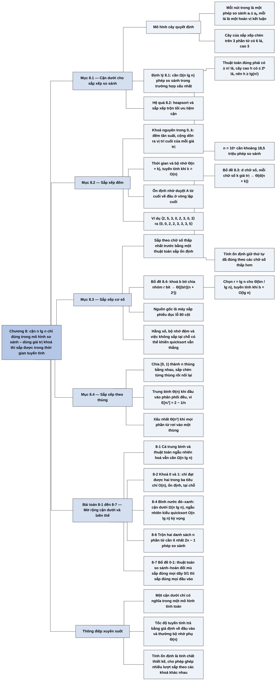

# Chương 8 — Sắp xếp trong thời gian tuyến tính (Sorting in Linear Time)

## Ý chính

Các tác giả muốn người đọc hiểu rằng **"sắp xếp tốn n lg n" không phải là định luật tự nhiên mà là hệ quả của một mô hình tính toán cụ thể — mô hình so sánh**.

Trong mô hình này, mỗi thuật toán ứng với một cây quyết định nhị phân phải có ít nhất n! lá (mỗi hoán vị của đầu vào là một lá), nên chiều cao — tức số phép so sánh xấu nhất — ít nhất là lg(n!) = Ω(n lg n) (Định lý 8.1); vì vậy heapsort và sắp xếp trộn là tối ưu tiệm cận (Hệ quả 8.2).

Khi được phép dùng giá trị của khoá để đánh chỉ số mảng hoặc tính toán, ta có thể sắp xếp nhanh hơn: **sắp xếp đếm** (counting sort) sắp n số nguyên trong khoảng 0..k trong Θ(n + k), là thuật toán ổn định; **sắp xếp cơ số** (radix sort) sắp n số có d chữ số, mỗi chữ số k giá trị, trong Θ(d(n + k)) bằng cách sắp theo chữ số thấp nhất trước với một thuật toán sắp xếp ổn định, và với n số b bit thì chọn nhóm r ≈ lg n bit cho Θ(bn / lg n) (Bổ đề 8.3, 8.4); **sắp xếp theo thùng** (bucket sort) chia [0, 1) thành n thùng bằng nhau, cho thời gian trung bình Θ(n) khi đầu vào phân phối đều, vì kỳ vọng của bình phương kích thước mỗi thùng chỉ là 2 − 1/n.

Cái giá của tốc độ là giả định về đầu vào (khoảng giá trị nhỏ, số chữ số cố định, phân phối đều) và thường là bộ nhớ phụ Θ(n); trên máy thật, hằng số ẩn và hiệu quả bộ nhớ đệm có thể khiến quicksort vẫn nhanh hơn.

## Sơ đồ

### Phần mở đầu chương 8 (trước mục 8.1, trang 191)

```text
       Các chương trước đã có bốn thuật toán sắp xếp n số trong O(n lg n):
       · sắp xếp trộn và heapsort đạt O(n lg n) trong trường hợp xấu nhất
       · quicksort đạt O(n lg n) trong trường hợp trung bình
       · với mỗi thuật toán này, ta đều dựng được đầu vào khiến nó chạy
         Ω(n lg n)
                                │
                                ▼
       Điểm chung: thứ tự kết quả được xác định CHỈ bằng các phép so sánh
       giữa các phần tử đầu vào; sách gọi các thuật toán như vậy là SẮP
       XẾP SO SÁNH (comparison sort)
                                │
               ┌────────────────┴────────────────┐
               ▼                                 ▼
       Mục 8.1: chứng minh mọi thuật     Mục 8.2, 8.3, 8.4: ba thuật toán
       toán sắp xếp so sánh phải dùng    chạy trong thời gian tuyến tính:
       Ω(n lg n) phép so sánh trong      sắp xếp đếm, sắp xếp cơ số, sắp
       trường hợp xấu nhất               xếp theo thùng
       · hệ quả: sắp xếp trộn và         · ba thuật toán này dùng thao tác
         heapsort là tối ưu tiệm cận       khác phép so sánh, nên cận dưới
                                           Ω(n lg n) không áp dụng cho chúng
```

### Mục 8.1 — Cận dưới cho bài toán sắp xếp (Lower bounds for sorting, trang 191–194)

```text
       Trong sắp xếp so sánh, thuật toán chỉ được kiểm tra một trong các
       quan hệ aᵢ < aⱼ, aᵢ ≤ aⱼ, aᵢ = aⱼ, aᵢ ≥ aⱼ, aᵢ > aⱼ; nó không được
       đọc giá trị của phần tử để biết thứ tự bằng cách khác
                                │
                                ▼
       Giả định để đơn giản hoá: mọi phần tử đều khác nhau
       · khi đó phép thử aᵢ = aⱼ vô ích
       · bốn phép thử còn lại cho cùng một thông tin
       · vì vậy coi như mọi phép so sánh đều có dạng aᵢ ≤ aⱼ
                                │
                                ▼
       MÔ HÌNH CÂY QUYẾT ĐỊNH (decision tree)
       · một cây nhị phân đầy đủ, mô tả mọi phép so sánh mà MỘT thuật toán
         thực hiện trên đầu vào có kích thước n; bỏ qua điều khiển và di
         chuyển dữ liệu
       · nút trong "i:j" là phép so sánh aᵢ ≤ aⱼ; cây con trái ứng với
         kết quả ≤, cây con phải ứng với kết quả >
       · lá là một hoán vị ⟨π(1), …, π(n)⟩, nghĩa là thuật toán đã kết
         luận a_π(1) ≤ a_π(2) ≤ … ≤ a_π(n)
       · một lần chạy là một đường đi từ gốc xuống một lá
       · thuật toán đúng ⇒ cả n! hoán vị đều phải xuất hiện thành lá đi
         tới được
                                │
                                ▼
       Ví dụ: cây quyết định của sắp xếp chèn với n = 3 có 6 lá, cao 3;
       đầu vào ⟨6, 8, 5⟩ đi theo 1:2 (≤), 2:3 (>), 1:3 (>) tới lá ⟨3,1,2⟩
                                │
                                ▼
       Số phép so sánh xấu nhất của thuật toán = chiều cao cây quyết định
                                │
                                ▼
       ĐỊNH LÝ 8.1: mọi thuật toán sắp xếp so sánh cần Ω(n lg n) phép so
       sánh trong trường hợp xấu nhất
       · cây cao h có l lá đi tới được; n! ≤ l ≤ 2ʰ
       · lấy lg hai vế: h ≥ lg(n!) = Ω(n lg n)
                                │
                                ▼
       HỆ QUẢ 8.2: heapsort và sắp xếp trộn là các thuật toán sắp xếp so
       sánh tối ưu tiệm cận (cận trên O(n lg n) của chúng khớp cận dưới)
```

### Mục 8.2 — Sắp xếp đếm (Counting sort, trang 194–197)

```text
       Giả định: mỗi phần tử là số nguyên trong khoảng 0..k
       Kết quả: thời gian Θ(n + k); nếu k = O(n) thì là Θ(n)
                                │
                                ▼
       Ý tưởng: với mỗi phần tử x, đếm xem có bao nhiêu phần tử nhỏ hơn
       x, rồi đặt x thẳng vào vị trí đó trong mảng kết quả
       (17 phần tử nhỏ hơn x ⇒ x nằm ở vị trí 18); cần chỉnh để các phần
       tử bằng nhau không bị đặt chồng vào cùng một ô
                                │
                                ▼
       COUNTING-SORT(A, B, k): A[1..n] là đầu vào, B[1..n] là đầu ra,
       C[0..k] là mảng đếm tạm
       · dòng 2–3: gán C toàn 0                      Θ(k)
       · dòng 4–5: C[i] = số phần tử bằng i          Θ(n)
       · dòng 7–8: cộng dồn, C[i] = số phần tử ≤ i   Θ(k)
       · dòng 10–12: duyệt A từ CUỐI về đầu, đặt
         A[j] vào B[C[A[j]]] rồi giảm C[A[j]] đi 1   Θ(n)
                                │
                                ▼
       Ví dụ: A = ⟨2,5,3,0,2,3,0,3⟩, k = 5
       · đếm:     C = ⟨2,0,2,3,0,1⟩
       · cộng dồn: C = ⟨2,2,4,7,7,8⟩
       · kết quả: B = ⟨0,0,2,2,3,3,3,5⟩
                                │
                                ▼
       Vì sao vượt được Ω(n lg n): không có phép so sánh nào giữa các phần
       tử; thuật toán dùng giá trị phần tử làm chỉ số mảng
                                │
                                ▼
       TÍNH ỔN ĐỊNH (stable): các phần tử bằng nhau giữ nguyên thứ tự xuất
       hiện ở đầu vào; nhờ duyệt từ cuối về đầu ở dòng 10
       · quan trọng khi phần tử mang theo dữ liệu vệ tinh
       · quan trọng hơn nữa: sắp xếp cơ số cần một thủ tục con ổn định
```

### Mục 8.3 — Sắp xếp cơ số (Radix sort, trang 197–200)

```text
       Nguồn gốc: máy sắp phiếu đục lỗ (80 cột, mỗi cột 12 vị trí đục);
       máy đọc một cột và chia phiếu vào 12 ngăn; số thập phân d chữ số
       chiếm d cột
                                │
               ┌────────────────┴────────────────┐
               ▼                                 ▼
       Cách trực giác: sắp theo chữ      Cách của sắp xếp cơ số: sắp theo
       số CAO NHẤT trước, rồi sắp đệ     chữ số THẤP NHẤT trước, gộp các
       quy từng ngăn                     ngăn theo thứ tự 0, 1, 2, …, rồi
       · phải gác 9 trong 10 ngăn sang   sắp toàn bộ theo chữ số thấp thứ
         một bên khi xử lý một ngăn      hai, và cứ thế
       · sinh ra rất nhiều chồng phiếu   · chỉ cần d lượt qua cả cỗ phiếu
         trung gian phải theo dõi        · BẮT BUỘC: mỗi lượt sắp phải ổn
                                           định
               └────────────────┬────────────────┘
                                ▼
       Ví dụ: 329 457 657 839 436 720 355
       · theo hàng đơn vị: 720 355 436 457 657 329 839
       · theo hàng chục:   720 329 436 839 355 457 657
       · theo hàng trăm:   329 355 436 457 657 720 839
                                │
                                ▼
       Dùng cho bản ghi nhiều trường khoá: sắp ngày tháng bằng ba lượt sắp
       ổn định — theo ngày, rồi theo tháng, cuối cùng theo năm
                                │
                                ▼
       RADIX-SORT(A, d): với i = 1..d, dùng một thuật toán sắp xếp ổn định
       để sắp A theo chữ số i (chữ số 1 là thấp nhất)
                                │
                                ▼
       BỔ ĐỀ 8.3: n số d chữ số, mỗi chữ số có tối đa k giá trị, thủ tục
       sắp ổn định tốn Θ(n + k) (sắp xếp đếm) ⇒ tổng Θ(d(n + k))
       · d hằng số và k = O(n) ⇒ thời gian tuyến tính
                                │
                                ▼
       BỔ ĐỀ 8.4: n số b bit, chọn nhóm r ≤ b bit làm một "chữ số"
       ⇒ d = ⌈b/r⌉ lượt, mỗi lượt sắp xếp đếm với k = 2ʳ − 1
       ⇒ tổng Θ((b/r)(n + 2ʳ))
       · nếu b < ⌊lg n⌋: chọn r = b, thời gian Θ(n)
       · nếu b ≥ ⌊lg n⌋: chọn r = ⌊lg n⌋, thời gian Θ(bn / lg n);
         r lớn hơn thì 2ʳ tăng nhanh hơn r; r nhỏ hơn thì b/r tăng
                                │
                                ▼
       Có nên dùng thay quicksort? Với b = O(lg n), sắp xếp cơ số chạy
       Θ(n), nhưng:
       · hằng số ẩn khác nhau, mỗi lượt có thể tốn hơn nhiều
       · quicksort thường dùng bộ nhớ đệm phần cứng hiệu quả hơn
       · bản dùng sắp xếp đếm KHÔNG sắp xếp tại chỗ
       Kết luận của sách: khi bộ nhớ chính khan hiếm, nên chọn thuật toán
       tại chỗ như quicksort
```

### Mục 8.4 — Sắp xếp theo thùng (Bucket sort, trang 200–204)

```text
       Giả định: đầu vào được sinh bởi một quá trình ngẫu nhiên phân phối
       các phần tử ĐỀU và ĐỘC LẬP trên [0, 1)
       Kết quả: thời gian trung bình O(n)
       (sắp xếp đếm giả định khoảng giá trị nhỏ; sắp xếp theo thùng giả
       định phân phối của đầu vào)
                                │
                                ▼
       Ý tưởng: chia [0, 1) thành n khoảng con bằng nhau (thùng), rải n số
       vào thùng; trung bình mỗi thùng có ít số; sắp từng thùng rồi nối
       các thùng theo thứ tự
                                │
                                ▼
       BUCKET-SORT(A): B[0..n−1] là mảng các danh sách liên kết
       · dòng 3–4: tạo n danh sách rỗng
       · dòng 5–6: chèn A[i] vào danh sách B[⌊n·A[i]⌋]
       · dòng 7–8: sắp từng danh sách B[i] bằng sắp xếp chèn
       · dòng 9: nối B[0], B[1], …, B[n−1]
                                │
                                ▼
       Ví dụ n = 10: .78 .17 .39 .26 .72 .94 .21 .12 .23 .68
       · thùng 1: .12 .17 · thùng 2: .21 .23 .26 · thùng 3: .39
       · thùng 6: .68 · thùng 7: .72 .78 · thùng 9: .94 · các thùng khác rỗng
                                │
                                ▼
       Đúng vì: A[i] ≤ A[j] ⇒ ⌊n·A[i]⌋ ≤ ⌊n·A[j]⌋; cùng thùng thì dòng 8
       xếp đúng thứ tự, khác thùng thì dòng 9 xếp đúng thứ tự
                                │
                                ▼
       Thời gian: T(n) = Θ(n) + Σᵢ O(nᵢ²), với nᵢ là số phần tử trong
       thùng i (sắp xếp chèn tốn thời gian bậc hai)
                                │
                                ▼
       Lấy kỳ vọng theo phân phối đầu vào:
       E[T(n)] = Θ(n) + Σᵢ O(E[nᵢ²])                           (8.1)
       E[nᵢ²] = 2 − 1/n với mọi thùng i                         (8.2)
       · chứng minh bằng biến chỉ báo Xᵢⱼ = I{A[j] rơi vào thùng i}
       · E[Xᵢⱼ²] = 1/n; với k ≠ j, Xᵢⱼ và Xᵢₖ độc lập nên
         E[XᵢⱼXᵢₖ] = 1/n²
       · E[nᵢ²] = n·(1/n) + n(n−1)·(1/n²) = 2 − 1/n
       ⇒ E[T(n)] = Θ(n) + n·O(2 − 1/n) = Θ(n)
                                │
                                ▼
       Mở rộng: kể cả khi đầu vào không đều, sắp xếp theo thùng vẫn tuyến
       tính miễn là tổng bình phương kích thước các thùng tuyến tính theo n
```

### Bài toán cuối chương 8 (Problems 8-1 đến 8-7, trang 205–211)

```text
       8-1 Cận dưới xác suất: kể cả trường hợp TRUNG BÌNH và thuật toán
           NGẪU NHIÊN hoá, sắp xếp so sánh vẫn cần Ω(n lg n)
           · độ dài đường ngoài D(T) = tổng độ sâu các lá
           · d(k) = min D(T) với k lá = Ω(k lg k)
           · cây ngẫu nhiên hoá được thay bằng cây tất định không tệ hơn
                                │
                                ▼
       8-2 Sắp xếp khoá 0/1: ba tiêu chí O(n), ổn định, tại chỗ — chỉ đạt
           được từng cặp hai tiêu chí; sắp xếp đếm tại chỗ cho khoá 1..k
                                │
                                ▼
       8-3 Sắp xếp đối tượng có độ dài thay đổi (số nguyên nhiều chữ số,
           xâu ký tự) trong O(tổng số chữ số / ký tự)
                                │
                                ▼
       8-4 Bình nước đỏ và xanh: chỉ được so một bình đỏ với một bình xanh
           · tất định Θ(n²); cận dưới Ω(n lg n); ngẫu nhiên kiểu quicksort
             O(n lg n) kỳ vọng
                                │
                                ▼
       8-5 Mảng k-sắp xếp (trung bình trượt k phần tử không giảm)
           · tương đương A[i] ≤ A[i+k]; tạo trong O(n lg(n/k)); sắp xếp
             nốt trong O(n lg k); với k hằng số cần Ω(n lg n)
                                │
                                ▼
       8-6 Trộn hai danh sách đã sắp, mỗi danh sách n phần tử, cần ít nhất
           2n − 1 phép so sánh trong trường hợp xấu nhất
                                │
                                ▼
       8-7 Bổ đề sắp xếp 0-1 và columnsort
           · thuật toán so sánh–hoán đổi "mù" (oblivious) sắp đúng mọi đầu
             vào 0/1 ⇒ sắp đúng mọi đầu vào
           · columnsort: mảng r hàng × s cột, 8 bước (4 lần sắp từng cột,
             4 hoán vị cố định), đúng khi r chẵn, s chia hết r, r ≥ 2s²
```

### Ghi chú chương 8 (Chapter notes, trang 211–212)

```text
       Cây quyết định: Ford và Johnson; Knuth tổng hợp cận dưới theo lý
       thuyết thông tin; Ben-Or mở rộng mô hình cây quyết định
                                │
                                ▼
       Lịch sử: H. H. Seward (1954) phát minh sắp xếp đếm và ý tưởng ghép
       với sắp xếp cơ số; sắp xếp cơ số từ chữ số thấp là thuật toán dân
       gian của người vận hành máy phiếu, công bố đầu tiên năm 1929
       (L. J. Comrie); sắp xếp theo thùng từ 1956 (Isaac và Singleton)
                                │
                                ▼
       Munro và Raman: sắp xếp ổn định, tại chỗ, O(n^(1+ε)) phép so sánh
       nhưng chỉ O(n) lần di chuyển dữ liệu
                                │
                                ▼
       Các kết quả sắp n số nguyên b bit trong o(n lg n), theo thứ tự
       cải tiến dần:
       · Fredman và Willard dùng cây hợp nhất: O(n lg n / lg lg n)
       · Andersson cải tiến xuống O(n √lg n)
       · Andersson, Hagerup, Nilsson, Raman: O(n lg lg n), không dùng
         phép nhân nhưng tốn bộ nhớ không bị chặn theo n
       · Thorup: O(n (lg lg n)²), không dùng phép nhân, không ngẫu
         nhiên, bộ nhớ tuyến tính
       · Han: O(n lg lg n · lg lg lg n)
       · đột phá lý thuyết, nhưng phức tạp, chưa cạnh tranh được trong
         thực tế
                                │
                                ▼
       Columnsort (Bài toán 8-7) do Leighton đề xuất
```

## Ba câu hỏi chương này trả lời

1. **Vì sao không thuật toán sắp xếp nào chỉ dựa trên so sánh có thể nhanh hơn n lg n?** Vì mỗi thuật toán như vậy, khi chạy trên đầu vào cỡ n, tương ứng với một cây quyết định nhị phân mà mỗi nút trong là một phép so sánh aᵢ ≤ aⱼ và mỗi lá là một hoán vị kết luận. Để đúng với mọi đầu vào, cây phải có ít nhất n! lá đi tới được; một cây nhị phân cao h có nhiều nhất 2ʰ lá; vậy n! ≤ 2ʰ, tức h ≥ lg(n!) = Θ(n lg n). Chiều cao h chính là số phép so sánh trong trường hợp xấu nhất (Định lý 8.1).

   Ví dụ: với n = 3 cần ít nhất ⌈lg 6⌉ = 3 phép so sánh; với n = 10⁶ cần khoảng lg(10⁶!) ≈ 10⁶ × (19,93 − 1,44) ≈ 18,5 triệu phép so sánh. Hệ quả: heapsort và sắp xếp trộn (O(n lg n) xấu nhất) là tối ưu tiệm cận (Hệ quả 8.2). Bài toán 8-1 mở rộng kết quả này cho thời gian trung bình và cho thuật toán ngẫu nhiên hoá.
2. **Làm sao sắp xếp trong thời gian tuyến tính, và phải trả giá gì?** Bằng cách dùng giá trị khoá chứ không chỉ so sánh. Sắp xếp đếm (Θ(n + k)) đếm số phần tử ≤ mỗi giá trị rồi đặt từng phần tử vào đúng vị trí; cái giá là k phải nhỏ (k = O(n)) và cần thêm mảng B[1..n], C[0..k]. Sắp xếp cơ số (Θ(d(n + k))) gọi một thủ tục sắp ổn định lần lượt từ chữ số thấp nhất tới cao nhất; với n số b bit, chọn nhóm r = ⌊lg n⌋ bit cho Θ(bn / lg n), tuyến tính khi b = O(lg n). Sắp xếp theo thùng (Θ(n) trung bình) chỉ tuyến tính nếu đầu vào phân phối đều trên [0, 1), trường hợp xấu nhất vẫn là Θ(n²) khi mọi phần tử rơi vào một thùng.
3. **Vì sao tính ổn định quan trọng, và vì sao sắp xếp cơ số đi từ chữ số thấp nhất?** Một thuật toán sắp xếp ổn định giữ nguyên thứ tự ban đầu của các phần tử có khoá bằng nhau. Sắp xếp cơ số dựa vào điều này: sau khi đã sắp theo chữ số 1..i−1, lượt sắp theo chữ số i đặt đúng các số có chữ số i khác nhau, còn các số có chữ số i bằng nhau thì giữ thứ tự cũ — chính là thứ tự đúng theo i−1 chữ số thấp hơn.

   Ví dụ 329 và 355 cùng hàng trăm 3; ở lượt cuối, chúng giữ thứ tự 329 trước 355 có từ lượt hàng chục. Đi từ chữ số thấp nhất cho phép mỗi lượt xử lý cả mảng một lần, chỉ cần d lượt; đi từ chữ số cao nhất phải chia nhỏ đệ quy và theo dõi rất nhiều nhóm con. Sắp xếp đếm ổn định nhờ vòng lặp cuối duyệt A từ cuối về đầu.

## Khái niệm cần biết

- **Sắp xếp so sánh (comparison sort):** thuật toán sắp xếp chỉ biết thứ tự của dữ liệu qua các phép so sánh hai phần tử (aᵢ < aⱼ, aᵢ ≤ aⱼ, …), không đọc giá trị để làm việc khác. Ví dụ: sắp xếp chèn, sắp xếp trộn, heapsort, quicksort. Quan trọng vì cận dưới Ω(n lg n) chỉ áp dụng cho lớp này.
- **Cây quyết định (decision tree):** cây nhị phân đầy đủ ghi lại mọi phép so sánh mà một thuật toán làm trên đầu vào cỡ n. Ví dụ: với sắp xếp chèn và n = 3, gốc so a₁ với a₂; đầu vào ⟨6, 8, 5⟩ đi qua ba nút 1:2, 2:3, 1:3 và dừng ở lá ⟨3, 1, 2⟩, nghĩa là a₃ = 5 ≤ a₁ = 6 ≤ a₂ = 8. Quan trọng vì nó biến câu hỏi "thuật toán cần bao nhiêu phép so sánh" thành câu hỏi "cây cần cao bao nhiêu".
- **Lá đi tới được (reachable leaf):** lá ứng với một lần chạy thật của thuật toán. Một cây quyết định có thể có lá không bao giờ đi tới được (thuật toán làm phép so sánh thừa); chứng minh chỉ đếm các lá đi tới được. Với n phần tử khác nhau, có đúng n! lá đi tới được (mỗi hoán vị một lá).
- **Chiều cao cây và số so sánh xấu nhất:** độ dài đường đi đơn dài nhất từ gốc tới một lá đi tới được. Ví dụ: cây của sắp xếp chèn với n = 3 cao 3, nên trường hợp xấu nhất sắp xếp chèn làm 3 phép so sánh với 3 phần tử. Cây cao h có tối đa 2ʰ lá: cao 3 có tối đa 8 lá, đủ cho 6 hoán vị; cao 2 chỉ có tối đa 4 lá, không đủ.
- **Cận dưới (lower bound) và tối ưu tiệm cận (asymptotically optimal):** cận dưới là số bước tối thiểu mọi thuật toán trong một lớp phải làm; một thuật toán tối ưu tiệm cận khi cận trên của nó khớp cận dưới với sai khác hằng số. Ví dụ: lg(n!) với n = 10 là lg 3.628.800 ≈ 21,8, nên mọi sắp xếp so sánh cần ít nhất 22 phép so sánh xấu nhất với 10 phần tử; sắp xếp trộn dùng không quá n⌈lg n⌉ − 2^⌈lg n⌉ + 1 = 40 − 16 + 1 = 25. Quan trọng vì nó cho biết không còn chỗ cải tiến về bậc trong mô hình so sánh.
- **lg(n!) = Θ(n lg n):** tổng lg 1 + lg 2 + … + lg n. Cận trên: mỗi số hạng ≤ lg n nên tổng ≤ n lg n. Cận dưới: n/2 số hạng cuối đều ≥ lg(n/2), nên tổng ≥ (n/2) lg(n/2). Ví dụ n = 8: lg(40.320) ≈ 15,3, nằm giữa (8/2) × lg 4 = 8 và 8 × 3 = 24. Theo xấp xỉ Stirling, lg(n!) ≈ n lg n − n lg e ≈ n lg n − 1,44n.
- **Sắp xếp đếm (counting sort):** với khoá nguyên trong 0..k, đếm số lần xuất hiện của mỗi giá trị, cộng dồn để biết mỗi giá trị kết thúc ở vị trí nào, rồi đặt từng phần tử vào đầu ra. Ví dụ: A = ⟨2, 5, 3, 0, 2, 3, 0, 3⟩: số đếm C = ⟨2, 0, 2, 3, 0, 1⟩, cộng dồn C = ⟨2, 2, 4, 7, 7, 8⟩ (có 7 phần tử ≤ 3, nên số 3 cuối cùng nằm ở vị trí 7); kết quả ⟨0, 0, 2, 2, 3, 3, 3, 5⟩. Thời gian Θ(n + k).
- **Thuật toán sắp xếp ổn định (stable sort):** các phần tử có khoá bằng nhau xuất hiện ở đầu ra theo đúng thứ tự như ở đầu vào. Ví dụ: sắp các cặp (khoá, tên) (2, "an"), (1, "bình"), (2, "chi") theo khoá: thuật toán ổn định cho (1, "bình"), (2, "an"), (2, "chi"); thuật toán không ổn định có thể cho (2, "chi") đứng trước (2, "an"). Quan trọng vì sắp xếp cơ số chỉ đúng khi thủ tục con ổn định.
- **Dữ liệu vệ tinh (satellite data):** dữ liệu đi kèm khoá trong một bản ghi (ví dụ tên, địa chỉ đi kèm mã số). Ổn định chỉ có ý nghĩa khi các phần tử bằng khoá nhưng phân biệt được nhờ dữ liệu vệ tinh.
- **Sắp xếp cơ số (radix sort):** sắp các khoá nhiều chữ số bằng d lượt sắp ổn định, từ chữ số thấp nhất tới chữ số cao nhất. Ví dụ: 329, 457, 657, 839, 436, 720, 355 sau ba lượt (đơn vị, chục, trăm) thành 329, 355, 436, 457, 657, 720, 839. Thời gian Θ(d(n + k)).
- **Chữ số thấp nhất / cao nhất (least / most significant digit):** chữ số hàng đơn vị là thấp nhất; chữ số đầu tiên bên trái là cao nhất. Trong RADIX-SORT, "chữ số 1" là chữ số thấp nhất, "chữ số d" là cao nhất.
- **Chọn cơ số r bit cho khoá b bit:** chia một khoá b bit thành ⌈b/r⌉ "chữ số" r bit, mỗi chữ số trong 0..2ʳ − 1. Ví dụ: khoá 32 bit, r = 8 cho 4 chữ số, mỗi chữ số 0..255, nên cần 4 lượt sắp xếp đếm với mảng đếm 256 ô. Với n = 2²⁰ ≈ 1 triệu khoá: r = 8 tốn khoảng 4 × (n + 256) ≈ 4n bước; r = 16 tốn 2 × (n + 65.536) ≈ 2,06n; r = 20 = lg n tốn 2 × (n + 2²⁰) = 4n. Quan trọng vì r quá nhỏ thì nhiều lượt, r quá lớn thì mảng đếm 2ʳ áp đảo.
- **Sắp xếp theo thùng (bucket sort):** chia khoảng giá trị [0, 1) thành n thùng bằng nhau, đặt số x vào thùng ⌊n·x⌋, sắp từng thùng và nối lại. Ví dụ n = 10, số 0,78 vào thùng ⌊7,8⌋ = 7, số 0,12 vào thùng 1. Thời gian trung bình Θ(n) khi đầu vào phân phối đều.
- **Phân phối đều và độc lập (uniform and independent distribution):** mỗi số đầu vào có khả năng rơi vào mọi khoảng con có độ dài bằng nhau là như nhau, và các số không phụ thuộc nhau. Khi đó mỗi số rơi vào thùng i với xác suất 1/n.
- **Biến ngẫu nhiên chỉ báo (indicator random variable):** I{sự kiện} bằng 1 nếu sự kiện xảy ra, 0 nếu không; kỳ vọng của nó bằng xác suất sự kiện. Ví dụ: Xᵢⱼ = I{A[j] rơi vào thùng i}, E[Xᵢⱼ] = 1/n; số phần tử trong thùng i là nᵢ = Σⱼ Xᵢⱼ. Với n = 10 thì E[nᵢ²] = 2 − 1/10 = 1,9.
- **Tính tuyến tính của kỳ vọng (linearity of expectation):** kỳ vọng của tổng bằng tổng các kỳ vọng, kể cả khi các biến phụ thuộc nhau. Dùng để tách E[Σᵢ O(nᵢ²)] thành Σᵢ O(E[nᵢ²]).
- **Sắp xếp tại chỗ (in place):** chỉ dùng thêm một lượng bộ nhớ hằng số (hoặc rất nhỏ) ngoài mảng đầu vào. Sắp xếp đếm và sắp xếp cơ số dùng sắp xếp đếm không tại chỗ (cần mảng B cỡ n); quicksort và heapsort thì tại chỗ.
- **Thuật toán so sánh–hoán đổi mù (oblivious compare-exchange algorithm):** chỉ gồm một dãy phép COMPARE-EXCHANGE(A, i, j) với cặp chỉ số (i, j) định trước, không phụ thuộc giá trị dữ liệu. Ví dụ: sắp xếp chèn viết lại thành hai vòng lặp gọi COMPARE-EXCHANGE(A, i, i+1). Quan trọng trong Bài toán 8-7 vì với loại thuật toán này, chỉ cần kiểm tra trên đầu vào 0/1.

## Nội dung chi tiết

### 1. Mở đầu chương 8 (Sorting in Linear Time, trang 191)

Đến đây cuốn sách đã có bốn thuật toán sắp xếp n số: sắp xếp chèn (Θ(n²) xấu nhất), sắp xếp trộn và heapsort (O(n lg n) xấu nhất), quicksort (O(n lg n) trung bình). Với mỗi thuật toán trong ba thuật toán nhanh, ta đều dựng được một dãy đầu vào khiến nó chạy Ω(n lg n). Các tác giả chỉ ra điểm chung: thứ tự sắp xếp mà chúng tìm ra **chỉ dựa trên phép so sánh giữa các phần tử đầu vào**. Sách gọi các thuật toán như vậy là **sắp xếp so sánh** (comparison sorts), và mọi thuật toán sắp xếp trước chương này đều thuộc loại đó.

Kế hoạch chương: mục 8.1 chứng minh mọi sắp xếp so sánh phải làm Ω(n lg n) phép so sánh trong trường hợp xấu nhất, nên sắp xếp trộn và heapsort là tối ưu tiệm cận, không sắp xếp so sánh nào nhanh hơn chúng quá một hằng số lần. Các mục 8.2, 8.3, 8.4 trình bày ba thuật toán chạy trong thời gian tuyến tính — sắp xếp đếm, sắp xếp cơ số, sắp xếp theo thùng. Chúng dùng các thao tác khác phép so sánh để xác định thứ tự, nên cận dưới Ω(n lg n) không áp dụng cho chúng.

### 2. Cận dưới cho bài toán sắp xếp (8.1 Lower bounds for sorting, trang 191–194)

Trong một thuật toán sắp xếp so sánh, thông tin về thứ tự của dãy đầu vào ⟨a₁, a₂, …, aₙ⟩ chỉ thu được qua phép thử một trong năm quan hệ aᵢ < aⱼ, aᵢ ≤ aⱼ, aᵢ = aⱼ, aᵢ ≥ aⱼ, aᵢ > aⱼ. Thuật toán không được "nhìn" vào giá trị của phần tử hay biết thứ tự theo bất kỳ cách nào khác.

Trong mục này, sách giả định (không làm mất tính tổng quát) rằng mọi phần tử đầu vào khác nhau. Khi đó phép thử aᵢ = aⱼ luôn cho "sai", vô ích, nên có thể coi như không thuật toán nào dùng nó. Bốn phép thử còn lại cho cùng một lượng thông tin về thứ tự tương đối của aᵢ và aⱼ (biết kết quả của một phép thì suy ra được kết quả của ba phép kia), nên ta coi mọi phép so sánh đều có dạng aᵢ ≤ aⱼ.

#### Mô hình cây quyết định (The decision-tree model)

Ta có thể nhìn một thuật toán sắp xếp so sánh một cách trừu tượng bằng **cây quyết định**. Cây quyết định là một **cây nhị phân đầy đủ** (mỗi nút trong có đúng hai con) biểu diễn các phép so sánh mà một thuật toán cụ thể thực hiện trên đầu vào có kích thước cho trước. Mọi khía cạnh khác của thuật toán — điều khiển luồng, di chuyển dữ liệu — đều bị bỏ qua.

Quy ước ghi nhãn:

- mỗi nút trong được ghi "i:j" với 1 ≤ i, j ≤ n, nghĩa là phép so sánh aᵢ ≤ aⱼ;
- cây con trái quy định các phép so sánh tiếp theo khi đã biết aᵢ ≤ aⱼ; cây con phải quy định các phép so sánh tiếp theo khi đã biết aᵢ > aⱼ;
- mỗi lá được ghi một hoán vị ⟨π(1), π(2), …, π(n)⟩, nghĩa là thuật toán đã xác lập thứ tự a_π(1) ≤ a_π(2) ≤ … ≤ a_π(n).

Một lần chạy của thuật toán ứng với một đường đi đơn từ gốc xuống một lá. Vì một thuật toán sắp xếp đúng phải tạo ra được mọi hoán vị của đầu vào, **mỗi hoán vị trong n! hoán vị phải xuất hiện thành một lá**; hơn nữa lá đó phải đi tới được từ gốc bằng một lần chạy thật của thuật toán. Sách gọi các lá như vậy là "đi tới được" (reachable), và chỉ xét những cây quyết định mà mọi hoán vị đều là một lá đi tới được.

**Hình 8.1 — cây quyết định của sắp xếp chèn (mục 2.1) trên ba phần tử**, vẽ lại:

```text
                               1:2
                     ≤ ┌────────┴────────┐ >
                      2:3                1:3
                 ≤ ┌───┴───┐ >        ≤ ┌───┴───┐ >
              ⟨1,2,3⟩     1:3       ⟨2,1,3⟩     2:3
                       ≤ ┌─┴─┐ >               ≤ ┌─┴─┐ >
                    ⟨1,3,2⟩ ⟨3,1,2⟩         ⟨2,3,1⟩ ⟨3,2,1⟩
```

Cây có 3! = 6 lá, đúng bằng số hoán vị, và cao 3. Ta có thể kiểm chứng cây này khớp với sắp xếp chèn: trước tiên chèn a₂ vào trước hay sau a₁ (so 1:2). Nếu a₁ ≤ a₂, mảng đang là a₁, a₂; chèn a₃ bắt đầu bằng so a₃ với phần tử cuối a₂ (nút 2:3); nếu a₂ ≤ a₃ thì xong (lá ⟨1, 2, 3⟩), ngược lại so tiếp a₃ với a₁ (nút 1:3) để quyết định ⟨1, 3, 2⟩ hay ⟨3, 1, 2⟩. Nếu a₁ > a₂, mảng đang là a₂, a₁; chèn a₃ bắt đầu bằng so với a₁ (nút 1:3), và nếu a₃ nhỏ hơn a₁ thì so tiếp với a₂ (nút 2:3).

Đường tô đậm trong hình là lần chạy với đầu vào ⟨a₁ = 6, a₂ = 8, a₃ = 5⟩: tại 1:2, 6 ≤ 8 nên đi trái; tại 2:3, 8 > 5 nên đi phải; tại 1:3, 6 > 5 nên đi phải, tới lá ⟨3, 1, 2⟩, nghĩa là thứ tự đã sắp là a₃ = 5 ≤ a₁ = 6 ≤ a₂ = 8.

#### Cận dưới cho trường hợp xấu nhất (A lower bound for the worst case)

Độ dài đường đi đơn dài nhất từ gốc tới một lá đi tới được bằng số phép so sánh mà thuật toán tương ứng làm trong trường hợp xấu nhất. Do đó **số phép so sánh xấu nhất của một thuật toán sắp xếp so sánh bằng chiều cao cây quyết định của nó**. Một cận dưới cho chiều cao của mọi cây quyết định có đủ n! lá đi tới được cũng là cận dưới cho thời gian chạy của mọi thuật toán sắp xếp so sánh.

**Định lý 8.1.** Mọi thuật toán sắp xếp so sánh cần Ω(n lg n) phép so sánh trong trường hợp xấu nhất.

*Chứng minh.* Chỉ cần xác định chiều cao của một cây quyết định mà mọi hoán vị là một lá đi tới được. Xét cây cao h với l lá đi tới được, ứng với một sắp xếp so sánh trên n phần tử. Vì mỗi hoán vị trong n! hoán vị là một lá, n! ≤ l. Một cây nhị phân cao h có không quá 2ʰ lá, nên

  n! ≤ l ≤ 2ʰ.

Lấy logarit cơ số 2 (hàm lg đơn điệu tăng):

  h ≥ lg(n!) = Ω(n lg n),

trong đó đẳng thức cuối là phương trình (3.19) của Chương 3: lg(n!) = Θ(n lg n), suy từ xấp xỉ Stirling. ∎

Một cách tự kiểm tra lg(n!) = Ω(n lg n) không cần Stirling: lg(n!) = Σₖ₌₁ⁿ lg k ≥ Σₖ₌⌈n/2⌉ⁿ lg k ≥ (n/2) lg(n/2) = (n/2) lg n − n/2, tức Ω(n lg n). (Đây chính là ý của Bài tập 8.1-2.)

**Hệ quả 8.2.** Heapsort và sắp xếp trộn là các thuật toán sắp xếp so sánh tối ưu tiệm cận.

*Chứng minh.* Cận trên O(n lg n) cho thời gian chạy của heapsort và sắp xếp trộn khớp với cận dưới Ω(n lg n) cho trường hợp xấu nhất của Định lý 8.1. ∎

Bảng số minh hoạ (người tổng hợp tự tính):

| n | n! | lg(n!) | Số phép so sánh tối thiểu (⌈lg(n!)⌉) |
|---|---|---|---|
| 3 | 6 | 2,58 | 3 |
| 4 | 24 | 4,58 | 5 |
| 5 | 120 | 6,91 | 7 |
| 10 | 3.628.800 | 21,79 | 22 |
| 10⁶ | — | ≈ 1,85 × 10⁷ | ≈ 18,5 triệu |

Lưu ý: cận dưới chỉ nói rằng *có* đầu vào cần chừng ấy phép so sánh; nó không nói thuật toán nào đạt đúng ⌈lg(n!)⌉. Thuật toán trộn–chèn (merge insertion) của Ford và Johnson — tên được nhắc ở Ghi chú chương — đạt đúng con số này với n nhỏ như 5 (7 phép so sánh), theo hiểu biết của người tổng hợp.

#### Ví dụ hôm nay

Cận dưới Ω(n lg n) là lý do các thư viện chuẩn (sort của C++, Java, Python, Rust) đều dùng thuật toán so sánh O(n lg n) — introsort, Timsort, pdqsort — và không cố "nhanh hơn" theo bậc khi chỉ có hàm so sánh do người dùng cung cấp.

Lập luận cây quyết định cũng là công cụ chuẩn để chứng minh cận dưới cho các bài toán khác: tìm kiếm nhị phân cần ⌈lg(n+1)⌉ phép so sánh, trộn hai danh sách cần 2n − 1 phép so sánh (Bài toán 8-6), kiểm tra các phần tử có khác nhau đôi một không cần Ω(n lg n) trong mô hình cây quyết định đại số (hướng nghiên cứu của Ben-Or nêu ở Ghi chú chương). Trong phỏng vấn kỹ thuật, câu hỏi "có sắp xếp nhanh hơn n lg n được không?" luôn dẫn tới câu trả lời: không, nếu chỉ dùng so sánh; có, nếu biết thêm về khoá.

### 3. Sắp xếp đếm (8.2 Counting sort, trang 194–197)

Sắp xếp đếm giả định mỗi phần tử trong n phần tử đầu vào là một số nguyên trong khoảng 0 đến k, với k là một số nguyên nào đó. Khi k = O(n), thuật toán chạy trong Θ(n).

Ý tưởng: với mỗi phần tử đầu vào x, xác định số phần tử nhỏ hơn x, rồi dùng thông tin này đặt x thẳng vào vị trí của nó trong mảng kết quả. Ví dụ, có 17 phần tử nhỏ hơn x thì x thuộc vị trí 18. Phải sửa lược đồ này một chút khi có nhiều phần tử cùng giá trị, vì không thể đặt tất cả vào cùng một vị trí.

Trong mã, đầu vào là mảng A[1 .. n] với A.length = n. Cần thêm hai mảng: B[1 .. n] chứa kết quả đã sắp, và C[0 .. k] là bộ nhớ làm việc tạm.

```text
COUNTING-SORT(A, B, k)
 1  let C[0 .. k] be a new array
 2  for i = 0 to k
 3      C[i] = 0
 4  for j = 1 to A.length
 5      C[A[j]] = C[A[j]] + 1
 6  // C[i] now contains the number of elements equal to i.
 7  for i = 1 to k
 8      C[i] = C[i] + C[i − 1]
 9  // C[i] now contains the number of elements less than or equal to i.
10  for j = A.length downto 1
11      B[C[A[j]]] = A[j]
12      C[A[j]] = C[A[j]] − 1
```

Giải thích từng khối:

- **Dòng 1–3:** tạo mảng đếm C[0 .. k] và gán toàn bộ bằng 0.
- **Dòng 4–5:** duyệt từng phần tử đầu vào; nếu giá trị là i thì tăng C[i]. Sau dòng 5, C[i] là số phần tử đầu vào bằng i, với mọi i = 0, 1, …, k (chú thích dòng 6).
- **Dòng 7–8:** cộng dồn: C[i] = C[i] + C[i − 1]. Sau đó C[i] là số phần tử đầu vào nhỏ hơn hoặc bằng i (chú thích dòng 9).
- **Dòng 10–12:** duyệt A từ cuối về đầu, đặt A[j] vào vị trí C[A[j]] của B, rồi giảm C[A[j]] đi 1. Nếu mọi phần tử khác nhau thì khi mới vào dòng 10, C[A[j]] chính là vị trí cuối cùng đúng của A[j], vì có đúng C[A[j]] phần tử nhỏ hơn hoặc bằng A[j]. Khi có phần tử trùng giá trị, việc giảm C[A[j]] sau mỗi lần đặt khiến phần tử tiếp theo có cùng giá trị (nếu có) được đặt vào vị trí ngay trước A[j] trong B.

**Hình 8.2 — chạy COUNTING-SORT trên A[1 .. 8] với k = 5**, tái hiện từng bước:

(a) Mảng A và mảng C sau dòng 5 (đếm số lần xuất hiện):

| chỉ số | 1 | 2 | 3 | 4 | 5 | 6 | 7 | 8 |
|---|---|---|---|---|---|---|---|---|
| A | 2 | 5 | 3 | 0 | 2 | 3 | 0 | 3 |

| giá trị i | 0 | 1 | 2 | 3 | 4 | 5 |
|---|---|---|---|---|---|---|
| C (số phần tử bằng i) | 2 | 0 | 2 | 3 | 0 | 1 |

(b) Mảng C sau dòng 8 (cộng dồn):

| giá trị i | 0 | 1 | 2 | 3 | 4 | 5 |
|---|---|---|---|---|---|---|
| C (số phần tử ≤ i) | 2 | 2 | 4 | 7 | 7 | 8 |

(c)–(e) Ba vòng lặp đầu của dòng 10–12 (chỉ các ô B đã điền được ghi):

| bước | j | A[j] | C[A[j]] trước | đặt vào | B sau bước (vị trí 1..8) | C sau bước |
|---|---|---|---|---|---|---|
| (c) | 8 | 3 | 7 | B[7] = 3 | _ _ _ _ _ _ 3 _ | ⟨2, 2, 4, 6, 7, 8⟩ |
| (d) | 7 | 0 | 2 | B[2] = 0 | _ 0 _ _ _ _ 3 _ | ⟨1, 2, 4, 6, 7, 8⟩ |
| (e) | 6 | 3 | 6 | B[6] = 3 | _ 0 _ _ _ 3 3 _ | ⟨1, 2, 4, 5, 7, 8⟩ |

Người tổng hợp chạy tiếp các bước còn lại (không có trong hình): j = 5, A[5] = 2, đặt B[4] = 2, C[2] = 3; j = 4, A[4] = 0, đặt B[1] = 0, C[0] = 0; j = 3, A[3] = 3, đặt B[5] = 3, C[3] = 4; j = 2, A[2] = 5, đặt B[8] = 5, C[5] = 7; j = 1, A[1] = 2, đặt B[3] = 2, C[2] = 2.

(f) Kết quả cuối cùng: B = ⟨0, 0, 2, 2, 3, 3, 3, 5⟩.

Để thấy tính ổn định trong ví dụ này: ba số 3 ở vị trí A[3], A[6], A[8] lần lượt nằm ở B[5], B[6], B[7] — đúng thứ tự xuất hiện ban đầu.

#### Thời gian chạy

Vòng for dòng 2–3 tốn Θ(k), vòng dòng 4–5 tốn Θ(n), vòng dòng 7–8 tốn Θ(k), vòng dòng 10–12 tốn Θ(n). Tổng cộng **Θ(k + n)**. Thực tế, sắp xếp đếm thường được dùng khi k = O(n), lúc đó thời gian là Θ(n).

Sắp xếp đếm vượt qua cận dưới Ω(n lg n) của mục 8.1 vì nó **không phải sắp xếp so sánh**: trong mã không có phép so sánh nào giữa hai phần tử đầu vào. Thay vào đó, nó dùng chính giá trị của phần tử làm chỉ số mảng. Cận dưới Ω(n lg n) không còn áp dụng khi ta rời khỏi mô hình sắp xếp so sánh.

Cần chú ý điều ngược lại: khi k lớn so với n, Θ(n + k) trở nên tệ. Ví dụ sắp 1.000 số nguyên 32 bit bằng sắp xếp đếm cần mảng C khoảng 4,3 tỷ ô — vô lý. Đó là lý do mục 8.3 chia khoá thành các chữ số nhỏ.

#### Tính ổn định (stable)

Một tính chất quan trọng của sắp xếp đếm là **ổn định**: các số có cùng giá trị xuất hiện ở mảng kết quả theo đúng thứ tự như ở mảng đầu vào. Nói cách khác, khi hai số bằng nhau, số nào xuất hiện trước ở đầu vào sẽ xuất hiện trước ở đầu ra. Ổn định có được nhờ dòng 10 duyệt từ j = A.length xuống 1: phần tử cuối cùng mang giá trị v được đặt vào vị trí lớn nhất dành cho v, phần tử trước nó vào vị trí ngay trước, và cứ thế.

Thông thường, tính ổn định chỉ quan trọng khi mỗi phần tử mang theo dữ liệu vệ tinh. Với sắp xếp đếm, ổn định còn quan trọng vì một lý do khác: sắp xếp đếm thường được dùng làm thủ tục con trong sắp xếp cơ số, và như mục 8.3 cho thấy, sắp xếp cơ số chỉ đúng khi sắp xếp đếm ổn định.

#### Ví dụ hôm nay

Sắp xếp đếm (và biến thể "đếm rồi cộng dồn" của nó) xuất hiện ở nhiều nơi: xây dựng chỉ mục ngược và mảng hậu tố, phân nhóm bản ghi theo mã có ít giá trị (mã tỉnh, trạng thái đơn hàng, điểm thi 0–10), xây dựng biểu đồ tần suất (histogram) trong xử lý ảnh với 256 mức xám, và bước "phân vùng theo khoá" trong các hệ thống xử lý dữ liệu phân tán (đếm số bản ghi gửi tới mỗi máy rồi tính vị trí bắt đầu bằng tổng tiền tố). Trên GPU, tổng tiền tố song song (prefix sum) chính là dòng 7–8 được song song hoá. Trong lập trình thi đấu, khi đề bài cho giá trị ≤ 10⁶ và n ≈ 10⁶, sắp xếp đếm là lựa chọn quen thuộc.

### 4. Sắp xếp cơ số (8.3 Radix sort, trang 197–200)

Sắp xếp cơ số là thuật toán mà các máy sắp phiếu đục lỗ — nay chỉ còn trong bảo tàng máy tính — sử dụng. Mỗi phiếu có 80 cột, và trong mỗi cột máy có thể đục một lỗ ở một trong 12 vị trí. Máy sắp phiếu có thể được "lập trình" cơ học để xem một cột chỉ định của mỗi phiếu trong cỗ phiếu và chia phiếu vào một trong 12 ngăn tuỳ vị trí lỗ đục. Người vận hành sau đó gom phiếu theo từng ngăn, sao cho phiếu đục ở vị trí thứ nhất nằm trên phiếu đục ở vị trí thứ hai, và cứ thế.

Với chữ số thập phân, mỗi cột chỉ dùng 10 vị trí (hai vị trí còn lại dành để mã hoá ký tự không phải số). Một số có d chữ số chiếm một trường d cột. Vì máy chỉ xem được một cột mỗi lần, việc sắp n phiếu theo một số d chữ số đòi hỏi một thuật toán sắp xếp.

**Cách trực giác** là sắp theo chữ số có nghĩa cao nhất trước, sắp đệ quy từng ngăn kết quả, rồi ghép các cỗ phiếu theo thứ tự. Tiếc rằng khi sắp một ngăn, phiếu của 9 trong 10 ngăn còn lại phải để sang một bên, nên thủ tục này sinh ra rất nhiều chồng phiếu trung gian mà người vận hành phải theo dõi (Bài tập 8.3-5).

**Sắp xếp cơ số giải bài toán sắp phiếu theo cách ngược trực giác: sắp theo chữ số có nghĩa thấp nhất trước.** Sau đó gộp các phiếu thành một cỗ, phiếu ngăn 0 đứng trước phiếu ngăn 1, phiếu ngăn 1 đứng trước phiếu ngăn 2, và cứ thế. Rồi sắp toàn bộ cỗ phiếu lần nữa theo chữ số thấp thứ hai và gộp lại theo cách tương tự. Quá trình tiếp tục cho tới khi phiếu đã được sắp theo cả d chữ số. Đáng chú ý là lúc đó các phiếu đã được sắp hoàn toàn theo số d chữ số. Vậy chỉ cần d lượt qua cỗ phiếu.

**Hình 8.3 — sắp xếp cơ số trên bảy số ba chữ số.** Cột trái là đầu vào; mỗi cột tiếp theo là danh sách sau một lượt sắp theo chữ số có nghĩa cao dần:

| Đầu vào | Sau lượt 1 (hàng đơn vị) | Sau lượt 2 (hàng chục) | Sau lượt 3 (hàng trăm) |
|---|---|---|---|
| 329 | 72**0** | 7**2**0 | **3**29 |
| 457 | 35**5** | 3**2**9 | **3**55 |
| 657 | 43**6** | 4**3**6 | **4**36 |
| 839 | 45**7** | 8**3**9 | **4**57 |
| 436 | 65**7** | 3**5**5 | **6**57 |
| 720 | 32**9** | 4**5**7 | **7**20 |
| 355 | 83**9** | 6**5**7 | **8**39 |

Chữ số in đậm là chữ số được dùng để sắp ở lượt đó. Kiểm tra tính ổn định trong bảng: ở lượt 1, 457 và 657 cùng hàng đơn vị 7 và giữ thứ tự 457 trước 657 như đầu vào; 329 và 839 cùng hàng đơn vị 9, giữ thứ tự 329 trước 839. Ở lượt 3, 329 và 355 cùng hàng trăm 3, giữ thứ tự 329 trước 355 có từ lượt 2 — chính thứ tự đúng theo hai chữ số thấp (29 < 55).

**Các lượt sắp theo chữ số phải ổn định**, nếu không sắp xếp cơ số sai. Máy sắp phiếu bản thân là ổn định, nhưng người vận hành phải cẩn thận không đảo thứ tự phiếu khi lấy chúng ra khỏi một ngăn, dù mọi phiếu trong ngăn có cùng chữ số ở cột đang xét.

Trên một máy tính thông thường (máy truy cập ngẫu nhiên tuần tự), ta đôi khi dùng sắp xếp cơ số để sắp các bản ghi có khoá gồm nhiều trường. Ví dụ sắp các ngày theo ba khoá: năm, tháng, ngày. Có thể dùng một thuật toán sắp xếp với hàm so sánh: so năm, nếu bằng thì so tháng, nếu lại bằng thì so ngày. Hoặc có thể sắp ba lần bằng một thuật toán ổn định: trước theo ngày, rồi theo tháng, cuối cùng theo năm. Ví dụ (người tổng hợp): các ngày 15/03/2021, 02/11/2020, 15/01/2021, 02/03/2021 — sắp ổn định theo ngày: 02/11/2020, 02/03/2021, 15/03/2021, 15/01/2021; theo tháng: 15/01/2021, 02/03/2021, 15/03/2021, 02/11/2020; theo năm: 02/11/2020, 15/01/2021, 02/03/2021, 15/03/2021 — đúng thứ tự thời gian.

Mã của sắp xếp cơ số rất ngắn. Thủ tục giả định mỗi phần tử trong mảng A n phần tử có d chữ số, chữ số 1 là chữ số thấp nhất và chữ số d là chữ số cao nhất.

```text
RADIX-SORT(A, d)
1  for i = 1 to d
2      use a stable sort to sort array A on digit i
```

Dòng 1 lặp qua các vị trí chữ số từ thấp lên cao; dòng 2 gọi một thuật toán sắp xếp ổn định bất kỳ, chỉ nhìn vào chữ số i.

#### Bổ đề 8.3 và tính đúng

**Bổ đề 8.3.** Cho n số d chữ số, mỗi chữ số nhận tối đa k giá trị. RADIX-SORT sắp đúng các số này trong thời gian Θ(d(n + k)) nếu thuật toán sắp ổn định mà nó dùng tốn Θ(n + k).

*Chứng minh.* Tính đúng suy ra bằng quy nạp theo cột đang sắp (sách để chi tiết cho Bài tập 8.3-3). Ý của quy nạp (người tổng hợp viết ra): bất biến là "sau lượt i, mảng được sắp theo i chữ số thấp nhất".

Ở lượt i + 1, xét hai số x, y. Nếu chữ số thứ i + 1 của chúng khác nhau, lượt sắp đặt chúng đúng thứ tự theo chữ số này, và chữ số này quyết định thứ tự theo i + 1 chữ số thấp. Nếu chữ số thứ i + 1 bằng nhau, thứ tự theo i + 1 chữ số thấp do i chữ số thấp quyết định; theo bất biến, x, y đã đúng thứ tự trước lượt i + 1, và **vì lượt sắp ổn định**, chúng giữ thứ tự đó. Đây đúng là chỗ cần giả định ổn định.

Thời gian phụ thuộc thuật toán sắp ổn định dùng làm thủ tục trung gian. Khi mỗi chữ số trong khoảng 0 đến k − 1 (nên nhận k giá trị) và k không quá lớn, sắp xếp đếm là lựa chọn hiển nhiên. Mỗi lượt qua n số d chữ số khi đó tốn Θ(n + k). Có d lượt, nên tổng thời gian là Θ(d(n + k)). ∎

Khi d là hằng số và k = O(n), sắp xếp cơ số chạy trong thời gian tuyến tính. Tổng quát hơn, ta có thể linh hoạt trong cách chia mỗi khoá thành các chữ số.

#### Bổ đề 8.4 và chọn số bit cho mỗi chữ số

**Bổ đề 8.4.** Cho n số b bit và một số nguyên dương r ≤ b bất kỳ. RADIX-SORT sắp đúng các số này trong thời gian Θ((b/r)(n + 2ʳ)) nếu thuật toán sắp ổn định mà nó dùng tốn Θ(n + k) cho đầu vào trong khoảng 0 đến k.

*Chứng minh.* Với r ≤ b, coi mỗi khoá có d = ⌈b/r⌉ chữ số, mỗi chữ số r bit. Mỗi chữ số là số nguyên trong khoảng 0 đến 2ʳ − 1, nên dùng được sắp xếp đếm với k = 2ʳ − 1. (Ví dụ: một từ 32 bit có thể coi là bốn chữ số 8 bit, tức b = 32, r = 8, k = 2ʳ − 1 = 255, và d = b/r = 4.) Mỗi lượt sắp xếp đếm tốn Θ(n + k) = Θ(n + 2ʳ), có d lượt, nên tổng thời gian là Θ(d(n + 2ʳ)) = Θ((b/r)(n + 2ʳ)). ∎

**Chọn r.** Với n và b cho trước, ta muốn chọn r ≤ b để biểu thức (b/r)(n + 2ʳ) nhỏ nhất.

- **Nếu b < ⌊lg n⌋:** với mọi r ≤ b ta có 2ʳ ≤ 2ᵇ < n, nên n + 2ʳ = Θ(n). Chọn r = b cho thời gian (b/b)(n + 2ᵇ) = Θ(n), tối ưu tiệm cận (chỉ một lượt sắp xếp đếm).
- **Nếu b ≥ ⌊lg n⌋:** chọn r = ⌊lg n⌋ cho thời gian tốt nhất sai khác một hằng số. Chọn r = ⌊lg n⌋ cho thời gian Θ(bn / lg n) (vì 2ʳ ≤ n nên n + 2ʳ = Θ(n), và b/r = Θ(b / lg n)). Khi tăng r vượt ⌊lg n⌋, số hạng 2ʳ ở tử số tăng nhanh hơn số hạng r ở mẫu số, nên thời gian thành Ω(bn / lg n). Khi giảm r dưới ⌊lg n⌋, số hạng b/r tăng còn n + 2ʳ vẫn là Θ(n).

Ví dụ số (người tổng hợp tự tính, dùng ⌈b/r⌉ lượt và mỗi lượt n + 2ʳ bước): b = 32, n = 2²⁰ ≈ 1,05 triệu.

| r | số lượt ⌈32/r⌉ | chi phí mỗi lượt n + 2ʳ | tổng (tính theo n) |
|---|---|---|---|
| 4 | 8 | n + 16 | ≈ 8,0n |
| 8 | 4 | n + 256 | ≈ 4,0n |
| 11 | 3 | n + 2.048 | ≈ 3,0n |
| 16 | 2 | n + 65.536 | ≈ 2,1n |
| 20 (= lg n) | 2 | n + 1.048.576 = 2n | 4,0n |
| 32 | 1 | n + 4,3 × 10⁹ | ≈ 4.097n |

Bảng cho thấy r = ⌊lg n⌋ chỉ tốt "sai khác hằng số": với số cụ thể, r = 16 cho tổng nhỏ hơn r = 20 vì cả hai đều cần 2 lượt nhưng r = 16 có mảng đếm nhỏ hơn. Trên máy thật, r = 8 hoặc 11 thường được ưa chuộng vì mảng đếm vừa bộ nhớ đệm cấp 1.

#### Sắp xếp cơ số có tốt hơn quicksort không?

Nếu b = O(lg n) — điều thường gặp — và chọn r ≈ lg n, sắp xếp cơ số chạy Θ(n), có vẻ tốt hơn thời gian kỳ vọng Θ(n lg n) của quicksort. Tuy nhiên hằng số ẩn trong ký hiệu Θ khác nhau. Sắp xếp cơ số có thể làm ít lượt qua n khoá hơn quicksort, nhưng mỗi lượt của nó có thể tốn hơn đáng kể.

Chọn thuật toán nào phụ thuộc vào đặc điểm của bản cài đặt, của máy (ví dụ quicksort thường dùng bộ nhớ đệm phần cứng hiệu quả hơn sắp xếp cơ số) và của dữ liệu đầu vào. Thêm nữa, phiên bản sắp xếp cơ số dùng sắp xếp đếm làm thủ tục ổn định trung gian không sắp xếp tại chỗ, trong khi nhiều sắp xếp so sánh Θ(n lg n) thì có. Vì vậy, khi bộ nhớ chính khan hiếm, ta có thể ưu tiên một thuật toán tại chỗ như quicksort.

#### Ví dụ hôm nay

Sắp xếp cơ số theo chữ số thấp trước (LSD radix sort) với chữ số 8 hoặc 11 bit là thuật toán sắp xếp số nguyên và số thực dấu phẩy động nhanh nhất trên GPU (các thư viện sắp xếp song song dùng nó làm mặc định cho khoá nguyên thuỷ) và rất phổ biến trong cơ sở dữ liệu dạng cột, đồ hoạ máy tính (sắp các đối tượng theo độ sâu), và xây dựng mảng hậu tố. Biến thể theo chữ số cao trước (MSD radix sort, đúng là "cách trực giác" sách nhắc tới) dùng để sắp xâu ký tự, vì nó dừng sớm ở các nhánh ngắn.

Sắp ngày theo "ngày, rồi tháng, rồi năm" bằng sắp ổn định là kỹ thuật thường dùng trong bảng tính: bấm sắp xếp theo cột phụ trước, cột chính sau. Phép sắp xếp đa khoá trong SQL (ORDER BY năm, tháng, ngày) thì thường được cài bằng so sánh nhiều trường thay vì nhiều lượt ổn định.

### 5. Sắp xếp theo thùng (8.4 Bucket sort, trang 200–204)

Sắp xếp theo thùng giả định đầu vào được rút từ một phân phối đều, và có thời gian chạy trung bình O(n). Giống sắp xếp đếm, sắp xếp theo thùng nhanh vì nó giả định một điều về đầu vào. Sắp xếp đếm giả định đầu vào là số nguyên trong một khoảng nhỏ; sắp xếp theo thùng giả định đầu vào được sinh bởi một quá trình ngẫu nhiên phân phối các phần tử **đều và độc lập trên khoảng [0, 1)** (định nghĩa phân phối đều ở mục C.2 của Phụ lục C: mọi khoảng con có cùng độ dài có cùng xác suất chứa một phần tử).

Sắp xếp theo thùng chia khoảng [0, 1) thành n khoảng con bằng nhau, gọi là **thùng** (bucket), rồi rải n số đầu vào vào các thùng. Vì đầu vào phân phối đều và độc lập trên [0, 1), ta không kỳ vọng nhiều số rơi vào cùng một thùng. Để tạo đầu ra, chỉ cần sắp các số trong từng thùng rồi đi qua các thùng theo thứ tự, liệt kê phần tử trong mỗi thùng.

Mã giả định đầu vào là mảng A n phần tử với 0 ≤ A[i] < 1 cho mọi i. Cần một mảng phụ B[0 .. n − 1] gồm các danh sách liên kết (thùng) và một cơ chế để duy trì các danh sách này (Chương 10, mục 10.2, trình bày các thao tác cơ bản trên danh sách liên kết: chèn, xoá, tìm kiếm).

```text
BUCKET-SORT(A)
1  let B[0 .. n − 1] be a new array
2  n = A.length
3  for i = 0 to n − 1
4      make B[i] an empty list
5  for i = 1 to n
6      insert A[i] into list B[⌊n·A[i]⌋]
7  for i = 0 to n − 1
8      sort list B[i] with insertion sort
9  concatenate the lists B[0], B[1], …, B[n − 1] together in order
```

Giải thích:

- **Dòng 1–4:** tạo mảng B gồm n thùng rỗng. (Dòng 1 dùng n trước khi dòng 2 gán n; khi cài đặt cần gán n trước — xem mục Lưu ý cuối chương.)
- **Dòng 5–6:** với mỗi phần tử, tính chỉ số thùng ⌊n·A[i]⌋. Thùng i chứa các giá trị trong nửa khoảng [i/n, (i + 1)/n).
- **Dòng 7–8:** sắp từng thùng bằng sắp xếp chèn (thuật toán của mục 2.1, nhanh với danh sách ngắn).
- **Dòng 9:** nối các danh sách theo thứ tự B[0], B[1], …, B[n − 1].

**Hình 8.4 — chạy BUCKET-SORT với n = 10.** (a) Mảng đầu vào A[1 .. 10]:

| i | 1 | 2 | 3 | 4 | 5 | 6 | 7 | 8 | 9 | 10 |
|---|---|---|---|---|---|---|---|---|---|---|
| A[i] | .78 | .17 | .39 | .26 | .72 | .94 | .21 | .12 | .23 | .68 |

(b) Mảng B[0 .. 9] các danh sách đã sắp (thùng) sau dòng 8; thùng i chứa giá trị trong [i/10, (i + 1)/10):

```text
B[0]: (rỗng)
B[1]: .12 → .17
B[2]: .21 → .23 → .26
B[3]: .39
B[4]: (rỗng)
B[5]: (rỗng)
B[6]: .68
B[7]: .72 → .78
B[8]: (rỗng)
B[9]: .94
```

Nối theo thứ tự: .12, .17, .21, .23, .26, .39, .68, .72, .78, .94. Ví dụ tính chỉ số: .78 rơi vào thùng ⌊10 × 0,78⌋ = ⌊7,8⌋ = 7; .26 vào thùng ⌊2,6⌋ = 2. Khi chèn ở dòng 6, thùng 1 nhận .17 trước .12 (thứ tự đầu vào); sắp xếp chèn ở dòng 8 đổi thành .12 → .17.

**Tính đúng.** Xét hai phần tử A[i] và A[j], giả sử A[i] ≤ A[j]. Vì ⌊n·A[i]⌋ ≤ ⌊n·A[j]⌋, phần tử A[i] hoặc rơi vào cùng thùng với A[j], hoặc vào thùng có chỉ số nhỏ hơn. Nếu cùng thùng, vòng for dòng 7–8 xếp chúng đúng thứ tự. Nếu khác thùng, dòng 9 xếp chúng đúng thứ tự. Vậy sắp xếp theo thùng đúng.

#### Phân tích thời gian trung bình

Mọi dòng trừ dòng 8 tốn O(n) trong trường hợp xấu nhất. Cần phân tích tổng thời gian của n lần gọi sắp xếp chèn ở dòng 8.

Gọi nᵢ là biến ngẫu nhiên chỉ số phần tử được đặt vào thùng B[i]. Vì sắp xếp chèn chạy trong thời gian bậc hai (mục 2.2: Θ(m²) xấu nhất với m phần tử), thời gian của sắp xếp theo thùng là

  T(n) = Θ(n) + Σᵢ₌₀ⁿ⁻¹ O(nᵢ²).

Ta phân tích thời gian trung bình bằng cách lấy kỳ vọng theo phân phối của đầu vào. Lấy kỳ vọng hai vế và dùng tính tuyến tính của kỳ vọng:

  E[T(n)] = E[Θ(n) + Σᵢ₌₀ⁿ⁻¹ O(nᵢ²)]
      = Θ(n) + Σᵢ₌₀ⁿ⁻¹ E[O(nᵢ²)]  (tính tuyến tính của kỳ vọng)
      = Θ(n) + Σᵢ₌₀ⁿ⁻¹ O(E[nᵢ²])  (theo phương trình (C.22) của Phụ lục C: E[aX] = aE[X] với hằng số a)    **(8.1)**

Sách khẳng định

  E[nᵢ²] = 2 − 1/n    **(8.2)**

với i = 0, 1, …, n − 1. Không có gì lạ khi mọi thùng có cùng giá trị E[nᵢ²], vì mỗi giá trị đầu vào có khả năng rơi vào mọi thùng như nhau.

*Chứng minh (8.2).* Định nghĩa các biến ngẫu nhiên chỉ báo

  Xᵢⱼ = I{A[j] rơi vào thùng i}, với i = 0, 1, …, n − 1 và j = 1, 2, …, n.

Khi đó nᵢ = Σⱼ₌₁ⁿ Xᵢⱼ. Khai triển bình phương và nhóm lại:

  E[nᵢ²] = E[(Σⱼ₌₁ⁿ Xᵢⱼ)²]
      = E[Σⱼ₌₁ⁿ Σₖ₌₁ⁿ XᵢⱼXᵢₖ]
      = E[Σⱼ₌₁ⁿ Xᵢⱼ² + Σ₁≤ⱼ≤ₙ Σ₁≤ₖ≤ₙ, ₖ≠ⱼ XᵢⱼXᵢₖ]
      = Σⱼ₌₁ⁿ E[Xᵢⱼ²] + Σ₁≤ⱼ≤ₙ Σ₁≤ₖ≤ₙ, ₖ≠ⱼ E[XᵢⱼXᵢₖ]    **(8.3)**

(dòng cuối theo tính tuyến tính của kỳ vọng). Tính hai tổng riêng:

- Xᵢⱼ bằng 1 với xác suất 1/n và bằng 0 trong trường hợp còn lại, nên
  E[Xᵢⱼ²] = 1² · (1/n) + 0² · (1 − 1/n) = 1/n.
- Khi k ≠ j, Xᵢⱼ và Xᵢₖ độc lập (hai phần tử đầu vào khác nhau được sinh độc lập), nên
  E[XᵢⱼXᵢₖ] = E[Xᵢⱼ] · E[Xᵢₖ] = (1/n) · (1/n) = 1/n².

Thay vào (8.3): tổng thứ nhất có n số hạng, tổng thứ hai có n(n − 1) số hạng:

  E[nᵢ²] = n · (1/n) + n(n − 1) · (1/n²) = 1 + (n − 1)/n = 2 − 1/n. ∎

Thay vào (8.1), thời gian trung bình của sắp xếp theo thùng là Θ(n) + n · O(2 − 1/n) = **Θ(n)**.

Kiểm tra bằng cách khác (người tổng hợp): nᵢ có phân phối nhị thức với n lần thử, xác suất 1/n, nên E[nᵢ] = 1 và Var[nᵢ] = n · (1/n)(1 − 1/n) = 1 − 1/n; E[nᵢ²] = Var[nᵢ] + E[nᵢ]² = 2 − 1/n. Khớp. Với dữ liệu của Hình 8.4, kích thước các thùng là 0, 2, 3, 1, 0, 0, 1, 2, 0, 1; tổng bình phương là 4 + 9 + 1 + 1 + 4 + 1 = 20, gần với giá trị kỳ vọng n(2 − 1/n) = 19.

**Khi đầu vào không đều.** Ngay cả khi đầu vào không được rút từ phân phối đều, sắp xếp theo thùng vẫn có thể chạy trong thời gian tuyến tính: miễn là tổng bình phương kích thước các thùng tuyến tính theo tổng số phần tử, phương trình (8.1) cho thấy thuật toán chạy tuyến tính. Ngược lại, trường hợp xấu nhất — mọi phần tử rơi vào một thùng — tốn Θ(n²) (Bài tập 8.4-2).

#### Ví dụ hôm nay

Ý tưởng chia khoảng giá trị thành các thùng xuất hiện rộng rãi: sắp xếp ngoài và sắp xếp phân tán (các hệ thống như MapReduce lấy mẫu dữ liệu để chọn ranh giới phân vùng sao cho mỗi máy nhận lượng dữ liệu xấp xỉ bằng nhau, rồi mỗi máy sắp phần của mình — chính là sắp xếp theo thùng với thùng được điều chỉnh theo phân phối, như gợi ý của Bài tập 8.4-4 và 8.4-5), sample sort và các thuật toán sắp xếp song song, bảng băm (hàm băm đóng vai trò chia thùng), và chỉ mục không gian (lưới ô vuông chia bản đồ để tìm điểm gần). Trong học máy, việc chia giá trị liên tục thành các khoảng (binning) cho cây quyết định tăng cường dựa trên biểu đồ tần suất cũng là cùng ý tưởng.

## Bài tập và bài toán cuối chương

### Bài tập mục 8.1 (trang 193–194)

- **8.1-1:** Độ sâu nhỏ nhất có thể của một lá trong cây quyết định của một sắp xếp so sánh là bao nhiêu? (Lời giải của người tổng hợp: n − 1, vì để kết luận thứ tự cần ít nhất n − 1 phép so sánh nối n phần tử thành một chuỗi; sắp xếp chèn đạt n − 1 trên mảng đã sắp.)
- **8.1-2:** Tìm cận chặt tiệm cận cho lg(n!) mà không dùng xấp xỉ Stirling, bằng cách đánh giá tổng Σₖ₌₁ⁿ lg k theo kỹ thuật của mục A.2 (chặn tổng). (Ý tưởng: cận trên n lg n, cận dưới (n/2) lg(n/2) bằng cách giữ nửa sau các số hạng.)
- **8.1-3:** Chứng minh không có sắp xếp so sánh nào chạy tuyến tính cho ít nhất một nửa số n! đầu vào độ dài n. Còn với tỉ lệ 1/n các đầu vào? Với tỉ lệ 1/2ⁿ? (Lời giải của người tổng hợp: cây cao cn có tối đa 2^(cn) lá, nhưng cần n!/2, n!/n hoặc n!/2ⁿ lá; lg của cả ba là Θ(n lg n) > cn với n đủ lớn, nên cả ba câu đều là "không".)
- **8.1-4:** Dãy n phần tử gồm n/k dãy con, mỗi dãy con k phần tử; mọi phần tử của một dãy con nhỏ hơn mọi phần tử của dãy con kế tiếp và lớn hơn mọi phần tử của dãy con trước. Chứng minh cận dưới Ω(n lg k) cho số phép so sánh cần để sắp (gợi ý: ghép các cận dưới riêng của từng dãy con là chưa chặt chẽ). (Lời giải của người tổng hợp: số kết quả có thể là (k!)^(n/k), nên chiều cao cây ≥ (n/k) lg(k!) = Ω(n lg k).)

### Bài tập mục 8.2 (trang 196–197)

- **8.2-1:** Theo mẫu Hình 8.2, minh hoạ COUNTING-SORT trên A = ⟨6, 0, 2, 0, 1, 3, 4, 6, 1, 3, 2⟩. (Người tổng hợp: k = 6; đếm C = ⟨2, 2, 2, 2, 1, 0, 2⟩; cộng dồn C = ⟨2, 4, 6, 8, 9, 9, 11⟩; kết quả B = ⟨0, 0, 1, 1, 2, 2, 3, 3, 4, 6, 6⟩.)
- **8.2-2:** Chứng minh COUNTING-SORT ổn định.
- **8.2-3:** Nếu viết lại đầu vòng for ở dòng 10 thành `for j = 1 to A.length`, chứng minh thuật toán vẫn đúng. Thuật toán sửa đổi có ổn định không? (Người tổng hợp: vẫn đúng, nhưng không ổn định — các phần tử bằng nhau bị đảo ngược thứ tự.)
- **8.2-4:** Thiết kế thuật toán tiền xử lý n số nguyên trong 0..k trong Θ(n + k), sau đó trả lời mọi truy vấn "có bao nhiêu số nằm trong khoảng [a .. b]" trong O(1). (Người tổng hợp: dùng mảng cộng dồn C của dòng 1–8; đáp án là C[b] − C[a − 1], với C[−1] = 0.)

### Bài tập mục 8.3 (trang 199–200)

- **8.3-1:** Theo mẫu Hình 8.3, minh hoạ RADIX-SORT trên danh sách từ tiếng Anh: COW, DOG, SEA, RUG, ROW, MOB, BOX, TAB, BAR, EAR, TAR, DIG, BIG, TEA, NOW, FOX. (Người tổng hợp chạy tay: sau lượt theo chữ cái thứ 3: SEA TEA MOB TAB DOG RUG DIG BIG BAR EAR TAR COW ROW NOW BOX FOX; sau lượt theo chữ cái thứ 2: TAB BAR EAR TAR SEA TEA DIG BIG MOB DOG COW ROW NOW BOX FOX RUG; sau lượt theo chữ cái thứ 1: BAR BIG BOX COW DIG DOG EAR FOX MOB NOW ROW RUG SEA TAB TAR TEA.)
- **8.3-2:** Trong các thuật toán sắp xếp chèn, sắp xếp trộn, heapsort, quicksort, thuật toán nào ổn định? Đưa ra một cách đơn giản làm mọi thuật toán sắp xếp thành ổn định; cách đó tốn thêm bao nhiêu thời gian và bộ nhớ? (Người tổng hợp: sắp xếp chèn và sắp xếp trộn — với phép so sánh ≤ khi trộn — ổn định; heapsort và quicksort không. Cách chung: gắn chỉ số ban đầu vào khoá và so sánh cặp (khoá, chỉ số); tốn thêm Θ(n) bộ nhớ (mỗi chỉ số lg n bit) và chỉ tăng hằng số thời gian.)
- **8.3-3:** Dùng quy nạp chứng minh sắp xếp cơ số đúng. Chứng minh cần giả định thủ tục trung gian ổn định ở đâu? (Đã trình bày ý trong mục 4 ở trên.)
- **8.3-4:** Sắp n số nguyên trong khoảng 0 đến n³ − 1 trong O(n). (Người tổng hợp: viết mỗi số theo cơ số n thành 3 chữ số, mỗi chữ số 0..n − 1, rồi sắp xếp cơ số với sắp xếp đếm: 3 × Θ(n + n) = Θ(n).)
- **8.3-5 (★):** Với thuật toán sắp phiếu đầu tiên trong mục (sắp theo chữ số cao nhất trước, đệ quy từng ngăn), cần chính xác bao nhiêu lượt sắp để sắp số thập phân d chữ số trong trường hợp xấu nhất? Người vận hành phải theo dõi bao nhiêu chồng phiếu trong trường hợp xấu nhất? (Người tổng hợp, không chắc chắn hoàn toàn: số lượt là 1 + 10 + 10² + … + 10^(d−1) = (10^d − 1)/9, vì mỗi ngăn ở mỗi mức phải sắp riêng; số chồng phải theo dõi cùng lúc tăng tuyến tính theo d, cỡ 9 chồng chờ ở mỗi mức đệ quy.)

### Bài tập mục 8.4 (trang 204)

- **8.4-1:** Theo mẫu Hình 8.4, minh hoạ BUCKET-SORT trên A = ⟨.79, .13, .16, .64, .39, .20, .89, .53, .71, .42⟩. (Người tổng hợp: thùng 1: .13 → .16; thùng 2: .20; thùng 3: .39; thùng 4: .42; thùng 5: .53; thùng 6: .64; thùng 7: .71 → .79 (sau khi sắp, ban đầu chèn .79 trước); thùng 8: .89; thùng 0 và 9 rỗng. Kết quả: .13 .16 .20 .39 .42 .53 .64 .71 .79 .89.)
- **8.4-2:** Giải thích vì sao thời gian xấu nhất của sắp xếp theo thùng là Θ(n²). Sửa đơn giản gì để giữ thời gian trung bình tuyến tính mà thời gian xấu nhất thành O(n lg n)? (Người tổng hợp: mọi phần tử rơi vào một thùng thì sắp xếp chèn tốn Θ(n²); thay sắp xếp chèn ở dòng 8 bằng sắp xếp trộn hoặc heapsort.)
- **8.4-3:** X là số mặt ngửa khi tung hai lần một đồng xu cân đối. Tính E[X²] và E²[X]. (Người tổng hợp: X = 0, 1, 2 với xác suất 1/4, 1/2, 1/4; E[X²] = 0 + 1/2 + 4/4 = 3/2; E[X] = 1 nên E²[X] = 1. Bài này minh hoạ E[nᵢ²] ≠ E[nᵢ]².)
- **8.4-4 (★):** Cho n điểm pᵢ = (xᵢ, yᵢ) trong hình tròn đơn vị, 0 < xᵢ² + yᵢ² ≤ 1, phân phối đều (xác suất tìm thấy điểm trong một vùng tỉ lệ với diện tích vùng). Thiết kế thuật toán Θ(n) trung bình sắp các điểm theo khoảng cách dᵢ = √(xᵢ² + yᵢ²) tới gốc. Gợi ý: thiết kế kích thước thùng phản ánh phân phối đều trong hình tròn. (Người tổng hợp: chọn các vành khuyên có diện tích bằng nhau, ranh giới bán kính √(i/n); tương đương đặt điểm vào thùng ⌊n·dᵢ²⌋.)
- **8.4-5 (★):** Hàm phân phối xác suất P(x) = Pr{X ≤ x}. Cho n biến ngẫu nhiên X₁, …, Xₙ rút từ một hàm phân phối liên tục P tính được trong O(1). Đưa ra thuật toán sắp các số này trong thời gian trung bình tuyến tính. (Người tổng hợp: P(Xᵢ) phân phối đều trên [0, 1] và P đơn điệu, nên chạy sắp xếp theo thùng trên các giá trị P(Xᵢ).)

### Bài toán 8-1 — Cận dưới xác suất cho sắp xếp so sánh (Probabilistic lower bounds on comparison sorting, trang 205)

Bài toán chứng minh cận dưới Ω(n lg n) theo nghĩa xác suất cho thời gian chạy của mọi sắp xếp so sánh tất định hay ngẫu nhiên hoá trên n phần tử khác nhau. Trước hết xét một sắp xếp so sánh tất định A với cây quyết định T_A, giả định mọi hoán vị đầu vào có khả năng như nhau.

- **a.** Ghi mỗi lá của T_A bằng xác suất đi tới lá đó khi đầu vào ngẫu nhiên. Chứng minh có đúng n! lá ghi 1/n!, còn lại ghi 0.
- **b.** D(T) là độ dài đường ngoài (external path length) của cây quyết định T, tức tổng độ sâu mọi lá. Cho T có k > 1 lá, LT và RT là cây con trái và phải. Chứng minh D(T) = D(LT) + D(RT) + k.
- **c.** d(k) là giá trị nhỏ nhất của D(T) trên mọi cây quyết định có k > 1 lá. Chứng minh d(k) = min₁≤ᵢ≤ₖ₋₁ {d(i) + d(k − i) + k}. (Gợi ý: xét cây T có k lá đạt cực tiểu; gọi i₀ là số lá của LT, k − i₀ là số lá của RT.)
- **d.** Chứng minh với k > 1 cố định và 1 ≤ i ≤ k − 1, hàm i lg i + (k − i) lg(k − i) đạt cực tiểu tại i = k/2. Kết luận d(k) = Ω(k lg k).
- **e.** Chứng minh D(T_A) = Ω(n! lg(n!)), và kết luận thời gian trung bình để sắp n phần tử là Ω(n lg n).
- Mở rộng mô hình cho sắp xếp ngẫu nhiên hoá B: cây có hai loại nút — nút so sánh thường và nút "ngẫu nhiên hoá" mô tả lựa chọn RANDOM(1, r) của B; nút này có r con, mỗi con được chọn với khả năng như nhau.
- **f.** Chứng minh với mọi sắp xếp so sánh ngẫu nhiên hoá B, tồn tại một sắp xếp so sánh tất định A có số phép so sánh kỳ vọng không nhiều hơn B.

Lời giải của người tổng hợp (ý chính): (a) với thuật toán tất định, mỗi hoán vị đi tới đúng một lá và các hoán vị khác nhau phải tới các lá khác nhau. (b) mỗi lá có độ sâu trong T bằng độ sâu trong cây con cộng 1, có k lá. (c) hai cây con của một cây tối ưu phải tối ưu với số lá của chúng.

(d) đạo hàm theo i là lg i − lg(k − i), bằng 0 tại i = k/2, và hàm lồi; quy nạp cho d(k) ≥ k lg k vì d(k) ≥ 2 · (k/2) lg(k/2) + k = k lg k. (e) bỏ các lá xác suất 0 thì cây còn n! lá, D ≥ d(n!) = Ω(n! lg(n!)); độ sâu trung bình D/n! = Ω(lg(n!)) = Ω(n lg n). (f) tại mỗi nút ngẫu nhiên hoá, giữ lại cây con có số so sánh kỳ vọng nhỏ nhất; kỳ vọng không tăng vì giá trị nhỏ nhất ≤ trung bình.

### Bài toán 8-2 — Sắp xếp tại chỗ trong thời gian tuyến tính (Sorting in place in linear time, trang 206)

Mảng n bản ghi, khoá mỗi bản ghi là 0 hoặc 1. Ba đặc tính mong muốn: (1) chạy O(n); (2) ổn định; (3) tại chỗ, dùng thêm không quá một lượng bộ nhớ hằng số.

- **a.** Thuật toán thoả 1 và 2.
- **b.** Thuật toán thoả 1 và 3.
- **c.** Thuật toán thoả 2 và 3.
- **d.** Có dùng được thuật toán nào ở (a)–(c) làm thủ tục ở dòng 2 của RADIX-SORT để sắp n bản ghi khoá b bit trong O(bn) không? Giải thích.
- **e.** Khoá trong khoảng 1 đến k. Sửa sắp xếp đếm để sắp tại chỗ trong O(n + k), được dùng O(k) bộ nhớ ngoài mảng đầu vào. Thuật toán có ổn định không? (Gợi ý: với k = 3 thì làm thế nào?)

Lời giải của người tổng hợp: (a) sắp xếp đếm. (b) phân hoạch kiểu quicksort với hai con trỏ từ hai đầu, đổi chỗ 1 ở trái với 0 ở phải. (c) sắp xếp chèn (ổn định, tại chỗ, nhưng O(n²)). (d) chỉ (a) dùng được, vì sắp xếp cơ số cần thủ tục ổn định và O(n) mỗi lượt; b lượt theo từng bit cho O(bn) nhưng không tại chỗ. (e) tính vị trí bắt đầu của mỗi khoá bằng mảng cộng dồn, rồi đi qua mảng và đổi chỗ mỗi phần tử về vùng của khoá nó theo chu trình; không ổn định.

### Bài toán 8-3 — Sắp xếp các đối tượng có độ dài thay đổi (Sorting variable-length items, trang 206)

- **a.** Mảng số nguyên, các số có số chữ số khác nhau, tổng số chữ số của mọi số là n. Sắp trong O(n).
- **b.** Mảng xâu ký tự, các xâu dài khác nhau, tổng số ký tự là n. Sắp theo thứ tự từ điển chuẩn (ví dụ a < ab < b) trong O(n).

Lời giải của người tổng hợp: (a) với số nguyên dương không có số 0 ở đầu, số nhiều chữ số hơn thì lớn hơn; dùng sắp xếp đếm nhóm các số theo số chữ số, rồi sắp xếp cơ số từng nhóm; nhóm có mᵢ số, mỗi số i chữ số tốn O(i · mᵢ + 10i), tổng O(n). (b) sắp các xâu theo độ dài, rồi sắp xếp cơ số từ vị trí ký tự cuối cùng về đầu, ở lượt vị trí p chỉ đưa vào các xâu có độ dài ≥ p (đặt các xâu ngắn hơn lên trước); hoặc sắp theo ký tự đầu bằng sắp xếp đếm rồi đệ quy từng nhóm (MSD), mỗi ký tự được xem O(1) lần.

### Bài toán 8-4 — Bình nước (Water jugs, trang 206–207)

Có n bình đỏ và n bình xanh, hình dạng và kích thước khác nhau. Các bình đỏ có dung tích đôi một khác nhau, các bình xanh cũng vậy; mỗi bình đỏ có đúng một bình xanh cùng dung tích và ngược lại. Nhiệm vụ: ghép các cặp đỏ–xanh cùng dung tích. Thao tác cho phép: chọn một bình đỏ và một bình xanh, đổ đầy bình đỏ rồi rót sang bình xanh; thao tác cho biết bình nào chứa nhiều hơn hay bằng nhau, tốn một đơn vị thời gian. Không được so trực tiếp hai bình đỏ hay hai bình xanh. Mục tiêu là ít phép so sánh nhất.

- **a.** Thuật toán tất định dùng Θ(n²) phép so sánh.
- **b.** Chứng minh cận dưới Ω(n lg n) cho số phép so sánh.
- **c.** Thuật toán ngẫu nhiên hoá có số phép so sánh kỳ vọng O(n lg n), chứng minh cận đó. Số phép so sánh xấu nhất là bao nhiêu?

Lời giải của người tổng hợp: (a) với mỗi bình đỏ, thử lần lượt các bình xanh còn lại. (b) cây quyết định có n! cách ghép làm lá, mỗi nút có 3 kết quả (<, =, >), nên chiều cao ≥ log₃(n!) = Ω(n lg n). (c) giống quicksort: chọn ngẫu nhiên một bình đỏ, so với mọi bình xanh để chia thành nhỏ hơn / bằng / lớn hơn, tìm được bình xanh khớp; dùng bình xanh đó chia các bình đỏ; đệ quy hai phía. Phân tích giống quicksort ngẫu nhiên hoá (Chương 7) cho O(n lg n) kỳ vọng; xấu nhất Θ(n²).

### Bài toán 8-5 — Sắp xếp trung bình (Average sorting, trang 207)

Thay vì sắp hẳn, chỉ yêu cầu các phần tử tăng "trung bình". Mảng A n phần tử gọi là **k-sắp xếp** (k-sorted) nếu với mọi i = 1, 2, …, n − k:

  (Σⱼ₌ᵢ^(i+k−1) A[j]) / k ≤ (Σⱼ₌ᵢ₊₁^(i+k) A[j]) / k.

- **a.** Mảng 1-sắp xếp nghĩa là gì?
- **b.** Đưa ra một hoán vị của 1, 2, …, 10 là 2-sắp xếp nhưng chưa được sắp.
- **c.** Chứng minh mảng n phần tử là k-sắp xếp khi và chỉ khi A[i] ≤ A[i + k] với mọi i = 1, 2, …, n − k.
- **d.** Thuật toán k-sắp xếp một mảng n phần tử trong O(n lg(n/k)).
- **e.** Sắp một mảng k-sắp xếp độ dài n trong O(n lg k). (Gợi ý: dùng lời giải Bài tập 6.5-9 — trộn k danh sách đã sắp bằng đống nhỏ nhất trong O(n lg k).)
- **f.** Chứng minh khi k là hằng số, k-sắp xếp một mảng n phần tử cần Ω(n lg n). (Gợi ý: dùng phần (e) và cận dưới của sắp xếp so sánh.)

Lời giải của người tổng hợp: (a) là mảng đã sắp. (b) ví dụ ⟨1, 6, 2, 7, 3, 8, 4, 9, 5, 10⟩: kiểm tra A[i] ≤ A[i + 2] với mọi i (1 ≤ 2, 6 ≤ 7, 2 ≤ 3, 7 ≤ 8, 3 ≤ 4, 8 ≤ 9, 4 ≤ 5, 9 ≤ 10). (c) hiệu hai vế là (A[i + k] − A[i]) / k vì k − 1 số hạng chung triệt tiêu.

(d) theo (c), mảng k-sắp xếp khi và chỉ khi k dãy con A[i], A[i + k], A[i + 2k], … đều đã sắp; sắp riêng mỗi dãy con (n/k phần tử) tốn k · O((n/k) lg(n/k)) = O(n lg(n/k)). (e) trộn k dãy con đó bằng đống. (f) nếu k-sắp xếp tốn o(n lg n), cộng với O(n lg k) = O(n) của (e) sẽ sắp được trong o(n lg n), trái Định lý 8.1.

### Bài toán 8-6 — Cận dưới cho việc trộn danh sách đã sắp (Lower bound on merging sorted lists, trang 208)

Bài toán trộn hai danh sách đã sắp xuất hiện thường xuyên (thủ tục MERGE của mục 2.3.1). Bài toán chứng minh cận dưới 2n − 1 cho số phép so sánh xấu nhất khi trộn hai danh sách đã sắp, mỗi danh sách n phần tử. Trước hết chứng minh cận dưới 2n − o(n) bằng cây quyết định.

- **a.** Cho 2n số, đếm số cách chia chúng thành hai danh sách đã sắp, mỗi danh sách n số.
- **b.** Dùng cây quyết định và kết quả (a), chứng minh mọi thuật toán trộn đúng phải làm ít nhất 2n − o(n) phép so sánh.
- Rồi chứng minh cận chặt hơn một chút là 2n − 1:
- **c.** Chứng minh nếu hai phần tử đứng liền nhau trong thứ tự đã sắp và thuộc hai danh sách khác nhau thì chúng bắt buộc phải được so sánh.
- **d.** Dùng (c) chứng minh cận dưới 2n − 1.

Lời giải của người tổng hợp: (a) C(2n, n) cách. (b) C(2n, n) ≥ 4ⁿ/(2n + 1) nên lg C(2n, n) ≥ 2n − lg(2n + 1) = 2n − o(n). (c) nếu không so sánh chúng, đổi chỗ hai phần tử này cho một đầu vào khác mà mọi phép so sánh khác cho cùng kết quả, nhưng thứ tự trộn đúng thì khác — thuật toán không phân biệt được. (d) với đầu vào xen kẽ a₁ < b₁ < a₂ < b₂ < … < aₙ < bₙ, cả 2n − 1 cặp liền nhau đều thuộc hai danh sách khác nhau, nên phải so sánh cả 2n − 1 cặp. MERGE của mục 2.3.1 dùng đúng 2n − 1 phép so sánh xấu nhất, nên tối ưu.

### Bài toán 8-7 — Bổ đề sắp xếp 0-1 và columnsort (The 0-1 sorting lemma and columnsort, trang 208–211)

Phép **so sánh–hoán đổi** (compare-exchange) trên A[i] và A[j], với i < j:

```text
COMPARE-EXCHANGE(A, i, j)
1  if A[i] > A[j]
2      exchange A[i] with A[j]
```

Sau thao tác, chắc chắn A[i] ≤ A[j].

Một **thuật toán so sánh–hoán đổi mù** (oblivious compare-exchange algorithm) chỉ thực hiện một dãy các phép so sánh–hoán đổi định trước. Các chỉ số được so sánh phải xác định từ trước; chúng có thể phụ thuộc số phần tử, nhưng không được phụ thuộc giá trị đang sắp, cũng không được phụ thuộc kết quả của các phép so sánh–hoán đổi trước đó. Ví dụ, sắp xếp chèn viết dưới dạng thuật toán so sánh–hoán đổi mù:

```text
INSERTION-SORT(A)
1  for j = 2 to A.length
2      for i = j − 1 downto 1
3          COMPARE-EXCHANGE(A, i, i + 1)
```

(Khác bản ở mục 2.1, vòng trong không dừng sớm, nên luôn tốn Θ(n²) phép so sánh, nhưng dãy chỉ số hoàn toàn cố định.)

**Bổ đề sắp xếp 0-1** (0-1 sorting lemma): nếu một thuật toán so sánh–hoán đổi mù sắp đúng mọi dãy đầu vào chỉ gồm 0 và 1, thì nó sắp đúng mọi đầu vào với giá trị tùy ý. Ta chứng minh mệnh đề phản đảo: nếu thuật toán X sắp sai một đầu vào A[1 .. n] nào đó, thì nó sắp sai một đầu vào 0-1 nào đó. Gọi A[p] là giá trị nhỏ nhất trong A mà X đặt sai vị trí, và A[q] là giá trị mà X đặt vào vị trí lẽ ra của A[p]. Định nghĩa mảng 0-1:

  B[i] = 0 nếu A[i] ≤ A[p];  B[i] = 1 nếu A[i] > A[p].

- **a.** Lập luận rằng A[q] > A[p], do đó B[p] = 0 và B[q] = 1.
- **b.** Chứng minh X sắp sai mảng B, hoàn tất chứng minh bổ đề.

Tiếp theo dùng bổ đề để chứng minh **columnsort** đúng. Columnsort làm việc trên một mảng chữ nhật n phần tử gồm r hàng và s cột (n = rs) với ba điều kiện: r chẵn; s là ước của r; r ≥ 2s². Khi kết thúc, mảng được sắp theo thứ tự cột (column-major): đọc từ trên xuống từng cột, từ trái sang phải, các phần tử tăng dần. Columnsort luôn gồm tám bước, bất kể n. Các bước lẻ giống nhau: sắp từng cột. Các bước chẵn là hoán vị cố định:

1. Sắp từng cột.
2. Chuyển vị mảng nhưng định hình lại thành r hàng, s cột: cột trái nhất thành r/s hàng đầu (theo thứ tự), cột kế thành r/s hàng tiếp theo, và cứ thế.
3. Sắp từng cột.
4. Làm hoán vị ngược của bước 2.
5. Sắp từng cột.
6. Dời nửa trên của mỗi cột xuống nửa dưới của chính cột đó, và dời nửa dưới của mỗi cột sang nửa trên của cột kế bên phải. Để trống nửa trên của cột trái nhất. Dời nửa dưới của cột cuối sang nửa trên của một cột mới bên phải nhất, để trống nửa dưới của cột mới.
7. Sắp từng cột.
8. Làm hoán vị ngược của bước 6.

**Hình 8.5 — các bước của columnsort với r = 6, s = 3** (ví dụ này vi phạm điều kiện r ≥ 2s² nhưng tình cờ vẫn chạy đúng). Mỗi ma trận ghi theo hàng, cột cách nhau bằng khoảng trắng; người tổng hợp đã chạy lại từng bước và xác nhận:

```text
(a) Đầu vào          (b) Sau bước 1       (c) Sau bước 2
    10 14  5             4  1  2              4  8 10
     8  7 17             8  3  5             12 16 18
    12  1  6            10  7  6              1  3  7
    16  9 11            12  9 11              9 14 15
     4 15  2            16 14 13              2  5  6
    18  3 13            18 15 17             11 13 17

(d) Sau bước 3       (e) Sau bước 4       (f) Sau bước 5
     1  3  6             1  4 11              1  4 11
     2  5  7             3  8 14              2  8 12
     4  8 10             6 10 17              3  9 14
     9 13 15             2  9 12              5 10 16
    11 14 17             5 13 16              6 13 17
    12 16 18             7 15 18              7 15 18

(g) Sau bước 6 (4 cột; "·" là ô trống)
     ·  5 10 16
     ·  6 13 17
     ·  7 15 18
     1  4 11  ·
     2  8 12  ·
     3  9 14  ·

(h) Sau bước 7 (ô trống ở nửa trên cột đầu coi như −∞, ở nửa dưới
    cột cuối coi như +∞, nên chúng không di chuyển khi sắp)
     ·  4 10 16
     ·  5 11 17
     ·  6 12 18
     1  7 13  ·
     2  8 14  ·
     3  9 15  ·

(i) Sau bước 8 (đã sắp theo thứ tự cột)
     1  7 13
     2  8 14
     3  9 15
     4 10 16
     5 11 17
     6 12 18
```

Giải thích vài bước: ở (c), cột thứ nhất của (b) là 4, 8, 10, 12, 16, 18 trở thành hai hàng đầu (4 8 10 / 12 16 18); cột thứ hai 1, 3, 7, 9, 14, 15 thành hai hàng tiếp; cột thứ ba thành hai hàng cuối. Ở (e), hai hàng đầu của (d) (1 3 6 / 2 5 7) được đọc lại thành cột thứ nhất 1, 3, 6, 2, 5, 7. Ở (g), nửa trên cột 1 của (f) (1, 2, 3) xuống nửa dưới cột 1; nửa dưới cột 1 (5, 6, 7) sang nửa trên cột 2; …; nửa dưới cột 3 (16, 17, 18) sang nửa trên cột mới.

- **c.** Lập luận rằng có thể coi columnsort là một thuật toán so sánh–hoán đổi mù, kể cả khi không biết các bước lẻ dùng phương pháp sắp nào.

Định nghĩa: một vùng của mảng là **sạch** (clean) nếu biết chắc nó toàn 0 hoặc toàn 1; ngược lại nó có thể lẫn 0 và 1 và gọi là **bẩn** (dirty). Từ đây giả định đầu vào chỉ gồm 0 và 1, xem như mảng r hàng × s cột.

- **d.** Chứng minh sau bước 1–3, mảng gồm một số hàng sạch toàn 0 ở trên, một số hàng sạch toàn 1 ở dưới, và nhiều nhất s hàng bẩn ở giữa.
- **e.** Chứng minh sau bước 4, mảng đọc theo thứ tự cột bắt đầu bằng một vùng sạch toàn 0, kết thúc bằng một vùng sạch toàn 1, và có vùng bẩn nhiều nhất s² phần tử ở giữa.
- **f.** Chứng minh bước 5–8 cho kết quả 0-1 đã sắp hoàn toàn. Kết luận columnsort sắp đúng mọi đầu vào.
- **g.** Giả sử s không chia hết r. Chứng minh sau bước 1–3 mảng gồm các hàng sạch toàn 0 ở trên, các hàng sạch toàn 1 ở dưới, và nhiều nhất 2s − 1 hàng bẩn ở giữa. r phải lớn cỡ nào so với s để columnsort đúng khi s không chia hết r?
- **h.** Đề xuất một thay đổi đơn giản ở bước 1 để vẫn chỉ cần r ≥ 2s² khi s không chia hết r, và chứng minh columnsort đúng với thay đổi đó.

Lời giải của người tổng hợp (ý chính, phần g–h không chắc chắn hoàn toàn): (a) nếu A[q] < A[p] thì A[q] là giá trị nhỏ hơn A[p] cũng bị đặt sai (nó nằm ở vị trí của A[p]), trái với tính nhỏ nhất của A[p]; các giá trị khác nhau nên A[q] > A[p]. (b) hàm f(x) = 0 nếu x ≤ A[p], 1 nếu ngược lại, đơn điệu không giảm, nên COMPARE-EXCHANGE "giao hoán" với f: chạy X trên B = f(A) cho đúng f của kết quả chạy X trên A. Vị trí lẽ ra của A[p] nhận A[q], tức nhận 1 trong B; nhưng B có đúng số số 0 bằng số giá trị ≤ A[p], đủ để lấp mọi vị trí tới vị trí đó, nên có một số 0 nằm sau một số 1 — B chưa được sắp. (c) mỗi bước sắp cột có thể thay bằng một mạng sắp xếp mù (ví dụ INSERTION-SORT dạng trên), còn các bước chẵn là hoán vị chỉ số cố định.

(d) sau bước 1, mỗi cột là 0 rồi 1; bước 2 biến mỗi cột thành r/s hàng liền nhau, nên mỗi cột cũ góp nhiều nhất một hàng lẫn 0-1; sau bước 3, mỗi cột mới nhận cùng số lượng phần tử từ mỗi cột cũ, nên số 0 trong các cột chênh nhau không quá s, cho nhiều nhất s hàng bẩn. (e) bước 4 đọc s hàng bẩn mỗi hàng s phần tử theo thứ tự cột, được vùng bẩn liên tiếp ≤ s².

(f) vì r ≥ 2s², vùng bẩn ≤ s² ≤ r/2 nằm gọn trong một cột hoặc trải qua chỗ nối của hai cột kề nhau; bước 5 sắp các cột; bước 6 dời nửa cột khiến vùng bẩn nằm trọn trong một cột; bước 7 sắp cột đó; bước 8 trả về vị trí. (g) cần vùng bẩn s(2s − 1) ≤ r/2, tức r ≥ 2s(2s − 1). (h) có thể thêm phần tử giả (−∞) để số hàng chia hết cho s, hoặc ở bước 1 sắp xen kẽ theo chiều để giảm hàng bẩn.

### Ghi chú chương (Chapter notes, trang 211–212)

- Mô hình cây quyết định để nghiên cứu sắp xếp so sánh do **Ford và Johnson** đưa ra. Bộ sách của **Knuth** về sắp xếp (*The Art of Computer Programming*, tập 3) bao quát nhiều biến thể của bài toán, gồm cả cận dưới theo lý thuyết thông tin trình bày ở đây. **Ben-Or** nghiên cứu cận dưới cho sắp xếp bằng các mô hình tổng quát hoá cây quyết định.
- Theo Knuth, **H. H. Seward** phát minh sắp xếp đếm năm **1954**, cùng ý tưởng ghép sắp xếp đếm với sắp xếp cơ số. Sắp xếp cơ số bắt đầu từ chữ số thấp nhất có vẻ là một thuật toán "dân gian" được người vận hành máy sắp phiếu cơ học dùng rộng rãi; tài liệu công bố đầu tiên về phương pháp là văn bản năm **1929** của **L. J. Comrie** mô tả thiết bị phiếu đục lỗ. Sắp xếp theo thùng được dùng từ năm **1956**, khi **E. J. Isaac và R. C. Singleton** đề xuất ý tưởng cơ bản.
- **Munro và Raman** đưa ra một thuật toán sắp xếp ổn định làm O(n^(1+ε)) phép so sánh trong trường hợp xấu nhất, với 0 < ε ≤ 1 là một hằng số cố định bất kỳ. Dù mọi thuật toán O(n lg n) làm ít phép so sánh hơn, thuật toán của Munro và Raman chỉ di chuyển dữ liệu O(n) lần và chạy tại chỗ.
- Bài toán sắp n số nguyên b bit trong thời gian o(n lg n) được nhiều nhà nghiên cứu xét, với các giả định hơi khác nhau về mô hình tính toán; tất cả đều giả định bộ nhớ chia thành các từ b bit đánh địa chỉ được. **Fredman và Willard** đưa ra cấu trúc **cây hợp nhất** (fusion tree) và sắp n số nguyên trong O(n lg n / lg lg n). **Andersson** cải tiến lên O(n √lg n). Hai thuật toán này cần phép nhân và vài hằng số tính trước.

  **Andersson, Hagerup, Nilsson và Raman** sắp trong O(n lg lg n) không dùng phép nhân, nhưng bộ nhớ có thể không bị chặn theo n; dùng băm nhân (multiplicative hashing) giảm bộ nhớ về O(n) nhưng cận O(n lg lg n) khi đó chỉ còn là cận kỳ vọng.

  Tổng quát hoá cây tìm kiếm mũ (exponential search trees) của Andersson, **Thorup** đưa ra thuật toán O(n (lg lg n)²) không dùng phép nhân, không ngẫu nhiên, bộ nhớ tuyến tính. Kết hợp các kỹ thuật này với ý tưởng mới, **Han** cải tiến xuống O(n lg lg n lg lg lg n). Các tác giả nhận xét đây là các đột phá lý thuyết quan trọng nhưng đều khá phức tạp và hiện chưa có vẻ cạnh tranh được với các thuật toán sắp xếp thực dụng.
- Thuật toán columnsort của Bài toán 8-7 là của **Leighton**.

## Luận điểm cốt lõi

### Mệnh đề

Độ khó của sắp xếp phụ thuộc vào những gì thuật toán được phép làm với khoá. Nếu chỉ được so sánh hai khoá, mọi thuật toán cần Ω(n lg n) phép so sánh trong trường hợp xấu nhất (và cả trung bình, theo Bài toán 8-1), nên sắp xếp trộn và heapsort là tối ưu. Nếu được dùng giá trị khoá để đánh chỉ số hoặc tách thành chữ số, hoặc biết phân phối của khoá, có thể sắp trong thời gian tuyến tính.

### Giả định

- **Mô hình so sánh (mục 8.1):** thuật toán chỉ thu thông tin qua phép so sánh aᵢ ≤ aⱼ; các phần tử khác nhau đôi một; chỉ đếm phép so sánh, bỏ qua mọi chi phí khác.
- **Sắp xếp đếm (mục 8.2):** khoá là số nguyên trong 0..k, và k = O(n) để có thời gian tuyến tính; có bộ nhớ phụ Θ(n + k); máy truy cập ngẫu nhiên đánh chỉ số mảng trong O(1).
- **Sắp xếp cơ số (mục 8.3):** khoá có d chữ số, mỗi chữ số k giá trị (hoặc b bit, chia thành nhóm r bit); thủ tục sắp mỗi lượt phải ổn định; tuyến tính khi d hằng số và k = O(n), hoặc khi b = O(lg n).
- **Sắp xếp theo thùng (mục 8.4):** khoá thực trong [0, 1), sinh độc lập theo phân phối đều; thời gian tuyến tính là thời gian trung bình theo phân phối đầu vào, không phải xấu nhất.

### Cơ chế

1. Mô hình hoá mọi sắp xếp so sánh trên n phần tử thành một cây quyết định nhị phân.
2. Thuật toán đúng ⇒ cây có ít nhất n! lá đi tới được; cây cao h có ≤ 2ʰ lá ⇒ h ≥ lg(n!) = Ω(n lg n).
3. Thoát khỏi mô hình bằng cách dùng giá trị khoá làm chỉ số: sắp xếp đếm đếm tần suất, cộng dồn ra vị trí cuối của mỗi giá trị, và đặt phần tử từ cuối về đầu để giữ ổn định.
4. Mở rộng cho khoá lớn: sắp xếp cơ số chia khoá thành chữ số nhỏ và gọi sắp xếp đếm ổn định từ chữ số thấp tới cao; chọn r ≈ lg n bit mỗi chữ số để cân bằng số lượt và kích thước mảng đếm.
5. Với khoá thực có phân phối biết trước: sắp xếp theo thùng rải khoá vào n thùng bằng nhau; vì E[nᵢ²] = 2 − 1/n, tổng công việc sắp các thùng có kỳ vọng tuyến tính.

### Bằng chứng và ví dụ tác giả đưa ra

- Hình 8.1: cây quyết định của sắp xếp chèn trên 3 phần tử, 6 lá, cao 3; đầu vào ⟨6, 8, 5⟩ đi tới lá ⟨3, 1, 2⟩.
- Định lý 8.1 (n! ≤ l ≤ 2ʰ) và Hệ quả 8.2 (heapsort, sắp xếp trộn tối ưu).
- Hình 8.2: sắp xếp đếm trên ⟨2, 5, 3, 0, 2, 3, 0, 3⟩ với k = 5, mảng đếm ⟨2, 0, 2, 3, 0, 1⟩, cộng dồn ⟨2, 2, 4, 7, 7, 8⟩, kết quả ⟨0, 0, 2, 2, 3, 3, 3, 5⟩.
- Máy sắp phiếu đục lỗ (80 cột, 12 vị trí) làm nguồn gốc của sắp xếp cơ số; Hình 8.3 với bảy số ba chữ số; ví dụ sắp ngày theo ngày, tháng, năm.
- Bổ đề 8.3 (Θ(d(n + k))), Bổ đề 8.4 (Θ((b/r)(n + 2ʳ))), ví dụ từ 32 bit chia bốn chữ số 8 bit.
- So sánh định tính với quicksort: hằng số, bộ nhớ đệm, sắp xếp tại chỗ.
- Hình 8.4: sắp xếp theo thùng trên 10 số; phép tính kỳ vọng (8.1)–(8.3) cho E[nᵢ²] = 2 − 1/n.

### Kết luận và hàm ý cho người lập trình

- Khi chỉ có hàm so sánh (đối tượng tuỳ ý, khoá phức tạp), đừng mong vượt O(n lg n); hãy chọn thuật toán so sánh tốt của thư viện.
- Khi khoá là số nguyên nhỏ hoặc có cấu trúc chữ số/bit, cân nhắc sắp xếp đếm hoặc sắp xếp cơ số — đặc biệt với n rất lớn, khoá cố định độ dài, và khi có bộ nhớ phụ Θ(n).
- Tính ổn định là một tính chất thiết kế, không phải chi tiết phụ: nó cho phép ghép nhiều lượt sắp theo các khoá khác nhau (cơ số, sắp đa trường).
- Thời gian tuyến tính "trung bình" của sắp xếp theo thùng dựa trên giả định phân phối; với dữ liệu thật lệch, cần chọn ranh giới thùng theo phân phối (lấy mẫu, hàm phân phối) hoặc dùng thuật toán O(n lg n) trong từng thùng để chặn trường hợp xấu.
- Ký hiệu tiệm cận không quyết định tất cả: hằng số, bộ nhớ đệm và việc sắp tại chỗ có thể khiến quicksort thắng sắp xếp cơ số trên máy thật.

### Trong ngôn ngữ khoa học máy tính

- Mô hình so sánh: h ≥ ⌈lg(n!)⌉ = n lg n − n lg e + O(lg n) = Ω(n lg n); trung bình cũng Ω(n lg n) (độ dài đường ngoài ≥ n! lg(n!) ).
- COUNTING-SORT: Θ(n + k) thời gian, Θ(n + k) bộ nhớ, ổn định, không tại chỗ.
- RADIX-SORT: Θ(d(n + k)); với khoá b bit, Θ((b/r)(n + 2ʳ)), tối ưu ở r = min(b, ⌊lg n⌋) cho Θ(n) nếu b < lg n, Θ(bn / lg n) nếu b ≥ lg n.
- BUCKET-SORT: E[T(n)] = Θ(n) + Σᵢ O(E[nᵢ²]) = Θ(n) với E[nᵢ²] = 2 − 1/n; xấu nhất Θ(n²) (hoặc O(n lg n) nếu sắp thùng bằng thuật toán O(m lg m)).
- Trộn hai danh sách n phần tử: cần ≥ 2n − 1 phép so sánh (Bài toán 8-6).
- Mô hình RAM từ (word RAM) với từ b bit: sắp số nguyên trong o(n lg n), tốt nhất nêu trong sách là O(n lg lg n lg lg lg n) (Han).

## Thuật ngữ

| Tiếng Anh | Tiếng Việt | Giải thích ngắn |
|---|---|---|
| sorting in linear time | sắp xếp trong thời gian tuyến tính | sắp n phần tử trong O(n) |
| comparison sort | sắp xếp so sánh | chỉ biết thứ tự qua phép so sánh hai phần tử |
| lower bound | cận dưới | số bước tối thiểu mọi thuật toán trong một lớp phải làm |
| asymptotically optimal | tối ưu tiệm cận | cận trên khớp cận dưới, sai khác hằng số |
| decision tree | cây quyết định | cây nhị phân ghi lại các phép so sánh của một thuật toán trên đầu vào cỡ n |
| full binary tree | cây nhị phân đầy đủ | mỗi nút trong có đúng hai con |
| internal node | nút trong | nút không phải lá; trong cây quyết định là một phép so sánh i:j |
| leaf | lá | nút cuối; trong cây quyết định là một hoán vị kết quả |
| permutation | hoán vị | một cách sắp thứ tự n phần tử; có n! hoán vị |
| reachable leaf | lá đi tới được | lá ứng với một lần chạy thật của thuật toán |
| height (of a tree) | chiều cao (của cây) | độ dài đường đi dài nhất từ gốc tới lá |
| worst case | trường hợp xấu nhất | đầu vào khiến thuật toán tốn nhiều nhất |
| average case | trường hợp trung bình | kỳ vọng thời gian theo phân phối đầu vào |
| Stirling's approximation | xấp xỉ Stirling | n! ≈ √(2πn)(n/e)ⁿ, cho lg(n!) = Θ(n lg n) |
| counting sort | sắp xếp đếm | đếm tần suất, cộng dồn, đặt phần tử vào vị trí; Θ(n + k) |
| running sum | tổng dồn / cộng dồn | C[i] = C[i] + C[i − 1] |
| stable | ổn định | giữ thứ tự ban đầu của các phần tử có khoá bằng nhau |
| satellite data | dữ liệu vệ tinh | dữ liệu đi kèm khoá trong một bản ghi |
| radix sort | sắp xếp cơ số | sắp theo từng chữ số, từ thấp lên cao, bằng sắp ổn định |
| least significant digit | chữ số có nghĩa thấp nhất | chữ số hàng đơn vị |
| most significant digit | chữ số có nghĩa cao nhất | chữ số đầu bên trái |
| card-sorting machine | máy sắp phiếu | máy cơ học chia phiếu đục lỗ vào ngăn theo một cột |
| punched card | phiếu đục lỗ | phiếu 80 cột, mỗi cột 12 vị trí đục |
| bin | ngăn | nơi máy sắp phiếu đặt các phiếu có cùng chữ số |
| digit / b-bit number | chữ số / số b bit | đơn vị khoá mà mỗi lượt sắp xếp cơ số xét |
| bucket sort | sắp xếp theo thùng | chia [0, 1) thành n thùng, sắp từng thùng rồi nối |
| bucket | thùng | khoảng con [i/n, (i + 1)/n) và danh sách các phần tử thuộc nó |
| linked list | danh sách liên kết | cấu trúc dùng để chứa các phần tử của một thùng |
| uniform distribution | phân phối đều | mọi khoảng con cùng độ dài có cùng xác suất |
| independent | độc lập | các phần tử đầu vào không ảnh hưởng nhau |
| indicator random variable | biến ngẫu nhiên chỉ báo | bằng 1 nếu sự kiện xảy ra, 0 nếu không |
| linearity of expectation | tính tuyến tính của kỳ vọng | E[X + Y] = E[X] + E[Y] |
| expected value | giá trị kỳ vọng | trung bình theo xác suất |
| probability distribution function | hàm phân phối xác suất | P(x) = Pr{X ≤ x} |
| in place | tại chỗ | chỉ dùng thêm bộ nhớ hằng số ngoài mảng đầu vào |
| hardware cache | bộ nhớ đệm phần cứng | bộ nhớ nhanh gần CPU; quicksort dùng hiệu quả hơn sắp xếp cơ số |
| external path length | độ dài đường ngoài | tổng độ sâu mọi lá của cây |
| randomized comparison sort | sắp xếp so sánh ngẫu nhiên hoá | thuật toán so sánh có dùng lựa chọn ngẫu nhiên |
| randomization node | nút ngẫu nhiên hoá | nút có r con mô tả lựa chọn RANDOM(1, r) |
| k-sorted | k-sắp xếp | trung bình trượt k phần tử không giảm; tương đương A[i] ≤ A[i + k] |
| merging | trộn | gộp hai danh sách đã sắp thành một |
| compare-exchange | so sánh–hoán đổi | so A[i] với A[j], đổi chỗ nếu A[i] > A[j] |
| oblivious compare-exchange algorithm | thuật toán so sánh–hoán đổi mù | dãy so sánh–hoán đổi định trước, không phụ thuộc dữ liệu |
| 0-1 sorting lemma | bổ đề sắp xếp 0-1 | sắp đúng mọi đầu vào 0/1 ⇒ sắp đúng mọi đầu vào |
| columnsort | columnsort (sắp xếp theo cột) | thuật toán 8 bước trên mảng r × s của Leighton |
| column-major order | thứ tự cột | đọc từ trên xuống từng cột, từ trái sang phải |
| clean / dirty area | vùng sạch / vùng bẩn | vùng chắc chắn toàn 0 hoặc toàn 1 / có thể lẫn |
| transpose | chuyển vị | đổi hàng thành cột |
| fusion tree | cây hợp nhất | cấu trúc của Fredman–Willard để sắp số nguyên nhanh hơn n lg n |
| exponential search tree | cây tìm kiếm mũ | cấu trúc của Andersson, Thorup tổng quát hoá |
| multiplicative hashing | băm nhân | hàm băm dựa trên phép nhân, dùng để giảm bộ nhớ |

## Câu nói đáng nhớ

> "We call such sorting algorithms comparison sorts." — phần mở đầu chương 8
>
> *Dịch: Chúng ta gọi các thuật toán sắp xếp như vậy là sắp xếp so sánh.* (Câu định nghĩa lớp thuật toán mà cận dưới của chương áp dụng.)

> "Any comparison sort algorithm requires Ω(n lg n) comparisons in the worst case." — Định lý 8.1, mục 8.1
>
> *Dịch: Mọi thuật toán sắp xếp so sánh đều cần Ω(n lg n) phép so sánh trong trường hợp xấu nhất.*

> "Heapsort and merge sort are asymptotically optimal comparison sorts." — Hệ quả 8.2, mục 8.1
>
> *Dịch: Heapsort và sắp xếp trộn là các thuật toán sắp xếp so sánh tối ưu tiệm cận.*

> "The Ω(n lg n) lower bound for sorting does not apply when we depart from the comparison sort model." — mục 8.2
>
> *Dịch: Cận dưới Ω(n lg n) cho sắp xếp không còn áp dụng khi ta rời khỏi mô hình sắp xếp so sánh.* (Lý do sắp xếp đếm chạy được trong Θ(n).)

> "Radix sort solves the problem of card sorting—counterintuitively—by sorting on the least significant digit first." — mục 8.3
>
> *Dịch: Sắp xếp cơ số giải bài toán sắp phiếu — một cách ngược trực giác — bằng cách sắp theo chữ số có nghĩa thấp nhất trước.*

> "In order for radix sort to work correctly, the digit sorts must be stable." — mục 8.3
>
> *Dịch: Để sắp xếp cơ số chạy đúng, các lượt sắp theo chữ số phải ổn định.*

> "Like counting sort, bucket sort is fast because it assumes something about the input." — mục 8.4
>
> *Dịch: Giống sắp xếp đếm, sắp xếp theo thùng nhanh vì nó giả định một điều gì đó về đầu vào.*

> "quicksort often uses hardware caches more effectively than radix sort" — mục 8.3
>
> *Dịch: quicksort thường dùng bộ nhớ đệm phần cứng hiệu quả hơn sắp xếp cơ số.* (Lời nhắc rằng Θ(n) chưa chắc nhanh hơn Θ(n lg n) trên máy thật.)

## Đánh giá và phát hiện đáng chú ý

### Điểm mạnh: chương dạy cách đặt câu hỏi "trong mô hình nào?"

Chương ngắn nhưng chứa một trong những bài học khái niệm quan trọng nhất của cả cuốn sách: một cận dưới chỉ có nghĩa trong một mô hình tính toán. Cấu trúc chương phản ánh đúng điều đó — mục 8.1 dựng mô hình và chứng minh giới hạn, ba mục sau lần lượt phá giới hạn bằng ba giả định khác nhau (khoảng giá trị nhỏ, khoá tách được thành chữ số, phân phối biết trước). Chứng minh Định lý 8.1 chỉ vài dòng, nhờ mô hình cây quyết định gọn gàng. Ví dụ chạy tay (Hình 8.1–8.4) nhỏ, đầy đủ và đúng; người tổng hợp đã kiểm tra lại từng bước.

### Điểm yếu và chỗ giản lược

- **Cận dưới chỉ cho trường hợp xấu nhất trong phần chính.** Kết quả mạnh hơn — trung bình cũng Ω(n lg n), kể cả thuật toán ngẫu nhiên hoá — bị đẩy xuống Bài toán 8-1; người đọc chỉ đọc phần chính dễ nghĩ quicksort ngẫu nhiên hoá có thể "may mắn" vượt giới hạn.
- **Mô hình cây quyết định không tính chi phí ngoài phép so sánh.** Điều này phù hợp cho cận dưới, nhưng chương không bàn rằng trên thực tế chi phí di chuyển dữ liệu và truy cập bộ nhớ thường quan trọng hơn số phép so sánh (Ghi chú chương có nhắc thoáng qua qua thuật toán của Munro–Raman).
- **Phần "radix sort hay quicksort" chỉ định tính.** Không có số liệu, và lập luận chọn r = ⌊lg n⌋ bỏ qua kích thước bộ nhớ đệm — yếu tố quyết định trên máy thật (mảng đếm 2ʳ ô vượt bộ nhớ đệm cấp 1 khi r lớn). Bảng ví dụ ở mục 4 cho thấy ngay cả với mô hình đơn giản, r = 16 tốt hơn r = 20.
- **Sắp xếp theo thùng dùng danh sách liên kết** — dễ phân tích nhưng chậm trên phần cứng hiện đại vì truy cập bộ nhớ rải rác; cài đặt thực tế thường đếm kích thước thùng trước (giống sắp xếp đếm) rồi đặt vào một mảng liên tục.
- **Một điểm lỏng trong pseudocode BUCKET-SORT** (dùng n trước khi gán) — xem mục Lưu ý cuối chương.
- **Sắp xếp số âm, số thực dấu phẩy động và xâu** không được bàn trong phần chính (xâu chỉ ở Bài toán 8-3). Trên thực tế, sắp xếp cơ số số thực cần mẹo đảo bit dấu, và số nguyên có dấu cần đảo bit cao nhất.

### So với thực tế: thư viện chuẩn và phần cứng hiện đại (theo hiểu biết của người tổng hợp)

- Thư viện chuẩn của hầu hết ngôn ngữ dùng sắp xếp so sánh vì nó tổng quát; các thư viện hiệu năng cao (sắp xếp trên GPU, sắp xếp số nguyên trong cơ sở dữ liệu, một số thư viện C++ và Rust chuyên dụng) dùng sắp xếp cơ số LSD với chữ số 8–16 bit cho khoá nguyên thuỷ, nhanh hơn quicksort nhiều lần khi n lớn.
- Các thuật toán sắp xếp lai hiện đại (ví dụ pdqsort, Timsort) khai thác cấu trúc có sẵn của dữ liệu (đoạn đã sắp, nhiều phần tử trùng) — một cách khác "giả định điều gì đó về đầu vào", cùng tinh thần với sắp xếp theo thùng.
- Các thuật toán o(n lg n) cho số nguyên trong Ghi chú chương (cây hợp nhất, Han, Thorup) vẫn chủ yếu mang ý nghĩa lý thuyết, đúng như các tác giả nhận định năm 2009.

### Liên hệ với các chương khác

- Lập luận cây quyết định quay lại ở Chương 9 (cận dưới cho tìm min và max đồng thời) và gián tiếp ở các bài toán cận dưới của Chương 33 (bao lồi cần Ω(n lg n) vì có thể dùng để sắp xếp).
- Tính ổn định và sắp xếp đếm được dùng lại khi xây dựng mảng hậu tố và trong các thuật toán chuỗi; tổng tiền tố (dòng 7–8 của COUNTING-SORT) là một nguyên thuỷ của thuật toán song song (Chương 27).
- Phân tích sắp xếp theo thùng là một bài tập mẫu về biến ngẫu nhiên chỉ báo (Chương 5) và là tiền đề cho phân tích bảng băm (Chương 11): độ dài chuỗi trong băm với giả định băm đều có cùng phân phối như kích thước thùng.
- Bổ đề sắp xếp 0-1 là công cụ chuẩn để chứng minh mạng sắp xếp (sorting networks) — chủ đề có trong ấn bản 2 (Chương 27 cũ) nhưng bị lược bỏ ở ấn bản 3, nên Bài toán 8-7 là chỗ duy nhất của ấn bản 3 còn giữ ý tưởng này (theo hiểu biết của người tổng hợp).

### Cách vận dụng

- **Phỏng vấn:** câu hỏi "sắp xếp nhanh hơn n lg n" → nêu cây quyết định và n! lá, rồi nêu ba thuật toán tuyến tính cùng giả định của chúng. Các bài toán quen thuộc như "sắp mảng 0/1/2" (Dutch national flag, giống Bài toán 8-2), "tìm khoảng cách lớn nhất giữa hai phần tử liên tiếp sau khi sắp trong O(n)" (dùng thùng), "sắp n số trong 0..n³ − 1" (Bài tập 8.3-4) đều xuất phát từ chương này.
- **Lập trình thi đấu:** sắp xếp đếm khi giá trị nhỏ; sắp xếp cơ số 2 lượt × 16 bit (hoặc 4 lượt × 8 bit) cho mảng 10⁷ số nguyên 32 bit khi sort của thư viện quá chậm; tổng tiền tố để trả lời truy vấn đếm trong khoảng (Bài tập 8.2-4).
- **Kỹ thuật phần mềm:** khi cần sắp theo nhiều trường, có thể sắp ổn định theo trường phụ trước rồi trường chính sau; khi cần phân phối dữ liệu lớn cho nhiều máy, lấy mẫu để chọn ranh giới thùng — đúng ý tưởng của Bài tập 8.4-5.

## Bản đồ tư duy

Toàn cảnh Chương 8 trên một trang: năm nhánh lớn theo Mục 8.1–8.4 và các bài toán cuối chương 8-1 đến 8-7, mỗi nhánh ghi định lý, thuật toán, thời gian chạy và giả định đi kèm; nhánh cuối là thông điệp xuyên suốt.



## Nguồn

Thomas H. Cormen, Charles E. Leiserson, Ronald L. Rivest, Clifford Stein, *Introduction to Algorithms*, ấn bản thứ ba (MIT Press, 2009), Phần II "Sorting and Order Statistics", Chương 8 "Sorting in Linear Time", trang 191–212.

## Tác giả

Cormen, Leiserson, Rivest, Stein — bốn nhà khoa học máy tính (MIT, Dartmouth, Columbia), nhóm tác giả của giáo trình thuật toán được dùng rộng rãi nhất, thường gọi tắt là "CLRS".

## Vị trí trong lập luận của cả cuốn sách

Chương 2 ([C02-bat-dau.md](C02-bat-dau.md)) giới thiệu sắp xếp chèn và sắp xếp trộn, Chương 6 ([C06-heapsort.md](C06-heapsort.md)) trình bày heapsort với thời gian xấu nhất O(n lg n), Chương 7 ([C07-quicksort.md](C07-quicksort.md)) trình bày quicksort với thời gian kỳ vọng O(n lg n). Cả bốn thuật toán đều chỉ biết thứ tự của dữ liệu qua phép so sánh hai phần tử.

Chương 8 làm hai việc: (1) chứng minh rằng mọi thuật toán chỉ dùng so sánh đều phải tốn Ω(n lg n) phép so sánh trong trường hợp xấu nhất, nên sắp xếp trộn và heapsort đã tối ưu trong lớp của chúng; (2) trình bày ba thuật toán vượt qua giới hạn đó nhờ dùng thêm thông tin về giá trị — sắp xếp đếm, sắp xếp cơ số, sắp xếp theo thùng.

Chương 9 ([C09-trung-vi-va-thong-ke-thu-tu.md](C09-trung-vi-va-thong-ke-thu-tu.md)) chuyển sang bài toán chọn phần tử thứ i và cho thấy bài toán này giải được trong O(n) mà không cần sắp xếp hết. Kỹ thuật biến ngẫu nhiên chỉ báo của Chương 5 ([C05-phan-tich-xac-suat-va-thuat-toan-ngau-nhien.md](C05-phan-tich-xac-suat-va-thuat-toan-ngau-nhien.md)) được dùng lại ở mục 8.4; danh sách liên kết dùng cho các thùng được trình bày ở Chương 10 ([C10-cau-truc-du-lieu-co-ban.md](C10-cau-truc-du-lieu-co-ban.md)); ước lượng lg(n!) = Θ(n lg n) đến từ Chương 3 ([C03-tang-truong-cua-ham.md](C03-tang-truong-cua-ham.md)).

## Lưu ý

- **Mục khó (dấu sao):** Chương 8 không có mục nào đánh dấu sao. Các bài tập đánh dấu sao là 8.3-5, 8.4-4 và 8.4-5.
- **Lớp chữ PDF bị hỏng, đã đọc lại từ ảnh trang:** toàn bộ pseudocode (COUNTING-SORT, RADIX-SORT, BUCKET-SORT, COMPARE-EXCHANGE, INSERTION-SORT dạng so sánh–hoán đổi), cây quyết định của Hình 8.1, các mảng trong Hình 8.2, ba cột trong Hình 8.3, các danh sách thùng trong Hình 8.4, chín ma trận của Hình 8.5 (lớp chữ dính số, ví dụ "41 52" thực ra là "4 15 2"), chuỗi đẳng thức (8.1)–(8.3) và bất đẳng thức định nghĩa mảng k-sắp xếp trong Bài toán 8-5. Người tổng hợp đã chạy tay lại các Hình 8.1–8.5 và thấy chúng đúng.
- **Một điểm lỏng trong pseudocode BUCKET-SORT:** dòng 1 tạo mảng B[0 .. n − 1] trong khi n mới được gán ở dòng 2 (n = A.length). Đây là thứ tự dòng in trong bản PDF này; khi cài đặt cần gán n trước. Theo hiểu biết của người tổng hợp (không tra cứu), lỗi thứ tự này nằm trong danh sách errata của ấn bản 3 và được sửa ở các lần in sau.
- **Cách viết thời gian trong Bổ đề 8.4:** chứng minh chia khoá thành d = ⌈b/r⌉ chữ số nhưng ghi thời gian là Θ((b/r)(n + 2^r)), bỏ phép làm tròn lên. Điều này không sai về tiệm cận vì r ≤ b nên b/r ≤ ⌈b/r⌉ < 2b/r, nhưng với số cụ thể thì phải dùng ⌈b/r⌉ (ví dụ b = 32, r = 20 cho 2 lượt chứ không phải 1,6 lượt).
- **Ví dụ columnsort trong Hình 8.5 vi phạm điều kiện r ≥ 2s²** (r = 6, s = 3, mà 2s² = 18); chính sách nói rõ điều này và cho biết ví dụ tình cờ vẫn chạy đúng.
- **Thay đổi ở ấn bản 4 (2022), theo hiểu biết của người tổng hợp, không tra cứu:** ấn bản 4 vẫn giữ Chương 8 cùng tên và cùng ba thuật toán; pseudocode đổi sang truyền n làm tham số (ví dụ COUNTING-SORT(A, n, k), BUCKET-SORT(A, n)) thay vì dùng A.length, và ký hiệu mảng con đổi từ A[1 .. n] sang A[1 : n]. Người tổng hợp không chắc các bài toán cuối chương có giữ nguyên hay không.
