# Chương 10 — Các cấu trúc dữ liệu cơ bản (Elementary Data Structures)

## Ý chính

Tác giả muốn người đọc nắm chắc cách cài đặt tập động bằng những cấu trúc đơn giản nhất dùng con trỏ, và biết chính xác mỗi phép toán tốn bao nhiêu thời gian.

**Ngăn xếp** (stack, vào sau ra trước — LIFO) cài bằng mảng *S*[1..*n*] với chỉ số đỉnh *S.top*: STACK-EMPTY, PUSH, POP đều O(1). **Hàng đợi** (queue, vào trước ra trước — FIFO) cài bằng mảng vòng *Q*[1..*n*] với hai chỉ số *Q.head*, *Q.tail*, chứa tối đa *n* − 1 phần tử: ENQUEUE, DEQUEUE đều O(1).

**Danh sách liên kết đôi** (doubly linked list) không sắp xếp: LIST-SEARCH tốn Θ(*n*) trong trường hợp xấu nhất, LIST-INSERT (chèn vào đầu) và LIST-DELETE (khi đã có con trỏ tới phần tử) tốn O(1); thêm một **lính canh** (sentinel) *L.nil* biến danh sách thành vòng, xoá bỏ mọi trường hợp biên và rút LIST-DELETE còn hai dòng, nhưng chỉ giảm hằng số, không giảm bậc tiệm cận.

Khi ngôn ngữ không có con trỏ, ta dựng **đối tượng và con trỏ từ mảng**: biểu diễn nhiều mảng (mỗi thuộc tính một mảng, con trỏ là chỉ số chung) hoặc một mảng (mỗi đối tượng chiếm một đoạn liên tiếp, thuộc tính là độ lệch); các ô chưa dùng được quản lý bằng một **danh sách tự do** (free list) hoạt động như ngăn xếp, nên ALLOCATE-OBJECT và FREE-OBJECT đều O(1).

Cuối cùng, **cây có gốc** được biểu diễn bằng các nút có con trỏ: cây nhị phân dùng *p*, *left*, *right*; cây có số con không giới hạn dùng cách **con trái nhất – anh em bên phải** (left-child, right-sibling), chỉ cần O(*n*) bộ nhớ cho cây *n* nút.

Bài toán cuối chương 10-3 cho thấy một danh sách liên kết đã sắp xếp và lưu "gọn" trong *n* ô đầu mảng có thể tìm kiếm trong thời gian kỳ vọng O(√*n*) nhờ nhảy ngẫu nhiên.

## Sơ đồ

### Phần III — Giới thiệu (Part III Introduction, trang 228–231) — tập động và các phép toán trên tập động

```text
       Thuật toán thường làm việc với TẬP ĐỘNG (dynamic set): tập hợp hữu
       hạn có thể lớn lên, thu nhỏ hoặc thay đổi theo thời gian (khác tập
       hợp trong toán học, vốn cố định)
                                │
                                ▼
       Mỗi thuật toán cần một nhóm phép toán khác nhau, và cách cài đặt tốt
       nhất phụ thuộc vào nhóm phép toán đó
       · chỉ cần chèn, xoá, kiểm tra thuộc tập  → gọi là TỪ ĐIỂN (dictionary)
       · cần chèn và lấy ra phần tử nhỏ nhất    → hàng đợi ưu tiên min
         (đã gặp ở Chương 6, cài bằng đống)
                                │
                                ▼
       Mỗi phần tử của tập động là một ĐỐI TƯỢNG, truy cập qua CON TRỎ
       · có thể có một thuộc tính KHOÁ (key) dùng để nhận diện
       · có thể mang DỮ LIỆU VỆ TINH (satellite data): đi kèm nhưng cấu
         trúc dữ liệu không dùng tới
       · có thể có thuộc tính do chính cấu trúc dữ liệu quản lý (con trỏ
         tới đối tượng khác)
       · một số tập giả định khoá lấy từ tập SẮP THỨ TỰ TOÀN PHẦN (số thực,
         từ theo thứ tự từ điển) → mới nói được "nhỏ nhất", "lớn kế tiếp"
                                │
                                ▼
       Hai loại phép toán
       ┌──────────────────────────────┬──────────────────────────────────┐
       │ TRUY VẤN (query): chỉ đọc    │ PHÉP SỬA ĐỔI (modifying): đổi tập │
       │ SEARCH(S, k)                 │ INSERT(S, x)                      │
       │ MINIMUM(S), MAXIMUM(S)       │ DELETE(S, x)  — nhận CON TRỎ x,   │
       │ SUCCESSOR(S, x)              │               không nhận khoá     │
       │ PREDECESSOR(S, x)            │                                   │
       └──────────────────────────────┴──────────────────────────────────┘
       · MINIMUM rồi n − 1 lần SUCCESSOR liệt kê tập theo thứ tự tăng dần
       · thời gian một phép toán được đo theo kích thước n của tập
                                │
                                ▼
       Lộ trình Phần III (Chương 10–14)
       · Ch.10: ngăn xếp, hàng đợi, danh sách liên kết, cây có gốc; dựng
         con trỏ từ mảng
       · Ch.11: bảng băm — từ điển; SEARCH xấu nhất Θ(n), kỳ vọng O(1)
       · Ch.12: cây tìm kiếm nhị phân — mọi phép toán; xấu nhất Θ(n), cây
         dựng ngẫu nhiên kỳ vọng O(lg n)
       · Ch.13: cây đỏ-đen — cây cân bằng, mọi phép toán O(lg n) xấu nhất
       · Ch.14: mở rộng cây đỏ-đen — thống kê thứ tự động, cây khoảng
```

### Phần mở đầu Chương 10 (trang 232) — chương này trình bày gì

```text
       Chương 10 biểu diễn tập động bằng các cấu trúc dữ liệu đơn giản dùng
       con trỏ
                                │
                                ▼
       Bốn cấu trúc sơ đẳng: ngăn xếp, hàng đợi, danh sách liên kết, cây
       có gốc
                                │
                                ▼
       Thêm: cách tự dựng đối tượng và con trỏ từ mảng, cho môi trường
       lập trình không có sẵn con trỏ
```

### Mục 10.1 — Ngăn xếp và hàng đợi (Stacks and queues, trang 232–236)

```text
       Ngăn xếp và hàng đợi là tập động mà phép DELETE không chọn phần tử:
       phần tử bị xoá đã được quy định trước
               ┌────────────────┴─────────────────┐
               ▼                                  ▼
       NGĂN XẾP (stack) — LIFO          HÀNG ĐỢI (queue) — FIFO
       xoá phần tử được chèn GẦN        xoá phần tử đã nằm trong tập
       NHẤT (như chồng đĩa trong        LÂU NHẤT (như hàng người chờ
       căng-tin)                        trả tiền)
       · INSERT gọi là PUSH             · INSERT gọi là ENQUEUE (vào cuối)
       · DELETE gọi là POP              · DELETE gọi là DEQUEUE (lấy đầu)
       · cài bằng mảng S[1..n],         · cài bằng mảng VÒNG Q[1..n],
         S.top chỉ phần tử vừa chèn       Q.head chỉ phần tử đầu,
       · ngăn xếp là S[1..S.top];         Q.tail chỉ ô trống kế tiếp
         S[1] là đáy, S[S.top] là đỉnh  · phần tử nằm ở Q.head, Q.head+1,
       · S.top = 0: rỗng                  …, Q.tail − 1, sau ô n quay về
       · POP khi rỗng: TRÀN DƯỚI          ô 1
         (underflow), là lỗi            · Q.head = Q.tail: rỗng
       · S.top vượt n: TRÀN TRÊN        · ban đầu Q.head = Q.tail = 1
         (overflow); mã giả không       · chứa tối đa n − 1 phần tử; đầy
         kiểm tra                         khi Q.head = Q.tail + 1 (hoặc
                                          head = 1 và tail = n)
       · STACK-EMPTY, PUSH, POP:        · ENQUEUE, DEQUEUE: O(1); mã giả
         mỗi phép O(1)                    bỏ qua kiểm tra tràn
               └────────────────┬─────────────────┘
                                ▼
       VÍ DỤ CỦA SÁCH
       · ngăn xếp ⟨15, 6, 2, 9⟩, top = 4; PUSH 17, PUSH 3 → top = 6;
         POP trả về 3 → top = 5 (số 3 vẫn nằm trong mảng nhưng không còn
         thuộc ngăn xếp)
       · hàng đợi trong Q[1..12]: Q[7..11] = 15, 6, 9, 8, 4, head = 7,
         tail = 12; ENQUEUE 17, 3, 5 → Q[12] = 17, Q[1] = 3, Q[2] = 5,
         tail = 3; DEQUEUE trả về 15 → head = 8
```

### Mục 10.2 — Danh sách liên kết (Linked lists, trang 236–241)

```text
       Danh sách liên kết: các đối tượng xếp theo thứ tự tuyến tính, nhưng
       thứ tự do CON TRỎ trong từng đối tượng quyết định, không do chỉ số
       mảng; hỗ trợ (dù không nhất thiết nhanh) mọi phép toán tập động
                                │
                                ▼
       Danh sách liên kết ĐÔI L: mỗi phần tử có key, next, prev (+ dữ liệu
       vệ tinh)
       · x.prev = NIL: x là ĐẦU (head); x.next = NIL: x là CUỐI (tail)
       · L.head trỏ tới phần tử đầu; L.head = NIL: danh sách rỗng
       · các biến thể: đơn/đôi, sắp xếp/không, vòng/không
       · phần còn lại của mục giả định: KHÔNG sắp xếp, liên kết ĐÔI
                                │
            ┌───────────────────┼────────────────────┐
            ▼                   ▼                    ▼
       LIST-SEARCH(L,k)    LIST-INSERT(L,x)     LIST-DELETE(L,x)
       đi từ L.head theo   ghép x vào ĐẦU       nhận CON TRỎ x, nối
       next tới khi gặp    danh sách            prev của x với next
       khoá k hoặc NIL                          của x
       Θ(n) xấu nhất       O(1)                 O(1); nhưng xoá theo
                                                khoá thì phải SEARCH
                                                trước: Θ(n)
            └───────────────────┬────────────────────┘
                                ▼
       LÍNH CANH (sentinel): đối tượng giả L.nil thay cho mọi NIL
       · danh sách thành VÒNG, liên kết đôi, có lính canh
       · L.nil.next là đầu, L.nil.prev là cuối; bỏ được L.head
       · danh sách rỗng: chỉ có L.nil, hai con trỏ của nó trỏ vào chính nó
       · LIST-DELETE′ còn 2 dòng, LIST-INSERT′ 4 dòng không có lệnh if
                                │
                                ▼
       Lính canh hiếm khi giảm bậc tiệm cận, chỉ giảm hằng số và làm mã
       rõ hơn; trong vòng lặp có thể giảm hệ số của n hoặc n²
       · nhược điểm: nhiều danh sách nhỏ thì lính canh tốn bộ nhớ đáng kể
       · sách chỉ dùng lính canh khi nó thật sự làm mã đơn giản hơn
```

### Mục 10.3 — Cài đặt con trỏ và đối tượng (Implementing pointers and objects, trang 241–245)

```text
       Câu hỏi: ngôn ngữ không có kiểu con trỏ thì làm danh sách liên kết
       thế nào? → dựng đối tượng và con trỏ từ MẢNG và CHỈ SỐ MẢNG
               ┌────────────────┴─────────────────┐
               ▼                                  ▼
       BIỂU DIỄN NHIỀU MẢNG             BIỂU DIỄN MỘT MẢNG
       · mỗi thuộc tính một mảng:       · mô phỏng bộ nhớ máy tính: đối
         key[], next[], prev[]            tượng chiếm đoạn liên tiếp
       · đối tượng x là "lát dọc"         A[j..k]; con trỏ là chỉ số đầu j
         key[x], next[x], prev[x]       · thuộc tính là ĐỘ LỆCH: key +0,
       · con trỏ là chỉ số chung          next +1, prev +2; đọc i.prev là
       · NIL là số không thể là chỉ       đọc A[i + 2]
         số (0 hoặc −1)                 · linh hoạt: đối tượng dài ngắn
       · biến L giữ chỉ số đầu danh       khác nhau cùng ở một mảng, nhưng
         sách                             quản lý khó hơn
               └────────────────┬─────────────────┘
                                ▼
       Sách dùng biểu diễn nhiều mảng vì các cấu trúc cần xét đều gồm đối
       tượng đồng loại
                                │
                                ▼
       CẤP PHÁT VÀ GIẢI PHÓNG đối tượng (mảng dài m, tập có n ≤ m phần tử,
       m − n đối tượng TỰ DO)
       · đối tượng tự do nằm trong DANH SÁCH TỰ DO (free list): danh sách
         liên kết đơn chỉ dùng mảng next, đầu danh sách ở biến toàn cục
         free
       · mỗi đối tượng ở trong L hoặc trong danh sách tự do, không ở cả hai
       · danh sách tự do hoạt động như NGĂN XẾP: đối tượng cấp phát kế
         tiếp là đối tượng vừa giải phóng gần nhất
       · ALLOCATE-OBJECT() là POP, FREE-OBJECT(x) là PUSH; cả hai O(1)
       · một danh sách tự do có thể phục vụ nhiều danh sách liên kết
       · có hệ thống dùng BỘ THU GOM RÁC (garbage collector) thay cho việc
         ứng dụng tự trả đối tượng
```

### Mục 10.4 — Biểu diễn cây có gốc (Representing rooted trees, trang 246–249)

```text
       Mỗi nút cây là một đối tượng có key và các con trỏ; loại con trỏ
       tuỳ loại cây
               ┌────────────────┴─────────────────┐
               ▼                                  ▼
       CÂY NHỊ PHÂN                     CÂY CÓ SỐ CON KHÔNG GIỚI HẠN
       · x.p: cha; x.left: con trái;    · nếu số con ≤ hằng k: dùng
         x.right: con phải                child1, …, childk — nhưng không
       · x.p = NIL: x là gốc              dùng được khi số con không giới
       · không có con thì con trỏ         hạn, và phí bộ nhớ khi phần lớn
         tương ứng là NIL                 nút ít con
       · T.root trỏ tới gốc;            · cách CON TRÁI NHẤT – ANH EM BÊN
         T.root = NIL: cây rỗng           PHẢI: mỗi nút có x.p,
                                          x.left-child (con trái nhất),
                                          x.right-sibling (anh em ngay
                                          bên phải); chỉ O(n) bộ nhớ
               └────────────────┬─────────────────┘
                                ▼
       Các cách biểu diễn khác
       · đống (Ch.6): cây nhị phân hoàn chỉnh lưu trong MỘT MẢNG cùng chỉ
         số nút cuối, không cần con trỏ
       · cây tập rời nhau (Ch.21): chỉ duyệt lên gốc nên chỉ có con trỏ
         cha
       · cách nào tốt nhất tuỳ ứng dụng
```

### Bài toán cuối Chương 10 (Problems, trang 249–252)

```text
       10-1 So sánh bốn loại danh sách (đơn/đôi × sắp xếp/không) trên bảy
            phép toán tập động → điền bảng thời gian xấu nhất
                                │
                                ▼
       10-2 Đống gộp được (mergeable heap) bằng danh sách liên kết:
            MAKE-HEAP, INSERT, MINIMUM, EXTRACT-MIN, UNION trong ba
            trường hợp: (a) sắp xếp, (b) không sắp xếp, (c) không sắp xếp
            và các tập cần gộp rời nhau
                                │
                                ▼
       10-3 Tìm kiếm trong danh sách GỌN (n ô đầu mảng) và SẮP XẾP
       · COMPACT-LIST-SEARCH: mỗi vòng nhảy thử tới ô ngẫu nhiên j nếu
         key[i] < key[j] ≤ k, rồi bước tiếp theo next
       · phân tích qua phiên bản phụ COMPACT-LIST-SEARCH′ gồm t lần nhảy
         rồi mới đi tuần tự
       · E[X_t] ≤ n/(t+1) với X_t là khoảng cách còn lại tới khoá k
       · thời gian kỳ vọng O(t + n/t); chọn t = √n → O(√n)
       · khoá trùng nhau thì nhảy ngẫu nhiên không còn giúp được
```

### Ghi chú Chương 10 (Chapter notes, trang 252)

```text
       Tài liệu tham khảo: Aho–Hopcroft–Ullman, Knuth; sách cài đặt theo
       ngôn ngữ cụ thể: Goodrich–Tamassia, Main, Shaffer, Weiss; số liệu
       thực nghiệm: Gonnet
                                │
                                ▼
       Ngăn xếp, hàng đợi có trước máy tính (toán học, nghiệp vụ giấy tờ);
       Knuth ghi nhận A. M. Turing dùng ngăn xếp để liên kết chương trình
       con năm 1947
                                │
                                ▼
       Con trỏ là "phát minh dân gian": đã có trên máy bộ nhớ trống từ;
       ngôn ngữ A-1 của G. M. Hopper (1951) biểu diễn biểu thức đại số
       bằng cây nhị phân; IPL-II (1956, Newell, Shaw, Simon) đề cao con
       trỏ; IPL-III (1957) có phép toán ngăn xếp tường minh
```

## Ba câu hỏi chương này trả lời

1. **Cài đặt ngăn xếp và hàng đợi thế nào để mọi phép toán chỉ tốn O(1)?** Ngăn xếp dùng mảng *S*[1..*n*] và một chỉ số *S.top*: PUSH tăng *S.top* rồi ghi vào *S*[*S.top*]; POP giảm *S.top* rồi trả về *S*[*S.top* + 1]; rỗng khi *S.top* = 0. Hàng đợi dùng mảng vòng *Q*[1..*n*] với *Q.head* (phần tử đầu) và *Q.tail* (ô trống kế tiếp); ENQUEUE ghi vào *Q*[*Q.tail*] rồi tăng *Q.tail* (quay về 1 sau *n*), DEQUEUE đọc *Q*[*Q.head*] rồi tăng *Q.head* tương tự; rỗng khi *Q.head* = *Q.tail*, đầy khi *Q.head* = (*Q.tail* mod *n*) + 1, nên chứa tối đa *n* − 1 phần tử. Ví dụ trong *Q*[1..12] với *Q*[7..11] = 15, 6, 9, 8, 4: ENQUEUE 17, 3, 5 ghi lần lượt vào ô 12, 1, 2 và *Q.tail* thành 3; DEQUEUE trả về 15 và *Q.head* thành 8.
2. **Danh sách liên kết đôi tốn bao nhiêu cho mỗi phép toán, và lính canh giúp gì?** Với danh sách không sắp xếp *n* phần tử: tìm theo khoá Θ(*n*) xấu nhất (phải duyệt cả danh sách); chèn vào đầu O(1); xoá O(1) nếu đã có con trỏ tới phần tử, nhưng Θ(*n*) nếu chỉ có khoá (phải tìm trước). Lính canh *L.nil* thay mọi NIL, biến danh sách thành vòng; nhờ đó LIST-DELETE′ chỉ còn hai lệnh gán *x.prev.next* = *x.next* và *x.next.prev* = *x.prev*, không cần xét phần tử đầu/cuối. Lợi ích là mã gọn và hằng số nhỏ hơn, không phải bậc tiệm cận; cái giá là một đối tượng thừa cho mỗi danh sách.
3. **Không có con trỏ thì làm sao có danh sách liên kết và cây, và quản lý ô nhớ trống ra sao?** Dùng chỉ số mảng làm con trỏ: hoặc mỗi thuộc tính một mảng (*key*, *next*, *prev*; đối tượng *x* là bộ *key*[*x*], *next*[*x*], *prev*[*x*]), hoặc một mảng chung với mỗi đối tượng chiếm một đoạn liên tiếp và thuộc tính là độ lệch (đọc *i.prev* là đọc *A*[*i* + 2]). Ô trống được xâu thành danh sách tự do liên kết đơn qua mảng *next*, đầu là biến *free*; cấp phát là lấy ra khỏi đầu (POP), giải phóng là đẩy vào đầu (PUSH), đều O(1). Cây nhị phân dùng ba con trỏ *p*, *left*, *right*; cây có số con tuỳ ý dùng *p*, *left-child*, *right-sibling*, nên mỗi nút chỉ cần ba con trỏ và toàn cây O(*n*) bộ nhớ.

## Khái niệm cần biết

- **Tập động (dynamic set):** tập hợp các phần tử mà thuật toán có thể thêm, bớt theo thời gian. Ví dụ: tập khách hàng đang chờ, ban đầu {}, thêm 5, thêm 9, bớt 5 thành {9}. Quan trọng vì toàn bộ Phần III là các cách cài đặt tập động; cấu trúc nào tốt tuỳ vào nhóm phép toán cần hỗ trợ.
- **Khoá (key) và dữ liệu vệ tinh (satellite data):** khoá là thuộc tính dùng để nhận diện và so sánh phần tử; dữ liệu vệ tinh là phần đi kèm mà cấu trúc dữ liệu không đụng tới. Ví dụ: bản ghi sinh viên có khoá là mã số 1024, dữ liệu vệ tinh là họ tên và điểm. Quan trọng vì mọi thủ tục trong chương chỉ đọc *key* và các con trỏ.
- **Từ điển (dictionary):** tập động chỉ cần ba phép INSERT, DELETE và SEARCH (kiểm tra thuộc tập). Ví dụ: bảng ánh xạ tên miền sang địa chỉ IP. Quan trọng vì đây là giao diện mà Chương 11 (bảng băm) và Chương 12–13 (cây tìm kiếm) cài đặt.
- **Truy vấn (query) và phép sửa đổi (modifying operation):** truy vấn chỉ trả về thông tin (SEARCH, MINIMUM, MAXIMUM, SUCCESSOR, PREDECESSOR); phép sửa đổi làm tập thay đổi (INSERT, DELETE). Ví dụ: với tập {1, 4, 9, 16}, SUCCESSOR của phần tử có khoá 4 là phần tử có khoá 9, PREDECESSOR của 1 là NIL. Lưu ý DELETE(*S*, *x*) nhận con trỏ *x*, không nhận khoá.
- **Thứ tự toàn phần (total ordering):** mọi cặp khoá đều so sánh được. Ví dụ: các số thực, hoặc các từ theo thứ tự chữ cái ("an" < "anh" < "ba"). Quan trọng vì MINIMUM, MAXIMUM, SUCCESSOR, PREDECESSOR chỉ có nghĩa khi có thứ tự toàn phần.
- **Ngăn xếp (stack), LIFO:** tập động mà DELETE luôn lấy phần tử vừa chèn gần nhất. Ví dụ: PUSH 4, PUSH 1, PUSH 3, POP trả về 3, PUSH 8, POP trả về 8; ngăn xếp còn ⟨4, 1⟩. Quan trọng vì là cơ chế gọi hàm, khử đệ quy, tìm kiếm theo chiều sâu, và là mô hình của danh sách tự do ở mục 10.3.
- **Hàng đợi (queue), FIFO:** tập động mà DELETE luôn lấy phần tử đã ở lâu nhất. Ví dụ trên *Q*[1..6] rỗng (*head* = *tail* = 1): ENQUEUE 4, 1, 3 (tail = 4), DEQUEUE trả về 4 (head = 2), ENQUEUE 8 (tail = 5), DEQUEUE trả về 1 (head = 3); hàng đợi còn ⟨3, 8⟩. Quan trọng vì là nền của tìm kiếm theo chiều rộng (Chương 22) và mọi bộ đệm "đến trước phục vụ trước".
- **Tràn dưới (underflow) và tràn trên (overflow):** tràn dưới là lấy ra từ cấu trúc rỗng; tràn trên là chèn vào cấu trúc đã đầy. Ví dụ: POP trên ngăn xếp có *S.top* = 0 là tràn dưới; PUSH khi *S.top* = *n* là tràn trên. Mã giả trong sách kiểm tra tràn dưới cho POP nhưng bỏ qua tràn trên.
- **Mảng vòng (circular array, "wrap around"):** coi ô 1 đứng ngay sau ô *n*. Ví dụ: *Q*[1..12], *Q.tail* = 12; sau ENQUEUE, *Q.tail* thành 1 chứ không thành 13. Quan trọng vì nhờ đó hàng đợi tái dùng ô trống ở đầu mảng mà không phải dịch chuyển phần tử.
- **Danh sách liên kết (linked list):** dãy đối tượng mà thứ tự do con trỏ *next* (và *prev* nếu là danh sách đôi) quyết định. Ví dụ: danh sách 9 → 16 → 4 → 1 biểu diễn tập {1, 4, 9, 16}; LIST-SEARCH(*L*, 4) duyệt 3 phần tử rồi trả về phần tử thứ ba, LIST-SEARCH(*L*, 7) duyệt hết 4 phần tử rồi trả về NIL. Quan trọng vì đây là cấu trúc dùng con trỏ đơn giản nhất, dùng lại trong bảng băm, danh sách kề, đống Fibonacci.
- **Danh sách liên kết đơn, đôi, sắp xếp, vòng (singly/doubly linked, sorted, circular):** danh sách đơn bỏ *prev*; danh sách sắp xếp có thứ tự trong danh sách trùng thứ tự khoá (đầu là nhỏ nhất, cuối là lớn nhất); danh sách vòng có *prev* của đầu trỏ tới cuối và *next* của cuối trỏ tới đầu. Ví dụ: danh sách đôi cho phép xoá phần tử 4 trong O(1) vì biết ngay phần tử đứng trước (16); danh sách đơn phải duyệt từ đầu để tìm 16.
- **Lính canh (sentinel):** đối tượng giả đứng thay cho NIL để khỏi phải xét trường hợp biên. Ví dụ: danh sách rỗng chỉ gồm *L.nil* với *L.nil.next* = *L.nil.prev* = *L.nil*; chèn 25 vào đầu danh sách 9, 16, 4, 1 bằng LIST-INSERT′ không cần câu lệnh if nào. Quan trọng vì Chương 13 dùng lại ý này với nút *T.nil* của cây đỏ-đen.
- **Biểu diễn nhiều mảng (multiple-array representation):** mỗi thuộc tính là một mảng, con trỏ là chỉ số. Ví dụ: danh sách 9, 16, 4, 1 lưu ở các chỉ số 7, 5, 2, 3 với *L* = 7, *next*[7] = 5, *next*[5] = 2, *next*[2] = 3, *next*[3] = NIL. Quan trọng vì đây là cách cài đặt cấu trúc liên kết trong ngôn ngữ không có con trỏ (như Fortran cũ) và vẫn được dùng khi muốn dữ liệu nằm sát nhau trong bộ nhớ.
- **Biểu diễn một mảng (single-array representation):** mỗi đối tượng chiếm một đoạn liên tiếp của một mảng chung, thuộc tính là độ lệch. Ví dụ: đối tượng ở chỉ số 13 có *key* = *A*[13] = 16, *next* = *A*[14] = 4, *prev* = *A*[15] = 19. Quan trọng vì đây chính là cách bộ nhớ máy thật hoạt động: con trỏ là địa chỉ ô đầu, thuộc tính là địa chỉ cộng độ lệch.
- **Danh sách tự do (free list):** danh sách liên kết đơn gồm các đối tượng chưa dùng, đầu ở biến *free*. Ví dụ: *free* = 4, *next*[4] = 8, *next*[8] = 6, *next*[6] = 1, *next*[1] = NIL; ALLOCATE-OBJECT trả về 4 và *free* thành 8; sau đó FREE-OBJECT(5) làm *next*[5] = 8 và *free* = 5. Quan trọng vì cho phép cấp phát và giải phóng trong O(1).
- **Bộ thu gom rác (garbage collector):** thành phần của hệ thống tự xác định đối tượng nào không còn dùng để thu hồi. Sách nhắc đến để đối lập với cách ứng dụng tự trả đối tượng qua FREE-OBJECT.
- **Cây có gốc (rooted tree) và cây nhị phân (binary tree):** cây có một nút gốc; mỗi nút cây nhị phân có tối đa một con trái và một con phải. Ví dụ: trong Bài tập 10.4-1, gốc là chỉ số 6 (khoá 18), con trái là chỉ số 1 (khoá 12), con phải là chỉ số 4 (khoá 10). Quan trọng vì là nền của Chương 12–14.
- **Biểu diễn con trái nhất – anh em bên phải (left-child, right-sibling representation):** mỗi nút chỉ giữ con trỏ tới cha, tới con trái nhất và tới anh em ngay bên phải. Ví dụ: nút có bốn con *W*1, *W*2, *W*3, *W*4 chỉ lưu *left-child* = *W*1; các con xâu với nhau *W*1 → *W*2 → *W*3 → *W*4 qua *right-sibling*. Quan trọng vì cho phép cây có số con tuỳ ý mà mỗi nút chỉ tốn ba con trỏ, tổng O(*n*) bộ nhớ.
- **Đống gộp được (mergeable heap):** cấu trúc hỗ trợ MAKE-HEAP, INSERT, MINIMUM, EXTRACT-MIN và UNION (gộp hai đống). Ví dụ: gộp {3, 8} và {5} thành {3, 5, 8}, MINIMUM trả về 3. Xuất hiện ở Bài toán 10-2 và là chủ đề của Chương 19 (đống Fibonacci).

## Nội dung chi tiết

### 1. Phần III — Giới thiệu (Part III Introduction, trang 228–231)

#### Tập động

Tập hợp là khái niệm nền tảng của khoa học máy tính cũng như của toán học. Điểm khác là tập hợp trong toán học không thay đổi, còn tập hợp mà thuật toán thao tác thì có thể lớn lên, thu nhỏ hoặc biến đổi theo thời gian. Sách gọi chúng là **tập động** (dynamic set). Năm chương của Phần III trình bày những kỹ thuật cơ bản để biểu diễn tập động hữu hạn trên máy tính và thao tác với chúng.

Các thuật toán đòi hỏi những nhóm phép toán khác nhau trên tập. Nhiều thuật toán chỉ cần chèn phần tử, xoá phần tử và kiểm tra một phần tử có thuộc tập không; một tập động hỗ trợ ba phép toán này được gọi là **từ điển** (dictionary). Thuật toán khác cần phép toán phức tạp hơn, chẳng hạn hàng đợi ưu tiên min (min-priority queue) — đã giới thiệu ở Chương 6 cùng với đống — hỗ trợ chèn phần tử và lấy ra phần tử nhỏ nhất. Cách cài đặt tập động tốt nhất phụ thuộc vào các phép toán phải hỗ trợ.

#### Phần tử của tập động (Elements of a dynamic set)

Trong cách cài đặt điển hình, mỗi phần tử là một **đối tượng** (object) có các **thuộc tính** (attribute); có con trỏ tới đối tượng thì đọc và sửa được các thuộc tính đó. (Mục 10.3 bàn cách cài đặt đối tượng và con trỏ khi ngôn ngữ lập trình không có sẵn chúng.) Nhiều loại tập động giả định một thuộc tính là **khoá** (key) để nhận diện; nếu các khoá đều khác nhau, có thể xem tập động như một tập các giá trị khoá. Đối tượng có thể mang **dữ liệu vệ tinh** (satellite data) — các thuộc tính đi kèm mà cài đặt tập không dùng tới — và có thể có những thuộc tính do chính các phép toán trên tập quản lý, chứa dữ liệu hoặc con trỏ tới đối tượng khác trong tập.

Một số tập động giả định khoá được lấy từ một tập **có thứ tự toàn phần** (totally ordered), như tập số thực hoặc tập các từ theo thứ tự chữ cái thông thường. Có thứ tự toàn phần thì mới định nghĩa được phần tử nhỏ nhất, hay nói tới "phần tử lớn hơn kế tiếp" của một phần tử.

#### Các phép toán trên tập động (Operations on dynamic sets)

Phép toán chia làm hai loại: **truy vấn** (query) chỉ trả về thông tin về tập, và **phép sửa đổi** (modifying operation) làm tập thay đổi. Danh sách điển hình (mỗi ứng dụng thường chỉ cần vài phép):

| Phép toán | Loại | Ý nghĩa |
|---|---|---|
| SEARCH(*S*, *k*) | truy vấn | Cho tập *S* và giá trị khoá *k*, trả về con trỏ *x* tới một phần tử của *S* có *x.key* = *k*, hoặc NIL nếu không có. |
| INSERT(*S*, *x*) | sửa đổi | Thêm vào *S* phần tử mà *x* trỏ tới. Thường giả định mọi thuộc tính của *x* mà cài đặt cần đã được khởi tạo sẵn. |
| DELETE(*S*, *x*) | sửa đổi | Cho con trỏ *x* tới một phần tử của *S*, xoá *x* khỏi *S*. Phép này nhận **con trỏ** tới phần tử, không nhận giá trị khoá. |
| MINIMUM(*S*) | truy vấn | Trên tập có thứ tự toàn phần, trả về con trỏ tới phần tử có khoá nhỏ nhất. |
| MAXIMUM(*S*) | truy vấn | Trên tập có thứ tự toàn phần, trả về con trỏ tới phần tử có khoá lớn nhất. |
| SUCCESSOR(*S*, *x*) | truy vấn | Cho phần tử *x* có khoá thuộc tập có thứ tự toàn phần, trả về con trỏ tới phần tử lớn hơn kế tiếp trong *S*, hoặc NIL nếu *x* là phần tử lớn nhất. |
| PREDECESSOR(*S*, *x*) | truy vấn | Tương tự, trả về phần tử nhỏ hơn kế tiếp, hoặc NIL nếu *x* là phần tử nhỏ nhất. |

Trong một số trường hợp có thể mở rộng SUCCESSOR và PREDECESSOR cho tập có khoá trùng nhau. Với tập *n* khoá, giả định thông thường là gọi MINIMUM rồi *n* − 1 lần SUCCESSOR sẽ liệt kê các phần tử theo thứ tự tăng dần. Thời gian của một phép toán thường được đo theo kích thước của tập; ví dụ Chương 13 mô tả một cấu trúc dữ liệu hỗ trợ mọi phép toán trên với tập kích thước *n* trong thời gian O(lg *n*).

#### Tổng quan Phần III (Overview of Part III)

- **Chương 10** trình bày các cấu trúc đơn giản: ngăn xếp, hàng đợi, danh sách liên kết, cây có gốc, và cách cài đặt đối tượng, con trỏ khi ngôn ngữ không có sẵn. Ai đã học một khoá lập trình nhập môn sẽ thấy phần lớn nội dung quen thuộc.
- **Chương 11** giới thiệu bảng băm, hỗ trợ các phép từ điển INSERT, DELETE, SEARCH. Trường hợp xấu nhất SEARCH tốn Θ(*n*), nhưng thời gian kỳ vọng của các phép toán là O(1). Phân tích dựa vào xác suất nhưng phần lớn chương không đòi hỏi kiến thức xác suất.
- **Chương 12** trình bày cây tìm kiếm nhị phân, hỗ trợ mọi phép toán trong bảng trên. Trường hợp xấu nhất mỗi phép tốn Θ(*n*) trên cây *n* phần tử, nhưng trên cây dựng ngẫu nhiên thì thời gian kỳ vọng là O(lg *n*). Đây là nền của nhiều cấu trúc khác.
- **Chương 13** giới thiệu cây đỏ-đen, một biến thể cây tìm kiếm nhị phân được bảo đảm O(lg *n*) trong trường hợp xấu nhất — một cây tìm kiếm cân bằng. Chương 18 (Phần V) trình bày một loại cây cân bằng khác là cây B. Cơ chế cây đỏ-đen khá rắc rối, nhưng có thể nắm phần lớn tính chất mà không cần đi sâu chi tiết; dù vậy, tác giả khuyên nên đi qua mã vì rất bổ ích.
- **Chương 14** mở rộng cây đỏ-đen để hỗ trợ thêm phép toán: duy trì thống kê thứ tự động cho một tập khoá, và duy trì tập các khoảng số thực.

Đống (Chương 6) là một cấu trúc dữ liệu quan trọng khác đã gặp từ trước.

#### Ví dụ hôm nay

Giao diện "tập động" của Phần III gần như trùng với giao diện các thư viện chuẩn ngày nay: `std::set`/`std::map` của C++ và `TreeMap` của Java (cây đỏ-đen) hỗ trợ đủ MINIMUM, SUCCESSOR, PREDECESSOR (`lower_bound`, `higherKey`…); `std::unordered_map`, `HashMap`, `dict` của Python là từ điển băm, chỉ hỗ trợ INSERT, DELETE, SEARCH. Việc chọn giữa hai loại chính là câu hỏi "cần những phép toán nào" mà lời giới thiệu Phần III đặt ra.

### 2. Mở đầu Chương 10 (trang 232)

Chương xét cách biểu diễn tập động bằng các cấu trúc dữ liệu đơn giản dùng con trỏ. Con trỏ cho phép dựng nhiều cấu trúc phức tạp, nhưng chương chỉ trình bày những cấu trúc sơ đẳng nhất: ngăn xếp, hàng đợi, danh sách liên kết và cây có gốc; ngoài ra chỉ ra cách tổng hợp đối tượng và con trỏ từ mảng.

### 3. Ngăn xếp và hàng đợi (10.1 Stacks and queues, trang 232–236)

Ngăn xếp và hàng đợi là các tập động mà phần tử bị xoá bởi phép DELETE đã được quy định trước. Ở **ngăn xếp** (stack), phần tử bị xoá là phần tử được chèn **gần nhất**: ngăn xếp thực thi chính sách **vào sau, ra trước** (last-in, first-out, LIFO). Ở **hàng đợi** (queue), phần tử bị xoá luôn là phần tử đã nằm trong tập **lâu nhất**: chính sách **vào trước, ra trước** (first-in, first-out, FIFO). Có nhiều cách cài đặt hiệu quả; mục này dùng một mảng đơn giản cho mỗi loại.

#### Ngăn xếp (Stacks)

Phép INSERT trên ngăn xếp thường gọi là **PUSH** (đẩy vào), phép DELETE — không nhận tham số phần tử — gọi là **POP** (lấy ra). Hai tên này gợi tới chồng đĩa có lò xo trong căng-tin: chỉ lấy được đĩa trên cùng, nên thứ tự đĩa được lấy ra ngược với thứ tự chúng được đặt vào.

Ngăn xếp tối đa *n* phần tử được cài bằng mảng *S*[1..*n*] với thuộc tính *S.top* là chỉ số của phần tử vừa được chèn gần nhất. Ngăn xếp gồm các phần tử *S*[1..*S.top*], trong đó *S*[1] là phần tử ở **đáy** và *S*[*S.top*] là phần tử ở **đỉnh**. Khi *S.top* = 0 ngăn xếp **rỗng** (empty), kiểm tra bằng truy vấn STACK-EMPTY. Lấy ra từ ngăn xếp rỗng gọi là **tràn dưới** (underflow), thường là lỗi. Nếu *S.top* vượt *n*, ngăn xếp **tràn trên** (overflow); mã giả của sách không xử lý tràn trên.

```text
STACK-EMPTY(S)
1  if S.top == 0
2      return TRUE
3  else return FALSE

PUSH(S, x)
1  S.top = S.top + 1
2  S[S.top] = x

POP(S)
1  if STACK-EMPTY(S)
2      error "underflow"
3  else S.top = S.top − 1
4      return S[S.top + 1]
```

Giải thích:
- STACK-EMPTY chỉ so *S.top* với 0.
- PUSH, dòng 1: dời đỉnh lên một ô; dòng 2: ghi *x* vào ô đỉnh mới.
- POP, dòng 1–2: báo lỗi tràn dưới nếu ngăn xếp rỗng. Dòng 3: hạ đỉnh xuống một ô. Dòng 4: trả về phần tử ở ô vừa rời khỏi (*S.top* + 1). Phần tử đó **vẫn nằm trong mảng** nhưng không còn thuộc ngăn xếp; lần PUSH sau sẽ ghi đè lên nó.

Mỗi phép toán chỉ gồm vài lệnh không có vòng lặp, nên tốn O(1).

**Ví dụ của sách (mảng *S*[1..7]; ô có dấu · không thuộc ngăn xếp):**

```text
             ô:   1   2   3   4   5   6   7
(a) ban đầu       15  6   2   9   ·   ·   ·      S.top = 4, đỉnh là 9
(b) PUSH(S,17),   15  6   2   9   17  3   ·      S.top = 6
    PUSH(S,3)
(c) POP(S)        15  6   2   9   17 (3)  ·      S.top = 5, trả về 3;
                                                 số 3 vẫn trong ô 6 nhưng
                                                 không thuộc ngăn xếp;
                                                 đỉnh mới là 17
```

#### Hàng đợi (Queues)

Phép INSERT trên hàng đợi gọi là **ENQUEUE** (xếp vào hàng), phép DELETE gọi là **DEQUEUE** (rời hàng); giống POP, DEQUEUE không nhận tham số phần tử. Tính FIFO làm hàng đợi hoạt động như hàng người chờ trả tiền: hàng đợi có **đầu** (head) và **cuối** (tail); phần tử mới vào đứng ở cuối như người mới đến xếp cuối hàng; phần tử bị lấy ra luôn ở đầu, như người đứng đầu hàng đã chờ lâu nhất.

Cách cài đặt của sách dùng mảng *Q*[1..*n*] để chứa hàng đợi **tối đa *n* − 1 phần tử**. Thuộc tính *Q.head* là chỉ số (trỏ tới) phần tử đầu; *Q.tail* là chỉ số của **ô kế tiếp** sẽ nhận phần tử mới. Các phần tử nằm ở *Q.head*, *Q.head* + 1, …, *Q.tail* − 1, trong đó ta "quay vòng" (wrap around): ô 1 đứng ngay sau ô *n* theo thứ tự vòng.
- *Q.head* = *Q.tail*: hàng đợi rỗng. Ban đầu *Q.head* = *Q.tail* = 1.
- Lấy ra từ hàng đợi rỗng: tràn dưới.
- Sách viết: *Q.head* = *Q.tail* + 1 thì hàng đợi đầy, chèn thêm là tràn trên. Do tính vòng, còn phải tính trường hợp *Q.head* = 1 và *Q.tail* = *n* (xem mục Lưu ý cuối chương). Lý do chỉ chứa được *n* − 1 phần tử: nếu cho chứa đủ *n*, trạng thái đầy cũng có *Q.head* = *Q.tail* và không phân biệt được với trạng thái rỗng.

Mã giả bỏ qua kiểm tra tràn (Bài tập 10.1-4 yêu cầu bổ sung) và giả định *n* = *Q.length*.

```text
ENQUEUE(Q, x)
1  Q[Q.tail] = x
2  if Q.tail == Q.length
3      Q.tail = 1
4  else Q.tail = Q.tail + 1

DEQUEUE(Q)
1  x = Q[Q.head]
2  if Q.head == Q.length
3      Q.head = 1
4  else Q.head = Q.head + 1
5  return x
```

Giải thích:
- ENQUEUE, dòng 1: ghi *x* vào ô trống ở cuối. Dòng 2–4: tiến *Q.tail* một ô; nếu đang ở ô cuối mảng thì quay về ô 1.
- DEQUEUE, dòng 1: đọc phần tử đầu. Dòng 2–4: tiến *Q.head* một ô theo cùng quy tắc quay vòng. Dòng 5: trả về phần tử đã đọc.

Mỗi phép tốn O(1).

**Ví dụ của sách (mảng *Q*[1..12]):**

```text
             ô:   1   2   3   4   5   6   7   8   9   10  11  12
(a)               ·   ·   ·   ·   ·   ·   15  6   9   8   4   ·
                  head = 7, tail = 12 (5 phần tử ở Q[7..11])
(b) ENQUEUE 17,   3   5   ·   ·   ·   ·   15  6   9   8   4   17
    3, 5          17 vào ô 12, tail quay về 1; 3 vào ô 1; 5 vào ô 2
                  head = 7, tail = 3
(c) DEQUEUE       3   5   ·   ·   ·   ·  (15) 6   9   8   4   17
                  trả về 15; head = 8 (đầu mới có khoá 6), tail = 3
```

Kiểm tra: ở (b) hàng đợi theo thứ tự từ đầu là 15, 6, 9, 8, 4, 17, 3, 5 (8 phần tử); ở (c) là 6, 9, 8, 4, 17, 3, 5 (7 phần tử).

#### Ví dụ hôm nay

- **Ngăn xếp:** ngăn xếp lời gọi hàm (call stack) của mọi chương trình; chức năng "hoàn tác" (undo) của trình soạn thảo; kiểm tra ngoặc và phân tích cú pháp biểu thức; máy ảo kiểu ngăn xếp (JVM, WebAssembly) tính toán bằng PUSH/POP; tìm kiếm theo chiều sâu không đệ quy.
- **Hàng đợi bằng mảng vòng:** bộ đệm vòng (ring buffer) trong trình điều khiển card mạng, xử lý âm thanh, nhật ký (log) trong nhân hệ điều hành; hàng đợi tác vụ của các luồng xử lý; tìm kiếm theo chiều rộng trong đồ thị. Các bộ đệm vòng thực tế thường chọn kích thước là luỹ thừa của 2 để thay phép so sánh "quay về 1" bằng phép AND bit, và nhiều cài đặt giữ thêm biến đếm số phần tử để dùng hết *n* ô thay vì *n* − 1.
- **Thư viện chuẩn:** `std::stack`, `std::queue`, `collections.deque` của Python, `ArrayDeque` của Java — `ArrayDeque` chính là mảng vòng có thể tự nới rộng.

### 4. Danh sách liên kết (10.2 Linked lists, trang 236–241)

**Danh sách liên kết** (linked list) là cấu trúc dữ liệu trong đó các đối tượng được sắp theo thứ tự tuyến tính. Khác với mảng — nơi thứ tự do chỉ số quyết định — thứ tự trong danh sách liên kết do một con trỏ trong mỗi đối tượng quyết định. Danh sách liên kết là cách biểu diễn tập động đơn giản và linh hoạt, hỗ trợ (dù không nhất thiết hiệu quả) mọi phép toán liệt kê trong lời giới thiệu Phần III.

Mỗi phần tử của **danh sách liên kết đôi** (doubly linked list) *L* là một đối tượng có thuộc tính *key* và hai con trỏ *next* và *prev*, có thể kèm dữ liệu vệ tinh. Với phần tử *x*: *x.next* trỏ tới phần tử đứng sau, *x.prev* trỏ tới phần tử đứng trước. Nếu *x.prev* = NIL thì *x* không có phần tử đứng trước, tức là phần tử đầu tiên, hay **đầu** (head) của danh sách. Nếu *x.next* = NIL thì *x* là phần tử cuối cùng, hay **cuối** (tail). Thuộc tính *L.head* trỏ tới phần tử đầu; *L.head* = NIL nghĩa là danh sách rỗng.

Danh sách có nhiều dạng:
- **Liên kết đơn** (singly linked) hoặc **liên kết đôi**: danh sách đơn bỏ con trỏ *prev*.
- **Có sắp xếp** (sorted) hoặc không: danh sách sắp xếp có thứ tự tuyến tính trùng thứ tự khoá, nên phần tử nhỏ nhất ở đầu và lớn nhất ở cuối; danh sách không sắp xếp thì phần tử theo thứ tự bất kỳ.
- **Vòng** (circular) hoặc không: trong danh sách vòng, *prev* của đầu trỏ tới cuối và *next* của cuối trỏ tới đầu; có thể hình dung như một chiếc vòng.

Phần còn lại của mục giả định danh sách **không sắp xếp và liên kết đôi**.

**Ví dụ của sách — danh sách liên kết đôi biểu diễn tập {1, 4, 9, 16}** (dấu `/` là NIL; mỗi ô vẽ `[prev | key | next]`):

```text
(a) L.head ──► [/ | 9 | ●]⇄[● | 16 | ●]⇄[● | 4 | ●]⇄[● | 1 | /]

(b) sau LIST-INSERT(L, x) với x.key = 25:
    L.head ──► [/ | 25 | ●]⇄[● | 9 | ●]⇄[● | 16 | ●]⇄[● | 4 | ●]⇄[● | 1 | /]
    (phần tử mới thành đầu, trỏ tới đầu cũ có khoá 9)

(c) sau đó LIST-DELETE(L, x) với x trỏ tới phần tử có khoá 4:
    L.head ──► [/ | 25 | ●]⇄[● | 9 | ●]⇄[● | 16 | ●]⇄[● | 1 | /]
```

#### Tìm kiếm trong danh sách liên kết (Searching a linked list)

LIST-SEARCH(*L*, *k*) tìm phần tử **đầu tiên** có khoá *k* bằng tìm kiếm tuyến tính, trả về con trỏ tới phần tử đó, hoặc NIL nếu không có.

```text
LIST-SEARCH(L, k)
1  x = L.head
2  while x ≠ NIL and x.key ≠ k
3      x = x.next
4  return x
```

Dòng 1 bắt đầu ở đầu danh sách; vòng lặp dòng 2–3 đi theo *next* cho tới khi hết danh sách hoặc gặp khoá *k*; dòng 4 trả về vị trí dừng (NIL nếu đã đi hết). Với danh sách (a) ở trên: LIST-SEARCH(*L*, 4) lần lượt xét 9, 16, 4 và trả về con trỏ tới phần tử thứ ba; LIST-SEARCH(*L*, 7) xét cả bốn phần tử 9, 16, 4, 1 rồi *x* = NIL và trả về NIL. Với danh sách *n* phần tử, thời gian xấu nhất là Θ(*n*) vì có thể phải duyệt hết danh sách.

#### Chèn vào danh sách liên kết (Inserting into a linked list)

Cho phần tử *x* đã gán sẵn *key*, LIST-INSERT "ghép" *x* vào **đầu** danh sách.

```text
LIST-INSERT(L, x)
1  x.next = L.head
2  if L.head ≠ NIL
3      L.head.prev = x
4  L.head = x
5  x.prev = NIL
```

Ký hiệu thuộc tính có thể nối tầng: *L.head.prev* là thuộc tính *prev* của đối tượng mà *L.head* trỏ tới. Chạy tay với (a) → (b), *x.key* = 25: dòng 1 đặt *x.next* trỏ tới phần tử 9; dòng 2 thấy danh sách không rỗng nên dòng 3 đặt *prev* của phần tử 9 trỏ tới *x*; dòng 4 cho *L.head* trỏ tới *x*; dòng 5 đặt *x.prev* = NIL. Dòng 2–3 cần thiết vì nếu danh sách rỗng thì không có phần tử đầu cũ để sửa *prev*. Thời gian O(1) với mọi *n*.

#### Xoá khỏi danh sách liên kết (Deleting from a linked list)

LIST-DELETE gỡ phần tử *x* khỏi *L*. Thủ tục phải được cho **con trỏ** tới *x*, rồi "cắt" *x* ra bằng cách sửa con trỏ của hai phần tử lân cận. Muốn xoá theo khoá thì phải gọi LIST-SEARCH trước để lấy con trỏ.

```text
LIST-DELETE(L, x)
1  if x.prev ≠ NIL
2      x.prev.next = x.next
3  else L.head = x.next
4  if x.next ≠ NIL
5      x.next.prev = x.prev
```

Dòng 1–3: nếu *x* có phần tử đứng trước thì cho phần tử đó bỏ qua *x*, trỏ thẳng tới phần tử đứng sau *x*; nếu *x* là đầu thì đầu mới là phần tử đứng sau *x*. Dòng 4–5: nếu *x* có phần tử đứng sau thì *prev* của phần tử đó trỏ ngược về phần tử đứng trước *x*. Chạy tay với (b) → (c), *x* là phần tử 4: *x.prev* là phần tử 16 nên *next* của 16 trỏ tới 1; *x.next* là phần tử 1 nên *prev* của 1 trỏ về 16. LIST-DELETE chạy trong O(1), nhưng xoá theo khoá tốn Θ(*n*) trong trường hợp xấu nhất vì phải LIST-SEARCH trước.

#### Lính canh (Sentinels)

Mã LIST-DELETE sẽ đơn giản hơn nếu có thể bỏ qua các điều kiện biên ở đầu và cuối danh sách:

```text
LIST-DELETE′(L, x)
1  x.prev.next = x.next
2  x.next.prev = x.prev
```

**Lính canh** (sentinel) là một đối tượng giả giúp đơn giản hoá điều kiện biên. Giả sử danh sách *L* đi kèm một đối tượng *L.nil* đại diện cho NIL nhưng có đủ các thuộc tính như mọi đối tượng khác. Ở mọi chỗ mã danh sách tham chiếu tới NIL, ta thay bằng tham chiếu tới *L.nil*. Thay đổi này biến danh sách liên kết đôi thường thành **danh sách liên kết đôi vòng có lính canh** (circular, doubly linked list with a sentinel), trong đó *L.nil* nằm giữa đầu và cuối:
- *L.nil.next* trỏ tới đầu danh sách, *L.nil.prev* trỏ tới cuối;
- *next* của phần tử cuối và *prev* của phần tử đầu đều trỏ tới *L.nil*;
- vì *L.nil.next* đã trỏ tới đầu nên bỏ hẳn được thuộc tính *L.head*, thay mọi tham chiếu tới nó bằng *L.nil.next*;
- danh sách rỗng chỉ gồm lính canh, với *L.nil.next* và *L.nil.prev* đều trỏ tới chính *L.nil*.

Mã tìm kiếm giữ nguyên, chỉ thay NIL và *L.head* như trên:

```text
LIST-SEARCH′(L, k)
1  x = L.nil.next
2  while x ≠ L.nil and x.key ≠ k
3      x = x.next
4  return x
```

Xoá dùng LIST-DELETE′ hai dòng ở trên. Chèn vào đầu:

```text
LIST-INSERT′(L, x)
1  x.next = L.nil.next
2  L.nil.next.prev = x
3  L.nil.next = x
4  x.prev = L.nil
```

Dòng 1: *x* trỏ tới đầu cũ (nếu danh sách rỗng thì đầu cũ chính là *L.nil*). Dòng 2: *prev* của đầu cũ trỏ về *x* — khi danh sách rỗng, lệnh này sửa *L.nil.prev* thành *x*, tức *x* đồng thời là cuối, đúng như mong muốn, nên không cần lệnh if. Dòng 3: lính canh trỏ tới đầu mới *x*. Dòng 4: *x* trỏ ngược về lính canh.

**Ví dụ của sách (danh sách vòng có lính canh; `nil` là lính canh, mũi tên cuối dòng quay vòng về `nil`):**

```text
(a) rỗng:          nil ⇄ (nil)            L.nil.next = L.nil.prev = L.nil
(b) {1,4,9,16}:    nil ⇄ 9 ⇄ 16 ⇄ 4 ⇄ 1 ⇄ (về nil)     đầu 9, cuối 1
(c) LIST-INSERT′   nil ⇄ 25 ⇄ 9 ⇄ 16 ⇄ 4 ⇄ 1 ⇄ (về nil) đầu mới 25
    với key 25:
(d) xoá phần tử 1: nil ⇄ 25 ⇄ 9 ⇄ 16 ⇄ 4 ⇄ (về nil)     cuối mới là 4
```

Ở bước (d), LIST-DELETE′ với *x* là phần tử 1: dòng 1 đặt *next* của phần tử 4 thành *x.next* = *L.nil*; dòng 2 đặt *L.nil.prev* thành *x.prev* = phần tử 4. Không cần xét "*x* có phải cuối không".

**Lính canh được gì và mất gì.** Lính canh hiếm khi giảm cận tiệm cận của các phép toán, nhưng có thể giảm hằng số. Trong mã danh sách liên kết, lợi ích chủ yếu là mã rõ hơn chứ không phải nhanh hơn: LIST-INSERT′ và LIST-DELETE′ chỉ tiết kiệm O(1). Trong tình huống khác, lính canh giúp "siết" mã trong vòng lặp, giảm hệ số của *n* hay *n*² trong thời gian chạy (Bài tập 10.2-4 là một ví dụ: đặt *L.nil.key* = *k* trước vòng lặp thì bỏ được phép kiểm tra *x* ≠ *L.nil* ở mỗi vòng). Phải dùng lính canh có cân nhắc: khi có rất nhiều danh sách nhỏ, bộ nhớ thêm cho các lính canh có thể là lãng phí đáng kể. Sách chỉ dùng lính canh khi chúng thực sự làm mã đơn giản hơn.

#### Ví dụ hôm nay

- Nhân Linux dùng `struct list_head`: danh sách liên kết đôi vòng mà nút "đầu danh sách" đóng vai trò lính canh, đúng như *L.nil* của sách; các hàm `list_add`, `list_del` gần như chép từng dòng LIST-INSERT′, LIST-DELETE′.
- Bộ đệm LRU (bỏ phần tử ít được dùng gần đây nhất) trong cơ sở dữ liệu và trình duyệt kết hợp bảng băm với danh sách liên kết đôi: bảng băm cho con trỏ tới nút, danh sách đôi cho phép gỡ nút và đưa lên đầu trong O(1) — đúng vì LIST-DELETE nhận con trỏ chứ không nhận khoá.
- `std::list` của C++ và `LinkedList` của Java là danh sách liên kết đôi. Tuy nhiên trên phần cứng hiện đại, duyệt danh sách liên kết thường chậm hơn duyệt mảng nhiều lần vì các nút nằm rải rác trong bộ nhớ, gây trượt bộ nhớ đệm; vì thế người ta thường ưu tiên mảng động (`std::vector`, `ArrayList`) trừ khi thật cần chèn/xoá giữa danh sách bằng con trỏ.

### 5. Cài đặt con trỏ và đối tượng (10.3 Implementing pointers and objects, trang 241–245)

Làm sao cài đặt con trỏ và đối tượng trong ngôn ngữ không cung cấp chúng? Mục này trình bày hai cách cài đặt cấu trúc dữ liệu liên kết không cần kiểu con trỏ tường minh, bằng cách tổng hợp đối tượng và con trỏ từ mảng và chỉ số mảng.

#### Biểu diễn đối tượng bằng nhiều mảng (A multiple-array representation of objects)

Một tập đối tượng có cùng thuộc tính có thể biểu diễn bằng **một mảng cho mỗi thuộc tính**. Danh sách liên kết 9, 16, 4, 1 ở mục 10.2 được cài bằng ba mảng: mảng *key* chứa các khoá hiện có trong tập động, các con trỏ nằm trong mảng *next* và *prev*. Với một chỉ số *x*, bộ ba *key*[*x*], *next*[*x*], *prev*[*x*] biểu diễn một đối tượng; con trỏ *x* chỉ đơn giản là chỉ số dùng chung cho ba mảng.

**Ví dụ của sách (mảng dài 8; `·` là ô không thuộc danh sách, `/` là NIL; biến *L* = 7):**

| chỉ số | 1 | 2 | 3 | 4 | 5 | 6 | 7 | 8 |
|---|---|---|---|---|---|---|---|---|
| *next* | · | 3 | / | · | 2 | · | 5 | · |
| *key* | · | 4 | 1 | · | 16 | · | 9 | · |
| *prev* | · | 5 | 2 | · | 7 | · | / | · |

Đọc danh sách: *L* = 7 (khoá 9) → *next*[7] = 5 (khoá 16) → *next*[5] = 2 (khoá 4) → *next*[2] = 3 (khoá 1) → *next*[3] = NIL. Chẳng hạn khoá 4 đứng sau khoá 16; khoá 4 ở *key*[2], khoá 16 ở *key*[5], nên *next*[5] = 2 và *prev*[2] = 5. Hằng NIL xuất hiện ở *next* của cuối và *prev* của đầu; trong thực tế ta dùng một số nguyên không thể là chỉ số thật của mảng, như 0 hoặc −1. Biến *L* giữ chỉ số của phần tử đầu.

#### Biểu diễn đối tượng bằng một mảng (A single-array representation of objects)

Các ô nhớ (word) trong bộ nhớ máy tính thường được đánh địa chỉ bằng các số nguyên từ 0 tới *M* − 1, với *M* đủ lớn. Trong nhiều ngôn ngữ, một đối tượng chiếm một dãy ô nhớ liên tiếp; con trỏ chỉ là địa chỉ ô đầu của đối tượng, và các ô khác trong đối tượng được truy cập bằng cách cộng một **độ lệch** (offset) vào con trỏ.

Dùng cùng chiến lược đó khi ngôn ngữ không có kiểu con trỏ: lưu mọi đối tượng trong một mảng *A*. Mỗi đối tượng chiếm một đoạn con liên tiếp *A*[*j*..*k*]; mỗi thuộc tính ứng với một độ lệch trong khoảng 0 tới *k* − *j*; con trỏ tới đối tượng là chỉ số *j*. Trong ví dụ, độ lệch của *key*, *next*, *prev* lần lượt là 0, 1, 2. Muốn đọc *i.prev* khi có con trỏ *i*, ta cộng *i* với độ lệch 2 và đọc *A*[*i* + 2].

**Ví dụ của sách — cùng danh sách 9, 16, 4, 1 trong mảng *A*[1..24], *L* = 19:**

| đối tượng bắt đầu ở | *key* (+0) | *next* (+1) | *prev* (+2) |
|---|---|---|---|
| 19 (*A*[19..21]) | 9 | 13 | / |
| 13 (*A*[13..15]) | 16 | 4 | 19 |
| 4 (*A*[4..6]) | 4 | 7 | 13 |
| 7 (*A*[7..9]) | 1 | / | 4 |

Nội dung mảng: *A*[4..9] = 4, 7, 13, 1, /, 4; *A*[13..15] = 16, 4, 19; *A*[19..21] = 9, 13, /; các ô còn lại không dùng. Đọc danh sách: 19 (khoá 9) → 13 (khoá 16) → 4 (khoá 4) → 7 (khoá 1) → NIL.

Biểu diễn một mảng linh hoạt ở chỗ cho phép đối tượng có độ dài khác nhau cùng nằm trong một mảng. Quản lý một tập đối tượng **không đồng loại** (heterogeneous) như vậy khó hơn quản lý tập **đồng loại** (homogeneous) — mọi đối tượng có cùng thuộc tính. Vì hầu hết các cấu trúc trong sách gồm phần tử đồng loại, biểu diễn nhiều mảng là đủ cho mục đích của sách.

#### Cấp phát và giải phóng đối tượng (Allocating and freeing objects)

Để chèn một khoá vào tập động biểu diễn bằng danh sách liên kết đôi, ta phải **cấp phát** (allocate) một con trỏ tới một đối tượng đang chưa dùng. Vì vậy cần quản lý các đối tượng chưa dùng để có thể cấp phát. Trong một số hệ thống, **bộ thu gom rác** (garbage collector) chịu trách nhiệm xác định đối tượng nào không còn dùng. Tuy nhiên nhiều ứng dụng đủ đơn giản để tự trả đối tượng không dùng nữa cho một bộ quản lý lưu trữ. Mục này xét bài toán cấp phát và **giải phóng** (free, deallocate) các đối tượng đồng loại, với ví dụ danh sách liên kết đôi biểu diễn bằng nhiều mảng.

Giả sử các mảng dài *m* và tại một thời điểm tập động có *n* ≤ *m* phần tử. Khi đó *n* đối tượng đang biểu diễn phần tử của tập, *m* − *n* đối tượng còn lại là **tự do** (free) — sẵn sàng biểu diễn các phần tử sẽ được chèn sau này.

Các đối tượng tự do được giữ trong một danh sách liên kết đơn gọi là **danh sách tự do** (free list). Danh sách tự do chỉ dùng mảng *next* để lưu con trỏ *next* trong danh sách. Đầu danh sách tự do nằm trong biến toàn cục *free*. Khi tập động *L* không rỗng, danh sách tự do có thể đan xen với *L*; mỗi đối tượng hoặc thuộc *L* hoặc thuộc danh sách tự do, không bao giờ thuộc cả hai.

Danh sách tự do hoạt động như một **ngăn xếp**: đối tượng được cấp phát tiếp theo là đối tượng vừa được giải phóng gần nhất. Do đó có thể dùng cài đặt ngăn xếp bằng danh sách: POP để cấp phát, PUSH để giải phóng. Giả định biến toàn cục *free* trỏ tới phần tử đầu danh sách tự do.

```text
ALLOCATE-OBJECT()
1  if free == NIL
2      error "out of space"
3  else x = free
4      free = x.next
5      return x

FREE-OBJECT(x)
1  x.next = free
2  free = x
```

ALLOCATE-OBJECT, dòng 1–2: hết đối tượng tự do thì báo lỗi "hết chỗ"; dòng 3–5: lấy đối tượng đầu danh sách tự do, cho *free* trỏ sang đối tượng kế tiếp, trả về đối tượng vừa lấy. FREE-OBJECT, dòng 1: đối tượng *x* trỏ tới đầu cũ của danh sách tự do; dòng 2: *x* thành đầu mới.

Danh sách tự do ban đầu chứa toàn bộ các đối tượng chưa cấp phát (lúc đầu là cả *m* đối tượng; sách viết "*n*", xem mục Lưu ý cuối chương). Khi danh sách tự do cạn, ALLOCATE-OBJECT báo lỗi. Một danh sách tự do duy nhất có thể phục vụ nhiều danh sách liên kết. Hai thủ tục chạy trong O(1) nên rất thực dụng. Có thể sửa chúng cho bất kỳ tập đối tượng đồng loại nào, bằng cách cho một thuộc tính bất kỳ của đối tượng đóng vai *next* trong danh sách tự do.

**Ví dụ của sách — hiệu quả của ALLOCATE-OBJECT và FREE-OBJECT (mảng dài 8; `/` là NIL; `·` là ô không có giá trị cần quan tâm):**

(a) Danh sách *L* như ví dụ nhiều mảng ở trên, cộng danh sách tự do; *L* = 7, *free* = 4.

| chỉ số | 1 | 2 | 3 | 4 | 5 | 6 | 7 | 8 |
|---|---|---|---|---|---|---|---|---|
| *next* | / | 3 | / | 8 | 2 | 1 | 5 | 6 |
| *key* | · | 4 | 1 | · | 16 | · | 9 | · |
| *prev* | · | 5 | 2 | · | 7 | · | / | · |

Danh sách *L*: 7 → 5 → 2 → 3 (khoá 9, 16, 4, 1). Danh sách tự do: 4 → 8 → 6 → 1 → NIL.

(b) Gọi ALLOCATE-OBJECT() (trả về 4, *free* thành *next*[4] = 8), gán *key*[4] = 25, rồi LIST-INSERT(*L*, 4); *L* = 4, *free* = 8.

| chỉ số | 1 | 2 | 3 | 4 | 5 | 6 | 7 | 8 |
|---|---|---|---|---|---|---|---|---|
| *next* | / | 3 | / | 7 | 2 | 1 | 5 | 6 |
| *key* | · | 4 | 1 | 25 | 16 | · | 9 | · |
| *prev* | · | 5 | 2 | / | 7 | · | 4 | · |

Danh sách *L*: 4 → 7 → 5 → 2 → 3 (khoá 25, 9, 16, 4, 1). Danh sách tự do: 8 → 6 → 1.

(c) Gọi LIST-DELETE(*L*, 5) (gỡ khoá 16), rồi FREE-OBJECT(5); đối tượng 5 thành đầu danh sách tự do, theo sau là 8; *L* = 4, *free* = 5.

| chỉ số | 1 | 2 | 3 | 4 | 5 | 6 | 7 | 8 |
|---|---|---|---|---|---|---|---|---|
| *next* | / | 3 | / | 7 | 8 | 1 | 2 | 6 |
| *key* | · | 4 | 1 | 25 | · | · | 9 | · |
| *prev* | · | 7 | 2 | / | · | · | 4 | · |

Danh sách *L*: 4 → 7 → 2 → 3 (khoá 25, 9, 4, 1). Danh sách tự do: 5 → 8 → 6 → 1. Kiểm tra: LIST-DELETE sửa *next*[7] = 2 và *prev*[2] = 7; FREE-OBJECT sửa *next*[5] = 8 và *free* = 5.

**Ví dụ của sách — hai danh sách và một danh sách tự do đan xen trong mảng dài 10** (*L*₁ = 3, *L*₂ = 9, *free* = 10; *k*ᵢ là khoá ở ô *i*):

| chỉ số | 1 | 2 | 3 | 4 | 5 | 6 | 7 | 8 | 9 | 10 |
|---|---|---|---|---|---|---|---|---|---|---|
| *next* | 5 | / | 6 | 8 | / | 2 | 1 | / | 7 | 4 |
| *key* | *k*₁ | *k*₂ | *k*₃ | · | *k*₅ | *k*₆ | *k*₇ | · | *k*₉ | · |
| *prev* | 7 | 6 | / | · | 1 | 3 | 9 | · | / | · |

- *L*₁: 3 → 6 → 2 (khoá *k*₃, *k*₆, *k*₂).
- *L*₂: 9 → 7 → 1 → 5 (khoá *k*₉, *k*₇, *k*₁, *k*₅).
- Danh sách tự do: 10 → 4 → 8.

Mỗi chỉ số 1..10 thuộc đúng một trong ba danh sách.

#### Ví dụ hôm nay

- **Danh sách tự do** là lõi của hầu hết bộ cấp phát bộ nhớ: `malloc` của glibc giữ các "bin" là danh sách tự do theo kích thước; bộ cấp phát slab của nhân Linux và các "object pool" trong game, máy chủ mạng đều là danh sách tự do kiểu ngăn xếp như ALLOCATE-OBJECT/FREE-OBJECT. Thứ tự LIFO còn có lợi: đối tượng vừa giải phóng thường vẫn nằm trong bộ nhớ đệm.
- **Biểu diễn nhiều mảng** chính là bố cục "struct of arrays" mà các engine game (hệ thống thực thể–thành phần, ECS), thư viện khoa học dữ liệu (cột trong pandas, Apache Arrow) dùng để tận dụng bộ nhớ đệm và lệnh SIMD.
- **Chỉ số thay con trỏ** rất phổ biến trong Rust (cấu trúc "arena" hay "slotmap") để tránh vấn đề mượn/sở hữu, và trong các trình biên dịch, cơ sở dữ liệu muốn dữ liệu nằm gọn và tuần tự hoá dễ dàng.
- **Bộ thu gom rác** của Java, Go, C#, JavaScript thay cho FREE-OBJECT thủ công.

### 6. Biểu diễn cây có gốc (10.4 Representing rooted trees, trang 246–249)

Các phương pháp biểu diễn danh sách ở mục trước mở rộng được cho mọi cấu trúc dữ liệu đồng loại. Mục này xét riêng việc biểu diễn **cây có gốc** (rooted tree) bằng cấu trúc liên kết: trước hết là cây nhị phân, sau đó là cây mà mỗi nút có thể có số con tuỳ ý. Mỗi nút cây là một đối tượng; như với danh sách, giả định mỗi nút có thuộc tính *key*; các thuộc tính còn lại là con trỏ tới nút khác, khác nhau tuỳ loại cây.

#### Cây nhị phân (Binary trees)

Mỗi nút *x* của cây nhị phân *T* có các thuộc tính *p*, *left*, *right* lưu con trỏ tới **cha**, **con trái** và **con phải**. Nếu *x.p* = NIL thì *x* là gốc. Nếu *x* không có con trái thì *x.left* = NIL, tương tự với con phải. Gốc của cả cây được trỏ tới bởi thuộc tính *T.root*; *T.root* = NIL nghĩa là cây rỗng.

**Ví dụ của sách — một cây nhị phân 11 nút** (khoá không được ghi; đặt tên nút để mô tả; mỗi nút có *p* trỏ lên cha, *left*, *right* trỏ xuống con hoặc NIL):

```text
                       R  ◄── T.root          (R.p = NIL)
               ┌───────┴────────┐
               A                C
         (A.left = NIL)    ┌────┴────┐
                └──┐       D         E
                   B   (D.left=NIL)  (E.right = NIL)
                ┌──┴──┐      └──┐   ┌──┘
                B1    B2        F   H
                (lá)  (lá)   ┌──┘   (lá)
                             G   (F.right = NIL)
                             (lá)
```

Nút lá có *left* = *right* = NIL. Mọi nút trừ *R* có *p* trỏ tới nút ngay phía trên.

#### Cây có gốc với số nhánh không giới hạn (Rooted trees with unbounded branching)

Có thể mở rộng cách biểu diễn cây nhị phân cho mọi loại cây mà số con mỗi nút không quá một hằng số *k*: thay *left* và *right* bằng *child*₁, *child*₂, …, *child*ₖ. Cách này không dùng được khi số con không giới hạn, vì không biết trước phải cấp phát bao nhiêu thuộc tính (bao nhiêu mảng, nếu dùng biểu diễn nhiều mảng). Hơn nữa, dù *k* bị chặn bởi một hằng số lớn, nếu phần lớn nút có ít con thì sẽ phí nhiều bộ nhớ.

May thay có một cách khéo léo biểu diễn cây với số con tuỳ ý, chỉ dùng O(*n*) bộ nhớ cho cây có gốc *n* nút: **biểu diễn con trái nhất – anh em bên phải** (left-child, right-sibling representation). Như trước, mỗi nút có con trỏ cha *p*, và *T.root* trỏ tới gốc. Nhưng thay vì có con trỏ tới từng con, mỗi nút *x* chỉ có hai con trỏ:
1. *x.left-child* trỏ tới con **trái nhất** của *x*;
2. *x.right-sibling* trỏ tới nút anh em đứng **ngay bên phải** *x*.

Nếu *x* không có con thì *x.left-child* = NIL; nếu *x* là con phải nhất của cha nó thì *x.right-sibling* = NIL.

**Ví dụ của sách — một cây 14 nút** (gốc *R* có ba con *X*1, *X*2, *X*3; *X*1 có hai con *Y*1, *Y*2, trong đó *Y*2 có một con *Z*1; *X*2 có bốn con *W*1..*W*4, trong đó *W*3 có hai con *V*1, *V*2; *X*3 có một con *U*1). Cây theo nghĩa thông thường:

```text
                              R  ◄── T.root
              ┌───────────────┼────────────────────┐
              X1              X2                   X3
            ┌─┴─┐       ┌────┬┴───┬────┐           │
            Y1  Y2      W1   W2   W3   W4          U1
                │                ┌┴─┐
                Z1               V1 V2
```

Cùng cây đó trong biểu diễn con trái nhất – anh em bên phải (↓ là *left-child*, → là *right-sibling*; mọi nút còn có *p* trỏ về cha thật):

```text
       R
       ↓
       X1 ─────────► X2 ───────────────────────► X3
       ↓             ↓                            ↓
       Y1 ─► Y2      W1 ─► W2 ─► W3 ─► W4         U1
             ↓                   ↓
             Z1                  V1 ─► V2
```

Mỗi nút có đúng ba con trỏ dù có bao nhiêu con; muốn liệt kê các con của *x* thì đi *x.left-child* rồi đi theo *right-sibling*, thời gian tỉ lệ với số con.

#### Các cách biểu diễn cây khác (Other tree representations)

Đôi khi cây có gốc được biểu diễn theo cách khác. Ở Chương 6, đống — dựa trên cây nhị phân hoàn chỉnh — được biểu diễn bằng một mảng duy nhất cộng với chỉ số của nút cuối; ở đó cha của nút *i* là ⌊*i*/2⌋, con trái là 2*i*, con phải là 2*i* + 1, nên không cần con trỏ. Các cây ở Chương 21 (rừng tập rời nhau) chỉ được duyệt theo hướng lên gốc, nên chỉ có con trỏ cha, không có con trỏ tới con. Còn nhiều cách khác; cách nào tốt nhất phụ thuộc ứng dụng.

#### Ví dụ hôm nay

- Cây nhị phân với *p*, *left*, *right* là cách cài `std::map`/`TreeMap` (cây đỏ-đen có con trỏ cha để làm SUCCESSOR mà không cần ngăn xếp).
- Cây DOM trong trình duyệt lưu `parentNode`, `firstChild`, `nextSibling` — đúng biểu diễn con trái nhất – anh em bên phải; nhiều trình biên dịch cũng lưu cây cú pháp (AST) theo cách này.
- Cây chỉ có con trỏ cha dùng trong cấu trúc union-find (Chương 21), ví dụ trong thuật toán Kruskal và trong gom nhóm ảnh.
- Đống nhị phân trong mảng: `heapq` của Python, `std::priority_queue` của C++, `PriorityQueue` của Java.

## Bài tập và bài toán cuối chương

### Bài tập mục 10.1 (trang 235–236)

- **10.1-1:** Theo mẫu ví dụ ngăn xếp ở mục 10.1, minh hoạ kết quả của từng phép PUSH(*S*, 4), PUSH(*S*, 1), PUSH(*S*, 3), POP(*S*), PUSH(*S*, 8), POP(*S*) trên ngăn xếp rỗng lưu trong *S*[1..6]. (Kết quả do người tổng hợp tính: sau ba lần PUSH, *S*[1..3] = 4, 1, 3 với *S.top* = 3; POP trả về 3, *S.top* = 2; PUSH 8 ghi đè ô 3, *S*[1..3] = 4, 1, 8; POP trả về 8, ngăn xếp còn ⟨4, 1⟩.)
- **10.1-2:** Giải thích cách cài hai ngăn xếp trong một mảng *A*[1..*n*] sao cho không ngăn xếp nào tràn trừ khi tổng số phần tử của cả hai bằng *n*; PUSH và POP phải O(1). (Ý tưởng của người tổng hợp: một ngăn xếp mọc từ *A*[1] lên, ngăn xếp kia mọc từ *A*[*n*] xuống; tràn khi hai đỉnh chạm nhau.)
- **10.1-3:** Theo mẫu ví dụ hàng đợi, minh hoạ ENQUEUE(*Q*, 4), ENQUEUE(*Q*, 1), ENQUEUE(*Q*, 3), DEQUEUE(*Q*), ENQUEUE(*Q*, 8), DEQUEUE(*Q*) trên hàng đợi rỗng lưu trong *Q*[1..6]. (Người tổng hợp: *Q*[1..4] = 4, 1, 3, 8; hai lần DEQUEUE trả về 4 rồi 1; cuối cùng *head* = 3, *tail* = 5, hàng đợi ⟨3, 8⟩.)
- **10.1-4:** Viết lại ENQUEUE và DEQUEUE để phát hiện tràn dưới và tràn trên.
- **10.1-5:** Hàng đợi hai đầu (deque, double-ended queue) cho phép chèn và xoá ở cả hai đầu; viết bốn thủ tục O(1) chèn/xoá ở hai đầu của deque cài bằng mảng.
- **10.1-6:** Cài hàng đợi bằng hai ngăn xếp; phân tích thời gian các phép toán. (Người tổng hợp: một ngăn xếp nhận phần tử vào, một ngăn xếp trả phần tử ra; khi ngăn xếp ra rỗng thì đổ toàn bộ ngăn xếp vào sang; mỗi phép xấu nhất Θ(*n*) nhưng khấu hao O(1) — xem Chương 17.)
- **10.1-7:** Cài ngăn xếp bằng hai hàng đợi; phân tích thời gian các phép toán.

### Bài tập mục 10.2 (trang 240–241)

- **10.2-1:** Có cài được INSERT trên danh sách liên kết đơn trong O(1) không? Còn DELETE?
- **10.2-2:** Cài ngăn xếp bằng danh sách liên kết đơn *L*; PUSH và POP vẫn O(1).
- **10.2-3:** Cài hàng đợi bằng danh sách liên kết đơn *L*; ENQUEUE và DEQUEUE vẫn O(1).
- **10.2-4:** Mỗi vòng lặp của LIST-SEARCH′ cần hai phép kiểm tra (*x* ≠ *L.nil* và *x.key* ≠ *k*); chỉ ra cách bỏ phép kiểm tra *x* ≠ *L.nil*.
- **10.2-5:** Cài các phép từ điển INSERT, DELETE, SEARCH bằng danh sách liên kết đơn vòng; thời gian chạy là bao nhiêu?
- **10.2-6:** Phép UNION nhận hai tập rời nhau *S*₁, *S*₂ và trả về *S* = *S*₁ ∪ *S*₂ (thường huỷ *S*₁, *S*₂); chỉ ra cách hỗ trợ UNION trong O(1) bằng một cấu trúc danh sách thích hợp.
- **10.2-7:** Viết thủ tục không đệ quy Θ(*n*) đảo ngược danh sách liên kết đơn *n* phần tử, chỉ dùng bộ nhớ phụ hằng số.
- **10.2-8 (bài khó):** Cài danh sách liên kết đôi chỉ dùng một giá trị con trỏ *x.np* cho mỗi phần tử, với *x.np* = *x.next* XOR *x.prev* (coi con trỏ là số nguyên *k* bit, NIL là 0). Nêu cần thông tin gì để truy cập đầu danh sách; cài SEARCH, INSERT, DELETE; chỉ ra cách đảo ngược danh sách trong O(1).

### Bài tập mục 10.3 (trang 245)

- **10.3-1:** Vẽ dãy ⟨13, 4, 8, 19, 5, 11⟩ lưu dưới dạng danh sách liên kết đôi bằng biểu diễn nhiều mảng; làm lại với biểu diễn một mảng.
- **10.3-2:** Viết ALLOCATE-OBJECT và FREE-OBJECT cho tập đối tượng đồng loại cài bằng biểu diễn một mảng.
- **10.3-3:** Vì sao không cần gán hoặc xoá thuộc tính *prev* trong ALLOCATE-OBJECT và FREE-OBJECT? (Người tổng hợp: danh sách tự do là danh sách đơn chỉ dùng *next*; *prev* của đối tượng được LIST-INSERT gán lại khi đối tượng vào danh sách.)
- **10.3-4:** Thường muốn giữ mọi phần tử của danh sách liên kết đôi nằm gọn trong bộ nhớ, ví dụ ở *m* chỉ số đầu (có ích trong môi trường bộ nhớ ảo phân trang). Giải thích cách cài ALLOCATE-OBJECT và FREE-OBJECT để biểu diễn luôn gọn, giả định không có con trỏ từ ngoài danh sách trỏ vào phần tử. (Gợi ý của sách: dùng cài đặt ngăn xếp bằng mảng.)
- **10.3-5:** Cho danh sách liên kết đôi *L* dài *n* lưu trong các mảng *key*, *prev*, *next* dài *m*, quản lý bởi ALLOCATE-OBJECT, FREE-OBJECT giữ một danh sách tự do liên kết đôi *F*; đúng *n* phần tử thuộc *L*, *m* − *n* thuộc *F*. Viết COMPACTIFY-LIST(*L*, *F*) dời các phần tử của *L* về các vị trí 1, 2, …, *n* và chỉnh *F* để nó chiếm *n* + 1, …, *m*; thời gian Θ(*n*), bộ nhớ phụ hằng số; chứng minh đúng.

### Bài tập mục 10.4 (trang 248–249)

- **10.4-1:** Vẽ cây nhị phân có gốc ở chỉ số 6 cho bởi bảng sau.

| chỉ số | *key* | *left* | *right* |
|---|---|---|---|
| 1 | 12 | 7 | 3 |
| 2 | 15 | 8 | NIL |
| 3 | 4 | 10 | NIL |
| 4 | 10 | 5 | 9 |
| 5 | 2 | NIL | NIL |
| 6 | 18 | 1 | 4 |
| 7 | 7 | NIL | NIL |
| 8 | 14 | 6 | 2 |
| 9 | 21 | NIL | NIL |
| 10 | 5 | NIL | NIL |

  Kết quả do người tổng hợp dựng: gốc 18 (chỉ số 6); con trái 12 (chỉ số 1), con phải 10 (chỉ số 4); 12 có con trái 7 và con phải 4; 4 có con trái 5; 10 có con trái 2 và con phải 21. Các chỉ số 2 (khoá 15) và 8 (khoá 14) không thuộc cây có gốc ở 6.

```text
                    18
               ┌────┴────┐
               12        10
             ┌─┴─┐     ┌─┴─┐
             7   4     2   21
               ┌─┘
               5
```

- **10.4-2:** Viết thủ tục đệ quy O(*n*) in khoá của mọi nút trong cây nhị phân *n* nút.
- **10.4-3:** Viết thủ tục không đệ quy O(*n*) làm việc tương tự, dùng ngăn xếp làm cấu trúc phụ.
- **10.4-4:** Viết thủ tục O(*n*) in mọi khoá của một cây có gốc tuỳ ý *n* nút lưu bằng biểu diễn con trái nhất – anh em bên phải.
- **10.4-5 (bài khó):** Viết thủ tục không đệ quy O(*n*) in khoá mọi nút của cây nhị phân *n* nút, chỉ dùng bộ nhớ phụ hằng số ngoài cây và không sửa cây, kể cả tạm thời. (Người tổng hợp: dùng con trỏ cha, nhớ nút vừa đi qua để biết đang đi xuống, đi lên từ con trái hay từ con phải.)
- **10.4-6 (bài khó):** Biểu diễn con trái nhất – anh em bên phải dùng ba con trỏ mỗi nút (*left-child*, *right-sibling*, *parent*); từ một nút đến được cha trong O(1) và đến mọi con trong thời gian tỉ lệ với số con. Chỉ ra cách chỉ dùng hai con trỏ và một giá trị boolean mỗi nút, sao cho cha của một nút hoặc mọi con của nó đều đến được trong thời gian tỉ lệ với số con. (Người tổng hợp: con phải nhất dùng con trỏ *right-sibling* để trỏ về cha, giá trị boolean đánh dấu "đây là con cuối".)

### Bài toán 10-1 So sánh các loại danh sách (Comparisons among lists, trang 249)

Đề: với mỗi loại trong bốn loại danh sách — không sắp xếp liên kết đơn, sắp xếp liên kết đơn, không sắp xếp liên kết đôi, sắp xếp liên kết đôi — cho biết thời gian chạy tiệm cận trong trường hợp xấu nhất của từng phép toán SEARCH(*L*, *k*), INSERT(*L*, *x*), DELETE(*L*, *x*), SUCCESSOR(*L*, *x*), PREDECESSOR(*L*, *x*), MINIMUM(*L*), MAXIMUM(*L*).

Lời giải của người tổng hợp (giả định danh sách chỉ có con trỏ *head*, không vòng, không có con trỏ *tail*):

| Phép toán | không sắp xếp, đơn | sắp xếp, đơn | không sắp xếp, đôi | sắp xếp, đôi |
|---|---|---|---|---|
| SEARCH(*L*, *k*) | Θ(*n*) | Θ(*n*) | Θ(*n*) | Θ(*n*) |
| INSERT(*L*, *x*) | O(1) | Θ(*n*) | O(1) | Θ(*n*) |
| DELETE(*L*, *x*) | Θ(*n*) | Θ(*n*) | O(1) | O(1) |
| SUCCESSOR(*L*, *x*) | Θ(*n*) | O(1) | Θ(*n*) | O(1) |
| PREDECESSOR(*L*, *x*) | Θ(*n*) | Θ(*n*) | Θ(*n*) | O(1) |
| MINIMUM(*L*) | Θ(*n*) | O(1) | Θ(*n*) | O(1) |
| MAXIMUM(*L*) | Θ(*n*) | Θ(*n*) | Θ(*n*) | Θ(*n*) |

Giải thích: danh sách sắp xếp phải tìm đúng chỗ khi chèn (Θ(*n*)), nhưng phần tử kế tiếp theo khoá chính là *x.next*; danh sách đơn phải duyệt từ đầu để tìm phần tử đứng trước *x* khi xoá hoặc khi tìm PREDECESSOR. MAXIMUM của danh sách sắp xếp thành O(1) nếu giữ thêm con trỏ tới cuối (hoặc dùng danh sách vòng đôi).

### Bài toán 10-2 Đống gộp được bằng danh sách liên kết (Mergeable heaps using linked lists, trang 250)

Đề: **đống gộp được** (mergeable heap) hỗ trợ MAKE-HEAP (tạo đống rỗng), INSERT, MINIMUM, EXTRACT-MIN và UNION. (Chú thích của sách: vì định nghĩa hỗ trợ MINIMUM và EXTRACT-MIN nên cũng gọi là **đống gộp được min**; nếu hỗ trợ MAXIMUM và EXTRACT-MAX thì gọi là đống gộp được max.) Hãy cài đống gộp được bằng danh sách liên kết, mỗi phép toán hiệu quả nhất có thể, và phân tích thời gian theo kích thước các tập động liên quan, trong ba trường hợp:
- **a.** Danh sách được sắp xếp.
- **b.** Danh sách không sắp xếp.
- **c.** Danh sách không sắp xếp, và các tập động cần gộp là rời nhau.

Lời giải của người tổng hợp:
- (a) MAKE-HEAP O(1); INSERT Θ(*n*) (tìm chỗ chèn); MINIMUM O(1) (phần tử đầu); EXTRACT-MIN O(1) (gỡ đầu); UNION Θ(*n*₁ + *n*₂) bằng phép trộn hai danh sách sắp xếp như thủ tục MERGE của sắp xếp trộn (loại phần tử trùng khi trộn nếu cần).
- (b) MAKE-HEAP O(1); INSERT O(1) (chèn đầu); MINIMUM và EXTRACT-MIN Θ(*n*) (duyệt tìm nhỏ nhất); UNION phải loại phần tử chung vì hai tập có thể giao nhau, chẳng hạn sắp xếp cả hai rồi trộn trong O((*n*₁ + *n*₂) lg(*n*₁ + *n*₂)), hoặc dùng bảng băm với thời gian kỳ vọng O(*n*₁ + *n*₂).
- (c) Như (b), nhưng UNION chỉ cần nối hai danh sách: O(1) nếu giữ con trỏ tới cuối (hoặc dùng danh sách vòng đôi).

### Bài toán 10-3 Tìm kiếm trong danh sách gọn đã sắp xếp (Searching a sorted compact list, trang 250–252)

Đề: Bài tập 10.3-4 hỏi cách giữ một danh sách *n* phần tử gọn trong *n* vị trí đầu của mảng. Giả định thêm mọi khoá khác nhau và danh sách gọn được sắp xếp, tức *key*[*i*] < *key*[*next*[*i*]] với mọi *i* = 1, 2, …, *n* mà *next*[*i*] ≠ NIL; biến *L* chứa chỉ số phần tử đầu. Cần chỉ ra thuật toán ngẫu nhiên sau tìm kiếm trong thời gian kỳ vọng O(√*n*).

```text
COMPACT-LIST-SEARCH(L, n, k)
 1  i = L
 2  while i ≠ NIL and key[i] < k
 3      j = RANDOM(1, n)
 4      if key[i] < key[j] and key[j] ≤ k
 5          i = j
 6          if key[i] == k
 7              return i
 8      i = next[i]
 9  if i == NIL or key[i] > k
10      return NIL
11  else return i
```

Nếu bỏ dòng 3–7, đây là thuật toán thường để tìm trên danh sách liên kết đã sắp xếp: *i* lần lượt đi qua từng vị trí; dừng khi *i* "rơi" khỏi cuối danh sách hoặc *key*[*i*] ≥ *k*. Trường hợp sau, nếu *key*[*i*] = *k* thì đã tìm thấy; nếu *key*[*i*] > *k* thì không bao giờ tìm thấy *k* nữa nên dừng là đúng. Dòng 3–7 thử **nhảy cóc** tới vị trí ngẫu nhiên *j* (RANDOM(1, *n*) trả về số nguyên ngẫu nhiên đều trong 1..*n*). Bước nhảy có lợi nếu *key*[*j*] lớn hơn *key*[*i*] và không lớn hơn *k*: khi đó *j* là một vị trí mà phép tìm tuần tự chắc chắn phải đi qua. Vì danh sách gọn, mọi *j* trong 1..*n* đều là một đối tượng của danh sách chứ không phải ô trong danh sách tự do.

Thay vì phân tích trực tiếp, ta phân tích thuật toán liên quan COMPACT-LIST-SEARCH′ gồm hai vòng lặp tách rời, có thêm tham số *t* là cận trên số vòng của vòng lặp thứ nhất:

```text
COMPACT-LIST-SEARCH′(L, n, k, t)
 1  i = L
 2  for q = 1 to t
 3      j = RANDOM(1, n)
 4      if key[i] < key[j] and key[j] ≤ k
 5          i = j
 6          if key[i] == k
 7              return i
 8  while i ≠ NIL and key[i] < k
 9      i = next[i]
10  if i == NIL or key[i] > k
11      return NIL
12  else return i
```

Để so sánh, giả định dãy số do RANDOM(1, *n*) trả về là như nhau ở hai thuật toán.

- **a.** Giả sử COMPACT-LIST-SEARCH(*L*, *n*, *k*) thực hiện *t* vòng của vòng lặp **while** dòng 2–8. Lập luận rằng COMPACT-LIST-SEARCH′(*L*, *n*, *k*, *t*) trả về cùng kết quả và tổng số vòng của cả vòng **for** lẫn **while** trong nó ít nhất là *t*.

Gọi *X*ₜ là biến ngẫu nhiên chỉ khoảng cách trong danh sách (số bước theo chuỗi con trỏ *next*) từ vị trí *i* tới khoá cần tìm *k* sau *t* vòng của vòng **for** dòng 2–7 trong COMPACT-LIST-SEARCH′(*L*, *n*, *k*, *t*).

- **b.** Lập luận rằng thời gian kỳ vọng của COMPACT-LIST-SEARCH′(*L*, *n*, *k*, *t*) là O(*t* + E[*X*ₜ]).
- **c.** Chứng minh E[*X*ₜ] ≤ Σ_{r=1}^{n} (1 − *r*/*n*)^*t*. (Gợi ý của sách: dùng đẳng thức (C.25) ở Phụ lục C — với biến ngẫu nhiên *X* nhận giá trị nguyên không âm, E[*X*] = Σ_{i=1}^{∞} Pr{*X* ≥ *i*}.)
- **d.** Chứng minh Σ_{r=0}^{n−1} *r*^*t* ≤ *n*^(*t*+1)/(*t* + 1).
- **e.** Chứng minh E[*X*ₜ] ≤ *n*/(*t* + 1).
- **f.** Chứng minh COMPACT-LIST-SEARCH′(*L*, *n*, *k*, *t*) chạy trong thời gian kỳ vọng O(*t* + *n*/*t*).
- **g.** Kết luận COMPACT-LIST-SEARCH chạy trong thời gian kỳ vọng O(√*n*).
- **h.** Vì sao phải giả định mọi khoá khác nhau? Lập luận rằng khi danh sách có khoá trùng, nhảy ngẫu nhiên không nhất thiết giúp giảm bậc tiệm cận.

Lời giải phác thảo của người tổng hợp:
- (a) Sau mỗi vòng, vị trí *i* của thuật toán gốc nằm không trước vị trí *i* của vòng **for** tương ứng (thuật toán gốc làm cùng phép nhảy rồi còn bước thêm *next*); nên nếu thuật toán gốc cần *t* vòng thì phiên bản phụ sau *t* lần nhảy chưa vượt quá đích, và vòng **while** của nó đi tuần tự tới đúng chỗ thuật toán gốc dừng, cho cùng kết quả; số vòng tổng cộng ≥ *t*. Ngược lại, với *t* bất kỳ, thuật toán gốc dùng không quá *t* + *X*ₜ vòng.
- (b) Vòng **for** tốn O(*t*), vòng **while** đi đúng *X*ₜ bước, nên kỳ vọng O(*t* + E[*X*ₜ]).
- (c) *X*ₜ ≥ *r* chỉ khi không lần nhảy nào trong *t* lần rơi vào *r* vị trí cuối cùng đứng ngay trước *k* trong danh sách; xác suất mỗi lần trượt khỏi *r* vị trí đó ≤ 1 − *r*/*n*, nên Pr{*X*ₜ ≥ *r*} ≤ (1 − *r*/*n*)^*t*; khoảng cách không vượt *n* nên tổng dừng ở *r* = *n*.
- (d) Hàm *x*^*t* tăng nên Σ_{r=0}^{n−1} *r*^*t* ≤ ∫₀ⁿ *x*^*t* d*x* = *n*^(*t*+1)/(*t* + 1).
- (e) Đặt *s* = *n* − *r*: Σ_{r=1}^{n} (1 − *r*/*n*)^*t* = Σ_{s=0}^{n−1} (*s*/*n*)^*t* = (1/*n*^*t*) Σ_{s=0}^{n−1} *s*^*t* ≤ *n*/(*t* + 1).
- (f) Từ (b) và (e): O(*t* + *n*/(*t* + 1)) = O(*t* + *n*/*t*).
- (g) Chọn *t* = √*n*: O(√*n* + √*n*) = O(√*n*); theo (a), thuật toán gốc không chậm hơn.
- (h) Điều kiện nhảy đòi *key*[*i*] < *key*[*j*] nghiêm ngặt. Ví dụ danh sách có *n* − 1 khoá bằng 0 rồi khoá cần tìm *k* = 1 ở cuối: từ một vị trí có khoá 0 không thể nhảy tới vị trí khoá 0 nào khác, chỉ nhảy được khi trúng đúng phần tử cuối (xác suất 1/*n* mỗi vòng), nên thời gian kỳ vọng vẫn Θ(*n*).

### Ghi chú chương (Chapter notes, trang 252)

- Aho, Hopcroft và Ullman, cùng Knuth, là tài liệu tham khảo rất tốt về cấu trúc dữ liệu cơ bản. Nhiều sách khác trình bày cấu trúc dữ liệu cơ bản kèm cài đặt trong một ngôn ngữ cụ thể: Goodrich và Tamassia, Main, Shaffer, Weiss. Gonnet cung cấp số liệu thực nghiệm về hiệu năng của nhiều phép toán trên cấu trúc dữ liệu.
- Nguồn gốc của ngăn xếp và hàng đợi trong khoa học máy tính không rõ ràng, vì các khái niệm tương ứng đã có trong toán học và trong nghiệp vụ kinh doanh trên giấy trước khi có máy tính số. Knuth ghi nhận A. M. Turing đã phát triển ngăn xếp để liên kết chương trình con (subroutine linkage) năm 1947.
- Cấu trúc dữ liệu dùng con trỏ dường như cũng là "phát minh dân gian". Theo Knuth, con trỏ có vẻ đã được dùng trên các máy tính đời đầu có bộ nhớ trống từ (drum memory). Ngôn ngữ A-1 do G. M. Hopper phát triển năm 1951 biểu diễn công thức đại số bằng cây nhị phân. Knuth ghi công ngôn ngữ IPL-II (1956) của A. Newell, J. C. Shaw và H. A. Simon trong việc nhận ra tầm quan trọng và thúc đẩy việc dùng con trỏ; ngôn ngữ IPL-III (1957) của họ có các phép toán ngăn xếp tường minh.

## Luận điểm cốt lõi

### Mệnh đề

Các tập động có thể được cài đặt hiệu quả bằng những cấu trúc dữ liệu dùng con trỏ rất đơn giản, miễn là chọn cấu trúc phù hợp với nhóm phép toán cần hỗ trợ: ngăn xếp và hàng đợi cho phép chèn và xoá phần tử "đã định trước" trong O(1); danh sách liên kết đôi cho phép chèn và xoá (khi có con trỏ) trong O(1) nhưng tìm kiếm tốn Θ(*n*); con trỏ và đối tượng có thể tự dựng từ mảng mà vẫn giữ các cận thời gian đó; và cây có gốc với số con tuỳ ý chỉ cần O(*n*) bộ nhớ nhờ biểu diễn con trái nhất – anh em bên phải.

### Giả định

- Mô hình máy RAM: đọc/ghi một ô mảng hoặc một thuộc tính đối tượng qua con trỏ tốn thời gian hằng số; không xét hiệu ứng bộ nhớ đệm.
- Đối tượng có các thuộc tính truy cập qua con trỏ; ký hiệu nối tầng *x.prev.next* hợp lệ.
- Ngăn xếp và hàng đợi có kích thước tối đa cố định *n* (mảng không tự nới rộng); mã giả bỏ qua tràn trên (ngăn xếp) và cả hai loại tràn (hàng đợi).
- Danh sách trong mục 10.2 là không sắp xếp và liên kết đôi; DELETE nhận con trỏ, không nhận khoá.
- Mục 10.3: đối tượng đồng loại; ứng dụng tự trả đối tượng (không có bộ thu gom rác).
- Bài toán 10-3: danh sách gọn trong *n* ô đầu, đã sắp xếp, khoá phân biệt; RANDOM(1, *n*) cho số nguyên ngẫu nhiên đều, độc lập.

### Cơ chế

1. Định nghĩa tập động và các phép toán chuẩn (truy vấn, sửa đổi).
2. Ngăn xếp: một chỉ số đỉnh *S.top*, PUSH tăng rồi ghi, POP giảm rồi trả.
3. Hàng đợi: hai chỉ số *head*, *tail* trên mảng vòng, để trống một ô để phân biệt rỗng và đầy.
4. Danh sách liên kết đôi: SEARCH duyệt tuyến tính; INSERT ghép vào đầu; DELETE nối phần tử trước với phần tử sau.
5. Lính canh *L.nil* thay NIL, biến danh sách thành vòng, xoá điều kiện biên.
6. Đối tượng từ mảng: con trỏ là chỉ số (nhiều mảng) hoặc chỉ số đầu đoạn và độ lệch (một mảng).
7. Danh sách tự do kiểu ngăn xếp quản lý ô trống: cấp phát là POP, giải phóng là PUSH.
8. Cây: con trỏ cha và con (nhị phân), hoặc cha – con trái nhất – anh em bên phải (số con tuỳ ý).

### Bằng chứng và ví dụ tác giả đưa ra

- Ngăn xếp ⟨15, 6, 2, 9⟩ qua PUSH 17, PUSH 3, POP (trả về 3, top từ 4 → 6 → 5).
- Hàng đợi trong *Q*[1..12] quay vòng: ENQUEUE 17, 3, 5 làm *tail* từ 12 về 3; DEQUEUE trả về 15.
- Danh sách {1, 4, 9, 16} qua LIST-INSERT khoá 25 và LIST-DELETE khoá 4; phiên bản có lính canh qua chèn 25 và xoá 1.
- Cùng danh sách đó trong biểu diễn ba mảng (*L* = 7) và một mảng (*L* = 19, độ lệch 0, 1, 2).
- Danh sách tự do 4 → 8 → 6 → 1 qua một lần cấp phát (đối tượng 4) và một lần giải phóng (đối tượng 5); hai danh sách *L*₁, *L*₂ và một danh sách tự do đan xen trong 10 ô.
- Cây nhị phân 11 nút và cây 14 nút theo biểu diễn con trái nhất – anh em bên phải.
- Bài toán 10-3: chứng minh O(√*n*) cho tìm kiếm có nhảy ngẫu nhiên.

### Kết luận và hàm ý cho người lập trình

- Chọn cấu trúc theo phép toán: cần LIFO dùng ngăn xếp, FIFO dùng hàng đợi vòng; cần xoá giữa chừng khi đã có con trỏ dùng danh sách đôi; cần tìm theo khoá nhanh thì danh sách không đủ — phải sang bảng băm (Chương 11) hoặc cây tìm kiếm (Chương 12–13).
- Phân biệt "xoá khi có con trỏ" (O(1)) và "xoá theo khoá" (Θ(*n*) vì phải tìm) — phân biệt này chi phối thiết kế các cấu trúc kết hợp như bộ đệm LRU.
- Lính canh là kỹ thuật làm mã gọn, ít lỗi biên; dùng khi số danh sách không quá nhiều.
- Con trỏ chỉ là chỉ số vào bộ nhớ; hiểu điều này giúp tự cài cấu trúc liên kết trong mảng, quản lý vùng nhớ bằng danh sách tự do, và hiểu cách `malloc`/bộ thu gom rác hoạt động.

### Trong ngôn ngữ khoa học máy tính

- Ngăn xếp (mảng): STACK-EMPTY, PUSH, POP — O(1) mỗi phép; bộ nhớ Θ(*n*).
- Hàng đợi (mảng vòng *Q*[1..*n*]): ENQUEUE, DEQUEUE — O(1); sức chứa *n* − 1; rỗng ⇔ *head* = *tail*; đầy ⇔ *head* = (*tail* mod *n*) + 1.
- Danh sách liên kết đôi không sắp xếp: SEARCH Θ(*n*) xấu nhất; INSERT O(1); DELETE (theo con trỏ) O(1); DELETE theo khoá Θ(*n*).
- Lính canh: không đổi bậc tiệm cận; tiết kiệm O(1) mỗi phép chèn/xoá; tốn thêm một đối tượng mỗi danh sách.
- ALLOCATE-OBJECT, FREE-OBJECT: O(1).
- Biểu diễn con trái nhất – anh em bên phải: 3 con trỏ mỗi nút, tổng O(*n*) bộ nhớ; đến cha O(1), liệt kê con O(số con).
- COMPACT-LIST-SEARCH: E[thời gian] = O(*t* + *n*/*t*) với mọi *t*, nên O(√*n*).

## Thuật ngữ

| Tiếng Anh | Tiếng Việt | Giải thích ngắn |
|---|---|---|
| dynamic set | tập động | Tập hợp có thể thêm, bớt phần tử theo thời gian |
| dictionary | từ điển | Tập động hỗ trợ INSERT, DELETE, SEARCH |
| min-priority queue | hàng đợi ưu tiên min | Hỗ trợ chèn và lấy ra phần tử nhỏ nhất (Chương 6) |
| object / attribute | đối tượng / thuộc tính | Phần tử của tập động và các trường dữ liệu của nó |
| pointer | con trỏ | Giá trị cho biết vị trí của một đối tượng |
| key | khoá | Thuộc tính dùng để nhận diện và so sánh phần tử |
| satellite data | dữ liệu vệ tinh | Dữ liệu đi kèm phần tử, cấu trúc dữ liệu không dùng |
| totally ordered set | tập sắp thứ tự toàn phần | Mọi cặp phần tử đều so sánh được |
| query | truy vấn | Phép toán chỉ trả về thông tin, không sửa tập |
| modifying operation | phép sửa đổi | Phép toán làm tập thay đổi |
| SEARCH, INSERT, DELETE | tìm, chèn, xoá | Ba phép từ điển; DELETE nhận con trỏ |
| MINIMUM, MAXIMUM | nhỏ nhất, lớn nhất | Truy vấn phần tử có khoá nhỏ/lớn nhất |
| SUCCESSOR, PREDECESSOR | phần tử kế sau, phần tử kế trước | Phần tử lớn hơn/nhỏ hơn kế tiếp theo khoá |
| stack | ngăn xếp | Tập động LIFO |
| LIFO (last-in, first-out) | vào sau, ra trước | Xoá phần tử được chèn gần nhất |
| PUSH / POP | đẩy vào / lấy ra | Chèn / xoá của ngăn xếp |
| top | đỉnh | Chỉ số phần tử vừa chèn gần nhất của ngăn xếp |
| empty | rỗng | Không có phần tử |
| underflow | tràn dưới | Lấy ra từ cấu trúc rỗng |
| overflow | tràn trên | Chèn vào cấu trúc đã đầy |
| queue | hàng đợi | Tập động FIFO |
| FIFO (first-in, first-out) | vào trước, ra trước | Xoá phần tử đã ở lâu nhất |
| ENQUEUE / DEQUEUE | xếp vào hàng / rời hàng | Chèn / xoá của hàng đợi |
| head / tail (của hàng đợi) | đầu / cuối | *Q.head*: phần tử đầu; *Q.tail*: ô trống kế tiếp |
| wrap around | quay vòng | Ô 1 đứng ngay sau ô *n* |
| deque (double-ended queue) | hàng đợi hai đầu | Chèn và xoá được ở cả hai đầu (Bài tập 10.1-5) |
| linked list | danh sách liên kết | Dãy đối tượng nối nhau bằng con trỏ |
| singly / doubly linked list | danh sách liên kết đơn / đôi | Chỉ có *next* / có cả *next* và *prev* |
| sorted list | danh sách sắp xếp | Thứ tự trong danh sách trùng thứ tự khoá |
| circular list | danh sách vòng | Đầu và cuối nối với nhau |
| next / prev | con trỏ kế sau / kế trước | Hai con trỏ của phần tử danh sách đôi |
| head / tail (của danh sách) | đầu / cuối | Phần tử đầu tiên / cuối cùng |
| NIL | NIL (rỗng) | Giá trị con trỏ không trỏ tới đâu |
| splice | ghép vào / cắt ra | Sửa con trỏ để thêm/gỡ một phần tử |
| sentinel | lính canh | Đối tượng giả thay cho NIL, đơn giản hoá điều kiện biên |
| circular, doubly linked list with a sentinel | danh sách liên kết đôi vòng có lính canh | Dạng danh sách dùng *L.nil* nằm giữa đầu và cuối |
| multiple-array representation | biểu diễn nhiều mảng | Mỗi thuộc tính một mảng, con trỏ là chỉ số chung |
| single-array representation | biểu diễn một mảng | Mỗi đối tượng là một đoạn liên tiếp, thuộc tính là độ lệch |
| offset | độ lệch | Khoảng cách từ ô đầu đối tượng tới ô của thuộc tính |
| homogeneous / heterogeneous | đồng loại / không đồng loại | Mọi đối tượng cùng thuộc tính / khác nhau |
| allocate / free (deallocate) | cấp phát / giải phóng | Lấy một đối tượng chưa dùng / trả lại |
| free list | danh sách tự do | Danh sách liên kết đơn các đối tượng chưa dùng |
| garbage collector | bộ thu gom rác | Thành phần tự xác định và thu hồi đối tượng không dùng |
| rooted tree | cây có gốc | Cây có một nút được chọn làm gốc |
| binary tree | cây nhị phân | Mỗi nút có tối đa con trái và con phải |
| parent / left child / right child | cha / con trái / con phải | Các thuộc tính *p*, *left*, *right* |
| root | gốc | Nút có *p* = NIL; *T.root* trỏ tới nó |
| unbounded branching | số nhánh không giới hạn | Số con mỗi nút không bị chặn bởi hằng số |
| left-child, right-sibling representation | biểu diễn con trái nhất – anh em bên phải | Mỗi nút giữ con trỏ cha, con trái nhất, anh em ngay bên phải |
| sibling | anh em | Nút có cùng cha |
| complete binary tree | cây nhị phân hoàn chỉnh | Cây dùng cho đống, lưu được trong mảng |
| mergeable heap | đống gộp được | Hỗ trợ MAKE-HEAP, INSERT, MINIMUM, EXTRACT-MIN, UNION |
| UNION | hợp / gộp | Gộp hai tập (hoặc hai đống) thành một |
| compact list | danh sách gọn | Danh sách chiếm đúng *n* ô đầu của mảng |
| subroutine linkage | liên kết chương trình con | Cơ chế gọi và trở về từ chương trình con |
| drum memory | bộ nhớ trống từ | Bộ nhớ của máy tính thời đầu |

## Câu nói đáng nhớ

1. *"Whereas mathematical sets are unchanging, the sets manipulated by algorithms can grow, shrink, or otherwise change over time."* — "Tập hợp trong toán học thì không thay đổi, còn tập hợp mà thuật toán thao tác có thể lớn lên, thu nhỏ hoặc biến đổi theo thời gian." Câu mở lời giới thiệu Phần III, đặt ra khái niệm tập động làm chủ đề cho Chương 10–14.
2. *"The best way to implement a dynamic set depends upon the operations that must be supported."* — "Cách tốt nhất để cài đặt một tập động phụ thuộc vào các phép toán phải hỗ trợ." Nguyên tắc chọn cấu trúc dữ liệu xuyên suốt Phần III.
3. *"(Note that this operation takes a pointer to an element x, not a key value.)"* — "(Lưu ý phép toán này nhận con trỏ tới phần tử x, không nhận giá trị khoá.)" Ghi chú về DELETE, giải thích vì sao LIST-DELETE O(1) còn xoá theo khoá tốn Θ(*n*).
4. *"Although element 3 still appears in the array, it is no longer in the stack."* — "Dù phần tử 3 vẫn xuất hiện trong mảng, nó không còn thuộc ngăn xếp nữa." Chú thích hình ngăn xếp: cái gì thuộc cấu trúc do các chỉ số quy định, không do nội dung mảng.
5. *"A sentinel is a dummy object that allows us to simplify boundary conditions."* — "Lính canh là một đối tượng giả cho phép ta đơn giản hoá các điều kiện biên." Định nghĩa lính canh ở mục 10.2.
6. *"Sentinels rarely reduce the asymptotic time bounds of data structure operations, but they can reduce constant factors."* — "Lính canh hiếm khi giảm cận thời gian tiệm cận của các phép toán trên cấu trúc dữ liệu, nhưng có thể giảm hằng số." Đánh giá thẳng thắn về lợi ích thực của lính canh.
7. *"We should use sentinels judiciously."* — "Ta nên dùng lính canh một cách thận trọng." Lời cảnh báo về chi phí bộ nhớ khi có nhiều danh sách nhỏ.
8. *"Pointer-based data structures also seem to be a folk invention."* — "Cấu trúc dữ liệu dùng con trỏ dường như cũng là một phát minh dân gian." Ghi chú chương, về nguồn gốc không rõ ràng của con trỏ.

## Đánh giá và phát hiện đáng chú ý

### Chương ngắn, rõ, đóng vai "hợp đồng giao diện" cho cả Phần III

Lời giới thiệu Phần III làm một việc quan trọng hơn vẻ ngoài: nó cố định tên và ngữ nghĩa của bảy phép toán tập động, đặc biệt quy ước DELETE nhận con trỏ chứ không nhận khoá, và SUCCESSOR/PREDECESSOR trả NIL ở hai biên. Mọi chương sau (bảng băm, cây tìm kiếm nhị phân, cây đỏ-đen, cây van Emde Boas) đều cài đặt đúng giao diện này, nên người đọc có thể so sánh trực tiếp các bảng độ phức tạp. Chương 10 tự nhận là kiến thức nhập môn, nhưng các chi tiết như *Q.tail* trỏ tới ô trống kế tiếp, hay LIST-INSERT chèn vào đầu, là quy ước được dùng lại nhiều lần về sau.

### Lính canh là ý tưởng được dùng lại nhiều nhất của chương

Nút *T.nil* của cây đỏ-đen (Chương 13) chính là lính canh của mục 10.2 áp dụng cho cây; mảng có phần tử ∞ ở cuối trong thủ tục MERGE (Chương 2) là lính canh trong vòng lặp, minh hoạ đúng câu "giảm hệ số của *n*". Sách cân bằng tốt khi vừa giới thiệu vừa cảnh báo chi phí bộ nhớ.

### Những điểm chưa chặt và hạn chế

- Điều kiện hàng đợi đầy bỏ sót trường hợp *head* = 1, *tail* = *n* (xem mục Lưu ý cuối chương); người cài đặt nên dùng (*tail* mod *n*) + 1 hoặc giữ thêm biến đếm.
- Câu "danh sách tự do ban đầu chứa toàn bộ *n* đối tượng" lẫn ký hiệu *n* với *m*.
- Hình cây nhị phân và cây con trái nhất – anh em bên phải không ghi khoá, nên chỉ minh hoạ cấu trúc con trỏ; sách không có thủ tục duyệt cây nào trong mục 10.4 (để dành cho bài tập và Chương 12).
- Mô hình RAM coi mọi truy cập bộ nhớ như nhau, nên danh sách liên kết và mảng trông "ngang nhau" ở các phép O(1). Trên phần cứng hiện đại, duyệt danh sách liên kết chậm hơn duyệt mảng nhiều lần do trượt bộ nhớ đệm; mục 10.3 (biểu diễn nhiều mảng, giữ danh sách gọn trong Bài tập 10.3-4) chạm tới vấn đề này qua bộ nhớ ảo phân trang nhưng không phân tích.
- Ngăn xếp và hàng đợi có kích thước cố định; thực tế dùng mảng tự nới rộng (gấp đôi khi đầy), với thời gian khấu hao O(1) — được phân tích ở Chương 17 (bảng động).

### Bài toán 10-3 là bài học đẹp về phân tích thuật toán ngẫu nhiên

Kỹ thuật "phân tích một thuật toán phụ dễ hơn rồi so sánh với thuật toán gốc bằng cách ghép chung dãy ngẫu nhiên" (coupling) và việc cân bằng *t* + *n*/*t* để được √*n* là những mẫu lập luận gặp lại nhiều nơi (ví dụ thuật toán tìm kiếm "jump search", danh sách nhảy cóc — skip list). Bài toán cũng cho thấy giả định "khoá phân biệt" không chỉ là chi tiết kỹ thuật mà là điều kiện để thuật toán hiệu quả.

### Liên hệ các chương khác

- Chương 6: đống là cây lưu trong mảng không con trỏ — một "cách biểu diễn khác" được mục 10.4 nhắc tới.
- Chương 11: bảng băm nối chuỗi dùng danh sách liên kết đôi để xoá O(1).
- Chương 12–14: cây nhị phân với *p*, *left*, *right*; Chương 13 dùng lính canh *T.nil*.
- Chương 17: hàng đợi từ hai ngăn xếp (Bài tập 10.1-6) và bảng động là ví dụ điển hình của phân tích khấu hao.
- Chương 19: đống Fibonacci dùng danh sách liên kết đôi vòng cho danh sách gốc và danh sách con — chính là đống gộp được của Bài toán 10-2 làm tốt hơn.
- Chương 21: cây chỉ có con trỏ cha; Chương 22: hàng đợi cho tìm kiếm theo chiều rộng, ngăn xếp (ngầm qua đệ quy) cho tìm kiếm theo chiều sâu, danh sách kề cho đồ thị.

### Cách vận dụng

- **Phỏng vấn:** các bài kinh điển đều nằm ở đây — đảo ngược danh sách liên kết đơn (10.2-7), hàng đợi từ hai ngăn xếp (10.1-6), ngăn xếp từ hai hàng đợi (10.1-7), hai ngăn xếp trong một mảng (10.1-2), duyệt cây không đệ quy (10.4-3, 10.4-5), bộ đệm LRU (bảng băm + danh sách đôi), danh sách XOR (10.2-8).
- **Lập trình thi đấu:** cài danh sách liên kết và cây bằng biểu diễn nhiều mảng (mảng `nxt[]`, `prv[]`, `key[]` với chỉ số) là kỹ thuật chuẩn vì nhanh và tránh cấp phát động; danh sách kề của đồ thị thường được cài theo kiểu "forward star" chính là các danh sách liên kết đơn đan xen trong vài mảng như ví dụ hai danh sách *L*₁, *L*₂.
- **Kỹ thuật phần mềm:** dùng lính canh để giảm lỗi biên; dùng pool đối tượng với danh sách tự do khi cần độ trễ ổn định (game, hệ thống thời gian thực); ưu tiên mảng liên tục khi hiệu năng bộ nhớ đệm quan trọng.

## Bản đồ tư duy

Toàn cảnh lời giới thiệu Phần III và Chương 10 trên một trang: bảy nhánh lớn theo lời giới thiệu Phần III, Mục 10.1–10.4, các bài tập và bài toán 10-1 đến 10-3, và ghi chú chương, mỗi nhánh ghi cách cài đặt và thời gian của từng phép toán; nhánh cuối là thông điệp xuyên suốt.

```mermaid
%%{init: {"flowchart": {"curve": "step", "nodeSpacing": 18, "rankSpacing": 50}}}%%
flowchart LR
  classDef root fill:#b4c7e7,stroke:#333,color:#000,font-weight:bold
  classDef branch fill:#d4e0f0,stroke:#333,color:#000,font-weight:bold
  classDef leaf fill:#eef3fa,stroke:#333,color:#000
  n0["`Chương 10: cài tập động bằng cấu trúc con trỏ đơn giản nhất và biết chính xác giá của từng phép toán`"]
  n1["`Giới thiệu Phần III — Tập động`"]
  n0 --- n1
  n2["`Tập động lớn lên và thu nhỏ theo thời gian, phần tử có khoá và dữ liệu vệ tinh`"]
  n1 --- n2
  n3["`Từ điển chỉ cần INSERT, DELETE, SEARCH – cách cài tốt nhất tuỳ nhóm phép toán cần hỗ trợ`"]
  n1 --- n3
  n4["`Truy vấn SEARCH, MINIMUM, MAXIMUM, SUCCESSOR, PREDECESSOR – sửa đổi INSERT, DELETE`"]
  n1 --- n4
  n5["`DELETE nhận con trỏ tới phần tử, không nhận khoá – quy ước dùng cho cả Phần III`"]
  n1 --- n5
  n6["`Lộ trình: bảng băm O(1) kỳ vọng, cây tìm kiếm O(lg n) kỳ vọng, cây đỏ-đen O(lg n) xấu nhất`"]
  n1 --- n6
  n7["`Mục 10.1 — Ngăn xếp và hàng đợi`"]
  n0 --- n7
  n8["`Ngăn xếp LIFO trên mảng S[1..n] với chỉ số S.top`"]
  n7 --- n8
  n9["`PUSH tăng top rồi ghi, POP giảm top rồi trả – đều O(1)`"]
  n8 --- n9
  n10["`Ví dụ ⟨15, 6, 2, 9⟩ qua PUSH 17, PUSH 3, POP trả về 3 – số 3 vẫn trong mảng nhưng không thuộc ngăn xếp`"]
  n8 --- n10
  n11["`Hàng đợi FIFO trên mảng vòng Q[1..n] với Q.head và Q.tail`"]
  n7 --- n11
  n12["`ENQUEUE, DEQUEUE đều O(1), quay về ô 1 sau ô n`"]
  n11 --- n12
  n13["`Rỗng khi head = tail, chứa tối đa n − 1 phần tử để phân biệt đầy với rỗng`"]
  n11 --- n13
  n14["`Điều kiện đầy head = tail + 1 của sách bỏ sót trường hợp head = 1, tail = n`"]
  n11 --- n14
  n15["`Mục 10.2 — Danh sách liên kết đôi`"]
  n0 --- n15
  n16["`LIST-SEARCH duyệt tuyến tính, Θ(n) xấu nhất`"]
  n15 --- n16
  n17["`LIST-INSERT chèn vào đầu O(1), LIST-DELETE O(1) khi đã có con trỏ`"]
  n15 --- n17
  n18["`Xoá theo khoá vẫn Θ(n) vì phải tìm trước`"]
  n15 --- n18
  n19["`Lính canh L.nil biến danh sách thành vòng`"]
  n15 --- n19
  n20["`LIST-DELETE chỉ còn hai lệnh gán, LIST-INSERT không cần lệnh if`"]
  n19 --- n20
  n21["`Chỉ giảm hằng số, không giảm bậc – nhiều danh sách nhỏ thì tốn bộ nhớ`"]
  n19 --- n21
  n22["`Mục 10.3 — Tự dựng con trỏ và đối tượng từ mảng`"]
  n0 --- n22
  n23["`Biểu diễn nhiều mảng: mỗi thuộc tính một mảng key, next, prev, con trỏ là chỉ số chung`"]
  n22 --- n23
  n24["`Biểu diễn một mảng: mỗi đối tượng là một đoạn liên tiếp, thuộc tính là độ lệch như bộ nhớ máy thật`"]
  n22 --- n24
  n25["`Danh sách tự do quản lý ô trống như một ngăn xếp`"]
  n22 --- n25
  n26["`ALLOCATE-OBJECT là POP, FREE-OBJECT là PUSH – đều O(1)`"]
  n25 --- n26
  n27["`Ví dụ danh sách tự do 4 → 8 → 6 → 1: cấp phát trả về 4, giải phóng 5 thì 5 thành đầu`"]
  n25 --- n27
  n28["`Mục 10.4 — Biểu diễn cây có gốc`"]
  n0 --- n28
  n29["`Cây nhị phân: mỗi nút có ba con trỏ p, left, right, gốc ở T.root`"]
  n28 --- n29
  n30["`Số con không giới hạn: con trái nhất – anh em bên phải`"]
  n28 --- n30
  n31["`Mỗi nút chỉ cần ba con trỏ, cả cây O(n) bộ nhớ`"]
  n30 --- n31
  n32["`Đến cha O(1), liệt kê con tốn thời gian tỷ lệ số con`"]
  n30 --- n32
  n33["`Cách khác: đống của Chương 6 lưu trong mảng, cây tập rời nhau của Chương 21 chỉ có con trỏ cha`"]
  n28 --- n33
  n34["`Bài tập và bài toán cuối chương`"]
  n0 --- n34
  n35["`10.1-2 Hai ngăn xếp trong một mảng, một mọc từ đầu, một mọc từ cuối`"]
  n34 --- n35
  n36["`10.1-6 Hàng đợi từ hai ngăn xếp: xấu nhất Θ(n) nhưng khấu hao O(1)`"]
  n34 --- n36
  n37["`10.2-7 Đảo ngược danh sách liên kết đơn trong Θ(n) với bộ nhớ phụ hằng số`"]
  n34 --- n37
  n38["`10.2-8 Danh sách đôi chỉ dùng một con trỏ np = next XOR prev`"]
  n34 --- n38
  n39["`10-1 Danh sách sắp xếp, đôi có SUCCESSOR, PREDECESSOR, MINIMUM O(1) nhưng INSERT Θ(n)`"]
  n34 --- n39
  n40["`10-2 Đống gộp được bằng danh sách: không sắp xếp và tập rời nhau thì UNION O(1)`"]
  n34 --- n40
  n41["`10-3 Danh sách gọn đã sắp xếp: nhảy ngẫu nhiên cho tìm kiếm kỳ vọng O(√n)`"]
  n34 --- n41
  n42["`Thời gian O(t + n/t) với mọi t, chọn t = √n`"]
  n41 --- n42
  n43["`Khoá trùng nhau thì nhảy ngẫu nhiên không còn giúp, vẫn Θ(n)`"]
  n41 --- n43
  n44["`Ghi chú chương`"]
  n0 --- n44
  n45["`Turing dùng ngăn xếp để liên kết chương trình con năm 1947`"]
  n44 --- n45
  n46["`Con trỏ là phát minh dân gian: A-1 của Hopper năm 1951 biểu diễn biểu thức bằng cây nhị phân, IPL-II năm 1956 đề cao con trỏ`"]
  n44 --- n46
  n47["`Thông điệp xuyên suốt`"]
  n0 --- n47
  n48["`Chọn cấu trúc theo nhóm phép toán cần hỗ trợ`"]
  n47 --- n48
  n49["`Cần tìm theo khoá nhanh thì danh sách không đủ – sang bảng băm hoặc cây tìm kiếm`"]
  n47 --- n49
  n50["`Con trỏ chỉ là chỉ số vào bộ nhớ`"]
  n47 --- n50
  n51["`Lính canh dùng lại ở nút T.nil của cây đỏ-đen`"]
  n47 --- n51
  class n0 root
  class n1,n7,n15,n22,n28,n34,n44,n47 branch
  class n2,n3,n4,n5,n6,n8,n9,n10,n11,n12,n13,n14,n16,n17,n18,n19,n20,n21,n23,n24,n25,n26,n27,n29,n30,n31,n32,n33,n35,n36,n37,n38,n39,n40,n41,n42,n43,n45,n46,n48,n49,n50,n51 leaf
```



## Nguồn

Thomas H. Cormen, Charles E. Leiserson, Ronald L. Rivest, Clifford Stein, *Introduction to Algorithms*, ấn bản thứ ba (MIT Press, 2009). Gồm hai phần: Phần III "Data Structures" — trang tên phần (trang 228, không đánh số) và lời giới thiệu Phần III (Introduction, trang 229–231); Chương 10 "Elementary Data Structures", trang 232–252.

## Tác giả

Cormen, Leiserson, Rivest, Stein — bốn nhà khoa học máy tính (ba người đầu ở MIT, Stein ở Đại học Columbia); cuốn sách thường được gọi tắt là "CLRS" theo chữ cái đầu tên họ.

## Vị trí trong lập luận của cả cuốn sách

Phần I ([C01-vai-tro-cua-thuat-toan.md](C01-vai-tro-cua-thuat-toan.md) tới [C05-phan-tich-xac-suat-va-thuat-toan-ngau-nhien.md](C05-phan-tich-xac-suat-va-thuat-toan-ngau-nhien.md)) xây công cụ phân tích: mô hình máy RAM, ký hiệu tiệm cận Θ, O, Ω, truy hồi và phân tích xác suất. Phần II ([C06-heapsort.md](C06-heapsort.md) tới [C09-trung-vi-va-thong-ke-thu-tu.md](C09-trung-vi-va-thong-ke-thu-tu.md)) dùng các công cụ đó cho bài toán sắp xếp và chọn phần tử, trong đó Chương 6 đã giới thiệu cấu trúc dữ liệu đầu tiên — đống (heap) lưu trong mảng — và hàng đợi ưu tiên.

Lời giới thiệu Phần III đổi trọng tâm từ "thuật toán xử lý một mảng cố định" sang **tập động** (dynamic set): tập hợp lớn lên, thu nhỏ theo thời gian, và liệt kê các phép toán chuẩn (SEARCH, INSERT, DELETE, MINIMUM, MAXIMUM, SUCCESSOR, PREDECESSOR) mà năm chương 10–14 sẽ cài đặt với hiệu năng ngày càng tốt. Chương 10 là viên gạch nền: ngăn xếp, hàng đợi, danh sách liên kết, cách tự dựng con trỏ và đối tượng từ mảng, và cách biểu diễn cây có gốc.

Các chương sau dùng trực tiếp những thứ này: Chương 11 ([C11-bang-bam.md](C11-bang-bam.md)) dùng danh sách liên kết đôi làm "chuỗi" trong bảng băm nối chuỗi; Chương 12 ([C12-cay-tim-kiem-nhi-phan.md](C12-cay-tim-kiem-nhi-phan.md)) và Chương 13 ([C13-cay-do-den.md](C13-cay-do-den.md)) dùng đúng cách biểu diễn cây nhị phân với ba con trỏ *p*, *left*, *right* và (ở Chương 13) một nút lính canh *T.nil*; Chương 21 ([C21-cau-truc-du-lieu-cho-tap-roi-nhau.md](C21-cau-truc-du-lieu-cho-tap-roi-nhau.md)) dùng cây chỉ có con trỏ cha; Chương 22 ([C22-thuat-toan-do-thi-co-ban.md](C22-thuat-toan-do-thi-co-ban.md)) dùng hàng đợi cho tìm kiếm theo chiều rộng và danh sách kề cho đồ thị.

## Lưu ý

- **Không có mục khó (`?`) trong chương.** Chỉ có ba bài tập được đánh dấu sao: 10.2-8 (danh sách liên kết đôi chỉ dùng một con trỏ XOR), 10.4-5 (duyệt cây nhị phân không đệ quy với bộ nhớ phụ hằng số, không sửa cây) và 10.4-6 (cây con trái – anh em phải chỉ dùng hai con trỏ và một giá trị boolean).
- **Điều kiện "hàng đợi đầy" chưa đủ (theo hiểu biết của người tổng hợp, không tra cứu; tôi tin đây là một mục trong danh sách errata của ấn bản 3):** sách viết hàng đợi đầy khi *Q.head* = *Q.tail* + 1. Còn một trường hợp nữa do tính vòng: *Q.head* = 1 và *Q.tail* = *Q.length* (ví dụ mảng 12 ô, đầu ở ô 1, ô trống kế tiếp là ô 12 — đã có 11 phần tử). Điều kiện đầy đủ là *Q.head* = (*Q.tail* mod *Q.length*) + 1. Bản tổng hợp dùng điều kiện đầy đủ.
- **Lẫn ký hiệu *n* và *m* ở mục 10.3 (nhận xét của người tổng hợp):** sách đặt độ dài các mảng là *m* và số phần tử của tập là *n* ≤ *m*, nhưng câu sau thủ tục FREE-OBJECT lại viết "danh sách tự do ban đầu chứa toàn bộ *n* đối tượng chưa cấp phát". Lúc đầu tập rỗng nên danh sách tự do chứa cả *m* đối tượng; chữ *n* ở đây nên hiểu là *m*.
- **Số trang Phần III:** bảng phân công ghi Phần III bắt đầu ở trang 227, nhưng trang 227 thực ra là Ghi chú chương của Chương 9. Trang tên "III Data Structures" là trang 228 (không in số), lời giới thiệu Phần III là trang 229–231. File này dùng các số trang sau khi đã kiểm tra.
- **Lớp chữ PDF hỏng, đã đọc lại từ ảnh trang:** thuộc tính *prev* bị trích thành "pre"; dấu phẩy trên (LIST-DELETE′, LIST-SEARCH′, LIST-INSERT′, COMPACT-LIST-SEARCH′) bị biến thành "0"; ký hiệu ≠, ≤, √ bị mất (ví dụ "O.pn/" là O(√*n*), "keyŒj  k" là *key*[*j*] ≤ *k*). Toàn bộ pseudocode, nội dung Hình 10.1–10.10 và bảng của Bài tập 10.4-1 trong file này được chép lại từ ảnh trang. Các hình mũi tên (10.3–10.10) không có trong lớp chữ; người tổng hợp đọc mũi tên trên ảnh và tái hiện thành bảng/chữ.
- **Điều đã thay đổi trong ấn bản 4 (2022), theo hiểu biết của người tổng hợp, không tra cứu:** Chương 10 được tổ chức lại thành ba mục — 10.1 "Simple array-based data structures: arrays, matrices, stacks, queues" (thêm phần cách lưu mảng và ma trận trong bộ nhớ), 10.2 "Linked lists", 10.3 "Representing rooted trees". Mục "Implementing pointers and objects" (biểu diễn nhiều mảng/một mảng, danh sách tự do) bị bỏ. Thủ tục chèn danh sách được tách thành LIST-PREPEND(*L*, *x*) (chèn vào đầu) và LIST-INSERT(*x*, *y*) (chèn *x* ngay sau *y*). Tôi không chắc Bài toán 10-3 còn giữ hay không.
