# Chương 13 — Cây đỏ-đen (Red-Black Trees)

## Ý chính

Tác giả muốn người đọc hiểu rằng **một cây tìm kiếm nhị phân có thể được giữ "gần cân bằng" một cách rẻ: chỉ cần một bit màu ở mỗi nút và năm tính chất đỏ-đen (mỗi nút đỏ hoặc đen; gốc đen; lá NIL đen; nút đỏ có hai con đen; mọi đường đi xuống từ một nút tới lá chứa cùng số nút đen) là đủ để đảm bảo đường đi dài nhất từ gốc không quá gấp đôi đường đi ngắn nhất, nên chiều cao h ≤ 2 lg(n + 1) (Bổ đề 13.1), và mọi thao tác tập động chạy trong O(lg n) trong trường hợp xấu nhất.**

Công cụ để sửa cây sau khi chèn/xoá là phép quay (LEFT-ROTATE, RIGHT-ROTATE), đổi O(1) con trỏ và giữ nguyên thứ tự khoá.

RB-INSERT chèn nút mới như cây nhị phân thường, tô đỏ, rồi RB-INSERT-FIXUP sửa vi phạm bằng ba trường hợp (chú bác đỏ: đổi màu và đẩy vấn đề lên hai tầng; chú bác đen: một hoặc hai phép quay rồi dừng) — tổng O(lg n), tối đa 2 phép quay.

RB-DELETE dựa trên TREE-DELETE, theo dõi nút y bị gỡ hoặc dời chỗ và nút x thế chỗ y; nếu y đen thì x mang "một màu đen thừa", và RB-DELETE-FIXUP đẩy màu đen thừa này lên hoặc khử nó bằng bốn trường hợp — tổng O(lg n), tối đa 3 phép quay.

Các bài toán cuối chương mở rộng sang tập động bền vững (persistent), phép nối hai cây đỏ-đen, cây AVL và treap (số phép quay kỳ vọng khi chèn nhỏ hơn 2).

## Sơ đồ

### Phần mở đầu chương (trước mục 13.1, trang 308) — vì sao cần cây cân bằng

```text
       Chương 12: cây tìm kiếm nhị phân chiều cao h hỗ trợ SEARCH,
       PREDECESSOR, SUCCESSOR, MINIMUM, MAXIMUM, INSERT, DELETE trong O(h)
                                │
                                ▼
       Nếu h nhỏ thì các thao tác nhanh; nếu h lớn (cây bị lệch thành
       một chuỗi) thì không nhanh hơn danh sách liên kết, tức Θ(n)
                                │
                                ▼
       Cây đỏ-đen là một trong nhiều sơ đồ cây "cân bằng": nó bảo đảm
       mọi thao tác tập động cơ bản chạy trong O(lg n) ở TRƯỜNG HỢP XẤU
       NHẤT (không cần giả định dữ liệu ngẫu nhiên)
```

### Mục 13.1 — Các tính chất của cây đỏ-đen (Properties of red-black trees, trang 308–312)

```text
       Cây đỏ-đen = cây tìm kiếm nhị phân + 1 bit màu mỗi nút (RED/BLACK)
       Mỗi nút có các thuộc tính: color, key, left, right, p
       Con trỏ tới nút không tồn tại trỏ tới NIL; coi NIL là LÁ (nút
       ngoài), các nút mang khoá là NÚT TRONG
                                │
                                ▼
       NĂM TÍNH CHẤT ĐỎ-ĐEN
       1. mỗi nút hoặc đỏ hoặc đen
       2. gốc màu đen
       3. mỗi lá (NIL) màu đen
       4. nếu một nút đỏ thì cả hai con của nó đều đen
       5. với mỗi nút, mọi đường đi đơn từ nút đó xuống các lá con cháu
          chứa cùng số nút đen
                                │
                                ▼
       Nút canh T.nil: MỘT đối tượng duy nhất màu đen thay cho mọi NIL
       (mọi lá và cả cha của gốc); p, left, right, key của nó tuỳ ý
       · lợi ích: coi con NIL của x như một nút bình thường có cha là x
       · khi vẽ, bỏ hẳn các lá và cha của gốc
                                │
                                ▼
       Chiều cao đen bh(x): số nút đen trên một đường đi từ x xuống lá,
       KHÔNG tính x (tính cả lá NIL); tính chất 5 làm cho bh(x) xác định
       duy nhất; bh của cây = bh của gốc
                                │
                                ▼
       BỔ ĐỀ 13.1: cây đỏ-đen có n nút trong thì chiều cao ≤ 2 lg(n + 1)
       · bước 1 (quy nạp theo chiều cao): cây con gốc x có ít nhất
         2^bh(x) − 1 nút trong
       · bước 2: theo tính chất 4, ít nhất nửa số nút trên đường từ gốc
         xuống lá (không tính gốc) là đen, nên bh(gốc) ≥ h/2
       · ghép lại: n ≥ 2^(h/2) − 1, suy ra h ≤ 2 lg(n + 1)
                                │
                                ▼
       Hệ quả: SEARCH, MINIMUM, MAXIMUM, SUCCESSOR, PREDECESSOR của
       Chương 12 chạy O(lg n) trên cây đỏ-đen ngay lập tức
       Nhưng TREE-INSERT, TREE-DELETE có thể phá các tính chất đỏ-đen,
       nên cần thủ tục riêng (mục 13.3, 13.4)
```

### Mục 13.2 — Phép quay (Rotations, trang 312–314)

```text
       Chèn/xoá có thể làm hỏng tính chất đỏ-đen; để sửa, ta phải đổi màu
       một số nút VÀ đổi cấu trúc con trỏ
                                │
                                ▼
       Phép quay: thao tác CỤC BỘ, giữ nguyên tính chất cây tìm kiếm
       nhị phân (thứ tự giữa trung thứ tự của khoá không đổi)
                                │
               ┌────────────────┴────────────────┐
               ▼                                 ▼
       LEFT-ROTATE(T, x)               RIGHT-ROTATE(T, y)
       · yêu cầu x.right ≠ T.nil       · đối xứng: yêu cầu y.left ≠ T.nil
       · y = x.right lên làm gốc       · x = y.left lên làm gốc cây con,
         cây con; x thành con trái       y thành con phải của x;
         của y; cây con trái β của       cây con phải β của x thành
         y thành con phải của x          con trái của y
               └────────────────┬────────────────┘
                                ▼
       Thứ tự khoá: khoá trong α < x.key < khoá trong β < y.key < khoá
       trong γ — đúng ở cả hai cấu hình
                                │
                                ▼
       Mỗi phép quay đổi hằng số con trỏ: O(1); mọi thuộc tính khác của
       nút (màu, khoá) giữ nguyên
```

### Mục 13.3 — Chèn (Insertion, trang 315–322)

```text
       RB-INSERT(T, z): chèn z như TREE-INSERT (thay NIL bằng T.nil),
       đặt z.left = z.right = T.nil, TÔ z MÀU ĐỎ, rồi gọi
       RB-INSERT-FIXUP(T, z)
                                │
                                ▼
       Tô đỏ thì tính chất 1, 3, 5 vẫn giữ (z đỏ thay chỗ một lá đen,
       hai con của z là T.nil đen). Chỉ có thể hỏng:
       · tính chất 2, nếu z là gốc
       · tính chất 4, nếu cha z.p cũng đỏ
                                │
                                ▼
       Vòng lặp while z.p.color == RED, bất biến ba phần:
       a. z đỏ
       b. nếu z.p là gốc thì z.p đen
       c. cây vi phạm nhiều nhất MỘT tính chất: hoặc tính chất 2 (z là
          gốc và đỏ), hoặc tính chất 4 (z và z.p cùng đỏ)
                                │
                                ▼
       Xét trường hợp z.p là con TRÁI của ông z.p.p (trường hợp kia đối
       xứng); y = z.p.p.right là "chú bác" (uncle) của z; ông z.p.p đen
                                │
          ┌─────────────────────┼──────────────────────┐
          ▼                     ▼                      ▼
   TRƯỜNG HỢP 1           TRƯỜNG HỢP 2           TRƯỜNG HỢP 3
   chú bác y ĐỎ           y ĐEN, z là con        y ĐEN, z là con
   · tô z.p và y đen,     PHẢI                   TRÁI
     tô ông đỏ            · z = z.p, rồi         · tô z.p đen, ông đỏ
   · z = ông: z đi lên      LEFT-ROTATE(T, z)    · RIGHT-ROTATE(T, ông)
     2 tầng, lặp tiếp     · biến thành           · hết hai đỏ liền
   · không quay             trường hợp 3           nhau: vòng lặp DỪNG
          │                     └──────────┬───────────┘
          │                                ▼
          │                     tối đa 2 phép quay rồi dừng
          └────────────────┬───────────────┘
                           ▼
       Sau vòng lặp: T.root.color = BLACK (sửa tính chất 2)
                                │
                                ▼
       Thời gian: chèn O(lg n); vòng lặp chỉ lặp lại ở trường hợp 1, mỗi
       lần z lên 2 tầng, nên O(lg n) lần; tổng O(lg n), KHÔNG QUÁ 2
       phép quay
```

### Mục 13.4 — Xoá (Deletion, trang 323–330)

```text
       RB-TRANSPLANT(T, u, v): như TRANSPLANT của Chương 12, nhưng
       · dùng T.nil thay NIL
       · gán v.p = u.p VÔ ĐIỀU KIỆN (kể cả khi v là T.nil)
                                │
                                ▼
       RB-DELETE(T, z): cùng cấu trúc TREE-DELETE, thêm việc theo dõi:
       · y = nút bị gỡ khỏi cây (z, nếu z có < 2 con) hoặc bị dời chỗ
         (nút kế tiếp của z, nếu z có 2 con; y lên thay z và nhận màu z)
       · y-original-color = màu ban đầu của y
       · x = nút thế vào vị trí cũ của y (con duy nhất của y, hoặc T.nil);
         x.p luôn trỏ đúng tới vị trí cha cũ của y
                                │
               ┌────────────────┴────────────────┐
               ▼                                 ▼
       y ĐỎ: không cần sửa             y ĐEN: có thể hỏng 3 tính chất
       · không chiều cao đen nào       · t/c 2: y là gốc, một con đỏ
         thay đổi                        lên làm gốc
       · không tạo hai đỏ kề nhau      · t/c 4: x và x.p cùng đỏ
       · y đỏ thì không phải gốc       · t/c 5: mọi đường qua y mất
                                         một nút đen
                                       → gọi RB-DELETE-FIXUP(T, x)
                                                 │
                                                 ▼
       Ý tưởng "màu đen thừa": coi x mang thêm 1 màu đen, nên t/c 5 lại
       đúng; nhưng x thành "đen kép" (doubly black, đếm 2) hoặc "đỏ-và-đen"
       (red-and-black, đếm 1) → vi phạm t/c 1. Màu đen thừa thể hiện qua
       việc con trỏ x trỏ vào nút, không qua thuộc tính color
                                │
                                ▼
       Vòng lặp while x ≠ T.root và x.color == BLACK: đẩy màu đen thừa
       lên cho tới khi (1) x đỏ-và-đen → tô x đen; (2) x là gốc → bỏ màu
       đen thừa; (3) đã quay/đổi màu xong → thoát
       Xét x là con TRÁI; w = anh em (sibling) của x; w ≠ T.nil
                                │
     ┌──────────────┬───────────┴──────┬─────────────────────┐
     ▼              ▼                  ▼                     ▼
  TH 1: w ĐỎ    TH 2: w đen, hai   TH 3: w đen, con    TH 4: w đen, con
  · đổi màu w   con của w đen      trái w đỏ, con      phải w đỏ
    và x.p     · tô w đỏ           phải w đen          · w nhận màu x.p;
  · quay trái  · x = x.p (màu đen  · đổi màu w và        x.p đen; con
    tại x.p      thừa lên 1 tầng)    w.left              phải w đen
  · w mới đen  · nếu tới từ TH 1   · quay phải tại w   · quay trái tại x.p
  → TH 2/3/4     thì x.p đỏ, vòng  → TH 4              · x = T.root: DỪNG
                 lặp dừng ngay
     └──────────────┴───────────┬──────┴─────────────────────┘
                                ▼
       Sau vòng lặp: x.color = BLACK
                                │
                                ▼
       Thời gian: phần không gồm fixup O(lg n); trong fixup chỉ TH 2
       lặp, x lên tối đa O(lg n) lần, không quay; TH 1, 3, 4 kết thúc
       sau hằng số lần đổi màu và tối đa 3 phép quay (1 → 3 → 4)
       Tổng: O(lg n), KHÔNG QUÁ 3 phép quay
```

### Phần Bài toán cuối chương (Problems, trang 331–337)

```text
       13-1 Tập động bền vững (persistent): giữ mọi phiên bản cũ
       · chèn: chỉ chép các nút trên đường từ gốc tới chỗ chèn, dùng chung
         phần còn lại → O(h) thời gian và bộ nhớ
       · nếu nút có con trỏ cha thì phải chép Ω(n) nút
       · dùng cây đỏ-đen (không con trỏ cha) → O(lg n) mỗi lần
                                │
                                ▼
       13-2 Phép nối RB-JOIN(T1, x, T2) với mọi khoá T1 ≤ x ≤ mọi khoá T2
       · lưu T.bh; tìm nút đen y trên T1 có bh = T2.bh, khoá lớn nhất
       · thay cây con T_y bằng x(T_y, T2), tô x đỏ, sửa như chèn → O(lg n)
                                │
                                ▼
       13-3 Cây AVL: chênh lệch chiều cao hai cây con ≤ 1 tại mọi nút
       · cây cao h có ≥ F_h nút → h = O(lg n)
       · BALANCE bằng phép quay; AVL-INSERT O(lg n), O(1) phép quay
                                │
                                ▼
       13-4 Treap: khoá theo thứ tự cây tìm kiếm, độ ưu tiên ngẫu nhiên
       theo thứ tự đống min
       · tương đương cây tìm kiếm nhị phân chèn theo thứ tự ưu tiên ngẫu
         nhiên → chiều cao kỳ vọng Θ(lg n)
       · TREAP-INSERT: chèn thường rồi quay lên; số phép quay = C + D
       · E[C] = 1 − 1/k, E[D] = 1 − 1/(n − k + 1) → kỳ vọng < 2 phép quay
```

### Phần Ghi chú chương (Chapter notes, trang 337–338)

```text
       1962 Adel'son-Vel'skiĭ và Landis: ý tưởng cân bằng cây, cây AVL
                                │
                                ▼
       1970 Hopcroft: cây 2-3 (cân bằng bằng cách điều chỉnh bậc nút)
       → Bayer và McCreight tổng quát hoá thành cây B (Chương 18)
                                │
                                ▼
       Bayer: phát minh cây đỏ-đen dưới tên "cây B nhị phân đối xứng"
       Guibas và Sedgewick: nghiên cứu sâu, đưa ra quy ước màu đỏ/đen
       Andersson: biến thể dễ lập trình hơn, Weiss gọi là cây AA (con
       trái không bao giờ đỏ)
                                │
                                ▼
       Seidel và Aragon: treap (từ điển mặc định trong thư viện LEDA)
       Biến thể khác: cây cân bằng theo trọng số, cây k-láng giềng, cây
       scapegoat; cây splay (Sleator và Tarjan) tự điều chỉnh, chi phí
       khấu hao O(lg n); danh sách nhảy (skip list) — thời gian kỳ vọng
       O(lg n)
```

## Ba câu hỏi chương này trả lời

1. **Vì sao năm ràng buộc màu lại đủ để giữ cây có chiều cao O(lg n)?** Tính chất 5 nói mọi đường đi xuống từ một nút x chứa cùng số nút đen bh(x); quy nạp theo chiều cao cho thấy cây con gốc x có ít nhất 2^bh(x) − 1 nút trong (mỗi con có chiều cao đen ít nhất bh(x) − 1, nên có ít nhất 2·(2^(bh(x)−1) − 1) + 1 = 2^bh(x) − 1 nút). Tính chất 4 cấm hai nút đỏ liền nhau, nên trên đường từ gốc xuống lá có ít nhất một nửa số nút (không kể gốc) là đen: bh(gốc) ≥ h/2. Ghép lại: n ≥ 2^(h/2) − 1, tức h ≤ 2 lg(n + 1).

   Ví dụ: cây có 20 nút trong (Hình 13.1) có chiều cao không quá 2 lg 21 ≈ 8,78; cây thực tế cao 5. Với n = 10⁶, chiều cao ≤ 2 lg(10⁶ + 1) ≈ 39,9, so với tối đa 999.999 của cây tìm kiếm nhị phân không cân bằng.
2. **Làm sao chèn một khoá mà vẫn giữ năm tính chất, và tốn bao nhiêu?** Chèn như cây nhị phân thường và tô nút mới z màu đỏ, nên chỉ có thể vi phạm tính chất 2 (z là gốc) hoặc 4 (cha z đỏ). RB-INSERT-FIXUP xét chú bác y: nếu y đỏ (trường hợp 1), tô cha và chú bác đen, ông đỏ, rồi đẩy z lên ông (lên 2 tầng); nếu y đen, quay trái tại cha khi z là con phải (trường hợp 2) để đưa về trường hợp 3, rồi tô cha đen, ông đỏ, quay phải tại ông — xong. Cuối cùng tô gốc đen. Tổng thời gian O(lg n), tối đa 2 phép quay.
3. **Xoá phức tạp hơn chèn ở chỗ nào, và tại sao vẫn O(lg n)?** Khi nút y bị gỡ (hoặc dời chỗ) có màu đen, mọi đường đi qua y mất một nút đen. Sách "dồn" màu đen đó sang nút x thế chỗ, khiến x thành "đen kép" hoặc "đỏ-và-đen".

   RB-DELETE-FIXUP xét anh em w của x qua bốn trường hợp: w đỏ (quay để w thành đen), w đen có hai con đen (tô w đỏ, đẩy màu đen thừa lên cha — trường hợp duy nhất lặp), w đen có con trái đỏ và con phải đen (quay phải tại w để đưa về trường hợp 4), w đen có con phải đỏ (đổi màu và quay trái tại cha, màu đen thừa biến mất). Vì chỉ trường hợp 2 lặp và mỗi lần x lên một tầng, tổng thời gian O(lg n), và tổng số phép quay không quá 3.

## Khái niệm cần biết

- **Cây đỏ-đen (red-black tree):** cây tìm kiếm nhị phân mà mỗi nút có thêm một bit màu, thoả năm tính chất đỏ-đen. Ví dụ (vẽ dạng chữ, B = đen, R = đỏ): gốc 2B với hai con 1R và 3R là một cây đỏ-đen hợp lệ; mọi đường đi từ gốc xuống lá NIL đều qua đúng 1 nút đen ngoài gốc (chính lá NIL). Quan trọng vì đây là cấu trúc từ điển có thứ tự đảm bảo O(lg n) ở trường hợp xấu nhất, nền tảng của Chương 14.
- **Năm tính chất đỏ-đen (red-black properties):** (1) mỗi nút đỏ hoặc đen; (2) gốc đen; (3) mọi lá NIL đen; (4) nút đỏ có hai con đen; (5) với mỗi nút, mọi đường đi đơn xuống các lá con cháu có cùng số nút đen. Ví dụ vi phạm: cây 2B — 1R — 0R (0 là con trái của 1) vi phạm tính chất 4; cây 2B chỉ có con trái 1B vi phạm tính chất 5 (đường 2→1→NIL có 2 nút đen, đường 2→NIL bên phải chỉ có 1). Tính chất 4 và 5 là hai tính chất "thực sự làm việc" trong chứng minh chiều cao.
- **Lá NIL / nút ngoài và nút trong (external node, internal node):** sách coi mọi con trỏ NIL là trỏ tới một lá; các nút mang khoá là nút trong. Một cây có n nút trong luôn có n + 1 lá NIL. Ví dụ: cây 3 khoá 2B(1R, 3R) có 4 lá NIL. Khái niệm này làm cho tính chất 3 và 5 phát biểu gọn.
- **Nút canh T.nil (sentinel):** một đối tượng duy nhất, màu đen, đứng thay cho mọi NIL (mọi lá và cha của gốc). Các thuộc tính p, left, right, key của nó không có ý nghĩa nhưng có thể được gán tạm. Ví dụ: trong RB-DELETE, khi nút bị xoá là lá, x = T.nil và mã gán T.nil.p = (cha cũ) để RB-DELETE-FIXUP biết x nằm ở đâu. Quan trọng vì nó giúp mã không phải kiểm tra NIL và cho phép đọc màu của "lá" như mọi nút.
- **Chiều cao đen bh(x) (black-height):** số nút đen trên đường đi từ x (không tính x) xuống một lá (tính cả lá). Ví dụ trong Hình 13.1: gốc 26 có bh = 3 (đường 26 → 41B → 47B → NIL: ba nút đen 41, 47, NIL); nút đỏ 17 cũng có bh = 3 (17 → 14B → 10R → 7B → NIL: 14, 7, NIL). Lá NIL có bh = 0. Đây là "thước đo" dùng trong chứng minh Bổ đề 13.1 và trong Problem 13-2.
- **Phép quay (rotation):** thao tác cục bộ O(1) đổi chỗ cha-con giữa hai nút x, y và chuyển một cây con β giữa chúng, giữ nguyên thứ tự trung thứ tự (inorder) của khoá. Ví dụ: cây x = 11 với con trái 9 và con phải y = 18 (18 có con 14 và 19); LEFT-ROTATE tại 11 cho 18 làm gốc, 11 là con trái của 18, 14 chuyển thành con phải của 11; duyệt trung thứ tự trước và sau đều là 9, 11, 14, 18, 19. Là công cụ duy nhất thay đổi hình dạng cây trong chèn/xoá.
- **Chú bác (uncle):** anh em của cha z, tức y = z.p.p.right khi z.p là con trái. Ví dụ trong Hình 13.4(a): z = 4, cha 5, ông 7, chú bác y = 8. Màu của chú bác quyết định RB-INSERT-FIXUP đi vào trường hợp 1 hay 2/3.
- **Bất biến vòng lặp (loop invariant):** mệnh đề đúng trước mỗi lần lặp, dùng để chứng minh tính đúng với ba bước khởi tạo — duy trì — kết thúc (như Chương 2). Ví dụ: bất biến (c) của RB-INSERT-FIXUP nói cây vi phạm tối đa một tính chất (2 hoặc 4); khi vòng lặp dừng thì z.p đen nên hết vi phạm tính chất 4, dòng 16 sửa tính chất 2.
- **y, y-original-color và x trong RB-DELETE:** y là nút thực sự rời khỏi vị trí của nó (z nếu z có ít hơn hai con; nút kế tiếp của z nếu z có hai con); y-original-color lưu màu của y trước khi bị thay đổi; x là nút thế vào vị trí cũ của y. Ví dụ: xoá z = 12 (lá đen) khỏi cây 38B(19B(12B, 31B), 41B)… thì y = z = 12, y-original-color = BLACK, x = T.nil với x.p = 19. Ba biến này cho biết có cần sửa không (chỉ khi y đen) và sửa từ đâu (từ x).
- **Màu đen thừa, đen kép, đỏ-và-đen (extra black, doubly black, red-and-black):** khi gỡ nút đen y, ta "đẩy" màu đen của y sang x để giữ tính chất 5; x đếm 2 nút đen nếu vốn đen (đen kép), đếm 1 nếu vốn đỏ (đỏ-và-đen). Ví dụ: xoá lá đen 31 khỏi cây 38B(31B, 41B): x = T.nil (đen) thành đen kép, đường 38 → x đếm 1 (38 không tính) + 2 = vẫn 2 nút đen như đường 38 → 41 → NIL. RB-DELETE-FIXUP là quá trình đẩy màu đen thừa này lên cây hoặc khử nó.
- **Anh em w (sibling):** nút con còn lại của x.p. RB-DELETE-FIXUP phân loại theo màu của w và hai con của w. Ví dụ: trong cây 38B(x = T.nil, 41B), w = 41 đen với hai con NIL đen → trường hợp 2.
- **Cây 2-3-4 (liên hệ, Exercise 13.1-4):** nếu "hút" mỗi nút đỏ vào cha đen của nó, mỗi nút đen trở thành một nút có 2, 3 hoặc 4 con và mọi lá nằm cùng độ sâu. Ví dụ: 2B(1R, 3R) hút lại thành một nút chứa ba khoá 1, 2, 3 với 4 con. Cách nhìn này giải thích tính chất 5 (mọi lá cùng độ sâu trong cây 2-3-4) và nối chương này với cây B ở Chương 18.
- **Tập động bền vững (persistent dynamic set):** tập lưu được mọi phiên bản cũ sau mỗi lần sửa. Ví dụ Problem 13-1: chèn 5 vào cây {2, 3, 4, 7, 8, 10} chỉ tạo 4 nút mới (4′, 8′, 7′, 5), dùng chung các nút 3, 2, 10.
- **Treap:** cây tìm kiếm nhị phân theo khoá, đồng thời là đống min theo độ ưu tiên ngẫu nhiên. Ví dụ Hình 13.9: gốc G:4 (khoá G, ưu tiên 4), con B:7 và H:5. Chiều cao kỳ vọng Θ(lg n), số phép quay kỳ vọng khi chèn < 2.
- **Cây AVL (AVL tree):** cây tìm kiếm nhị phân mà tại mọi nút, chiều cao hai cây con chênh nhau tối đa 1. Ví dụ: cây cao 2 ít nút nhất là một chuỗi gốc–con–cháu cộng thêm một con ở phía kia của gốc (4 nút). Là đối thủ lịch sử của cây đỏ-đen (Problem 13-3).
- **Xương sống trái/phải (left/right spine):** đường đi từ gốc chỉ theo cạnh trái (hoặc chỉ theo cạnh phải); độ dài là số nút. Ví dụ Hình 13.11: cây 15(9(3(—, 6), 12), 18(—, 25(21, —))) có xương sống trái 15, 9, 3 (độ dài 3) và xương sống phải 15, 18, 25 (độ dài 3). Dùng để đếm số phép quay của TREAP-INSERT.

## Nội dung chi tiết

Quy ước trong toàn bộ phần này: khi vẽ cây bằng chữ, mỗi nút ghi khoá kèm chữ **B** (đen) hoặc **R** (đỏ); cây được vẽ dạng thụt lề với nhánh `trái:` và `phải:`; nhánh không ghi là T.nil (lá đen). Các chữ Hy Lạp α, β, γ, δ, ε, ζ chỉ các cây con bất kỳ.

### 1. Phần mở đầu chương (trang 308)

Chương 12 đã cho thấy mọi thao tác tập động cơ bản — SEARCH, PREDECESSOR, SUCCESSOR, MINIMUM, MAXIMUM, INSERT, DELETE — trên cây tìm kiếm nhị phân có chiều cao h đều chạy trong thời gian O(h). Như vậy các thao tác nhanh khi cây thấp, nhưng nếu cây cao (chẳng hạn chèn các khoá 1, 2, 3, …, n theo thứ tự, cây thành một chuỗi lệch phải cao n − 1) thì chúng chẳng nhanh hơn danh sách liên kết. Cây đỏ-đen là một trong nhiều sơ đồ cây tìm kiếm "cân bằng" được thiết kế để bảo đảm các thao tác này mất O(lg n) thời gian trong trường hợp xấu nhất.

### 2. Các tính chất của cây đỏ-đen (Properties of red-black trees, mục 13.1, trang 308–312)

#### Định nghĩa

Cây đỏ-đen là một cây tìm kiếm nhị phân có thêm một bit lưu trữ ở mỗi nút: màu của nút, nhận giá trị RED (đỏ) hoặc BLACK (đen). Bằng cách ràng buộc màu của các nút trên mọi đường đi đơn từ gốc tới lá, cây đỏ-đen đảm bảo không đường đi nào dài hơn gấp đôi bất kỳ đường đi nào khác, nên cây "xấp xỉ cân bằng".

Mỗi nút giờ có các thuộc tính color, key, left, right và p (cha). Nếu nút không có con hoặc không có cha tương ứng, con trỏ đó chứa NIL. Sách coi các NIL này là con trỏ tới **lá** (nút ngoài) của cây, còn các nút bình thường mang khoá là **nút trong**.

Cây đỏ-đen là cây nhị phân thoả năm **tính chất đỏ-đen**:

1. Mỗi nút hoặc đỏ hoặc đen.
2. Gốc màu đen.
3. Mỗi lá (NIL) màu đen.
4. Nếu một nút màu đỏ thì cả hai con của nó đều màu đen.
5. Với mỗi nút, mọi đường đi đơn từ nút đó xuống các lá con cháu của nó chứa cùng số nút đen.

#### Ví dụ chuẩn của chương (Hình 13.1)

Hình 13.1 vẽ một cây đỏ-đen 20 khoá theo ba cách. Cây đó, kèm chiều cao đen của từng nút trong (như phần (a) của hình), là:

```text
26B (bh 3)
├─ trái: 17R (bh 3)
│   ├─ trái: 14B (bh 2)
│   │   ├─ trái: 10R (bh 2)
│   │   │   ├─ trái: 7B (bh 1)
│   │   │   │   └─ trái: 3R (bh 1)
│   │   │   └─ phải: 12B (bh 1)
│   │   └─ phải: 16B (bh 1)
│   │       └─ trái: 15R (bh 1)
│   └─ phải: 21B (bh 2)
│       ├─ trái: 19B (bh 1)
│       │   └─ phải: 20R (bh 1)
│       └─ phải: 23B (bh 1)
└─ phải: 41B (bh 2)
    ├─ trái: 30R (bh 2)
    │   ├─ trái: 28B (bh 1)
    │   └─ phải: 38B (bh 1)
    │       ├─ trái: 35R (bh 1)
    │       └─ phải: 39R (bh 1)
    └─ phải: 47B (bh 1)
(mọi nhánh không ghi là lá NIL màu đen, bh = 0)
```

- **Phần (a)** vẽ đầy đủ mọi lá NIL (đen) và ghi chiều cao đen bên cạnh từng nút trong.
- **Phần (b)** thay mọi NIL bằng **một** nút canh duy nhất T.nil màu đen: tất cả các con trỏ tới lá (và con trỏ cha của gốc 26) đều trỏ về đúng một đối tượng này; chiều cao đen không ghi.
- **Phần (c)** bỏ hẳn lá và cha của gốc, chỉ vẽ nút trong. Phần còn lại của chương dùng cách vẽ này.

Tự kiểm tra tính chất 5 trên vài đường: từ gốc 26 xuống lá qua 41 → 47 → NIL có các nút đen 41, 47, NIL (3 nút, không tính 26); qua 17 → 14 → 10 → 7 → 3 → NIL có 14, 7, NIL (3 nút); qua 17 → 21 → 19 → 20 → NIL có 21, 19, NIL (3 nút). Tính chất 4: các nút đỏ 17, 10, 3, 15, 20, 30, 35, 39 đều chỉ có con đen.

#### Nút canh T.nil

Để xử lý điều kiện biên thuận tiện, sách dùng một nút canh (giống nút canh của danh sách liên kết ở Chương 10) đại diện cho NIL. Với cây đỏ-đen T, T.nil là một đối tượng có cùng các thuộc tính như một nút thường; color của nó là BLACK, còn p, left, right, key nhận giá trị tuỳ ý. Mọi con trỏ tới NIL được thay bằng con trỏ tới T.nil.

Dùng nút canh để có thể coi một con NIL của nút x như một nút bình thường có cha là x. Ta có thể tạo riêng một nút canh cho từng NIL để cha của mỗi NIL được xác định rõ, nhưng như vậy tốn bộ nhớ; thay vào đó, một T.nil duy nhất đại diện cho mọi NIL — mọi lá và cha của gốc. Giá trị p, left, right, key của nó không quan trọng, dù thủ tục có thể gán chúng tạm thời cho tiện (RB-DELETE sẽ khai thác đúng điều này).

Thông thường ta chỉ quan tâm tới nút trong vì chúng chứa khoá, nên từ đây sách không vẽ lá nữa.

#### Chiều cao đen

**Chiều cao đen** của nút x, ký hiệu bh(x), là số nút đen trên một đường đi đơn bất kỳ từ x (không tính x) xuống một lá. Nhờ tính chất 5, khái niệm này xác định duy nhất vì mọi đường đi xuống từ x có cùng số nút đen. Chiều cao đen của cây là chiều cao đen của gốc.

#### Bổ đề 13.1 và chứng minh

**Bổ đề 13.1.** Một cây đỏ-đen có n nút trong có chiều cao không quá 2 lg(n + 1).

**Chứng minh.** *Bước 1 — khẳng định phụ:* cây con gốc tại một nút x bất kỳ chứa ít nhất 2^bh(x) − 1 nút trong. Quy nạp theo chiều cao của x.

- Nếu chiều cao của x là 0 thì x là lá (T.nil), và cây con gốc x chứa ít nhất 2^bh(x) − 1 = 2⁰ − 1 = 0 nút trong — đúng.
- Bước quy nạp: x có chiều cao dương, là nút trong có hai con. Mỗi con có chiều cao đen bằng bh(x) (nếu con đó đỏ) hoặc bh(x) − 1 (nếu con đó đen). Vì chiều cao của con nhỏ hơn chiều cao của x, áp dụng giả thiết quy nạp: mỗi con có ít nhất 2^(bh(x)−1) − 1 nút trong. Vậy cây con gốc x chứa ít nhất (2^(bh(x)−1) − 1) + (2^(bh(x)−1) − 1) + 1 = 2^bh(x) − 1 nút trong.

*Bước 2:* gọi h là chiều cao của cây. Theo tính chất 4, trên mọi đường đi đơn từ gốc xuống lá, ít nhất một nửa số nút (không tính gốc) là đen — vì sau mỗi nút đỏ là một nút đen. Do đó chiều cao đen của gốc ít nhất là h/2, và theo khẳng định phụ:

n ≥ 2^(h/2) − 1.

Chuyển 1 sang vế trái và lấy logarit hai vế: lg(n + 1) ≥ h/2, tức h ≤ 2 lg(n + 1). ∎

*Kiểm tra bằng số:* với cây Hình 13.1, n = 20, chiều cao thực là 5 (đường 26 → 17 → 14 → 10 → 7 → 3), còn cận là 2 lg 21 ≈ 8,78. Khẳng định phụ tại gốc: bh = 3 nên phải có ít nhất 2³ − 1 = 7 nút trong — thực tế có 20.

#### Hệ quả

Ngay từ bổ đề, các thao tác SEARCH, MINIMUM, MAXIMUM, SUCCESSOR, PREDECESSOR chạy được trong O(lg n) trên cây đỏ-đen, vì mỗi thao tác chạy O(h) trên cây tìm kiếm nhị phân cao h (Chương 12) và cây đỏ-đen n nút có h = O(lg n). (Tất nhiên các tham chiếu tới NIL trong thuật toán Chương 12 phải thay bằng T.nil.) TREE-INSERT và TREE-DELETE của Chương 12 cũng chạy O(lg n) khi đầu vào là cây đỏ-đen, nhưng chúng không trực tiếp hỗ trợ INSERT và DELETE vì không đảm bảo cây sau khi sửa vẫn là cây đỏ-đen. Mục 13.3 và 13.4 giải quyết điều này, vẫn trong O(lg n).

#### Ví dụ hôm nay

Cây đỏ-đen (theo hiểu biết của người tổng hợp) là cấu trúc nằm dưới `std::map`/`std::set` trong các thư viện chuẩn C++ phổ biến, `TreeMap`/`TreeSet` của Java, và nằm trong nhân Linux (`rbtree`) — dùng cho bộ lập lịch CFS (sắp xếp tiến trình theo thời gian chạy ảo), quản lý vùng nhớ ảo, và nhiều chỗ cần từ điển có thứ tự với cận thời gian xấu nhất. Java 8 trở đi còn chuyển các ngăn đông của `HashMap` thành cây đỏ-đen khi một ngăn có quá nhiều phần tử, để chặn tấn công đụng độ băm.

### 3. Phép quay (Rotations, mục 13.2, trang 312–314)

TREE-INSERT và TREE-DELETE chạy O(lg n) trên cây đỏ-đen n khoá, nhưng vì chúng sửa cây, kết quả có thể vi phạm các tính chất đỏ-đen. Để khôi phục, ta phải đổi màu một số nút và đổi cấu trúc con trỏ.

Cấu trúc con trỏ được đổi bằng **phép quay**: một thao tác cục bộ trên cây tìm kiếm, giữ nguyên tính chất cây tìm kiếm nhị phân. Có hai loại: quay trái và quay phải.

**Hình 13.2 (vẽ lại):**

```text
   Cấu hình P (x ở gốc)                 Cấu hình Q (y ở gốc)
          x                                     y
         / \        LEFT-ROTATE(T, x)          / \
        α   y       ───────────────▶          x   γ
           / \      ◀───────────────         / \
          β   γ     RIGHT-ROTATE(T, y)      α   β
```

(Trong sách, cấu hình Q được vẽ bên trái và P bên phải; mũi tên LEFT-ROTATE(T, x) đi từ phải sang trái.) α, β, γ là các cây con bất kỳ. Phép quay giữ tính chất cây tìm kiếm nhị phân: các khoá trong α nhỏ hơn x.key, x.key nhỏ hơn các khoá trong β, các khoá trong β nhỏ hơn y.key, và y.key nhỏ hơn các khoá trong γ — đúng ở cả hai cấu hình. Mỗi phép quay chỉ đổi hằng số con trỏ.

Khi quay trái tại nút x, ta giả định con phải y của x không phải T.nil; x có thể là bất kỳ nút nào có con phải khác T.nil. Phép quay trái "xoay" quanh liên kết từ x tới y: y trở thành gốc mới của cây con, x thành con trái của y, và con trái của y (cây β) thành con phải của x.

Pseudocode của LEFT-ROTATE giả định x.right ≠ T.nil và cha của gốc là T.nil:

```text
LEFT-ROTATE(T, x)
 1  y = x.right                 // set y
 2  x.right = y.left            // turn y's left subtree into x's right subtree
 3  if y.left ≠ T.nil
 4      y.left.p = x
 5  y.p = x.p                   // link x's parent to y
 6  if x.p == T.nil
 7      T.root = y
 8  elseif x == x.p.left
 9      x.p.left = y
10  else x.p.right = y
11  y.left = x                  // put x on y's left
12  x.p = y
```

Giải thích:

- Dòng 1: ghi nhớ y là con phải của x.
- Dòng 2–4: cây con trái β của y được treo làm con phải của x; nếu β không rỗng thì cập nhật con trỏ cha của gốc β về x.
- Dòng 5–10: y thay x ở vị trí cũ: cha của y là cha cũ của x; nếu x là gốc thì y thành gốc mới (dòng 7); nếu không, cập nhật con trỏ trái hoặc phải của cha cũ tuỳ x là con trái hay con phải.
- Dòng 11–12: đặt x làm con trái của y.

Mã RIGHT-ROTATE đối xứng (đổi left ↔ right, đổi vai trò x ↔ y). Cả hai chạy trong O(1). Phép quay chỉ đổi con trỏ; mọi thuộc tính khác của nút (màu, khoá) giữ nguyên.

**Hình 13.3 — ví dụ LEFT-ROTATE(T, x) với x = 11, y = 18** (cây không tô màu, chỉ minh hoạ con trỏ):

```text
Trước khi quay                         Sau khi quay
7                                      7
├─ trái: 4                             ├─ trái: 4
│   ├─ trái: 3                         │   ├─ trái: 3
│   │   └─ trái: 2                     │   │   └─ trái: 2
│   └─ phải: 6                         │   └─ phải: 6
└─ phải: 11 (x)                        └─ phải: 18 (y)
    ├─ trái: 9                             ├─ trái: 11 (x)
    └─ phải: 18 (y)                        │   ├─ trái: 9
        ├─ trái: 14                        │   └─ phải: 14
        │   ├─ trái: 12                    │       ├─ trái: 12
        │   └─ phải: 17                    │       └─ phải: 17
        └─ phải: 19                        └─ phải: 19
            └─ phải: 22                        └─ phải: 22
                └─ trái: 20                        └─ trái: 20
```

Cây con 14 (đóng vai β) chuyển từ con trái của 18 sang con phải của 11. Duyệt trung thứ tự cả hai cây đều cho 2, 3, 4, 6, 7, 9, 11, 12, 14, 17, 18, 19, 20, 22.

**RIGHT-ROTATE (lời giải Exercise 13.2-1 của người tổng hợp, viết đối xứng với LEFT-ROTATE):**

```text
RIGHT-ROTATE(T, y)
 1  x = y.left
 2  y.left = x.right
 3  if x.right ≠ T.nil
 4      x.right.p = y
 5  x.p = y.p
 6  if y.p == T.nil
 7      T.root = x
 8  elseif y == y.p.right
 9      y.p.right = x
10  else y.p.left = x
11  x.right = y
12  y.p = x
```

#### Ví dụ hôm nay

Phép quay là thao tác chung của gần như mọi cây cân bằng dựa trên cây nhị phân: AVL, đỏ-đen, treap, cây splay, cây scapegoat (thực ra dựng lại cây con chứ không quay). Trong cơ sở dữ liệu trong bộ nhớ và các thư viện lập trình thi đấu, "treap có tách/ghép" (split/merge) cũng là biến thể của ý tưởng này.

### 4. Chèn (Insertion, mục 13.3, trang 315–322)

Có thể chèn một nút vào cây đỏ-đen n nút trong O(lg n). Cách làm: dùng phiên bản sửa nhẹ của TREE-INSERT (mục 12.3) để chèn nút z vào T như vào một cây tìm kiếm nhị phân thường, rồi tô z màu đỏ. (Exercise 13.3-1 hỏi vì sao chọn đỏ chứ không phải đen.) Để bảo đảm các tính chất đỏ-đen, ta gọi thủ tục phụ RB-INSERT-FIXUP để tô lại màu và quay. Lời gọi RB-INSERT(T, z) chèn nút z (khoá đã được điền sẵn) vào cây T.

#### Thủ tục RB-INSERT

```text
RB-INSERT(T, z)
 1  y = T.nil
 2  x = T.root
 3  while x ≠ T.nil
 4      y = x
 5      if z.key < x.key
 6          x = x.left
 7      else x = x.right
 8  z.p = y
 9  if y == T.nil
10      T.root = z
11  elseif z.key < y.key
12      y.left = z
13  else y.right = z
14  z.left = T.nil
15  z.right = T.nil
16  z.color = RED
17  RB-INSERT-FIXUP(T, z)
```

- Dòng 1–7: đi từ gốc xuống, x là nút đang xét, y là cha của x ("con trỏ đuổi theo"); rẽ trái nếu z.key < x.key, ngược lại rẽ phải, cho tới khi x = T.nil.
- Dòng 8–13: gắn z làm con của y (hoặc làm gốc nếu cây rỗng).

So với TREE-INSERT có bốn khác biệt: (1) mọi NIL đổi thành T.nil; (2) dòng 14–15 gán z.left và z.right bằng T.nil để giữ cấu trúc cây đúng; (3) dòng 16 tô z đỏ; (4) vì tô đỏ có thể gây vi phạm, dòng 17 gọi RB-INSERT-FIXUP(T, z) để khôi phục.

#### Thủ tục RB-INSERT-FIXUP

```text
RB-INSERT-FIXUP(T, z)
 1  while z.p.color == RED
 2      if z.p == z.p.p.left
 3          y = z.p.p.right
 4          if y.color == RED
 5              z.p.color = BLACK                  // case 1
 6              y.color = BLACK                    // case 1
 7              z.p.p.color = RED                  // case 1
 8              z = z.p.p                          // case 1
 9          else if z == z.p.right
10                  z = z.p                        // case 2
11                  LEFT-ROTATE(T, z)              // case 2
12              z.p.color = BLACK                  // case 3
13              z.p.p.color = RED                  // case 3
14              RIGHT-ROTATE(T, z.p.p)             // case 3
15      else (same as then clause
                with "right" and "left" exchanged)
16  T.root.color = BLACK
```

Chú thích chân trang của sách: trường hợp 2 "rơi" thẳng vào trường hợp 3 (dòng 12–14 chạy sau dòng 10–11), nên hai trường hợp này không loại trừ nhau.

Nhánh else ở dòng 15, viết tường minh (phần của người tổng hợp, đổi left ↔ right):

```text
15      else y = z.p.p.left
            if y.color == RED
                z.p.color = BLACK                  // case 1
                y.color = BLACK                    // case 1
                z.p.p.color = RED                  // case 1
                z = z.p.p                          // case 1
            else if z == z.p.left
                    z = z.p                        // case 2
                    RIGHT-ROTATE(T, z)             // case 2
                z.p.color = BLACK                  // case 3
                z.p.p.color = RED                  // case 3
                LEFT-ROTATE(T, z.p.p)              // case 3
```

Sách chia việc hiểu mã thành ba bước: xác định vi phạm nào có thể xuất hiện khi chèn z đỏ; xem mục tiêu tổng thể của vòng while (dòng 1–15); rồi xét ba trường hợp trong thân vòng lặp.

#### Những tính chất nào có thể bị vi phạm khi gọi RB-INSERT-FIXUP

- Tính chất 1 vẫn đúng; tính chất 3 vẫn đúng vì hai con của nút đỏ mới đều là T.nil.
- Tính chất 5 vẫn đúng vì z thay chỗ một nút canh đen, và z đỏ với hai con là nút canh — số nút đen trên mọi đường không đổi.
- Chỉ có thể hỏng **tính chất 2** (gốc phải đen) nếu z là gốc, và **tính chất 4** (nút đỏ không có con đỏ) nếu cha của z đỏ. Cả hai đều do z bị tô đỏ.

#### Hình 13.4 — RB-INSERT-FIXUP chạy trên một ví dụ (chèn khoá 4)

(a) Ngay sau khi chèn z = 4 (đỏ) làm con trái của 5:

```text
11B
├─ trái: 2R
│   ├─ trái: 1B
│   └─ phải: 7B
│       ├─ trái: 5R
│       │   └─ trái: 4R   ← z
│       └─ phải: 8R       ← y (chú bác của z)
└─ phải: 14B
    └─ phải: 15R
```

z = 4 và cha 5 đều đỏ → vi phạm tính chất 4. Chú bác y = 8 đỏ → **trường hợp 1**: tô 5 và 8 đen, tô ông 7 đỏ, chuyển z lên 7.

(b) Sau trường hợp 1:

```text
11B
├─ trái: 2R
│   ├─ trái: 1B
│   └─ phải: 7R           ← z
│       ├─ trái: 5B
│       │   └─ trái: 4R
│       └─ phải: 8B
└─ phải: 14B              ← y (chú bác mới của z)
    └─ phải: 15R
```

Giờ z = 7 và cha 2 đều đỏ; chú bác y = 14 đen; z là con phải của cha → **trường hợp 2**: z = 2, quay trái tại 2.

(c) Sau trường hợp 2:

```text
11B
├─ trái: 7R
│   ├─ trái: 2R           ← z
│   │   ├─ trái: 1B
│   │   └─ phải: 5B
│   │       └─ trái: 4R
│   └─ phải: 8B
└─ phải: 14B              ← y
    └─ phải: 15R
```

z = 2 là con trái của cha 7 (đỏ) → **trường hợp 3**: tô 7 đen, tô 11 đỏ, quay phải tại 11.

(d) Kết quả — một cây đỏ-đen hợp lệ:

```text
7B
├─ trái: 2R               ← z
│   ├─ trái: 1B
│   └─ phải: 5B
│       └─ trái: 4R
└─ phải: 11R
    ├─ trái: 8B
    └─ phải: 14B
        └─ phải: 15R
```

Kiểm tra tính chất 5 ở (d): từ gốc 7, mọi đường xuống lá đều có 2 nút đen (không tính 7), ví dụ 7 → 2 → 1 → NIL: 1, NIL; 7 → 2 → 5 → 4 → NIL: 5, NIL; 7 → 11 → 14 → 15 → NIL: 14, NIL.

#### Bất biến vòng lặp

Vòng while ở dòng 1–15 duy trì bất biến ba phần, đúng ở đầu mỗi lần lặp:

- **a.** Nút z đỏ.
- **b.** Nếu z.p là gốc thì z.p đen.
- **c.** Nếu cây vi phạm tính chất đỏ-đen nào thì nó vi phạm nhiều nhất một tính chất, và đó là tính chất 2 hoặc 4. Nếu vi phạm tính chất 2 thì vì z là gốc và đỏ. Nếu vi phạm tính chất 4 thì vì z và z.p cùng đỏ.

Phần (c) là phần trung tâm để chứng minh RB-INSERT-FIXUP khôi phục các tính chất; (a) và (b) giúp hiểu các tình huống trong mã: (a) cho biết z đỏ; (b) dùng để chứng minh nút ông z.p.p tồn tại khi mã tham chiếu tới nó ở các dòng 2, 3, 7, 8, 13, 14.

**Khởi tạo.** Trước lần lặp đầu, cây là cây đỏ-đen không vi phạm, rồi thêm nút đỏ z.

- a. Khi gọi RB-INSERT-FIXUP, z là nút đỏ vừa thêm.
- b. Nếu z.p là gốc thì z.p vốn đen và không đổi màu trước lời gọi.
- c. Tính chất 1, 3, 5 đúng như đã thấy. Nếu cây vi phạm tính chất 2 thì gốc đỏ phải là z mới thêm, và z là nút trong duy nhất của cây; vì cha và hai con của z đều là nút canh đen, cây không vi phạm thêm tính chất 4 — đây là vi phạm duy nhất. Nếu cây vi phạm tính chất 4 thì, vì hai con của z là nút canh đen và trước khi thêm z cây không vi phạm gì, vi phạm phải do z và z.p cùng đỏ; cây không vi phạm tính chất nào khác.

**Kết thúc.** Vòng lặp dừng vì z.p đen (nếu z là gốc thì z.p là T.nil, cũng đen). Vậy khi dừng, không còn vi phạm tính chất 4. Theo bất biến, tính chất duy nhất có thể còn hỏng là tính chất 2; dòng 16 tô gốc đen để sửa nốt. Khi RB-INSERT-FIXUP kết thúc, mọi tính chất đỏ-đen đều đúng.

**Duy trì.** Thực ra có sáu trường hợp, nhưng ba trường hợp đối xứng với ba trường hợp kia tuỳ theo dòng 2 xác định z.p là con trái hay con phải của ông z.p.p; mã chỉ viết cho trường hợp z.p là con trái. Ông z.p.p tồn tại: theo (b), nếu z.p là gốc thì z.p đen; mà ta chỉ vào thân vòng lặp khi z.p đỏ, nên z.p không phải gốc, do đó z.p.p tồn tại.

Trường hợp 1 được phân biệt với trường hợp 2, 3 bằng màu của anh em của cha z, tức **chú bác**. Dòng 3 cho y trỏ tới chú bác z.p.p.right, dòng 4 kiểm tra màu y. Nếu y đỏ thì làm trường hợp 1, nếu không thì sang trường hợp 2 và 3. Trong cả ba trường hợp, ông z.p.p đen (vì cha z.p đỏ và cây chỉ vi phạm tính chất 4 giữa z và z.p).

#### Trường hợp 1: chú bác y của z đỏ

Trường hợp 1 (dòng 5–8) xảy ra khi cả z.p và y đều đỏ. Vì ông z.p.p đen, ta có thể tô cả z.p và y đen — sửa được việc z và z.p cùng đỏ — và tô z.p.p đỏ để giữ tính chất 5. Sau đó lặp lại vòng while với z.p.p làm z mới: con trỏ z đi lên hai tầng.

**Hình 13.5 (vẽ lại).** Ký hiệu A, B, C, D là các nút; α, β, γ, δ, ε là cây con có gốc đen và cùng chiều cao đen.

(a) z là con phải (z = B, cha A, ông C, chú bác D):

```text
Trước                         Sau
CB                            CR   ← z mới
├─ trái: AR                   ├─ trái: AB
│   ├─ trái: α                │   ├─ trái: α
│   └─ phải: BR  ← z          │   └─ phải: BR
│       ├─ trái: β            │       ├─ trái: β
│       └─ phải: γ            │       └─ phải: γ
└─ phải: DR  ← y              └─ phải: DB
    ├─ trái: δ                    ├─ trái: δ
    └─ phải: ε                    └─ phải: ε
```

(b) z là con trái (z = A, cha B, ông C, chú bác D) — hành động y hệt:

```text
Trước                         Sau
CB                            CR   ← z mới
├─ trái: BR                   ├─ trái: BB
│   ├─ trái: AR  ← z          │   ├─ trái: AR
│   │   ├─ α                  │   │   ├─ α
│   │   └─ β                  │   │   └─ β
│   └─ phải: γ                │   └─ phải: γ
└─ phải: DR  ← y              └─ phải: DB
    ├─ δ                          ├─ δ
    └─ ε                          └─ ε
```

Chỉ màu thay đổi, không quay; mọi đường đi xuống từ C tới lá vẫn có cùng số nút đen (trước: C đen tính một lần ở đầu; sau: một trong A/B hoặc D đen thay cho C). Vi phạm tính chất 4 giờ chỉ có thể xảy ra giữa z mới (đỏ) và cha của nó, nếu cha cũng đỏ.

*Chứng minh trường hợp 1 duy trì bất biến.* Gọi z′ = z.p.p là nút sẽ được gọi là z ở lần kiểm tra dòng 1 kế tiếp.

- a. Lần lặp này tô z.p.p đỏ, nên z′ đỏ ở đầu lần lặp sau.
- b. z′.p chính là z.p.p.p của lần lặp này, màu nó không đổi. Nếu nó là gốc thì nó đen trước lần lặp và vẫn đen sau.
- c. Trường hợp 1 giữ tính chất 5 và không tạo vi phạm tính chất 1 hay 3. Nếu z′ là gốc ở đầu lần lặp sau thì trường hợp 1 đã sửa vi phạm tính chất 4 duy nhất; vì z′ đỏ và là gốc, tính chất 2 thành tính chất duy nhất bị vi phạm, do z′. Nếu z′ không phải gốc thì trường hợp 1 không tạo vi phạm tính chất 2; nó đã sửa vi phạm tính chất 4 duy nhất, rồi tô z′ đỏ và để nguyên z′.p. Nếu z′.p đen thì không có vi phạm tính chất 4; nếu z′.p đỏ thì tô z′ đỏ tạo đúng một vi phạm tính chất 4 giữa z′ và z′.p.

#### Trường hợp 2: chú bác y của z đen và z là con phải; Trường hợp 3: chú bác y của z đen và z là con trái

Trong trường hợp 2 và 3, chú bác y đen; hai trường hợp phân biệt theo z là con phải hay con trái của z.p. Dòng 10–11 là trường hợp 2: z là con phải; ta lập tức quay trái để biến thành trường hợp 3 (dòng 12–14), trong đó z là con trái. Vì cả z và z.p đều đỏ, phép quay không ảnh hưởng tới chiều cao đen của nút nào, cũng như tính chất 5.

Dù vào trường hợp 3 trực tiếp hay qua trường hợp 2, chú bác y đen (nếu không ta đã làm trường hợp 1). Ông z.p.p vẫn tồn tại và không đổi: ở dòng 10 z lên một tầng, ở dòng 11 z xuống một tầng, nên danh tính của z.p.p không đổi. Trong trường hợp 3, ta đổi màu và quay phải — giữ tính chất 5 — và vì không còn hai nút đỏ liên tiếp, ta xong. Vòng while không lặp nữa vì z.p giờ đen.

**Hình 13.6 (vẽ lại).** α, β, γ, δ có gốc đen (α, β, γ do tính chất 4; δ vì nếu không ta đã ở trường hợp 1) và cùng chiều cao đen. δ chính là cây con gốc tại chú bác y.

```text
Trường hợp 2              Sau quay trái tại A        Sau trường hợp 3
(z = B con phải)          (= trường hợp 3, z = A)    (đổi màu, quay phải tại C)
CB                        CB                         BB
├─ trái: AR               ├─ trái: BR                ├─ trái: AR   ← z
│   ├─ α                  │   ├─ trái: AR  ← z       │   ├─ α
│   └─ phải: BR  ← z      │   │   ├─ α               │   └─ β
│       ├─ β              │   │   └─ β               └─ phải: CR
│       └─ γ              │   └─ phải: γ                 ├─ γ
└─ phải: δ  ← y           └─ phải: δ  ← y                └─ δ
```

Cả phép quay trái (trường hợp 2) lẫn phép đổi màu cùng quay phải (trường hợp 3) đều giữ số nút đen trên mọi đường đi xuống. Sau trường hợp 3, không còn hai nút đỏ liền nhau: vòng lặp dừng.

*Chứng minh trường hợp 2 và 3 duy trì bất biến* (như vừa nói, z.p sẽ đen ở lần kiểm tra dòng 1 tiếp theo, nên thân vòng lặp không chạy nữa):

- a. Trường hợp 2 cho z trỏ tới z.p, vốn đỏ. Trong trường hợp 2 và 3 không có thay đổi nào nữa với z hay màu của z.
- b. Trường hợp 3 tô z.p đen, nên nếu z.p là gốc ở đầu lần lặp sau thì nó đen.
- c. Như trường hợp 1, tính chất 1, 3, 5 được giữ. Vì z không phải gốc trong trường hợp 2 và 3, không có vi phạm tính chất 2. Hai trường hợp này không tạo vi phạm tính chất 2 vì nút duy nhất được tô đỏ (ông cũ) trở thành con của một nút đen sau phép quay ở trường hợp 3. Trường hợp 2 và 3 sửa vi phạm tính chất 4 duy nhất và không tạo vi phạm mới.

Đã chứng minh mỗi lần lặp duy trì bất biến, nên RB-INSERT-FIXUP khôi phục đúng các tính chất đỏ-đen.

#### Phân tích

Vì chiều cao cây đỏ-đen n nút là O(lg n), dòng 1–16 của RB-INSERT mất O(lg n). Trong RB-INSERT-FIXUP, vòng while chỉ lặp lại khi gặp trường hợp 1, và khi đó z lên hai tầng; tổng số lần lặp là O(lg n). Vậy RB-INSERT mất tổng cộng O(lg n). Hơn nữa, nó không bao giờ quay quá hai lần, vì vòng lặp dừng ngay sau trường hợp 2 hoặc 3.

#### Ví dụ chạy tay: chèn lần lượt 41, 38, 31, 12, 19, 8 vào cây rỗng (Exercise 13.3-2, lời giải của người tổng hợp)

1. **Chèn 41:** z thành gốc; vòng lặp không chạy (cha là T.nil đen); dòng 16 tô 41 đen. Cây: `41B`.
2. **Chèn 38:** 38 < 41, thành con trái của 41, đỏ. Cha 41 đen → không sửa. Cây: `41B(trái 38R)`.
3. **Chèn 31:** đi 41 → 38 → con trái của 38. Cha 38 đỏ, là con trái của ông 41; chú bác 41.right = T.nil (đen); z là con trái → trường hợp 3: tô 38 đen, 41 đỏ, quay phải tại 41. Cây: `38B(31R, 41R)`.
4. **Chèn 12:** đi 38 → 31 → con trái của 31. Cha 31 đỏ, chú bác 41 đỏ → trường hợp 1: tô 31, 41 đen, 38 đỏ, z = 38. Cha của 38 là T.nil đen → dừng; dòng 16 tô 38 đen. Cây: `38B(31B(trái 12R), 41B)`.
5. **Chèn 19:** đi 38 → 31 → 12 → con phải của 12. Cha 12 đỏ, là con trái của 31; chú bác 31.right = T.nil đen; z là con phải → trường hợp 2: z = 12, quay trái tại 12 (19 lên, 12 thành con trái của 19). Rồi trường hợp 3: tô 19 đen, 31 đỏ, quay phải tại 31. Cây: `38B(19B(12R, 31R), 41B)`.
6. **Chèn 8:** đi 38 → 19 → 12 → con trái của 12. Cha 12 đỏ, chú bác 31 đỏ → trường hợp 1: tô 12, 31 đen, 19 đỏ, z = 19. Cha 38 đen → dừng. Cây cuối:

```text
38B
├─ trái: 19R
│   ├─ trái: 12B
│   │   └─ trái: 8R
│   └─ phải: 31B
└─ phải: 41B
```

Kiểm tra: mọi đường từ 38 xuống lá có 2 nút đen (ví dụ 38 → 19 → 12 → 8 → NIL: 12, NIL; 38 → 41 → NIL: 41, NIL). Tổng số phép quay trong cả 6 lần chèn: 1 + 2 = 3, mỗi lần chèn không quá 2.

#### Ví dụ hôm nay

Mã chèn của cây đỏ-đen trong các thư viện thực tế (ví dụ `_Rb_tree_insert_and_rebalance` của libstdc++, `lib/rbtree.c` của Linux — theo hiểu biết của người tổng hợp) gần như là bản dịch trực tiếp của RB-INSERT-FIXUP với đúng ba trường hợp và hai nhánh đối xứng. Tính chất "tối đa 2 phép quay" có giá trị thực tế khi mỗi phép quay đắt (ví dụ cấu trúc được mở rộng thêm thông tin phải cập nhật lại sau mỗi lần quay, như trong Chương 14).

### 5. Xoá (Deletion, mục 13.4, trang 323–330)

Như các thao tác cơ bản khác, xoá một nút khỏi cây đỏ-đen n nút mất O(lg n), nhưng phức tạp hơn chèn một chút. Thủ tục dựa trên TREE-DELETE (mục 12.3). Trước hết cần chỉnh thủ tục con TRANSPLANT (thay cây con gốc u bằng cây con gốc v ở vị trí của u trong cây cha) để dùng cho cây đỏ-đen.

#### Thủ tục RB-TRANSPLANT

```text
RB-TRANSPLANT(T, u, v)
1  if u.p == T.nil
2      T.root = v
3  elseif u == u.p.left
4      u.p.left = v
5  else u.p.right = v
6  v.p = u.p
```

RB-TRANSPLANT khác TRANSPLANT ở hai điểm: dòng 1 tham chiếu T.nil thay vì NIL; và phép gán v.p ở dòng 6 xảy ra **vô điều kiện** — có thể gán v.p kể cả khi v trỏ tới nút canh. Thực tế thủ tục xoá khai thác chính khả năng gán v.p khi v = T.nil.

#### Thủ tục RB-DELETE

RB-DELETE giống TREE-DELETE nhưng thêm vài dòng. Một số dòng theo dõi nút y có thể gây vi phạm: khi z có ít hơn hai con thì z bị gỡ khỏi cây và y chính là z; khi z có hai con thì y là nút kế tiếp (successor) của z, và y dời vào vị trí của z. Ta cũng ghi nhớ màu của y trước khi nó bị gỡ hoặc dời, và theo dõi nút x dời vào vị trí ban đầu của y, vì x cũng có thể gây vi phạm. Sau khi xoá z, RB-DELETE gọi RB-DELETE-FIXUP để đổi màu và quay nhằm khôi phục các tính chất.

```text
RB-DELETE(T, z)
 1  y = z
 2  y-original-color = y.color
 3  if z.left == T.nil
 4      x = z.right
 5      RB-TRANSPLANT(T, z, z.right)
 6  elseif z.right == T.nil
 7      x = z.left
 8      RB-TRANSPLANT(T, z, z.left)
 9  else y = TREE-MINIMUM(z.right)
10      y-original-color = y.color
11      x = y.right
12      if y.p == z
13          x.p = y
14      else RB-TRANSPLANT(T, y, y.right)
15          y.right = z.right
16          y.right.p = y
17      RB-TRANSPLANT(T, z, y)
18      y.left = z.left
19      y.left.p = y
20      y.color = z.color
21  if y-original-color == BLACK
22      RB-DELETE-FIXUP(T, x)
```

Giải thích theo khối:

- Dòng 1–2: mặc định y = z và lưu màu.
- Dòng 3–5: z không có con trái → con phải của z (có thể là T.nil) thế chỗ z; x là nút đó.
- Dòng 6–8: z không có con phải (nhưng có con trái) → con trái thế chỗ; x là con trái.
- Dòng 9–20: z có hai con. y = nút nhỏ nhất của cây con phải (nút kế tiếp của z; y không có con trái). Lưu màu thật của y (dòng 10); x = con phải của y (dòng 11). Nếu y là con trực tiếp của z (dòng 12–13), y sẽ lên thay z mà vẫn giữ x làm con phải, nên chỉ cần đặt x.p = y (quan trọng khi x là T.nil). Nếu không (dòng 14–16), trước hết thay y bằng con phải x của y, rồi gắn cây con phải của z làm con phải của y. Dòng 17–19 đưa y vào chỗ z và nhận cây con trái của z. Dòng 20: y nhận màu của z.
- Dòng 21–22: chỉ khi màu ban đầu của y là đen mới cần sửa.

Dù RB-DELETE dài gần gấp đôi TREE-DELETE, hai thủ tục có cùng cấu trúc: mọi dòng của TREE-DELETE đều có trong RB-DELETE (với NIL thay bằng T.nil và TRANSPLANT thay bằng RB-TRANSPLANT), chạy dưới cùng điều kiện. Các khác biệt còn lại:

- **Nút y** là nút bị gỡ khỏi cây hoặc bị dời trong cây. Dòng 1 cho y = z khi z có ít hơn hai con (z bị gỡ). Khi z có hai con, dòng 9 cho y là nút kế tiếp của z, như TREE-DELETE, và y sẽ dời vào vị trí của z.
- **y-original-color**: vì màu của y có thể đổi, biến này lưu màu trước mọi thay đổi; dòng 2 và 10 gán nó ngay sau khi gán y. Khi z có hai con thì y ≠ z và y dời vào vị trí cũ của z; dòng 20 cho y cùng màu với z. Cần lưu màu gốc của y để kiểm tra ở cuối: nếu y vốn đen thì gỡ hoặc dời y có thể gây vi phạm.
- **Nút x** dời vào vị trí ban đầu của y. Dòng 4, 7, 11 cho x trỏ tới con duy nhất của y, hoặc T.nil nếu y không có con. (Nhắc lại từ mục 12.3: y không có con trái.)
- **x.p** luôn được đặt trỏ tới vị trí ban đầu của cha y trong cây, kể cả khi x là T.nil. Trừ khi z là cha ban đầu của y (chỉ xảy ra khi z có hai con và nút kế tiếp y là con phải của z), phép gán x.p xảy ra ở dòng 6 của RB-TRANSPLANT. (Khi RB-TRANSPLANT được gọi ở dòng 5, 8 hoặc 14, tham số thứ hai chính là x.) Khi cha ban đầu của y là z, ta không muốn x.p trỏ tới z vì z sắp bị gỡ; vì y sẽ lên thay z, dòng 13 đặt x.p = y, trỏ đúng tới vị trí cha của y, kể cả khi x = T.nil.
- Cuối cùng, nếu y đen, có thể đã gây một hoặc nhiều vi phạm, nên dòng 22 gọi RB-DELETE-FIXUP.

**Nếu y đỏ, các tính chất vẫn đúng**, vì:

1. Không chiều cao đen nào thay đổi.
2. Không có hai nút đỏ nào bị đặt kề nhau. Vì y thay chỗ z và nhận màu của z, không thể có hai đỏ kề nhau ở vị trí mới của y. Ngoài ra, nếu y không phải con phải của z thì con phải ban đầu x của y thay y; nếu y đỏ thì x phải đen, nên thay y bằng x không tạo hai đỏ kề nhau.
3. Vì y đỏ nên y không thể là gốc, gốc vẫn đen.

**Nếu y đen, có thể nảy sinh ba vấn đề:** (1) nếu y là gốc và một con đỏ của y lên làm gốc mới → vi phạm tính chất 2; (2) nếu x và x.p cùng đỏ → vi phạm tính chất 4; (3) dời y khiến mọi đường đi đơn từng chứa y có ít hơn một nút đen → mọi tổ tiên của y vi phạm tính chất 5.

Sửa vi phạm tính chất 5 bằng cách nói rằng nút x, giờ ở vị trí ban đầu của y, mang **một màu đen "thừa"**: nếu cộng 1 vào số nút đen trên mọi đường đi đơn chứa x thì theo cách hiểu này tính chất 5 đúng. Khi gỡ hoặc dời nút đen y, ta "đẩy" màu đen của nó sang x. Vấn đề là x giờ không đỏ cũng không đen, vi phạm tính chất 1: x là **"đen kép"** (doubly black) hoặc **"đỏ-và-đen"** (red-and-black), đóng góp 2 hoặc 1 vào số nút đen trên các đường chứa x. Thuộc tính color của x vẫn là RED (nếu x đỏ-và-đen) hoặc BLACK (nếu x đen kép). Nói cách khác, màu đen thừa thể hiện ở việc **con trỏ x trỏ tới nút**, không ở thuộc tính color.

#### Thủ tục RB-DELETE-FIXUP

```text
RB-DELETE-FIXUP(T, x)
 1  while x ≠ T.root and x.color == BLACK
 2      if x == x.p.left
 3          w = x.p.right
 4          if w.color == RED
 5              w.color = BLACK                            // case 1
 6              x.p.color = RED                            // case 1
 7              LEFT-ROTATE(T, x.p)                        // case 1
 8              w = x.p.right                              // case 1
 9          if w.left.color == BLACK and w.right.color == BLACK
10              w.color = RED                              // case 2
11              x = x.p                                    // case 2
12          else if w.right.color == BLACK
13                  w.left.color = BLACK                   // case 3
14                  w.color = RED                          // case 3
15                  RIGHT-ROTATE(T, w)                     // case 3
16                  w = x.p.right                          // case 3
17              w.color = x.p.color                        // case 4
18              x.p.color = BLACK                          // case 4
19              w.right.color = BLACK                      // case 4
20              LEFT-ROTATE(T, x.p)                        // case 4
21              x = T.root                                 // case 4
22      else (same as then clause with "right" and "left" exchanged)
23  x.color = BLACK
```

Nhánh else ở dòng 22, viết tường minh (phần của người tổng hợp):

```text
22      else w = x.p.left
            if w.color == RED
                w.color = BLACK                            // case 1
                x.p.color = RED                            // case 1
                RIGHT-ROTATE(T, x.p)                       // case 1
                w = x.p.left                               // case 1
            if w.right.color == BLACK and w.left.color == BLACK
                w.color = RED                              // case 2
                x = x.p                                    // case 2
            else if w.left.color == BLACK
                    w.right.color = BLACK                  // case 3
                    w.color = RED                          // case 3
                    LEFT-ROTATE(T, w)                      // case 3
                    w = x.p.left                           // case 3
                w.color = x.p.color                        // case 4
                x.p.color = BLACK                          // case 4
                w.left.color = BLACK                       // case 4
                RIGHT-ROTATE(T, x.p)                       // case 4
                x = T.root                                 // case 4
```

RB-DELETE-FIXUP khôi phục tính chất 1, 2 và 4. Exercise 13.4-1 và 13.4-2 yêu cầu chứng minh nó khôi phục tính chất 2 và 4; phần còn lại của mục tập trung vào tính chất 1. Mục tiêu của vòng while (dòng 1–22) là đẩy màu đen thừa lên cây cho tới khi:

1. x trỏ tới một nút đỏ-và-đen — khi đó dòng 23 tô x đen (đơn);
2. x trỏ tới gốc — khi đó chỉ cần "bỏ" màu đen thừa đi; hoặc
3. sau các phép quay và đổi màu thích hợp, thoát vòng lặp.

Trong vòng while, x luôn trỏ tới một nút đen kép không phải gốc. Dòng 2 xác định x là con trái hay con phải của x.p (mã viết cho trường hợp con trái; trường hợp con phải ở dòng 22 đối xứng). Ta giữ con trỏ w tới anh em của x. Vì x đen kép, w không thể là T.nil: nếu không, số nút đen trên đường đi từ x.p tới lá w (đen đơn) sẽ ít hơn số nút đen trên đường từ x.p qua x.

Chú thích chân trang của sách: như ở RB-INSERT-FIXUP, các trường hợp trong RB-DELETE-FIXUP không loại trừ nhau.

#### Cách kiểm tra mỗi trường hợp giữ tính chất 5

Ý then chốt: trong mỗi trường hợp, phép biến đổi giữ nguyên số nút đen (tính cả màu đen thừa của x) từ gốc của cây con được vẽ (tính cả gốc này) tới mỗi cây con α, β, …, ζ. Vậy nếu tính chất 5 đúng trước biến đổi thì đúng sau biến đổi. Ví dụ ở trường hợp 1, số nút đen từ gốc tới α hoặc β là 3 cả trước và sau (nhớ rằng x đóng góp thêm một màu đen); số nút đen tới γ, δ, ε, ζ là 2 cả trước và sau.

Ở trường hợp 2, phép đếm phải dùng giá trị c của thuộc tính color của gốc cây con, có thể RED hoặc BLACK; định nghĩa count(RED) = 0 và count(BLACK) = 1 thì số nút đen từ gốc tới α là 2 + count(c) cả trước và sau. Sau biến đổi, x mới có color = c, nhưng thực chất nó là đỏ-và-đen (nếu c = RED) hoặc đen kép (nếu c = BLACK). Các trường hợp còn lại kiểm tra tương tự (Exercise 13.4-5).

**Hình 13.7 (vẽ lại).** Ký hiệu: B = đen, R = đỏ, `c` và `c′` = màu chưa biết (đỏ hoặc đen). Nút có nhãn `x` mang màu đen thừa.

(a) **Trường hợp 1: anh em w của x đỏ.**

```text
Trước                               Sau (đổi màu B và D, quay trái tại B)
BB                                  DB
├─ trái: AB  ← x                    ├─ trái: BR
│   ├─ α                            │   ├─ trái: AB  ← x
│   └─ β                            │   │   ├─ α
└─ phải: DR  ← w                    │   │   └─ β
    ├─ trái: CB                     │   └─ phải: CB  ← w mới
    │   ├─ γ                        │       ├─ γ
    │   └─ δ                        │       └─ δ
    └─ phải: EB                     └─ phải: EB
        ├─ ε                            ├─ ε
        └─ ζ                            └─ ζ
```

(b) **Trường hợp 2: w đen, hai con của w đen.**

```text
Trước                               Sau (tô D đỏ, x lên B)
B c                                 B c  ← x mới
├─ trái: AB  ← x                    ├─ trái: AB
│   ├─ α                            │   ├─ α
│   └─ β                            │   └─ β
└─ phải: DB  ← w                    └─ phải: DR
    ├─ trái: CB (γ, δ)                  ├─ trái: CB (γ, δ)
    └─ phải: EB (ε, ζ)                  └─ phải: EB (ε, ζ)
```

(c) **Trường hợp 3: w đen, con trái của w đỏ, con phải của w đen.**

```text
Trước                               Sau (đổi màu C và D, quay phải tại D)
B c                                 B c
├─ trái: AB  ← x                    ├─ trái: AB  ← x
│   ├─ α                            │   ├─ α
│   └─ β                            │   └─ β
└─ phải: DB  ← w                    └─ phải: CB  ← w mới
    ├─ trái: CR                         ├─ γ
    │   ├─ γ                            └─ phải: DR
    │   └─ δ                                ├─ δ
    └─ phải: EB (ε, ζ)                      └─ phải: EB (ε, ζ)
```

(d) **Trường hợp 4: w đen, con phải của w đỏ.**

```text
Trước                               Sau (đổi màu, quay trái tại B; x = T.root)
B c                                 D c
├─ trái: AB  ← x                    ├─ trái: BB
│   ├─ α                            │   ├─ trái: AB (α, β)
│   └─ β                            │   └─ phải: C c′ (γ, δ)
└─ phải: DB  ← w                    └─ phải: EB (ε, ζ)
    ├─ trái: C c′ (γ, δ)
    └─ phải: ER (ε, ζ)
```

Đếm kiểm tra cho trường hợp 4 (người tổng hợp): trước, từ B tới α: count(c) + 2 (A đen cộng màu đen thừa); sau, từ D tới α: count(c) + 1 (B) + 1 (A, không còn màu đen thừa) = count(c) + 2. Từ gốc tới γ: trước count(c) + 1 (D) + count(c′); sau count(c) + 1 (B) + count(c′). Từ gốc tới ε: trước count(c) + 1 (D) + 0 (E đỏ); sau count(c) + 1 (E đen). Đều khớp.

#### Trường hợp 1: anh em w của x đỏ

Trường hợp 1 (dòng 5–8) xảy ra khi w đỏ. Vì w phải có hai con đen, ta có thể đổi màu w và x.p rồi quay trái tại x.p mà không vi phạm tính chất nào. Anh em mới của x — một trong các con của w trước khi quay — giờ đen, nên trường hợp 1 được chuyển thành trường hợp 2, 3 hoặc 4.

Trường hợp 2, 3, 4 xảy ra khi w đen; chúng phân biệt theo màu hai con của w.

#### Trường hợp 2: anh em w của x đen, cả hai con của w đen

Trong trường hợp 2 (dòng 10–11), cả hai con của w đen. Vì w cũng đen, ta lấy một màu đen ra khỏi cả x và w: x còn một màu đen, w thành đỏ. Để bù, ta muốn thêm một màu đen cho x.p (vốn đỏ hoặc đen): làm điều đó bằng cách lặp lại vòng while với x.p làm x mới. Nếu vào trường hợp 2 qua trường hợp 1, x mới là đỏ-và-đen vì x.p ban đầu (sau trường hợp 1) đỏ; khi đó giá trị c là RED và vòng lặp dừng ngay ở lần kiểm tra điều kiện, rồi dòng 23 tô x mới đen.

#### Trường hợp 3: anh em w của x đen, con trái của w đỏ, con phải của w đen

Trường hợp 3 (dòng 13–16) xảy ra khi w đen, con trái đỏ, con phải đen. Ta đổi màu w và con trái w.left rồi quay phải tại w mà không vi phạm tính chất nào. Anh em mới w của x giờ là nút đen có con phải đỏ, nên trường hợp 3 thành trường hợp 4.

#### Trường hợp 4: anh em w của x đen, con phải của w đỏ

Trường hợp 4 (dòng 17–21) xảy ra khi w đen và con phải của w đỏ. Bằng vài thay đổi màu và một phép quay trái tại x.p, ta xoá được màu đen thừa trên x, làm nó đen đơn, mà không vi phạm tính chất nào. Đặt x = gốc khiến vòng while dừng ở lần kiểm tra điều kiện.

#### Phân tích

Vì chiều cao cây n nút là O(lg n), phần RB-DELETE không tính lời gọi RB-DELETE-FIXUP mất O(lg n). Trong RB-DELETE-FIXUP, mỗi trường hợp 1, 3, 4 dẫn tới kết thúc sau hằng số lần đổi màu và tối đa ba phép quay (đường dài nhất là 1 → 3 → 4: một phép quay mỗi trường hợp; nếu 1 → 2 thì vòng lặp dừng ngay vì x mới đỏ-và-đen). Trường hợp 2 là trường hợp duy nhất vòng lặp có thể lặp lại, và khi đó x đi lên cây tối đa O(lg n) lần, không quay. Vậy RB-DELETE-FIXUP mất O(lg n) và quay tối đa ba lần; tổng thời gian RB-DELETE cũng là O(lg n).

#### Ví dụ chạy tay: xoá lần lượt 8, 12, 19, 31, 38, 41 khỏi cây vừa dựng (Exercise 13.4-3, lời giải của người tổng hợp)

Cây ban đầu (kết quả Exercise 13.3-2): `38B(19R(12B(trái 8R), 31B), 41B)`.

1. **Xoá 8:** z = 8 không có con trái → y = z, màu gốc đỏ, x = T.nil thế chỗ. y đỏ → không gọi fixup. Cây: `38B(19R(12B, 31B), 41B)`.
2. **Xoá 12:** z = 12 (đen, không con) → y = z, màu gốc đen; x = T.nil, RB-TRANSPLANT đặt 19.left = T.nil và T.nil.p = 19. Fixup: x là con trái của 19; w = 31 đen, hai con của 31 là T.nil đen → trường hợp 2: tô 31 đỏ, x = 19. 19 đỏ → thoát vòng lặp; dòng 23 tô 19 đen. Cây: `38B(19B(phải 31R), 41B)`. Kiểm tra: 38 → 19 → NIL có 2 nút đen (19, NIL); 38 → 19 → 31 → NIL có 2 (19, NIL); 38 → 41 → NIL có 2.
3. **Xoá 19:** z = 19 không có con trái → x = 31 thế chỗ, y = z màu đen → gọi fixup với x = 31 đỏ: vòng lặp không chạy (x đỏ, tức đỏ-và-đen); dòng 23 tô 31 đen. Cây: `38B(31B, 41B)`.
4. **Xoá 31:** z = 31 đen, không con → x = T.nil, T.nil.p = 38. Fixup: x là con trái của 38 (38.left = T.nil = x); w = 41 đen, hai con đen → trường hợp 2: tô 41 đỏ, x = 38 = gốc → thoát; tô 38 đen. Cây: `38B(phải 41R)`.
5. **Xoá 38:** z = 38 không có con trái → x = 41 lên làm gốc; y đen → fixup: x là gốc nên vòng lặp không chạy; dòng 23 tô 41 đen. Cây: `41B`.
6. **Xoá 41:** z = 41 không con → x = T.nil thành gốc; y đen → fixup: x = T.root nên không lặp; dòng 23 tô T.nil đen (vốn đã đen). Cây rỗng.

Ví dụ này chỉ đi qua trường hợp 2 vì cây quá nhỏ; Hình 13.7 minh hoạ đủ bốn trường hợp.

#### Ví dụ hôm nay

Xoá trên cây đỏ-đen nổi tiếng là phần khó lập trình đúng; vì vậy nhiều thư viện và giáo trình hiện đại chọn biến thể dễ hơn: cây đỏ-đen nghiêng trái (left-leaning red-black tree của Sedgewick, 2008), cây AA (được Ghi chú chương nhắc), hoặc cây AVL/treap. Trong thực tế, khi chỉ cần từ điển không thứ tự, bảng băm (Chương 11) thường nhanh hơn; cây đỏ-đen thắng khi cần duyệt theo thứ tự, tìm phần tử kế tiếp/trước, truy vấn khoảng, hoặc cần cận thời gian xấu nhất (hệ thời gian thực, nhân hệ điều hành).

### 6. Bài toán cuối chương (Problems, trang 331–337)

Phần này trình bày nội dung đề; lời giải tóm tắt nằm trong mục "Bài tập và bài toán cuối chương" phía dưới.

#### Problem 13-1 Tập động bền vững (Persistent dynamic sets)

Đôi khi thuật toán cần giữ các phiên bản cũ của một tập động khi nó được cập nhật; tập như vậy gọi là **bền vững** (persistent). Cách đơn giản là chép toàn bộ tập mỗi lần sửa, nhưng chậm và tốn bộ nhớ. Có thể làm tốt hơn nhiều.

Xét tập bền vững S với INSERT, DELETE, SEARCH, cài bằng cây tìm kiếm nhị phân, giữ một gốc riêng cho mỗi phiên bản. Hình 13.8:

```text
(a) Phiên bản cũ, gốc r               (b) Sau khi chèn 5: thêm phiên bản gốc r′
4  ← r                                Phiên bản cũ (từ r) giữ nguyên.
├─ trái: 3                            Phiên bản mới (từ r′):
│   └─ trái: 2                        4′ ← r′              (nút mới)
└─ phải: 8                            ├─ trái: 3            (dùng chung với bản cũ)
    ├─ trái: 7                        │   └─ trái: 2        (dùng chung)
    └─ phải: 10                       └─ phải: 8′           (nút mới)
                                          ├─ trái: 7′       (nút mới)
                                          │   └─ trái: 5    (nút mới)
                                          └─ phải: 10       (dùng chung)
```

Để chèn 5: tạo nút mới khoá 5; nó thành con trái của một nút mới khoá 7 (không được sửa nút 7 cũ); nút 7 mới thành con trái của một nút mới khoá 8 có con phải là nút 10 cũ; nút 8 mới thành con phải của gốc mới r′ khoá 4, có con trái là nút 3 cũ. Chỉ chép một phần cây, phần còn lại dùng chung. Giả định mỗi nút có key, left, right nhưng không có con trỏ cha (xem Exercise 13.3-6).

- **a.** Với cây tìm kiếm nhị phân bền vững tổng quát, xác định các nút cần thay đổi khi chèn khoá k hoặc xoá nút y.
- **b.** Viết PERSISTENT-TREE-INSERT: cho cây bền vững T và khoá k, trả về cây bền vững mới T′ là kết quả chèn k vào T.
- **c.** Nếu cây cao h, thời gian và bộ nhớ (tỷ lệ với số nút mới cấp phát) của cài đặt là bao nhiêu?
- **d.** Nếu mỗi nút có thuộc tính cha, PERSISTENT-TREE-INSERT phải chép thêm. Chứng minh khi đó nó cần Ω(n) thời gian và bộ nhớ, n là số nút.
- **e.** Chỉ ra cách dùng cây đỏ-đen để đảm bảo thời gian và bộ nhớ xấu nhất O(lg n) mỗi lần chèn hoặc xoá.

#### Problem 13-2 Phép nối trên cây đỏ-đen (Join operation on red-black trees)

Phép **nối** nhận hai tập động S₁, S₂ và phần tử x sao cho với mọi x₁ ∈ S₁, x₂ ∈ S₂ có x₁.key ≤ x.key ≤ x₂.key, trả về S = S₁ ∪ {x} ∪ S₂.

- **a.** Cho cây đỏ-đen T, lưu chiều cao đen của nó trong thuộc tính mới T.bh. Lập luận rằng RB-INSERT và RB-DELETE duy trì được bh mà không cần thêm bộ nhớ ở nút và không tăng thời gian tiệm cận. Chứng minh khi đi xuống trong T, có thể xác định chiều cao đen của mỗi nút đi qua trong O(1) mỗi nút.

Ta muốn cài RB-JOIN(T₁, x, T₂), phá huỷ T₁, T₂ và trả về cây đỏ-đen T = T₁ ∪ {x} ∪ T₂. Gọi n là tổng số nút của T₁ và T₂.

- **b.** Giả sử T₁.bh ≥ T₂.bh. Mô tả thuật toán O(lg n) tìm một nút đen y trong T₁ có khoá lớn nhất trong số các nút có chiều cao đen bằng T₂.bh.
- **c.** Gọi T_y là cây con gốc y. Mô tả cách thay T_y bằng T_y ∪ {x} ∪ T₂ trong O(1) mà không phá tính chất cây tìm kiếm nhị phân.
- **d.** Nên tô x màu gì để giữ tính chất 1, 3, 5? Mô tả cách khôi phục tính chất 2 và 4 trong O(lg n).
- **e.** Lập luận rằng giả định ở (b) không làm mất tính tổng quát; mô tả tình huống đối xứng khi T₁.bh ≤ T₂.bh.
- **f.** Lập luận rằng RB-JOIN chạy O(lg n).

#### Problem 13-3 Cây AVL (AVL trees)

Cây AVL là cây tìm kiếm nhị phân **cân bằng chiều cao**: tại mọi nút x, chiều cao cây con trái và phải chênh nhau tối đa 1. Mỗi nút có thuộc tính x.h là chiều cao của x; T.root trỏ tới gốc.

- **a.** Chứng minh cây AVL n nút có chiều cao O(lg n). (Gợi ý: chứng minh cây AVL cao h có ít nhất F_h nút, F_h là số Fibonacci thứ h.)
- **b.** Để chèn, đặt nút vào đúng chỗ theo thứ tự cây tìm kiếm; sau đó cây có thể mất cân bằng — chiều cao hai con của một nút có thể chênh 2. Mô tả thủ tục BALANCE(x) nhận cây con gốc x mà hai con đã cân bằng chiều cao và chênh nhau tối đa 2, tức |x.right.h − x.left.h| ≤ 2, và sửa cây con gốc x thành cân bằng chiều cao. (Gợi ý: dùng phép quay.)
- **c.** Dùng (b), mô tả thủ tục đệ quy AVL-INSERT(x, z) nhận nút x trong cây AVL và nút mới z (khoá đã điền, z.left = z.right = NIL, z.h = 0), thêm z vào cây con gốc x và giữ x là gốc một cây AVL. Để chèn z vào T, gọi AVL-INSERT(T.root, z).
- **d.** Chứng minh AVL-INSERT trên cây n nút mất O(lg n) và thực hiện O(1) phép quay.

#### Problem 13-4 Treap (Treaps)

Chèn n phần tử vào cây tìm kiếm nhị phân có thể cho cây rất lệch, tìm kiếm chậm. Mục 12.4 cho thấy cây tìm kiếm nhị phân dựng ngẫu nhiên (chèn theo một hoán vị ngẫu nhiên) có xu hướng cân bằng. Nhưng nếu không có sẵn mọi phần tử mà nhận lần lượt từng cái thì sao? Treap trả lời khẳng định.

**Treap** là cây tìm kiếm nhị phân với cách sắp xếp nút sửa đổi. Mỗi nút x có khoá x.key và thêm x.priority, một số ngẫu nhiên chọn độc lập cho mỗi nút; giả định mọi độ ưu tiên khác nhau và mọi khoá khác nhau. Các nút được sắp sao cho khoá theo tính chất cây tìm kiếm nhị phân và độ ưu tiên theo tính chất đống min:

- Nếu v là con trái của u thì v.key < u.key.
- Nếu v là con phải của u thì v.key > u.key.
- Nếu v là con của u thì v.priority > u.priority.

(Tên "treap" ghép từ tree và heap.)

**Hình 13.9** — một treap, mỗi nút ghi `khoá: độ ưu tiên`:

```text
G:4
├─ trái: B:7
│   ├─ trái: A:10
│   └─ phải: E:23
└─ phải: H:5
    └─ phải: K:65
        └─ trái: I:73
```

Có thể hình dung: chèn các nút x₁, x₂, …, xₙ vào treap thì treap kết quả chính là cây sẽ thu được nếu chèn các nút vào cây tìm kiếm nhị phân thường theo thứ tự độ ưu tiên (ngẫu nhiên) tăng dần: xᵢ.priority < xⱼ.priority nghĩa là xᵢ được chèn trước xⱼ.

- **a.** Chứng minh với tập nút x₁, …, xₙ có khoá và độ ưu tiên đôi một khác nhau, treap tương ứng là duy nhất.
- **b.** Chứng minh chiều cao kỳ vọng của treap là Θ(lg n), do đó thời gian kỳ vọng tìm một giá trị là Θ(lg n).

Chèn nút mới: gán cho nó một độ ưu tiên ngẫu nhiên rồi gọi TREAP-INSERT. **Hình 13.10**:

```text
(a) Treap ban đầu: như Hình 13.9.

(b) Sau khi chèn C:25 — C nằm giữa B và E nên thành con trái của E;
    25 > 23 nên không cần quay:
G:4
├─ trái: B:7
│   ├─ trái: A:10
│   └─ phải: E:23
│       └─ trái: C:25
└─ phải: H:5 ...(như cũ)

(c) Chèn D:9 — theo khoá, D thành con phải của C:
    ... E:23 → trái: C:25 → phải: D:9
    9 < 25: vi phạm đống min.

(d) Quay trái tại C: D:9 lên làm con trái của E:23, C:25 thành con trái của D:
    ... E:23 → trái: D:9 → trái: C:25
    9 < 23: vẫn vi phạm.

(e) Quay phải tại E: D:9 lên làm con phải của B:7 (7 < 9, dừng):
G:4
├─ trái: B:7
│   ├─ trái: A:10
│   └─ phải: D:9
│       ├─ trái: C:25
│       └─ phải: E:23
└─ phải: H:5
    └─ phải: K:65
        └─ trái: I:73

(f) Sau khi chèn F:2 (ưu tiên nhỏ nhất, nên quay lên tới gốc; các bước
    trung gian lược bớt trong sách):
F:2
├─ trái: B:7
│   ├─ trái: A:10
│   └─ phải: D:9
│       ├─ trái: C:25
│       └─ phải: E:23
└─ phải: G:4
    └─ phải: H:5
        └─ phải: K:65
            └─ trái: I:73
```

- **c.** Giải thích cách TREAP-INSERT hoạt động, bằng lời và pseudocode. (Gợi ý: chạy thủ tục chèn cây tìm kiếm nhị phân thường rồi quay để khôi phục thứ tự đống min.)
- **d.** Chứng minh thời gian chạy kỳ vọng của TREAP-INSERT là Θ(lg n).

TREAP-INSERT gồm một lần tìm kiếm và một dãy phép quay. Hai việc có cùng thời gian kỳ vọng nhưng chi phí thực tế khác nhau: tìm kiếm chỉ đọc, còn phép quay ghi (đổi con trỏ cha/con); trên đa số máy, đọc nhanh hơn ghi nhiều. Vì vậy ta muốn TREAP-INSERT quay ít; bài toán chứng minh số phép quay kỳ vọng bị chặn bởi hằng số.

Định nghĩa (**Hình 13.11**): **xương sống trái** (left spine) của cây tìm kiếm nhị phân T là đường đi đơn từ gốc tới nút có khoá nhỏ nhất, tức đường đi từ gốc chỉ gồm cạnh trái; **xương sống phải** (right spine) đối xứng, chỉ gồm cạnh phải. **Độ dài** của xương sống là số nút của nó. Cây ví dụ:

```text
15
├─ trái: 9
│   ├─ trái: 3
│   │   └─ phải: 6
│   └─ phải: 12
└─ phải: 18
    └─ phải: 25
        └─ trái: 21
(a) xương sống trái: 15, 9, 3   (b) xương sống phải: 15, 18, 25
```

- **e.** Xét treap T ngay sau khi TREAP-INSERT chèn nút x. Gọi C là độ dài xương sống phải của cây con trái của x, D là độ dài xương sống trái của cây con phải của x. Chứng minh tổng số phép quay khi chèn x bằng C + D.

Để tính kỳ vọng của C và D, không mất tổng quát giả sử khoá là 1, 2, …, n (chỉ so sánh với nhau). Với hai nút x ≠ y của treap, đặt k = x.key, i = y.key, và định nghĩa biến ngẫu nhiên chỉ báo

X_ik = I{y nằm trên xương sống phải của cây con trái của x}.

- **f.** Chứng minh X_ik = 1 khi và chỉ khi y.priority > x.priority, y.key < x.key, và với mọi z có y.key < z.key < x.key thì y.priority < z.priority.
- **g.** Chứng minh Pr{X_ik = 1} = (k − i − 1)! / (k − i + 1)! = 1 / ((k − i + 1)(k − i)).
- **h.** Chứng minh E[C] = Σ_{j=1}^{k−1} 1/(j(j + 1)) = 1 − 1/k.
- **i.** Dùng lập luận đối xứng chứng minh E[D] = 1 − 1/(n − k + 1).
- **j.** Kết luận rằng số phép quay kỳ vọng khi chèn một nút vào treap nhỏ hơn 2.

### 7. Ghi chú chương (Chapter notes, trang 337–338)

- Ý tưởng cân bằng cây tìm kiếm thuộc về Adel'son-Vel'skiĭ và Landis, những người giới thiệu cây AVL năm 1962 (Problem 13-3).
- Cây 2-3 do J. E. Hopcroft đưa ra năm 1970 (không công bố); cây 2-3 giữ cân bằng bằng cách điều chỉnh bậc của nút. Chương 18 trình bày dạng tổng quát của nó do Bayer và McCreight đưa ra: cây B.
- Cây đỏ-đen do Bayer phát minh dưới tên "cây B nhị phân đối xứng" (symmetric binary B-trees). Guibas và Sedgewick nghiên cứu kỹ tính chất của chúng và đặt ra quy ước màu đỏ/đen.
- Andersson đưa ra một biến thể dễ lập trình hơn, được Weiss gọi là cây AA: giống cây đỏ-đen nhưng con trái không bao giờ được đỏ.
- Treap (Problem 13-4) do Seidel và Aragon đề xuất; là cài đặt mặc định của từ điển trong LEDA, một bộ sưu tập cấu trúc dữ liệu và thuật toán được cài đặt tốt.
- Còn nhiều biến thể cây nhị phân cân bằng khác: cây cân bằng theo trọng số (weight-balanced trees), cây k-láng giềng (k-neighbor trees), cây scapegoat. Thú vị nhất có lẽ là cây splay của Sleator và Tarjan, "tự điều chỉnh": không có điều kiện cân bằng tường minh như màu; thay vào đó, mỗi lần truy cập lại thực hiện "phép splay" (gồm các phép quay). Chi phí khấu hao (Chương 17) mỗi thao tác trên cây n nút là O(lg n).
- Danh sách nhảy (skip list) là một lựa chọn thay thế cho cây nhị phân cân bằng: danh sách liên kết được bổ sung thêm một số con trỏ phụ; mỗi thao tác từ điển chạy trong thời gian kỳ vọng O(lg n) trên danh sách n phần tử.

## Bài tập và bài toán cuối chương

Lời giải và kết quả dưới đây là **của người tổng hợp**, không có trong sách.

### Bài tập mục 13.1

- **13.1-1** Vẽ (theo kiểu Hình 13.1(a)) cây tìm kiếm nhị phân đầy đủ cao 3 trên khoá {1, 2, …, 15}, thêm lá NIL, và tô màu theo ba cách để chiều cao đen của cây là 2, 3, 4. *Gợi ý lời giải:* gốc 8, các tầng 4/12, 2/6/10/14, 1/3/…/15. Tô tất cả đen → bh = 4; tô tầng lá (1, 3, …, 15) đỏ, còn lại đen → bh = 3; tô tầng 1 (4, 12) và tầng 3 (1, 3, …, 15) đỏ, tầng 0 và tầng 2 đen → bh = 2.
- **13.1-2** Vẽ cây sau khi TREE-INSERT khoá 36 vào cây Hình 13.1. Nếu tô nút mới đỏ, cây có còn là cây đỏ-đen không? Nếu tô đen thì sao? *Lời giải:* 36 đi 26 → 41 → 30 → 38 → 35 → thành con phải của 35. Tô đỏ: cha 35 đỏ → vi phạm tính chất 4. Tô đen: đường đi qua 36 có thêm một nút đen → vi phạm tính chất 5. Cả hai đều không phải cây đỏ-đen.
- **13.1-3** Cây đỏ-đen "nới lỏng" (relaxed) thoả tính chất 1, 3, 4, 5 (gốc có thể đỏ). Nếu tô gốc đỏ của nó thành đen mà không đổi gì khác, có được cây đỏ-đen không? *Lời giải:* có — tô gốc đen không tạo hai đỏ liền nhau, và mọi đường từ gốc đều tăng đúng một nút đen nên tính chất 5 vẫn đúng (với các nút khác không đổi).
- **13.1-4** "Hút" mỗi nút đỏ vào cha đen của nó (con của nút đỏ thành con của cha đen). Bậc có thể của nút đen sau khi hút là bao nhiêu? Độ sâu của các lá thế nào? *Lời giải:* bậc 2, 3 hoặc 4; mọi lá có cùng độ sâu (bằng chiều cao đen của gốc) — chính là cây 2-3-4.
- **13.1-5** Chứng minh đường đi đơn dài nhất từ x xuống lá không dài quá hai lần đường đi ngắn nhất. *Ý:* đường ngắn nhất có ít nhất bh(x) cạnh; đường dài nhất có bh(x) nút đen và tối đa bh(x) nút đỏ xen kẽ (tính chất 4), tức ≤ 2·bh(x).
- **13.1-6** Số nút trong lớn nhất và nhỏ nhất của cây đỏ-đen có chiều cao đen k? *Lời giải:* lớn nhất 2^(2k) − 1 (cây đầy đủ cao 2k, các tầng đỏ-đen xen kẽ, gốc đen); nhỏ nhất 2^k − 1 (cây đầy đủ toàn đen cao k).
- **13.1-7** Mô tả cây đỏ-đen n khoá có tỷ lệ nút đỏ / nút đen lớn nhất, và nhỏ nhất. *Lời giải:* lớn nhất 2 : 1 — cây đầy đủ mà mỗi nút đen có hai con đỏ (tầng chẵn đen, tầng lẻ đỏ, tầng cuối đỏ); nhỏ nhất 0 — cây đầy đủ toàn đen.

### Bài tập mục 13.2

- **13.2-1** Viết pseudocode RIGHT-ROTATE. (Đã cho ở mục 3 của Nội dung chi tiết.)
- **13.2-2** Chứng minh mọi cây tìm kiếm nhị phân n nút có đúng n − 1 phép quay có thể. *Ý:* mỗi cạnh cha-con cho đúng một phép quay (quay phải nếu con là con trái, quay trái nếu con là con phải); cây có n − 1 cạnh.
- **13.2-3** Cho a, b, c là các nút bất kỳ trong α, β, γ (cây có x ở gốc). Độ sâu của a, b, c thay đổi thế nào khi quay trái tại x? *Lời giải:* a sâu thêm 1, b giữ nguyên, c nông đi 1. (Xem mục Lưu ý cuối chương về chuyện "cây bên trái".)
- **13.2-4** Chứng minh có thể biến mọi cây tìm kiếm nhị phân n nút thành bất kỳ cây n nút nào khác bằng O(n) phép quay. *Ý:* mỗi phép quay phải tại một nút trên xương sống phải có con trái làm xương sống phải dài thêm 1; tối đa n − 1 phép quay biến cây thành chuỗi lệch phải; làm ngược (quay trái) từ chuỗi tới cây đích; tổng ≤ 2(n − 1).
- **13.2-5 ?** Cây T₁ "chuyển phải được" (right-converted) sang T₂ nếu thu được T₂ từ T₁ chỉ bằng RIGHT-ROTATE. Cho ví dụ T₁ không chuyển phải được sang T₂; chứng minh nếu chuyển được thì chỉ cần O(n²) phép quay phải. *Ý:* T₁ = 1(phải 2), T₂ = 2(trái 1): từ chuỗi lệch phải không thể dùng quay phải để quay về. Với phần thứ hai, dùng một hàm thế (ví dụ tổng độ sâu theo các khoá) tăng nghiêm ngặt và bị chặn bởi O(n²).

### Bài tập mục 13.3

- **13.3-1** Vì sao tô nút mới đỏ chứ không đen (dù tô đen thì không vi phạm tính chất 4)? *Lời giải:* tô đen gần như luôn vi phạm tính chất 5 (đường đi qua z có thêm một nút đen), một vi phạm "toàn cục" khó sửa; tô đỏ chỉ có thể gây vi phạm cục bộ tính chất 2 hoặc 4.
- **13.3-2** Vẽ các cây sau khi chèn lần lượt 41, 38, 31, 12, 19, 8 vào cây rỗng. (Đã giải từng bước ở mục 4; kết quả `38B(19R(12B(8R), 31B), 41B)`.)
- **13.3-3** Giả sử chiều cao đen của α, β, γ, δ, ε trong Hình 13.5 và 13.6 là k; ghi chiều cao đen của từng nút để kiểm tra tính chất 5 được giữ. *Ý (Hình 13.5a):* trước: A, B, D có bh = k (đỏ, con đen bh k), C có bh = k + 1; sau: A, D bh = k + 1 (đen, con bh k), B bh = k, C bh = k + 1 — không đổi tại C.
- **13.3-4** Giáo sư Teach lo RB-INSERT-FIXUP có thể tô T.nil.color = RED, khiến kiểm tra dòng 1 không dừng khi z là gốc. Chứng minh lo ngại vô căn cứ. *Ý:* chỉ dòng 7 và 13 tô đỏ, và đều tô z.p.p — nút này là nút trong vì z.p đỏ nên không phải gốc (bất biến b).
- **13.3-5** Chứng minh cây tạo bằng n > 1 lần RB-INSERT có ít nhất một nút đỏ. *Ý:* sau mỗi lần chèn với n > 1: nếu không lặp, z đỏ vẫn còn; trường hợp 1 tô ông đỏ (nếu ông là gốc và bị tô lại đen thì hai con... — cần xét kỹ: khi z mới là gốc, dòng 16 tô đen nhưng nút z cũ vẫn đỏ); trường hợp 3 để lại ông cũ đỏ. Vậy luôn còn nút đỏ.
- **13.3-6** Gợi ý cách cài RB-INSERT hiệu quả nếu nút không có con trỏ cha. *Ý:* lưu đường đi từ gốc xuống trong một ngăn xếp (độ dài O(lg n)) khi tìm chỗ chèn, rồi dùng ngăn xếp thay cho z.p, z.p.p.

### Bài tập mục 13.4

- **13.4-1** Chứng minh sau RB-DELETE-FIXUP gốc phải đen. *Ý:* nếu vòng lặp dừng vì x là gốc, dòng 23 tô đen; trường hợp 4 tô x.p đen rồi quay, gốc mới nhận màu x.p cũ — nếu đó là gốc cũ (đen) thì vẫn đen, và dù sao x = T.root rồi dòng 23 tô đen.
- **13.4-2** Chứng minh nếu trong RB-DELETE cả x và x.p đều đỏ thì RB-DELETE-FIXUP(T, x) khôi phục tính chất 4. *Ý:* x đỏ nên vòng lặp không chạy, dòng 23 tô x đen.
- **13.4-3** Từ cây của Exercise 13.3-2, vẽ các cây sau khi xoá lần lượt 8, 12, 19, 31, 38, 41. (Đã giải từng bước ở mục 5.)
- **13.4-4** Những dòng nào của RB-DELETE-FIXUP có thể đọc hoặc sửa nút canh T.nil? *Ý:* dòng 1, 2 (x có thể là T.nil, đọc x.p), dòng 9, 12 (đọc màu con của w, có thể là T.nil), dòng 23 (tô x đen khi x = T.nil). (Câu trả lời đầy đủ cần rà từng dòng; người tổng hợp không chắc đây là danh sách đủ.)
- **13.4-5** Trong mỗi trường hợp của Hình 13.7, đếm số nút đen từ gốc cây con tới mỗi α, …, ζ (dùng count(c), count(c′)) và kiểm tra không đổi. (Đã làm mẫu cho trường hợp 1, 2, 4 ở mục 5.)
- **13.4-6** Giáo sư Skelton và Baron lo ở đầu trường hợp 1, x.p có thể không đen (làm dòng 5–6 sai). Chứng minh x.p phải đen. *Ý:* w đỏ, theo tính chất 4 cha của w (chính là x.p) phải đen.
- **13.4-7** Chèn x bằng RB-INSERT rồi xoá ngay bằng RB-DELETE, cây có giống ban đầu không? *Lời giải:* không nhất thiết. Ví dụ: cây 2B(1R) — hai nút. Chèn 3: 3 thành con phải đỏ của 2, không sửa. Xoá 3: trở về cây cũ — giống. Nhưng với cây 38B(31R) chèn 12 gây trường hợp 3 quay thành 31B(12R, 38R); xoá 12 cho 31B(phải 38R) — khác cây ban đầu 38B(trái 31R).

### Bài toán cuối chương

- **13-1 Tập động bền vững.** (a) Khi chèn k: chép mọi nút trên đường từ gốc tới cha của chỗ chèn (mọi tổ tiên của nút mới); khi xoá y: chép mọi tổ tiên của các nút có con trỏ bị đổi (tổ tiên của y, và nếu y có hai con thì cả đường tới nút kế tiếp). (b) PERSISTENT-TREE-INSERT: đi từ gốc xuống, mỗi bước tạo bản sao của nút hiện tại với một con trỏ con trỏ tới bản sao kế tiếp, con còn lại dùng chung; trả về bản sao của gốc. (c) O(h) thời gian và O(h) nút mới.

  (d) Nếu có con trỏ cha, nút mới khiến các con của nó (dùng chung) phải trỏ cha về nút mới → phải chép chúng, lan ra toàn cây: Ω(n). (e) Dùng cây đỏ-đen không con trỏ cha (giữ đường đi trên ngăn xếp); chèn/xoá chỉ đổi màu và quay trên đường đi và trong lân cận O(1) của nó, nên chỉ chép O(lg n) nút.
- **13-2 Phép nối.** (a) bh của cây chỉ đổi khi gốc thay đổi màu theo cách làm tăng/giảm (tăng 1 khi trường hợp 1 đẩy đỏ lên tới gốc rồi dòng 16 tô đen; giảm 1 khi màu đen thừa lên tới gốc trong xoá) → cập nhật O(1); khi đi xuống, bh(con) = bh(cha) − 1 nếu con đen, = bh(cha) nếu con đỏ. (b) Từ gốc T₁ đi theo con phải, theo dõi bh, dừng ở nút đen đầu tiên có bh = T₂.bh: O(lg n). (c) Tạo x với x.left = T_y, x.right = T₂, đặt x vào chỗ y (x.p = y.p).

  (d) Tô x đỏ (giữ 1, 3, 5 vì T_y và T₂ cùng bh); vi phạm tính chất 4 nếu y.p đỏ, hoặc tính chất 2 nếu x là gốc — sửa bằng RB-INSERT-FIXUP(T, x), O(lg n). (e) Đối xứng: tìm trong T₂ nút đen có khoá nhỏ nhất với bh = T₁.bh, đi theo con trái. (f) Mỗi bước O(lg n).
- **13-3 Cây AVL.** (a) Gọi N(h) là số nút ít nhất của cây AVL cao h: N(h) = 1 + N(h − 1) + N(h − 2) ≥ F_h, mà F_h ≥ φ^(h−2) với φ = (1 + √5)/2, nên h = O(lg n) (khoảng h ≤ 1,44 lg n).

  (b) BALANCE: nếu cây con trái cao hơn 2 — nếu cháu trái-trái cao hơn hoặc bằng cháu trái-phải thì một phép quay phải tại x, nếu không thì quay trái tại con trái rồi quay phải tại x (quay kép); đối xứng cho bên phải; cập nhật h. (c) AVL-INSERT: chèn đệ quy vào cây con phù hợp, cập nhật x.h, gọi BALANCE(x). (d) Đường đệ quy dài O(lg n); sau phép quay (đơn hoặc kép) đầu tiên, chiều cao cây con trở lại như trước khi chèn, nên các tổ tiên không cần quay nữa → O(1) phép quay.
- **13-4 Treap.** (a) Nút có ưu tiên nhỏ nhất phải là gốc; khoá chia các nút còn lại thành cây con trái/phải; quy nạp → duy nhất. (b) Treap trùng với cây tìm kiếm nhị phân dựng ngẫu nhiên (chèn theo thứ tự ưu tiên ngẫu nhiên), chiều cao kỳ vọng O(lg n) theo mục 12.4. (c) TREAP-INSERT: chèn như cây thường làm lá; khi ưu tiên của nút nhỏ hơn của cha, quay nút lên (quay phải nếu nó là con trái, quay trái nếu con phải); lặp tới khi cha có ưu tiên nhỏ hơn hoặc nút là gốc. (d) Tìm kiếm Θ(lg n) kỳ vọng, số phép quay ≤ độ sâu → Θ(lg n).

  (e) Mỗi phép quay đưa đúng một nút vào xương sống phải của cây con trái hoặc xương sống trái của cây con phải của x. (f) y nằm trên xương sống phải của cây con trái x khi y nhỏ hơn x, có ưu tiên lớn hơn x, và mọi khoá nằm giữa y và x có ưu tiên lớn hơn y. (g) Trong k − i + 1 nút có khoá i, …, k, cần x có ưu tiên nhỏ nhất và y nhỏ nhì: (k − i − 1)!/(k − i + 1)! = 1/((k − i + 1)(k − i)). Kiểm tra số: k = 3, i = 1 → 1/(3·2) = 1/6.

  (h) E[C] = Σ_{i=1}^{k−1} 1/((k − i + 1)(k − i)); đặt j = k − i ta được Σ_{j=1}^{k−1} 1/(j(j + 1)) = Σ (1/j − 1/(j + 1)) = 1 − 1/k (tổng lồng). Ví dụ k = 3: 1/2 + 1/6 = 2/3 = 1 − 1/3. (i) Đối xứng: có n − k khoá lớn hơn k → E[D] = 1 − 1/(n − k + 1). (j) E[C + D] = 2 − 1/k − 1/(n − k + 1) < 2.

## Luận điểm cốt lõi

### Mệnh đề

Có thể biến cây tìm kiếm nhị phân thành cấu trúc từ điển có thứ tự với cận O(lg n) ở trường hợp xấu nhất cho mọi thao tác tập động, chỉ bằng cách thêm một bit màu mỗi nút và duy trì năm tính chất đỏ-đen; việc duy trì chỉ cần đổi màu dọc một đường đi và một số hằng phép quay (≤ 2 khi chèn, ≤ 3 khi xoá).

### Giả định

- Mô hình RAM như Chương 2: đọc/ghi con trỏ, so sánh khoá, đổi màu đều O(1).
- Khoá thuộc một tập có thứ tự toàn phần; thao tác chỉ dùng phép so sánh.
- Mỗi nút lưu được thêm một bit màu (và con trỏ cha p — Exercise 13.3-6 và Problem 13-1 bàn trường hợp không có).
- Có một nút canh T.nil dùng chung, màu đen, mà thủ tục được phép ghi tạm thuộc tính p.
- Phân tích là trường hợp xấu nhất, không giả định phân phối dữ liệu (khác treap ở Problem 13-4 và cây dựng ngẫu nhiên ở mục 12.4).

### Cơ chế

1. Ràng buộc: tính chất 4 (không hai đỏ liền nhau) + tính chất 5 (cùng số đen trên mọi đường) ⇒ đường dài nhất ≤ 2 × đường ngắn nhất ⇒ h ≤ 2 lg(n + 1).
2. Truy vấn (SEARCH, MIN, MAX, SUCCESSOR, PREDECESSOR) dùng nguyên mã Chương 12, O(lg n).
3. Phép quay trái/phải thay đổi hình dạng mà giữ thứ tự khoá, O(1).
4. Chèn: chèn thường + tô đỏ (chỉ có thể hỏng tính chất 2, 4) → RB-INSERT-FIXUP: chú bác đỏ thì đổi màu và lên 2 tầng; chú bác đen thì 1–2 phép quay và dừng; cuối cùng tô gốc đen.
5. Xoá: xoá thường, theo dõi y và x; nếu y đen, x mang màu đen thừa → RB-DELETE-FIXUP: anh em đỏ thì quay để anh em thành đen; anh em đen có hai con đen thì đẩy màu đen thừa lên; anh em đen có con "gần" đỏ thì quay để đưa về trường hợp con "xa" đỏ; anh em đen có con "xa" đỏ thì đổi màu, quay, dừng.
6. Chứng minh tính đúng bằng bất biến vòng lặp; chứng minh thời gian bằng việc chỉ có một trường hợp lặp và nó đi lên cây.

### Bằng chứng và ví dụ tác giả đưa ra

- Bổ đề 13.1 với chứng minh quy nạp (cây con gốc x có ≥ 2^bh(x) − 1 nút trong).
- Cây ví dụ 20 khoá (Hình 13.1) với chiều cao đen từng nút, ba cách vẽ (lá NIL riêng, nút canh chung, bỏ lá).
- Hình 13.3: LEFT-ROTATE tại 11 trên cây 14 nút, giữ nguyên thứ tự trung thứ tự.
- Hình 13.4: chèn khoá 4 đi qua lần lượt trường hợp 1, 2, 3.
- Hình 13.5, 13.6, 13.7: các trường hợp tổng quát với cây con α…ζ, kèm đếm nút đen (ví dụ trường hợp 1 của xoá: 3 nút đen tới α, β; 2 nút đen tới γ…ζ; trường hợp 2: 2 + count(c)).
- Chứng minh ba phần bất biến (khởi tạo, duy trì, kết thúc) cho RB-INSERT-FIXUP.

### Kết luận và hàm ý cho người lập trình

- Khi cần từ điển có thứ tự với cận xấu nhất, dùng cây cân bằng có sẵn của thư viện (thường là cây đỏ-đen) thay vì cây tìm kiếm nhị phân trần; đầu vào đã sắp xếp là trường hợp rất phổ biến làm cây trần thoái hoá.
- Khi tự cài, dùng nút canh để tránh hàng chục phép kiểm tra NIL; lưu y-original-color và x.p cẩn thận — đây là chỗ hay sai nhất.
- Số phép quay O(1) mỗi lần cập nhật cho phép gắn thêm thông tin tổng hợp vào nút (Chương 14) mà chỉ phải cập nhật O(lg n) nút.
- Nếu ưu tiên đơn giản hơn là cận xấu nhất, treap hoặc skip list (kỳ vọng O(lg n)) dễ cài hơn nhiều.

### Trong ngôn ngữ khoa học máy tính

Cây đỏ-đen là cây tìm kiếm nhị phân cân bằng với bất biến màu đảm bảo h ≤ 2 lg(n + 1) = O(lg n); mọi thao tác SEARCH, INSERT, DELETE, MINIMUM, MAXIMUM, SUCCESSOR, PREDECESSOR có thời gian Θ(lg n) xấu nhất; INSERT thực hiện ≤ 2 phép quay, DELETE ≤ 3 phép quay, số lần đổi màu O(lg n) xấu nhất. Cây đỏ-đen đẳng cấu với cây 2-3-4 (cây B bậc tối thiểu t = 2): nút đen cùng các con đỏ của nó tạo thành một nút 2-3-4, bh = chiều cao của cây 2-3-4. Treap đạt độ cao kỳ vọng Θ(lg n) với số phép quay kỳ vọng < 2 mỗi lần chèn; cây AVL có h < 1,44 lg(n + 2); cây splay đạt O(lg n) khấu hao.

## Thuật ngữ

| Tiếng Anh | Tiếng Việt | Giải thích ngắn |
|---|---|---|
| red-black tree | cây đỏ-đen | cây tìm kiếm nhị phân có bit màu và năm tính chất đỏ-đen |
| balanced search tree | cây tìm kiếm cân bằng | cây có chiều cao O(lg n) được đảm bảo |
| red-black properties | các tính chất đỏ-đen | năm ràng buộc màu của cây đỏ-đen |
| color (RED / BLACK) | màu (đỏ / đen) | thuộc tính một bit của mỗi nút |
| leaf / external node | lá / nút ngoài | NIL, coi như một nút đen không mang khoá |
| internal node | nút trong | nút mang khoá |
| sentinel, T.nil | nút canh, T.nil | một nút đen duy nhất thay cho mọi NIL và cha của gốc |
| black-height, bh(x) | chiều cao đen | số nút đen từ x (không tính x) xuống một lá |
| height | chiều cao | số cạnh trên đường đi dài nhất từ nút xuống lá |
| simple path | đường đi đơn | đường đi không lặp đỉnh |
| rotation | phép quay | thao tác O(1) đổi quan hệ cha-con, giữ thứ tự khoá |
| left rotation / right rotation | quay trái / quay phải | đưa con phải / con trái lên làm gốc cây con |
| pivot | trục xoay | liên kết x–y mà phép quay xoay quanh |
| inorder tree walk | duyệt cây trung thứ tự | liệt kê khoá theo thứ tự tăng dần |
| uncle | chú bác | anh em của cha nút z |
| grandparent | ông | cha của cha |
| sibling | anh em | nút con còn lại của cùng cha |
| loop invariant | bất biến vòng lặp | mệnh đề đúng ở đầu mỗi lần lặp |
| initialization / maintenance / termination | khởi tạo / duy trì / kết thúc | ba bước chứng minh bằng bất biến |
| fixup | thủ tục sửa | RB-INSERT-FIXUP, RB-DELETE-FIXUP khôi phục tính chất |
| transplant | cấy ghép cây con | thay cây con gốc u bằng cây con gốc v |
| successor | nút kế tiếp | nút có khoá nhỏ nhất lớn hơn khoá đang xét |
| extra black | màu đen thừa | màu đen của nút bị gỡ được đẩy sang x |
| doubly black | đen kép | nút đen mang màu đen thừa, đếm 2 |
| red-and-black | đỏ-và-đen | nút đỏ mang màu đen thừa, đếm 1 |
| relaxed red-black tree | cây đỏ-đen nới lỏng | thoả tính chất 1, 3, 4, 5; gốc có thể đỏ |
| 2-3-4 tree / 2-3 tree / B-tree | cây 2-3-4 / cây 2-3 / cây B | cây nhiều nhánh cân bằng, mọi lá cùng độ sâu |
| symmetric binary B-tree | cây B nhị phân đối xứng | tên gốc của cây đỏ-đen (Bayer) |
| AA-tree | cây AA | biến thể cây đỏ-đen, con trái không bao giờ đỏ |
| persistent dynamic set | tập động bền vững | tập giữ được mọi phiên bản cũ |
| path copying | chép đường đi | chỉ chép các nút trên đường bị sửa, dùng chung phần còn lại |
| join | phép nối | ghép T₁, x, T₂ (khoá T₁ ≤ x ≤ khoá T₂) thành một cây |
| AVL tree | cây AVL | cây cân bằng chiều cao, chênh lệch ≤ 1 tại mọi nút |
| height balanced | cân bằng chiều cao | hai cây con chênh chiều cao ≤ 1 |
| Fibonacci number F_h | số Fibonacci | F₀ = 0, F₁ = 1, F_h = F_(h−1) + F_(h−2) |
| treap | treap (cây-đống) | cây tìm kiếm theo khoá, đống min theo ưu tiên ngẫu nhiên |
| priority | độ ưu tiên | số ngẫu nhiên gán cho mỗi nút treap |
| min-heap order | thứ tự đống min | ưu tiên của con lớn hơn của cha |
| randomly built binary search tree | cây tìm kiếm nhị phân dựng ngẫu nhiên | cây chèn theo hoán vị ngẫu nhiên (mục 12.4) |
| left spine / right spine | xương sống trái / phải | đường từ gốc chỉ theo cạnh trái / phải |
| indicator random variable | biến ngẫu nhiên chỉ báo | bằng 1 nếu sự kiện xảy ra, 0 nếu không (Chương 5) |
| weight-balanced tree | cây cân bằng theo trọng số | cân bằng theo kích thước cây con |
| k-neighbor tree | cây k-láng giềng | một biến thể cây cân bằng |
| scapegoat tree | cây scapegoat (cây "vật tế thần") | dựng lại cây con khi mất cân bằng |
| splay tree | cây splay | cây tự điều chỉnh, O(lg n) khấu hao |
| self-adjusting | tự điều chỉnh | không lưu điều kiện cân bằng, sửa cây mỗi lần truy cập |
| amortized cost | chi phí khấu hao | chi phí trung bình mỗi thao tác trên một dãy thao tác xấu nhất |
| skip list | danh sách nhảy | danh sách liên kết có thêm con trỏ phụ, kỳ vọng O(lg n) |
| LEDA | LEDA | thư viện cấu trúc dữ liệu và thuật toán (C++) |

## Câu nói đáng nhớ

> "Red-black trees are one of many search-tree schemes that are 'balanced' in order to guarantee that basic dynamic-set operations take O(lg n) time in the worst case." — phần mở đầu Chương 13
>
> *Dịch: Cây đỏ-đen là một trong nhiều sơ đồ cây tìm kiếm được "cân bằng" nhằm đảm bảo các thao tác tập động cơ bản mất thời gian O(lg n) trong trường hợp xấu nhất.*

> "By constraining the node colors on any simple path from the root to a leaf, red-black trees ensure that no such path is more than twice as long as any other, so that the tree is approximately balanced." — mục 13.1
>
> *Dịch: Bằng cách ràng buộc màu của các nút trên mọi đường đi đơn từ gốc tới lá, cây đỏ-đen đảm bảo không đường nào dài hơn gấp đôi bất kỳ đường nào khác, nên cây xấp xỉ cân bằng.*

> "A red-black tree with n internal nodes has height at most 2 lg(n + 1)." — Bổ đề 13.1
>
> *Dịch: Một cây đỏ-đen có n nút trong có chiều cao không quá 2 lg(n + 1).*

> "Only pointers are changed by a rotation; all other attributes in a node remain the same." — mục 13.2
>
> *Dịch: Phép quay chỉ thay đổi con trỏ; mọi thuộc tính khác của nút giữ nguyên.*

> "Moreover, it never performs more than two rotations, since the while loop terminates if case 2 or case 3 is executed." — mục 13.3, phần Analysis
>
> *Dịch: Hơn nữa, nó không bao giờ thực hiện quá hai phép quay, vì vòng while kết thúc nếu trường hợp 2 hoặc 3 được thực hiện.*

> "In other words, the extra black on a node is reflected in x's pointing to the node rather than in the color attribute." — mục 13.4
>
> *Dịch: Nói cách khác, màu đen thừa trên một nút được thể hiện qua việc x trỏ tới nút đó, chứ không qua thuộc tính màu.*

> "Splay trees maintain balance without any explicit balance condition such as color." — Ghi chú chương
>
> *Dịch: Cây splay giữ cân bằng mà không cần điều kiện cân bằng tường minh nào như màu.*

## Đánh giá và phát hiện đáng chú ý

### Điểm mạnh: chứng minh chặt chẽ bằng bất biến, đúng tinh thần cả cuốn sách

CLRS không chỉ đưa mã mà chứng minh tính đúng của RB-INSERT-FIXUP bằng bất biến ba phần với đủ khởi tạo, duy trì, kết thúc — cùng khuôn với sắp xếp chèn ở Chương 2. Cách đếm nút đen bằng count(c) cho Hình 13.7 là một kỹ thuật kiểm tra hữu ích, có thể tái dùng cho mọi biến thể cây cân bằng. Bổ đề 13.1 ngắn gọn, dễ nhớ, và cho cận cụ thể 2 lg(n + 1) chứ không chỉ O(lg n).

### Điểm yếu: trực giác bị che bởi các trường hợp

Chương không nói (trừ Exercise 13.1-4 và một câu ở Ghi chú chương) rằng cây đỏ-đen là cách mã hoá nhị phân của cây 2-3-4. Với góc nhìn này, mọi trường hợp trở nên tự nhiên: trường hợp 1 khi chèn là "tách nút 4 khoá đầy và đẩy khoá giữa lên cha"; trường hợp 2/3 là "sắp xếp lại một nút 3 khoá thành nút 4 khoá"; trường hợp 2 khi xoá là "gộp hai nút anh em" còn trường hợp 3/4 là "mượn khoá từ anh em".

Người học thấy khó nhớ sáu trường hợp chèn và tám trường hợp xoá thường sẽ dễ hơn khi đọc chương này song song với Chương 18 (cây B).

Cũng đáng nói là sách viết tắt nhánh đối xứng bằng câu "same as then clause with right and left exchanged" — gọn nhưng là nguồn lỗi phổ biến khi cài đặt; nhiều cài đặt thực tế tránh lặp mã bằng cách dùng mảng `child[2]` và chỉ số hướng `dir`.

### Liên hệ thực tế: thư viện chuẩn, bộ nhớ đệm, và đối thủ

- Theo hiểu biết của người tổng hợp, `std::map` (libstdc++, libc++), `java.util.TreeMap` và `lib/rbtree.c` của Linux đều là cây đỏ-đen theo đúng sơ đồ này (có con trỏ cha, nút canh hoặc kiểm tra NULL). Linux còn lưu màu vào bit thấp của con trỏ cha để tiết kiệm bộ nhớ — đúng tinh thần "một bit màu".
- Trên phần cứng hiện đại, cây nhị phân dựa trên con trỏ có hành vi bộ nhớ đệm kém: mỗi bước xuống là một lần truy cập bộ nhớ ngẫu nhiên. Với dữ liệu lớn trong bộ nhớ, cây B nhiều khoá mỗi nút (ví dụ `BTreeMap` của Rust) hoặc mảng đã sắp xếp thường nhanh hơn dù cùng O(lg n) — một hạn chế mà mô hình RAM của sách không phản ánh.
- Cây AVL cân bằng chặt hơn (h < 1,44 lg n so với 2 lg n) nên tìm kiếm nhanh hơn chút, nhưng có thể quay nhiều hơn khi xoá (O(lg n) phép quay); cây đỏ-đen chỉ cần O(1) phép quay mỗi lần cập nhật — lý do cây đỏ-đen thường được chọn cho cấu trúc ghi nhiều và cho cây mở rộng ở Chương 14.
- Khi chỉ cần từ điển không thứ tự, bảng băm (Chương 11) thường nhanh hơn.

### Những chỗ trong sách cần lưu ý

- Hình 13.2 và Exercise 13.2-3 không khớp về "cây bên trái" (đã nêu ở mục Lưu ý cuối chương).
- Câu "each of cases 1, 3, and 4 lead to termination" trong phần phân tích RB-DELETE-FIXUP hơi lỏng: trường hợp 1 tự nó không kết thúc vòng lặp mà chuyển sang 2, 3 hoặc 4 — nhưng nếu sang 2 thì vòng lặp dừng ngay vì x mới đỏ-và-đen; vì vậy kết luận "tối đa 3 phép quay" vẫn đúng.
- Bản tổng hợp không phát hiện lỗi số học hay lỗi pseudocode nào khác khi đối chiếu ảnh trang; các ví dụ chạy tay (Hình 13.4, Exercise 13.3-2, 13.4-3) đều được kiểm tra lại tính chất 4 và 5 sau mỗi bước.

### Cách vận dụng

- **Phỏng vấn:** câu hỏi hay gặp là "vì sao cây đỏ-đen cao O(lg n)" (trả lời bằng Bổ đề 13.1), "so sánh AVL và đỏ-đen", "TreeMap và HashMap khác nhau thế nào". Hiếm khi phải viết đủ thao tác xoá.
- **Lập trình thi đấu:** thường dùng `std::set`/`std::map` hoặc cây có thứ tự của thư viện (policy-based data structures trong GNU C++) thay vì tự cài; khi cần tách/ghép hoặc truy vấn theo thứ hạng, treap (Problem 13-4) là lựa chọn phổ biến vì ngắn gọn.
- **Kỹ thuật phần mềm:** tập bền vững (Problem 13-1) là nền tảng của cấu trúc dữ liệu bất biến trong lập trình hàm (ví dụ `Map` của Scala/Haskell dùng cây cân bằng với chép đường đi); phép nối (Problem 13-2) là cơ sở cho các thao tác hợp/giao tập song song dựa trên join.

## Bản đồ tư duy

Toàn cảnh Chương 13 trên một trang: bảy nhánh lớn theo Mục 13.1–13.4, các bài tập và bài toán 13-1 đến 13-4, và ghi chú chương, mỗi nhánh ghi tính chất, thủ tục, các trường hợp sửa cây và cận thời gian; nhánh cuối là thông điệp xuyên suốt.

```mermaid
%%{init: {"flowchart": {"curve": "step", "nodeSpacing": 18, "rankSpacing": 50}}}%%
flowchart LR
  classDef root fill:#b4c7e7,stroke:#333,color:#000,font-weight:bold
  classDef branch fill:#d4e0f0,stroke:#333,color:#000,font-weight:bold
  classDef leaf fill:#eef3fa,stroke:#333,color:#000
  n0["`Chương 13: một bit màu và năm tính chất đỏ-đen giữ chiều cao ≤ 2 lg(n + 1), mọi thao tác O(lg n) xấu nhất`"]
  n1["`Mục 13.1 — Năm tính chất và chiều cao`"]
  n0 --- n1
  n2["`Năm tính chất đỏ-đen`"]
  n1 --- n2
  n3["`Mỗi nút đỏ hoặc đen, gốc đen, lá NIL đen`"]
  n2 --- n3
  n4["`Nút đỏ có hai con đen – không có hai nút đỏ liền nhau`"]
  n2 --- n4
  n5["`Mọi đường đi xuống từ một nút tới lá có cùng số nút đen bh(x)`"]
  n2 --- n5
  n6["`Một nút canh T.nil màu đen dùng chung thay mọi NIL và cha của gốc`"]
  n1 --- n6
  n7["`Bổ đề 13.1: h ≤ 2 lg(n + 1)`"]
  n1 --- n7
  n8["`Cây con gốc x có ít nhất 2^bh(x) − 1 nút trong, chứng minh bằng quy nạp`"]
  n7 --- n8
  n9["`Ít nhất nửa số nút trên đường từ gốc xuống là đen nên bh(gốc) ≥ h/2`"]
  n7 --- n9
  n10["`Cây ví dụ 20 khoá cao 5, cận cho phép 8,78 – n = 10⁶ thì chiều cao ≤ 39,9`"]
  n7 --- n10
  n11["`Truy vấn của Chương 12 chạy ngay O(lg n), còn chèn và xoá cần thủ tục riêng`"]
  n1 --- n11
  n12["`Mục 13.2 — Phép quay`"]
  n0 --- n12
  n13["`LEFT-ROTATE và RIGHT-ROTATE đổi O(1) con trỏ, giữ nguyên thứ tự khoá`"]
  n12 --- n13
  n14["`Quay trái tại x: con phải y lên làm gốc cây con, cây con trái của y sang làm con phải của x`"]
  n12 --- n14
  n15["`Mục 13.3 — Chèn`"]
  n0 --- n15
  n16["`RB-INSERT chèn như cây thường và tô nút mới z đỏ`"]
  n15 --- n16
  n17["`Tô đỏ chỉ có thể hỏng tính chất 2 hoặc 4 – tô đen sẽ hỏng tính chất 5 khó sửa hơn`"]
  n16 --- n17
  n18["`RB-INSERT-FIXUP xét chú bác y của z`"]
  n15 --- n18
  n19["`Trường hợp 1, y đỏ: tô cha và y đen, ông đỏ, đẩy z lên hai tầng`"]
  n18 --- n19
  n20["`Trường hợp 2, y đen và z là con phải: quay trái tại cha để về trường hợp 3`"]
  n18 --- n20
  n21["`Trường hợp 3: tô cha đen, ông đỏ, quay phải tại ông rồi dừng`"]
  n18 --- n21
  n22["`Tính đúng chứng minh bằng bất biến vòng lặp ba phần`"]
  n15 --- n22
  n23["`Tổng O(lg n), tối đa 2 phép quay – ví dụ chèn 41, 38, 31, 12, 19, 8 tốn 3 phép quay`"]
  n15 --- n23
  n24["`Mục 13.4 — Xoá`"]
  n0 --- n24
  n25["`RB-DELETE dựa trên TREE-DELETE, theo dõi nút y bị gỡ, màu ban đầu của y và nút x thế chỗ y`"]
  n24 --- n25
  n26["`Nếu y đen thì x mang một màu đen thừa, thành đen kép hoặc đỏ-và-đen`"]
  n24 --- n26
  n27["`RB-DELETE-FIXUP xét anh em w của x qua bốn trường hợp`"]
  n24 --- n27
  n28["`Trường hợp 1, w đỏ: quay để w thành đen`"]
  n27 --- n28
  n29["`Trường hợp 2, w đen có hai con đen: tô w đỏ, đẩy màu đen thừa lên cha – trường hợp duy nhất lặp`"]
  n27 --- n29
  n30["`Trường hợp 3 và 4: một hoặc hai phép quay rồi màu đen thừa biến mất`"]
  n27 --- n30
  n31["`Mỗi phép biến đổi giữ nguyên số nút đen tới từng cây con α…ζ`"]
  n24 --- n31
  n32["`Tổng O(lg n), tối đa 3 phép quay`"]
  n24 --- n32
  n33["`Bài tập và bài toán cuối chương`"]
  n0 --- n33
  n34["`13.1-4 Hút nút đỏ vào cha đen cho cây 2-3-4 có mọi lá cùng độ sâu`"]
  n33 --- n34
  n35["`13.1-6 Chiều cao đen k: ít nhất 2^k − 1 và nhiều nhất 2^(2k) − 1 nút trong`"]
  n33 --- n35
  n36["`13.4-7 Chèn rồi xoá ngay cùng một khoá không nhất thiết trả về cây ban đầu`"]
  n33 --- n36
  n37["`13-1 Tập động bền vững: chép đường đi, chỉ chép O(lg n) nút nếu bỏ con trỏ cha`"]
  n33 --- n37
  n38["`13-2 Phép nối hai cây đỏ-đen trong O(lg n) nhờ theo dõi chiều cao đen`"]
  n33 --- n38
  n39["`13-3 Cây AVL cao O(lg n), khoảng 1,44 lg n, chèn chỉ cần O(1) phép quay`"]
  n33 --- n39
  n40["`13-4 Treap trùng với cây dựng ngẫu nhiên, số phép quay kỳ vọng khi chèn #lt; 2`"]
  n33 --- n40
  n41["`Ghi chú chương`"]
  n0 --- n41
  n42["`Adel'son-Vel'skiĭ và Landis đưa ra cây AVL năm 1962, Hopcroft đưa ra cây 2-3 năm 1970`"]
  n41 --- n42
  n43["`Bayer phát minh cây đỏ-đen dưới tên cây B nhị phân đối xứng, Guibas và Sedgewick đặt quy ước màu`"]
  n41 --- n43
  n44["`Biến thể khác: cây AA, treap, cây splay khấu hao O(lg n), danh sách nhảy kỳ vọng O(lg n)`"]
  n41 --- n44
  n45["`Thông điệp xuyên suốt`"]
  n0 --- n45
  n46["`Cây đỏ-đen là cách mã hoá nhị phân của cây 2-3-4 – nhìn vậy các trường hợp trở nên tự nhiên`"]
  n45 --- n46
  n47["`O(1) phép quay mỗi lần cập nhật cho phép mở rộng cấu trúc ở Chương 14`"]
  n45 --- n47
  n48["`Cần từ điển có thứ tự với cận xấu nhất thì dùng cây cân bằng của thư viện`"]
  n45 --- n48
  class n0 root
  class n1,n12,n15,n24,n33,n41,n45 branch
  class n2,n3,n4,n5,n6,n7,n8,n9,n10,n11,n13,n14,n16,n17,n18,n19,n20,n21,n22,n23,n25,n26,n27,n28,n29,n30,n31,n32,n34,n35,n36,n37,n38,n39,n40,n42,n43,n44,n46,n47,n48 leaf
```



## Nguồn

Thomas H. Cormen, Charles E. Leiserson, Ronald L. Rivest, Clifford Stein, *Introduction to Algorithms*, ấn bản thứ ba (MIT Press, 2009), Phần III "Data Structures", Chương 13 "Red-Black Trees", trang 308–338.

## Tác giả

Cormen (Dartmouth), Leiserson và Rivest (MIT), Stein (Columbia) — bốn tác giả của giáo trình thuật toán được dùng rộng rãi nhất thế giới, thường gọi tắt là CLRS.

## Vị trí trong lập luận của cả cuốn sách

Chương 10 ([C10-cau-truc-du-lieu-co-ban.md](C10-cau-truc-du-lieu-co-ban.md)) giới thiệu nút canh (sentinel) cho danh sách liên kết — một nút giả dùng thay cho NIL để bớt xử lý trường hợp biên.

Chương 12 ([C12-cay-tim-kiem-nhi-phan.md](C12-cay-tim-kiem-nhi-phan.md)) xây dựng cây tìm kiếm nhị phân với các thao tác SEARCH, MINIMUM, MAXIMUM, SUCCESSOR, PREDECESSOR, INSERT, DELETE đều chạy trong O(h) với h là chiều cao cây, kèm thủ tục TREE-INSERT, TREE-DELETE và TRANSPLANT; nhưng h có thể lên tới n − 1 khi khoá được chèn theo thứ tự tăng dần.

Chương 13 thêm vào mỗi nút một bit màu và năm ràng buộc màu để buộc chiều cao luôn ≤ 2 lg(n + 1), rồi chỉ ra cách chèn và xoá trong O(lg n) bằng phép quay và đổi màu.

Chương 14 ([C14-mo-rong-cau-truc-du-lieu.md](C14-mo-rong-cau-truc-du-lieu.md)) dùng cây đỏ-đen làm nền để "mở rộng" thêm thông tin (cây thống kê thứ tự, cây khoảng) mà vẫn giữ O(lg n), nhờ đúng tính chất "mỗi lần chèn/xoá chỉ quay hằng số lần" chứng minh ở đây. Chương 18 ([C18-cay-b.md](C18-cay-b.md)) trình bày cây B, dạng tổng quát của cây 2-3 mà cây đỏ-đen thực chất là một cách biểu diễn nhị phân của nó (cây 2-3-4). Chương 17 ([C17-phan-tich-khau-hao.md](C17-phan-tich-khau-hao.md)) cung cấp công cụ phân tích khấu hao mà Ghi chú chương nhắc tới cho cây splay.

## Lưu ý

- **Mục khó (dấu ?):** chương có một bài tập đánh dấu sao: Exercise 13.2-5 (chuyển đổi cây chỉ bằng phép quay phải, cần O(n²) phép quay). Không có mục lý thuyết nào có dấu sao.
- **Hình vẽ gốc dùng màu xám thay cho đỏ:** sách in hai màu đen-trắng; trong hình, nút đen được tô đậm, nút đỏ tô xám nhạt (Hình 13.1–13.6) hoặc xám đậm (Hình 13.7, nơi xám nhạt dành cho màu "c" chưa biết). Trong bản tổng hợp này, mọi hình được vẽ lại bằng chữ với ký hiệu **B = đen (Black), R = đỏ (Red)** ghi ngay sau khoá, ví dụ `26B`, `17R`.
- **Chỗ lớp chữ PDF hỏng phải đọc từ ảnh trang:** toàn bộ pseudocode (ký hiệu `=` gán, `==` so sánh, `≠`), Bổ đề 13.1 (lớp chữ in "2bh.x//NUL 1" thay cho 2^bh(x) − 1, "n 2h=2/NUL 1" thay cho n ≥ 2^(h/2) − 1), mọi hình cây (lớp chữ chỉ còn dãy số rời), và các công thức xác suất của Problem 13-4 (g), (h), (i). Tất cả đã được chép lại từ ảnh trang.
- **Hình 13.2 và Exercise 13.2-3 không khớp nhau trong bản PDF này:** trong Hình 13.2 (trang 313), cây bên trái là cây có y ở gốc và x là con trái của y; cây bên phải có x ở gốc. Chú thích hình nói đúng điều đó (LEFT-ROTATE(T, x) biến cấu hình bên phải thành cấu hình bên trái). Nhưng Exercise 13.2-3 (trang 314) lại nói "trong cây bên trái của Hình 13.2 ... khi thực hiện quay trái trên nút x", tức là ngầm giả định cây bên trái là cây có x ở gốc. Người đọc nên hiểu bài tập theo nghĩa: thực hiện quay trái tại x trên cây có x ở gốc (α, y(β, γ)). (Quan sát trực tiếp từ ảnh trang, không tra errata.)
- **Ấn bản 4 (2022), theo hiểu biết của người tổng hợp, không tra cứu:** sách được in màu nên nút đỏ trong hình thực sự màu đỏ; pseudocode RB-INSERT-FIXUP và RB-DELETE-FIXUP được viết đầy đủ cả hai nhánh đối xứng thay vì câu "else (same as then clause with 'right' and 'left' exchanged)"; ký hiệu gán đổi từ `=` sang `=` kiểu mới nhưng nội dung các thủ tục không đổi về bản chất. Người tổng hợp không chắc chắn về các thay đổi khác trong phần bài toán cuối chương.
