# Chương 15 — Quy hoạch động (Dynamic Programming)

## Ý chính

Quy hoạch động giải bài toán tối ưu bằng cách ghép lời giải tối ưu của các bài toán con, và chỉ hiệu quả khi hai điều kiện cùng đúng: **cấu trúc con tối ưu** (lời giải tối ưu của bài toán chứa lời giải tối ưu của các bài toán con, chứng minh bằng lập luận "cắt và dán") và **bài toán con gối nhau** (đệ quy tự nhiên gặp đi gặp lại cùng một số ít bài toán con khác nhau).

Phương pháp có bốn bước: mô tả cấu trúc lời giải tối ưu, viết truy hồi cho giá trị tối ưu, tính giá trị đó (thường từ dưới lên bằng bảng), rồi dựng lại lời giải từ thông tin đã lưu. Có hai cách cài đặt tương đương về tiệm cận: **từ trên xuống có ghi nhớ (memoization)** và **từ dưới lên (bottom-up)**; cách sau thường nhanh hơn một hằng số, cách trước chỉ giải những bài toán con thật sự cần.

Chương minh hoạ bằng bốn bài toán: **cắt thanh thép** (truy hồi r_n = max(p_i + r_{n−i}), đệ quy ngây thơ tốn 2ⁿ lời gọi, quy hoạch động Θ(n²)); **nhân dãy ma trận** (m[i, j] = min(m[i, k] + m[k+1, j] + p_{i−1}p_kp_j), Θ(n³) thời gian, Θ(n²) bộ nhớ, so với số cách đặt ngoặc tăng theo số Catalan Ω(4ⁿ/n^{3/2})); **dãy con chung dài nhất (LCS)** (Θ(mn) thời gian, có thể giảm bộ nhớ còn một hàng nếu chỉ cần độ dài); **cây tìm kiếm nhị phân tối ưu** (e[i, j] = min(e[i, r−1] + e[r+1, j] + w(i, j)), Θ(n³)).

Thời gian chạy của một thuật toán quy hoạch động xấp xỉ bằng (số bài toán con) × (số lựa chọn cho mỗi bài toán con), tức là tuyến tính theo số đỉnh và cạnh của đồ thị bài toán con.

Mục 15.3 cũng cảnh báo: không phải bài toán nào có vẻ "tách được" cũng có cấu trúc con tối ưu — đường đi đơn dài nhất là phản ví dụ, vì các bài toán con dùng chung tài nguyên (đỉnh) nên không độc lập.

## Sơ đồ

### Phần IV — Giới thiệu (Part IV Introduction, trang 356–358)

```text
       Phần IV trình bày ba kỹ thuật thiết kế và phân tích thuật toán
       tinh vi hơn chia để trị, ngẫu nhiên hoá và giải truy hồi của các
       phần trước; các chủ đề này sẽ xuất hiện lại ở nhiều chương sau
                                │
          ┌─────────────────────┼─────────────────────┐
          ▼                     ▼                     ▼
  QUY HOẠCH ĐỘNG (Ch.15)  THUẬT TOÁN THAM LAM   PHÂN TÍCH KHẤU HAO
  · áp dụng cho bài toán  (Ch.16)               (Ch.17)
    tối ưu, nơi ta đưa    · cũng cho bài toán   · phân tích một DÃY
    ra một chuỗi lựa chọn   tối ưu, nhưng mỗi     thao tác tương tự
  · mỗi lựa chọn sinh ra    lựa chọn là tốt nhất  · chặn tổng chi phí
    bài toán con cùng       tại chỗ (cục bộ)        thực của cả dãy thay
    dạng; một bài toán    · ví dụ: đổi tiền xu    vì chặn từng thao tác
    con có thể xuất hiện    Mỹ bằng cách lặp lại  · vài thao tác đắt,
    từ nhiều chuỗi lựa      chọn đồng lớn nhất      nhiều thao tác rẻ
    chọn khác nhau          không vượt số còn lại · vừa là công cụ phân
  · kỹ thuật then chốt:   · nhanh hơn quy hoạch     tích vừa là cách nghĩ
    lưu lời giải mỗi bài    động khi đúng           khi thiết kế
    toán con phòng khi    · khó biết khi nào      · Ch.17 trình bày ba
    gặp lại                 đúng; Ch.16 dùng lý     phương pháp
  · có thể biến thuật       thuyết matroid để
    toán mũ thành đa thức   chứng minh
```

### Phần mở đầu Chương 15 (trang 359–360) — quy hoạch động là gì

```text
       Quy hoạch động, giống chia để trị, giải bài toán bằng cách ghép
       lời giải của các bài toán con ("programming" ở đây nghĩa là
       phương pháp dùng BẢNG, không phải viết mã)
                                │
               ┌────────────────┴────────────────┐
               ▼                                 ▼
       CHIA ĐỂ TRỊ (Ch.2, Ch.4)          QUY HOẠCH ĐỘNG
       · bài toán con RỜI NHAU           · bài toán con GỐI NHAU: chúng
       · giải đệ quy rồi ghép              dùng chung bài toán con nhỏ hơn
       · nếu bài toán con gối nhau,      · giải mỗi bài toán con nhỏ đúng
         chia để trị giải lặp lại          MỘT lần, lưu đáp án vào bảng
         cùng một việc nhiều lần
               └────────────────┬────────────────┘
                                ▼
       Thường dùng cho BÀI TOÁN TỐI ƯU: nhiều lời giải, mỗi lời giải có
       một giá trị, ta tìm "một lời giải tối ưu" (có thể có nhiều lời
       giải cùng đạt giá trị tối ưu)
                                │
                                ▼
       BỐN BƯỚC xây dựng thuật toán quy hoạch động:
       1. mô tả cấu trúc của một lời giải tối ưu
       2. định nghĩa đệ quy giá trị của lời giải tối ưu
       3. tính giá trị tối ưu, thường theo kiểu từ dưới lên
       4. dựng một lời giải tối ưu từ thông tin đã tính
       · bước 1–3 là nền tảng; bỏ bước 4 nếu chỉ cần giá trị
       · muốn làm bước 4 thì ở bước 3 lưu thêm thông tin lựa chọn
                                │
                                ▼
       Lộ trình chương: 15.1 cắt thanh thép → 15.2 nhân dãy ma trận →
       15.3 hai đặc trưng bắt buộc → 15.4 dãy con chung dài nhất →
       15.5 cây tìm kiếm nhị phân tối ưu
```

### Mục 15.1 — Cắt thanh thép (Rod cutting, trang 360–370)

```text
       BÀI TOÁN: thanh dài n inch, bảng giá p_i cho thanh dài i inch;
       cắt (miễn phí) thế nào để tổng doanh thu r_n lớn nhất?
       Bảng giá mẫu: i   = 1  2  3  4  5  6  7  8  9  10
                     p_i = 1  5  8  9  10 17 17 20 24 30
       · có 2ⁿ⁻¹ cách cắt (mỗi vị trí i = 1..n−1 cắt hoặc không)
       · n = 4: cắt thành 2 + 2 được 5 + 5 = 10, là tối ưu
                                │
                                ▼
       TRUY HỒI (15.1): r_n = max(p_n, r_1 + r_{n−1}, …, r_{n−1} + r_1)
       · cắt nhát đầu thành hai mảnh, rồi cắt tối ưu từng mảnh
       · bài toán có CẤU TRÚC CON TỐI ƯU: lời giải tối ưu chứa lời giải
         tối ưu của các bài toán con giải độc lập
       TRUY HỒI GỌN HƠN (15.2): r_n = max_{1≤i≤n} (p_i + r_{n−i}), r_0 = 0
       · mảnh đầu tiên dài i bán nguyên, chỉ phần còn lại được cắt tiếp
                                │
                                ▼
       CUT-ROD đệ quy từ trên xuống: gọi lại chính nó với n−1, n−2, …, 0
       · số lời gọi T(n) = 1 + Σ_{j=0}^{n−1} T(j), T(0) = 1, nên T(n) = 2ⁿ
       · n = 40 có thể chạy hơn một giờ; tăng n thêm 1 thì thời gian gấp
         đôi; nguyên nhân: giải lại cùng bài toán con nhiều lần
                                │
                                ▼
       QUY HOẠCH ĐỘNG = đánh đổi bộ nhớ lấy thời gian: giải mỗi bài toán
       con một lần, lưu lại, lần sau chỉ tra bảng
               ┌────────────────┴────────────────┐
               ▼                                 ▼
       TỪ TRÊN XUỐNG CÓ GHI NHỚ          TỪ DƯỚI LÊN
       MEMOIZED-CUT-ROD:                 BOTTOM-UP-CUT-ROD:
       · mảng r[0..n] khởi tạo −∞        · giải theo kích thước tăng dần
         (nghĩa là "chưa biết")            j = 1, 2, …, n
       · trước khi tính, kiểm tra r[n]   · khi giải j, mọi r[j−i] đã có
         đã có chưa                      · hai vòng lặp lồng: Θ(n²)
       · mỗi bài toán con giải một lần,  · hằng số nhỏ hơn (không tốn
         tổng số vòng lặp Θ(n²)            chi phí gọi hàm)
               └────────────────┬────────────────┘
                                ▼
       ĐỒ THỊ BÀI TOÁN CON: một đỉnh cho mỗi bài toán con, cạnh x → y nếu
       giải x cần trực tiếp lời giải y (cây đệ quy "gộp" các nút trùng nhãn)
       · từ dưới lên: duyệt đỉnh theo thứ tự tô pô ngược
       · ghi nhớ từ trên xuống: tìm kiếm theo chiều sâu trên đồ thị này
       · thời gian thường tuyến tính theo số đỉnh + số cạnh
                                │
                                ▼
       DỰNG LẠI LỜI GIẢI: EXTENDED-BOTTOM-UP-CUT-ROD lưu thêm s[j] = độ
       dài mảnh đầu tối ưu; PRINT-CUT-ROD-SOLUTION in s[n], n = n − s[n]…
       · bảng mẫu: r = 0 1 5 8 10 13 17 18 22 25 30 (j = 0..10)
                   s = 0 1 2 3 2 2 6 1 2 3 10
       · n = 10 in "10"; n = 7 in "1" rồi "6"
```

### Mục 15.2 — Nhân dãy ma trận (Matrix-chain multiplication, trang 370–378)

```text
       BÀI TOÁN: cho dãy A_1, A_2, …, A_n, A_i có kích thước p_{i−1} × p_i;
       đặt ngoặc đầy đủ cho tích A_1A_2…A_n sao cho số phép nhân vô hướng
       ít nhất (không thực sự nhân, chỉ tìm THỨ TỰ nhân)
       · nhân ma trận p × q với q × r tốn pqr phép nhân vô hướng
       · ví dụ 10×100, 100×5, 5×50: ((A_1A_2)A_3) tốn 5.000 + 2.500 = 7.500,
         (A_1(A_2A_3)) tốn 25.000 + 50.000 = 75.000, chậm gấp 10 lần
                                │
                                ▼
       VÉT CẠN không khả thi: số cách đặt ngoặc P(n) = 1 nếu n = 1,
       P(n) = Σ_{k=1}^{n−1} P(k)P(n−k) nếu n ≥ 2 — số Catalan, tăng như
       Ω(4ⁿ/n^{3/2}), ít nhất Ω(2ⁿ)
                                │
                                ▼
       BƯỚC 1 — cấu trúc: tích A_i..A_j (i < j) phải tách giữa A_k và
       A_{k+1} với i ≤ k < j; trong lời giải tối ưu, cách đặt ngoặc của
       A_i..A_k và A_{k+1}..A_j cũng phải tối ưu (nếu không, thay bằng
       cách rẻ hơn sẽ được lời giải rẻ hơn tối ưu — mâu thuẫn)
                                │
                                ▼
       BƯỚC 2 — truy hồi (15.7):
       m[i, j] = 0                                         nếu i = j
       m[i, j] = min_{i≤k<j} (m[i,k] + m[k+1,j] + p_{i−1}p_kp_j)  nếu i < j
       s[i, j] = giá trị k đạt cực tiểu
                                │
                                ▼
       BƯỚC 3 — tính từ dưới lên: chỉ có C(n,2) + n = Θ(n²) bài toán con
       (BÀI TOÁN CON GỐI NHAU là dấu hiệu thứ hai); MATRIX-CHAIN-ORDER
       điền bảng theo độ dài dãy l = 2, 3, …, n
       · ba vòng lặp lồng: Θ(n³) thời gian, Θ(n²) bộ nhớ
       · ví dụ 6 ma trận 30×35, 35×15, 15×5, 5×10, 10×20, 20×25:
         m[1, 6] = 15.125
                                │
                                ▼
       BƯỚC 4 — dựng lời giải: phép nhân cuối cùng là A_{1..s[1,n]} nhân
       A_{s[1,n]+1..n}; PRINT-OPTIMAL-PARENS đệ quy theo bảng s
       · ví dụ in ((A_1(A_2A_3))((A_4A_5)A_6))
```

### Mục 15.3 — Các yếu tố của quy hoạch động (Elements of dynamic programming, trang 378–390)

```text
       Câu hỏi: khi nào nên tìm lời giải quy hoạch động? Cần HAI yếu tố
               ┌────────────────┴────────────────┐
               ▼                                 ▼
       1. CẤU TRÚC CON TỐI ƯU            2. BÀI TOÁN CON GỐI NHAU
       Lời giải tối ưu chứa lời giải     Đệ quy tự nhiên giải đi giải
       tối ưu của bài toán con           lại cùng các bài toán con;
       (cũng là dấu hiệu cho tham lam)   tổng số bài toán con khác nhau
                                         là đa thức theo kích thước vào
               │                                 │
               ▼                                 ▼
       Khuôn mẫu phát hiện:              RECURSIVE-MATRIX-CHAIN không
       a. lời giải = đưa ra một lựa      ghi nhớ: T(n) ≥ 2 Σ T(i) + n,
          chọn, để lại bài toán con      chứng minh T(n) ≥ 2ⁿ⁻¹ bằng
       b. giả sử đã biết lựa chọn tối    phép thế → thời gian mũ
          ưu                             · m[3,4] được tra 4 lần khi
       c. xác định bài toán con nảy        tính m[2,4], m[1,4], m[3,5],
          sinh, mô tả không gian bài       m[3,6]
          toán con (giữ đơn giản, chỉ    · chia để trị (MERGE-SORT) sinh
          mở rộng khi cần, ví dụ dãy       bài toán con MỚI ở mỗi bước,
          ma trận phải thay đổi cả         nên ghi nhớ không giúp gì
          hai đầu i và j)
       d. "cắt và dán": nếu lời giải
          bài toán con không tối ưu, thay
          bằng cái tối ưu → lời giải tốt
          hơn → mâu thuẫn
               │                                 │
               ▼                                 ▼
       Thời gian ≈ (số bài toán con)     GHI NHỚ (memoization): giữ cấu
       × (số lựa chọn mỗi bài toán con)  trúc điều khiển đệ quy, bảng
       · cắt thép: Θ(n) × n → O(n²)      khởi tạo ∞; LOOKUP-CHAIN tính
       · dãy ma trận: Θ(n²) × (n−1)      mỗi ô một lần
         → O(n³)                         · Θ(n²) lời gọi loại "tính",
       · tương đương: số đỉnh + cạnh       O(n³) lời gọi loại "tra"
         của đồ thị bài toán con         · tổng O(n³): từ Ω(2ⁿ) xuống
                                           O(n³)
               └────────────────┬────────────────┘
                                ▼
       TINH TẾ: không được tự cho là có cấu trúc con tối ưu
       · đường đi ngắn nhất không trọng số: CÓ (u ⇝ w ⇝ v, hai đoạn đều
         phải ngắn nhất; hai đoạn không dùng chung đỉnh nào ngoài w)
       · đường đi ĐƠN dài nhất không trọng số: KHÔNG (đồ thị q, r, s, t:
         q→r→t dài nhất từ q tới t, nhưng q→r không dài nhất từ q tới r
         vì q→s→t→r dài hơn); ghép hai lời giải con được đường không
         đơn; bài toán NP-đầy đủ
       · lý do: bài toán con phải ĐỘC LẬP (không dùng chung tài nguyên);
         "độc lập" và "gối nhau" là hai khái niệm khác trục
                                │
                                ▼
       DỰNG LẠI LỜI GIẢI: lưu lựa chọn (bảng s) để dựng mỗi bước trong
       O(1) thay vì Θ(j − i)
                                │
                                ▼
       SO SÁNH HAI CÁCH CÀI ĐẶT: nếu mọi bài toán con đều phải giải, từ
       dưới lên nhanh hơn một hằng số và còn khai thác được mẫu truy cập
       bảng; nếu nhiều bài toán con không cần, ghi nhớ chỉ giải phần cần
```

### Mục 15.4 — Dãy con chung dài nhất (Longest common subsequence, trang 390–397)

```text
       ĐỘNG CƠ: so sánh DNA (chuỗi trên {A, C, G, T}); một thước đo giống
       nhau là độ dài dãy S_3 xuất hiện theo đúng thứ tự (không cần liên
       tiếp) trong cả S_1 và S_2
       · dãy con: bỏ đi 0 hoặc nhiều phần tử; ⟨B,C,D,B⟩ là dãy con của
         ⟨A,B,C,B,D,A,B⟩ với chỉ số ⟨2,3,5,7⟩
       · X = ⟨A,B,C,B,D,A,B⟩, Y = ⟨B,D,C,A,B,A⟩: ⟨B,C,A⟩ là dãy con chung,
         ⟨B,C,B,A⟩ và ⟨B,D,A,B⟩ là LCS (độ dài 4)
                                │
                                ▼
       BƯỚC 1 — vét cạn tốn 2ᵐ dãy con của X; thay vào đó dùng TIỀN TỐ
       X_i = ⟨x_1..x_i⟩. Định lý 15.1 (Z là một LCS của X và Y, độ dài k):
       1. x_m = y_n ⇒ z_k = x_m = y_n và Z_{k−1} là LCS của X_{m−1}, Y_{n−1}
       2. x_m ≠ y_n và z_k ≠ x_m ⇒ Z là LCS của X_{m−1} và Y
       3. x_m ≠ y_n và z_k ≠ y_n ⇒ Z là LCS của X và Y_{n−1}
                                │
                                ▼
       BƯỚC 2 — truy hồi (15.9) cho c[i, j] = độ dài LCS của X_i và Y_j:
       c[i, j] = 0                              nếu i = 0 hoặc j = 0
       c[i, j] = c[i−1, j−1] + 1                nếu i, j > 0 và x_i = y_j
       c[i, j] = max(c[i, j−1], c[i−1, j])      nếu i, j > 0 và x_i ≠ y_j
       · điều kiện của bài toán LOẠI BỚT bài toán con cần xét
                                │
                                ▼
       BƯỚC 3 — LCS-LENGTH điền bảng c[0..m, 0..n] theo thứ tự từng hàng,
       bảng b ghi mũi tên ↖ (khớp), ↑ (lấy ô trên), ← (lấy ô trái);
       Θ(mn) thời gian
                                │
                                ▼
       BƯỚC 4 — PRINT-LCS đi theo mũi tên từ b[m, n], in x_i ở mỗi ↖ theo
       thứ tự xuôi nhờ đệ quy; O(m + n); ví dụ in BCBA
                                │
                                ▼
       CẢI TIẾN MÃ: bỏ hẳn bảng b (suy mũi tên từ c trong O(1)) — không
       giảm bộ nhớ tiệm cận; nếu chỉ cần ĐỘ DÀI thì chỉ giữ 2 hàng (hoặc
       hơn 1 hàng một chút) của c, nhưng khi đó không dựng lại được LCS
       trong O(m + n)
```

### Mục 15.5 — Cây tìm kiếm nhị phân tối ưu (Optimal binary search trees, trang 397–404)

```text
       ĐỘNG CƠ: chương trình dịch Anh–Pháp tra từng từ trong cây tìm kiếm
       nhị phân; cây cân bằng cho O(lg n) mỗi lần tra, nhưng từ thường
       gặp ("the") nên ở gần gốc, từ hiếm ("machicolation") ở xa
                                │
                                ▼
       BÀI TOÁN: khoá k_1 < k_2 < … < k_n với xác suất tìm p_i; n + 1 khoá
       giả d_0..d_n (giá trị không có trong cây, d_i nằm giữa k_i và
       k_{i+1}) với xác suất q_i; Σp_i + Σq_i = 1 (15.10)
       · chi phí tìm = độ sâu + 1; chi phí kỳ vọng (15.11):
         E = 1 + Σ depth(k_i)·p_i + Σ depth(d_i)·q_i
       · ví dụ n = 5: một cây chi phí 2,80; cây tối ưu chi phí 2,75 có gốc
         k_2, KHÔNG phải cây thấp nhất, KHÔNG đặt khoá xác suất lớn nhất
         (k_5) ở gốc (gốc k_5 tốt nhất cũng chỉ được 2,85)
       · vét cạn: số cây nhị phân n nút là Ω(4ⁿ/n^{3/2})
                                │
                                ▼
       BƯỚC 1 — mỗi cây con chứa một đoạn khoá liên tiếp k_i..k_j và khoá
       giả d_{i−1}..d_j; cây con của cây tối ưu cũng tối ưu (cắt và dán);
       thử mọi gốc k_r, i ≤ r ≤ j; cây con rỗng k_i..k_{i−1} chỉ chứa d_{i−1}
                                │
                                ▼
       BƯỚC 2 — khi một cây con được treo dưới một nút, mọi độ sâu tăng 1
       nên chi phí tăng thêm w(i, j) = Σ_{l=i}^{j} p_l + Σ_{l=i−1}^{j} q_l
       e[i, j] = q_{i−1}                                    nếu j = i − 1
       e[i, j] = min_{i≤r≤j} (e[i, r−1] + e[r+1, j] + w(i, j))  nếu i ≤ j
       root[i, j] = r đạt cực tiểu
                                │
                                ▼
       BƯỚC 3 — OPTIMAL-BST: bảng e[1..n+1, 0..n], w[1..n+1, 0..n] với
       w[i, j] = w[i, j−1] + p_j + q_j (Θ(1) mỗi ô), root[1..n, 1..n];
       điền theo độ dài l = 1..n; Θ(n³) như MATRIX-CHAIN-ORDER
       · ví dụ: e[1, 5] = 2,75, root[1, 5] = 2
       · Knuth: root[i, j−1] ≤ root[i, j] ≤ root[i+1, j] cho phép Θ(n²)
```

### Phần Bài toán cuối chương (Problems, trang 404–412)

```text
       Mười hai bài toán, đều là ứng dụng quy hoạch động:
       15-1 đường đi đơn dài nhất trong đồ thị có hướng KHÔNG CHU TRÌNH
       15-2 dãy con đối xứng (palindrome) dài nhất: "character" → "carac"
       15-3 người du lịch Euclid "bitonic" (đi phải rồi đi trái), O(n²)
       15-4 in đoạn văn đẹp: cực tiểu tổng lập phương khoảng trống cuối dòng
       15-5 khoảng cách sửa (copy, replace, delete, insert, twiddle, kill);
            gióng hàng DNA là trường hợp riêng
       15-6 tiệc công ty: chọn khách trên cây, không mời cả nhân viên lẫn
            sếp trực tiếp
       15-7 thuật toán Viterbi: đường đi có nhãn cho trước, xác suất lớn nhất
       15-8 nén ảnh bằng "cắt đường may" (seam carving)
       15-9 chia chuỗi: thứ tự cắt rẻ nhất
       15-10 chiến lược đầu tư 10 năm có phí chuyển đổi
       15-11 kế hoạch sản xuất và tồn kho
       15-12 ký hợp đồng cầu thủ tự do: ba lô theo nhóm vị trí
```

### Ghi chú chương (Chapter notes, trang 412–413)

```text
       R. Bellman khởi đầu nghiên cứu có hệ thống năm 1955; "programming"
       (cả trong linear programming) chỉ phương pháp giải bằng bảng
                                │
                                ▼
       Galil và Park: phân loại tD/eD (bảng kích thước O(nᵗ), mỗi ô phụ
       thuộc O(nᵉ) ô khác); dãy ma trận là 2D/1D, LCS là 2D/0D
                                │
                                ▼
       Kết quả tốt hơn: Hu–Shing O(n lg n) cho dãy ma trận; LCS O(mn) là
       "thuật toán dân gian"; Masek–Paterson O(mn/lg n); Szymanski
       O((n+m) lg(n+m)) khi không phần tử nào lặp; Gilbert–Moore,
       Aho–Hopcroft–Ullman, Knuth, Hu–Tucker cho cây tìm kiếm tối ưu;
       Avidan–Shamir cho seam carving
```

## Ba câu hỏi chương này trả lời

1. **Khi nào quy hoạch động áp dụng được và vì sao nó nhanh?** Khi bài toán tối ưu có cấu trúc con tối ưu (lời giải tối ưu chứa lời giải tối ưu của các bài toán con độc lập, chứng minh bằng cắt và dán) và bài toán con gối nhau (đệ quy tự nhiên gặp lại cùng một tập nhỏ — đa thức — các bài toán con). Khi đó giải mỗi bài toán con đúng một lần và lưu vào bảng biến thời gian mũ thành đa thức: cắt thanh thép từ T(n) = 2ⁿ lời gọi xuống Θ(n²); nhân dãy ma trận từ Ω(2ⁿ) (đệ quy không ghi nhớ, T(n) ≥ 2ⁿ⁻¹) xuống Θ(n³).

   Thời gian chạy xấp xỉ (số bài toán con) × (số lựa chọn mỗi bài toán con): Θ(n) × n cho cắt thép, Θ(n²) × (n − 1) cho dãy ma trận, Θ(mn) × O(1) cho LCS, Θ(n²) × n cho cây tìm kiếm tối ưu.
2. **Làm thế nào để thiết kế một thuật toán quy hoạch động cụ thể?** Theo bốn bước: (1) mô tả cấu trúc lời giải tối ưu bằng cách hình dung "lựa chọn đầu tiên" (nhát cắt đầu, chỗ tách k của dãy ma trận, so khớp phần tử cuối x_m với y_n, gốc k_r của cây) và các bài toán con nó để lại.

   (2) viết truy hồi — r_n = max_{1≤i≤n}(p_i + r_{n−i}); m[i, j] = min_{i≤k<j}(m[i, k] + m[k+1, j] + p_{i−1}p_kp_j); c[i, j] = c[i−1, j−1] + 1 hoặc max(c[i, j−1], c[i−1, j]); e[i, j] = min_{i≤r≤j}(e[i, r−1] + e[r+1, j] + w(i, j)).

   (3) tính bảng theo thứ tự sao cho mọi bài toán con phụ thuộc đã có (thứ tự tô pô ngược của đồ thị bài toán con: kích thước tăng dần, độ dài dãy tăng dần, từng hàng), hoặc ghi nhớ từ trên xuống.

   (4) lưu lựa chọn (s, b, root) để dựng lời giải, mỗi bước O(1).
3. **Khi nào cấu trúc con tối ưu không tồn tại, và chọn cách cài đặt nào?** Đường đi đơn dài nhất là phản ví dụ: trong đồ thị bốn đỉnh q, r, s, t, đường q→r→t dài nhất từ q tới t nhưng q→r không phải đường dài nhất từ q tới r (q→s→t→r dài hơn); hai bài toán con dùng chung đỉnh nên không độc lập, ghép lại thành đường không đơn, và bài toán là NP-đầy đủ. Tương tự, giới hạn số mảnh mỗi loại trong cắt thép hay phí giao dịch tuỳ ý theo số lần đổi tiền phá vỡ cấu trúc con tối ưu.

   Về cài đặt: từ dưới lên nhanh hơn một hằng số khi phải giải mọi bài toán con (không tốn gọi đệ quy, có thể tiết kiệm bộ nhớ như giữ hai hàng của bảng LCS); ghi nhớ từ trên xuống có lợi khi nhiều bài toán con không bao giờ cần đến.

## Khái niệm cần biết

- **Quy hoạch động (dynamic programming):** phương pháp giải bài toán bằng cách ghép lời giải bài toán con, mỗi bài toán con giải một lần và lưu trong bảng. Ví dụ: bảng r[0..10] = 0, 1, 5, 8, 10, 13, 17, 18, 22, 25, 30 cho cắt thanh thép, mỗi ô tính từ các ô trước. Quan trọng vì đây là kỹ thuật biến thuật toán mũ thành đa thức cho cả họ bài toán tối ưu.
- **Bài toán tối ưu (optimization problem) và "một lời giải tối ưu":** bài toán có nhiều lời giải hợp lệ, mỗi lời giải có một giá trị, cần tìm lời giải có giá trị nhỏ nhất hoặc lớn nhất. Ví dụ: r_7 = 18 đạt được bởi cả 7 = 1 + 6 lẫn 7 = 2 + 2 + 3 — có hai lời giải tối ưu, nên sách nói "an optimal solution" chứ không phải "the optimal solution".
- **Cấu trúc con tối ưu (optimal substructure):** lời giải tối ưu của bài toán chứa bên trong nó lời giải tối ưu của các bài toán con. Ví dụ: cách đặt ngoặc tối ưu ((A₁(A₂A₃))((A₄A₅)A₆)) chứa cách đặt ngoặc tối ưu (A₁(A₂A₃)) của A₁A₂A₃, và m[1, 3] = 7.875 đúng là chi phí tối ưu của đoạn đó. Quan trọng vì đây là điều kiện thứ nhất để quy hoạch động (và cả tham lam) áp dụng được.
- **Lập luận cắt và dán (cut-and-paste):** cách chứng minh cấu trúc con tối ưu — giả sử lời giải bài toán con bên trong lời giải tối ưu không tối ưu, "cắt" nó ra và "dán" lời giải tốt hơn vào sẽ được lời giải tổng thể tốt hơn, mâu thuẫn. Ví dụ: nếu đường ngắn nhất u ⇝ w ⇝ v có đoạn u ⇝ w dài 5 cạnh mà tồn tại đường u ⇝ w dài 3 cạnh, thay vào sẽ được đường u ⇝ v ngắn hơn 2 cạnh.
- **Bài toán con gối nhau (overlapping subproblems):** thuật toán đệ quy tự nhiên giải lặp lại cùng một bài toán con thay vì luôn sinh bài toán con mới. Ví dụ: trong cây đệ quy CUT-ROD với n = 4, bài toán con kích thước 0 xuất hiện 8 lần, kích thước 1 xuất hiện 4 lần; trong bảng ma trận, m[3, 4] được tra 4 lần. Quan trọng vì đây là điều kiện thứ hai — không có nó (như MERGE-SORT), ghi nhớ không giúp gì.
- **Bài toán con độc lập (independent subproblems):** hai bài toán con của cùng một bài toán không dùng chung tài nguyên, nên lời giải bài toán này không ảnh hưởng bài toán kia. Ví dụ: hai dãy con A_i..A_k và A_{k+1}..A_j rời nhau; ngược lại, trong đường đi đơn dài nhất, nếu đoạn q ⇝ r đã dùng đỉnh s, t thì đoạn r ⇝ t không được dùng lại. Lưu ý: "độc lập" (không dùng chung tài nguyên trong cùng một bài toán) và "gối nhau" (cùng một bài toán con xuất hiện trong nhiều bài toán khác nhau) không mâu thuẫn nhau.
- **Ghi nhớ (memoization) và cách từ trên xuống:** giữ thủ tục đệ quy tự nhiên nhưng lưu kết quả mỗi bài toán con (thường trong mảng hoặc bảng băm); trước khi tính, kiểm tra xem đã có chưa. Từ "memoization" xuất phát từ "memo" (ghi chú), không phải lỗi chính tả của "memorization". Ví dụ: MEMOIZED-CUT-ROD khởi tạo r[0..n] = −∞ (−∞ nghĩa là "chưa biết", vì doanh thu thật luôn ≥ 0).
- **Cách từ dưới lên (bottom-up method):** sắp các bài toán con theo "kích thước" sao cho mỗi bài toán chỉ phụ thuộc bài toán nhỏ hơn, rồi giải từ nhỏ đến lớn. Ví dụ: BOTTOM-UP-CUT-ROD tính r[1], r[2], …, r[n]; MATRIX-CHAIN-ORDER tính các dãy độ dài 2, rồi 3, …, rồi n.
- **Đánh đổi thời gian – bộ nhớ (time-memory trade-off):** quy hoạch động dùng thêm bộ nhớ (bảng) để tiết kiệm thời gian. Ví dụ: thêm mảng 11 ô để cắt thanh dài 10 bằng 55 lượt lặp thay vì 2¹⁰ = 1.024 lời gọi.
- **Đồ thị bài toán con (subproblem graph):** đồ thị có hướng, mỗi đỉnh là một bài toán con khác nhau, cạnh x → y nếu giải x cần trực tiếp lời giải y; là cây đệ quy sau khi gộp các nút trùng nhãn. Ví dụ: cắt thép n = 4 có 5 đỉnh (0..4) và cạnh từ mỗi j tới mọi j' < j, tổng 10 cạnh. Quan trọng vì thời gian quy hoạch động thường tuyến tính theo số đỉnh + số cạnh, và thứ tự từ dưới lên là thứ tự tô pô ngược của đồ thị này.
- **Dựng lại lời giải (reconstructing a solution):** lưu lựa chọn tối ưu của mỗi bài toán con (s[j], s[i, j], b[i, j], root[i, j]) để in lời giải. Ví dụ: s[7] = 1 nên in 1, còn lại 6; s[6] = 6 nên in 6, dừng.
- **Đặt ngoặc đầy đủ (fully parenthesized):** một tích ma trận là một ma trận đơn hoặc tích của hai tích đã đặt ngoặc đầy đủ, bao trong ngoặc. Ví dụ: A₁A₂A₃A₄ có 5 cách (A₁(A₂(A₃A₄))), (A₁((A₂A₃)A₄)), ((A₁A₂)(A₃A₄)), ((A₁(A₂A₃))A₄), (((A₁A₂)A₃)A₄).
- **Số Catalan (Catalan numbers):** nghiệm của P(n) = Σ P(k)P(n−k); P(1..10) = 1, 1, 2, 5, 14, 42, 132, 429, 1.430, 4.862; tăng như Ω(4ⁿ/n^{3/2}). Quan trọng vì nó cho thấy vét cạn số cách đặt ngoặc (và số cây nhị phân) là mũ.
- **Dãy con (subsequence), dãy con chung (common subsequence), LCS:** dãy con là dãy gốc bỏ đi 0 hoặc nhiều phần tử, giữ thứ tự (không cần liên tiếp — khác với "chuỗi con" liên tiếp). Ví dụ: X = ABCBDAB, Y = BDCABA có LCS BCBA (và BDAB), độ dài 4.
- **Tiền tố (prefix):** X_i = ⟨x_1, …, x_i⟩; X_0 là dãy rỗng. Ví dụ: X = ABCBDAB thì X_4 = ABCB. Bài toán con của LCS là cặp tiền tố (X_i, Y_j), có (m + 1)(n + 1) cặp.
- **Thứ tự theo hàng (row-major order):** điền hàng đầu từ trái sang phải, rồi hàng hai… Ví dụ: LCS-LENGTH tính c[1, 1..6], rồi c[2, 1..6]… để khi tính c[i, j] đã có c[i−1, j−1], c[i−1, j], c[i, j−1].
- **Cây tìm kiếm nhị phân tối ưu (optimal binary search tree):** cây chứa các khoá cho trước có chi phí tìm kỳ vọng nhỏ nhất, biết xác suất tìm từng khoá và từng khoảng giữa các khoá. Ví dụ: với p = (0,15; 0,10; 0,05; 0,10; 0,20), q = (0,05; 0,10; 0,05; 0,05; 0,05; 0,10), chi phí tối ưu 2,75 với gốc k₂.
- **Khoá giả (dummy key):** lá d_i đại diện cho mọi giá trị nằm giữa k_i và k_{i+1} (d_0: nhỏ hơn k_1; d_n: lớn hơn k_n), tức tìm kiếm không thành công. Ví dụ: q_1 = 0,10 là xác suất tìm một từ nằm giữa k_1 và k_2 mà không có trong từ điển.
- **Tổng xác suất cây con w(i, j):** w(i, j) = p_i + … + p_j + q_{i−1} + … + q_j, lượng chi phí tăng thêm khi cây con k_i..k_j bị đẩy sâu thêm một mức. Ví dụ (dữ liệu của mục 15.5): w(1, 5) = (tổng mọi p) 0,60 + (tổng mọi q) 0,40 = 1,00; w(2, 3) = p₂ + p₃ + q₁ + q₂ + q₃ = 0,10 + 0,05 + 0,10 + 0,05 + 0,05 = 0,35. Quan trọng vì nó biến chi phí cây lớn thành tổng chi phí hai cây con cộng một hằng số: e[i, j] = e[i, r − 1] + e[r + 1, j] + w(i, j).
- **Cấu trúc con tối ưu khi điều kiện bài toán loại bớt bài toán con:** trong LCS, nếu x_i = y_j thì chỉ cần xét một bài toán con (X_{i−1}, Y_{j−1}); nếu khác thì xét hai. Ví dụ: x₂ = B = y₁ nên c[2, 1] = c[1, 0] + 1 = 1 mà không cần xét c[1, 1] hay c[2, 0]. Khác với cắt thanh và dãy ma trận, nơi mọi lựa chọn đều phải thử.

## Nội dung chi tiết

### 1. Phần IV — Giới thiệu (Part IV Introduction, trang 356–358)

Phần IV có tên "Các kỹ thuật thiết kế và phân tích nâng cao" và gồm ba chương. Các phần trước đã trình bày những kỹ thuật dùng rộng rãi như chia để trị, ngẫu nhiên hoá và cách giải truy hồi. Ba kỹ thuật của phần này tinh vi hơn một chút nhưng giúp tấn công nhiều bài toán tính toán, và các chủ đề của chúng sẽ còn quay lại ở các phần sau của sách.

**Quy hoạch động** (Chương 15) thường áp dụng cho các bài toán tối ưu trong đó ta đưa ra một tập lựa chọn để đi tới lời giải tối ưu. Mỗi khi đưa ra một lựa chọn, thường nảy sinh các bài toán con cùng dạng. Quy hoạch động hiệu quả khi một bài toán con có thể xuất hiện từ nhiều tập lựa chọn bộ phận khác nhau; kỹ thuật then chốt là lưu lời giải của mỗi bài toán con như vậy phòng khi nó xuất hiện lại. Chương 15 cho thấy ý tưởng đơn giản này đôi khi biến thuật toán thời gian mũ thành thuật toán thời gian đa thức.

**Thuật toán tham lam** (Chương 16) cũng thường áp dụng cho bài toán tối ưu với một chuỗi lựa chọn, nhưng mỗi lựa chọn được đưa ra theo cách tối ưu cục bộ. Ví dụ đơn giản là đổi tiền: để dùng ít đồng xu Mỹ nhất cho một số tiền, cứ lặp lại việc chọn đồng mệnh giá lớn nhất không vượt quá số tiền còn lại. Cách tham lam cho lời giải tối ưu với nhiều bài toán như vậy và nhanh hơn nhiều so với quy hoạch động; tuy nhiên không phải lúc nào cũng dễ biết tham lam có đúng không. Chương 16 giới thiệu lý thuyết matroid, một nền tảng toán học giúp chứng minh một thuật toán tham lam cho lời giải tối ưu.

**Phân tích khấu hao** (Chương 17) dùng để phân tích các thuật toán thực hiện một dãy thao tác tương tự nhau. Thay vì chặn chi phí của dãy bằng cách chặn chi phí thực của từng thao tác riêng lẻ, phân tích khấu hao cho một cận trên chi phí thực của cả dãy. Lợi thế là: dù vài thao tác có thể đắt, nhiều thao tác khác lại rẻ — nhiều thao tác chạy nhanh hơn hẳn trường hợp xấu nhất. Phân tích khấu hao không chỉ là công cụ phân tích mà còn là một cách nghĩ khi thiết kế thuật toán, vì thiết kế và phân tích thời gian chạy thường đan xen. Chương 17 trình bày ba cách thực hiện phân tích khấu hao.

### 2. Phần mở đầu Chương 15 (trang 359–360)

Quy hoạch động, giống như chia để trị, giải bài toán bằng cách kết hợp lời giải của các bài toán con. Chữ "programming" ở đây chỉ một phương pháp dùng bảng, không phải việc viết mã máy tính. Thuật toán chia để trị ở Chương 2 và Chương 4 chia bài toán thành các bài toán con **rời nhau**, giải đệ quy từng bài rồi ghép lại. Ngược lại, quy hoạch động áp dụng khi các bài toán con **gối nhau** — tức là chúng có chung các bài toán con nhỏ hơn nữa. Trong tình huống đó, chia để trị làm nhiều việc hơn cần thiết vì giải đi giải lại các bài toán con chung; thuật toán quy hoạch động giải mỗi bài toán con nhỏ đúng một lần, lưu đáp án vào bảng và nhờ vậy tránh tính lại.

Quy hoạch động thường được dùng cho **bài toán tối ưu**: có nhiều lời giải khả dĩ, mỗi lời giải có một giá trị, và ta muốn tìm lời giải có giá trị tối ưu (nhỏ nhất hoặc lớn nhất). Sách gọi lời giải đó là "một lời giải tối ưu" chứ không phải "lời giải tối ưu", vì có thể có nhiều lời giải cùng đạt giá trị tối ưu.

Khi phát triển một thuật toán quy hoạch động, ta đi qua bốn bước:

1. Mô tả cấu trúc của một lời giải tối ưu.
2. Định nghĩa đệ quy giá trị của một lời giải tối ưu.
3. Tính giá trị của một lời giải tối ưu, thường theo kiểu từ dưới lên.
4. Dựng một lời giải tối ưu từ thông tin đã tính.

Bước 1–3 là nền tảng. Nếu chỉ cần giá trị tối ưu mà không cần bản thân lời giải, có thể bỏ bước 4. Khi làm bước 4, ta thường lưu thêm thông tin trong bước 3 để việc dựng lời giải trở nên dễ dàng.

Các mục tiếp theo: 15.1 cắt thanh thép thành các thanh ngắn hơn để tổng giá trị lớn nhất; 15.2 nhân một dãy ma trận với ít phép nhân vô hướng nhất; 15.3 thảo luận hai đặc trưng một bài toán phải có để quy hoạch động khả thi; 15.4 tìm dãy con chung dài nhất của hai dãy; 15.5 dựng cây tìm kiếm nhị phân tối ưu khi biết phân phối của các khoá cần tra.

### 3. Cắt thanh thép (15.1 Rod cutting, trang 360–370)

#### Bài toán và truy hồi

Công ty Serling Enterprises mua thanh thép dài, cắt thành các thanh ngắn hơn rồi bán. Mỗi nhát cắt không tốn chi phí. Ban lãnh đạo muốn biết cách cắt tốt nhất. Giả sử biết giá p_i (đô la) của thanh dài i inch, với i = 1, 2, …; độ dài thanh luôn là số nguyên inch. Bảng giá mẫu (Hình 15.1 của sách):

| độ dài i | 1 | 2 | 3 | 4 | 5 | 6 | 7 | 8 | 9 | 10 |
|---|---|---|---|---|---|---|---|---|---|---|
| giá p_i | 1 | 5 | 8 | 9 | 10 | 17 | 17 | 20 | 24 | 30 |

**Bài toán cắt thanh thép (rod-cutting problem):** cho thanh dài n inch và bảng giá p_i, i = 1, …, n, tìm doanh thu lớn nhất r_n có thể đạt được bằng cách cắt thanh và bán các mảnh. Nếu p_n đủ lớn, lời giải tối ưu có thể là không cắt gì.

Với n = 4, có 8 cách cắt (Hình 15.2 của sách), ghi theo độ dài các mảnh từ trái sang phải và tổng giá:

| cách | các mảnh | giá từng mảnh | tổng |
|---|---|---|---|
| (a) | 4 | 9 | 9 |
| (b) | 1 + 3 | 1 + 8 | 9 |
| (c) | 2 + 2 | 5 + 5 | **10** |
| (d) | 3 + 1 | 8 + 1 | 9 |
| (e) | 1 + 1 + 2 | 1 + 1 + 5 | 7 |
| (f) | 1 + 2 + 1 | 1 + 5 + 1 | 7 |
| (g) | 2 + 1 + 1 | 5 + 1 + 1 | 7 |
| (h) | 1 + 1 + 1 + 1 | 1 + 1 + 1 + 1 | 4 |

Cách (c) — hai mảnh dài 2 — cho 10, là tối ưu.

Một thanh dài n có thể cắt theo 2ⁿ⁻¹ cách khác nhau, vì ở mỗi khoảng cách i = 1, …, n − 1 inch tính từ đầu trái, ta có một lựa chọn độc lập: cắt hoặc không. (Chú thích của sách: nếu bắt buộc các mảnh có độ dài không giảm thì ít cách hơn — với n = 4 chỉ còn 5 cách (a), (b), (c), (e), (h). Số cách này gọi là **hàm phân hoạch** (partition function), xấp xỉ e^{π√(2n/3)}/(4n√3); nhỏ hơn 2ⁿ⁻¹ nhưng vẫn lớn hơn mọi đa thức theo n.)

Ta viết một cách phân rã bằng ký hiệu cộng: 7 = 2 + 2 + 3 nghĩa là thanh dài 7 được cắt thành ba mảnh, hai mảnh dài 2 và một mảnh dài 3. Nếu lời giải tối ưu cắt thành k mảnh (1 ≤ k ≤ n) với phân rã n = i₁ + i₂ + … + i_k thì doanh thu tối ưu là r_n = p_{i₁} + p_{i₂} + … + p_{i_k}. Với bảng giá mẫu, bằng cách nhẩm, ta có:

| n | r_n | phân rã tối ưu |
|---|---|---|
| 1 | 1 | 1 (không cắt) |
| 2 | 5 | 2 (không cắt) |
| 3 | 8 | 3 (không cắt) |
| 4 | 10 | 2 + 2 |
| 5 | 13 | 2 + 3 |
| 6 | 17 | 6 (không cắt) |
| 7 | 18 | 1 + 6 hoặc 2 + 2 + 3 |
| 8 | 22 | 2 + 6 |
| 9 | 25 | 3 + 6 |
| 10 | 30 | 10 (không cắt) |

Tổng quát hơn, có thể biểu diễn r_n (n ≥ 1) qua doanh thu tối ưu của các thanh ngắn hơn:

```text
r_n = max(p_n, r_1 + r_{n−1}, r_2 + r_{n−2}, …, r_{n−1} + r_1)      (15.1)
```

Đối số đầu p_n ứng với việc không cắt, bán nguyên thanh. n − 1 đối số còn lại ứng với việc cắt nhát đầu thành hai mảnh dài i và n − i (i = 1, …, n − 1), rồi cắt tối ưu từng mảnh, được r_i và r_{n−i}. Vì không biết trước i nào tối ưu, phải xét mọi i và chọn cái lớn nhất, kể cả khả năng không cắt.

Để giải bài toán kích thước n, ta giải các bài toán cùng loại nhưng nhỏ hơn. Sau nhát cắt đầu, hai mảnh có thể coi là hai bài toán cắt thanh độc lập; lời giải tối ưu tổng thể chứa lời giải tối ưu của hai bài toán con đó. Ta nói bài toán cắt thanh có **cấu trúc con tối ưu**: lời giải tối ưu của bài toán chứa lời giải tối ưu của các bài toán con liên quan, và các bài toán con đó có thể giải độc lập.

Một cách sắp xếp đơn giản hơn: coi mỗi phân rã gồm một **mảnh đầu** dài i cắt từ đầu trái và **phần còn lại** dài n − i ở bên phải; chỉ phần còn lại được cắt tiếp. Mọi phân rã của thanh dài n đều có thể nhìn theo cách này. Trường hợp không cắt gì ứng với mảnh đầu dài i = n, doanh thu p_n, phần còn lại dài 0 với r_0 = 0. Ta được dạng gọn hơn của (15.1):

```text
r_n = max_{1≤i≤n} (p_i + r_{n−i})                                    (15.2)
```

Trong dạng này, lời giải tối ưu chỉ chứa lời giải của **một** bài toán con (phần còn lại) thay vì hai.

**Chạy tay (15.2) với n = 4:** r_0 = 0, r_1 = 1, r_2 = 5, r_3 = 8. r_4 = max(p_1 + r_3, p_2 + r_2, p_3 + r_1, p_4 + r_0) = max(1 + 8, 5 + 5, 8 + 1, 9 + 0) = max(9, 10, 9, 9) = 10, đạt ở i = 2.

#### Cài đặt đệ quy từ trên xuống (Recursive top-down implementation)

```text
CUT-ROD(p, n)
1  if n == 0
2      return 0
3  q = −∞
4  for i = 1 to n
5      q = max(q, p[i] + CUT-ROD(p, n − i))
6  return q
```

Thủ tục nhận mảng giá p[1..n] và số nguyên n, trả về doanh thu lớn nhất cho thanh dài n. Nếu n = 0 thì không có doanh thu (dòng 1–2). Dòng 3 khởi tạo q = −∞ để vòng lặp dòng 4–5 tính đúng q = max_{1≤i≤n}(p_i + CUT-ROD(p, n − i)); dòng 6 trả về giá trị đó. Quy nạp đơn giản theo n, dùng (15.2), chứng minh kết quả bằng r_n.

Nếu cài CUT-ROD và chạy, khi n vừa phải chương trình đã chạy rất lâu: với n = 40 mất ít nhất vài phút, nhiều khả năng hơn một giờ; mỗi lần tăng n thêm 1 thì thời gian gần như gấp đôi. Lý do: CUT-ROD gọi đệ quy lặp đi lặp lại với cùng tham số — giải cùng bài toán con nhiều lần. CUT-ROD(p, n) gọi CUT-ROD(p, n − i) với i = 1, …, n, tức gọi CUT-ROD(p, j) với mọi j = 0, 1, …, n − 1.

**Cây đệ quy với n = 4 (Hình 15.3 của sách).** Mỗi nút ghi kích thước bài toán con; cạnh từ nút nhãn s xuống nút nhãn t nghĩa là cắt mảnh đầu dài s − t và để lại bài toán con kích thước t:

```text
                              4
          ┌─────────────┬─────┴───────┬─────┐
          3             2             1     0
     ┌────┼────┐     ┌──┴──┐          │
     2    1    0     1     0          0
   ┌─┴─┐  │          │
   1   0  0          0
   │
   0
```

Cây có 16 = 2⁴ nút và 8 = 2³ lá. Mỗi đường đi từ gốc tới một lá ứng với một trong 2ⁿ⁻¹ cách cắt; các nhãn trên đường đi cho biết kích thước phần bên phải còn lại trước mỗi nhát cắt, tức là vị trí các nhát cắt đo từ đầu phải.

**Phân tích.** Gọi T(n) là tổng số lời gọi CUT-ROD khi tham số thứ hai bằng n (bằng số nút của cây con có gốc nhãn n, kể cả gốc). Vậy T(0) = 1 và

```text
T(n) = 1 + Σ_{j=0}^{n−1} T(j)                                         (15.3)
```

Số 1 đầu là lời gọi ở gốc; T(j) đếm số lời gọi do lời gọi CUT-ROD(p, n − i) sinh ra, với j = n − i. Bài tập 15.1-1 yêu cầu chứng minh

```text
T(n) = 2ⁿ                                                             (15.4)
```

(Chứng minh nhanh: T(n) − T(n − 1) = T(n − 1), nên T(n) = 2T(n − 1); với T(0) = 1 ta được 2ⁿ. Kiểm tra: T(1) = 1 + 1 = 2, T(2) = 1 + 1 + 2 = 4, T(3) = 1 + 1 + 2 + 4 = 8.) Thời gian chạy CUT-ROD vì vậy là mũ theo n — điều không đáng ngạc nhiên vì nó xét tường minh cả 2ⁿ⁻¹ cách cắt.

#### Dùng quy hoạch động cho cắt thanh tối ưu (Using dynamic programming for optimal rod cutting)

Phương pháp quy hoạch động: đã thấy lời giải đệ quy ngây thơ kém hiệu quả vì giải lại cùng bài toán con, ta sắp xếp để mỗi bài toán con được giải **một lần**, lưu lời giải; khi cần lại thì tra chứ không tính lại. Quy hoạch động vì thế dùng thêm bộ nhớ để tiết kiệm thời gian — một ví dụ của **đánh đổi thời gian – bộ nhớ**. Khoản tiết kiệm có thể rất lớn: lời giải thời gian mũ có thể trở thành thời gian đa thức. Cách tiếp cận quy hoạch động chạy trong thời gian đa thức khi số bài toán con khác nhau là đa thức theo kích thước đầu vào và mỗi bài toán con giải được trong thời gian đa thức.

Thường có hai cách cài đặt tương đương:

- **Từ trên xuống có ghi nhớ (top-down with memoization):** viết thủ tục đệ quy tự nhiên nhưng lưu kết quả mỗi bài toán con (thường trong mảng hoặc bảng băm). Thủ tục kiểm tra trước xem đã giải bài toán con này chưa; nếu rồi thì trả về giá trị đã lưu, nếu chưa thì tính như bình thường. Thủ tục như vậy được gọi là đã được **ghi nhớ** (memoized): nó "nhớ" kết quả đã tính. (Chú thích của sách: "memoization" không phải lỗi chính tả của "memorization"; từ này bắt nguồn từ "memo", vì kỹ thuật này ghi lại một giá trị để tra sau.)
- **Từ dưới lên (bottom-up method):** dựa vào một khái niệm "kích thước" tự nhiên của bài toán con, sao cho giải một bài toán con chỉ phụ thuộc các bài toán con "nhỏ hơn". Sắp các bài toán con theo kích thước và giải từ nhỏ đến lớn. Khi giải một bài toán con, mọi bài toán con nhỏ hơn mà nó phụ thuộc đã được giải và lưu; mỗi bài toán con được giải đúng một lần, và lúc gặp nó lần đầu thì mọi điều kiện tiên quyết đã sẵn sàng.

Hai cách cho cùng thời gian chạy tiệm cận, trừ trường hợp bất thường khi cách từ trên xuống thực ra không đệ quy đến mọi bài toán con. Cách từ dưới lên thường có hằng số tốt hơn nhiều vì ít chi phí gọi thủ tục.

```text
MEMOIZED-CUT-ROD(p, n)
1  let r[0..n] be a new array
2  for i = 0 to n
3      r[i] = −∞
4  return MEMOIZED-CUT-ROD-AUX(p, n, r)

MEMOIZED-CUT-ROD-AUX(p, n, r)
1  if r[n] ≥ 0
2      return r[n]
3  if n == 0
4      q = 0
5  else q = −∞
6      for i = 1 to n
7          q = max(q, p[i] + MEMOIZED-CUT-ROD-AUX(p, n − i, r))
8  r[n] = q
9  return q
```

Thủ tục chính MEMOIZED-CUT-ROD khởi tạo mảng phụ r[0..n] bằng −∞, một lựa chọn tiện để biểu thị "chưa biết" (doanh thu đã biết luôn không âm), rồi gọi thủ tục phụ. MEMOIZED-CUT-ROD-AUX chính là CUT-ROD có ghi nhớ: dòng 1 kiểm tra giá trị cần tìm đã biết chưa, nếu rồi thì dòng 2 trả về; nếu chưa, dòng 3–7 tính q như thường lệ, dòng 8 lưu vào r[n], dòng 9 trả về.

```text
BOTTOM-UP-CUT-ROD(p, n)
1  let r[0..n] be a new array
2  r[0] = 0
3  for j = 1 to n
4      q = −∞
5      for i = 1 to j
6          q = max(q, p[i] + r[j − i])
7      r[j] = q
8  return r[n]
```

Phiên bản từ dưới lên dùng thứ tự tự nhiên: bài toán kích thước i "nhỏ hơn" bài toán kích thước j nếu i < j, nên giải theo thứ tự j = 0, 1, …, n. Dòng 1 tạo mảng r để lưu kết quả bài toán con; dòng 2 đặt r[0] = 0 vì thanh dài 0 không có doanh thu. Dòng 3–6 giải từng bài toán con kích thước j theo thứ tự tăng, với cách giải giống CUT-ROD, chỉ khác dòng 6 tra trực tiếp r[j − i] thay vì gọi đệ quy. Dòng 7 lưu lời giải bài toán kích thước j vào r[j]; dòng 8 trả về r[n] = r_n.

**Thời gian chạy.** BOTTOM-UP-CUT-ROD chạy Θ(n²) do hai vòng lặp lồng nhau: số lượt lặp của vòng trong (dòng 5–6) là 1 + 2 + … + n = n(n + 1)/2, một cấp số cộng. MEMOIZED-CUT-ROD cũng Θ(n²), dù khó thấy hơn một chút: một lời gọi đệ quy tới bài toán con đã giải trả về ngay, nên mỗi bài toán con kích thước 0, 1, …, n chỉ được giải một lần; giải bài toán kích thước n thì vòng for ở dòng 6–7 lặp n lần; tổng số lượt lặp trên mọi lời gọi cũng là một cấp số cộng, Θ(n²). (Sách ghi chú đây thực chất là một dạng phân tích gộp — aggregate analysis — sẽ được trình bày kỹ ở mục 17.1.)

#### Đồ thị bài toán con (Subproblem graphs)

Khi nghĩ về một bài toán quy hoạch động, cần hiểu tập bài toán con và cách chúng phụ thuộc nhau. **Đồ thị bài toán con** thể hiện đúng thông tin này: đồ thị có hướng, mỗi đỉnh là một bài toán con khác nhau, có cạnh từ đỉnh x tới đỉnh y nếu việc xác định lời giải tối ưu của x đòi hỏi xét trực tiếp lời giải tối ưu của y (ví dụ: thủ tục đệ quy từ trên xuống giải x gọi trực tiếp chính nó để giải y). Có thể coi đồ thị bài toán con là phiên bản "thu gọn" của cây đệ quy, trong đó mọi nút cùng một bài toán con được gộp thành một đỉnh và mọi cạnh hướng từ cha xuống con.

Với cắt thanh thép n = 4 (Hình 15.4 của sách), đồ thị có 5 đỉnh 4, 3, 2, 1, 0 và cạnh từ mỗi đỉnh j tới mọi đỉnh nhỏ hơn:

```text
   4 ──► 3, 2, 1, 0
   3 ──► 2, 1, 0
   2 ──► 1, 0
   1 ──► 0
   0     (không có cạnh ra)
   Tổng: 5 đỉnh, 4 + 3 + 2 + 1 = 10 cạnh
```

Cách từ dưới lên xét các đỉnh theo thứ tự sao cho mọi bài toán con y kề với x được giải trước x (quan hệ kề không nhất thiết đối xứng). Theo thuật ngữ Chương 22, đó là thứ tự "sắp xếp tô pô ngược", hay "sắp xếp tô pô của đồ thị chuyển vị": không bài toán con nào được xét trước khi mọi bài toán con nó phụ thuộc đã được giải. Tương tự, cách từ trên xuống có ghi nhớ có thể coi là một phép "tìm kiếm theo chiều sâu" trên đồ thị bài toán con.

Kích thước đồ thị G = (V, E) giúp xác định thời gian chạy: vì mỗi bài toán con giải một lần, thời gian là tổng thời gian giải từng bài toán con. Thường thời gian giải một bài toán con tỉ lệ với bậc ra của đỉnh tương ứng, và số bài toán con bằng số đỉnh; trong trường hợp phổ biến này, thời gian quy hoạch động tuyến tính theo số đỉnh và số cạnh.

#### Dựng lại lời giải (Reconstructing a solution)

Các thủ tục trên chỉ trả về giá trị tối ưu, không trả về lời giải thật (danh sách độ dài các mảnh). Có thể mở rộng để lưu cả **lựa chọn** dẫn tới giá trị tối ưu của mỗi bài toán con. Phiên bản mở rộng tính cho mỗi độ dài j cả r_j và s_j, độ dài tối ưu của mảnh đầu:

```text
EXTENDED-BOTTOM-UP-CUT-ROD(p, n)
 1  let r[0..n] and s[0..n] be new arrays
 2  r[0] = 0
 3  for j = 1 to n
 4      q = −∞
 5      for i = 1 to j
 6          if q < p[i] + r[j − i]
 7              q = p[i] + r[j − i]
 8              s[j] = i
 9      r[j] = q
10  return r and s
```

Khác BOTTOM-UP-CUT-ROD ở chỗ tạo thêm mảng s (dòng 1) và cập nhật s[j] ở dòng 8 thành độ dài i tối ưu của mảnh đầu khi giải bài toán kích thước j. Vì dòng 6 dùng "<" chặt, khi có nhiều i cùng tối ưu thì giữ i nhỏ nhất.

```text
PRINT-CUT-ROD-SOLUTION(p, n)
1  (r, s) = EXTENDED-BOTTOM-UP-CUT-ROD(p, n)
2  while n > 0
3      print s[n]
4      n = n − s[n]
```

Thủ tục này gọi phiên bản mở rộng để có s[1..n], rồi in danh sách đầy đủ các mảnh của một phân rã tối ưu: in mảnh đầu s[n], bớt độ dài đó, lặp lại với phần còn lại. Với bảng giá mẫu, EXTENDED-BOTTOM-UP-CUT-ROD(p, 10) trả về:

| i | 0 | 1 | 2 | 3 | 4 | 5 | 6 | 7 | 8 | 9 | 10 |
|---|---|---|---|---|---|---|---|---|---|---|---|
| r[i] | 0 | 1 | 5 | 8 | 10 | 13 | 17 | 18 | 22 | 25 | 30 |
| s[i] | 0 | 1 | 2 | 3 | 2 | 2 | 6 | 1 | 2 | 3 | 10 |

PRINT-CUT-ROD-SOLUTION(p, 10) chỉ in 10 (không cắt). Với n = 7 thì in 1 (s[7] = 1, còn 6) rồi 6 (s[6] = 6, còn 0), ứng với phân rã tối ưu 7 = 1 + 6. Kiểm tra r[7]: max(p₁ + r₆, p₂ + r₅, p₃ + r₄, p₄ + r₃, p₅ + r₂, p₆ + r₁, p₇ + r₀) = max(1 + 17, 5 + 13, 8 + 10, 9 + 8, 10 + 5, 17 + 1, 17 + 0) = max(18, 18, 18, 17, 15, 18, 17) = 18; i = 1 là chỉ số nhỏ nhất đạt 18 nên s[7] = 1.

#### Ví dụ hôm nay

Bài toán cắt thanh là dạng đơn giản của bài toán **ba lô không giới hạn** (unbounded knapsack) và bài toán **cắt vật liệu** (cutting stock) trong sản xuất thép, giấy, gỗ, vải. Các mô hình quy hoạch động cùng dạng "mảnh đầu + phần còn lại" xuất hiện trong định giá gói sản phẩm, chia băng thông thành khối, chọn kích thước lô hàng. Hai kiểu cài đặt (ghi nhớ và bảng từ dưới lên) là chuẩn mực trong lập trình thi đấu và phỏng vấn; nhiều ngôn ngữ có sẵn công cụ ghi nhớ như `functools.lru_cache`/`cache` của Python.

### 4. Nhân dãy ma trận (15.2 Matrix-chain multiplication, trang 370–378)

#### Bài toán

Cho dãy (chuỗi) ⟨A₁, A₂, …, A_n⟩ gồm n ma trận, cần tính tích

```text
A₁A₂ ⋯ A_n                                                            (15.5)
```

Có thể tính (15.5) bằng thuật toán nhân hai ma trận chuẩn làm thủ tục con, sau khi đã đặt ngoặc để xác định thứ tự nhân. Phép nhân ma trận có tính kết hợp nên mọi cách đặt ngoặc cho cùng tích. Một tích ma trận **được đặt ngoặc đầy đủ** nếu nó là một ma trận đơn, hoặc là tích của hai tích đã đặt ngoặc đầy đủ, bao trong ngoặc. Ví dụ với ⟨A₁, A₂, A₃, A₄⟩ có năm cách:

```text
(A₁(A₂(A₃A₄)))
(A₁((A₂A₃)A₄))
((A₁A₂)(A₃A₄))
((A₁(A₂A₃))A₄)
(((A₁A₂)A₃)A₄)
```

Cách đặt ngoặc có thể ảnh hưởng mạnh tới chi phí. Thuật toán nhân hai ma trận chuẩn (tổng quát hoá SQUARE-MATRIX-MULTIPLY của mục 4.2; thuộc tính rows và columns là số hàng và số cột):

```text
MATRIX-MULTIPLY(A, B)
1  if A.columns ≠ B.rows
2      error "incompatible dimensions"
3  else let C be a new A.rows × B.columns matrix
4      for i = 1 to A.rows
5          for j = 1 to B.columns
6              c_ij = 0
7              for k = 1 to A.columns
8                  c_ij = c_ij + a_ik · b_kj
9      return C
```

Chỉ nhân được A và B khi chúng **tương thích**: số cột của A bằng số hàng của B. Nếu A là p × q và B là q × r thì C là p × r. Thời gian tính C bị chi phối bởi số phép nhân vô hướng ở dòng 8, là pqr; từ đây chi phí được đo bằng số phép nhân vô hướng.

**Ví dụ ba ma trận.** A₁ là 10 × 100, A₂ là 100 × 5, A₃ là 5 × 50.
- ((A₁A₂)A₃): tính A₁A₂ (10 × 5) tốn 10 · 100 · 5 = 5.000; nhân với A₃ tốn 10 · 5 · 50 = 2.500; tổng 7.500.
- (A₁(A₂A₃)): tính A₂A₃ (100 × 50) tốn 100 · 5 · 50 = 25.000; nhân A₁ với nó tốn 10 · 100 · 50 = 50.000; tổng 75.000.

Cách thứ nhất nhanh gấp 10 lần.

**Bài toán nhân dãy ma trận:** cho dãy ⟨A₁, …, A_n⟩, A_i có kích thước p_{i−1} × p_i, đặt ngoặc đầy đủ tích A₁A₂⋯A_n sao cho số phép nhân vô hướng nhỏ nhất. Lưu ý: ta không thực sự nhân ma trận, chỉ tìm thứ tự nhân rẻ nhất; thời gian bỏ ra để tìm thứ tự thường được bù lại dư dả khi thực sự nhân (ví dụ 7.500 thay vì 75.000 phép nhân).

#### Đếm số cách đặt ngoặc (Counting the number of parenthesizations)

Gọi P(n) là số cách đặt ngoặc dãy n ma trận. Khi n = 1 chỉ có một cách. Khi n ≥ 2, tích đặt ngoặc đầy đủ là tích của hai tích con đặt ngoặc đầy đủ, chỗ tách giữa ma trận thứ k và k + 1 với k = 1, …, n − 1:

```text
P(n) = 1                               nếu n = 1
P(n) = Σ_{k=1}^{n−1} P(k) · P(n − k)   nếu n ≥ 2                      (15.6)
```

Bài toán 12-4 (Chương 12) cho thấy nghiệm của một truy hồi tương tự là dãy **số Catalan**, tăng như Ω(4ⁿ/n^{3/2}). Bài tập 15.2-3 đơn giản hơn: chứng minh nghiệm của (15.6) là Ω(2ⁿ). Tính tay: P(1) = 1, P(2) = 1, P(3) = 2, P(4) = 1·2 + 1·1 + 2·1 = 5, P(5) = 14, P(6) = 42, …, P(10) = 4.862. Số lời giải là mũ theo n, nên vét cạn là chiến lược tồi.

#### Áp dụng quy hoạch động (Applying dynamic programming)

Sách đi lần lượt qua bốn bước đã nêu ở đầu chương.

#### Bước 1: Cấu trúc của cách đặt ngoặc tối ưu (Step 1: The structure of an optimal parenthesization)

Ký hiệu A_{i..j} (i ≤ j) là ma trận kết quả của tích A_iA_{i+1}⋯A_j. Nếu bài toán không tầm thường (i < j), để đặt ngoặc tích A_i⋯A_j ta phải tách nó giữa A_k và A_{k+1} với i ≤ k < j: tính A_{i..k} và A_{k+1..j} rồi nhân chúng. Chi phí = chi phí tính A_{i..k} + chi phí tính A_{k+1..j} + chi phí nhân hai ma trận đó.

**Cấu trúc con tối ưu:** giả sử cách đặt ngoặc tối ưu của A_i⋯A_j tách giữa A_k và A_{k+1}. Khi đó cách đặt ngoặc dãy "tiền tố" A_i⋯A_k bên trong lời giải tối ưu phải là cách đặt ngoặc tối ưu của A_i⋯A_k. Vì sao? Nếu có cách rẻ hơn để đặt ngoặc A_i⋯A_k, thay nó vào sẽ được cách đặt ngoặc A_i⋯A_j rẻ hơn tối ưu — mâu thuẫn. Tương tự với dãy A_{k+1}⋯A_j.

Do đó có thể dựng lời giải tối ưu bằng cách tách bài toán thành hai bài toán con (đặt ngoặc tối ưu A_i⋯A_k và A_{k+1}⋯A_j), tìm lời giải tối ưu cho chúng rồi ghép lại. Phải bảo đảm khi tìm chỗ tách đúng, ta xét **mọi** chỗ tách có thể, để chắc chắn đã xét chỗ tối ưu.

#### Bước 2: Lời giải đệ quy (Step 2: A recursive solution)

Bài toán con: tìm chi phí nhỏ nhất để đặt ngoặc A_i⋯A_j, 1 ≤ i ≤ j ≤ n. Gọi m[i, j] là số phép nhân vô hướng nhỏ nhất để tính A_{i..j}; đáp án cho toàn bài toán là m[1, n].

Nếu i = j, dãy chỉ có một ma trận A_{i..i} = A_i, không cần phép nhân: m[i, i] = 0. Nếu i < j và cách tối ưu tách giữa A_k và A_{k+1}, thì m[i, j] bằng chi phí tối thiểu tính A_{i..k} và A_{k+1..j} cộng chi phí nhân chúng; vì A_i là p_{i−1} × p_i nên A_{i..k} là p_{i−1} × p_k và A_{k+1..j} là p_k × p_j, tích của chúng tốn p_{i−1}p_kp_j:

```text
m[i, j] = m[i, k] + m[k + 1, j] + p_{i−1} p_k p_j
```

Ta không biết k, nhưng chỉ có j − i giá trị có thể (k = i, i + 1, …, j − 1); chỉ cần thử hết:

```text
m[i, j] = 0                                                      nếu i = j
m[i, j] = min_{i≤k<j} { m[i, k] + m[k + 1, j] + p_{i−1} p_k p_j }   nếu i < j   (15.7)
```

Các giá trị m[i, j] cho chi phí tối ưu nhưng chưa đủ để dựng lời giải; ta định nghĩa thêm s[i, j] là một giá trị k tại đó tách A_i⋯A_j trong lời giải tối ưu, tức m[i, j] = m[i, k] + m[k + 1, j] + p_{i−1}p_kp_j.

#### Bước 3: Tính chi phí tối ưu (Step 3: Computing the optimal costs)

Có thể viết ngay thuật toán đệ quy theo (15.7), nhưng như với cắt thanh và như mục 15.3 sẽ chứng minh, nó tốn thời gian mũ, không hơn gì vét cạn. Quan sát quan trọng: số bài toán con khác nhau tương đối ít — một bài toán cho mỗi cặp i, j với 1 ≤ i ≤ j ≤ n, tổng cộng C(n, 2) + n = Θ(n²). Thuật toán đệ quy có thể gặp mỗi bài toán con nhiều lần ở các nhánh khác nhau của cây đệ quy. Tính chất **bài toán con gối nhau** này là dấu hiệu thứ hai cho thấy quy hoạch động áp dụng được (dấu hiệu thứ nhất là cấu trúc con tối ưu).

Thay vì đệ quy, ta tính bằng bảng, từ dưới lên (cách từ trên xuống có ghi nhớ được trình bày ở mục 15.3). Thủ tục MATRIX-CHAIN-ORDER giả sử A_i có kích thước p_{i−1} × p_i; đầu vào là dãy p = ⟨p₀, p₁, …, p_n⟩ với p.length = n + 1. Nó dùng bảng phụ m[1..n, 1..n] lưu chi phí m[i, j] và bảng s[1..n−1, 2..n] ghi chỉ số k đạt chi phí tối ưu.

Để cài đặt từ dưới lên, phải biết khi tính m[i, j] cần tra những ô nào. Theo (15.7), chi phí m[i, j] của dãy j − i + 1 ma trận chỉ phụ thuộc chi phí các dãy **ít hơn** j − i + 1 ma trận: với k = i, …, j − 1, A_{i..k} là tích của k − i + 1 < j − i + 1 ma trận và A_{k+1..j} là tích của j − k < j − i + 1 ma trận. Vì vậy thuật toán điền bảng theo độ dài dãy tăng dần; kích thước bài toán con A_i⋯A_j là độ dài j − i + 1.

```text
MATRIX-CHAIN-ORDER(p)
 1  n = p.length − 1
 2  let m[1..n, 1..n] and s[1..n − 1, 2..n] be new tables
 3  for i = 1 to n
 4      m[i, i] = 0
 5  for l = 2 to n                 // l is the chain length
 6      for i = 1 to n − l + 1
 7          j = i + l − 1
 8          m[i, j] = ∞
 9          for k = i to j − 1
10              q = m[i, k] + m[k + 1, j] + p_{i−1} p_k p_j
11              if q < m[i, j]
12                  m[i, j] = q
13                  s[i, j] = k
14  return m and s
```

Dòng 3–4 tính m[i, i] = 0 (dãy độ dài 1). Lần lặp đầu của vòng dòng 5–13 (l = 2) dùng (15.7) tính m[i, i + 1] với i = 1, …, n − 1; lần lặp thứ hai (l = 3) tính m[i, i + 2] với i = 1, …, n − 2; và cứ thế. Ở mỗi bước, chi phí m[i, j] tính ở dòng 10–13 chỉ phụ thuộc các ô m[i, k] và m[k + 1, j] đã tính.

**Ví dụ (Hình 15.5 của sách)** với n = 6:

| ma trận | A₁ | A₂ | A₃ | A₄ | A₅ | A₆ |
|---|---|---|---|---|---|---|
| kích thước | 30 × 35 | 35 × 15 | 15 × 5 | 5 × 10 | 10 × 20 | 20 × 25 |

tức p = ⟨30, 35, 15, 5, 10, 20, 25⟩. Sách vẽ bảng xoay 45° để đường chéo chính nằm ngang, dãy ma trận ghi dọc đáy; m[i, j] nằm ở giao điểm của đường đi chéo lên phía đông bắc từ A_i và đường đi chéo lên phía tây bắc từ A_j; mỗi hàng ngang chứa các dãy cùng độ dài; thuật toán tính từ hàng dưới lên, trong mỗi hàng từ trái sang phải, mỗi ô dùng các ô ở phía tây nam và đông nam của nó. Dưới đây là cùng các bảng đó viết theo dạng hàng i, cột j thông thường (chỉ dùng phần i ≤ j):

Bảng m[i, j]:

| i \ j | 1 | 2 | 3 | 4 | 5 | 6 |
|---|---|---|---|---|---|---|
| 1 | 0 | 15.750 | 7.875 | 9.375 | 11.875 | **15.125** |
| 2 | | 0 | 2.625 | 4.375 | 7.125 | 10.500 |
| 3 | | | 0 | 750 | 2.500 | 5.375 |
| 4 | | | | 0 | 1.000 | 3.500 |
| 5 | | | | | 0 | 5.000 |
| 6 | | | | | | 0 |

Bảng s[i, j]:

| i \ j | 2 | 3 | 4 | 5 | 6 |
|---|---|---|---|---|---|
| 1 | 1 | 1 | 3 | 3 | 3 |
| 2 | | 2 | 3 | 3 | 3 |
| 3 | | | 3 | 3 | 3 |
| 4 | | | | 4 | 5 |
| 5 | | | | | 5 |

Số phép nhân vô hướng tối thiểu cho 6 ma trận là m[1, 6] = 15.125. Sách tô đậm ba cặp ô được dùng cùng nhau ở dòng 10 khi tính m[2, 5]:

```text
m[2,5] = min { m[2,2] + m[3,5] + p₁p₂p₅ = 0    + 2500 + 35·15·20 = 13.000
             { m[2,3] + m[4,5] + p₁p₃p₅ = 2625 + 1000 + 35·5·20  =  7.125
             { m[2,4] + m[5,5] + p₁p₄p₅ = 4375 + 0    + 35·10·20 = 11.375
       = 7.125   (đạt ở k = 3, nên s[2,5] = 3)
```

Thêm vài ô tính tay để kiểm tra: m[1, 2] = 30 · 35 · 15 = 15.750; m[2, 3] = 35 · 15 · 5 = 2.625; m[1, 3] = min(m[1,1] + m[2,3] + 30·35·5, m[1,2] + m[3,3] + 30·15·5) = min(0 + 2.625 + 5.250, 15.750 + 0 + 2.250) = min(7.875, 18.000) = 7.875 với k = 1.

**Thời gian và bộ nhớ.** Ba vòng lặp lồng, mỗi chỉ số (l, i, k) nhận nhiều nhất n − 1 giá trị, nên thời gian O(n³); Bài tập 15.2-5 cho thấy nó cũng là Ω(n³). Thuật toán cần Θ(n²) bộ nhớ cho bảng m và s. Như vậy MATRIX-CHAIN-ORDER hiệu quả hơn rất nhiều so với liệt kê mọi cách đặt ngoặc.

#### Bước 4: Dựng lời giải tối ưu (Step 4: Constructing an optimal solution)

MATRIX-CHAIN-ORDER cho số phép nhân tối ưu nhưng không trực tiếp cho biết cách nhân. Bảng s[1..n−1, 2..n] cung cấp thông tin đó: mỗi s[i, j] ghi giá trị k sao cho cách đặt ngoặc tối ưu của A_i⋯A_j tách giữa A_k và A_{k+1}. Vậy phép nhân cuối cùng khi tính A_{1..n} tối ưu là A_{1..s[1,n]} · A_{s[1,n]+1..n}; các phép nhân trước đó xác định đệ quy: s[1, s[1, n]] cho phép nhân cuối khi tính A_{1..s[1,n]}, và s[s[1, n] + 1, n] cho phép nhân cuối khi tính A_{s[1,n]+1..n}.

```text
PRINT-OPTIMAL-PARENS(s, i, j)
1  if i == j
2      print "A"_i
3  else print "("
4      PRINT-OPTIMAL-PARENS(s, i, s[i, j])
5      PRINT-OPTIMAL-PARENS(s, s[i, j] + 1, j)
6      print ")"
```

Lời gọi ban đầu PRINT-OPTIMAL-PARENS(s, 1, n) in cách đặt ngoặc tối ưu của ⟨A₁, …, A_n⟩. Với ví dụ trên: s[1, 6] = 3 nên tách (A₁A₂A₃)(A₄A₅A₆); s[1, 3] = 1 nên (A₁(A₂A₃)); s[4, 6] = 5 nên ((A₄A₅)A₆). Kết quả in ra: **((A₁(A₂A₃))((A₄A₅)A₆))**. Kiểm tra chi phí: A₂A₃ tốn 35·15·5 = 2.625; A₁(A₂A₃) tốn 30·35·5 = 5.250; A₄A₅ tốn 5·10·20 = 1.000; (A₄A₅)A₆ tốn 5·20·25 = 2.500; phép nhân cuối 30·5·25 = 3.750; tổng 2.625 + 5.250 + 1.000 + 2.500 + 3.750 = 15.125 — khớp m[1, 6].

#### Ví dụ hôm nay

Thứ tự nhân một chuỗi tensor là bài toán thật trong các thư viện tính toán khoa học và học sâu: hàm `einsum` của NumPy (với tuỳ chọn tối ưu đường đi) và thư viện opt_einsum tìm thứ tự co tensor rẻ nhất — tổng quát hoá trực tiếp của bài toán này; `numpy.linalg.multi_dot` dùng đúng quy hoạch động O(n³) của mục này để chọn thứ tự nhân dãy ma trận. Bộ tối ưu truy vấn của cơ sở dữ liệu chọn thứ tự nối (join) các bảng bằng quy hoạch động trên các tập con (kiểu System R), cùng tinh thần "chọn thứ tự kết hợp để chi phí trung gian nhỏ nhất". Dạng quy hoạch động "trên đoạn" [i, j] với chỗ tách k cũng là khuôn mẫu của thuật toán CYK phân tích cú pháp ngữ pháp phi ngữ cảnh.

## Bản đồ tư duy

Toàn cảnh Chương 15 trên một trang: sáu nhánh lớn theo phần giới thiệu Phần IV và mở đầu chương, các mục 15.1, 15.2, 15.3, gộp 15.4–15.5, và phần bài toán cuối chương của bản gốc, mỗi nhánh ghi bài toán, truy hồi, thời gian chạy và ví dụ then chốt; nhánh cuối là thông điệp xuyên suốt.

```mermaid
%%{init: {"flowchart": {"curve": "step", "nodeSpacing": 18, "rankSpacing": 50}}}%%
flowchart LR
  classDef root fill:#b4c7e7,stroke:#333,color:#000,font-weight:bold
  classDef branch fill:#d4e0f0,stroke:#333,color:#000,font-weight:bold
  classDef leaf fill:#eef3fa,stroke:#333,color:#000
  n0["`Chương 15: quy hoạch động giải bài toán tối ưu bằng cách giải mỗi bài toán con một lần và lưu vào bảng`"]
  n1["`Phần IV giới thiệu và phần mở đầu Chương 15`"]
  n0 --- n1
  n2["`Phần IV gồm ba kỹ thuật: quy hoạch động, thuật toán tham lam, phân tích khấu hao`"]
  n1 --- n2
  n3["`Khác chia để trị: bài toán con gối nhau, dùng chung bài toán con nhỏ hơn`"]
  n1 --- n3
  n4["`Programming ở đây nghĩa là phương pháp dùng bảng, không phải viết mã`"]
  n1 --- n4
  n5["`Bốn bước xây dựng thuật toán quy hoạch động`"]
  n1 --- n5
  n6["`Mô tả cấu trúc lời giải tối ưu, rồi định nghĩa đệ quy giá trị tối ưu`"]
  n5 --- n6
  n7["`Tính giá trị tối ưu từ dưới lên, rồi dựng lời giải từ thông tin lựa chọn đã lưu`"]
  n5 --- n7
  n8["`Mục 15.1 — Cắt thanh thép`"]
  n0 --- n8
  n9["`Thanh dài n inch, bảng giá p#95;i, tìm doanh thu lớn nhất r#95;n, có 2ⁿ⁻¹ cách cắt`"]
  n8 --- n9
  n10["`Bảng giá mẫu: n = 4 cắt 2 + 2 được 10, r#95;10 = 30 không cắt, r#95;7 = 18 với 1 + 6 hoặc 2 + 2 + 3`"]
  n8 --- n10
  n11["`Truy hồi (15.2): r#95;n = max#95;{1≤i≤n} (p#95;i + r#95;{n−i}), mảnh đầu bán nguyên, phần còn lại cắt tiếp`"]
  n8 --- n11
  n12["`CUT-ROD đệ quy ngây thơ: T(n) = 2ⁿ lời gọi, n = 40 có thể chạy hơn một giờ`"]
  n8 --- n12
  n13["`Hai cách cài đặt cùng Θ(n²)`"]
  n8 --- n13
  n14["`MEMOIZED-CUT-ROD: mảng r khởi tạo −∞ nghĩa là chưa biết, mỗi bài toán con giải một lần`"]
  n13 --- n14
  n15["`BOTTOM-UP-CUT-ROD: giải j = 1, 2, …, n, hằng số nhỏ hơn vì không tốn lời gọi thủ tục`"]
  n13 --- n15
  n16["`Đồ thị bài toán con: từ dưới lên là thứ tự tô pô ngược, thời gian tuyến tính theo số đỉnh và số cạnh`"]
  n8 --- n16
  n17["`EXTENDED-BOTTOM-UP-CUT-ROD lưu s[j] để in lời giải, n = 7 in 1 rồi 6`"]
  n8 --- n17
  n18["`Mục 15.2 — Nhân dãy ma trận`"]
  n0 --- n18
  n19["`Tìm cách đặt ngoặc có ít phép nhân vô hướng nhất, không thực sự nhân, ma trận p × q nhân q × r tốn pqr`"]
  n18 --- n19
  n20["`Ví dụ 10 × 100, 100 × 5, 5 × 50: ((A₁A₂)A₃) tốn 7.500, (A₁(A₂A₃)) tốn 75.000`"]
  n18 --- n20
  n21["`Số cách đặt ngoặc P(n) là số Catalan, tăng như Ω(4ⁿ/n^{3/2}), P(10) = 4.862`"]
  n18 --- n21
  n22["`Truy hồi (15.7): m[i, j] = min#95;{i≤k#lt;j}(m[i, k] + m[k + 1, j] + p#95;{i−1}p#95;kp#95;j), bảng s ghi k tốt nhất`"]
  n18 --- n22
  n23["`MATRIX-CHAIN-ORDER điền bảng theo độ dài dãy l = 2, …, n, Θ(n³) thời gian và Θ(n²) bộ nhớ`"]
  n18 --- n23
  n24["`Ví dụ 6 ma trận p = ⟨30, 35, 15, 5, 10, 20, 25⟩: m[1, 6] = 15.125, lời giải ((A₁(A₂A₃))((A₄A₅)A₆))`"]
  n18 --- n24
  n25["`Mục 15.3 — Hai yếu tố của quy hoạch động`"]
  n0 --- n25
  n26["`Cấu trúc con tối ưu`"]
  n25 --- n26
  n27["`Lời giải tối ưu chứa lời giải tối ưu của bài toán con, chứng minh bằng cắt và dán`"]
  n26 --- n27
  n28["`Giữ không gian bài toán con đơn giản, chỉ mở rộng khi cần như dãy ma trận đổi cả i và j`"]
  n26 --- n28
  n29["`Thời gian ≈ số bài toán con × số lựa chọn mỗi bài toán con`"]
  n26 --- n29
  n30["`Bài toán con gối nhau`"]
  n25 --- n30
  n31["`RECURSIVE-MATRIX-CHAIN không ghi nhớ tốn T(n) ≥ 2ⁿ⁻¹, LOOKUP-CHAIN có ghi nhớ đưa về O(n³)`"]
  n30 --- n31
  n32["`MERGE-SORT sinh bài toán con mới ở mỗi bước nên ghi nhớ không giúp gì`"]
  n30 --- n32
  n33["`Phản ví dụ: đường đi đơn dài nhất không có cấu trúc con tối ưu`"]
  n25 --- n33
  n34["`Bài toán con dùng chung đỉnh nên không độc lập, ghép lại được đường không đơn, bài toán NP-đầy đủ`"]
  n33 --- n34
  n35["`Đường đi ngắn nhất thì có, vì hai đoạn không dùng chung đỉnh`"]
  n33 --- n35
  n36["`Từ dưới lên nhanh hơn một hằng số khi mọi bài toán con đều phải giải, ghi nhớ thắng khi nhiều bài toán con không cần`"]
  n25 --- n36
  n37["`Mục 15.4–15.5 — LCS và cây tìm kiếm nhị phân tối ưu`"]
  n0 --- n37
  n38["`Dãy con chung dài nhất của X = ABCBDAB và Y = BDCABA là BCBA, độ dài 4`"]
  n37 --- n38
  n39["`Định lý 15.1: x#95;m = y#95;n thì ký tự đó thuộc LCS, khác nhau thì bỏ ký tự cuối của một dãy`"]
  n38 --- n39
  n40["`LCS-LENGTH điền bảng c và mũi tên b trong Θ(mn), PRINT-LCS dựng lời giải trong O(m + n)`"]
  n38 --- n40
  n41["`Chỉ cần độ dài thì giữ 2 hàng của bảng c, nhưng mất khả năng dựng lại LCS`"]
  n38 --- n41
  n42["`Cây tìm kiếm nhị phân tối ưu cực tiểu chi phí tìm kỳ vọng`"]
  n37 --- n42
  n43["`Khoá k#95;i với xác suất p#95;i và khoá giả d#95;i với xác suất q#95;i`"]
  n42 --- n43
  n44["`Ví dụ n = 5: cây tối ưu chi phí 2,75 có gốc k₂, không phải cây thấp nhất, không đặt k₅ ở gốc`"]
  n42 --- n44
  n45["`e[i, j] = min#95;{i≤r≤j}(e[i, r−1] + e[r+1, j] + w(i, j)), OPTIMAL-BST chạy Θ(n³)`"]
  n42 --- n45
  n46["`Knuth: root[i, j−1] ≤ root[i, j] ≤ root[i+1, j] giảm được xuống Θ(n²)`"]
  n42 --- n46
  n47["`Phần Bài toán cuối chương — mười hai ứng dụng`"]
  n0 --- n47
  n48["`Đường đi dài nhất trong đồ thị không chu trình, dãy con đối xứng dài nhất, người du lịch bitonic O(n²)`"]
  n47 --- n48
  n49["`Khoảng cách sửa với gióng hàng DNA là trường hợp riêng, thuật toán Viterbi`"]
  n47 --- n49
  n50["`Seam carving nén ảnh, tiệc công ty trên cây, chia chuỗi, đầu tư, tồn kho, ký hợp đồng cầu thủ`"]
  n47 --- n50
  n51["`Thông điệp xuyên suốt`"]
  n0 --- n51
  n52["`Quy hoạch động đánh đổi bộ nhớ lấy thời gian, biến thuật toán mũ thành đa thức`"]
  n51 --- n52
  n53["`Chỉ dùng khi có đủ cấu trúc con tối ưu và bài toán con gối nhau, không được tự cho là có`"]
  n51 --- n53
  n54["`numpy.linalg.multi#95;dot dùng đúng quy hoạch động O(n³) của Mục 15.2 để chọn thứ tự nhân`"]
  n51 --- n54
  n55["`Bellman khởi đầu nghiên cứu có hệ thống năm 1955`"]
  n51 --- n55
  class n0 root
  class n1,n8,n18,n25,n37,n47,n51 branch
  class n2,n3,n4,n5,n6,n7,n9,n10,n11,n12,n13,n14,n15,n16,n17,n19,n20,n21,n22,n23,n24,n26,n27,n28,n29,n30,n31,n32,n33,n34,n35,n36,n38,n39,n40,n41,n42,n43,n44,n45,n46,n48,n49,n50,n52,n53,n54,n55 leaf
```



## Nguồn

Thomas H. Cormen, Charles E. Leiserson, Ronald L. Rivest, Clifford Stein, *Introduction to Algorithms*, ấn bản thứ ba (MIT Press, 2009), Phần IV "Advanced Design and Analysis Techniques" (phần giới thiệu, trang 356–358), Chương 15 "Dynamic Programming", trang 359–413.

## Tác giả

Cormen, Leiserson, Rivest, Stein — bốn nhà khoa học máy tính (MIT, Dartmouth, Columbia), tác giả của giáo trình thuật toán được dùng rộng rãi nhất thế giới, thường gọi tắt là CLRS.

## Vị trí trong lập luận của cả cuốn sách

Phần I–III đã trang bị kỹ thuật chia để trị và giải truy hồi ([C02-bat-dau.md](C02-bat-dau.md), [C04-chia-de-tri.md](C04-chia-de-tri.md)), phân tích xác suất ([C05-phan-tich-xac-suat-va-thuat-toan-ngau-nhien.md](C05-phan-tich-xac-suat-va-thuat-toan-ngau-nhien.md)), các bài toán sắp xếp và các cấu trúc dữ liệu, kết thúc bằng cây đỏ đen và việc mở rộng cấu trúc dữ liệu ([C13-cay-do-den.md](C13-cay-do-den.md), [C14-mo-rong-cau-truc-du-lieu.md](C14-mo-rong-cau-truc-du-lieu.md)).

Phần IV mở ra ba kỹ thuật thiết kế và phân tích "cao cấp hơn": quy hoạch động (chương này), thuật toán tham lam ([C16-thuat-toan-tham-lam.md](C16-thuat-toan-tham-lam.md)) và phân tích khấu hao ([C17-phan-tich-khau-hao.md](C17-phan-tich-khau-hao.md)). Chương 15 lấy ý tưởng chia bài toán thành bài toán con của chương 4 nhưng xử lý trường hợp các bài toán con chồng lên nhau, lưu lời giải vào bảng để không giải lại.

Hai khái niệm chương này đặt ra — cấu trúc con tối ưu và bài toán con gối nhau — được Chương 16 dùng ngay để so sánh với chiến lược tham lam; Chương 22 ([C22-thuat-toan-do-thi-co-ban.md](C22-thuat-toan-do-thi-co-ban.md)) cung cấp ngôn ngữ sắp xếp tô pô và tìm kiếm theo chiều sâu để mô tả thứ tự giải bài toán con; Chương 24–25 ([C24-duong-di-ngan-nhat-tu-mot-nguon.md](C24-duong-di-ngan-nhat-tu-mot-nguon.md), [C25-duong-di-ngan-nhat-moi-cap-dinh.md](C25-duong-di-ngan-nhat-moi-cap-dinh.md)) dùng lại cấu trúc con tối ưu của đường đi ngắn nhất (Floyd–Warshall là một thuật toán quy hoạch động); Chương 34 ([C34-np-day-du.md](C34-np-day-du.md)) giải thích vì sao bài toán đường đi đơn dài nhất — ví dụ phản diện của mục 15.3 — có lẽ không có thuật toán đa thức.

## Lưu ý

- **Phạm vi trang:** bảng phân công ghi "355–413", nhưng trang sách 355 thực ra là trang cuối phần Ghi chú và Bài toán của Chương 14 (bài toán Josephus 14-2). Phần IV bắt đầu ở trang 356 (trang tiêu đề "IV Advanced Design and Analysis Techniques"), phần giới thiệu ở trang 357–358, Chương 15 ở trang 359–413. Chương này không có mục nào đánh dấu sao (★); chỉ có hai bài tập đánh dấu sao là 15.4-6 (dãy con tăng dài nhất trong O(n lg n)) và 15.5-4 (giảm OPTIMAL-BST xuống Θ(n²) nhờ tính đơn điệu của gốc theo Knuth).
- **Lớp chữ PDF hỏng, phải đọc từ ảnh trang:** các mũi tên của bảng b trong LCS ("↖", "↑", "←") bị trích thành "-", "\"" và khoảng trắng; ký hiệu ∞ bị trích thành "1", −∞ thành "/NUL1"; dấu "≥" ở dòng 1 của MEMOIZED-CUT-ROD-AUX và ở dòng 13 của LCS-LENGTH bị mất; các bảng m, s (Hình 15.5) và e, w, root (Hình 15.10) trong sách được vẽ xoay 45° thành hình tam giác, lớp chữ chỉ còn dãy số rời. Người tổng hợp đã đọc lại toàn bộ pseudocode và các hình từ ảnh trang, rồi **tính lại mọi bảng bằng chương trình**; tất cả các giá trị trong Hình 15.5, 15.8, 15.10, bảng r và s của cắt thanh thép, chi phí 2,80 / 2,75 / 2,85 của Hình 15.9 và độ dài 24,89 / 25,58 của Hình 15.11 đều khớp với sách.
- **Lỗi chính tả và lỗi nhỏ trong bản in (người tổng hợp tự phát hiện khi đọc):** trang 360 "rods of smaller length in way that maximizes" (thiếu "a"); trang 365 "it serves an example of a time-memory trade-off" (thiếu "as") và "Here is the the pseudocode" (lặp "the"); trang 410 "investement"; trang 411 "polyomial"; chú thích 8 trang 412 "necesarily". Trang 381 viết đồ thị bài toán con của cắt thanh thép "có n đỉnh", thực ra có n + 1 đỉnh (kích thước 0, 1, …, n) — không ảnh hưởng tới cận O(n²).
- **Cây tối ưu trong Hình 15.9(b) không duy nhất:** sách nói cây có gốc k₂ với chi phí 2,75 là tối ưu, điều này đúng; nhưng khi tính lại người tổng hợp thấy chọn gốc k₄ cũng cho đúng 2,75 (e[1, 3] + e[5, 5] + w(1, 5) = 1,25 + 0,50 + 1,00). OPTIMAL-BST giữ k₂ vì dòng 12 chỉ cập nhật khi chi phí nhỏ hơn hẳn (t < e[i, j]).
- **Thay đổi sau 2009 (theo hiểu biết của người tổng hợp, không tra cứu):** trong ấn bản thứ tư (2022), quy hoạch động trở thành Chương 14 (thuật toán tham lam thành Chương 15, phân tích khấu hao thành Chương 16), năm bài toán minh hoạ chính vẫn được giữ; ấn bản 4 cũng bỏ ký hiệu "?" cho mục khó và sửa các lỗi chính tả nói trên. Người tổng hợp không chắc chi tiết danh sách bài tập được thêm bớt.
