# Chương 15 — Quy hoạch động (Dynamic Programming)

## Ý chính

Quy hoạch động giải bài toán tối ưu bằng cách ghép lời giải tối ưu của các bài toán con, và chỉ hiệu quả khi hai điều kiện cùng đúng: **cấu trúc con tối ưu** (lời giải tối ưu của bài toán chứa lời giải tối ưu của các bài toán con, chứng minh bằng lập luận "cắt và dán") và **bài toán con gối nhau** (đệ quy tự nhiên gặp đi gặp lại cùng một số ít bài toán con khác nhau).

Phương pháp có bốn bước: mô tả cấu trúc lời giải tối ưu, viết truy hồi cho giá trị tối ưu, tính giá trị đó (thường từ dưới lên bằng bảng), rồi dựng lại lời giải từ thông tin đã lưu. Có hai cách cài đặt tương đương về tiệm cận: **từ trên xuống có ghi nhớ (memoization)** và **từ dưới lên (bottom-up)**; cách sau thường nhanh hơn một hằng số, cách trước chỉ giải những bài toán con thật sự cần.

Chương minh hoạ bằng bốn bài toán: **cắt thanh thép** (truy hồi r_n = max(p_i + r_{n−i}), đệ quy ngây thơ tốn 2ⁿ lời gọi, quy hoạch động Θ(n²)); **nhân dãy ma trận** (m[i, j] = min(m[i, k] + m[k+1, j] + p_{i−1}p_kp_j), Θ(n³) thời gian, Θ(n²) bộ nhớ, so với số cách đặt ngoặc tăng theo số Catalan Ω(4ⁿ/n^{3/2})); **dãy con chung dài nhất (LCS)** (Θ(mn) thời gian, có thể giảm bộ nhớ còn một hàng nếu chỉ cần độ dài); **cây tìm kiếm nhị phân tối ưu** (e[i, j] = min(e[i, r−1] + e[r+1, j] + w(i, j)), Θ(n³)).

Thời gian chạy của một thuật toán quy hoạch động xấp xỉ bằng (số bài toán con) × (số lựa chọn cho mỗi bài toán con), tức là tuyến tính theo số đỉnh và cạnh của đồ thị bài toán con.

Mục 15.3 cũng cảnh báo: không phải bài toán nào có vẻ "tách được" cũng có cấu trúc con tối ưu — đường đi đơn dài nhất là phản ví dụ, vì các bài toán con dùng chung tài nguyên (đỉnh) nên không độc lập.

Mười hai bài toán cuối chương áp dụng cùng khuôn mẫu cho nhiều lĩnh vực: đường đi dài nhất trên đồ thị không chu trình, palindrome dài nhất, người du lịch kiểu bitonic, in đoạn văn đẹp, khoảng cách soạn thảo và gióng hàng ADN, chọn khách trên cây, thuật toán Viterbi, nén ảnh bằng cắt đường may, chia chuỗi, đầu tư, tồn kho và ký hợp đồng cầu thủ.

## Sơ đồ

### Phần IV — Giới thiệu (Part IV Introduction, trang 356–358)

```text
       Phần IV trình bày ba kỹ thuật thiết kế và phân tích thuật toán
       tinh vi hơn chia để trị, ngẫu nhiên hoá và giải truy hồi của các
       phần trước; các chủ đề này sẽ xuất hiện lại ở nhiều chương sau
                                │
          ┌─────────────────────┼─────────────────────┐
          ▼                     ▼                     ▼
  QUY HOẠCH ĐỘNG (Ch.15)  THUẬT TOÁN THAM LAM   PHÂN TÍCH KHẤU HAO
  · áp dụng cho bài toán  (Ch.16)               (Ch.17)
    tối ưu, nơi ta đưa    · cũng cho bài toán   · phân tích một DÃY
    ra một chuỗi lựa chọn   tối ưu, nhưng mỗi     thao tác tương tự
  · mỗi lựa chọn sinh ra    lựa chọn là tốt nhất  · chặn tổng chi phí
    bài toán con cùng       tại chỗ (cục bộ)        thực của cả dãy thay
    dạng; một bài toán    · ví dụ: đổi tiền xu    vì chặn từng thao tác
    con có thể xuất hiện    Mỹ bằng cách lặp lại  · vài thao tác đắt,
    từ nhiều chuỗi lựa      chọn đồng lớn nhất      nhiều thao tác rẻ
    chọn khác nhau          không vượt số còn lại · vừa là công cụ phân
  · kỹ thuật then chốt:   · nhanh hơn quy hoạch     tích vừa là cách nghĩ
    lưu lời giải mỗi bài    động khi đúng           khi thiết kế
    toán con phòng khi    · khó biết khi nào      · Ch.17 trình bày ba
    gặp lại                 đúng; Ch.16 dùng lý     phương pháp
  · có thể biến thuật       thuyết matroid để
    toán mũ thành đa thức   chứng minh
```

### Phần mở đầu Chương 15 (trang 359–360) — quy hoạch động là gì

```text
       Quy hoạch động, giống chia để trị, giải bài toán bằng cách ghép
       lời giải của các bài toán con ("programming" ở đây nghĩa là
       phương pháp dùng BẢNG, không phải viết mã)
                                │
               ┌────────────────┴────────────────┐
               ▼                                 ▼
       CHIA ĐỂ TRỊ (Ch.2, Ch.4)          QUY HOẠCH ĐỘNG
       · bài toán con RỜI NHAU           · bài toán con GỐI NHAU: chúng
       · giải đệ quy rồi ghép              dùng chung bài toán con nhỏ hơn
       · nếu bài toán con gối nhau,      · giải mỗi bài toán con nhỏ đúng
         chia để trị giải lặp lại          MỘT lần, lưu đáp án vào bảng
         cùng một việc nhiều lần
               └────────────────┬────────────────┘
                                ▼
       Thường dùng cho BÀI TOÁN TỐI ƯU: nhiều lời giải, mỗi lời giải có
       một giá trị, ta tìm "một lời giải tối ưu" (có thể có nhiều lời
       giải cùng đạt giá trị tối ưu)
                                │
                                ▼
       BỐN BƯỚC xây dựng thuật toán quy hoạch động:
       1. mô tả cấu trúc của một lời giải tối ưu
       2. định nghĩa đệ quy giá trị của lời giải tối ưu
       3. tính giá trị tối ưu, thường theo kiểu từ dưới lên
       4. dựng một lời giải tối ưu từ thông tin đã tính
       · bước 1–3 là nền tảng; bỏ bước 4 nếu chỉ cần giá trị
       · muốn làm bước 4 thì ở bước 3 lưu thêm thông tin lựa chọn
                                │
                                ▼
       Lộ trình chương: 15.1 cắt thanh thép → 15.2 nhân dãy ma trận →
       15.3 hai đặc trưng bắt buộc → 15.4 dãy con chung dài nhất →
       15.5 cây tìm kiếm nhị phân tối ưu
```

### Mục 15.1 — Cắt thanh thép (Rod cutting, trang 360–370)

```text
       BÀI TOÁN: thanh dài n inch, bảng giá p_i cho thanh dài i inch;
       cắt (miễn phí) thế nào để tổng doanh thu r_n lớn nhất?
       Bảng giá mẫu: i   = 1  2  3  4  5  6  7  8  9  10
                     p_i = 1  5  8  9  10 17 17 20 24 30
       · có 2ⁿ⁻¹ cách cắt (mỗi vị trí i = 1..n−1 cắt hoặc không)
       · n = 4: cắt thành 2 + 2 được 5 + 5 = 10, là tối ưu
                                │
                                ▼
       TRUY HỒI (15.1): r_n = max(p_n, r_1 + r_{n−1}, …, r_{n−1} + r_1)
       · cắt nhát đầu thành hai mảnh, rồi cắt tối ưu từng mảnh
       · bài toán có CẤU TRÚC CON TỐI ƯU: lời giải tối ưu chứa lời giải
         tối ưu của các bài toán con giải độc lập
       TRUY HỒI GỌN HƠN (15.2): r_n = max_{1≤i≤n} (p_i + r_{n−i}), r_0 = 0
       · mảnh đầu tiên dài i bán nguyên, chỉ phần còn lại được cắt tiếp
                                │
                                ▼
       CUT-ROD đệ quy từ trên xuống: gọi lại chính nó với n−1, n−2, …, 0
       · số lời gọi T(n) = 1 + Σ_{j=0}^{n−1} T(j), T(0) = 1, nên T(n) = 2ⁿ
       · n = 40 có thể chạy hơn một giờ; tăng n thêm 1 thì thời gian gấp
         đôi; nguyên nhân: giải lại cùng bài toán con nhiều lần
                                │
                                ▼
       QUY HOẠCH ĐỘNG = đánh đổi bộ nhớ lấy thời gian: giải mỗi bài toán
       con một lần, lưu lại, lần sau chỉ tra bảng
               ┌────────────────┴────────────────┐
               ▼                                 ▼
       TỪ TRÊN XUỐNG CÓ GHI NHỚ          TỪ DƯỚI LÊN
       MEMOIZED-CUT-ROD:                 BOTTOM-UP-CUT-ROD:
       · mảng r[0..n] khởi tạo −∞        · giải theo kích thước tăng dần
         (nghĩa là "chưa biết")            j = 1, 2, …, n
       · trước khi tính, kiểm tra r[n]   · khi giải j, mọi r[j−i] đã có
         đã có chưa                      · hai vòng lặp lồng: Θ(n²)
       · mỗi bài toán con giải một lần,  · hằng số nhỏ hơn (không tốn
         tổng số vòng lặp Θ(n²)            chi phí gọi hàm)
               └────────────────┬────────────────┘
                                ▼
       ĐỒ THỊ BÀI TOÁN CON: một đỉnh cho mỗi bài toán con, cạnh x → y nếu
       giải x cần trực tiếp lời giải y (cây đệ quy "gộp" các nút trùng nhãn)
       · từ dưới lên: duyệt đỉnh theo thứ tự tô pô ngược
       · ghi nhớ từ trên xuống: tìm kiếm theo chiều sâu trên đồ thị này
       · thời gian thường tuyến tính theo số đỉnh + số cạnh
                                │
                                ▼
       DỰNG LẠI LỜI GIẢI: EXTENDED-BOTTOM-UP-CUT-ROD lưu thêm s[j] = độ
       dài mảnh đầu tối ưu; PRINT-CUT-ROD-SOLUTION in s[n], n = n − s[n]…
       · bảng mẫu: r = 0 1 5 8 10 13 17 18 22 25 30 (j = 0..10)
                   s = 0 1 2 3 2 2 6 1 2 3 10
       · n = 10 in "10"; n = 7 in "1" rồi "6"
```

### Mục 15.2 — Nhân dãy ma trận (Matrix-chain multiplication, trang 370–378)

```text
       BÀI TOÁN: cho dãy A_1, A_2, …, A_n, A_i có kích thước p_{i−1} × p_i;
       đặt ngoặc đầy đủ cho tích A_1A_2…A_n sao cho số phép nhân vô hướng
       ít nhất (không thực sự nhân, chỉ tìm THỨ TỰ nhân)
       · nhân ma trận p × q với q × r tốn pqr phép nhân vô hướng
       · ví dụ 10×100, 100×5, 5×50: ((A_1A_2)A_3) tốn 5.000 + 2.500 = 7.500,
         (A_1(A_2A_3)) tốn 25.000 + 50.000 = 75.000, chậm gấp 10 lần
                                │
                                ▼
       VÉT CẠN không khả thi: số cách đặt ngoặc P(n) = 1 nếu n = 1,
       P(n) = Σ_{k=1}^{n−1} P(k)P(n−k) nếu n ≥ 2 — số Catalan, tăng như
       Ω(4ⁿ/n^{3/2}), ít nhất Ω(2ⁿ)
                                │
                                ▼
       BƯỚC 1 — cấu trúc: tích A_i..A_j (i < j) phải tách giữa A_k và
       A_{k+1} với i ≤ k < j; trong lời giải tối ưu, cách đặt ngoặc của
       A_i..A_k và A_{k+1}..A_j cũng phải tối ưu (nếu không, thay bằng
       cách rẻ hơn sẽ được lời giải rẻ hơn tối ưu — mâu thuẫn)
                                │
                                ▼
       BƯỚC 2 — truy hồi (15.7):
       m[i, j] = 0                                         nếu i = j
       m[i, j] = min_{i≤k<j} (m[i,k] + m[k+1,j] + p_{i−1}p_kp_j)  nếu i < j
       s[i, j] = giá trị k đạt cực tiểu
                                │
                                ▼
       BƯỚC 3 — tính từ dưới lên: chỉ có C(n,2) + n = Θ(n²) bài toán con
       (BÀI TOÁN CON GỐI NHAU là dấu hiệu thứ hai); MATRIX-CHAIN-ORDER
       điền bảng theo độ dài dãy l = 2, 3, …, n
       · ba vòng lặp lồng: Θ(n³) thời gian, Θ(n²) bộ nhớ
       · ví dụ 6 ma trận 30×35, 35×15, 15×5, 5×10, 10×20, 20×25:
         m[1, 6] = 15.125
                                │
                                ▼
       BƯỚC 4 — dựng lời giải: phép nhân cuối cùng là A_{1..s[1,n]} nhân
       A_{s[1,n]+1..n}; PRINT-OPTIMAL-PARENS đệ quy theo bảng s
       · ví dụ in ((A_1(A_2A_3))((A_4A_5)A_6))
```

### Mục 15.3 — Các yếu tố của quy hoạch động (Elements of dynamic programming, trang 378–390)

```text
       Câu hỏi: khi nào nên tìm lời giải quy hoạch động? Cần HAI yếu tố
               ┌────────────────┴────────────────┐
               ▼                                 ▼
       1. CẤU TRÚC CON TỐI ƯU            2. BÀI TOÁN CON GỐI NHAU
       Lời giải tối ưu chứa lời giải     Đệ quy tự nhiên giải đi giải
       tối ưu của bài toán con           lại cùng các bài toán con;
       (cũng là dấu hiệu cho tham lam)   tổng số bài toán con khác nhau
                                         là đa thức theo kích thước vào
               │                                 │
               ▼                                 ▼
       Khuôn mẫu phát hiện:              RECURSIVE-MATRIX-CHAIN không
       a. lời giải = đưa ra một lựa      ghi nhớ: T(n) ≥ 2 Σ T(i) + n,
          chọn, để lại bài toán con      chứng minh T(n) ≥ 2ⁿ⁻¹ bằng
       b. giả sử đã biết lựa chọn tối    phép thế → thời gian mũ
          ưu                             · m[3,4] được tra 4 lần khi
       c. xác định bài toán con nảy        tính m[2,4], m[1,4], m[3,5],
          sinh, mô tả không gian bài       m[3,6]
          toán con (giữ đơn giản, chỉ    · chia để trị (MERGE-SORT) sinh
          mở rộng khi cần, ví dụ dãy       bài toán con MỚI ở mỗi bước,
          ma trận phải thay đổi cả         nên ghi nhớ không giúp gì
          hai đầu i và j)
       d. "cắt và dán": nếu lời giải
          bài toán con không tối ưu, thay
          bằng cái tối ưu → lời giải tốt
          hơn → mâu thuẫn
               │                                 │
               ▼                                 ▼
       Thời gian ≈ (số bài toán con)     GHI NHỚ (memoization): giữ cấu
       × (số lựa chọn mỗi bài toán con)  trúc điều khiển đệ quy, bảng
       · cắt thép: Θ(n) × n → O(n²)      khởi tạo ∞; LOOKUP-CHAIN tính
       · dãy ma trận: Θ(n²) × (n−1)      mỗi ô một lần
         → O(n³)                         · Θ(n²) lời gọi loại "tính",
       · tương đương: số đỉnh + cạnh       O(n³) lời gọi loại "tra"
         của đồ thị bài toán con         · tổng O(n³): từ Ω(2ⁿ) xuống
                                           O(n³)
               └────────────────┬────────────────┘
                                ▼
       TINH TẾ: không được tự cho là có cấu trúc con tối ưu
       · đường đi ngắn nhất không trọng số: CÓ (u ⇝ w ⇝ v, hai đoạn đều
         phải ngắn nhất; hai đoạn không dùng chung đỉnh nào ngoài w)
       · đường đi ĐƠN dài nhất không trọng số: KHÔNG (đồ thị q, r, s, t:
         q→r→t dài nhất từ q tới t, nhưng q→r không dài nhất từ q tới r
         vì q→s→t→r dài hơn); ghép hai lời giải con được đường không
         đơn; bài toán NP-đầy đủ
       · lý do: bài toán con phải ĐỘC LẬP (không dùng chung tài nguyên);
         "độc lập" và "gối nhau" là hai khái niệm khác trục
                                │
                                ▼
       DỰNG LẠI LỜI GIẢI: lưu lựa chọn (bảng s) để dựng mỗi bước trong
       O(1) thay vì Θ(j − i)
                                │
                                ▼
       SO SÁNH HAI CÁCH CÀI ĐẶT: nếu mọi bài toán con đều phải giải, từ
       dưới lên nhanh hơn một hằng số và còn khai thác được mẫu truy cập
       bảng; nếu nhiều bài toán con không cần, ghi nhớ chỉ giải phần cần
```

### Mục 15.4 — Dãy con chung dài nhất (Longest common subsequence, trang 390–397)

```text
       ĐỘNG CƠ: so sánh DNA (chuỗi trên {A, C, G, T}); một thước đo giống
       nhau là độ dài dãy S_3 xuất hiện theo đúng thứ tự (không cần liên
       tiếp) trong cả S_1 và S_2
       · dãy con: bỏ đi 0 hoặc nhiều phần tử; ⟨B,C,D,B⟩ là dãy con của
         ⟨A,B,C,B,D,A,B⟩ với chỉ số ⟨2,3,5,7⟩
       · X = ⟨A,B,C,B,D,A,B⟩, Y = ⟨B,D,C,A,B,A⟩: ⟨B,C,A⟩ là dãy con chung,
         ⟨B,C,B,A⟩ và ⟨B,D,A,B⟩ là LCS (độ dài 4)
                                │
                                ▼
       BƯỚC 1 — vét cạn tốn 2ᵐ dãy con của X; thay vào đó dùng TIỀN TỐ
       X_i = ⟨x_1..x_i⟩. Định lý 15.1 (Z là một LCS của X và Y, độ dài k):
       1. x_m = y_n ⇒ z_k = x_m = y_n và Z_{k−1} là LCS của X_{m−1}, Y_{n−1}
       2. x_m ≠ y_n và z_k ≠ x_m ⇒ Z là LCS của X_{m−1} và Y
       3. x_m ≠ y_n và z_k ≠ y_n ⇒ Z là LCS của X và Y_{n−1}
                                │
                                ▼
       BƯỚC 2 — truy hồi (15.9) cho c[i, j] = độ dài LCS của X_i và Y_j:
       c[i, j] = 0                              nếu i = 0 hoặc j = 0
       c[i, j] = c[i−1, j−1] + 1                nếu i, j > 0 và x_i = y_j
       c[i, j] = max(c[i, j−1], c[i−1, j])      nếu i, j > 0 và x_i ≠ y_j
       · điều kiện của bài toán LOẠI BỚT bài toán con cần xét
                                │
                                ▼
       BƯỚC 3 — LCS-LENGTH điền bảng c[0..m, 0..n] theo thứ tự từng hàng,
       bảng b ghi mũi tên ↖ (khớp), ↑ (lấy ô trên), ← (lấy ô trái);
       Θ(mn) thời gian
                                │
                                ▼
       BƯỚC 4 — PRINT-LCS đi theo mũi tên từ b[m, n], in x_i ở mỗi ↖ theo
       thứ tự xuôi nhờ đệ quy; O(m + n); ví dụ in BCBA
                                │
                                ▼
       CẢI TIẾN MÃ: bỏ hẳn bảng b (suy mũi tên từ c trong O(1)) — không
       giảm bộ nhớ tiệm cận; nếu chỉ cần ĐỘ DÀI thì chỉ giữ 2 hàng (hoặc
       hơn 1 hàng một chút) của c, nhưng khi đó không dựng lại được LCS
       trong O(m + n)
```

### Mục 15.5 — Cây tìm kiếm nhị phân tối ưu (Optimal binary search trees, trang 397–404)

```text
       ĐỘNG CƠ: chương trình dịch Anh–Pháp tra từng từ trong cây tìm kiếm
       nhị phân; cây cân bằng cho O(lg n) mỗi lần tra, nhưng từ thường
       gặp ("the") nên ở gần gốc, từ hiếm ("machicolation") ở xa
                                │
                                ▼
       BÀI TOÁN: khoá k_1 < k_2 < … < k_n với xác suất tìm p_i; n + 1 khoá
       giả d_0..d_n (giá trị không có trong cây, d_i nằm giữa k_i và
       k_{i+1}) với xác suất q_i; Σp_i + Σq_i = 1 (15.10)
       · chi phí tìm = độ sâu + 1; chi phí kỳ vọng (15.11):
         E = 1 + Σ depth(k_i)·p_i + Σ depth(d_i)·q_i
       · ví dụ n = 5: một cây chi phí 2,80; cây tối ưu chi phí 2,75 có gốc
         k_2, KHÔNG phải cây thấp nhất, KHÔNG đặt khoá xác suất lớn nhất
         (k_5) ở gốc (gốc k_5 tốt nhất cũng chỉ được 2,85)
       · vét cạn: số cây nhị phân n nút là Ω(4ⁿ/n^{3/2})
                                │
                                ▼
       BƯỚC 1 — mỗi cây con chứa một đoạn khoá liên tiếp k_i..k_j và khoá
       giả d_{i−1}..d_j; cây con của cây tối ưu cũng tối ưu (cắt và dán);
       thử mọi gốc k_r, i ≤ r ≤ j; cây con rỗng k_i..k_{i−1} chỉ chứa d_{i−1}
                                │
                                ▼
       BƯỚC 2 — khi một cây con được treo dưới một nút, mọi độ sâu tăng 1
       nên chi phí tăng thêm w(i, j) = Σ_{l=i}^{j} p_l + Σ_{l=i−1}^{j} q_l
       e[i, j] = q_{i−1}                                    nếu j = i − 1
       e[i, j] = min_{i≤r≤j} (e[i, r−1] + e[r+1, j] + w(i, j))  nếu i ≤ j
       root[i, j] = r đạt cực tiểu
                                │
                                ▼
       BƯỚC 3 — OPTIMAL-BST: bảng e[1..n+1, 0..n], w[1..n+1, 0..n] với
       w[i, j] = w[i, j−1] + p_j + q_j (Θ(1) mỗi ô), root[1..n, 1..n];
       điền theo độ dài l = 1..n; Θ(n³) như MATRIX-CHAIN-ORDER
       · ví dụ: e[1, 5] = 2,75, root[1, 5] = 2
       · Knuth: root[i, j−1] ≤ root[i, j] ≤ root[i+1, j] cho phép Θ(n²)
```

### Phần Bài toán cuối chương (Problems, trang 404–412)

```text
       Mười hai bài toán, đều là ứng dụng quy hoạch động:
       15-1 đường đi đơn dài nhất trong đồ thị có hướng KHÔNG CHU TRÌNH
       15-2 dãy con đối xứng (palindrome) dài nhất: "character" → "carac"
       15-3 người du lịch Euclid "bitonic" (đi phải rồi đi trái), O(n²)
       15-4 in đoạn văn đẹp: cực tiểu tổng lập phương khoảng trống cuối dòng
       15-5 khoảng cách sửa (copy, replace, delete, insert, twiddle, kill);
            gióng hàng DNA là trường hợp riêng
       15-6 tiệc công ty: chọn khách trên cây, không mời cả nhân viên lẫn
            sếp trực tiếp
       15-7 thuật toán Viterbi: đường đi có nhãn cho trước, xác suất lớn nhất
       15-8 nén ảnh bằng "cắt đường may" (seam carving)
       15-9 chia chuỗi: thứ tự cắt rẻ nhất
       15-10 chiến lược đầu tư 10 năm có phí chuyển đổi
       15-11 kế hoạch sản xuất và tồn kho
       15-12 ký hợp đồng cầu thủ tự do: ba lô theo nhóm vị trí
```

### Ghi chú chương (Chapter notes, trang 412–413)

```text
       R. Bellman khởi đầu nghiên cứu có hệ thống năm 1955; "programming"
       (cả trong linear programming) chỉ phương pháp giải bằng bảng
                                │
                                ▼
       Galil và Park: phân loại tD/eD (bảng kích thước O(nᵗ), mỗi ô phụ
       thuộc O(nᵉ) ô khác); dãy ma trận là 2D/1D, LCS là 2D/0D
                                │
                                ▼
       Kết quả tốt hơn: Hu–Shing O(n lg n) cho dãy ma trận; LCS O(mn) là
       "thuật toán dân gian"; Masek–Paterson O(mn/lg n); Szymanski
       O((n+m) lg(n+m)) khi không phần tử nào lặp; Gilbert–Moore,
       Aho–Hopcroft–Ullman, Knuth, Hu–Tucker cho cây tìm kiếm tối ưu;
       Avidan–Shamir cho seam carving
```

## Ba câu hỏi chương này trả lời

1. **Khi nào quy hoạch động áp dụng được và vì sao nó nhanh?** Khi bài toán tối ưu có cấu trúc con tối ưu (lời giải tối ưu chứa lời giải tối ưu của các bài toán con độc lập, chứng minh bằng cắt và dán) và bài toán con gối nhau (đệ quy tự nhiên gặp lại cùng một tập nhỏ — đa thức — các bài toán con). Khi đó giải mỗi bài toán con đúng một lần và lưu vào bảng biến thời gian mũ thành đa thức: cắt thanh thép từ T(n) = 2ⁿ lời gọi xuống Θ(n²); nhân dãy ma trận từ Ω(2ⁿ) (đệ quy không ghi nhớ, T(n) ≥ 2ⁿ⁻¹) xuống Θ(n³).

   Thời gian chạy xấp xỉ (số bài toán con) × (số lựa chọn mỗi bài toán con): Θ(n) × n cho cắt thép, Θ(n²) × (n − 1) cho dãy ma trận, Θ(mn) × O(1) cho LCS, Θ(n²) × n cho cây tìm kiếm tối ưu.
2. **Làm thế nào để thiết kế một thuật toán quy hoạch động cụ thể?** Theo bốn bước: (1) mô tả cấu trúc lời giải tối ưu bằng cách hình dung "lựa chọn đầu tiên" (nhát cắt đầu, chỗ tách k của dãy ma trận, so khớp phần tử cuối x_m với y_n, gốc k_r của cây) và các bài toán con nó để lại.

   (2) viết truy hồi — r_n = max_{1≤i≤n}(p_i + r_{n−i}); m[i, j] = min_{i≤k<j}(m[i, k] + m[k+1, j] + p_{i−1}p_kp_j); c[i, j] = c[i−1, j−1] + 1 hoặc max(c[i, j−1], c[i−1, j]); e[i, j] = min_{i≤r≤j}(e[i, r−1] + e[r+1, j] + w(i, j)).

   (3) tính bảng theo thứ tự sao cho mọi bài toán con phụ thuộc đã có (thứ tự tô pô ngược của đồ thị bài toán con: kích thước tăng dần, độ dài dãy tăng dần, từng hàng), hoặc ghi nhớ từ trên xuống.

   (4) lưu lựa chọn (s, b, root) để dựng lời giải, mỗi bước O(1).
3. **Khi nào cấu trúc con tối ưu không tồn tại, và chọn cách cài đặt nào?** Đường đi đơn dài nhất là phản ví dụ: trong đồ thị bốn đỉnh q, r, s, t, đường q→r→t dài nhất từ q tới t nhưng q→r không phải đường dài nhất từ q tới r (q→s→t→r dài hơn); hai bài toán con dùng chung đỉnh nên không độc lập, ghép lại thành đường không đơn, và bài toán là NP-đầy đủ. Tương tự, giới hạn số mảnh mỗi loại trong cắt thép hay phí giao dịch tuỳ ý theo số lần đổi tiền phá vỡ cấu trúc con tối ưu.

   Về cài đặt: từ dưới lên nhanh hơn một hằng số khi phải giải mọi bài toán con (không tốn gọi đệ quy, có thể tiết kiệm bộ nhớ như giữ hai hàng của bảng LCS); ghi nhớ từ trên xuống có lợi khi nhiều bài toán con không bao giờ cần đến.

## Khái niệm cần biết

- **Quy hoạch động (dynamic programming):** phương pháp giải bài toán bằng cách ghép lời giải bài toán con, mỗi bài toán con giải một lần và lưu trong bảng. Ví dụ: bảng r[0..10] = 0, 1, 5, 8, 10, 13, 17, 18, 22, 25, 30 cho cắt thanh thép, mỗi ô tính từ các ô trước. Quan trọng vì đây là kỹ thuật biến thuật toán mũ thành đa thức cho cả họ bài toán tối ưu.
- **Bài toán tối ưu (optimization problem) và "một lời giải tối ưu":** bài toán có nhiều lời giải hợp lệ, mỗi lời giải có một giá trị, cần tìm lời giải có giá trị nhỏ nhất hoặc lớn nhất. Ví dụ: r_7 = 18 đạt được bởi cả 7 = 1 + 6 lẫn 7 = 2 + 2 + 3 — có hai lời giải tối ưu, nên sách nói "an optimal solution" chứ không phải "the optimal solution".
- **Cấu trúc con tối ưu (optimal substructure):** lời giải tối ưu của bài toán chứa bên trong nó lời giải tối ưu của các bài toán con. Ví dụ: cách đặt ngoặc tối ưu ((A₁(A₂A₃))((A₄A₅)A₆)) chứa cách đặt ngoặc tối ưu (A₁(A₂A₃)) của A₁A₂A₃, và m[1, 3] = 7.875 đúng là chi phí tối ưu của đoạn đó. Quan trọng vì đây là điều kiện thứ nhất để quy hoạch động (và cả tham lam) áp dụng được.
- **Lập luận cắt và dán (cut-and-paste):** cách chứng minh cấu trúc con tối ưu — giả sử lời giải bài toán con bên trong lời giải tối ưu không tối ưu, "cắt" nó ra và "dán" lời giải tốt hơn vào sẽ được lời giải tổng thể tốt hơn, mâu thuẫn. Ví dụ: nếu đường ngắn nhất u ⇝ w ⇝ v có đoạn u ⇝ w dài 5 cạnh mà tồn tại đường u ⇝ w dài 3 cạnh, thay vào sẽ được đường u ⇝ v ngắn hơn 2 cạnh.
- **Bài toán con gối nhau (overlapping subproblems):** thuật toán đệ quy tự nhiên giải lặp lại cùng một bài toán con thay vì luôn sinh bài toán con mới. Ví dụ: trong cây đệ quy CUT-ROD với n = 4, bài toán con kích thước 0 xuất hiện 8 lần, kích thước 1 xuất hiện 4 lần; trong bảng ma trận, m[3, 4] được tra 4 lần. Quan trọng vì đây là điều kiện thứ hai — không có nó (như MERGE-SORT), ghi nhớ không giúp gì.
- **Bài toán con độc lập (independent subproblems):** hai bài toán con của cùng một bài toán không dùng chung tài nguyên, nên lời giải bài toán này không ảnh hưởng bài toán kia. Ví dụ: hai dãy con A_i..A_k và A_{k+1}..A_j rời nhau; ngược lại, trong đường đi đơn dài nhất, nếu đoạn q ⇝ r đã dùng đỉnh s, t thì đoạn r ⇝ t không được dùng lại. Lưu ý: "độc lập" (không dùng chung tài nguyên trong cùng một bài toán) và "gối nhau" (cùng một bài toán con xuất hiện trong nhiều bài toán khác nhau) không mâu thuẫn nhau.
- **Ghi nhớ (memoization) và cách từ trên xuống:** giữ thủ tục đệ quy tự nhiên nhưng lưu kết quả mỗi bài toán con (thường trong mảng hoặc bảng băm); trước khi tính, kiểm tra xem đã có chưa. Từ "memoization" xuất phát từ "memo" (ghi chú), không phải lỗi chính tả của "memorization". Ví dụ: MEMOIZED-CUT-ROD khởi tạo r[0..n] = −∞ (−∞ nghĩa là "chưa biết", vì doanh thu thật luôn ≥ 0).
- **Cách từ dưới lên (bottom-up method):** sắp các bài toán con theo "kích thước" sao cho mỗi bài toán chỉ phụ thuộc bài toán nhỏ hơn, rồi giải từ nhỏ đến lớn. Ví dụ: BOTTOM-UP-CUT-ROD tính r[1], r[2], …, r[n]; MATRIX-CHAIN-ORDER tính các dãy độ dài 2, rồi 3, …, rồi n.
- **Đánh đổi thời gian – bộ nhớ (time-memory trade-off):** quy hoạch động dùng thêm bộ nhớ (bảng) để tiết kiệm thời gian. Ví dụ: thêm mảng 11 ô để cắt thanh dài 10 bằng 55 lượt lặp thay vì 2¹⁰ = 1.024 lời gọi.
- **Đồ thị bài toán con (subproblem graph):** đồ thị có hướng, mỗi đỉnh là một bài toán con khác nhau, cạnh x → y nếu giải x cần trực tiếp lời giải y; là cây đệ quy sau khi gộp các nút trùng nhãn. Ví dụ: cắt thép n = 4 có 5 đỉnh (0..4) và cạnh từ mỗi j tới mọi j' < j, tổng 10 cạnh. Quan trọng vì thời gian quy hoạch động thường tuyến tính theo số đỉnh + số cạnh, và thứ tự từ dưới lên là thứ tự tô pô ngược của đồ thị này.
- **Dựng lại lời giải (reconstructing a solution):** lưu lựa chọn tối ưu của mỗi bài toán con (s[j], s[i, j], b[i, j], root[i, j]) để in lời giải. Ví dụ: s[7] = 1 nên in 1, còn lại 6; s[6] = 6 nên in 6, dừng.
- **Đặt ngoặc đầy đủ (fully parenthesized):** một tích ma trận là một ma trận đơn hoặc tích của hai tích đã đặt ngoặc đầy đủ, bao trong ngoặc. Ví dụ: A₁A₂A₃A₄ có 5 cách (A₁(A₂(A₃A₄))), (A₁((A₂A₃)A₄)), ((A₁A₂)(A₃A₄)), ((A₁(A₂A₃))A₄), (((A₁A₂)A₃)A₄).
- **Số Catalan (Catalan numbers):** nghiệm của P(n) = Σ P(k)P(n−k); P(1..10) = 1, 1, 2, 5, 14, 42, 132, 429, 1.430, 4.862; tăng như Ω(4ⁿ/n^{3/2}). Quan trọng vì nó cho thấy vét cạn số cách đặt ngoặc (và số cây nhị phân) là mũ.
- **Dãy con (subsequence), dãy con chung (common subsequence), LCS:** dãy con là dãy gốc bỏ đi 0 hoặc nhiều phần tử, giữ thứ tự (không cần liên tiếp — khác với "chuỗi con" liên tiếp). Ví dụ: X = ABCBDAB, Y = BDCABA có LCS BCBA (và BDAB), độ dài 4.
- **Tiền tố (prefix):** X_i = ⟨x_1, …, x_i⟩; X_0 là dãy rỗng. Ví dụ: X = ABCBDAB thì X_4 = ABCB. Bài toán con của LCS là cặp tiền tố (X_i, Y_j), có (m + 1)(n + 1) cặp.
- **Thứ tự theo hàng (row-major order):** điền hàng đầu từ trái sang phải, rồi hàng hai… Ví dụ: LCS-LENGTH tính c[1, 1..6], rồi c[2, 1..6]… để khi tính c[i, j] đã có c[i−1, j−1], c[i−1, j], c[i, j−1].
- **Cây tìm kiếm nhị phân tối ưu (optimal binary search tree):** cây chứa các khoá cho trước có chi phí tìm kỳ vọng nhỏ nhất, biết xác suất tìm từng khoá và từng khoảng giữa các khoá. Ví dụ: với p = (0,15; 0,10; 0,05; 0,10; 0,20), q = (0,05; 0,10; 0,05; 0,05; 0,05; 0,10), chi phí tối ưu 2,75 với gốc k₂.
- **Khoá giả (dummy key):** lá d_i đại diện cho mọi giá trị nằm giữa k_i và k_{i+1} (d_0: nhỏ hơn k_1; d_n: lớn hơn k_n), tức tìm kiếm không thành công. Ví dụ: q_1 = 0,10 là xác suất tìm một từ nằm giữa k_1 và k_2 mà không có trong từ điển.
- **Tổng xác suất cây con w(i, j):** w(i, j) = p_i + … + p_j + q_{i−1} + … + q_j, lượng chi phí tăng thêm khi cây con k_i..k_j bị đẩy sâu thêm một mức. Ví dụ (dữ liệu của mục 15.5): w(1, 5) = (tổng mọi p) 0,60 + (tổng mọi q) 0,40 = 1,00; w(2, 3) = p₂ + p₃ + q₁ + q₂ + q₃ = 0,10 + 0,05 + 0,10 + 0,05 + 0,05 = 0,35. Quan trọng vì nó biến chi phí cây lớn thành tổng chi phí hai cây con cộng một hằng số: e[i, j] = e[i, r − 1] + e[r + 1, j] + w(i, j).
- **Cấu trúc con tối ưu khi điều kiện bài toán loại bớt bài toán con:** trong LCS, nếu x_i = y_j thì chỉ cần xét một bài toán con (X_{i−1}, Y_{j−1}); nếu khác thì xét hai. Ví dụ: x₂ = B = y₁ nên c[2, 1] = c[1, 0] + 1 = 1 mà không cần xét c[1, 1] hay c[2, 0]. Khác với cắt thanh và dãy ma trận, nơi mọi lựa chọn đều phải thử.

## Nội dung chi tiết

### 1. Phần IV — Giới thiệu (Part IV Introduction, trang 356–358)

Phần IV có tên "Các kỹ thuật thiết kế và phân tích nâng cao" và gồm ba chương. Các phần trước đã trình bày những kỹ thuật dùng rộng rãi như chia để trị, ngẫu nhiên hoá và cách giải truy hồi. Ba kỹ thuật của phần này tinh vi hơn một chút nhưng giúp tấn công nhiều bài toán tính toán, và các chủ đề của chúng sẽ còn quay lại ở các phần sau của sách.

**Quy hoạch động** (Chương 15) thường áp dụng cho các bài toán tối ưu trong đó ta đưa ra một tập lựa chọn để đi tới lời giải tối ưu. Mỗi khi đưa ra một lựa chọn, thường nảy sinh các bài toán con cùng dạng. Quy hoạch động hiệu quả khi một bài toán con có thể xuất hiện từ nhiều tập lựa chọn bộ phận khác nhau; kỹ thuật then chốt là lưu lời giải của mỗi bài toán con như vậy phòng khi nó xuất hiện lại. Chương 15 cho thấy ý tưởng đơn giản này đôi khi biến thuật toán thời gian mũ thành thuật toán thời gian đa thức.

**Thuật toán tham lam** (Chương 16) cũng thường áp dụng cho bài toán tối ưu với một chuỗi lựa chọn, nhưng mỗi lựa chọn được đưa ra theo cách tối ưu cục bộ. Ví dụ đơn giản là đổi tiền: để dùng ít đồng xu Mỹ nhất cho một số tiền, cứ lặp lại việc chọn đồng mệnh giá lớn nhất không vượt quá số tiền còn lại. Cách tham lam cho lời giải tối ưu với nhiều bài toán như vậy và nhanh hơn nhiều so với quy hoạch động; tuy nhiên không phải lúc nào cũng dễ biết tham lam có đúng không. Chương 16 giới thiệu lý thuyết matroid, một nền tảng toán học giúp chứng minh một thuật toán tham lam cho lời giải tối ưu.

**Phân tích khấu hao** (Chương 17) dùng để phân tích các thuật toán thực hiện một dãy thao tác tương tự nhau. Thay vì chặn chi phí của dãy bằng cách chặn chi phí thực của từng thao tác riêng lẻ, phân tích khấu hao cho một cận trên chi phí thực của cả dãy. Lợi thế là: dù vài thao tác có thể đắt, nhiều thao tác khác lại rẻ — nhiều thao tác chạy nhanh hơn hẳn trường hợp xấu nhất. Phân tích khấu hao không chỉ là công cụ phân tích mà còn là một cách nghĩ khi thiết kế thuật toán, vì thiết kế và phân tích thời gian chạy thường đan xen. Chương 17 trình bày ba cách thực hiện phân tích khấu hao.

### 2. Phần mở đầu Chương 15 (trang 359–360)

Quy hoạch động, giống như chia để trị, giải bài toán bằng cách kết hợp lời giải của các bài toán con. Chữ "programming" ở đây chỉ một phương pháp dùng bảng, không phải việc viết mã máy tính. Thuật toán chia để trị ở Chương 2 và Chương 4 chia bài toán thành các bài toán con **rời nhau**, giải đệ quy từng bài rồi ghép lại. Ngược lại, quy hoạch động áp dụng khi các bài toán con **gối nhau** — tức là chúng có chung các bài toán con nhỏ hơn nữa. Trong tình huống đó, chia để trị làm nhiều việc hơn cần thiết vì giải đi giải lại các bài toán con chung; thuật toán quy hoạch động giải mỗi bài toán con nhỏ đúng một lần, lưu đáp án vào bảng và nhờ vậy tránh tính lại.

Quy hoạch động thường được dùng cho **bài toán tối ưu**: có nhiều lời giải khả dĩ, mỗi lời giải có một giá trị, và ta muốn tìm lời giải có giá trị tối ưu (nhỏ nhất hoặc lớn nhất). Sách gọi lời giải đó là "một lời giải tối ưu" chứ không phải "lời giải tối ưu", vì có thể có nhiều lời giải cùng đạt giá trị tối ưu.

Khi phát triển một thuật toán quy hoạch động, ta đi qua bốn bước:

1. Mô tả cấu trúc của một lời giải tối ưu.
2. Định nghĩa đệ quy giá trị của một lời giải tối ưu.
3. Tính giá trị của một lời giải tối ưu, thường theo kiểu từ dưới lên.
4. Dựng một lời giải tối ưu từ thông tin đã tính.

Bước 1–3 là nền tảng. Nếu chỉ cần giá trị tối ưu mà không cần bản thân lời giải, có thể bỏ bước 4. Khi làm bước 4, ta thường lưu thêm thông tin trong bước 3 để việc dựng lời giải trở nên dễ dàng.

Các mục tiếp theo: 15.1 cắt thanh thép thành các thanh ngắn hơn để tổng giá trị lớn nhất; 15.2 nhân một dãy ma trận với ít phép nhân vô hướng nhất; 15.3 thảo luận hai đặc trưng một bài toán phải có để quy hoạch động khả thi; 15.4 tìm dãy con chung dài nhất của hai dãy; 15.5 dựng cây tìm kiếm nhị phân tối ưu khi biết phân phối của các khoá cần tra.

### 3. Cắt thanh thép (15.1 Rod cutting, trang 360–370)

#### Bài toán và truy hồi

Công ty Serling Enterprises mua thanh thép dài, cắt thành các thanh ngắn hơn rồi bán. Mỗi nhát cắt không tốn chi phí. Ban lãnh đạo muốn biết cách cắt tốt nhất. Giả sử biết giá p_i (đô la) của thanh dài i inch, với i = 1, 2, …; độ dài thanh luôn là số nguyên inch. Bảng giá mẫu (Hình 15.1 của sách):

| độ dài i | 1 | 2 | 3 | 4 | 5 | 6 | 7 | 8 | 9 | 10 |
|---|---|---|---|---|---|---|---|---|---|---|
| giá p_i | 1 | 5 | 8 | 9 | 10 | 17 | 17 | 20 | 24 | 30 |

**Bài toán cắt thanh thép (rod-cutting problem):** cho thanh dài n inch và bảng giá p_i, i = 1, …, n, tìm doanh thu lớn nhất r_n có thể đạt được bằng cách cắt thanh và bán các mảnh. Nếu p_n đủ lớn, lời giải tối ưu có thể là không cắt gì.

Với n = 4, có 8 cách cắt (Hình 15.2 của sách), ghi theo độ dài các mảnh từ trái sang phải và tổng giá:

| cách | các mảnh | giá từng mảnh | tổng |
|---|---|---|---|
| (a) | 4 | 9 | 9 |
| (b) | 1 + 3 | 1 + 8 | 9 |
| (c) | 2 + 2 | 5 + 5 | **10** |
| (d) | 3 + 1 | 8 + 1 | 9 |
| (e) | 1 + 1 + 2 | 1 + 1 + 5 | 7 |
| (f) | 1 + 2 + 1 | 1 + 5 + 1 | 7 |
| (g) | 2 + 1 + 1 | 5 + 1 + 1 | 7 |
| (h) | 1 + 1 + 1 + 1 | 1 + 1 + 1 + 1 | 4 |

Cách (c) — hai mảnh dài 2 — cho 10, là tối ưu.

Một thanh dài n có thể cắt theo 2ⁿ⁻¹ cách khác nhau, vì ở mỗi khoảng cách i = 1, …, n − 1 inch tính từ đầu trái, ta có một lựa chọn độc lập: cắt hoặc không. (Chú thích của sách: nếu bắt buộc các mảnh có độ dài không giảm thì ít cách hơn — với n = 4 chỉ còn 5 cách (a), (b), (c), (e), (h). Số cách này gọi là **hàm phân hoạch** (partition function), xấp xỉ e^{π√(2n/3)}/(4n√3); nhỏ hơn 2ⁿ⁻¹ nhưng vẫn lớn hơn mọi đa thức theo n.)

Ta viết một cách phân rã bằng ký hiệu cộng: 7 = 2 + 2 + 3 nghĩa là thanh dài 7 được cắt thành ba mảnh, hai mảnh dài 2 và một mảnh dài 3. Nếu lời giải tối ưu cắt thành k mảnh (1 ≤ k ≤ n) với phân rã n = i₁ + i₂ + … + i_k thì doanh thu tối ưu là r_n = p_{i₁} + p_{i₂} + … + p_{i_k}. Với bảng giá mẫu, bằng cách nhẩm, ta có:

| n | r_n | phân rã tối ưu |
|---|---|---|
| 1 | 1 | 1 (không cắt) |
| 2 | 5 | 2 (không cắt) |
| 3 | 8 | 3 (không cắt) |
| 4 | 10 | 2 + 2 |
| 5 | 13 | 2 + 3 |
| 6 | 17 | 6 (không cắt) |
| 7 | 18 | 1 + 6 hoặc 2 + 2 + 3 |
| 8 | 22 | 2 + 6 |
| 9 | 25 | 3 + 6 |
| 10 | 30 | 10 (không cắt) |

Tổng quát hơn, có thể biểu diễn r_n (n ≥ 1) qua doanh thu tối ưu của các thanh ngắn hơn:

```text
r_n = max(p_n, r_1 + r_{n−1}, r_2 + r_{n−2}, …, r_{n−1} + r_1)      (15.1)
```

Đối số đầu p_n ứng với việc không cắt, bán nguyên thanh. n − 1 đối số còn lại ứng với việc cắt nhát đầu thành hai mảnh dài i và n − i (i = 1, …, n − 1), rồi cắt tối ưu từng mảnh, được r_i và r_{n−i}. Vì không biết trước i nào tối ưu, phải xét mọi i và chọn cái lớn nhất, kể cả khả năng không cắt.

Để giải bài toán kích thước n, ta giải các bài toán cùng loại nhưng nhỏ hơn. Sau nhát cắt đầu, hai mảnh có thể coi là hai bài toán cắt thanh độc lập; lời giải tối ưu tổng thể chứa lời giải tối ưu của hai bài toán con đó. Ta nói bài toán cắt thanh có **cấu trúc con tối ưu**: lời giải tối ưu của bài toán chứa lời giải tối ưu của các bài toán con liên quan, và các bài toán con đó có thể giải độc lập.

Một cách sắp xếp đơn giản hơn: coi mỗi phân rã gồm một **mảnh đầu** dài i cắt từ đầu trái và **phần còn lại** dài n − i ở bên phải; chỉ phần còn lại được cắt tiếp. Mọi phân rã của thanh dài n đều có thể nhìn theo cách này. Trường hợp không cắt gì ứng với mảnh đầu dài i = n, doanh thu p_n, phần còn lại dài 0 với r_0 = 0. Ta được dạng gọn hơn của (15.1):

```text
r_n = max_{1≤i≤n} (p_i + r_{n−i})                                    (15.2)
```

Trong dạng này, lời giải tối ưu chỉ chứa lời giải của **một** bài toán con (phần còn lại) thay vì hai.

**Chạy tay (15.2) với n = 4:** r_0 = 0, r_1 = 1, r_2 = 5, r_3 = 8. r_4 = max(p_1 + r_3, p_2 + r_2, p_3 + r_1, p_4 + r_0) = max(1 + 8, 5 + 5, 8 + 1, 9 + 0) = max(9, 10, 9, 9) = 10, đạt ở i = 2.

#### Cài đặt đệ quy từ trên xuống (Recursive top-down implementation)

```text
CUT-ROD(p, n)
1  if n == 0
2      return 0
3  q = −∞
4  for i = 1 to n
5      q = max(q, p[i] + CUT-ROD(p, n − i))
6  return q
```

Thủ tục nhận mảng giá p[1..n] và số nguyên n, trả về doanh thu lớn nhất cho thanh dài n. Nếu n = 0 thì không có doanh thu (dòng 1–2). Dòng 3 khởi tạo q = −∞ để vòng lặp dòng 4–5 tính đúng q = max_{1≤i≤n}(p_i + CUT-ROD(p, n − i)); dòng 6 trả về giá trị đó. Quy nạp đơn giản theo n, dùng (15.2), chứng minh kết quả bằng r_n.

Nếu cài CUT-ROD và chạy, khi n vừa phải chương trình đã chạy rất lâu: với n = 40 mất ít nhất vài phút, nhiều khả năng hơn một giờ; mỗi lần tăng n thêm 1 thì thời gian gần như gấp đôi. Lý do: CUT-ROD gọi đệ quy lặp đi lặp lại với cùng tham số — giải cùng bài toán con nhiều lần. CUT-ROD(p, n) gọi CUT-ROD(p, n − i) với i = 1, …, n, tức gọi CUT-ROD(p, j) với mọi j = 0, 1, …, n − 1.

**Cây đệ quy với n = 4 (Hình 15.3 của sách).** Mỗi nút ghi kích thước bài toán con; cạnh từ nút nhãn s xuống nút nhãn t nghĩa là cắt mảnh đầu dài s − t và để lại bài toán con kích thước t:

```text
                              4
          ┌─────────────┬─────┴───────┬─────┐
          3             2             1     0
     ┌────┼────┐     ┌──┴──┐          │
     2    1    0     1     0          0
   ┌─┴─┐  │          │
   1   0  0          0
   │
   0
```

Cây có 16 = 2⁴ nút và 8 = 2³ lá. Mỗi đường đi từ gốc tới một lá ứng với một trong 2ⁿ⁻¹ cách cắt; các nhãn trên đường đi cho biết kích thước phần bên phải còn lại trước mỗi nhát cắt, tức là vị trí các nhát cắt đo từ đầu phải.

**Phân tích.** Gọi T(n) là tổng số lời gọi CUT-ROD khi tham số thứ hai bằng n (bằng số nút của cây con có gốc nhãn n, kể cả gốc). Vậy T(0) = 1 và

```text
T(n) = 1 + Σ_{j=0}^{n−1} T(j)                                         (15.3)
```

Số 1 đầu là lời gọi ở gốc; T(j) đếm số lời gọi do lời gọi CUT-ROD(p, n − i) sinh ra, với j = n − i. Bài tập 15.1-1 yêu cầu chứng minh

```text
T(n) = 2ⁿ                                                             (15.4)
```

(Chứng minh nhanh: T(n) − T(n − 1) = T(n − 1), nên T(n) = 2T(n − 1); với T(0) = 1 ta được 2ⁿ. Kiểm tra: T(1) = 1 + 1 = 2, T(2) = 1 + 1 + 2 = 4, T(3) = 1 + 1 + 2 + 4 = 8.) Thời gian chạy CUT-ROD vì vậy là mũ theo n — điều không đáng ngạc nhiên vì nó xét tường minh cả 2ⁿ⁻¹ cách cắt.

#### Dùng quy hoạch động cho cắt thanh tối ưu (Using dynamic programming for optimal rod cutting)

Phương pháp quy hoạch động: đã thấy lời giải đệ quy ngây thơ kém hiệu quả vì giải lại cùng bài toán con, ta sắp xếp để mỗi bài toán con được giải **một lần**, lưu lời giải; khi cần lại thì tra chứ không tính lại. Quy hoạch động vì thế dùng thêm bộ nhớ để tiết kiệm thời gian — một ví dụ của **đánh đổi thời gian – bộ nhớ**. Khoản tiết kiệm có thể rất lớn: lời giải thời gian mũ có thể trở thành thời gian đa thức. Cách tiếp cận quy hoạch động chạy trong thời gian đa thức khi số bài toán con khác nhau là đa thức theo kích thước đầu vào và mỗi bài toán con giải được trong thời gian đa thức.

Thường có hai cách cài đặt tương đương:

- **Từ trên xuống có ghi nhớ (top-down with memoization):** viết thủ tục đệ quy tự nhiên nhưng lưu kết quả mỗi bài toán con (thường trong mảng hoặc bảng băm). Thủ tục kiểm tra trước xem đã giải bài toán con này chưa; nếu rồi thì trả về giá trị đã lưu, nếu chưa thì tính như bình thường. Thủ tục như vậy được gọi là đã được **ghi nhớ** (memoized): nó "nhớ" kết quả đã tính. (Chú thích của sách: "memoization" không phải lỗi chính tả của "memorization"; từ này bắt nguồn từ "memo", vì kỹ thuật này ghi lại một giá trị để tra sau.)
- **Từ dưới lên (bottom-up method):** dựa vào một khái niệm "kích thước" tự nhiên của bài toán con, sao cho giải một bài toán con chỉ phụ thuộc các bài toán con "nhỏ hơn". Sắp các bài toán con theo kích thước và giải từ nhỏ đến lớn. Khi giải một bài toán con, mọi bài toán con nhỏ hơn mà nó phụ thuộc đã được giải và lưu; mỗi bài toán con được giải đúng một lần, và lúc gặp nó lần đầu thì mọi điều kiện tiên quyết đã sẵn sàng.

Hai cách cho cùng thời gian chạy tiệm cận, trừ trường hợp bất thường khi cách từ trên xuống thực ra không đệ quy đến mọi bài toán con. Cách từ dưới lên thường có hằng số tốt hơn nhiều vì ít chi phí gọi thủ tục.

```text
MEMOIZED-CUT-ROD(p, n)
1  let r[0..n] be a new array
2  for i = 0 to n
3      r[i] = −∞
4  return MEMOIZED-CUT-ROD-AUX(p, n, r)

MEMOIZED-CUT-ROD-AUX(p, n, r)
1  if r[n] ≥ 0
2      return r[n]
3  if n == 0
4      q = 0
5  else q = −∞
6      for i = 1 to n
7          q = max(q, p[i] + MEMOIZED-CUT-ROD-AUX(p, n − i, r))
8  r[n] = q
9  return q
```

Thủ tục chính MEMOIZED-CUT-ROD khởi tạo mảng phụ r[0..n] bằng −∞, một lựa chọn tiện để biểu thị "chưa biết" (doanh thu đã biết luôn không âm), rồi gọi thủ tục phụ. MEMOIZED-CUT-ROD-AUX chính là CUT-ROD có ghi nhớ: dòng 1 kiểm tra giá trị cần tìm đã biết chưa, nếu rồi thì dòng 2 trả về; nếu chưa, dòng 3–7 tính q như thường lệ, dòng 8 lưu vào r[n], dòng 9 trả về.

```text
BOTTOM-UP-CUT-ROD(p, n)
1  let r[0..n] be a new array
2  r[0] = 0
3  for j = 1 to n
4      q = −∞
5      for i = 1 to j
6          q = max(q, p[i] + r[j − i])
7      r[j] = q
8  return r[n]
```

Phiên bản từ dưới lên dùng thứ tự tự nhiên: bài toán kích thước i "nhỏ hơn" bài toán kích thước j nếu i < j, nên giải theo thứ tự j = 0, 1, …, n. Dòng 1 tạo mảng r để lưu kết quả bài toán con; dòng 2 đặt r[0] = 0 vì thanh dài 0 không có doanh thu. Dòng 3–6 giải từng bài toán con kích thước j theo thứ tự tăng, với cách giải giống CUT-ROD, chỉ khác dòng 6 tra trực tiếp r[j − i] thay vì gọi đệ quy. Dòng 7 lưu lời giải bài toán kích thước j vào r[j]; dòng 8 trả về r[n] = r_n.

**Thời gian chạy.** BOTTOM-UP-CUT-ROD chạy Θ(n²) do hai vòng lặp lồng nhau: số lượt lặp của vòng trong (dòng 5–6) là 1 + 2 + … + n = n(n + 1)/2, một cấp số cộng. MEMOIZED-CUT-ROD cũng Θ(n²), dù khó thấy hơn một chút: một lời gọi đệ quy tới bài toán con đã giải trả về ngay, nên mỗi bài toán con kích thước 0, 1, …, n chỉ được giải một lần; giải bài toán kích thước n thì vòng for ở dòng 6–7 lặp n lần; tổng số lượt lặp trên mọi lời gọi cũng là một cấp số cộng, Θ(n²). (Sách ghi chú đây thực chất là một dạng phân tích gộp — aggregate analysis — sẽ được trình bày kỹ ở mục 17.1.)

#### Đồ thị bài toán con (Subproblem graphs)

Khi nghĩ về một bài toán quy hoạch động, cần hiểu tập bài toán con và cách chúng phụ thuộc nhau. **Đồ thị bài toán con** thể hiện đúng thông tin này: đồ thị có hướng, mỗi đỉnh là một bài toán con khác nhau, có cạnh từ đỉnh x tới đỉnh y nếu việc xác định lời giải tối ưu của x đòi hỏi xét trực tiếp lời giải tối ưu của y (ví dụ: thủ tục đệ quy từ trên xuống giải x gọi trực tiếp chính nó để giải y). Có thể coi đồ thị bài toán con là phiên bản "thu gọn" của cây đệ quy, trong đó mọi nút cùng một bài toán con được gộp thành một đỉnh và mọi cạnh hướng từ cha xuống con.

Với cắt thanh thép n = 4 (Hình 15.4 của sách), đồ thị có 5 đỉnh 4, 3, 2, 1, 0 và cạnh từ mỗi đỉnh j tới mọi đỉnh nhỏ hơn:

```text
   4 ──► 3, 2, 1, 0
   3 ──► 2, 1, 0
   2 ──► 1, 0
   1 ──► 0
   0     (không có cạnh ra)
   Tổng: 5 đỉnh, 4 + 3 + 2 + 1 = 10 cạnh
```

Cách từ dưới lên xét các đỉnh theo thứ tự sao cho mọi bài toán con y kề với x được giải trước x (quan hệ kề không nhất thiết đối xứng). Theo thuật ngữ Chương 22, đó là thứ tự "sắp xếp tô pô ngược", hay "sắp xếp tô pô của đồ thị chuyển vị": không bài toán con nào được xét trước khi mọi bài toán con nó phụ thuộc đã được giải. Tương tự, cách từ trên xuống có ghi nhớ có thể coi là một phép "tìm kiếm theo chiều sâu" trên đồ thị bài toán con.

Kích thước đồ thị G = (V, E) giúp xác định thời gian chạy: vì mỗi bài toán con giải một lần, thời gian là tổng thời gian giải từng bài toán con. Thường thời gian giải một bài toán con tỉ lệ với bậc ra của đỉnh tương ứng, và số bài toán con bằng số đỉnh; trong trường hợp phổ biến này, thời gian quy hoạch động tuyến tính theo số đỉnh và số cạnh.

#### Dựng lại lời giải (Reconstructing a solution)

Các thủ tục trên chỉ trả về giá trị tối ưu, không trả về lời giải thật (danh sách độ dài các mảnh). Có thể mở rộng để lưu cả **lựa chọn** dẫn tới giá trị tối ưu của mỗi bài toán con. Phiên bản mở rộng tính cho mỗi độ dài j cả r_j và s_j, độ dài tối ưu của mảnh đầu:

```text
EXTENDED-BOTTOM-UP-CUT-ROD(p, n)
 1  let r[0..n] and s[0..n] be new arrays
 2  r[0] = 0
 3  for j = 1 to n
 4      q = −∞
 5      for i = 1 to j
 6          if q < p[i] + r[j − i]
 7              q = p[i] + r[j − i]
 8              s[j] = i
 9      r[j] = q
10  return r and s
```

Khác BOTTOM-UP-CUT-ROD ở chỗ tạo thêm mảng s (dòng 1) và cập nhật s[j] ở dòng 8 thành độ dài i tối ưu của mảnh đầu khi giải bài toán kích thước j. Vì dòng 6 dùng "<" chặt, khi có nhiều i cùng tối ưu thì giữ i nhỏ nhất.

```text
PRINT-CUT-ROD-SOLUTION(p, n)
1  (r, s) = EXTENDED-BOTTOM-UP-CUT-ROD(p, n)
2  while n > 0
3      print s[n]
4      n = n − s[n]
```

Thủ tục này gọi phiên bản mở rộng để có s[1..n], rồi in danh sách đầy đủ các mảnh của một phân rã tối ưu: in mảnh đầu s[n], bớt độ dài đó, lặp lại với phần còn lại. Với bảng giá mẫu, EXTENDED-BOTTOM-UP-CUT-ROD(p, 10) trả về:

| i | 0 | 1 | 2 | 3 | 4 | 5 | 6 | 7 | 8 | 9 | 10 |
|---|---|---|---|---|---|---|---|---|---|---|---|
| r[i] | 0 | 1 | 5 | 8 | 10 | 13 | 17 | 18 | 22 | 25 | 30 |
| s[i] | 0 | 1 | 2 | 3 | 2 | 2 | 6 | 1 | 2 | 3 | 10 |

PRINT-CUT-ROD-SOLUTION(p, 10) chỉ in 10 (không cắt). Với n = 7 thì in 1 (s[7] = 1, còn 6) rồi 6 (s[6] = 6, còn 0), ứng với phân rã tối ưu 7 = 1 + 6. Kiểm tra r[7]: max(p₁ + r₆, p₂ + r₅, p₃ + r₄, p₄ + r₃, p₅ + r₂, p₆ + r₁, p₇ + r₀) = max(1 + 17, 5 + 13, 8 + 10, 9 + 8, 10 + 5, 17 + 1, 17 + 0) = max(18, 18, 18, 17, 15, 18, 17) = 18; i = 1 là chỉ số nhỏ nhất đạt 18 nên s[7] = 1.

#### Ví dụ hôm nay

Bài toán cắt thanh là dạng đơn giản của bài toán **ba lô không giới hạn** (unbounded knapsack) và bài toán **cắt vật liệu** (cutting stock) trong sản xuất thép, giấy, gỗ, vải. Các mô hình quy hoạch động cùng dạng "mảnh đầu + phần còn lại" xuất hiện trong định giá gói sản phẩm, chia băng thông thành khối, chọn kích thước lô hàng. Hai kiểu cài đặt (ghi nhớ và bảng từ dưới lên) là chuẩn mực trong lập trình thi đấu và phỏng vấn; nhiều ngôn ngữ có sẵn công cụ ghi nhớ như `functools.lru_cache`/`cache` của Python.

### 4. Nhân dãy ma trận (15.2 Matrix-chain multiplication, trang 370–378)

#### Bài toán

Cho dãy (chuỗi) ⟨A₁, A₂, …, A_n⟩ gồm n ma trận, cần tính tích

```text
A₁A₂ ⋯ A_n                                                            (15.5)
```

Có thể tính (15.5) bằng thuật toán nhân hai ma trận chuẩn làm thủ tục con, sau khi đã đặt ngoặc để xác định thứ tự nhân. Phép nhân ma trận có tính kết hợp nên mọi cách đặt ngoặc cho cùng tích. Một tích ma trận **được đặt ngoặc đầy đủ** nếu nó là một ma trận đơn, hoặc là tích của hai tích đã đặt ngoặc đầy đủ, bao trong ngoặc. Ví dụ với ⟨A₁, A₂, A₃, A₄⟩ có năm cách:

```text
(A₁(A₂(A₃A₄)))
(A₁((A₂A₃)A₄))
((A₁A₂)(A₃A₄))
((A₁(A₂A₃))A₄)
(((A₁A₂)A₃)A₄)
```

Cách đặt ngoặc có thể ảnh hưởng mạnh tới chi phí. Thuật toán nhân hai ma trận chuẩn (tổng quát hoá SQUARE-MATRIX-MULTIPLY của mục 4.2; thuộc tính rows và columns là số hàng và số cột):

```text
MATRIX-MULTIPLY(A, B)
1  if A.columns ≠ B.rows
2      error "incompatible dimensions"
3  else let C be a new A.rows × B.columns matrix
4      for i = 1 to A.rows
5          for j = 1 to B.columns
6              c_ij = 0
7              for k = 1 to A.columns
8                  c_ij = c_ij + a_ik · b_kj
9      return C
```

Chỉ nhân được A và B khi chúng **tương thích**: số cột của A bằng số hàng của B. Nếu A là p × q và B là q × r thì C là p × r. Thời gian tính C bị chi phối bởi số phép nhân vô hướng ở dòng 8, là pqr; từ đây chi phí được đo bằng số phép nhân vô hướng.

**Ví dụ ba ma trận.** A₁ là 10 × 100, A₂ là 100 × 5, A₃ là 5 × 50.
- ((A₁A₂)A₃): tính A₁A₂ (10 × 5) tốn 10 · 100 · 5 = 5.000; nhân với A₃ tốn 10 · 5 · 50 = 2.500; tổng 7.500.
- (A₁(A₂A₃)): tính A₂A₃ (100 × 50) tốn 100 · 5 · 50 = 25.000; nhân A₁ với nó tốn 10 · 100 · 50 = 50.000; tổng 75.000.

Cách thứ nhất nhanh gấp 10 lần.

**Bài toán nhân dãy ma trận:** cho dãy ⟨A₁, …, A_n⟩, A_i có kích thước p_{i−1} × p_i, đặt ngoặc đầy đủ tích A₁A₂⋯A_n sao cho số phép nhân vô hướng nhỏ nhất. Lưu ý: ta không thực sự nhân ma trận, chỉ tìm thứ tự nhân rẻ nhất; thời gian bỏ ra để tìm thứ tự thường được bù lại dư dả khi thực sự nhân (ví dụ 7.500 thay vì 75.000 phép nhân).

#### Đếm số cách đặt ngoặc (Counting the number of parenthesizations)

Gọi P(n) là số cách đặt ngoặc dãy n ma trận. Khi n = 1 chỉ có một cách. Khi n ≥ 2, tích đặt ngoặc đầy đủ là tích của hai tích con đặt ngoặc đầy đủ, chỗ tách giữa ma trận thứ k và k + 1 với k = 1, …, n − 1:

```text
P(n) = 1                               nếu n = 1
P(n) = Σ_{k=1}^{n−1} P(k) · P(n − k)   nếu n ≥ 2                      (15.6)
```

Bài toán 12-4 (Chương 12) cho thấy nghiệm của một truy hồi tương tự là dãy **số Catalan**, tăng như Ω(4ⁿ/n^{3/2}). Bài tập 15.2-3 đơn giản hơn: chứng minh nghiệm của (15.6) là Ω(2ⁿ). Tính tay: P(1) = 1, P(2) = 1, P(3) = 2, P(4) = 1·2 + 1·1 + 2·1 = 5, P(5) = 14, P(6) = 42, …, P(10) = 4.862. Số lời giải là mũ theo n, nên vét cạn là chiến lược tồi.

#### Áp dụng quy hoạch động (Applying dynamic programming)

Sách đi lần lượt qua bốn bước đã nêu ở đầu chương.

#### Bước 1: Cấu trúc của cách đặt ngoặc tối ưu (Step 1: The structure of an optimal parenthesization)

Ký hiệu A_{i..j} (i ≤ j) là ma trận kết quả của tích A_iA_{i+1}⋯A_j. Nếu bài toán không tầm thường (i < j), để đặt ngoặc tích A_i⋯A_j ta phải tách nó giữa A_k và A_{k+1} với i ≤ k < j: tính A_{i..k} và A_{k+1..j} rồi nhân chúng. Chi phí = chi phí tính A_{i..k} + chi phí tính A_{k+1..j} + chi phí nhân hai ma trận đó.

**Cấu trúc con tối ưu:** giả sử cách đặt ngoặc tối ưu của A_i⋯A_j tách giữa A_k và A_{k+1}. Khi đó cách đặt ngoặc dãy "tiền tố" A_i⋯A_k bên trong lời giải tối ưu phải là cách đặt ngoặc tối ưu của A_i⋯A_k. Vì sao? Nếu có cách rẻ hơn để đặt ngoặc A_i⋯A_k, thay nó vào sẽ được cách đặt ngoặc A_i⋯A_j rẻ hơn tối ưu — mâu thuẫn. Tương tự với dãy A_{k+1}⋯A_j.

Do đó có thể dựng lời giải tối ưu bằng cách tách bài toán thành hai bài toán con (đặt ngoặc tối ưu A_i⋯A_k và A_{k+1}⋯A_j), tìm lời giải tối ưu cho chúng rồi ghép lại. Phải bảo đảm khi tìm chỗ tách đúng, ta xét **mọi** chỗ tách có thể, để chắc chắn đã xét chỗ tối ưu.

#### Bước 2: Lời giải đệ quy (Step 2: A recursive solution)

Bài toán con: tìm chi phí nhỏ nhất để đặt ngoặc A_i⋯A_j, 1 ≤ i ≤ j ≤ n. Gọi m[i, j] là số phép nhân vô hướng nhỏ nhất để tính A_{i..j}; đáp án cho toàn bài toán là m[1, n].

Nếu i = j, dãy chỉ có một ma trận A_{i..i} = A_i, không cần phép nhân: m[i, i] = 0. Nếu i < j và cách tối ưu tách giữa A_k và A_{k+1}, thì m[i, j] bằng chi phí tối thiểu tính A_{i..k} và A_{k+1..j} cộng chi phí nhân chúng; vì A_i là p_{i−1} × p_i nên A_{i..k} là p_{i−1} × p_k và A_{k+1..j} là p_k × p_j, tích của chúng tốn p_{i−1}p_kp_j:

```text
m[i, j] = m[i, k] + m[k + 1, j] + p_{i−1} p_k p_j
```

Ta không biết k, nhưng chỉ có j − i giá trị có thể (k = i, i + 1, …, j − 1); chỉ cần thử hết:

```text
m[i, j] = 0                                                      nếu i = j
m[i, j] = min_{i≤k<j} { m[i, k] + m[k + 1, j] + p_{i−1} p_k p_j }   nếu i < j   (15.7)
```

Các giá trị m[i, j] cho chi phí tối ưu nhưng chưa đủ để dựng lời giải; ta định nghĩa thêm s[i, j] là một giá trị k tại đó tách A_i⋯A_j trong lời giải tối ưu, tức m[i, j] = m[i, k] + m[k + 1, j] + p_{i−1}p_kp_j.

#### Bước 3: Tính chi phí tối ưu (Step 3: Computing the optimal costs)

Có thể viết ngay thuật toán đệ quy theo (15.7), nhưng như với cắt thanh và như mục 15.3 sẽ chứng minh, nó tốn thời gian mũ, không hơn gì vét cạn. Quan sát quan trọng: số bài toán con khác nhau tương đối ít — một bài toán cho mỗi cặp i, j với 1 ≤ i ≤ j ≤ n, tổng cộng C(n, 2) + n = Θ(n²). Thuật toán đệ quy có thể gặp mỗi bài toán con nhiều lần ở các nhánh khác nhau của cây đệ quy. Tính chất **bài toán con gối nhau** này là dấu hiệu thứ hai cho thấy quy hoạch động áp dụng được (dấu hiệu thứ nhất là cấu trúc con tối ưu).

Thay vì đệ quy, ta tính bằng bảng, từ dưới lên (cách từ trên xuống có ghi nhớ được trình bày ở mục 15.3). Thủ tục MATRIX-CHAIN-ORDER giả sử A_i có kích thước p_{i−1} × p_i; đầu vào là dãy p = ⟨p₀, p₁, …, p_n⟩ với p.length = n + 1. Nó dùng bảng phụ m[1..n, 1..n] lưu chi phí m[i, j] và bảng s[1..n−1, 2..n] ghi chỉ số k đạt chi phí tối ưu.

Để cài đặt từ dưới lên, phải biết khi tính m[i, j] cần tra những ô nào. Theo (15.7), chi phí m[i, j] của dãy j − i + 1 ma trận chỉ phụ thuộc chi phí các dãy **ít hơn** j − i + 1 ma trận: với k = i, …, j − 1, A_{i..k} là tích của k − i + 1 < j − i + 1 ma trận và A_{k+1..j} là tích của j − k < j − i + 1 ma trận. Vì vậy thuật toán điền bảng theo độ dài dãy tăng dần; kích thước bài toán con A_i⋯A_j là độ dài j − i + 1.

```text
MATRIX-CHAIN-ORDER(p)
 1  n = p.length − 1
 2  let m[1..n, 1..n] and s[1..n − 1, 2..n] be new tables
 3  for i = 1 to n
 4      m[i, i] = 0
 5  for l = 2 to n                 // l is the chain length
 6      for i = 1 to n − l + 1
 7          j = i + l − 1
 8          m[i, j] = ∞
 9          for k = i to j − 1
10              q = m[i, k] + m[k + 1, j] + p_{i−1} p_k p_j
11              if q < m[i, j]
12                  m[i, j] = q
13                  s[i, j] = k
14  return m and s
```

Dòng 3–4 tính m[i, i] = 0 (dãy độ dài 1). Lần lặp đầu của vòng dòng 5–13 (l = 2) dùng (15.7) tính m[i, i + 1] với i = 1, …, n − 1; lần lặp thứ hai (l = 3) tính m[i, i + 2] với i = 1, …, n − 2; và cứ thế. Ở mỗi bước, chi phí m[i, j] tính ở dòng 10–13 chỉ phụ thuộc các ô m[i, k] và m[k + 1, j] đã tính.

**Ví dụ (Hình 15.5 của sách)** với n = 6:

| ma trận | A₁ | A₂ | A₃ | A₄ | A₅ | A₆ |
|---|---|---|---|---|---|---|
| kích thước | 30 × 35 | 35 × 15 | 15 × 5 | 5 × 10 | 10 × 20 | 20 × 25 |

tức p = ⟨30, 35, 15, 5, 10, 20, 25⟩. Sách vẽ bảng xoay 45° để đường chéo chính nằm ngang, dãy ma trận ghi dọc đáy; m[i, j] nằm ở giao điểm của đường đi chéo lên phía đông bắc từ A_i và đường đi chéo lên phía tây bắc từ A_j; mỗi hàng ngang chứa các dãy cùng độ dài; thuật toán tính từ hàng dưới lên, trong mỗi hàng từ trái sang phải, mỗi ô dùng các ô ở phía tây nam và đông nam của nó. Dưới đây là cùng các bảng đó viết theo dạng hàng i, cột j thông thường (chỉ dùng phần i ≤ j):

Bảng m[i, j]:

| i \ j | 1 | 2 | 3 | 4 | 5 | 6 |
|---|---|---|---|---|---|---|
| 1 | 0 | 15.750 | 7.875 | 9.375 | 11.875 | **15.125** |
| 2 | | 0 | 2.625 | 4.375 | 7.125 | 10.500 |
| 3 | | | 0 | 750 | 2.500 | 5.375 |
| 4 | | | | 0 | 1.000 | 3.500 |
| 5 | | | | | 0 | 5.000 |
| 6 | | | | | | 0 |

Bảng s[i, j]:

| i \ j | 2 | 3 | 4 | 5 | 6 |
|---|---|---|---|---|---|
| 1 | 1 | 1 | 3 | 3 | 3 |
| 2 | | 2 | 3 | 3 | 3 |
| 3 | | | 3 | 3 | 3 |
| 4 | | | | 4 | 5 |
| 5 | | | | | 5 |

Số phép nhân vô hướng tối thiểu cho 6 ma trận là m[1, 6] = 15.125. Sách tô đậm ba cặp ô được dùng cùng nhau ở dòng 10 khi tính m[2, 5]:

```text
m[2,5] = min { m[2,2] + m[3,5] + p₁p₂p₅ = 0    + 2500 + 35·15·20 = 13.000
             { m[2,3] + m[4,5] + p₁p₃p₅ = 2625 + 1000 + 35·5·20  =  7.125
             { m[2,4] + m[5,5] + p₁p₄p₅ = 4375 + 0    + 35·10·20 = 11.375
       = 7.125   (đạt ở k = 3, nên s[2,5] = 3)
```

Thêm vài ô tính tay để kiểm tra: m[1, 2] = 30 · 35 · 15 = 15.750; m[2, 3] = 35 · 15 · 5 = 2.625; m[1, 3] = min(m[1,1] + m[2,3] + 30·35·5, m[1,2] + m[3,3] + 30·15·5) = min(0 + 2.625 + 5.250, 15.750 + 0 + 2.250) = min(7.875, 18.000) = 7.875 với k = 1.

**Thời gian và bộ nhớ.** Ba vòng lặp lồng, mỗi chỉ số (l, i, k) nhận nhiều nhất n − 1 giá trị, nên thời gian O(n³); Bài tập 15.2-5 cho thấy nó cũng là Ω(n³). Thuật toán cần Θ(n²) bộ nhớ cho bảng m và s. Như vậy MATRIX-CHAIN-ORDER hiệu quả hơn rất nhiều so với liệt kê mọi cách đặt ngoặc.

#### Bước 4: Dựng lời giải tối ưu (Step 4: Constructing an optimal solution)

MATRIX-CHAIN-ORDER cho số phép nhân tối ưu nhưng không trực tiếp cho biết cách nhân. Bảng s[1..n−1, 2..n] cung cấp thông tin đó: mỗi s[i, j] ghi giá trị k sao cho cách đặt ngoặc tối ưu của A_i⋯A_j tách giữa A_k và A_{k+1}. Vậy phép nhân cuối cùng khi tính A_{1..n} tối ưu là A_{1..s[1,n]} · A_{s[1,n]+1..n}; các phép nhân trước đó xác định đệ quy: s[1, s[1, n]] cho phép nhân cuối khi tính A_{1..s[1,n]}, và s[s[1, n] + 1, n] cho phép nhân cuối khi tính A_{s[1,n]+1..n}.

```text
PRINT-OPTIMAL-PARENS(s, i, j)
1  if i == j
2      print "A"_i
3  else print "("
4      PRINT-OPTIMAL-PARENS(s, i, s[i, j])
5      PRINT-OPTIMAL-PARENS(s, s[i, j] + 1, j)
6      print ")"
```

Lời gọi ban đầu PRINT-OPTIMAL-PARENS(s, 1, n) in cách đặt ngoặc tối ưu của ⟨A₁, …, A_n⟩. Với ví dụ trên: s[1, 6] = 3 nên tách (A₁A₂A₃)(A₄A₅A₆); s[1, 3] = 1 nên (A₁(A₂A₃)); s[4, 6] = 5 nên ((A₄A₅)A₆). Kết quả in ra: **((A₁(A₂A₃))((A₄A₅)A₆))**. Kiểm tra chi phí: A₂A₃ tốn 35·15·5 = 2.625; A₁(A₂A₃) tốn 30·35·5 = 5.250; A₄A₅ tốn 5·10·20 = 1.000; (A₄A₅)A₆ tốn 5·20·25 = 2.500; phép nhân cuối 30·5·25 = 3.750; tổng 2.625 + 5.250 + 1.000 + 2.500 + 3.750 = 15.125 — khớp m[1, 6].

#### Ví dụ hôm nay

Thứ tự nhân một chuỗi tensor là bài toán thật trong các thư viện tính toán khoa học và học sâu: hàm `einsum` của NumPy (với tuỳ chọn tối ưu đường đi) và thư viện opt_einsum tìm thứ tự co tensor rẻ nhất — tổng quát hoá trực tiếp của bài toán này; `numpy.linalg.multi_dot` dùng đúng quy hoạch động O(n³) của mục này để chọn thứ tự nhân dãy ma trận. Bộ tối ưu truy vấn của cơ sở dữ liệu chọn thứ tự nối (join) các bảng bằng quy hoạch động trên các tập con (kiểu System R), cùng tinh thần "chọn thứ tự kết hợp để chi phí trung gian nhỏ nhất". Dạng quy hoạch động "trên đoạn" [i, j] với chỗ tách k cũng là khuôn mẫu của thuật toán CYK phân tích cú pháp ngữ pháp phi ngữ cảnh.

### 5. Các yếu tố của quy hoạch động (15.3 Elements of dynamic programming, trang 378–390)

Hai mục trước đã giải hai bài toán bằng quy hoạch động; mục này lùi lại một bước để hỏi: khi nào nên tìm lời giải quy hoạch động cho một bài toán tối ưu? Theo sách, bài toán phải có hai yếu tố then chốt: **cấu trúc con tối ưu** và **bài toán con gối nhau**. Mục này cũng quay lại bàn kỹ hơn cách ghi nhớ (memoization), một biến thể dùng tính gối nhau theo kiểu từ trên xuống.

#### Cấu trúc con tối ưu (Optimal substructure)

Bước đầu tiên khi giải bài toán tối ưu bằng quy hoạch động là mô tả cấu trúc của một lời giải tối ưu. Một bài toán có **cấu trúc con tối ưu** nếu một lời giải tối ưu của bài toán chứa bên trong nó các lời giải tối ưu của các bài toán con. Khi bài toán có tính chất này, đó là một dấu hiệu tốt rằng quy hoạch động có thể áp dụng (và, như Chương 16 bàn, cũng có thể là dấu hiệu để chiến lược tham lam áp dụng). Với quy hoạch động, ta dựng lời giải tối ưu của bài toán từ lời giải tối ưu của các bài toán con, nên phải bảo đảm phạm vi các bài toán con đã xét bao gồm những bài toán con thực sự được dùng trong lời giải tối ưu.

Ở hai mục 15.1 và 15.2 ta đã phát hiện cấu trúc con tối ưu theo cùng một khuôn mẫu chung:

1. Chỉ ra rằng một lời giải của bài toán gồm việc đưa ra một **lựa chọn** — chọn nhát cắt đầu tiên trên thanh thép, hay chọn chỉ số k để tách dãy ma trận. Đưa ra lựa chọn này để lại một hoặc nhiều bài toán con cần giải.
2. Giả sử, với một bài toán cho trước, ta đã được biết lựa chọn dẫn tới lời giải tối ưu. Lúc này chưa cần quan tâm làm sao xác định được lựa chọn đó; chỉ cần giả sử là đã biết.
3. Với lựa chọn đó, xác định những bài toán con nào nảy sinh và mô tả tốt nhất **không gian bài toán con** (space of subproblems) thu được.
4. Chứng minh lời giải của các bài toán con được dùng bên trong lời giải tối ưu cũng phải tối ưu, bằng kỹ thuật **cắt và dán**: giả sử lời giải của một bài toán con không tối ưu; "cắt" nó ra và "dán" lời giải tối ưu của bài toán con đó vào thì được lời giải tốt hơn cho bài toán gốc, mâu thuẫn với giả thiết lời giải gốc tối ưu. Nếu lời giải tối ưu dùng nhiều bài toán con, chúng thường giống nhau đến mức lập luận cắt và dán cho một bài toán sửa lại chút ít là dùng được cho các bài toán còn lại.

Khi mô tả không gian bài toán con, nên cố giữ nó **đơn giản nhất có thể**, chỉ mở rộng khi cần. Với cắt thanh thép, không gian bài toán con "cắt tối ưu thanh dài i" với mỗi kích thước i là đủ. Với nhân dãy ma trận, giả sử ta thử giới hạn không gian bài toán con vào các tích tiền tố A₁A₂⋯A_j. Khi đó, nếu cách đặt ngoặc tối ưu tách tích tại A_k và A_{k+1} với 1 ≤ k < j, ta có hai bài toán con A₁⋯A_k và A_{k+1}⋯A_j, mà bài toán con thứ hai **không** có dạng A₁⋯A_j. Vì vậy phải cho bài toán con thay đổi ở **cả hai đầu**, tức cả i và j cùng thay đổi trong bài toán con A_iA_{i+1}⋯A_j.

Cấu trúc con tối ưu khác nhau giữa các lĩnh vực bài toán theo hai cách:

- lời giải tối ưu của bài toán gốc dùng **bao nhiêu bài toán con**;
- ta phải xét **bao nhiêu lựa chọn** để quyết định dùng (những) bài toán con nào.

| Bài toán | Số bài toán con trong lời giải tối ưu | Số lựa chọn | Số bài toán con khác nhau | Thời gian |
|---|---|---|---|---|
| Cắt thanh thép dài n | 1 (phần còn lại dài n − i) | n (độ dài i của mảnh đầu) | Θ(n) | O(n²) |
| Nhân dãy A_i⋯A_j | 2 (A_i⋯A_k và A_{k+1}⋯A_j) | j − i (chỗ tách k) | Θ(n²) | O(n³) |

Nói không hình thức, thời gian chạy của một thuật toán quy hoạch động phụ thuộc vào tích của hai thừa số: tổng số bài toán con, và số lựa chọn phải xét cho mỗi bài toán con. Với cắt thanh thép có Θ(n) bài toán con và nhiều nhất n lựa chọn mỗi bài, nên O(n²). Với nhân dãy ma trận có Θ(n²) bài toán con và nhiều nhất n − 1 lựa chọn mỗi bài, nên O(n³) (thực ra Θ(n³), theo Bài tập 15.2-5).

Thường thì **đồ thị bài toán con** cho một cách phân tích tương đương. Mỗi đỉnh ứng với một bài toán con; các lựa chọn của bài toán con đó là các cạnh đi ra khỏi đỉnh. Trong cắt thanh thép, đồ thị bài toán con có n + 1 đỉnh (kích thước 0, 1, …, n) và mỗi đỉnh có nhiều nhất n cạnh ra, cho thời gian O(n²). Với nhân dãy ma trận, nếu vẽ đồ thị bài toán con thì có Θ(n²) đỉnh và mỗi đỉnh có bậc ra nhiều nhất n − 1, tổng cộng O(n³) đỉnh và cạnh.

Quy hoạch động thường dùng cấu trúc con tối ưu theo kiểu **từ dưới lên**: trước hết tìm lời giải tối ưu cho các bài toán con, giải xong các bài toán con thì mới tìm lời giải tối ưu cho bài toán gốc.

Tìm lời giải tối ưu cho bài toán gốc đòi hỏi chọn trong số các bài toán con bài nào sẽ dùng. Chi phí của lời giải bài toán thường bằng chi phí các bài toán con cộng một chi phí gắn trực tiếp với chính lựa chọn đó. Trong cắt thanh thép: chọn mảnh đầu dài i, chi phí trực tiếp là p_i, cộng doanh thu tối ưu r_{n−i} của phần còn lại. Trong nhân dãy ma trận: chọn chỗ tách k, chi phí trực tiếp là p_{i−1}p_kp_j cho phép nhân cuối, cộng chi phí m[i, k] và m[k + 1, j] của hai dãy con.

Chương 16 xét **thuật toán tham lam**, rất giống quy hoạch động ở chỗ cũng cần cấu trúc con tối ưu, nhưng khác ở chỗ: thay vì giải các bài toán con trước rồi mới chọn, thuật toán tham lam đưa ra lựa chọn "trông tốt nhất" lúc đó trước, rồi giải bài toán con còn lại.

#### Tinh tế: không được tự cho là có cấu trúc con tối ưu (Subtleties)

Phải cẩn thận, không được giả định cấu trúc con tối ưu có mặt khi thực ra không. Sách so sánh hai bài toán trên đồ thị có hướng G = (V, E) và hai đỉnh u, v:

- **Đường đi ngắn nhất không trọng số** (unweighted shortest path): tìm đường đi từ u tới v gồm ít cạnh nhất. Đường như vậy phải là **đường đơn** (simple path, không lặp đỉnh), vì bỏ một chu trình khỏi đường đi chỉ làm nó ngắn đi.
- **Đường đi đơn dài nhất không trọng số** (unweighted longest simple path): tìm đường đơn từ u tới v gồm nhiều cạnh nhất. Phải đòi hỏi đường đơn, vì nếu không, đi vòng quanh một chu trình bao nhiêu lần tuỳ thích sẽ được đường dài tuỳ ý.

**Đường đi ngắn nhất có cấu trúc con tối ưu.** Giả sử u ≠ v (nếu u = v thì bài toán tầm thường). Khi đó mọi đường p từ u tới v đều chứa một đỉnh trung gian w (có thể w = u hoặc w = v), nên có thể tách p thành u ⇝ w (đoạn p₁) và w ⇝ v (đoạn p₂). Số cạnh của p bằng số cạnh của p₁ cộng số cạnh của p₂. Nếu p là đường ngắn nhất từ u tới v thì p₁ phải là đường ngắn nhất từ u tới w: nếu có đường p′₁ từ u tới w ít cạnh hơn p₁, "cắt" p₁ ra và "dán" p′₁ vào sẽ được đường u ⇝ w ⇝ v ít cạnh hơn p, mâu thuẫn. Lập luận đối xứng cho p₂.

Vì vậy, để tìm đường ngắn nhất từ u tới v, ta xét mọi đỉnh trung gian w, tìm đường ngắn nhất u ⇝ w và w ⇝ v, rồi chọn w cho tổng ngắn nhất. Mục 25.2 dùng một biến thể của quan sát này cho thuật toán Floyd–Warshall tính đường đi ngắn nhất giữa mọi cặp đỉnh trên đồ thị có trọng số.

**Đường đi đơn dài nhất không có cấu trúc con tối ưu.** Có thể nghĩ tới việc tách đường đơn dài nhất u ⇝ w ⇝ v thành hai đường đơn dài nhất u ⇝ w và w ⇝ v, nhưng điều đó sai. Ví dụ của sách là một đồ thị có hướng bốn đỉnh q, r, s, t, các đỉnh nối theo một hình vuông bằng cạnh hai chiều q ↔ r, q ↔ s, r ↔ t, s ↔ t (không có cạnh giữa q và t, cũng không có cạnh giữa r và s):

```text
     q ⇄ r
     ⇅   ⇅
     s ⇄ t
```

- Đường q → r → t là một đường đơn dài nhất từ q tới t (2 cạnh; mọi đường đơn từ q tới t đều dài 2 cạnh).
- Nhưng đoạn q → r (1 cạnh) **không** phải đường đơn dài nhất từ q tới r: đường q → s → t → r dài 3 cạnh.
- Đoạn r → t (1 cạnh) cũng không phải đường đơn dài nhất từ r tới t: đường r → q → s → t dài 3 cạnh.

Hơn nữa, ghép hai lời giải con dài nhất q → s → t → r và r → q → s → t ta được q → s → t → r → q → s → t, **không phải đường đơn** (lặp q, s, t). Bài toán đường đi đơn dài nhất không trọng số có vẻ không có cấu trúc con tối ưu kiểu nào cả; chưa ai tìm được thuật toán quy hoạch động hiệu quả cho nó. Thực ra bài toán này là NP-đầy đủ (Chương 34), nghĩa là khó có khả năng giải được trong thời gian đa thức.

**Vì sao hai bài toán khác nhau?** Dù lời giải của cả hai đều dùng hai bài toán con, trong đường đi đơn dài nhất các bài toán con **không độc lập**: lời giải của bài toán con này ảnh hưởng tới lời giải của bài toán con kia. Trong ví dụ, đường dài nhất từ q tới r là q → s → t → r đã dùng s và t, nên khi giải bài toán con thứ hai (từ r tới t) không còn được dùng s, t nữa, vì ghép lại sẽ thành đường không đơn; mà không dùng được t thì không giải được bài toán con thứ hai chút nào. Nói cách khác, giải bài toán con đầu đã dùng hết **tài nguyên** (các đỉnh) mà bài toán con thứ hai cần.

Trong đường đi ngắn nhất, hai bài toán con độc lập. Sách chứng minh: nếu một đỉnh x ≠ w xuất hiện trong cả p₁ và p₂, tách p₁ = u ⇝ x ⇝ w và p₂ = w ⇝ x ⇝ v. Bỏ đi đoạn x ⇝ w và w ⇝ x (mỗi đoạn có ít nhất một cạnh) ta được đường u ⇝ x ⇝ v ít hơn p ít nhất 2 cạnh, mâu thuẫn với p ngắn nhất. Vậy p₁ và p₂ không dùng chung đỉnh nào ngoài w. Hai bài toán ở mục 15.1 và 15.2 cũng có bài toán con độc lập: trong nhân dãy ma trận, hai dãy A_i⋯A_k và A_{k+1}⋯A_j rời nhau, không ma trận nào thuộc cả hai; trong cắt thanh thép, sau khi cắt mảnh đầu dài i, phần còn lại dài n − i được cắt độc lập.

#### Bài toán con gối nhau (Overlapping subproblems)

Yếu tố thứ hai mà một bài toán tối ưu phải có để quy hoạch động áp dụng được là không gian bài toán con phải **"nhỏ"**: thuật toán đệ quy tự nhiên giải đi giải lại **cùng** các bài toán con chứ không luôn sinh ra bài toán con mới. Thông thường, tổng số bài toán con khác nhau là đa thức theo kích thước đầu vào. Khi thuật toán đệ quy gặp lại cùng một bài toán nhiều lần, ta nói bài toán tối ưu có **bài toán con gối nhau**. Ngược lại, bài toán hợp với chia để trị thường sinh ra bài toán con hoàn toàn mới ở mỗi bước đệ quy. Thuật toán quy hoạch động tận dụng tính gối nhau bằng cách giải mỗi bài toán con một lần, lưu lời giải vào bảng để tra trong thời gian hằng số mỗi khi cần.

Ví dụ ngay trong bảng của mục 15.2: MATRIX-CHAIN-ORDER tra lặp lại lời giải của các bài toán con khi giải các bài toán con lớn hơn. Với n = 6 ma trận, ô m[3, 4] được dùng 4 lần, khi tính m[2, 4], m[1, 4], m[3, 5] và m[3, 6]. Nếu tính lại m[3, 4] mỗi lần thay vì tra bảng, thời gian chạy tăng lên rất nhiều.

Để thấy rõ, xét thủ tục đệ quy (kém hiệu quả) sau, viết thẳng theo truy hồi (15.7), xác định m[i, j] — số phép nhân vô hướng ít nhất để tính A_{i..j}:

```text
RECURSIVE-MATRIX-CHAIN(p, i, j)
1  if i == j
2      return 0
3  m[i, j] = ∞
4  for k = i to j − 1
5      q = RECURSIVE-MATRIX-CHAIN(p, i, k)
           + RECURSIVE-MATRIX-CHAIN(p, k + 1, j) + p_{i−1} p_k p_j
6      if q < m[i, j]
7          m[i, j] = q
8  return m[i, j]
```

Cây đệ quy của lời gọi RECURSIVE-MATRIX-CHAIN(p, 1, 4) (Hình 15.7 của sách), mỗi nút ghi cặp chỉ số "i..j"; với mỗi k, nút i..j có hai con i..k và k+1..j:

```text
1..4
├─ 1..1
├─ 2..4
│  ├─ 2..2
│  ├─ 3..4
│  │  ├─ 3..3
│  │  └─ 4..4
│  ├─ 2..3
│  │  ├─ 2..2
│  │  └─ 3..3
│  └─ 4..4
├─ 1..2
│  ├─ 1..1
│  └─ 2..2
├─ 3..4
│  ├─ 3..3
│  └─ 4..4
├─ 1..3
│  ├─ 1..1
│  ├─ 2..3
│  │  ├─ 2..2
│  │  └─ 3..3
│  ├─ 1..2
│  │  ├─ 1..1
│  │  └─ 2..2
│  └─ 3..3
└─ 4..4
```

Cây có 27 nút nhưng chỉ có 10 bài toán con khác nhau (các cặp i ≤ j trong 1..4). Chẳng hạn 3..4 xuất hiện 2 lần, 2..3 xuất hiện 2 lần, 2..2 và 3..3 mỗi cái xuất hiện 5 lần (người tổng hợp đếm bằng chương trình). Trong hình gốc, các cây con được tô xám là những lời gọi mà phiên bản có ghi nhớ thay bằng một lần tra bảng.

**Chặn dưới thời gian chạy.** Gọi T(n) là thời gian RECURSIVE-MATRIX-CHAIN tính cách đặt ngoặc tối ưu cho dãy n ma trận. Giả sử mỗi lần thực hiện dòng 1–2 và dòng 6–7 tốn ít nhất một đơn vị thời gian, cũng như phép nhân ở dòng 5. Xét các lời gọi đệ quy ở dòng 5:

```text
T(1) ≥ 1
T(n) ≥ 1 + Σ_{k=1}^{n−1} (T(k) + T(n − k) + 1)      với n > 1
```

Mỗi T(i) với i = 1, 2, …, n − 1 xuất hiện một lần dưới dạng T(k) và một lần dưới dạng T(n − k); gộp n − 1 số 1 trong tổng với số 1 đứng ngoài, ta được

```text
T(n) ≥ 2 Σ_{i=1}^{n−1} T(i) + n                                       (15.8)
```

Chứng minh T(n) = Ω(2ⁿ) bằng phương pháp thế: ta chứng minh T(n) ≥ 2ⁿ⁻¹ với mọi n ≥ 1. Cơ sở: T(1) ≥ 1 = 2⁰. Quy nạp, với n ≥ 2:

```text
T(n) ≥ 2 Σ_{i=1}^{n−1} 2^{i−1} + n
     = 2 Σ_{i=0}^{n−2} 2^i + n
     = 2 (2^{n−1} − 1) + n
     = 2ⁿ − 2 + n
     ≥ 2^{n−1}
```

Vậy tổng công việc của RECURSIVE-MATRIX-CHAIN(p, 1, n) ít nhất là mũ theo n. So sánh với vét cạn: vét cạn liệt kê mọi cách đặt ngoặc và tính chi phí của từng cách; số cách đặt ngoặc là số Catalan, tăng như Ω(4ⁿ/n^{3/2}), nên thời gian ít nhất cũng cỡ đó. Bài tập 15.3-1 hỏi cách nào hiệu quả hơn. (Người tổng hợp đếm bằng chương trình: số lời gọi của RECURSIVE-MATRIX-CHAIN với dãy n ma trận đúng bằng 3ⁿ⁻¹ — 1, 3, 9, 27, 81, 243 với n = 1..6 — tăng chậm hơn hẳn 4ⁿ/n^{3/2} nhưng vẫn là mũ.)

Thuật toán quy hoạch động từ dưới lên MATRIX-CHAIN-ORDER hiệu quả hơn nhiều vì tận dụng tính gối nhau: chỉ có Θ(n²) bài toán con khác nhau, và nó giải mỗi bài đúng một lần. Thuật toán đệ quy thì giải mỗi bài toán con mỗi lần nó xuất hiện trong cây đệ quy. Khi cây đệ quy của lời giải đệ quy tự nhiên gặp lại cùng một bài toán con nhiều lần, và tổng số bài toán con khác nhau nhỏ, quy hoạch động có thể cải thiện hiệu quả, đôi khi rất lớn.

#### Dựng lại lời giải tối ưu (Reconstructing an optimal solution)

Trong thực hành, ta thường lưu lựa chọn đã đưa ra ở mỗi bài toán con vào một bảng, để khỏi phải dựng lại thông tin này từ các chi phí đã lưu. Với nhân dãy ma trận, bảng s[i, j] giúp ta tiết kiệm đáng kể công sức khi dựng lời giải. Giả sử không có bảng s mà chỉ có bảng m với các chi phí tối ưu. Khi đó, để chọn bài toán con nào dùng trong lời giải tối ưu của A_iA_{i+1}⋯A_j, ta phải kiểm tra lại cả j − i khả năng, và j − i không phải hằng số. Vậy mất Θ(j − i) = ω(1) thời gian để dựng lại các bài toán con được chọn cho một bài toán. Lưu chỉ số tách trong s[i, j] thì có thể dựng mỗi lựa chọn trong thời gian O(1).

#### Ghi nhớ (Memoization)

Như đã thấy ở cắt thanh thép, có một cách khác cho quy hoạch động: vừa đạt hiệu quả của cách từ dưới lên, vừa giữ chiến lược từ trên xuống. Ý tưởng là **ghi nhớ** (memoize) thuật toán đệ quy tự nhiên nhưng kém hiệu quả. Như cách từ dưới lên, ta duy trì một bảng lưu lời giải bài toán con, nhưng cấu trúc điều khiển để điền bảng giống thuật toán đệ quy.

Một thuật toán đệ quy có ghi nhớ duy trì một ô trong bảng cho lời giải của mỗi bài toán con. Ban đầu mỗi ô chứa một giá trị đặc biệt cho biết ô đó chưa được điền. Khi gặp bài toán con lần đầu trong quá trình đệ quy, thuật toán tính lời giải và lưu vào bảng. Mỗi lần sau gặp lại bài toán con này, chỉ cần tra giá trị đã lưu và trả về. (Cách này giả định ta biết trước tập mọi tham số bài toán con có thể và đã lập được quan hệ giữa ô bảng và bài toán con. Một cách khác là ghi nhớ bằng **bảng băm**, với tham số bài toán con làm khoá.)

Phiên bản có ghi nhớ của RECURSIVE-MATRIX-CHAIN:

```text
MEMOIZED-MATRIX-CHAIN(p)
1  n = p.length − 1
2  let m[1..n, 1..n] be a new table
3  for i = 1 to n
4      for j = i to n
5          m[i, j] = ∞
6  return LOOKUP-CHAIN(m, p, 1, n)

LOOKUP-CHAIN(m, p, i, j)
1  if m[i, j] < ∞
2      return m[i, j]
3  if i == j
4      m[i, j] = 0
5  else for k = i to j − 1
6          q = LOOKUP-CHAIN(m, p, i, k)
               + LOOKUP-CHAIN(m, p, k + 1, j) + p_{i−1} p_k p_j
7          if q < m[i, j]
8              m[i, j] = q
9  return m[i, j]
```

MEMOIZED-MATRIX-CHAIN, giống MATRIX-CHAIN-ORDER, duy trì bảng m[1..n, 1..n] các giá trị m[i, j] đã tính. Ban đầu mỗi ô chứa ∞, nghĩa là ô chưa được điền. Khi gọi LOOKUP-CHAIN(m, p, i, j): nếu dòng 1 thấy m[i, j] < ∞ thì thủ tục chỉ trả về chi phí m[i, j] đã tính trước đó (dòng 2). Nếu chưa, nó tính chi phí như RECURSIVE-MATRIX-CHAIN, lưu vào m[i, j] rồi trả về. Như vậy LOOKUP-CHAIN(m, p, i, j) luôn trả về m[i, j], nhưng chỉ tính ở lần gọi đầu tiên với cặp i, j cụ thể đó.

**Phân tích.** Có thể chia các lời gọi LOOKUP-CHAIN thành hai loại:

1. lời gọi có m[i, j] = ∞, nên các dòng 3–9 được thực hiện;
2. lời gọi có m[i, j] < ∞, nên LOOKUP-CHAIN chỉ trả về ở dòng 2.

Có Θ(n²) lời gọi loại thứ nhất, mỗi ô của bảng một lời gọi. Mọi lời gọi loại thứ hai đều do các lời gọi loại thứ nhất sinh ra như lời gọi đệ quy. Mỗi khi một lời gọi LOOKUP-CHAIN sinh lời gọi đệ quy, nó sinh O(n) lời gọi; vậy tổng cộng có O(n³) lời gọi loại thứ hai. Mỗi lời gọi loại thứ hai tốn O(1) thời gian; mỗi lời gọi loại thứ nhất tốn O(n) thời gian cộng thời gian của các lời gọi đệ quy của nó. Tổng thời gian là O(n³). Ghi nhớ như vậy biến một thuật toán Ω(2ⁿ) thành một thuật toán O(n³).

Kiểm tra bằng chương trình (người tổng hợp): với 6 ma trận của mục 15.2, MEMOIZED-MATRIX-CHAIN cho m[1, 6] = 15.125 như MATRIX-CHAIN-ORDER, với 21 lời gọi loại thứ nhất (đúng bằng số ô m[i, j], i ≤ j) và 50 lời gọi loại thứ hai; RECURSIVE-MATRIX-CHAIN cho cùng kết quả nhưng tốn 243 lời gọi.

#### So sánh từ trên xuống có ghi nhớ và từ dưới lên

Tóm lại, có thể giải bài toán nhân dãy ma trận trong O(n³) bằng thuật toán ghi nhớ từ trên xuống hoặc thuật toán quy hoạch động từ dưới lên. Cả hai đều tận dụng tính gối nhau: tổng cộng chỉ có Θ(n²) bài toán con khác nhau, và mỗi thuật toán chỉ tính lời giải mỗi bài toán con một lần. Không ghi nhớ, thuật toán đệ quy tự nhiên chạy thời gian mũ, vì giải đi giải lại các bài toán con đã giải.

Trong thực hành nói chung, nếu mọi bài toán con đều phải được giải ít nhất một lần, thuật toán quy hoạch động từ dưới lên thường nhanh hơn thuật toán ghi nhớ từ trên xuống tương ứng một hằng số, vì không tốn chi phí đệ quy và tốn ít chi phí duy trì bảng hơn. Hơn nữa, với một số bài toán, có thể khai thác **mẫu truy cập bảng đều đặn** của thuật toán quy hoạch động để giảm thêm thời gian hoặc bộ nhớ (ví dụ chỉ giữ hai hàng của bảng LCS ở mục 15.4). Ngược lại, nếu một số bài toán con trong không gian bài toán con không cần giải chút nào, lời giải có ghi nhớ có lợi thế: chỉ giải những bài toán con thật sự cần.

#### Ví dụ hôm nay

Theo hiểu biết của người tổng hợp: cách ghi nhớ có sẵn trong nhiều ngôn ngữ — `functools.cache` của Python, các thư viện memoize của JavaScript — nên trong thực tế người ta hay viết đệ quy tự nhiên rồi thêm ghi nhớ, đúng như LOOKUP-CHAIN. Tuy vậy, với đầu vào lớn, cách đệ quy dễ vượt giới hạn độ sâu ngăn xếp (Python mặc định khoảng 1.000 tầng), nên mã chạy thật thường chuyển sang bảng từ dưới lên. Bài học "đường đi đơn dài nhất không có cấu trúc con tối ưu" xuất hiện trực tiếp trong lập lịch dự án: trên đồ thị có chu trình thì bài toán khó, còn trên đồ thị công việc không chu trình (phương pháp đường găng — critical path method) thì đường dài nhất tính được trong thời gian tuyến tính (Problem 15-1).

### 6. Dãy con chung dài nhất (15.4 Longest common subsequence, trang 390–397)

#### Động cơ và định nghĩa

Trong các ứng dụng sinh học, người ta thường so sánh ADN của hai (hoặc nhiều) sinh vật. Một chuỗi ADN gồm các phân tử gọi là **base**, gồm adenine, guanine, cytosine và thymine. Viết mỗi base bằng chữ cái đầu, ta biểu diễn một chuỗi ADN bằng một chuỗi trên tập hữu hạn {A, C, G, T}. Ví dụ, ADN của một sinh vật có thể là S₁ = ACCGGTCGAGTGCGCGGAAGCCGGCCGAA, của sinh vật khác là S₂ = GTCGTTCGGAATGCCGTTGCTCTGTAAA. Một mục đích của việc so sánh là xác định hai chuỗi "giống nhau" đến mức nào, như một thước đo hai sinh vật gần nhau đến đâu.

Có nhiều cách định nghĩa độ giống nhau. Chẳng hạn, hai chuỗi giống nhau nếu một chuỗi là chuỗi con của chuỗi kia (Chương 32 xét thuật toán cho bài toán này), hoặc nếu số thay đổi cần để biến chuỗi này thành chuỗi kia nhỏ (Problem 15-5). Một cách khác là tìm chuỗi thứ ba S₃ mà các base của nó xuất hiện trong cả S₁ và S₂, theo cùng thứ tự nhưng không nhất thiết liên tiếp. S₃ càng dài thì S₁ và S₂ càng giống nhau. Với ví dụ trên, chuỗi S₃ dài nhất như vậy là GTCGTCGGAAGCCGGCCGAA.

**Dãy con.** Cho dãy X = ⟨x₁, x₂, …, x_m⟩, dãy Z = ⟨z₁, z₂, …, z_k⟩ là **dãy con** (subsequence) của X nếu tồn tại dãy chỉ số **tăng thực sự** ⟨i₁, i₂, …, i_k⟩ của X sao cho z_j = x_{i_j} với mọi j = 1, 2, …, k. Nói cách khác, dãy con là dãy gốc bỏ đi không hoặc nhiều phần tử. Ví dụ Z = ⟨B, C, D, B⟩ là dãy con của X = ⟨A, B, C, B, D, A, B⟩ với dãy chỉ số ⟨2, 3, 5, 7⟩.

**Dãy con chung.** Cho hai dãy X và Y, Z là **dãy con chung** (common subsequence) của X và Y nếu Z là dãy con của cả X lẫn Y. Ví dụ với X = ⟨A, B, C, B, D, A, B⟩ và Y = ⟨B, D, C, A, B, A⟩, dãy ⟨B, C, A⟩ là một dãy con chung. Nhưng ⟨B, C, A⟩ không phải dãy con chung **dài nhất** (LCS) của X và Y, vì nó chỉ dài 3, còn ⟨B, C, B, A⟩ cũng là dãy con chung và dài 4. Dãy ⟨B, C, B, A⟩ là một LCS của X và Y, và ⟨B, D, A, B⟩ cũng vậy, vì X và Y không có dãy con chung độ dài 5 trở lên. (Người tổng hợp liệt kê bằng chương trình: hai dãy này có đúng ba LCS là BCBA, BCAB và BDAB.)

Trong **bài toán dãy con chung dài nhất** (longest-common-subsequence problem), cho hai dãy X = ⟨x₁, …, x_m⟩ và Y = ⟨y₁, …, y_n⟩, cần tìm một dãy con chung có độ dài lớn nhất của X và Y. Mục này cho thấy bài toán LCS giải hiệu quả được bằng quy hoạch động.

#### Bước 1: Mô tả cấu trúc của một LCS (Characterizing a longest common subsequence)

Cách vét cạn là liệt kê mọi dãy con của X, kiểm tra từng dãy có phải dãy con của Y không, và giữ lại dãy dài nhất tìm được. Mỗi dãy con của X ứng với một tập con các chỉ số {1, 2, …, m} của X. Vì X có 2ᵐ dãy con, cách này tốn thời gian mũ, không dùng được với dãy dài.

Bài toán LCS có cấu trúc con tối ưu, và các lớp bài toán con tự nhiên ứng với các cặp **tiền tố** của hai dãy đầu vào. Định nghĩa chính xác: cho dãy X = ⟨x₁, …, x_m⟩, tiền tố thứ i của X, với i = 0, 1, …, m, là X_i = ⟨x₁, x₂, …, x_i⟩. Ví dụ, nếu X = ⟨A, B, C, B, D, A, B⟩ thì X₄ = ⟨A, B, C, B⟩ và X₀ là dãy rỗng.

**Định lý 15.1 (Cấu trúc con tối ưu của một LCS).** Cho X = ⟨x₁, …, x_m⟩ và Y = ⟨y₁, …, y_n⟩ là hai dãy, và Z = ⟨z₁, …, z_k⟩ là một LCS bất kỳ của X và Y.

1. Nếu x_m = y_n thì z_k = x_m = y_n và Z_{k−1} là một LCS của X_{m−1} và Y_{n−1}.
2. Nếu x_m ≠ y_n thì z_k ≠ x_m kéo theo Z là một LCS của X_{m−1} và Y.
3. Nếu x_m ≠ y_n thì z_k ≠ y_n kéo theo Z là một LCS của X và Y_{n−1}.

*Chứng minh.* (1) Nếu z_k ≠ x_m, ta có thể nối x_m = y_n vào cuối Z để được một dãy con chung của X và Y có độ dài k + 1, mâu thuẫn với giả thiết Z là dãy con chung dài nhất. Vậy phải có z_k = x_m = y_n. Khi đó tiền tố Z_{k−1} là một dãy con chung độ dài k − 1 của X_{m−1} và Y_{n−1}. Ta muốn chứng minh nó là một LCS. Giả sử ngược lại, có một dãy con chung W của X_{m−1} và Y_{n−1} với độ dài lớn hơn k − 1. Nối x_m = y_n vào cuối W được một dãy con chung của X và Y dài hơn k, mâu thuẫn.

(2) Nếu z_k ≠ x_m thì Z là một dãy con chung của X_{m−1} và Y. Nếu có một dãy con chung W của X_{m−1} và Y với độ dài lớn hơn k, thì W cũng là dãy con chung của X_m và Y, mâu thuẫn với giả thiết Z là một LCS của X và Y.

(3) Chứng minh đối xứng với (2). ∎

Định lý 15.1 cho thấy một LCS của hai dãy chứa bên trong nó một LCS của các tiền tố của hai dãy. Vậy bài toán LCS có tính chất cấu trúc con tối ưu. Một lời giải đệ quy cũng có tính chất bài toán con gối nhau, như sẽ thấy ngay sau đây.

#### Bước 2: Lời giải đệ quy (A recursive solution)

Định lý 15.1 cho thấy khi tìm một LCS của X = ⟨x₁, …, x_m⟩ và Y = ⟨y₁, …, y_n⟩, ta phải xét một hoặc hai bài toán con:

- Nếu x_m = y_n, phải tìm một LCS của X_{m−1} và Y_{n−1}; nối x_m = y_n vào cuối LCS đó được một LCS của X và Y.
- Nếu x_m ≠ y_n, phải giải hai bài toán con: tìm một LCS của X_{m−1} và Y, và tìm một LCS của X và Y_{n−1}. LCS nào dài hơn trong hai LCS đó là một LCS của X và Y.

Vì các trường hợp này liệt kê hết mọi khả năng, ta biết một trong các lời giải bài toán con tối ưu phải xuất hiện trong một LCS của X và Y.

Dễ thấy bài toán LCS có tính chất bài toán con gối nhau. Để tìm một LCS của X và Y, có thể phải tìm LCS của X và Y_{n−1} và LCS của X_{m−1} và Y. Nhưng mỗi bài toán con này lại có bài toán con con là tìm LCS của X_{m−1} và Y_{n−1}. Nhiều bài toán con khác cũng dùng chung các bài toán con con.

Như với nhân dãy ma trận, lời giải đệ quy cho bài toán LCS gồm việc lập truy hồi cho giá trị của lời giải tối ưu. Định nghĩa c[i, j] là độ dài một LCS của hai dãy X_i và Y_j. Nếu i = 0 hoặc j = 0, một trong hai dãy có độ dài 0, nên LCS có độ dài 0. Cấu trúc con tối ưu của bài toán LCS cho công thức đệ quy:

```text
c[i, j] = 0                              nếu i = 0 hoặc j = 0
c[i, j] = c[i − 1, j − 1] + 1            nếu i, j > 0 và x_i = y_j
c[i, j] = max(c[i, j − 1], c[i − 1, j])  nếu i, j > 0 và x_i ≠ y_j      (15.9)
```

Lưu ý trong công thức đệ quy này, một điều kiện của bài toán **giới hạn** các bài toán con cần xét. Khi x_i = y_j, ta có thể và nên xét bài toán con tìm LCS của X_{i−1} và Y_{j−1}; nếu không, ta xét hai bài toán con tìm LCS của X_i và Y_{j−1}, và của X_{i−1} và Y_j. Ở các thuật toán quy hoạch động trước — cho cắt thanh thép và nhân dãy ma trận — ta không loại bài toán con nào vì điều kiện của bài toán. Tìm LCS không phải thuật toán quy hoạch động duy nhất loại bài toán con dựa trên điều kiện của bài toán; bài toán khoảng cách soạn thảo (Problem 15-5) cũng có tính chất này.

#### Bước 3: Tính độ dài một LCS (Computing the length of an LCS)

Dựa trên (15.9), có thể dễ dàng viết thuật toán đệ quy thời gian mũ để tính độ dài một LCS của hai dãy. Nhưng vì bài toán LCS chỉ có Θ(mn) bài toán con khác nhau, ta có thể dùng quy hoạch động để tính lời giải từ dưới lên.

Thủ tục LCS-LENGTH nhận hai dãy X = ⟨x₁, …, x_m⟩ và Y = ⟨y₁, …, y_n⟩ làm đầu vào. Nó lưu các giá trị c[i, j] trong bảng c[0..m, 0..n] và tính các ô theo **thứ tự theo hàng** (row-major order): điền hàng đầu tiên của c từ trái sang phải, rồi hàng thứ hai, và cứ thế. Thủ tục cũng duy trì bảng b[1..m, 1..n] giúp dựng một lời giải tối ưu: b[i, j] trỏ tới ô của bảng ứng với lời giải bài toán con tối ưu đã chọn khi tính c[i, j]. Thủ tục trả về hai bảng b và c; c[m, n] chứa độ dài một LCS của X và Y.

```text
LCS-LENGTH(X, Y)
 1  m = X.length
 2  n = Y.length
 3  let b[1..m, 1..n] and c[0..m, 0..n] be new tables
 4  for i = 1 to m
 5      c[i, 0] = 0
 6  for j = 0 to n
 7      c[0, j] = 0
 8  for i = 1 to m
 9      for j = 1 to n
10          if x_i == y_j
11              c[i, j] = c[i − 1, j − 1] + 1
12              b[i, j] = "↖"
13          elseif c[i − 1, j] ≥ c[i, j − 1]
14              c[i, j] = c[i − 1, j]
15              b[i, j] = "↑"
16          else c[i, j] = c[i, j − 1]
17              b[i, j] = "←"
18  return c and b
```

Mũi tên "↖" nghĩa là x_i = y_j và ô này lấy từ ô chéo trên trái; "↑" nghĩa là lấy từ ô ngay trên; "←" nghĩa là lấy từ ô ngay bên trái. Dòng 13 dùng "≥", nên khi hai ô trên và trái bằng nhau, thủ tục ưu tiên "↑".

**Ví dụ (Hình 15.8 của sách)** với X = ⟨A, B, C, B, D, A, B⟩ và Y = ⟨B, D, C, A, B, A⟩. Người tổng hợp tính lại bằng chương trình; mỗi ô ghi c[i, j] kèm mũi tên b[i, j]; các ô in đậm nằm trên đường mũi tên đi ngược từ ô c[7, 6], dùng để dựng LCS:

| i \ j | x_i | 0 (y_j) | 1 (B) | 2 (D) | 3 (C) | 4 (A) | 5 (B) | 6 (A) |
|---|---|---|---|---|---|---|---|---|
| 0 | | 0 | 0 | 0 | 0 | 0 | 0 | 0 |
| 1 | A | 0 | 0 ↑ | 0 ↑ | 0 ↑ | 1 ↖ | 1 ← | 1 ↖ |
| 2 | B | 0 | **1 ↖** | **1 ←** | 1 ← | 1 ↑ | 2 ↖ | 2 ← |
| 3 | C | 0 | 1 ↑ | 1 ↑ | **2 ↖** | **2 ←** | 2 ↑ | 2 ↑ |
| 4 | B | 0 | 1 ↖ | 1 ↑ | 2 ↑ | 2 ↑ | **3 ↖** | 3 ← |
| 5 | D | 0 | 1 ↑ | 2 ↖ | 2 ↑ | 2 ↑ | **3 ↑** | 3 ↑ |
| 6 | A | 0 | 1 ↑ | 2 ↑ | 2 ↑ | 3 ↖ | 3 ↑ | **4 ↖** |
| 7 | B | 0 | 1 ↖ | 2 ↑ | 2 ↑ | 3 ↑ | 4 ↖ | **4 ↑** |

Ô c[7, 6] ở góc dưới phải chứa 4, độ dài một LCS ⟨B, C, B, A⟩ của X và Y. Với i, j > 0, ô c[i, j] chỉ phụ thuộc x_i có bằng y_j hay không và các giá trị c[i − 1, j], c[i, j − 1], c[i − 1, j − 1], đều đã được tính trước c[i, j]. Đi ngược theo mũi tên từ c[7, 6]: (7, 6) ↑ → (6, 6) ↖ in A → (5, 5) ↑ → (4, 5) ↖ in B → (3, 4) ← → (3, 3) ↖ in C → (2, 2) ← → (2, 1) ↖ in B → (1, 0) dừng. Mỗi "↖" trên đường đi ứng với một phần tử x_i = y_j thuộc LCS; đọc ngược lại được B, C, B, A.

Kiểm tra vài ô bằng (15.9): c[2, 1]: x₂ = B = y₁ nên c[2, 1] = c[1, 0] + 1 = 1. c[1, 1]: x₁ = A ≠ B = y₁, c[0, 1] = 0 ≥ c[1, 0] = 0 nên c[1, 1] = 0 với "↑". c[6, 6]: x₆ = A = y₆ nên c[6, 6] = c[5, 5] + 1 = 3 + 1 = 4.

**Thời gian chạy** của LCS-LENGTH là Θ(mn), vì mỗi ô của bảng tốn Θ(1) thời gian để tính.

#### Bước 4: Dựng một LCS (Constructing an LCS)

Bảng b do LCS-LENGTH trả về cho phép nhanh chóng dựng một LCS của X = ⟨x₁, …, x_m⟩ và Y = ⟨y₁, …, y_n⟩. Ta chỉ cần bắt đầu từ b[m, n] và đi theo mũi tên trong bảng. Mỗi khi gặp "↖" ở ô b[i, j], nghĩa là x_i = y_j là một phần tử của LCS mà LCS-LENGTH đã tìm. Cách này cho các phần tử của LCS theo thứ tự ngược. Thủ tục đệ quy sau in một LCS của X và Y theo đúng thứ tự xuôi; lời gọi ban đầu là PRINT-LCS(b, X, X.length, Y.length).

```text
PRINT-LCS(b, X, i, j)
1  if i == 0 or j == 0
2      return
3  if b[i, j] == "↖"
4      PRINT-LCS(b, X, i − 1, j − 1)
5      print x_i
6  elseif b[i, j] == "↑"
7      PRINT-LCS(b, X, i − 1, j)
8  else PRINT-LCS(b, X, i, j − 1)
```

Với bảng b ở trên, thủ tục in **BCBA**. Thủ tục tốn O(m + n) thời gian, vì mỗi lời gọi đệ quy giảm ít nhất một trong hai chỉ số i, j.

#### Cải tiến mã (Improving the code)

Khi đã có một thuật toán, thường có thể cải thiện thời gian hoặc bộ nhớ nó dùng. Một số thay đổi làm mã đơn giản hơn và cải thiện hằng số nhưng không cải thiện hiệu năng tiệm cận; một số khác có thể tiết kiệm đáng kể, kể cả về tiệm cận.

- **Bỏ hẳn bảng b.** Mỗi ô c[i, j] chỉ phụ thuộc ba ô khác của c: c[i − 1, j − 1], c[i − 1, j] và c[i, j − 1]. Biết giá trị c[i, j], có thể xác định trong O(1) thời gian ô nào trong ba ô đó đã được dùng để tính c[i, j], mà không cần nhìn bảng b. Vậy có thể dựng một LCS trong O(m + n) bằng một thủ tục tương tự PRINT-LCS (Bài tập 15.4-2). Cách này tiết kiệm Θ(mn) bộ nhớ, nhưng bộ nhớ phụ cho việc tính LCS **không giảm về tiệm cận**, vì vẫn cần Θ(mn) cho bảng c.
- **Giảm bộ nhớ tiệm cận khi chỉ cần độ dài.** LCS-LENGTH tại mỗi thời điểm chỉ cần hai hàng của bảng c: hàng đang tính và hàng trước nó. (Thực ra chỉ cần nhiều hơn một hàng của c một chút — Bài tập 15.4-4.) Cải tiến này dùng được nếu chỉ cần độ dài LCS; nếu cần dựng các phần tử của LCS, bảng nhỏ hơn không giữ đủ thông tin để đi ngược lại trong O(m + n) thời gian.

#### Ví dụ hôm nay

Theo hiểu biết của người tổng hợp: công cụ `diff` trên Unix và `git diff` tìm tập dòng chung dài nhất giữa hai phiên bản tệp — đúng là bài toán LCS trên dãy các dòng — rồi in các dòng còn lại là thêm hoặc xoá. Git mặc định dùng thuật toán Myers (1986), chạy O((m + n)·D) với D là số thay đổi, nhanh hơn Θ(mn) khi hai tệp gần giống nhau. Trong tin sinh học, thuật toán Needleman–Wunsch (gióng hàng toàn cục) và Smith–Waterman (gióng hàng cục bộ) là cùng khuôn mẫu bảng hai chiều như LCS-LENGTH, với điểm cộng trừ cho khớp, lệch và khoảng trống (Problem 15-5b).

### 7. Cây tìm kiếm nhị phân tối ưu (15.5 Optimal binary search trees, trang 397–404)

#### Động cơ và phát biểu bài toán

Giả sử ta thiết kế một chương trình dịch văn bản từ tiếng Anh sang tiếng Pháp. Với mỗi lần xuất hiện của một từ tiếng Anh trong văn bản, cần tra từ tiếng Pháp tương đương. Có thể làm việc tra cứu bằng cách dựng một cây tìm kiếm nhị phân với n từ tiếng Anh làm khoá và từ tiếng Pháp tương ứng làm dữ liệu vệ tinh. Vì phải tìm trong cây cho mỗi từ của văn bản, ta muốn tổng thời gian tìm kiếm nhỏ nhất có thể. Có thể bảo đảm O(lg n) cho mỗi lần tìm bằng cây đỏ đen hay một cây tìm kiếm nhị phân cân bằng khác.

Nhưng các từ xuất hiện với tần suất khác nhau: một từ thường gặp như "the" có thể nằm xa gốc, còn một từ hiếm như "machicolation" lại nằm gần gốc. Cách tổ chức như vậy làm chậm việc dịch, vì số nút được thăm khi tìm một khoá bằng một cộng độ sâu của nút chứa khoá. Ta muốn các từ hay gặp nằm gần gốc.

Hơn nữa, một số từ trong văn bản có thể không có bản dịch tiếng Pháp, nên có thể không xuất hiện trong cây. Làm sao tổ chức cây để tối thiểu số nút được thăm trong mọi lần tìm, khi biết tần suất xuất hiện của từng từ?

Đó là bài toán **cây tìm kiếm nhị phân tối ưu** (optimal binary search tree). Hình thức hoá: cho dãy K = ⟨k₁, k₂, …, k_n⟩ gồm n khoá phân biệt đã sắp xếp (k₁ < k₂ < ⋯ < k_n), cần dựng một cây tìm kiếm nhị phân từ các khoá này. Với mỗi khoá k_i, có xác suất p_i là một lần tìm kiếm sẽ tìm k_i. Một số lần tìm kiếm có thể tìm giá trị không có trong K, nên ta cũng có n + 1 **khoá giả** (dummy key) d₀, d₁, d₂, …, d_n biểu diễn các giá trị không có trong K:

- d₀ biểu diễn mọi giá trị nhỏ hơn k₁;
- d_n biểu diễn mọi giá trị lớn hơn k_n;
- với i = 1, 2, …, n − 1, khoá giả d_i biểu diễn mọi giá trị nằm giữa k_i và k_{i+1}.

Với mỗi khoá giả d_i có xác suất q_i là một lần tìm kiếm sẽ ứng với d_i. Mỗi khoá k_i là một nút trong, và mỗi khoá giả d_i là một lá. Mỗi lần tìm kiếm hoặc thành công (tìm thấy một khoá k_i) hoặc không thành công (tìm thấy một khoá giả d_i), nên

```text
Σ_{i=1}^{n} p_i + Σ_{i=0}^{n} q_i = 1                                  (15.10)
```

Vì đã biết xác suất tìm từng khoá và từng khoá giả, ta xác định được chi phí kỳ vọng của một lần tìm trong cây T cho trước. Giả sử chi phí thực của một lần tìm bằng số nút được kiểm tra, tức độ sâu của nút tìm thấy trong T cộng 1. Khi đó chi phí kỳ vọng của một lần tìm trong T là

```text
E[chi phí tìm trong T] = Σ_{i=1}^{n} (depth_T(k_i) + 1)·p_i + Σ_{i=0}^{n} (depth_T(d_i) + 1)·q_i
                       = 1 + Σ_{i=1}^{n} depth_T(k_i)·p_i + Σ_{i=0}^{n} depth_T(d_i)·q_i   (15.11)
```

trong đó depth_T là độ sâu của một nút trong cây T. Đẳng thức cuối suy ra từ (15.10).

**Ví dụ (Hình 15.9 của sách)** với n = 5 khoá và bảng xác suất:

| i | 0 | 1 | 2 | 3 | 4 | 5 |
|---|---|---|---|---|---|---|
| p_i | | 0,15 | 0,10 | 0,05 | 0,10 | 0,20 |
| q_i | 0,05 | 0,10 | 0,05 | 0,05 | 0,05 | 0,10 |

(Kiểm tra (15.10): tổng các p_i là 0,60, tổng các q_i là 0,40, cộng lại bằng 1.)

Cây (a), chi phí kỳ vọng 2,80:

```text
               k2
            /      \
          k1        k4
         /  \      /   \
       d0   d1   k3     k5
                /  \   /  \
               d2  d3 d4  d5
```

Người tổng hợp tính lại từng nút theo (15.11), cột cuối là (độ sâu + 1) × xác suất:

| Nút | Độ sâu | Xác suất | Đóng góp |
|---|---|---|---|
| k₁ | 1 | 0,15 | 0,30 |
| k₂ | 0 | 0,10 | 0,10 |
| k₃ | 2 | 0,05 | 0,15 |
| k₄ | 1 | 0,10 | 0,20 |
| k₅ | 2 | 0,20 | 0,60 |
| d₀ | 2 | 0,05 | 0,15 |
| d₁ | 2 | 0,10 | 0,30 |
| d₂ | 3 | 0,05 | 0,20 |
| d₃ | 3 | 0,05 | 0,20 |
| d₄ | 3 | 0,05 | 0,20 |
| d₅ | 3 | 0,10 | 0,40 |
| **Tổng** | | | **2,80** |

Cây (b), chi phí kỳ vọng 2,75, là một cây tối ưu cho bộ xác suất này:

```text
               k2
            /      \
          k1        k5
         /  \      /  \
       d0   d1   k4    d5
                /  \
              k3    d4
             /  \
           d2    d3
```

Kiểm tra: k₂ 1 × 0,10 = 0,10; k₁ 2 × 0,15 = 0,30; k₅ 2 × 0,20 = 0,40; d₀ 3 × 0,05 = 0,15; d₁ 3 × 0,10 = 0,30; k₄ 3 × 0,10 = 0,30; d₅ 3 × 0,10 = 0,30; k₃ 4 × 0,05 = 0,20; d₄ 4 × 0,05 = 0,20; d₂ 5 × 0,05 = 0,25; d₃ 5 × 0,05 = 0,25; tổng 2,75.

Ví dụ này cho thấy hai điều. Thứ nhất, cây tìm kiếm nhị phân tối ưu **không nhất thiết là cây có chiều cao nhỏ nhất**: cây (b) cao 4 trong khi cây (a) chỉ cao 3. Thứ hai, cũng không nhất thiết phải đặt khoá có xác suất lớn nhất ở gốc: khoá k₅ có xác suất tìm lớn nhất (0,20) trong mọi khoá, nhưng cây tốt nhất có gốc k₅ cũng chỉ đạt chi phí 2,85.

**Vét cạn không khả thi.** Có thể kiểm tra vét cạn mọi khả năng: dựng mọi cây tìm kiếm nhị phân với các khoá k₁, …, k_n rồi thêm khoá giả làm lá. Nhưng số cây nhị phân có n nút là Ω(4ⁿ/n^{3/2}) (Problem 12-4), nên phải kiểm tra một số mũ cây. Không ngạc nhiên, ta sẽ giải bài toán bằng quy hoạch động.

#### Bước 1: Cấu trúc của một cây tìm kiếm nhị phân tối ưu

Để mô tả cấu trúc con tối ưu, bắt đầu từ một nhận xét về cây con. Xét một cây con bất kỳ của một cây tìm kiếm nhị phân. Nó phải chứa các khoá trong một đoạn liên tiếp k_i, …, k_j với 1 ≤ i ≤ j ≤ n. Thêm vào đó, cây con chứa khoá k_i, …, k_j cũng phải có các khoá giả d_{i−1}, …, d_j làm lá.

Cấu trúc con tối ưu: nếu một cây tìm kiếm nhị phân tối ưu T có một cây con T′ chứa các khoá k_i, …, k_j, thì T′ phải tối ưu cho bài toán con với khoá k_i, …, k_j và khoá giả d_{i−1}, …, d_j. Lập luận cắt và dán thông thường áp dụng được: nếu có cây con T″ với chi phí kỳ vọng nhỏ hơn T′, ta cắt T′ khỏi T và dán T″ vào thì được một cây tìm kiếm nhị phân có chi phí kỳ vọng nhỏ hơn T, mâu thuẫn với tính tối ưu của T.

Dùng cấu trúc con tối ưu để dựng lời giải tối ưu từ lời giải tối ưu của bài toán con: cho các khoá k_i, …, k_j, một trong số chúng, giả sử k_r (i ≤ r ≤ j), là gốc của một cây con tối ưu chứa các khoá này. Cây con trái của gốc k_r chứa các khoá k_i, …, k_{r−1} (và khoá giả d_{i−1}, …, d_{r−1}); cây con phải chứa k_{r+1}, …, k_j (và khoá giả d_r, …, d_j). Chỉ cần xét mọi gốc ứng viên k_r với i ≤ r ≤ j, và xác định mọi cây tìm kiếm nhị phân tối ưu chứa k_i, …, k_{r−1} và chứa k_{r+1}, …, k_j, ta chắc chắn tìm được một cây tối ưu.

Một chi tiết đáng lưu ý về **cây con rỗng**. Giả sử trong cây con với khoá k_i, …, k_j ta chọn k_i làm gốc. Theo lập luận trên, cây con trái của k_i chứa các khoá k_i, …, k_{i−1}; ta hiểu dãy này không chứa khoá nào. Tuy vậy, cây con vẫn chứa khoá giả: theo quy ước, cây con chứa khoá k_i, …, k_{i−1} không có khoá thật nhưng chứa đúng một khoá giả d_{i−1}. Đối xứng, nếu chọn k_j làm gốc thì cây con phải của k_j chứa k_{j+1}, …, k_j — không có khoá thật, chỉ có khoá giả d_j.

#### Bước 2: Lời giải đệ quy (A recursive solution)

Bài toán con: tìm cây tìm kiếm nhị phân tối ưu chứa các khoá k_i, …, k_j, với i ≥ 1, j ≤ n và j ≥ i − 1 (khi j = i − 1 thì không có khoá thật, chỉ có khoá giả d_{i−1}). Định nghĩa e[i, j] là chi phí kỳ vọng của một lần tìm trong một cây tìm kiếm nhị phân tối ưu chứa các khoá k_i, …, k_j. Cuối cùng ta muốn tính e[1, n].

Trường hợp dễ là j = i − 1: chỉ có khoá giả d_{i−1}, chi phí tìm kỳ vọng là e[i, i − 1] = q_{i−1}.

Khi j ≥ i, cần chọn một gốc k_r trong k_i, …, k_j, rồi làm cây tìm kiếm nhị phân tối ưu với khoá k_i, …, k_{r−1} thành cây con trái và cây tìm kiếm nhị phân tối ưu với khoá k_{r+1}, …, k_j thành cây con phải. Điều gì xảy ra với chi phí tìm kỳ vọng của một cây con khi nó trở thành cây con của một nút? Độ sâu của mọi nút trong cây con tăng thêm 1. Theo (15.11), chi phí kỳ vọng của cây con tăng thêm tổng mọi xác suất trong cây con. Với một cây con chứa khoá k_i, …, k_j, ký hiệu tổng xác suất đó là

```text
w(i, j) = Σ_{l=i}^{j} p_l + Σ_{l=i−1}^{j} q_l                          (15.12)
```

Vậy nếu k_r là gốc của cây con tối ưu chứa khoá k_i, …, k_j, ta có

```text
e[i, j] = p_r + (e[i, r − 1] + w(i, r − 1)) + (e[r + 1, j] + w(r + 1, j))
```

Vì w(i, j) = w(i, r − 1) + p_r + w(r + 1, j), có thể viết lại e[i, j] thành

```text
e[i, j] = e[i, r − 1] + e[r + 1, j] + w(i, j)                           (15.13)
```

Công thức (15.13) giả định ta biết dùng nút k_r nào làm gốc. Ta chọn gốc cho chi phí tìm kỳ vọng nhỏ nhất, được công thức đệ quy cuối cùng:

```text
e[i, j] = q_{i−1}                                                nếu j = i − 1
e[i, j] = min_{i≤r≤j} { e[i, r − 1] + e[r + 1, j] + w(i, j) }    nếu i ≤ j      (15.14)
```

Các giá trị e[i, j] cho chi phí tìm kỳ vọng trong cây tối ưu. Để theo dõi cấu trúc cây tìm kiếm nhị phân tối ưu, định nghĩa root[i, j], với 1 ≤ i ≤ j ≤ n, là chỉ số r sao cho k_r là gốc của một cây tìm kiếm nhị phân tối ưu chứa khoá k_i, …, k_j. Dùng bảng root để dựng cây là Bài tập 15.5-1.

#### Bước 3: Tính chi phí tìm kỳ vọng của cây tối ưu

Đến đây có thể thấy vài điểm giống nhau giữa bài toán cây tìm kiếm tối ưu và nhân dãy ma trận. Với cả hai, các bài toán con có chỉ số là các đoạn con liên tiếp. Cài đặt đệ quy trực tiếp của (15.14) sẽ kém hiệu quả như thuật toán nhân dãy ma trận đệ quy trực tiếp. Thay vào đó, ta lưu các giá trị e[i, j] trong bảng e[1..n + 1, 0..n]. Chỉ số đầu chạy tới n + 1 chứ không phải n, vì để có cây con chỉ chứa khoá giả d_n, cần tính và lưu e[n + 1, n]. Chỉ số thứ hai bắt đầu từ 0, vì để có cây con chỉ chứa khoá giả d₀, cần tính và lưu e[1, 0]. Ta chỉ dùng các ô e[i, j] với j ≥ i − 1.

Bảng root[i, j] ghi gốc của cây con chứa khoá k_i, …, k_j, chỉ dùng các ô 1 ≤ i ≤ j ≤ n.

Cần thêm một bảng nữa cho hiệu quả. Thay vì tính w(i, j) từ đầu mỗi khi tính e[i, j] — tốn Θ(j − i) phép cộng — ta lưu các giá trị này trong bảng w[1..n + 1, 0..n]. Trường hợp cơ sở w[i, i − 1] = q_{i−1} với 1 ≤ i ≤ n + 1. Với j ≥ i, tính

```text
w[i, j] = w[i, j − 1] + p_j + q_j                                       (15.15)
```

Như vậy mỗi giá trị trong số Θ(n²) giá trị w[i, j] tính được trong Θ(1) thời gian.

```text
OPTIMAL-BST(p, q, n)
 1  let e[1..n + 1, 0..n], w[1..n + 1, 0..n], and root[1..n, 1..n] be new tables
 2  for i = 1 to n + 1
 3      e[i, i − 1] = q_{i−1}
 4      w[i, i − 1] = q_{i−1}
 5  for l = 1 to n
 6      for i = 1 to n − l + 1
 7          j = i + l − 1
 8          e[i, j] = ∞
 9          w[i, j] = w[i, j − 1] + p_j + q_j
10          for r = i to j
11              t = e[i, r − 1] + e[r + 1, j] + w[i, j]
12              if t < e[i, j]
13                  e[i, j] = t
14                  root[i, j] = r
15  return e and root
```

Từ mô tả trên và sự giống nhau với MATRIX-CHAIN-ORDER, cách thủ tục chạy khá rõ. Vòng for ở dòng 2–4 khởi tạo các giá trị e[i, i − 1] và w[i, i − 1]. Vòng for ở dòng 5–14 dùng truy hồi (15.14) và (15.15) để tính e[i, j] và w[i, j] với mọi 1 ≤ i ≤ j ≤ n. Ở lần lặp đầu, khi l = 1, vòng lặp tính e[i, i] và w[i, i] với i = 1, 2, …, n. Lần lặp thứ hai, l = 2, tính e[i, i + 1] và w[i, i + 1] với i = 1, 2, …, n − 1, và cứ thế.

Vòng for trong cùng ở dòng 10–14 thử mỗi chỉ số ứng viên r để xác định khoá k_r nào làm gốc của cây tìm kiếm nhị phân tối ưu chứa khoá k_i, …, k_j. Vòng lặp này lưu chỉ số r hiện tại vào root[i, j] mỗi khi tìm được khoá tốt hơn làm gốc.

**Ví dụ (Hình 15.10 của sách)** — các bảng e[i, j], w[i, j] và root[i, j] mà OPTIMAL-BST tính với bộ xác suất ở trên. Sách vẽ các bảng xoay để đường chéo nằm ngang; dưới đây người tổng hợp viết lại theo dạng hàng i, cột j thông thường, và tính lại toàn bộ bằng chương trình (khớp với sách).

Bảng e[i, j]:

| i \ j | 0 | 1 | 2 | 3 | 4 | 5 |
|---|---|---|---|---|---|---|
| 1 | 0,05 | 0,45 | 0,90 | 1,25 | 1,75 | **2,75** |
| 2 | | 0,10 | 0,40 | 0,70 | 1,20 | 2,00 |
| 3 | | | 0,05 | 0,25 | 0,60 | 1,30 |
| 4 | | | | 0,05 | 0,30 | 0,90 |
| 5 | | | | | 0,05 | 0,50 |
| 6 | | | | | | 0,10 |

Bảng w[i, j]:

| i \ j | 0 | 1 | 2 | 3 | 4 | 5 |
|---|---|---|---|---|---|---|
| 1 | 0,05 | 0,30 | 0,45 | 0,55 | 0,70 | 1,00 |
| 2 | | 0,10 | 0,25 | 0,35 | 0,50 | 0,80 |
| 3 | | | 0,05 | 0,15 | 0,30 | 0,60 |
| 4 | | | | 0,05 | 0,20 | 0,50 |
| 5 | | | | | 0,05 | 0,35 |
| 6 | | | | | | 0,10 |

Bảng root[i, j]:

| i \ j | 1 | 2 | 3 | 4 | 5 |
|---|---|---|---|---|---|
| 1 | 1 | 1 | 2 | 2 | **2** |
| 2 | | 2 | 2 | 2 | 4 |
| 3 | | | 3 | 4 | 5 |
| 4 | | | | 4 | 5 |
| 5 | | | | | 5 |

Chi phí tối ưu là e[1, 5] = 2,75 với gốc root[1, 5] = 2, khớp cây (b). Kiểm tra ô gốc bằng (15.14), với w(1, 5) = 1,00:

```text
e[1,5] = min { r = 1: e[1,0] + e[2,5] + w(1,5) = 0,05 + 2,00 + 1,00 = 3,05
             { r = 2: e[1,1] + e[3,5] + w(1,5) = 0,45 + 1,30 + 1,00 = 2,75
             { r = 3: e[1,2] + e[4,5] + w(1,5) = 0,90 + 0,90 + 1,00 = 2,80
             { r = 4: e[1,3] + e[5,5] + w(1,5) = 1,25 + 0,50 + 1,00 = 2,75
             { r = 5: e[1,4] + e[6,5] + w(1,5) = 1,75 + 0,10 + 1,00 = 2,85
       = 2,75
```

Dòng r = 5 chính là con số 2,85 của "cây tốt nhất có gốc k₅". Dòng r = 4 cho thấy gốc k₄ cũng đạt 2,75; OPTIMAL-BST giữ r = 2 vì dòng 12 chỉ cập nhật khi t nhỏ hơn hẳn (xem mục Lưu ý cuối chương). Đọc cây từ bảng root: root[1, 5] = 2 nên gốc là k₂; cây con trái chứa k₁ (root[1, 1] = 1) với hai lá d₀, d₁; cây con phải chứa k₃..k₅ với root[3, 5] = 5, nên k₅ là con phải của k₂; k₃..k₄ có root[3, 4] = 4, nên k₄ là con trái của k₅; k₃ là con trái của k₄.

**Thời gian chạy.** Giống MATRIX-CHAIN-ORDER, OPTIMAL-BST tốn Θ(n³) thời gian. Dễ thấy thời gian là O(n³), vì các vòng for của nó lồng ba tầng và mỗi chỉ số vòng lặp nhận nhiều nhất n giá trị. Các chỉ số vòng lặp trong OPTIMAL-BST không có cùng giới hạn như trong MATRIX-CHAIN-ORDER, nhưng nhiều nhất chỉ chênh 1 theo mọi hướng. Vì vậy, như MATRIX-CHAIN-ORDER, thủ tục OPTIMAL-BST tốn Ω(n³) thời gian. Bài tập 15.5-4 (★) cho thấy, nhờ một tính chất do Knuth phát hiện — luôn tồn tại gốc tối ưu thoả root[i, j − 1] ≤ root[i, j] ≤ root[i + 1, j] — chỉ cần thử r trong đoạn đó, và tổng thời gian giảm xuống Θ(n²). (Bảng root ở trên thoả tính chất này; ví dụ root[1, 4] = 2 ≤ root[1, 5] = 2 ≤ root[2, 5] = 4.)

#### Ví dụ hôm nay

Theo hiểu biết của người tổng hợp: ngày nay từ điển trong bộ nhớ thường dùng bảng băm hay cây cân bằng, nên cây tìm kiếm tối ưu tĩnh ít khi được cài trực tiếp. Ý tưởng "đặt phần tử hay truy cập gần gốc" vẫn sống trong nhiều nơi. Cây splay tự điều chỉnh để gần tối ưu mà không cần biết trước xác suất. Các bộ phân tích từ khoá sinh sẵn bảng tra tĩnh tối ưu cho tập từ khoá cố định. Bài toán mã tiền tố có thứ tự chữ cái (alphabetic codes, Hu–Tucker), nêu ở Ghi chú chương, là trường hợp riêng khi mọi p_i = 0.

### 8. Ghi chú chương (Chapter notes, trang 412–413)

- **R. Bellman** bắt đầu nghiên cứu có hệ thống về quy hoạch động năm 1955. Chữ "programming", ở đây cũng như trong "linear programming" (quy hoạch tuyến tính), chỉ việc dùng một phương pháp giải dạng bảng. Dù các kỹ thuật tối ưu mang yếu tố quy hoạch động đã được biết từ trước, Bellman đã đặt cho lĩnh vực này một nền tảng toán học vững chắc. (Câu chuyện Bellman chọn chữ "dynamic" để tên gọi nghe ấn tượng với cấp trên, kể trong tự truyện của ông, **không có trong sách**; người tổng hợp chỉ nhắc để phân biệt.)
- **Galil và Park** phân loại các thuật toán quy hoạch động theo kích thước bảng và số ô khác mà mỗi ô phụ thuộc vào. Họ gọi một thuật toán quy hoạch động là **tD/eD** nếu bảng có kích thước O(nᵗ) và mỗi ô phụ thuộc O(nᵉ) ô khác. Ví dụ, thuật toán nhân dãy ma trận ở mục 15.2 là 2D/1D, thuật toán LCS ở mục 15.4 là 2D/0D. (Theo cách phân loại này, người tổng hợp suy ra: cắt thanh thép là 1D/1D, cây tìm kiếm nhị phân tối ưu là 2D/1D.)
- **Hu và Shing** cho thuật toán O(n lg n) cho bài toán nhân dãy ma trận.
- Thuật toán O(mn) cho bài toán LCS có vẻ là một **"thuật toán dân gian"** (folk algorithm), không rõ ai tìm ra đầu tiên. Knuth đặt câu hỏi liệu có thuật toán dưới bình phương cho LCS không. **Masek và Paterson** trả lời khẳng định bằng thuật toán O(mn/lg n), với n ≤ m và các dãy lấy từ một tập có kích thước bị chặn. Với trường hợp đặc biệt không phần tử nào xuất hiện quá một lần trong một dãy đầu vào, **Szymanski** chỉ ra có thể giải trong O((n + m) lg(n + m)). Nhiều kết quả này mở rộng được cho bài toán tính khoảng cách soạn thảo giữa hai chuỗi (Problem 15-5).
- Một bài báo sớm về mã nhị phân độ dài thay đổi của **Gilbert và Moore** có ứng dụng vào việc dựng cây tìm kiếm nhị phân tối ưu cho trường hợp mọi xác suất p_i bằng 0; bài báo chứa một thuật toán O(n³). **Aho, Hopcroft và Ullman** trình bày thuật toán của mục 15.5. Bài tập 15.5-4 là của **Knuth**. **Hu và Tucker** đưa ra thuật toán cho trường hợp mọi p_i bằng 0, dùng O(n²) thời gian và O(n) bộ nhớ; sau đó Knuth giảm thời gian xuống O(n lg n).
- Problem 15-8 (seam carving) là của **Avidan và Shamir**, những người đã đăng lên mạng một video minh hoạ kỹ thuật nén ảnh này.

## Bài tập và bài toán cuối chương

Đề bài dưới đây do người tổng hợp tóm tắt theo hiểu biết về CLRS ấn bản thứ ba (không còn bản PDF để đối chiếu từng chữ); lời giải và hướng giải là của người tổng hợp. Các đáp số bằng số đều đã được kiểm tra bằng chương trình.

### Bài tập Mục 15.1

- **15.1-1:** Chứng minh phương trình (15.4), T(n) = 2ⁿ, từ (15.3) và điều kiện đầu T(0) = 1. *Người tổng hợp:* quy nạp. T(0) = 1 = 2⁰. Giả sử T(j) = 2ʲ với mọi j < n; khi đó T(n) = 1 + Σ_{j=0}^{n−1} 2ʲ = 1 + (2ⁿ − 1) = 2ⁿ.
- **15.1-2:** Chỉ bằng phản ví dụ rằng chiến lược tham lam sau không phải lúc nào cũng tối ưu: định nghĩa **mật độ** (density) của thanh dài i là p_i/i; với thanh dài n, cắt mảnh đầu dài i (1 ≤ i ≤ n) có mật độ lớn nhất, rồi lặp lại với phần còn lại dài n − i. *Người tổng hợp:* ngay bảng giá mẫu với n = 4 là phản ví dụ. Mật độ: p₁/1 = 1; p₂/2 = 2,5; p₃/3 ≈ 2,67; p₄/4 = 2,25. Tham lam cắt mảnh dài 3 trước (8), còn lại 1 (1), tổng 9; trong khi 2 + 2 cho 10.
- **15.1-3:** Biến thể: mỗi nhát cắt tốn chi phí cố định c; doanh thu là tổng giá các mảnh trừ chi phí cắt. Cho thuật toán quy hoạch động. *Người tổng hợp:* r_0 = 0, r_n = max(p_n, max_{1≤i<n}(p_i + r_{n−i} − c)): không cắt thì không mất phí, mỗi lần chọn mảnh đầu ngắn hơn n thì mất thêm c. Sửa BOTTOM-UP-CUT-ROD: khởi tạo q = p[j] và cho vòng trong chạy i = 1..j − 1 với q = max(q, p[i] + r[j − i] − c). Với bảng giá mẫu và c = 1: r₁..r₁₀ = 1, 5, 8, 9, 12, 17, 17, 21, 24, 30 (so với 1, 5, 8, 10, 13, 17, 18, 22, 25, 30 khi c = 0); r₄ còn 9 vì 2 + 2 phải trả 1 cho nhát cắt.
- **15.1-4:** Sửa MEMOIZED-CUT-ROD để trả về cả lời giải (danh sách mảnh), không chỉ giá trị. *Người tổng hợp:* thêm mảng s[0..n]; trong MEMOIZED-CUT-ROD-AUX, mỗi khi p[i] + (giá trị đệ quy) lớn hơn q thì cập nhật q và đặt s[n] = i; cuối cùng in lời giải như PRINT-CUT-ROD-SOLUTION.
- **15.1-5:** Các số Fibonacci được định nghĩa bằng truy hồi F₀ = 0, F₁ = 1, F_i = F_{i−1} + F_{i−2}. Cho thuật toán quy hoạch động O(n) tính số Fibonacci thứ n; vẽ đồ thị bài toán con; đồ thị có bao nhiêu đỉnh và cạnh? *Người tổng hợp:* tính F₀, F₁, …, F_n lần lượt (chỉ cần giữ hai giá trị cuối), O(n). Đồ thị bài toán con có n + 1 đỉnh 0..n; mỗi đỉnh i ≥ 2 có hai cạnh ra tới i − 1 và i − 2, đỉnh 0 và 1 không có cạnh ra, nên có 2(n − 1) cạnh (n ≥ 1).

### Bài tập Mục 15.2

- **15.2-1:** Tìm cách đặt ngoặc tối ưu cho tích dãy ma trận có dãy kích thước ⟨5, 10, 3, 12, 5, 50, 6⟩. *Lời giải của người tổng hợp (tính bằng MATRIX-CHAIN-ORDER):* m[1, 6] = **2.010**, cách đặt ngoặc **((A₁A₂)((A₃A₄)(A₅A₆)))**. Kiểm tra: A₁A₂ tốn 5·10·3 = 150; A₃A₄ tốn 3·12·5 = 180; A₅A₆ tốn 5·50·6 = 1.500; (A₃A₄)(A₅A₆) tốn 3·5·6 = 90; phép nhân cuối 5·3·6 = 90; tổng 150 + 180 + 1.500 + 90 + 90 = 2.010. Bảng m đầy đủ:

  | i \ j | 1 | 2 | 3 | 4 | 5 | 6 |
  |---|---|---|---|---|---|---|
  | 1 | 0 | 150 | 330 | 405 | 1.655 | **2.010** |
  | 2 | | 0 | 360 | 330 | 2.430 | 1.950 |
  | 3 | | | 0 | 180 | 930 | 1.770 |
  | 4 | | | | 0 | 3.000 | 1.860 |
  | 5 | | | | | 0 | 1.500 |
  | 6 | | | | | | 0 |
- **15.2-2:** Viết thủ tục đệ quy MATRIX-CHAIN-MULTIPLY(A, s, i, j) thực sự nhân dãy ma trận theo thứ tự tối ưu, cho dãy ⟨A₁, …, A_n⟩, bảng s của MATRIX-CHAIN-ORDER và hai chỉ số i, j; lời gọi đầu là MATRIX-CHAIN-MULTIPLY(A, s, 1, n). *Người tổng hợp:*

  ```text
  MATRIX-CHAIN-MULTIPLY(A, s, i, j)
  1  if i == j
  2      return A_i
  3  X = MATRIX-CHAIN-MULTIPLY(A, s, i, s[i, j])
  4  Y = MATRIX-CHAIN-MULTIPLY(A, s, s[i, j] + 1, j)
  5  return MATRIX-MULTIPLY(X, Y)
  ```
- **15.2-3:** Dùng phương pháp thế chứng minh nghiệm của (15.6) là Ω(2ⁿ). *Người tổng hợp:* chứng minh P(n) ≥ 2^{n−2} với n ≥ 2. P(2) = 1 = 2⁰. Với n ≥ 3, chỉ giữ hai số hạng k = 1 và k = n − 1 của tổng: P(n) ≥ P(1)P(n − 1) + P(n − 1)P(1) = 2P(n − 1) ≥ 2 · 2^{n−3} = 2^{n−2}. Kiểm tra: P(10) = 4.862 ≥ 2⁸ = 256.
- **15.2-4:** Mô tả đồ thị bài toán con của nhân dãy ma trận với dãy đầu vào độ dài n. Có bao nhiêu đỉnh, bao nhiêu cạnh, và cạnh nào đi tới đâu? *Người tổng hợp:* một đỉnh cho mỗi cặp (i, j), 1 ≤ i ≤ j ≤ n: n(n + 1)/2 đỉnh. Đỉnh (i, j) với i < j có 2(j − i) cạnh ra, tới (i, k) và (k + 1, j) với k = i..j − 1. Tổng số cạnh Σ_{l=2}^{n} (n − l + 1)·2(l − 1) = (n³ − n)/3; ví dụ n = 4 có 10 đỉnh và 20 cạnh.
- **15.2-5:** Gọi R(i, j) là số lần ô m[i, j] được tham chiếu khi MATRIX-CHAIN-ORDER tính các ô khác của bảng. Chứng minh tổng số tham chiếu trên toàn bảng là Σ_{i=1}^{n} Σ_{j=i}^{n} R(i, j) = (n³ − n)/3. *Người tổng hợp:* đếm theo phía người tham chiếu: khi tính ô (i, j) với độ dài l = j − i + 1, vòng k chạy l − 1 lần, mỗi lần đọc hai ô, tức 2(l − 1) tham chiếu; có n − l + 1 ô độ dài l. Tổng Σ_{l=2}^{n} 2(l − 1)(n − l + 1) = (n³ − n)/3, cũng là số cạnh ở 15.2-4. Kiểm tra bằng chương trình với n = 2..8: 2, 8, 20, 40, 70, 112, 168, khớp công thức. Hệ quả: MATRIX-CHAIN-ORDER là Θ(n³), không chỉ O(n³).
- **15.2-6:** Chứng minh một biểu thức n phần tử được đặt ngoặc đầy đủ có đúng n − 1 cặp ngoặc. *Người tổng hợp:* quy nạp: một phần tử thì 0 cặp; biểu thức (E₁E₂) với E₁ có k phần tử, E₂ có n − k phần tử có (k − 1) + (n − k − 1) + 1 = n − 1 cặp. Mỗi cặp ngoặc ứng với đúng một phép nhân hai ma trận.

### Bài tập Mục 15.3

- **15.3-1:** Để tìm số phép nhân tối ưu, cách nào hiệu quả hơn: liệt kê mọi cách đặt ngoặc và tính số phép nhân của từng cách, hay chạy RECURSIVE-MATRIX-CHAIN? Giải thích. *Người tổng hợp:* RECURSIVE-MATRIX-CHAIN hiệu quả hơn. Liệt kê tốn ít nhất Ω(4ⁿ/n^{3/2}) cách, mỗi cách còn tốn Θ(n) để tính chi phí. RECURSIVE-MATRIX-CHAIN có đúng 3ⁿ⁻¹ lời gọi (đếm bằng chương trình với n = 1..8), mỗi lời gọi O(n) việc ngoài các lời gọi con, tức O(n·3ⁿ), và 3ⁿ tăng chậm hơn hẳn 4ⁿ/n^{3/2}. Lý do sâu xa: đệ quy chia sẻ việc tính chi phí của các dãy con giữa nhiều cách đặt ngoặc, còn liệt kê thì tính lại từ đầu cho từng cách.
- **15.3-2:** Vẽ cây đệ quy của thủ tục MERGE-SORT (mục 2.3.1) trên mảng 16 phần tử. Giải thích vì sao ghi nhớ không tăng tốc được một thuật toán chia để trị tốt như MERGE-SORT. *Người tổng hợp:* cây nhị phân đầy đủ, 31 nút, 5 tầng (đoạn dài 16, 8, 4, 2, 1). Mọi nút ứng với một đoạn con A[p..r] khác nhau, nên không có bài toán con nào lặp lại; bảng ghi nhớ không bao giờ được tra trúng.
- **15.3-3:** Xét biến thể nhân dãy ma trận với mục tiêu đặt ngoặc sao cho số phép nhân vô hướng **lớn nhất**. Bài toán có cấu trúc con tối ưu không? *Người tổng hợp:* có. Chi phí phép nhân cuối p_{i−1}p_kp_j chỉ phụ thuộc chỗ tách k, không phụ thuộc cách đặt ngoặc bên trong hai dãy con, và tổng chi phí là cộng của các phần độc lập; lập luận cắt và dán giữ nguyên với "lớn hơn" thay cho "nhỏ hơn". Thay min bằng max trong (15.7) là được.
- **15.3-4:** Giáo sư Capulet cho rằng không cần giải mọi bài toán con khi tìm cách đặt ngoặc tối ưu: chỉ cần luôn chọn chỗ tách k làm số phép nhân p_{i−1}p_kp_j của phép nhân cuối nhỏ nhất, rồi giải đệ quy hai phần. Tìm phản ví dụ. *Phản ví dụ của người tổng hợp:* dãy kích thước ⟨1, 2, 3, 4⟩ (A₁: 1 × 2, A₂: 2 × 3, A₃: 3 × 4). Với dãy A₁A₂A₃, các chi phí phép nhân cuối là 1·2·4 = 8 (k = 1) và 1·3·4 = 12 (k = 2). Tham lam chọn k = 1, được (A₁(A₂A₃)) tốn 2·3·4 + 8 = 32. Tối ưu là ((A₁A₂)A₃) tốn 1·2·3 + 1·3·4 = 6 + 12 = 18.
- **15.3-5:** Giả sử trong bài toán cắt thanh thép còn có giới hạn l_i trên số mảnh dài i được phép sản xuất, i = 1, 2, …, n. Chứng minh tính chất cấu trúc con tối ưu mô tả ở mục 15.1 không còn đúng. *Người tổng hợp:* lời giải tối ưu của phần còn lại phụ thuộc vào số mảnh mỗi loại mà mảnh đầu đã dùng, nên các bài toán con không còn độc lập.

  Ví dụ với bảng giá mẫu, n = 4 và l₂ = 1 (chỉ được một mảnh dài 2): lời giải 2 + 2 bị cấm, tối ưu còn 9 (ví dụ không cắt). Nếu áp dụng (15.2) như cũ, sau khi cắt mảnh đầu dài 2 ta dùng "lời giải tối ưu r₂ = 5 của thanh dài 2", tức lại một mảnh dài 2 — vi phạm giới hạn. Lời giải con tối ưu "theo nghĩa riêng" không ghép được thành lời giải hợp lệ.
- **15.3-6:** Có n loại tiền 1..n, đổi một đơn vị tiền i được r_{ij} đơn vị tiền j. Ta muốn đổi từ tiền 1 sang tiền n qua một dãy giao dịch sao cho tích các tỉ giá lớn nhất; ngoài ra, thực hiện k giao dịch thì tốn hoa hồng c_k (tổng cộng). Chứng minh nếu c_k = 0 với mọi k thì bài toán có cấu trúc con tối ưu, nhưng với c_k tuỳ ý thì không nhất thiết có.

  *Người tổng hợp:* khi c_k = 0, một dãy đổi tốt nhất từ 1 tới n qua tiền trung gian m chứa dãy đổi tốt nhất từ 1 tới m (cắt và dán). Khi c_k tuỳ ý, hoa hồng phụ thuộc **tổng số giao dịch** của cả dãy, nên đoạn 1 ⇝ m tốt nhất khi đứng riêng (có thể dùng nhiều giao dịch) chưa chắc là đoạn tốt nhất khi ghép tiếp; hai bài toán con không độc lập vì dùng chung "ngân sách số giao dịch".

  Ví dụ: nếu c₁ = c₂ = 0 nhưng c₃ rất lớn, đường 1 → 2 → m tốt nhất cho bài toán con nhưng ghép thêm m → n thành ba giao dịch thì bị phạt nặng.

### Bài tập Mục 15.4

- **15.4-1:** Tìm một LCS của ⟨1, 0, 0, 1, 0, 1, 0, 1⟩ và ⟨0, 1, 0, 1, 1, 0, 1, 1, 0⟩. *Lời giải của người tổng hợp (chạy LCS-LENGTH và PRINT-LCS):* độ dài **6**, một LCS là **⟨1, 0, 0, 1, 1, 0⟩**. Kiểm tra: trong dãy thứ nhất lấy vị trí 1, 2, 3, 4, 6, 7; trong dãy thứ hai lấy vị trí 2, 3, 6, 7, 8, 9.
- **15.4-2:** Viết pseudocode dựng một LCS từ bảng c đã điền và hai dãy X, Y trong O(m + n), không dùng bảng b. *Người tổng hợp:* như PRINT-LCS, nhưng ở ô (i, j): nếu x_i = y_j thì đi chéo và in x_i sau lời gọi đệ quy; nếu không, đi lên khi c[i − 1, j] ≥ c[i, j − 1], ngược lại đi sang trái. Mỗi bước O(1), mỗi bước giảm i hoặc j.
- **15.4-3:** Viết phiên bản ghi nhớ của LCS-LENGTH chạy O(mn). *Người tổng hợp:* khởi tạo c[i, j] = −1 (chưa biết) với mọi i, j ≥ 1; hàm LOOKUP-LCS(i, j) trả 0 khi i = 0 hoặc j = 0, trả c[i, j] nếu đã khác −1, nếu không thì tính theo (15.9) bằng lời gọi đệ quy và lưu lại. Có (m + 1)(n + 1) ô, mỗi ô tính một lần với O(1) việc ngoài lời gọi con.
- **15.4-4:** Chỉ cách tính độ dài một LCS chỉ dùng 2·min(m, n) ô của bảng c cộng O(1) bộ nhớ phụ; rồi chỉ cách làm tương tự với min(m, n) ô cộng O(1) bộ nhớ phụ. *Người tổng hợp:* đổi vai sao cho dãy ngắn hơn làm cột. Cách 1: giữ hai hàng (hàng trước và hàng hiện tại), mỗi hàng min(m, n) + 1 ô. Cách 2: chỉ giữ một hàng, ghi đè từ trái sang phải; trước khi ghi đè ô j, lưu giá trị cũ của nó (chính là c[i − 1, j]) vào một biến tạm, vì khi sang ô j + 1 cần nó làm c[i − 1, j] (ô chéo).
- **15.4-5:** Cho thuật toán O(n²) tìm dãy con tăng đơn điệu dài nhất của một dãy n số. *Người tổng hợp:* L[i] = độ dài dãy con tăng dài nhất kết thúc tại a_i = 1 + max{L[j] : j < i, a_j < a_i} (hoặc 1 nếu không có j). Đáp số là max L[i]; lưu chỉ số j tốt nhất để dựng lại. Ví dụ ⟨5, 2, 8, 6, 3, 6, 9, 7⟩: độ dài 4, ví dụ ⟨2, 3, 6, 9⟩. (Cách khác: LCS của dãy với bản sắp xếp của chính nó, sau khi bỏ phần tử trùng.)
- **15.4-6 ★:** Cho thuật toán O(n lg n) cho cùng bài toán. (Gợi ý: phần tử cuối của một dãy con ứng viên độ dài i ít nhất bằng phần tử cuối của một dãy con ứng viên độ dài i − 1; duy trì các dãy con ứng viên bằng cách nối chúng qua dãy đầu vào.)

  *Người tổng hợp:* duy trì mảng tails, với tails[i] là phần tử cuối nhỏ nhất của một dãy con tăng độ dài i đã thấy; mảng này tăng dần. Với mỗi a, tìm nhị phân vị trí đầu tiên có tails[k] ≥ a và thay bằng a (hoặc nối vào cuối nếu a lớn hơn mọi phần tử). Độ dài mảng cuối cùng là đáp số; O(n lg n). Trên ví dụ trên, tails lần lượt: [5], [2], [2, 8], [2, 6], [2, 3], [2, 3, 6], [2, 3, 6, 9], [2, 3, 6, 7]; độ dài 4.

### Bài tập Mục 15.5

- **15.5-1:** Viết pseudocode CONSTRUCT-OPTIMAL-BST(root) nhận bảng root và in cấu trúc cây tìm kiếm nhị phân tối ưu. Với bảng root ở ví dụ của mục, thủ tục phải in: *Lời giải của người tổng hợp:* thủ tục đệ quy CONSTRUCT(i, j, cha, phía): nếu j = i − 1 thì in "d_j là con [phía] của k_cha"; ngược lại r = root[i, j], in "k_r là gốc" (lần gọi đầu) hoặc "k_r là con [phía] của k_cha", rồi gọi CONSTRUCT(i, r − 1, r, trái) và CONSTRUCT(r + 1, j, r, phải). Kết quả với ví dụ n = 5 (khớp cây (b)):

  ```text
  k2 là gốc
  k1 là con trái của k2
  d0 là con trái của k1
  d1 là con phải của k1
  k5 là con phải của k2
  k4 là con trái của k5
  k3 là con trái của k4
  d2 là con trái của k3
  d3 là con phải của k3
  d4 là con phải của k4
  d5 là con phải của k5
  ```
- **15.5-2:** Xác định chi phí và cấu trúc của cây tìm kiếm nhị phân tối ưu cho n = 7 khoá với xác suất p = 0,04; 0,06; 0,08; 0,02; 0,10; 0,12; 0,14 và q = 0,06; 0,06; 0,06; 0,06; 0,05; 0,05; 0,05; 0,05. *Lời giải của người tổng hợp (chạy OPTIMAL-BST):* chi phí kỳ vọng **e[1, 7] = 3,12**, gốc **k₅**. Cấu trúc: con trái của k₅ là k₂ (con trái k₁ với hai lá d₀, d₁; con phải k₃ với lá trái d₂ và con phải k₄ có hai lá d₃, d₄); con phải của k₅ là k₇ (con trái k₆ với hai lá d₅, d₆; lá phải d₇).

  ```text
                 k5
             /        \
           k2          k7
          /  \        /  \
        k1    k3    k6    d7
       / \   / \   / \
      d0 d1 d2 k4 d5 d6
              / \
             d3 d4
  ```
- **15.5-3:** Giả sử thay vì duy trì bảng w[i, j], ta tính w(i, j) trực tiếp từ (15.12) ở dòng 9 của OPTIMAL-BST và dùng giá trị đó ở dòng 11. Thay đổi này ảnh hưởng thế nào tới thời gian chạy tiệm cận? *Người tổng hợp:* không ảnh hưởng. Tính w(i, j) trực tiếp tốn Θ(j − i + 1), mà vòng r ở dòng 10–14 cho cùng cặp (i, j) đã tốn Θ(j − i + 1); tổng vẫn Θ(n³).
- **15.5-4 ★:** Knuth đã chỉ ra luôn tồn tại các gốc của cây con tối ưu sao cho root[i, j − 1] ≤ root[i, j] ≤ root[i + 1, j] với mọi 1 ≤ i < j ≤ n. Dùng điều này sửa OPTIMAL-BST để chạy Θ(n²).

  *Người tổng hợp:* với j > i, cho vòng r chạy từ root[i, j − 1] tới root[i + 1, j] thay vì từ i tới j (với i = j thì root[i, i] = i). Với một độ dài l cố định, tổng số giá trị r thử qua mọi i là Σ_i (root[i + 1, i + l − 1] − root[i, i + l − 2] + 1); tổng này "lồng nhau" (telescoping) và không vượt quá n + (n − l + 1) = O(n). Có n độ dài, nên tổng Θ(n²). Bảng root ở ví dụ n = 5 thoả bất đẳng thức tại mọi ô.

### Problem 15-1: Đường đi đơn dài nhất trong đồ thị có hướng không chu trình (Longest simple path in a directed acyclic graph)

Cho đồ thị có hướng không chu trình G = (V, E) với trọng số cạnh là số thực và hai đỉnh phân biệt s, t. Mô tả cách tiếp cận quy hoạch động tìm đường đi đơn có trọng số lớn nhất từ s tới t. Đồ thị bài toán con trông thế nào? Thuật toán hiệu quả đến đâu?

*Người tổng hợp:* trên đồ thị không chu trình, mọi đường đi đều là đường đơn, nên lý do làm đường đơn dài nhất mất cấu trúc con tối ưu (mục 15.3) biến mất. Gọi d[v] là trọng số lớn nhất của đường từ s tới v (−∞ nếu không tới được). d[s] = 0 và d[v] = max_{(u,v)∈E} (d[u] + w(u, v)). Duyệt các đỉnh theo thứ tự tô pô (mục 22.4), lưu cha để dựng đường. Đồ thị bài toán con chính là G với các cạnh đảo chiều; thời gian Θ(V + E).

Ví dụ kiểm tra: đỉnh 0 (= s), 1, 2, 3 (= t), cạnh 0→1 (3), 0→2 (2), 1→2 (1), 1→3 (4), 2→3 (6). Thứ tự tô pô 0, 1, 2, 3: d[1] = 3; d[2] = max(2, 3 + 1) = 4; d[3] = max(3 + 4, 4 + 6) = 10, đường 0 → 1 → 2 → 3.

### Problem 15-2: Dãy con đối xứng dài nhất (Longest palindrome subsequence)

Một **palindrome** là chuỗi khác rỗng đọc xuôi hay ngược đều như nhau, ví dụ mọi chuỗi độ dài 1, "civic", "racecar", "aibohphobia" (nỗi sợ palindrome). Cho thuật toán hiệu quả tìm palindrome dài nhất là dãy con của một chuỗi đầu vào. Ví dụ, với đầu vào "character", thuật toán phải trả về "carac". Thời gian chạy là bao nhiêu?

*Người tổng hợp:* gọi L[i, j] là độ dài palindrome dài nhất là dãy con của s[i..j]. L[i, i] = 1; nếu s[i] = s[j] thì L[i, j] = L[i + 1, j − 1] + 2 (với j = i + 1 thì bằng 2); ngược lại L[i, j] = max(L[i + 1, j], L[i, j − 1]). Điền theo độ dài đoạn tăng dần, lưu lựa chọn để dựng lại. Θ(n²) thời gian và bộ nhớ. Với "character": L = 5, palindrome "carac" (c-a-r-a-c lấy từ vị trí 1, 3, 4, 5, 6 của c-h-a-r-a-c-t-e-r). Cách khác: độ dài bằng độ dài LCS của chuỗi với chuỗi đảo ngược của nó (chạy LCS-LENGTH trên "character" và "retcarahc" cũng cho 5, "carac").

### Problem 15-3: Người du lịch Euclid kiểu bitonic (Bitonic euclidean traveling-salesman problem)

Trong **bài toán người du lịch Euclid**, cho n điểm trên mặt phẳng, cần tìm hành trình khép kín ngắn nhất nối mọi điểm. Bài toán tổng quát là NP-khó, nên người ta cho rằng nó cần nhiều hơn thời gian đa thức. J. L. Bentley đề xuất đơn giản hoá bằng cách chỉ xét **hành trình bitonic**: hành trình bắt đầu ở điểm tận cùng bên trái, đi thẳng sang phải tới điểm tận cùng bên phải, rồi đi thẳng sang trái về điểm xuất phát. Mô tả thuật toán O(n²) tìm hành trình bitonic tối ưu; giả sử không có hai điểm cùng hoành độ và phép tính trên số thực tốn thời gian đơn vị.

Hình 15.11 của sách vẽ 7 điểm; người tổng hợp khôi phục toạ độ là (0, 6), (1, 0), (2, 3), (5, 4), (6, 1), (7, 5), (8, 2) — bộ toạ độ này cho đúng hai độ dài trong hình. (a) Hành trình khép kín ngắn nhất (không bị ràng buộc bitonic) dài **24,89**. (b) Hành trình bitonic ngắn nhất dài **25,58**. Sau khi chạy chương trình, người tổng hợp được 24,8864 (vét cạn mọi hoán vị) và 25,5840 (quy hoạch động dưới đây).

*Người tổng hợp:* sắp các điểm theo hoành độ p₁, …, p_n. Gọi b[i, j] (i < j) là độ dài nhỏ nhất của một **đường bitonic** từ p_i tới p_j phủ mọi điểm p₁..p_j: đi từ p_i sang trái tới p₁ rồi sang phải tới p_j. Truy hồi:

```text
b[1, 2] = |p₁p₂|
b[i, j] = b[i, j − 1] + |p_{j−1}p_j|                 nếu i < j − 1
b[j − 1, j] = min_{1≤k<j−1} (b[k, j − 1] + |p_k p_j|)
hành trình tối ưu = b[n − 1, n] + |p_{n−1}p_n|
```

Lý do: p_j là điểm phải nhất trong p₁..p_j nên là một đầu mút; nếu i < j − 1 thì p_{j−1} phải là điểm liền trước p_j trên đường; nếu i = j − 1 thì điểm liền trước p_j là một p_k nào đó với k < j − 1. Có Θ(n²) ô; ô thường tốn O(1), chỉ n − 2 ô b[j − 1, j] tốn O(n), tổng O(n²).

### Problem 15-4: In đẹp (Printing neatly)

Bài toán in đẹp một đoạn văn bằng phông đơn cách (mọi ký tự cùng độ rộng) trên máy in. Văn bản đầu vào là dãy n từ dài l₁, l₂, …, l_n ký tự. Ta muốn in đoạn văn thành các dòng, mỗi dòng chứa tối đa M ký tự. Nếu một dòng chứa các từ i tới j (i ≤ j) và giữa hai từ liền nhau có đúng một khoảng trắng, số khoảng trắng thừa ở cuối dòng là M − j + i − Σ_{k=i}^{j} l_k, phải không âm để các từ vừa dòng. Ta muốn tối thiểu tổng, trên mọi dòng **trừ dòng cuối**, của **lập phương** số khoảng trắng thừa ở cuối dòng. Cho thuật toán quy hoạch động in đẹp đoạn văn, phân tích thời gian và bộ nhớ.

*Người tổng hợp:* gọi c[j] là chi phí nhỏ nhất để in các từ 1..j (c[0] = 0). Gọi extra(i, j) = M − j + i − Σ_{k=i}^{j} l_k; chi phí dòng lc(i, j) = ∞ nếu extra < 0, = 0 nếu j = n (dòng cuối) và extra ≥ 0, = extra³ trong các trường hợp còn lại. c[j] = min_{1≤i≤j} (c[i − 1] + lc(i, j)); lưu i tốt nhất để dựng các dòng. Thời gian O(n²), hoặc O(nM) vì một dòng chứa tối đa khoảng M/2 từ (mỗi từ ít nhất 1 ký tự cộng 1 khoảng trắng); bộ nhớ O(n).

Ví dụ kiểm tra: các từ "aaa bb cc ddddd" (độ dài 3, 2, 2, 5) với M = 6. Tối ưu: dòng 1 "aaa" (thừa 3 → 27), dòng 2 "bb cc" (thừa 1 → 1), dòng 3 "ddddd" (dòng cuối, 0), tổng **28**. Cách tham lam nhét đầy dòng "aaa bb" (thừa 0) rồi "cc" (thừa 4 → 64) rồi "ddddd" tốn 64.

### Problem 15-5: Khoảng cách soạn thảo (Edit distance)

Để biến chuỗi nguồn x[1..m] thành chuỗi đích y[1..n], ta dùng một mảng z (giả sử đủ lớn) chứa các ký tự trung gian, và các chỉ số i trên x, j trên z, ban đầu i = j = 1. Các phép biến đổi:

- **Copy** (chép): z[j] = x[i], rồi tăng cả i và j;
- **Replace** (thay): z[j] = c với ký tự c nào đó, rồi tăng cả i và j;
- **Delete** (xoá): tăng i, không đổi j (bỏ qua x[i]);
- **Insert** (chèn): z[j] = c, tăng j, không đổi i;
- **Twiddle** (đổi chỗ): chép hai ký tự tiếp theo của x vào z theo thứ tự ngược, z[j] = x[i + 1], z[j + 1] = x[i], rồi tăng i và j thêm 2;
- **Kill** (cắt bỏ): bỏ phần còn lại của x, đặt i = m + 1; phép này nếu có phải là phép cuối cùng.

Ví dụ biến "algorithm" thành "altruistic": copy a, copy l, replace g bằng t, delete o, copy r, insert u, insert i, insert s, twiddle "it" thành "ti", insert c, kill "hm". Mỗi phép có chi phí riêng (chi phí copy và replace được giả định nhỏ hơn tổng chi phí delete cộng insert). **Khoảng cách soạn thảo** là chi phí nhỏ nhất của một dãy phép biến x thành y.

- **(a)** Cho thuật toán quy hoạch động tìm khoảng cách soạn thảo và dãy phép tối ưu; phân tích thời gian và bộ nhớ. *Người tổng hợp:* D[i, j] = chi phí nhỏ nhất biến tiền tố x[1..i] thành y[1..j]. D[0, 0] = 0; D[i, j] lấy min của: D[i − 1, j − 1] + cost(copy) nếu x[i] = y[j]; D[i − 1, j − 1] + cost(replace); D[i − 1, j] + cost(delete); D[i, j − 1] + cost(insert); D[i − 2, j − 2] + cost(twiddle) nếu x[i] = y[j − 1] và x[i − 1] = y[j].

  Đáp số = min(D[m, n], min_{0≤i<m} D[i, n] + cost(kill)). Θ(mn) thời gian và bộ nhớ, lưu phép đã chọn ở mỗi ô để dựng dãy. (Với chi phí copy 0 và các phép khác 1, chương trình của người tổng hợp cho khoảng cách 6 giữa "algorithm" và "altruistic"; dãy 11 phép trong ví dụ của sách chỉ để minh hoạ, không nhất thiết tối ưu.)
- **(b)** **Gióng hàng ADN** (DNA alignment): chèn khoảng trắng vào hai chuỗi x, y (kể cả ở hai đầu) để được x′, y′ cùng độ dài, không có vị trí nào cả hai đều là khoảng trắng. Điểm của một vị trí j là +1 nếu x′[j] = y′[j] và không là khoảng trắng, −1 nếu x′[j] ≠ y′[j] và không bên nào là khoảng trắng, −2 nếu một bên là khoảng trắng.

  Chỉ cách đưa bài toán tìm gióng hàng điểm cao nhất về bài toán khoảng cách soạn thảo với một tập con các phép. *Người tổng hợp:* chỉ dùng copy (chi phí −1), replace (chi phí +1), delete và insert (chi phí +2), không dùng twiddle và kill; điểm = −(chi phí), nên chi phí nhỏ nhất ứng với điểm lớn nhất.

  Ví dụ nhỏ: ACGT và AGT, gióng A C G T với A − G T được 1 − 2 + 1 + 1 = **1**, chương trình xác nhận là tối ưu. (Ví dụ cụ thể của sách cho phần này người tổng hợp không nhớ chắc nên không chép.)

### Problem 15-6: Lập kế hoạch tiệc công ty (Planning a company party)

Giáo sư Stewart tư vấn cho chủ tịch một tập đoàn lên kế hoạch tiệc công ty. Công ty có cấu trúc phân cấp: quan hệ cấp trên tạo thành một cây có gốc là chủ tịch. Phòng nhân sự xếp hạng mỗi nhân viên bằng một **điểm vui vẻ** (conviviality rating), là số thực. Để tiệc vui với mọi khách, chủ tịch không muốn một nhân viên và **cấp trên trực tiếp** của người đó cùng có mặt. Cây được biểu diễn theo kiểu con trái, anh em phải (mục 10.4), mỗi nút lưu tên và điểm vui vẻ. Mô tả thuật toán chọn danh sách khách mời có tổng điểm vui vẻ lớn nhất, và phân tích thời gian.

*Người tổng hợp:* với mỗi nút v, tính hai giá trị: in(v) = điểm tốt nhất của cây con gốc v khi **mời** v = rating(v) + Σ_{con c} out(c); out(v) = điểm tốt nhất khi **không mời** v = Σ_{con c} max(in(c), out(c)). Duyệt hậu thứ tự (con trước cha), đáp số max(in(gốc), out(gốc)). Mỗi nút và mỗi cạnh được xét một lần: Θ(n). Ví dụ: A (5) có hai cấp dưới B (3) và C (6); B có cấp dưới D (4), E (2); C có cấp dưới F (1). in(A) = 5 + out(B) + out(C) = 5 + 6 + 1 = 12; out(A) = max(in(B), out(B)) + max(in(C), out(C)) = max(3, 6) + max(6, 1) = 12. Tổng tốt nhất **12**, ví dụ mời {A, D, E, F} hoặc {C, D, E}.

### Problem 15-7: Thuật toán Viterbi (Viterbi algorithm)

Có thể dùng quy hoạch động trên đồ thị có hướng G = (V, E) cho nhận dạng tiếng nói. Mỗi cạnh (u, v) ∈ E được gán nhãn là một âm σ(u, v) trong một tập hữu hạn Σ các âm. Đồ thị có nhãn là mô hình hình thức của một người nói một ngôn ngữ hạn chế. Mỗi đường đi trong đồ thị bắt đầu từ đỉnh phân biệt v₀ ứng với một dãy âm mà mô hình có thể phát ra; nhãn của một đường có hướng là ghép các nhãn trên các cạnh của nó.

- **(a)** Cho đồ thị G có nhãn, đỉnh v₀ và dãy s = ⟨σ₁, σ₂, …, σ_k⟩ các âm trong Σ, mô tả thuật toán hiệu quả trả về một đường trong G bắt đầu từ v₀ có nhãn s, nếu có; nếu không trả về NO-SUCH-PATH. Phân tích thời gian. *Người tổng hợp:* R_0 = {v₀}; với t = 1..k, R_t = {v : tồn tại (u, v) ∈ E với u ∈ R_{t−1} và σ(u, v) = σ_t}, ghi lại cha của v ở bước t. Nếu R_k rỗng thì NO-SUCH-PATH; nếu không, lần ngược từ một đỉnh trong R_k. Mỗi bước duyệt mọi cạnh một lần: O(k(V + E)).
- **(b)** Mỗi cạnh có thêm xác suất không âm p(u, v) là xác suất đi qua cạnh đó và phát ra âm tương ứng; tổng xác suất các cạnh rời khỏi mỗi đỉnh bằng 1. Xác suất của một đường là tích xác suất các cạnh. Mở rộng (a) để trả về một **đường có xác suất lớn nhất** bắt đầu từ v₀ với nhãn s. *Người tổng hợp:* P_t(v) = max_{(u,v)∈E, σ(u,v)=σ_t} P_{t−1}(u)·p(u, v), P₀(v₀) = 1; lưu u đạt max. Đáp số là đỉnh có P_k lớn nhất, lần ngược để lấy đường. Vẫn O(k(V + E)). Trong thực tế dùng log xác suất để đổi tích thành tổng và tránh tràn số dưới.

### Problem 15-8: Nén ảnh bằng cắt đường may (Image compression by seam carving)

Cho một ảnh màu gồm mảng A[1..m, 1..n] các điểm ảnh, mỗi điểm ảnh là bộ ba cường độ đỏ, lục, lam. Ta muốn nén nhẹ ảnh bằng cách bỏ một điểm ảnh ở mỗi hàng trong m hàng, sao cho các điểm ảnh bị bỏ ở hai hàng liền nhau nằm ở cùng cột hoặc cột kề nhau. Các điểm ảnh bị bỏ tạo thành một **đường may** (seam) từ hàng trên cùng xuống hàng dưới cùng.

- **(a)** Chứng minh số đường may có thể tăng ít nhất theo hàm mũ của m, với giả thiết n > 1. *Người tổng hợp:* từ mỗi điểm ảnh ở hàng i, có ít nhất 2 lựa chọn ở hàng i + 1 (cùng cột và một cột kề), nên có ít nhất 2^{m−1} đường may bắt đầu từ mỗi điểm ở hàng trên cùng.
- **(b)** Mỗi điểm ảnh A[i, j] có **độ phá vỡ** (disruption measure) d[i, j], là số thực cho biết bỏ điểm ảnh này thì ảnh bị ảnh hưởng nhiều đến đâu. Độ phá vỡ của một đường may là tổng độ phá vỡ các điểm ảnh của nó. Cho thuật toán tìm đường may có độ phá vỡ nhỏ nhất; thời gian bao nhiêu? *Người tổng hợp:* D[1, j] = d[1, j]; D[i, j] = d[i, j] + min(D[i − 1, j − 1], D[i − 1, j], D[i − 1, j + 1]) (bỏ các chỉ số ra ngoài biên). Đáp số min_j D[m, j], lần ngược để lấy đường may; Θ(mn).

Ví dụ kiểm tra với ma trận độ phá vỡ 4 × 4:

| hàng \ cột | 1 | 2 | 3 | 4 |
|---|---|---|---|---|
| 1 | 3 | 1 | 4 | **1** |
| 2 | 5 | 9 | **2** | 6 |
| 3 | 5 | 3 | **5** | 8 |
| 4 | 9 | 7 | 9 | **3** |

Đường may nhỏ nhất đi qua cột 4, 3, 3, 4 với độ phá vỡ 1 + 2 + 5 + 3 = **11** (chương trình xác nhận min_j D[4, j] = 11).

### Problem 15-9: Chia chuỗi (Breaking a string)

Một ngôn ngữ xử lý chuỗi cho phép chia một chuỗi thành hai phần; thao tác này chép chuỗi, nên chia một chuỗi n ký tự thành hai phần tốn n đơn vị thời gian. Muốn chia chuỗi tại nhiều điểm, thứ tự thực hiện các nhát chia ảnh hưởng tới tổng thời gian. Ví dụ chia một chuỗi 20 ký tự sau các ký tự thứ 2, 8 và 10 (đánh số từ 1, theo thứ tự tăng từ trái sang phải):

- chia từ trái sang phải (2, rồi 8, rồi 10): 20 + 18 + 12 = **50**;
- chia từ phải sang trái (10, rồi 8, rồi 2): 20 + 10 + 8 = **38**.

Cho thuật toán quy hoạch động xác định thứ tự chia rẻ nhất, với đầu vào là chuỗi n ký tự và mảng L[1..m] các điểm chia.

*Người tổng hợp:* thêm hai mốc 0 và n, sắp xếp: c₀ = 0 < c₁ < ⋯ < c_m < c_{m+1} = n. Gọi cost[a, b] là chi phí nhỏ nhất để thực hiện mọi điểm chia nằm giữa c_a và c_b trên đoạn [c_a, c_b]. cost[a, a + 1] = 0; cost[a, b] = (c_b − c_a) + min_{a<k<b} (cost[a, k] + cost[k, b]) — nhát chia đầu tiên trên đoạn này tại c_k tốn độ dài đoạn. Điền theo b − a tăng dần: Θ(m³) thời gian, Θ(m²) bộ nhớ (cùng khuôn mẫu với nhân dãy ma trận). Với ví dụ, chương trình duyệt cả 6 thứ tự (chi phí 50, 46, 40, 40, 38, 38) và quy hoạch động đều cho tối ưu **38**, đạt khi chia tại 10 trước.

### Problem 15-10: Lập chiến lược đầu tư (Planning an investment strategy)

Kiến thức về thuật toán giúp bạn có một công việc hấp dẫn ở một công ty khởi nghiệp, cùng khoản thưởng 10.000 đô la. Bạn muốn đầu tư khoản này trong 10 năm vào n khoản đầu tư khác nhau do một công ty đầu tư cung cấp. Khoản đầu tư i trong năm j có tỉ suất r_{ij}: đầu tư d đô la vào khoản i đầu năm j thì cuối năm có d·r_{ij} đô la (các tỉ suất được biết trước). Cuối mỗi năm, bạn có thể để tiền trong các khoản đầu tư cũ, hoặc chuyển tiền giữa các khoản. Mỗi năm, nếu không chuyển tiền thì trả phí f₁; nếu chuyển thì trả phí f₂, với f₂ > f₁ (theo trí nhớ của người tổng hợp; **không chắc** chi tiết cách tính phí trong đề gốc).

- **(a)** Chứng minh có một chiến lược tối ưu mà mỗi năm đặt toàn bộ tiền vào một khoản đầu tư duy nhất. *Người tổng hợp:* phí là khoản cố định không phụ thuộc số tiền, còn lợi nhuận tuyến tính theo số tiền; trong mỗi năm, chuyển toàn bộ phần tiền đang chia ra sang khoản có tỉ suất cao nhất năm đó không làm giảm số tiền cuối năm và không làm tăng phí (phí chỉ phụ thuộc có chuyển hay không).
- **(b)** Chứng minh bài toán có cấu trúc con tối ưu. *Người tổng hợp:* trạng thái (năm j, khoản i đang giữ tiền). Số tiền cuối cùng là hàm tăng theo số tiền ở mỗi trạng thái, nên chiến lược tối ưu tới (j, i) phải tối đa số tiền tại (j, i) — nếu không, thay đoạn đầu bằng đoạn tốt hơn sẽ được nhiều tiền hơn ở cuối (cắt và dán).
- **(c)** Thiết kế thuật toán. *Người tổng hợp:* V[1, i] = 10.000·r_{i1}; V[j, i] = r_{ij}·max(V[j − 1, i] − f₁, max_{i′≠i} V[j − 1, i′] − f₂). Đáp số max_i V[10, i]; lưu lựa chọn để dựng chiến lược. O(n²) mỗi năm, hoặc O(n) mỗi năm nếu giữ hai giá trị lớn nhất của năm trước.
- **(d)** Thêm ràng buộc: không được đặt quá 15.000 đô la vào một khoản đầu tư. Chứng minh bài toán không còn cấu trúc con tối ưu. *Người tổng hợp:* khi số tiền vượt 15.000, buộc phải chia tiền ra nhiều khoản; khi đó "trạng thái" không còn mô tả được bằng một khoản và một số tiền, và chiến lược có nhiều tiền nhất ở năm j chưa chắc tốt nhất cho các năm sau (có thể đang kẹt ở cách chia tiền kém cho năm tới), nên lập luận cắt và dán ở (b) không còn đúng.

### Problem 15-11: Lập kế hoạch tồn kho (Inventory planning)

Công ty Rinky Dink sản xuất máy làm mặt băng sân trượt. Nhu cầu thay đổi theo tháng, nên công ty cần chiến lược lập kế hoạch sản xuất khi biết nhu cầu dự báo. Công ty muốn thiết kế kế hoạch cho n tháng tới; biết nhu cầu d_i của tháng i (số máy sẽ bán được), D = Σ d_i là tổng nhu cầu. Công ty giữ một đội nhân viên toàn thời gian làm được m máy mỗi tháng; làm thêm máy thì phải thuê lao động thời vụ với chi phí c cho mỗi máy.

Nếu cuối tháng còn máy chưa bán, phải trả chi phí tồn kho h(j) cho j máy, với h là hàm không giảm theo j, h(j) ≥ 0 với mọi 1 ≤ j ≤ D. Cho thuật toán tính kế hoạch tối thiểu chi phí mà vẫn đáp ứng mọi nhu cầu; thời gian phải đa thức theo n và D.

*Người tổng hợp:* trạng thái (tháng i, số máy tồn kho s cuối tháng i − 1), 0 ≤ s ≤ D. F[0, 0] = 0. Sản xuất x máy trong tháng i (với s + x ≥ d_i): chi phí c·max(0, x − m) + h(s + x − d_i), chuyển sang tồn kho s′ = s + x − d_i. F[i, s′] = min_s (F[i − 1, s] + c·max(0, s′ + d_i − s − m) + h(s′)). Đáp số F[n, 0]. Có O(nD) trạng thái, mỗi trạng thái O(D) lựa chọn: O(nD²).

Ví dụ kiểm tra: n = 3, nhu cầu 3, 1, 4; m = 2; c = 5; h(j) = j. Chi phí nhỏ nhất **11**, ví dụ sản xuất 3, 2, 3 (thuê thời vụ 1 máy ở tháng 1 và tháng 3: 10; tồn 1 máy cuối tháng 2: 1). Vét cạn mọi kế hoạch xác nhận 11.

### Problem 15-12: Ký hợp đồng cầu thủ bóng chày tự do (Signing free-agent baseball players)

Bạn là quản lý của một đội bóng chày giải lớn. Mùa nghỉ, bạn cần ký hợp đồng với một số cầu thủ tự do. Chủ đội cho ngân sách X đô la; được tiêu ít hơn, nhưng tiêu nhiều hơn sẽ bị sa thải. Có N vị trí khác nhau, mỗi vị trí có P cầu thủ tự do. Vì không muốn đội thừa người ở một vị trí, bạn ký tối đa một cầu thủ cho mỗi vị trí (nếu không ký ai ở một vị trí thì giữ người cũ).

Mỗi cầu thủ có giá ký hợp đồng và một chỉ số **VORP** (value over replacement player — giá trị so với cầu thủ thay thế); VORP càng cao càng tốt. Giá hợp đồng là bội của 100.000 đô la. Cho thuật toán chọn cầu thủ để tổng VORP lớn nhất mà tổng chi không vượt X; thời gian chạy?

*Người tổng hợp:* đây là **bài toán ba lô theo nhóm** (mỗi nhóm chọn tối đa một món). Đặt W = X/100.000. V[i, x] = VORP lớn nhất dùng các vị trí 1..i với ngân sách x đơn vị: V[0, x] = 0; V[i, x] = max(V[i − 1, x], max_{cầu thủ q ở vị trí i, cost(q) ≤ x} (V[i − 1, x − cost(q)] + vorp(q))). Đáp số V[N, W]; lưu lựa chọn để biết ký ai. O(N·P·W) thời gian.

Ví dụ kiểm tra: W = 15; vị trí 1 có (giá 10, VORP 30) và (5, 20); vị trí 2 có (8, 25) và (4, 10); vị trí 3 có (6, 15) và (3, 12). Tối ưu tổng VORP **45** (ví dụ ký (5, 20) và (8, 25), tốn 13); vét cạn xác nhận.

## Luận điểm cốt lõi

### Mệnh đề

Một bài toán tối ưu giải được hiệu quả bằng quy hoạch động khi nó có hai tính chất: cấu trúc con tối ưu (lời giải tối ưu chứa lời giải tối ưu của các bài toán con độc lập) và bài toán con gối nhau (số bài toán con khác nhau là đa thức, nhưng đệ quy tự nhiên gặp lại chúng nhiều lần). Khi đó, giải mỗi bài toán con đúng một lần và lưu vào bảng — từ dưới lên hoặc từ trên xuống có ghi nhớ — biến thuật toán thời gian mũ thành thuật toán thời gian đa thức. Thời gian chạy xấp xỉ bằng số bài toán con nhân số lựa chọn mỗi bài toán con.

### Giả định

- Bài toán là bài toán tối ưu có giá trị mục tiêu cộng được: chi phí lời giải bằng chi phí các bài toán con cộng một chi phí gắn với lựa chọn (p_i, p_{i−1}p_kp_j, w(i, j), +1 khi khớp ký tự).
- Các bài toán con độc lập: lời giải bài toán con này không dùng tài nguyên mà bài toán con kia cần.
- Mô hình RAM; phép cộng, so sánh, tra bảng tốn O(1). Đầu vào là số nguyên hoặc số thực (giá thép, kích thước ma trận, xác suất).
- Bộ nhớ đủ để giữ toàn bộ bảng (Θ(n), Θ(n²) hoặc Θ(mn)) khi cần dựng lại lời giải.
- Cây tìm kiếm tối ưu: xác suất tìm từng khoá và từng khoảng giữa các khoá được biết trước và cố định; chi phí một lần tìm bằng độ sâu cộng 1.

### Cơ chế

1. **Bốn bước:** mô tả cấu trúc lời giải tối ưu qua "lựa chọn đầu tiên"; viết truy hồi cho giá trị tối ưu; tính bảng theo thứ tự mà mọi bài toán con phụ thuộc đã có; lưu lựa chọn để dựng lời giải.
2. **Cắt và dán:** chứng minh lời giải con trong lời giải tối ưu cũng tối ưu, bằng cách thay nó bằng lời giải con tốt hơn và suy ra mâu thuẫn.
3. **Không gian bài toán con đơn giản nhất có thể:** một chiều cho cắt thép (độ dài), hai đầu cho dãy ma trận và cây tìm kiếm (đoạn [i, j]), cặp tiền tố cho LCS.
4. **Thứ tự tính = thứ tự tô pô ngược của đồ thị bài toán con:** kích thước tăng dần (cắt thép), độ dài đoạn tăng dần (MATRIX-CHAIN-ORDER, OPTIMAL-BST), theo hàng (LCS-LENGTH).
5. **Ghi nhớ:** giữ cấu trúc đệ quy, thêm bảng với giá trị "chưa biết" (−∞, ∞); mỗi ô tính một lần, các lần sau chỉ tra.
6. **Đánh đổi bộ nhớ lấy thời gian, và có thể bớt bộ nhớ nhờ mẫu truy cập đều đặn:** LCS chỉ cần hai hàng nếu chỉ cần độ dài; bảng w tránh tính lại tổng xác suất.

### Bằng chứng và ví dụ tác giả đưa ra

- Cắt thanh thép với bảng giá 1, 5, 8, 9, 10, 17, 17, 20, 24, 30: CUT-ROD tốn T(n) = 2ⁿ lời gọi; quy hoạch động Θ(n²) cho r = 0, 1, 5, 8, 10, 13, 17, 18, 22, 25, 30.
- Nhân dãy ma trận: ba ma trận 10 × 100, 100 × 5, 5 × 50 chênh 10 lần giữa hai cách đặt ngoặc (7.500 so với 75.000); sáu ma trận cho m[1, 6] = 15.125, lời giải ((A₁(A₂A₃))((A₄A₅)A₆)).
- RECURSIVE-MATRIX-CHAIN có T(n) ≥ 2ⁿ⁻¹; LOOKUP-CHAIN đưa về O(n³).
- Đồ thị bốn đỉnh q, r, s, t: đường đơn dài nhất không có cấu trúc con tối ưu vì các bài toán con dùng chung đỉnh.
- LCS của ABCBDAB và BDCABA là BCBA, độ dài 4, bảng 8 × 7 tính trong Θ(mn).
- Cây tìm kiếm tối ưu cho 5 khoá: cây 2,80, cây tối ưu 2,75 có gốc k₂, cây tốt nhất có gốc k₅ chỉ 2,85; bảng e, w, root.

### Kết luận và hàm ý cho người lập trình

- Trước khi viết bảng, hãy tự hỏi "lựa chọn đầu tiên là gì và nó để lại bài toán con nào"; câu trả lời quyết định không gian bài toán con và truy hồi.
- Phải chứng minh (ít nhất phác) cấu trúc con tối ưu; cảnh giác khi các bài toán con dùng chung tài nguyên (đỉnh đã đi qua, số lượng bị giới hạn, ngân sách số giao dịch): đó là dấu hiệu cấu trúc con tối ưu có thể không có.
- Ước lượng thời gian bằng (số bài toán con) × (số lựa chọn) ngay từ đầu để biết thuật toán có khả thi với kích thước đầu vào không.
- Viết đệ quy có ghi nhớ khi muốn nhanh và đúng, hoặc khi chỉ một phần không gian bài toán con được dùng; chuyển sang bảng từ dưới lên khi cần hằng số tốt hơn, tránh tràn ngăn xếp, hoặc muốn giảm bộ nhớ (giữ vài hàng).
- Luôn lưu lựa chọn (s, b, root) nếu cần lời giải chứ không chỉ giá trị; dựng lại khi đó chỉ tốn thời gian tuyến tính theo kích thước lời giải.

### Trong ngôn ngữ khoa học máy tính

Cắt thanh thép: Θ(n) bài toán con × n lựa chọn, Θ(n²) thời gian, Θ(n) bộ nhớ; đệ quy ngây thơ 2ⁿ lời gọi. Nhân dãy ma trận: Θ(n²) bài toán con × (j − i) lựa chọn, Θ(n³) thời gian, Θ(n²) bộ nhớ; số cách đặt ngoặc là số Catalan Ω(4ⁿ/n^{3/2}); đệ quy không ghi nhớ Ω(2ⁿ); Hu–Shing O(n lg n). LCS: Θ(mn) bài toán con × O(1), Θ(mn) thời gian; Θ(min(m, n)) bộ nhớ nếu chỉ cần độ dài; dựng lời giải O(m + n). Cây tìm kiếm nhị phân tối ưu: Θ(n²) bài toán con × (j − i + 1), Θ(n³); Knuth Θ(n²). Đường đi đơn dài nhất: NP-đầy đủ trên đồ thị tổng quát, Θ(V + E) trên đồ thị không chu trình.

## Thuật ngữ

| Tiếng Anh | Tiếng Việt | Giải thích ngắn |
|---|---|---|
| dynamic programming | quy hoạch động | giải mỗi bài toán con một lần, lưu vào bảng |
| tabular method | phương pháp dùng bảng | nghĩa của chữ "programming" ở đây |
| optimization problem | bài toán tối ưu | tìm lời giải có giá trị nhỏ nhất hoặc lớn nhất |
| an optimal solution | một lời giải tối ưu | có thể có nhiều lời giải cùng đạt giá trị tối ưu |
| optimal substructure | cấu trúc con tối ưu | lời giải tối ưu chứa lời giải tối ưu của bài toán con |
| overlapping subproblems | bài toán con gối nhau | đệ quy gặp lại cùng bài toán con nhiều lần |
| independent subproblems | bài toán con độc lập | không dùng chung tài nguyên |
| cut-and-paste | cắt và dán | thay lời giải con bằng cái tốt hơn để suy ra mâu thuẫn |
| space of subproblems | không gian bài toán con | tập mọi bài toán con cần xét |
| subproblem graph | đồ thị bài toán con | đỉnh là bài toán con, cạnh là quan hệ phụ thuộc trực tiếp |
| top-down with memoization | từ trên xuống có ghi nhớ | đệ quy tự nhiên có lưu kết quả |
| memoization, memoized | ghi nhớ, được ghi nhớ | từ "memo", không phải "memorization" |
| bottom-up method | cách từ dưới lên | giải bài toán con theo kích thước tăng dần |
| time-memory trade-off | đánh đổi thời gian – bộ nhớ | dùng thêm bộ nhớ để tiết kiệm thời gian |
| reconstructing a solution | dựng lại lời giải | dùng các lựa chọn đã lưu để in lời giải |
| rod-cutting problem | bài toán cắt thanh thép | cắt thanh để tổng giá lớn nhất |
| matrix-chain multiplication | nhân dãy ma trận | chọn thứ tự nhân ít phép nhân vô hướng nhất |
| fully parenthesized | đặt ngoặc đầy đủ | mọi phép nhân đều có cặp ngoặc riêng |
| compatible matrices | ma trận tương thích | số cột của ma trận trước bằng số hàng của ma trận sau |
| scalar multiplication | phép nhân vô hướng | đơn vị đo chi phí nhân ma trận (pqr) |
| Catalan numbers | số Catalan | số cách đặt ngoặc, số cây nhị phân |
| unweighted shortest path | đường đi ngắn nhất không trọng số | ít cạnh nhất |
| unweighted longest simple path | đường đi đơn dài nhất không trọng số | nhiều cạnh nhất, không lặp đỉnh |
| simple path | đường đơn | không đi qua đỉnh nào hai lần |
| NP-complete | NP-đầy đủ | khó có thuật toán đa thức (Chương 34) |
| subsequence | dãy con | bỏ đi một số phần tử, giữ thứ tự |
| common subsequence | dãy con chung | dãy con của cả hai dãy |
| longest common subsequence (LCS) | dãy con chung dài nhất | dãy con chung có độ dài lớn nhất |
| prefix | tiền tố | X_i = ⟨x₁, …, x_i⟩ |
| row-major order | thứ tự theo hàng | điền bảng từng hàng, trái sang phải |
| base (DNA) | base (của ADN) | một trong A, C, G, T |
| optimal binary search tree | cây tìm kiếm nhị phân tối ưu | chi phí tìm kỳ vọng nhỏ nhất |
| dummy key | khoá giả | lá d_i biểu diễn tìm kiếm không thành công |
| expected search cost | chi phí tìm kỳ vọng | Σ (độ sâu + 1) × xác suất |
| sum of probabilities w(i, j) | tổng xác suất w(i, j) | lượng chi phí tăng khi cây con sâu thêm một mức |
| root table | bảng gốc root | gốc tối ưu của mỗi cây con |
| tD/eD | tD/eD | bảng O(nᵗ), mỗi ô phụ thuộc O(nᵉ) ô (Galil–Park) |
| folk algorithm | thuật toán dân gian | thuật toán không rõ ai tìm ra đầu tiên |
| bitonic tour | hành trình bitonic | đi thẳng sang phải rồi thẳng về trái |
| printing neatly | in đẹp | chia dòng để tổng lập phương khoảng trống thừa nhỏ nhất |
| edit distance | khoảng cách soạn thảo | chi phí nhỏ nhất biến chuỗi này thành chuỗi kia |
| copy, replace, delete, insert, twiddle, kill | chép, thay, xoá, chèn, đổi chỗ, cắt bỏ | sáu phép của Problem 15-5 |
| DNA alignment | gióng hàng ADN | chèn khoảng trắng để hai chuỗi khớp nhiều nhất |
| conviviality rating | điểm vui vẻ | trọng số nút trong Problem 15-6 |
| Viterbi algorithm | thuật toán Viterbi | tìm đường có xác suất lớn nhất với dãy nhãn cho trước |
| seam carving, seam | cắt đường may, đường may | bỏ một điểm ảnh mỗi hàng, các cột liền nhau |
| disruption measure | độ phá vỡ | mức ảnh hưởng khi bỏ một điểm ảnh |
| VORP (value over replacement player) | giá trị so với cầu thủ thay thế | chỉ số cần tối đa trong Problem 15-12 |
| longest monotonically increasing subsequence | dãy con tăng đơn điệu dài nhất | Bài tập 15.4-5, 15.4-6 |

## Câu nói đáng nhớ

> "Dynamic programming, like the divide-and-conquer method, solves problems by combining the solutions to subproblems. ('Programming' in this context refers to a tabular method, not to writing computer code.)" — mở đầu Chương 15
>
> *Dịch: Quy hoạch động, giống phương pháp chia để trị, giải bài toán bằng cách kết hợp lời giải của các bài toán con. ("Programming" trong ngữ cảnh này chỉ một phương pháp dùng bảng, không phải việc viết mã máy tính.)*

> "We call such a solution an optimal solution to the problem, as opposed to the optimal solution, since there may be several solutions that achieve the optimal value." — mở đầu Chương 15
>
> *Dịch: Ta gọi lời giải như vậy là một lời giải tối ưu của bài toán, chứ không phải lời giải tối ưu, vì có thể có nhiều lời giải cùng đạt giá trị tối ưu.*

> "This is not a misspelling. The word really is memoization, not memorization." — chú thích ở Mục 15.1
>
> *Dịch: Đây không phải lỗi chính tả. Từ này đúng là memoization, không phải memorization.*

> "A problem exhibits optimal substructure if an optimal solution to the problem contains within it optimal solutions to subproblems." — Mục 15.3
>
> *Dịch: Một bài toán có cấu trúc con tối ưu nếu một lời giải tối ưu của bài toán chứa bên trong nó các lời giải tối ưu của các bài toán con.*

> Ý của sách (diễn lại), Mục 15.3: thời gian chạy của một thuật toán quy hoạch động phụ thuộc tích của hai thừa số — tổng số bài toán con và số lựa chọn phải xét cho mỗi bài toán con.

> Ý của sách (diễn lại), Mục 15.3: phải cẩn thận, không được giả định cấu trúc con tối ưu có mặt khi nó không có; đường đi đơn dài nhất là ví dụ, vì các bài toán con của nó không độc lập.

> Ý của sách (diễn lại), Mục 15.3: nếu mọi bài toán con đều phải giải ít nhất một lần, thuật toán từ dưới lên thường nhanh hơn thuật toán ghi nhớ từ trên xuống một hằng số; nếu có những bài toán con không cần giải, cách ghi nhớ có lợi vì chỉ giải những bài cần.

## Đánh giá và phát hiện đáng chú ý

### Điểm mạnh: dạy phương pháp qua bốn ví dụ có độ khó tăng dần

Chương không đưa ra "định nghĩa quy hoạch động" rồi áp dụng, mà để người đọc tự thấy khuôn mẫu lặp lại. Cắt thanh thép có một chiều và một bài toán con. Nhân dãy ma trận có hai chiều, hai bài toán con và cần mở rộng không gian bài toán con ra cả hai đầu. LCS cho thấy điều kiện của bài toán có thể loại bớt bài toán con. Cây tìm kiếm tối ưu thêm chi phí "đẩy sâu" w(i, j) và chi tiết cây con rỗng. Chỉ sau hai ví dụ đầu, Mục 15.3 mới rút ra hai yếu tố chung, nên khái niệm trừu tượng có sẵn ví dụ để bám vào.

### Điểm mạnh: phản ví dụ đường đi đơn dài nhất

Đồ thị bốn đỉnh q, r, s, t là phản ví dụ nhỏ nhất có thể, và nó dạy một điều nhiều giáo trình bỏ qua: cấu trúc con tối ưu không tự nhiên đúng chỉ vì bài toán "tách được"; nó cần các bài toán con **độc lập**. Sách còn phân biệt rõ "độc lập" (trong cùng một bài toán, hai bài toán con không dùng chung tài nguyên) với "gối nhau" (cùng một bài toán con xuất hiện ở nhiều nhánh), hai khái niệm người mới học hay nhầm là trái nghĩa. Phản ví dụ này cũng nối sang Chương 34 (NP-đầy đủ) và Problem 15-1 (trên đồ thị không chu trình thì lại dễ).

### Điểm mạnh: đồ thị bài toán con

Khái niệm đồ thị bài toán con biến hai câu hỏi thường mơ hồ — "điền bảng theo thứ tự nào?" và "thuật toán chạy bao lâu?" — thành câu hỏi đồ thị quen thuộc: thứ tự tô pô ngược, và tổng số đỉnh cộng số cạnh. Ghi nhớ từ trên xuống được giải thích như tìm kiếm theo chiều sâu trên đồ thị này. Đây là cách nhìn hữu ích cho cả những bài quy hoạch động không có dạng bảng chữ nhật.

### Điểm yếu và chỗ đơn giản hoá

- **Không bàn quy hoạch động trên tập con và trạng thái phức tạp.** Mọi ví dụ chính đều có không gian bài toán con đa thức "tự nhiên" (đoạn, tiền tố). Theo hiểu biết của người tổng hợp, các kỹ thuật như quy hoạch động trên bitmask (ví dụ người du lịch O(n²2ⁿ) của Held–Karp) hay trên cây chỉ xuất hiện rải rác trong bài tập (Problem 15-6) hoặc không có.
- **Quy hoạch động "giả đa thức" không được gọi tên.** Problem 15-11 (thời gian đa thức theo D) và Problem 15-12 (theo X/100.000) chạy đa thức theo **giá trị** chứ không theo **độ dài biểu diễn** của đầu vào; sách để khái niệm này tới Chương 34–35, nên người đọc dễ hiểu nhầm là thuật toán đa thức thật sự.
- **Không nói tới tối ưu hoá truy hồi.** Ngoài tính đơn điệu của gốc (Knuth, Bài tập 15.5-4), các kỹ thuật tăng tốc như bất đẳng thức tứ giác (Knuth–Yao) hay bao lồi (convex hull trick) không được nhắc, dù chúng là bước tiếp theo tự nhiên của "số bài toán con × số lựa chọn".
- **Cây tối ưu trong ví dụ của Mục 15.5 không duy nhất** (gốc k₄ cũng cho 2,75), nhưng sách không nói; điều này đã nêu ở mục Lưu ý cuối chương.

### So với cách làm thực tế

Theo hiểu biết của người tổng hợp: quy hoạch động là xương sống của nhiều hệ thống thật. `numpy.linalg.multi_dot` dùng đúng thuật toán của Mục 15.2 để chọn thứ tự nhân. Bộ tối ưu truy vấn của cơ sở dữ liệu chọn thứ tự nối bảng bằng quy hoạch động trên tập con. `diff`/`git diff` tính dãy dòng chung dài nhất; tin sinh học dùng Needleman–Wunsch và Smith–Waterman để gióng hàng. Thuật toán Viterbi giải mã mã chập trong viễn thông và từng là lõi của nhận dạng tiếng nói dùng mô hình Markov ẩn. Seam carving có trong các phần mềm chỉnh ảnh (chức năng thay đổi kích thước nhận biết nội dung). Thuật toán chia dòng của TeX (Knuth–Plass) tối thiểu một hàm "độ xấu" trên các cách ngắt dòng, cùng ý tưởng với Problem 15-4.

Trong thực tế, bộ nhớ thường là giới hạn trước thời gian: bảng Θ(mn) cho hai chuỗi ADN dài hàng triệu ký tự là không khả thi. Người ta dùng thủ thuật chỉ giữ một hai hàng kết hợp chia để trị (thuật toán Hirschberg) để vẫn dựng được lời giải với bộ nhớ tuyến tính — phát triển trực tiếp của nhận xét "chỉ cần hai hàng" ở Mục 15.4.

### Liên hệ các chương khác

- Chương 2 và 4 ([C02-bat-dau.md](C02-bat-dau.md), [C04-chia-de-tri.md](C04-chia-de-tri.md)): chia để trị với bài toán con rời nhau; MERGE-SORT là ví dụ ghi nhớ không giúp được gì (Bài tập 15.3-2).
- Chương 12 ([C12-cay-tim-kiem-nhi-phan.md](C12-cay-tim-kiem-nhi-phan.md)): cây tìm kiếm nhị phân, Problem 12-4 về số cây nhị phân Ω(4ⁿ/n^{3/2}).
- Chương 16 ([C16-thuat-toan-tham-lam.md](C16-thuat-toan-tham-lam.md)): tham lam cũng cần cấu trúc con tối ưu nhưng chọn trước rồi giải một bài toán con; ba lô 0-1 và chọn hoạt động có trọng số quay về quy hoạch động; mã Huffman liên quan cây tối ưu.
- Chương 17 ([C17-phan-tich-khau-hao.md](C17-phan-tich-khau-hao.md)): phân tích gộp dùng để đếm tổng thời gian MEMOIZED-CUT-ROD.
- Chương 22 ([C22-thuat-toan-do-thi-co-ban.md](C22-thuat-toan-do-thi-co-ban.md)): sắp xếp tô pô và tìm kiếm theo chiều sâu mô tả thứ tự giải bài toán con; Problem 15-1 cần thứ tự tô pô.
- Chương 24–25 ([C24-duong-di-ngan-nhat-tu-mot-nguon.md](C24-duong-di-ngan-nhat-tu-mot-nguon.md), [C25-duong-di-ngan-nhat-moi-cap-dinh.md](C25-duong-di-ngan-nhat-moi-cap-dinh.md)): cấu trúc con tối ưu của đường đi ngắn nhất; đường đi ngắn nhất trên đồ thị không chu trình; Floyd–Warshall là quy hoạch động.
- Chương 32 ([C32-so-khop-chuoi.md](C32-so-khop-chuoi.md)): một định nghĩa khác của độ giống nhau giữa chuỗi (chuỗi con liên tiếp).
- Chương 34–35 ([C34-np-day-du.md](C34-np-day-du.md), [C35-thuat-toan-xap-xi.md](C35-thuat-toan-xap-xi.md)): đường đi đơn dài nhất và người du lịch là NP-khó; Problem 15-3 là một cách đơn giản hoá người du lịch để giải được đa thức.

### Vận dụng (phỏng vấn, lập trình thi đấu, kỹ thuật phần mềm)

- **Phỏng vấn:** các bài kinh điển đều có mặt trong chương hoặc bài tập — cắt thanh, nhân dãy ma trận (và họ "quy hoạch động trên đoạn" như chia chuỗi, nổ bóng bay), LCS, khoảng cách soạn thảo, dãy con tăng dài nhất (O(n²) và O(n lg n)), palindrome dài nhất, ba lô theo nhóm. Cách trình bày được đánh giá cao: nêu trạng thái, truy hồi, thứ tự tính, độ phức tạp, rồi mới viết mã.
- **Lập trình thi đấu:** ước lượng (số trạng thái) × (số lựa chọn) để chọn cách tiếp cận; giảm bộ nhớ bằng cuộn mảng (giữ vài hàng); dùng tính đơn điệu của chỗ tách tối ưu (Knuth) cho các bài quy hoạch động trên đoạn; quy hoạch động trên cây như tiệc công ty.
- **Kỹ thuật phần mềm:** ghi nhớ hàm thuần (cache kết quả theo tham số), so sánh văn bản và hợp nhất phiên bản, chọn thứ tự tính trong biểu thức tensor, ngắt dòng văn bản, gióng hàng chuỗi; luôn cân nhắc bộ nhớ của bảng và độ sâu đệ quy trước khi đưa vào sản phẩm.

## Bản đồ tư duy

Toàn cảnh Chương 15 trên một trang: bảy nhánh lớn theo phần giới thiệu Phần IV và mở đầu chương, các mục 15.1, 15.2, 15.3, 15.4, 15.5, và phần bài toán cuối chương cùng ghi chú chương của bản gốc, mỗi nhánh ghi bài toán, truy hồi, thời gian chạy và ví dụ then chốt; nhánh cuối là thông điệp xuyên suốt.

```mermaid
%%{init: {"flowchart": {"curve": "step", "nodeSpacing": 18, "rankSpacing": 50}}}%%
flowchart LR
  classDef root fill:#b4c7e7,stroke:#333,color:#000,font-weight:bold
  classDef branch fill:#d4e0f0,stroke:#333,color:#000,font-weight:bold
  classDef leaf fill:#eef3fa,stroke:#333,color:#000
  n0["`Chương 15: quy hoạch động giải bài toán tối ưu bằng cách giải mỗi bài toán con một lần và lưu vào bảng`"]
  n1["`Phần IV giới thiệu và phần mở đầu Chương 15`"]
  n0 --- n1
  n2["`Phần IV gồm ba kỹ thuật: quy hoạch động, thuật toán tham lam, phân tích khấu hao`"]
  n1 --- n2
  n3["`Khác chia để trị: bài toán con gối nhau, dùng chung bài toán con nhỏ hơn`"]
  n1 --- n3
  n4["`Programming ở đây nghĩa là phương pháp dùng bảng, không phải viết mã`"]
  n1 --- n4
  n5["`Bốn bước xây dựng thuật toán quy hoạch động`"]
  n1 --- n5
  n6["`Mô tả cấu trúc lời giải tối ưu, rồi định nghĩa đệ quy giá trị tối ưu`"]
  n5 --- n6
  n7["`Tính giá trị tối ưu từ dưới lên, rồi dựng lời giải từ thông tin lựa chọn đã lưu`"]
  n5 --- n7
  n8["`Mục 15.1 — Cắt thanh thép`"]
  n0 --- n8
  n9["`Thanh dài n inch, bảng giá p#95;i, tìm doanh thu lớn nhất r#95;n, có 2ⁿ⁻¹ cách cắt`"]
  n8 --- n9
  n10["`Bảng giá mẫu: n = 4 cắt 2 + 2 được 10, r#95;10 = 30 không cắt, r#95;7 = 18 với 1 + 6 hoặc 2 + 2 + 3`"]
  n8 --- n10
  n11["`Truy hồi (15.2): r#95;n = max#95;{1≤i≤n} (p#95;i + r#95;{n−i}), mảnh đầu bán nguyên, phần còn lại cắt tiếp`"]
  n8 --- n11
  n12["`CUT-ROD đệ quy ngây thơ: T(n) = 2ⁿ lời gọi, n = 40 có thể chạy hơn một giờ`"]
  n8 --- n12
  n13["`Hai cách cài đặt cùng Θ(n²)`"]
  n8 --- n13
  n14["`MEMOIZED-CUT-ROD: mảng r khởi tạo −∞ nghĩa là chưa biết, mỗi bài toán con giải một lần`"]
  n13 --- n14
  n15["`BOTTOM-UP-CUT-ROD: giải j = 1, 2, …, n, hằng số nhỏ hơn vì không tốn lời gọi thủ tục`"]
  n13 --- n15
  n16["`Đồ thị bài toán con: từ dưới lên là thứ tự tô pô ngược, thời gian tuyến tính theo số đỉnh và số cạnh`"]
  n8 --- n16
  n17["`EXTENDED-BOTTOM-UP-CUT-ROD lưu s[j] để in lời giải, n = 7 in 1 rồi 6`"]
  n8 --- n17
  n18["`Mục 15.2 — Nhân dãy ma trận`"]
  n0 --- n18
  n19["`Tìm cách đặt ngoặc có ít phép nhân vô hướng nhất, không thực sự nhân, ma trận p × q nhân q × r tốn pqr`"]
  n18 --- n19
  n20["`Ví dụ 10 × 100, 100 × 5, 5 × 50: ((A₁A₂)A₃) tốn 7.500, (A₁(A₂A₃)) tốn 75.000`"]
  n18 --- n20
  n21["`Số cách đặt ngoặc P(n) là số Catalan, tăng như Ω(4ⁿ/n^{3/2}), P(10) = 4.862`"]
  n18 --- n21
  n22["`Truy hồi (15.7): m[i, j] = min#95;{i≤k#lt;j}(m[i, k] + m[k + 1, j] + p#95;{i−1}p#95;kp#95;j), bảng s ghi k tốt nhất`"]
  n18 --- n22
  n23["`MATRIX-CHAIN-ORDER điền bảng theo độ dài dãy l = 2, …, n, Θ(n³) thời gian và Θ(n²) bộ nhớ`"]
  n18 --- n23
  n24["`Ví dụ 6 ma trận p = ⟨30, 35, 15, 5, 10, 20, 25⟩: m[1, 6] = 15.125, lời giải ((A₁(A₂A₃))((A₄A₅)A₆))`"]
  n18 --- n24
  n25["`Mục 15.3 — Hai yếu tố của quy hoạch động`"]
  n0 --- n25
  n26["`Cấu trúc con tối ưu`"]
  n25 --- n26
  n27["`Khuôn mẫu 4 bước: đưa ra một lựa chọn, giả sử biết lựa chọn tối ưu, xác định bài toán con, chứng minh bằng cắt và dán`"]
  n26 --- n27
  n28["`Giữ không gian bài toán con đơn giản, chỉ mở rộng khi cần như dãy ma trận đổi cả i và j`"]
  n26 --- n28
  n29["`Thời gian ≈ số bài toán con × số lựa chọn: cắt thép Θ(n) × n, dãy ma trận Θ(n²) × (n − 1)`"]
  n26 --- n29
  n30["`Bài toán con gối nhau`"]
  n25 --- n30
  n31["`RECURSIVE-MATRIX-CHAIN thỏa T(n) ≥ 2 ΣT(i) + n nên T(n) ≥ 2ⁿ⁻¹, cây n = 4 có 27 nút cho 10 bài toán con`"]
  n30 --- n31
  n32["`MEMOIZED-MATRIX-CHAIN và LOOKUP-CHAIN: Θ(n²) lời gọi tính, O(n³) lời gọi tra, tổng O(n³)`"]
  n30 --- n32
  n33["`MERGE-SORT sinh bài toán con mới ở mỗi bước nên ghi nhớ không giúp gì`"]
  n30 --- n33
  n34["`Phản ví dụ: đường đi đơn dài nhất không có cấu trúc con tối ưu`"]
  n25 --- n34
  n35["`Đồ thị q, r, s, t: q→r→t dài nhất nhưng q→r không dài nhất vì q→s→t→r dài 3 cạnh`"]
  n34 --- n35
  n36["`Bài toán con dùng chung đỉnh nên không độc lập, bài toán NP-đầy đủ; đường đi ngắn nhất thì có`"]
  n34 --- n36
  n37["`Từ dưới lên nhanh hơn một hằng số khi mọi bài toán con đều phải giải, ghi nhớ thắng khi nhiều bài toán con không cần`"]
  n25 --- n37
  n38["`Mục 15.4 — Dãy con chung dài nhất (LCS)`"]
  n0 --- n38
  n39["`LCS của X = ABCBDAB và Y = BDCABA dài 4: BCBA, BCAB, BDAB; vét cạn tốn 2ᵐ dãy con`"]
  n38 --- n39
  n40["`Định lý 15.1: x#95;m = y#95;n thì ký tự đó thuộc LCS, khác nhau thì bỏ ký tự cuối của một dãy`"]
  n38 --- n40
  n41["`Truy hồi (15.9): c[i, j] = c[i−1, j−1] + 1 nếu khớp, max(c[i, j−1], c[i−1, j]) nếu không`"]
  n38 --- n41
  n42["`LCS-LENGTH điền bảng c và mũi tên b theo hàng trong Θ(mn), PRINT-LCS in BCBA trong O(m + n)`"]
  n38 --- n42
  n43["`Chỉ cần độ dài thì giữ 2 hàng của bảng c, nhưng mất khả năng dựng lại LCS`"]
  n38 --- n43
  n44["`Mục 15.5 — Cây tìm kiếm nhị phân tối ưu`"]
  n0 --- n44
  n45["`Khoá k#95;i xác suất p#95;i, khoá giả d#95;i xác suất q#95;i; chi phí tìm kỳ vọng = Σ (độ sâu + 1) × xác suất`"]
  n44 --- n45
  n46["`Ví dụ n = 5: một cây 2,80; cây tối ưu 2,75 gốc k₂ cao hơn; cây tốt nhất gốc k₅ chỉ đạt 2,85`"]
  n44 --- n46
  n47["`Cây con chứa đoạn khoá liên tiếp; treo dưới một nút thì chi phí tăng w(i, j) = tổng xác suất cây con`"]
  n44 --- n47
  n48["`e[i, j] = min#95;{i≤r≤j}(e[i, r−1] + e[r+1, j] + w(i, j)), e[i, i−1] = q#95;{i−1}`"]
  n44 --- n48
  n49["`OPTIMAL-BST tính bảng e, w, root trong Θ(n³); Knuth: root[i, j−1] ≤ root[i, j] ≤ root[i+1, j] cho Θ(n²)`"]
  n44 --- n49
  n50["`Phần Bài toán cuối chương và Ghi chú chương`"]
  n0 --- n50
  n51["`15-1 đường dài nhất trong đồ thị không chu trình Θ(V + E); 15-2 palindrome: character cho carac`"]
  n50 --- n51
  n52["`15-3 bitonic O(n²): 7 điểm cho 25,58 so với hành trình tối ưu 24,89`"]
  n50 --- n52
  n53["`15-4 in đẹp, 15-5 khoảng cách soạn thảo và gióng hàng ADN, 15-9 chia chuỗi 20 ký tự: 50 so với 38`"]
  n50 --- n53
  n54["`15-6 tiệc công ty trên cây, 15-7 Viterbi, 15-8 seam carving, 15-10 đầu tư, 15-11 tồn kho, 15-12 ba lô theo nhóm`"]
  n50 --- n54
  n55["`Bellman khởi đầu năm 1955; Hu–Shing O(n lg n) cho dãy ma trận; Masek–Paterson O(mn/lg n) cho LCS`"]
  n50 --- n55
  n56["`Thông điệp xuyên suốt`"]
  n0 --- n56
  n57["`Quy hoạch động đánh đổi bộ nhớ lấy thời gian, biến thuật toán mũ thành đa thức`"]
  n56 --- n57
  n58["`Chỉ dùng khi có đủ cấu trúc con tối ưu và bài toán con gối nhau, không được tự cho là có`"]
  n56 --- n58
  n59["`Luôn lưu lựa chọn (s, b, root) để dựng lời giải trong thời gian tuyến tính`"]
  n56 --- n59
  n60["`numpy.linalg.multi#95;dot dùng đúng quy hoạch động O(n³) của Mục 15.2; git diff giải bài toán họ LCS`"]
  n56 --- n60
  class n0 root
  class n1,n8,n18,n25,n38,n44,n50,n56 branch
  class n2,n3,n4,n5,n6,n7,n9,n10,n11,n12,n13,n14,n15,n16,n17,n19,n20,n21,n22,n23,n24,n26,n27,n28,n29,n30,n31,n32,n33,n34,n35,n36,n37,n39,n40,n41,n42,n43,n45,n46,n47,n48,n49,n51,n52,n53,n54,n55,n57,n58,n59,n60 leaf
```



## Nguồn

Thomas H. Cormen, Charles E. Leiserson, Ronald L. Rivest, Clifford Stein, *Introduction to Algorithms*, ấn bản thứ ba (MIT Press, 2009), Phần IV "Advanced Design and Analysis Techniques" (phần giới thiệu, trang 356–358), Chương 15 "Dynamic Programming", trang 359–413.

## Tác giả

Cormen, Leiserson, Rivest, Stein — bốn nhà khoa học máy tính (MIT, Dartmouth, Columbia), tác giả của giáo trình thuật toán được dùng rộng rãi nhất thế giới, thường gọi tắt là CLRS.

## Vị trí trong lập luận của cả cuốn sách

Phần I–III đã trang bị kỹ thuật chia để trị và giải truy hồi ([C02-bat-dau.md](C02-bat-dau.md), [C04-chia-de-tri.md](C04-chia-de-tri.md)), phân tích xác suất ([C05-phan-tich-xac-suat-va-thuat-toan-ngau-nhien.md](C05-phan-tich-xac-suat-va-thuat-toan-ngau-nhien.md)), các bài toán sắp xếp và các cấu trúc dữ liệu, kết thúc bằng cây đỏ đen và việc mở rộng cấu trúc dữ liệu ([C13-cay-do-den.md](C13-cay-do-den.md), [C14-mo-rong-cau-truc-du-lieu.md](C14-mo-rong-cau-truc-du-lieu.md)).

Phần IV mở ra ba kỹ thuật thiết kế và phân tích "cao cấp hơn": quy hoạch động (chương này), thuật toán tham lam ([C16-thuat-toan-tham-lam.md](C16-thuat-toan-tham-lam.md)) và phân tích khấu hao ([C17-phan-tich-khau-hao.md](C17-phan-tich-khau-hao.md)). Chương 15 lấy ý tưởng chia bài toán thành bài toán con của chương 4 nhưng xử lý trường hợp các bài toán con chồng lên nhau, lưu lời giải vào bảng để không giải lại.

Hai khái niệm chương này đặt ra — cấu trúc con tối ưu và bài toán con gối nhau — được Chương 16 dùng ngay để so sánh với chiến lược tham lam; Chương 22 ([C22-thuat-toan-do-thi-co-ban.md](C22-thuat-toan-do-thi-co-ban.md)) cung cấp ngôn ngữ sắp xếp tô pô và tìm kiếm theo chiều sâu để mô tả thứ tự giải bài toán con; Chương 24–25 ([C24-duong-di-ngan-nhat-tu-mot-nguon.md](C24-duong-di-ngan-nhat-tu-mot-nguon.md), [C25-duong-di-ngan-nhat-moi-cap-dinh.md](C25-duong-di-ngan-nhat-moi-cap-dinh.md)) dùng lại cấu trúc con tối ưu của đường đi ngắn nhất (Floyd–Warshall là một thuật toán quy hoạch động); Chương 34 ([C34-np-day-du.md](C34-np-day-du.md)) giải thích vì sao bài toán đường đi đơn dài nhất — ví dụ phản diện của mục 15.3 — có lẽ không có thuật toán đa thức.

## Lưu ý

- **Phần nào đọc từ PDF, phần nào viết bổ sung:** phần giới thiệu Phần IV, phần mở đầu chương, Mục 15.1, Mục 15.2 (mục 1–4 của Nội dung chi tiết), toàn bộ các khối Sơ đồ, Ba câu hỏi và Khái niệm cần biết được viết khi còn bản PDF CLRS ấn bản thứ ba. Bản tổng hợp ban đầu dừng ở giữa Mục 15.2; khi viết tiếp thì không còn PDF, nên người tổng hợp viết bổ sung các phần còn lại **từ hiểu biết về CLRS ấn bản thứ ba**, với sự đồng ý của người dùng: mục 5–8 của Nội dung chi tiết (Mục 15.3, 15.4, 15.5, Ghi chú chương), Bài tập và bài toán cuối chương, Luận điểm cốt lõi, Thuật ngữ, Câu nói đáng nhớ, Đánh giá, và phần mở rộng của Bản đồ tư duy.

  Mọi bảng và ví dụ số trong phần bổ sung đã được **tính lại bằng chương trình** và khớp các giá trị đã ghi lúc còn PDF: bảng c/b của LCS (độ dài 4, in BCBA), các chi phí 2,80 / 2,75 / 2,85 và bảng e, w, root (e[1, 5] = 2,75, root[1, 5] = 2), độ dài 24,89 / 25,58 của Problem 15-3, m[1, 6] = 15.125.

  Số trang chỉ ghi ở mức mục như trong Sơ đồ; đề bài tập là tóm tắt theo trí nhớ, chỗ không chắc đã ghi rõ tại chỗ (cách tính phí của Problem 15-10, ví dụ gióng hàng ADN của Problem 15-5). Toạ độ 7 điểm của Problem 15-3 và tập cạnh của đồ thị q, r, s, t ở Mục 15.3 do người tổng hợp khôi phục (toạ độ cho đúng 24,89 và 25,58; tập cạnh cho đúng các đường đi sách nêu). Chỉ những câu trích tiếng Anh người tổng hợp chắc chắn mới chép nguyên văn; các câu còn lại ghi "ý của sách (diễn lại)".
- **Phạm vi trang:** bảng phân công ghi "355–413", nhưng trang sách 355 thực ra là trang cuối phần Ghi chú và Bài toán của Chương 14 (bài toán Josephus 14-2). Phần IV bắt đầu ở trang 356 (trang tiêu đề "IV Advanced Design and Analysis Techniques"), phần giới thiệu ở trang 357–358, Chương 15 ở trang 359–413. Chương này không có mục nào đánh dấu sao (★); chỉ có hai bài tập đánh dấu sao là 15.4-6 (dãy con tăng dài nhất trong O(n lg n)) và 15.5-4 (giảm OPTIMAL-BST xuống Θ(n²) nhờ tính đơn điệu của gốc theo Knuth).
- **Lớp chữ PDF hỏng, phải đọc từ ảnh trang:** các mũi tên của bảng b trong LCS ("↖", "↑", "←") bị trích thành "-", "\"" và khoảng trắng; ký hiệu ∞ bị trích thành "1", −∞ thành "/NUL1"; dấu "≥" ở dòng 1 của MEMOIZED-CUT-ROD-AUX và ở dòng 13 của LCS-LENGTH bị mất; các bảng m, s (Hình 15.5) và e, w, root (Hình 15.10) trong sách được vẽ xoay 45° thành hình tam giác, lớp chữ chỉ còn dãy số rời. Người tổng hợp đã đọc lại toàn bộ pseudocode và các hình từ ảnh trang, rồi **tính lại mọi bảng bằng chương trình**; tất cả các giá trị trong Hình 15.5, 15.8, 15.10, bảng r và s của cắt thanh thép, chi phí 2,80 / 2,75 / 2,85 của Hình 15.9 và độ dài 24,89 / 25,58 của Hình 15.11 đều khớp với sách.
- **Lỗi chính tả và lỗi nhỏ trong bản in (người tổng hợp tự phát hiện khi đọc):** trang 360 "rods of smaller length in way that maximizes" (thiếu "a"); trang 365 "it serves an example of a time-memory trade-off" (thiếu "as") và "Here is the the pseudocode" (lặp "the"); trang 410 "investement"; trang 411 "polyomial"; chú thích 8 trang 412 "necesarily". Trang 381 viết đồ thị bài toán con của cắt thanh thép "có n đỉnh", thực ra có n + 1 đỉnh (kích thước 0, 1, …, n) — không ảnh hưởng tới cận O(n²).
- **Cây tối ưu trong Hình 15.9(b) không duy nhất:** sách nói cây có gốc k₂ với chi phí 2,75 là tối ưu, điều này đúng; nhưng khi tính lại người tổng hợp thấy chọn gốc k₄ cũng cho đúng 2,75 (e[1, 3] + e[5, 5] + w(1, 5) = 1,25 + 0,50 + 1,00). OPTIMAL-BST giữ k₂ vì dòng 12 chỉ cập nhật khi chi phí nhỏ hơn hẳn (t < e[i, j]).
- **Thay đổi sau 2009 (theo hiểu biết của người tổng hợp, không tra cứu):** trong ấn bản thứ tư (2022), quy hoạch động trở thành Chương 14 (thuật toán tham lam thành Chương 15, phân tích khấu hao thành Chương 16), năm bài toán minh hoạ chính vẫn được giữ; ấn bản 4 cũng bỏ ký hiệu "?" cho mục khó và sửa các lỗi chính tả nói trên. Người tổng hợp không chắc chi tiết danh sách bài tập được thêm bớt.
