# Chương 16 — Thuật toán tham lam (Greedy Algorithms)

## Ý chính

Tác giả muốn người đọc hiểu rằng **một thuật toán tham lam luôn chọn phương án trông tốt nhất ở thời điểm hiện tại, và chiến lược đó cho lời giải tối ưu khi bài toán có đồng thời hai tính chất: cấu trúc con tối ưu và tính chất lựa chọn tham lam (luôn tồn tại một lời giải tối ưu chứa lựa chọn tham lam); cách chứng minh chuẩn là lập luận trao đổi — lấy một lời giải tối ưu bất kỳ, thay một phần tử của nó bằng lựa chọn tham lam mà không làm lời giải tệ đi.**

Mục 16.1 dẫn dắt qua **bài toán chọn hoạt động**: bắt đầu từ truy hồi quy hoạch động c[i, j] = max (c[i, k] + c[k, j] + 1), rồi chứng minh (Định lý 16.1) rằng hoạt động kết thúc sớm nhất luôn nằm trong một lời giải tối ưu, nên chỉ còn một bài toán con; kết quả là RECURSIVE-ACTIVITY-SELECTOR và GREEDY-ACTIVITY-SELECTOR chạy Θ(n) sau khi đã sắp xếp theo thời điểm kết thúc.

Mục 16.2 rút ra quy trình ba bước thiết kế thuật toán tham lam, so sánh tham lam với quy hoạch động, và dùng cặp **bài toán ba lô 0-1** (tham lam theo giá trị trên mỗi pound thất bại: lấy món 1 cho $160 hoặc $180, tối ưu là $220) và **bài toán ba lô phân số** (tham lam đúng: $240) để chỉ ra ranh giới mong manh giữa hai kỹ thuật.

Mục 16.3 trình bày **mã Huffman**: mã tiền tố tối ưu biểu diễn bằng cây nhị phân đầy đủ, chi phí B(T) = Σ c.freq · d_T(c); thuật toán HUFFMAN gộp lặp lại hai nút có tần suất thấp nhất bằng hàng đợi ưu tiên nhỏ nhất, chạy O(n lg n); tính đúng dựa vào Bổ đề 16.2 (lựa chọn tham lam) và Bổ đề 16.3 (cấu trúc con tối ưu).

Mục ★16.4 phác lý thuyết **matroid**: cặp (S, 𝓘) có tính di truyền và tính chất trao đổi; mọi tập độc lập cực đại cùng kích thước; thủ tục GREEDY xét phần tử theo trọng số giảm dần luôn trả về tập độc lập có trọng số lớn nhất (Định lý 16.11), chạy O(n lg n + n f(n)); matroid đồ thị cho thấy cây khung nhỏ nhất là một trường hợp riêng.

Mục ★16.5 áp dụng matroid cho **lập lịch các công việc đơn vị thời gian có hạn chót và tiền phạt**: tập công việc "độc lập" khi xếp được không trễ, kiểm tra bằng điều kiện N_t(A) ≤ t; hệ này là một matroid (Định lý 16.13) nên GREEDY cho lịch tối ưu trong O(n²).

## Sơ đồ

### Phần mở đầu chương (trước Mục 16.1, trang 414–415) — thuật toán tham lam là gì và chương đi theo trình tự nào

```text
       Bài toán tối ưu thường giải qua một CHUỖI BƯỚC, mỗi bước có một tập
       lựa chọn. Với nhiều bài toán, dùng quy hoạch động là "quá tay";
       có thuật toán đơn giản và hiệu quả hơn
                                │
                                ▼
       THUẬT TOÁN THAM LAM: luôn chọn phương án trông tốt nhất LÚC NÀY
       (tối ưu cục bộ), hy vọng dẫn tới lời giải tối ưu toàn cục
       · không phải lúc nào cũng đúng, nhưng đúng với nhiều bài toán
       · nên đọc Chương 15, nhất là Mục 15.3, trước chương này
                                │
                                ▼
       Trình tự chương:
       16.1 bài toán chọn hoạt động: đi từ quy hoạch động tới tham lam
       16.2 các yếu tố của chiến lược tham lam; cách chứng minh trực tiếp
       16.3 ứng dụng: mã nén dữ liệu Huffman
       ★16.4 lý thuyết matroid: cấu trúc mà tham lam LUÔN tối ưu
       ★16.5 dùng matroid lập lịch công việc đơn vị có hạn chót, tiền phạt
                                │
                                ▼
       Các chương sau dùng phương pháp tham lam: cây khung nhỏ nhất
       (Ch.23, ví dụ kinh điển), Dijkstra (Ch.24), phủ tập của Chvátal
       (Ch.35)
```

### Mục 16.1 — Bài toán chọn hoạt động (An activity-selection problem, trang 415–422)

```text
       ĐẦU VÀO: n hoạt động a₁..aₙ dùng chung một tài nguyên (giảng đường);
       aᵢ chiếm nửa khoảng [sᵢ, fᵢ); aᵢ, aⱼ TƯƠNG THÍCH khi sᵢ ≥ fⱼ hoặc
       sⱼ ≥ fᵢ. Mục tiêu: chọn nhiều hoạt động tương thích đôi một nhất.
       Giả định đã sắp xếp f₁ ≤ f₂ ≤ … ≤ fₙ                          (16.1)
                                │
                                ▼
       BƯỚC 1 — CẤU TRÚC CON TỐI ƯU (cách quy hoạch động)
       Sᵢⱼ = các hoạt động bắt đầu sau khi aᵢ kết thúc và kết thúc trước
       khi aⱼ bắt đầu. Nếu lời giải tối ưu Aᵢⱼ chứa aₖ thì
       Aᵢⱼ = Aᵢₖ ∪ {aₖ} ∪ Aₖⱼ, và Aᵢₖ, Aₖⱼ phải tối ưu (cắt và dán)
       c[i,j] = 0 nếu Sᵢⱼ rỗng;
       c[i,j] = max over aₖ ∈ Sᵢⱼ của (c[i,k] + c[k,j] + 1)        (16.2)
                                │
                                ▼
       BƯỚC 2 — LỰA CHỌN THAM LAM: chọn hoạt động KẾT THÚC SỚM NHẤT
       (để lại tài nguyên cho nhiều hoạt động sau nhất)
       · chỉ còn MỘT bài toán con: Sₖ = {aᵢ ∈ S : sᵢ ≥ fₖ}
       · Định lý 16.1: hoạt động kết thúc sớm nhất aₘ của Sₖ nằm trong
         một lời giải tối ưu nào đó của Sₖ (chứng minh: thay hoạt động
         kết thúc sớm nhất của một lời giải tối ưu bằng aₘ)
                                │
                                ▼
       BƯỚC 3 — THUẬT TOÁN TỪ TRÊN XUỐNG
       RECURSIVE-ACTIVITY-SELECTOR(s, f, k, n): tìm aₘ đầu tiên có
       sₘ ≥ fₖ, trả về {aₘ} ∪ lời gọi đệ quy trên Sₘ; thêm a₀ với f₀ = 0
                                │
                                ▼
       BƯỚC 4 — BẢN LẶP (vì thủ tục gần như đệ quy đuôi)
       GREEDY-ACTIVITY-SELECTOR(s, f): giữ k là hoạt động mới chọn nhất;
       chọn aₘ khi sₘ ≥ fₖ. Cả hai bản chạy Θ(n) sau khi đã sắp xếp
                                │
                                ▼
       Ví dụ 11 hoạt động: chọn a₁ [1,4), a₄ [5,7), a₈ [8,11), a₁₁ [12,16)
       ⇒ 4 hoạt động, là số lớn nhất
```

### Mục 16.2 — Các yếu tố của chiến lược tham lam (Elements of the greedy strategy, trang 423–428)

```text
       Quy trình ở 16.1 (dài hơn bình thường, 6 bước):
       cấu trúc con tối ưu → truy hồi → lựa chọn tham lam chỉ để lại một
       bài toán con → chứng minh lựa chọn tham lam an toàn → thuật toán đệ
       quy → thuật toán lặp
                                │
                                ▼
       QUY TRÌNH NGẮN GỌN (dùng cho phần còn lại của chương):
       1. Phát biểu bài toán thành: đưa ra MỘT lựa chọn, còn lại MỘT bài
          toán con
       2. Chứng minh luôn có lời giải tối ưu chứa lựa chọn tham lam
          (lựa chọn tham lam AN TOÀN)
       3. Chứng minh cấu trúc con tối ưu: lựa chọn tham lam + lời giải
          tối ưu của bài toán con = lời giải tối ưu của bài toán gốc
                                │
                ┌───────────────┴───────────────┐
                ▼                               ▼
       TÍNH CHẤT LỰA CHỌN THAM LAM       CẤU TRÚC CON TỐI ƯU
       · ghép lời giải tối ưu toàn cục   · lời giải tối ưu chứa lời giải
         từ các lựa chọn tối ưu cục bộ     tối ưu của bài toán con
       · lựa chọn có thể phụ thuộc các   · với tham lam: chỉ cần chứng
         lựa chọn ĐÃ làm, không phụ        minh "lựa chọn tham lam + tối
         thuộc lựa chọn tương lai hay      ưu của bài toán con còn lại"
         lời giải bài toán con             là tối ưu (quy nạp ngầm)
       · tham lam đi TỪ TRÊN XUỐNG;
         quy hoạch động thường TỪ DƯỚI LÊN
                └───────────────┬───────────────┘
                                ▼
       THAM LAM SO VỚI QUY HOẠCH ĐỘNG: hai biến thể bài toán ba lô
       (3 món: 10 lb/$60, 20 lb/$100, 30 lb/$120; ba lô chứa 50 lb)
       ┌────────────────────────────┬───────────────────────────────┐
       │ BA LÔ 0-1 (thỏi vàng)      │ BA LÔ PHÂN SỐ (bụi vàng)      │
       │ lấy cả món hoặc bỏ         │ lấy được một phần của món     │
       │ tham lam theo $/lb lấy     │ tham lam theo $/lb:           │
       │ món 1 trước: $160 / $180   │ món 1 + món 2 + 2/3 món 3     │
       │ tối ưu: món 2 + 3 = $220   │ = $60 + $100 + $80 = $240     │
       │ ⇒ tham lam SAI; cần quy    │ ⇒ tham lam ĐÚNG, O(n lg n)    │
       │   hoạch động O(nW)         │                               │
       └────────────────────────────┴───────────────────────────────┘
       Lý do: ở bản 0-1, chỗ trống bỏ phí trong ba lô kéo giá trị trung
       bình trên mỗi pound xuống; phải so sánh "có món" và "không có món"
       trước khi chọn, sinh ra nhiều bài toán con gối nhau
```

### Mục 16.3 — Mã Huffman (Huffman codes, trang 428–437)

```text
       Tệp 100.000 ký tự, chỉ có a–f, tần suất (nghìn): 45 13 12 16 9 5
       · mã độ dài cố định (3 bit/ký tự): 300.000 bit
       · mã độ dài thay đổi 0,101,100,111,1101,1100: 224.000 bit (≈ −25%)
                                │
                                ▼
       MÃ TIỀN TỐ: không từ mã nào là tiền tố của từ mã khác
       · luôn đạt được mức nén tối ưu trong mọi mã ký tự (sách không
         chứng minh) · mã hoá: nối các từ mã · giải mã: không mập mờ,
         đọc từ mã đầu, dịch, lặp lại (001011101 = 0·0·101·1101 = aabe)
                                │
                                ▼
       BIỂU DIỄN BẰNG CÂY NHỊ PHÂN: lá là ký tự, 0 = sang con trái,
       1 = sang con phải; độ dài từ mã = độ sâu lá d_T(c)
       · mã tối ưu luôn ứng với cây nhị phân ĐẦY ĐỦ: |C| lá, |C| − 1 nút
         trong · chi phí cây B(T) = Σ_{c∈C} c.freq · d_T(c)      (16.4)
                                │
                                ▼
       HUFFMAN(C): đưa mọi ký tự vào hàng đợi ưu tiên nhỏ nhất Q theo freq;
       lặp n − 1 lần: lấy hai nút x, y nhỏ nhất, tạo nút z với
       z.freq = x.freq + y.freq, x trái, y phải, đưa z vào Q
       · ví dụ: gộp 5+9=14, 12+13=25, 14+16=30, 25+30=55, 45+55=100
       · thời gian O(n lg n) với đống nhị phân; O(n lg lg n) với cây
         van Emde Boas
                                │
                                ▼
       TÍNH ĐÚNG
       · Bổ đề 16.2 (lựa chọn tham lam): có mã tối ưu trong đó hai ký tự
         tần suất thấp nhất x, y là hai lá anh em ở độ sâu lớn nhất
         (đổi chỗ lá không làm tăng chi phí)
       · Bổ đề 16.3 (cấu trúc con tối ưu): thay x, y bằng ký tự mới z có
         z.freq = x.freq + y.freq; B(T) = B(T′) + x.freq + y.freq; cây
         tối ưu cho C′ mở ra thành cây tối ưu cho C
       · Định lý 16.4: HUFFMAN cho mã tiền tố tối ưu
```

### Mục ★16.4 — Matroid và phương pháp tham lam (Matroids and greedy methods, trang 437–443)

```text
       MATROID M = (S, 𝓘):
       1. S hữu hạn
       2. 𝓘 khác rỗng, gồm các tập con "ĐỘC LẬP" của S, có TÍNH DI TRUYỀN:
          B ∈ 𝓘 và A ⊆ B thì A ∈ 𝓘 (nên ∅ ∈ 𝓘)
       3. TÍNH CHẤT TRAO ĐỔI: A, B ∈ 𝓘, |A| < |B| thì có x ∈ B − A với
          A ∪ {x} ∈ 𝓘
       Ví dụ: matroid ma trận (Whitney: các hàng độc lập tuyến tính);
       MATROID ĐỒ THỊ M_G: S = tập cạnh E, độc lập = không có chu trình
       (là một rừng). Định lý 16.5: M_G là matroid
                                │
                                ▼
       · x là MỞ RỘNG của A nếu x ∉ A và A ∪ {x} ∈ 𝓘
       · A CỰC ĐẠI nếu không có mở rộng
       · Định lý 16.6: mọi tập độc lập cực đại có cùng kích thước
         (đồ thị liên thông: đều là cây khung, |V| − 1 cạnh)
                                │
                                ▼
       MATROID CÓ TRỌNG SỐ: w(x) > 0, w(A) = Σ w(x).
       TẬP CON TỐI ƯU = tập độc lập có trọng số lớn nhất (luôn cực đại)
       · cây khung nhỏ nhất quy về đây với w′(e) = w₀ − w(e)
                                │
                                ▼
       GREEDY(M, w): sắp xếp S theo trọng số giảm dần; với từng x, nếu
       A ∪ {x} độc lập thì thêm x. Thời gian O(n lg n + n·f(n)),
       f(n) = thời gian kiểm tra độc lập
                                │
                                ▼
       TÍNH ĐÚNG
       · Bổ đề 16.7 (lựa chọn tham lam): phần tử x đầu tiên có {x} độc lập
         nằm trong một tập con tối ưu nào đó
       · Bổ đề 16.8 + Hệ quả 16.9: phần tử không mở rộng được ∅ thì không
         bao giờ mở rộng được tập độc lập nào — bỏ qua là không mất gì
       · Bổ đề 16.10 (cấu trúc con tối ưu): sau khi chọn x, bài toán còn
         lại là tìm tập tối ưu trong PHÉP CO M′ của M theo x
       · Định lý 16.11: GREEDY trả về tập con tối ưu
       (Lý thuyết này KHÔNG phủ bài toán chọn hoạt động và Huffman)
```

### Mục ★16.5 — Bài toán lập lịch công việc như một matroid (A task-scheduling problem as a matroid, trang 443–446)

```text
       ĐẦU VÀO: n công việc đơn vị thời gian a₁..aₙ trên MỘT bộ xử lý;
       hạn chót nguyên dᵢ (1 ≤ dᵢ ≤ n); tiền phạt wᵢ ≥ 0 nếu aᵢ xong sau dᵢ.
       Công việc thứ k trong lịch chạy trong [k−1, k).
       Mục tiêu: lịch có tổng tiền phạt nhỏ nhất
                                │
                                ▼
       · ĐÚNG HẠN (early) / TRỄ (late)
       · DẠNG SỚM-TRƯỚC: mọi việc đúng hạn đứng trước mọi việc trễ
       · DẠNG CHÍNH TẮC: thêm điều kiện các việc đúng hạn xếp theo hạn
         chót tăng dần — mọi lịch đều đổi được về dạng này
       ⇒ chỉ cần chọn TẬP A các việc đúng hạn
                                │
                                ▼
       A ĐỘC LẬP nếu xếp được A mà không việc nào trễ.
       N_t(A) = số việc trong A có hạn chót ≤ t.
       Bổ đề 16.12: A độc lập ⇔ N_t(A) ≤ t với mọi t = 0..n
                             ⇔ xếp A theo hạn chót tăng dần thì không trễ
                                │
                                ▼
       Định lý 16.13: (S, 𝓘) là matroid
       Tối thiểu tổng phạt việc trễ ⇔ tối đa tổng phạt việc đúng hạn
       ⇒ dùng GREEDY: xét việc theo tiền phạt giảm dần, giữ lại nếu tập
         vẫn độc lập. Thời gian O(n²) (Problem 16-4: nhanh hơn)
                                │
                                ▼
       Ví dụ 7 việc (d = 4,2,4,3,1,4,6; w = 70,60,50,40,30,20,10):
       nhận a₁, a₂, a₃, a₄; loại a₅, a₆ (N₄ sẽ thành 5); nhận a₇.
       Lịch tối ưu ⟨a₂, a₄, a₁, a₃, a₇, a₅, a₆⟩, tổng phạt w₅ + w₆ = 50
```

### Bài toán cuối chương (Problems 16-1 đến 16-5, trang 446–449)

```text
       16-1 Đổi tiền ít đồng xu nhất: tham lam đúng với 25, 10, 5, 1 xu và
            với mệnh giá c⁰, c¹, …, cᵏ; có bộ mệnh giá làm tham lam sai
            (ví dụ 1, 10, 25 với 30 xu); quy hoạch động O(nk) cho mọi bộ
                                │
                                ▼
       16-2 Lập lịch tối thiểu thời điểm hoàn thành trung bình: việc ngắn
            nhất trước (không ngắt); có thời điểm sẵn sàng và cho phép
            ngắt: chạy việc có thời gian CÒN LẠI ngắn nhất
                                │
                                ▼
       16-3 Đồ thị con không chu trình: ma trận liên thuộc mod 2 cho cách
            chứng minh khác rằng matroid đồ thị là matroid; với đồ thị
            CÓ HƯỚNG, "không có chu trình có hướng" KHÔNG cho matroid
                                │
                                ▼
       16-4 Biến thể lập lịch: xét việc theo tiền phạt giảm dần, đặt vào ô
            trống muộn nhất không quá hạn chót; cài bằng rừng tập rời nhau
            gần như tuyến tính
                                │
                                ▼
       16-5 Bộ nhớ đệm ngoại tuyến: biết trước cả chuỗi yêu cầu, loại phần
            tử được dùng lại XA NHẤT TRONG TƯƠNG LAI là tối ưu
```

### Ghi chú chương (Chapter notes, trang 450)

```text
       Tài liệu thêm về tham lam và matroid: Lawler; Papadimitriou và
       Steiglitz
                                │
                                ▼
       Thuật toán tham lam (trên matroid) xuất hiện trong tối ưu tổ hợp ở
       bài báo của Edmonds năm 1971; lý thuyết matroid có từ bài báo của
       Whitney năm 1935
                                │
                                ▼
       Chứng minh tính đúng cho bài toán chọn hoạt động dựa theo Gavril.
       Bài toán lập lịch: Lawler; Horowitz, Sahni và Rajasekaran;
       Brassard và Bratley
                                │
                                ▼
       Mã Huffman ra đời năm 1952; Lelewer và Hirschberg khảo sát các kỹ
       thuật nén dữ liệu tới năm 1987
                                │
                                ▼
       Korte và Lovász mở rộng lý thuyết matroid thành lý thuyết
       GREEDOID, tổng quát hơn nhiều
```

## Ba câu hỏi chương này trả lời

1. **Thuật toán tham lam là gì, khác quy hoạch động ở đâu, và làm sao biết nó cho lời giải tối ưu?** Thuật toán tham lam đưa ra một chuỗi lựa chọn, mỗi lựa chọn là phương án trông tốt nhất lúc đó, rồi giải bài toán con duy nhất còn lại; nó đi từ trên xuống và chọn **trước** khi giải bài toán con, trong khi quy hoạch động thường giải các bài toán con **trước** rồi mới chọn. Nó cho lời giải tối ưu khi bài toán có (a) **tính chất lựa chọn tham lam** — luôn tồn tại một lời giải tối ưu chứa lựa chọn tham lam, thường chứng minh bằng cách lấy một lời giải tối ưu bất kỳ rồi đổi một phần tử của nó lấy lựa chọn tham lam mà không làm tệ đi (như Định lý 16.1: thay hoạt động kết thúc sớm nhất của lời giải tối ưu bằng hoạt động kết thúc sớm nhất toàn cục) — và (b) **cấu trúc con tối ưu**. Ví dụ phản diện: ở bài toán ba lô 0-1 với ba lô 50 lb và ba món 10 lb/$60, 20 lb/$100, 30 lb/$120, tham lam theo giá trị trên mỗi pound lấy món 1 trước và chỉ được $160 hoặc $180, còn tối ưu là $220 (món 2 + món 3); ở bản phân số cùng dữ liệu thì tham lam đúng ($240).
2. **Làm sao dựng được mã tiền tố tối ưu để nén một tệp, và vì sao thuật toán Huffman đúng?** Mã tiền tố tương ứng với cây nhị phân đầy đủ, chi phí B(T) = Σ c.freq · d_T(c). HUFFMAN gộp lặp lại hai nút tần suất thấp nhất trong hàng đợi ưu tiên nhỏ nhất, n − 1 lần, tổng O(n lg n). Với tần suất 45, 13, 12, 16, 9, 5 (nghìn), các phép gộp tạo nút 14, 25, 30, 55, 100 và các từ mã a = 0, c = 100, b = 101, f = 1100, e = 1101, d = 111, tổng 224.000 bit so với 300.000 bit của mã cố định 3 bit; tổng chi phí cũng chính là tổng các nút trong: 14 + 25 + 30 + 55 + 100 = 224 (nghìn). Tính đúng: Bổ đề 16.2 cho thấy có cây tối ưu mà hai ký tự hiếm nhất là hai lá anh em sâu nhất (đổi chỗ lá a ↔ x thay đổi chi phí một lượng (a.freq − x.freq)(d_T(a) − d_T(x)) ≥ 0); Bổ đề 16.3 cho thấy gộp chúng thành một ký tự z rồi giải tối ưu bài toán nhỏ hơn sẽ cho cây tối ưu của bài toán gốc, vì B(T) = B(T′) + x.freq + y.freq.
3. **Có lý thuyết chung nào giải thích khi nào tham lam luôn đúng không?** Có, cho một lớp lớn bài toán: matroid. Nếu các "lời giải khả thi" của bài toán là các tập độc lập của một matroid (có tính di truyền và tính chất trao đổi) và mục tiêu là tập độc lập có tổng trọng số dương lớn nhất, thì GREEDY — xét phần tử theo trọng số giảm dần, giữ phần tử nếu tập vẫn độc lập — luôn tối ưu (Định lý 16.11), chạy O(n lg n + n·f(n)). Matroid đồ thị cho ngay cây khung nhỏ nhất (đặt w′(e) = w₀ − w(e)). Lập lịch công việc đơn vị có hạn chót và tiền phạt cũng là matroid (tập độc lập ⇔ N_t(A) ≤ t với mọi t): ví dụ 7 việc cho lịch ⟨a₂, a₄, a₁, a₃, a₇, a₅, a₆⟩ với tổng phạt 50. Lý thuyết không phủ mọi trường hợp tham lam đúng (chọn hoạt động và Huffman nằm ngoài), và Korte–Lovász mở rộng nó thành greedoid.

## Khái niệm cần biết

- **Bài toán tối ưu (optimization problem):** bài toán có nhiều lời giải khả thi, mỗi lời giải có một giá trị, cần tìm lời giải có giá trị lớn nhất hoặc nhỏ nhất. Ví dụ: trong 11 hoạt động của Mục 16.1 có nhiều tập tương thích ({a₃, a₉, a₁₁} cỡ 3, {a₁, a₄, a₈, a₁₁} cỡ 4); cần tìm tập cỡ lớn nhất. Là đối tượng của cả Phần IV.
- **Thuật toán tham lam (greedy algorithm):** ở mỗi bước chọn phương án trông tốt nhất lúc đó, không xét lại. Ví dụ GREEDY-ACTIVITY-SELECTOR: lần lượt xét hoạt động theo thời điểm kết thúc tăng dần, nhận hoạt động nào bắt đầu không sớm hơn thời điểm kết thúc của hoạt động vừa nhận. Quan trọng vì đây là đối tượng của chương.
- **Lựa chọn tham lam (greedy choice):** lựa chọn cụ thể mà thuật toán tham lam đưa ra ở một bước. Ví dụ ở bài toán chọn hoạt động: hoạt động kết thúc sớm nhất (a₁ với f₁ = 4); ở Huffman: gộp hai ký tự hiếm nhất (f:5 và e:9).
- **Tính chất lựa chọn tham lam (greedy-choice property):** có thể ghép một lời giải tối ưu toàn cục từ các lựa chọn tối ưu cục bộ; tương đương: luôn tồn tại một lời giải tối ưu chứa lựa chọn tham lam đầu tiên. Ví dụ: lời giải tối ưu {a₂, a₄, a₉, a₁₁} không chứa a₁, nhưng thay a₂ (hoạt động kết thúc sớm nhất của nó, f₂ = 5) bằng a₁ (f₁ = 4) được {a₁, a₄, a₉, a₁₁}, vẫn tương thích và vẫn cỡ 4. Là một trong hai điều kiện then chốt.
- **Cấu trúc con tối ưu (optimal substructure):** lời giải tối ưu của bài toán chứa lời giải tối ưu của các bài toán con (khái niệm của Chương 15). Ví dụ: bỏ a₁ khỏi {a₁, a₄, a₈, a₁₁} còn {a₄, a₈, a₁₁}, là lời giải tối ưu của bài toán con S₁ (các hoạt động bắt đầu từ thời điểm 4 trở đi). Là điều kiện then chốt thứ hai, chung cho tham lam và quy hoạch động.
- **Lập luận cắt và dán (cut-and-paste) / lập luận trao đổi (exchange argument):** cắt và dán: nếu lời giải của bài toán con không tối ưu thì thay bằng lời giải tốt hơn sẽ được lời giải tốt hơn cho bài toán lớn — mâu thuẫn. Trao đổi: lấy lời giải tối ưu, đổi một phần tử lấy lựa chọn tham lam mà không làm tệ đi. Ví dụ trao đổi ở Bổ đề 16.2: đổi chỗ lá a (freq 13, độ sâu 3) với lá x (freq 5, độ sâu 2) làm chi phí giảm đi đúng (13 − 5)(3 − 2) = 8 nghìn bit, tức là không tăng. Là kỹ thuật chứng minh xuyên suốt chương.
- **Hoạt động, tương thích (activity, compatible):** hoạt động aᵢ chiếm nửa khoảng [sᵢ, fᵢ), 0 ≤ sᵢ < fᵢ < ∞; hai hoạt động tương thích khi hai khoảng không chồng nhau, tức sᵢ ≥ fⱼ hoặc sⱼ ≥ fᵢ. Ví dụ a₁ = [1, 4) và a₄ = [5, 7) tương thích; a₁ và a₂ = [3, 5) không, vì 3 < 4. Vì là nửa khoảng nên [1, 4) và [4, 6) tương thích.
- **Sᵢⱼ và Sₖ:** Sᵢⱼ là tập hoạt động bắt đầu sau khi aᵢ kết thúc và kết thúc trước khi aⱼ bắt đầu (bài toán con hai chỉ số của cách quy hoạch động); Sₖ = {aᵢ ∈ S : sᵢ ≥ fₖ} là tập hoạt động bắt đầu sau khi aₖ kết thúc (bài toán con một chỉ số của cách tham lam). Ví dụ S₄ với f₄ = 7 gồm a₈ [8, 11), a₉ [8, 12), a₁₁ [12, 16). Việc giảm từ hai chỉ số xuống một chỉ số là lợi ích cụ thể của lựa chọn tham lam.
- **Bài toán ba lô 0-1 và ba lô phân số (0-1 / fractional knapsack):** n món, món i giá vᵢ đô la, nặng wᵢ pound; ba lô chứa tối đa W pound. Bản 0-1: mỗi món lấy cả hoặc bỏ (như thỏi vàng). Bản phân số: được lấy một phần món (như bụi vàng). Ví dụ W = 50 với ba món 10/$60, 20/$100, 30/$120: bản 0-1 tối ưu $220, bản phân số tối ưu $240. Quan trọng vì là cặp ví dụ cho thấy tham lam đúng ở bài này mà sai ở bài kia dù cả hai cùng có cấu trúc con tối ưu.
- **Mã ký tự nhị phân, từ mã (binary character code, codeword):** mỗi ký tự được biểu diễn bằng một chuỗi bit riêng (từ mã). Mã độ dài cố định (fixed-length code) dùng cùng số bit cho mọi ký tự (6 ký tự cần 3 bit: a = 000, …, f = 101); mã độ dài thay đổi (variable-length code) cho ký tự hay gặp từ mã ngắn (a = 0) và ký tự hiếm từ mã dài (f = 1100).
- **Mã tiền tố (prefix code):** không từ mã nào là tiền tố của từ mã khác (sách chú thích: gọi là "mã không tiền tố" — prefix-free code — thì hợp hơn, nhưng "mã tiền tố" là tên chuẩn). Ví dụ {0, 101, 100, 111, 1101, 1100} là mã tiền tố; {0, 01, 10} thì không, vì 0 là tiền tố của 01; hậu quả là chuỗi 010 có hai cách đọc, 0·10 hoặc 01·0, nên không giải mã được một cách duy nhất. Quan trọng vì giải mã được ngay khi đọc xong một từ mã.
- **Cây mã và cây nhị phân đầy đủ (code tree, full binary tree):** cây nhị phân có lá là ký tự; từ mã là đường đi từ gốc tới lá, 0 là đi sang con trái, 1 là sang con phải. Cây đầy đủ: mọi nút không phải lá đều có đúng hai con. Ví dụ cây của mã cố định 3 bit không đầy đủ (nút 14 bên phải gốc chỉ có một con), nên không tối ưu. Cây đầy đủ cho |C| ký tự có |C| lá và |C| − 1 nút trong (6 ký tự: 5 nút trong).
- **Chi phí của cây B(T):** số bit để mã hoá tệp, B(T) = Σ_{c∈C} c.freq · d_T(c), với d_T(c) là độ sâu lá c (bằng độ dài từ mã). Ví dụ cây Huffman: 45·1 + 13·3 + 12·3 + 16·3 + 9·4 + 5·4 = 224 (nghìn bit).
- **Mã Huffman và hàng đợi ưu tiên nhỏ nhất (Huffman code, min-priority queue):** mã tiền tố tối ưu do thuật toán HUFFMAN dựng bằng cách liên tục lấy hai nút có freq nhỏ nhất (EXTRACT-MIN) và chèn nút tổng (INSERT). Ví dụ bước đầu: lấy f:5 và e:9, chèn nút 14. Cài bằng đống nhị phân tốn O(lg n) mỗi phép toán.
- **Matroid:** cặp M = (S, 𝓘), S hữu hạn, 𝓘 là họ khác rỗng các tập con "độc lập" của S, có tính di truyền và tính chất trao đổi. Ví dụ đơn giản nhất (Exercise 16.4-1): S = {1, 2, 3, 4}, 𝓘 = mọi tập con có tối đa 2 phần tử. Quan trọng vì trên matroid, tham lam luôn tối ưu.
- **Tính di truyền (hereditary):** tập con của tập độc lập cũng độc lập. Ví dụ trong matroid đồ thị: bỏ cạnh khỏi một rừng vẫn được rừng.
- **Tính chất trao đổi (exchange property):** nếu A, B độc lập và |A| < |B| thì có x ∈ B − A để A ∪ {x} vẫn độc lập. Ví dụ đồ thị 4 đỉnh u, v, x, y; A = {(u, v)} và B = {(u, x), (x, y)}: thêm (u, x) vào A vẫn không có chu trình. Đây là điều kiện tạo nên sức mạnh của matroid: nó đảm bảo mọi tập độc lập cực đại cùng kích thước.
- **Matroid đồ thị (graphic matroid) M_G:** với đồ thị vô hướng G = (V, E): S_G = E, một tập cạnh độc lập khi và chỉ khi không có chu trình (tạo thành một rừng). Ví dụ tam giác u–v–w: mọi tập 2 cạnh độc lập, tập 3 cạnh không. Nối matroid với cây khung nhỏ nhất của Chương 23.
- **Mở rộng, tập độc lập cực đại (extension, maximal):** x là mở rộng của A ∈ 𝓘 nếu x ∉ A và A ∪ {x} ∈ 𝓘; A cực đại khi không có mở rộng nào. Ví dụ trong matroid đồ thị của đồ thị liên thông 5 đỉnh, mọi tập độc lập cực đại là cây khung có đúng 4 cạnh. Cực đại (maximal, không thêm được) khác lớn nhất (maximum, kích thước lớn nhất); trên matroid hai khái niệm trùng nhau (Định lý 16.6).
- **Matroid có trọng số, tập con tối ưu (weighted matroid, optimal subset):** mỗi phần tử có trọng số w(x) > 0, w(A) là tổng trọng số; tập con tối ưu là tập độc lập có trọng số lớn nhất. Ví dụ S = {p, q, r} với 𝓘 = tập tối đa 2 phần tử, w = 5, 3, 4: tập con tối ưu là {p, r}, trọng số 9.
- **Phép co (contraction) của matroid theo x:** M′ = (S′, 𝓘′) với S′ là các phần tử y mà {x, y} độc lập, 𝓘′ là các tập B ⊆ S − {x} mà B ∪ {x} độc lập. Ví dụ trong matroid "tối đa 2 phần tử" trên {p, q, r}, co theo p cho matroid "tối đa 1 phần tử" trên {q, r}. Dùng để phát biểu cấu trúc con tối ưu của matroid (Bổ đề 16.10).
- **Công việc đơn vị thời gian, hạn chót, tiền phạt (unit-time task, deadline, penalty):** mỗi việc chạy đúng một đơn vị thời gian; việc aᵢ nên xong trước hoặc đúng dᵢ, nếu không phải trả wᵢ. Ví dụ a₅ có d₅ = 1, w₅ = 30: phải xếp a₅ ở ô đầu tiên [0, 1) mới tránh phạt.
- **Đúng hạn / trễ, dạng sớm-trước, dạng chính tắc (early / late, early-first form, canonical form):** việc trễ khi xong sau hạn chót, ngược lại là đúng hạn; dạng sớm-trước đặt mọi việc đúng hạn trước mọi việc trễ; dạng chính tắc còn xếp các việc đúng hạn theo hạn chót tăng dần. Ví dụ ⟨a₂, a₄, a₁, a₃, a₇, a₅, a₆⟩ là dạng chính tắc (hạn chót 2, 3, 4, 4, 6, rồi hai việc trễ).
- **N_t(A):** số việc trong A có hạn chót ≤ t. Ví dụ A = {a₁, a₂, a₃, a₄} với hạn chót 4, 2, 4, 3: N₁ = 0, N₂ = 1, N₃ = 2, N₄ = 4. A độc lập khi và chỉ khi N_t(A) ≤ t với mọi t; thêm a₅ (hạn chót 1) làm N₄ = 5 > 4.
- **Bài toán trực tuyến / ngoại tuyến (on-line / off-line):** trực tuyến: phải quyết định khi chưa biết các yêu cầu tương lai; ngoại tuyến: biết trước toàn bộ chuỗi yêu cầu. Ví dụ quản lý bộ nhớ đệm thực tế là trực tuyến; Problem 16-5 xét bản ngoại tuyến, nơi chiến lược "xa nhất trong tương lai" tối ưu.

## Nội dung chi tiết

### 1. Phần mở đầu chương (trang 414–415)

Các thuật toán cho bài toán tối ưu thường đi qua một chuỗi bước, mỗi bước có một tập lựa chọn. Với nhiều bài toán tối ưu, dùng quy hoạch động để xác định lựa chọn tốt nhất là "quá tay" (overkill); những thuật toán đơn giản và hiệu quả hơn là đủ.

**Thuật toán tham lam** (greedy algorithm) luôn đưa ra lựa chọn trông tốt nhất ở thời điểm hiện tại: nó đưa ra một lựa chọn tối ưu cục bộ với hy vọng lựa chọn đó dẫn tới lời giải tối ưu toàn cục. Chương này khảo sát các bài toán tối ưu mà ở đó thuật toán tham lam cho lời giải tối ưu. Trước khi đọc, người đọc nên đọc Chương 15 về quy hoạch động, nhất là Mục 15.3 (các yếu tố của quy hoạch động: cấu trúc con tối ưu và bài toán con gối nhau).

Thuật toán tham lam không phải lúc nào cũng cho lời giải tối ưu, nhưng với nhiều bài toán thì có. Trình tự của chương:

- Mục 16.1 xét một bài toán đơn giản nhưng không tầm thường, **bài toán chọn hoạt động**, mà một thuật toán tham lam giải tối ưu và hiệu quả. Tác giả đi tới thuật toán tham lam bằng cách trước hết xét cách làm quy hoạch động, rồi chỉ ra rằng luôn có thể đưa ra lựa chọn tham lam để đạt lời giải tối ưu.
- Mục 16.2 điểm lại các yếu tố cơ bản của cách tiếp cận tham lam, đưa ra một cách trực tiếp để chứng minh thuật toán tham lam đúng.
- Mục 16.3 trình bày một ứng dụng quan trọng: thiết kế mã nén dữ liệu (mã Huffman).
- Mục 16.4 khảo sát lý thuyết nền của các cấu trúc tổ hợp gọi là **matroid**, trên đó thuật toán tham lam luôn cho lời giải tối ưu.
- Mục 16.5 dùng matroid giải bài toán lập lịch các công việc đơn vị thời gian có hạn chót và tiền phạt.

Phương pháp tham lam rất mạnh và chạy tốt với nhiều bài toán. Các chương sau có nhiều thuật toán có thể xem là ứng dụng của phương pháp tham lam: các thuật toán cây khung nhỏ nhất (Chương 23), thuật toán Dijkstra cho đường đi ngắn nhất từ một nguồn (Chương 24), heuristic phủ tập tham lam của Chvátal (Chương 35). Cây khung nhỏ nhất là ví dụ kinh điển của phương pháp tham lam; có thể đọc chương này và Chương 23 độc lập, nhưng đọc cùng nhau sẽ có ích.

### 2. Bài toán chọn hoạt động (16.1 An activity-selection problem, trang 415–422)

#### Phát biểu bài toán

Ví dụ đầu tiên là bài toán lập lịch cho nhiều hoạt động cạnh tranh nhau, mỗi hoạt động cần dùng độc quyền một tài nguyên chung, với mục tiêu chọn được tập lớn nhất các hoạt động tương thích đôi một.

Cho tập S = {a₁, a₂, …, aₙ} gồm n **hoạt động** (activities) muốn dùng một tài nguyên, ví dụ một giảng đường, chỉ phục vụ được một hoạt động một lúc. Mỗi hoạt động aᵢ có **thời điểm bắt đầu** (start time) sᵢ và **thời điểm kết thúc** (finish time) fᵢ, với 0 ≤ sᵢ < fᵢ < ∞. Nếu được chọn, aᵢ diễn ra trong nửa khoảng [sᵢ, fᵢ). Hai hoạt động aᵢ và aⱼ **tương thích** (compatible) nếu hai khoảng [sᵢ, fᵢ) và [sⱼ, fⱼ) không chồng lên nhau, tức là sᵢ ≥ fⱼ hoặc sⱼ ≥ fᵢ. Trong **bài toán chọn hoạt động** (activity-selection problem), ta muốn chọn một tập con có kích thước lớn nhất gồm các hoạt động tương thích đôi một. Giả định các hoạt động đã được sắp xếp theo thời điểm kết thúc tăng dần (không giảm):

```text
f₁ ≤ f₂ ≤ f₃ ≤ … ≤ fₙ₋₁ ≤ fₙ                                          (16.1)
```

(Lợi ích của giả định này sẽ thấy sau.) Ví dụ, xét tập S sau:

| i | 1 | 2 | 3 | 4 | 5 | 6 | 7 | 8 | 9 | 10 | 11 |
|---|---|---|---|---|---|---|---|---|---|---|---|
| sᵢ | 1 | 3 | 0 | 5 | 3 | 5 | 6 | 8 | 8 | 2 | 12 |
| fᵢ | 4 | 5 | 6 | 7 | 9 | 9 | 10 | 11 | 12 | 14 | 16 |

Vẽ lại trên trục thời gian (mỗi ký tự "=" là một đơn vị thời gian, cột đầu của dải là sᵢ):

```text
            0    5    10   15
            |....|....|....|.
a1  [1,4)    ===
a2  [3,5)      ==
a3  [0,6)   ======
a4  [5,7)        ==
a5  [3,9)      ======
a6  [5,9)        ====
a7  [6,10)        ====
a8  [8,11)          ===
a9  [8,12)          ====
a10 [2,14)    ============
a11 [12,16)             ====
```

Với ví dụ này, tập {a₃, a₉, a₁₁} gồm các hoạt động tương thích đôi một ([0, 6), [8, 12), [12, 16)). Nhưng nó không phải tập lớn nhất, vì tập {a₁, a₄, a₈, a₁₁} lớn hơn. Thực ra {a₁, a₄, a₈, a₁₁} là một tập lớn nhất các hoạt động tương thích đôi một; một tập lớn nhất khác là {a₂, a₄, a₉, a₁₁} ([3, 5), [5, 7), [8, 12), [12, 16) — kiểm tra: 5 ≥ 5, 8 ≥ 7, 12 ≥ 12). Lời giải tối ưu nói chung không duy nhất.

Tác giả giải bài toán qua nhiều bước: bắt đầu bằng lời giải quy hoạch động, trong đó xét nhiều lựa chọn khi xác định dùng bài toán con nào; rồi nhận ra chỉ cần xét **một** lựa chọn — lựa chọn tham lam — và khi đưa ra lựa chọn tham lam thì chỉ còn **một** bài toán con; từ đó viết một thuật toán tham lam đệ quy; cuối cùng chuyển nó thành thuật toán lặp. Các bước này dài hơn bình thường khi xây dựng thuật toán tham lam, nhưng minh hoạ quan hệ giữa thuật toán tham lam và quy hoạch động.

#### Cấu trúc con tối ưu của bài toán chọn hoạt động (The optimal substructure of the activity-selection problem)

Ký hiệu Sᵢⱼ là tập các hoạt động bắt đầu sau khi aᵢ kết thúc và kết thúc trước khi aⱼ bắt đầu. Giả sử ta muốn tìm một tập lớn nhất các hoạt động tương thích đôi một trong Sᵢⱼ, và tập lớn nhất đó là Aᵢⱼ, chứa một hoạt động aₖ nào đó. Khi đưa aₖ vào lời giải tối ưu, còn lại hai bài toán con: tìm các hoạt động tương thích trong Sᵢₖ (bắt đầu sau khi aᵢ kết thúc, kết thúc trước khi aₖ bắt đầu) và trong Sₖⱼ (bắt đầu sau khi aₖ kết thúc, kết thúc trước khi aⱼ bắt đầu).

Đặt Aᵢₖ = Aᵢⱼ ∩ Sᵢₖ và Aₖⱼ = Aᵢⱼ ∩ Sₖⱼ: Aᵢₖ gồm các hoạt động trong Aᵢⱼ kết thúc trước khi aₖ bắt đầu, Aₖⱼ gồm các hoạt động trong Aᵢⱼ bắt đầu sau khi aₖ kết thúc. Do đó Aᵢⱼ = Aᵢₖ ∪ {aₖ} ∪ Aₖⱼ, và tập lớn nhất Aᵢⱼ có |Aᵢⱼ| = |Aᵢₖ| + |Aₖⱼ| + 1 hoạt động.

Lập luận cắt và dán thông thường cho thấy lời giải tối ưu Aᵢⱼ phải chứa lời giải tối ưu của hai bài toán con Sᵢₖ và Sₖⱼ. Nếu tìm được tập A′ₖⱼ các hoạt động tương thích trong Sₖⱼ với |A′ₖⱼ| > |Aₖⱼ|, ta có thể dùng A′ₖⱼ thay cho Aₖⱼ trong lời giải của Sᵢⱼ, và thu được một tập |Aᵢₖ| + |A′ₖⱼ| + 1 > |Aᵢₖ| + |Aₖⱼ| + 1 = |Aᵢⱼ| hoạt động tương thích đôi một — mâu thuẫn với giả thiết Aᵢⱼ tối ưu. Lập luận đối xứng áp dụng cho Sᵢₖ.

Cách mô tả cấu trúc con tối ưu này gợi ý giải bằng quy hoạch động. Ký hiệu c[i, j] là kích thước lời giải tối ưu cho Sᵢⱼ, ta có truy hồi c[i, j] = c[i, k] + c[k, j] + 1. Dĩ nhiên, nếu không biết lời giải tối ưu của Sᵢⱼ chứa aₖ, ta phải xét mọi hoạt động trong Sᵢⱼ để tìm hoạt động nên chọn:

```text
          ⎧ 0                                     nếu Sᵢⱼ = ∅
c[i, j] = ⎨
          ⎩ max over aₖ ∈ Sᵢⱼ { c[i, k] + c[k, j] + 1 }   nếu Sᵢⱼ ≠ ∅    (16.2)
```

Từ đây có thể viết thuật toán đệ quy có ghi nhớ, hoặc làm từ dưới lên và điền bảng. Nhưng làm vậy là bỏ qua một đặc điểm quan trọng khác của bài toán mà ta có thể khai thác rất có lợi.

#### Đưa ra lựa chọn tham lam (Making the greedy choice)

Nếu có thể chọn một hoạt động để đưa vào lời giải tối ưu mà không phải giải trước mọi bài toán con thì sao? Điều đó giúp không phải xét mọi lựa chọn trong truy hồi (16.2). Thực ra, với bài toán chọn hoạt động, chỉ cần xét một lựa chọn: **lựa chọn tham lam**.

Lựa chọn tham lam ở đây là gì? Trực giác gợi ý nên chọn hoạt động để lại tài nguyên trống cho nhiều hoạt động khác nhất. Trong các hoạt động cuối cùng được chọn, phải có một hoạt động kết thúc đầu tiên. Vì vậy trực giác bảo nên chọn hoạt động trong S có thời điểm kết thúc sớm nhất, vì nó để tài nguyên trống cho nhiều hoạt động theo sau nhất. (Nếu có nhiều hoạt động cùng thời điểm kết thúc sớm nhất thì chọn hoạt động nào trong số đó cũng được.)

Nói cách khác, vì các hoạt động đã sắp xếp theo thời điểm kết thúc tăng dần, lựa chọn tham lam là a₁. Chọn hoạt động kết thúc đầu tiên không phải cách duy nhất để nghĩ về lựa chọn tham lam cho bài toán này; Exercise 16.1-3 yêu cầu khảo sát các cách khác.

Khi đưa ra lựa chọn tham lam, chỉ còn một bài toán con phải giải: tìm các hoạt động bắt đầu sau khi a₁ kết thúc. Vì sao không cần xét các hoạt động kết thúc trước khi a₁ bắt đầu? Vì s₁ < f₁ và f₁ là thời điểm kết thúc sớm nhất của mọi hoạt động, nên không hoạt động nào có thời điểm kết thúc nhỏ hơn hoặc bằng s₁. Do đó mọi hoạt động tương thích với a₁ đều phải bắt đầu sau khi a₁ kết thúc.

Hơn nữa, bài toán đã có cấu trúc con tối ưu. Đặt Sₖ = {aᵢ ∈ S : sᵢ ≥ fₖ} là tập các hoạt động bắt đầu sau khi aₖ kết thúc. Nếu đưa ra lựa chọn tham lam a₁ thì S₁ là bài toán con duy nhất còn lại. (Chú thích của sách: đôi khi tác giả gọi các tập Sₖ là bài toán con thay vì chỉ là tập hoạt động; ngữ cảnh luôn cho biết đang nói về tập hay về bài toán con có đầu vào là tập đó.) Cấu trúc con tối ưu cho biết: nếu a₁ có trong lời giải tối ưu thì lời giải tối ưu của bài toán gốc gồm a₁ cùng mọi hoạt động trong một lời giải tối ưu của bài toán con S₁.

Còn một câu hỏi lớn: trực giác có đúng không? Lựa chọn tham lam — chọn hoạt động kết thúc đầu tiên — có luôn nằm trong một lời giải tối ưu nào đó không? Định lý sau khẳng định là có.

**Định lý 16.1.** Xét một bài toán con khác rỗng bất kỳ Sₖ, và gọi aₘ là một hoạt động trong Sₖ có thời điểm kết thúc sớm nhất. Khi đó aₘ thuộc một tập con kích thước lớn nhất nào đó các hoạt động tương thích đôi một của Sₖ.

*Chứng minh.* Gọi Aₖ là một tập con kích thước lớn nhất các hoạt động tương thích đôi một trong Sₖ, và aⱼ là hoạt động trong Aₖ có thời điểm kết thúc sớm nhất. Nếu aⱼ = aₘ thì xong, vì aₘ thuộc một tập lớn nhất của Sₖ. Nếu aⱼ ≠ aₘ, đặt A′ₖ = Aₖ − {aⱼ} ∪ {aₘ}, tức là Aₖ nhưng thay aⱼ bằng aₘ. Các hoạt động trong A′ₖ rời nhau, vì các hoạt động trong Aₖ rời nhau, aⱼ là hoạt động kết thúc đầu tiên trong Aₖ, và fₘ ≤ fⱼ (mọi hoạt động khác trong Aₖ bắt đầu sau fⱼ, nên cũng sau fₘ). Vì |A′ₖ| = |Aₖ|, A′ₖ là một tập lớn nhất các hoạt động tương thích của Sₖ, và nó chứa aₘ. ∎

Kiểm tra bằng ví dụ (người tổng hợp): lời giải tối ưu {a₂, a₄, a₉, a₁₁} có hoạt động kết thúc sớm nhất a₂ (f₂ = 5). Thay a₂ bằng a₁ (f₁ = 4 ≤ 5) được {a₁, a₄, a₉, a₁₁}; a₄ bắt đầu lúc 5 ≥ 4 nên vẫn tương thích, kích thước vẫn là 4.

Như vậy, dù có thể giải bài toán chọn hoạt động bằng quy hoạch động, ta không cần làm vậy. (Hơn nữa, ta còn chưa xét bài toán này có bài toán con gối nhau hay không.) Thay vào đó, ta lặp lại: chọn hoạt động kết thúc đầu tiên, chỉ giữ các hoạt động tương thích với nó, và lặp cho tới khi không còn hoạt động nào. Vì luôn chọn hoạt động có thời điểm kết thúc sớm nhất, thời điểm kết thúc của các hoạt động được chọn phải tăng thực sự. Có thể xét mỗi hoạt động đúng một lần, theo thứ tự thời điểm kết thúc tăng dần.

Thuật toán giải bài toán chọn hoạt động không cần làm từ dưới lên như thuật toán quy hoạch động dựa trên bảng. Nó có thể làm **từ trên xuống**: chọn một hoạt động đưa vào lời giải tối ưu, rồi giải bài toán con chọn hoạt động trong số các hoạt động tương thích với những hoạt động đã chọn. Thuật toán tham lam thường có thiết kế từ trên xuống này: đưa ra một lựa chọn rồi giải một bài toán con, thay vì kỹ thuật từ dưới lên là giải các bài toán con trước khi đưa ra lựa chọn.

#### Thuật toán tham lam đệ quy (A recursive greedy algorithm)

Thủ tục RECURSIVE-ACTIVITY-SELECTOR nhận thời điểm bắt đầu và kết thúc dưới dạng mảng s và f (vì là mảng nên pseudocode dùng ngoặc vuông s[m] thay cho chỉ số dưới), chỉ số k xác định bài toán con Sₖ cần giải, và kích thước n của bài toán gốc. Nó trả về một tập lớn nhất các hoạt động tương thích đôi một trong Sₖ. Giả định n hoạt động đầu vào đã được sắp xếp theo thời điểm kết thúc tăng dần như (16.1); nếu chưa, có thể sắp xếp trong O(n lg n), các hoạt động bằng nhau xếp tuỳ ý. Để khởi đầu, thêm một hoạt động giả a₀ với f₀ = 0, khi đó bài toán con S₀ chính là toàn bộ S. Lời gọi ban đầu, giải cả bài toán, là RECURSIVE-ACTIVITY-SELECTOR(s, f, 0, n).

```text
RECURSIVE-ACTIVITY-SELECTOR(s, f, k, n)
1  m = k + 1
2  while m ≤ n and s[m] < f[k]       // find the first activity in Sₖ to finish
3      m = m + 1
4  if m ≤ n
5      return {aₘ} ∪ RECURSIVE-ACTIVITY-SELECTOR(s, f, m, n)
6  else return ∅
```

Trong một lời gọi RECURSIVE-ACTIVITY-SELECTOR(s, f, k, n), vòng while ở dòng 2–3 (chú thích dòng 2: "tìm hoạt động kết thúc đầu tiên trong Sₖ") tìm hoạt động kết thúc đầu tiên trong Sₖ. Vòng lặp xét aₖ₊₁, aₖ₊₂, …, aₙ cho tới khi gặp hoạt động aₘ đầu tiên tương thích với aₖ, tức là có sₘ ≥ fₖ. Nếu vòng lặp dừng vì tìm thấy hoạt động như vậy, dòng 5 trả về hợp của {aₘ} và tập lớn nhất của Sₘ do lời gọi đệ quy RECURSIVE-ACTIVITY-SELECTOR(s, f, m, n) trả về. Ngược lại, vòng lặp có thể dừng vì m > n: đã xét mọi hoạt động trong Sₖ mà không thấy hoạt động nào tương thích với aₖ; khi đó Sₖ = ∅ và thủ tục trả về ∅ ở dòng 6.

Vì sao chỉ cần kiểm tra sₘ ≥ fₖ mà không cần kiểm tra với mọi hoạt động đã chọn: các hoạt động đã chọn trước aₖ đều kết thúc không muộn hơn fₖ (thứ tự (16.1)), nên hoạt động nào bắt đầu từ fₖ trở đi đều tương thích với tất cả.

**Ví dụ chạy tay (Hình 16.1 của sách)** trên 11 hoạt động ở trên. Hình gốc vẽ mỗi lời gọi đệ quy giữa hai đường kẻ ngang; các hoạt động đã chọn tô xám, hoạt động đang xét để trắng; mũi tên từ hoạt động vừa chọn tới hoạt động đang xét chỉ sang trái thì bị loại (bắt đầu trước khi hoạt động vừa chọn kết thúc), chỉ thẳng lên hoặc sang phải thì được chọn. Chép lại dưới dạng bảng:

| Lời gọi | fₖ | Hoạt động được xét ở dòng 2 | Kết quả |
|---|---|---|---|
| RECURSIVE-ACTIVITY-SELECTOR(s, f, 0, 11), hoạt động giả a₀ | f₀ = 0 | a₁: s₁ = 1 ≥ 0 | chọn a₁, m = 1 |
| RECURSIVE-ACTIVITY-SELECTOR(s, f, 1, 11) | f₁ = 4 | a₂: 3 < 4 loại; a₃: 0 < 4 loại; a₄: 5 ≥ 4 | chọn a₄, m = 4 |
| RECURSIVE-ACTIVITY-SELECTOR(s, f, 4, 11) | f₄ = 7 | a₅: 3 < 7 loại; a₆: 5 < 7 loại; a₇: 6 < 7 loại; a₈: 8 ≥ 7 | chọn a₈, m = 8 |
| RECURSIVE-ACTIVITY-SELECTOR(s, f, 8, 11) | f₈ = 11 | a₉: 8 < 11 loại; a₁₀: 2 < 11 loại; a₁₁: 12 ≥ 11 | chọn a₁₁, m = 11 |
| RECURSIVE-ACTIVITY-SELECTOR(s, f, 11, 11) | f₁₁ = 16 | không còn hoạt động (m = 12 > 11) | trả về ∅ |

Tập kết quả là {a₁, a₄, a₈, a₁₁}. Trên trục thời gian: a₁ [1, 4), a₄ [5, 7), a₈ [8, 11), a₁₁ [12, 16).

**Thời gian chạy.** Giả định các hoạt động đã được sắp xếp theo thời điểm kết thúc, lời gọi RECURSIVE-ACTIVITY-SELECTOR(s, f, 0, n) chạy Θ(n): qua mọi lời gọi đệ quy, mỗi hoạt động được xét đúng một lần trong phép kiểm tra của vòng while ở dòng 2. Cụ thể, hoạt động aᵢ được xét trong lời gọi cuối cùng có k < i. Trong ví dụ, mỗi hoạt động a₁, …, a₁₁ xuất hiện đúng một lần ở cột "được xét".

#### Thuật toán tham lam lặp (An iterative greedy algorithm)

Có thể dễ dàng chuyển thủ tục đệ quy thành thủ tục lặp. RECURSIVE-ACTIVITY-SELECTOR "gần như đệ quy đuôi" (xem Problem 7-4): nó kết thúc bằng một lời gọi đệ quy chính nó rồi một phép hợp. Chuyển một thủ tục đệ quy đuôi sang dạng lặp thường là việc thẳng thắn; một số trình biên dịch cho một số ngôn ngữ còn làm việc này tự động. Như đã viết, RECURSIVE-ACTIVITY-SELECTOR làm việc với các bài toán con Sₖ, tức là các bài toán con gồm những hoạt động kết thúc muộn nhất.

Thủ tục GREEDY-ACTIVITY-SELECTOR là bản lặp của RECURSIVE-ACTIVITY-SELECTOR. Nó cũng giả định đầu vào đã sắp xếp theo thời điểm kết thúc tăng dần, gom các hoạt động được chọn vào tập A và trả về A khi xong.

```text
GREEDY-ACTIVITY-SELECTOR(s, f)
1  n = s.length
2  A = {a₁}
3  k = 1
4  for m = 2 to n
5      if s[m] ≥ f[k]
6          A = A ∪ {aₘ}
7          k = m
8  return A
```

Biến k là chỉ số của hoạt động được thêm vào A gần nhất, ứng với aₖ trong bản đệ quy. Vì các hoạt động được xét theo thời điểm kết thúc tăng dần, fₖ luôn là thời điểm kết thúc lớn nhất trong A:

```text
fₖ = max { fᵢ : aᵢ ∈ A }                                               (16.3)
```

Dòng 2–3 chọn a₁, khởi tạo A chỉ gồm a₁ và đặt k là chỉ số của nó. Vòng for ở dòng 4–7 tìm hoạt động kết thúc sớm nhất trong Sₖ: nó xét từng aₘ và thêm aₘ vào A nếu aₘ tương thích với mọi hoạt động đã chọn; hoạt động như vậy là hoạt động kết thúc sớm nhất trong Sₖ. Để biết aₘ có tương thích với mọi hoạt động trong A hay không, theo (16.3) chỉ cần kiểm tra (dòng 5) rằng sₘ không sớm hơn fₖ. Nếu tương thích, dòng 6–7 thêm aₘ vào A và đặt k = m. Tập A trả về bởi GREEDY-ACTIVITY-SELECTOR(s, f) chính là tập trả về bởi RECURSIVE-ACTIVITY-SELECTOR(s, f, 0, n).

Giống bản đệ quy, GREEDY-ACTIVITY-SELECTOR lập lịch n hoạt động trong thời gian Θ(n), với giả định các hoạt động đã được sắp xếp sẵn theo thời điểm kết thúc. Tính cả bước sắp xếp thì tổng là O(n lg n).

Chạy tay trên ví dụ (người tổng hợp): A = {a₁}, k = 1 (f = 4). m = 2: s = 3 < 4, bỏ. m = 3: 0 < 4, bỏ. m = 4: 5 ≥ 4, nhận, k = 4 (f = 7). m = 5, 6, 7: s = 3, 5, 6 < 7, bỏ. m = 8: 8 ≥ 7, nhận, k = 8 (f = 11). m = 9, 10: s = 8, 2 < 11, bỏ. m = 11: 12 ≥ 11, nhận. Kết quả {a₁, a₄, a₈, a₁₁}, 10 lần so sánh ở dòng 5.

#### Ví dụ hôm nay

Theo hiểu biết của người tổng hợp: chọn nhiều cuộc họp nhất cho một phòng họp, chọn nhiều quảng cáo không chồng giờ nhất cho một khung phát sóng, hay bài toán "xoá ít khoảng nhất để các khoảng còn lại không chồng nhau" (bài kinh điển trên các trang luyện phỏng vấn) đều giải bằng đúng quy tắc "sắp xếp theo thời điểm kết thúc, nhận nếu bắt đầu không sớm hơn thời điểm kết thúc của khoảng vừa nhận".

### 3. Các yếu tố của chiến lược tham lam (16.2 Elements of the greedy strategy, trang 423–428)

Thuật toán tham lam đạt lời giải tối ưu bằng một chuỗi lựa chọn. Ở mỗi điểm quyết định, thuật toán chọn phương án trông tốt nhất lúc đó. Chiến lược heuristic này không phải lúc nào cũng cho lời giải tối ưu, nhưng như bài toán chọn hoạt động cho thấy, đôi khi có. Mục này bàn các tính chất chung của phương pháp tham lam.

Quy trình ở Mục 16.1 phức tạp hơn bình thường; nó gồm các bước:

1. Xác định cấu trúc con tối ưu của bài toán.
2. Xây dựng lời giải đệ quy. (Với bài toán chọn hoạt động, ta lập truy hồi (16.2) nhưng bỏ qua việc viết thuật toán đệ quy dựa trên nó.)
3. Chứng minh nếu đưa ra lựa chọn tham lam thì chỉ còn một bài toán con.
4. Chứng minh đưa ra lựa chọn tham lam luôn an toàn. (Bước 3 và 4 có thể làm theo thứ tự nào cũng được.)
5. Viết thuật toán đệ quy thực hiện chiến lược tham lam.
6. Chuyển thuật toán đệ quy thành thuật toán lặp.

Qua các bước này ta thấy rất chi tiết nền móng quy hoạch động bên dưới một thuật toán tham lam. Ví dụ, ở bài toán chọn hoạt động, ta định nghĩa các bài toán con Sᵢⱼ với cả i và j thay đổi, rồi thấy rằng nếu luôn đưa ra lựa chọn tham lam thì có thể giới hạn các bài toán con về dạng Sₖ.

Cách khác là thiết kế cấu trúc con tối ưu với lựa chọn tham lam trong đầu ngay từ đầu, sao cho lựa chọn chỉ để lại một bài toán con. Với bài toán chọn hoạt động, có thể bỏ chỉ số thứ hai ngay từ đầu và định nghĩa các bài toán con dạng Sₖ; rồi chứng minh rằng lựa chọn tham lam (hoạt động aₘ kết thúc đầu tiên trong Sₖ), kết hợp với lời giải tối ưu của tập còn lại Sₘ các hoạt động tương thích, cho lời giải tối ưu của Sₖ. Tổng quát hơn, ta thiết kế thuật toán tham lam theo các bước:

1. Phát biểu bài toán tối ưu dưới dạng: đưa ra một lựa chọn và còn lại một bài toán con cần giải.
2. Chứng minh luôn có một lời giải tối ưu của bài toán gốc chứa lựa chọn tham lam, nên lựa chọn tham lam luôn an toàn.
3. Chứng minh cấu trúc con tối ưu: sau khi đưa ra lựa chọn tham lam, phần còn lại là một bài toán con có tính chất là kết hợp lời giải tối ưu của bài toán con với lựa chọn tham lam đã đưa ra sẽ được lời giải tối ưu của bài toán gốc.

Phần còn lại của chương dùng quy trình trực tiếp này. Tuy vậy, bên dưới hầu như mọi thuật toán tham lam đều có một lời giải quy hoạch động cồng kềnh hơn.

Làm sao biết một thuật toán tham lam có giải được một bài toán tối ưu cụ thể? Không có cách nào luôn dùng được, nhưng **tính chất lựa chọn tham lam** và **cấu trúc con tối ưu** là hai thành phần then chốt. Nếu chứng minh được bài toán có hai tính chất này, ta đã đi được phần lớn chặng đường để xây dựng thuật toán tham lam cho nó.

#### Tính chất lựa chọn tham lam (Greedy-choice property)

Thành phần then chốt đầu tiên là **tính chất lựa chọn tham lam**: có thể ghép một lời giải tối ưu toàn cục bằng các lựa chọn tối ưu cục bộ (tham lam). Nói cách khác, khi cân nhắc lựa chọn nào, ta chọn phương án trông tốt nhất trong bài toán hiện tại, không xét kết quả của các bài toán con.

Đây là chỗ thuật toán tham lam khác quy hoạch động. Trong quy hoạch động, ta cũng đưa ra một lựa chọn ở mỗi bước, nhưng lựa chọn thường phụ thuộc vào lời giải của các bài toán con. Vì thế ta thường giải bài toán quy hoạch động từ dưới lên, đi từ bài toán con nhỏ tới bài toán con lớn. (Cũng có thể giải từ trên xuống có ghi nhớ; nhưng dù mã chạy từ trên xuống, ta vẫn phải giải các bài toán con trước khi chọn.)

Trong thuật toán tham lam, ta chọn phương án trông tốt nhất lúc đó rồi giải bài toán con còn lại. Lựa chọn của thuật toán tham lam có thể phụ thuộc vào các lựa chọn đã làm, nhưng không thể phụ thuộc vào lựa chọn tương lai hay vào lời giải của bài toán con. Vì vậy, khác với quy hoạch động giải các bài toán con trước khi đưa ra lựa chọn đầu tiên, thuật toán tham lam đưa ra lựa chọn đầu tiên trước khi giải bài toán con nào. Thuật toán quy hoạch động đi từ dưới lên, còn chiến lược tham lam thường đi từ trên xuống, đưa ra lựa chọn tham lam này tới lựa chọn khác, thu mỗi bài toán thành một bài toán nhỏ hơn.

Dĩ nhiên phải chứng minh lựa chọn tham lam ở mỗi bước dẫn tới lời giải tối ưu toàn cục. Thường thì, như Định lý 16.1, chứng minh xét một lời giải tối ưu toàn cục của một bài toán con nào đó, rồi chỉ ra cách sửa lời giải để thay một lựa chọn khác bằng lựa chọn tham lam, được một bài toán con tương tự nhưng nhỏ hơn.

Thường có thể đưa ra lựa chọn tham lam hiệu quả hơn so với khi phải xét một tập lựa chọn rộng hơn. Ví dụ, ở bài toán chọn hoạt động, với giả định đã sắp xếp theo thời điểm kết thúc, ta chỉ cần xét mỗi hoạt động một lần. Bằng cách tiền xử lý đầu vào hoặc dùng cấu trúc dữ liệu thích hợp (thường là hàng đợi ưu tiên), ta thường đưa ra lựa chọn tham lam nhanh, nên được thuật toán hiệu quả.

#### Cấu trúc con tối ưu (Optimal substructure)

Bài toán có **cấu trúc con tối ưu** nếu một lời giải tối ưu của bài toán chứa trong nó lời giải tối ưu của các bài toán con. Tính chất này là thành phần then chốt để đánh giá khả năng áp dụng cả quy hoạch động lẫn thuật toán tham lam. Ví dụ, ở Mục 16.1 ta đã chỉ ra nếu lời giải tối ưu của Sᵢⱼ chứa aₖ thì nó cũng chứa lời giải tối ưu của Sᵢₖ và Sₖⱼ. Với cấu trúc con tối ưu đó, nếu biết dùng hoạt động nào làm aₖ, ta có thể dựng lời giải tối ưu của Sᵢⱼ bằng cách chọn aₖ cùng mọi hoạt động trong lời giải tối ưu của Sᵢₖ và Sₖⱼ; từ quan sát đó ta lập được truy hồi (16.2).

Khi áp dụng cho thuật toán tham lam, ta thường dùng cách trực tiếp hơn. Như đã nói, ta được phép giả định đã tới một bài toán con nhờ đưa ra lựa chọn tham lam trong bài toán gốc. Tất cả những gì cần làm là lập luận rằng lời giải tối ưu của bài toán con, kết hợp với lựa chọn tham lam đã làm, cho lời giải tối ưu của bài toán gốc. Cách này ngầm dùng quy nạp trên các bài toán con để chứng minh đưa ra lựa chọn tham lam ở mọi bước cho lời giải tối ưu.

#### Tham lam so với quy hoạch động (Greedy versus dynamic programming)

Vì cả hai chiến lược đều khai thác cấu trúc con tối ưu, người ta dễ bị cám dỗ viết lời giải quy hoạch động khi lời giải tham lam là đủ, hoặc ngược lại, lầm tưởng lời giải tham lam đúng khi thực ra cần quy hoạch động. Để minh hoạ sự tinh tế giữa hai kỹ thuật, xét hai biến thể của một bài toán tối ưu kinh điển.

**Bài toán ba lô 0-1** (0-1 knapsack problem): một tên trộm đột nhập cửa hàng thấy n món hàng. Món thứ i đáng giá vᵢ đô la và nặng wᵢ pound, với vᵢ, wᵢ nguyên. Tên trộm muốn mang đi lượng hàng giá trị nhất có thể, nhưng ba lô chỉ chứa được tối đa W pound (W nguyên). Nên lấy những món nào? (Gọi là "0-1" vì với mỗi món, tên trộm phải lấy cả hoặc bỏ lại; không được lấy một phần món hay lấy một món nhiều lần.)

**Bài toán ba lô phân số** (fractional knapsack problem): thiết lập như trên, nhưng tên trộm được lấy một phần của món hàng, không phải chọn nhị phân (0-1) cho từng món. Có thể hình dung một món trong bài toán 0-1 như một thỏi vàng, còn một món trong bài toán phân số như bụi vàng.

Cả hai bài toán đều có cấu trúc con tối ưu. Với bài toán 0-1, xét tải giá trị nhất nặng tối đa W pound. Nếu bỏ món j khỏi tải này, phần còn lại phải là tải giá trị nhất nặng tối đa W − wⱼ mà tên trộm lấy được từ n − 1 món gốc trừ món j. Với bài toán phân số, nếu bỏ một lượng w của món j khỏi tải tối ưu, phần còn lại phải là tải giá trị nhất nặng tối đa W − w lấy được từ n − 1 món gốc cộng thêm wⱼ − w pound của món j.

Dù hai bài toán giống nhau, bài toán phân số giải được bằng chiến lược tham lam, còn bài toán 0-1 thì không. Để giải bài toán phân số, trước hết tính giá trị trên mỗi pound vᵢ/wᵢ của từng món. Theo chiến lược tham lam, tên trộm bắt đầu bằng cách lấy càng nhiều càng tốt món có giá trị trên mỗi pound lớn nhất. Nếu món đó hết mà còn mang được, hắn lấy càng nhiều càng tốt món có giá trị trên mỗi pound lớn thứ nhì, và cứ thế cho tới khi đạt giới hạn W. Do đó, sắp xếp các món theo giá trị trên mỗi pound, thuật toán tham lam chạy O(n lg n). Việc chứng minh bài toán phân số có tính chất lựa chọn tham lam để cho Exercise 16.2-1.

**Ví dụ cho thấy tham lam không đúng với bài toán 0-1 (Hình 16.2 của sách).** Có 3 món và ba lô chứa 50 pound:

| Món | Trọng lượng | Giá trị | Giá trị trên mỗi pound |
|---|---|---|---|
| 1 | 10 lb | $60 | $6/lb |
| 2 | 20 lb | $100 | $5/lb |
| 3 | 30 lb | $120 | $4/lb |

Chiến lược tham lam lấy món 1 trước vì giá trị trên mỗi pound cao nhất. Nhưng xét mọi cách chọn hai món (cả ba món nặng 60 lb, vượt sức chứa):

| Phương án (bản 0-1) | Trọng lượng | Tổng giá trị |
|---|---|---|
| món 2 + món 3 | 20 + 30 = 50 lb (đầy) | $100 + $120 = **$220** (tối ưu) |
| món 1 + món 2 | 10 + 20 = 30 lb (trống 20 lb) | $60 + $100 = $160 |
| món 1 + món 3 | 10 + 30 = 40 lb (trống 10 lb) | $60 + $120 = $180 |

Lời giải tối ưu lấy món 2 và 3, bỏ món 1; hai lời giải có món 1 đều không tối ưu. Với bài toán phân số tương ứng, chiến lược tham lam lấy món 1 trước lại cho lời giải tối ưu: lấy cả món 1 (10 lb, $60), cả món 2 (20 lb, $100), rồi 20/30 = 2/3 món 3 (20 lb, $120 · 2/3 = $80), đầy 50 lb, tổng **$240**.

Lấy món 1 không đúng ở bài toán 0-1 vì tên trộm không lấp đầy được ba lô, và chỗ trống kéo giá trị thực tế trên mỗi pound của tải xuống (món 1 + món 3: $180/50 lb = $3,6/lb, kém hơn cả món 3 đứng riêng). Trong bài toán 0-1, khi cân nhắc có đưa một món vào ba lô hay không, ta phải so sánh lời giải của bài toán con có món đó với lời giải của bài toán con không có món đó rồi mới chọn được. Bài toán phát biểu theo cách này sinh ra nhiều bài toán con gối nhau — dấu hiệu đặc trưng của quy hoạch động; và quả thật, như Exercise 16.2-2 yêu cầu chỉ ra, có thể dùng quy hoạch động giải bài toán 0-1.

Bảng quy hoạch động cho ví dụ trên (người tổng hợp; đo trọng lượng theo đơn vị 10 lb vì mọi trọng lượng đều là bội của 10, nên W = 5): K[i, c] là giá trị lớn nhất dùng các món 1..i với sức chứa c; K[i, c] = max(K[i − 1, c], vᵢ + K[i − 1, c − wᵢ]) nếu wᵢ ≤ c.

| i \ c | 0 | 1 | 2 | 3 | 4 | 5 |
|---|---|---|---|---|---|---|
| 0 (không món nào) | 0 | 0 | 0 | 0 | 0 | 0 |
| 1 (1 đơn vị, $60) | 0 | 60 | 60 | 60 | 60 | 60 |
| 2 (2 đơn vị, $100) | 0 | 60 | 100 | 160 | 160 | 160 |
| 3 (3 đơn vị, $120) | 0 | 60 | 100 | 160 | 180 | **220** |

K[3, 5] = max(K[2, 5], 120 + K[2, 2]) = max(160, 220) = 220.

#### Ví dụ hôm nay

Theo hiểu biết của người tổng hợp: chọn gói hàng nguyên khối đưa lên container hay chọn dự án đầu tư không chia nhỏ được là bài toán ba lô 0-1 (NP-khó, xem Chương 34; quy hoạch động O(nW) chỉ là "giả đa thức"), còn phân bổ một nguồn lực chia nhỏ được (ngân sách quảng cáo theo hiệu quả trên mỗi đồng, nạp nhiên liệu từ nhiều nguồn) là bài toán phân số, giải bằng tham lam.

### 4. Mã Huffman (16.3 Huffman codes, trang 428–437)

Mã Huffman nén dữ liệu rất hiệu quả: tiết kiệm từ 20% tới 90% là điển hình, tuỳ đặc điểm của dữ liệu. Ta coi dữ liệu là một dãy ký tự. Thuật toán tham lam của Huffman dùng một bảng cho biết mỗi ký tự xuất hiện bao nhiêu lần (tần suất của nó) để dựng một cách tối ưu biểu diễn mỗi ký tự bằng một chuỗi nhị phân.

Giả sử có một tệp 100.000 ký tự cần lưu gọn. Trong tệp chỉ có 6 ký tự khác nhau, với tần suất như bảng sau (Hình 16.3 của sách); ví dụ ký tự a xuất hiện 45.000 lần:

| | a | b | c | d | e | f |
|---|---|---|---|---|---|---|
| Tần suất (nghìn lần) | 45 | 13 | 12 | 16 | 9 | 5 |
| Từ mã độ dài cố định | 000 | 001 | 010 | 011 | 100 | 101 |
| Từ mã độ dài thay đổi | 0 | 101 | 100 | 111 | 1101 | 1100 |

Có nhiều cách biểu diễn tệp này. Ở đây xét bài toán thiết kế một **mã ký tự nhị phân** (binary character code, gọi tắt là **mã**), trong đó mỗi ký tự được biểu diễn bằng một chuỗi nhị phân riêng, gọi là **từ mã** (codeword). Nếu dùng **mã độ dài cố định** (fixed-length code), cần 3 bit để biểu diễn 6 ký tự: a = 000, b = 001, …, f = 101. Cách này cần 300.000 bit cho cả tệp. Có làm tốt hơn được không?

**Mã độ dài thay đổi** (variable-length code) có thể tốt hơn nhiều, bằng cách cho ký tự hay gặp từ mã ngắn và ký tự hiếm từ mã dài. Mã ở dòng cuối của bảng là một mã như vậy: chuỗi 1 bit "0" biểu diễn a, chuỗi 4 bit "1100" biểu diễn f. Mã này cần

```text
(45·1 + 13·3 + 12·3 + 16·3 + 9·4 + 5·4) · 1.000
 = (45 + 39 + 36 + 48 + 36 + 20) · 1.000 = 224 · 1.000 = 224.000 bit
```

để biểu diễn tệp, tiết kiệm khoảng 25% (chính xác: 76.000/300.000 ≈ 25,3%). Thực ra, như sẽ thấy, đây là một mã ký tự tối ưu cho tệp này.

#### Mã tiền tố (Prefix codes)

Ta chỉ xét các mã mà không từ mã nào là tiền tố của một từ mã khác. Các mã như vậy gọi là **mã tiền tố** (prefix codes). (Chú thích của sách: có lẽ tên "mã không tiền tố" — prefix-free codes — hợp hơn, nhưng "mã tiền tố" là thuật ngữ chuẩn trong tài liệu.) Sách không chứng minh, nhưng một mã tiền tố luôn đạt được mức nén dữ liệu tối ưu trong mọi mã ký tự, nên giới hạn vào mã tiền tố không làm mất tính tổng quát.

Mã hoá luôn đơn giản với mọi mã ký tự nhị phân: chỉ cần nối các từ mã biểu diễn từng ký tự của tệp. Ví dụ, với mã tiền tố độ dài thay đổi ở trên, tệp 3 ký tự abc được mã thành 0·101·100 = 0101100, với "·" là phép nối.

Mã tiền tố được ưa chuộng vì làm đơn giản việc giải mã. Vì không từ mã nào là tiền tố của từ mã khác, từ mã mở đầu tệp đã mã hoá là không mập mờ. Ta chỉ việc nhận ra từ mã đầu tiên, dịch nó về ký tự gốc, rồi lặp lại quá trình giải mã trên phần còn lại của tệp. Trong ví dụ, chuỗi 001011101 tách duy nhất thành 0·0·101·1101, giải mã thành aabe.

Giải mã cần một cách biểu diễn tiện lợi để dễ tách từ mã đầu tiên. Một cây nhị phân có các lá là các ký tự đã cho là một cách như vậy. Ta hiểu từ mã nhị phân của một ký tự là đường đi đơn từ gốc tới ký tự đó, trong đó 0 nghĩa là "đi sang con trái" và 1 nghĩa là "đi sang con phải". Cây của hai mã trong ví dụ (Hình 16.4 của sách; mỗi lá ghi ký tự và tần suất, mỗi nút trong ghi tổng tần suất các lá trong cây con của nó):

```text
(a) Cây của mã độ dài cố định a = 000, …, f = 101

                         100
                   0 ╱         ╲ 1
                   86            14
               0 ╱    ╲ 1      0 ╱
               58      28       14
             0╱ ╲1   0╱ ╲1    0╱ ╲1
          a:45 b:13 c:12 d:16 e:9  f:5

(b) Cây của mã tiền tố tối ưu a = 0, b = 101, …, f = 1100

               100
            0 ╱   ╲ 1
           a:45    55
                0 ╱   ╲ 1
                 25     30
              0╱ ╲1   0╱  ╲1
           c:12 b:13  14   d:16
                    0╱ ╲1
                   f:5  e:9
```

Lưu ý đây không phải cây tìm kiếm nhị phân: các lá không cần theo thứ tự sắp xếp, và nút trong không chứa khoá ký tự.

Một mã tối ưu cho một tệp luôn được biểu diễn bằng một cây nhị phân **đầy đủ** (full binary tree), trong đó mọi nút không phải lá đều có hai con (Exercise 16.3-2). Mã độ dài cố định trong ví dụ không tối ưu vì cây (a) của nó không đầy đủ: có những từ mã bắt đầu bằng 10… (e = 100, f = 101) nhưng không có từ mã nào bắt đầu bằng 11… — nút 14 ở tầng 1 bên phải chỉ có một con. (Theo người tổng hợp: bỏ nút thừa đó, e và f rút còn 2 bit, tiết kiệm 14.000 bit.)

Vì từ đây có thể giới hạn vào cây nhị phân đầy đủ, nếu C là bảng chữ cái chứa các ký tự và mọi tần suất đều dương, thì cây của một mã tiền tố tối ưu có đúng |C| lá, mỗi lá một ký tự, và đúng |C| − 1 nút trong (Exercise B.5-3 của Phụ lục B).

Cho cây T ứng với một mã tiền tố, dễ tính số bit cần để mã hoá tệp. Với mỗi ký tự c trong bảng chữ cái C, gọi thuộc tính c.freq là tần suất của c trong tệp và d_T(c) là độ sâu lá của c trong cây. d_T(c) cũng là độ dài từ mã của c. Số bit cần để mã hoá tệp là

```text
B(T) = Σ_{c ∈ C} c.freq · d_T(c)                                        (16.4)
```

và ta định nghĩa đó là **chi phí** (cost) của cây T. Với cây (b): B(T) = 45·1 + 12·3 + 13·3 + 5·4 + 9·4 + 16·3 = 224 (nghìn bit); với cây (a): mọi lá ở độ sâu 3, B(T) = 100·3 = 300.

#### Dựng mã Huffman (Constructing a Huffman code)

Huffman phát minh một thuật toán tham lam dựng mã tiền tố tối ưu, gọi là **mã Huffman** (Huffman code). Đúng như các quan sát ở Mục 16.2, chứng minh tính đúng của nó dựa vào tính chất lựa chọn tham lam và cấu trúc con tối ưu. Thay vì chứng minh các tính chất trước rồi mới viết pseudocode, sách đưa pseudocode trước để làm rõ thuật toán đưa ra lựa chọn tham lam như thế nào.

Giả định C là tập n ký tự, mỗi ký tự c ∈ C là một đối tượng có thuộc tính c.freq. Thuật toán dựng cây T ứng với mã tối ưu theo kiểu từ dưới lên. Nó bắt đầu với |C| lá và thực hiện một chuỗi |C| − 1 phép "gộp" để tạo cây cuối cùng. Thuật toán dùng hàng đợi ưu tiên nhỏ nhất Q, khoá là thuộc tính freq, để xác định hai đối tượng có tần suất thấp nhất cần gộp. Gộp hai đối tượng cho một đối tượng mới có tần suất bằng tổng tần suất hai đối tượng được gộp.

```text
HUFFMAN(C)
1  n = |C|
2  Q = C
3  for i = 1 to n − 1
4      allocate a new node z
5      z.left = x = EXTRACT-MIN(Q)
6      z.right = y = EXTRACT-MIN(Q)
7      z.freq = x.freq + y.freq
8      INSERT(Q, z)
9  return EXTRACT-MIN(Q)       // return the root of the tree
```

Dòng 2 khởi tạo hàng đợi ưu tiên nhỏ nhất Q với các ký tự của C. Vòng for ở dòng 3–8 liên tục lấy ra khỏi hàng đợi hai nút x và y có tần suất thấp nhất (dòng 4: cấp phát nút mới z; dòng 5–6: lấy x làm con trái, y làm con phải của z), thay chúng trong hàng đợi bằng nút mới z biểu diễn phép gộp. Tần suất của z được tính bằng tổng tần suất của x và y ở dòng 7, và dòng 8 đưa z vào hàng đợi.

Thứ tự trái/phải là tuỳ ý; đổi con trái và con phải của bất kỳ nút nào cho một mã khác có cùng chi phí. Sau n − 1 phép gộp, dòng 9 trả về nút duy nhất còn lại trong hàng đợi (chú thích: "trả về gốc của cây"), chính là gốc của cây mã.

Thuật toán vẫn cho cùng kết quả nếu bỏ hai biến x và y — gán thẳng cho z.left và z.right ở dòng 5 và 6, và đổi dòng 7 thành z.freq = z.left.freq + z.right.freq — nhưng sách giữ tên x, y vì dùng chúng trong chứng minh tính đúng.

**Ví dụ chạy tay (Hình 16.5 của sách).** Bảng chữ cái có 6 ký tự, nên hàng đợi ban đầu có n = 6 phần tử và cần 5 bước gộp. Mỗi dòng dưới đây là nội dung hàng đợi, sắp theo tần suất tăng dần; [z: x | y] ký hiệu nút trong z với con trái x (cạnh nhãn 0) và con phải y (cạnh nhãn 1).

| Bước | Hai nút được lấy ra (x, y) | Nút mới z | Hàng đợi sau bước |
|---|---|---|---|
| (a) khởi tạo | — | — | f:5, e:9, c:12, b:13, d:16, a:45 |
| (b) i = 1 | f:5, e:9 | 14 | c:12, b:13, [14: f \| e], d:16, a:45 |
| (c) i = 2 | c:12, b:13 | 25 | [14], d:16, [25: c \| b], a:45 |
| (d) i = 3 | [14], d:16 | 30 | [25], [30: 14 \| d], a:45 |
| (e) i = 4 | [25], [30] | 55 | a:45, [55: 25 \| 30] |
| (f) i = 5 | a:45, [55] | 100 | [100: a \| 55] — cây cuối cùng |

Cây cuối cùng chính là cây (b) ở trên. Từ mã của một chữ cái là dãy nhãn cạnh trên đường đi đơn từ gốc tới chữ cái đó: a = 0; c = 1·0·0 = 100; b = 101; f = 1·1·0·0 = 1100; e = 1101; d = 111. Kiểm tra (người tổng hợp): tổng các nút trong là 14 + 25 + 30 + 55 + 100 = 224, đúng bằng B(T) — minh hoạ cho Exercise 16.3-4.

**Thời gian chạy.** Giả định Q được cài bằng đống nhị phân nhỏ nhất (Chương 6). Với tập C gồm n ký tự, khởi tạo Q ở dòng 2 tốn O(n) bằng thủ tục BUILD-MIN-HEAP (Mục 6.3). Vòng for ở dòng 3–8 chạy đúng n − 1 lần, mỗi phép toán đống tốn O(lg n), nên vòng lặp đóng góp O(n lg n). Tổng thời gian của HUFFMAN trên n ký tự là O(n lg n). Có thể giảm còn O(n lg lg n) bằng cách thay đống nhị phân bằng cây van Emde Boas (Chương 20).

#### Tính đúng của thuật toán Huffman (Correctness of Huffman's algorithm)

Để chứng minh thuật toán tham lam HUFFMAN đúng, ta chỉ ra bài toán xác định mã tiền tố tối ưu có tính chất lựa chọn tham lam và cấu trúc con tối ưu. Bổ đề sau chứng minh tính chất lựa chọn tham lam.

**Bổ đề 16.2.** Cho bảng chữ cái C, mỗi ký tự c ∈ C có tần suất c.freq. Gọi x và y là hai ký tự trong C có tần suất thấp nhất. Khi đó tồn tại một mã tiền tố tối ưu cho C trong đó từ mã của x và y có cùng độ dài và chỉ khác nhau ở bit cuối.

*Chứng minh.* Ý tưởng: lấy cây T biểu diễn một mã tiền tố tối ưu bất kỳ, sửa nó thành cây biểu diễn một mã tiền tố tối ưu khác, trong đó x và y là hai lá anh em ở độ sâu lớn nhất. Nếu dựng được cây như vậy thì từ mã của x và y có cùng độ dài và chỉ khác bit cuối.

Gọi a và b là hai ký tự là hai lá anh em ở độ sâu lớn nhất trong T (vì cây tối ưu đầy đủ nên nút cha của một lá sâu nhất có hai con, cả hai đều là lá). Không mất tổng quát, giả sử a.freq ≤ b.freq và x.freq ≤ y.freq. Vì x.freq và y.freq là hai tần suất lá thấp nhất, theo thứ tự, còn a.freq và b.freq là hai tần suất bất kỳ, theo thứ tự, ta có x.freq ≤ a.freq và y.freq ≤ b.freq.

Trong phần còn lại của chứng minh, có thể xảy ra x.freq = a.freq hoặc y.freq = b.freq. Tuy nhiên, nếu x.freq = b.freq thì cũng có a.freq = b.freq = x.freq = y.freq (Exercise 16.3-1), và bổ đề đúng hiển nhiên. Vậy giả sử x.freq ≠ b.freq, nghĩa là x ≠ b.

Ta đổi vị trí của a và x trong T để được cây T′, rồi đổi vị trí của b và y trong T′ để được cây T″, trong đó x và y là hai lá anh em ở độ sâu lớn nhất. (Lưu ý: nếu x = b nhưng y ≠ a thì T″ không có x và y là hai lá anh em sâu nhất; vì đã giả sử x ≠ b nên tình huống này không xảy ra.) Vẽ lại Hình 16.6 của sách — một ví dụ hình dạng cây:

```text
        T                         T′                        T″
        ○                         ○                         ○
      ╱   ╲                     ╱   ╲                     ╱   ╲
     ○     x      đổi a↔x      ○     a      đổi b↔y      ○     a
    ╱ ╲          ───────▶     ╱ ╲          ───────▶     ╱ ╲
   y   ○                     y   ○                     b   ○
      ╱ ╲                       ╱ ╲                       ╱ ╲
     a   b                     x   b                     x   y

 a, b: hai lá anh em sâu nhất của T;  x, y: hai ký tự hiếm nhất,
 ở vị trí bất kỳ trong T. Mỗi phép đổi không làm tăng chi phí.
```

Theo (16.4), hiệu chi phí giữa T và T′ là

```text
B(T) − B(T′)
  = Σ_{c∈C} c.freq · d_T(c) − Σ_{c∈C} c.freq · d_T′(c)
  = x.freq · d_T(x) + a.freq · d_T(a) − x.freq · d_T′(x) − a.freq · d_T′(a)
  = x.freq · d_T(x) + a.freq · d_T(a) − x.freq · d_T(a) − a.freq · d_T(x)
  = (a.freq − x.freq)(d_T(a) − d_T(x))
  ≥ 0
```

vì cả a.freq − x.freq và d_T(a) − d_T(x) đều không âm. Cụ thể, a.freq − x.freq không âm vì x là lá có tần suất nhỏ nhất, và d_T(a) − d_T(x) không âm vì a là lá sâu nhất trong T. (Dòng thứ ba dùng d_T′(x) = d_T(a) và d_T′(a) = d_T(x) do đổi chỗ; các ký tự khác giữ nguyên độ sâu.) Tương tự, đổi y và b không làm tăng chi phí, nên B(T′) − B(T″) không âm. Do đó B(T″) ≤ B(T), và vì T tối ưu nên B(T) ≤ B(T″), suy ra B(T″) = B(T). Vậy T″ là cây tối ưu trong đó x và y là hai lá anh em ở độ sâu lớn nhất, và bổ đề được chứng minh. ∎

Bổ đề 16.2 cho thấy quá trình dựng cây tối ưu bằng các phép gộp có thể, không mất tổng quát, bắt đầu bằng lựa chọn tham lam: gộp hai ký tự có tần suất thấp nhất. Vì sao đây là một lựa chọn tham lam? Có thể coi chi phí của một phép gộp là tổng tần suất của hai phần tử được gộp. Exercise 16.3-4 chỉ ra tổng chi phí của cây được dựng bằng tổng chi phí các phép gộp của nó. Trong mọi phép gộp có thể ở mỗi bước, HUFFMAN chọn phép gộp tốn ít chi phí nhất.

Bổ đề sau chứng minh bài toán dựng mã tiền tố tối ưu có cấu trúc con tối ưu.

**Bổ đề 16.3.** Cho bảng chữ cái C với tần suất c.freq cho mỗi c ∈ C. Gọi x và y là hai ký tự trong C có tần suất nhỏ nhất. Gọi C′ là bảng chữ cái C bỏ đi x và y, thêm một ký tự mới z, tức C′ = C − {x, y} ∪ {z}. Định nghĩa freq cho C′ như cho C, trừ z.freq = x.freq + y.freq. Gọi T′ là một cây bất kỳ biểu diễn một mã tiền tố tối ưu cho C′. Khi đó cây T, thu được từ T′ bằng cách thay lá z bằng một nút trong có hai con x và y, biểu diễn một mã tiền tố tối ưu cho C.

*Chứng minh.* Trước hết biểu diễn chi phí B(T) theo B(T′), xét từng thành phần trong (16.4). Với mỗi c ∈ C − {x, y}, d_T(c) = d_T′(c), nên c.freq · d_T(c) = c.freq · d_T′(c). Vì d_T(x) = d_T(y) = d_T′(z) + 1, ta có

```text
x.freq · d_T(x) + y.freq · d_T(y) = (x.freq + y.freq)(d_T′(z) + 1)
                                  = z.freq · d_T′(z) + (x.freq + y.freq)
```

suy ra

```text
B(T) = B(T′) + x.freq + y.freq
```

hay tương đương B(T′) = B(T) − x.freq − y.freq.

Giờ chứng minh bổ đề bằng phản chứng. Giả sử T không biểu diễn một mã tiền tố tối ưu cho C. Khi đó có cây tối ưu T″ với B(T″) < B(T). Không mất tổng quát (theo Bổ đề 16.2), T″ có x và y là anh em. Gọi T‴ là cây T″ trong đó nút cha chung của x và y được thay bằng lá z với z.freq = x.freq + y.freq. Khi đó

```text
B(T‴) = B(T″) − x.freq − y.freq
      < B(T) − x.freq − y.freq
      = B(T′)
```

mâu thuẫn với giả thiết T′ biểu diễn một mã tiền tố tối ưu cho C′. Vậy T phải biểu diễn một mã tiền tố tối ưu cho C. ∎

Kiểm tra số (người tổng hợp): sau bước gộp đầu tiên, C′ = {a:45, b:13, c:12, d:16, z:14}. Trong cây Huffman cuối cùng, z ở độ sâu 3, nên B(T′) = 45·1 + 13·3 + 12·3 + 16·3 + 14·3 = 45 + 39 + 36 + 48 + 42 = 210, và B(T) = 210 + 5 + 9 = 224, khớp.

**Định lý 16.4.** Thủ tục HUFFMAN tạo ra một mã tiền tố tối ưu.

*Chứng minh.* Suy trực tiếp từ Bổ đề 16.2 và 16.3. ∎ (Diễn giải của người tổng hợp: quy nạp theo |C|. Với |C| = 2, cây hai lá là tối ưu. Với |C| > 2, HUFFMAN gộp hai ký tự hiếm nhất x, y thành z rồi thực chất chạy tiếp trên C′ có |C| − 1 ký tự; theo giả thiết quy nạp nó cho cây tối ưu T′ của C′, và theo Bổ đề 16.3, mở z thành x, y cho cây tối ưu của C. Bổ đề 16.2 bảo đảm giả định "x, y là anh em" không làm mất lời giải tối ưu.)

#### Ví dụ hôm nay

Theo hiểu biết của người tổng hợp: mã Huffman là một tầng trong các định dạng nén phổ biến — DEFLATE (dùng trong ZIP, gzip, PNG) mã hoá kết quả của LZ77 bằng mã Huffman; JPEG dùng mã Huffman cho các hệ số sau lượng tử hoá; MP3 cũng dùng bảng Huffman. Các bộ nén mới hơn thường dùng mã hoá số học hoặc ANS (asymmetric numeral systems) để vượt giới hạn "mỗi ký tự một số nguyên bit" của Huffman.

### 5. Matroid và phương pháp tham lam (★16.4 Matroids and greedy methods, trang 437–443)

Mục này phác ra một lý thuyết đẹp về thuật toán tham lam. Lý thuyết mô tả nhiều tình huống trong đó phương pháp tham lam cho lời giải tối ưu, dựa trên các cấu trúc tổ hợp gọi là "matroid". Lý thuyết này không phủ mọi trường hợp phương pháp tham lam áp dụng được (ví dụ, nó không phủ bài toán chọn hoạt động của Mục 16.1 hay bài toán mã Huffman của Mục 16.3), nhưng phủ nhiều trường hợp có ý nghĩa thực tế. Hơn nữa, lý thuyết đã được mở rộng cho nhiều ứng dụng (xem Ghi chú chương).

#### Matroid (Matroids)

Một **matroid** là một cặp có thứ tự M = (S, 𝓘) thoả các điều kiện:

1. S là một tập hữu hạn.
2. 𝓘 là một họ khác rỗng các tập con của S, gọi là các tập con **độc lập** (independent) của S, sao cho nếu B ∈ 𝓘 và A ⊆ B thì A ∈ 𝓘. Ta nói 𝓘 **có tính di truyền** (hereditary) nếu thoả tính chất này. Lưu ý tập rỗng ∅ nhất thiết thuộc 𝓘 (vì 𝓘 khác rỗng và ∅ là tập con của mọi tập).
3. Nếu A ∈ 𝓘, B ∈ 𝓘 và |A| < |B| thì tồn tại phần tử x ∈ B − A sao cho A ∪ {x} ∈ 𝓘. Ta nói M thoả **tính chất trao đổi** (exchange property).

Từ "matroid" do Hassler Whitney đặt. Ông nghiên cứu **matroid ma trận** (matric matroids), trong đó các phần tử của S là các hàng của một ma trận cho trước và một tập hàng là độc lập nếu chúng độc lập tuyến tính theo nghĩa thông thường. Exercise 16.4-2 yêu cầu chứng minh cấu trúc này là một matroid.

Một ví dụ matroid khác là **matroid đồ thị** (graphic matroid) M_G = (S_G, 𝓘_G), định nghĩa từ một đồ thị vô hướng G = (V, E) cho trước:

- Tập S_G là E, tập cạnh của G.
- Nếu A là tập con của E thì A ∈ 𝓘_G khi và chỉ khi A không có chu trình. Nghĩa là một tập cạnh A độc lập khi và chỉ khi đồ thị con G_A = (V, A) là một rừng.

Matroid đồ thị M_G liên hệ chặt với bài toán cây khung nhỏ nhất, được Chương 23 trình bày chi tiết.

**Định lý 16.5.** Nếu G = (V, E) là đồ thị vô hướng thì M_G = (S_G, 𝓘_G) là một matroid.

*Chứng minh.* Hiển nhiên S_G = E là tập hữu hạn. Hơn nữa 𝓘_G có tính di truyền, vì tập con của một rừng là một rừng; nói cách khác, bỏ cạnh khỏi một tập cạnh không có chu trình thì không thể tạo ra chu trình.

Còn phải chứng minh M_G thoả tính chất trao đổi. Giả sử G_A = (V, A) và G_B = (V, B) là các rừng của G và |B| > |A|, tức A và B là các tập cạnh không có chu trình và B nhiều cạnh hơn A.

Ta khẳng định một rừng F = (V_F, E_F) có đúng |V_F| − |E_F| cây. Thật vậy, giả sử F gồm t cây, cây thứ i có vᵢ đỉnh và eᵢ cạnh. Khi đó

```text
|E_F| = Σ_{i=1}^{t} eᵢ
      = Σ_{i=1}^{t} (vᵢ − 1)        (theo Định lý B.2: cây vᵢ đỉnh có vᵢ − 1 cạnh)
      = Σ_{i=1}^{t} vᵢ − t
      = |V_F| − t
```

nên t = |V_F| − |E_F|. Do đó rừng G_A có |V| − |A| cây và rừng G_B có |V| − |B| cây.

Vì rừng G_B có ít cây hơn rừng G_A, G_B phải chứa một cây T có các đỉnh nằm trong hai cây khác nhau của rừng G_A (nếu mọi cây của G_B đều nằm gọn trong một cây của G_A thì G_B có ít nhất bằng số cây của G_A). Hơn nữa, vì T liên thông, nó phải chứa một cạnh (u, v) mà u và v nằm ở hai cây khác nhau của rừng G_A. Vì cạnh (u, v) nối hai đỉnh thuộc hai cây khác nhau của G_A, có thể thêm (u, v) vào G_A mà không tạo chu trình. Vậy M_G thoả tính chất trao đổi, và M_G là matroid. ∎

Ví dụ số (người tổng hợp): đồ thị 5 đỉnh {1, 2, 3, 4, 5}. A = {(1, 2), (3, 4)} là rừng có 5 − 2 = 3 cây ({1, 2}, {3, 4}, {5}). B = {(1, 3), (3, 5), (2, 4)} là rừng có 5 − 3 = 2 cây ({1, 3, 5}, {2, 4}). Cây {1, 3, 5} của B chứa cạnh (1, 3) nối cây {1, 2} và cây {3, 4} của A; thêm (1, 3) vào A được {(1, 2), (3, 4), (1, 3)}, vẫn không có chu trình.

Cho matroid M = (S, 𝓘), phần tử x ∉ A gọi là một **mở rộng** (extension) của A ∈ 𝓘 nếu thêm x vào A vẫn giữ tính độc lập, tức A ∪ {x} ∈ 𝓘. Ví dụ, trong matroid đồ thị M_G, nếu A là tập cạnh độc lập thì cạnh e là mở rộng của A khi và chỉ khi e không thuộc A và thêm e vào A không tạo chu trình.

Nếu A là một tập con độc lập trong matroid M, ta nói A **cực đại** (maximal) nếu nó không có mở rộng nào, tức là A không nằm trong tập con độc lập nào lớn hơn của M. Tính chất sau thường có ích.

**Định lý 16.6.** Mọi tập con độc lập cực đại trong một matroid có cùng kích thước.

*Chứng minh.* Giả sử ngược lại A là tập con độc lập cực đại của M và có một tập con độc lập cực đại B lớn hơn. Khi đó tính chất trao đổi cho thấy với một x ∈ B − A nào đó, có thể mở rộng A thành tập độc lập lớn hơn A ∪ {x}, mâu thuẫn với giả thiết A cực đại. ∎

Minh hoạ: xét matroid đồ thị M_G của một đồ thị vô hướng liên thông G. Mọi tập con độc lập cực đại của M_G phải là một cây tự do có đúng |V| − 1 cạnh nối mọi đỉnh của G. Cây như vậy gọi là **cây khung** (spanning tree) của G.

Ta nói matroid M = (S, 𝓘) **có trọng số** (weighted) nếu nó gắn với một hàm trọng số w gán cho mỗi phần tử x ∈ S một trọng số **dương thực sự** w(x). Hàm w mở rộng cho các tập con của S bằng phép cộng:

```text
w(A) = Σ_{x ∈ A} w(x)        với mọi A ⊆ S
```

Ví dụ, nếu w(e) là trọng số của cạnh e trong matroid đồ thị M_G thì w(A) là tổng trọng số các cạnh trong tập cạnh A.

#### Thuật toán tham lam trên matroid có trọng số (Greedy algorithms on a weighted matroid)

Nhiều bài toán mà cách tiếp cận tham lam cho lời giải tối ưu có thể phát biểu thành bài toán tìm tập con độc lập có trọng số lớn nhất trong một matroid có trọng số. Tức là cho matroid có trọng số M = (S, 𝓘), cần tìm tập độc lập A ∈ 𝓘 sao cho w(A) lớn nhất. Ta gọi tập con độc lập có trọng số lớn nhất có thể như vậy là một **tập con tối ưu** (optimal subset) của matroid. Vì trọng số w(x) của mọi phần tử x ∈ S đều dương, tập con tối ưu luôn là tập con độc lập cực đại — làm A càng lớn càng có lợi.

Ví dụ, trong **bài toán cây khung nhỏ nhất** (minimum-spanning-tree problem), cho đồ thị vô hướng liên thông G = (V, E) và hàm độ dài w với w(e) là độ dài (dương) của cạnh e. (Sách dùng từ "độ dài" cho trọng số gốc của cạnh trong đồ thị, dành từ "trọng số" cho trọng số trong matroid tương ứng.) Ta muốn tìm một tập cạnh nối mọi đỉnh lại với nhau và có tổng độ dài nhỏ nhất.

Để xem đây là bài toán tìm tập con tối ưu của một matroid, xét matroid có trọng số M_G với hàm trọng số w′, trong đó w′(e) = w₀ − w(e) và w₀ lớn hơn độ dài lớn nhất của mọi cạnh. Trong matroid có trọng số này, mọi trọng số đều dương và một tập con tối ưu là một cây khung có tổng độ dài nhỏ nhất trong đồ thị gốc. Cụ thể, mỗi tập con độc lập cực đại A ứng với một cây khung có |V| − 1 cạnh, và vì

```text
w′(A) = Σ_{e ∈ A} w′(e)
      = Σ_{e ∈ A} (w₀ − w(e))
      = (|V| − 1) w₀ − Σ_{e ∈ A} w(e)
      = (|V| − 1) w₀ − w(A)
```

với mọi tập con độc lập cực đại A, một tập con độc lập làm w′(A) lớn nhất phải làm w(A) nhỏ nhất. Vì vậy, thuật toán nào tìm được tập con tối ưu A trong một matroid bất kỳ cũng giải được bài toán cây khung nhỏ nhất.

Chương 23 cho các thuật toán cây khung nhỏ nhất, nhưng ở đây sách đưa một thuật toán tham lam chạy được cho mọi matroid có trọng số. Thuật toán nhận đầu vào là matroid có trọng số M = (S, 𝓘) với hàm trọng số dương w, và trả về tập con tối ưu A. Trong pseudocode, các thành phần của M ký hiệu là M.S và M.𝓘, hàm trọng số là w. Thuật toán là tham lam vì nó xét lần lượt từng phần tử x ∈ S theo trọng số giảm dần và thêm ngay x vào tập A đang tích luỹ nếu A ∪ {x} độc lập.

```text
GREEDY(M, w)
1  A = ∅
2  sort M.S into monotonically decreasing order by weight w
3  for each x ∈ M.S, taken in monotonically decreasing order by weight w(x)
4      if A ∪ {x} ∈ M.𝓘
5          A = A ∪ {x}
6  return A
```

Dòng 2: sắp xếp M.S theo trọng số w giảm dần. Dòng 3: xét từng x ∈ M.S theo thứ tự trọng số w(x) giảm dần. Dòng 4 kiểm tra thêm x vào A có giữ A là tập độc lập không. Nếu có, dòng 5 thêm x vào A; nếu không, x bị loại. Vì tập rỗng độc lập và mỗi lần lặp của vòng for giữ tính độc lập của A, theo quy nạp A luôn độc lập. Do đó GREEDY luôn trả về một tập con độc lập A; phần sau chứng minh A có trọng số lớn nhất có thể, tức A là tập con tối ưu.

Thời gian chạy của GREEDY dễ phân tích. Gọi n = |S|. Pha sắp xếp tốn O(n lg n). Dòng 4 chạy đúng n lần, mỗi lần cho một phần tử của S, và mỗi lần cần kiểm tra A ∪ {x} có độc lập không. Nếu mỗi lần kiểm tra tốn O(f(n)) thì cả thuật toán tốn O(n lg n + n f(n)).

**Ví dụ chạy tay (người tổng hợp): cây khung nhỏ nhất qua GREEDY.** Đồ thị 4 đỉnh A, B, C, D với độ dài cạnh AB = 1, BC = 2, AC = 3, CD = 4, BD = 5. Chọn w₀ = 6, nên trọng số matroid w′ = 5, 4, 3, 2, 1 theo thứ tự trên.

| Bước | Cạnh (w′) | Có tạo chu trình với A? | A sau bước |
|---|---|---|---|
| 1 | AB (5) | không | {AB} |
| 2 | BC (4) | không | {AB, BC} |
| 3 | AC (3) | có: A–B–C–A | {AB, BC} |
| 4 | CD (2) | không | {AB, BC, CD} |
| 5 | BD (1) | có: B–C–D–B | {AB, BC, CD} |

Kết quả là cây khung {AB, BC, CD}, tổng độ dài 1 + 2 + 4 = 7, w′(A) = 3·6 − 7 = 11 = 5 + 4 + 2. Xét theo w′ giảm dần cũng chính là xét theo độ dài tăng dần — đây đúng là thuật toán Kruskal của Chương 23.

Giờ chứng minh GREEDY trả về tập con tối ưu.

**Bổ đề 16.7 (Matroid có tính chất lựa chọn tham lam).** Giả sử M = (S, 𝓘) là matroid có trọng số với hàm trọng số w và S đã được sắp xếp theo trọng số giảm dần. Gọi x là phần tử đầu tiên của S sao cho {x} độc lập, nếu có x như vậy. Nếu x tồn tại thì có một tập con tối ưu A của S chứa x.

*Chứng minh.* Nếu không có x như vậy thì tập độc lập duy nhất là tập rỗng và bổ đề đúng hiển nhiên. Ngược lại, gọi B là một tập con tối ưu khác rỗng bất kỳ. Giả sử x ∉ B; nếu không thì đặt A = B là xong.

Không phần tử nào của B có trọng số lớn hơn w(x). Thật vậy, y ∈ B kéo theo {y} độc lập, vì B ∈ 𝓘 và 𝓘 có tính di truyền. Cách chọn x (phần tử đầu tiên, tức nặng nhất, có {x} độc lập) bảo đảm w(x) ≥ w(y) với mọi y ∈ B.

Dựng tập A như sau. Bắt đầu với A = {x}; theo cách chọn x, A độc lập. Dùng tính chất trao đổi, lặp lại việc tìm một phần tử mới của B có thể thêm vào A mà vẫn giữ A độc lập, cho tới khi |A| = |B|. Lúc đó A và B giống nhau trừ việc A có x còn B có một phần tử khác y. Tức là A = B − {y} ∪ {x} với một y ∈ B nào đó, nên

```text
w(A) = w(B) − w(y) + w(x)
     ≥ w(B)
```

Vì B tối ưu nên A, tập chứa x, cũng phải tối ưu. ∎

Tiếp theo, sách chỉ ra một phần tử không phải là lựa chọn được ngay từ đầu thì cũng không bao giờ là lựa chọn được về sau.

**Bổ đề 16.8.** Cho M = (S, 𝓘) là matroid bất kỳ. Nếu x là phần tử của S là mở rộng của một tập con độc lập A nào đó của S thì x cũng là mở rộng của ∅.

*Chứng minh.* Vì x là mở rộng của A, A ∪ {x} độc lập. Vì 𝓘 có tính di truyền, {x} phải độc lập. Vậy x là mở rộng của ∅. ∎

**Hệ quả 16.9.** Cho M = (S, 𝓘) là matroid bất kỳ. Nếu x là phần tử của S không phải mở rộng của ∅ thì x không phải mở rộng của bất kỳ tập con độc lập A nào của S.

*Chứng minh.* Đây chính là phản đảo của Bổ đề 16.8. ∎

Hệ quả 16.9 nói rằng phần tử nào không dùng được ngay thì không bao giờ dùng được. Do đó GREEDY không thể mắc lỗi khi bỏ qua các phần tử đầu tiên của S không phải mở rộng của ∅, vì chúng không bao giờ dùng được. (Ví dụ trong matroid đồ thị: một khuyên — cạnh nối một đỉnh với chính nó — tự nó đã là chu trình, nên không bao giờ thuộc tập độc lập nào.)

**Bổ đề 16.10 (Matroid có tính chất cấu trúc con tối ưu).** Gọi x là phần tử đầu tiên của S được GREEDY chọn cho matroid có trọng số M = (S, 𝓘). Bài toán còn lại — tìm tập con độc lập có trọng số lớn nhất chứa x — quy về bài toán tìm tập con độc lập có trọng số lớn nhất của matroid có trọng số M′ = (S′, 𝓘′), trong đó

```text
S′ = { y ∈ S : {x, y} ∈ 𝓘 }
𝓘′ = { B ⊆ S − {x} : B ∪ {x} ∈ 𝓘 }
```

và hàm trọng số của M′ là hàm trọng số của M thu hẹp trên S′. (Ta gọi M′ là **phép co** — contraction — của M theo phần tử x.) (Nhận xét của người tổng hợp: nên hiểu S′ không chứa chính x, như đã ghi ở mục Lưu ý cuối chương.)

*Chứng minh.* Nếu A là một tập con độc lập có trọng số lớn nhất của M chứa x thì A′ = A − {x} là một tập con độc lập của M′. Ngược lại, mọi tập con độc lập A′ của M′ cho ra tập con độc lập A = A′ ∪ {x} của M. Vì trong cả hai trường hợp w(A) = w(A′) + w(x), một lời giải trọng số lớn nhất trong M chứa x cho ra một lời giải trọng số lớn nhất trong M′, và ngược lại. ∎

Ví dụ (người tổng hợp): trong matroid đồ thị, co theo cạnh x = (u, v) tương ứng với việc "chập" u và v thành một đỉnh: một tập cạnh B độc lập trong M′ khi và chỉ khi B ∪ {(u, v)} không có chu trình, tức B không có chu trình sau khi chập u với v. Các cạnh song song với (u, v) trở thành khuyên và bị loại khỏi S′.

**Định lý 16.11 (Tính đúng của thuật toán tham lam trên matroid).** Nếu M = (S, 𝓘) là matroid có trọng số với hàm trọng số w thì GREEDY(M, w) trả về một tập con tối ưu.

*Chứng minh.* Theo Hệ quả 16.9, mọi phần tử GREEDY bỏ qua lúc đầu vì không phải mở rộng của ∅ có thể quên đi, vì chúng không bao giờ có ích. Khi GREEDY chọn phần tử đầu tiên x, Bổ đề 16.7 cho thấy thuật toán không sai khi thêm x vào A, vì có một tập con tối ưu chứa x. Cuối cùng, Bổ đề 16.10 cho thấy bài toán còn lại là tìm tập con tối ưu trong matroid M′, phép co của M theo x.

Sau khi GREEDY đặt A thành {x}, có thể hiểu mọi bước còn lại của nó như đang chạy trên matroid M′ = (S′, 𝓘′), vì B độc lập trong M′ khi và chỉ khi B ∪ {x} độc lập trong M, với mọi tập B ∈ 𝓘′. Do đó các bước tiếp theo của GREEDY tìm được tập con độc lập trọng số lớn nhất cho M′, và toàn bộ quá trình của GREEDY tìm được tập con độc lập trọng số lớn nhất cho M. ∎ (Đây là một phép quy nạp theo |S|, viết ngầm.)

### 6. Bài toán lập lịch công việc như một matroid (★16.5 A task-scheduling problem as a matroid, trang 443–446)

Một bài toán thú vị giải được bằng matroid là lập lịch tối ưu các công việc đơn vị thời gian trên một bộ xử lý, mỗi công việc có một hạn chót và một khoản tiền phạt phải trả nếu lỡ hạn. Bài toán trông phức tạp nhưng giải được bằng cách đơn giản đáng ngạc nhiên: đưa nó về một matroid và dùng thuật toán tham lam.

Một **công việc đơn vị thời gian** (unit-time task) là một việc, ví dụ một chương trình chạy trên máy tính, cần đúng một đơn vị thời gian để hoàn thành. Cho tập hữu hạn S các công việc đơn vị thời gian, một **lịch** (schedule) cho S là một hoán vị của S cho biết thứ tự thực hiện các công việc. Công việc đầu tiên trong lịch bắt đầu lúc 0 và kết thúc lúc 1, công việc thứ hai bắt đầu lúc 1 và kết thúc lúc 2, và cứ thế.

Bài toán **lập lịch các công việc đơn vị thời gian có hạn chót và tiền phạt trên một bộ xử lý** (scheduling unit-time tasks with deadlines and penalties for a single processor) có đầu vào:

- tập S = {a₁, a₂, …, aₙ} gồm n công việc đơn vị thời gian;
- n **hạn chót** (deadlines) nguyên d₁, d₂, …, dₙ, mỗi dᵢ thoả 1 ≤ dᵢ ≤ n, và công việc aᵢ cần xong trước hoặc đúng thời điểm dᵢ;
- n trọng số không âm, hay **tiền phạt** (penalties) w₁, w₂, …, wₙ: phải trả wᵢ nếu aᵢ không xong trước hoặc đúng dᵢ, và không phải trả gì nếu công việc xong đúng hạn.

Ta muốn tìm một lịch cho S làm tổng tiền phạt vì lỡ hạn nhỏ nhất.

Xét một lịch cho trước. Một công việc là **trễ** (late) trong lịch nếu nó xong sau hạn chót; ngược lại nó **đúng hạn** (early). Luôn có thể biến một lịch bất kỳ về **dạng sớm-trước** (early-first form), trong đó các việc đúng hạn đứng trước các việc trễ. Lý do: nếu một việc đúng hạn aᵢ đứng sau một việc trễ aⱼ, có thể đổi chỗ aᵢ và aⱼ; aᵢ lên sớm hơn nên vẫn đúng hạn, còn aⱼ xuống muộn hơn nên vẫn trễ.

Hơn nữa, luôn có thể biến một lịch bất kỳ về **dạng chính tắc** (canonical form): các việc đúng hạn đứng trước các việc trễ và các việc đúng hạn được xếp theo hạn chót tăng dần. Cách làm: đưa lịch về dạng sớm-trước. Sau đó, chừng nào còn hai việc đúng hạn aᵢ và aⱼ xong lần lượt ở thời điểm k và k + 1 trong lịch mà dⱼ < dᵢ, ta đổi chỗ aᵢ và aⱼ. Vì aⱼ đúng hạn trước khi đổi, k + 1 ≤ dⱼ. Do đó k + 1 < dᵢ, nên aᵢ (giờ xong lúc k + 1) vẫn đúng hạn sau khi đổi. Vì aⱼ được dời lên sớm hơn, nó vẫn đúng hạn. (Mỗi phép đổi giảm số cặp ngược thứ tự, nên quá trình dừng.)

Vì vậy, việc tìm lịch tối ưu quy về việc tìm tập A các công việc được xếp đúng hạn trong lịch tối ưu. Khi đã có A, ta dựng lịch thật bằng cách liệt kê các phần tử của A theo hạn chót tăng dần, rồi liệt kê các việc trễ (tức S − A) theo thứ tự bất kỳ, được thứ tự chính tắc của lịch tối ưu.

Ta nói tập công việc A **độc lập** (independent) nếu có một lịch cho các công việc này mà không việc nào trễ. Hiển nhiên tập các việc đúng hạn của một lịch là một tập độc lập. Gọi 𝓘 là tập mọi tập công việc độc lập.

Xét bài toán xác định một tập công việc A cho trước có độc lập không. Với t = 0, 1, 2, …, n, gọi N_t(A) là số công việc trong A có hạn chót bằng t hoặc sớm hơn. Lưu ý N₀(A) = 0 với mọi A (vì mọi hạn chót ≥ 1).

**Bổ đề 16.12.** Với mọi tập công việc A, các mệnh đề sau tương đương:

1. Tập A độc lập.
2. Với t = 0, 1, 2, …, n, ta có N_t(A) ≤ t.
3. Nếu xếp các công việc trong A theo hạn chót tăng dần thì không việc nào trễ.

*Chứng minh.* Để chứng minh (1) kéo theo (2), chứng minh phản đảo: nếu N_t(A) > t với một t nào đó thì không thể xếp A mà không có việc trễ, vì có hơn t công việc phải xong trước hoặc đúng thời điểm t, trong khi tới thời điểm t chỉ chạy được t công việc. Vậy (1) kéo theo (2).

Nếu (2) đúng thì (3) phải đúng: không thể "bị kẹt" khi xếp các công việc theo hạn chót tăng dần, vì (2) kéo theo hạn chót **nhỏ** thứ i ít nhất bằng i. (Sách in "the ith largest deadline", là lỗi; xem mục Lưu ý cuối chương. Lý giải của người tổng hợp: gọi hạn chót nhỏ thứ i là d₍ᵢ₎; nếu d₍ᵢ₎ < i thì N_{d₍ᵢ₎}(A) ≥ i > d₍ᵢ₎, trái với (2); việc thứ i trong thứ tự tăng dần xong lúc i ≤ d₍ᵢ₎ nên đúng hạn.) Cuối cùng, (3) hiển nhiên kéo theo (1). ∎

Dùng tính chất 2 của Bổ đề 16.12, dễ tính được một tập công việc cho trước có độc lập không (Exercise 16.5-2).

Bài toán tối thiểu tổng tiền phạt của các việc trễ tương đương với bài toán tối đa tổng tiền phạt của các việc đúng hạn (vì tổng tiền phạt của mọi việc là hằng số). Định lý sau bảo đảm có thể dùng thuật toán tham lam để tìm một tập độc lập A có tổng tiền phạt lớn nhất.

**Định lý 16.13.** Nếu S là tập các công việc đơn vị thời gian có hạn chót và 𝓘 là tập mọi tập công việc độc lập thì hệ (S, 𝓘) tương ứng là một matroid.

*Chứng minh.* Mọi tập con của một tập công việc độc lập hiển nhiên độc lập (bỏ bớt việc khỏi một lịch không trễ vẫn không trễ).

Để chứng minh tính chất trao đổi, giả sử B và A là các tập công việc độc lập và |B| > |A|. Gọi k là giá trị t lớn nhất sao cho N_t(B) ≤ N_t(A). (Giá trị như vậy tồn tại vì N₀(A) = N₀(B) = 0.) Vì N_n(B) = |B| và N_n(A) = |A|, mà |B| > |A|, ta phải có k < n và N_j(B) > N_j(A) với mọi j trong khoảng k + 1 ≤ j ≤ n. Do đó B có nhiều việc có hạn chót bằng k + 1 hơn A (vì N_k(B) ≤ N_k(A) nhưng N_{k+1}(B) > N_{k+1}(A)). Gọi aᵢ là một việc trong B − A có hạn chót k + 1. Đặt A′ = A ∪ {aᵢ}.

Giờ chứng minh A′ độc lập bằng tính chất 2 của Bổ đề 16.12. Với 0 ≤ t ≤ k, N_t(A′) = N_t(A) ≤ t, vì A độc lập (aᵢ có hạn chót k + 1 > t nên không được đếm). Với k < t ≤ n, N_t(A′) = N_t(A) + 1 ≤ N_t(B) ≤ t, vì N_t(A) < N_t(B) và B độc lập. Vậy A′ độc lập, hoàn tất chứng minh (S, 𝓘) là matroid. ∎

Theo Định lý 16.11, có thể dùng thuật toán tham lam tìm tập công việc độc lập A có trọng số lớn nhất, rồi dựng một lịch tối ưu có các việc trong A là các việc đúng hạn. Đây là thuật toán hiệu quả để lập lịch các công việc đơn vị thời gian có hạn chót và tiền phạt trên một bộ xử lý. Thời gian chạy là O(n²) khi dùng GREEDY, vì mỗi lần trong O(n) lần kiểm tra độc lập của thuật toán tốn O(n) (Exercise 16.5-2). Problem 16-4 cho một cách cài đặt nhanh hơn.

**Ví dụ (Hình 16.7 của sách).** Một trường hợp của bài toán:

| Công việc aᵢ | 1 | 2 | 3 | 4 | 5 | 6 | 7 |
|---|---|---|---|---|---|---|---|
| Hạn chót dᵢ | 4 | 2 | 4 | 3 | 1 | 4 | 6 |
| Tiền phạt wᵢ | 70 | 60 | 50 | 40 | 30 | 20 | 10 |

Các công việc đã được đánh số theo tiền phạt giảm dần. Thuật toán tham lam lần lượt chọn a₁, a₂, a₃ và a₄, rồi loại a₅ (vì N₄({a₁, a₂, a₃, a₄, a₅}) = 5) và a₆ (vì N₄({a₁, a₂, a₃, a₄, a₆}) = 5), và cuối cùng nhận a₇. Chi tiết kiểm tra điều kiện N_t(A) ≤ t (người tổng hợp):

| Xét | Tập thử | N₁ | N₂ | N₃ | N₄ | N₅ | N₆ | Kết luận |
|---|---|---|---|---|---|---|---|---|
| a₁ (d = 4) | {a₁} | 0 | 0 | 0 | 1 | 1 | 1 | nhận |
| a₂ (d = 2) | {a₁, a₂} | 0 | 1 | 1 | 2 | 2 | 2 | nhận |
| a₃ (d = 4) | {a₁, a₂, a₃} | 0 | 1 | 1 | 3 | 3 | 3 | nhận |
| a₄ (d = 3) | {a₁, a₂, a₃, a₄} | 0 | 1 | 2 | 4 | 4 | 4 | nhận |
| a₅ (d = 1) | thêm a₅ | 1 | 2 | 3 | **5 > 4** | | | loại |
| a₆ (d = 4) | thêm a₆ | 0 | 1 | 2 | **5 > 4** | | | loại |
| a₇ (d = 6) | thêm a₇ | 0 | 1 | 2 | 4 | 4 | 5 ≤ 6 | nhận |

Lịch tối ưu cuối cùng là

```text
⟨a₂, a₄, a₁, a₃, a₇, a₅, a₆⟩
```

với tổng tiền phạt phải trả w₅ + w₆ = 30 + 20 = 50. Kiểm tra: a₂ xong lúc 1 ≤ 2, a₄ lúc 2 ≤ 3, a₁ lúc 3 ≤ 4, a₃ lúc 4 ≤ 4, a₇ lúc 5 ≤ 6 — năm việc đúng hạn; a₅ xong lúc 6 > 1 và a₆ xong lúc 7 > 4 — trễ.

### 7. Ghi chú chương (Chapter notes, trang 450)

- Nhiều tài liệu hơn về thuật toán tham lam và matroid có trong sách của **Lawler** và của **Papadimitriou và Steiglitz**.
- Thuật toán tham lam xuất hiện lần đầu trong tài liệu tối ưu tổ hợp ở một bài báo năm 1971 của **Edmonds**, dù lý thuyết matroid có từ một bài báo năm 1935 của **Whitney**.
- Chứng minh tính đúng của thuật toán tham lam cho bài toán chọn hoạt động dựa theo chứng minh của **Gavril**. Bài toán lập lịch công việc được nghiên cứu trong Lawler; **Horowitz, Sahni và Rajasekaran**; **Brassard và Bratley**.
- Mã Huffman được phát minh năm 1952; **Lelewer và Hirschberg** khảo sát các kỹ thuật nén dữ liệu được biết tới năm 1987.
- **Korte và Lovász** tiên phong mở rộng lý thuyết matroid thành lý thuyết **greedoid**, tổng quát hoá rất nhiều lý thuyết trình bày ở đây (theo hiểu biết của người tổng hợp, greedoid phủ được cả những bài toán như cây khung của Prim và một số trường hợp mà matroid không phủ).

## Bài tập và bài toán cuối chương

### Bài tập Mục 16.1 (trang 421–422)

- **16.1-1:** Viết thuật toán quy hoạch động cho bài toán chọn hoạt động dựa trên truy hồi (16.2): tính các kích thước c[i, j] và dựng luôn tập lớn nhất các hoạt động tương thích. Giả định đầu vào đã sắp xếp như (16.1). So sánh thời gian chạy với GREEDY-ACTIVITY-SELECTOR. *Lời giải của người tổng hợp:* thêm hai hoạt động giả a₀ (f₀ = 0) và aₙ₊₁ (sₙ₊₁ = ∞) để S₀,ₙ₊₁ = S. Điền bảng c[i, j] với 0 ≤ i < j ≤ n + 1 theo độ dài j − i tăng dần; với mỗi (i, j), duyệt mọi k với i < k < j, nếu sₖ ≥ fᵢ và fₖ ≤ sⱼ thì aₖ ∈ Sᵢⱼ và thử c[i, k] + c[k, j] + 1; lưu k tốt nhất vào bảng phụ act[i, j] để dựng lại lời giải (đệ quy in act[i, j] rồi hai nửa). Thời gian Θ(n³), bộ nhớ Θ(n²), so với Θ(n) của bản tham lam (cả hai chưa tính sắp xếp). Trên ví dụ 11 hoạt động, c[0, 12] = 4.
- **16.1-2:** Thay vì luôn chọn hoạt động kết thúc đầu tiên, ta chọn hoạt động **bắt đầu muộn nhất** tương thích với mọi hoạt động đã chọn. Mô tả vì sao đây là một thuật toán tham lam và chứng minh nó cho lời giải tối ưu. *Người tổng hợp:* đây là lựa chọn tối ưu cục bộ theo chiều thời gian ngược: hoạt động bắt đầu muộn nhất để lại nhiều thời gian nhất phía trước cho các hoạt động khác. Chứng minh: đảo trục thời gian (thay [sᵢ, fᵢ) bằng [−fᵢ, −sᵢ)), "bắt đầu muộn nhất" trở thành "kết thúc sớm nhất", và tính tương thích được giữ nguyên; áp dụng Định lý 16.1. Hoặc chứng minh trao đổi trực tiếp: trong lời giải tối ưu, thay hoạt động bắt đầu muộn nhất của nó bằng hoạt động bắt đầu muộn nhất toàn cục.
- **16.1-3:** Không phải cách tham lam nào cũng cho tập lớn nhất. Cho ví dụ chỉ ra ba cách sau sai: (1) chọn hoạt động **ngắn nhất** trong số các hoạt động tương thích với những hoạt động đã chọn; (2) chọn hoạt động tương thích **chồng lên ít hoạt động còn lại nhất**; (3) chọn hoạt động tương thích còn lại **bắt đầu sớm nhất**. *Phản ví dụ của người tổng hợp:*
  - (1) Ngắn nhất: [1, 5), [4, 7), [6, 10). Hoạt động ngắn nhất là [4, 7) (dài 3), nó chồng lên cả hai hoạt động kia, nên tham lam được 1 hoạt động; tối ưu là {[1, 5), [6, 10)}, 2 hoạt động.
  - (2) Ít chồng nhất: 11 hoạt động [0, 2), ba bản [1, 3), [2, 4), [3, 5), [4, 6), ba bản [5, 7), [6, 8). Số hoạt động khác mà mỗi hoạt động chồng lên: [0, 2): 3; mỗi [1, 3): 4; [2, 4): 4; [3, 5): 2; [4, 6): 4; mỗi [5, 7): 4; [6, 8): 3. Tham lam chọn [3, 5) trước (chồng ít nhất), loại [2, 4) và [4, 6), rồi chỉ chọn thêm được một hoạt động ở mỗi bên ([0, 2) hoặc một [1, 3); một [5, 7) hoặc [6, 8)): tổng 3. Tối ưu là [0, 2), [2, 4), [4, 6), [6, 8): 4 hoạt động.
  - (3) Bắt đầu sớm nhất: [0, 10), [1, 2), [3, 4). Tham lam chọn [0, 10), được 1; tối ưu {[1, 2), [3, 4)}, được 2.
- **16.1-4:** Có nhiều giảng đường, hoạt động nào cũng diễn ra ở giảng đường nào cũng được; cần xếp **mọi** hoạt động dùng ít giảng đường nhất. Cho thuật toán tham lam hiệu quả xác định hoạt động nào dùng giảng đường nào. (Bài này còn gọi là **bài toán tô màu đồ thị khoảng** — interval-graph coloring problem: dựng đồ thị khoảng có đỉnh là các hoạt động và cạnh nối các hoạt động không tương thích; số màu ít nhất để tô các đỉnh sao cho hai đỉnh kề nhau khác màu chính là số giảng đường ít nhất.) *Lời giải của người tổng hợp:* sắp xếp các hoạt động theo thời điểm **bắt đầu**; duy trì một hàng đợi ưu tiên nhỏ nhất các giảng đường đang dùng, khoá là thời điểm kết thúc của hoạt động cuối cùng trong giảng đường. Với mỗi hoạt động [s, f): nếu giảng đường có khoá nhỏ nhất ≤ s thì xếp vào đó và cập nhật khoá thành f; nếu không, mở giảng đường mới. Thời gian O(n lg n). Tính tối ưu: khi mở giảng đường thứ k cho hoạt động bắt đầu lúc s, mọi k − 1 giảng đường đều đang bận tại thời điểm s, tức có k hoạt động cùng chứa thời điểm s, nên mọi lịch đều cần ít nhất k giảng đường.
- **16.1-5:** Mỗi hoạt động aᵢ còn có giá trị vᵢ; mục tiêu là tối đa tổng giá trị Σ_{aₖ∈A} vₖ của tập A các hoạt động tương thích. Cho thuật toán thời gian đa thức. *Người tổng hợp:* tham lam không còn đúng; dùng quy hoạch động (bài toán **lập lịch khoảng có trọng số**). Sắp xếp theo thời điểm kết thúc; gọi p(j) là chỉ số i lớn nhất có fᵢ ≤ sⱼ (tìm bằng tìm kiếm nhị phân). OPT(0) = 0, OPT(j) = max(OPT(j − 1), vⱼ + OPT(p(j))). Thời gian O(n lg n). Ví dụ: [0, 10) giá trị 10 và hai hoạt động [1, 2), [3, 4) giá trị 1: tối ưu là chọn [0, 10) với tổng 10, trong khi tham lam theo thời điểm kết thúc được 2.

### Bài tập Mục 16.2 (trang 427–428)

- **16.2-1:** Chứng minh bài toán ba lô phân số có tính chất lựa chọn tham lam. *Người tổng hợp:* gọi món 1 là món có v/w lớn nhất. Xét một lời giải tối ưu lấy ít hơn min(w₁, W) pound món 1. Khi đó nó có một lượng ε > 0 của món j ≠ 1 có thể thay bằng ε pound món 1 (còn món 1 chưa lấy hết, hoặc ba lô còn chỗ). Giá trị thay đổi ε(v₁/w₁ − vⱼ/wⱼ) ≥ 0. Lặp lại cho tới khi lấy min(w₁, W) pound món 1 mà giá trị không giảm, nên có lời giải tối ưu chứa lựa chọn tham lam.
- **16.2-2:** Cho lời giải quy hoạch động cho ba lô 0-1 chạy O(nW). *Người tổng hợp:* K[i, c] = giá trị lớn nhất dùng các món 1..i với sức chứa c; K[0, c] = 0; K[i, c] = K[i − 1, c] nếu wᵢ > c, ngược lại max(K[i − 1, c], vᵢ + K[i − 1, c − wᵢ]). Bảng (n + 1) × (W + 1), mỗi ô O(1). Dựng lại lời giải: từ K[n, W] đi ngược, món i được lấy khi K[i, c] ≠ K[i − 1, c]. Bảng ví dụ đã ở Mục 3 của phần Nội dung chi tiết.
- **16.2-3:** Trong một bài toán ba lô 0-1, thứ tự các món theo trọng lượng tăng dần trùng với thứ tự theo giá trị giảm dần. Cho thuật toán hiệu quả và chứng minh nó đúng. *Người tổng hợp:* lấy các món theo thứ tự trọng lượng tăng dần (tức giá trị giảm dần) cho tới khi món tiếp theo không vừa. Chứng minh trao đổi: món nhẹ hơn vừa có giá trị lớn hơn; nếu lời giải tối ưu bỏ món i nhưng lấy món j nặng hơn, thay j bằng i giảm trọng lượng và không giảm giá trị. Vậy có lời giải tối ưu là một tiền tố của thứ tự này, và tiền tố dài nhất vừa ba lô là tốt nhất. Thời gian O(n lg n), hoặc O(n) nếu đã sắp xếp.
- **16.2-4:** Giáo sư Gekko muốn trượt patin qua bang North Dakota trên quốc lộ U.S. 2, từ Grand Forks (biên giới phía đông với Minnesota) tới Williston (gần biên giới phía tây với Montana). Ông mang được hai lít nước và trượt được m dặm thì hết nước (vì bang khá bằng phẳng, không phải lo uống nhanh hơn khi lên dốc). Ông xuất phát ở Grand Forks với hai lít đầy. Bản đồ cho mọi điểm lấy nước dọc U.S. 2 và khoảng cách giữa chúng. Mục tiêu: ít lần dừng lấy nước nhất. Cho phương pháp hiệu quả, chứng minh tối ưu và nêu thời gian chạy. *Người tổng hợp:* tham lam "đi xa nhất có thể": từ vị trí hiện tại, dừng ở điểm lấy nước **xa nhất** còn trong tầm m dặm. Chứng minh: lời giải tối ưu bất kỳ có điểm dừng đầu không xa hơn điểm dừng tham lam; thay điểm dừng đầu của nó bằng điểm của tham lam vẫn khả thi (từ điểm xa hơn, điểm dừng thứ hai của nó vẫn trong tầm), rồi quy nạp. Thời gian O(n) với n điểm lấy nước (đã có thứ tự trên đường).
- **16.2-5:** Cho tập điểm {x₁, …, xₙ} trên trục số, tìm tập ít nhất các đoạn đóng độ dài 1 phủ hết các điểm. *Người tổng hợp:* sắp xếp các điểm; đặt đoạn [x, x + 1] với x là điểm nhỏ nhất chưa được phủ; bỏ mọi điểm ≤ x + 1; lặp. O(n lg n). Đúng vì điểm nhỏ nhất chưa phủ phải thuộc một đoạn nào đó, và đặt mép trái đoạn ngay tại điểm đó phủ được nhiều điểm phía phải nhất (lập luận trao đổi). Ví dụ điểm 0,2; 0,9; 1,5; 3,0; 3,4: đoạn [0,2; 1,2] phủ 0,2 và 0,9; đoạn [1,5; 2,5] phủ 1,5; đoạn [3,0; 4,0] phủ 3,0 và 3,4 — 3 đoạn.
- **16.2-6 ★:** Giải ba lô phân số trong O(n). *Người tổng hợp:* dùng thuật toán chọn trung vị tuyến tính (SELECT, Chương 9) trên tỷ số vᵢ/wᵢ: tìm trung vị r, chia các món thành nhóm tỷ số > r, = r, < r. Nếu tổng trọng lượng nhóm cao ≥ W thì đệ quy trên nhóm cao; ngược lại lấy hết nhóm cao, rồi lấy nhóm = r tới khi đầy, nếu còn chỗ thì đệ quy trên nhóm thấp với sức chứa còn lại. Mỗi lần đệ quy kích thước giảm một nửa: T(n) = T(n/2) + O(n) = O(n).
- **16.2-7:** Cho hai tập A và B, mỗi tập n số nguyên dương; được sắp lại mỗi tập tuỳ ý; sau đó nhận phần thưởng Π_{i=1}^{n} aᵢ^{bᵢ}. Cho thuật toán tối đa phần thưởng, chứng minh và nêu thời gian. *Người tổng hợp:* sắp xếp cả A và B cùng theo thứ tự tăng dần (ghép lớn với lớn). Chứng minh trao đổi: nếu aᵢ > aⱼ mà bᵢ < bⱼ, đổi bᵢ và bⱼ nhân phần thưởng với (aᵢ/aⱼ)^{bⱼ − bᵢ} ≥ 1. O(n lg n). Ví dụ A = {2, 3}, B = {1, 4}: 2¹·3⁴ = 162 lớn hơn 2⁴·3¹ = 48.

### Bài tập Mục 16.3 (trang 436–437)

- **16.3-1:** Giải thích vì sao trong chứng minh Bổ đề 16.2, nếu x.freq = b.freq thì phải có a.freq = b.freq = x.freq = y.freq. *Người tổng hợp:* đã có x.freq ≤ y.freq ≤ b.freq và x.freq ≤ a.freq ≤ b.freq. Nếu x.freq = b.freq thì mọi giá trị bị kẹp giữa x.freq và b.freq đều bằng nhau.
- **16.3-2:** Chứng minh cây nhị phân không đầy đủ không thể ứng với mã tiền tố tối ưu. *Người tổng hợp:* nếu nút trong u chỉ có một con, xoá u và nối con của nó lên cha của u: mọi lá trong cây con của u giảm độ sâu 1, mã vẫn là mã tiền tố, chi phí giảm một lượng bằng tổng tần suất các lá đó, > 0 khi tần suất dương. Mâu thuẫn với tối ưu.
- **16.3-3:** Mã Huffman tối ưu cho tần suất là 8 số Fibonacci đầu tiên a:1 b:1 c:2 d:3 e:5 f:8 g:13 h:21 là gì? Tổng quát cho n số Fibonacci đầu tiên? *Lời giải của người tổng hợp:* các phép gộp: 1 + 1 = 2; 2 + 2 = 4; 3 + 4 = 7; 5 + 7 = 12; 8 + 12 = 20; 13 + 20 = 33; 21 + 33 = 54. Cây là một "xương sống" lệch hẳn một phía. Một bộ từ mã (đặt nút gộp bên phải): h = 0, g = 10, f = 110, e = 1110, d = 11110, c = 111110, b = 1111110, a = 1111111 (a và b có thể đổi cho nhau). Chi phí 1·7 + 1·7 + 2·6 + 3·5 + 5·4 + 8·3 + 13·2 + 21·1 = 132, đúng bằng tổng các nút gộp 2 + 4 + 7 + 12 + 20 + 33 + 54 = 132. Tổng quát: với n số Fibonacci đầu tiên, hai số nhỏ nhất có từ mã dài n − 1, số thứ k (k ≥ 3) có từ mã dài n − k + 1; số lớn nhất dài 1. Lý do: tổng k số Fibonacci đầu tiên bằng F_{k+2} − 1, luôn nhỏ hơn F_{k+2} nhưng không nhỏ hơn F_{k+1}, nên ở mỗi bước hai phần tử nhỏ nhất của hàng đợi là nút vừa gộp và số Fibonacci kế tiếp.
- **16.3-4:** Chứng minh tổng chi phí của cây mã cũng bằng tổng, trên mọi nút trong, của tổng tần suất hai con của nút đó. *Người tổng hợp:* mỗi lá c có tần suất được cộng vào mỗi nút trong nằm trên đường từ gốc tới nó, đúng d_T(c) lần; cộng theo nút trong hay theo lá đều ra Σ c.freq · d_T(c). Ví dụ Huffman: 14 + 25 + 30 + 55 + 100 = 224.
- **16.3-5:** Chứng minh nếu sắp xếp các ký tự theo tần suất giảm dần thì có một mã tối ưu có độ dài từ mã tăng dần (không giảm). *Người tổng hợp:* trong mã tối ưu, nếu c.freq > c′.freq mà d(c) > d(c′), đổi hai lá làm chi phí giảm (c.freq − c′.freq)(d(c) − d(c′)) > 0 — mâu thuẫn; với tần suất bằng nhau, đổi chỗ không đổi chi phí, nên sắp được độ dài theo đúng thứ tự.
- **16.3-6:** Có một mã tiền tố tối ưu trên tập ký tự C = {0, 1, …, n − 1}, cần truyền chính mã này bằng ít bit nhất. Chỉ cách biểu diễn mọi mã tiền tố tối ưu trên C chỉ dùng 2n − 1 + n⌈lg n⌉ bit. (Gợi ý: dùng 2n − 1 bit mô tả cấu trúc cây, qua một phép duyệt cây.) *Người tổng hợp:* cây đầy đủ có n lá và n − 1 nút trong, tổng 2n − 1 nút. Duyệt tiền thứ tự, ghi 1 cho nút trong và 0 cho lá: 2n − 1 bit, đủ để dựng lại hình dạng cây (vì mỗi nút trong có đúng hai con). Sau đó liệt kê ký tự ở các lá theo thứ tự duyệt, mỗi ký tự ⌈lg n⌉ bit: n⌈lg n⌉ bit.
- **16.3-7:** Tổng quát thuật toán Huffman cho từ mã tam phân (dùng ký hiệu 0, 1, 2) và chứng minh nó cho mã tam phân tối ưu. *Người tổng hợp:* mỗi bước gộp **ba** nút có tần suất thấp nhất. Mỗi lần gộp giảm số nút đi 2, nên để kết thúc ở đúng một nút cần n lẻ; nếu n chẵn, thêm một ký tự giả tần suất 0 (cây tam phân đầy đủ). Chứng minh như Bổ đề 16.2 (ba ký tự hiếm nhất có thể làm ba lá anh em sâu nhất) và Bổ đề 16.3 (B(T) = B(T′) + x.freq + y.freq + z.freq).
- **16.3-8:** Tệp gồm các ký tự 8 bit, cả 256 ký tự xuất hiện gần đều: tần suất lớn nhất nhỏ hơn hai lần tần suất nhỏ nhất. Chứng minh mã Huffman khi đó không hiệu quả hơn mã cố định 8 bit. *Người tổng hợp:* với max < 2·min, tổng hai phần tử nhỏ nhất ≥ 2·min > max, nên Huffman gộp hết 256 lá thành 128 cặp trước khi gộp nút trong nào; các nút trong mới có tổng nhỏ nhất ≥ 2·min và lớn nhất ≤ 2·max < 4·min, lại thoả "max < 2·min" và lặp lại. Kết quả là cây nhị phân hoàn chỉnh sâu 8: mọi từ mã dài 8 bit.
- **16.3-9:** Chứng minh không lược đồ nén nào có thể kỳ vọng nén một tệp các ký tự 8 bit chọn ngẫu nhiên đi dù chỉ một bit. (Gợi ý: so sánh số tệp có thể với số tệp mã hoá có thể.) *Người tổng hợp:* có 2^{8n} tệp n ký tự, đồng khả năng. Một phép nén không mất mát là đơn ánh. Số chuỗi bit có độ dài < 8n là 2^{8n} − 1, nên không thể mọi tệp đều ngắn đi. Tính kỹ hơn: để độ dài trung bình nhỏ nhất, gán các chuỗi ngắn nhất cho các tệp; độ dài trung bình vẫn ≥ 8n − 2 bit với mọi bộ nén, và nếu yêu cầu mã tiền tố (tự phân tách), theo bất đẳng thức Kraft, độ dài kỳ vọng ≥ 8n — không tiết kiệm được bit nào.

### Bài tập Mục 16.4 (trang 443)

- **16.4-1:** Chứng minh (S, 𝓘ₖ) là matroid, với S hữu hạn bất kỳ và 𝓘ₖ là mọi tập con của S có kích thước tối đa k, k ≤ |S|. *Người tổng hợp:* (matroid đều — uniform matroid.) Tập con của tập có ≤ k phần tử cũng có ≤ k phần tử. Nếu |A| < |B| ≤ k, lấy x ∈ B − A bất kỳ (tồn tại vì |B| > |A|), |A ∪ {x}| ≤ k.
- **16.4-2 ★:** Cho ma trận T cỡ m × n trên một trường (như số thực), chứng minh (S, 𝓘) là matroid, với S là tập cột của T và A ∈ 𝓘 khi và chỉ khi các cột trong A độc lập tuyến tính. *Người tổng hợp:* di truyền: tập con của tập độc lập tuyến tính vẫn độc lập. Trao đổi: nếu |A| < |B| và mọi cột x ∈ B − A đều làm A ∪ {x} phụ thuộc, thì mọi cột của B nằm trong không gian sinh bởi A, nên dim span(B) ≤ |A| < |B|, mâu thuẫn với việc B độc lập.
- **16.4-3 ★:** Chứng minh nếu (S, 𝓘) là matroid thì (S, 𝓘′) cũng là matroid, với 𝓘′ = {A′ : S − A′ chứa một tập cực đại A ∈ 𝓘}; tức các tập độc lập cực đại của (S, 𝓘′) đúng là phần bù của các tập độc lập cực đại của (S, 𝓘). (Đây là **matroid đối ngẫu** — dual matroid.) *Hướng giải của người tổng hợp:* di truyền: nếu A′ ⊆ B′ và S − B′ chứa cơ sở A thì S − A′ ⊇ S − B′ cũng chứa A. ∅ ∈ 𝓘′ vì S chứa một cơ sở. Trao đổi: cho A′, B′ ∈ 𝓘′ với |A′| < |B′|; gọi r là kích thước chung của các cơ sở (Định lý 16.6). Lấy cơ sở B₁ ⊆ S − A′ và cơ sở B₂ ⊆ S − B′. Tập B₂ − A′ độc lập và nằm trong S − A′; dùng tính chất trao đổi với B₁, mở rộng nó thành một cơ sở B₃ ⊆ S − A′ (các phần tử thêm vào đều lấy từ B₁). Giả sử mọi phần tử của B′ − A′ đều thuộc B₃. Các phần tử này không thuộc B₂ (vì B₂ ∩ B′ = ∅), nên r = |B₃| ≥ |B₂ − A′| + |B′ − A′|. Mặt khác B₂ ∩ A′ ⊆ A′ − B′, nên |B₂ − A′| ≥ r − |A′ − B′|. Suy ra |B′ − A′| ≤ |A′ − B′|, tức |B′| ≤ |A′|, mâu thuẫn. Vậy có x ∈ B′ − A′ không thuộc B₃; khi đó S − (A′ ∪ {x}) ⊇ B₃ chứa một cơ sở, nên A′ ∪ {x} ∈ 𝓘′.
- **16.4-4 ★:** Cho S hữu hạn và phân hoạch S₁, S₂, …, Sₖ của S thành các tập con khác rỗng rời nhau. Định nghĩa 𝓘 = {A : |A ∩ Sᵢ| ≤ 1 với i = 1, 2, …, k}. Chứng minh (S, 𝓘) là matroid (matroid phân hoạch — partition matroid). *Người tổng hợp:* di truyền hiển nhiên. Trao đổi: A chạm |A| khối, B chạm |B| > |A| khối, nên có một khối Sᵢ mà B có phần tử x còn A không có; A ∪ {x} vẫn chạm mỗi khối tối đa một lần.
- **16.4-5:** Chỉ cách biến đổi hàm trọng số của một bài toán matroid có trọng số, khi lời giải mong muốn là tập độc lập cực đại có trọng số **nhỏ nhất**, thành bài toán matroid có trọng số chuẩn. Lập luận cẩn thận. *Người tổng hợp:* đặt w′(x) = w₀ − w(x) với w₀ > max w(x) (để w′ dương). Mọi tập độc lập cực đại có cùng kích thước r (Định lý 16.6), nên w′(A) = r·w₀ − w(A); tập tối ưu theo w′ là tập cực đại (vì w′ dương) và có w(A) nhỏ nhất. Đúng như cách sách làm cho cây khung nhỏ nhất.

### Bài tập Mục 16.5 (trang 446)

- **16.5-1:** Giải trường hợp lập lịch ở ví dụ 7 việc, nhưng thay mỗi tiền phạt wᵢ bằng 80 − wᵢ. *Lời giải của người tổng hợp:* tiền phạt mới: a₁: 10, a₂: 20, a₃: 30, a₄: 40, a₅: 50, a₆: 60, a₇: 70 (hạn chót giữ nguyên 4, 2, 4, 3, 1, 4, 6). Xét theo tiền phạt giảm dần:

  | Xét | Hạn chót | Kiểm tra | Kết luận |
  |---|---|---|---|
  | a₇ (70) | 6 | N₆ = 1 | nhận |
  | a₆ (60) | 4 | N₄ = 1, N₆ = 2 | nhận |
  | a₅ (50) | 1 | N₁ = 1, N₄ = 2, N₆ = 3 | nhận |
  | a₄ (40) | 3 | N₁ = 1, N₃ = 2, N₄ = 3, N₆ = 4 | nhận |
  | a₃ (30) | 4 | N₁ = 1, N₃ = 2, N₄ = 4, N₆ = 5 | nhận |
  | a₂ (20) | 2 | N₂ = 2, N₃ = 3, N₄ = 5 > 4 | loại |
  | a₁ (10) | 4 | N₄ = 5 > 4 | loại |

  Lịch tối ưu dạng chính tắc: ⟨a₅, a₄, a₃, a₆, a₇, a₂, a₁⟩ (a₃ và a₆ cùng hạn chót 4, thứ tự giữa chúng tuỳ ý). Kiểm tra: a₅ xong lúc 1 ≤ 1, a₄ lúc 2 ≤ 3, a₃ lúc 3 ≤ 4, a₆ lúc 4 ≤ 4, a₇ lúc 5 ≤ 6; a₂ và a₁ trễ. Tổng phạt 20 + 10 = 30.
- **16.5-2:** Chỉ cách dùng tính chất 2 của Bổ đề 16.12 để xác định trong thời gian O(|A|) tập A có độc lập không. *Người tổng hợp:* đặt m = |A|. Tạo mảng đếm cnt[1..m] bằng 0; với mỗi việc trong A, tăng cnt[min(d, m)] (hạn chót lớn hơn m không bao giờ vi phạm vì N_t ≤ m ≤ t với t ≥ m). Rồi cộng dồn N_t = N_{t−1} + cnt[t] với t = 1..m và kiểm tra N_t ≤ t. Tổng O(m).

### Problem 16-1: Đổi tiền (Coin changing)

Bài toán đổi n xu dùng ít đồng xu nhất; mỗi mệnh giá là số nguyên.

- **(a)** Mô tả thuật toán tham lam đổi tiền bằng các đồng 25 xu (quarter), 10 xu (dime), 5 xu (nickel) và 1 xu (penny). Chứng minh nó tối ưu. *Người tổng hợp:* lấy nhiều đồng 25 nhất có thể, rồi 10, rồi 5, rồi 1. Chứng minh: trong mọi lời giải tối ưu, số đồng 1 xu ≤ 4 (5 đồng thay bằng một đồng 5), số đồng 5 xu ≤ 1 (hai đồng thay bằng một đồng 10), số đồng 10 xu ≤ 2, và không thể vừa có 2 đồng 10 vừa có 1 đồng 5 (25 xu thay bằng một đồng 25). Do đó phần không dùng đồng 25 có giá trị tối đa 2·10 + 4 = 24 < 25, nên số đồng 25 phải là ⌊n/25⌋; lập luận tương tự cho các mệnh giá nhỏ hơn. Ví dụ n = 63: 2 đồng 25, 1 đồng 10, 0 đồng 5, 3 đồng 1 = 6 đồng.
- **(b)** Mệnh giá là các luỹ thừa của c: c⁰, c¹, …, cᵏ với c > 1 và k ≥ 1 nguyên. Chứng minh tham lam luôn tối ưu. *Người tổng hợp:* trong lời giải tối ưu, số đồng mệnh giá cⁱ với i < k không vượt quá c − 1 (c đồng cⁱ thay được bằng một đồng cⁱ⁺¹). Vậy các số đồng là các chữ số của n trong hệ cơ số c (riêng số đồng cᵏ không bị chặn), biểu diễn này duy nhất và chính là kết quả tham lam.
- **(c)** Cho một bộ mệnh giá (có đồng 1 xu) mà tham lam không tối ưu. *Người tổng hợp:* {1, 10, 25} với n = 30: tham lam 25 + 1·5 = 6 đồng, tối ưu 10·3 = 3 đồng. Hoặc {1, 3, 4} với n = 6: tham lam 4 + 1 + 1 = 3 đồng, tối ưu 3 + 3 = 2 đồng.
- **(d)** Cho thuật toán O(nk) đổi tiền với k mệnh giá bất kỳ, có đồng 1 xu. *Người tổng hợp:* quy hoạch động C[0] = 0, C[j] = 1 + min_{dᵢ ≤ j} C[j − dᵢ] với j = 1..n; lưu mệnh giá đạt min để dựng lại. n ô, mỗi ô k phép thử: O(nk).

### Problem 16-2: Lập lịch tối thiểu thời điểm hoàn thành trung bình (Scheduling to minimize average completion time)

Cho tập S = {a₁, …, aₙ} công việc, việc aᵢ cần pᵢ đơn vị thời gian xử lý khi đã bắt đầu. Có một máy, chạy một việc một lúc. Gọi cᵢ là **thời điểm hoàn thành** (completion time) của aᵢ. Mục tiêu: tối thiểu thời điểm hoàn thành trung bình (1/n) Σᵢ cᵢ. Ví dụ hai việc p₁ = 3, p₂ = 5: chạy a₂ trước thì c₂ = 5, c₁ = 8, trung bình (5 + 8)/2 = 6,5; chạy a₁ trước thì c₁ = 3, c₂ = 8, trung bình (3 + 8)/2 = 5,5.

- **(a)** Cho thuật toán lập lịch tối thiểu thời điểm hoàn thành trung bình, mỗi việc chạy không ngắt quãng (non-preemptively): khi aᵢ bắt đầu thì chạy liền pᵢ đơn vị. Chứng minh và nêu thời gian. *Người tổng hợp:* **việc ngắn nhất trước** (shortest processing time first): sắp xếp theo pᵢ tăng dần, O(n lg n). Với thứ tự σ, Σ cᵢ = Σ_{j=1}^{n} (n − j + 1) p_{σ(j)}: việc ở vị trí j được tính vào thời điểm hoàn thành của chính nó và của mọi việc sau nó. Hệ số giảm dần theo vị trí, nên để tổng nhỏ nhất phải ghép hệ số lớn với pᵢ nhỏ (lập luận trao đổi hai việc liền kề: nếu p_{σ(j)} > p_{σ(j+1)}, đổi chỗ giảm tổng đi p_{σ(j)} − p_{σ(j+1)}).
- **(b)** Các việc không có sẵn cùng lúc: việc aᵢ không thể bắt đầu trước **thời điểm sẵn sàng** (release time) rᵢ; cho phép **ngắt** (preemption): một việc có thể bị tạm dừng rồi chạy tiếp sau. Ví dụ việc pᵢ = 6, rᵢ = 1 có thể chạy từ 1 tới 4, bị ngắt, chạy lại từ 10 tới 11, bị ngắt, chạy lại từ 13 tới 15 và xong; tổng 3 + 1 + 2 = 6 đơn vị chia ba đoạn; thời điểm hoàn thành là 15. Cho thuật toán tối thiểu thời điểm hoàn thành trung bình, chứng minh và nêu thời gian. *Người tổng hợp:* **thời gian còn lại ngắn nhất trước** (shortest remaining processing time, SRPT): tại mỗi thời điểm có việc mới sẵn sàng hoặc có việc xong, chạy việc đã sẵn sàng có thời gian xử lý còn lại nhỏ nhất. Cài bằng hàng đợi ưu tiên nhỏ nhất theo thời gian còn lại, sự kiện là các rᵢ đã sắp xếp: O(n lg n). Chứng minh trao đổi: nếu một lịch tối ưu tại thời điểm t chạy việc j trong khi có việc i sẵn sàng với thời gian còn lại nhỏ hơn, hoán đổi các lát thời gian còn lại của i và j (i dùng các lát sớm nhất trong tập lát của cả hai) làm i xong sớm hơn và j xong không muộn hơn thời điểm i đã xong trước đó, nên tổng không tăng.

### Problem 16-3: Đồ thị con không chu trình (Acyclic subgraphs)

- **(a)** **Ma trận liên thuộc** (incidence matrix) của đồ thị vô hướng G = (V, E) là ma trận M cỡ |V| × |E| với M_{ve} = 1 nếu cạnh e liên thuộc đỉnh v, và 0 nếu không. Lập luận rằng một tập cột của M độc lập tuyến tính trên trường số nguyên modulo 2 khi và chỉ khi tập cạnh tương ứng không có chu trình. Rồi dùng kết quả Exercise 16.4-2 cho một cách chứng minh khác rằng (E, 𝓘) là matroid. (Sách viết "(E, 𝓘) of part (a)" — tự tham chiếu; ý là matroid đồ thị của Mục 16.4.) *Người tổng hợp:* trên GF(2), một tổ hợp tuyến tính các cột là tổng của một tập con cạnh F; tổng bằng 0 khi và chỉ khi mọi đỉnh có bậc chẵn trong F. Nếu tập cạnh có chu trình, tổng các cột của chu trình bằng 0 (mỗi đỉnh trên chu trình có bậc 2), nên phụ thuộc. Ngược lại, nếu một tập con F khác rỗng có mọi bậc chẵn, F chứa chu trình (đồ thị khác rỗng mọi đỉnh bậc ≥ 2 thì có chu trình; một rừng khác rỗng luôn có lá bậc 1). Vậy độc lập ⇔ không chu trình, và theo 16.4-2 đây là matroid.
- **(b)** Gắn trọng số không âm w(e) cho mỗi cạnh của đồ thị vô hướng G. Cho thuật toán hiệu quả tìm tập cạnh không chu trình có tổng trọng số lớn nhất. *Người tổng hợp:* chạy GREEDY trên matroid đồ thị (bỏ qua hoặc giữ các cạnh trọng số 0 đều được): sắp xếp cạnh theo trọng số giảm dần, thêm cạnh nếu không tạo chu trình (kiểm tra bằng rừng tập rời nhau của Chương 21). O(E lg E). Đây là "rừng khung lớn nhất" theo Kruskal.
- **(c)** Cho G = (V, E) có hướng bất kỳ, định nghĩa (E, 𝓘) với A ∈ 𝓘 khi và chỉ khi A không chứa chu trình có hướng. Cho ví dụ đồ thị có hướng mà (E, 𝓘) không phải matroid; chỉ rõ điều kiện nào bị vi phạm. *Phản ví dụ của người tổng hợp:* ba đỉnh 1, 2, 3; A = {(1, 2), (2, 3)} và B = {(2, 1), (3, 2), (3, 1)}. Cả hai đều không có chu trình có hướng (B: 3 → 2 → 1 và 3 → 1), |A| = 2 < |B| = 3. Nhưng thêm (2, 1) vào A tạo chu trình 1 → 2 → 1; thêm (3, 2) tạo 2 → 3 → 2; thêm (3, 1) tạo 1 → 2 → 3 → 1. **Tính chất trao đổi bị vi phạm** (tính di truyền vẫn đúng). Hệ quả: hai tập độc lập cực đại {(1, 2), (2, 3)} và B có kích thước khác nhau.
- **(d)** **Ma trận liên thuộc** của đồ thị có hướng G = (V, E) không có khuyên là ma trận M cỡ |V| × |E| với M_{ve} = −1 nếu cạnh e đi ra khỏi v, M_{ve} = 1 nếu e đi vào v, và 0 nếu không. Lập luận rằng nếu một tập cột của M độc lập tuyến tính thì tập cạnh tương ứng không chứa chu trình có hướng. *Người tổng hợp:* phản đảo: nếu có chu trình có hướng, tổng các cột của nó bằng 0 (mỗi đỉnh trên chu trình có một cạnh vào, +1, và một cạnh ra, −1), nên các cột phụ thuộc.
- **(e)** Exercise 16.4-2 nói các tập cột độc lập tuyến tính của mọi ma trận tạo thành matroid. Giải thích cẩn thận vì sao kết quả của các phần (d) và (e) không mâu thuẫn (sách in "(d) và (e)", ý đúng là **(c) và (d)**). Làm sao có thể không có sự tương ứng hoàn hảo giữa khái niệm "tập cạnh không có chu trình có hướng" và "tập cột độc lập tuyến tính"? *Người tổng hợp:* (d) chỉ là một chiều: độc lập ⇒ không có chu trình có hướng. Chiều ngược sai: một chu trình **vô hướng** (bỏ qua chiều) nhưng không phải chu trình có hướng, như {(1, 2), (2, 3), (1, 3)}, vẫn cho các cột phụ thuộc (cột(1,2) + cột(2,3) − cột(1,3) = 0). Thực ra các tập cột độc lập đúng là các tập cạnh không có chu trình vô hướng — tức matroid đồ thị của đồ thị vô hướng nền — một họ nhỏ hơn hẳn họ "không có chu trình có hướng" ở (c). Matroid ở 16.4-2 là họ nhỏ đó, không phải họ của (c), nên không mâu thuẫn.

### Problem 16-4: Biến thể lập lịch (Scheduling variations)

Xét thuật toán sau cho bài toán lập lịch công việc đơn vị thời gian có hạn chót và tiền phạt của Mục 16.5. Ban đầu n ô thời gian đều trống, ô i là khoảng thời gian dài một đơn vị kết thúc lúc i. Xét các việc theo tiền phạt giảm dần. Khi xét việc aⱼ: nếu có một ô trống ở hoặc trước hạn chót dⱼ, đặt aⱼ vào ô **muộn nhất** như vậy. Nếu không có ô nào như vậy, đặt aⱼ vào ô muộn nhất trong các ô còn trống.

- **(a)** Lập luận rằng thuật toán luôn cho đáp án tối ưu. *Người tổng hợp:* tập các việc được đặt đúng hạn trùng với tập GREEDY của Mục 16.5 chọn. Gọi P là tập việc đã được đặt đúng hạn trước khi xét aⱼ (P độc lập vì mỗi việc trong P nằm ở ô không muộn hơn hạn chót của nó). Cần chỉ ra: aⱼ tìm được ô trống ≤ dⱼ khi và chỉ khi P ∪ {aⱼ} độc lập. Chiều "có ô thì độc lập" là hiển nhiên. Chiều ngược: giả sử các ô 1..dⱼ đều đầy; gọi t ≥ dⱼ là chỉ số lớn nhất sao cho các ô 1..t đều đầy, nên ô t + 1 đang trống (t < n vì còn việc chưa xếp). Mỗi việc đúng hạn trong các ô 1..t có hạn chót ≤ t: nếu hạn chót của nó ≥ t + 1 thì lúc nó được đặt, ô t + 1 (đang trống tới giờ) cũng trống và muộn hơn, trái với quy tắc "ô muộn nhất". Không việc trễ nào nằm trong các ô 1..t, vì việc trễ luôn được đặt vào ô trống muộn nhất toàn cục, mà ô t + 1 luôn trống và muộn hơn. Vậy các ô 1..t chứa t việc thuộc P có hạn chót ≤ t; thêm aⱼ (dⱼ ≤ t) làm N_t = t + 1 > t, nên P ∪ {aⱼ} không độc lập. Như vậy tập việc đúng hạn bằng đúng tập GREEDY trên matroid chọn, tối ưu theo Định lý 16.11.
- **(b)** Dùng rừng tập rời nhau nhanh (Mục 21.3) để cài đặt hiệu quả. Giả định các việc đã sắp xếp theo tiền phạt giảm dần. Phân tích thời gian. *Người tổng hợp:* các ô 0, 1, …, n (ô 0 là lính canh nghĩa là "không còn ô trống"). Mỗi tập gồm một dãy ô liên tiếp, đại diện mang thuộc tính latest = ô trống muộn nhất ≤ mọi ô trong tập. Với việc aⱼ: s = FIND-SET(dⱼ).latest; nếu s > 0 thì đặt aⱼ vào ô s và UNION tập của s với tập của s − 1 (latest của tập hợp là latest của tập chứa s − 1); nếu s = 0, đặt aⱼ vào ô trống muộn nhất toàn cục (dùng cùng cấu trúc với FIND-SET(n), hoặc gom các việc trễ và điền vào các ô còn trống ở cuối). O(n) phép toán trên rừng tập rời nhau với hợp theo hạng và nén đường: O(n α(n)).
- Kiểm tra trên ví dụ 7 việc (người tổng hợp): a₁ (d = 4) vào ô 4; a₂ (d = 2) vào ô 2; a₃ (d = 4) vào ô 3; a₄ (d = 3) vào ô 1 (ô 3, 2 đã đầy); a₅ (d = 1): ô 1 đầy, vào ô trống muộn nhất là ô 7; a₆ (d = 4): ô 1–4 đầy, vào ô 6; a₇ (d = 6) vào ô 5. Lịch: ⟨a₄, a₂, a₃, a₁, a₇, a₆, a₅⟩, tổng phạt 30 + 20 = 50, bằng kết quả của GREEDY.

### Problem 16-5: Bộ nhớ đệm ngoại tuyến (Off-line caching)

Máy tính hiện đại dùng **bộ nhớ đệm** (cache) để lưu một lượng nhỏ dữ liệu trong bộ nhớ nhanh. Dù chương trình có thể truy cập lượng lớn dữ liệu, lưu một tập con nhỏ của bộ nhớ chính trong bộ nhớ đệm — nhỏ nhưng nhanh hơn — có thể giảm mạnh tổng thời gian truy cập. Khi chạy, chương trình tạo một dãy ⟨r₁, r₂, …, rₙ⟩ gồm n yêu cầu bộ nhớ, mỗi yêu cầu cho một phần tử dữ liệu cụ thể. Ví dụ chương trình truy cập 4 phần tử phân biệt {a, b, c, d} có thể tạo dãy yêu cầu ⟨d, b, d, b, d, a, c, d, b, a, c, b⟩.

Gọi k là kích thước bộ nhớ đệm. Khi bộ nhớ đệm chứa k phần tử và chương trình yêu cầu phần tử thứ (k + 1), hệ thống phải quyết định, cho yêu cầu này và mỗi yêu cầu sau, giữ k phần tử nào trong bộ nhớ đệm.

Cụ thể, với mỗi yêu cầu rᵢ, thuật toán quản lý bộ nhớ đệm kiểm tra rᵢ đã có trong bộ nhớ đệm chưa. Nếu có, ta có **trúng** (cache hit); nếu không, ta có **trượt** (cache miss). Khi trượt, hệ thống lấy rᵢ từ bộ nhớ chính, và thuật toán phải quyết định có giữ rᵢ trong bộ nhớ đệm không. Nếu giữ mà bộ nhớ đệm đã đủ k phần tử, phải đuổi một phần tử để lấy chỗ. Thuật toán đuổi dữ liệu với mục tiêu tối thiểu số lần trượt trên cả dãy yêu cầu.

Thông thường, quản lý bộ nhớ đệm là bài toán **trực tuyến** (on-line): phải quyết định giữ dữ liệu nào mà không biết yêu cầu tương lai. Ở đây xét bản **ngoại tuyến** (off-line): biết trước toàn bộ dãy n yêu cầu và kích thước k, cần tối thiểu tổng số lần trượt. Bài toán ngoại tuyến này giải được bằng chiến lược tham lam gọi là **xa nhất trong tương lai** (furthest-in-future): đuổi phần tử trong bộ nhớ đệm có lần truy cập tiếp theo xa nhất trong dãy yêu cầu.

- **(a)** Viết pseudocode cho bộ quản lý bộ nhớ đệm dùng chiến lược xa nhất trong tương lai. Đầu vào là dãy ⟨r₁, …, rₙ⟩ và kích thước k; đầu ra là dãy quyết định đuổi phần tử nào (nếu có) ở mỗi yêu cầu. Thời gian chạy? *Lời giải của người tổng hợp:*

  ```text
  FURTHEST-IN-FUTURE(r, n, k)
   1  // tính next[i] = vị trí j > i nhỏ nhất có r[j] = r[i], hoặc ∞
   2  last = bảng băm rỗng
   3  for i = n downto 1
   4      next[i] = last[r[i]] nếu có, ngược lại ∞
   5      last[r[i]] = i
   6  cache = tập rỗng ; Q = hàng đợi ưu tiên lớn nhất rỗng (khoá: lần dùng kế)
   7  for i = 1 to n
   8      if r[i] ∈ cache                      // trúng
   9          cập nhật khoá của r[i] trong Q thành next[i]
  10          output "không đuổi"
  11      else                                 // trượt
  12          if |cache| == k
  13              e = EXTRACT-MAX(Q) ; xoá e khỏi cache
  14              output "đuổi e"
  15          else output "không đuổi"
  16          thêm r[i] vào cache ; INSERT(Q, r[i]) với khoá next[i]
  ```

  Thời gian O(n lg k) với đống nhị phân (mỗi yêu cầu một phép toán trên hàng đợi k phần tử), cộng O(n) kỳ vọng cho bảng băm.
- **(b)** Chứng minh bài toán bộ nhớ đệm ngoại tuyến có cấu trúc con tối ưu. *Người tổng hợp:* trạng thái là (vị trí i, nội dung bộ nhớ đệm C); một lời giải tối ưu cho (i, C), sau khi xử lý rᵢ và chuyển sang trạng thái (i + 1, C′), phải chứa lời giải tối ưu cho (i + 1, C′) — nếu không, thay phần đuôi bằng lời giải tốt hơn sẽ giảm tổng số lần trượt (cắt và dán).
- **(c)** Chứng minh xa nhất trong tương lai cho số lần trượt nhỏ nhất có thể. *Người tổng hợp (lập luận của Belady):* giả sử một lịch tối ưu S trùng với chiến lược tham lam ở các yêu cầu 1..i − 1 nhưng ở yêu cầu i đuổi e trong khi tham lam đuổi f (lần dùng tiếp theo của f xa hơn của e). Dựng lịch S′ giống S nhưng đuổi f thay e, rồi bắt chước S cho tới lần đầu S và S′ "hội tụ" lại cùng nội dung bộ nhớ đệm; ở lần truy cập e đầu tiên (đến trước f), S trượt còn S′ trúng hoặc hai lịch hoán vai trò e và f, nên S′ không trượt nhiều hơn S. Quy nạp theo i.
- **Ví dụ của người tổng hợp** trên dãy ⟨d, b, d, b, d, a, c, d, b, a, c, b⟩ với k = 3: yêu cầu 1 (d), 2 (b) trượt; 3–5 trúng; 6 (a) trượt, bộ nhớ đệm {d, b, a}; 7 (c) trượt và đầy — lần dùng kế của d ở vị trí 8, b ở 9, a ở 10, nên đuổi a; 8 (d), 9 (b) trúng; 10 (a) trượt — lần dùng kế của d: không còn (∞), b: 12, c: 11, nên đuổi d; 11 (c), 12 (b) trúng. Tổng **5 lần trượt** (4 lần là bắt buộc vì có 4 phần tử phân biệt). So sánh: chiến lược "đuổi phần tử ít được dùng gần đây nhất" (LRU) trên cùng dãy trượt ở các yêu cầu 1, 2, 6, 7, 9, 10, 11 — 7 lần.

## Luận điểm cốt lõi

### Mệnh đề

Với một lớp lớn bài toán tối ưu, không cần giải mọi bài toán con như quy hoạch động: chỉ cần ở mỗi bước đưa ra lựa chọn trông tốt nhất lúc đó rồi giải bài toán con duy nhất còn lại. Chiến lược tham lam này cho lời giải tối ưu khi bài toán có tính chất lựa chọn tham lam và cấu trúc con tối ưu; hai tính chất này được chứng minh bằng lập luận trao đổi. Matroid là một cấu trúc tổ hợp mà trên đó tham lam luôn tối ưu, và nhiều bài toán thực tế (cây khung nhỏ nhất, lập lịch công việc đơn vị có hạn chót) là trường hợp riêng của nó.

### Giả định

- Mô hình RAM; các phép so sánh, gán, phép toán hàng đợi ưu tiên có chi phí như ở Chương 6 (O(lg n) cho đống nhị phân).
- Bài toán chọn hoạt động: hoạt động là nửa khoảng [sᵢ, fᵢ), đã (hoặc được) sắp xếp theo thời điểm kết thúc tăng dần; chỉ có một tài nguyên.
- Bài toán ba lô: trọng lượng và giá trị nguyên, W nguyên.
- Mã Huffman: chỉ xét mã ký tự (mỗi ký tự một từ mã), mã tiền tố, tần suất dương và đã biết trước; chi phí đo bằng tổng số bit B(T).
- Matroid: S hữu hạn, trọng số dương thực sự; có một "bộ kiểm tra độc lập" tốn O(f(n)).
- Lập lịch: công việc đơn vị thời gian, một bộ xử lý, hạn chót nguyên 1 ≤ dᵢ ≤ n, tiền phạt không âm.

### Cơ chế

1. **Chọn trước, giải sau:** tham lam đưa ra lựa chọn rồi giải bài toán con còn lại (từ trên xuống); quy hoạch động giải bài toán con rồi mới chọn (thường từ dưới lên).
2. **Lựa chọn tham lam an toàn (lập luận trao đổi):** lấy một lời giải tối ưu bất kỳ; nếu nó không chứa lựa chọn tham lam, đổi một phần tử của nó lấy lựa chọn tham lam mà không làm tệ đi (Định lý 16.1: đổi hoạt động kết thúc sớm nhất; Bổ đề 16.2: đổi lá sâu nhất với lá hiếm nhất; Bổ đề 16.7: đổi một phần tử của tập tối ưu lấy phần tử nặng nhất).
3. **Cấu trúc con tối ưu:** lựa chọn tham lam ghép với lời giải tối ưu của bài toán con còn lại là lời giải tối ưu (S₁ sau khi chọn a₁; bảng chữ cái C′ sau khi gộp x, y; phép co M′ sau khi chọn x). Quy nạp ngầm trên các bài toán con cho tính đúng của cả thuật toán.
4. **Hiệu quả nhờ tiền xử lý hoặc cấu trúc dữ liệu:** sắp xếp một lần (chọn hoạt động, ba lô phân số, GREEDY trên matroid), hàng đợi ưu tiên (Huffman), rừng tập rời nhau (Problem 16-4).
5. **Matroid đảm bảo hai tính chất một cách tổng quát:** tính di truyền làm "phần tử không dùng được bây giờ thì không bao giờ dùng được" (Hệ quả 16.9); tính chất trao đổi làm mọi tập độc lập cực đại cùng kích thước (Định lý 16.6) và cho phép lập luận trao đổi (Bổ đề 16.7).

### Bằng chứng và ví dụ tác giả đưa ra

- Bảng 11 hoạt động: tập {a₃, a₉, a₁₁} tương thích nhưng không lớn nhất; {a₁, a₄, a₈, a₁₁} và {a₂, a₄, a₉, a₁₁} là hai lời giải tối ưu cỡ 4; vết chạy của RECURSIVE-ACTIVITY-SELECTOR qua năm lời gọi với k = 0, 1, 4, 8, 11.
- Ba lô 50 lb với ba món 10/$60, 20/$100, 30/$120: tham lam theo $/lb sai cho bản 0-1 ($160 hoặc $180 so với $220), đúng cho bản phân số ($240).
- Tệp 100.000 ký tự a–f: mã cố định 300.000 bit, mã Huffman 224.000 bit; cây của mã cố định không đầy đủ nên không tối ưu; năm bước gộp 14, 25, 30, 55, 100; giải mã 001011101 thành aabe.
- Phép tính B(T) − B(T′) = (a.freq − x.freq)(d_T(a) − d_T(x)) ≥ 0 trong Bổ đề 16.2 và B(T) = B(T′) + x.freq + y.freq trong Bổ đề 16.3.
- Matroid đồ thị và chứng minh tính chất trao đổi bằng đếm số cây trong rừng (|V_F| − |E_F|); quy cây khung nhỏ nhất về matroid bằng w′(e) = w₀ − w(e).
- Ví dụ 7 công việc: GREEDY nhận a₁, a₂, a₃, a₄, a₇, loại a₅, a₆; lịch ⟨a₂, a₄, a₁, a₃, a₇, a₅, a₆⟩, tổng phạt 50.

### Kết luận và hàm ý cho người lập trình

- Trước khi viết thuật toán tham lam, hãy tự chứng minh (ít nhất phác) tính chất lựa chọn tham lam bằng lập luận trao đổi; nếu không chứng minh được, thử tìm phản ví dụ nhỏ — như ba lô 0-1 hay đổi tiền với mệnh giá {1, 10, 25}.
- Cùng một bài toán, một tiêu chí tham lam có thể đúng còn tiêu chí khác sai (chọn hoạt động: kết thúc sớm nhất đúng; ngắn nhất, bắt đầu sớm nhất, ít chồng nhất đều sai — Exercise 16.1-3). Chọn đúng "khoá sắp xếp" là toàn bộ công việc.
- Một thay đổi nhỏ trong đề có thể phá vỡ tham lam: thêm giá trị cho hoạt động (Exercise 16.1-5), không cho chia nhỏ món hàng (ba lô 0-1), đổi bộ mệnh giá (Problem 16-1). Khi đó quay về quy hoạch động.
- Nếu các ràng buộc của bài toán có dạng "tập con hợp lệ" có tính di truyền và trao đổi (rừng, tập vector độc lập, tập công việc xếp kịp, mỗi nhóm chọn tối đa một), hãy nhận ra matroid: sắp xếp theo trọng số giảm dần và thêm khi còn hợp lệ là đủ.
- Hiệu năng của thuật toán tham lam đến từ cấu trúc dữ liệu: sắp xếp O(n lg n), hàng đợi ưu tiên, rừng tập rời nhau; bước kiểm tra "còn hợp lệ không" (f(n) trong GREEDY) thường là chỗ cần tối ưu.

### Trong ngôn ngữ khoa học máy tính

Chọn hoạt động: Θ(n) sau khi sắp xếp, O(n lg n) tổng; bản quy hoạch động theo (16.2) tốn Θ(n³). Ba lô phân số: O(n lg n), hoặc O(n) bằng chọn trung vị; ba lô 0-1: quy hoạch động O(nW) (giả đa thức). HUFFMAN: n − 1 lần EXTRACT-MIN kép và INSERT, O(n lg n) với đống nhị phân, O(n lg lg n) với cây van Emde Boas; tối ưu trong các mã tiền tố theo B(T) = Σ c.freq · d_T(c). Matroid M = (S, 𝓘): di truyền và trao đổi; mọi cơ sở cùng kích thước; GREEDY tối ưu với mọi hàm trọng số dương, thời gian O(n lg n + n f(n)). Matroid đồ thị: GREEDY chính là Kruskal. Lập lịch công việc đơn vị: A độc lập ⇔ ∀t, N_t(A) ≤ t; GREEDY O(n²), Problem 16-4 O(n α(n)) sau khi sắp xếp.

## Thuật ngữ

| Tiếng Anh | Tiếng Việt | Giải thích ngắn |
|---|---|---|
| greedy algorithm | thuật toán tham lam | mỗi bước chọn phương án trông tốt nhất lúc đó |
| greedy choice | lựa chọn tham lam | lựa chọn cụ thể ở một bước của thuật toán tham lam |
| greedy-choice property | tính chất lựa chọn tham lam | luôn có lời giải tối ưu chứa lựa chọn tham lam |
| optimal substructure | cấu trúc con tối ưu | lời giải tối ưu chứa lời giải tối ưu của bài toán con |
| overlapping subproblems | bài toán con gối nhau | cùng một bài toán con xuất hiện nhiều lần (dấu hiệu của quy hoạch động) |
| cut-and-paste argument | lập luận cắt và dán | thay phần lời giải con bằng phần tốt hơn để suy ra mâu thuẫn |
| exchange argument | lập luận trao đổi | đổi một phần tử của lời giải tối ưu lấy lựa chọn tham lam mà không tệ đi |
| top-down / bottom-up | từ trên xuống / từ dưới lên | chọn rồi giải bài toán con / giải bài toán con rồi chọn |
| activity, start time, finish time | hoạt động, thời điểm bắt đầu, thời điểm kết thúc | hoạt động chiếm nửa khoảng [sᵢ, fᵢ) |
| compatible activities | hoạt động tương thích | hai nửa khoảng không chồng nhau |
| activity-selection problem | bài toán chọn hoạt động | chọn nhiều hoạt động tương thích đôi một nhất |
| fictitious activity a₀ | hoạt động giả a₀ | f₀ = 0, để S₀ là toàn bộ S |
| tail recursive | đệ quy đuôi | kết thúc bằng lời gọi đệ quy, dễ đổi thành vòng lặp |
| interval-graph coloring problem | bài toán tô màu đồ thị khoảng | xếp mọi hoạt động vào ít giảng đường nhất |
| 0-1 knapsack problem | bài toán ba lô 0-1 | mỗi món lấy cả hoặc bỏ |
| fractional knapsack problem | bài toán ba lô phân số | được lấy một phần món hàng |
| value per pound | giá trị trên mỗi pound | vᵢ/wᵢ, khoá sắp xếp của tham lam cho ba lô phân số |
| binary character code, codeword | mã ký tự nhị phân, từ mã | mỗi ký tự ứng một chuỗi bit |
| fixed-length / variable-length code | mã độ dài cố định / thay đổi | mọi từ mã cùng độ dài / độ dài tuỳ tần suất |
| prefix code (prefix-free code) | mã tiền tố (mã không tiền tố) | không từ mã nào là tiền tố của từ mã khác |
| full binary tree | cây nhị phân đầy đủ | mọi nút không phải lá có đúng hai con |
| cost of a tree B(T) | chi phí của cây | tổng số bit Σ c.freq · d_T(c) |
| Huffman code | mã Huffman | mã tiền tố tối ưu dựng bằng cách gộp hai nút hiếm nhất |
| min-priority queue | hàng đợi ưu tiên nhỏ nhất | hỗ trợ EXTRACT-MIN, INSERT |
| merge (of two nodes) | phép gộp | tạo nút cha có tần suất bằng tổng hai con |
| matroid | matroid | cặp (S, 𝓘) có tính di truyền và tính chất trao đổi |
| independent set | tập độc lập | phần tử của 𝓘 |
| hereditary | tính di truyền | tập con của tập độc lập là độc lập |
| exchange property | tính chất trao đổi | tập độc lập nhỏ luôn mở rộng được bằng phần tử của tập lớn hơn |
| matric matroid | matroid ma trận | độc lập là độc lập tuyến tính của hàng/cột |
| graphic matroid | matroid đồ thị | độc lập là tập cạnh không có chu trình (rừng) |
| extension | mở rộng | phần tử thêm vào vẫn giữ độc lập |
| maximal independent subset | tập con độc lập cực đại | không thêm được phần tử nào (cơ sở) |
| spanning tree | cây khung | cây nối mọi đỉnh của đồ thị liên thông |
| weighted matroid | matroid có trọng số | mỗi phần tử có trọng số dương |
| optimal subset | tập con tối ưu | tập độc lập có tổng trọng số lớn nhất |
| contraction | phép co | matroid còn lại sau khi đã chọn phần tử x |
| minimum-spanning-tree problem | bài toán cây khung nhỏ nhất | cây khung có tổng độ dài nhỏ nhất |
| unit-time task | công việc đơn vị thời gian | việc cần đúng một đơn vị thời gian |
| schedule | lịch | hoán vị cho biết thứ tự thực hiện |
| deadline / penalty | hạn chót / tiền phạt | thời điểm cần xong / khoản phải trả nếu trễ |
| early / late task | việc đúng hạn / việc trễ | xong trước hoặc đúng hạn / sau hạn |
| early-first form / canonical form | dạng sớm-trước / dạng chính tắc | việc đúng hạn trước việc trễ / thêm sắp theo hạn chót |
| N_t(A) | N_t(A) | số việc trong A có hạn chót ≤ t |
| coin changing | đổi tiền | dùng ít đồng xu nhất cho n xu |
| completion time / release time / preemption | thời điểm hoàn thành / thời điểm sẵn sàng / ngắt | các khái niệm của Problem 16-2 |
| incidence matrix | ma trận liên thuộc | hàng là đỉnh, cột là cạnh |
| cache, cache hit / miss | bộ nhớ đệm, trúng / trượt | bộ nhớ nhanh nhỏ; phần tử có / không có sẵn |
| on-line / off-line problem | bài toán trực tuyến / ngoại tuyến | không biết / biết trước tương lai |
| furthest-in-future | xa nhất trong tương lai | đuổi phần tử được dùng lại muộn nhất |
| greedoid | greedoid | mở rộng của matroid do Korte và Lovász |

## Câu nói đáng nhớ

> "A greedy algorithm always makes the choice that looks best at the moment. That is, it makes a locally optimal choice in the hope that this choice will lead to a globally optimal solution." — mở đầu Chương 16
>
> *Dịch: Thuật toán tham lam luôn đưa ra lựa chọn trông tốt nhất ở thời điểm hiện tại. Nghĩa là nó đưa ra một lựa chọn tối ưu cục bộ với hy vọng lựa chọn đó dẫn tới lời giải tối ưu toàn cục.*

> "Greedy algorithms typically have this top-down design: make a choice and then solve a subproblem, rather than the bottom-up technique of solving subproblems before making a choice." — Mục 16.1
>
> *Dịch: Thuật toán tham lam thường có thiết kế từ trên xuống này: đưa ra một lựa chọn rồi giải một bài toán con, thay vì kỹ thuật từ dưới lên là giải các bài toán con trước khi đưa ra lựa chọn.*

> "Nevertheless, beneath every greedy algorithm, there is almost always a more cumbersome dynamic-programming solution." — Mục 16.2
>
> *Dịch: Tuy vậy, bên dưới mỗi thuật toán tham lam, hầu như luôn có một lời giải quy hoạch động cồng kềnh hơn.*

> "The choice made by a greedy algorithm may depend on choices so far, but it cannot depend on any future choices or on the solutions to subproblems." — Mục 16.2, tính chất lựa chọn tham lam
>
> *Dịch: Lựa chọn của thuật toán tham lam có thể phụ thuộc các lựa chọn đã làm, nhưng không thể phụ thuộc lựa chọn tương lai hay lời giải của các bài toán con.*

> "You can think of an item in the 0-1 knapsack problem as being like a gold ingot and an item in the fractional knapsack problem as more like gold dust." — Mục 16.2
>
> *Dịch: Có thể hình dung một món trong bài toán ba lô 0-1 như một thỏi vàng, còn một món trong bài toán ba lô phân số giống bụi vàng hơn.*

> "Perhaps 'prefix-free codes' would be a better name, but the term 'prefix codes' is standard in the literature." — chú thích 3, Mục 16.3
>
> *Dịch: Có lẽ "mã không tiền tố" là tên hợp hơn, nhưng thuật ngữ "mã tiền tố" là chuẩn trong tài liệu.*

> "Corollary 16.9 says that any element that cannot be used immediately can never be used." — Mục 16.4
>
> *Dịch: Hệ quả 16.9 nói rằng phần tử nào không dùng được ngay thì không bao giờ dùng được.*

## Đánh giá và phát hiện đáng chú ý

### Điểm mạnh: đi từ quy hoạch động tới tham lam thay vì đưa thẳng thuật toán

Mục 16.1 cố ý đi đường vòng: lập truy hồi hai chỉ số c[i, j], rồi mới chỉ ra lựa chọn tham lam thu bài toán về một chỉ số Sₖ và một lựa chọn duy nhất. Cách trình bày này làm rõ điều mà nhiều giáo trình bỏ qua: tham lam không phải "mẹo" độc lập mà là quy hoạch động suy biến, khi tập lựa chọn ở mỗi bước co lại còn một phần tử nhờ một định lý trao đổi. Câu "bên dưới mỗi thuật toán tham lam hầu như luôn có một lời giải quy hoạch động cồng kềnh hơn" là bài học phương pháp có giá trị nhất của chương: khi tham lam thất bại (ba lô 0-1, chọn hoạt động có trọng số), người đọc biết quay về đâu.

### Điểm mạnh: cặp ví dụ ba lô 0-1 và phân số

Hai bài toán có cùng dữ liệu, cùng cấu trúc con tối ưu, chỉ khác "có chia nhỏ được không", vậy mà một bài giải được bằng tham lam còn bài kia cần quy hoạch động. Ví dụ ba món với $220 / $160 / $180 / $240 đủ nhỏ để tính tay và cho thấy chính xác vì sao tham lam sai: chỗ trống bỏ phí. Đây là phản ví dụ chuẩn mà mọi người học thuật toán nên nhớ.

### Điểm mạnh: matroid cho một lời giải thích có cấu trúc

Mục ★16.4 trả lời câu hỏi "vì sao tham lam đúng" ở mức trừu tượng: tính di truyền và tính chất trao đổi là đủ để GREEDY tối ưu với **mọi** hàm trọng số dương. Theo hiểu biết của người tổng hợp, chiều ngược cũng đúng (Rado–Edmonds): một hệ tập có tính di truyền mà GREEDY tối ưu với mọi trọng số thì phải là matroid — sách không nêu chiều này, nhưng nó giải thích vì sao matroid là "đúng" khái niệm.

### Điểm yếu và chỗ đơn giản hoá

- **Lỗi và chỗ chưa chặt trong Mục 16.5 và Problem 16-3** (đã nêu ở mục Lưu ý cuối chương): "ith largest" thay vì "ith smallest" trong Bổ đề 16.12; hai tham chiếu tự trỏ vào chính nó trong Problem 16-3; trọng số dương thực sự ở 16.4 so với tiền phạt không âm ở 16.5.
- **Câu "mã tiền tố luôn đạt nén tối ưu trong mọi mã ký tự" không được chứng minh.** Theo hiểu biết của người tổng hợp, đây là hệ quả của bất đẳng thức Kraft–McMillan: mọi mã giải mã duy nhất đều có độ dài từ mã thoả Σ 2^{−lᵢ} ≤ 1, và mọi bộ độ dài như vậy đều thực hiện được bằng mã tiền tố. Sách cũng không nói rõ mã Huffman chỉ tối ưu **trong lớp mã ký tự** (mỗi ký tự một từ mã nguyên bit); mã hoá số học hay mã hoá theo khối ký tự có thể nén tốt hơn, và các bộ nén thực tế (LZ77, LZW) khai thác lặp lại chuỗi chứ không chỉ tần suất ký tự.
- **Lý thuyết matroid không phủ hai ví dụ chính của chương** (chọn hoạt động và Huffman), như chính sách thừa nhận. Người đọc có thể thấy "lý thuyết đẹp" nhưng không giải thích được những gì vừa học; greedoid chỉ được nhắc tên ở Ghi chú chương.
- **Thiếu các ví dụ "tham lam xấp xỉ".** Chương chỉ bàn tham lam tối ưu; trường hợp tham lam cho lời giải gần tối ưu với bảo đảm (phủ tập, tối đa hoá hàm submodular) để dành cho Chương 35, nên người đọc dễ hiểu sai rằng tham lam hoặc đúng hoặc vô dụng.
- **Vài chứng minh được trình bày rất cô đọng:** Định lý 16.11 dựa vào quy nạp ngầm qua phép co; Bổ đề 16.12 bỏ qua lý do "không bị kẹt"; dạng chính tắc không nói vì sao quá trình đổi chỗ dừng. Người tổng hợp đã bổ sung các bước này trong phần Nội dung chi tiết.

### So với cách làm thực tế

Theo hiểu biết của người tổng hợp: mã Huffman vẫn là một tầng trong DEFLATE (ZIP, gzip, PNG), JPEG và nhiều định dạng khác, thường ở dạng **mã Huffman chính tắc** (canonical Huffman code), chỉ cần truyền độ dài từ mã thay vì cả cây (tinh thần của Exercise 16.3-6). Các bộ nén hiện đại như Zstandard dùng mã hoá entropy dạng ANS kết hợp Huffman cho literal.

Bài toán chọn hoạt động là lõi của các bộ xếp lịch phòng họp; bản có trọng số (Exercise 16.1-5) phổ biến hơn trong thực tế và cần quy hoạch động. Chiến lược "xa nhất trong tương lai" (thuật toán OPT của Belady) không cài được trong hệ thống thật vì cần biết tương lai, nhưng là chuẩn so sánh cho LRU, LFU, ARC và các chính sách bộ nhớ đệm khác. Thuật toán Kruskal — GREEDY trên matroid đồ thị — được dùng trực tiếp trong phân cụm liên kết đơn và thiết kế mạng.

### Liên hệ các chương khác

- Chương 15 ([C15-quy-hoach-dong.md](C15-quy-hoach-dong.md)): nguồn của cấu trúc con tối ưu, cắt và dán, bài toán con gối nhau; ba lô 0-1 (Exercise 16.2-2) và chọn hoạt động có trọng số (Exercise 16.1-5) là bài quy hoạch động.
- Chương 6 ([C06-heapsort.md](C06-heapsort.md)): đống nhị phân và BUILD-MIN-HEAP cho hàng đợi ưu tiên của HUFFMAN.
- Chương 7 ([C07-quicksort.md](C07-quicksort.md)): Problem 7-4 về đệ quy đuôi, dùng để chuyển RECURSIVE-ACTIVITY-SELECTOR sang bản lặp.
- Chương 9 ([C09-trung-vi-va-thong-ke-thu-tu.md](C09-trung-vi-va-thong-ke-thu-tu.md)): thuật toán chọn tuyến tính cho ba lô phân số O(n) (Exercise 16.2-6).
- Chương 20 ([C20-cay-van-emde-boas.md](C20-cay-van-emde-boas.md)): cây van Emde Boas giảm HUFFMAN xuống O(n lg lg n).
- Chương 21 ([C21-cau-truc-du-lieu-cho-tap-roi-nhau.md](C21-cau-truc-du-lieu-cho-tap-roi-nhau.md)): rừng tập rời nhau cho Problem 16-4 và cho Kruskal.
- Chương 23 ([C23-cay-khung-nho-nhat.md](C23-cay-khung-nho-nhat.md)): cây khung nhỏ nhất — GREEDY trên matroid đồ thị chính là Kruskal; Prim cũng là tham lam.
- Chương 24 ([C24-duong-di-ngan-nhat-tu-mot-nguon.md](C24-duong-di-ngan-nhat-tu-mot-nguon.md)): Dijkstra chọn tham lam đỉnh có ước lượng khoảng cách nhỏ nhất.
- Chương 34–35 ([C34-np-day-du.md](C34-np-day-du.md), [C35-thuat-toan-xap-xi.md](C35-thuat-toan-xap-xi.md)): ba lô 0-1 là NP-khó (bản quyết định NP-đầy đủ); heuristic tham lam cho phủ tập chỉ đạt xấp xỉ.
- Phụ lục B ([PB-tap-hop-va-cau-truc-roi-rac.md](PB-tap-hop-va-cau-truc-roi-rac.md)): Định lý B.2 về cây tự do và Exercise B.5-3 về số nút trong của cây nhị phân đầy đủ.

### Vận dụng (phỏng vấn, lập trình thi đấu, kỹ thuật phần mềm)

- **Phỏng vấn:** các bài khoảng thời gian (chọn nhiều khoảng không chồng nhất, xoá ít khoảng nhất, số phòng họp ít nhất — Exercise 16.1-4), nhảy xa nhất (biến thể của Exercise 16.2-4), gộp dây/tệp với chi phí nhỏ nhất (chính là Huffman), đổi tiền (Problem 16-1: biết khi nào tham lam sai và chuyển sang quy hoạch động). Luôn sẵn sàng nêu lập luận trao đổi ngắn gọn cho lựa chọn tham lam.
- **Lập trình thi đấu:** sắp xếp theo khoá đúng (thời điểm kết thúc, tỷ số giá trị trên trọng lượng, hạn chót) rồi quét; dùng hàng đợi ưu tiên cho Huffman và lập lịch; nhận diện matroid (đặc biệt matroid phân hoạch và matroid đồ thị) để biết tham lam đúng; với lập lịch hạn chót, cài bằng tập rời nhau như Problem 16-4.
- **Kỹ thuật phần mềm:** chọn chính sách bộ nhớ đệm (LRU gần với OPT trong thực tế; OPT dùng để đánh giá), xếp lịch tác vụ (việc ngắn nhất trước tối thiểu thời gian chờ trung bình — Problem 16-2 — nhưng có thể làm việc dài "đói"), nén dữ liệu (biết giới hạn của mã ký tự và lý do không nén được dữ liệu ngẫu nhiên — Exercise 16.3-9).

## Bản đồ tư duy

Toàn cảnh Chương 16 trên một trang: sáu nhánh lớn theo các mục 16.1–16.5 và phần bài toán cuối chương của bản gốc, mỗi nhánh ghi bài toán, lựa chọn tham lam, định lý chứng minh tính đúng, thời gian chạy và ví dụ số then chốt; nhánh cuối là thông điệp xuyên suốt.

```mermaid
%%{init: {"flowchart": {"curve": "step", "nodeSpacing": 18, "rankSpacing": 50}}}%%
flowchart LR
  classDef root fill:#b4c7e7,stroke:#333,color:#000,font-weight:bold
  classDef branch fill:#d4e0f0,stroke:#333,color:#000,font-weight:bold
  classDef leaf fill:#eef3fa,stroke:#333,color:#000
  n0["`Chương 16: tham lam chọn phương án tốt nhất lúc này và tối ưu khi bài toán có tính chất lựa chọn tham lam cùng cấu trúc con tối ưu`"]
  n1["`Mục 16.1 — Bài toán chọn hoạt động`"]
  n0 --- n1
  n2["`Chọn nhiều hoạt động tương thích nhất trên một tài nguyên, hoạt động là nửa khoảng [sᵢ, fᵢ)`"]
  n1 --- n2
  n3["`Bắt đầu từ truy hồi quy hoạch động c[i, j] = max(c[i, k] + c[k, j] + 1), tốn Θ(n³)`"]
  n1 --- n3
  n4["`Định lý 16.1: hoạt động kết thúc sớm nhất luôn nằm trong một lời giải tối ưu`"]
  n1 --- n4
  n5["`Chứng minh bằng trao đổi: thay hoạt động kết thúc đầu tiên của lời giải tối ưu bằng nó`"]
  n4 --- n5
  n6["`Chỉ còn một bài toán con là các hoạt động bắt đầu sau khi nó kết thúc`"]
  n4 --- n6
  n7["`RECURSIVE-ACTIVITY-SELECTOR và GREEDY-ACTIVITY-SELECTOR chạy Θ(n) sau khi sắp xếp`"]
  n1 --- n7
  n8["`Ví dụ 11 hoạt động: {a₁, a₄, a₈, a₁₁} là một lời giải tối ưu cỡ 4`"]
  n1 --- n8
  n9["`Chọn hoạt động ngắn nhất hay bắt đầu sớm nhất đều sai (Exercise 16.1-3)`"]
  n1 --- n9
  n10["`Mục 16.2 — Các yếu tố của chiến lược tham lam`"]
  n0 --- n10
  n11["`Quy trình: đưa về một lựa chọn và một bài toán con, chứng minh lựa chọn an toàn, chứng minh cấu trúc con tối ưu`"]
  n10 --- n11
  n12["`Tham lam chọn trước rồi giải một bài toán con, quy hoạch động giải bài toán con trước rồi mới chọn`"]
  n10 --- n12
  n13["`Ba lô 50 pound, ba món 10/$60, 20/$100, 30/$120`"]
  n10 --- n13
  n14["`Ba lô 0-1: tham lam theo giá trên pound được $160 hoặc $180, tối ưu là $220, cần quy hoạch động O(nW)`"]
  n13 --- n14
  n15["`Ba lô phân số: tham lam đúng, được $240, chạy O(n lg n)`"]
  n13 --- n15
  n16["`Mục 16.3 — Mã Huffman`"]
  n0 --- n16
  n17["`Mã tiền tố tối ưu biểu diễn bằng cây nhị phân đầy đủ, chi phí B(T) = Σ tần suất × độ sâu`"]
  n16 --- n17
  n18["`Tệp 100.000 ký tự a–f: mã cố định 300.000 bit, mã Huffman 224.000 bit`"]
  n16 --- n18
  n19["`HUFFMAN gộp lặp lại hai nút tần suất thấp nhất bằng hàng đợi ưu tiên nhỏ nhất, O(n lg n)`"]
  n16 --- n19
  n20["`Tính đúng`"]
  n16 --- n20
  n21["`Bổ đề 16.2: hai ký tự hiếm nhất là anh em ở tầng sâu nhất của một cây tối ưu`"]
  n20 --- n21
  n22["`Bổ đề 16.3: gộp hai ký tự đó thành một ký tự mới vẫn giữ cấu trúc con tối ưu`"]
  n20 --- n22
  n23["`Định lý 16.4: HUFFMAN tạo ra một mã tiền tố tối ưu`"]
  n20 --- n23
  n24["`Mục ★16.4 — Matroid`"]
  n0 --- n24
  n25["`Matroid (S, 𝓘) có tính di truyền và tính chất trao đổi`"]
  n24 --- n25
  n26["`Định lý 16.6: mọi tập độc lập cực đại có cùng kích thước`"]
  n24 --- n26
  n27["`Matroid đồ thị: tập cạnh độc lập khi là rừng (Định lý 16.5)`"]
  n24 --- n27
  n28["`GREEDY xét phần tử theo trọng số giảm dần, thêm nếu tập vẫn độc lập`"]
  n24 --- n28
  n29["`Định lý 16.11: GREEDY trả về tập độc lập trọng số lớn nhất, chạy O(n lg n + n f(n))`"]
  n28 --- n29
  n30["`Cây khung nhỏ nhất là trường hợp riêng với trọng số w₀ − w(e), chính là Kruskal`"]
  n28 --- n30
  n31["`Mục ★16.5 — Lập lịch công việc đơn vị thời gian có hạn chót và tiền phạt`"]
  n0 --- n31
  n32["`Tập công việc độc lập khi xếp được không trễ, kiểm tra bằng Nₜ(A) ≤ t với mọi t (Bổ đề 16.12)`"]
  n31 --- n32
  n33["`Định lý 16.13: hệ này là matroid nên GREEDY cho lịch tổng phạt nhỏ nhất trong O(n²)`"]
  n31 --- n33
  n34["`Ví dụ 7 công việc: nhận a₁, a₂, a₃, a₄, a₇, loại a₅, a₆, tổng phạt 50`"]
  n31 --- n34
  n35["`Bài toán cuối chương 16-1 đến 16-5`"]
  n0 --- n35
  n36["`16-1 Đổi tiền: tham lam đúng với xu Mỹ, sai với mệnh giá {1, 10, 25}`"]
  n35 --- n36
  n37["`16-4 Biến thể lập lịch dùng rừng tập rời nhau, O(n α(n)) sau khi sắp xếp`"]
  n35 --- n37
  n38["`16-5 Bộ nhớ đệm ngoại tuyến: đuổi phần tử được yêu cầu xa nhất trong tương lai là tối ưu`"]
  n35 --- n38
  n39["`Thông điệp xuyên suốt`"]
  n0 --- n39
  n40["`Chứng minh tham lam bằng lập luận trao đổi, không chứng minh được thì tìm phản ví dụ nhỏ`"]
  n39 --- n40
  n41["`Chọn đúng khoá sắp xếp là toàn bộ công việc, một thay đổi nhỏ trong đề có thể phá vỡ tham lam`"]
  n39 --- n41
  n42["`Nhận ra matroid thì chỉ cần sắp theo trọng số giảm dần và thêm khi còn hợp lệ`"]
  n39 --- n42
  n43["`Hiệu năng đến từ cấu trúc dữ liệu: sắp xếp, hàng đợi ưu tiên, rừng tập rời nhau`"]
  n39 --- n43
  class n0 root
  class n1,n10,n16,n24,n31,n35,n39 branch
  class n2,n3,n4,n5,n6,n7,n8,n9,n11,n12,n13,n14,n15,n17,n18,n19,n20,n21,n22,n23,n25,n26,n27,n28,n29,n30,n32,n33,n34,n36,n37,n38,n40,n41,n42,n43 leaf
```



## Nguồn

Thomas H. Cormen, Charles E. Leiserson, Ronald L. Rivest, Clifford Stein, *Introduction to Algorithms*, ấn bản thứ ba (MIT Press, 2009), Phần IV "Advanced Design and Analysis Techniques", Chương 16 "Greedy Algorithms", trang 414–450.

## Tác giả

Cormen, Leiserson, Rivest, Stein — bốn nhà khoa học máy tính (MIT, Dartmouth, Columbia), tác giả của giáo trình thuật toán được dùng rộng rãi nhất, thường gọi tắt là CLRS.

## Vị trí trong lập luận của cả cuốn sách

Phần IV mở ra ba kỹ thuật thiết kế và phân tích "cao cấp": quy hoạch động, thuật toán tham lam và phân tích khấu hao. Chương 15 ([C15-quy-hoach-dong.md](C15-quy-hoach-dong.md)) đặt ra hai khái niệm **cấu trúc con tối ưu** và **bài toán con gối nhau**, và tác giả yêu cầu đọc Mục 15.3 trước chương này. Chương 16 dùng lại cấu trúc con tối ưu nhưng thêm một điều kiện mạnh hơn — **tính chất lựa chọn tham lam** — để bỏ qua việc giải mọi bài toán con: chỉ cần đưa ra một lựa chọn "tốt nhất lúc này" rồi giải một bài toán con duy nhất còn lại.

Chương dùng các công cụ đã có: sắp xếp O(n lg n) và đống nhị phân làm hàng đợi ưu tiên của Chương 6 ([C06-heapsort.md](C06-heapsort.md)) cho thuật toán Huffman, đệ quy đuôi của Problem 7-4 ([C07-quicksort.md](C07-quicksort.md)), cây van Emde Boas của Chương 20 ([C20-cay-van-emde-boas.md](C20-cay-van-emde-boas.md)) để giảm thời gian Huffman, rừng tập rời nhau của Chương 21 ([C21-cau-truc-du-lieu-cho-tap-roi-nhau.md](C21-cau-truc-du-lieu-cho-tap-roi-nhau.md)) cho Problem 16-4, và các định lý về cây tự do của Phụ lục B ([PB-tap-hop-va-cau-truc-roi-rac.md](PB-tap-hop-va-cau-truc-roi-rac.md)).

Về phía sau, Chương 23 ([C23-cay-khung-nho-nhat.md](C23-cay-khung-nho-nhat.md)) — cây khung nhỏ nhất (Kruskal, Prim) — là ví dụ kinh điển của phương pháp tham lam và chính là bài toán mà lý thuyết matroid ở Mục 16.4 giải được; Chương 24 ([C24-duong-di-ngan-nhat-tu-mot-nguon.md](C24-duong-di-ngan-nhat-tu-mot-nguon.md)) có thuật toán Dijkstra; Chương 35 ([C35-thuat-toan-xap-xi.md](C35-thuat-toan-xap-xi.md)) có heuristic tham lam của Chvátal cho bài toán phủ tập — nơi tham lam không còn tối ưu mà chỉ xấp xỉ. Chương 17 ([C17-phan-tich-khau-hao.md](C17-phan-tich-khau-hao.md)) hoàn tất bộ ba kỹ thuật của Phần IV.

## Lưu ý

- **Mục có dấu sao (★) trong chương:** Mục 16.4 "Matroids and greedy methods" và Mục 16.5 "A task-scheduling problem as a matroid" — tài liệu nâng cao, có thể bỏ qua ở lần đọc đầu. **Bài tập có dấu sao:** 16.2-6 (ba lô phân số trong O(n)), 16.4-2 (matroid ma trận), 16.4-3 (matroid đối ngẫu), 16.4-4 (matroid phân hoạch).
- **Lớp chữ PDF hỏng ký hiệu toán ở hầu hết các trang:** `Œsi ;f i /` là nửa khoảng [sᵢ, fᵢ); `si  fj` mất dấu ≥; `/NUL` là dấu trừ "−" (ví dụ `W/NUL wj` là W − wⱼ, `jCj/NUL 1` là |C| − 1); `/TAB` là chữ 𝓘 viết hoa kiểu thư pháp (họ các tập độc lập); `¤` là ≠; `‚.n/` là Θ(n); dấu ≤ ở dòng 2 và 4 của RECURSIVE-ACTIVITY-SELECTOR, dấu ≥ ở dòng 5 của GREEDY-ACTIVITY-SELECTOR bị mất hẳn; `i` (giá trị món hàng) mất chữ v (vᵢ). Bảng hoạt động ở trang 415 bị trích thành chuỗi số dính nhau (`fi 4567991 01 11 21 41 6`). Các hình 16.1, 16.2, 16.4, 16.5, 16.6 chỉ còn nhãn rời. Mọi pseudocode, công thức (16.1)–(16.4), các hình và bảng trong bản tổng hợp này được đọc lại từ ảnh trang (người tổng hợp đã xem ảnh của toàn bộ 37 trang 414–450; các chỗ phải sửa nhiều nhất nằm ở trang 415–421, 426–427, 429–435, 437–446).
- **Chỗ sách sai hoặc ký hiệu chưa chặt (nhận xét của người tổng hợp):**
  - Chứng minh Bổ đề 16.12 (trang 445) viết "(2) implies that the *i*th **largest** deadline is at least *i*"; đúng phải là "hạn chót **nhỏ** thứ i (ith smallest) ít nhất bằng i". Ví dụ A có các hạn chót 1, 2, 2: hạn chót lớn thứ 3 (tức nhỏ nhất) là 1 < 3, nhưng A vẫn độc lập. Cũng trong chứng minh này, "more than t tasks must finish before time t" nên hiểu là "trước hoặc đúng thời điểm t" (by time t).
  - Problem 16-3(a) viết "an alternate proof that (E, 𝓘) of part (a) is a matroid" — tự tham chiếu chính nó; ý đúng là "matroid đồ thị của Mục 16.4 (Định lý 16.5)". Problem 16-3(e) viết "Explain carefully why the results of parts (d) and (e) are not contradictory" — cũng tự tham chiếu; ý đúng là các phần **(c) và (d)**.
  - Mục 16.4 định nghĩa matroid có trọng số với trọng số **dương thực sự**, nhưng Mục 16.5 cho tiền phạt wᵢ **không âm** (cho phép bằng 0). Không ảnh hưởng kết quả (một công việc phạt 0 thêm hay bớt đều không đổi tổng phạt), nhưng chưa khớp định nghĩa.
  - Bổ đề 16.10 định nghĩa S′ = {y ∈ S : {x, y} ∈ 𝓘}; với y = x thì {x, x} = {x} độc lập nên x ∈ S′, trong khi 𝓘′ chỉ gồm các tập con của S − {x}. Nên viết S′ = {y ∈ S − {x} : {x, y} ∈ 𝓘}.
  - Mục 16.4 nói Whitney nghiên cứu matroid ma trận với **các hàng** của ma trận, còn Exercise 16.4-2 dùng **các cột**. Cả hai đều đúng (hạng hàng bằng hạng cột), chỉ là không nhất quán.
  - Lỗi chữ nhỏ: trang 423 "the algorithm makes choice that seems best" (thiếu "the"); trang 415 gọi bài toán là "activity-scheduling problem" trong khi tên chuẩn của mục là "activity-selection problem".
- **Mọi ví dụ chạy tay trong sách đã được tự kiểm tra lại và đúng:** tập hoạt động 11 phần tử cho {a₁, a₄, a₈, a₁₁} (và {a₂, a₄, a₉, a₁₁} cũng cỡ 4); ba lô: $220 / $160 / $180 cho bản 0-1 và $240 cho bản phân số; mã độ dài thay đổi tốn 224.000 bit so với 300.000 bit (tiết kiệm 25,3%); các bước Huffman 14, 25, 30, 55, 100 và các từ mã a = 0, b = 101, c = 100, d = 111, e = 1101, f = 1100; chuỗi 001011101 giải mã thành aabe; lập lịch 7 công việc cho tổng phạt w₅ + w₆ = 50. Người tổng hợp còn tự giải và kiểm tra Exercise 16.5-1 (tổng phạt 30), 16.3-3 (chi phí 132), Problem 16-4 trên cùng ví dụ và Problem 16-5 trên chuỗi yêu cầu của đề.
- **Thay đổi ở ấn bản 4 (2022) — theo hiểu biết của người tổng hợp, không tra cứu:** thuật toán tham lam trở thành Chương 15; hai mục có dấu sao về matroid (16.4) và lập lịch bằng matroid (16.5) bị bỏ khỏi chương; thay vào đó có một mục mới về **bộ nhớ đệm ngoại tuyến** (offline caching), phát triển từ Problem 16-5 thành nội dung chính với chứng minh chiến lược "xa nhất trong tương lai" là tối ưu. Ba mục đầu (chọn hoạt động, các yếu tố của chiến lược tham lam, mã Huffman) được giữ. Chi tiết bài tập thêm bớt người tổng hợp không nhớ chắc.
