# Chương 17 — Phân tích khấu hao (Amortized Analysis)

## Ý chính

Tác giả muốn người đọc hiểu rằng **một thao tác riêng lẻ có thể rất đắt, nhưng nếu các thao tác đắt hiếm và phải "được chuẩn bị" bởi nhiều thao tác rẻ trước đó, thì tổng chi phí của mọi dãy n thao tác vẫn chỉ là O(n) — tức chi phí khấu hao O(1) mỗi thao tác — và đây là bảo đảm cho trường hợp xấu nhất, không dùng xác suất.**

Chương trình bày ba phương pháp: (1) **phân tích gộp** (aggregate analysis) — chứng minh tổng chi phí T(n) của n thao tác bất kỳ rồi gán mỗi thao tác chi phí T(n)/n; (2) **phương pháp kế toán** (accounting method) — gán cho mỗi loại thao tác một chi phí khấu hao có thể khác chi phí thực, phần trội được cất thành "tín dụng" trên từng đối tượng cụ thể và tổng tín dụng không bao giờ âm; (3) **phương pháp thế năng** (potential method) — định nghĩa hàm thế năng Φ của cả cấu trúc dữ liệu, chi phí khấu hao ĉᵢ = cᵢ + Φ(Dᵢ) − Φ(Dᵢ₋₁), và nếu Φ(Dₙ) ≥ Φ(D₀) thì Σĉᵢ chặn trên Σcᵢ.

Ba phương pháp được minh hoạ trên hai ví dụ: ngăn xếp có thêm thao tác MULTIPOP (n thao tác tốn O(n), dù một MULTIPOP có thể tốn O(n)) và bộ đếm nhị phân k bit với INCREMENT (n lần tăng tốn dưới 2n lần lật bit, dù một lần tăng có thể lật k bit).

Ứng dụng lớn là **bảng động** (dynamic table): nhân đôi kích thước khi bảng đầy cho chi phí khấu hao mỗi lần chèn không quá 3; nếu cho phép cả xoá, phải thu nhỏ một nửa khi hệ số tải xuống dưới 1/4 (chứ không phải 1/2) thì mọi thao tác mới có chi phí khấu hao O(1) và hệ số tải luôn ≥ 1/4.

## Sơ đồ

### Phần mở đầu chương 17 — Phân tích khấu hao là gì (Amortized Analysis, trang 451–452)

```text
       Phân tích khấu hao lấy trung bình thời gian của MỘT DÃY thao tác
       trên cấu trúc dữ liệu, chia cho số thao tác
       · một thao tác lẻ có thể đắt, nhưng trung bình trên cả dãy vẫn nhỏ
                                │
                                ▼
       Khác phân tích trường hợp trung bình (Chương 5): KHÔNG dùng xác
       suất; bảo đảm hiệu năng trung bình của mỗi thao tác trong TRƯỜNG
       HỢP XẤU NHẤT
                                │
           ┌────────────────────┼─────────────────────┐
           ▼                    ▼                     ▼
   17.1 PHÂN TÍCH GỘP    17.2 PHƯƠNG PHÁP       17.3 PHƯƠNG PHÁP
   chặn tổng T(n) của    KẾ TOÁN                THẾ NĂNG
   n thao tác; mọi       mỗi loại thao tác có   "tín dụng" là thế năng
   thao tác có cùng      chi phí khấu hao       của CẢ cấu trúc, không
   chi phí khấu hao      riêng; phần trả trước  gắn với đối tượng nào
   T(n)/n                gắn thành tín dụng
                         trên từng đối tượng
           └────────────────────┼─────────────────────┘
                                ▼
       Hai ví dụ dùng xuyên suốt: ngăn xếp có MULTIPOP, bộ đếm nhị phân
       với INCREMENT
                                │
                                ▼
       Các khoản "thu phí" chỉ phục vụ việc phân tích, KHÔNG xuất hiện
       trong mã (không cần thuộc tính x.credit)
                                │
                                ▼
       Phân tích khấu hao còn giúp thiết kế: 17.4 dùng phương pháp thế
       năng để thiết kế bảng động biết tự mở rộng và thu nhỏ
```

### Mục 17.1 — Phân tích gộp (Aggregate analysis, trang 452–456)

```text
       Phân tích gộp: chứng minh mọi dãy n thao tác tốn tổng cộng không quá
       T(n) trong trường hợp xấu nhất; chi phí khấu hao mỗi thao tác là
       T(n)/n, như nhau cho MỌI loại thao tác
                                │
               ┌────────────────┴────────────────┐
               ▼                                 ▼
       VÍ DỤ 1: NGĂN XẾP                 VÍ DỤ 2: BỘ ĐẾM NHỊ PHÂN k BIT
       PUSH, POP tốn 1                   mảng A[0..k−1], bit thấp nhất
       MULTIPOP(S, k) bỏ min(s, k)       ở A[0]; INCREMENT cộng 1
       phần tử trên cùng, tốn min(s, k)  (mod 2^k), chi phí = số bit lật
               │                                 │
               ▼                                 ▼
       Phân tích thô: một MULTIPOP       Phân tích thô: một INCREMENT
       tốn O(n) → n thao tác O(n²)       tốn Θ(k) → n lần O(nk)
       (đúng nhưng không chặt)           (đúng nhưng không chặt)
               │                                 │
               ▼                                 ▼
       Phân tích gộp: mỗi phần tử bị     Phân tích gộp: A[i] lật ⌊n/2^i⌋
       lấy ra nhiều nhất một lần cho     lần; tổng số lần lật
       mỗi lần được đẩy vào → số lần     Σ ⌊n/2^i⌋ < n · Σ 1/2^i = 2n
       POP (kể cả trong MULTIPOP)
       ≤ số PUSH ≤ n
               │                                 │
               ▼                                 ▼
       n thao tác tốn O(n);              n lần tăng tốn O(n);
       khấu hao O(1) mỗi thao tác        khấu hao O(1) mỗi lần tăng
               └────────────────┬────────────────┘
                                ▼
       Không có xác suất ở đâu cả: đây là chặn trên trường hợp xấu nhất
       cho cả dãy, chia cho n
```

### Mục 17.2 — Phương pháp kế toán (The accounting method, trang 456–459)

```text
       Gán cho mỗi thao tác một CHI PHÍ KHẤU HAO ĉᵢ (có thể lớn hơn hoặc
       nhỏ hơn chi phí thực cᵢ)
       · ĉᵢ > cᵢ: phần chênh được gửi thành TÍN DỤNG trên đối tượng cụ thể
       · ĉᵢ < cᵢ: phần thiếu được trả bằng tín dụng đã gửi trước
                                │
                                ▼
       Điều kiện bắt buộc, với MỌI dãy n thao tác:
            Σ ĉᵢ ≥ Σ cᵢ        (17.1)
       tương đương: tổng tín dụng trong cấu trúc KHÔNG BAO GIỜ ÂM
                                │
               ┌────────────────┴────────────────┐
               ▼                                 ▼
       NGĂN XẾP                          BỘ ĐẾM NHỊ PHÂN
       khấu hao: PUSH 2, POP 0,          khấu hao: đặt một bit thành 1
       MULTIPOP 0                        tốn 2, đặt về 0 tốn 0
       · PUSH: 1 đô la trả việc đẩy,     · 1 đô la trả việc đặt bit,
         1 đô la để lại trên "đĩa"         1 đô la để lại trên bit
       · POP / MULTIPOP: lấy đô la       · vòng while đặt các bit 1 về
         trên mỗi đĩa ra trả               0: trả bằng đô la trên bit
       · số đĩa ≥ 0 nên tín dụng ≥ 0     · INCREMENT đặt nhiều nhất một
                                           bit thành 1 → khấu hao ≤ 2
                                         · số bit 1 ≥ 0 nên tín dụng ≥ 0
               └────────────────┬────────────────┘
                                ▼
       Tổng chi phí khấu hao O(n) chặn trên tổng chi phí thực, nên mọi
       dãy n thao tác tốn O(n)
```

### Mục 17.3 — Phương pháp thế năng (The potential method, trang 459–463)

```text
       Công việc trả trước được lưu thành "THẾ NĂNG" của cả cấu trúc dữ
       liệu: hàm Φ gán cho mỗi trạng thái Dᵢ một số thực Φ(Dᵢ)
                                │
                                ▼
       Chi phí khấu hao:  ĉᵢ = cᵢ + Φ(Dᵢ) − Φ(Dᵢ₋₁)        (17.2)
       Cộng lại (tổng lồng nhau triệt tiêu):
            Σ ĉᵢ = Σ cᵢ + Φ(Dₙ) − Φ(D₀)                   (17.3)
                                │
                                ▼
       Nếu Φ(Dᵢ) ≥ Φ(D₀) với mọi i (thường đặt Φ(D₀) = 0 và chứng minh
       Φ(Dᵢ) ≥ 0) thì tổng chi phí khấu hao chặn trên tổng chi phí thực
       · ΔΦ > 0: thao tác bị thu dư, thế năng tăng
       · ΔΦ < 0: thao tác bị thu thiếu, thế năng giảm để trả bù
       · chọn Φ khác nhau cho chặn khác nhau; chọn Φ là một nghệ thuật
                                │
               ┌────────────────┴────────────────┐
               ▼                                 ▼
       NGĂN XẾP: Φ = số phần tử          BỘ ĐẾM: Φ = bᵢ = số bit 1 sau
       · PUSH: ĉ = 1 + 1 = 2             lần tăng thứ i
       · MULTIPOP lấy k' = min(k, s)     · lần tăng thứ i đặt tᵢ bit về 0
         phần tử: ĉ = k' − k' = 0          và nhiều nhất 1 bit thành 1:
       · POP: ĉ = 1 − 1 = 0                cᵢ ≤ tᵢ + 1, bᵢ ≤ bᵢ₋₁ − tᵢ + 1
       · n thao tác: O(n)                · ĉᵢ ≤ (tᵢ + 1) + (1 − tᵢ) = 2
                                         · bộ đếm không bắt đầu từ 0:
                                           Σ cᵢ ≤ 2n − bₙ + b₀ ≤ 2n + k,
                                           nên O(n) khi n = Ω(k)
               └────────────────┬────────────────┘
                                ▼
       Ưu điểm so với kế toán: chỉ cần một hàm của trạng thái, xử lý được
       cả trạng thái ban đầu khác rỗng (công thức 17.4)
```

### Mục 17.4 — Bảng động (Dynamic tables, trang 463–471): phần mở đầu

```text
       Bài toán: không biết trước sẽ cần lưu bao nhiêu phần tử; bảng đầy
       thì phải cấp phát bảng lớn hơn và chép toàn bộ sang; xoá nhiều thì
       nên thu nhỏ để không lãng phí bộ nhớ
                                │
                                ▼
       Hai thao tác: TABLE-INSERT, TABLE-DELETE (mỗi phần tử chiếm 1 ô);
       cách tổ chức bên trong (ngăn xếp, đống, bảng băm, mảng) không quan
       trọng
                                │
                                ▼
       HỆ SỐ TẢI α(T) = số phần tử / số ô; bảng rỗng có kích thước 0 và
       quy ước α = 1
       · nếu α bị chặn dưới bởi một hằng số, phần bộ nhớ bỏ trống không
         bao giờ quá một tỷ lệ cố định của tổng bộ nhớ
                                │
                                ▼
       Mục tiêu: chi phí khấu hao của chèn và xoá là O(1), dù một thao
       tác lẻ gây mở rộng/thu nhỏ rất đắt
```

### Mục 17.4.1 — Mở rộng bảng (Table expansion, trang 464–467)

```text
       Chỉ có chèn. Khi chèn vào bảng đầy: cấp phát bảng mới GẤP ĐÔI,
       chép mọi phần tử sang, giải phóng bảng cũ ("mở rộng")
       · α luôn ≥ 1/2: bộ nhớ bỏ trống không quá một nửa
                                │
                                ▼
       Chi phí thực (đơn vị: một lần chèn sơ cấp vào bảng):
            cᵢ = i   nếu i − 1 là lũy thừa đúng của 2 (có mở rộng)
            cᵢ = 1   trong các trường hợp còn lại
                                │
           ┌────────────────────┼─────────────────────┐
           ▼                    ▼                     ▼
   PHÂN TÍCH GỘP         PHƯƠNG PHÁP KẾ TOÁN    PHƯƠNG PHÁP THẾ NĂNG
   Σ cᵢ ≤ n +            thu 3 đô la mỗi lần    Φ(T) = 2·T.num − T.size
   Σ_{j=0}^{⌊lg n⌋} 2^j  chèn: 1 trả việc chèn,       (17.5)
   < n + 2n = 3n         1 để trên chính phần   · ngay sau mở rộng: Φ = 0
                         tử mới, 1 để trên một  · ngay trước mở rộng:
   → khấu hao ≤ 3        phần tử cũ chưa có       Φ = T.num, đủ trả việc
                         tiền                     chép
                                                · không mở rộng: ĉ = 3
                                                · có mở rộng: ĉ = 3
           └────────────────────┼─────────────────────┘
                                ▼
       Mỗi phần tử "tự trả" 3 lần chèn sơ cấp: chèn chính nó, chép chính
       nó khi mở rộng, chép hộ một phần tử đã từng được chép
```

### Mục 17.4.2 — Mở rộng và thu nhỏ bảng (Table expansion and contraction, trang 467–471)

```text
       Muốn đồng thời: (1) α bị chặn dưới bởi một hằng số dương,
       (2) chi phí khấu hao mỗi thao tác bị chặn trên bởi một hằng số
                                │
                                ▼
       CHIẾN LƯỢC NGÂY THƠ: gấp đôi khi đầy, chia đôi khi α < 1/2
       · dãy xấu: n/2 lần chèn cho bảng đầy, rồi chèn, xoá, xoá, chèn,
         chèn, xoá, xoá, ... → mỗi 2 thao tác lại mở rộng hoặc thu nhỏ,
         mỗi lần tốn Θ(n) → tổng Θ(n²), khấu hao Θ(n)
       · nguyên nhân: sau khi mở rộng, chưa xoá đủ để "trả" cho lần thu
         nhỏ; sau khi thu nhỏ, chưa chèn đủ để trả cho lần mở rộng
                                │
                                ▼
       CHIẾN LƯỢC ĐÚNG: gấp đôi khi đầy, chia đôi khi α < 1/4
       · α luôn ≥ 1/4; ngay sau mở rộng hay thu nhỏ, α trở về 1/2
                                │
                                ▼
       Hàm thế năng (17.6):
         Φ(T) = 2·T.num − T.size     nếu α(T) ≥ 1/2
         Φ(T) = T.size/2 − T.num     nếu α(T) < 1/2
       · α = 1/2 thì Φ = 0; α = 1 hoặc α = 1/4 thì Φ = T.num (đủ trả
         việc chép); Φ không bao giờ âm; bảng rỗng có Φ = 0
                                │
               ┌────────────────┴────────────────┐
               ▼                                 ▼
       TABLE-INSERT                      TABLE-DELETE
       · αᵢ₋₁ ≥ 1/2: như 17.4.1, ĉ ≤ 3   · αᵢ₋₁ < 1/2, không thu nhỏ: ĉ = 2
       · αᵢ₋₁ < 1/2, αᵢ < 1/2: ĉ = 0     · αᵢ₋₁ < 1/2, có thu nhỏ: ĉ = 1
       · αᵢ₋₁ < 1/2, αᵢ ≥ 1/2: ĉ < 3     · αᵢ₋₁ ≥ 1/2: ĉ ≤ hằng số
                                           (Bài tập 17.4-2)
               └────────────────┬────────────────┘
                                ▼
       Mọi thao tác có chi phí khấu hao O(1) → mọi dãy n thao tác trên
       bảng động tốn O(n), và bảng không bao giờ trống quá 3/4
```

### Bài toán cuối Chương 17 (Problems, trang 472–477)

```text
       17-1 Bộ đếm nhị phân đảo bit: thực hiện hoán vị đảo bit (bước đầu
            của FFT, Chương 30) trong O(n) thay vì O(n lg n)
                                │
                                ▼
       17-2 Tìm kiếm nhị phân động: giữ ⌈lg(n+1)⌉ mảng đã sắp xếp có độ
            dài 1, 2, 4, ... theo biểu diễn nhị phân của n; chèn giống
            INCREMENT trên bộ đếm nhị phân
                                │
                                ▼
       17-3 Cây cân bằng theo trọng số khấu hao: khi một nút mất cân bằng
            α, dựng lại cây con thành cân bằng 1/2; dùng thế năng
            c · Σ Δ(x) để chứng minh chèn/xoá tốn O(lg n) khấu hao
                                │
                                ▼
       17-4 Chi phí tái cấu trúc cây đỏ-đen: một thao tác có thể đổi màu
            Ω(lg n) lần, nhưng m thao tác chèn/xoá chỉ gây O(m) thay đổi
            cấu trúc
                                │
                                ▼
       17-5 Phân tích cạnh tranh cho danh sách tự tổ chức với quy tắc
            đưa lên đầu (move-to-front): chi phí không quá 4 lần chi phí
            của MỌI quy tắc khác, kể cả quy tắc biết trước dãy truy cập
```

### Ghi chú chương 17 (Chapter notes, trang 478)

```text
       Aho, Hopcroft, Ullman dùng phân tích gộp cho rừng tập rời nhau
       (Chương 21 sẽ dùng phương pháp thế năng)
                                │
                                ▼
       Tarjan tổng kết phương pháp kế toán và thế năng:
       · phương pháp kế toán: Brown, Tarjan, Huddleston, Mehlhorn
       · phương pháp thế năng: D. D. Sleator
       · thuật ngữ "amortized": Sleator và Tarjan
                                │
                                ▼
       Hàm thế năng còn dùng để chứng minh CHẶN DƯỚI: số bước
       ≥ |Φ_cuối − Φ_đầu| / |ΔΦ_max| (độ phức tạp vào/ra, bài toán lan
       truyền tin "gossiping")
                                │
                                ▼
       Nếu đưa phần tử lên đầu danh sách trong thời gian hằng (cắt nối
       con trỏ), move-to-front không quá 2 lần chi phí của mọi quy tắc
```

## Ba câu hỏi chương này trả lời

1. **Làm sao chứng minh một cấu trúc dữ liệu "nhanh trung bình" mà không dùng xác suất?** Bằng phân tích khấu hao: chặn trên tổng chi phí của *mọi* dãy n thao tác bắt đầu từ trạng thái ban đầu, rồi chia cho n.

   Có ba cách làm. Phân tích gộp tính thẳng tổng: ngăn xếp có MULTIPOP — số lần lấy phần tử ra không vượt số lần đẩy vào, nên n thao tác tốn ≤ 2n; bộ đếm nhị phân — bit A[i] lật ⌊n/2^i⌋ lần, tổng < 2n.

   Phương pháp kế toán thu phí khấu hao cố định (PUSH 2, POP 0, MULTIPOP 0; đặt bit thành 1 tốn 2) và chứng minh tín dụng gửi trên các đối tượng không bao giờ âm.

   Phương pháp thế năng định nghĩa ĉᵢ = cᵢ + Φ(Dᵢ) − Φ(Dᵢ₋₁), nên Σĉᵢ = Σcᵢ + Φ(Dₙ) − Φ(D₀); nếu Φ(Dₙ) ≥ Φ(D₀) thì Σcᵢ ≤ Σĉᵢ (Φ ngăn xếp = số phần tử, Φ bộ đếm = số bit 1; cả hai cho chi phí khấu hao ≤ 2).
2. **Tại sao nhân đôi mảng khi đầy cho chi phí chèn khấu hao O(1)?** Lần chèn thứ i tốn i nếu i − 1 là lũy thừa của 2 (phải chép i − 1 phần tử cũ cộng chèn 1), ngược lại tốn 1. Tổng n lần chèn ≤ n + (1 + 2 + 4 + … + 2^⌊lg n⌋) < n + 2n = 3n.

   Với thế năng Φ = 2·num − size: chèn không mở rộng có ĉ = 1 + 2 = 3; chèn có mở rộng (size cũ = num − 1, size mới = 2(num − 1)) có ĉ = num + (2·num − 2(num − 1)) − (2(num − 1) − (num − 1)) = num + 2 − (num − 1) = 3. Trực giác: mỗi phần tử trả 3 đơn vị — một cho chính nó, một cho lần bị chép của chính nó, một cho lần bị chép của một phần tử cũ.
3. **Khi có cả xoá, thu nhỏ bảng lúc nào thì vẫn giữ được O(1)?** Không được thu nhỏ khi α < 1/2: dãy chèn, xoá, xoá, chèn, chèn, … quanh ngưỡng làm mỗi hai thao tác lại chép Θ(n) phần tử, tổng Θ(n²). Phải gấp đôi khi đầy và chia đôi khi α < 1/4.

   Với Φ = 2·num − size khi α ≥ 1/2 và Φ = size/2 − num khi α < 1/2, thế năng bằng 0 ở α = 1/2 và tăng lên đúng bằng num khi α đạt 1 hoặc 1/4 — vừa đủ trả việc chép. Tính từng trường hợp: chèn có ĉ ≤ 3, xoá không thu nhỏ có ĉ = 2, xoá có thu nhỏ có ĉ = 1, xoá khi α ≥ 1/2 cũng bị chặn bởi hằng số. Kết quả: mọi dãy n thao tác tốn O(n) và bảng luôn đầy ít nhất 1/4.

## Khái niệm cần biết

- **Phân tích khấu hao (amortized analysis):** lấy tổng chi phí trường hợp xấu nhất của một dãy thao tác chia cho số thao tác. Ví dụ: một dãy 16 lần INCREMENT trên bộ đếm 8 bit bắt đầu từ 0 tốn tổng cộng 31 lần lật bit, tức khoảng 1,94 mỗi lần, dù lần thứ 16 (từ 15 = 00001111 lên 16 = 00010000) lật 5 bit. Quan trọng vì đây là cách đúng để nói "thao tác này rẻ" khi thỉnh thoảng nó đắt.
- **Chi phí thực (actual cost) cᵢ và chi phí khấu hao (amortized cost) ĉᵢ:** cᵢ là số đơn vị công việc thao tác thứ i thực sự làm; ĉᵢ là con số ta "tính phí" thao tác đó trong phân tích. Ví dụ: MULTIPOP(S, 4) trên ngăn xếp 6 phần tử có c = 4, nhưng theo phương pháp kế toán ĉ = 0. Yêu cầu duy nhất: Σĉᵢ ≥ Σcᵢ với mọi dãy.
- **Phân biệt với phân tích trường hợp trung bình (average-case analysis):** phân tích trung bình giả định phân phối xác suất trên đầu vào và cho kỳ vọng; phân tích khấu hao không có xác suất, bảo đảm cho mọi dãy kể cả dãy do đối thủ chọn. Ví dụ: chặn 3n của bảng động đúng với bất kỳ dãy n lần chèn nào.
- **Phân tích gộp (aggregate analysis):** chứng minh trực tiếp tổng T(n) rồi gán T(n)/n cho mọi thao tác. Ví dụ: bộ đếm — Σ_{i=0}^{k−1} ⌊n/2^i⌋ < 2n. Đơn giản nhất, nhưng không cho các loại thao tác chi phí khấu hao khác nhau.
- **Phương pháp kế toán (accounting method) và tín dụng (credit):** mỗi thao tác bị "thu" ĉᵢ; nếu ĉᵢ > cᵢ phần dư được "đặt" lên một đối tượng cụ thể làm tín dụng; thao tác sau dùng tín dụng đó để trả. Ví dụ: đẩy 3 đĩa vào ngăn xếp tốn 3 × 2 = 6 đô la, trả 3, còn 3 đô la nằm trên 3 đĩa; một MULTIPOP lấy cả 3 đĩa dùng đúng 3 đô la đó. Điều kiện: tổng tín dụng không bao giờ âm.
- **Phương pháp thế năng (potential method) và hàm thế năng (potential function) Φ:** Φ ánh xạ mỗi trạng thái của cấu trúc dữ liệu thành một số thực; ĉᵢ = cᵢ + Φ(Dᵢ) − Φ(Dᵢ₋₁). Ví dụ: ngăn xếp 6 phần tử (Φ = 6), MULTIPOP(S, 4) có c = 4, sau đó Φ = 2, nên ĉ = 4 + 2 − 6 = 0. Quan trọng vì đây là công cụ mạnh nhất, dùng lại ở Chương 19 và 21.
- **Tổng lồng nhau triệt tiêu (telescoping sum):** Σ_{i=1}^{n} (Φ(Dᵢ) − Φ(Dᵢ₋₁)) = Φ(Dₙ) − Φ(D₀), vì mọi số hạng giữa bị trừ đi. Ví dụ: với n = 3, (Φ₁ − Φ₀) + (Φ₂ − Φ₁) + (Φ₃ − Φ₂) = Φ₃ − Φ₀. Đây là bước biến công thức (17.2) thành (17.3).
- **MULTIPOP:** thao tác lấy ra k phần tử trên cùng của ngăn xếp (hoặc toàn bộ nếu ít hơn k). Ví dụ: ngăn xếp (từ đỉnh) 23, 17, 6, 39, 10, 47; MULTIPOP(S, 4) để lại 10, 47; tiếp MULTIPOP(S, 7) làm rỗng ngăn xếp. Chi phí min(s, k).
- **Bộ đếm nhị phân k bit (k-bit binary counter):** mảng bit A[0..k−1] biểu diễn x = Σ A[i]·2^i; INCREMENT cộng 1 theo modulo 2^k. Ví dụ: 7 = 00000111 tăng lên 8 = 00001000 lật 4 bit (ba bit 1 thành 0, một bit 0 thành 1).
- **Bảng động (dynamic table):** bảng tự mở rộng khi đầy và tự thu nhỏ khi quá thưa. Ví dụ: bảng kích thước 4 đang đầy, chèn phần tử thứ 5 → cấp bảng 8 ô, chép 4 phần tử, chèn phần tử mới: chi phí 5.
- **Hệ số tải (load factor) α(T):** T.num / T.size; bảng rỗng có α = 1 theo quy ước. Ví dụ: 5 phần tử trong 8 ô có α = 5/8. Quan trọng vì α ≥ hằng số c nghĩa là bộ nhớ lãng phí ≤ (1 − c) tổng bộ nhớ.
- **Mở rộng (expansion) và thu nhỏ (contraction):** mở rộng là cấp phát bảng gấp đôi rồi chép sang; thu nhỏ là cấp phát bảng nửa kích thước rồi chép sang. Ví dụ: bảng 16 ô có 4 phần tử, xoá một phần tử (còn 3, α = 3/16 < 1/4) → thu nhỏ về 8 ô, chép 3 phần tử.
- **Phân tích cạnh tranh (competitive analysis):** so chi phí của một thuật toán trực tuyến (không biết trước tương lai) với chi phí của mọi thuật toán khác, kể cả thuật toán biết trước toàn bộ dãy yêu cầu. Ví dụ: Bài toán 17-5 chứng minh move-to-front không quá 4 lần tối ưu.

## Nội dung chi tiết

### 1. Mở đầu chương: phân tích khấu hao là gì (Amortized Analysis, trang 451–452)

Trong phân tích khấu hao, ta lấy trung bình thời gian cần để thực hiện một dãy thao tác trên cấu trúc dữ liệu, chia đều cho mọi thao tác của dãy. Nhờ vậy có thể chứng minh chi phí trung bình mỗi thao tác là nhỏ, dù một thao tác riêng lẻ trong dãy có thể đắt. Điểm khác căn bản với phân tích trường hợp trung bình (Chương 5) là không có xác suất: phân tích khấu hao bảo đảm hiệu năng trung bình của mỗi thao tác *trong trường hợp xấu nhất* — với bất kỳ dãy thao tác nào.

Ba mục đầu của chương trình bày ba kỹ thuật phổ biến nhất:

- **Mục 17.1, phân tích gộp:** xác định chặn trên T(n) cho tổng chi phí của dãy n thao tác; chi phí trung bình T(n)/n được lấy làm chi phí khấu hao của *mỗi* thao tác, nên mọi thao tác có cùng chi phí khấu hao.
- **Mục 17.2, phương pháp kế toán:** xác định chi phí khấu hao cho từng thao tác; nếu có nhiều loại thao tác, mỗi loại có thể có chi phí khấu hao khác nhau. Phương pháp này thu phí dư một số thao tác ở đầu dãy, cất phần dư thành "tín dụng trả trước" trên các đối tượng cụ thể trong cấu trúc; về sau tín dụng trả cho các thao tác bị thu phí ít hơn chi phí thật.
- **Mục 17.3, phương pháp thế năng:** giống phương pháp kế toán ở chỗ xác định chi phí khấu hao từng thao tác và có thể thu dư trước để bù thu thiếu sau, nhưng lưu tín dụng dưới dạng "thế năng" của *toàn bộ* cấu trúc dữ liệu chứ không gắn với đối tượng riêng nào.

Hai ví dụ được dùng cho cả ba phương pháp: ngăn xếp có thêm thao tác MULTIPOP lấy ra nhiều phần tử một lúc, và bộ đếm nhị phân đếm lên từ 0 bằng thao tác duy nhất INCREMENT.

Tác giả nhấn mạnh: các khoản phí gán trong phân tích khấu hao chỉ để phân tích. Chúng không cần và không nên xuất hiện trong mã. Ví dụ, khi gán tín dụng cho đối tượng x trong phương pháp kế toán, ta không cần thêm thuộc tính x.credit vào chương trình. Ngoài ra, phân tích khấu hao thường cho ta hiểu sâu hơn về cấu trúc dữ liệu và giúp tối ưu thiết kế — Mục 17.4 dùng phương pháp thế năng để thiết kế một bảng biết tự mở rộng và thu nhỏ.

### 2. Phân tích gộp (Aggregate analysis, trang 452–456)

Trong phân tích gộp, ta chứng minh rằng với mọi n, một dãy n thao tác tốn tổng thời gian trường hợp xấu nhất là T(n). Do đó trong trường hợp xấu nhất, chi phí trung bình — tức chi phí khấu hao — mỗi thao tác là T(n)/n. Chi phí khấu hao này áp dụng cho *mọi* thao tác, kể cả khi dãy có nhiều loại thao tác khác nhau; đây là điểm phân biệt với hai phương pháp sau, vốn có thể gán chi phí khấu hao khác nhau cho các loại thao tác khác nhau.

#### Các thao tác trên ngăn xếp (Stack operations)

Mục 10.1 đã trình bày hai thao tác cơ bản của ngăn xếp, mỗi thao tác tốn O(1):

- PUSH(S, x) đẩy đối tượng x lên đỉnh ngăn xếp S;
- POP(S) lấy phần tử ở đỉnh S ra và trả về nó; gọi POP trên ngăn xếp rỗng gây lỗi.

Coi chi phí mỗi thao tác là 1; tổng chi phí của n thao tác PUSH và POP là n, thời gian thực là Θ(n).

Thêm thao tác MULTIPOP(S, k): lấy ra k phần tử trên cùng của S, hoặc lấy hết nếu S có ít hơn k phần tử. Giả định k dương (nếu không, MULTIPOP không thay đổi ngăn xếp). STACK-EMPTY trả về TRUE nếu ngăn xếp không có phần tử nào và FALSE nếu ngược lại.

```text
MULTIPOP(S, k)
1  while not STACK-EMPTY(S) and k > 0
2      POP(S)
3      k = k − 1
```

Dòng 1 lặp chừng nào ngăn xếp còn phần tử và còn phải lấy; dòng 2 lấy một phần tử; dòng 3 giảm số phần tử còn phải lấy.

**Ví dụ của Hình 17.1.** Ngăn xếp ban đầu (a), đọc từ đỉnh xuống đáy: 23, 17, 6, 39, 10, 47. Sau MULTIPOP(S, 4), bốn phần tử 23, 17, 6, 39 bị lấy ra, còn lại (b): đỉnh là 10, dưới là 47. Thao tác tiếp theo MULTIPOP(S, 7) làm rỗng ngăn xếp (c), vì chỉ còn 2 < 7 phần tử.

```text
   (a)               (b)               (c)
   top → 23
         17
          6
         39
         10          top → 10
         47                47
        ────              ────              ────
```

**Chi phí của MULTIPOP.** Trên ngăn xếp có s phần tử, số vòng lặp while bằng số phần tử bị lấy ra, tức min(s, k); mỗi vòng gọi POP một lần ở dòng 2. Vì vậy, với chi phí trừu tượng 1 cho mỗi PUSH và POP, tổng chi phí của MULTIPOP là min(s, k), và thời gian chạy thực là hàm tuyến tính của chi phí này.

**Phân tích thô (đúng nhưng không chặt).** Xét dãy n thao tác PUSH, POP và MULTIPOP trên ngăn xếp ban đầu rỗng. Một MULTIPOP có thể tốn O(n) vì ngăn xếp có tối đa n phần tử. Vậy thao tác bất kỳ tốn O(n) trong trường hợp xấu nhất, và n thao tác tốn O(n²) vì có thể có O(n) lần MULTIPOP mỗi lần O(n). Chặn O(n²) này đúng nhưng không chặt, vì nó cộng trường hợp xấu nhất của từng thao tác một cách độc lập.

**Phân tích gộp.** Mỗi đối tượng chỉ có thể bị lấy ra khỏi ngăn xếp nhiều nhất một lần cho mỗi lần nó được đẩy vào. Vì vậy số lần POP có thể được gọi trên ngăn xếp khác rỗng — tính cả các lần gọi bên trong MULTIPOP — không vượt quá số lần PUSH, tức không quá n. Với mọi n, một dãy n thao tác PUSH, POP, MULTIPOP bất kỳ tốn tổng cộng O(n). Chi phí trung bình mỗi thao tác là O(n)/n = O(1), và trong phân tích gộp ta gán chi phí khấu hao này cho cả ba loại thao tác.

Ví dụ kiểm tra bằng tay: dãy PUSH, PUSH, PUSH, PUSH, PUSH, MULTIPOP(S, 3), PUSH, MULTIPOP(S, 10) gồm 8 thao tác, chi phí thực 1+1+1+1+1+3+1+3 = 12 ≤ 2 × 8 = 16. Tổng số phần tử bị lấy ra (6) không vượt tổng số lần đẩy (6).

Tác giả nhắc lại: dù chi phí trung bình mỗi thao tác ngăn xếp là O(1), không có lập luận xác suất nào. Ta đã chứng minh chặn trên trường hợp xấu nhất O(n) cho dãy n thao tác, rồi chia cho n.

#### Tăng bộ đếm nhị phân (Incrementing a binary counter)

Bộ đếm nhị phân k bit đếm lên từ 0 dùng mảng bit A[0..k−1], với A.length = k. Số x lưu trong bộ đếm có bit thấp nhất ở A[0] và bit cao nhất ở A[k−1], nên x = Σ_{i=0}^{k−1} A[i]·2^i. Ban đầu x = 0, tức A[i] = 0 với i = 0, 1, …, k − 1. Để cộng 1 (modulo 2^k) vào bộ đếm, dùng thủ tục sau.

```text
INCREMENT(A)
1  i = 0
2  while i < A.length and A[i] == 1
3      A[i] = 0
4      i = i + 1
5  if i < A.length
6      A[i] = 1
```

Giải thích: ở đầu mỗi vòng lặp while (dòng 2–4), ta muốn cộng 1 vào vị trí i. Nếu A[i] = 1, cộng 1 làm bit ở vị trí i thành 0 và sinh số nhớ 1, cộng vào vị trí i + 1 ở vòng lặp sau. Nếu không (A[i] = 0) vòng lặp dừng; khi đó nếu i < k thì A[i] = 0, và dòng 6 cộng 1 vào vị trí i bằng cách đổi 0 thành 1. Nếu i = k (mọi bit đều là 1), bộ đếm tràn về 0 — đúng nghĩa "modulo 2^k". Chi phí mỗi lần INCREMENT tỷ lệ tuyến tính với số bit bị lật.

**Hình 17.2** cho thấy bộ đếm 8 bit qua 16 lần INCREMENT, từ 0 lên 16. Cột "bit lật" là số bit thay đổi để đạt giá trị ở dòng đó (trong sách, các bit này được tô xám); cột "tổng chi phí" là tổng số lần lật tích luỹ.

| Giá trị | A[7] A[6] A[5] A[4] A[3] A[2] A[1] A[0] | Bit lật ở bước này | Tổng chi phí |
|---:|:---:|---:|---:|
| 0 | 0 0 0 0 0 0 0 0 | — | 0 |
| 1 | 0 0 0 0 0 0 0 1 | 1 (A[0]) | 1 |
| 2 | 0 0 0 0 0 0 1 0 | 2 (A[1..0]) | 3 |
| 3 | 0 0 0 0 0 0 1 1 | 1 | 4 |
| 4 | 0 0 0 0 0 1 0 0 | 3 (A[2..0]) | 7 |
| 5 | 0 0 0 0 0 1 0 1 | 1 | 8 |
| 6 | 0 0 0 0 0 1 1 0 | 2 | 10 |
| 7 | 0 0 0 0 0 1 1 1 | 1 | 11 |
| 8 | 0 0 0 0 1 0 0 0 | 4 (A[3..0]) | 15 |
| 9 | 0 0 0 0 1 0 0 1 | 1 | 16 |
| 10 | 0 0 0 0 1 0 1 0 | 2 | 18 |
| 11 | 0 0 0 0 1 0 1 1 | 1 | 19 |
| 12 | 0 0 0 0 1 1 0 0 | 3 | 22 |
| 13 | 0 0 0 0 1 1 0 1 | 1 | 23 |
| 14 | 0 0 0 0 1 1 1 0 | 2 | 25 |
| 15 | 0 0 0 0 1 1 1 1 | 1 | 26 |
| 16 | 0 0 0 1 0 0 0 0 | 5 (A[4..0]) | 31 |

Chú thích của hình nhận xét: tổng chi phí luôn nhỏ hơn hai lần tổng số lần INCREMENT (ví dụ 31 < 32, 15 < 16, 7 < 8).

**Phân tích thô.** Một lần INCREMENT tốn Θ(k) trong trường hợp xấu nhất, khi A chứa toàn bit 1. Vậy n lần INCREMENT trên bộ đếm ban đầu bằng 0 tốn O(nk). Đúng nhưng không chặt.

**Phân tích gộp.** Không phải bit nào cũng lật mỗi lần gọi INCREMENT. A[0] lật mỗi lần. A[1] chỉ lật cách một lần: n lần INCREMENT làm A[1] lật ⌊n/2⌋ lần. A[2] lật mỗi bốn lần, tức ⌊n/4⌋ lần. Tổng quát, với i = 0, 1, …, k − 1, bit A[i] lật ⌊n/2^i⌋ lần trong n lần INCREMENT trên bộ đếm ban đầu bằng 0; với i ≥ k, A[i] không tồn tại nên không lật. Tổng số lần lật:

```text
  k−1                ∞
   Σ  ⌊n / 2^i⌋  <  n · Σ  1/2^i  =  2n
  i=0               i=0
```

theo công thức chuỗi hình học vô hạn Σ_{i=0}^{∞} x^i = 1/(1 − x) với |x| < 1 (công thức A.6 ở Phụ lục A), ở đây x = 1/2. Vậy thời gian trường hợp xấu nhất cho n lần INCREMENT trên bộ đếm bắt đầu từ 0 là O(n), và chi phí khấu hao mỗi lần là O(n)/n = O(1).

Kiểm tra với n = 16, k = 8: A[0] lật 16, A[1] lật 8, A[2] lật 4, A[3] lật 2, A[4] lật 1, các bit còn lại 0; tổng 31 < 32, khớp cột cuối của bảng.

#### Ví dụ hôm nay

Lập luận "mỗi phần tử chỉ bị lấy ra một lần cho mỗi lần được đưa vào" là lập luận phân tích gộp gặp hằng ngày (theo hiểu biết của người tổng hợp): thuật toán ngăn xếp đơn điệu (monotonic stack) tìm "phần tử lớn hơn kế tiếp" có vòng while lồng trong vòng for nhưng chạy O(n) vì đúng lý do này; thuật toán quét Graham tìm bao lồi (Chương 33) và hàng đợi hai đầu đơn điệu cho bài toán "giá trị lớn nhất trong cửa sổ trượt" cũng vậy. Bộ đếm nhị phân là mô hình cho cây Fenwick, cho các cấu trúc "logarithmic method" kiểu Bài toán 17-2, và cho cách cây LSM (log-structured merge tree) trong cơ sở dữ liệu như LevelDB/RocksDB gộp các tầng dữ liệu.

### 3. Phương pháp kế toán (The accounting method, trang 456–459)

Trong phương pháp kế toán, ta thu các mức phí khác nhau cho các thao tác khác nhau; một số thao tác bị thu nhiều hơn hoặc ít hơn chi phí thực. Số tiền thu của một thao tác gọi là **chi phí khấu hao** của nó. Khi chi phí khấu hao vượt chi phí thực, phần chênh được gán cho các đối tượng cụ thể trong cấu trúc dữ liệu dưới dạng **tín dụng**. Tín dụng có thể trả cho các thao tác sau có chi phí khấu hao nhỏ hơn chi phí thực.

Có thể coi chi phí khấu hao của một thao tác được chia thành chi phí thực và phần tín dụng được gửi vào hoặc rút ra. Các thao tác khác nhau có thể có chi phí khấu hao khác nhau — khác với phân tích gộp, nơi mọi thao tác có cùng chi phí khấu hao.

Phải chọn chi phí khấu hao cẩn thận. Muốn dùng chi phí khấu hao để chứng minh chi phí trung bình mỗi thao tác trong trường hợp xấu nhất là nhỏ, tổng chi phí khấu hao của dãy phải là chặn trên của tổng chi phí thực, và điều này phải đúng với *mọi* dãy thao tác. Ký hiệu cᵢ là chi phí thực và ĉᵢ là chi phí khấu hao của thao tác thứ i, ta đòi hỏi

```text
   n          n
   Σ  ĉᵢ  ≥   Σ  cᵢ                                   (17.1)
  i=1        i=1
```

với mọi dãy n thao tác. Tổng tín dụng lưu trong cấu trúc là Σĉᵢ − Σcᵢ; theo (17.1), tổng này phải không âm *tại mọi thời điểm* (vì (17.1) phải đúng cho mọi n, kể cả cho đoạn đầu của dãy). Nếu cho phép tín dụng âm — tức thu thiếu các thao tác đầu với lời hứa trả sau — thì tại thời điểm đó tổng chi phí khấu hao thấp hơn tổng chi phí thực, và với dãy thao tác tính tới thời điểm đó, tổng chi phí khấu hao không còn là chặn trên.

#### Các thao tác trên ngăn xếp

Chi phí thực: PUSH 1, POP 1, MULTIPOP min(k, s), với k là tham số của MULTIPOP và s là kích thước ngăn xếp lúc gọi. Gán chi phí khấu hao:

| Thao tác | Chi phí thực | Chi phí khấu hao |
|---|---|---|
| PUSH | 1 | 2 |
| POP | 1 | 0 |
| MULTIPOP | min(k, s) | 0 |

Chi phí khấu hao của MULTIPOP là hằng số (0) trong khi chi phí thực thay đổi. Ở đây cả ba chi phí khấu hao đều là hằng số; nói chung chi phí khấu hao của các thao tác có thể khác nhau, thậm chí khác nhau về bậc tiệm cận.

Lập luận bằng tiền: mỗi đơn vị chi phí là một tờ 1 đô la. Bắt đầu với ngăn xếp rỗng. Nhớ lại hình ảnh ở Mục 10.1: ngăn xếp giống chồng đĩa trong căng tin. Khi đẩy một đĩa lên, ta dùng 1 đô la trả chi phí thực của việc đẩy và còn 1 đô la tín dụng (trong 2 đô la đã thu), đặt lên trên chiếc đĩa. Tại mọi thời điểm, mỗi đĩa trong chồng có 1 đô la trên nó. Đô la đó là khoản trả trước cho việc lấy đĩa ra.

Khi thực hiện POP, ta không thu gì và trả chi phí thực bằng đô la trên đĩa. Tương tự, MULTIPOP cũng không thu gì: lấy đĩa thứ nhất thì dùng đô la trên đĩa thứ nhất, lấy đĩa thứ hai dùng đô la trên đĩa thứ hai, v.v. Vì mỗi đĩa có 1 đô la và số đĩa luôn không âm, tổng tín dụng luôn không âm. Vậy với mọi dãy n thao tác PUSH, POP, MULTIPOP, tổng chi phí khấu hao (≤ 2n, tức O(n)) là chặn trên của tổng chi phí thực, nên chi phí thực cũng là O(n).

Ví dụ: dãy PUSH, PUSH, PUSH, MULTIPOP(S, 2), PUSH, POP. Thu phí: 2 + 2 + 2 + 0 + 2 + 0 = 8. Chi phí thực: 1 + 1 + 1 + 2 + 1 + 1 = 7. Tín dụng sau mỗi bước: 1, 2, 3, 1, 2, 1 — luôn bằng số đĩa và không âm; cuối cùng 8 − 7 = 1 đô la trên đĩa còn lại.

#### Tăng bộ đếm nhị phân

Chi phí là số bit bị lật; mỗi lần lật một bit tốn 1 đô la. Thu chi phí khấu hao 2 đô la để **đặt một bit thành 1**: 1 đô la trả việc đặt, 1 đô la để lại trên bit làm tín dụng cho lần bit đó bị lật về 0 sau này. Tại mọi thời điểm, mỗi bit 1 trong bộ đếm có 1 đô la trên nó, nên việc **đặt bit về 0** không thu gì — trả bằng đô la trên bit.

Chi phí khấu hao của INCREMENT: các bit bị đặt về 0 trong vòng while được trả bằng đô la trên chính chúng. INCREMENT đặt nhiều nhất một bit thành 1 (ở dòng 6), nên chi phí khấu hao của một INCREMENT tối đa là 2 đô la. Số bit 1 không bao giờ âm, nên tín dụng luôn không âm. Vậy n lần INCREMENT có tổng chi phí khấu hao O(n), chặn trên tổng chi phí thực.

Ví dụ: từ 7 = 0111 lên 8 = 1000, ba bit 1 mang theo 3 đô la trả cho ba lần đặt về 0; dòng 6 đặt A[3] = 1 bằng 2 đô la mới (1 trả, 1 để lại). Chi phí thực 4, chi phí khấu hao 2, tín dụng từ 3 giảm xuống 1 (bằng số bit 1 của 1000).

#### Ví dụ hôm nay

Cách nghĩ "mỗi phần tử mang theo tiền trả trước" là cách nhanh nhất để thuyết phục người khác trong phỏng vấn rằng một cấu trúc có chi phí O(1) khấu hao — ví dụ hàng đợi xây từ hai ngăn xếp (Bài tập 17.3-6): mỗi phần tử trả 1 khi vào ngăn xếp nhập, 1 khi được chuyển sang ngăn xếp xuất, 1 khi ra. Các thư viện cấu trúc dữ liệu bất biến trong ngôn ngữ hàm (Okasaki) dùng đúng kiểu lập luận "tín dụng" này, với biến thể "nợ" (debit) để chịu được việc dùng lại phiên bản cũ (theo hiểu biết của người tổng hợp).

### 4. Phương pháp thế năng (The potential method, trang 459–463)

Thay vì biểu diễn công việc trả trước như tín dụng lưu trên các đối tượng cụ thể, phương pháp thế năng biểu diễn nó như "năng lượng tiềm tàng" — gọi tắt là "thế năng" — có thể được giải phóng để trả cho các thao tác sau. Thế năng gắn với toàn bộ cấu trúc dữ liệu, không gắn với từng đối tượng.

**Định nghĩa.** Thực hiện n thao tác, bắt đầu từ cấu trúc ban đầu D₀. Với mỗi i = 1, 2, …, n, gọi cᵢ là chi phí thực của thao tác thứ i và Dᵢ là cấu trúc thu được sau khi áp dụng thao tác thứ i lên Dᵢ₋₁. Một **hàm thế năng** Φ ánh xạ mỗi cấu trúc Dᵢ thành một số thực Φ(Dᵢ), gọi là thế năng của Dᵢ. **Chi phí khấu hao** ĉᵢ của thao tác thứ i theo Φ được định nghĩa:

```text
   ĉᵢ = cᵢ + Φ(Dᵢ) − Φ(Dᵢ₋₁)                          (17.2)
```

tức chi phí thực cộng độ thay đổi thế năng do thao tác gây ra. Tổng chi phí khấu hao của n thao tác:

```text
   n         n
   Σ ĉᵢ  =   Σ (cᵢ + Φ(Dᵢ) − Φ(Dᵢ₋₁))
  i=1       i=1
             n
         =   Σ cᵢ + Φ(Dₙ) − Φ(D₀)                     (17.3)
            i=1
```

Đẳng thức thứ hai đúng vì các số hạng Φ(Dᵢ) triệt tiêu lồng nhau (tổng lồng nhau, công thức A.9 ở Phụ lục A: Σ_{k=1}^{n} (a_k − a_{k−1}) = a_n − a_0).

Nếu định nghĩa được Φ sao cho Φ(Dₙ) ≥ Φ(D₀), thì tổng chi phí khấu hao Σĉᵢ là chặn trên của tổng chi phí thực Σcᵢ. Trong thực tế ta không luôn biết sẽ có bao nhiêu thao tác, nên nếu đòi hỏi Φ(Dᵢ) ≥ Φ(D₀) với mọi i thì ta bảo đảm — như trong phương pháp kế toán — rằng luôn trả trước. Thường ta đặt Φ(D₀) = 0 rồi chứng minh Φ(Dᵢ) ≥ 0 với mọi i (Bài tập 17.3-1 chỉ cách xử lý khi Φ(D₀) ≠ 0).

**Trực giác.** Nếu chênh lệch thế năng Φ(Dᵢ) − Φ(Dᵢ₋₁) của thao tác thứ i là dương, chi phí khấu hao ĉᵢ là một khoản thu dư và thế năng của cấu trúc tăng. Nếu âm, ĉᵢ là khoản thu thiếu và phần thế năng giảm đi trả cho chi phí thực.

Chi phí khấu hao theo (17.2) và (17.3) phụ thuộc vào cách chọn Φ. Các hàm thế năng khác nhau có thể cho các chi phí khấu hao khác nhau mà vẫn là chặn trên của chi phí thực. Thường có sự đánh đổi khi chọn hàm thế năng; hàm tốt nhất tuỳ vào chặn thời gian ta muốn đạt.

#### Các thao tác trên ngăn xếp

Định nghĩa Φ của ngăn xếp là **số phần tử trong ngăn xếp**. Ngăn xếp rỗng ban đầu D₀ có Φ(D₀) = 0. Số phần tử không bao giờ âm, nên Φ(Dᵢ) ≥ 0 = Φ(D₀), và tổng chi phí khấu hao theo Φ là chặn trên của chi phí thực.

Tính chi phí khấu hao từng thao tác, với ngăn xếp đang có s phần tử:

- **PUSH:** chênh lệch thế năng Φ(Dᵢ) − Φ(Dᵢ₋₁) = (s + 1) − s = 1. Theo (17.2), ĉᵢ = cᵢ + 1 = 1 + 1 = 2.
- **MULTIPOP(S, k):** lấy ra k' = min(k, s) phần tử. Chi phí thực k', chênh lệch thế năng −k'. Vậy ĉᵢ = k' − k' = 0.
- **POP:** tương tự, ĉᵢ = 1 − 1 = 0.

Cả ba chi phí khấu hao đều là O(1), nên tổng chi phí khấu hao của n thao tác là O(n). Vì Φ(Dᵢ) ≥ Φ(D₀), tổng chi phí khấu hao là chặn trên của tổng chi phí thực; chi phí trường hợp xấu nhất của n thao tác là O(n).

#### Tăng bộ đếm nhị phân

Định nghĩa thế năng của bộ đếm sau lần INCREMENT thứ i là **bᵢ, số bit 1 trong bộ đếm** sau lần đó.

Giả sử lần INCREMENT thứ i đặt tᵢ bit về 0. Chi phí thực nhiều nhất là tᵢ + 1, vì ngoài tᵢ bit đặt về 0, nó đặt nhiều nhất một bit thành 1. Có hai trường hợp:

- Nếu bᵢ = 0, lần tăng thứ i đã đặt cả k bit về 0 (bộ đếm tràn), nên bᵢ₋₁ = tᵢ = k.
- Nếu bᵢ > 0, thì bᵢ = bᵢ₋₁ − tᵢ + 1.

Trong cả hai trường hợp bᵢ ≤ bᵢ₋₁ − tᵢ + 1, nên chênh lệch thế năng

```text
   Φ(Dᵢ) − Φ(Dᵢ₋₁) ≤ (bᵢ₋₁ − tᵢ + 1) − bᵢ₋₁ = 1 − tᵢ
```

và chi phí khấu hao

```text
   ĉᵢ = cᵢ + Φ(Dᵢ) − Φ(Dᵢ₋₁) ≤ (tᵢ + 1) + (1 − tᵢ) = 2
```

Nếu bộ đếm bắt đầu từ 0 thì Φ(D₀) = 0; vì Φ(Dᵢ) ≥ 0 với mọi i, tổng chi phí khấu hao của n lần INCREMENT là chặn trên tổng chi phí thực, nên chi phí trường hợp xấu nhất của n lần là O(n).

Ví dụ: từ 11 = 1011 lên 12 = 1100: t = 2 (A[0], A[1] về 0), đặt A[2] = 1, chi phí thực 3; b từ 3 xuống 2, ΔΦ = −1; ĉ = 3 − 1 = 2.

**Bộ đếm không bắt đầu từ 0.** Phương pháp thế năng xử lý dễ dàng trường hợp này. Bộ đếm bắt đầu với b₀ bit 1 và sau n lần INCREMENT có bₙ bit 1, với 0 ≤ b₀, bₙ ≤ k. Viết lại (17.3):

```text
   n         n
   Σ cᵢ  =   Σ ĉᵢ − Φ(Dₙ) + Φ(D₀)                     (17.4)
  i=1       i=1
```

Vì ĉᵢ ≤ 2 với mọi 1 ≤ i ≤ n, Φ(D₀) = b₀ và Φ(Dₙ) = bₙ, tổng chi phí thực của n lần INCREMENT là

```text
   n         n
   Σ cᵢ  ≤   Σ 2 − bₙ + b₀  =  2n − bₙ + b₀
  i=1       i=1
```

Đặc biệt, vì b₀ ≤ k, chừng nào k = O(n) thì tổng chi phí thực là O(n). Nói cách khác, nếu thực hiện ít nhất n = Ω(k) lần INCREMENT, tổng chi phí thực là O(n) bất kể giá trị ban đầu của bộ đếm.

Ví dụ: k = 4, bắt đầu từ 15 = 1111 (b₀ = 4), tăng 2 lần: 1111 → 0000 (lật 4) → 0001 (lật 1), tổng 5; chặn 2n − bₙ + b₀ = 4 − 1 + 4 = 7 ≥ 5.

#### Ví dụ hôm nay

Phương pháp thế năng là công cụ chuẩn để phân tích các cấu trúc "tự điều chỉnh": cây splay (Sleator–Tarjan) dùng Φ = Σ lg(kích thước cây con), đống Fibonacci (Chương 19) dùng Φ = số cây + 2 × số nút bị đánh dấu, và rừng tập rời nhau với nén đường đi (Chương 21) cho chặn O(α(n)). Trong thực tế, nhiều bộ cấp phát bộ nhớ và bộ thu gom rác được lý giải bằng các lập luận thế năng ngầm (theo hiểu biết của người tổng hợp).

### 5. Bảng động (Dynamic tables, trang 463–471)

Nhiều ứng dụng không biết trước sẽ lưu bao nhiêu đối tượng trong bảng. Ta có thể cấp phát một bảng rồi phát hiện nó không đủ; khi đó phải cấp phát lại bảng lớn hơn và chép mọi đối tượng sang. Tương tự, nếu nhiều đối tượng đã bị xoá, có thể đáng cấp phát lại bảng nhỏ hơn. Mục này nghiên cứu bài toán mở rộng và thu nhỏ bảng một cách động. Dùng phân tích khấu hao, tác giả chứng minh chi phí khấu hao của chèn và xoá chỉ là O(1), dù chi phí thực của một thao tác gây mở rộng hoặc thu nhỏ là lớn; đồng thời bảo đảm phần bộ nhớ chưa dùng trong bảng không bao giờ vượt quá một tỷ lệ cố định của tổng bộ nhớ.

Bảng động hỗ trợ TABLE-INSERT (chèn một phần tử chiếm đúng một ô) và TABLE-DELETE (xoá một phần tử, giải phóng một ô). Cách tổ chức bên trong không quan trọng: có thể là ngăn xếp (Mục 10.1), đống (Chương 6), bảng băm (Chương 11), hoặc mảng hay tập các mảng (Mục 10.3).

Khái niệm **hệ số tải** từ Chương 11 được dùng lại: hệ số tải α(T) của bảng T khác rỗng là số phần tử lưu trong bảng chia cho kích thước (số ô) của bảng. Bảng rỗng (không có phần tử) được gán kích thước 0 và hệ số tải 1. Nếu hệ số tải của bảng động bị chặn dưới bởi một hằng số, phần bộ nhớ không dùng không bao giờ vượt quá một tỷ lệ cố định của tổng bộ nhớ.

Tác giả phân tích trước bảng chỉ có chèn, rồi trường hợp tổng quát có cả chèn lẫn xoá.

#### 5.1. Mở rộng bảng (17.4.1 Table expansion, trang 464–467)

Giả sử bộ nhớ của bảng là một mảng ô. Bảng đầy khi mọi ô đã được dùng, tức hệ số tải bằng 1. (Chú thích của sách: trong một số trường hợp, như bảng băm địa chỉ mở, ta có thể coi bảng là đầy khi hệ số tải đạt một hằng số nhỏ hơn hẳn 1 — xem Bài tập 17.4-1.) Ở một số môi trường, chèn vào bảng đầy chỉ có thể báo lỗi. Tác giả giả định môi trường có hệ thống quản lý bộ nhớ cấp phát và giải phóng khối nhớ theo yêu cầu. Khi chèn vào bảng đầy, ta **mở rộng** (expand) bảng bằng cách cấp phát bảng mới nhiều ô hơn. Vì bảng phải nằm trong vùng nhớ liên tục, phải cấp phát mảng mới cho bảng lớn rồi chép các phần tử từ bảng cũ sang.

Một quy tắc phổ biến là cấp phát bảng mới có số ô **gấp đôi** bảng cũ. Nếu chỉ có thao tác chèn, hệ số tải luôn ít nhất 1/2, nên phần bộ nhớ lãng phí không bao giờ quá một nửa tổng bộ nhớ của bảng.

Trong pseudocode, T là đối tượng biểu diễn bảng: T.table là con trỏ tới khối nhớ chứa bảng, T.num là số phần tử trong bảng, T.size là tổng số ô. Ban đầu bảng rỗng: T.num = T.size = 0.

```text
TABLE-INSERT(T, x)
 1  if T.size == 0
 2      allocate T.table with 1 slot
 3      T.size = 1
 4  if T.num == T.size
 5      allocate new-table with 2 · T.size slots
 6      insert all items in T.table into new-table
 7      free T.table
 8      T.table = new-table
 9      T.size = 2 · T.size
10  insert x into T.table
11  T.num = T.num + 1
```

Giải thích: dòng 1–3 xử lý bảng rỗng bằng cách cấp phát bảng 1 ô. Dòng 4 kiểm tra bảng đầy; nếu đầy, dòng 5 cấp phát bảng mới gấp đôi, dòng 6 chép mọi phần tử cũ sang, dòng 7 trả bảng cũ cho hệ thống, dòng 8–9 cập nhật con trỏ và kích thước. Dòng 10 chèn x (một "lần chèn sơ cấp"), dòng 11 tăng số phần tử.

Có hai loại "chèn" ở đây: chính thủ tục TABLE-INSERT, và các lần **chèn sơ cấp** (elementary insertion) vào bảng ở dòng 6 và dòng 10. Ta phân tích thời gian chạy của TABLE-INSERT theo số lần chèn sơ cấp, mỗi lần tốn 1. Giả định thời gian thực của TABLE-INSERT tuyến tính theo thời gian chèn từng phần tử: chi phí cấp phát bảng ban đầu ở dòng 2 là hằng số, và chi phí cấp phát/giải phóng ở dòng 5 và 7 bị lấn át bởi chi phí chép ở dòng 6. Sự kiện dòng 5–9 được thực hiện gọi là một **lần mở rộng**.

**Phân tích thô.** Xét dãy n lần TABLE-INSERT trên bảng ban đầu rỗng. Chi phí cᵢ của lần thứ i: nếu bảng hiện tại còn chỗ (hoặc đây là lần đầu), cᵢ = 1 (chỉ một lần chèn sơ cấp ở dòng 10). Nếu bảng đầy và phải mở rộng, cᵢ = i: 1 cho lần chèn ở dòng 10 cộng i − 1 cho các phần tử phải chép từ bảng cũ ở dòng 6. Vậy một thao tác tốn O(n) trong trường hợp xấu nhất, cho chặn O(n²) cho n thao tác — không chặt, vì hiếm khi phải mở rộng.

**Phân tích gộp.** Lần thứ i gây mở rộng chỉ khi i − 1 là lũy thừa đúng của 2 (bảng có kích thước 1, 2, 4, 8, … và đầy đúng khi số phần tử bằng kích thước). Vậy

```text
        ⎧ i   nếu i − 1 là lũy thừa đúng của 2
   cᵢ = ⎨
        ⎩ 1   trong các trường hợp còn lại
```

và tổng chi phí của n lần TABLE-INSERT là

```text
   n                ⌊lg n⌋
   Σ cᵢ  ≤  n   +    Σ   2^j
  i=1               j=0
         <  n + 2n
         =  3n
```

vì nhiều nhất n thao tác tốn 1 (mỗi thao tác tốn ít nhất 1 cho lần chèn chính nó), và phần chi phí chép của các thao tác còn lại lập thành một cấp số nhân có tổng 1 + 2 + … + 2^⌊lg n⌋ = 2^{⌊lg n⌋+1} − 1 < 2n. Vì tổng chi phí n lần chèn bị chặn bởi 3n, chi phí khấu hao mỗi lần chèn tối đa là 3.

Bảng chạy tay cho 9 lần chèn đầu (kích thước, số phần tử là sau thao tác):

| i | Mở rộng? | cᵢ | size | num | Tổng Σcᵢ | 3i |
|---:|---|---:|---:|---:|---:|---:|
| 1 | (cấp phát 1 ô) | 1 | 1 | 1 | 1 | 3 |
| 2 | có (1 → 2) | 2 | 2 | 2 | 3 | 6 |
| 3 | có (2 → 4) | 3 | 4 | 3 | 6 | 9 |
| 4 | không | 1 | 4 | 4 | 7 | 12 |
| 5 | có (4 → 8) | 5 | 8 | 5 | 12 | 15 |
| 6 | không | 1 | 8 | 6 | 13 | 18 |
| 7 | không | 1 | 8 | 7 | 14 | 21 |
| 8 | không | 1 | 8 | 8 | 15 | 24 |
| 9 | có (8 → 16) | 9 | 16 | 9 | 24 | 27 |

**Phương pháp kế toán.** Cách này cho cảm giác vì sao chi phí khấu hao nên là 3. Trực giác: mỗi phần tử trả cho 3 lần chèn sơ cấp — chèn chính nó vào bảng hiện tại, chép chính nó khi bảng mở rộng, và chép *một phần tử khác đã từng được chép một lần* khi bảng mở rộng.

Cụ thể, giả sử ngay sau một lần mở rộng bảng có kích thước m; khi đó bảng chứa m/2 phần tử cũ và không có tín dụng nào. Thu 3 đô la cho mỗi lần chèn: 1 đô la trả ngay cho lần chèn sơ cấp, 1 đô la đặt lên chính phần tử vừa chèn, 1 đô la đặt lên một trong m/2 phần tử đã có sẵn trong bảng (chưa có tiền).

Để bảng từ m/2 lên m phần tử cần m/2 lần chèn — tính cả lần chèn đã gây ra việc mở rộng (sách viết "thêm m/2 − 1 phần tử" sau lần chèn đó). Sau m/2 lần chèn ấy, mỗi phần tử mới có 1 đô la và m/2 phần tử cũ cũng mỗi phần tử 1 đô la; vậy khi bảng đầy, mọi phần tử đều có 1 đô la để trả việc chép mình sang bảng mới ở lần mở rộng kế tiếp.

**Phương pháp thế năng.** Tác giả dùng phương pháp này cho n lần TABLE-INSERT, và sẽ dùng nó ở Mục 17.4.2 để thiết kế TABLE-DELETE có chi phí khấu hao O(1). Ta muốn hàm thế năng bằng 0 ngay sau một lần mở rộng nhưng tăng dần tới kích thước bảng khi bảng đầy, để thế năng trả được lần mở rộng kế tiếp. Một lựa chọn:

```text
   Φ(T) = 2 · T.num − T.size                          (17.5)
```

Ngay sau mở rộng T.num = T.size/2, nên Φ(T) = 0. Ngay trước mở rộng T.num = T.size, nên Φ(T) = T.num — đúng bằng số phần tử phải chép. Thế năng ban đầu bằng 0, và vì bảng luôn ít nhất nửa đầy (T.num ≥ T.size/2), Φ(T) luôn không âm. Vậy tổng chi phí khấu hao của n lần TABLE-INSERT là chặn trên của tổng chi phí thực.

Ký hiệu numᵢ là số phần tử, sizeᵢ là kích thước bảng, Φᵢ là thế năng, đều đo *sau* thao tác thứ i. Ban đầu num₀ = 0, size₀ = 0, Φ₀ = 0.

*Trường hợp không mở rộng:* sizeᵢ = sizeᵢ₋₁, numᵢ₋₁ = numᵢ − 1, nên

```text
   ĉᵢ = cᵢ + Φᵢ − Φᵢ₋₁
      = 1 + (2·numᵢ − sizeᵢ) − (2·numᵢ₋₁ − sizeᵢ₋₁)
      = 1 + (2·numᵢ − sizeᵢ) − (2(numᵢ − 1) − sizeᵢ)
      = 3
```

*Trường hợp mở rộng:* sizeᵢ = 2·sizeᵢ₋₁ và sizeᵢ₋₁ = numᵢ₋₁ = numᵢ − 1, nên sizeᵢ = 2(numᵢ − 1). Chi phí thực cᵢ = numᵢ (chép numᵢ − 1 cộng chèn 1). Vậy

```text
   ĉᵢ = cᵢ + Φᵢ − Φᵢ₋₁
      = numᵢ + (2·numᵢ − sizeᵢ) − (2·numᵢ₋₁ − sizeᵢ₋₁)
      = numᵢ + (2·numᵢ − 2(numᵢ − 1)) − (2(numᵢ − 1) − (numᵢ − 1))
      = numᵢ + 2 − (numᵢ − 1)
      = 3
```

Ví dụ số: lần chèn thứ 9 (bảng 8 ô đang đầy): c₉ = 9, Φ₈ = 2·8 − 8 = 8, Φ₉ = 2·9 − 16 = 2, ĉ₉ = 9 + 2 − 8 = 3.

(Trường hợp riêng của lần chèn đầu tiên, khi bảng rỗng được cấp 1 ô: c₁ = 1, Φ₁ = 2·1 − 1 = 1, ĉ₁ = 2 ≤ 3; sách không tách riêng trường hợp này.)

**Hình 17.3** vẽ numᵢ (đường mảnh), sizeᵢ (đường chấm) và Φᵢ = 2·numᵢ − sizeᵢ (đường đậm) theo i, từ 0 tới 32. numᵢ là đường chéo tăng đều; sizeᵢ là hàm bậc thang 1, 2, 4, 8, 16, 32, nhảy lên ngay tại các lần chèn thứ 2, 3, 5, 9, 17. Φᵢ có hình răng cưa: tăng 2 mỗi lần chèn, đạt đỉnh bằng numᵢ ngay trước mở rộng, rồi rơi xuống. Các giá trị then chốt:

| i | numᵢ | sizeᵢ | Φᵢ | Ghi chú |
|---:|---:|---:|---:|---|
| 4 | 4 | 4 | 4 | bảng đầy, Φ = num |
| 5 | 5 | 8 | 2 | vừa mở rộng |
| 8 | 8 | 8 | 8 | bảng đầy |
| 9 | 9 | 16 | 2 | vừa mở rộng |
| 16 | 16 | 16 | 16 | bảng đầy |
| 17 | 17 | 32 | 2 | vừa mở rộng |
| 32 | 32 | 32 | 32 | bảng đầy |

Chú thích hình nhấn mạnh: ngay trước một lần mở rộng, thế năng đã tích tụ đúng bằng số phần tử, nên đủ trả việc chuyển mọi phần tử sang bảng mới. Sau đó thế năng rơi về 0, nhưng ngay lập tức tăng thêm 2 do chính lần chèn đã gây ra việc mở rộng (vì vậy bảng ghi Φ = 2 chứ không phải 0 sau mở rộng).

#### 5.2. Mở rộng và thu nhỏ bảng (17.4.2 Table expansion and contraction, trang 467–471)

Cài đặt TABLE-DELETE chỉ cần xoá phần tử khỏi bảng. Nhưng để hạn chế bộ nhớ lãng phí, ta có thể muốn **thu nhỏ** (contract) bảng khi hệ số tải quá nhỏ: cấp phát bảng mới nhỏ hơn, chép các phần tử sang, rồi trả bộ nhớ của bảng cũ cho hệ thống quản lý bộ nhớ. Lý tưởng là giữ được hai tính chất:

- hệ số tải của bảng động bị chặn dưới bởi một hằng số dương;
- chi phí khấu hao của một thao tác trên bảng bị chặn trên bởi một hằng số.

Chi phí được đo bằng số lần chèn sơ cấp và xoá sơ cấp.

**Chiến lược ngây thơ và vì sao nó hỏng.** Có thể nghĩ nên gấp đôi khi chèn vào bảng đầy và chia đôi khi một lần xoá làm bảng dưới nửa đầy. Chiến lược này bảo đảm hệ số tải không dưới 1/2, nhưng chi phí khấu hao có thể rất lớn. Xét n thao tác trên bảng T, với n là lũy thừa đúng của 2. n/2 thao tác đầu là chèn, tổng chi phí Θ(n) theo phân tích trên; sau đó T.num = T.size = n/2. Với n/2 thao tác sau, thực hiện dãy

```text
   chèn, xoá, xoá, chèn, chèn, xoá, xoá, chèn, chèn, ...
```

Lần chèn đầu làm bảng mở rộng lên kích thước n. Hai lần xoá tiếp theo làm bảng thu nhỏ về n/2. Hai lần chèn tiếp lại gây mở rộng, cứ thế. Mỗi lần mở rộng hay thu nhỏ tốn Θ(n), và có Θ(n) lần như vậy; tổng chi phí n thao tác là Θ(n²), chi phí khấu hao Θ(n).

Kiểm tra với n = 16: sau 8 lần chèn bảng 8 ô đầy. Chèn: num 9, mở rộng lên 16 (chép 8). Xoá: num 8, α = 1/2 — chưa dưới 1/2. Xoá: num 7, α = 7/16 < 1/2 → thu nhỏ về 8 (chép 7). Chèn: num 8, đầy. Chèn: num 9 → mở rộng lên 16 (chép 8). Mỗi bốn thao tác có hai lần chép khoảng n/2 phần tử.

Nhược điểm rõ ràng: sau khi mở rộng, ta chưa xoá đủ nhiều phần tử để trả cho một lần thu nhỏ; sau khi thu nhỏ, ta chưa chèn đủ để trả cho một lần mở rộng.

**Chiến lược đúng.** Cho phép hệ số tải xuống dưới 1/2: vẫn gấp đôi khi chèn vào bảng đầy, nhưng chỉ chia đôi khi một lần xoá làm bảng **đầy dưới 1/4**. Hệ số tải do đó bị chặn dưới bởi hằng số 1/4.

Trực giác: hệ số tải 1/2 là lý tưởng, thế năng khi đó bằng 0. Khi hệ số tải lệch khỏi 1/2, thế năng tăng lên, để tới lúc mở rộng hay thu nhỏ thì bảng đã tích đủ thế năng trả việc chép mọi phần tử sang bảng mới. Vậy cần một hàm thế năng tăng tới T.num khi hệ số tải tăng lên 1 hoặc giảm xuống 1/4. Sau khi mở rộng hay thu nhỏ, hệ số tải trở lại 1/2 và thế năng giảm về 0.

Sách không viết mã TABLE-DELETE vì nó tương tự TABLE-INSERT; giả định thêm rằng khi số phần tử về 0 thì giải phóng bộ nhớ của bảng, tức T.num = 0 kéo theo T.size = 0. Dưới đây là một phiên bản do người tổng hợp viết theo đúng mô tả (không có trong sách):

```text
TABLE-DELETE(T, x)          // phiên bản của người tổng hợp
 1  delete x from T.table
 2  T.num = T.num − 1
 3  if T.num == 0
 4      free T.table
 5      T.size = 0
 6  elseif T.num < T.size / 4
 7      allocate new-table with T.size / 2 slots
 8      insert all items in T.table into new-table
 9      free T.table
10      T.table = new-table
11      T.size = T.size / 2
```

**Hàm thế năng.** Hệ số tải của bảng T khác rỗng là α(T) = T.num / T.size. Vì bảng rỗng có T.num = T.size = 0 và α(T) = 1, ta luôn có T.num = α(T) · T.size, dù bảng rỗng hay không. Dùng hàm thế năng

```text
          ⎧ 2 · T.num − T.size     nếu α(T) ≥ 1/2
   Φ(T) = ⎨                                            (17.6)
          ⎩ T.size/2 − T.num       nếu α(T) < 1/2
```

Thế năng của bảng rỗng là 0 và thế năng không bao giờ âm (nhánh trên: 2·num ≥ size; nhánh dưới: num < size/2). Vậy tổng chi phí khấu hao theo Φ là chặn trên của chi phí thực.

Tính chất của Φ: khi α = 1/2, Φ = 0. Khi α = 1, T.size = T.num nên Φ(T) = T.num — đủ trả cho một lần mở rộng nếu có phần tử được chèn. Khi α = 1/4, T.size = 4·T.num nên Φ(T) = 2·T.num − T.num = T.num — đủ trả cho một lần thu nhỏ nếu có phần tử bị xoá.

**Hình 17.4** vẽ numᵢ (đường mảnh), sizeᵢ (đường chấm) và Φᵢ (đường đậm) cho một dãy khoảng 48 thao tác chèn và xoá. Dãy bắt đầu bằng chèn liên tục: bảng mở rộng 1 → 2 → 4 → 8 → 16 → 32 (lần mở rộng cuối ở thao tác 17), Φ có hình răng cưa như Hình 17.3 với đỉnh 16 tại i = 16.

Sau đó là chuỗi xoá: num giảm từ 17; Φ về 0 khi num = 16 (α = 1/2) rồi tăng lại theo nhánh size/2 − num, đạt 8 khi num = 8 (α = 1/4); lần xoá tiếp theo đưa num về 7 < 32/4 và thu nhỏ bảng về 16, Φ rơi xuống 16/2 − 7 = 1. Phần còn lại xen kẽ chèn và xoá: num dao động, Φ dao động gần 0, và có thêm một lần thu nhỏ từ 16 xuống 8 khi num xuống dưới 4, rồi bảng tiếp tục nhỏ lại ở cuối dãy. Chú thích hình nhấn mạnh: ngay trước mỗi lần mở rộng *hoặc* thu nhỏ, thế năng đã tích tụ bằng số phần tử trong bảng.

**Phân tích chính xác.** Ký hiệu cᵢ là chi phí thực, ĉᵢ chi phí khấu hao theo Φ, numᵢ, sizeᵢ, αᵢ, Φᵢ là số phần tử, kích thước, hệ số tải, thế năng sau thao tác thứ i. Ban đầu num₀ = 0, size₀ = 0, α₀ = 1, Φ₀ = 0.

*Thao tác thứ i là TABLE-INSERT.*

- Nếu αᵢ₋₁ ≥ 1/2: phân tích y hệt Mục 17.4.1 (cả hai trạng thái trước và sau đều dùng nhánh trên của Φ). Dù bảng có mở rộng hay không, ĉᵢ ≤ 3.
- Nếu αᵢ₋₁ < 1/2: bảng không thể mở rộng (chỉ mở rộng khi αᵢ₋₁ = 1), nên sizeᵢ = sizeᵢ₋₁, numᵢ₋₁ = numᵢ − 1.
  - Nếu cả αᵢ < 1/2:

    ```text
       ĉᵢ = cᵢ + Φᵢ − Φᵢ₋₁
          = 1 + (sizeᵢ/2 − numᵢ) − (sizeᵢ₋₁/2 − numᵢ₋₁)
          = 1 + (sizeᵢ/2 − numᵢ) − (sizeᵢ/2 − (numᵢ − 1))
          = 0
    ```

  - Nếu αᵢ₋₁ < 1/2 nhưng αᵢ ≥ 1/2 (lần chèn này vượt ngưỡng 1/2):

    ```text
       ĉᵢ = cᵢ + Φᵢ − Φᵢ₋₁
          = 1 + (2·numᵢ − sizeᵢ) − (sizeᵢ₋₁/2 − numᵢ₋₁)
          = 1 + (2(numᵢ₋₁ + 1) − sizeᵢ₋₁) − (sizeᵢ₋₁/2 − numᵢ₋₁)
          = 3·numᵢ₋₁ − (3/2)·sizeᵢ₋₁ + 3
          = 3·αᵢ₋₁·sizeᵢ₋₁ − (3/2)·sizeᵢ₋₁ + 3
          < (3/2)·sizeᵢ₋₁ − (3/2)·sizeᵢ₋₁ + 3
          = 3
    ```

    Bước "<" dùng αᵢ₋₁ < 1/2.

Vậy chi phí khấu hao của TABLE-INSERT tối đa là 3.

*Thao tác thứ i là TABLE-DELETE.* Khi đó numᵢ = numᵢ₋₁ − 1.

- Nếu αᵢ₋₁ < 1/2 và lần xoá **không** gây thu nhỏ: sizeᵢ = sizeᵢ₋₁ và

  ```text
     ĉᵢ = cᵢ + Φᵢ − Φᵢ₋₁
        = 1 + (sizeᵢ/2 − numᵢ) − (sizeᵢ₋₁/2 − numᵢ₋₁)
        = 1 + (sizeᵢ/2 − numᵢ) − (sizeᵢ/2 − (numᵢ + 1))
        = 2
  ```

- Nếu αᵢ₋₁ < 1/2 và lần xoá **gây** thu nhỏ: chi phí thực cᵢ = numᵢ + 1 (xoá một phần tử và chép numᵢ phần tử). Ta có sizeᵢ/2 = sizeᵢ₋₁/4 = numᵢ₋₁ = numᵢ + 1 (bảng cũ đúng 1/4 đầy trước lần xoá; sau khi thu nhỏ, kích thước mới bằng nửa kích thước cũ). Vậy

  ```text
     ĉᵢ = cᵢ + Φᵢ − Φᵢ₋₁
        = (numᵢ + 1) + (sizeᵢ/2 − numᵢ) − (sizeᵢ₋₁/2 − numᵢ₋₁)
        = (numᵢ + 1) + ((numᵢ + 1) − numᵢ) − ((2·numᵢ + 2) − (numᵢ + 1))
        = 1
  ```

- Nếu αᵢ₋₁ ≥ 1/2: chi phí khấu hao cũng bị chặn trên bởi một hằng số; sách để thành Bài tập 17.4-2. (Lời giải của người tổng hợp: không thể thu nhỏ vì α ≥ 1/2 > 1/4, nên sizeᵢ = sizeᵢ₋₁ = s. Nếu αᵢ ≥ 1/2: ĉᵢ = 1 + (2·numᵢ − s) − (2(numᵢ + 1) − s) = −1. Nếu αᵢ < 1/2 — chỉ xảy ra khi numᵢ₋₁ = s/2, numᵢ = s/2 − 1: ĉᵢ = 1 + (s/2 − (s/2 − 1)) − (2·(s/2) − s) = 1 + 1 − 0 = 2. Vậy ĉᵢ ≤ 2.)

Ví dụ số cho trường hợp thu nhỏ: bảng 16 ô có 4 phần tử (α = 1/4, Φ = 8 − 4 = 4). Xoá một: num = 3 < 4, thu nhỏ về 8 ô, chép 3. c = 1 + 3 = 4, Φ mới = 8/2 − 3 = 1, ĉ = 4 + 1 − 4 = 1.

Tóm lại, vì chi phí khấu hao của mỗi thao tác bị chặn trên bởi một hằng số, thời gian thực của mọi dãy n thao tác trên bảng động là O(n).

#### Ví dụ hôm nay

Bảng động chính là mảng động có trong mọi ngôn ngữ (theo hiểu biết của người tổng hợp, không tra cứu): `std::vector` của C++ (thư viện GCC nhân đôi, MSVC nhân 1,5), `ArrayList` của Java (nhân 1,5), `list` của Python (tăng khoảng 1,125 lần cộng một hằng số), slice của Go, `Vec` của Rust (nhân đôi). Mọi hệ số nhân lớn hơn 1 đều cho chi phí khấu hao O(1); hệ số nhỏ hơn đổi thời gian lấy bộ nhớ. Bảng băm cũng vậy: `HashMap` của Java mở rộng khi hệ số tải vượt 0,75, `dict` của Python khi vượt 2/3 — đúng tinh thần chú thích "coi bảng là đầy ở hệ số tải nhỏ hơn 1" của Bài tập 17.4-1.

Điều đáng chú ý là nhiều thư viện *không tự thu nhỏ* khi xoá (ví dụ `std::vector` chỉ thu nhỏ khi gọi `shrink_to_fit`), tránh hẳn hiện tượng dao động quanh ngưỡng mà sách phân tích. Hệ thống cần độ trễ ổn định (Redis, bảng băm của Go) dùng **mở rộng tăng dần** (incremental rehashing): chép một ít phần tử ở mỗi thao tác thay vì chép hết một lần, biến chặn khấu hao thành chặn trường hợp xấu nhất cho từng thao tác.

## Bài tập và bài toán cuối chương

### Bài tập Mục 17.1 (trang 456)

- **17.1-1:** Nếu tập thao tác ngăn xếp có thêm MULTIPUSH đẩy k phần tử một lúc, chặn O(1) cho chi phí khấu hao còn đúng không? (Gợi ý của người tổng hợp: không — một MULTIPUSH tốn Θ(k), và n lần MULTIPUSH tốn Θ(nk).)
- **17.1-2:** Chứng minh nếu bộ đếm k bit có thêm DECREMENT thì n thao tác có thể tốn Θ(nk). (Gợi ý: xen kẽ INCREMENT và DECREMENT quanh giá trị 2^{k−1}, mỗi thao tác lật k bit.)
- **17.1-3:** Thao tác thứ i tốn i nếu i là lũy thừa đúng của 2, ngược lại tốn 1; dùng phân tích gộp tìm chi phí khấu hao. (Lời giải: tổng ≤ n + Σ_{j=0}^{⌊lg n⌋} 2^j < 3n, nên khấu hao O(1), cụ thể < 3.)

### Bài tập Mục 17.2 (trang 458–459)

- **17.2-1:** Ngăn xếp có kích thước không quá k; sau mỗi k thao tác lại sao lưu toàn bộ ngăn xếp. Gán chi phí khấu hao phù hợp để chứng minh n thao tác, kể cả sao chép, tốn O(n). (Ý tưởng: thu thêm 1 đô la cho mỗi thao tác để dành cho lần sao lưu; k thao tác dành được k đô la, đủ chép ngăn xếp tối đa k phần tử.)
- **17.2-2:** Làm lại Bài tập 17.1-3 bằng phương pháp kế toán. (Ý tưởng: thu 3 mỗi thao tác.)
- **17.2-3:** Ngoài INCREMENT còn RESET (đặt mọi bit về 0); mỗi lần đọc/sửa một bit tốn Θ(1). Cài đặt bộ đếm sao cho n thao tác INCREMENT và RESET tốn O(n). (Gợi ý của sách: giữ con trỏ tới bit 1 cao nhất; RESET chỉ xoá các bit tới vị trí đó, được trả bằng tín dụng trên các bit 1.)

### Bài tập Mục 17.3 (trang 462–463)

- **17.3-1:** Cho Φ với Φ(Dᵢ) ≥ Φ(D₀) nhưng Φ(D₀) ≠ 0; chứng minh tồn tại Φ' với Φ'(D₀) = 0, Φ'(Dᵢ) ≥ 0 và cùng chi phí khấu hao. (Lời giải: Φ'(D) = Φ(D) − Φ(D₀).)
- **17.3-2:** Làm lại Bài tập 17.1-3 bằng phương pháp thế năng.
- **17.3-3:** Với đống nhị phân min có INSERT và EXTRACT-MIN tốn O(lg n) trường hợp xấu nhất, tìm Φ để INSERT có khấu hao O(lg n) còn EXTRACT-MIN có khấu hao O(1). (Ý tưởng thường dùng: Φ = Σ trên các phần tử của lg(kích thước đống), hoặc c·n·lg n.)
- **17.3-4:** Tổng chi phí của n thao tác PUSH, POP, MULTIPOP nếu ngăn xếp bắt đầu với s₀ phần tử và kết thúc với sₙ phần tử? (Theo (17.4) với Φ = số phần tử: ≤ 2n − sₙ + s₀.)
- **17.3-5:** Bộ đếm bắt đầu với b bit 1; chứng minh n lần INCREMENT tốn O(n) nếu n = Ω(b) (không giả định b là hằng số).
- **17.3-6:** Cài đặt hàng đợi bằng hai ngăn xếp (Bài tập 10.1-6) sao cho ENQUEUE và DEQUEUE có khấu hao O(1). (Ý tưởng: ENQUEUE đẩy vào ngăn xếp nhập; DEQUEUE lấy từ ngăn xếp xuất, nếu rỗng thì chuyển hết từ ngăn xếp nhập sang; Φ = 2 × số phần tử trong ngăn xếp nhập.)
- **17.3-7:** Thiết kế cấu trúc cho đa tập S các số nguyên với INSERT(S, x) và DELETE-LARGER-HALF(S) xoá ⌈|S|/2⌉ phần tử lớn nhất, sao cho m thao tác tốn O(m), và in S trong O(|S|). (Ý tưởng: lưu trong mảng không sắp xếp; DELETE-LARGER-HALF dùng SELECT tuyến tính của Chương 9 tìm trung vị rồi phân hoạch, tốn O(|S|), trả bằng thế năng tỷ lệ với |S|.)

### Bài tập Mục 17.4 (trang 471)

- **17.4-1:** Với bảng băm địa chỉ mở động, vì sao coi bảng là đầy khi hệ số tải đạt một giá trị α < 1? Mô tả cách để kỳ vọng của chi phí khấu hao mỗi lần chèn là O(1). Vì sao kỳ vọng của chi phí thực mỗi lần chèn không nhất thiết là O(1) cho mọi lần chèn? (Ý: số lần dò kỳ vọng khoảng 1/(1 − α) tăng vọt khi α → 1; lần chèn gây mở rộng phải băm lại mọi phần tử.)
- **17.4-2:** Chứng minh khi αᵢ₋₁ ≥ 1/2 và thao tác thứ i là TABLE-DELETE thì chi phí khấu hao theo (17.6) bị chặn bởi hằng số. (Lời giải của người tổng hợp đã trình bày ở Mục 5.2: ĉᵢ ≤ 2.)
- **17.4-3:** Thay vì chia đôi khi α < 1/4, thu nhỏ bảng bằng cách nhân kích thước với 2/3 khi α < 1/3. Dùng Φ(T) = |2·T.num − T.size|, chứng minh TABLE-DELETE có khấu hao bị chặn bởi hằng số.

### Bài toán 17-1 Bộ đếm nhị phân đảo bit (Bit-reversed binary counter, trang 472)

Chương 30 trình bày biến đổi Fourier nhanh (FFT). Bước đầu của FFT là **hoán vị đảo bit** trên mảng A[0..n−1] với n = 2^k: hoán đổi các phần tử có chỉ số mà biểu diễn nhị phân là đảo ngược của nhau. Mỗi chỉ số a viết thành dãy k bit ⟨a_{k−1}, a_{k−2}, …, a₀⟩ với a = Σ_{i=0}^{k−1} aᵢ·2^i. Định nghĩa rev_k(⟨a_{k−1}, …, a₀⟩) = ⟨a₀, a₁, …, a_{k−1}⟩, tức rev_k(a) = Σ_{i=0}^{k−1} a_{k−i−1}·2^i. Ví dụ n = 16 (k = 4): rev₄(3) = 12, vì 3 là 0011, đảo lại 1100 là 12.

- **(a)** Cho hàm rev_k chạy trong Θ(k), viết thuật toán hoán vị đảo bit trên mảng độ dài n = 2^k trong O(nk). (Lời giải: với mỗi a từ 0 tới n − 1, tính b = rev_k(a); nếu a < b thì đổi chỗ A[a] và A[b].)
- Có thể cải thiện bằng một "bộ đếm đảo bit" và thủ tục BIT-REVERSED-INCREMENT: cho giá trị a, trả về rev_k(rev_k(a) + 1). Với k = 4 bắt đầu từ 0, các lần gọi liên tiếp cho 0000, 1000, 0100, 1100, 0010, 1010, … = 0, 8, 4, 12, 2, 10, …
- **(b)** Giả sử máy lưu giá trị k bit trong một từ và thực hiện trong thời gian đơn vị các phép dịch trái/phải bất kỳ số bit, AND, OR từng bit… Mô tả cách cài BIT-REVERSED-INCREMENT để hoán vị đảo bit trên n phần tử tốn tổng O(n). (Lời giải của người tổng hợp: đây là INCREMENT chạy từ bit cao xuống bit thấp. Đặt mask = 1 dịch trái k − 1; trong khi a AND mask ≠ 0: a = a XOR mask, mask = mask dịch phải 1; sau đó a = a OR mask. Số vòng lặp bằng số bit lật, nên theo phân tích của Mục 17.1, n lần gọi tốn O(n).)
- **(c)** Nếu chỉ dịch được 1 bit mỗi đơn vị thời gian, còn làm được trong O(n) không? (Lời giải của người tổng hợp: được — cài đặt ở (b) chỉ dịch mask từng bit một, số lần dịch bằng số bit lật, tổng O(n).)

### Bài toán 17-2 Tìm kiếm nhị phân động (Making binary search dynamic, trang 473)

Tìm kiếm nhị phân trên mảng đã sắp xếp tốn thời gian logarit, nhưng chèn tốn thời gian tuyến tính. Cải thiện bằng nhiều mảng đã sắp xếp. Để hỗ trợ SEARCH và INSERT trên tập n phần tử, đặt k = ⌈lg(n + 1)⌉ và viết n ở dạng nhị phân ⟨n_{k−1}, …, n₀⟩. Dùng k mảng đã sắp xếp A₀, A₁, …, A_{k−1}, mảng Aᵢ dài 2^i, đầy nếu nᵢ = 1 và rỗng nếu nᵢ = 0. Tổng số phần tử là Σ nᵢ·2^i = n. Các mảng khác nhau không có quan hệ thứ tự với nhau.

- **(a)** Mô tả SEARCH và phân tích trường hợp xấu nhất. (Lời giải: tìm nhị phân trong từng mảng đầy, tổng O(Σ_{i<k} i) = O(lg² n).)
- **(b)** Mô tả INSERT, phân tích trường hợp xấu nhất và khấu hao. (Lời giải: tạo mảng 1 phần tử; trong khi mảng Aᵢ đầy thì trộn nó với mảng đang mang theo thành mảng dài 2^{i+1} rồi làm rỗng Aᵢ — giống phép nhớ của INCREMENT; đặt kết quả vào mảng rỗng đầu tiên. Xấu nhất Θ(n) (khi n = 2^k − 1); khấu hao O(lg n) vì mỗi phần tử chỉ chuyển lên mảng lớn hơn nhiều nhất lg n lần, mỗi lần O(1) khi trộn.)
- **(c)** Bàn cách cài DELETE. (Ý tưởng của người tổng hợp: tìm mảng chứa phần tử cần xoá; lấy một phần tử từ mảng đầy nhỏ nhất A_m để thay vào chỗ trống, sắp lại mảng đó; 2^m − 1 phần tử còn lại của A_m chia vừa khít vào A₀, …, A_{m−1} (vì 2^m − 1 = 1 + 2 + … + 2^{m−1}), các mảng này đều đang rỗng. Xấu nhất Θ(n).)

### Bài toán 17-3 Cây cân bằng theo trọng số khấu hao (Amortized weight-balanced trees, trang 473–474)

Cây tìm kiếm nhị phân thông thường được bổ sung thuộc tính x.size (số khoá trong cây con gốc x). Cho hằng số α với 1/2 ≤ α < 1. Nút x là **α-cân bằng** nếu x.left.size ≤ α·x.size và x.right.size ≤ α·x.size; cây α-cân bằng nếu mọi nút α-cân bằng. Cách duy trì khấu hao này do G. Varghese đề xuất.

- **(a)** Cây 1/2-cân bằng là cân bằng nhất có thể. Cho nút x, dựng lại cây con gốc x thành 1/2-cân bằng trong Θ(x.size) thời gian, dùng O(x.size) bộ nhớ phụ. (Lời giải: duyệt giữa để lấy các nút theo thứ tự vào một mảng, rồi đệ quy chọn phần tử giữa làm gốc.)
- **(b)** Tìm kiếm trên cây α-cân bằng n nút tốn O(lg n) trường hợp xấu nhất. (Lời giải: mỗi bước xuống, kích thước cây con nhân với tối đa α, nên chiều cao ≤ log_{1/α} n.)
- Từ đây giả định α > 1/2. INSERT và DELETE làm như cây tìm kiếm nhị phân thường, nhưng sau mỗi thao tác, nếu có nút không còn α-cân bằng, dựng lại cây con gốc tại nút *cao nhất* như vậy thành 1/2-cân bằng. Với nút x, định nghĩa Δ(x) = |x.left.size − x.right.size| và thế năng Φ(T) = c · Σ_{x ∈ T, Δ(x) ≥ 2} Δ(x), c là hằng số đủ lớn phụ thuộc α.
- **(c)** Chứng minh mọi cây có thế năng không âm và cây 1/2-cân bằng có thế năng 0. (Lời giải: Δ ≥ 0; trong cây 1/2-cân bằng mọi Δ(x) ≤ 1 nên không có số hạng nào.)
- **(d)** Giả sử m đơn vị thế năng trả được việc dựng lại cây con m nút. c phải lớn bao nhiêu theo α để việc dựng lại một cây con không α-cân bằng có khấu hao O(1)? (Lời giải của người tổng hợp: nếu x.left.size > α·x.size thì Δ(x) > α·x.size − (1 − α)·x.size − 1 = (2α − 1)·x.size − 1, sau khi dựng lại thế năng trong cây con về 0 và thế năng các tổ tiên không đổi; cần c·Δ(x) ≥ x.size, nên c cỡ 1/(2α − 1) là đủ (cộng sai số hằng).)
- **(e)** Chứng minh chèn hoặc xoá một nút trên cây α-cân bằng n nút tốn O(lg n) khấu hao. (Ý: chi phí thực O(lg n); mỗi tổ tiên có Δ thay đổi tối đa 1, nên thế năng tăng tối đa O(c·lg n); việc dựng lại được trả bằng thế năng theo (d).)

### Bài toán 17-4 Chi phí tái cấu trúc cây đỏ-đen (The cost of restructuring red-black trees, trang 474–475)

Có bốn thao tác cơ bản thay đổi cấu trúc cây đỏ-đen — gọi là **thay đổi cấu trúc** (structural modification): chèn nút, xoá nút, phép quay, đổi màu. RB-INSERT và RB-DELETE chỉ dùng O(1) phép quay, chèn nút, xoá nút, nhưng có thể đổi màu nhiều hơn.

- **(a)** Mô tả một cây đỏ-đen hợp lệ n nút mà RB-INSERT thêm nút thứ n + 1 gây Ω(lg n) lần đổi màu; và một cây n nút mà RB-DELETE một nút gây Ω(lg n) lần đổi màu. (Ý tưởng của người tổng hợp: chèn — cây có các tầng xen kẽ đen/đỏ để trường hợp 1 của RB-INSERT-FIXUP (chú đỏ) lặp lại mỗi hai tầng suốt từ lá lên gốc; xoá — cây nhị phân hoàn chỉnh toàn nút đen, xoá một lá khiến trường hợp 2 của RB-DELETE-FIXUP (anh em đen có hai con đen) lặp lại tới gốc.)
- Sẽ chứng minh mọi dãy m lần RB-INSERT và RB-DELETE trên cây ban đầu rỗng gây O(m) thay đổi cấu trúc trong trường hợp xấu nhất (mỗi lần đổi màu tính là một thay đổi cấu trúc).
- **(b)** Một số trường hợp trong vòng lặp chính của RB-INSERT-FIXUP và RB-DELETE-FIXUP là **kết thúc** (terminating): gặp chúng thì vòng lặp dừng sau một số hằng thao tác. Chỉ ra trường hợp nào kết thúc, trường hợp nào không. (Lời giải: RB-INSERT-FIXUP — trường hợp 1 không kết thúc, trường hợp 2 và 3 kết thúc. RB-DELETE-FIXUP — trường hợp 2 không kết thúc; trường hợp 1, 3, 4 kết thúc (trường hợp 1 dẫn tới 2, 3 hoặc 4; nếu dẫn tới 2 thì nút x mới có cha đỏ và vòng lặp dừng ngay).)
- Phân tích chỉ có chèn: Φ(T) = số nút đỏ trong T; giả định 1 đơn vị thế năng trả được các thay đổi cấu trúc của bất kỳ trường hợp nào trong ba trường hợp của RB-INSERT-FIXUP.
- **(c)** Gọi T' là kết quả áp dụng trường hợp 1 của RB-INSERT-FIXUP lên T; chứng minh Φ(T') = Φ(T) − 1. (Lời giải: cha và chú từ đỏ thành đen (−2), ông từ đen thành đỏ (+1).)
- **(d)** Chia RB-INSERT thành ba phần: dòng 1–16 của RB-INSERT, các trường hợp không kết thúc, và các trường hợp kết thúc của RB-INSERT-FIXUP; liệt kê thay đổi cấu trúc và thay đổi thế năng của từng phần. (Lời giải: dòng 1–16 — một lần chèn nút đỏ, Φ tăng 1; trường hợp 1 — ba lần đổi màu, Φ giảm 1; trường hợp 2/3 — tối đa hai phép quay và hai lần đổi màu, Φ không đổi; tô đen gốc ở cuối làm Φ giảm tối đa 1.)
- **(e)** Dùng (d), chứng minh số thay đổi cấu trúc khấu hao của RB-INSERT là O(1).
- Có cả chèn lẫn xoá: với mỗi nút x định nghĩa w(x) = 0 nếu x đỏ; 1 nếu x đen và không có con đỏ; 0 nếu x đen và có đúng một con đỏ; 2 nếu x đen và có hai con đỏ. Thế năng mới Φ(T) = Σ_{x ∈ T} w(x). Gọi T' là cây sau khi áp dụng một trường hợp không kết thúc của RB-INSERT-FIXUP hoặc RB-DELETE-FIXUP lên T.
- **(f)** Chứng minh Φ(T') ≤ Φ(T) − 1 cho mọi trường hợp không kết thúc của RB-INSERT-FIXUP, và số thay đổi cấu trúc khấu hao của một lần gọi RB-INSERT-FIXUP là O(1).
- **(g)** Tương tự cho RB-DELETE-FIXUP.
- **(h)** Hoàn tất chứng minh: mọi dãy m lần RB-INSERT và RB-DELETE gây O(m) thay đổi cấu trúc trong trường hợp xấu nhất. (Ý: mỗi lần lặp không kết thúc làm thế năng giảm ít nhất 1; phần còn lại của mỗi thao tác làm thế năng tăng O(1); thế năng ban đầu 0 và luôn ≥ 0.)

### Bài toán 17-5 Phân tích cạnh tranh danh sách tự tổ chức với move-to-front (Competitive analysis of self-organizing lists with move-to-front, trang 476–477)

**Danh sách tự tổ chức** là danh sách liên kết n phần tử với khoá phân biệt. Hai tính chất: (1) để tìm phần tử theo khoá phải duyệt từ đầu; nếu nó ở vị trí thứ k thì chi phí tìm là k; (2) sau mỗi thao tác có thể sắp lại danh sách theo một quy tắc với chi phí cho trước.

Bắt đầu với danh sách n phần tử và dãy truy cập σ = ⟨σ₁, σ₂, …, σₘ⟩; chi phí của dãy là tổng chi phí từng lần truy cập. Bài toán chỉ xét việc **hoán vị hai phần tử kề nhau** (transpose), mỗi lần tốn 1. Mục tiêu: chứng minh quy tắc **đưa lên đầu** (move-to-front, MTF) có tổng chi phí không quá 4 lần chi phí của bất kỳ quy tắc nào khác — kể cả quy tắc biết trước dãy truy cập. Kiểu phân tích này gọi là **phân tích cạnh tranh**. Ký hiệu C_H(σ) là chi phí của quy tắc H trên σ.

- **(a)** Nếu H không biết trước dãy truy cập, chi phí trường hợp xấu nhất là C_H(σ) = Ω(mn). (Lời giải: đối thủ luôn truy cập phần tử đang đứng cuối danh sách của H.)
- Với MTF, ngay sau khi tìm thấy x, đưa x lên vị trí đầu. rank_L(x) là vị trí của x trong danh sách L (ví dụ x thứ tư thì rank = 4). cᵢ là chi phí lần truy cập σᵢ dưới MTF, gồm chi phí tìm và chi phí đưa lên đầu bằng các lần hoán vị kề nhau.
- **(b)** Chứng minh nếu σᵢ truy cập x trong L thì cᵢ = 2·rank_L(x) − 1. (Lời giải: tìm tốn rank, đưa lên đầu tốn rank − 1 lần hoán vị.)
- Gọi Lᵢ là danh sách sau σᵢ dưới MTF và Lᵢ* là danh sách sau σᵢ dưới H; chi phí là cᵢ (MTF) và cᵢ* (H); H thực hiện tᵢ* lần hoán vị trong σᵢ.
- **(c)** Chứng minh cᵢ* = rank_{L*ᵢ₋₁}(x) + tᵢ*.
- Một **nghịch thế** (inversion) trong Lᵢ là cặp y, z mà y đứng trước z trong Lᵢ nhưng z đứng trước y trong Lᵢ*. Gọi qᵢ là số nghịch thế sau σ₁…σᵢ, đặt Φ(Lᵢ) = 2qᵢ. Ví dụ: Lᵢ = ⟨e, c, a, d, b⟩, Lᵢ* = ⟨c, a, b, d, e⟩ có 5 nghịch thế (e,c), (e,a), (e,d), (e,b), (d,b), nên Φ(Lᵢ) = 10. Φ(Lᵢ) ≥ 0, và nếu hai quy tắc bắt đầu cùng danh sách L₀ thì Φ(L₀) = 0.
- **(d)** Chứng minh mỗi lần hoán vị kề nhau làm thế năng tăng 2 hoặc giảm 2. (Lời giải: hoán vị kề nhau chỉ đổi thứ tự tương đối của đúng một cặp.)
- Giả sử σᵢ tìm x. Chia các phần tử khác x thành bốn tập theo vị trí ngay trước lần truy cập thứ i: A — đứng trước x trong cả Lᵢ₋₁ và L*ᵢ₋₁; B — trước x trong Lᵢ₋₁, sau x trong L*ᵢ₋₁; C — sau x trong Lᵢ₋₁, trước x trong L*ᵢ₋₁; D — sau x trong cả hai.
- **(e)** Chứng minh rank_{Lᵢ₋₁}(x) = |A| + |B| + 1 và rank_{L*ᵢ₋₁}(x) = |A| + |C| + 1.
- **(f)** Chứng minh Φ(Lᵢ) − Φ(Lᵢ₋₁) ≤ 2(|A| − |B| + tᵢ*). (Lời giải của người tổng hợp: đưa x lên đầu tạo |A| nghịch thế mới và xoá |B| nghịch thế cũ; mỗi hoán vị của H thay đổi tối đa 1 nghịch thế.)
- Định nghĩa chi phí khấu hao ĉᵢ = cᵢ + Φ(Lᵢ) − Φ(Lᵢ₋₁).
- **(g)** Chứng minh ĉᵢ ≤ 4cᵢ*. (Lời giải: ĉᵢ ≤ 2(|A| + |B| + 1) − 1 + 2(|A| − |B| + tᵢ*) = 4|A| + 1 + 2tᵢ* ≤ 4(|A| + |C| + 1 + tᵢ*) = 4cᵢ*.)
- **(h)** Kết luận C_MTF(σ) ≤ 4·C_H(σ) với mọi quy tắc H, nếu hai quy tắc bắt đầu cùng danh sách. (Lời giải: Σcᵢ = Σĉᵢ − Φ(Lₘ) + Φ(L₀) ≤ Σĉᵢ ≤ 4Σcᵢ*.)

### Ghi chú chương (Chapter notes, trang 478)

- Aho, Hopcroft và Ullman dùng phân tích gộp để xác định thời gian chạy của các thao tác trên rừng tập rời nhau; Chương 21 sẽ phân tích cấu trúc này bằng phương pháp thế năng.
- Tarjan có bài tổng quan về phương pháp kế toán và phương pháp thế năng cùng nhiều ứng dụng (bài "Amortized computational complexity", 1985, theo hiểu biết của người tổng hợp). Ông ghi công phương pháp kế toán cho nhiều tác giả, gồm M. R. Brown, R. E. Tarjan, S. Huddleston và K. Mehlhorn; phương pháp thế năng cho D. D. Sleator. Thuật ngữ "amortized" do D. D. Sleator và R. E. Tarjan đặt.
- Hàm thế năng cũng dùng để chứng minh **chặn dưới**: với mỗi cấu hình của bài toán, định nghĩa thế năng; nếu thế năng ban đầu là Φ_init, cuối cùng là Φ_final và mỗi bước thay đổi thế năng nhiều nhất ΔΦ_max, thì số bước ít nhất là |Φ_final − Φ_init| / |ΔΦ_max|. Ví dụ về chặn dưới cho độ phức tạp vào/ra có trong các công trình của Cormen, Sundquist và Wisniewski; Floyd; Aggarwal và Vitter. Krumme, Cybenko và Venkataraman dùng hàm thế năng chứng minh chặn dưới cho bài toán **gossiping** (truyền một thông tin riêng từ mỗi đỉnh của đồ thị tới mọi đỉnh khác).
- Quy tắc move-to-front của Bài toán 17-5 hoạt động rất tốt trong thực tế. Hơn nữa, nếu khi tìm thấy phần tử ta có thể cắt nó khỏi vị trí và nối lên đầu danh sách trong thời gian hằng, thì có thể chứng minh chi phí của move-to-front không quá **2 lần** chi phí của mọi quy tắc khác, kể cả quy tắc biết trước dãy truy cập (kết quả của Sleator và Tarjan năm 1985, theo hiểu biết của người tổng hợp).

## Luận điểm cốt lõi

### Mệnh đề

Chi phí của một cấu trúc dữ liệu nên được đo trên cả dãy thao tác chứ không phải từng thao tác riêng lẻ: nếu mọi dãy n thao tác tốn O(n) trong trường hợp xấu nhất thì mỗi thao tác có chi phí khấu hao O(1) — một bảo đảm xác định, không xác suất — và có thể chứng minh điều đó bằng phân tích gộp, phương pháp kế toán hoặc phương pháp thế năng; bảng động nhân đôi khi đầy và chia đôi khi một phần tư đầy là ứng dụng mẫu mực.

### Giả định

- Mô hình chi phí trừu tượng: mỗi PUSH/POP tốn 1, mỗi lần lật bit tốn 1, mỗi lần chèn/xoá sơ cấp vào bảng tốn 1; thời gian thực tỷ lệ tuyến tính với các chi phí này.
- Cấu trúc bắt đầu từ trạng thái xác định (ngăn xếp rỗng, bộ đếm bằng 0, bảng rỗng), hoặc ta tính rõ thế năng ban đầu như ở công thức (17.4).
- Chặn phải đúng với *mọi* dãy thao tác, kể cả mọi đoạn đầu của dãy (do đó tín dụng/thế năng không bao giờ được xuống dưới mức ban đầu).
- Với bảng động: có hệ thống quản lý bộ nhớ cấp phát/giải phóng khối nhớ liên tục theo yêu cầu; chi phí cấp phát và giải phóng bị lấn át bởi chi phí chép; mỗi phần tử chiếm đúng một ô.
- Chi phí khấu hao chỉ là công cụ phân tích, không cài vào chương trình.

### Cơ chế

1. Chọn đơn vị chi phí thực cᵢ cho từng thao tác (số POP, số bit lật, số lần chèn sơ cấp).
2. Nhận ra "thao tác đắt phải được chuẩn bị bởi thao tác rẻ": một phần tử chỉ bị lấy ra sau khi được đẩy vào; một bit chỉ về 0 sau khi được đặt thành 1; bảng chỉ mở rộng sau khi được lấp đầy.
3. Phân tích gộp: đếm trực tiếp tổng (số POP ≤ số PUSH; Σ⌊n/2^i⌋ < 2n; n + Σ2^j < 3n).
4. Phương pháp kế toán: thu thêm ở thao tác "chuẩn bị" (PUSH 2, đặt bit 2, chèn 3), cất phần dư lên đối tượng, chứng minh tín dụng ≥ 0.
5. Phương pháp thế năng: chọn Φ đo "mức độ đã chuẩn bị" (số phần tử, số bit 1, 2·num − size), Φ(D₀) = 0, Φ ≥ 0; tính ĉᵢ = cᵢ + ΔΦ cho từng trường hợp.
6. Với bài toán thiết kế (bảng động có xoá): chọn ngưỡng sao cho giữa hai lần tái cấu trúc luôn có Ω(n) thao tác rẻ (ngưỡng 1 và 1/4 quanh điểm cân bằng 1/2), rồi dựng Φ bằng 0 ở điểm cân bằng và bằng num ở hai ngưỡng.

### Bằng chứng và ví dụ tác giả đưa ra

- Ngăn xếp với MULTIPOP: phân tích thô O(n²), phân tích gộp O(n); kế toán PUSH 2, POP 0, MULTIPOP 0; thế năng = số phần tử cho cùng các con số.
- Bộ đếm nhị phân 8 bit qua 16 lần tăng (Hình 17.2): tổng 31 lần lật < 32; phân tích thô O(nk), phân tích gộp < 2n; kế toán và thế năng đều cho khấu hao ≤ 2; bộ đếm bắt đầu với b₀ bit 1 tốn ≤ 2n − bₙ + b₀.
- Bảng chỉ có chèn: tổng < 3n; kế toán 3 đô la mỗi lần; thế năng 2·num − size cho ĉ = 3 trong cả hai trường hợp; Hình 17.3 vẽ răng cưa của thế năng.
- Phản ví dụ chèn, xoá, xoá, chèn, chèn… cho chiến lược ngưỡng 1/2: Θ(n²).
- Bảng có chèn và xoá với ngưỡng 1/4: ĉ ≤ 3 cho chèn, 2 hoặc 1 cho xoá; Hình 17.4.
- Bài toán cuối chương: cây cân bằng theo trọng số, cây đỏ-đen O(m) thay đổi cấu trúc, move-to-front 4-cạnh tranh.

### Kết luận và hàm ý cho người lập trình

- Khi một vòng lặp lồng trông như O(n²), hãy hỏi "mỗi phần tử được xử lý tối đa bao nhiêu lần trong *toàn bộ* thuật toán" — thường câu trả lời là hằng số và thuật toán là O(n).
- Mảng động nhân theo hệ số cố định (không cộng thêm một số ô cố định) mới cho khấu hao O(1); tăng thêm hằng số c ô mỗi lần cho tổng Θ(n²/c).
- Thu nhỏ phải có độ trễ (hysteresis): ngưỡng thu nhỏ phải thấp hơn hẳn điểm cân bằng sau khi mở rộng, nếu không đối thủ có thể làm hệ thống dao động.
- Chặn khấu hao không phải chặn từng thao tác: hệ thống thời gian thực hoặc cần độ trễ đều phải chuyển sang tái cấu trúc tăng dần.
- Khi thiết kế cấu trúc mới, hãy tìm hàm thế năng trước: Φ bằng 0 ở trạng thái "lý tưởng" và tăng tới đúng chi phí tái cấu trúc khi chạm ngưỡng.

### Trong ngôn ngữ khoa học máy tính

Với mọi dãy n thao tác, Σcᵢ ≤ Σĉᵢ khi tín dụng ≥ 0 (kế toán) hoặc khi ĉᵢ = cᵢ + Φ(Dᵢ) − Φ(Dᵢ₋₁) và Φ(Dᵢ) ≥ Φ(D₀) (thế năng), vì Σĉᵢ = Σcᵢ + Φ(Dₙ) − Φ(D₀).

Ngăn xếp với MULTIPOP: Φ = |S|, ĉ(PUSH) = 2, ĉ(POP) = ĉ(MULTIPOP) = 0, tổng O(n). Bộ đếm k bit: Φ = số bit 1, ĉ(INCREMENT) ≤ 2, tổng ≤ 2n − bₙ + b₀. Bảng động chỉ chèn, nhân đôi: Φ = 2·num − size, ĉ = 3, α ≥ 1/2. Bảng động chèn/xoá, nhân đôi khi α = 1, chia đôi khi α < 1/4: Φ = 2·num − size nếu α ≥ 1/2, size/2 − num nếu α < 1/2; ĉ(INSERT) ≤ 3, ĉ(DELETE) ≤ 2; mọi dãy n thao tác tốn O(n), α ≥ 1/4. Move-to-front: Φ = 2 × số nghịch thế so với danh sách của H, C_MTF ≤ 4·C_H.

## Thuật ngữ

| Tiếng Anh | Tiếng Việt | Giải thích ngắn |
|---|---|---|
| amortized analysis | phân tích khấu hao | chặn tổng chi phí của dãy thao tác rồi chia đều |
| amortized cost | chi phí khấu hao | ĉᵢ, chi phí "tính phí" một thao tác trong phân tích |
| actual cost | chi phí thực | cᵢ, công việc thao tác thực sự làm |
| average-case analysis | phân tích trường hợp trung bình | dùng phân phối xác suất của đầu vào, khác khấu hao |
| aggregate analysis | phân tích gộp | tính T(n) cho n thao tác, gán T(n)/n cho mỗi thao tác |
| accounting method | phương pháp kế toán | thu phí khấu hao, cất phần dư thành tín dụng trên đối tượng |
| credit / prepaid credit | tín dụng / tín dụng trả trước | phần dư của chi phí khấu hao, dùng trả thao tác sau |
| overcharge / undercharge | thu dư / thu thiếu | ĉᵢ > cᵢ / ĉᵢ < cᵢ |
| potential method | phương pháp thế năng | lưu công việc trả trước thành thế năng của cả cấu trúc |
| potential function Φ | hàm thế năng | ánh xạ trạng thái cấu trúc thành số thực |
| potential difference | chênh lệch thế năng | Φ(Dᵢ) − Φ(Dᵢ₋₁) |
| telescoping sum | tổng lồng nhau triệt tiêu | Σ(aₖ − aₖ₋₁) = aₙ − a₀ |
| stack / PUSH / POP | ngăn xếp / đẩy vào / lấy ra | cấu trúc vào sau ra trước |
| MULTIPOP | lấy ra nhiều phần tử | lấy min(s, k) phần tử trên cùng |
| binary counter | bộ đếm nhị phân | mảng bit A[0..k−1] |
| INCREMENT | tăng một | cộng 1 modulo 2^k, chi phí = số bit lật |
| bit flip / set / reset | lật bit / đặt thành 1 / đặt về 0 | đơn vị chi phí của bộ đếm |
| dynamic table | bảng động | bảng tự mở rộng và thu nhỏ |
| load factor α | hệ số tải | num / size; bảng rỗng có α = 1 |
| slot | ô | chỗ chứa một phần tử trong bảng |
| expansion / expand | mở rộng | cấp phát bảng gấp đôi rồi chép sang |
| contraction / contract | thu nhỏ | cấp phát bảng nửa kích thước rồi chép sang |
| elementary insertion / deletion | chèn sơ cấp / xoá sơ cấp | đơn vị chi phí của bảng động |
| memory-management system | hệ thống quản lý bộ nhớ | cấp phát và giải phóng khối nhớ theo yêu cầu |
| open-address hash table | bảng băm địa chỉ mở | bảng băm lưu phần tử ngay trong mảng ô |
| bit-reversal permutation | hoán vị đảo bit | đổi chỗ các phần tử có chỉ số nhị phân đảo nhau (FFT) |
| bit-reversed counter | bộ đếm đảo bit | bộ đếm tăng từ bit cao xuống bit thấp |
| α-balanced / weight-balanced tree | α-cân bằng / cây cân bằng theo trọng số | mỗi cây con không quá α kích thước cha |
| structural modification | thay đổi cấu trúc | chèn nút, xoá nút, quay, đổi màu trong cây đỏ-đen |
| terminating case | trường hợp kết thúc | trường hợp làm vòng lặp fixup dừng sau O(1) bước |
| self-organizing list | danh sách tự tổ chức | danh sách tự sắp lại sau mỗi truy cập |
| move-to-front | đưa lên đầu | quy tắc đưa phần tử vừa truy cập lên đầu danh sách |
| transpose | hoán vị kề nhau | đổi chỗ hai phần tử kề nhau, chi phí 1 |
| inversion | nghịch thế | cặp phần tử có thứ tự khác nhau giữa hai danh sách |
| competitive analysis | phân tích cạnh tranh | so thuật toán trực tuyến với mọi thuật toán, kể cả biết trước tương lai |
| access sequence | dãy truy cập | σ = ⟨σ₁, …, σₘ⟩ |
| gossiping | lan truyền tin | mỗi đỉnh có một tin, phải truyền tới mọi đỉnh |
| lower bound | chặn dưới | số bước tối thiểu, chứng minh được bằng hàm thế năng |

## Câu nói đáng nhớ

> "An amortized analysis guarantees the average performance of each operation in the worst case." — mở đầu Chương 17
>
> *Dịch: Phân tích khấu hao bảo đảm hiệu năng trung bình của mỗi thao tác trong trường hợp xấu nhất.* Câu phân biệt khấu hao với phân tích trung bình dùng xác suất.

> "The charges assigned during an amortized analysis are for analysis purposes only. They need not—and should not—appear in the code." — mở đầu Chương 17
>
> *Dịch: Các khoản phí gán trong phân tích khấu hao chỉ phục vụ việc phân tích. Chúng không cần — và không nên — xuất hiện trong mã.*

> "We can pop each object from the stack at most once for each time we have pushed it onto the stack." — Mục 17.1
>
> *Dịch: Mỗi đối tượng chỉ có thể bị lấy ra khỏi ngăn xếp nhiều nhất một lần cho mỗi lần ta đã đẩy nó vào.* Toàn bộ phân tích gộp của ngăn xếp nằm trong câu này.

> "We must take care that the total credit in the data structure never becomes negative." — Mục 17.2
>
> *Dịch: Ta phải cẩn thận để tổng tín dụng trong cấu trúc dữ liệu không bao giờ âm.*

> "The best potential function to use depends on the desired time bounds." — Mục 17.3
>
> *Dịch: Hàm thế năng tốt nhất tuỳ vào chặn thời gian ta muốn đạt.*

> "After expanding the table, we do not delete enough items to pay for a contraction." — Mục 17.4.2
>
> *Dịch: Sau khi mở rộng bảng, ta không xoá đủ phần tử để trả cho một lần thu nhỏ.* Lời chẩn đoán vì sao ngưỡng 1/2 thất bại.

> "A particular heuristic for reordering the list, move-to-front, entails a total cost no worse than 4 times that of any other heuristic for maintaining the list order—even if the other heuristic knows the access sequence in advance!" — Bài toán 17-5
>
> *Dịch: Quy tắc đưa lên đầu có tổng chi phí không tệ hơn 4 lần chi phí của bất kỳ quy tắc nào khác — kể cả khi quy tắc kia biết trước dãy truy cập!*

## Đánh giá và phát hiện đáng chú ý

### Hai ví dụ nhỏ, ba phương pháp — cách dạy rất hiệu quả

Chương ngắn (khoảng 20 trang nội dung) nhưng cấu trúc chặt: cùng một ngăn xếp và một bộ đếm được phân tích ba lần, nên người đọc thấy rõ ba phương pháp chỉ là ba cách ghi sổ cho cùng một sự thật — "thao tác đắt phải được chuẩn bị bởi thao tác rẻ". Sự chuyển tiếp cũng tự nhiên: tín dụng trên từng đĩa (kế toán) → tổng tín dụng = số đĩa → Φ = số phần tử (thế năng).

Người đọc hiểu rằng hàm thế năng thường chính là "tổng tín dụng" của phương pháp kế toán, viết thành hàm của trạng thái. Điểm yếu là sách gần như không dạy cách *tìm ra* hàm thế năng; Mục 17.4 có làm điều đó ("ta muốn Φ bằng 0 sau mở rộng và bằng num trước mở rộng"), và đây là đoạn đáng đọc kỹ nhất của chương.

### Bảng động: phần có giá trị thiết kế thực sự

Mục 17.4.2 cho thấy phân tích khấu hao không chỉ chứng minh mà còn *định hướng thiết kế*: phản ví dụ chèn-xoá-xoá-chèn chỉ ra vì sao ngưỡng thu nhỏ 1/2 sai, và hàm thế năng hai nhánh cho thấy vì sao 1/4 đúng (thực ra mọi ngưỡng thu nhỏ c < 1/2 với hệ số chia phù hợp đều được, như Bài tập 17.4-3 với 1/3 và 2/3). Bài học "hysteresis" này áp dụng rộng: bộ tự co giãn máy chủ (autoscaler), bộ đệm, bảng băm — mọi hệ thống có ngưỡng tăng và ngưỡng giảm đều cần khoảng trống giữa hai ngưỡng.

Một chi tiết sách bỏ qua: chi phí cấp phát/giải phóng được giả định bị lấn át bởi chép, và bộ nhớ "lãng phí" chỉ tính trong bảng hiện tại. Trên máy thật, lúc mở rộng cần đồng thời bảng cũ và bảng mới (tổng 3 lần kích thước dữ liệu), và với hệ số 2 thì các khối nhớ đã giải phóng không bao giờ đủ lớn để dùng lại cho bảng kế tiếp — đây là lý do được nêu rộng rãi cho việc nhiều thư viện chọn hệ số 1,5 (theo hiểu biết của người tổng hợp). Ngoài ra, chép một khối liên tục rất thân thiện với bộ nhớ đệm và được tối ưu bằng `memcpy`/`realloc` (đôi khi `realloc` mở rộng tại chỗ không cần chép), nên hằng số thực tế nhỏ hơn mô hình.

### Giới hạn của chặn khấu hao

Chặn khấu hao nói về tổng, không nói về từng thao tác. Một lần TABLE-INSERT vẫn có thể tốn Θ(n) — với bảng hàng trăm triệu phần tử, đó là một khoảng dừng thấy rõ. Chặn khấu hao cũng có thể sai khi cấu trúc là *bền vững* (persistent) — nếu một phiên bản "đầy, sắp mở rộng" được dùng lại nhiều lần, mỗi lần lại trả chi phí đắt — hoặc khi nhiều tiến trình chia sẻ (thao tác đắt rơi vào một người dùng không may). Sách không bàn các điểm này; ấn bản 3 cũng không đề cập kỹ thuật "de-amortization" (tái cấu trúc tăng dần) mà các hệ thống thực dùng.

### Liên hệ với các chương khác

- Chương 19 (đống Fibonacci) và Chương 21 (tập rời nhau) là nơi phương pháp thế năng phát huy hết sức mạnh; nắm vững Mục 17.3 là điều kiện cần để đọc hai chương đó.
- Chương 11 (bảng băm): hệ số tải α xuất hiện ở đây với cùng định nghĩa; Bài tập 17.4-1 nối hai chương.
- Chương 13 và 14: Bài toán 17-3 và 17-4 dùng cây đỏ-đen và cây bổ sung thuộc tính size; Bài toán 17-4 cho thấy cây đỏ-đen thực ra chỉ có O(1) thay đổi cấu trúc khấu hao mỗi thao tác — một sự thật quan trọng khi cây được dùng trong cấu trúc bền vững hay đồng thời.
- Chương 30 (FFT): Bài toán 17-1 dùng bộ đếm đảo bit cho bước hoán vị đầu của FFT lặp.

### Cách vận dụng

- **Phỏng vấn:** câu hỏi "chi phí `push_back` của vector là bao nhiêu" và "cài hàng đợi bằng hai ngăn xếp" là kinh điển; trả lời tốt nhất là lập luận kế toán (mỗi phần tử mang 3 đồng / mỗi phần tử chỉ chuyển ngăn xếp một lần).
- **Lập trình thi đấu:** nhận diện "mỗi phần tử vào/ra một lần" (ngăn xếp đơn điệu, hai con trỏ, hàng đợi hai đầu đơn điệu), và kỹ thuật "nhị phân hoá" của Bài toán 17-2 (biến cấu trúc tĩnh thành động với chi phí thêm lg n).
- **Kỹ thuật phần mềm:** gọi `reserve` khi biết trước kích thước để tránh hoàn toàn các lần mở rộng; chọn chặn trường hợp xấu nhất (tái cấu trúc tăng dần) cho hệ thống cần độ trễ ổn định; đặt ngưỡng co giãn có khoảng trễ.
- **Nén dữ liệu:** move-to-front của Bài toán 17-5 là một bước trong bzip2 (sau biến đổi Burrows–Wheeler), và là chính sách gần với LRU trong bộ nhớ đệm — mà phân tích cạnh tranh của Sleator–Tarjan cũng áp dụng (theo hiểu biết của người tổng hợp).

## Bản đồ tư duy

Toàn cảnh Chương 17 trên một trang: sáu nhánh lớn theo phần mở đầu, ba mục phương pháp 17.1–17.3, mục bảng động 17.4 và phần bài toán cuối chương của bản gốc, mỗi nhánh ghi phương pháp, hàm chi phí hoặc thế năng, kết quả trên ngăn xếp, bộ đếm và bảng động; nhánh cuối là thông điệp xuyên suốt.

```mermaid
%%{init: {"flowchart": {"curve": "step", "nodeSpacing": 18, "rankSpacing": 50}}}%%
flowchart LR
  classDef root fill:#b4c7e7,stroke:#333,color:#000,font-weight:bold
  classDef branch fill:#d4e0f0,stroke:#333,color:#000,font-weight:bold
  classDef leaf fill:#eef3fa,stroke:#333,color:#000
  n0["`Chương 17: thao tác đắt hiếm và được thao tác rẻ chuẩn bị trước nên mọi dãy n thao tác chỉ tốn O(n), tức khấu hao O(1) mỗi thao tác`"]
  n1["`Phần mở đầu chương — phân tích khấu hao là gì`"]
  n0 --- n1
  n2["`Lấy trung bình chi phí trên cả dãy thao tác, nhưng là bảo đảm trường hợp xấu nhất, không dùng xác suất như phân tích trung bình`"]
  n1 --- n2
  n3["`Chi phí khấu hao chỉ để phân tích, không cần và không nên xuất hiện trong mã`"]
  n1 --- n3
  n4["`Hai ví dụ chạy suốt ba mục: ngăn xếp có MULTIPOP và bộ đếm nhị phân k bit`"]
  n1 --- n4
  n5["`Mục 17.1 — Phân tích gộp`"]
  n0 --- n5
  n6["`Chặn tổng chi phí T(n) của n thao tác rồi gán mỗi thao tác T(n)/n`"]
  n5 --- n6
  n7["`Ngăn xếp: phân tích thô cho O(n²), nhưng số lần POP kể cả trong MULTIPOP không vượt số PUSH nên tổng O(n)`"]
  n5 --- n7
  n8["`Bộ đếm: A[i] lật ⌊n/2^i⌋ lần, tổng dưới 2n dù một INCREMENT có thể lật k bit`"]
  n5 --- n8
  n9["`Hình 17.2: bộ đếm 8 bit qua 16 lần tăng lật tổng cộng 31 #lt; 32 bit`"]
  n5 --- n9
  n10["`Mục 17.2 — Phương pháp kế toán`"]
  n0 --- n10
  n11["`Mỗi loại thao tác có chi phí khấu hao riêng, phần dư cất thành tín dụng trên từng đối tượng`"]
  n10 --- n11
  n12["`Điều kiện (17.1): Σĉᵢ ≥ Σcᵢ với mọi dãy, tức tổng tín dụng không bao giờ âm`"]
  n10 --- n12
  n13["`Ngăn xếp: PUSH trả 2 đô la, 1 đô la nằm trên đĩa trả cho lần lấy ra sau, POP và MULTIPOP trả 0`"]
  n10 --- n13
  n14["`Bộ đếm: đặt một bit thành 1 trả 2, 1 đô la trên bit đó trả cho lần về 0`"]
  n10 --- n14
  n15["`Mục 17.3 — Phương pháp thế năng`"]
  n0 --- n15
  n16["`ĉᵢ = cᵢ + Φ(Dᵢ) − Φ(Dᵢ₋₁), tổng lồng nhau cho Σĉᵢ = Σcᵢ + Φ(Dₙ) − Φ(D₀)`"]
  n15 --- n16
  n17["`Nếu Φ(Dₙ) ≥ Φ(D₀) thì tổng chi phí khấu hao chặn trên tổng chi phí thực`"]
  n15 --- n17
  n18["`Ngăn xếp: Φ = số phần tử, PUSH khấu hao 2, POP và MULTIPOP khấu hao 0`"]
  n15 --- n18
  n19["`Bộ đếm: Φ = số bit 1, INCREMENT khấu hao ≤ 2, bắt đầu với b₀ bit 1 thì tổng ≤ 2n − bₙ + b₀`"]
  n15 --- n19
  n20["`Mục 17.4 — Bảng động`"]
  n0 --- n20
  n21["`Mục 17.4.1 — Mở rộng bảng`"]
  n20 --- n21
  n22["`Nhân đôi kích thước khi bảng đầy, hệ số tải luôn ≥ 1/2`"]
  n21 --- n22
  n23["`Tổng n lần TABLE-INSERT dưới 3n, mỗi lần chèn khấu hao 3`"]
  n21 --- n23
  n24["`Kế toán: 3 đô la trả cho chèn chính nó, chép nó, và chép một phần tử cũ`"]
  n21 --- n24
  n25["`Φ = 2·num − size, bằng 0 ngay sau mở rộng và bằng num ngay trước mở rộng`"]
  n21 --- n25
  n26["`Mục 17.4.2 — Mở rộng và thu nhỏ bảng`"]
  n20 --- n26
  n27["`Thu nhỏ khi α #lt; 1/2 thì dãy chèn, xoá, xoá, chèn, chèn quanh ngưỡng tốn Θ(n²)`"]
  n26 --- n27
  n28["`Đúng: nhân đôi khi đầy, chia đôi khi α #lt; 1/4, nên hệ số tải luôn ≥ 1/4`"]
  n26 --- n28
  n29["`Φ = 2·num − size khi α ≥ 1/2 và size/2 − num khi α #lt; 1/2, bằng 0 tại α = 1/2`"]
  n26 --- n29
  n30["`Chèn khấu hao ≤ 3, xoá khấu hao ≤ 2, mọi dãy n thao tác tốn O(n)`"]
  n26 --- n30
  n31["`Bài tập, bài toán và ghi chú cuối chương`"]
  n0 --- n31
  n32["`17.3-6 Hàng đợi bằng hai ngăn xếp có ENQUEUE và DEQUEUE khấu hao O(1)`"]
  n31 --- n32
  n33["`17-1 Bộ đếm đảo bit làm hoán vị đảo bit của FFT trong O(n) thay vì O(nk)`"]
  n31 --- n33
  n34["`17-2 Tìm kiếm nhị phân động: các mảng sắp xếp dài 1, 2, 4 theo biểu diễn nhị phân của n, chèn giống INCREMENT`"]
  n31 --- n34
  n35["`17-3 Cây cân bằng theo trọng số: dựng lại cây con mất cân bằng, chèn và xoá O(lg n) khấu hao`"]
  n31 --- n35
  n36["`17-4 Cây đỏ-đen: m lần RB-INSERT, RB-DELETE chỉ gây O(m) thay đổi cấu trúc`"]
  n31 --- n36
  n37["`17-5 Move-to-front: C#95;MTF(σ) ≤ 4·C#95;H(σ) với mọi quy tắc H, kể cả quy tắc biết trước dãy truy cập`"]
  n31 --- n37
  n38["`Ghi chú: Tarjan tổng quan phương pháp kế toán và thế năng, hàm thế năng còn dùng để chứng minh chặn dưới`"]
  n31 --- n38
  n39["`Thông điệp xuyên suốt`"]
  n0 --- n39
  n40["`Ba phương pháp là ba cách ghi sổ cho cùng một sự thật: thao tác đắt phải được chuẩn bị bởi thao tác rẻ`"]
  n39 --- n40
  n41["`Hàm thế năng thường chính là tổng tín dụng của phương pháp kế toán, viết thành hàm của trạng thái`"]
  n39 --- n41
  n42["`Mảng động phải nhân theo hệ số cố định, cộng thêm c ô mỗi lần sẽ tốn Θ(n²/c)`"]
  n39 --- n42
  n43["`Chặn khấu hao không chặn từng thao tác, hệ thống cần độ trễ ổn định phải tái cấu trúc tăng dần`"]
  n39 --- n43
  n44["`Phần V dùng phương pháp thế năng cho đống Fibonacci và rừng tập rời nhau`"]
  n39 --- n44
  class n0 root
  class n1,n5,n10,n15,n20,n31,n39 branch
  class n2,n3,n4,n6,n7,n8,n9,n11,n12,n13,n14,n16,n17,n18,n19,n21,n22,n23,n24,n25,n26,n27,n28,n29,n30,n32,n33,n34,n35,n36,n37,n38,n40,n41,n42,n43,n44 leaf
```



## Nguồn

Thomas H. Cormen, Charles E. Leiserson, Ronald L. Rivest, Clifford Stein, *Introduction to Algorithms*, ấn bản thứ ba (MIT Press, 2009), Phần IV "Advanced Design and Analysis Techniques" (Các kỹ thuật thiết kế và phân tích nâng cao), Chương 17 "Amortized Analysis", trang 451–478.

## Tác giả

Thomas H. Cormen (Dartmouth), Charles E. Leiserson (MIT), Ronald L. Rivest (MIT), Clifford Stein (Columbia) — bốn nhà khoa học máy tính viết cuốn giáo trình thuật toán được dùng rộng rãi nhất, thường gọi tắt là "CLRS".

## Vị trí trong lập luận của cả cuốn sách

Phần IV gom ba kỹ thuật "nâng cao" không gắn với một bài toán cụ thể. Chương 15 ([C15-quy-hoach-dong.md](C15-quy-hoach-dong.md)) dạy quy hoạch động và Chương 16 ([C16-thuat-toan-tham-lam.md](C16-thuat-toan-tham-lam.md)) dạy thuật toán tham lam — hai kỹ thuật *thiết kế*. Chương 17 là kỹ thuật *phân tích*: thay vì chặn trên chi phí từng thao tác riêng lẻ trong trường hợp xấu nhất, ta chặn trên tổng chi phí của cả một dãy thao tác rồi chia đều, và vẫn có bảo đảm cho trường hợp xấu nhất.

Chương dùng lại ngăn xếp của Mục 10.1 ([C10-cau-truc-du-lieu-co-ban.md](C10-cau-truc-du-lieu-co-ban.md)), khái niệm hệ số tải của bảng băm ở Chương 11 ([C11-bang-bam.md](C11-bang-bam.md)), và trong các bài toán cuối chương dùng cây đỏ-đen của Chương 13 ([C13-cay-do-den.md](C13-cay-do-den.md)) và cây tìm kiếm nhị phân bổ sung thuộc tính kích thước của Chương 14 ([C14-mo-rong-cau-truc-du-lieu.md](C14-mo-rong-cau-truc-du-lieu.md)).

Phần V ngay sau đó dựa nặng vào chương này: đống Fibonacci ở Chương 19 ([C19-dong-fibonacci.md](C19-dong-fibonacci.md)) chỉ có độ phức tạp tốt theo nghĩa khấu hao (phân tích bằng phương pháp thế năng), và rừng tập rời nhau ở Chương 21 ([C21-cau-truc-du-lieu-cho-tap-roi-nhau.md](C21-cau-truc-du-lieu-cho-tap-roi-nhau.md)) cũng được phân tích bằng phương pháp thế năng. Chương 18 về cây B ([C18-cay-b.md](C18-cay-b.md)) mở đầu Phần V.

## Lưu ý

- **Chương không có mục khó (đánh dấu sao) nào** trong mục lục; cả bốn mục 17.1–17.4 đều là nội dung chính.
- **Lớp chữ PDF hỏng ký hiệu toán ở gần như mọi công thức** (ví dụ `yci D ciC ˆ.Di //NUL ˆ.Di /NUL1/` là ĉᵢ = cᵢ + Φ(Dᵢ) − Φ(Dᵢ₋₁); `˛.T /` là α(T); `‚.nk/` là Θ(nk); dấu ≥, ≤ bị mất hoàn toàn trong các dòng như `ˆ.Di / ˆ.D0/`). Người tổng hợp đã đọc lại từ ảnh trang mọi pseudocode (MULTIPOP, INCREMENT, TABLE-INSERT), Hình 17.1–17.4, các phép tính chi phí khấu hao trong Mục 17.4 và đề Bài toán 17-3, 17-4, 17-5. Bảng của Hình 17.2 (cột "Total cost": 0, 1, 3, 4, 7, 8, 10, 11, 15, 16, 18, 19, 22, 23, 25, 26, 31) đã được tính lại và khớp.
- **Một chỗ dễ hiểu nhầm trong lập luận kế toán cho bảng động (trang 465–466):** sách nói "ngay sau một lần mở rộng, kích thước bảng là m và bảng chứa m/2 phần tử", rồi "bảng sẽ không đầy lại cho tới khi ta chèn thêm m/2 − 1 phần tử". Từ m/2 lên m phần tử cần m/2 lần chèn; con số m/2 − 1 chỉ đúng nếu coi lần chèn gây ra việc mở rộng (lần chèn đưa phần tử thứ m/2 + 1 vào) là lần chèn đầu tiên đã được tính riêng. Kết luận (mỗi phần tử có 1 đô la khi bảng đầy) không đổi; bản tổng hợp trình bày theo cách đếm rõ ràng hơn.
- **Lỗi đã biết của ấn bản 3:** người tổng hợp không chắc chắn về mục errata nào cho chương này nên không liệt kê.
- **Sau 2009 (theo hiểu biết của người tổng hợp, không tra cứu):** trong ấn bản thứ tư (2022), phân tích khấu hao trở thành Chương 16 (vì các chương trước được sắp xếp lại); nội dung cốt lõi — ba phương pháp, ngăn xếp MULTIPOP, bộ đếm nhị phân, bảng động — vẫn giữ.
