# Chương 18 — Cây B (B-Trees)

## Ý chính

Tác giả muốn người đọc hiểu rằng **khi dữ liệu nằm trên đĩa, chi phí chủ yếu là số trang đĩa phải đọc/ghi chứ không phải số phép so sánh, nên ta cần cây tìm kiếm có nút rất rộng (mỗi nút một trang đĩa, hàng trăm đến hàng nghìn khoá) để chiều cao rất thấp.**

Cây B với bậc tối thiểu t ≥ 2 là cây có gốc, mỗi nút trừ gốc chứa từ t − 1 đến 2t − 1 khoá đã sắp xếp (gốc chứa ít nhất 1 khoá), nút trong có x.n + 1 con, các khoá trong nút chia miền khoá của các cây con, và mọi lá cùng độ sâu.

Định lý 18.1: cây B có n ≥ 1 khoá thì chiều cao h ≤ log_t((n + 1)/2), tức tiết kiệm một thừa số khoảng lg t so với cây đỏ-đen. Tìm kiếm (B-TREE-SEARCH) đọc O(h) = O(log_t n) trang và tốn O(t log_t n) thời gian CPU.

Chèn (B-TREE-INSERT) đi một lượt từ gốc xuống lá, tách trước (B-TREE-SPLIT-CHILD, Θ(t) CPU, O(1) lần truy cập đĩa) mọi nút đầy gặp trên đường, để khoá giữa luôn có chỗ đẩy lên nút cha chưa đầy; cây chỉ tăng chiều cao khi tách gốc, tức cây "mọc lên ở trên" chứ không mọc xuống ở dưới.

Xoá (B-TREE-DELETE) đối xứng: đi một lượt xuống, bảo đảm mọi nút được đệ quy tới có ít nhất t khoá bằng cách mượn khoá từ anh em kề bên (trường hợp 3a) hoặc trộn hai nút (2c, 3b); xoá cũng chỉ tốn O(h) lần truy cập đĩa và O(t log_t n) CPU.

Với 1000 khoá mỗi nút (1001 con, tức t khoảng 501), một cây cao 2 chứa hơn một tỷ khoá và mọi khoá tìm được với nhiều nhất 2 lần đọc đĩa.

## Sơ đồ

### Phần V — Giới thiệu (Part V Introduction, trang 479–483)

```text
       Phần V quay lại cấu trúc dữ liệu cho tập động, nhưng ở mức nâng cao
       hơn Phần III; hai trong bốn chương dùng nhiều phân tích khấu hao của
       Chương 17
                                │
     ┌──────────────┬───────────┴───────────┬──────────────────┐
     ▼              ▼                       ▼                  ▼
  CHƯƠNG 18       CHƯƠNG 19               CHƯƠNG 20          CHƯƠNG 21
  Cây B: cây      Đống Fibonacci: đống    Cây van Emde       Tập rời nhau:
  tìm kiếm cân    trộn được (INSERT,      Boas: khoá là số   UNION và
  bằng thiết kế   MINIMUM, EXTRACT-MIN,   nguyên trong       FIND-SET; m
  cho đĩa; đo     UNION), cộng DELETE     {0, …, u − 1}, u   thao tác chạy
  cả thời gian    và DECREASE-KEY         là luỹ thừa của 2; trong
  CPU lẫn số lần  · INSERT, MINIMUM,      SEARCH, INSERT,    O(m α(n)),
  truy cập đĩa;     UNION: O(1)           DELETE, MINIMUM,   α(n) ≤ 4 với
  số lần truy     · EXTRACT-MIN,          MAXIMUM,           mọi ứng dụng
  cập đĩa tăng      DELETE: O(lg n)       SUCCESSOR,         thực tế
  theo chiều        khấu hao              PREDECESSOR đều
  cao, và cây B   · DECREASE-KEY: O(1)    trong O(lg lg u),
  giữ chiều cao     khấu hao — lý do nó   vượt cận
  thấp              nằm trong các thuật   Ω(n lg n) của
                    toán đồ thị nhanh     sắp xếp so sánh
                    nhất
     └──────────────┴───────────┬───────────┴──────────────────┘
                                ▼
       Các cấu trúc nâng cao khác mà sách không trình bày:
       · cây động (Sleator–Tarjan): rừng cây có trọng số cạnh, cắt/nối cây,
         tìm cạnh nhỏ nhất trên đường lên gốc; O(lg n) khấu hao hoặc O(lg n)
         trường hợp xấu nhất; dùng trong thuật toán luồng cực đại nhanh
       · cây splay (Sleator–Tarjan): cây tìm kiếm nhị phân, O(lg n) khấu hao
       · cấu trúc bền vững (Driscoll, Sarnak, Sleator, Tarjan): hỏi (và đôi
         khi sửa) các phiên bản cũ của cấu trúc
       · cây fusion (Fredman–Willard): từ điển trên khoá nguyên trong
         O(lg n / lg lg n); cây tìm kiếm luỹ thừa cải thiện tiếp
       · cấu trúc đồ thị động: hỏi liên thông, cây khung nhỏ nhất, bao đóng
         bắc cầu trong khi đồ thị thêm/bớt đỉnh, cạnh
```

### Phần mở đầu Chương 18 và mục "Data structures on secondary storage" — cấu trúc dữ liệu trên bộ nhớ ngoài (trang 484–488)

```text
       Cây B là cây tìm kiếm cân bằng thiết kế cho đĩa và các thiết bị lưu
       trữ ngoài truy cập trực tiếp; nhiều hệ cơ sở dữ liệu dùng cây B hoặc
       biến thể của nó
                                │
                                ▼
       Giống cây đỏ-đen: n nút thì chiều cao O(lg n)
       Khác cây đỏ-đen: mỗi nút có thể có từ vài đến hàng nghìn con, nên cơ
       số của logarit lớn và chiều cao thực tế thấp hơn nhiều
       · nút trong x có x.n khoá thì có x.n + 1 con; các khoá chia miền khoá
         thành x.n + 1 khoảng, mỗi con phụ trách một khoảng
       · khi tìm kiếm, tại x ta chọn một trong x.n + 1 nhánh
                                │
                                ▼
       Vì sao phải đánh giá khác đi: bộ nhớ chính (chip silicon) đắt hơn
       mỗi bit hơn 10 lần so với đĩa từ; bộ nhớ ngoài thường lớn hơn bộ nhớ
       chính ít nhất 100 lần
                                │
                                ▼
       Đĩa chậm vì có bộ phận cơ khí: đĩa quay và cánh tay di chuyển đầu
       đọc/ghi
       · 7200 vòng/phút: một vòng mất 8,33 ms, gấp hơn 10⁵ lần thời gian
         truy cập bộ nhớ silicon (khoảng 50 ns)
       · thời gian truy cập trung bình 8–11 ms
                                │
                                ▼
       Để bù thời gian chờ cơ khí, đĩa đọc/ghi theo TRANG (2¹¹–2¹⁴ byte)
       → tách thời gian chạy thành hai phần: số lần truy cập đĩa (đếm theo
         số trang đọc/ghi) và thời gian CPU
                                │
                                ▼
       Mô hình trong pseudocode:
       · DISK-READ(x): đưa đối tượng x từ đĩa vào bộ nhớ (không làm gì nếu
         x đã ở bộ nhớ)
       · DISK-WRITE(x): ghi lại thay đổi của x
       · thuật toán chỉ giữ một số hằng trang trong bộ nhớ, nên kích thước
         bộ nhớ không giới hạn kích thước cây
                                │
                                ▼
       Mỗi nút cây B lớn bằng một trang đĩa → bậc phân nhánh 50–2000
       Ví dụ: bậc phân nhánh 1001, chiều cao 2, mỗi nút 1000 khoá → hơn một
       tỷ khoá; giữ gốc trong bộ nhớ thì tìm mọi khoá với ≤ 2 lần đọc đĩa
```

### Mục 18.1 — Định nghĩa cây B (Definition of B-trees, trang 488–491)

```text
       Giả định đơn giản hoá: thông tin vệ tinh của khoá nằm cùng nút với
       khoá và đi theo khoá khi khoá di chuyển
       · biến thể B⁺-tree: chỉ lá chứa thông tin vệ tinh, nút trong chỉ chứa
         khoá và con trỏ, để tăng bậc phân nhánh
                                │
                                ▼
       NĂM TÍNH CHẤT của cây B T (gốc là T.root):
       1. mỗi nút x có x.n (số khoá), các khoá x.key[1] ≤ … ≤ x.key[x.n],
          và x.leaf (TRUE nếu là lá)
       2. nút trong có x.n + 1 con trỏ x.c[1..x.n+1]; lá không có con
       3. các khoá chia miền: nếu kᵢ nằm trong cây con gốc x.c[i] thì
          k₁ ≤ x.key[1] ≤ k₂ ≤ x.key[2] ≤ … ≤ x.key[x.n] ≤ k_{x.n+1}
       4. mọi lá cùng độ sâu, bằng chiều cao h của cây
       5. bậc tối thiểu t ≥ 2:
          a. mọi nút trừ gốc có ≥ t − 1 khoá (nút trong trừ gốc có ≥ t
             con); cây khác rỗng thì gốc có ≥ 1 khoá
          b. mọi nút có ≤ 2t − 1 khoá (≤ 2t con); nút có đúng 2t − 1 khoá
             gọi là nút ĐẦY
       · biến thể B*-tree: mỗi nút trong đầy ít nhất 2/3 thay vì 1/2
                                │
                                ▼
       t = 2: mỗi nút trong có 2, 3 hoặc 4 con → cây 2-3-4
       t lớn hơn nhiều trong thực tế → chiều cao nhỏ hơn
                                │
                                ▼
       ĐỊNH LÝ 18.1: n ≥ 1, cây B n khoá, chiều cao h, bậc tối thiểu t ≥ 2
       thì  h ≤ log_t((n + 1)/2)
       Chứng minh: cây "thưa" nhất có 1 nút ở độ sâu 0 (1 khoá), ≥ 2 nút ở
       độ sâu 1, ≥ 2t ở độ sâu 2, …, ≥ 2tʰ⁻¹ ở độ sâu h; mỗi nút ≥ t − 1
       khoá:
       n ≥ 1 + (t − 1)·Σᵢ₌₁ʰ 2tⁱ⁻¹ = 1 + 2(t − 1)(tʰ − 1)/(t − 1) = 2tʰ − 1
       → tʰ ≤ (n + 1)/2 → lấy log cơ số t
                                │
                                ▼
       So với cây đỏ-đen: cả hai đều O(lg n), nhưng cây B tiết kiệm thừa số
       khoảng lg t về số nút phải xét → tiết kiệm nhiều lần truy cập đĩa
```

### Mục 18.2 — Các thao tác cơ bản trên cây B: tìm kiếm và tạo cây rỗng (Basic operations on B-trees: Searching a B-tree, Creating an empty B-tree, trang 491–492)

```text
       Hai quy ước cho mọi thủ tục:
       · gốc luôn nằm trong bộ nhớ: không cần DISK-READ gốc, nhưng phải
         DISK-WRITE gốc khi gốc thay đổi
       · nút nào truyền vào làm tham số thì đã được DISK-READ
       Mọi thủ tục là thuật toán "một lượt": đi từ gốc xuống, không quay lui
                                │
                                ▼
       B-TREE-SEARCH(x, k): tổng quát hoá TREE-SEARCH của cây nhị phân
       · dòng 1–3: tìm tuyến tính chỉ số i nhỏ nhất có k ≤ x.key[i]
         (hoặc i = x.n + 1)
       · dòng 4–5: nếu x.key[i] = k thì trả về cặp (x, i)
       · dòng 6–7: nếu x là lá thì trả về NIL (không có)
       · dòng 8–9: đọc con x.c[i] từ đĩa rồi đệ quy
                                │
                                ▼
       Chi phí: các nút đi qua tạo đường đơn từ gốc xuống
       · đọc O(h) = O(log_t n) trang
       · vòng while tốn O(t) mỗi nút (vì x.n < 2t) → CPU O(t·h) =
         O(t log_t n)
       Ví dụ: tìm R trong cây phụ âm tiếng Anh: M → QTX → RS (3 nút)
                                │
                                ▼
       B-TREE-CREATE(T): ALLOCATE-NODE() cấp một trang đĩa mới trong O(1)
       (không cần DISK-READ vì trang chưa có dữ liệu); đặt leaf = TRUE,
       n = 0, ghi đĩa, gán làm gốc → O(1) thao tác đĩa, O(1) CPU
```

### Mục 18.2 (tiếp) — Chèn khoá: tách nút (Inserting a key into a B-tree; Splitting a node in a B-tree, trang 493–495)

```text
       Không thể tạo lá mới như cây nhị phân (lá mới sẽ phá tính chất 4 về
       độ sâu đều); phải chèn khoá vào một LÁ CÓ SẴN
                                │
                                ▼
       Vấn đề: lá có thể đầy (2t − 1 khoá)
       Giải pháp: TÁCH nút đầy y quanh khoá giữa y.key[t] thành hai nút,
       mỗi nút t − 1 khoá; khoá giữa đi lên nút cha
       · nếu cha cũng đầy thì phải tách cha… có thể lan tới gốc
                                │
                                ▼
       Ý tưởng một lượt: trên đường đi xuống tìm chỗ chèn, TÁCH TRƯỚC mọi
       nút đầy gặp phải (kể cả lá), không chờ biết có cần hay không
       → mỗi khi tách y, cha của y chắc chắn chưa đầy
                                │
                                ▼
       B-TREE-SPLIT-CHILD(x, i): x chưa đầy, con y = x.c[i] đầy
       · dòng 1–9: tạo nút z, chép t − 1 khoá lớn nhất và t con cuối của y
         sang z
       · dòng 10: y chỉ còn t − 1 khoá
       · dòng 11–17: chèn z làm con thứ i + 1 của x, đưa khoá giữa y.key[t]
         lên thành x.key[i], tăng x.n
       · dòng 18–20: ghi y, z, x xuống đĩa
       Chi phí: CPU Θ(t) (hai vòng chép khoá và con), O(1) thao tác đĩa
                                │
                                ▼
       Tách GỐC đầy: tạo gốc mới rỗng nhận gốc cũ làm con rồi gọi
       B-TREE-SPLIT-CHILD → cây cao thêm 1; tách là CÁCH DUY NHẤT để cây
       tăng chiều cao
       Ví dụ t = 4: y = P Q R S T U V (con T₁…T₈), cha "… N W …"
       → cha "… N S W …", y = P Q R (T₁…T₄), z = T U V (T₅…T₈)
```

### Mục 18.2 (tiếp) — Chèn khoá trong một lượt đi xuống (Inserting a key into a B-tree in a single pass down the tree, trang 495–497)

```text
       B-TREE-INSERT(T, k)
       · nếu gốc r đầy (r.n = 2t − 1): tạo gốc mới s rỗng, s.c[1] = r,
         tách r (khoá giữa lên s), rồi chèn vào s
       · ngược lại: chèn thẳng vào r bằng B-TREE-INSERT-NONFULL
       → cây B tăng chiều cao Ở ĐỈNH, không ở đáy như cây nhị phân
                                │
                                ▼
       B-TREE-INSERT-NONFULL(x, k), giả định x chưa đầy
       ┌──────────────────────────┴──────────────────────────┐
       ▼                                                     ▼
  x LÀ LÁ (dòng 3–8)                              x LÀ NÚT TRONG (dòng 9–17)
  dời các khoá > k sang phải                      · tìm con x.c[i] cần đi xuống
  một ô, đặt k vào chỗ trống,                       (dòng 9–11), đọc từ đĩa
  tăng x.n, ghi đĩa                               · nếu con đầy: tách nó (dòng
                                                    14), rồi so k với khoá vừa
                                                    lên để chọn nửa trái hay
                                                    nửa phải (dòng 15–16)
                                                  · đệ quy vào con (dòng 17),
                                                    con chắc chắn chưa đầy
       └──────────────────────────┬──────────────────────────┘
                                ▼
       Chi phí: O(h) lần truy cập đĩa (O(1) lần giữa hai lời gọi đệ quy),
       CPU O(t·h) = O(t log_t n); đệ quy đuôi nên viết được thành vòng
       while → chỉ cần O(1) trang trong bộ nhớ cùng lúc
                                │
                                ▼
       Ví dụ t = 3 (tối đa 5 khoá/nút), cây gốc G M P X, lá ACDE JK NO
       RSTUV YZ:
       · chèn B: lá ACDE chưa đầy → ABCDE
       · chèn Q: lá RSTUV đầy → tách, T lên gốc (GMPTX); Q vào RS → QRS
       · chèn L: gốc GMPTX đầy → tách gốc, P thành gốc mới, con GM và TX;
         L vào JK → JKL (cây cao thêm 1)
       · chèn F: lá ABCDE đầy → tách, C lên (CGM); F vào DE → DEF
```

### Mục 18.3 — Xoá khoá khỏi cây B (Deleting a key from a B-tree, trang 499–502)

```text
       Xoá phức tạp hơn chèn vì có thể xoá khoá ở NÚT TRONG (phải sắp lại
       các con), và phải chống nút quá NHỎ (ít hơn t − 1 khoá), đối xứng
       với chống nút quá lớn khi chèn
                                │
                                ▼
       Điều kiện mạnh hơn để đi một lượt: mỗi khi B-TREE-DELETE gọi đệ quy
       trên nút x, x phải có ≥ t khoá (nhiều hơn mức tối thiểu 1 khoá)
       · nếu gốc trở thành nút trong không còn khoá (sau 2c hoặc 3b): bỏ
         gốc, con duy nhất thành gốc mới, cây thấp đi 1
                                │
         ┌──────────────────────┼─────────────────────────────┐
         ▼                      ▼                             ▼
   TRƯỜNG HỢP 1          TRƯỜNG HỢP 2                 TRƯỜNG HỢP 3
   k ở trong x,          k ở trong x,                 k KHÔNG ở trong nút
   x là lá:              x là nút trong;              trong x; x.c[i] là
   xoá k khỏi x          y = con đứng trước k,        con phải đi xuống
                         z = con đứng sau k           (nếu k có trong cây)
                         a. y có ≥ t khoá: tìm        · nếu x.c[i] chỉ có
                            khoá đứng trước k′          t − 1 khoá:
                            trong cây con y, xoá      a. có anh em kề có ≥ t
                            đệ quy k′, thay k            khoá: đưa một khoá
                            bằng k′                      của x xuống x.c[i],
                         b. y có t − 1 khoá, z có        một khoá của anh em
                            ≥ t khoá: đối xứng,          lên x, chuyển con
                            dùng khoá đứng sau k′        trỏ tương ứng
                            trong z                   b. mọi anh em kề đều
                         c. cả y, z có t − 1 khoá:       t − 1 khoá: trộn
                            trộn k và toàn bộ z          x.c[i] với một anh
                            vào y (y có 2t − 1           em, khoá của x đi
                            khoá), giải phóng z,         xuống làm khoá giữa
                            xoá đệ quy k từ y         · rồi đệ quy vào con
         └──────────────────────┼─────────────────────────────┘
                                ▼
       Chi phí: O(h) thao tác đĩa (O(1) giữa hai lời gọi đệ quy), CPU
       O(t·h) = O(t log_t n); đa số khoá nằm ở lá nên thực tế hay gặp
       trường hợp 1
                                │
                                ▼
       Ví dụ t = 3, cây gốc P; con CGM, TX; lá AB DEF JKL NO QRS UV YZ
       · xoá F (TH 1): DEF → DE
       · xoá M (TH 2a): con trước JKL có 3 khoá; L lên thay M → CGL, JK
       · xoá G (TH 2c): DE và JK đều 2 khoá → trộn DEGJK, xoá G → DEJK
       · xoá D (TH 3b): CL và TX đều 2 khoá → trộn với P thành CLPTX; gốc
         rỗng bị bỏ, cây thấp đi 1; D xoá khỏi lá DEJK → EJK
       · xoá B (TH 3a): AB có 2 khoá, anh em EJK có 3 → C xuống (ABC), E
         lên (ELPTX); xoá B → AC
```

### Bài toán cuối chương (Problems 18-1 và 18-2, trang 502–504)

```text
       18-1 NGĂN XẾP TRÊN BỘ NHỚ NGOÀI (Stacks on secondary storage)
       Bộ nhớ nhanh nhỏ, đĩa lớn; trang m từ; mỗi lần truy cập trang tốn
       1 lần truy cập đĩa và Θ(m) CPU
       · a. cả ngăn xếp trên đĩa: chi phí n thao tác?
       · b, c. giữ 1 trang trong bộ nhớ: n PUSH? n thao tác bất kỳ?
       · d. giữ 2 trang: thiết kế để mỗi thao tác tốn O(1/m) lần truy cập
         đĩa và O(1) CPU khấu hao
                                │
                                ▼
       18-2 GHÉP VÀ TÁCH CÂY 2-3-4 (Joining and splitting 2-3-4 trees)
       · a. lưu chiều cao x.height ở mỗi nút mà không làm chậm thao tác
       · b. GHÉP T′, k, T″ (mọi khoá T′ < k < mọi khoá T″) trong
         O(1 + |h′ − h″|)
       · c. đường đi p từ gốc tới k chia các khoá < k thành dãy cây
         T′₀, …, T′ₘ xen giữa các khoá k′₁, …, k′ₘ; quan hệ chiều cao?
       · d. TÁCH T quanh k trong O(lg n) bằng cách ghép lần lượt các mảnh
         (chi phí ghép "rút gọn kiểu ống lồng")
```

### Ghi chú chương (Chapter notes, trang 504)

```text
       Tài liệu thêm về cây cân bằng và cây B: Knuth; Aho, Hopcroft, Ullman;
       Sedgewick; khảo sát toàn diện về cây B: Comer
       Quan hệ giữa các loại cây cân bằng (cây đỏ-đen, cây 2-3-4):
       Guibas và Sedgewick
                                │
                                ▼
       1970: Hopcroft phát minh cây 2-3 (mỗi nút trong 2 hoặc 3 con), tiền
       thân của cây B và cây 2-3-4
       1972: Bayer và McCreight giới thiệu cây B (không giải thích tên gọi)
                                │
                                ▼
       Bender, Demaine, Farach-Colton: cây B "không biết bộ nhớ đệm"
       (cache-oblivious) chạy tốt trên phân cấp bộ nhớ mà không cần biết
       kích thước khối truyền dữ liệu
```

## Ba câu hỏi chương này trả lời

1. **Vì sao cần một loại cây tìm kiếm riêng cho dữ liệu trên đĩa, và cây đó thấp đến mức nào?** Vì một lần truy cập đĩa (8–11 ms với đĩa từ năm 2009; một vòng quay ở 7200 vòng/phút mất 8,33 ms) tốn thời gian bằng hơn 100.000 lần truy cập bộ nhớ (khoảng 50 ns). Vì vậy đại lượng cần tối thiểu hoá là số trang đọc/ghi, tỷ lệ với chiều cao cây. Cây B đặt mỗi nút bằng một trang đĩa, chứa từ t − 1 đến 2t − 1 khoá. Định lý 18.1 chứng minh h ≤ log_t((n + 1)/2): cây "thưa" nhất có ít nhất 2tʰ − 1 khoá. So với cây đỏ-đen (chiều cao tới 2 lg(n + 1)), cây B tiết kiệm thừa số khoảng lg t. Ví dụ: với 1000 khoá mỗi nút, cây cao 2 chứa 1000 + 1.001.000 + 1.002.001.000 = 1.003.003.000 khoá; giữ gốc trong bộ nhớ thì tìm mọi khoá với nhiều nhất 2 lần đọc đĩa.
2. **Làm sao chèn khoá mà vẫn giữ mọi lá cùng độ sâu và mọi nút không quá đầy, chỉ trong một lượt đi xuống?** Khoá luôn được chèn vào một lá có sẵn. Trên đường từ gốc xuống, gặp nút đầy (2t − 1 khoá) nào thì tách ngay nút đó quanh khoá giữa thành hai nút t − 1 khoá, đẩy khoá giữa lên nút cha. Nhờ tách trước nên cha luôn chưa đầy, không bao giờ phải quay lên. Gốc đầy thì tạo gốc mới, và đó là cách duy nhất để cây cao thêm. Mỗi lần tách tốn Θ(t) CPU và O(1) thao tác đĩa, nên chèn tốn O(h) = O(log_t n) lần truy cập đĩa và O(t log_t n) CPU.
3. **Xoá thì khó hơn ở đâu, và giải quyết thế nào?** Khoá cần xoá có thể nằm ở nút trong, và việc xoá có thể làm nút còn ít hơn t − 1 khoá. Thủ tục bảo đảm mọi nút mình đệ quy tới có ít nhất t khoá: nếu nút con sắp đi xuống chỉ có t − 1 khoá thì mượn một khoá qua nút cha từ anh em kề có ≥ t khoá (trường hợp 3a), hoặc trộn với anh em kề và kéo một khoá của cha xuống làm khoá giữa (3b). Nếu khoá ở nút trong, thay nó bằng khoá đứng trước hoặc khoá đứng sau lấy từ cây con có ≥ t khoá (2a, 2b), hoặc trộn hai cây con kề khoá đó khi cả hai chỉ có t − 1 khoá (2c). Gốc trở nên rỗng thì bỏ đi và cây thấp xuống 1. Chi phí vẫn là O(h) lần truy cập đĩa và O(t log_t n) CPU.

## Khái niệm cần biết

- **Bộ nhớ chính và bộ nhớ ngoài (primary/main memory, secondary storage):** bộ nhớ chính là chip silicon, truy cập nhanh (khoảng 50 ns) nhưng đắt mỗi bit; bộ nhớ ngoài (đĩa từ) rẻ hơn hơn 10 lần mỗi bit, dung lượng lớn hơn ít nhất 100 lần, nhưng chậm hơn hàng trăm nghìn lần. Ví dụ: 8,33 ms / 50 ns ≈ 166.600 lần. Quan trọng vì đây là lý do cả chương đổi thước đo sang số lần truy cập đĩa.
- **Đĩa từ: đĩa quay, trục, đầu đọc/ghi, cánh tay, rãnh (platter, spindle, head, arm, track):** ổ đĩa có một hay nhiều đĩa quay quanh một trục chung; mỗi mặt đĩa có một đầu đọc/ghi ở đầu một cánh tay; các cánh tay xoay quanh một trục chung, đưa đầu đọc vào gần hoặc xa trục. Khi đầu đứng yên, phần mặt đĩa lướt qua dưới nó là một rãnh. Nhiều đĩa chỉ tăng dung lượng, không tăng tốc độ. Thời gian chờ gồm thời gian dời cánh tay và thời gian chờ đĩa quay tới đúng chỗ (trung bình nửa vòng).
- **Trang đĩa (page):** đơn vị đọc/ghi của đĩa, gồm các bit liên tiếp trên một rãnh, thường 2¹¹ đến 2¹⁴ byte (2 KB–16 KB). Khi đầu đọc đã ở đúng chỗ, đọc cả trang gần như không tốn thêm thời gian so với đọc một byte. Quan trọng vì mỗi nút cây B được đặt bằng đúng một trang.
- **DISK-READ, DISK-WRITE, ALLOCATE-NODE:** ba thao tác mô hình hoá đĩa trong pseudocode. DISK-READ(x) đưa đối tượng x vào bộ nhớ (không làm gì nếu x đã ở đó); DISK-WRITE(x) lưu thay đổi của x; ALLOCATE-NODE() cấp một trang mới trong O(1) và không cần DISK-READ. Mẫu dùng điển hình: lấy con trỏ x → DISK-READ(x) → đọc/sửa thuộc tính → DISK-WRITE(x) nếu có sửa.
- **Cây B (B-tree):** cây có gốc thoả năm tính chất: mỗi nút lưu số khoá x.n, các khoá tăng dần và cờ x.leaf; nút trong có x.n + 1 con; khoá trong nút chia miền khoá của các cây con; mọi lá cùng độ sâu; mỗi nút trừ gốc có từ t − 1 đến 2t − 1 khoá. Ví dụ cây phụ âm tiếng Anh: gốc M; hai con DH và QTX; bảy lá BC, FG, JKL, NP, RS, VW, YZ.
- **Bậc tối thiểu t (minimum degree):** số nguyên cố định t ≥ 2 quy định giới hạn số khoá: ≥ t − 1 (trừ gốc) và ≤ 2t − 1. Ví dụ t = 3: mỗi nút trừ gốc có 2 đến 5 khoá, nút trong có 3 đến 6 con. t = 1 không được phép vì khi đó nút có thể có 0 khoá (Bài tập 18.1-1).
- **Nút đầy (full node):** nút có đúng 2t − 1 khoá. Ví dụ t = 4: nút PQRSTUV (7 khoá) đầy. Nút đầy không nhận thêm khoá, phải tách trước.
- **Bậc phân nhánh (branching factor):** số con của mỗi nút, từ t đến 2t. Trên đĩa thường 50 đến 2000, tuỳ tỷ lệ kích thước khoá so với trang. Bậc phân nhánh lớn làm cây thấp.
- **Cây 2-3-4 (2-3-4 tree):** cây B với t = 2: mỗi nút trong có 2, 3 hoặc 4 con (1 đến 3 khoá). Ví dụ cây phụ âm tiếng Anh ở trên là cây B hợp lệ với t = 2 (và cả t = 3). Quan trọng vì cây 2-3-4 tương đương với cây đỏ-đen: gộp mỗi nút đen với các con đỏ của nó thành một nút ta được cây 2-3-4 (Bài tập 18.1-5).
- **B⁺-tree và B*-tree:** hai biến thể nêu trong chú thích. B⁺-tree đặt toàn bộ thông tin vệ tinh ở lá, nút trong chỉ có khoá và con trỏ, để nút trong chứa được nhiều khoá hơn. B*-tree yêu cầu mỗi nút trong đầy ít nhất 2/3 thay vì 1/2.
- **Thông tin vệ tinh (satellite information):** dữ liệu đi kèm khoá (ví dụ cả bản ghi khách hàng đi kèm mã khách hàng). Chương giả định nó nằm cùng nút với khoá (hoặc chỉ là con trỏ tới trang chứa nó) và di chuyển cùng khoá.
- **Chiều cao cây B và Định lý 18.1:** h ≤ log_t((n + 1)/2). Ví dụ t = 2, n = 15: log₂ 8 = 3, nên chiều cao ≤ 3; đúng vậy, cây cao 3 thưa nhất có 1 + 1·(2 + 4 + 8) = 15 khoá. Ví dụ t = 1000, n = 10⁹: log₁₀₀₀(5·10⁸) ≈ 2,9, nên h ≤ 2.
- **Tách nút (splitting a node):** biến một nút đầy y (2t − 1 khoá, 2t con) thành hai nút t − 1 khoá (t con mỗi nút), đẩy khoá giữa y.key[t] lên cha. Ví dụ t = 4: PQRSTUV thành PQR và TUV, S lên cha. Đây là cách duy nhất làm cây cao thêm (khi tách gốc).
- **Thuật toán một lượt (one-pass algorithm):** thủ tục đi từ gốc xuống lá mà không cần quay lên. Chèn đạt được nhờ tách trước nút đầy; xoá đạt được (gần như) nhờ bảo đảm nút sắp đi tới có ≥ t khoá. Quan trọng vì chỉ cần giữ O(1) trang trong bộ nhớ và mỗi trang chỉ đọc một lần.
- **Khoá đứng trước, khoá đứng sau (predecessor, successor):** với khoá k ở nút trong x, khoá đứng trước k′ là khoá lớn nhất trong cây con x.c[i] bên trái k (đi xuống con phải nhất tới lá rồi lấy khoá cuối); khoá đứng sau là khoá nhỏ nhất của cây con bên phải. Ví dụ: trong cây có nút CGM với con thứ ba là lá JKL, khoá đứng trước M là L.
- **Mượn khoá qua cha (trường hợp 3a, đôi khi gọi là "xoay"):** nút con có t − 1 khoá nhận một khoá từ cha, cha nhận một khoá từ anh em kề, con trỏ con tương ứng chuyển theo. Ví dụ t = 3: con AB, cha CLPTX, anh em EJK → AB nhận C thành ABC, E lên cha thành ELPTX, anh em còn JK.
- **Trộn nút (merging, trường hợp 2c và 3b):** gộp hai nút anh em kề cùng có t − 1 khoá với khoá phân tách của cha ở giữa thành một nút đầy 2t − 1 khoá. Ví dụ t = 3: CL, P, TX → CLPTX. Làm cha mất một khoá; nếu cha là gốc và hết khoá thì cây thấp đi 1.
- **Đệ quy đuôi (tail recursion):** lời gọi đệ quy là việc cuối cùng của thủ tục, nên có thể thay bằng vòng lặp. B-TREE-INSERT-NONFULL là đệ quy đuôi, nên chỉ cần O(1) trang trong bộ nhớ.

## Nội dung chi tiết

### 1. Phần V — Giới thiệu (Part V Introduction, trang 479–483)

Phần V quay trở lại với các cấu trúc dữ liệu hỗ trợ thao tác trên tập động (dynamic set — tập phần tử thay đổi theo thời gian qua các thao tác chèn, xoá), nhưng ở mức nâng cao hơn Phần III. Hai trong số các chương dùng nhiều kỹ thuật phân tích khấu hao của Chương 17 — phân tích chi phí trung bình của mỗi thao tác trong một dãy thao tác xấu nhất, chứ không phải chi phí xấu nhất của từng thao tác riêng lẻ.

- **Chương 18 — cây B.** Cây tìm kiếm cân bằng thiết kế riêng để lưu trên đĩa. Vì đĩa chậm hơn rất nhiều so với bộ nhớ truy cập ngẫu nhiên, hiệu năng của cây B được đo không chỉ bằng thời gian tính toán mà còn bằng số lần truy cập đĩa. Số lần truy cập đĩa tăng theo chiều cao cây, và các thao tác cây B giữ chiều cao thấp.
- **Chương 19 — đống Fibonacci.** Một cài đặt của đống trộn được (mergeable heap), hỗ trợ INSERT, MINIMUM, EXTRACT-MIN và UNION (UNION hợp hai đống làm một). Chú thích của sách nói rõ: như Bài toán 10-2, đống trộn được mặc định là đống-min (hỗ trợ MINIMUM và EXTRACT-MIN); nếu hỗ trợ MAXIMUM và EXTRACT-MAX thì gọi là đống-max trộn được. Đống Fibonacci còn hỗ trợ DELETE và DECREASE-KEY. Thời gian được đo theo khấu hao: INSERT, MINIMUM và UNION tốn O(1) cả thực tế lẫn khấu hao; EXTRACT-MIN và DELETE tốn O(lg n) khấu hao. Ưu điểm lớn nhất là DECREASE-KEY chỉ tốn O(1) khấu hao, nhờ vậy đống Fibonacci là thành phần then chốt của một số thuật toán đồ thị nhanh nhất về mặt tiệm cận.
- **Chương 20 — cây van Emde Boas.** Biết rằng có thể vượt cận dưới Ω(n lg n) của sắp xếp khi khoá là số nguyên trong một miền hạn chế, chương này hỏi: có cấu trúc dữ liệu nào hỗ trợ SEARCH, INSERT, DELETE, MINIMUM, MAXIMUM, SUCCESSOR và PREDECESSOR trong thời gian o(lg n) khi khoá là số nguyên trong miền hạn chế không? Câu trả lời là có, nhờ một cấu trúc đệ quy gọi là cây van Emde Boas: nếu khoá là các số nguyên phân biệt lấy từ {0, 1, 2, …, u − 1}, u là luỹ thừa đúng của 2, thì mọi thao tác trên chạy trong O(lg lg u).
- **Chương 21 — tập rời nhau.** Có n phần tử được chia thành các tập động; ban đầu mỗi phần tử là một tập một phần tử. UNION hợp hai tập; FIND-SET cho biết tập duy nhất đang chứa một phần tử. Biểu diễn mỗi tập bằng một cây có gốc đơn giản cho thao tác nhanh đáng ngạc nhiên: dãy m thao tác chạy trong O(m α(n)), với α(n) là hàm tăng cực kỳ chậm — α(n) ≤ 4 trong mọi ứng dụng có thể hình dung. Phân tích khấu hao chứng minh cận này phức tạp ngang với độ đơn giản của cấu trúc.

Các tác giả nhấn mạnh rằng bốn chủ đề này không phải là tất cả các cấu trúc dữ liệu "nâng cao". Các cấu trúc khác gồm:

- **Cây động (dynamic trees)** của Sleator và Tarjan, được Tarjan bàn thêm: duy trì một rừng các cây có gốc rời nhau, mỗi cạnh có chi phí là số thực. Cây động trả lời các câu hỏi tìm cha, tìm gốc, chi phí cạnh, và cạnh có chi phí nhỏ nhất trên đường đơn từ một nút lên gốc. Cây có thể bị thay đổi bằng cách cắt cạnh, cập nhật mọi chi phí cạnh trên đường từ một nút lên gốc, nối gốc của một cây vào cây khác, và biến một nút thành gốc của cây chứa nó. Một cài đặt cho O(lg n) khấu hao mỗi thao tác; một cài đặt phức tạp hơn cho O(lg n) trường hợp xấu nhất. Cây động được dùng trong một số thuật toán luồng mạng nhanh nhất.
- **Cây splay (splay trees)** của Sleator và Tarjan: một dạng cây tìm kiếm nhị phân trong đó các thao tác chuẩn chạy trong O(lg n) khấu hao. Một ứng dụng của cây splay là làm đơn giản cây động.
- **Cấu trúc dữ liệu bền vững (persistent data structures):** cho phép hỏi, và đôi khi sửa, các phiên bản cũ của cấu trúc. Driscoll, Sarnak, Sleator và Tarjan đưa ra kỹ thuật làm bền vững các cấu trúc liên kết với chi phí thời gian và bộ nhớ nhỏ. Bài toán 13-1 (Chương 13) là một ví dụ đơn giản về tập động bền vững.
- **Cấu trúc cho miền khoá hạn chế:** như Chương 20, một số cấu trúc cài đặt nhanh hơn các thao tác từ điển (INSERT, DELETE, SEARCH) khi miền khoá bị hạn chế, đạt thời gian xấu nhất tốt hơn các cấu trúc dựa trên so sánh. Fredman và Willard giới thiệu cây fusion (fusion trees), cấu trúc đầu tiên làm từ điển nhanh hơn khi khoá là số nguyên, với thời gian O(lg n / lg lg n). Các cấu trúc sau đó, như cây tìm kiếm luỹ thừa (exponential search trees), cải thiện thêm cận cho một số hoặc tất cả thao tác từ điển.
- **Cấu trúc đồ thị động (dynamic graph data structures):** trả lời các câu hỏi khi đồ thị thay đổi qua thao tác chèn/xoá đỉnh hoặc cạnh. Ví dụ câu hỏi: liên thông đỉnh, liên thông cạnh, cây khung nhỏ nhất, song liên thông và bao đóng bắc cầu.

#### Ví dụ hôm nay

Cả bốn chương của Phần V đều có hậu duệ trực tiếp trong phần mềm ngày nay (theo hiểu biết của người tổng hợp): cây B và B⁺-tree là chỉ mục mặc định của hầu hết cơ sở dữ liệu quan hệ và nhiều hệ thống tệp; đống ưu tiên (thường là đống nhị phân hoặc đống d-phân, ít khi là đống Fibonacci vì hằng số lớn) chạy trong thuật toán Dijkstra của các dịch vụ chỉ đường; tập rời nhau (union-find) dùng trong thuật toán Kruskal, trong trình biên dịch (suy luận kiểu) và trong xử lý ảnh (gán nhãn thành phần liên thông); cây splay và cấu trúc bền vững xuất hiện trong bộ nhớ đệm, trình soạn thảo và các ngôn ngữ lập trình hàm (danh sách, bản đồ bất biến).

### 2. Phần mở đầu Chương 18 (trang 484)

Cây B là cây tìm kiếm cân bằng được thiết kế để làm việc tốt trên đĩa và các thiết bị lưu trữ ngoài truy cập trực tiếp khác. Cây B giống cây đỏ-đen (Chương 13: cây tìm kiếm nhị phân mỗi nút tô đỏ hoặc đen, mọi đường từ gốc tới lá có cùng số nút đen, nên chiều cao ≤ 2 lg(n + 1)), nhưng giỏi hơn trong việc giảm số thao tác vào/ra đĩa. Nhiều hệ cơ sở dữ liệu dùng cây B hoặc các biến thể của nó để lưu thông tin.

Khác biệt chính so với cây đỏ-đen là nút cây B có thể có nhiều con, từ vài con đến hàng nghìn con; nghĩa là "bậc phân nhánh" của cây B có thể rất lớn, thường tuỳ vào đặc tính của ổ đĩa. Điểm giống là mọi cây B có n nút đều có chiều cao O(lg n). Nhưng chiều cao thực tế của cây B có thể nhỏ hơn đáng kể so với cây đỏ-đen, vì bậc phân nhánh — và do đó cơ số của logarit biểu diễn chiều cao — có thể lớn hơn nhiều. Vì vậy cây B cũng cài đặt được nhiều thao tác trên tập động trong O(lg n).

Cây B tổng quát hoá cây tìm kiếm nhị phân một cách tự nhiên. Nếu một nút trong x chứa x.n khoá thì x có x.n + 1 con. Các khoá trong x đóng vai trò điểm chia, tách miền khoá do x phụ trách thành x.n + 1 khoảng con, mỗi khoảng do một con của x phụ trách. Khi tìm một khoá, tại x ta ra quyết định rẽ (x.n + 1) nhánh dựa trên so sánh với x.n khoá trong x. Cấu trúc của lá khác nút trong (lá không có con trỏ con), sẽ xét ở Mục 18.1.

**Hình 18.1 — cây B có khoá là các phụ âm tiếng Anh.** Cây có ba tầng:

```text
                              T.root
                                │
                              [ M ]                       ← nút được xét khi tìm R
                 ┌──────────────┴───────────────┐
              [ D H ]                       [ Q T X ]     ← nút được xét khi tìm R
        ┌────────┼────────┐          ┌───────┬──┴────┬────────┐
     [B C]    [F G]   [J K L]     [N P]   [R S]   [V W]   [Y Z]
                                            ↑ nút được xét khi tìm R
```

Nút trong chứa x.n khoá có x.n + 1 con: gốc M (1 khoá) có 2 con; DH (2 khoá) có 3 con; QTX (3 khoá) có 4 con. Mọi lá cùng độ sâu 2. Khi tìm chữ R, thủ tục xét lần lượt ba nút M, QTX, RS (trong sách các nút này được tô nhạt).

Mục 18.1 định nghĩa chính xác cây B và chứng minh chiều cao chỉ tăng theo logarit của số nút. Mục 18.2 mô tả tìm kiếm và chèn; Mục 18.3 bàn về xoá. Nhưng trước hết, tác giả giải thích vì sao cấu trúc dữ liệu chạy trên đĩa được đánh giá khác với cấu trúc chạy trong bộ nhớ chính.

### 3. Cấu trúc dữ liệu trên bộ nhớ ngoài (Data structures on secondary storage, trang 484–488)

#### Bộ nhớ chính và đĩa

Máy tính dùng nhiều công nghệ để có dung lượng nhớ. Bộ nhớ chính (primary memory, main memory) thường là chip nhớ silicon; công nghệ này thường đắt hơn mỗi bit hơn một bậc độ lớn (hơn 10 lần) so với công nghệ lưu trữ từ như băng từ hay đĩa từ. Hầu hết máy tính còn có bộ nhớ ngoài (secondary storage) dựa trên đĩa từ, dung lượng thường lớn hơn bộ nhớ chính ít nhất hai bậc độ lớn (100 lần).

**Hình 18.2 — một ổ đĩa điển hình.** Hình vẽ hai đĩa (platter) xếp chồng, quay quanh một trục chung (spindle). Mỗi mặt đĩa phủ một lớp vật liệu nhiễm từ. Ổ đọc và ghi mỗi đĩa bằng một đầu đọc/ghi (head) gắn ở đầu một cánh tay (arm); các cánh tay xoay quanh một trục chung, nên đầu đọc có thể đi vào gần hoặc ra xa trục quay. Khi một đầu đọc đứng yên, phần mặt đĩa lướt qua bên dưới nó gọi là một rãnh (track) — trên hình là một vòng tròn đồng tâm với trục. Nhiều đĩa chỉ làm tăng dung lượng của ổ, không làm tăng hiệu năng.

#### Vì sao đĩa chậm

Đĩa rẻ hơn và dung lượng lớn hơn bộ nhớ chính, nhưng chậm hơn rất, rất nhiều vì có bộ phận cơ khí chuyển động. Chuyển động cơ khí gồm hai thành phần: đĩa quay và cánh tay di chuyển. Vào thời điểm viết sách, đĩa thông dụng quay 5400–15.000 vòng/phút: 15.000 vòng/phút ở ổ cho máy chủ, 7200 ở máy để bàn, 5400 ở máy xách tay.

Dù 7200 vòng/phút nghe nhanh, một vòng mất 60 / 7200 giây = 8,33 ms, dài hơn 5 bậc độ lớn so với thời gian truy cập khoảng 50 ns của bộ nhớ silicon. Nói cách khác, nếu phải chờ trọn một vòng để dữ liệu cần thiết quay tới dưới đầu đọc, ta có thể truy cập bộ nhớ chính hơn 100.000 lần trong khoảng thời gian đó (8,33 ms / 50 ns ≈ 166.600). Trung bình chỉ phải chờ nửa vòng, nhưng chênh lệch vẫn khổng lồ. Di chuyển cánh tay cũng tốn thời gian; thời gian truy cập trung bình của đĩa thông dụng là 8 đến 11 ms.

Chú thích của sách: vào thời điểm viết, ổ thể rắn (solid-state drive) vừa xuất hiện trên thị trường tiêu dùng; nhanh hơn ổ đĩa cơ nhưng đắt hơn mỗi gigabyte và dung lượng nhỏ hơn.

#### Trang đĩa và hai thành phần của thời gian chạy

Để khấu hao thời gian chờ cơ khí, đĩa không truy cập từng phần tử mà nhiều phần tử một lúc. Thông tin được chia thành các trang (page) bằng nhau gồm các bit liên tiếp trên một rãnh, và mỗi lần đọc hoặc ghi là một hay nhiều trang trọn vẹn. Với đĩa điển hình, một trang dài 2¹¹ đến 2¹⁴ byte. Khi đầu đọc đã ở đúng vị trí và đĩa đã quay tới đầu trang cần đọc, việc đọc/ghi hoàn toàn là điện tử (ngoài chuyển động quay), nên đĩa đọc hoặc ghi rất nhanh một lượng lớn dữ liệu.

Thường thì truy cập và đọc một trang từ đĩa còn lâu hơn việc xem xét toàn bộ thông tin trong trang đó. Vì vậy chương này xét riêng hai thành phần chính của thời gian chạy:

- số lần truy cập đĩa;
- thời gian CPU (thời gian tính toán).

Số lần truy cập đĩa được đo bằng số trang phải đọc từ đĩa hoặc ghi xuống đĩa. Tác giả lưu ý thời gian truy cập đĩa không cố định — nó phụ thuộc khoảng cách từ rãnh hiện tại tới rãnh cần đến và vị trí quay ban đầu của đĩa — nhưng vẫn dùng số trang đọc/ghi làm xấp xỉ bậc nhất cho tổng thời gian truy cập đĩa.

#### Mô hình thao tác đĩa trong pseudocode

Trong ứng dụng cây B điển hình, lượng dữ liệu lớn đến mức không vừa bộ nhớ chính cùng một lúc. Các thuật toán cây B chép các trang được chọn từ đĩa vào bộ nhớ khi cần, và ghi lại xuống đĩa những trang đã thay đổi. Chúng chỉ giữ một số hằng trang trong bộ nhớ tại mọi thời điểm, nên kích thước bộ nhớ chính không giới hạn kích thước cây B có thể xử lý.

Mô hình như sau. Gọi x là con trỏ tới một đối tượng. Nếu đối tượng đang ở bộ nhớ chính, ta truy cập thuộc tính như thường, ví dụ x.key. Nếu đối tượng nằm trên đĩa, phải thực hiện DISK-READ(x) để đọc x vào bộ nhớ trước khi dùng thuộc tính của nó (nếu x đã ở bộ nhớ thì DISK-READ(x) không tốn lần truy cập đĩa nào — là thao tác rỗng, "no-op"). Tương tự, DISK-WRITE(x) lưu mọi thay đổi đã làm với thuộc tính của x. Mẫu làm việc điển hình với một đối tượng:

```text
x = một con trỏ tới đối tượng nào đó
DISK-READ(x)
các thao tác truy cập và/hoặc sửa thuộc tính của x
DISK-WRITE(x)    // bỏ qua nếu không thuộc tính nào của x thay đổi
các thao tác khác chỉ truy cập, không sửa thuộc tính của x
```

Hệ thống chỉ giữ được một số giới hạn trang trong bộ nhớ chính tại một thời điểm; tác giả giả định hệ thống tự đẩy ra những trang không còn dùng, và các thuật toán cây B bỏ qua vấn đề này.

#### Mỗi nút một trang, bậc phân nhánh lớn

Vì trong đa số hệ thống, thời gian chạy của thuật toán cây B phụ thuộc chủ yếu vào số lần DISK-READ và DISK-WRITE, ta muốn mỗi lần như vậy đọc hoặc ghi càng nhiều thông tin càng tốt. Do đó một nút cây B thường lớn bằng cả một trang đĩa, và kích thước này giới hạn số con của nút.

Với cây B lớn lưu trên đĩa, bậc phân nhánh thường từ 50 đến 2000, tuỳ kích thước khoá so với kích thước trang. Bậc phân nhánh lớn làm giảm mạnh cả chiều cao cây lẫn số lần truy cập đĩa để tìm một khoá.

**Hình 18.3 — cây B cao 2 chứa hơn một tỷ khoá.** Mỗi nút (cả nút trong lẫn lá) chứa 1000 khoá, nên mỗi nút trong có 1001 con:

| Độ sâu | Số nút | Số khoá |
|---|---|---|
| 0 (gốc) | 1 | 1.000 |
| 1 | 1.001 | 1.001.000 |
| 2 (lá) | 1.001² = 1.002.001 | 1.002.001.000 |
| **Tổng** | 1.003.003 | **1.003.003.000** |

Có 1001 nút ở độ sâu 1 và hơn một triệu lá ở độ sâu 2. Vì có thể giữ gốc thường trực trong bộ nhớ chính, ta tìm được mọi khoá trong cây này với nhiều nhất hai lần truy cập đĩa. (Người tổng hợp lưu ý: để nút chứa được 1000 khoá theo định nghĩa ở Mục 18.1, cần 2t − 1 ≥ 1000, tức t ≥ 501.)

#### Ví dụ hôm nay

Chỉ mục của các hệ cơ sở dữ liệu quan hệ phổ biến (PostgreSQL, MySQL/InnoDB, SQLite, Oracle, SQL Server) và nhiều hệ thống tệp (như NTFS, Btrfs, XFS, APFS) dùng B⁺-tree với nút cỡ 4–16 KB, đúng cỡ trang mà chương nêu. Một bảng hàng trăm triệu dòng thường có chỉ mục cao chỉ 3–4 tầng, và các tầng trên nằm sẵn trong vùng đệm (buffer pool) — chính là ý tưởng "giữ gốc trong bộ nhớ" của Hình 18.3 (theo hiểu biết của người tổng hợp).

### 4. Định nghĩa cây B (Definition of B-trees, Mục 18.1, trang 488–491)

#### Thông tin vệ tinh và biến thể B⁺-tree

Để đơn giản, như với cây tìm kiếm nhị phân và cây đỏ-đen, tác giả giả định mọi "thông tin vệ tinh" gắn với khoá nằm trong cùng nút với khoá. Thực tế người ta có thể chỉ lưu kèm mỗi khoá một con trỏ tới trang đĩa khác chứa thông tin vệ tinh. Pseudocode trong chương ngầm giả định thông tin vệ tinh (hoặc con trỏ tới nó) đi theo khoá mỗi khi khoá chuyển từ nút này sang nút khác. Một biến thể phổ biến, gọi là **B⁺-tree**, lưu toàn bộ thông tin vệ tinh ở lá và chỉ lưu khoá cùng con trỏ con ở nút trong, nhờ đó tối đa hoá bậc phân nhánh của nút trong.

#### Năm tính chất

Cây B T là cây có gốc (gốc là T.root) thoả các tính chất sau:

1. Mỗi nút x có các thuộc tính:
   - a. x.n — số khoá đang lưu trong x;
   - b. chính x.n khoá đó, x.key[1], x.key[2], …, x.key[x.n], lưu theo thứ tự không giảm: x.key[1] ≤ x.key[2] ≤ … ≤ x.key[x.n];
   - c. x.leaf — giá trị logic, TRUE nếu x là lá và FALSE nếu x là nút trong.
2. Mỗi nút trong x còn chứa x.n + 1 con trỏ x.c[1], x.c[2], …, x.c[x.n + 1] tới các con. Lá không có con, nên các thuộc tính cᵢ của lá không xác định.
3. Các khoá x.key[i] chia các miền khoá lưu trong từng cây con: nếu kᵢ là khoá bất kỳ lưu trong cây con có gốc x.c[i] thì

   k₁ ≤ x.key[1] ≤ k₂ ≤ x.key[2] ≤ … ≤ x.key[x.n] ≤ k_{x.n+1}.

4. Mọi lá có cùng độ sâu, bằng chiều cao h của cây.
5. Số khoá của nút có cận dưới và cận trên, biểu diễn qua một số nguyên cố định t ≥ 2 gọi là **bậc tối thiểu** (minimum degree) của cây B:
   - a. Mọi nút trừ gốc phải có ít nhất t − 1 khoá. Do đó mọi nút trong trừ gốc có ít nhất t con. Nếu cây khác rỗng, gốc phải có ít nhất một khoá.
   - b. Mọi nút có thể chứa nhiều nhất 2t − 1 khoá. Do đó nút trong có nhiều nhất 2t con. Nút chứa đúng 2t − 1 khoá gọi là **đầy** (full).

Chú thích của sách: một biến thể phổ biến khác, **B*-tree**, yêu cầu mỗi nút trong đầy ít nhất 2/3, thay vì ít nhất một nửa như cây B.

Cây B đơn giản nhất ứng với t = 2: mỗi nút trong có 2, 3 hoặc 4 con, và ta có **cây 2-3-4**. Thực tế, t lớn hơn nhiều cho cây B thấp hơn.

Kiểm tra trên Hình 18.1: các nút không phải gốc có 2 hoặc 3 khoá, gốc có 1 khoá, nút trong có 3 hoặc 4 con, mọi lá ở độ sâu 2. Với t = 2 (1–3 khoá mỗi nút) cây hợp lệ; với t = 3 (2–5 khoá mỗi nút trừ gốc, nút trong trừ gốc có 3–6 con) cây cũng hợp lệ; với t ≥ 4, các nút có 2 khoá vi phạm cận dưới t − 1 ≥ 3. (Đây là đáp án của Bài tập 18.1-2, do người tổng hợp tính.)

#### Chiều cao của cây B (The height of a B-tree)

Số lần truy cập đĩa của hầu hết thao tác cây B tỷ lệ với chiều cao cây. Tác giả phân tích chiều cao trong trường hợp xấu nhất.

**Định lý 18.1.** Nếu n ≥ 1 thì với mọi cây B T có n khoá, chiều cao h và bậc tối thiểu t ≥ 2,

  h ≤ log_t((n + 1)/2).

**Chứng minh.** Gốc của T chứa ít nhất một khoá, mọi nút khác chứa ít nhất t − 1 khoá. Do đó T (chiều cao h) có ít nhất 2 nút ở độ sâu 1 (gốc có ≥ 1 khoá nên ≥ 2 con), ít nhất 2t nút ở độ sâu 2 (mỗi nút ở độ sâu 1 có ≥ t con), ít nhất 2t² nút ở độ sâu 3, và cứ thế, cho tới ít nhất 2tʰ⁻¹ nút ở độ sâu h.

**Hình 18.4 — cây B cao 3 có số khoá ít nhất có thể** (số trong mỗi nút là x.n):

```text
 độ sâu   số nút                         T.root
   0        1                            [ 1 ]
                          ┌────────────────┴────────────────┐
   1        2          [t − 1]                           [t − 1]
                  (t con)│                           (t con)│
                  ┌──────┴── … ──┐                   ┌──────┴── … ──┐
   2        2t  [t − 1]  …   [t − 1]             [t − 1]  …   [t − 1]
                (t con)      (t con)             (t con)      (t con)
   3        2t² [t−1]…[t−1] [t−1]…[t−1]   …     [t−1]…[t−1] [t−1]…[t−1]
```

Gốc có 1 khoá và 2 con; mọi nút khác có đúng t − 1 khoá và (nếu là nút trong) đúng t con. Vậy số khoá n thoả:

  n ≥ 1 + (t − 1) · Σᵢ₌₁ʰ 2tⁱ⁻¹
    = 1 + 2(t − 1) · (tʰ − 1)/(t − 1)
    = 2tʰ − 1.

(Bước giữa dùng tổng cấp số nhân Σᵢ₌₁ʰ tⁱ⁻¹ = 1 + t + … + tʰ⁻¹ = (tʰ − 1)/(t − 1).) Biến đổi đại số đơn giản cho tʰ ≤ (n + 1)/2. Lấy logarit cơ số t hai vế, được điều phải chứng minh. ∎

Kiểm tra tay với t = 2, h = 3: n ≥ 1 + 1 · (2 + 4 + 8) = 15 = 2 · 2³ − 1; với n = 15 thì log₂(16/2) = 3, đúng bằng h. Với t = 3, h = 2: n ≥ 1 + 2 · (2 + 6) = 17 = 2 · 9 − 1.

Đây là sức mạnh của cây B so với cây đỏ-đen. Dù chiều cao của cả hai đều tăng như O(lg n) (t là hằng số), với cây B cơ số của logarit có thể lớn hơn nhiều lần. Vì log_t n = lg n / lg t, cây B tiết kiệm một thừa số khoảng lg t về số nút phải xét trong hầu hết thao tác. Vì thường phải truy cập đĩa để xem một nút bất kỳ, cây B tránh được một lượng đáng kể lần truy cập đĩa. Ví dụ (người tổng hợp tính): với n = 10⁹ khoá, cây đỏ-đen có chiều cao tối thiểu khoảng lg 10⁹ ≈ 30 và có thể tới khoảng 60; cây B với t = 501 có h ≤ log₅₀₁(5 · 10⁸) ≈ 3,2, tức h ≤ 3.

#### Ví dụ hôm nay

Cây 2-3-4 (t = 2) ít khi được cài trực tiếp, nhưng là "mô hình tư duy" đằng sau cây đỏ-đen trong thư viện chuẩn (TreeMap của Java, std::map của C++ trong các cài đặt phổ biến), và sau cây đỏ-đen lệch trái của Sedgewick. Trong bộ nhớ chính, một số thư viện dùng cây B với nút nhỏ cỡ một hoặc vài dòng bộ nhớ đệm (ví dụ BTreeMap của Rust dùng tối đa 11 khoá mỗi nút, theo hiểu biết của người tổng hợp), vì cùng lý lẽ của chương áp dụng cho khoảng cách giữa bộ nhớ đệm CPU và RAM.

### 5. Các thao tác cơ bản trên cây B (Basic operations on B-trees, Mục 18.2, trang 491–499)

Mục này trình bày chi tiết B-TREE-SEARCH, B-TREE-CREATE và B-TREE-INSERT, với hai quy ước:

- Gốc cây B luôn nằm trong bộ nhớ chính, nên không bao giờ phải DISK-READ gốc; tuy nhiên phải DISK-WRITE gốc mỗi khi gốc thay đổi.
- Mọi nút được truyền vào làm tham số đều đã được DISK-READ trước đó.

Các thủ tục đều là thuật toán "một lượt": đi xuống từ gốc mà không phải quay lui.

#### Tìm kiếm trong cây B (Searching a B-tree, trang 491–492)

Tìm kiếm trong cây B giống tìm kiếm trong cây nhị phân, chỉ khác là tại mỗi nút ta không ra quyết định rẽ hai nhánh mà rẽ nhiều nhánh theo số con của nút: tại nút trong x, quyết định rẽ (x.n + 1) nhánh.

B-TREE-SEARCH là tổng quát hoá trực tiếp của TREE-SEARCH (thủ tục tìm kiếm của cây nhị phân ở Chương 12: so k với khoá ở nút, bằng thì trả về, nhỏ hơn thì sang con trái, lớn hơn thì sang con phải). Đầu vào là con trỏ tới gốc x của một cây con và khoá k cần tìm. Lời gọi cấp cao nhất là B-TREE-SEARCH(T.root, k). Nếu k có trong cây, thủ tục trả về cặp có thứ tự (y, i) gồm nút y và chỉ số i sao cho y.key[i] = k; nếu không, trả về NIL.

```text
B-TREE-SEARCH(x, k)
1  i = 1
2  while i ≤ x.n and k > x.key[i]
3      i = i + 1
4  if i ≤ x.n and k == x.key[i]
5      return (x, i)
6  elseif x.leaf
7      return NIL
8  else DISK-READ(x.c[i])
9      return B-TREE-SEARCH(x.c[i], k)
```

- **Dòng 1–3:** tìm tuyến tính chỉ số i nhỏ nhất sao cho k ≤ x.key[i]; nếu không có thì i = x.n + 1.
- **Dòng 4–5:** kiểm tra xem đã gặp khoá chưa; nếu rồi thì trả về.
- **Dòng 6–9:** nếu chưa gặp, hoặc kết thúc không thành công (x là lá), hoặc đọc con x.c[i] từ đĩa rồi đệ quy tìm trong cây con thích hợp — cây con x.c[i] chứa đúng các khoá nằm giữa x.key[i − 1] và x.key[i], theo tính chất 3.

**Chạy tay trên Hình 18.1, tìm R:**
- Tại gốc [M]: i = 1; R > M nên i = 2 > x.n = 1. Dòng 4 sai; gốc không phải lá; đọc x.c[2] = [Q T X].
- Tại [Q T X]: R > Q nên i = 2; R > T sai, dừng với i = 2. x.key[2] = T ≠ R; không phải lá; đọc x.c[2] = [R S].
- Tại [R S]: R > R sai, dừng với i = 1; x.key[1] = R = k → trả về ([R S], 1).

Ba nút được xét là M, QTX và RS — chính là các nút tô nhạt trong Hình 18.1.

**Chi phí.** Như TREE-SEARCH, các nút gặp trong quá trình đệ quy tạo thành một đường đơn đi xuống từ gốc. Vì vậy B-TREE-SEARCH truy cập O(h) = O(log_t n) trang đĩa, với h là chiều cao và n là số khoá. Vì x.n < 2t, vòng while ở dòng 2–3 tốn O(t) mỗi nút, nên tổng thời gian CPU là O(t·h) = O(t log_t n).

#### Tạo cây B rỗng (Creating an empty B-tree, trang 492)

Để xây cây B T, trước hết dùng B-TREE-CREATE tạo một nút gốc rỗng, rồi gọi B-TREE-INSERT để thêm khoá. Cả hai thủ tục dùng thủ tục phụ ALLOCATE-NODE, cấp một trang đĩa để làm nút mới trong O(1). Có thể giả định nút do ALLOCATE-NODE tạo không cần DISK-READ, vì trên đĩa chưa có thông tin hữu ích nào cho nút đó.

```text
B-TREE-CREATE(T)
1  x = ALLOCATE-NODE()
2  x.leaf = TRUE
3  x.n = 0
4  DISK-WRITE(x)
5  T.root = x
```

B-TREE-CREATE cần O(1) thao tác đĩa và O(1) thời gian CPU.

#### Chèn khoá vào cây B (Inserting a key into a B-tree, trang 493)

Chèn khoá vào cây B phức tạp hơn đáng kể so với cây nhị phân. Như cây nhị phân, ta tìm vị trí lá để chèn khoá mới. Nhưng với cây B, không thể đơn giản tạo một lá mới rồi gắn vào, vì cây thu được sẽ không còn là cây B hợp lệ (lá mới nằm sâu hơn các lá khác và chỉ có 1 khoá). Thay vào đó, ta chèn khoá mới vào một lá **có sẵn**.

Vì không thể chèn vào lá đã đầy, tác giả đưa ra thao tác **tách** một nút đầy y (2t − 1 khoá) quanh khoá giữa y.key[t] thành hai nút, mỗi nút chỉ có t − 1 khoá. Khoá giữa đi lên nút cha của y, làm điểm chia giữa hai cây mới. Nhưng nếu cha của y cũng đầy thì phải tách cha trước khi chèn được khoá mới, và có thể phải tách các nút đầy suốt đường lên tới gốc.

Như cây nhị phân, có thể chèn khoá vào cây B trong một lượt đi xuống từ gốc tới lá. Để làm vậy, ta không chờ xem có thực sự cần tách nút đầy hay không. Thay vào đó, trên đường đi xuống tìm vị trí của khoá mới, ta tách **mọi** nút đầy gặp phải (kể cả chính lá). Như vậy, mỗi khi muốn tách một nút đầy y, ta chắc chắn cha của y không đầy.

#### Tách một nút trong cây B (Splitting a node in a B-tree, trang 493–495)

Thủ tục B-TREE-SPLIT-CHILD nhận đầu vào là một nút trong x **chưa đầy** (giả định đã ở bộ nhớ chính) và chỉ số i sao cho x.c[i] (cũng đã ở bộ nhớ chính) là một con **đầy** của x. Thủ tục tách con đó làm hai và sửa x để x có thêm một con. Để tách gốc đầy, ta sẽ biến gốc thành con của một gốc mới rỗng trước, để dùng được B-TREE-SPLIT-CHILD. Khi đó cây cao thêm một; tách là cách duy nhất để cây tăng chiều cao.

**Hình 18.5 — tách nút với t = 4.** Nút y = x.c[i] đầy với 7 khoá; khoá giữa S đi lên cha x; các khoá lớn hơn S chuyển sang nút mới z, trở thành con mới của x:

```text
TRƯỚC:                                   SAU:
 x:  [ … N  W … ]                         x:  [ … N  S  W … ]
     x.key[i−1]=N, x.key[i]=W                 x.key[i−1]=N, x.key[i]=S,
            │                                 x.key[i+1]=W
            │ x.c[i]                                │ x.c[i]   │ x.c[i+1]
            ▼                                       ▼          ▼
 y:  [ P Q R S T U V ]                    y: [ P Q R ]   z: [ T U V ]
      T₁ T₂ T₃ T₄ T₅ T₆ T₇ T₈                 T₁ T₂ T₃ T₄     T₅ T₆ T₇ T₈
```

(T₁ … T₈ là tám cây con của y.)

```text
B-TREE-SPLIT-CHILD(x, i)
 1  z = ALLOCATE-NODE()
 2  y = x.c[i]
 3  z.leaf = y.leaf
 4  z.n = t − 1
 5  for j = 1 to t − 1
 6      z.key[j] = y.key[j + t]
 7  if not y.leaf
 8      for j = 1 to t
 9          z.c[j] = y.c[j + t]
10  y.n = t − 1
11  for j = x.n + 1 downto i + 1
12      x.c[j + 1] = x.c[j]
13  x.c[i + 1] = z
14  for j = x.n downto i
15      x.key[j + 1] = x.key[j]
16  x.key[i] = y.key[t]
17  x.n = x.n + 1
18  DISK-WRITE(y)
19  DISK-WRITE(z)
20  DISK-WRITE(x)
```

B-TREE-SPLIT-CHILD làm việc bằng "cắt và dán" đơn giản. x là nút có con bị tách, y là con thứ i của x (gán ở dòng 2). Ban đầu y có 2t con (2t − 1 khoá), sau thao tác chỉ còn t con (t − 1 khoá). Nút z lấy t con lớn nhất (t − 1 khoá) của y và trở thành con mới của x, đứng ngay sau y trong bảng con của x. Khoá giữa của y đi lên thành khoá của x ngăn cách y và z.

- **Dòng 1–9:** tạo z và trao cho nó t − 1 khoá lớn nhất (y.key[t + 1 … 2t − 1]) và t con tương ứng (y.c[t + 1 … 2t]) của y. Dòng 3 cho z cùng loại (lá hay nút trong) với y.
- **Dòng 10:** sửa số khoá của y thành t − 1 (các khoá cũ phía sau vẫn còn trong mảng nhưng bị bỏ qua).
- **Dòng 11–17:** dời các con x.c[i + 1 …] sang phải một ô và chèn z làm con thứ i + 1; dời các khoá x.key[i …] sang phải một ô và đưa khoá giữa y.key[t] lên làm x.key[i], ngăn cách y và z; tăng số khoá của x.
- **Dòng 18–20:** ghi ra mọi trang đĩa đã sửa.

**Chạy tay với Hình 18.5 (t = 4):** dòng 5–6 chép y.key[5..7] = T, U, V vào z.key[1..3]; dòng 8–9 chép y.c[5..8] = T₅…T₈ vào z.c[1..4]; dòng 10 để y còn P, Q, R với T₁…T₄; dòng 16 đặt x.key[i] = y.key[4] = S, đẩy W sang x.key[i + 1].

**Chi phí.** Thời gian CPU của B-TREE-SPLIT-CHILD là Θ(t), do các vòng lặp ở dòng 5–6 và 8–9 (các vòng lặp khác chạy O(t) lần, vì x.n < 2t). Thủ tục thực hiện O(1) thao tác đĩa.

#### Chèn khoá trong một lượt đi xuống (Inserting a key into a B-tree in a single pass down the tree, trang 495–497)

Ta chèn khoá k vào cây B T chiều cao h trong một lượt đi xuống, cần O(h) lần truy cập đĩa; thời gian CPU là O(t·h) = O(t log_t n). Thủ tục B-TREE-INSERT dùng B-TREE-SPLIT-CHILD để bảo đảm đệ quy không bao giờ đi xuống một nút đầy.

```text
B-TREE-INSERT(T, k)
 1  r = T.root
 2  if r.n == 2t − 1
 3      s = ALLOCATE-NODE()
 4      T.root = s
 5      s.leaf = FALSE
 6      s.n = 0
 7      s.c[1] = r
 8      B-TREE-SPLIT-CHILD(s, 1)
 9      B-TREE-INSERT-NONFULL(s, k)
10  else B-TREE-INSERT-NONFULL(r, k)
```

Dòng 3–9 xử lý trường hợp gốc r đầy: gốc bị tách và một nút mới s (có hai con) thành gốc. Tách gốc là cách duy nhất làm cây B cao thêm. Khác với cây nhị phân, cây B tăng chiều cao **ở đỉnh** chứ không ở đáy. Thủ tục kết thúc bằng lời gọi B-TREE-INSERT-NONFULL để chèn k vào cây có gốc chưa đầy. B-TREE-INSERT-NONFULL đệ quy xuống cây khi cần, luôn bảo đảm nút nó đệ quy tới không đầy bằng cách gọi B-TREE-SPLIT-CHILD khi cần.

**Hình 18.6 — tách gốc với t = 4.** Gốc r có 7 khoá A D F H L N P (đầy) và 8 cây con T₁…T₈. Sau khi tách, một gốc mới s được tạo chỉ chứa khoá giữa H; hai con của s là r = [A D F] (con T₁…T₄) và nút mới [L N P] (con T₅…T₈). Cây cao thêm một.

```text
TRƯỚC:   T.root → r: [ A D F H L N P ]
                      T₁ T₂ T₃ T₄ T₅ T₆ T₇ T₈

SAU:     T.root → s: [ H ]
                   ┌────┴────┐
           r: [ A D F ]   [ L N P ]
              T₁ T₂ T₃ T₄  T₅ T₆ T₇ T₈
```

Thủ tục đệ quy phụ B-TREE-INSERT-NONFULL chèn khoá k vào nút x, giả định x không đầy khi được gọi. Cách hoạt động của B-TREE-INSERT và của đệ quy trong B-TREE-INSERT-NONFULL bảo đảm giả định này luôn đúng.

```text
B-TREE-INSERT-NONFULL(x, k)
 1  i = x.n
 2  if x.leaf
 3      while i ≥ 1 and k < x.key[i]
 4          x.key[i + 1] = x.key[i]
 5          i = i − 1
 6      x.key[i + 1] = k
 7      x.n = x.n + 1
 8      DISK-WRITE(x)
 9  else while i ≥ 1 and k < x.key[i]
10          i = i − 1
11      i = i + 1
12      DISK-READ(x.c[i])
13      if x.c[i].n == 2t − 1
14          B-TREE-SPLIT-CHILD(x, i)
15          if k > x.key[i]
16              i = i + 1
17      B-TREE-INSERT-NONFULL(x.c[i], k)
```

- **Dòng 3–8 (x là lá):** giống một bước của sắp xếp chèn: đi từ khoá cuối về trước, dời mọi khoá lớn hơn k sang phải một ô, đặt k vào chỗ trống, tăng x.n và ghi x xuống đĩa. Vì x chưa đầy nên luôn còn chỗ.
- **Dòng 9–11 (x là nút trong):** phải chèn k vào lá thích hợp trong cây con gốc x. Các dòng này tìm con x.c[i] mà đệ quy sẽ đi xuống: i nhỏ nhất sao cho k < x.key[i] hoặc k bằng (khi có khoá trùng, k sẽ đi vào con bên phải khoá trùng).
- **Dòng 12:** đọc con đó từ đĩa.
- **Dòng 13–14:** nếu con đó đầy thì tách nó thành hai con chưa đầy.
- **Dòng 15–16:** sau khi tách, khoá giữa của con vừa lên x thành x.key[i]; so k với nó để quyết định đi xuống nửa trái (x.c[i]) hay nửa phải (x.c[i + 1]). Không cần DISK-READ(x.c[i]) sau khi dòng 16 tăng i, vì khi đó đệ quy đi xuống con vừa được B-TREE-SPLIT-CHILD tạo ra (còn trong bộ nhớ).
- **Tác dụng gộp của dòng 13–16:** thủ tục không bao giờ đệ quy vào nút đầy.
- **Dòng 17:** đệ quy chèn k vào cây con thích hợp.

**Chi phí.** Với cây B chiều cao h, B-TREE-INSERT thực hiện O(h) lần truy cập đĩa, vì giữa hai lần gọi B-TREE-INSERT-NONFULL chỉ có O(1) lần DISK-READ và DISK-WRITE. Tổng thời gian CPU là O(t·h) = O(t log_t n) (mỗi nút tốn O(t) cho vòng while và có thể Θ(t) cho một lần tách). Vì B-TREE-INSERT-NONFULL là đệ quy đuôi, có thể cài nó bằng vòng while, chứng tỏ số trang cần có trong bộ nhớ chính tại mọi thời điểm là O(1).

**Hình 18.7 — chèn khoá vào cây B, t = 3** (mỗi nút tối đa 5 khoá; trong sách, nút bị sửa được tô nhạt). Người tổng hợp đã chạy tay lại từng bước theo pseudocode:

```text
(a) cây ban đầu
                        [ G M P X ]
     ┌──────────┬────────┬─┴───────┬──────────────┐
 [A C D E]   [J K]    [N O]    [R S T U V]      [Y Z]

(b) chèn B — chèn đơn giản vào lá
                        [ G M P X ]
     ┌──────────┬────────┬─┴───────┬──────────────┐
 [A B C D E] [J K]    [N O]    [R S T U V]      [Y Z]

(c) chèn Q — lá RSTUV đầy: tách, T lên gốc; Q vào nửa trái RS
                       [ G M P T X ]
     ┌──────────┬───────┬──┴────┬─────────┬────────┐
 [A B C D E] [J K]   [N O]   [Q R S]    [U V]    [Y Z]

(d) chèn L — gốc GMPTX đầy: tách gốc ngay, cây cao thêm 1; L vào JK
                            [ P ]
               ┌──────────────┴──────────────┐
            [ G M ]                       [ T X ]
     ┌─────────┼─────────┐          ┌────────┼────────┐
 [A B C D E] [J K L]   [N O]     [Q R S]   [U V]    [Y Z]

(e) chèn F — lá ABCDE đầy: tách, C lên; F vào nửa phải DE
                            [ P ]
               ┌──────────────┴──────────────┐
           [ C G M ]                      [ T X ]
     ┌───────┬──┴─────┬────────┐    ┌────────┼────────┐
  [A B]  [D E F]  [J K L]   [N O] [Q R S]   [U V]    [Y Z]
```

Chi tiết từng bước:
- **(b) chèn B:** gốc GMPX có 4 < 5 khoá, không đầy. Tại gốc, B nhỏ hơn mọi khoá nên đi xuống con thứ nhất ACDE (4 khoá, không đầy). Tại lá, dời C, D, E sang phải và đặt B: ABCDE.
- **(c) chèn Q:** tại gốc, Q < X nhưng Q > P nên i = 4, con thứ tư RSTUV đầy (5 khoá). Tách: khoá giữa y.key[3] = T lên gốc thành GMPTX; hai nửa RS và UV. So Q với T: Q < T, đi xuống RS, chèn được QRS.
- **(d) chèn L:** gốc GMPTX đầy, nên B-TREE-INSERT tách gốc ngay (dù chưa biết có cần): gốc mới chứa P, hai con GM và TX. Tại P: L < P, xuống GM (không đầy); tại GM: L > G, L < M, xuống con thứ hai JK (không đầy); chèn thành JKL.
- **(e) chèn F:** tại P, F < P, xuống GM; F < G, xuống con thứ nhất ABCDE đầy. Tách: C lên, GM thành CGM, hai nửa AB và DE. F > C nên đi xuống DE, chèn thành DEF.

#### Ví dụ hôm nay

Các cơ sở dữ liệu thật thường tách nút "từ dưới lên" (chèn vào lá trước, chỉ tách khi lá tràn rồi lan lên) thay vì tách trước từ trên xuống như sách, vì tách trước làm nút đầy bị tách sớm khi chưa cần, giảm độ đầy trung bình của trang. Ngoài ra nhiều hệ thống dùng kỹ thuật "tách lệch" khi chèn khoá tăng dần (ví dụ khoá tự tăng hay mốc thời gian): thay vì chia đôi, để nút trái đầy gần hết, vì các khoá sau sẽ chỉ đi vào nút phải (theo hiểu biết của người tổng hợp).

### 6. Xoá khoá khỏi cây B (Deleting a key from a B-tree, Mục 18.3, trang 499–502)

#### Thách thức

Xoá khỏi cây B tương tự chèn nhưng phức tạp hơn một chút, vì có thể xoá khoá ở bất kỳ nút nào — không chỉ lá — và khi xoá khoá khỏi nút trong, phải sắp xếp lại các con của nút. Như khi chèn, phải đề phòng việc xoá tạo ra cây vi phạm tính chất cây B. Chèn phải bảo đảm nút không quá lớn; xoá phải bảo đảm nút không quá nhỏ (trừ gốc, được phép có ít hơn t − 1 khoá). Một thuật toán chèn đơn giản có thể phải quay lui nếu một nút trên đường tới chỗ chèn đầy; tương tự, một cách xoá đơn giản có thể phải quay lui nếu một nút (khác gốc) trên đường tới khoá cần xoá có đúng số khoá tối thiểu.

#### Điều kiện mạnh hơn: nút được đệ quy tới có ít nhất t khoá

Thủ tục B-TREE-DELETE xoá khoá k khỏi cây con gốc x. Nó được thiết kế để bảo đảm: **mỗi khi tự gọi đệ quy trên nút x, x có ít nhất t khoá** (bằng bậc tối thiểu). Điều kiện này đòi hỏi nhiều hơn mức tối thiểu của cây B một khoá, nên đôi khi phải chuyển một khoá xuống nút con trước khi đệ quy xuống con đó. Điều kiện mạnh hơn này cho phép xoá khoá trong một lượt đi xuống mà không phải "quay lui" (với một ngoại lệ, giải thích bên dưới).

Quy ước về gốc: nếu gốc x trở thành nút trong không còn khoá nào (xảy ra ở trường hợp 2c và 3b), ta xoá x và con duy nhất x.c[1] của x trở thành gốc mới, cây thấp đi một, và tính chất "gốc có ít nhất một khoá (trừ khi cây rỗng)" được giữ.

Tác giả chỉ phác thảo cách xoá thay vì viết pseudocode đầy đủ (viết pseudocode là Bài tập 18.3-2).

#### Các trường hợp

1. **Nếu khoá k ở trong nút x và x là lá:** xoá k khỏi x.
2. **Nếu khoá k ở trong nút x và x là nút trong:**
   - a. Nếu con y đứng trước k trong x có ít nhất t khoá: tìm khoá đứng trước k′ của k trong cây con gốc y. Xoá đệ quy k′, và thay k bằng k′ trong x. (Có thể tìm k′ và xoá nó trong một lượt đi xuống.)
   - b. Nếu y có ít hơn t khoá thì, đối xứng, xét con z đứng sau k trong x. Nếu z có ít nhất t khoá: tìm khoá đứng sau k′ của k trong cây con gốc z. Xoá đệ quy k′, và thay k bằng k′ trong x. (Có thể tìm k′ và xoá nó trong một lượt đi xuống.)
   - c. Ngược lại, nếu cả y và z chỉ có t − 1 khoá: trộn k và toàn bộ z vào y, để x mất cả k lẫn con trỏ tới z, còn y có 2t − 1 khoá. Sau đó giải phóng z và xoá đệ quy k khỏi y.
3. **Nếu khoá k không có trong nút trong x:** xác định gốc x.c[i] của cây con phải chứa k, nếu k có trong cây. Nếu x.c[i] chỉ có t − 1 khoá, thực hiện bước 3a hoặc 3b khi cần để bảo đảm đi xuống một nút có ít nhất t khoá. Rồi kết thúc bằng cách đệ quy vào con thích hợp của x.
   - a. Nếu x.c[i] chỉ có t − 1 khoá nhưng có một anh em kề ngay bên (trái hoặc phải) có ít nhất t khoá: cho x.c[i] thêm một khoá bằng cách chuyển một khoá của x xuống x.c[i], chuyển một khoá của anh em kề (trái hoặc phải) của x.c[i] lên x, và chuyển con trỏ con tương ứng từ anh em đó sang x.c[i].
   - b. Nếu x.c[i] và mọi anh em kề của nó đều có t − 1 khoá: trộn x.c[i] với một anh em, việc này kéo một khoá của x xuống nút mới trộn để làm khoá giữa của nút đó.

Vì sao các bước giữ đúng bất biến: ở trường hợp 2a/2b, ta đệ quy vào y (hoặc z) có ≥ t khoá; ở 2c, nút y sau trộn có 2t − 1 ≥ t khoá; ở 3a, x.c[i] tăng lên t khoá, anh em giảm từ ≥ t xuống ≥ t − 1 (vẫn hợp lệ); ở 3b, nút trộn có (t − 1) + 1 + (t − 1) = 2t − 1 khoá. Còn x mất một khoá trong 2c và 3b — được phép vì x có ≥ t khoá trước đó (hoặc x là gốc).

**Hình 18.8 — xoá khoá khỏi cây B, t = 3** (mỗi nút trừ gốc có ít nhất 2 khoá; trong sách nút bị sửa được tô nhạt). Cây ban đầu là cây ở bước (e) của Hình 18.7.

```text
(a) cây ban đầu
                            [ P ]
               ┌──────────────┴──────────────┐
           [ C G M ]                      [ T X ]
     ┌───────┬──┴─────┬────────┐    ┌────────┼────────┐
  [A B]  [D E F]  [J K L]   [N O] [Q R S]   [U V]    [Y Z]

(b) xoá F — trường hợp 1: xoá đơn giản khỏi lá
           [ C G M ]                      [ T X ]
  [A B]  [D E]    [J K L]   [N O] [Q R S]   [U V]    [Y Z]
  (gốc P giữ nguyên)

(c) xoá M — trường hợp 2a: khoá đứng trước L của M lên thay M
                            [ P ]
               ┌──────────────┴──────────────┐
           [ C G L ]                      [ T X ]
     ┌───────┬──┴─────┬────────┐    ┌────────┼────────┐
  [A B]   [D E]    [J K]    [N O] [Q R S]   [U V]    [Y Z]

(d) xoá G — trường hợp 2c: đẩy G xuống trộn thành DEGJK rồi xoá G
                            [ P ]
               ┌──────────────┴──────────────┐
            [ C L ]                       [ T X ]
     ┌─────────┼─────────┐          ┌────────┼────────┐
  [A B]    [D E J K]   [N O]     [Q R S]   [U V]    [Y Z]

(e) xoá D — trường hợp 3b: không thể đi xuống CL (chỉ 2 khoá), anh em
    TX cũng 2 khoá → kéo P xuống, trộn CL, P, TX thành CLPTX; xoá D khỏi
    lá (trường hợp 1)
                          [   ]   ← gốc rỗng
                            │
                     [ C L P T X ]
     ┌───────┬────────┬─────┴──┬────────┬────────┐
  [A B]  [E J K]   [N O]    [Q R S]   [U V]    [Y Z]

(e′) sau (e): xoá gốc rỗng, cây thấp đi 1
                     [ C L P T X ]   ← gốc mới
     ┌───────┬────────┬─────┴──┬────────┬────────┐
  [A B]  [E J K]   [N O]    [Q R S]   [U V]    [Y Z]

(f) xoá B — trường hợp 3a: C xuống lấp chỗ B, E lên lấp chỗ C
                     [ E L P T X ]
     ┌───────┬────────┬─────┴──┬────────┬────────┐
  [A C]   [J K]    [N O]    [Q R S]   [U V]    [Y Z]
```

Chi tiết từng bước (người tổng hợp chạy lại theo quy tắc):
- **(b) xoá F:** tại gốc P, F không có trong P; con cần đi xuống là CGM có 3 = t khoá, không cần sửa. Tại CGM, F không có; con cần đi xuống là DEF có 3 khoá. Tại lá DEF: trường hợp 1, còn DE.
- **(c) xoá M:** đi xuống CGM (3 khoá). M có trong nút trong CGM; con đứng trước M là JKL có 3 = t khoá → trường hợp 2a: khoá đứng trước của M là L (khoá lớn nhất trong cây con JKL); xoá đệ quy L khỏi JKL (trường hợp 1, còn JK) và thay M bằng L: CGL.
- **(d) xoá G:** đi xuống CGL (3 khoá). G có trong CGL; con đứng trước là DE (2 khoá), con đứng sau là JK (2 khoá) → trường hợp 2c: trộn DE, G, JK thành DEGJK (5 = 2t − 1 khoá), CGL mất G thành CL; xoá đệ quy G khỏi lá DEGJK → DEJK.
- **(e) xoá D:** tại gốc P, D không có; con cần đi xuống là CL chỉ có 2 = t − 1 khoá, anh em kề duy nhất TX cũng 2 khoá → trường hợp 3b: trộn CL, P, TX thành CLPTX. Gốc giờ không còn khoá. Đệ quy vào CLPTX: D không có, con cần đi xuống là DEJK có 4 ≥ t khoá, không cần sửa. Tại lá: trường hợp 1, còn EJK. **(e′)** Gốc rỗng bị xoá, CLPTX thành gốc, cây thấp từ 3 tầng xuống 2 tầng.
- **(f) xoá B:** tại gốc CLPTX, B không có; con cần đi xuống là AB chỉ có 2 khoá, nhưng anh em kề phải EJK có 3 ≥ t khoá → trường hợp 3a: chuyển C (khoá của x ngăn cách AB và EJK) xuống AB thành ABC, chuyển E (khoá nhỏ nhất của anh em) lên x thay chỗ C, gốc thành ELPTX; anh em còn JK. (Nếu các nút này là nút trong, con trỏ con trái nhất của EJK cũng chuyển sang làm con cuối của ABC; ở đây chúng là lá nên không có con trỏ nào phải chuyển.) Đệ quy vào ABC: trường hợp 1, còn AC.

#### Chi phí và nhận xét

Vì phần lớn khoá của cây B nằm ở lá, có thể kỳ vọng trong thực tế thao tác xoá thường xoá khoá ở lá. Khi đó B-TREE-DELETE đi một lượt xuống cây, không phải quay lui. Tuy nhiên khi xoá khoá ở nút trong, thủ tục đi một lượt xuống nhưng có thể phải quay lại nút chứa khoá đã xoá để thay nó bằng khoá đứng trước hoặc khoá đứng sau (trường hợp 2a và 2b) — đây là "ngoại lệ" đã nhắc ở trên.

Dù thủ tục trông phức tạp, nó chỉ tốn O(h) thao tác đĩa với cây chiều cao h, vì giữa hai lần gọi đệ quy chỉ có O(1) lần DISK-READ và DISK-WRITE. Thời gian CPU là O(t·h) = O(t log_t n).

#### Ví dụ hôm nay

Nhiều cơ sở dữ liệu thật không cài đầy đủ các phép mượn và trộn khi xoá: họ cho phép trang bị "thiếu" (dưới nửa đầy), chỉ thu hồi trang khi trang rỗng hẳn, hoặc để tiến trình nền (như VACUUM, tái tổ chức chỉ mục) dọn dẹp sau. Lý do là xoá thường hiếm hơn chèn, và trộn/mượn trong môi trường nhiều luồng đòi khoá nhiều trang cùng lúc, gây tranh chấp (theo hiểu biết của người tổng hợp).

## Bài tập và bài toán cuối chương

### Bài tập Mục 18.1 (trang 490–491)

- **18.1-1:** Vì sao không cho phép bậc tối thiểu t = 1? (Gợi ý của người tổng hợp: khi đó nút có thể có t − 1 = 0 khoá và nút trong có 1 con, cây không còn cân bằng có ý nghĩa.)
- **18.1-2:** Với giá trị nào của t thì cây ở Hình 18.1 là cây B hợp lệ? (Người tổng hợp: t = 2 hoặc t = 3, xem Mục 18.1 ở trên.)
- **18.1-3:** Vẽ mọi cây B hợp lệ bậc tối thiểu 2 biểu diễn tập {1, 2, 3, 4, 5}.
- **18.1-4:** Theo t, số khoá tối đa lưu được trong cây B chiều cao h là bao nhiêu? (Người tổng hợp: mỗi nút 2t − 1 khoá, 2t con, nên (2t − 1)(1 + 2t + … + (2t)ʰ) = (2t)ʰ⁺¹ − 1.)
- **18.1-5:** Mô tả cấu trúc dữ liệu thu được nếu mỗi nút đen trong cây đỏ-đen "hấp thụ" các con đỏ của nó, nhận con của chúng làm con của mình. (Người tổng hợp: thu được cây 2-3-4.)

### Bài tập Mục 18.2 (trang 497–499)

- **18.2-1:** Vẽ kết quả khi chèn lần lượt các khoá F, S, Q, K, C, L, H, T, V, W, M, R, N, P, A, B, X, Y, D, Z, E vào cây B rỗng bậc tối thiểu 2; chỉ vẽ cấu hình ngay trước mỗi lần một nút phải tách và cấu hình cuối.
- **18.2-2:** Giải thích trong hoàn cảnh nào (nếu có) B-TREE-INSERT thực hiện DISK-READ thừa (đọc trang đã ở bộ nhớ) hoặc DISK-WRITE thừa (ghi trang giống hệt nội dung đang có trên đĩa).
- **18.2-3:** Giải thích cách tìm khoá nhỏ nhất trong cây B và cách tìm khoá đứng trước một khoá cho trước.
- **18.2-4 ★:** Chèn các khoá {1, 2, …, n} vào cây B rỗng bậc tối thiểu 2; cây cuối cùng có bao nhiêu nút?
- **18.2-5:** Vì lá không cần con trỏ con, lá có thể dùng t lớn hơn nút trong với cùng kích thước trang; sửa thủ tục tạo và chèn cho biến thể này.
- **18.2-6:** Nếu B-TREE-SEARCH dùng tìm kiếm nhị phân thay vì tuyến tính trong mỗi nút, chứng minh thời gian CPU là O(lg n), không phụ thuộc cách chọn t theo n. (Người tổng hợp: O(lg t) mỗi nút × O(log_t n) nút = O(lg t · lg n / lg t) = O(lg n).)
- **18.2-7:** Giả sử phần cứng cho chọn kích thước trang tuỳ ý, thời gian đọc một trang là a + bt (a, b là hằng số, t là bậc tối thiểu ứng với trang đó). Mô tả cách chọn t để (xấp xỉ) tối thiểu thời gian tìm kiếm; đề xuất t tối ưu khi a = 5 ms và b = 10 µs. (Người tổng hợp: thời gian tìm kiếm ≈ (a + bt)·log_t n = (a + bt)·ln n / ln t; cho đạo hàm theo t bằng 0 được t(ln t − 1) = a/b = 500; thử t = 100 cho 360, t = 130 cho khoảng 503, nên t tối ưu khoảng 130.)

### Bài tập Mục 18.3 (trang 502)

- **18.3-1:** Vẽ kết quả khi xoá lần lượt C, P và V khỏi cây ở Hình 18.8(f) (cây một tầng gốc ELPTX với các lá AC, JK, NO, QRS, UV, YZ).
- **18.3-2:** Viết pseudocode cho B-TREE-DELETE.

### Bài toán 18-1 — Ngăn xếp trên bộ nhớ ngoài (Stacks on secondary storage, trang 502–503)

Xét cài đặt ngăn xếp trên máy có bộ nhớ chính nhanh nhưng nhỏ và đĩa chậm nhưng lớn. PUSH và POP thao tác trên giá trị một từ. Ngăn xếp có thể lớn hơn nhiều so với bộ nhớ, nên phần lớn phải nằm trên đĩa.

Cài đặt đơn giản nhưng kém hiệu quả: để toàn bộ ngăn xếp trên đĩa, giữ trong bộ nhớ một con trỏ ngăn xếp là địa chỉ đĩa của phần tử đỉnh. Nếu con trỏ có giá trị p thì phần tử đỉnh là từ thứ (p mod m) trên trang ⌊p/m⌋ của đĩa, với m là số từ mỗi trang. PUSH: tăng con trỏ, đọc trang thích hợp vào bộ nhớ, chép phần tử vào từ thích hợp, ghi trang lại xuống đĩa. POP tương tự: giảm con trỏ, đọc trang thích hợp, trả về đỉnh; không cần ghi lại vì trang không đổi.

Tính hai chi phí: tổng số lần truy cập đĩa và tổng thời gian CPU; mỗi lần truy cập một trang m từ tốn 1 lần truy cập đĩa và Θ(m) CPU.

- **a.** Với cài đặt đơn giản, số lần truy cập đĩa trong trường hợp xấu nhất cho n thao tác là bao nhiêu (tiệm cận)? Thời gian CPU? (Trả lời theo m và n cho mọi ý.)
- Tiếp theo, giữ một trang của ngăn xếp trong bộ nhớ (cùng một ít bộ nhớ để nhớ trang nào đang ở đó); chỉ thao tác được khi trang liên quan ở trong bộ nhớ, nếu không thì ghi trang hiện tại xuống và đọc trang mới lên.
- **b.** Số lần truy cập đĩa xấu nhất cho n lần PUSH? Thời gian CPU?
- **c.** Số lần truy cập đĩa xấu nhất cho n thao tác ngăn xếp bất kỳ? Thời gian CPU?
- Cuối cùng, giữ hai trang trong bộ nhớ.
- **d.** Mô tả cách quản lý các trang để số lần truy cập đĩa khấu hao của mỗi thao tác là O(1/m) và thời gian CPU khấu hao là O(1).

*Lời giải của người tổng hợp:* (a) mỗi thao tác 1–2 lần truy cập, nên Θ(n) lần truy cập đĩa và Θ(nm) CPU. (b) chỉ khi vượt sang trang mới mới phải ghi trang cũ và đọc trang mới, mỗi m lần PUSH một lần: O(n/m) lần truy cập đĩa (chính xác hơn O(⌈n/m⌉)), CPU Θ(n) (O(n/m) × Θ(m) cho truy cập cộng Θ(1) mỗi thao tác). (c) dãy xấu nhất xen kẽ PUSH và POP ngay tại biên trang làm mỗi thao tác phải đổi trang: Θ(n) lần truy cập, Θ(nm) CPU.

(d) luôn giữ trong bộ nhớ trang chứa đỉnh và một trang kề nó; chỉ truy cập đĩa khi thao tác cần một trang không có trong bộ nhớ, khi đó đẩy ra trang xa đỉnh hơn (ghi xuống nếu đã sửa) và đọc (hoặc cấp mới, nếu là trang trống phía trên) trang cần dùng. Ví dụ: đang giữ trang j − 1 và j, PUSH tràn sang trang j + 1 thì ghi trang j − 1 ra và cấp trang j + 1 mới; bộ nhớ còn trang j và j + 1 với đỉnh ở từ đầu trang j + 1, nên phải thêm m − 1 lần PUSH hoặc hơn m lần POP mới cần truy cập đĩa tiếp. Tương tự, POP xuống trang j − 1 (đọc trang j − 1, bỏ trang j + 1) để đỉnh ở từ cuối trang j − 1 với trang j vẫn trong bộ nhớ, nên cần ít nhất m thao tác trước lần truy cập tiếp.

Như vậy mỗi lần đổi trang (O(1) lần truy cập đĩa, Θ(m) CPU) được trả bởi Ω(m) thao tác: O(1/m) lần truy cập đĩa và O(1) CPU khấu hao mỗi thao tác. Dãy PUSH/POP xen kẽ ở biên trang không còn gây đổi trang liên tục như ở ý (c).

### Bài toán 18-2 — Ghép và tách cây 2-3-4 (Joining and splitting 2-3-4 trees, trang 503–504)

Phép **ghép** (join) nhận hai tập động S′ và S″ cùng phần tử x sao cho với mọi x′ ∈ S′ và x″ ∈ S″ ta có x′.key < x.key < x″.key, và trả về S = S′ ∪ {x} ∪ S″. Phép **tách** (split) là "phép ngược" của ghép: cho tập động S và phần tử x ∈ S, tạo tập S′ gồm mọi phần tử của S − {x} có khoá nhỏ hơn x.key và tập S″ gồm mọi phần tử của S − {x} có khoá lớn hơn x.key. Bài toán xét cách cài hai phép này trên cây 2-3-4, giả định phần tử chỉ gồm khoá và các khoá phân biệt.

- **a.** Chỉ cách duy trì, cho mọi nút x của cây 2-3-4, chiều cao của cây con gốc x trong thuộc tính x.height, sao cho không làm thay đổi thời gian tiệm cận của tìm kiếm, chèn, xoá.
- **b.** Chỉ cách cài phép ghép: cho hai cây 2-3-4 T′, T″ và khoá k, phép ghép chạy trong O(1 + |h′ − h″|), với h′, h″ là chiều cao của T′, T″.
- **c.** Xét đường đơn p từ gốc cây 2-3-4 T tới khoá k, tập S′ các khoá của T nhỏ hơn k và tập S″ các khoá lớn hơn k. Chứng minh p chia S′ thành một tập cây {T′₀, T′₁, …, T′ₘ} và một tập khoá {k′₁, k′₂, …, k′ₘ}, trong đó với i = 1, 2, …, m ta có y < k′ᵢ < z với mọi khoá y ∈ T′ᵢ₋₁ và z ∈ T′ᵢ. Quan hệ giữa chiều cao của T′ᵢ₋₁ và T′ᵢ là gì? Mô tả cách p chia S″ thành các cây và khoá.
- **d.** Chỉ cách cài phép tách trên T: dùng phép ghép để gộp các khoá của S′ thành một cây 2-3-4 T′ và các khoá của S″ thành một cây T″. Thời gian của phép tách phải là O(lg n), n là số khoá của T. (Gợi ý: chi phí các lần ghép "rút gọn kiểu ống lồng" — telescope.)

*Lời giải của người tổng hợp (phác thảo):* (a) vì mọi lá cùng độ sâu, chiều cao chỉ thay đổi khi tách gốc (gốc mới có height = height cũ + 1) hoặc khi gốc rỗng bị bỏ; khi tách nút y thì nút mới z nhận z.height = y.height; khi trộn thì nút trộn giữ height của các nút đem trộn — mỗi việc O(1). Thực ra chỉ cần lưu chiều cao của gốc và giảm 1 mỗi khi đi xuống.

(b) giả sử h′ ≥ h″: đi xuống đường phải nhất của T′ tới nút có height = h″ + 1, thêm k làm khoá cuối và gốc T″ làm con cuối của nút đó; nếu nút tràn thì tách và đẩy khoá giữa lên như chèn (có thể lan lên nhưng chỉ dọc đoạn đường dài h′ − h″); nếu h′ = h″ thì tạo gốc mới chứa k với hai con. Trường hợp h′ < h″ đối xứng.

(c) mỗi nút trên p đóng góp phần nằm bên trái điểm rẽ của p: các cây con bên trái và các khoá ngăn cách chúng tạo thành một cây (có thể cần một khoá ngăn cách làm k′ᵢ); các cây gặp sớm hơn (gần gốc hơn) chứa khoá nhỏ hơn và cao hơn hoặc bằng, nên chiều cao không tăng: height(T′ᵢ₋₁) ≥ height(T′ᵢ). S″ đối xứng với phần bên phải điểm rẽ, cây gần gốc chứa khoá lớn hơn. (d) ghép từ các cây thấp nhất trở lên: T′ₘ₋₁ ⋈ k′ₘ ⋈ T′ₘ, rồi ghép kết quả với k′ₘ₋₁ và T′ₘ₋₂, …; chi phí mỗi lần O(1 + chênh lệch chiều cao), tổng rút gọn kiểu ống lồng còn O(m + h) = O(lg n).

### Ghi chú chương (Chapter notes, trang 504)

- Knuth, Aho–Hopcroft–Ullman và Sedgewick bàn thêm về các sơ đồ cây cân bằng và cây B. Comer có một bài khảo sát toàn diện về cây B. Guibas và Sedgewick bàn về quan hệ giữa các loại sơ đồ cây cân bằng, kể cả cây đỏ-đen và cây 2-3-4.
- Năm 1970, J. E. Hopcroft phát minh cây 2-3 — tiền thân của cây B và cây 2-3-4 — trong đó mỗi nút trong có hai hoặc ba con.
- Bayer và McCreight giới thiệu cây B năm 1972; họ không giải thích vì sao chọn tên gọi đó.
- Bender, Demaine và Farach-Colton nghiên cứu cách làm cây B chạy tốt khi có hiệu ứng phân cấp bộ nhớ. Thuật toán "không biết bộ nhớ đệm" (cache-oblivious) của họ chạy hiệu quả mà không cần biết rõ kích thước khối truyền dữ liệu giữa các tầng của phân cấp bộ nhớ.

## Luận điểm cốt lõi

### Mệnh đề

Khi dữ liệu lớn hơn bộ nhớ chính và nằm trên đĩa, cấu trúc tìm kiếm phải được thiết kế để giảm số trang đọc/ghi; cây B — cây tìm kiếm cân bằng với mỗi nút là một trang chứa từ t − 1 đến 2t − 1 khoá và mọi lá cùng độ sâu — đạt chiều cao h ≤ log_t((n + 1)/2), nên tìm kiếm, chèn và xoá đều chỉ tốn O(log_t n) lần truy cập đĩa và O(t log_t n) thời gian CPU, đồng thời chỉ cần giữ O(1) trang trong bộ nhớ.

### Giả định

- Mô hình chi phí hai thành phần: số lần truy cập đĩa (đếm theo trang) và thời gian CPU; thời gian truy cập đĩa xem như hằng số mỗi trang (bỏ qua khác biệt do vị trí rãnh và góc quay).
- Đọc/ghi một trang tốn gần như bằng đọc/ghi một từ, nên nút nên lớn bằng trang.
- Gốc luôn ở bộ nhớ chính; nút truyền vào thủ tục đã được đọc; hệ thống tự đẩy các trang không dùng ra khỏi bộ nhớ.
- Thông tin vệ tinh nằm cùng khoá (hoặc là con trỏ đi kèm khoá) và di chuyển cùng khoá.
- Bậc tối thiểu t ≥ 2 là hằng số cố định của cây; khoá so sánh được với nhau (cho phép trùng khoá, thứ tự không giảm).
- ALLOCATE-NODE cấp trang mới trong O(1) và không cần đọc.

### Cơ chế

1. Đặt mỗi nút bằng một trang; mỗi nút có x.n khoá đã sắp xếp và x.n + 1 con, khoá chia miền của các cây con.
2. Ràng buộc t − 1 ≤ x.n ≤ 2t − 1 (gốc ≥ 1) và mọi lá cùng độ sâu bảo đảm cây "thưa" nhất vẫn có ≥ 2tʰ − 1 khoá, nên h ≤ log_t((n + 1)/2).
3. Tìm kiếm: tại mỗi nút quét O(t) khoá để chọn một trong x.n + 1 nhánh, đi một đường từ gốc xuống.
4. Chèn: chỉ chèn vào lá có sẵn; trên đường xuống, tách trước mọi nút đầy quanh khoá giữa (Θ(t) CPU, O(1) đĩa) để cha luôn có chỗ nhận khoá giữa; tách gốc là cách duy nhất làm cây cao thêm, nên mọi lá luôn cùng độ sâu.
5. Xoá: trên đường xuống, bảo đảm nút sắp tới có ≥ t khoá bằng mượn khoá qua cha (3a) hoặc trộn với anh em và kéo khoá của cha xuống (3b); khoá ở nút trong thì thay bằng khoá đứng trước/sau (2a/2b) hoặc trộn hai con (2c); gốc rỗng thì bỏ, cây thấp đi 1.
6. Vì giữa hai bước đệ quy chỉ có O(1) thao tác đĩa, tổng là O(h) lần truy cập đĩa; vì đệ quy đuôi, chỉ cần O(1) trang trong bộ nhớ.

### Bằng chứng và ví dụ tác giả đưa ra

- Số liệu phần cứng: 7200 vòng/phút cho 8,33 ms mỗi vòng, so với 50 ns của bộ nhớ silicon (hơn 100.000 lần); truy cập trung bình 8–11 ms; trang 2¹¹–2¹⁴ byte; bậc phân nhánh thực tế 50–2000.
- Hình 18.3: cây cao 2 với 1000 khoá mỗi nút chứa 1.003.003.000 khoá, tìm mọi khoá với ≤ 2 lần đọc đĩa.
- Định lý 18.1 với chứng minh dựa trên cây thưa nhất (Hình 18.4): n ≥ 2tʰ − 1.
- Hình 18.1: tìm R chỉ xét 3 nút M, QTX, RS.
- Hình 18.5 và 18.6: tách nút và tách gốc với t = 4.
- Hình 18.7: năm cấu hình khi chèn B, Q, L, F với t = 3, minh hoạ chèn đơn giản, tách lá, tách gốc.
- Hình 18.8: bảy cấu hình khi xoá F, M, G, D, B với t = 3, minh hoạ các trường hợp 1, 2a, 2c, 3b (kèm cây thấp đi), 3a.

### Kết luận và hàm ý cho người lập trình

- Khi dữ liệu không vừa bộ nhớ (hay rộng hơn: khi mỗi lần truy cập "tầng chậm" đắt hơn nhiều so với tính toán), hãy đếm số lần truy cập tầng chậm, không đếm số phép so sánh; cấu trúc tối ưu cho RAM (cây nhị phân) có thể tệ trên đĩa.
- Nút càng rộng cây càng thấp; chọn kích thước nút khớp đơn vị truyền dữ liệu (trang đĩa, dòng bộ nhớ đệm). Đánh đổi: nút rộng làm CPU mỗi nút tăng (O(t)), có thể giảm bằng tìm kiếm nhị phân trong nút (Bài tập 18.2-6) — tổng CPU khi đó O(lg n).
- Kỹ thuật "sửa trước trên đường đi xuống" (tách trước khi chèn, bổ sung khoá trước khi xoá) biến thuật toán cần quay lui thành thuật toán một lượt, giữ bộ nhớ làm việc O(1) trang — một mẫu thiết kế dùng được cho nhiều cấu trúc cây khác.
- Cây cân bằng có thể giữ mọi lá cùng độ sâu nếu cây mọc ở gốc (tách gốc) và co ở gốc (bỏ gốc rỗng), thay vì mọc ở lá như cây nhị phân.

### Trong ngôn ngữ khoa học máy tính

Cây B bậc tối thiểu t là cây tìm kiếm cân bằng đa nhánh với t − 1 ≤ |keys(x)| ≤ 2t − 1 (gốc ≥ 1), mọi lá cùng độ sâu; chiều cao h ≤ log_t((n + 1)/2) = O(lg n / lg t). Trong mô hình bộ nhớ ngoài với kích thước trang B ≈ Θ(t): SEARCH, INSERT, DELETE tốn O(log_t n) I/O và O(t log_t n) CPU (O(lg n) nếu tìm nhị phân trong nút); SPLIT-CHILD tốn Θ(t) CPU và O(1) I/O; CREATE tốn O(1). Chèn và xoá là thuật toán một lượt từ trên xuống, bộ nhớ làm việc O(1) trang. Trường hợp t = 2 là cây 2-3-4, đẳng cấu với cây đỏ-đen; ghép hai cây 2-3-4 tốn O(1 + |h′ − h″|), tách tốn O(lg n).

## Thuật ngữ

| Tiếng Anh | Tiếng Việt | Giải thích ngắn |
|---|---|---|
| advanced data structures | cấu trúc dữ liệu nâng cao | chủ đề của Phần V |
| dynamic set | tập động | tập thay đổi qua chèn, xoá |
| amortized analysis | phân tích khấu hao | chi phí trung bình mỗi thao tác trong dãy xấu nhất |
| B-tree | cây B | cây tìm kiếm cân bằng đa nhánh thiết kế cho đĩa |
| B⁺-tree | cây B⁺ | biến thể: thông tin vệ tinh chỉ ở lá |
| B*-tree | cây B* | biến thể: nút trong đầy ít nhất 2/3 |
| 2-3-4 tree | cây 2-3-4 | cây B với t = 2 |
| 2-3 tree | cây 2-3 | nút trong 2 hoặc 3 con; Hopcroft 1970 |
| red-black tree | cây đỏ-đen | cây nhị phân cân bằng bằng màu nút (Chương 13) |
| binary search tree | cây tìm kiếm nhị phân | Chương 12 |
| primary memory / main memory | bộ nhớ chính | chip silicon, nhanh, đắt |
| secondary storage | bộ nhớ ngoài | đĩa từ, chậm, rẻ, lớn |
| magnetic disk / tape | đĩa từ / băng từ | công nghệ lưu trữ từ |
| platter | đĩa (mặt đĩa quay) | đĩa phủ vật liệu nhiễm từ |
| spindle | trục quay | trục chung của các đĩa |
| read/write head | đầu đọc/ghi | đọc ghi mặt đĩa |
| arm | cánh tay | mang đầu đọc, xoay quanh trục chung |
| track | rãnh | phần mặt đĩa lướt dưới đầu đọc đứng yên |
| revolutions per minute (RPM) | vòng/phút | tốc độ quay đĩa |
| solid-state drive | ổ thể rắn (SSD) | không có bộ phận cơ khí |
| page | trang (đĩa) | đơn vị đọc/ghi, 2¹¹–2¹⁴ byte |
| disk access | lần truy cập đĩa | một trang đọc hoặc ghi |
| CPU (computing) time | thời gian CPU | thời gian tính toán |
| DISK-READ / DISK-WRITE | đọc đĩa / ghi đĩa | thao tác mô hình hoá vào/ra |
| ALLOCATE-NODE | cấp nút | cấp trang mới trong O(1) |
| no-op | thao tác rỗng | không làm gì |
| branching factor | bậc phân nhánh | số con mỗi nút |
| satellite information | thông tin vệ tinh | dữ liệu đi kèm khoá |
| internal node / leaf | nút trong / lá | nút có con / không có con |
| minimum degree | bậc tối thiểu | số t ≥ 2 quy định giới hạn số khoá |
| full node | nút đầy | nút có 2t − 1 khoá |
| height | chiều cao | độ sâu chung của mọi lá |
| depth | độ sâu | số cạnh từ gốc tới nút |
| median key | khoá giữa | y.key[t] của nút đầy, đi lên khi tách |
| split | tách (nút) | chia nút đầy thành hai nút t − 1 khoá |
| one-pass algorithm | thuật toán một lượt | đi xuống không quay lui |
| tail recursion | đệ quy đuôi | lời gọi đệ quy cuối cùng, đổi được thành vòng lặp |
| predecessor / successor | khoá đứng trước / khoá đứng sau | khoá liền trước / liền sau trong thứ tự |
| immediate sibling | anh em kề | nút cùng cha đứng ngay bên trái hoặc phải |
| merge | trộn (nút) | gộp hai nút anh em và khoá của cha |
| mergeable heap | đống trộn được | đống hỗ trợ UNION (Chương 19) |
| Fibonacci heap | đống Fibonacci | Chương 19 |
| van Emde Boas tree | cây van Emde Boas | Chương 20 |
| disjoint sets | tập rời nhau | Chương 21 |
| dynamic trees | cây động | rừng cây có cắt/nối, Sleator–Tarjan |
| splay tree | cây splay | cây nhị phân O(lg n) khấu hao |
| persistent data structure | cấu trúc dữ liệu bền vững | hỏi được phiên bản cũ |
| fusion tree | cây fusion | từ điển O(lg n / lg lg n) trên khoá nguyên |
| exponential search tree | cây tìm kiếm luỹ thừa | cải thiện cây fusion |
| dynamic graph data structure | cấu trúc đồ thị động | đồ thị thay đổi, vẫn trả lời câu hỏi |
| join / split (sets) | ghép / tách (tập) | Bài toán 18-2 |
| cache-oblivious algorithm | thuật toán không biết bộ nhớ đệm | hiệu quả không cần biết kích thước khối |
| memory hierarchy | phân cấp bộ nhớ | thanh ghi, bộ nhớ đệm, RAM, đĩa |

## Câu nói đáng nhớ

> "B-trees are balanced search trees designed to work well on disks or other direct-access secondary storage devices." — câu mở đầu Chương 18
>
> *Dịch: Cây B là cây tìm kiếm cân bằng được thiết kế để làm việc tốt trên đĩa hoặc các thiết bị lưu trữ ngoài truy cập trực tiếp khác.*

> "In other words, if we have to wait a full rotation for a particular item to come under the read/write head, we could access main memory more than 100,000 times during that span." — mục "Data structures on secondary storage"
>
> *Dịch: Nói cách khác, nếu phải chờ trọn một vòng quay để một phần tử tới dưới đầu đọc/ghi, ta có thể truy cập bộ nhớ chính hơn 100.000 lần trong khoảng thời gian đó.*

> "Often, accessing a page of information and reading it from a disk takes longer than examining all the information read." — mục "Data structures on secondary storage"
>
> *Dịch: Thường thì truy cập một trang thông tin và đọc nó từ đĩa còn lâu hơn việc xem xét toàn bộ thông tin đã đọc.*

> "Thus, B-trees save a factor of about lg t over red-black trees in the number of nodes examined for most tree operations." — Mục 18.1, sau Định lý 18.1
>
> *Dịch: Như vậy, với hầu hết thao tác trên cây, cây B tiết kiệm một thừa số khoảng lg t so với cây đỏ-đen về số nút phải xét.*

> "Unlike a binary search tree, a B-tree increases in height at the top instead of at the bottom." — Mục 18.2, về B-TREE-INSERT
>
> *Dịch: Khác với cây tìm kiếm nhị phân, cây B tăng chiều cao ở đỉnh chứ không ở đáy.*

> "Bayer and McCreight [35] introduced B-trees in 1972; they did not explain their choice of name." — Ghi chú chương
>
> *Dịch: Bayer và McCreight giới thiệu cây B năm 1972; họ không giải thích vì sao chọn cái tên đó.*

> "The amortized analysis that proves this time bound is as complex as the data structure is simple." — Giới thiệu Phần V, về Chương 21
>
> *Dịch: Phép phân tích khấu hao chứng minh cận thời gian này phức tạp ngang với mức đơn giản của cấu trúc dữ liệu.*

## Đánh giá và phát hiện đáng chú ý

### Điểm mạnh: đổi mô hình chi phí trước khi đổi cấu trúc dữ liệu

Chương này là chỗ duy nhất trong phần cấu trúc dữ liệu của CLRS mà mô hình RAM (mọi truy cập bộ nhớ tốn như nhau) bị thay bằng một mô hình hai tầng. Tác giả dành gần bốn trang cho phần cứng đĩa trước khi định nghĩa cây B, và nhờ vậy cây B hiện ra như hệ quả tất yếu chứ không như một biến thể tuỳ tiện của cây đỏ-đen: nếu một lần đọc đắt bằng 100.000 phép so sánh, ta sẵn sàng tiêu O(t) phép so sánh mỗi nút để giảm chiều cao đi lg t lần. Đây cũng là bài học tổng quát hơn: phân tích tiệm cận chỉ có nghĩa trong một mô hình chi phí, và chọn đúng mô hình là bước đầu của thiết kế.

### Điểm mạnh: kỹ thuật "sửa trước trên đường xuống"

Ý tưởng tách trước nút đầy khi chèn và bổ sung khoá trước khi đi xuống khi xoá vừa đơn giản hoá pseudocode (không cần ngăn xếp các nút cha để quay lên), vừa bảo đảm bộ nhớ làm việc O(1) trang, vừa là nền tảng cho cài đặt đồng thời: thủ tục có thể nhả khoá (lock) của nút cha ngay khi đã xuống con, vì chắc chắn sẽ không phải sửa cha nữa. Đây là ý tưởng của các giao thức khoá "từ trên xuống" trong cơ sở dữ liệu (theo hiểu biết của người tổng hợp).

### Điểm yếu: xoá chỉ có phác thảo, và một số chi tiết bị bỏ lửng

Sách không đưa pseudocode cho B-TREE-DELETE (để thành Bài tập 18.3-2), trong khi đây là thao tác dễ sai nhất. Một số chi tiết người đọc phải tự suy: trường hợp 3a chuyển khoá nào và con trỏ nào khi anh em ở bên trái so với bên phải; khi trộn ở 3b chọn anh em trái hay phải; vì sao cách xoá "một lượt" vẫn có thể phải quay lại nút chứa k ở 2a/2b. Hình 18.8 minh hoạ tốt nhưng không có ví dụ cho trường hợp 2b và chỉ có 3a với anh em bên phải.

### So với cách làm thực tế

- **B⁺-tree thay vì cây B thuần:** hầu như mọi cơ sở dữ liệu và hệ thống tệp dùng B⁺-tree (sách chỉ nhắc trong một câu): nút trong chỉ có khoá nên bậc phân nhánh lớn hơn, các lá được nối thành danh sách liên kết để quét theo khoảng nhanh — một thao tác rất phổ biến (truy vấn `BETWEEN`, `ORDER BY`) mà cây B thuần làm kém.
- **Tách từ dưới lên, không tách trước:** cài đặt thật thường chỉ tách khi thực sự tràn, để trang đầy hơn; để tránh quay lui, họ nhớ đường đi trong một ngăn xếp nhỏ (chỉ vài tầng).
- **Tìm kiếm trong nút:** nút cỡ hàng trăm khoá dùng tìm kiếm nhị phân (Bài tập 18.2-6), và thường nén tiền tố khoá để chứa được nhiều khoá hơn.
- **Phần cứng hiện đại:** SSD làm truy cập ngẫu nhiên rẻ hơn nhiều so với đĩa từ, nhưng vẫn đắt hơn RAM hàng trăm lần và vẫn đọc theo trang; các cấu trúc ghi tối ưu như cây LSM (log-structured merge tree, dùng trong RocksDB, Cassandra) cạnh tranh với cây B khi khối lượng ghi lớn. Trong RAM, cây B nút nhỏ thường nhanh hơn cây đỏ-đen vì ít lỗi bộ nhớ đệm — đúng lập luận của chương, chỉ đổi "đĩa" thành "RAM" và "trang" thành "dòng bộ nhớ đệm" (theo hiểu biết của người tổng hợp).
- **Cache-oblivious:** công trình của Bender, Demaine, Farach-Colton được nhắc ở Ghi chú chương cho thấy có thể đạt O(log_B n) I/O với mọi kích thước khối B mà không cần biết B — một hướng lý thuyết đẹp, nhưng trong thực tế cây B có B được chỉnh tay vẫn phổ biến hơn.

### Liên hệ các chương khác

- Chương 12 và 13: B-TREE-SEARCH tổng quát hoá TREE-SEARCH; cây 2-3-4 tương đương cây đỏ-đen (Bài tập 18.1-5), nên phép quay và tô màu của Chương 13 thực chất là cách mã hoá việc tách và trộn nút 2-3-4 trong cây nhị phân.
- Chương 17: Bài toán 18-1(d) là bài tập phân tích khấu hao điển hình; phân tích khấu hao cũng cho thấy (ngoài sách) rằng dãy chèn vào cây B chỉ gây O(1) lần tách khấu hao mỗi lần chèn khi chỉ tách lúc tràn.
- Chương 14: kỹ thuật mở rộng cấu trúc dữ liệu áp dụng được cho cây B (ví dụ lưu kích thước cây con để tìm thống kê thứ tự), giống Bài toán 18-2(a) lưu chiều cao.
- Chương 19–21: cùng Phần V, nhưng đổi trọng tâm từ mô hình bộ nhớ ngoài sang phân tích khấu hao.

### Vận dụng (phỏng vấn, lập trình thi đấu, kỹ thuật phần mềm)

- **Phỏng vấn thiết kế hệ thống:** câu hỏi "vì sao chỉ mục cơ sở dữ liệu dùng B⁺-tree chứ không dùng cây nhị phân hay bảng băm" trả lời bằng đúng lập luận của chương: chiều cao log_t n với t lớn, mỗi nút một trang, và (với B⁺-tree) hỗ trợ truy vấn khoảng — điều bảng băm không làm được. Phép tính kiểu Hình 18.3 (bậc phân nhánh vài trăm, 3–4 tầng cho hàng tỷ dòng) là con số nên nhớ.
- **Phỏng vấn thuật toán:** cài đặt chèn với tách nút và tìm kiếm trong cây B là bài tập khá phổ biến; phần xoá thường chỉ hỏi ý tưởng các trường hợp mượn và trộn.
- **Lập trình thi đấu:** ít khi cài cây B; nhưng ý tưởng "nút rộng để giảm chiều cao" xuất hiện trong kỹ thuật chia căn (sqrt decomposition) và các cây phân đoạn thân thiện bộ nhớ đệm.
- **Kỹ thuật phần mềm:** khi chọn cấu trúc cho dữ liệu lớn hơn bộ nhớ, hãy ước lượng số lần truy cập tầng chậm trước; khi viết cấu trúc cây cho dữ liệu trong RAM mà hiệu năng quan trọng, cân nhắc cây B nút nhỏ (như BTreeMap của Rust) thay vì cây nhị phân.

## Bản đồ tư duy

Toàn cảnh Chương 18 trên một trang: sáu nhánh lớn theo phần giới thiệu Phần V, phần mở đầu về bộ nhớ ngoài, các mục 18.1, 18.2, 18.3 và hai bài toán cuối chương của bản gốc, mỗi nhánh ghi định nghĩa, thủ tục, số lần truy cập đĩa, thời gian CPU và ví dụ then chốt; nhánh cuối là thông điệp xuyên suốt.

```mermaid
%%{init: {"flowchart": {"curve": "step", "nodeSpacing": 18, "rankSpacing": 50}}}%%
flowchart LR
  classDef root fill:#b4c7e7,stroke:#333,color:#000,font-weight:bold
  classDef branch fill:#d4e0f0,stroke:#333,color:#000,font-weight:bold
  classDef leaf fill:#eef3fa,stroke:#333,color:#000
  n0["`Chương 18: dữ liệu trên đĩa cần cây tìm kiếm có nút rất rộng để cây rất thấp, vì chi phí chính là số trang đĩa đọc ghi`"]
  n1["`Phần V giới thiệu và phần mở đầu Chương 18 — bộ nhớ ngoài`"]
  n0 --- n1
  n2["`Phần V gồm cây B, đống Fibonacci, cây van Emde Boas và tập rời nhau, hai chương dùng nhiều phân tích khấu hao`"]
  n1 --- n2
  n3["`Đĩa 7200 vòng/phút mất 8,33 ms mỗi vòng, so với 50 ns của bộ nhớ silicon, chênh hơn 100.000 lần`"]
  n1 --- n3
  n4["`Đọc một trang tốn gần bằng đọc một từ nên mỗi nút cây đặt bằng một trang đĩa`"]
  n1 --- n4
  n5["`Thời gian chạy tính hai phần: số lần truy cập đĩa và thời gian CPU`"]
  n1 --- n5
  n6["`Mục 18.1 — Định nghĩa và chiều cao cây B`"]
  n0 --- n6
  n7["`Bậc tối thiểu t ≥ 2: mỗi nút trừ gốc có từ t − 1 đến 2t − 1 khoá đã sắp xếp, gốc có ít nhất 1 khoá`"]
  n6 --- n7
  n8["`Nút trong có số con bằng số khoá + 1, khoá trong nút chia miền khoá của các cây con`"]
  n6 --- n8
  n9["`Mọi lá cùng độ sâu`"]
  n6 --- n9
  n10["`Định lý 18.1: cây B có n ≥ 1 khoá thì chiều cao h ≤ logₜ((n + 1)/2)`"]
  n6 --- n10
  n11["`Chứng minh bằng cây thưa nhất: n ≥ 2tʰ − 1`"]
  n10 --- n11
  n12["`Thấp hơn cây đỏ-đen khoảng lg t lần`"]
  n10 --- n12
  n13["`Hình 18.3: 1000 khoá mỗi nút, cây cao 2 chứa hơn một tỷ khoá, tìm mọi khoá với nhiều nhất 2 lần đọc đĩa`"]
  n6 --- n13
  n14["`Mục 18.2 — Tìm kiếm và chèn`"]
  n0 --- n14
  n15["`B-TREE-SEARCH quét O(t) khoá mỗi nút, tốn O(logₜ n) lần đọc đĩa và O(t logₜ n) CPU`"]
  n14 --- n15
  n16["`B-TREE-CREATE tạo cây rỗng trong O(1)`"]
  n14 --- n16
  n17["`B-TREE-SPLIT-CHILD tách nút đầy 2t − 1 khoá quanh khoá giữa thành hai nút t − 1 khoá`"]
  n14 --- n17
  n18["`Khoá giữa đi lên nút cha, tốn Θ(t) CPU và O(1) lần truy cập đĩa`"]
  n17 --- n18
  n19["`B-TREE-INSERT đi một lượt từ gốc xuống lá, tách trước mọi nút đầy gặp trên đường`"]
  n14 --- n19
  n20["`Nhờ vậy nút cha luôn còn chỗ nhận khoá giữa, không cần quay lui`"]
  n19 --- n20
  n21["`Tách gốc là cách duy nhất làm cây cao thêm: cây mọc ở gốc chứ không mọc ở lá`"]
  n19 --- n21
  n22["`Hình 18.7: chèn B, Q, L, F với t = 3 minh hoạ chèn đơn giản, tách lá và tách gốc`"]
  n14 --- n22
  n23["`Mục 18.3 — Xoá`"]
  n0 --- n23
  n24["`Đi một lượt xuống, bảo đảm mọi nút được đệ quy tới có ít nhất t khoá`"]
  n23 --- n24
  n25["`Khoá ở nút trong thì thay bằng khoá đứng trước hoặc sau (2a, 2b) hoặc trộn hai con (2c)`"]
  n23 --- n25
  n26["`Nút sắp tới chỉ có t − 1 khoá thì mượn khoá của anh em qua cha (3a) hoặc trộn với anh em (3b)`"]
  n23 --- n26
  n27["`Gốc rỗng thì bỏ, cây thấp đi 1, xoá cũng tốn O(h) lần truy cập đĩa và O(t logₜ n) CPU`"]
  n23 --- n27
  n28["`Hình 18.8: xoá F, M, G, D, B với t = 3 minh hoạ các trường hợp 1, 2a, 2c, 3b, 3a`"]
  n23 --- n28
  n29["`Bài toán cuối chương 18-1 và 18-2`"]
  n0 --- n29
  n30["`18-1 Ngăn xếp trên bộ nhớ ngoài: giữ trong bộ nhớ hai trang kề đỉnh cho O(1/m) lần truy cập đĩa khấu hao mỗi thao tác`"]
  n29 --- n30
  n31["`18-2 Ghép và tách cây 2-3-4 (cây B với t = 2): ghép tốn O(1 + chênh lệch chiều cao), tách tốn O(lg n)`"]
  n29 --- n31
  n32["`Thông điệp xuyên suốt`"]
  n0 --- n32
  n33["`Đổi mô hình chi phí trước khi đổi cấu trúc: đếm số lần truy cập tầng chậm, không đếm phép so sánh`"]
  n32 --- n33
  n34["`Nút càng rộng cây càng thấp, chọn kích thước nút khớp với trang đĩa hoặc dòng bộ nhớ đệm`"]
  n32 --- n34
  n35["`Sửa trước trên đường đi xuống biến thuật toán cần quay lui thành thuật toán một lượt, chỉ giữ O(1) trang`"]
  n32 --- n35
  n36["`Cây 2-3-4 là cây B với t = 2, tương ứng với cây đỏ-đen của Chương 13`"]
  n32 --- n36
  class n0 root
  class n1,n6,n14,n23,n29,n32 branch
  class n2,n3,n4,n5,n7,n8,n9,n10,n11,n12,n13,n15,n16,n17,n18,n19,n20,n21,n22,n24,n25,n26,n27,n28,n30,n31,n33,n34,n35,n36 leaf
```



## Nguồn

Thomas H. Cormen, Charles E. Leiserson, Ronald L. Rivest, Clifford Stein, *Introduction to Algorithms*, ấn bản thứ ba (MIT Press, 2009), Phần V "Advanced Data Structures" (gồm phần Giới thiệu của Phần V, trang 479–483), Chương 18 "B-Trees", trang 484–504.

## Tác giả

Cormen, Leiserson, Rivest, Stein — bốn nhà khoa học máy tính (MIT, Dartmouth, Columbia), nhóm tác giả của giáo trình thuật toán được dùng rộng rãi nhất thế giới, thường gọi tắt là CLRS.

## Vị trí trong lập luận của cả cuốn sách

Phần III xây dựng các cấu trúc dữ liệu cho tập động trong bộ nhớ trong: cây tìm kiếm nhị phân có chiều cao h và mọi thao tác chạy trong O(h) ([C12-cay-tim-kiem-nhi-phan.md](C12-cay-tim-kiem-nhi-phan.md)), cây đỏ-đen giữ chiều cao O(lg n) bằng phép quay và tô màu ([C13-cay-do-den.md](C13-cay-do-den.md)), và kỹ thuật mở rộng cấu trúc dữ liệu ([C14-mo-rong-cau-truc-du-lieu.md](C14-mo-rong-cau-truc-du-lieu.md)). Chương 17 ([C17-phan-tich-khau-hao.md](C17-phan-tich-khau-hao.md)) cung cấp phân tích khấu hao (amortized analysis): đánh giá chi phí trung bình của mỗi thao tác trong cả một dãy thao tác, bằng phương pháp gộp, phương pháp kế toán và phương pháp thế năng.

Phần V mở ra loạt "cấu trúc dữ liệu nâng cao"; Chương 18 là chương đầu, chuyển câu hỏi từ "bao nhiêu phép tính" sang "bao nhiêu lần đọc/ghi đĩa", và đưa ra cây B — cây tìm kiếm cân bằng có nút rất rộng, được thiết kế để mỗi nút vừa một trang đĩa.

Các chương sau của Phần V dùng mạnh phân tích khấu hao: đống Fibonacci ([C19-dong-fibonacci.md](C19-dong-fibonacci.md)) cho DECREASE-KEY trong O(1) khấu hao, cây van Emde Boas ([C20-cay-van-emde-boas.md](C20-cay-van-emde-boas.md)) cho thao tác O(lg lg u) trên khoá nguyên, và cấu trúc tập rời nhau ([C21-cau-truc-du-lieu-cho-tap-roi-nhau.md](C21-cau-truc-du-lieu-cho-tap-roi-nhau.md)) chạy m thao tác trong O(m α(n)). Bài toán 18-2 (ghép và tách cây 2-3-4) liên hệ trực tiếp với cây đỏ-đen của Chương 13, vì cây 2-3-4 chính là cây B với t = 2.

## Lưu ý

- **Không có mục khó (dấu sao) nào trong chương, chỉ có Bài tập 18.2-4 được đánh dấu ★** (đếm số nút khi chèn lần lượt 1, 2, …, n vào cây B bậc tối thiểu 2).
- **Ký hiệu trong bản tổng hợp:** sách viết chỉ số dưới (x.key với chỉ số i, x.c với chỉ số i). Trong các khối pseudocode và sơ đồ, bản tổng hợp viết `x.key[i]`, `x.c[i]`, `y.key[j+t]`… để đọc được bằng chữ thường; ý nghĩa giống hệt sách. Pseudocode giữ đúng tên thủ tục và số dòng như sách.
- **Lớp chữ PDF hỏng ở mọi công thức và pseudocode của chương** (ví dụ `2t/NUL 1` là 2t − 1, `xD ALLOCATE -NODE ./` là x = ALLOCATE-NODE(), dấu ≤ và ≥ bị mất hẳn trong `while i x: n and k>x : keyi`, Định lý 18.1 mất dấu ≤ và log_t). Toàn bộ pseudocode, Định lý 18.1, các phép tính trong chứng minh và năm hình (18.1, 18.4, 18.5, 18.6, 18.7, 18.8) được người tổng hợp đọc lại từ ảnh trang. Bản chữ của Hình 18.7 và 18.8 bị trộn thứ tự nút; nội dung cây trong bản tổng hợp lấy từ ảnh.
- **Lỗi đã biết của ấn bản 3 (errata):** theo hiểu biết của người tổng hợp (không tra cứu), người tổng hợp không nhớ chắc lỗi nào trong danh sách errata chính thức thuộc về Chương 18, nên không liệt kê. Người tổng hợp đã tự chạy tay mọi ví dụ trong Hình 18.1, 18.5, 18.6, 18.7, 18.8 và chứng minh Định lý 18.1 và thấy khớp với sách. Có hai chỗ diễn đạt dễ gây hiểu lầm (không phải lỗi): (1) chú thích Hình 18.8(e) nói "xoá D khỏi một lá (trường hợp 1)" — thực ra sau khi trộn thành nút CLPTX, thủ tục còn đi qua trường hợp 3 thêm một lần ở nút đó (nút con DEJK đã có 4 ≥ t khoá nên không cần sửa) rồi mới tới trường hợp 1 ở lá; (2) phần mô tả xoá nói thủ tục "đi một lượt xuống, không phải quay lui", nhưng ngay sau đó thừa nhận trường hợp 2a/2b có thể phải quay lại nút chứa k để thay k bằng k′ — thực tế có thể tránh việc quay lại bằng cách đi xuống tìm k′ trước rồi ghi đè k ngay, vì nút x vẫn còn trong bộ nhớ.
- **Số liệu phần cứng đã cũ:** sách viết năm 2009 với đĩa từ 5400–15.000 vòng/phút, thời gian truy cập trung bình 8–11 ms, trang 2¹¹–2¹⁴ byte, và chỉ nhắc ổ thể rắn (SSD) trong một chú thích như "mới xuất hiện trên thị trường tiêu dùng". Theo hiểu biết của người tổng hợp, ngày nay SSD là phổ biến (độ trễ đọc ngẫu nhiên cỡ chục đến trăm micro giây), nhưng tỷ lệ "một lần truy cập thiết bị lưu trữ đắt hơn rất nhiều lần một phép so sánh trong bộ nhớ" vẫn đúng, và lập luận của chương vẫn đứng vững; nó cũng áp dụng cho khoảng cách giữa bộ nhớ đệm CPU và RAM.
- **Ấn bản 4 (2022), theo hiểu biết của người tổng hợp, không tra cứu:** Chương 18 về cây B vẫn được giữ (vẫn là Chương 18); phần thao tác tách gốc được tách thành thủ tục riêng B-TREE-SPLIT-ROOT, và phần mô tả đĩa được cập nhật. Phần V của ấn bản 4 bỏ hai chương đống Fibonacci và cây van Emde Boas khỏi bản in (chuyển thành tài liệu trực tuyến), nên phần giới thiệu Phần V cũng thay đổi.
