# Chương 19 — Đống Fibonacci (Fibonacci Heaps)

## Ý chính

Các tác giả muốn người đọc hiểu rằng **có thể làm cho phần lớn thao tác của hàng đợi ưu tiên rẻ đến mức hằng số (tính khấu hao) nếu ta chịu "nợ" việc dọn dẹp và chỉ trả nợ khi bắt buộc — lúc lấy phần tử nhỏ nhất — và nếu ta có một hàm thế năng đo đúng món nợ đó.**

Đống Fibonacci là tập các cây có gốc theo thứ tự đống-min; các gốc nằm trong một danh sách liên kết đôi vòng gọi là danh sách gốc, con trỏ H.min trỏ tới gốc nhỏ nhất. Thế năng Φ(H) = t(H) + 2m(H), với t là số cây và m là số nút có dấu. MAKE-FIB-HEAP, FIB-HEAP-INSERT (thêm một gốc), MINIMUM (đọc H.min) và FIB-HEAP-UNION (nối hai danh sách gốc) đều O(1) thực tế và O(1) khấu hao.

FIB-HEAP-EXTRACT-MIN đưa mọi con của nút nhỏ nhất lên danh sách gốc rồi gọi CONSOLIDATE: liên kết các gốc cùng bậc cho tới khi mỗi bậc còn nhiều nhất một gốc; chi phí thực O(D(n) + t(H)) nhưng thế năng giảm bù, nên khấu hao là O(D(n)).

FIB-HEAP-DECREASE-KEY cắt nút vi phạm thứ tự đống lên danh sách gốc, rồi cắt dây chuyền lên phía trên: nút nào mất đứa con thứ hai kể từ khi nó trở thành con thì cũng bị cắt; với c lần gọi CASCADING-CUT, chi phí thực O(c) nhưng thế năng thay đổi tối đa 4 − c, nên khấu hao O(1). FIB-HEAP-DELETE = DECREASE-KEY tới −∞ rồi EXTRACT-MIN, khấu hao O(D(n)).

Mục 19.4 chứng minh D(n) ≤ ⌊log_φ n⌋ = O(lg n) với φ = (1 + √5)/2 ≈ 1,618: con thứ i của một nút có bậc ít nhất i − 2, nên cây có gốc bậc k chứa ít nhất F_{k+2} ≥ φ^k nút — đây là lý do cấu trúc mang tên Fibonacci.

Các tác giả cũng nói thẳng: hằng số lớn và độ phức tạp lập trình khiến đống Fibonacci chủ yếu có giá trị lý thuyết.

## Sơ đồ

### Phần mở đầu chương (trước Mục 19.1, trang 505–507) — đống gộp được và vì sao cần đống Fibonacci

```text
       Đống Fibonacci có hai mục đích:
       (1) hỗ trợ đủ bộ thao tác của một "đống gộp được"
       (2) nhiều thao tác chỉ tốn thời gian hằng số tính khấu hao
                                │
                                ▼
       Đống gộp được (mergeable heap) hỗ trợ năm thao tác, mỗi phần tử có khoá:
       · MAKE-HEAP()        tạo đống rỗng
       · INSERT(H, x)       chèn phần tử x (khoá đã điền sẵn)
       · MINIMUM(H)         trả con trỏ tới phần tử có khoá nhỏ nhất
       · EXTRACT-MIN(H)     xoá và trả về phần tử có khoá nhỏ nhất
       · UNION(H1, H2)      tạo đống mới chứa mọi phần tử của H1 và H2;
                            H1 và H2 bị "huỷ"
       Đống Fibonacci hỗ trợ thêm hai thao tác:
       · DECREASE-KEY(H, x, k)  gán khoá mới k ≤ khoá hiện tại cho x
       · DELETE(H, x)           xoá phần tử x
                                │
                                ▼
       So sánh với đống nhị phân (bảng thời gian chạy, n = số phần tử)
       ┌──────────────┬────────────────────────┬──────────────────────┐
       │ Thao tác     │ Đống nhị phân (xấu nhất)│ Đống Fibonacci (k.hao)│
       ├──────────────┼────────────────────────┼──────────────────────┤
       │ MAKE-HEAP    │ Θ(1)                   │ Θ(1)                 │
       │ INSERT       │ Θ(lg n)                │ Θ(1)                 │
       │ MINIMUM      │ Θ(1)                   │ Θ(1)                 │
       │ EXTRACT-MIN  │ Θ(lg n)                │ O(lg n)              │
       │ UNION        │ Θ(n)                   │ Θ(1)                 │
       │ DECREASE-KEY │ Θ(lg n)                │ Θ(1)                 │
       │ DELETE       │ Θ(lg n)                │ O(lg n)              │
       └──────────────┴────────────────────────┴──────────────────────┘
       · đống nhị phân làm UNION bằng cách nối hai mảng rồi chạy
         BUILD-MIN-HEAP, mất Θ(n)
       · cận của đống Fibonacci là cận KHẤU HAO, không phải cận cho từng
         thao tác riêng lẻ
                                │
                                ▼
       Lý thuyết: đống Fibonacci đáng dùng khi số lần EXTRACT-MIN và DELETE
       ít so với các thao tác khác, ví dụ thuật toán đồ thị gọi
       DECREASE-KEY một lần cho mỗi cạnh (cây khung nhỏ nhất, đường đi ngắn
       nhất từ một nguồn trên đồ thị dày)
                                │
                                ▼
       Thực tế: hằng số lớn và lập trình phức tạp, nên đống nhị phân (hoặc
       đống k-phân) thường tốt hơn; đống Fibonacci "chủ yếu có giá trị lý
       thuyết"
                                │
                                ▼
       Cả hai loại đống đều không tìm kiếm (SEARCH) nhanh, nên DECREASE-KEY
       và DELETE nhận CON TRỎ tới phần tử; ứng dụng lưu "tay cầm" (handle)
       hai chiều giữa đối tượng của nó và nút trong đống
                                │
                                ▼
       Lộ trình: 19.1 cấu trúc và hàm thế năng → 19.2 các thao tác gộp
       được → 19.3 giảm khoá và xoá → 19.4 chặn bậc lớn nhất, giải thích
       cái tên "Fibonacci"
```

### Mục 19.1 — Cấu trúc của đống Fibonacci (Structure of Fibonacci heaps, trang 507–509)

```text
       Đống Fibonacci là một TẬP CÁC CÂY CÓ GỐC, mỗi cây theo thứ tự đống-min
       (khoá của một nút ≥ khoá của cha nó)
                                │
                                ▼
       Mỗi nút x có các thuộc tính:
       · x.key        khoá
       · x.p          con trỏ tới cha
       · x.child      con trỏ tới MỘT đứa con bất kỳ
       · x.left, x.right   anh em trái, phải trong danh sách con (con một
                           thì x.left = x.right = x)
       · x.degree     số con
       · x.mark       TRUE nếu x đã mất một đứa con kể từ lần gần nhất x
                      được làm con của nút khác; nút mới tạo không có dấu;
                      nút được làm con của nút khác thì bị xoá dấu
                                │
                                ▼
       Các con của một nút nằm trong DANH SÁCH LIÊN KẾT ĐÔI VÒNG, thứ tự tuỳ ý
       · chèn, xoá một nút ở vị trí bất kỳ: O(1)
       · nối hai danh sách vòng thành một: O(1)
                                │
                                ▼
       Đống H có:
       · H.min   trỏ tới gốc có khoá nhỏ nhất ("nút nhỏ nhất"); NIL nếu rỗng
       · danh sách gốc: các gốc nối với nhau bằng left/right thành một
         danh sách đôi vòng, thứ tự tuỳ ý
       · H.n     số nút hiện có
                                │
                                ▼
       HÀM THẾ NĂNG (công thức 19.1):  Φ(H) = t(H) + 2·m(H)
       · t(H): số cây trong danh sách gốc; m(H): số nút có dấu
       · ví dụ trong sách: 5 cây, 3 nút có dấu → Φ = 5 + 2·3 = 11
       · ban đầu không có đống nào nên Φ = 0, sau đó Φ luôn ≥ 0, vì vậy tổng
         chi phí khấu hao là cận trên của tổng chi phí thực
       · một đơn vị thế năng trả được một lượng việc hằng số đủ lớn
                                │
                                ▼
       BẬC LỚN NHẤT D(n): cận trên của bậc mọi nút trong đống n nút
       · chỉ có thao tác gộp được: D(n) ≤ ⌊lg n⌋ (Bài toán 19-2(d))
       · có thêm DECREASE-KEY và DELETE: D(n) = O(lg n) (Mục 19.3–19.4)
```

### Mục 19.2 — Các thao tác của đống gộp được (Mergeable-heap operations, trang 510–518)

```text
       Nguyên tắc: TRÌ HOÃN VIỆC càng lâu càng tốt
       · chèn k nút vào đống rỗng chỉ tạo một danh sách gốc k nút
       · cái giá: EXTRACT-MIN đầu tiên phải duyệt k − 1 gốc còn lại để tìm
         nhỏ nhất; nhân tiện duyệt, nó GỘP các cây để thu gọn danh sách gốc
       · sau EXTRACT-MIN, mỗi gốc có một bậc khác nhau, nên còn tối đa
         D(n) + 1 gốc
                                │
          ┌──────────────┬──────┴──────┬─────────────────┐
          ▼              ▼             ▼                 ▼
    MAKE-FIB-HEAP   FIB-HEAP-INSERT  MINIMUM        FIB-HEAP-UNION
    H.n = 0,        khởi tạo x rồi   đọc H.min      nối danh sách gốc
    H.min = NIL     đưa x vào danh   O(1) thực,     của H1 và H2, chọn
    Φ = 0           sách gốc, cập    Φ không đổi    min nhỏ hơn
    O(1)            nhật H.min                      Φ(H) − Φ(H1) − Φ(H2) = 0
                    ΔΦ = +1 → O(1)                  → O(1)
          └──────────────┴──────┬──────┴─────────────────┘
                                ▼
       FIB-HEAP-EXTRACT-MIN(H): thao tác phức tạp nhất, nơi việc bị trì
       hoãn cuối cùng được làm
       1. z = H.min; đưa mọi con của z lên danh sách gốc (x.p = NIL)
       2. gỡ z khỏi danh sách gốc; nếu z là nút duy nhất thì đống rỗng
       3. nếu không, tạm cho H.min = z.right rồi gọi CONSOLIDATE(H)
       4. giảm H.n, trả về z
                                │
                                ▼
       CONSOLIDATE(H): lặp cho tới khi mọi gốc có bậc khác nhau
       · tìm hai gốc x, y cùng bậc, x.key ≤ y.key
       · LIÊN KẾT y vào x (FIB-HEAP-LINK): gỡ y khỏi danh sách gốc, cho y
         làm con của x, tăng x.degree, xoá dấu của y
       · dùng mảng phụ A[0..D(H.n)]: A[i] = gốc bậc i đã gặp
       · bất biến vòng while: đầu mỗi lần lặp, d = x.degree
       · cuối cùng dựng lại danh sách gốc từ A và tìm H.min mới
                                │
                                ▼
       Phân tích khấu hao của EXTRACT-MIN
       · số gốc khi vào CONSOLIDATE ≤ D(n) + t(H) − 1
       · mỗi lần lặp while liên kết hai gốc, nên tổng số lần lặp ≤ số gốc
       · chi phí thực: O(D(n) + t(H))
       · thế năng trước: t(H) + 2m(H); sau: ≤ (D(n) + 1) + 2m(H)
       · khấu hao ≤ O(D(n) + t(H)) + (D(n) + 1) − t(H) = O(D(n))
       · trực giác: mỗi lần liên kết làm số gốc giảm 1, nên thế năng giảm 1
         trả cho chính lần liên kết đó
       · với D(n) = O(lg n) (Mục 19.4): EXTRACT-MIN tốn O(lg n) khấu hao
```

### Mục 19.3 — Giảm khoá và xoá một nút (Decreasing a key and deleting a node, trang 518–522)

```text
       FIB-HEAP-DECREASE-KEY(H, x, k)
       · báo lỗi nếu k > x.key; gán x.key = k
       · nếu x là gốc hoặc x.key ≥ khoá của cha: thứ tự đống không bị phá,
         không đổi cấu trúc
       · ngược lại: CUT(H, x, y) rồi CASCADING-CUT(H, y), với y = cha của x
       · cuối cùng cập nhật H.min nếu x.key nhỏ hơn
                                │
                                ▼
       CUT(H, x, y): gỡ x khỏi danh sách con của y (giảm y.degree), đưa x
       lên danh sách gốc, x.p = NIL, xoá dấu của x
                                │
                                ▼
       Ý nghĩa của dấu: ghi lại một mẩu lịch sử của nút x
       1. có lúc x là gốc
       2. sau đó x được liên kết làm con của nút khác
       3. sau đó x mất hai đứa con do bị cắt
       → ngay khi x mất đứa con THỨ HAI, cắt x khỏi cha, cho x làm gốc mới
       · x.mark = TRUE nghĩa là bước 1, 2 đã xảy ra và x đã mất đúng một con
                                │
                                ▼
       CASCADING-CUT(H, y): đi ngược lên cây
       · y là gốc → dừng
       · y chưa có dấu → đánh dấu y (y vừa mất con đầu tiên), dừng
       · y đã có dấu → y vừa mất con thứ hai: cắt y, gọi đệ quy lên cha z
       Dừng khi gặp một gốc hoặc một nút chưa có dấu
                                │
                                ▼
       Phân tích khấu hao, với c = số lần gọi CASCADING-CUT
       · chi phí thực: O(c)
       · sau thao tác: t(H) + c cây (thêm cây gốc x và c − 1 cây do cắt
         dây chuyền); tối đa m(H) − c + 2 nút có dấu (c − 1 nút bị xoá dấu,
         lần gọi cuối có thể đánh dấu thêm một nút)
       · ΔΦ ≤ (t(H) + c) + 2(m(H) − c + 2) − (t(H) + 2m(H)) = 4 − c
       · khấu hao ≤ O(c) + 4 − c = O(1)
       · vì sao hệ số 2 trước m(H): cắt một nút có dấu làm thế năng giảm 2;
         một đơn vị trả cho việc cắt và xoá dấu, đơn vị kia bù cho việc
         nút đó trở thành một gốc mới (t tăng 1)
                                │
                                ▼
       FIB-HEAP-DELETE(H, x): DECREASE-KEY(H, x, −∞) rồi EXTRACT-MIN(H)
       · giả định trong đống không có khoá −∞
       · khấu hao: O(1) + O(D(n)) = O(lg n)
```

### Mục 19.4 — Chặn bậc lớn nhất (Bounding the maximum degree, trang 523–526)

```text
       Mục tiêu: chứng minh D(n) ≤ ⌊log_φ n⌋, với tỷ lệ vàng
       φ = (1 + √5)/2 = 1,61803…
       Ý then chốt: size(x) = số nút trong cây con gốc x (kể cả x) tăng
       THEO HÀM MŨ của x.degree
                                │
                                ▼
       BỔ ĐỀ 19.1: x bậc k, y1, …, yk là các con theo thứ tự được liên kết
       vào x (sớm nhất trước). Khi đó y1.degree ≥ 0 và yi.degree ≥ i − 2
       với i = 2, …, k
       · lúc yi được liên kết, x đã có y1..y(i−1) nên x.degree ≥ i − 1
       · CONSOLIDATE chỉ liên kết khi hai bậc bằng nhau → yi.degree ≥ i − 1
       · từ đó yi mất tối đa một con (mất hai thì đã bị cắt khỏi x)
       · vậy yi.degree ≥ i − 2
                                │
                                ▼
       Số Fibonacci: F0 = 0, F1 = 1, Fk = F(k−1) + F(k−2) với k ≥ 2
       BỔ ĐỀ 19.2: F(k+2) = 1 + Σ_{i=0..k} Fi      (quy nạp theo k)
       BỔ ĐỀ 19.3: F(k+2) ≥ φ^k                    (quy nạp, dùng φ² = φ + 1)
                                │
                                ▼
       BỔ ĐỀ 19.4: x bậc k thì size(x) ≥ F(k+2) ≥ φ^k
       · s_k = kích thước nhỏ nhất có thể của một nút bậc k; s0 = 1, s1 = 2;
         s_k tăng đơn điệu theo k
       · s_k ≥ 2 + Σ_{i=2..k} s_{i−2}   (đếm nút gốc, con y1, và dùng
         Bổ đề 19.1 cho các con còn lại)
       · quy nạp: s_k ≥ 2 + Σ_{i=2..k} Fi = 1 + Σ_{i=0..k} Fi = F(k+2) ≥ φ^k
                                │
                                ▼
       HỆ QUẢ 19.5: D(n) = O(lg n)
       · n ≥ size(x) ≥ φ^k → k ≤ log_φ n; k nguyên nên k ≤ ⌊log_φ n⌋
       · log_φ n ≈ 1,44·lg n
                                │
                                ▼
       Hệ quả cho cả chương: EXTRACT-MIN và DELETE tốn O(lg n) khấu hao;
       INSERT, MINIMUM, UNION, DECREASE-KEY tốn O(1) khấu hao
```

### Bài toán cuối chương (Problems, trang 526–530)

```text
       19-1 Cách xoá thay thế (PISANO-DELETE)
            · cắt x khỏi cha, đưa danh sách con của x lên danh sách gốc,
              gỡ x; tác giả đề xuất cho rằng nhanh hơn FIB-HEAP-DELETE
            · cần chỉ ra: dòng "đưa danh sách con lên gốc" không O(1) vì
              phải gán p = NIL cho từng con; khấu hao vẫn không tốt hơn
                                │
                                ▼
       19-2 Cây nhị thức và đống nhị thức
            · B0 một nút; Bk = hai cây B(k−1), gốc của cây này làm con trái
              nhất của gốc cây kia
            · Bk có 2^k nút, cao k, C(k, i) nút ở độ sâu i, gốc bậc k
            · đống nhị thức: mỗi bậc nhiều nhất một cây; ứng với biểu diễn
              nhị phân của n; tối đa ⌊lg n⌋ + 1 cây
            · cài đặt 7 thao tác trong O(lg n) xấu nhất; so sánh với đống
              Fibonacci chỉ có thao tác gộp được (D(n) ≤ ⌊lg n⌋); "đống
              McGee" gộp danh sách gốc ngay sau INSERT và UNION
                                │
                                ▼
       19-3 Thêm thao tác: FIB-HEAP-CHANGE-KEY (đổi khoá tăng hoặc giảm),
            FIB-HEAP-PRUNE (xoá min(r, H.n) nút tuỳ chọn)
                                │
                                ▼
       19-4 Đống 2-3-4: chỉ lá chứa khoá, nút trong lưu x.small = khoá nhỏ
            nhất trong cây con; MINIMUM, DECREASE-KEY, INSERT, DELETE,
            EXTRACT-MIN, UNION đều O(lg n)
```

### Ghi chú chương (Chapter notes, trang 530)

```text
       Fredman và Tarjan đề xuất đống Fibonacci, kèm ứng dụng cho đường đi
       ngắn nhất một nguồn, mọi cặp đỉnh, ghép cặp hai phía có trọng số và
       cây khung nhỏ nhất
                                │
                                ▼
       Driscoll, Gabow, Shrairman, Tarjan: "đống nới lỏng" (relaxed heaps),
       hai biến thể
       · một biến thể có cùng cận khấu hao như đống Fibonacci
       · biến thể kia: DECREASE-KEY O(1) xấu nhất, EXTRACT-MIN và DELETE
         O(lg n) xấu nhất; có lợi thế trong thuật toán song song
                                │
                                ▼
       Ghi chú Chương 6 có thêm các cấu trúc cho DECREASE-KEY nhanh khi
       dãy giá trị EXTRACT-MIN trả về tăng đơn điệu và khoá là số nguyên
       trong một miền xác định
```

## Ba câu hỏi chương này trả lời

1. **Làm sao để INSERT, UNION và DECREASE-KEY chỉ tốn thời gian hằng số mà EXTRACT-MIN vẫn là O(lg n)?** Bằng cách lười biếng có kiểm soát. INSERT chỉ thêm một cây một nút vào danh sách gốc; UNION chỉ nối hai danh sách gốc vòng (O(1)); DECREASE-KEY chỉ cắt nút vi phạm thứ tự đống lên danh sách gốc, kèm một chuỗi cắt dây chuyền.

   Toàn bộ việc dọn dẹp dồn vào EXTRACT-MIN: nó phải duyệt danh sách gốc để tìm nhỏ nhất, nên nhân tiện liên kết các gốc cùng bậc cho tới khi mỗi bậc còn nhiều nhất một gốc (CONSOLIDATE). Hàm thế năng Φ(H) = t(H) + 2m(H) đo "món nợ": mỗi gốc thừa là một đơn vị nợ mà lần liên kết sau sẽ trả, mỗi nút có dấu là hai đơn vị nợ mà lần cắt dây chuyền sau sẽ trả.

   Kết quả: INSERT tăng Φ đúng 1 (khấu hao O(1)); UNION không đổi Φ; EXTRACT-MIN có chi phí thực O(D(n) + t(H)) nhưng Φ giảm từ t(H) + 2m(H) xuống tối đa D(n) + 1 + 2m(H), nên khấu hao O(D(n)); DECREASE-KEY với c lần cắt dây chuyền có chi phí thực O(c) nhưng ΔΦ ≤ 4 − c, nên khấu hao O(1).
2. **Vì sao cần dấu (mark) và cắt dây chuyền, và chúng đảm bảo điều gì?** Nếu DECREASE-KEY chỉ cắt nút mà không có quy tắc nào khác, một cây có thể bị "tỉa" chỉ còn gốc bậc lớn với rất ít nút bên dưới, và bậc lớn nhất D(n) không còn bị chặn bởi O(lg n), làm hỏng phân tích EXTRACT-MIN.

   Quy tắc "một nút không phải gốc được mất tối đa một con; mất con thứ hai thì bị cắt khỏi cha" đảm bảo (Bổ đề 19.1) con thứ i của một nút, xếp theo thứ tự được liên kết, có bậc ít nhất i − 2. Từ đó kích thước nhỏ nhất s_k của cây gốc bậc k thoả s_k ≥ 2 + Σ_{i=2..k} s_{i−2}, nên s_k ≥ F_{k+2} ≥ φ^k: dãy 1, 2, 3, 5, 8, 13, 21, … cho k = 0, 1, 2, ….

   Vì n ≥ φ^k, bậc k ≤ ⌊log_φ n⌋ ≈ 1,44 lg n. Ví dụ với n = 1.000.000 nút: log_φ n ≈ 28,7, nên không nút nào có bậc quá 28.
3. **Khi nào nên dùng đống Fibonacci thay cho đống nhị phân?** Về lý thuyết, khi số lần EXTRACT-MIN và DELETE ít so với số lần INSERT và DECREASE-KEY — điển hình là Dijkstra và Prim trên đồ thị dày, nơi DECREASE-KEY được gọi tối đa một lần mỗi cạnh: với V lần EXTRACT-MIN và E lần DECREASE-KEY, đống nhị phân cho O((V + E) lg V), đống Fibonacci cho O(V lg V + E). Với V = 10.000 và E = 10.000.000, đó là khoảng 1,3 × 10⁸ so với khoảng 1,0 × 10⁷ bước. Hoặc khi cần UNION nhanh (đống nhị phân mất Θ(n)).

   Về thực tế, các tác giả thừa nhận hằng số lớn, bộ nhớ nhiều con trỏ và độ phức tạp lập trình khiến đống nhị phân hoặc k-phân thắng trong hầu hết ứng dụng, trừ một số ứng dụng quản lý lượng dữ liệu lớn; vì thế đống Fibonacci "chủ yếu có giá trị lý thuyết".

## Khái niệm cần biết

- **Đống gộp được (mergeable heap):** cấu trúc dữ liệu hỗ trợ năm thao tác MAKE-HEAP, INSERT, MINIMUM, EXTRACT-MIN, UNION. Ví dụ: H1 chứa {3, 9}, H2 chứa {5, 7}; UNION(H1, H2) trả về một đống chứa {3, 5, 7, 9} và MINIMUM của nó trả về 3; sau đó H1, H2 không được dùng nữa. Quan trọng vì UNION là thao tác mà đống nhị phân làm kém (Θ(n)) và đống Fibonacci làm trong O(1).
- **Đống Fibonacci (Fibonacci heap):** tập các cây có gốc, mỗi cây theo thứ tự đống-min, các gốc nối thành danh sách gốc, H.min trỏ tới gốc nhỏ nhất. Ví dụ trong sách: 14 nút chia thành 5 cây với gốc 23, 7, 3, 17, 24; H.min trỏ tới 3. Đây là cấu trúc trung tâm của chương.
- **Thứ tự đống-min (min-heap order / min-heap property):** khoá của mỗi nút ≥ khoá của cha. Ví dụ: cây gốc 3 với con 18, 52, 38, và 18 có con 39, 38 có con 41: mọi cha đều nhỏ hơn con. Nhờ tính chất này, phần tử nhỏ nhất luôn là một gốc, nên H.min chỉ cần trỏ vào danh sách gốc.
- **Danh sách gốc (root list) và danh sách con (child list):** danh sách liên kết đôi vòng nối các gốc (hoặc các con của cùng một nút) qua con trỏ left/right, thứ tự tuỳ ý. Ví dụ: nối danh sách gốc (23, 7, 3) với (17, 24) chỉ cần đổi bốn con trỏ: right của phần tử cuối danh sách này và left của phần tử đầu danh sách kia, và ngược lại. Quan trọng vì chèn, gỡ một nút và nối hai danh sách đều O(1), là nền cho INSERT, UNION, CUT tốn O(1).
- **Bậc (degree):** số con của một nút, lưu trong x.degree. Ví dụ: trong cây gốc 3 nói trên, 3 có bậc 3, 18 có bậc 1, 52 có bậc 0. CONSOLIDATE dùng bậc để quyết định gốc nào liên kết với gốc nào.
- **Dấu (mark):** biến logic x.mark cho biết x đã mất một con kể từ lần gần nhất x được làm con của nút khác. Ví dụ: nút 24 có hai con 26 và 46; DECREASE-KEY làm 46 bị cắt, 24 chưa có dấu nên được đánh dấu; lần sau một con khác của 24 bị cắt, 24 cũng bị cắt khỏi cha. Quan trọng vì dấu là "bộ nhớ" giúp chặn bậc lớn nhất.
- **Hàm thế năng Φ(H) = t(H) + 2m(H):** t là số cây, m là số nút có dấu. Ví dụ: đống có 5 cây, 3 nút có dấu thì Φ = 11; chèn thêm một nút thì Φ = 12. Đây là công cụ cho mọi phép phân tích khấu hao trong chương.
- **Chi phí khấu hao (amortized cost):** chi phí thực cộng độ thay đổi thế năng. Ví dụ: INSERT có chi phí thực 1 đơn vị, Φ tăng 1, khấu hao 2 = O(1); một EXTRACT-MIN có thể tốn chi phí thực rất lớn (ví dụ 1.000 gốc sau 1.000 lần INSERT), nhưng Φ giảm gần 1.000, nên khấu hao vẫn nhỏ. Quan trọng vì mọi cận O(1) trong chương là cận khấu hao, không phải cận cho từng lần gọi.
- **Bậc lớn nhất D(n):** cận trên của bậc mọi nút trong đống n nút. Ví dụ: n = 1.000.000 thì D(n) ≤ ⌊log_φ 10⁶⌋ = 28 (vì φ^28 ≈ 710.647 ≤ 10⁶ < φ^29 ≈ 1.149.851). Mọi cận của EXTRACT-MIN và DELETE được viết theo D(n).
- **Liên kết (link):** thao tác FIB-HEAP-LINK(H, y, x): gỡ gốc y khỏi danh sách gốc, cho y làm con của gốc x (x.key ≤ y.key), tăng x.degree, xoá dấu của y. Ví dụ: hai gốc bậc 0 có khoá 7 và 23: liên kết 23 vào 7, được cây gốc 7 bậc 1. Mỗi lần liên kết làm số cây giảm 1, tức Φ giảm 1.
- **Gộp danh sách gốc (consolidating, thủ tục CONSOLIDATE):** liên kết lặp đi lặp lại các gốc cùng bậc cho tới khi mọi gốc có bậc khác nhau. Ví dụ: 8 gốc với bậc 0, 0, 0, 1, 0, 1, 1, 2 (tổng 8 gốc) sau khi gộp còn 3 gốc bậc 3, 2, 1 trong ví dụ của sách. Đây là nơi trả "món nợ" của các thao tác lười.
- **Cắt (cut) và cắt dây chuyền (cascading cut):** CUT(H, x, y) tách x khỏi cha y và đưa x lên danh sách gốc; CASCADING-CUT(H, y) đi ngược lên: đánh dấu y nếu y chưa có dấu, hoặc cắt y và tiếp tục với cha của y nếu y đã có dấu. Ví dụ: giảm khoá 35 xuống 5, cha 26 có dấu, ông 24 có dấu, cụ 7 là gốc: cắt 35, cắt 26, cắt 24, dừng ở 7 — c = 3 lần gọi CASCADING-CUT. Quan trọng vì đây là cơ chế giữ cây "đủ rậm".
- **size(x):** số nút trong cây con gốc x, kể cả x. Ví dụ: trong cây gốc 3 có các nút 3, 18, 39, 52, 38, 41 thì size(3) = 6, size(18) = 2. Bổ đề 19.4 chứng minh size(x) ≥ φ^{x.degree}.
- **Số Fibonacci và tỷ lệ vàng:** F_0 = 0, F_1 = 1, F_k = F_{k−1} + F_{k−2}; φ = (1 + √5)/2 ≈ 1,618 là nghiệm dương của x² = x + 1. Ví dụ: F_2..F_8 = 1, 2, 3, 5, 8, 13, 21 và φ^0..φ^6 ≈ 1; 1,618; 2,618; 4,236; 6,854; 11,09; 17,94 — luôn F_{k+2} ≥ φ^k. Đây là nguồn gốc của tên gọi "đống Fibonacci".
- **Tay cầm (handle):** con trỏ hai chiều giữa đối tượng của ứng dụng và nút trong đống. Ví dụ: trong Dijkstra, mỗi đỉnh v giữ con trỏ tới nút của nó trong đống, để khi d[v] giảm có thể gọi DECREASE-KEY(H, nút của v, d[v] mới) mà không phải tìm kiếm. Quan trọng vì đống không hỗ trợ SEARCH hiệu quả.
- **Cây nhị thức B_k và đống nhị thức (binomial tree, binomial heap):** B_0 là một nút; B_k gồm hai cây B_{k−1}, gốc của cây này làm con trái nhất của gốc cây kia. Đống nhị thức có tối đa một cây mỗi bậc. Ví dụ: đống 13 nút (13 = 1101 trong hệ nhị phân) gồm đúng ba cây B_3, B_2, B_0 có 8 + 4 + 1 nút. Quan trọng vì nếu chỉ dùng các thao tác gộp được, cây trong đống Fibonacci chính là cây nhị thức "không thứ tự".

## Nội dung chi tiết

### 1. Mở đầu chương: đống gộp được, đống Fibonacci trong lý thuyết và thực tế (phần mở đầu Chương 19, trang 505–507)

Đống Fibonacci phục vụ hai mục đích. Thứ nhất, nó hỗ trợ một bộ thao tác gọi là "đống gộp được". Thứ hai, nhiều thao tác của nó chạy trong thời gian hằng số tính khấu hao, nên nó hợp với các ứng dụng gọi những thao tác đó rất thường xuyên.

#### Đống gộp được (Mergeable heaps)

Đống gộp được là bất kỳ cấu trúc dữ liệu nào hỗ trợ năm thao tác sau, trong đó mỗi phần tử có một khoá:

- MAKE-HEAP() tạo và trả về một đống mới không có phần tử nào.
- INSERT(H, x) chèn phần tử x, có khoá đã được điền sẵn, vào đống H.
- MINIMUM(H) trả về con trỏ tới phần tử của H có khoá nhỏ nhất.
- EXTRACT-MIN(H) xoá phần tử có khoá nhỏ nhất khỏi H và trả về con trỏ tới phần tử đó.
- UNION(H1, H2) tạo và trả về một đống mới chứa mọi phần tử của H1 và H2; H1 và H2 bị "huỷ" bởi thao tác này.

Ngoài năm thao tác trên, đống Fibonacci còn hỗ trợ:

- DECREASE-KEY(H, x, k) gán cho phần tử x trong H khoá mới k, với giả định k không lớn hơn khoá hiện tại.
- DELETE(H, x) xoá phần tử x khỏi H.

Chú thích của sách nhắc lại quy ước từ phần mở đầu Phần V: mặc định đống gộp được là đống gộp được dạng min, nên các thao tác là MINIMUM, EXTRACT-MIN, DECREASE-KEY; có thể định nghĩa đối xứng một đống gộp được dạng max với MAXIMUM, EXTRACT-MAX, INCREASE-KEY.

**Bảng so sánh thời gian chạy (Hình 19.1 trong sách)** — n là số phần tử trong (các) đống tại thời điểm thực hiện thao tác:

| Thủ tục | Đống nhị phân (xấu nhất) | Đống Fibonacci (khấu hao) |
|---|---|---|
| MAKE-HEAP | Θ(1) | Θ(1) |
| INSERT | Θ(lg n) | Θ(1) |
| MINIMUM | Θ(1) | Θ(1) |
| EXTRACT-MIN | Θ(lg n) | O(lg n) |
| UNION | Θ(n) | Θ(1) |
| DECREASE-KEY | Θ(lg n) | Θ(1) |
| DELETE | Θ(lg n) | O(lg n) |

Nếu không cần UNION, đống nhị phân thường dùng trong heapsort (Chương 6) làm khá tốt: mọi thao tác khác chạy O(lg n) trong trường hợp xấu nhất. Nhưng nếu cần UNION, đống nhị phân rất kém: cách tự nhiên là nối hai mảng chứa hai đống rồi chạy BUILD-MIN-HEAP (thủ tục dựng đống từ một mảng tuỳ ý trong thời gian tuyến tính, Mục 6.3), mất Θ(n) trong trường hợp xấu nhất.

Đống Fibonacci có cận tiệm cận tốt hơn đống nhị phân ở INSERT, UNION và DECREASE-KEY, và bằng ở các thao tác còn lại. Tuy nhiên, các cận của đống Fibonacci trong bảng là cận khấu hao, không phải cận xấu nhất cho từng thao tác. UNION chỉ tốn thời gian hằng số khấu hao — tốt hơn hẳn thời gian tuyến tính của đống nhị phân, với điều kiện cận khấu hao là đủ cho ứng dụng.

#### Đống Fibonacci trong lý thuyết và thực tế (Fibonacci heaps in theory and practice)

Về lý thuyết, đống Fibonacci đặc biệt đáng dùng khi số lần EXTRACT-MIN và DELETE nhỏ so với số lần các thao tác khác. Tình huống này gặp ở nhiều ứng dụng: chẳng hạn một số thuật toán đồ thị có thể gọi DECREASE-KEY một lần cho mỗi cạnh. Với đồ thị dày (nhiều cạnh), thời gian Θ(1) khấu hao của mỗi DECREASE-KEY cộng lại thành một cải thiện lớn so với Θ(lg n) xấu nhất của đống nhị phân. Các thuật toán nhanh cho cây khung nhỏ nhất (Chương 23) và đường đi ngắn nhất từ một nguồn (Chương 24) dùng đống Fibonacci như một thành phần thiết yếu.

Về thực tế, hằng số ẩn và độ phức tạp lập trình của đống Fibonacci khiến nó kém hấp dẫn hơn đống nhị phân (hoặc đống k-phân) thông thường trong phần lớn ứng dụng, trừ một số ứng dụng quản lý lượng dữ liệu lớn. Vì vậy, đống Fibonacci chủ yếu có giá trị lý thuyết. Nếu ai đó phát triển được một cấu trúc đơn giản hơn nhiều mà có cùng cận khấu hao, cấu trúc đó sẽ có giá trị thực tế.

Cả đống nhị phân lẫn đống Fibonacci đều không hiệu quả với thao tác SEARCH: tìm một phần tử có khoá cho trước có thể mất nhiều thời gian. Vì thế các thao tác như DECREASE-KEY và DELETE, vốn nhắm tới một phần tử cụ thể, nhận con trỏ tới phần tử đó làm đầu vào. Giống như hàng đợi ưu tiên ở Mục 6.5, khi dùng đống gộp được trong một ứng dụng, ta thường lưu trong mỗi phần tử của đống một tay cầm (handle) tới đối tượng tương ứng của ứng dụng, và trong mỗi đối tượng của ứng dụng một tay cầm tới phần tử tương ứng trong đống. Bản chất cụ thể của tay cầm tuỳ ứng dụng và cách cài đặt.

Giống nhiều cấu trúc khác trong sách, đống Fibonacci dựa trên cây có gốc. Mỗi phần tử được biểu diễn bằng một nút trong cây, mỗi nút có thuộc tính key. Từ đây chương dùng chữ "nút" thay cho "phần tử", và bỏ qua việc cấp phát nút trước khi chèn và giải phóng nút sau khi xoá — mã gọi các thủ tục đống tự lo việc đó.

Lộ trình chương: Mục 19.1 định nghĩa đống Fibonacci, cách biểu diễn và hàm thế năng; Mục 19.2 cài đặt các thao tác gộp được và đạt các cận trong bảng; Mục 19.3 trình bày DECREASE-KEY và DELETE; Mục 19.4 hoàn tất phần then chốt của phân tích (chặn bậc lớn nhất) và giải thích cái tên lạ của cấu trúc.

#### Ví dụ hôm nay

Bảng so sánh này là lý do đống Fibonacci xuất hiện trong mọi bài giảng về thuật toán đồ thị: cận O(E + V lg V) của Dijkstra và Prim, được trích dẫn trong sách giáo khoa và bài báo, đến từ đống Fibonacci. Nhưng trong phần mềm thực tế — thư viện chuẩn của C++ (`std::priority_queue`), Java (`PriorityQueue`), Python (`heapq`), các bộ định tuyến chạy Dijkstra — gần như luôn là đống nhị phân trên mảng, thường không hỗ trợ cả DECREASE-KEY mà thay bằng "chèn bản sao mới, bỏ qua bản cũ khi lấy ra" (theo hiểu biết của người tổng hợp). Một số thư viện như Boost.Heap của C++ có cài đặt `fibonacci_heap` bên cạnh `pairing_heap`, `binomial_heap`, `d_ary_heap`, chủ yếu để người dùng tự đo và chọn; trong đo đạc thực tế, đống ghép cặp (pairing heap) và đống k-phân thường nhanh hơn.

### 2. Cấu trúc của đống Fibonacci (Structure of Fibonacci heaps, Mục 19.1, trang 507–509)

Một đống Fibonacci là một tập các cây có gốc theo thứ tự đống-min: mỗi cây tuân theo tính chất đống-min, tức khoá của một nút lớn hơn hoặc bằng khoá của cha nó.

**Ví dụ đống Fibonacci (Hình 19.2(a) trong sách)** — 5 cây theo thứ tự đống-min, 14 nút. Đường chấm là danh sách gốc; H.min trỏ tới nút khoá 3 (nút nhỏ nhất); nút ghi trong ngoặc vuông [ ] là nút có dấu (trong sách tô đen), nút trong ngoặc tròn ( ) không có dấu:

```text
                     H.min
                       │
                       ▼
 (23) ···· (7) ······ (3) ··························· (17) ········ (24)
                    ╱   │   ╲                           │          ╱    ╲
                [18]  (52)  (38)                      (30)      [26]    (46)
                  │           │                                   │
                [39]        (41)                                (35)
```

Các cây: gốc 23 (một nút); gốc 7 (một nút); gốc 3 với ba con 18, 52, 38, trong đó 18 có con 39 và 38 có con 41; gốc 17 với con 30; gốc 24 với hai con 26 và 46, trong đó 26 có con 35. Các nút có dấu: 18, 39, 26. Thế năng của đống này là 5 + 2·3 = 11.

**Biểu diễn bằng con trỏ (Hình 19.2(b) trong sách).** Mỗi nút x có con trỏ x.p tới cha và con trỏ x.child tới một đứa con bất kỳ. Các con của x được nối với nhau thành một danh sách liên kết đôi vòng, gọi là danh sách con của x. Mỗi con y trong danh sách con có y.left và y.right trỏ tới anh em bên trái và bên phải; nếu y là con một thì y.left = y.right = y. Các anh em có thể nằm theo thứ tự bất kỳ.

Trong hình đầy đủ của sách, mỗi nút có mũi tên đi lên (p), mũi tên đi xuống tới một đứa con (child), và mũi tên ngang hai chiều (left, right) vòng quanh mỗi danh sách anh em và quanh danh sách gốc; ví dụ nút 3 có child trỏ tới một trong ba nút 18, 52, 38, và cả ba nút này đều có p trỏ về 3. Các hình còn lại của chương bỏ các chi tiết này vì chúng suy ra được từ dạng rút gọn.

Danh sách liên kết đôi vòng (Mục 10.2) có hai lợi thế cho đống Fibonacci. Thứ nhất, chèn một nút vào vị trí bất kỳ hoặc gỡ một nút ở bất kỳ đâu chỉ mất O(1). Thứ hai, có thể nối (splice) hai danh sách như vậy thành một danh sách đôi vòng trong O(1). Sách mô tả các thao tác danh sách này một cách không hình thức, để người đọc tự điền chi tiết.

Mỗi nút có thêm hai thuộc tính. x.degree lưu số con trong danh sách con của x. Thuộc tính logic x.mark cho biết x đã mất một đứa con hay chưa kể từ lần gần nhất x được làm con của nút khác. Nút mới tạo không có dấu, và nút x bị xoá dấu mỗi khi nó được làm con của nút khác. Cho tới Mục 19.3 (DECREASE-KEY), mọi dấu đều là FALSE.

Ta truy cập đống H qua con trỏ H.min tới gốc của cây chứa khoá nhỏ nhất; nút này gọi là **nút nhỏ nhất** (minimum node) của đống. Nếu có nhiều gốc cùng khoá nhỏ nhất, bất kỳ gốc nào trong số đó cũng có thể làm nút nhỏ nhất. Khi H rỗng, H.min = NIL.

Gốc của mọi cây được nối với nhau qua con trỏ left và right thành một danh sách đôi vòng gọi là **danh sách gốc** (root list). H.min do đó trỏ tới nút trong danh sách gốc có khoá nhỏ nhất. Các cây có thể nằm theo thứ tự bất kỳ trong danh sách gốc. Đống còn có thuộc tính H.n, số nút hiện có.

#### Hàm thế năng (Potential function)

Chương dùng phương pháp thế năng của Mục 17.3: với dãy thao tác trên cấu trúc D_0, D_1, …, chi phí khấu hao của thao tác thứ i là ĉ_i = c_i + Φ(D_i) − Φ(D_{i−1}), và nếu Φ(D_n) ≥ Φ(D_0) thì tổng chi phí khấu hao là cận trên của tổng chi phí thực (công thức 17.3 của sách).

Với đống H, gọi t(H) là số cây trong danh sách gốc và m(H) là số nút có dấu. Thế năng được định nghĩa:

```text
Φ(H) = t(H) + 2·m(H)                                    (19.1)
```

Ví dụ: đống trong hình trên có Φ = 5 + 2·3 = 11. Thế năng của một tập đống là tổng thế năng của từng đống. Sách giả định một đơn vị thế năng trả được một lượng việc hằng số, với hằng số đủ lớn để bao mọi mẩu việc hằng số cụ thể có thể gặp. Ứng dụng bắt đầu khi chưa có đống nào, nên thế năng ban đầu là 0, và theo (19.1) thế năng không âm ở mọi thời điểm sau đó. Do đó cận trên của tổng chi phí khấu hao là cận trên của tổng chi phí thực cho cả dãy thao tác. Trực giác cho hệ số 2 trước m(H) sẽ được giải thích ở Mục 19.3.

#### Bậc lớn nhất (Maximum degree)

Các phân tích khấu hao trong chương giả định đã biết một cận trên D(n) của bậc lớn nhất của mọi nút trong đống n nút. Sách không chứng minh ở đây, nhưng nếu chỉ hỗ trợ các thao tác gộp được thì D(n) ≤ ⌊lg n⌋ (Bài toán 19-2(d) yêu cầu chứng minh). Mục 19.3 và 19.4 sẽ chứng minh rằng khi hỗ trợ thêm DECREASE-KEY và DELETE thì D(n) = O(lg n).

Mục 19.1 không có bài tập.

#### Ví dụ hôm nay

Kỹ thuật "danh sách đôi vòng + con trỏ tới một con bất kỳ" là cách biểu diễn cây có số con không giới hạn mà vẫn nối, tách trong O(1); cũng là cách nhiều cài đặt đống Fibonacci và đống ghép cặp dùng. Còn hàm thế năng dạng "số cây + hệ số × số nút có trạng thái đặc biệt" xuất hiện lại trong phân tích của nhiều cấu trúc tự điều chỉnh khác (đống ghép cặp, cây splay — theo hiểu biết của người tổng hợp), nơi phân tích khấu hao là cách duy nhất chứng minh được hiệu năng.

### 3. Các thao tác của đống gộp được (Mergeable-heap operations, Mục 19.2, trang 510–518)

Các thao tác gộp được trên đống Fibonacci trì hoãn việc càng lâu càng tốt, và các thao tác có sự đánh đổi hiệu năng lẫn nhau. Ví dụ, chèn một nút chỉ là thêm nó vào danh sách gốc, tốn thời gian hằng số. Nếu bắt đầu với một đống rỗng và chèn k nút, đống chỉ gồm một danh sách gốc k nút. Cái giá phải trả là: nếu sau đó gọi EXTRACT-MIN, sau khi gỡ nút mà H.min trỏ tới, ta phải duyệt qua cả k − 1 nút còn lại trong danh sách gốc để tìm nút nhỏ nhất mới.

Đã phải duyệt cả danh sách gốc thì nhân tiện ta gộp các nút thành những cây theo thứ tự đống-min để thu gọn danh sách gốc. Kết quả: bất kể danh sách gốc trông thế nào trước EXTRACT-MIN, sau đó mỗi nút trong danh sách gốc có bậc khác mọi nút khác trong danh sách gốc, nên danh sách gốc có tối đa D(n) + 1 nút.

#### Tạo một đống Fibonacci mới (Creating a new Fibonacci heap)

Thủ tục MAKE-FIB-HEAP cấp phát và trả về đối tượng đống H với H.n = 0 và H.min = NIL; H không có cây nào. Vì t(H) = 0 và m(H) = 0, thế năng của đống rỗng là Φ(H) = 0. Chi phí khấu hao của MAKE-FIB-HEAP do đó bằng chi phí thực O(1).

#### Chèn một nút (Inserting a node)

Thủ tục sau chèn nút x vào đống H, giả định nút đã được cấp phát và x.key đã được điền:

```text
FIB-HEAP-INSERT(H, x)
 1  x.degree = 0
 2  x.p = NIL
 3  x.child = NIL
 4  x.mark = FALSE
 5  if H.min == NIL
 6      create a root list for H containing just x
 7      H.min = x
 8  else insert x into H's root list
 9      if x.key < H.min.key
10          H.min = x
11  H.n = H.n + 1
```

Dòng 1–4 khởi tạo các thuộc tính cấu trúc của x: bậc 0, không cha, không con, không dấu. Dòng 5 kiểm tra đống có rỗng không. Nếu rỗng, dòng 6–7 cho x là nút duy nhất trong danh sách gốc và cho H.min trỏ tới x. Nếu không, dòng 8–10 chèn x vào danh sách gốc và cập nhật H.min nếu khoá của x nhỏ hơn. Dòng 11 tăng H.n.

**Ví dụ chèn (Hình 19.3 trong sách).** Bắt đầu từ đống 5 cây ở Mục 19.1 (H.min trỏ tới 3), chèn nút khoá 21. Nút 21 trở thành một cây một nút và được thêm vào danh sách gốc, ngay bên trái gốc 3 (anh em trái của H.min). Vì 21 > 3, H.min không đổi:

```text
                            H.min
                              │
                              ▼
 (23) ··· (7) ··· (21) ······ (3) ··················· (17) ······ (24)
                            ╱  │  ╲                     │        ╱   ╲
                        [18] (52) (38)                (30)    [26]   (46)
                          │         │                           │
                        [39]      (41)                        (35)
```

Phân tích: gọi H là đống đầu vào, H′ là đống kết quả. t(H′) = t(H) + 1, m(H′) = m(H), nên thế năng tăng

```text
((t(H) + 1) + 2m(H)) − (t(H) + 2m(H)) = 1
```

Chi phí thực O(1), nên chi phí khấu hao là O(1) + 1 = O(1). Trong ví dụ, Φ đi từ 11 lên 12.

#### Tìm nút nhỏ nhất (Finding the minimum node)

Nút nhỏ nhất được cho bởi con trỏ H.min, nên tìm nó mất O(1) thực tế. Thế năng không đổi, nên chi phí khấu hao bằng chi phí thực O(1).

#### Hợp nhất hai đống Fibonacci (Uniting two Fibonacci heaps)

Thủ tục sau hợp nhất H1 và H2, đồng thời huỷ chúng. Nó chỉ nối danh sách gốc của H1 và H2 rồi xác định nút nhỏ nhất mới; sau đó các đối tượng H1, H2 không bao giờ được dùng lại.

```text
FIB-HEAP-UNION(H1, H2)
1  H = MAKE-FIB-HEAP()
2  H.min = H1.min
3  concatenate the root list of H2 with the root list of H
4  if (H1.min == NIL) or (H2.min ≠ NIL and H2.min.key < H1.min.key)
5      H.min = H2.min
6  H.n = H1.n + H2.n
7  return H
```

Dòng 1–3 nối danh sách gốc của H1 (qua H.min = H1.min ở dòng 2) và của H2 thành danh sách gốc mới của H. Dòng 2, 4, 5 đặt nút nhỏ nhất của H: lấy H1.min, trừ khi H1 rỗng hoặc H2 khác rỗng và có khoá nhỏ nhất nhỏ hơn. Dòng 6 đặt tổng số nút, dòng 7 trả về H. Giống FIB-HEAP-INSERT, mọi gốc vẫn là gốc — không có việc dọn dẹp nào.

Thay đổi thế năng:

```text
Φ(H) − (Φ(H1) + Φ(H2))
    = (t(H) + 2m(H)) − ((t(H1) + 2m(H1)) + (t(H2) + 2m(H2)))
    = 0
```

vì t(H) = t(H1) + t(H2) và m(H) = m(H1) + m(H2). Chi phí khấu hao của FIB-HEAP-UNION bằng chi phí thực O(1).

Ví dụ chạy tay: H1 có danh sách gốc (8, 4) với H1.min = 4, H1.n = 2; H2 có danh sách gốc (6) với H2.min = 6, H2.n = 1. Dòng 2: H.min = 4. Dòng 3: danh sách gốc mới (8, 4, 6). Dòng 4: H1.min ≠ NIL và 6 < 4 sai, nên không đổi H.min. Dòng 6: H.n = 3. Φ(H1) = 2, Φ(H2) = 1, Φ(H) = 3.

#### Lấy ra nút nhỏ nhất (Extracting the minimum node)

Đây là thao tác phức tạp nhất của mục, và là nơi việc gộp cây bị trì hoãn cuối cùng được thực hiện. Pseudocode giả định cho tiện rằng khi gỡ một nút khỏi danh sách liên kết, các con trỏ còn lại trong danh sách được cập nhật nhưng con trỏ trong chính nút bị gỡ được giữ nguyên. Nó gọi thủ tục phụ CONSOLIDATE trình bày ngay sau.

```text
FIB-HEAP-EXTRACT-MIN(H)
 1  z = H.min
 2  if z ≠ NIL
 3      for each child x of z
 4          add x to the root list of H
 5          x.p = NIL
 6      remove z from the root list of H
 7      if z == z.right
 8          H.min = NIL
 9      else H.min = z.right
10          CONSOLIDATE(H)
11      H.n = H.n − 1
12  return z
```

Thủ tục trước hết biến mỗi con của nút nhỏ nhất thành một gốc và gỡ nút nhỏ nhất khỏi danh sách gốc, rồi gộp danh sách gốc bằng cách liên kết các gốc cùng bậc cho tới khi mỗi bậc còn nhiều nhất một gốc.

Từng bước: dòng 1 lưu con trỏ z tới nút nhỏ nhất; thủ tục trả về z ở cuối. Nếu z là NIL thì đống đã rỗng, xong. Ngược lại, dòng 3–5 đưa mọi con của z lên danh sách gốc (và đặt cha của chúng là NIL), dòng 6 gỡ z khỏi danh sách gốc. Nếu sau dòng 6, z là anh em phải của chính nó (dòng 7), thì z từng là nút duy nhất trong danh sách gốc và không có con, nên chỉ cần làm đống rỗng ở dòng 8. Nếu không, dòng 9 cho H.min trỏ tạm tới một gốc khác z (cụ thể là anh em phải của z) — chưa chắc là nút nhỏ nhất mới — rồi dòng 10 gộp danh sách gốc.

Gộp danh sách gốc (consolidating) là lặp lại hai bước sau cho tới khi mọi gốc trong danh sách gốc có bậc khác nhau:

1. Tìm hai gốc x và y trong danh sách gốc có cùng bậc; không mất tổng quát, giả sử x.key ≤ y.key.
2. **Liên kết** y vào x: gỡ y khỏi danh sách gốc và cho y làm con của x bằng thủ tục FIB-HEAP-LINK. Thủ tục này tăng x.degree và xoá dấu của y.

CONSOLIDATE dùng mảng phụ A[0..D(H.n)] để theo dõi các gốc theo bậc: nếu A[i] = y thì y hiện là một gốc có y.degree = i. Để cấp phát mảng, cần biết cách tính cận D(H.n); Mục 19.4 sẽ cho cách tính.

```text
CONSOLIDATE(H)
 1  let A[0..D(H.n)] be a new array
 2  for i = 0 to D(H.n)
 3      A[i] = NIL
 4  for each node w in the root list of H
 5      x = w
 6      d = x.degree
 7      while A[d] ≠ NIL
 8          y = A[d]        // another node with the same degree as x
 9          if x.key > y.key
10              exchange x with y
11          FIB-HEAP-LINK(H, y, x)
12          A[d] = NIL
13          d = d + 1
14      A[d] = x
15  H.min = NIL
16  for i = 0 to D(H.n)
17      if A[i] ≠ NIL
18          if H.min == NIL
19              create a root list for H containing just A[i]
20              H.min = A[i]
21          else insert A[i] into H's root list
22              if A[i].key < H.min.key
23                  H.min = A[i]

FIB-HEAP-LINK(H, y, x)
1  remove y from the root list of H
2  make y a child of x, incrementing x.degree
3  y.mark = FALSE
```

Chi tiết hoạt động của CONSOLIDATE:

- Dòng 1–3 cấp phát và khởi tạo mọi ô của A bằng NIL.
- Vòng **for** dòng 4–14 xử lý từng gốc w trong danh sách gốc. Khi các gốc bị liên kết, w có thể bị liên kết vào nút khác và không còn là gốc; nhưng w luôn nằm trong một cây có gốc x nào đó (x có thể là chính w). Vì muốn mỗi bậc có tối đa một gốc, ta xem trong A có gốc y nào cùng bậc với x không. Nếu có, liên kết x và y nhưng bảo đảm x vẫn là gốc sau khi liên kết: tức là liên kết y vào x, sau khi đổi chỗ hai con trỏ nếu khoá của y nhỏ hơn khoá của x.

  Sau khi liên kết, bậc của x tăng 1, nên ta tiếp tục liên kết x với gốc khác có bậc bằng bậc mới của x, cho tới khi không còn gốc nào đã xử lý có cùng bậc với x. Khi đó đặt ô tương ứng của A trỏ tới x (dòng 14), ghi nhận x là gốc duy nhất có bậc đó trong số các gốc đã xử lý. Khi vòng for kết thúc, mỗi bậc còn tối đa một gốc, và A trỏ tới từng gốc còn lại.
- Vòng **while** dòng 7–13 liên kết lặp lại gốc x của cây chứa w với một cây khác có gốc cùng bậc với x, cho tới khi không còn gốc nào khác cùng bậc. Vòng này duy trì bất biến: **ở đầu mỗi lần lặp của vòng while, d = x.degree.**
  - *Khởi tạo:* dòng 6 bảo đảm bất biến đúng lần đầu vào vòng.
  - *Duy trì:* trong mỗi lần lặp, A[d] trỏ tới một gốc y. Vì d = x.degree = y.degree, ta muốn liên kết x và y. Nút nào có khoá nhỏ hơn sẽ làm cha của nút kia, nên dòng 9–10 đổi chỗ con trỏ x và y khi cần. Dòng 11 liên kết y vào x bằng FIB-HEAP-LINK(H, y, x); lệnh này tăng x.degree nhưng giữ y.degree = d. Nút y không còn là gốc, nên dòng 12 xoá con trỏ tới y khỏi A. Vì x.degree đã tăng, dòng 13 khôi phục bất biến d = x.degree.
  - *Kết thúc:* vòng lặp dừng khi A[d] = NIL, tức không còn gốc nào khác có cùng bậc với x.
- Sau vòng while, dòng 14 gán A[d] = x, rồi chuyển sang lần lặp tiếp của vòng for.
- Khi vòng for xong, dòng 15 làm rỗng danh sách gốc, dòng 16–23 dựng lại danh sách gốc từ các ô khác NIL của A, đồng thời tìm H.min mới.

Sau CONSOLIDATE, FIB-HEAP-EXTRACT-MIN giảm H.n ở dòng 11 và trả về con trỏ tới nút bị xoá z ở dòng 12.

**Ví dụ chạy tay đầy đủ (Hình 19.4(a)–(m) trong sách).** Đống ban đầu là đống trong ví dụ chèn ở trên, tức đã có thêm gốc 21:

```text
(a) Trước EXTRACT-MIN
                             H.min
                               │
                               ▼
 (23) ··· (7) ··· (21) ······ (3) ··················· (17) ······ (24)
                            ╱  │  ╲                     │        ╱   ╲
                        [18] (52) (38)                (30)    [26]   (46)
                          │         │                           │
                        [39]      (41)                        (35)
```

Bước (b): z = nút 3. Ba con 18, 52, 38 được đưa lên danh sách gốc, nút 3 bị gỡ, H.min trỏ tạm tới anh em phải của 3 là 17. Danh sách gốc lúc này có 8 gốc, theo thứ tự trong hình của sách:

```text
(b) Sau dòng 9 của FIB-HEAP-EXTRACT-MIN
                                                    H.min
                                                      │
                                                      ▼
 (23) ··· (7) ··· (21) ··· [18] ··· (52) ··· (38) ··· (17) ··· (24)
                             │                 │        │      ╱   ╲
                           [39]              (41)     (30)  [26]   (46)
                                                               │
                                                             (35)
 Bậc:  23:0  7:0  21:0  18:1  52:0  38:1  17:1  24:2
```

CONSOLIDATE duyệt danh sách gốc bắt đầu từ nút H.min trỏ tới (17) và đi theo con trỏ right: 17, 24, 23, 7, 21, 18, 52, 38. Bảng sau ghi lại từng lần lặp của vòng for (A[i] = "—" nghĩa là NIL):

| Hình | w | Diễn biến | A[0] | A[1] | A[2] | A[3] |
|---|---|---|---|---|---|---|
| (c) | 17 | bậc 1, A[1] trống → A[1] = 17 | — | 17 | — | — |
| (d) | 24 | bậc 2, A[2] trống → A[2] = 24 | — | 17 | 24 | — |
| (e) | 23 | bậc 0, A[0] trống → A[0] = 23 | 23 | 17 | 24 | — |
| (f) | 7 | bậc 0, A[0] = 23; 7 < 23 → liên kết 23 vào 7, 7 thành bậc 1, A[0] = NIL | — | 17 | 24 | — |
| (g) | 7 | bậc 1, A[1] = 17; 7 < 17 → liên kết 17 vào 7, 7 thành bậc 2, A[1] = NIL | — | — | 24 | — |
| (h) | 7 | bậc 2, A[2] = 24; 7 < 24 → liên kết 24 vào 7, 7 thành bậc 3, A[2] = NIL; A[3] trống → A[3] = 7 | — | — | — | 7 |
| (i) | 21 | bậc 0, A[0] trống → A[0] = 21 | 21 | — | — | 7 |
| (j) | 18 | bậc 1, A[1] trống → A[1] = 18 | 21 | 18 | — | 7 |
| (k) | 52 | bậc 0, A[0] = 21; 52 > 21 → đổi chỗ, x = 21, liên kết 52 vào 21, 21 thành bậc 1, A[0] = NIL; A[1] = 18; 21 > 18 → đổi chỗ, x = 18, liên kết 21 vào 18, 18 thành bậc 2, A[1] = NIL; A[2] trống → A[2] = 18 | — | — | 18 | 7 |
| (l) | 38 | bậc 1, A[1] trống → A[1] = 38 | — | 38 | 18 | 7 |

Ở các hình (f)–(h) (một lần lặp của vòng for, ba lần lặp của vòng while), w và x cùng trỏ tới 7. Ở hình (k), w vẫn trỏ tới 52 (nay là cháu của 18) còn x trỏ tới 18 — minh hoạ việc w không còn là gốc nhưng vẫn nằm trong cây gốc x. Sau đó dòng 15–23 dựng lại danh sách gốc từ A[1] = 38, A[2] = 18, A[3] = 7 và chọn H.min = 7:

```text
(m) Kết quả
  H.min
    │
    ▼
   (7) ································ [18] ··········· (38)
  ╱  │  ╲                              ╱    ╲              │
(24) (17) (23)                      (21)    [39]          (41)
 ╱ ╲    │                             │
[26](46)(30)                        (52)
 │
(35)
```

Kiểm tra: nút 7 có bậc 3 (con 24, 17, 23), nút 18 có bậc 2 (con 21, 39), nút 38 có bậc 1 (con 41) — ba bậc khác nhau. Có 8 gốc khi vào CONSOLIDATE và 5 lần liên kết (23→7, 17→7, 24→7, 52→21, 21→18), còn 8 − 5 = 3 gốc. Thế năng trước thao tác: t = 6 (23, 7, 21, 3, 17, 24), m = 3 (18, 39, 26), Φ = 12; sau: t = 3, m = 3, Φ = 9. Lưu ý 18 vẫn có dấu dù là gốc, vì nó được đưa lên gốc bởi dòng 3–5 (không xoá dấu) và không bị liên kết làm con của ai.

**Phân tích khấu hao của EXTRACT-MIN.** Gọi H là đống ngay trước FIB-HEAP-EXTRACT-MIN, n là số nút.

*Chi phí thực.* Có một phần O(D(n)) do xử lý tối đa D(n) con của nút nhỏ nhất, và do công việc ở dòng 2–3 và 16–23 của CONSOLIDATE (mảng A có D(n) + 1 ô). Còn lại là vòng for dòng 4–14, phân tích bằng phương pháp gộp (aggregate).

Khi gọi CONSOLIDATE, danh sách gốc có tối đa D(n) + t(H) − 1 nút: t(H) gốc ban đầu, trừ nút bị lấy ra, cộng các con của nó (tối đa D(n)). Trong một lần lặp của vòng for, số lần lặp của vòng while tuỳ danh sách gốc; nhưng mỗi lần qua vòng while có một gốc bị liên kết vào gốc khác, nên tổng số lần lặp while trên toàn bộ vòng for không vượt số gốc trong danh sách gốc. Vậy tổng việc trong vòng for tỷ lệ với tối đa D(n) + t(H), và tổng chi phí thực của EXTRACT-MIN là O(D(n) + t(H)).

*Thế năng.* Trước thao tác: t(H) + 2m(H). Sau: tối đa (D(n) + 1) + 2m(H), vì còn tối đa D(n) + 1 gốc và không nút nào được đánh dấu trong thao tác (FIB-HEAP-LINK chỉ xoá dấu). Chi phí khấu hao tối đa là

```text
O(D(n) + t(H)) + ((D(n) + 1) + 2m(H)) − (t(H) + 2m(H))
    = O(D(n)) + O(t(H)) − t(H)
    = O(D(n))
```

vì ta có thể phóng to đơn vị thế năng để át hằng số ẩn trong O(t(H)). Trực giác: chi phí của mỗi lần liên kết được trả bằng phần thế năng giảm đi do lần liên kết đó làm số gốc giảm 1. Mục 19.4 sẽ chứng minh D(n) = O(lg n), nên chi phí khấu hao của việc lấy nút nhỏ nhất là O(lg n).

#### Ví dụ hôm nay

Ý tưởng "chèn lười, dọn dẹp khi đọc" của EXTRACT-MIN và CONSOLIDATE xuất hiện ở nhiều nơi ngoài đống Fibonacci: đống ghép cặp (pairing heap) cũng chèn và gộp trong O(1) rồi dồn việc vào lúc xoá phần tử nhỏ nhất; các bộ đếm giờ (timer) trong hệ điều hành và máy chủ mạng thường chèn hàng triệu bộ hẹn giờ, phần lớn bị huỷ trước khi hết hạn, nên càng ít làm việc lúc chèn càng tốt. Bước liên kết các cây cùng bậc giống hệt phép cộng có nhớ trong hệ nhị phân, cũng là cách đống nhị thức hoạt động (theo hiểu biết của người tổng hợp).

### 4. Giảm khoá và xoá một nút (Decreasing a key and deleting a node, Mục 19.3, trang 518–522)

Mục này chỉ ra cách giảm khoá của một nút trong O(1) khấu hao và xoá một nút bất kỳ khỏi đống n nút trong O(D(n)) khấu hao. Kết hợp với kết quả D(n) = O(lg n) của Mục 19.4, FIB-HEAP-EXTRACT-MIN và FIB-HEAP-DELETE chạy trong O(lg n) khấu hao.

#### Giảm khoá (Decreasing a key)

Như trước, giả định việc gỡ một nút khỏi danh sách liên kết không đổi các thuộc tính cấu trúc của nút bị gỡ.

```text
FIB-HEAP-DECREASE-KEY(H, x, k)
1  if k > x.key
2      error "new key is greater than current key"
3  x.key = k
4  y = x.p
5  if y ≠ NIL and x.key < y.key
6      CUT(H, x, y)
7      CASCADING-CUT(H, y)
8  if x.key < H.min.key
9      H.min = x

CUT(H, x, y)
1  remove x from the child list of y, decrementing y.degree
2  add x to the root list of H
3  x.p = NIL
4  x.mark = FALSE

CASCADING-CUT(H, y)
1  z = y.p
2  if z ≠ NIL
3      if y.mark == FALSE
4          y.mark = TRUE
5      else CUT(H, y, z)
6          CASCADING-CUT(H, z)
```

FIB-HEAP-DECREASE-KEY hoạt động như sau. Dòng 1–3 bảo đảm khoá mới không lớn hơn khoá hiện tại của x rồi gán khoá mới. Nếu x là gốc, hoặc x.key ≥ y.key với y là cha của x, thì thứ tự đống-min không bị phá và không cần đổi cấu trúc; dòng 4–5 kiểm tra điều kiện này. Nếu thứ tự đống bị phá, có thể có nhiều thay đổi. Trước hết dòng 6 **cắt** x: thủ tục CUT cắt liên kết giữa x và cha y, biến x thành một gốc (gỡ khỏi danh sách con của y, giảm y.degree, đưa vào danh sách gốc, đặt x.p = NIL, xoá dấu của x).

**Vai trò của dấu.** Thuộc tính mark được dùng để đạt các cận thời gian; nó ghi lại một mẩu lịch sử của mỗi nút. Giả sử các sự kiện sau đã xảy ra với nút x:

1. tại một thời điểm, x là một gốc,
2. sau đó x được liên kết vào (làm con của) một nút khác,
3. sau đó hai con của x bị cắt.

Ngay khi mất đứa con thứ hai, x bị cắt khỏi cha và trở thành gốc mới. x.mark = TRUE khi bước 1 và 2 đã xảy ra và đã có một con của x bị cắt. Vì vậy CUT xoá x.mark ở dòng 4: nó đang thực hiện bước 1 (x lại thành gốc). Cũng vì thế dòng 3 của FIB-HEAP-LINK xoá y.mark: y đang được liên kết vào nút khác, tức bước 2 đang diễn ra; lần sau một con của y bị cắt, y.mark sẽ thành TRUE.

Chưa xong: x có thể là đứa con thứ hai bị cắt khỏi cha y kể từ khi y được liên kết vào nút khác. Do đó dòng 7 của FIB-HEAP-DECREASE-KEY thử thực hiện **cắt dây chuyền** trên y. Nếu y là gốc, phép thử ở dòng 2 của CASCADING-CUT làm thủ tục trả về ngay. Nếu y chưa có dấu, thủ tục đánh dấu y ở dòng 4 (y vừa mất con đầu tiên) rồi trả về. Nếu y đã có dấu, y vừa mất con thứ hai: y bị cắt ở dòng 5, và CASCADING-CUT gọi đệ quy cho cha z của y ở dòng 6. Thủ tục cứ thế đi ngược lên cây cho tới khi gặp một gốc hoặc một nút chưa có dấu.

Khi mọi phép cắt dây chuyền đã xong, dòng 8–9 của FIB-HEAP-DECREASE-KEY cập nhật H.min nếu cần. Nút duy nhất đổi khoá là x, nên nút nhỏ nhất mới hoặc là nút nhỏ nhất cũ, hoặc là x.

**Ví dụ hai lần gọi DECREASE-KEY (Hình 19.5 trong sách).** Đống ban đầu (a) chính là kết quả (m) của ví dụ EXTRACT-MIN:

```text
(a) Ban đầu                                  Φ = 3 + 2·3 = 9
  H.min
    │
    ▼
   (7) ································ [18] ··········· (38)
  ╱  │  ╲                              ╱    ╲              │
(24) (17) (23)                      (21)    [39]          (41)
 ╱ ╲    │                             │
[26](46)(30)                        (52)
 │
(35)
```

Lần gọi thứ nhất: giảm khoá 46 xuống 15. Cha của nó là 24, và 15 < 24, nên CUT đưa 15 lên danh sách gốc. CASCADING-CUT(H, 24): 24 có cha (7) và chưa có dấu, nên 24 được đánh dấu. Không có cắt dây chuyền. 15 > 7 nên H.min không đổi.

```text
(b) Sau khi giảm 46 thành 15                 Φ = 4 + 2·4 = 12
           H.min
             │
             ▼
 (15) ····· (7) ························ [18] ··········· (38)
           ╱  │  ╲                      ╱    ╲              │
       [24] (17) (23)                (21)    [39]          (41)
         │     │                       │
       [26]  (30)                    (52)
         │
       (35)
```

Lần gọi thứ hai: giảm khoá 35 xuống 5. Cha là 26 và 5 < 26, nên CUT đưa 5 lên danh sách gốc (hình (c)). CASCADING-CUT(H, 26): 26 có dấu, nên bị cắt khỏi 24 và trở thành gốc không dấu (hình (d)); gọi đệ quy CASCADING-CUT(H, 24): 24 cũng có dấu, nên bị cắt khỏi 7 và trở thành gốc không dấu (hình (e)); gọi đệ quy CASCADING-CUT(H, 7): 7 là gốc, dừng. (Kể cả nếu 7 không phải gốc, dây chuyền cũng dừng vì 7 không có dấu.) Cuối cùng 5 < 7 nên H.min = 5.

```text
(c) Sau CUT nút 5 (trước cắt dây chuyền)
              H.min
                │
                ▼
 (15) ··· (5) ··· (7) ······················ [18] ········ (38)
                 ╱  │  ╲                    ╱    ╲           │
             [24] (17) (23)              (21)    [39]       (41)
               │     │                     │
             [26]  (30)                  (52)

(d) Sau khi cắt 26
                      H.min
                        │
                        ▼
 (15) ··· (5) ··· (26) ··· (7) ················ [18] ········ (38)
                          ╱  │  ╲              ╱    ╲           │
                      [24] (17) (23)        (21)    [39]       (41)
                               │              │
                             (30)           (52)

(e) Sau khi cắt 24 — kết quả                 Φ = 7 + 2·2 = 11
       H.min
         │
         ▼
 (15) ··· (5) ··· (26) ··· (24) ··· (7) ············ [18] ······ (38)
                                   ╱  ╲             ╱    ╲         │
                                (17)  (23)       (21)    [39]     (41)
                                  │                │
                                (30)             (52)
```

(Trong hình (c) và (d), H.min vẽ ở vị trí trỏ tới 7; sau dòng 8–9 nó trỏ tới 5. Hình (e) của sách cho H.min trỏ tới 5.)

**Phân tích khấu hao của DECREASE-KEY.** Chi phí thực: FIB-HEAP-DECREASE-KEY tốn O(1) cộng thời gian cắt dây chuyền. Giả sử một lần gọi dẫn tới c lần gọi CASCADING-CUT (lần gọi ở dòng 7 cộng c − 1 lần gọi đệ quy). Mỗi lần gọi CASCADING-CUT tốn O(1) không kể lời gọi đệ quy, nên chi phí thực của FIB-HEAP-DECREASE-KEY kể cả đệ quy là O(c).

Thay đổi thế năng: gọi H là đống ngay trước thao tác. Lời gọi CUT ở dòng 6 tạo một cây mới gốc x và xoá dấu của x (có thể đã là FALSE). Mỗi lần gọi CASCADING-CUT, trừ lần cuối, cắt một nút có dấu và xoá dấu của nó. Sau thao tác, đống có t(H) + c cây (t(H) cây ban đầu, c − 1 cây do cắt dây chuyền, và cây gốc x) và tối đa m(H) − c + 2 nút có dấu (c − 1 nút bị xoá dấu do cắt dây chuyền, và lần gọi CASCADING-CUT cuối cùng có thể đánh dấu một nút). Thay đổi thế năng tối đa là

```text
((t(H) + c) + 2(m(H) − c + 2)) − (t(H) + 2m(H)) = 4 − c
```

Chi phí khấu hao tối đa là O(c) + 4 − c = O(1), vì có thể phóng to đơn vị thế năng để át hằng số ẩn trong O(c).

Kiểm tra trên ví dụ: lần gọi thứ hai có c = 3 (CASCADING-CUT trên 26, 24, 7). Trước: t = 4, m = 4 (24, 26, 18, 39). Cận cho sau thao tác: t + c = 7 cây (đúng, 15, 5, 26, 24, 7, 18, 38), m − c + 2 = 3 nút có dấu (thực tế 2, vì lần gọi cuối gặp gốc 7 nên không đánh dấu ai). Cận ΔΦ ≤ 4 − 3 = 1; thực tế ΔΦ = 11 − 12 = −1.

**Vì sao hệ số 2 trước m(H).** Khi một nút có dấu y bị cắt dây chuyền, dấu của nó bị xoá, làm thế năng giảm 2. Một đơn vị trả cho việc cắt và xoá dấu; đơn vị kia bù cho việc thế năng tăng 1 do y trở thành một gốc mới.

#### Xoá một nút (Deleting a node)

Thủ tục sau xoá một nút khỏi đống n nút trong O(D(n)) khấu hao, giả định trong đống hiện không có khoá −∞:

```text
FIB-HEAP-DELETE(H, x)
1  FIB-HEAP-DECREASE-KEY(H, x, −∞)
2  FIB-HEAP-EXTRACT-MIN(H)
```

FIB-HEAP-DELETE biến x thành nút nhỏ nhất của đống bằng cách gán cho nó khoá −∞, nhỏ hơn mọi khoá khác; FIB-HEAP-EXTRACT-MIN sau đó gỡ x khỏi đống. Thời gian khấu hao là tổng O(1) của DECREASE-KEY và O(D(n)) của EXTRACT-MIN; với D(n) = O(lg n) (Mục 19.4), FIB-HEAP-DELETE tốn O(lg n) khấu hao.

Ví dụ: xoá nút 21 khỏi đống (e) ở trên. DECREASE-KEY(H, 21, −∞): 21 là con của 18, −∞ < 18 nên cắt 21 lên gốc; CASCADING-CUT(H, 18): 18 là gốc nên dừng; H.min trỏ tới nút −∞. EXTRACT-MIN đưa con 52 của nó lên gốc, gỡ nó, rồi gộp danh sách gốc.

#### Ví dụ hôm nay

Cắt dây chuyền là ý tưởng "cho phép hư hỏng cục bộ, nhưng sửa ngay khi hư hỏng vượt ngưỡng" — giống cách cây cân bằng nới lỏng (relaxed balanced trees) hay các cấu trúc có "điểm tín dụng" xử lý lỗi. Trong ứng dụng thật, DECREASE-KEY là thao tác trung tâm của Dijkstra và Prim (khi khoảng cách tạm thời của một đỉnh giảm), và của các thuật toán A* trong tìm đường cho trò chơi và bản đồ; nhưng như đã nói, các cài đặt thực tế thường né DECREASE-KEY bằng cách chèn bản sao mới (theo hiểu biết của người tổng hợp).

### 5. Chặn bậc lớn nhất (Bounding the maximum degree, Mục 19.4, trang 523–526)

Để chứng minh FIB-HEAP-EXTRACT-MIN và FIB-HEAP-DELETE tốn O(lg n) khấu hao, cần chứng minh cận trên D(n) của bậc mọi nút trong đống n nút là O(lg n). Cụ thể, mục này chứng minh D(n) ≤ ⌊log_φ n⌋, với φ là tỷ lệ vàng, định nghĩa ở công thức (3.24) của sách:

```text
φ = (1 + √5)/2 = 1,61803…
```

Chìa khoá: với mỗi nút x trong đống (không nhất thiết là gốc — bất kỳ nút nào), định nghĩa size(x) là số nút trong cây con gốc x, kể cả x. Ta sẽ chứng minh size(x) là hàm mũ theo x.degree. Lưu ý x.degree luôn được duy trì chính xác là số con hiện có của x.

#### Bổ đề 19.1

> Cho x là một nút bất kỳ trong đống Fibonacci, x.degree = k. Gọi y1, y2, …, yk là các con của x theo thứ tự chúng được liên kết vào x, từ sớm nhất tới muộn nhất. Khi đó y1.degree ≥ 0 và yi.degree ≥ i − 2 với i = 2, 3, …, k.

*Chứng minh.* Hiển nhiên y1.degree ≥ 0. Với i ≥ 2: khi yi được liên kết vào x, mọi y1, y2, …, y(i−1) đã là con của x, nên lúc đó x.degree ≥ i − 1. Vì CONSOLIDATE chỉ liên kết yi vào x khi x.degree = yi.degree, lúc đó cũng có yi.degree ≥ i − 1. Từ đó tới nay, yi mất tối đa một con, vì nếu mất hai con thì CASCADING-CUT đã cắt yi khỏi x. Vậy yi.degree ≥ i − 2. ∎

Ví dụ: nút 7 trong đống (m) ở Mục 19.2 có các con theo thứ tự liên kết 23 (bậc 0), 17 (bậc 1), 24 (bậc 2). Bổ đề yêu cầu bậc ≥ 0, ≥ 0, ≥ 1 — thoả. Thực tế, lúc vừa liên kết, bậc của con thứ i đúng bằng i − 1 (0, 1, 2); bổ đề cho phép mỗi con "hao" thêm một.

#### Số Fibonacci và hai bổ đề phụ

Đây là phần giải thích cái tên "đống Fibonacci". Nhắc lại (Mục 3.2 của sách), với k = 0, 1, 2, …, số Fibonacci thứ k định nghĩa bởi:

```text
       ⎧ 0                 nếu k = 0
F_k =  ⎨ 1                 nếu k = 1
       ⎩ F_{k−1} + F_{k−2}  nếu k ≥ 2
```

**Bổ đề 19.2.** Với mọi số nguyên k ≥ 0,

```text
F_{k+2} = 1 + Σ_{i=0..k} F_i
```

*Chứng minh* (quy nạp theo k). Khi k = 0: 1 + Σ_{i=0..0} F_i = 1 + F_0 = 1 + 0 = 1 = F_2. Giả thiết quy nạp F_{k+1} = 1 + Σ_{i=0..k−1} F_i; khi đó

```text
F_{k+2} = F_k + F_{k+1}
        = F_k + (1 + Σ_{i=0..k−1} F_i)
        = 1 + Σ_{i=0..k} F_i                                   ∎
```

Kiểm tra với k = 3: F_5 = 5 và 1 + (F_0 + F_1 + F_2 + F_3) = 1 + (0 + 1 + 1 + 2) = 5.

**Bổ đề 19.3.** Với mọi số nguyên k ≥ 0, số Fibonacci thứ k + 2 thoả F_{k+2} ≥ φ^k.

*Chứng minh* (quy nạp theo k). Cơ sở k = 0 và k = 1: F_2 = 1 = φ^0, và F_3 = 2 > 1,619 > φ^1. Bước quy nạp với k ≥ 2, giả sử F_{i+2} ≥ φ^i với i = 0, 1, …, k − 1 (sách viết dấu ">" ở đây; xem mục Lưu ý cuối chương). Nhắc lại φ là nghiệm dương của phương trình (3.23) x² = x + 1. Ta có

```text
F_{k+2} = F_{k+1} + F_k
        ≥ φ^{k−1} + φ^{k−2}        (theo giả thiết quy nạp)
        = φ^{k−2}·(φ + 1)
        = φ^{k−2}·φ²               (theo (3.23))
        = φ^k                                                  ∎
```

Bảng kiểm tra:

| k | 0 | 1 | 2 | 3 | 4 | 5 | 6 |
|---|---|---|---|---|---|---|---|
| F_{k+2} | 1 | 2 | 3 | 5 | 8 | 13 | 21 |
| φ^k (xấp xỉ) | 1 | 1,618 | 2,618 | 4,236 | 6,854 | 11,09 | 17,94 |

#### Bổ đề 19.4

> Cho x là một nút bất kỳ trong đống Fibonacci, k = x.degree. Khi đó size(x) ≥ F_{k+2} ≥ φ^k, với φ = (1 + √5)/2.

*Chứng minh.* Gọi s_k là kích thước nhỏ nhất có thể của một nút bậc k trong bất kỳ đống Fibonacci nào. Hiển nhiên s_0 = 1 và s_1 = 2. s_k không vượt size(x), và vì thêm con vào một nút không thể làm kích thước của nó giảm, s_k tăng đơn điệu theo k. Xét một nút z nào đó, trong một đống nào đó, có z.degree = k và size(z) = s_k. Vì s_k ≤ size(x), ta chặn dưới size(x) bằng cách chặn dưới s_k. Như trong Bổ đề 19.1, gọi y1, …, yk là các con của z theo thứ tự được liên kết. Để chặn s_k, đếm 1 cho chính z và 1 cho con đầu y1 (size(y1) ≥ 1):

```text
size(x) ≥ s_k
        ≥ 2 + Σ_{i=2..k} s_{yi.degree}
        ≥ 2 + Σ_{i=2..k} s_{i−2}
```

trong đó dòng cuối dùng Bổ đề 19.1 (yi.degree ≥ i − 2) và tính đơn điệu của s (nên s_{yi.degree} ≥ s_{i−2}).

Bây giờ chứng minh bằng quy nạp theo k rằng s_k ≥ F_{k+2} với mọi k ≥ 0. Cơ sở k = 0 và k = 1 hiển nhiên (s_0 = 1 = F_2, s_1 = 2 = F_3). Bước quy nạp: giả sử k ≥ 2 và s_i ≥ F_{i+2} với i = 0, 1, …, k − 1. Khi đó

```text
s_k ≥ 2 + Σ_{i=2..k} s_{i−2}
    ≥ 2 + Σ_{i=2..k} F_i
    = 1 + Σ_{i=0..k} F_i          (vì F_0 + F_1 = 0 + 1 = 1)
    = F_{k+2}                     (theo Bổ đề 19.2)
    ≥ φ^k                         (theo Bổ đề 19.3)
```

Vậy size(x) ≥ s_k ≥ F_{k+2} ≥ φ^k. ∎

Ví dụ: cây "gầy nhất" có gốc bậc 3 có ít nhất s_3 ≥ 2 + s_0 + s_1 = 2 + 1 + 2 = 5 nút: gốc, con y1 (một nút), con y2 bậc ≥ 0 (một nút), con y3 bậc ≥ 1 (hai nút). Tương tự s_4 ≥ 2 + s_0 + s_1 + s_2 = 2 + 1 + 2 + 3 = 8.

#### Hệ quả 19.5

> Bậc lớn nhất D(n) của mọi nút trong đống Fibonacci n nút là O(lg n).

*Chứng minh.* Cho x là nút bất kỳ trong đống n nút, k = x.degree. Theo Bổ đề 19.4, n ≥ size(x) ≥ φ^k. Lấy logarit cơ số φ: k ≤ log_φ n. (Thực ra vì k nguyên nên k ≤ ⌊log_φ n⌋.) Vậy D(n) = O(lg n). ∎

Bằng số: log_φ n = lg n / lg φ ≈ lg n / 0,694 ≈ 1,44·lg n. Với n = 1.000.000, ⌊log_φ n⌋ = 28, nên mảng A trong CONSOLIDATE chỉ cần 29 ô.

Kết hợp với Mục 19.2 và 19.3: EXTRACT-MIN và DELETE tốn O(lg n) khấu hao, và toàn bộ bảng so sánh ở phần mở đầu chương đã được chứng minh.

#### Ví dụ hôm nay

Lập luận "mỗi đứa con chỉ được hao một bậc, nên kích thước tăng theo dãy Fibonacci" cùng họ với chứng minh chiều cao cây AVL là O(lg n) (cây AVL chiều cao h có ít nhất F_h nút, như sách nhắc ở bài toán Chương 13). Trong thực hành, kết quả 1,44·lg n cho biết mảng phụ của CONSOLIDATE luôn nhỏ — vài chục ô là đủ cho mọi đống vừa bộ nhớ máy tính — nên các cài đặt thường cấp phát cố định, ví dụ 64 ô.

## Bài tập và bài toán cuối chương

### Bài tập theo mục

**Mục 19.1:** không có bài tập.

**Mục 19.2:**
- **19.2-1:** Vẽ đống Fibonacci thu được khi gọi FIB-HEAP-EXTRACT-MIN trên đống kết quả (m) của ví dụ EXTRACT-MIN (gốc 7 với con 24, 17, 23; gốc 18 có dấu với con 21, 39; gốc 38 với con 41).

  *Lời giải của người tổng hợp:* lấy 7 ra, các con 24 (bậc 2), 17 (bậc 1), 23 (bậc 0) lên gốc; cùng với 18 (bậc 2) và 38 (bậc 1). Gộp: 17 và 38 cùng bậc 1 → 38 thành con của 17 (17 bậc 2); 18 và 24 cùng bậc 2 → 24 thành con của 18 (18 bậc 3); 17 (bậc 2) và 18 (bậc 3) khác bậc nên dừng. Kết quả ba gốc: 23 (bậc 0), 17 (con 30 và 38→41), 18 (con 21→52, 39, 24→{26→35, 46}); H.min = 17. Với các thứ tự duyệt danh sách gốc khác nhau mà người tổng hợp thử, kết quả đều như vậy.

**Mục 19.3:**
- **19.3-1:** Giả sử một gốc x có dấu. Giải thích x trở thành gốc có dấu như thế nào, và lập luận rằng việc x có dấu không ảnh hưởng phân tích, dù x không phải là một gốc từng được liên kết vào nút khác rồi mất một con.

  *Ý lời giải của người tổng hợp:* CASCADING-CUT chỉ đánh dấu nút có cha (dòng 2), nên x được đánh dấu khi còn là con; x lên gốc mà giữ dấu chỉ khi cha nó bị EXTRACT-MIN lấy ra (dòng 3–5 không xoá dấu) — như nút 18 trong ví dụ. Phân tích không bị ảnh hưởng: dấu của một gốc không bao giờ dẫn tới cắt (dây chuyền dừng ở gốc), khi gốc bị liên kết thì dấu bị xoá (chỉ làm thế năng giảm), và Bổ đề 19.1 chỉ nói về con, nơi dấu có đúng ý nghĩa "đã mất một con kể từ khi được liên kết".
- **19.3-2:** Biện minh cận O(1) khấu hao của FIB-HEAP-DECREASE-KEY như chi phí trung bình mỗi thao tác bằng phân tích gộp (aggregate analysis). *Ý lời giải của người tổng hợp:* mỗi lần cắt dây chuyền (trừ lần gọi cuối) xoá một dấu; mỗi DECREASE-KEY đặt tối đa một dấu mới; dấu không được tạo ở đâu khác. Vậy tổng số lần cắt dây chuyền trên cả dãy ≤ tổng số dấu được đặt ≤ số lần DECREASE-KEY, nên tổng chi phí của q lần DECREASE-KEY là O(q).

**Mục 19.4:**
- **19.4-1:** Giáo sư Pinocchio cho rằng chiều cao của đống Fibonacci n nút là O(lg n). Chứng minh ông sai bằng cách đưa ra, với mọi số nguyên dương n, một dãy thao tác tạo ra đống chỉ gồm một cây là một chuỗi thẳng n nút. *Ý lời giải của người tổng hợp:* giả sử đã có một chuỗi n ≥ 2 nút gốc r (bậc 1). Chèn ba nút p, q, m với m < p < q < r.key, gọi EXTRACT-MIN (lấy m): CONSOLIDATE liên kết q vào p (bậc 1) rồi liên kết chuỗi gốc r vào p (bậc 2). Gọi DECREASE-KEY đưa q xuống dưới p rồi EXTRACT-MIN để bỏ q: còn lại p với đúng một con r, tức chuỗi n + 1 nút. Chuỗi 1 và 2 nút tạo trực tiếp bằng vài INSERT và một EXTRACT-MIN.
- **19.4-2:** Tổng quát quy tắc cắt dây chuyền: cắt nút x khỏi cha ngay khi nó mất đứa con thứ k (k là hằng số nguyên; quy tắc của Mục 19.3 dùng k = 2). Với giá trị k nào thì D(n) = O(lg n)? *Ý lời giải của người tổng hợp:* với mọi hằng số k ≥ 1. Bổ đề 19.1 đổi thành yi.degree ≥ i − k, cho s_j ≥ 2 + Σ_{i=2..j} s_{i−k} (với s âm chỉ số coi là 1); dãy này vẫn tăng theo hàm mũ với cơ số là nghiệm dương lớn hơn 1 của x^k = x^{k−1} + 1, nên bậc vẫn là O(lg n) (hằng số trước lg n lớn dần khi k tăng).

### Bài toán cuối chương

**19-1 Cách cài đặt khác cho phép xoá (Alternative implementation of deletion).** Giáo sư Pisano đề xuất biến thể sau của FIB-HEAP-DELETE, cho rằng nó nhanh hơn khi nút bị xoá không phải nút H.min trỏ tới:

```text
PISANO-DELETE(H, x)
1  if x == H.min
2      FIB-HEAP-EXTRACT-MIN(H)
3  else y = x.p
4      if y ≠ NIL
5          CUT(H, x, y)
6          CASCADING-CUT(H, y)
7      add x's child list to the root list of H
8      remove x from the root list of H
```

- **a.** Khẳng định "nhanh hơn" một phần dựa trên giả định dòng 7 chạy trong O(1) thực tế. Giả định đó sai ở đâu? *Lời giải của người tổng hợp:* nối danh sách con vào danh sách gốc thì O(1), nhưng mỗi con phải được đặt p = NIL (và trong cài đặt chuẩn, xoá dấu hoặc ít nhất cập nhật), nên tốn Θ(x.degree).
- **b.** Cho một cận trên tốt của thời gian thực khi x không phải H.min, theo x.degree và số c lần gọi CASCADING-CUT. *Lời giải:* O(x.degree + c).
- **c.** Gọi PISANO-DELETE(H, x) và gọi H′ là đống kết quả; giả sử x không phải gốc, chặn thế năng của H′ theo x.degree, c, t(H), m(H). *Lời giải:* t(H′) = t(H) + (c − 1) + x.degree (x lên gốc rồi bị gỡ, c − 1 nút bị cắt dây chuyền, các con của x lên gốc); m(H′) ≤ m(H) − c + 2; vậy Φ(H′) ≤ t(H) + x.degree + c − 1 + 2(m(H) − c + 2).
- **d.** Kết luận rằng thời gian khấu hao của PISANO-DELETE về tiệm cận không tốt hơn FIB-HEAP-DELETE, kể cả khi x ≠ H.min. *Lời giải:* khấu hao = O(x.degree + c) + Φ(H′) − Φ(H) ≤ O(x.degree + c) + x.degree + 3 − c = O(x.degree) = O(D(n)) = O(lg n), giống FIB-HEAP-DELETE; thêm nữa, PISANO-DELETE không gộp danh sách gốc nên để lại "nợ" cho lần EXTRACT-MIN sau.

**19-2 Cây nhị thức và đống nhị thức (Binomial trees and binomial heaps).** Cây nhị thức B_k là cây có thứ tự (ordered tree) định nghĩa đệ quy: B_0 gồm một nút; B_k gồm hai cây B_{k−1} được nối sao cho gốc của cây này là con trái nhất của gốc cây kia.

**Hình cây nhị thức (Hình 19.6 trong sách), vẽ lại:**

```text
(a) Định nghĩa đệ quy:   B_0 = ●          B_k =      ●
                                                    ╱ ╲
                                               [B_{k−1}] (phần còn lại của
                                                          một B_{k−1} khác,
                                                          gốc chung ●)
    Tức: lấy hai bản B_{k−1}, cho gốc của bản thứ nhất làm con trái nhất
    của gốc bản thứ hai.

(b) B_0 tới B_3 (B_4 có số nút ở các độ sâu 0..4 là 1, 4, 6, 4, 1):

    B_0    B_1    B_2        B_3
     ●      ●      ●           ●
            │     ╱ ╲        ╱ │ ╲
            ●    ●   ●      ●  ●  ●
                 │         ╱╲  │
                 ●        ●  ● ●
                          │
                          ●

(c) Cách nhìn khác: gốc của B_k có k con, từ trái sang phải là gốc của
    B_{k−1}, B_{k−2}, …, B_1, B_0.
```

- **a.** Chứng minh với B_k: (1) có 2^k nút; (2) chiều cao là k; (3) có đúng C(k, i) nút ở độ sâu i, với i = 0, 1, …, k; (4) gốc có bậc k, lớn hơn bậc của mọi nút khác; hơn nữa, nếu đánh số các con của gốc từ trái sang phải là k − 1, k − 2, …, 0 thì con thứ i là gốc của một cây con B_i. *Ý lời giải:* quy nạp theo k; với (3), số nút ở độ sâu i của B_k là số nút ở độ sâu i của một bản B_{k−1} cộng số nút ở độ sâu i − 1 của bản kia, tức C(k−1, i) + C(k−1, i−1) = C(k, i). Ví dụ B_4: 1, 4, 6, 4, 1 nút ở độ sâu 0–4, tổng 16.

Đống nhị thức H là một tập cây nhị thức thoả: (1) mỗi nút có khoá; (2) mỗi cây nhị thức trong H tuân theo tính chất đống-min; (3) với mọi số nguyên k ≥ 0, H có tối đa một cây nhị thức có gốc bậc k.

- **b.** Giả sử H có tổng cộng n nút. Thảo luận quan hệ giữa các cây nhị thức trong H và biểu diễn nhị phân của n; kết luận H có tối đa ⌊lg n⌋ + 1 cây. *Lời giải:* vì B_k có 2^k nút và mỗi bậc xuất hiện tối đa một lần, H chứa B_k khi và chỉ khi bit thứ k của n bằng 1; n có ⌊lg n⌋ + 1 bit. Ví dụ n = 13 = 1101₂: B_3, B_2, B_0.

Biểu diễn đề xuất: mỗi cây dùng biểu diễn "con trái, anh em phải" (left-child, right-sibling, Mục 10.4); mỗi nút chứa khoá, con trỏ tới cha, tới con trái nhất, tới anh em ngay bên phải (NIL khi không có), và bậc. Các gốc tạo thành danh sách gốc liên kết đơn, xếp theo bậc tăng dần; truy cập đống qua con trỏ tới nút đầu danh sách gốc.

- **c.** Hoàn thiện mô tả biểu diễn (tên thuộc tính, khi nào thuộc tính là NIL, cách tổ chức danh sách gốc) và cài đặt bảy thao tác như chương đã làm cho đống Fibonacci, mỗi thao tác O(lg n) xấu nhất (với UNION, n là tổng số nút của hai đống); MAKE-HEAP phải O(1). *Ý lời giải (người tổng hợp):* UNION trộn hai danh sách gốc theo bậc rồi liên kết các cặp cùng bậc như phép cộng nhị phân có nhớ; INSERT = UNION với đống một nút; MINIMUM duyệt ⌊lg n⌋ + 1 gốc; EXTRACT-MIN tách cây chứa min, đảo ngược danh sách con của gốc thành một đống mới rồi UNION; DECREASE-KEY đổi khoá ngược lên như đống nhị phân (độ sâu ≤ lg n); DELETE = DECREASE-KEY tới −∞ rồi EXTRACT-MIN.
- **d.** Giả sử chỉ cài đặt các thao tác gộp được trên đống Fibonacci (không DECREASE-KEY, không DELETE). Cây trong đống Fibonacci giống và khác cây trong đống nhị thức thế nào? Chứng minh bậc lớn nhất của đống n nút khi đó tối đa ⌊lg n⌋. *Ý lời giải của người tổng hợp:* mọi cây đều được tạo bằng cách liên kết hai cây cùng bậc, nên mỗi cây là một cây nhị thức "không thứ tự" (unordered: các con không xếp theo bậc); khác ở chỗ danh sách gốc có thể chứa nhiều cây cùng bậc giữa hai lần EXTRACT-MIN và không xếp theo bậc. Cây có gốc bậc k có đúng 2^k nút, nên k ≤ ⌊lg n⌋.
- **e.** Giáo sư McGee đề xuất "đống McGee": cùng cấu trúc với đống Fibonacci, chỉ hỗ trợ thao tác gộp được, cài đặt giống hệt, trừ việc INSERT và UNION gộp danh sách gốc (consolidate) ở bước cuối. Thời gian xấu nhất của các thao tác là bao nhiêu? *Ý lời giải của người tổng hợp:* sau mỗi thao tác, các gốc có bậc khác nhau nên danh sách gốc có O(lg n) cây; INSERT, UNION, EXTRACT-MIN đều O(lg n) xấu nhất; MAKE-HEAP và MINIMUM O(1) — tức là thực chất một đống nhị thức.

**19-3 Thêm thao tác cho đống Fibonacci (More Fibonacci-heap operations).** Muốn mở rộng đống Fibonacci H để hỗ trợ hai thao tác mới mà không đổi thời gian khấu hao của thao tác nào khác.

- **a.** FIB-HEAP-CHANGE-KEY(H, x, k) đổi khoá của x thành k. Cho cài đặt hiệu quả và phân tích thời gian khấu hao cho ba trường hợp k lớn hơn, nhỏ hơn, bằng x.key. *Ý lời giải của người tổng hợp:* k < x.key: gọi DECREASE-KEY, O(1). k = x.key: không làm gì, O(1). k > x.key: cách đơn giản là DELETE rồi INSERT với khoá k, O(lg n); hoặc gán khoá mới, cắt mọi con của x có khoá nhỏ hơn k lên danh sách gốc (kèm cắt dây chuyền cho x), O(x.degree) = O(lg n) khấu hao, và cập nhật H.min nếu x là gốc nhỏ nhất.
- **b.** Cài đặt hiệu quả FIB-HEAP-PRUNE(H, r) xoá q = min(r, H.n) nút khỏi H (được chọn tuỳ ý nút nào), và phân tích thời gian khấu hao. (Gợi ý của sách: có thể cần sửa cấu trúc dữ liệu và hàm thế năng.) *Ý lời giải (người tổng hợp, không chắc chắn về chi tiết):* chọn xoá các lá (nút không có con) để không phải đưa con lên danh sách gốc; duy trì thêm một danh sách các lá để tìm trong O(1); thêm vào thế năng một số hạng tỷ lệ với số nút, để mỗi nút bị xoá trả cho chi phí cắt và cắt dây chuyền của nó, đạt khấu hao O(q).

**19-4 Đống 2-3-4 (2-3-4 heaps).** Chương 18 giới thiệu cây 2-3-4: mỗi nút trong (trừ có thể gốc) có 2, 3 hoặc 4 con, mọi lá cùng độ sâu. Đống 2-3-4 khác cây 2-3-4 ở chỗ: chỉ lá chứa khoá, mỗi lá x chứa đúng một khoá x.key, các khoá ở lá theo thứ tự bất kỳ; mỗi nút trong x có giá trị x.small bằng khoá nhỏ nhất trong các lá của cây con gốc x; gốc r có r.height là chiều cao cây; đống được giữ trong bộ nhớ chính, không cần đọc ghi đĩa. Cài đặt các thao tác sau; (a)–(e) phải chạy O(lg n) trên đống n phần tử, (f) phải chạy O(lg n) với n là tổng số phần tử của hai đống:

- **a.** MINIMUM: trả con trỏ tới lá có khoá nhỏ nhất. *(Ý: từ gốc, đi xuống con có small bằng small của nút hiện tại.)*
- **b.** DECREASE-KEY: giảm khoá của lá x xuống giá trị k ≤ x.key. *(Ý: gán khoá, đi ngược lên cập nhật small.)*
- **c.** INSERT: chèn lá x với khoá k. *(Ý: gắn lá vào một nút ở mức cuối, tách nút như cây B khi vượt 4 con, cập nhật small.)*
- **d.** DELETE: xoá lá x. *(Ý: gỡ lá, gộp hoặc mượn anh em khi nút còn 1 con, cập nhật small.)*
- **e.** EXTRACT-MIN: lấy ra lá có khoá nhỏ nhất. *(Ý: MINIMUM rồi DELETE.)*
- **f.** UNION: hợp nhất hai đống 2-3-4, trả về một đống và huỷ hai đống đầu vào. *(Ý: gắn gốc của cây thấp hơn làm con của một nút ở mức thích hợp trên cây cao hơn, rồi tách ngược lên như INSERT; dùng height để biết mức.)*

Các phần ý lời giải trong ngoặc là của người tổng hợp.

### Ghi chú chương (Chapter notes)

- Fredman và Tarjan [114] đề xuất đống Fibonacci. Bài báo của họ cũng mô tả ứng dụng đống Fibonacci cho các bài toán đường đi ngắn nhất từ một nguồn, đường đi ngắn nhất giữa mọi cặp đỉnh, ghép cặp hai phía có trọng số, và cây khung nhỏ nhất. (Theo hiểu biết của người tổng hợp: công bố ở hội nghị FOCS 1984, bản tạp chí trên Journal of the ACM năm 1987.)
- Sau đó, Driscoll, Gabow, Shrairman và Tarjan [96] phát triển "đống nới lỏng" (relaxed heaps) như một lựa chọn thay thế, với hai biến thể. Một biến thể cho cùng cận khấu hao như đống Fibonacci. Biến thể kia cho DECREASE-KEY chạy O(1) trong trường hợp xấu nhất (không phải khấu hao), EXTRACT-MIN và DELETE chạy O(lg n) xấu nhất. Đống nới lỏng cũng có một số lợi thế so với đống Fibonacci trong thuật toán song song. (Theo hiểu biết của người tổng hợp: công bố năm 1988.)
- Ghi chú của Chương 6 liệt kê thêm các cấu trúc hỗ trợ DECREASE-KEY nhanh khi dãy giá trị mà EXTRACT-MIN trả về tăng đơn điệu theo thời gian và dữ liệu là số nguyên trong một miền xác định (ví dụ hàng đợi ưu tiên đơn điệu dùng trong Dijkstra với trọng số nguyên).

## Luận điểm cốt lõi

### Mệnh đề

Một hàng đợi ưu tiên có thể cho INSERT, MINIMUM, UNION và DECREASE-KEY chạy trong O(1) khấu hao, EXTRACT-MIN và DELETE trong O(lg n) khấu hao, bằng cách giữ một rừng cây theo thứ tự đống-min, trì hoãn mọi việc gộp cây tới lúc EXTRACT-MIN, và dùng dấu cùng cắt dây chuyền để mỗi nút mất tối đa một con trước khi bị cắt — điều này buộc kích thước cây tăng ít nhất theo dãy Fibonacci theo bậc của gốc.

### Giả định

- Mô hình RAM thông thường, thao tác con trỏ O(1); nút được cấp phát và giải phóng bởi mã gọi.
- Cận là khấu hao: chỉ đúng cho tổng một dãy thao tác bắt đầu từ trạng thái không có đống nào (Φ = 0), không đúng cho từng lần gọi riêng lẻ.
- Một đơn vị thế năng trả được một lượng việc hằng số đủ lớn (được phép phóng to đơn vị thế năng).
- DECREASE-KEY và DELETE nhận con trỏ (tay cầm) tới nút; không có SEARCH.
- Khoá mới của DECREASE-KEY không lớn hơn khoá cũ; trong đống không có khoá −∞ (để DELETE dùng −∞).
- Biết tính được D(n) (≤ ⌊log_φ n⌋) để cấp phát mảng A.
- Các danh sách anh em là danh sách đôi vòng cho phép chèn, gỡ, nối trong O(1).

### Cơ chế

1. Biểu diễn: rừng cây đống-min, danh sách gốc vòng, H.min, mỗi nút có p, child, left, right, degree, mark.
2. Thế năng Φ = t(H) + 2m(H) đo số cây thừa và số nút có dấu.
3. INSERT, UNION: chỉ thêm hoặc nối danh sách gốc (ΔΦ = 1 hoặc 0).
4. EXTRACT-MIN: đưa con của min lên gốc, rồi CONSOLIDATE liên kết các gốc cùng bậc qua mảng A[0..D(n)]; mỗi liên kết trả bằng một đơn vị thế năng; còn tối đa D(n) + 1 gốc; khấu hao O(D(n)).
5. DECREASE-KEY: cắt nút vi phạm lên gốc; CASCADING-CUT cắt mọi tổ tiên có dấu liên tiếp, đánh dấu tổ tiên chưa dấu đầu tiên; ΔΦ ≤ 4 − c; khấu hao O(1).
6. DELETE = DECREASE-KEY(−∞) + EXTRACT-MIN.
7. Chặn bậc: con thứ i có bậc ≥ i − 2 (Bổ đề 19.1) ⇒ size ≥ F_{k+2} ≥ φ^k (Bổ đề 19.2–19.4) ⇒ D(n) ≤ ⌊log_φ n⌋ (Hệ quả 19.5).

### Bằng chứng và ví dụ tác giả đưa ra

- Bảng so sánh đống nhị phân và đống Fibonacci cho bảy thao tác (UNION: Θ(n) so với Θ(1); DECREASE-KEY: Θ(lg n) so với Θ(1)).
- Đống ví dụ 14 nút, 5 cây, 3 nút có dấu, Φ = 11; chèn nút 21 làm Φ thành 12.
- Ví dụ EXTRACT-MIN đầy đủ 13 bước (lấy nút 3): 8 gốc, 5 lần liên kết, còn 3 gốc bậc 3, 2, 1; Φ từ 12 xuống 9.
- Ví dụ hai lần DECREASE-KEY: 46 → 15 (không cắt dây chuyền, đánh dấu 24); 35 → 5 (hai lần cắt dây chuyền: 26 rồi 24, dừng ở gốc 7); H.min thành 5.
- Các phép tính thế năng: INSERT +1; UNION 0; EXTRACT-MIN ≤ D(n) + 1 − t(H); DECREASE-KEY ≤ 4 − c.
- Chuỗi chứng minh Bổ đề 19.1–19.4 và Hệ quả 19.5 với số Fibonacci và tỷ lệ vàng.

### Kết luận và hàm ý cho người lập trình

- Khi phân tích một thuật toán dùng hàng đợi ưu tiên, đếm riêng số lần INSERT, DECREASE-KEY và EXTRACT-MIN: nếu DECREASE-KEY áp đảo (đồ thị dày), cấu trúc có DECREASE-KEY O(1) cải thiện cận tiệm cận.
- Cận khấu hao đủ cho thuật toán chạy theo lô (tính đường đi ngắn nhất một lần), nhưng không đủ cho hệ thống thời gian thực cần giới hạn thời gian từng thao tác: một lần EXTRACT-MIN có thể tốn Θ(n).
- Hằng số và độ phức tạp cài đặt có thật: chính các tác giả khuyên dùng đống nhị phân hoặc k-phân trong phần lớn trường hợp; cần đo trước khi chọn đống Fibonacci.
- Kỹ thuật thiết kế đáng học: (1) trì hoãn việc tới khi bắt buộc; (2) chọn hàm thế năng "đếm nợ" sao cho mỗi đơn vị việc dọn dẹp được trả trước; (3) thêm một bit trạng thái (dấu) để giới hạn mức hư hỏng cấu trúc.

### Trong ngôn ngữ khoa học máy tính

Đống Fibonacci là hàng đợi ưu tiên gộp được với cận khấu hao: MAKE-HEAP, INSERT, MINIMUM, UNION, DECREASE-KEY: O(1); EXTRACT-MIN, DELETE: O(lg n). Phân tích bằng phương pháp thế năng với Φ(H) = t(H) + 2m(H); ĉ(INSERT) = O(1) + 1, ĉ(UNION) = O(1) + 0, ĉ(EXTRACT-MIN) = O(D(n) + t(H)) + (D(n) + 1 − t(H)) = O(D(n)), ĉ(DECREASE-KEY) = O(c) + (4 − c) = O(1). Bậc lớn nhất D(n) ≤ ⌊log_φ n⌋ ≈ 1,44 lg n, vì size(x) ≥ F_{deg(x)+2} ≥ φ^{deg(x)}. Hệ quả: Dijkstra và Prim chạy O(E + V lg V), Johnson chạy O(V² lg V + VE).

## Thuật ngữ

| Tiếng Anh | Tiếng Việt | Giải thích ngắn |
|---|---|---|
| Fibonacci heap | đống Fibonacci | rừng cây đống-min với thao tác lười và cắt dây chuyền |
| mergeable heap | đống gộp được | hỗ trợ MAKE-HEAP, INSERT, MINIMUM, EXTRACT-MIN, UNION |
| mergeable min-heap / max-heap | đống gộp được dạng min / dạng max | quy ước mặc định là dạng min |
| binary heap | đống nhị phân | cây nhị phân gần đầy lưu trong mảng (Chương 6) |
| k-ary heap / d-ary heap | đống k-phân | mỗi nút có k con, lưu trong mảng |
| priority queue | hàng đợi ưu tiên | tập phần tử có khoá, lấy ra theo khoá nhỏ nhất |
| key | khoá | giá trị dùng để so sánh |
| MAKE-HEAP / MAKE-FIB-HEAP | tạo đống | tạo đống rỗng |
| INSERT / FIB-HEAP-INSERT | chèn | thêm một nút |
| MINIMUM | tìm nhỏ nhất | đọc H.min |
| EXTRACT-MIN / FIB-HEAP-EXTRACT-MIN | lấy ra nhỏ nhất | xoá và trả về nút nhỏ nhất |
| UNION / FIB-HEAP-UNION | hợp nhất | gộp hai đống, huỷ hai đống cũ |
| DECREASE-KEY / FIB-HEAP-DECREASE-KEY | giảm khoá | gán khoá mới không lớn hơn khoá cũ |
| DELETE / FIB-HEAP-DELETE | xoá | xoá một nút cho trước |
| SEARCH | tìm kiếm | tìm theo khoá; đống không làm hiệu quả |
| handle | tay cầm | con trỏ liên kết đối tượng ứng dụng với nút trong đống |
| rooted tree | cây có gốc | cây có một nút được chọn làm gốc |
| min-heap order / min-heap property | thứ tự đống-min / tính chất đống-min | khoá của nút ≥ khoá của cha |
| node | nút | đại diện cho một phần tử |
| root list | danh sách gốc | danh sách đôi vòng nối các gốc |
| child list | danh sách con | danh sách đôi vòng nối các con của một nút |
| circular, doubly linked list | danh sách liên kết đôi vòng | chèn, gỡ, nối trong O(1) |
| splice / concatenate | nối | ghép hai danh sách vòng thành một |
| minimum node, H.min | nút nhỏ nhất | gốc có khoá nhỏ nhất |
| degree | bậc | số con của nút |
| mark | dấu | nút đã mất một con kể từ khi được làm con |
| marked / unmarked node | nút có dấu / không dấu | mark = TRUE / FALSE |
| potential function | hàm thế năng | Φ(H) = t(H) + 2m(H) |
| potential method | phương pháp thế năng | phân tích khấu hao qua thế năng (Mục 17.3) |
| amortized cost / amortized time | chi phí khấu hao / thời gian khấu hao | chi phí thực + thay đổi thế năng |
| actual cost | chi phí thực | số bước thực sự của một thao tác |
| aggregate analysis | phân tích gộp | tổng chi phí cả dãy chia cho số thao tác |
| worst-case time | thời gian xấu nhất | cận cho từng thao tác riêng lẻ |
| maximum degree D(n) | bậc lớn nhất | cận trên bậc của mọi nút trong đống n nút |
| consolidate / CONSOLIDATE | gộp danh sách gốc | liên kết các gốc cùng bậc tới khi mọi bậc khác nhau |
| link / FIB-HEAP-LINK | liên kết | cho một gốc làm con của gốc khác cùng bậc |
| cut / CUT | cắt | tách nút khỏi cha, đưa lên danh sách gốc |
| cascading cut / CASCADING-CUT | cắt dây chuyền | cắt liên tiếp các tổ tiên có dấu |
| size(x) | kích thước của x | số nút trong cây con gốc x |
| Fibonacci number F_k | số Fibonacci | F_0 = 0, F_1 = 1, F_k = F_{k−1} + F_{k−2} |
| golden ratio φ | tỷ lệ vàng | (1 + √5)/2 ≈ 1,618, nghiệm của x² = x + 1 |
| loop invariant | bất biến vòng lặp | trong CONSOLIDATE: d = x.degree đầu mỗi lần lặp while |
| binomial tree B_k | cây nhị thức | hai B_{k−1} nối gốc; 2^k nút |
| binomial heap | đống nhị thức | tối đa một cây nhị thức mỗi bậc |
| ordered tree / unordered tree | cây có thứ tự / không thứ tự | thứ tự các con có / không có ý nghĩa |
| left-child, right-sibling representation | biểu diễn con trái, anh em phải | mỗi nút trỏ tới con trái nhất và anh em phải |
| McGee heap | đống McGee | biến thể gộp danh sách gốc ngay sau INSERT, UNION (Bài toán 19-2) |
| 2-3-4 heap | đống 2-3-4 | cây 2-3-4 chỉ lưu khoá ở lá, nút trong lưu small |
| relaxed heap | đống nới lỏng | biến thể của Driscoll và cộng sự, có cận xấu nhất |
| dense graph | đồ thị dày | số cạnh lớn, gần V² |
| minimum spanning tree | cây khung nhỏ nhất | Chương 23 |
| single-source shortest paths | đường đi ngắn nhất từ một nguồn | Chương 24 |

## Câu nói đáng nhớ

> "Thus, Fibonacci heaps are predominantly of theoretical interest." — phần mở đầu chương, trang 507
>
> *Dịch: Vì vậy, đống Fibonacci chủ yếu có giá trị lý thuyết.* Ngữ cảnh: các tác giả thừa nhận hằng số lớn và độ phức tạp lập trình khiến đống nhị phân thắng trong phần lớn ứng dụng.

> "If a much simpler data structure with the same amortized time bounds as Fibonacci heaps were developed, it would be of practical use as well." — phần mở đầu chương, trang 507
>
> *Dịch: Nếu ai đó phát triển được một cấu trúc dữ liệu đơn giản hơn nhiều mà có cùng cận khấu hao như đống Fibonacci, nó cũng sẽ có giá trị thực tế.* Ngữ cảnh: một lời mời mở cho nghiên cứu.

> "The mergeable-heap operations on Fibonacci heaps delay work as long as possible." — Mục 19.2, trang 510
>
> *Dịch: Các thao tác gộp được trên đống Fibonacci trì hoãn việc càng lâu càng tốt.* Ngữ cảnh: câu mở đầu, tóm tắt triết lý thiết kế của cả cấu trúc.

> "Intuitively, the cost of performing each link is paid for by the reduction in potential due to the link's reducing the number of roots by one." — Mục 19.2, trang 518
>
> *Dịch: Về trực giác, chi phí của mỗi lần liên kết được trả bằng phần thế năng giảm đi do lần liên kết đó làm số gốc giảm một.* Ngữ cảnh: kết luận phân tích khấu hao của EXTRACT-MIN.

> "As soon as the second child has been lost, we cut x from its parent, making it a new root." — Mục 19.3, trang 520
>
> *Dịch: Ngay khi mất đứa con thứ hai, ta cắt x khỏi cha nó, biến nó thành một gốc mới.* Ngữ cảnh: quy tắc cốt lõi của dấu và cắt dây chuyền.

> "You can now see why we defined the potential function to include a term that is twice the number of marked nodes." — Mục 19.3, trang 522
>
> *Dịch: Giờ bạn có thể thấy vì sao chúng tôi định nghĩa hàm thế năng có một số hạng bằng hai lần số nút có dấu.* Ngữ cảnh: giải thích hệ số 2 trong Φ = t + 2m.

> "We finally come to the part of the analysis that explains the name 'Fibonacci heaps.'" — Mục 19.4, trang 523
>
> *Dịch: Cuối cùng ta đến phần phân tích giải thích cái tên "đống Fibonacci".* Ngữ cảnh: chuyển từ Bổ đề 19.1 sang các bổ đề về số Fibonacci.

## Đánh giá và phát hiện đáng chú ý

### Chương là ví dụ mẫu mực nhất của phân tích khấu hao bằng thế năng trong cả cuốn sách

Chương 17 dạy phương pháp thế năng trên các ví dụ nhỏ (ngăn xếp, bộ đếm nhị phân, bảng động). Chương 19 cho thấy phương pháp đó dùng để *thiết kế* chứ không chỉ để phân tích: hàm Φ = t + 2m được chọn sao cho mỗi thao tác lười để lại đúng lượng "tiền gửi" mà thao tác dọn dẹp sau này cần. Hệ số 2 không tuỳ tiện — một đơn vị trả cho việc cắt, một đơn vị trả cho gốc mới phát sinh.

Hai ví dụ chạy tay (EXTRACT-MIN 13 bước và hai DECREASE-KEY) được nối tiếp nhau trên cùng một đống, giúp người đọc theo dõi được trạng thái thật. Điểm yếu nhỏ: sách bỏ qua chi tiết thao tác danh sách (nối, gỡ trong khi đang duyệt — dòng 3 của EXTRACT-MIN và dòng 4 của CONSOLIDATE đều duyệt một danh sách đang bị sửa), mà đó chính là chỗ cài đặt thực tế hay sai.

### Sự thành thật về giá trị thực tế

Hiếm giáo trình nào tự nói cấu trúc mình dành cả chương trình bày là "chủ yếu có giá trị lý thuyết". Thực tế xác nhận điều đó (theo hiểu biết của người tổng hợp): mỗi nút cần bốn con trỏ cộng bậc, dấu và khoá, phân tán trong bộ nhớ, nên kém thân thiện với bộ nhớ đệm hơn hẳn đống nhị phân trên mảng; các thử nghiệm thực nghiệm thường thấy đống nhị phân, đống 4-phân hoặc đống ghép cặp chạy nhanh hơn trong Dijkstra trên đồ thị thực tế (thường thưa, E = O(V)), nơi lợi thế O(1) của DECREASE-KEY không phát huy. Đống Fibonacci chỉ thắng rõ khi đồ thị rất dày và DECREASE-KEY chiếm áp đảo.

### Các cấu trúc ra đời sau (theo hiểu biết của người tổng hợp, không tra cứu)

Lời mời "một cấu trúc đơn giản hơn với cùng cận" đã được nhiều người đáp: đống ghép cặp (pairing heap, Fredman–Sedgewick–Sleator–Tarjan 1986) rất đơn giản và nhanh trong thực tế nhưng cận chính xác của DECREASE-KEY vẫn là vấn đề mở nhiều năm; đống ghép hạng (rank-pairing heap, Haeupler–Sen–Tarjan 2011) đạt đúng cận của đống Fibonacci với cấu trúc đơn giản hơn; đống Fibonacci chặt (strict Fibonacci heap, Brodal–Lagogiannis–Tarjan 2012) đạt các cận đó trong trường hợp xấu nhất. Ngoài ra, năm 2024 có kết quả chứng minh Dijkstra dùng một đống có tính chất "tối ưu theo tập làm việc" là tối ưu toàn cục (universally optimal), đưa hàng đợi ưu tiên trở lại trung tâm nghiên cứu.

### Liên hệ các chương khác

- Chương 6: đống nhị phân là điểm so sánh; DECREASE-KEY của nó (HEAP-DECREASE-KEY, đẩy phần tử lên) là Θ(lg n).
- Chương 17: toàn bộ phân tích dựa trên công thức chi phí khấu hao = chi phí thực + ΔΦ.
- Chương 18 và phần mở đầu Phần V: cây 2-3-4 (Bài toán 19-4) và định nghĩa đống gộp được.
- Chương 20: van Emde Boas vượt cận Ω(lg n) bằng cách giả định khoá nguyên trong miền giới hạn; chương này mở đầu bằng lập luận rằng mọi hàng đợi ưu tiên dựa trên so sánh phải có ít nhất một thao tác Ω(lg n), vì nếu không có thể sắp xếp nhanh hơn Ω(n lg n) — giải thích vì sao EXTRACT-MIN của đống Fibonacci không thể xuống O(1).
- Chương 21: rừng tập rời nhau cũng dùng ý tưởng "trì hoãn và nén" với phân tích khấu hao còn tinh vi hơn (hàm Ackermann ngược).
- Chương 23–25: Prim, Dijkstra, Johnson với đống Fibonacci đạt O(E + V lg V) và O(V² lg V + VE).
- Mục 3.2: số Fibonacci và tỷ lệ vàng (công thức F_i = φ^i/√5 làm tròn).

### Vận dụng (phỏng vấn, lập trình thi đấu, kỹ thuật phần mềm)

- **Phỏng vấn:** câu hỏi thường gặp là "độ phức tạp của Dijkstra với đống nhị phân và với đống Fibonacci" (O((V + E) lg V) và O(E + V lg V)), và "vì sao thực tế ít ai dùng đống Fibonacci" (hằng số, bộ nhớ, bộ nhớ đệm, cận chỉ là khấu hao). Biết giải thích hàm thế năng t + 2m là điểm cộng lớn.
- **Lập trình thi đấu:** gần như không ai cài đặt đống Fibonacci; Dijkstra dùng `priority_queue` với "chèn trùng lặp và bỏ qua phần tử cũ", độ phức tạp O(E lg E) = O(E lg V). Khi cần gộp đống nhanh, người ta dùng đống trái (leftist heap), đống xiên (skew heap) hoặc kỹ thuật "gộp nhỏ vào lớn" (small-to-large) — theo hiểu biết của người tổng hợp.
- **Kỹ thuật phần mềm:** bài học thiết kế mang đi được là "làm lười + đếm nợ": ví dụ nhiều bộ thu gom rác, cấu trúc LSM-tree trong cơ sở dữ liệu, hay hàng đợi hẹn giờ đều chấp nhận ghi nhanh và dồn việc sắp xếp, gộp vào lúc khác; phân tích khấu hao giúp chứng minh tổng chi phí vẫn bị chặn, đồng thời nhắc rằng từng thao tác riêng lẻ có thể chậm bất thường — điều quan trọng với hệ thống yêu cầu độ trễ thấp.

## Bản đồ tư duy

Toàn cảnh Chương 19 trên một trang: sáu nhánh lớn theo phần mở đầu chương, bốn mục 19.1–19.4 và phần bài tập, bài toán cuối chương của bản gốc, mỗi nhánh ghi cấu trúc, thủ tục, chi phí thực và khấu hao theo hàm thế năng, ví dụ chạy tay then chốt; nhánh cuối là thông điệp xuyên suốt.

```mermaid
%%{init: {"flowchart": {"curve": "step", "nodeSpacing": 18, "rankSpacing": 50}}}%%
flowchart LR
  classDef root fill:#b4c7e7,stroke:#333,color:#000,font-weight:bold
  classDef branch fill:#d4e0f0,stroke:#333,color:#000,font-weight:bold
  classDef leaf fill:#eef3fa,stroke:#333,color:#000
  n0["`Chương 19: đống Fibonacci trì hoãn việc dọn dẹp tới lúc lấy phần tử nhỏ nhất nên phần lớn thao tác chỉ tốn O(1) khấu hao`"]
  n1["`Phần mở đầu chương — đống gộp được`"]
  n0 --- n1
  n2["`Đống gộp được hỗ trợ MAKE-HEAP, INSERT, MINIMUM, EXTRACT-MIN, UNION, thêm DECREASE-KEY và DELETE`"]
  n1 --- n2
  n3["`Hình 19.1: so với đống nhị phân, UNION từ Θ(n) xuống Θ(1), DECREASE-KEY từ Θ(lg n) xuống Θ(1) khấu hao`"]
  n1 --- n3
  n4["`SEARCH không hiệu quả nên DECREASE-KEY và DELETE nhận tay cầm trỏ tới nút`"]
  n1 --- n4
  n5["`Có lợi khi DECREASE-KEY áp đảo, như đồ thị dày trong Dijkstra và Prim`"]
  n1 --- n5
  n6["`Hằng số lớn và khó lập trình nên chủ yếu có giá trị lý thuyết`"]
  n1 --- n6
  n7["`Mục 19.1 — Cấu trúc`"]
  n0 --- n7
  n8["`Rừng cây theo thứ tự đống-min, các gốc nối thành danh sách liên kết đôi vòng`"]
  n7 --- n8
  n9["`H.min trỏ tới gốc nhỏ nhất, mỗi nút có x.p, x.child, x.left, x.right, x.degree, x.mark`"]
  n7 --- n9
  n10["`Thế năng Φ(H) = t(H) + 2m(H), t là số cây, m là số nút có dấu`"]
  n7 --- n10
  n11["`Ví dụ Hình 19.2: đống 14 nút, 5 cây, 3 nút có dấu nên Φ = 11`"]
  n7 --- n11
  n12["`Mục 19.2 — Các thao tác của đống gộp được`"]
  n0 --- n12
  n13["`INSERT thêm một gốc làm Φ tăng 1, UNION nối hai danh sách gốc, MINIMUM đọc H.min, đều O(1)`"]
  n12 --- n13
  n14["`FIB-HEAP-EXTRACT-MIN đưa mọi con của nút nhỏ nhất lên danh sách gốc rồi gọi CONSOLIDATE`"]
  n12 --- n14
  n15["`CONSOLIDATE dùng mảng A[0..D(n)] liên kết các gốc cùng bậc tới khi mỗi bậc còn nhiều nhất một gốc`"]
  n14 --- n15
  n16["`Chi phí thực O(D(n) + t(H)), sau đó còn tối đa D(n) + 1 gốc nên khấu hao O(D(n))`"]
  n14 --- n16
  n17["`Hình 19.4: lấy nút 3 ra, 8 gốc qua 5 lần liên kết còn 3 gốc, Φ từ 12 xuống 9`"]
  n14 --- n17
  n18["`Mục 19.3 — Giảm khoá và xoá`"]
  n0 --- n18
  n19["`FIB-HEAP-DECREASE-KEY cắt nút vi phạm thứ tự đống lên danh sách gốc`"]
  n18 --- n19
  n20["`CASCADING-CUT: nút mất đứa con thứ hai kể từ khi được liên kết vào cha cũng bị cắt`"]
  n18 --- n20
  n21["`x.mark ghi lại nút đã mất một con kể từ lần được làm con`"]
  n20 --- n21
  n22["`c lần cắt dây chuyền: chi phí thực O(c), thế năng thay đổi tối đa 4 − c, khấu hao O(1)`"]
  n20 --- n22
  n23["`Hệ số 2 trước m(H): một đơn vị trả cho việc cắt, một đơn vị cho gốc mới phát sinh`"]
  n20 --- n23
  n24["`Hình 19.5: giảm 46 xuống 15 không cắt dây chuyền, giảm 35 xuống 5 cắt dây chuyền 26 rồi 24`"]
  n18 --- n24
  n25["`FIB-HEAP-DELETE = DECREASE-KEY về −∞ rồi EXTRACT-MIN, khấu hao O(D(n))`"]
  n18 --- n25
  n26["`Mục 19.4 — Chặn bậc lớn nhất`"]
  n0 --- n26
  n27["`Bổ đề 19.1: con thứ i của một nút, theo thứ tự liên kết, có bậc ít nhất i − 2`"]
  n26 --- n27
  n28["`Bổ đề 19.2–19.3: F#95;{k+2} = 1 + Σ F#95;i và F#95;{k+2} ≥ φ^k với φ = (1 + √5)/2 ≈ 1,618`"]
  n26 --- n28
  n29["`Bổ đề 19.4: size(x) ≥ F#95;{k+2} ≥ φ^k với k = x.degree`"]
  n26 --- n29
  n30["`Hệ quả 19.5: D(n) ≤ ⌊log#95;φ n⌋ ≈ 1,44 lg n, n = 1.000.000 thì bậc không quá 28`"]
  n26 --- n30
  n31["`Vì vậy EXTRACT-MIN và DELETE là O(lg n), và đây là lý do cấu trúc mang tên Fibonacci`"]
  n26 --- n31
  n32["`Bài tập và bài toán cuối chương`"]
  n0 --- n32
  n33["`19.4-1 Chiều cao không phải O(lg n): có dãy thao tác tạo một cây là chuỗi thẳng n nút`"]
  n32 --- n33
  n34["`19-1 PISANO-DELETE không nhanh hơn: đưa danh sách con lên gốc phải sửa cha của từng con`"]
  n32 --- n34
  n35["`19-2 Cây nhị thức B#95;k có 2^k nút, cao k, đống nhị thức làm mọi thao tác trong O(lg n) xấu nhất`"]
  n32 --- n35
  n36["`19-3 Thêm FIB-HEAP-CHANGE-KEY và FIB-HEAP-PRUNE mà không đổi khấu hao của thao tác khác`"]
  n32 --- n36
  n37["`19-4 Đống 2-3-4: chỉ lá chứa khoá, nút trong lưu x.small, mọi thao tác O(lg n)`"]
  n32 --- n37
  n38["`Thông điệp xuyên suốt`"]
  n0 --- n38
  n39["`Trì hoãn việc tới khi bắt buộc, chọn thế năng đếm đúng món nợ, thêm một bit dấu để giới hạn hư hỏng cấu trúc`"]
  n38 --- n39
  n40["`Phương pháp thế năng của Chương 17 dùng để thiết kế chứ không chỉ để phân tích`"]
  n38 --- n40
  n41["`Cận khấu hao không đủ cho hệ thống thời gian thực: một lần EXTRACT-MIN có thể tốn Θ(n)`"]
  n38 --- n41
  n42["`Dijkstra và Prim đạt O(E + V lg V), Johnson đạt O(V² lg V + VE)`"]
  n38 --- n42
  class n0 root
  class n1,n7,n12,n18,n26,n32,n38 branch
  class n2,n3,n4,n5,n6,n8,n9,n10,n11,n13,n14,n15,n16,n17,n19,n20,n21,n22,n23,n24,n25,n27,n28,n29,n30,n31,n33,n34,n35,n36,n37,n39,n40,n41,n42 leaf
```



## Nguồn

Thomas H. Cormen, Charles E. Leiserson, Ronald L. Rivest, Clifford Stein, *Introduction to Algorithms*, ấn bản thứ ba (MIT Press, 2009), Phần V "Advanced Data Structures", Chương 19 "Fibonacci Heaps", trang 505–530.

## Tác giả

Cormen, Leiserson, Rivest, Stein — bốn nhà khoa học máy tính (MIT, Dartmouth, Columbia), nhóm tác giả của giáo trình thuật toán được dùng rộng rãi nhất thế giới, thường gọi tắt là "CLRS".

## Vị trí trong lập luận của cả cuốn sách

Chương 6 ([C06-heapsort.md](C06-heapsort.md)) xây dựng đống nhị phân (binary heap) và hàng đợi ưu tiên với mọi thao tác O(lg n) trong trường hợp xấu nhất, nhưng không gộp được hai đống nhanh. Chương 10 ([C10-cau-truc-du-lieu-co-ban.md](C10-cau-truc-du-lieu-co-ban.md)) cung cấp danh sách liên kết đôi vòng — "viên gạch" của chương này. Chương 17 ([C17-phan-tich-khau-hao.md](C17-phan-tich-khau-hao.md)) dạy phương pháp thế năng (potential method) để phân tích khấu hao; chương này là ứng dụng lớn nhất của phương pháp đó trong cả cuốn sách.

Phần mở đầu Phần V, nằm trong [C18-cay-b.md](C18-cay-b.md), định nghĩa "đống gộp được" (mergeable heap) và nói rằng mặc định đó là đống gộp được dạng min. Chương 19 xây dựng đống Fibonacci: một rừng cây theo thứ tự đống-min, lười biếng dồn việc đến lúc lấy phần tử nhỏ nhất, dùng "dấu" (mark) và phép cắt dây chuyền (cascading cut) để giữ bậc của nút ở mức O(lg n), nhờ đó INSERT, UNION, DECREASE-KEY chỉ tốn Θ(1) khấu hao.

Chương 20 ([C20-cay-van-emde-boas.md](C20-cay-van-emde-boas.md)) đi theo hướng khác: khi khoá là số nguyên trong một miền giới hạn, có thể làm các thao tác hàng đợi ưu tiên trong O(lg lg u). Về sau, Chương 23 ([C23-cay-khung-nho-nhat.md](C23-cay-khung-nho-nhat.md), thuật toán Prim), Chương 24 ([C24-duong-di-ngan-nhat-tu-mot-nguon.md](C24-duong-di-ngan-nhat-tu-mot-nguon.md), thuật toán Dijkstra) và Chương 25 ([C25-duong-di-ngan-nhat-moi-cap-dinh.md](C25-duong-di-ngan-nhat-moi-cap-dinh.md), thuật toán Johnson) dùng đống Fibonacci để đạt cận O(E + V lg V).

## Lưu ý

- **Mục khó:** theo mục lục ấn bản 3, không mục nào của Chương 19 có dấu sao (`?`). Tuy vậy mục 19.4 (chặn bậc lớn nhất bằng số Fibonacci) là phần chứng minh nặng nhất, và cả chương dựa chặt vào phương pháp thế năng của Mục 17.3.
- **Chỗ lớp chữ PDF hỏng phải đọc từ ảnh trang:** toàn bộ pseudocode (ví dụ `x: degreeD 0` là `x.degree = 0`, `´` là `z`, `¤` là `≠`), hàm thế năng `ˆ.H /D t.H/C 2m . H/` là Φ(H) = t(H) + 2m(H), cận D(n) ≤ ⌊log_φ n⌋ (ký hiệu φ mất hẳn trong lớp chữ), các Bổ đề 19.1–19.4 và Hệ quả 19.5, và mọi hình cây (Hình 19.2–19.6 trong sách) đều được đối chiếu với ảnh trang. Dấu "≤" trong câu "D(n) ≤ ⌊lg n⌋" ở trang 509 cũng bị mất trong lớp chữ.
- **Một chỗ thiếu chặt trong chứng minh Bổ đề 19.3 (trang 524), người tổng hợp tự phát hiện khi đối chiếu, không tra errata:** giả thiết quy nạp được viết là "F_{i+2} > φ^i với i = 0, 1, …, k − 1" (dấu lớn hơn nghiêm ngặt), nhưng chính trường hợp cơ sở k = 0 cho F_2 = 1 = φ^0 (bằng nhau). Giả thiết đúng phải là F_{i+2} ≥ φ^i; dòng tính toán ngay sau đó trong sách cũng dùng "≥", nên kết luận không bị ảnh hưởng.
- **Ví dụ trong sách có một gốc mang dấu:** sau thao tác EXTRACT-MIN minh hoạ trong sách, nút khoá 18 là gốc nhưng vẫn có dấu (nó có dấu từ trước, và EXTRACT-MIN không xoá dấu của các con được đưa lên gốc). Đây không phải lỗi; chính Bài tập 19.3-1 hỏi về tình huống này.
- **Thay đổi so với ấn bản 2 (theo lời nói đầu của chính ấn bản 3):** ấn bản 3 bỏ chương "Binomial Heaps" (đống nhị thức) của ấn bản 2; trình bày đống Fibonacci không còn dựa vào đống nhị thức, và đống nhị thức chỉ còn là Bài toán 19-2.
- **Thay đổi sau 2009 (theo hiểu biết của người tổng hợp, không tra cứu):** ấn bản 4 (2022) đưa chương Fibonacci heaps và chương van Emde Boas trees ra khỏi bản in, chỉ để ở dạng tài liệu trực tuyến của nhà xuất bản; các chương đồ thị của ấn bản 4 vẫn nhắc tới cận O(E + V lg V) nhờ đống Fibonacci.
