# Chương 20 — Cây van Emde Boas (van Emde Boas Trees)

## Ý chính

Tác giả muốn người đọc hiểu rằng **khi khoá là các số nguyên khác nhau trong miền {0, 1, …, u − 1}, ta có thể làm mọi thao tác của tập động — MEMBER, INSERT, DELETE, MINIMUM, MAXIMUM, SUCCESSOR, PREDECESSOR — trong thời gian xấu nhất O(lg lg u), tức là vượt qua giới hạn Ω(lg n) của mọi cấu trúc dựa trên so sánh; bí quyết là một cấu trúc đệ quy chia vũ trụ cỡ u thành √u cụm, mỗi cụm cỡ √u, cộng một cấu trúc tóm tắt cỡ √u, và mỗi thao tác chỉ được gọi đệ quy MỘT lần, để thời gian thoả truy hồi T(u) = T(√u) + O(1) = O(lg lg u).**

Phần mở đầu giải thích vì sao các cấu trúc dựa trên so sánh phải có ít nhất một thao tác Ω(lg n) (nếu không thì sắp xếp được trong o(n lg n)), và vì sao số nguyên trong miền giới hạn cho phép làm tốt hơn.

Mục 20.1 thử ba cách tiếp cận sơ bộ: địa chỉ trực tiếp bằng vectơ bit (MEMBER, INSERT, DELETE O(1), nhưng MINIMUM, SUCCESSOR… Θ(u)); đặt một cây nhị phân các bit lên trên vectơ bit (mọi thao tác O(lg u)); đặt một cây bậc √u, chiều cao 2, lên trên vectơ bit (INSERT O(1), các thao tác khác O(√u)).

Mục 20.2 làm cho ý tưởng cây bậc √u thành đệ quy — cấu trúc proto van Emde Boas (proto-vEB) — với các hàm high(x), low(x), index(x, y); MEMBER đạt O(lg lg u) nhưng MINIMUM và INSERT tốn Θ(lg u), SUCCESSOR tốn Θ(lg u lg lg u) vì chúng gọi đệ quy hai lần.

Mục 20.3 sửa cấu trúc thành cây van Emde Boas (vEB tree): cho phép u là luỹ thừa bất kỳ của 2 (dùng căn trên ↑√u và căn dưới ↓√u), và thêm hai thuộc tính min, max; phần tử min không được lưu trong cụm nào.

Nhờ min và max, MINIMUM/MAXIMUM là O(1), SUCCESSOR/PREDECESSOR biết ngay nên đi vào cụm hay vào tóm tắt, INSERT vào cây rỗng và DELETE khỏi cây một phần tử là O(1), nên mọi thao tác chỉ còn một lời gọi đệ quy "thật" và chạy O(lg lg u).

Cái giá: cây chiếm Θ(u) bộ nhớ và tốn Θ(u) để tạo; Problem 20-1 giảm bộ nhớ bằng bảng băm, Problem 20-2 trình bày y-fast trie của Willard.

## Sơ đồ

### Phần mở đầu chương (trước Mục 20.1, trang 531–532) — vì sao có thể nhanh hơn O(lg n)

```text
       Các hàng đợi ưu tiên đã học: đống nhị phân (Chương 6), cây đỏ-đen
       (Chương 13), đống Fibonacci (Chương 19) — mỗi cấu trúc có ít nhất
       một thao tác O(lg n) (xấu nhất hoặc khấu hao)
                                │
                                ▼
       Đó là bắt buộc với cấu trúc dựa trên SO SÁNH khoá:
       nếu INSERT và EXTRACT-MIN đều o(lg n) thì n lần INSERT + n lần
       EXTRACT-MIN sắp xếp được n khoá trong o(n lg n), trái với cận dưới
       Ω(n lg n) của Mục 8.1
                                │
                                ▼
       Nhưng Chương 8 đã vượt cận này bằng thông tin thêm về khoá:
       sắp xếp đếm, khoá nguyên trong 0..k, chạy Θ(n + k) = Θ(n) khi k = O(n)
                                │
                                ▼
       Chương này: khoá là số nguyên trong {0, 1, …, u − 1}, không trùng nhau
       ⇒ cây van Emde Boas làm SEARCH (dạng MEMBER), INSERT, DELETE,
         MINIMUM, MAXIMUM, SUCCESSOR, PREDECESSOR trong O(lg lg u) xấu nhất
       · bỏ qua dữ liệu vệ tinh, chỉ lưu khoá
       · u gọi là KÍCH THƯỚC VŨ TRỤ (universe size), giả định u = 2^k, k ≥ 1
       · n từ đây chỉ là số phần tử đang có trong tập
                                │
                                ▼
       Trình tự: 20.1 cách tiếp cận sơ bộ → 20.2 cấu trúc proto-vEB
       (đệ quy nhưng chưa đạt O(lg lg u)) → 20.3 cây vEB đạt O(lg lg u)
```

### Mục 20.1 — Các cách tiếp cận sơ bộ (Preliminary approaches, trang 532–536)

```text
       CÁCH 1: ĐỊA CHỈ TRỰC TIẾP bằng vectơ bit A[0..u−1]
       A[x] = 1 khi và chỉ khi x thuộc tập
       · INSERT, DELETE, MEMBER: O(1)
       · MINIMUM, MAXIMUM, SUCCESSOR, PREDECESSOR: Θ(u) xấu nhất
         (ví dụ tập {0, u−1}: tìm phần tử liền sau 0 phải quét A[1..u−2])
                                │
                                ▼
       CÁCH 2: ĐẶT CÂY NHỊ PHÂN CÁC BIT LÊN TRÊN vectơ bit
       mỗi nút trong = OR logic của hai con (1 nếu cây con có phần tử)
       · MINIMUM: từ gốc đi xuống, luôn chọn con trái nhất có bit 1
       · SUCCESSOR(x): từ lá x đi lên tới nút đầu tiên được vào TỪ BÊN
         TRÁI mà con phải z có bit 1; rồi tìm min trong cây con z
       · INSERT: đặt 1 dọc đường lá→gốc; DELETE: tính lại OR dọc đường
       · chiều cao lg u ⇒ mọi thao tác O(lg u)
       · ví dụ: tập {2,3,4,5,7,14,15}, u = 16: phần tử liền trước 14 là 7
       · chỉ hơn cây đỏ-đen chút ít (MEMBER O(1)); nếu n ≪ u thì cây đỏ-đen
         O(lg n) còn nhanh hơn
                                │
                                ▼
       CÁCH 3: ĐẶT CÂY BẬC √u (chiều cao 2) LÊN TRÊN vectơ bit, u = 2^(2k)
       · mảng summary[0..√u−1]: summary[i] = 1 khi và chỉ khi CỤM thứ i
         A[i√u .. (i+1)√u − 1] có bit 1
       · x nằm trong cụm số ⌊x/√u⌋
       · INSERT: đặt A[x] = 1 và summary[⌊x/√u⌋] = 1 ⇒ O(1)
       · MIN/MAX, SUCCESSOR/PREDECESSOR, DELETE: quét tối đa hai cụm √u bit
         cộng mảng summary ⇒ O(√u)
                                │
                                ▼
       Thoạt nhìn là đi lùi (O(√u) tệ hơn O(lg u)), nhưng cây bậc √u là ý
       tưởng then chốt của cây vEB: tiếp theo ta làm nó đệ quy
```

### Mục 20.2 — Một cấu trúc đệ quy (A recursive structure, trang 536–545)

```text
       Ý tưởng: làm cấu trúc "tóm tắt cỡ √u + √u cụm cỡ √u" thành ĐỆ QUY:
       vũ trụ u → √u = u^(1/2) → u^(1/4) → … → 2
       (tạm giả định u = 2^(2^k): u ∈ {2, 4, 16, 256, 65536, …})
                                │
                                ▼
       Đích thời gian: T(u) = T(√u) + O(1)                         (20.2)
       đổi biến m = lg u, S(m) = T(2^m): S(m) = S(m/2) + O(1) = O(lg m)
       ⇒ T(u) = O(lg lg u)
       (trực giác: số bit của vũ trụ giảm một nửa mỗi tầng: lg u bit → 1 bit
        sau lg lg u tầng)
       (so sánh (20.1): T(n) = 2T(⌊√n⌋) + lg n có nghiệm O(lg n lg lg n))
                                │
                                ▼
       Ba hàm chỉ số (x xem như số lg u bit):
       high(x) = ⌊x/√u⌋      — (lg u)/2 bit cao: số thứ tự cụm của x
       low(x)  = x mod √u    — (lg u)/2 bit thấp: vị trí của x trong cụm
       index(x, y) = x√u + y — ghép lại;  x = index(high(x), low(x))
                                │
                                ▼
       20.2.1 CẤU TRÚC proto-vEB(u)
       · u = 2: chỉ có mảng hai bit A[0..1]
       · u ≥ 4: thuộc tính u, con trỏ summary tới một proto-vEB(√u),
         mảng cluster[0..√u−1] gồm √u con trỏ tới các proto-vEB(√u)
       · x được lưu đệ quy trong cụm cluster[high(x)] dưới dạng low(x)
       · summary chứa i khi và chỉ khi cụm i khác rỗng
       · ví dụ proto-vEB(16) cho tập {2,3,4,5,7,14,15}
                                │
                                ▼
       20.2.2 CÁC THAO TÁC
       ┌────────────────────────┬─────────────────────┬──────────────────┐
       │ thủ tục                │ truy hồi            │ thời gian        │
       ├────────────────────────┼─────────────────────┼──────────────────┤
       │ PROTO-VEB-MEMBER       │ T(√u) + O(1)        │ O(lg lg u)  ✓    │
       │ PROTO-VEB-MINIMUM      │ 2T(√u) + O(1) (20.3)│ Θ(lg u)          │
       │ PROTO-VEB-SUCCESSOR    │ 2T(√u) + Θ(lg √u)   │ Θ(lg u lg lg u)  │
       │ PROTO-VEB-INSERT       │ 2T(√u) + O(1)       │ Θ(lg u)          │
       │ PROTO-VEB-DELETE       │ để cho bài tập       │ (20.2-2, 20.2-3) │
       └────────────────────────┴─────────────────────┴──────────────────┘
       · MINIMUM: gọi đệ quy trên summary (tìm cụm đầu khác rỗng) RỒI trên
         cụm đó ⇒ hai lời gọi
       · SUCCESSOR: tìm trong cụm của x; nếu không có thì tìm cụm kế tiếp
         trong summary, rồi gọi MINIMUM trên cụm đó
       · INSERT: chèn vào cụm VÀ chèn số cụm vào summary
       · DELETE khó hơn: không biết đặt lại bit summary về 0 hay không nếu
         không quét cụm hoặc không đếm số phần tử
                                │
                                ▼
       Kết luận: phải sửa cấu trúc để mỗi thao tác chỉ gọi đệ quy
       NHIỀU NHẤT MỘT LẦN
```

### Mục 20.3 — Cây van Emde Boas (The van Emde Boas tree, trang 545–556)

```text
       Bỏ giả định u = 2^(2^k); chỉ cần u = 2^k. Khi u là luỹ thừa lẻ của 2:
       CĂN TRÊN  ↑√u = 2^⌈(lg u)/2⌉   (số cụm)
       CĂN DƯỚI  ↓√u = 2^⌊(lg u)/2⌋   (kích thước mỗi cụm)
       u = ↑√u · ↓√u;   u = 32: ↑√u = 8, ↓√u = 4
       high(x) = ⌊x/↓√u⌋,  low(x) = x mod ↓√u,  index(x, y) = x·↓√u + y
                                │
                                ▼
       20.3.1 CÂY vEB(u)
       · thuộc tính u, min, max
       · u > 2: summary trỏ tới vEB(↑√u); cluster[0..↑√u−1] trỏ tới các
         vEB(↓√u)
       · min KHÔNG nằm trong cụm nào; max (khi cây có ≥ 2 phần tử) CÓ nằm
         trong cụm
       · vEB(2) không cần mảng A: min và max đủ mô tả tập
       · cây rỗng: min = max = NIL
                                │
                                ▼
       min và max giúp bốn việc:
       1. MINIMUM, MAXIMUM không cần đệ quy
       2. SUCCESSOR biết ngay phần tử liền sau x có trong cụm của x hay không:
          có khi và chỉ khi low(x) < max của cụm (đối xứng cho PREDECESSOR)
       3. biết trong O(1) cây rỗng / có đúng 1 / có ≥ 2 phần tử
       4. chèn vào cây rỗng và xoá khỏi cây một phần tử: O(1), chỉ sửa min, max
                                │
                                ▼
       Mọi thao tác thoả  T(u) ≤ T(↑√u) + O(1)                    (20.4)
       m = lg u: T(2^m) ≤ T(2^⌈m/2⌉) + O(1) ≤ T(2^(2m/3)) + O(1) (m ≥ 2)
       S(m) ≤ S(2m/3) + O(1) = O(lg m) ⇒ T(u) = O(lg lg u)
                                │
                                ▼
       Cái giá: bộ nhớ O(u) (Problem 20-1), tạo cây rỗng mất O(u)
       (cây đỏ-đen rỗng tạo trong O(1)); không đáng dùng nếu chỉ vài thao tác
                                │
                                ▼
       20.3.2 CÁC THAO TÁC — mỗi thao tác chỉ một lời gọi đệ quy "thật"
       · MINIMUM, MAXIMUM: trả V.min, V.max — O(1)
       · MEMBER: x là min hoặc max ⇒ TRUE; u = 2 ⇒ FALSE; còn lại vào cụm
       · SUCCESSOR: x < min ⇒ trả min; low(x) < max của cụm ⇒ đệ quy vào cụm;
         ngược lại đệ quy vào summary tìm cụm kế, rồi lấy min của cụm (O(1))
       · PREDECESSOR: đối xứng, thêm một trường hợp: phần tử liền trước có thể
         là V.min (không nằm trong cụm nào)
       · INSERT: cây rỗng ⇒ O(1); x < min ⇒ đổi chỗ x và min; nếu cụm của x
         rỗng: chèn số cụm vào summary (đệ quy) + chèn x vào cụm rỗng (O(1));
         ngược lại chỉ chèn vào cụm (đệ quy)
       · DELETE: một phần tử ⇒ O(1); u = 2 ⇒ O(1); xoá min ⇒ lấy phần tử nhỏ
         nhất trong các cụm làm min mới rồi xoá nó khỏi cụm; nếu cụm rỗng thì
         xoá số cụm khỏi summary — hai lời gọi đệ quy nhưng khi có lời gọi
         thứ hai thì lời gọi thứ nhất chỉ tốn O(1)
                                │
                                ▼
       Mọi thao tác: O(lg lg u) xấu nhất
```

### Bài toán cuối chương (Problems 20-1 và 20-2, trang 557–559)

```text
       20-1 BỘ NHỚ CỦA CÂY vEB
       · P(u) = (√u + 1)P(√u) + Θ(√u)       (20.5)  ⇒  P(u) = O(u)
       · cây RS-vEB (reduced-space): cluster là BẢNG BĂM (bảng động) chỉ
         chứa cụm khác rỗng; summary = NIL khi mọi cụm rỗng
       · CREATE-NEW-RS-VEB-TREE(u) tạo cây rỗng trong O(1)
       · viết RS-VEB-TREE-INSERT, RS-VEB-TREE-SUCCESSOR; chứng minh O(lg lg u)
         kỳ vọng (băm đều đơn giản); bộ nhớ phụ thuộc n thay vì u
                                │
                                ▼
       20-2 y-FAST TRIE (Willard)
       · bước đầu: bảng băm hoàn hảo chứa MỌI TIỀN TỐ nhị phân của mọi phần
         tử + danh sách liên kết đôi tăng dần; bộ nhớ O(n lg u)
         (u = 16, x = 13 = 1101: lưu 1, 11, 110, 1101)
       · y-fast trie: chia n phần tử thành n/lg u nhóm, mỗi nhóm lg u phần tử
         trong một cây tìm kiếm nhị phân cân bằng; bảng băm chỉ lưu
         "đại diện" của mỗi nhóm ⇒ bộ nhớ O(n)
       · MEMBER, MIN, MAX, PRED, SUCC: O(lg lg u) xấu nhất;
         INSERT, DELETE: O(lg lg u) khấu hao khi nới lỏng cỡ nhóm
```

### Ghi chú chương (Chapter notes, trang 559–560)

```text
       P. van Emde Boas mô tả dạng ban đầu của ý tưởng năm 1975
                                │
                                ▼
       Các bài sau của van Emde Boas, và của van Emde Boas, Kaas, Zijlstra
       làm gọn ý tưởng và cách trình bày
                                │
                                ▼
       Mehlhorn và Näher mở rộng cho kích thước vũ trụ là số nguyên tố;
       sách của Mehlhorn trình bày hơi khác chương này
                                │
                                ▼
       Dementiev và cộng sự: cây tìm kiếm ba tầng, không đệ quy, chạy nhanh
       hơn cây vEB trong thí nghiệm của họ
                                │
                                ▼
       Wang và Lin: bản cây vEB theo đường ống phần cứng (pipeline), thời gian
       khấu hao hằng số mỗi thao tác, O(lg lg u) tầng đường ống
                                │
                                ▼
       Pătraşcu và Thorup: cận dưới cho bài toán tìm phần tử liền trước ⇒
       cây vEB tối ưu cho thao tác này, kể cả khi cho phép ngẫu nhiên
```

## Ba câu hỏi chương này trả lời

1. **Vì sao có thể làm hàng đợi ưu tiên nhanh hơn O(lg n), và cái giá là gì?** Mọi cấu trúc chỉ dựa vào so sánh khoá phải có ít nhất một thao tác Ω(lg n), vì nếu INSERT và EXTRACT-MIN đều o(lg n) thì ta sắp xếp được n khoá trong o(n lg n), trái với cận dưới của Mục 8.1. Cây van Emde Boas không chỉ so sánh: nó dùng chính các bit của khoá làm chỉ số mảng (high(x) là nửa bit cao, low(x) là nửa bit thấp). Cái giá: khoá phải là số nguyên trong {0, …, u − 1}, không trùng nhau, và cây chiếm Θ(u) bộ nhớ, tốn Θ(u) để tạo, dù tập chỉ có vài phần tử. Ví dụ với u = 2³² (khoá 32 bit): lg lg u = 5, so với lg n ≈ 20 khi n = 10⁶; nhưng cây cần cỡ 2³² ô nhớ.
2. **Vì sao truy hồi T(u) = T(√u) + O(1) cho O(lg lg u), và vì sao cấu trúc proto-vEB chưa đạt được nó?** Đặt m = lg u, S(m) = T(2^m): S(m) = S(m/2) + O(1) = O(lg m) = O(lg lg u); trực giác là mỗi tầng đệ quy làm số bit của vũ trụ giảm một nửa: 32 → 16 → 8 → 4 → 2 → 1, tức 5 tầng với u = 2³². Proto-vEB chỉ đạt điều này cho MEMBER; MINIMUM và INSERT gọi đệ quy hai lần nên T(u) = 2T(√u) + O(1) = Θ(lg u), còn SUCCESSOR gọi hai lần cộng một lần MINIMUM nên T(u) = 2T(√u) + Θ(lg u) = Θ(lg u lg lg u). Hệ số 2 trước T(√u) phá huỷ lợi thế.
3. **Hai thuộc tính min và max cứu cấu trúc như thế nào?** Chúng cho phép mỗi thao tác chỉ đi xuống một nhánh: MINIMUM/MAXIMUM trả lời ngay; SUCCESSOR nhìn max của cụm chứa x để biết đi vào cụm hay vào summary (không phải thử cả hai); vì min không được lưu trong cụm, chèn vào cụm rỗng chỉ cần gán min = max = x, nên khi INSERT phải chèn số cụm vào summary thì phần chèn vào cụm chỉ tốn O(1); tương tự, khi DELETE phải xoá số cụm khỏi summary thì cụm vừa có đúng một phần tử, nên phần xoá khỏi cụm tốn O(1). Kết quả: mọi thao tác thoả T(u) ≤ T(↑√u) + O(1) = O(lg lg u).

## Khái niệm cần biết

- **Vũ trụ và kích thước vũ trụ (universe, universe size):** tập {0, 1, 2, …, u − 1} mọi giá trị có thể lưu, và số u. Sách giả định u = 2^k với k ≥ 1. Ví dụ u = 16: vũ trụ là {0, …, 15}, mỗi giá trị là số 4 bit. Quan trọng vì mọi cận thời gian và bộ nhớ của chương viết theo u, không theo số phần tử n.
- **Tập động và các thao tác (dynamic set):** tập thay đổi theo thời gian với MEMBER(S, x) (thay SEARCH, trả về có/không), INSERT, DELETE, MINIMUM, MAXIMUM, SUCCESSOR (phần tử nhỏ nhất lớn hơn x), PREDECESSOR (phần tử lớn nhất nhỏ hơn x). MINIMUM, MAXIMUM trả NIL khi tập rỗng; SUCCESSOR, PREDECESSOR trả NIL khi không có. Ví dụ tập {2, 3, 4, 5, 7, 14, 15}: SUCCESSOR(7) = 14, PREDECESSOR(14) = 7, SUCCESSOR(15) = NIL, SUCCESSOR(10) = 14 (x không cần thuộc tập).
- **Vectơ bit (bit vector) và địa chỉ trực tiếp (direct addressing):** mảng A[0..u − 1] mỗi ô một bit, A[x] = 1 khi và chỉ khi x thuộc tập. Ví dụ tập {2, 3, 4, 5, 7, 14, 15} với u = 16: A = 0011 1101 0000 0011 (vị trí 0 bên trái). MEMBER, INSERT, DELETE O(1) nhưng SUCCESSOR có thể phải quét Θ(u) ô.
- **Cây bit đặt lên vectơ bit (superimposed binary tree):** cây nhị phân đầy đủ có các lá là các bit; mỗi nút trong chứa OR logic của hai con. Ví dụ với tập trên, tầng ngay trên lá (8 nút, mỗi nút phủ 2 lá) là 0 1 1 1 0 0 0 1; tầng kế là 1 1 0 1; tầng kế là 1 1; gốc 1. Quan trọng vì nó là phiên bản "chiều cao lg u" của ý tưởng tóm tắt.
- **Cụm và tóm tắt (cluster, summary):** chia vũ trụ cỡ u thành các khối liên tiếp gọi là cụm; mảng (hay cấu trúc) tóm tắt cho biết cụm nào khác rỗng. Ví dụ u = 16, √u = 4: cụm 0 = {0..3}, cụm 1 = {4..7}, cụm 2 = {8..11}, cụm 3 = {12..15}; với tập trên, các cụm 0, 1, 3 khác rỗng nên summary = 1 1 0 1. Đây là cấu trúc lõi lặp lại ở mọi tầng của cây vEB.
- **high(x), low(x), index(x, y):** khi u là luỹ thừa chẵn của 2: high(x) = ⌊x/√u⌋ là số thứ tự cụm (nửa bit cao của x), low(x) = x mod √u là vị trí trong cụm (nửa bit thấp), index(x, y) = x√u + y ghép lại. Ví dụ u = 16, x = 6 = 0110₂: high(6) = 01₂ = 1, low(6) = 10₂ = 2, index(1, 2) = 1·4 + 2 = 6. Giá trị u dùng trong các hàm là kích thước vũ trụ của cấu trúc đang gọi hàm, thay đổi khi đi xuống.
- **Căn trên và căn dưới (upper square root, lower square root):** ↑√u = 2^⌈(lg u)/2⌉ và ↓√u = 2^⌊(lg u)/2⌋; u = ↑√u · ↓√u, và khi u là luỹ thừa chẵn của 2 thì cả hai bằng √u. Ví dụ u = 32 = 2⁵: ↑√u = 2³ = 8, ↓√u = 2² = 4; x = 13 = 01101₂: high(13) = ⌊13/4⌋ = 3 = 011₂ (3 bit cao), low(13) = 13 mod 4 = 1 = 01₂ (2 bit thấp), index(3, 1) = 3·4 + 1 = 13. Cây vEB(32) có 8 cụm, mỗi cụm là vEB(4), và summary là vEB(8).
- **Đổi biến khi giải truy hồi (changing variables):** đặt m = lg u để biến căn thành chia đôi. Ví dụ T(u) = T(√u) + O(1) thành S(m) = S(m/2) + O(1), nghiệm O(lg m) = O(lg lg u). Với u = 2⁶⁴: lg u = 64, lg lg u = 6. Quan trọng vì đây là cách dẫn ra mọi cận của chương.
- **Cấu trúc proto van Emde Boas (proto-vEB(u)):** cấu trúc đệ quy: u = 2 thì là mảng hai bit; u ≥ 4 thì có summary là proto-vEB(√u) và √u cụm là các proto-vEB(√u). Ví dụ proto-vEB(16) cho tập {2, 3, 4, 5, 7, 14, 15} có summary chứa {0, 1, 3}, cụm 0 chứa {2, 3}, cụm 1 chứa {0, 1, 3}, cụm 2 rỗng, cụm 3 chứa {2, 3}. Quan trọng vì nó là bước trung gian cho thấy chỗ hỏng (hai lời gọi đệ quy).
- **Cây van Emde Boas (vEB(u), van Emde Boas tree):** như proto-vEB nhưng có thêm min, max; phần tử min không được lưu trong cụm nào; summary là vEB(↑√u), cụm là vEB(↓√u). Ví dụ vEB(16) cho tập trên có min = 2, max = 15; cụm 0 chỉ chứa 3 (không chứa 2). Đây là đối tượng chính của chương.
- **Truy hồi (20.4) T(u) ≤ T(↑√u) + O(1):** mô tả mọi thao tác của cây vEB. Ví dụ u = 2⁵ = 32 → ↑√u = 8 → ↑√8 = 4 → 2: ba lần đi xuống. Nghiệm O(lg lg u).
- **Bộ nhớ Θ(u) và thời gian tạo Θ(u):** P(u) = (√u + 1)P(√u) + Θ(√u) = O(u). Ví dụ u = 2³²: khoảng 4 tỷ đơn vị bộ nhớ dù chỉ lưu 10 phần tử. Quan trọng vì đây là hạn chế thực tế lớn nhất; Problem 20-1, 20-2 nhắm vào nó.
- **Cây RS-vEB (reduced-space van Emde Boas tree):** cây vEB mà mảng cluster được thay bằng bảng băm động chỉ chứa cụm khác rỗng, summary là NIL khi mọi cụm rỗng. Tạo cây rỗng O(1); thao tác O(lg lg u) kỳ vọng.
- **y-fast trie:** cấu trúc của Willard: bảng băm hoàn hảo các tiền tố nhị phân của "đại diện" các nhóm lg u phần tử, mỗi nhóm lưu trong cây tìm kiếm cân bằng. Ví dụ u = 16, phần tử 13 = 1101₂ có tiền tố 1, 11, 110, 1101. Đạt O(lg lg u) với bộ nhớ O(n).

## Nội dung chi tiết

### 1. Phần mở đầu chương (trang 531–532)

Các chương trước đã cho những cấu trúc dữ liệu hỗ trợ thao tác của hàng đợi ưu tiên: đống nhị phân (Chương 6), cây đỏ-đen (Chương 13) và đống Fibonacci (Chương 19). Ở mỗi cấu trúc, ít nhất một thao tác quan trọng tốn O(lg n), hoặc trong trường hợp xấu nhất, hoặc theo khấu hao. (Chú thích 1 của sách: Chương 13 không nói rõ cách cài EXTRACT-MIN và DECREASE-KEY, nhưng có thể dễ dàng dựng chúng cho mọi cấu trúc có MINIMUM, DELETE và INSERT.)

Thực ra điều đó là bắt buộc. Vì mọi cấu trúc này ra quyết định dựa trên việc so sánh khoá, cận dưới Ω(n lg n) cho sắp xếp ở Mục 8.1 cho biết ít nhất một thao tác phải tốn Ω(lg n). Lý do: nếu ta làm được cả INSERT và EXTRACT-MIN trong o(lg n), ta sắp xếp được n khoá trong o(n lg n) bằng cách thực hiện n lần INSERT rồi n lần EXTRACT-MIN (các khoá ra theo thứ tự tăng dần).

Tuy nhiên Chương 8 đã cho thấy đôi khi có thể tận dụng thông tin thêm về khoá để sắp xếp trong o(n lg n). Cụ thể, sắp xếp đếm sắp n khoá, mỗi khoá là số nguyên từ 0 tới k, trong Θ(n + k), tức Θ(n) khi k = O(n). Vì vượt được cận Ω(n lg n) khi khoá là số nguyên trong một miền giới hạn, câu hỏi tự nhiên là có làm được các thao tác hàng đợi ưu tiên trong o(lg n) trong hoàn cảnh tương tự không. Chương này trả lời là có: cây van Emde Boas hỗ trợ các thao tác hàng đợi ưu tiên, và vài thao tác khác, mỗi thao tác O(lg lg n) trong trường hợp xấu nhất. Điều kiện là khoá phải là số nguyên trong khoảng 0 tới n − 1, không cho phép trùng.

Cụ thể, cây van Emde Boas hỗ trợ mọi thao tác tập động liệt kê trong phần giới thiệu Phần III của sách — SEARCH, INSERT, DELETE, MINIMUM, MAXIMUM, SUCCESSOR, PREDECESSOR — trong O(lg lg n). Chương bỏ qua dữ liệu vệ tinh, chỉ lưu khoá. Vì chỉ lưu khoá và không cho trùng, thay vì SEARCH, chương cài thao tác đơn giản hơn MEMBER(S, x), trả về một giá trị logic cho biết x có đang thuộc tập động S hay không.

Tới đây tham số n được dùng cho hai mục đích: số phần tử trong tập và miền các giá trị có thể. Để tránh nhầm lẫn, từ đây n chỉ số phần tử đang có trong tập và u chỉ miền giá trị, nên mỗi thao tác cây vEB chạy O(lg lg u). Tập {0, 1, 2, …, u − 1} gọi là **vũ trụ** (universe) các giá trị có thể lưu, và u gọi là **kích thước vũ trụ** (universe size). Suốt chương giả định u là luỹ thừa đúng của 2: u = 2^k với số nguyên k ≥ 1.

Trình tự: Mục 20.1 khảo sát vài cách đơn giản để đi đúng hướng; Mục 20.2 cải tiến chúng thành cấu trúc proto van Emde Boas, có tính đệ quy nhưng chưa đạt O(lg lg u); Mục 20.3 sửa proto-vEB thành cây van Emde Boas và chỉ cách cài mỗi thao tác trong O(lg lg u).

**Chú thích 2 của sách (trang 533), áp dụng cho cả chương:** MINIMUM và MAXIMUM trả về NIL nếu tập động rỗng; SUCCESSOR và PREDECESSOR trả về NIL nếu phần tử được cho không có phần tử liền sau, liền trước tương ứng.

### 2. Các cách tiếp cận sơ bộ (20.1 Preliminary approaches, trang 532–536)

Mục này khảo sát vài cách lưu tập động. Không cách nào đạt O(lg lg u), nhưng chúng cho hiểu biết giúp hiểu cây vEB về sau.

#### Địa chỉ trực tiếp (Direct addressing)

Địa chỉ trực tiếp (Mục 11.1) là cách đơn giản nhất. Vì chương chỉ lưu khoá, có thể đơn giản hoá thành lưu tập dưới dạng **vectơ bit** (Exercise 11.1-2). Để lưu một tập động với giá trị từ vũ trụ {0, 1, …, u − 1}, ta giữ mảng A[0..u − 1] gồm u bit: A[x] = 1 nếu x thuộc tập, A[x] = 0 nếu không. INSERT, DELETE, MEMBER đều O(1) với vectơ bit; nhưng MINIMUM, MAXIMUM, SUCCESSOR, PREDECESSOR mỗi thao tác tốn Θ(u) trong trường hợp xấu nhất vì có thể phải quét Θ(u) phần tử. Ví dụ, nếu tập chỉ chứa 0 và u − 1, để tìm phần tử liền sau 0 ta phải quét các ô 1 tới u − 2 trước khi gặp bit 1 ở A[u − 1].

#### Đặt một cây nhị phân lên trên (Superimposing a binary tree structure)

Có thể cắt ngắn các lần quét dài bằng cách đặt một cây nhị phân các bit lên trên vectơ bit. Các ô của vectơ bit là lá; mỗi nút trong chứa 1 khi và chỉ khi có lá nào trong cây con của nó chứa 1. Nói cách khác, bit ở nút trong là OR logic của hai con.

Ví dụ của sách (Hình 20.1), tập {2, 3, 4, 5, 7, 14, 15} với u = 16, vẽ lại từng tầng (nút ở tầng trên phủ đúng các lá phía dưới nó):

```text
tầng gốc (phủ 0..15):                         1
tầng 1 (0..7 | 8..15):                 1                 1
tầng 2 (mỗi nút 4 lá):            1         1        0         1
tầng 3 (mỗi nút 2 lá):          0   1     1   1    0   0     0   1
lá A[0..15]:                   0 0 1 1   1 1 0 1  0 0 0 0   0 0 1 1
chỉ số:                        0 1 2 3   4 5 6 7  8 9 10 11 12 13 14 15
```

Các thao tác vốn tốn Θ(u) giờ dùng cây:

- **MINIMUM:** từ gốc đi xuống lá, luôn chọn nút trái nhất chứa 1.
- **MAXIMUM:** từ gốc đi xuống lá, luôn chọn nút phải nhất chứa 1.
- **SUCCESSOR(x):** từ lá có chỉ số x đi lên phía gốc cho tới khi ta đi vào một nút **từ bên trái** và nút đó có bit 1 ở con phải z. Rồi đi xuống qua z, luôn chọn nút trái nhất chứa 1 (tức tìm min trong cây con gốc z).
- **PREDECESSOR(x):** từ lá x đi lên cho tới khi đi vào một nút **từ bên phải** và nút đó có bit 1 ở con trái z. Rồi đi xuống qua z, luôn chọn nút phải nhất chứa 1 (tìm max trong cây con gốc z).

Hình 20.1 vẽ bằng mũi tên đường đi tìm phần tử liền trước của 14. Dựng lại từng bước:

| Bước | Vị trí | Vào nút cha từ phía nào | Con trái của nút cha | Quyết định |
|---|---|---|---|---|
| 1 | lá 14 | là con trái của nút {14, 15} — vào từ trái | không xét | đi tiếp lên |
| 2 | nút {14, 15} | là con phải của nút {12..15} — vào từ phải | nút {12, 13} = 0 | đi tiếp lên |
| 3 | nút {12..15} | là con phải của nút {8..15} — vào từ phải | nút {8..11} = 0 | đi tiếp lên |
| 4 | nút {8..15} | là con phải của gốc — vào từ phải | nút {0..7} = 1 | z = nút {0..7}, bắt đầu đi xuống |
| 5 | nút {0..7} | đi xuống, chọn con phải nhất chứa 1 | — | nút {4..7} = 1 |
| 6 | nút {4..7} | chọn con phải nhất chứa 1 | — | nút {6, 7} = 1 |
| 7 | nút {6, 7} | chọn con phải nhất chứa 1 | — | lá 7 = 1: kết quả 7 |

Kết quả: phần tử liền trước của 14 là 7 — khớp với tập (giữa 7 và 14 không có phần tử nào).

INSERT và DELETE cũng được sửa tương ứng. Khi chèn một giá trị, ta đặt 1 ở mọi nút trên đường đơn từ lá tương ứng lên gốc. Khi xoá, ta đi từ lá lên gốc, tính lại bit ở mỗi nút trong trên đường đi như OR logic của hai con.

Vì chiều cao cây là lg u và mỗi thao tác trên đi lên nhiều nhất một lần và đi xuống nhiều nhất một lần, mỗi thao tác tốn O(lg u) trong trường hợp xấu nhất.

Cách này chỉ hơn cây đỏ-đen một chút. MEMBER vẫn O(1), trong khi tìm kiếm trên cây đỏ-đen tốn O(lg n). Nhưng nếu số phần tử n nhỏ hơn rất nhiều so với u, cây đỏ-đen nhanh hơn ở mọi thao tác khác. (Ví dụ của người tổng hợp: u = 2³², n = 1.000: cây bit cần lg u = 32 bước, cây đỏ-đen cần khoảng 2 lg n ≈ 20 bước trong trường hợp xấu nhất.)

#### Đặt một cây chiều cao hằng số lên trên (Superimposing a tree of constant height)

Điều gì xảy ra nếu đặt lên trên một cây có bậc lớn hơn? Giả sử kích thước vũ trụ là u = 2^(2k) với số nguyên k, để √u là số nguyên. Thay vì cây nhị phân, ta đặt lên vectơ bit một cây bậc √u. Chiều cao của cây này luôn là 2. Như trước, mỗi nút trong chứa OR logic các bit trong cây con của nó, nên √u nút trong ở độ sâu 1 tóm tắt từng nhóm √u giá trị.

Có thể xem các nút này như một mảng summary[0..√u − 1], trong đó summary[i] = 1 khi và chỉ khi mảng con A[i√u..(i + 1)√u − 1] chứa 1. Mảng con √u bit này gọi là **cụm** (cluster) thứ i. Với giá trị x cho trước, bit A[x] nằm trong cụm số ⌊x/√u⌋. Vẽ lại Hình 20.2 với cùng vectơ bit như trên (u = 16, √u = 4):

```text
(a) cây bậc √u = 4, chiều cao 2:
                                1                          ← gốc
          ┌──────────┬──────────┴─────────┬───────────┐
          1          1                    0           1    ← độ sâu 1
       ┌─┬┴┬─┐    ┌─┬┴┬─┐              ┌─┬┴┬─┐     ┌─┬┴┬─┐
A:     0 0 1 1    1 1 0 1              0 0 0 0     0 0 1 1
       0 1 2 3    4 5 6 7              8 9 10 11  12 13 14 15

(b) cùng cấu trúc, xem các nút độ sâu 1 như mảng summary[0..3] (√u bit):
summary:  [1][1][0][1]          chỉ số 0 1 2 3
A: [0 0 1 1 | 1 1 0 1 | 0 0 0 0 | 0 0 1 1]      mỗi khối là một cụm √u bit
     cụm 0     cụm 1     cụm 2     cụm 3
```

Giờ INSERT là O(1): để chèn x, đặt cả A[x] và summary[⌊x/√u⌋] bằng 1. Mảng summary giúp làm MINIMUM, MAXIMUM, SUCCESSOR, PREDECESSOR và DELETE trong O(√u):

- **MINIMUM (MAXIMUM):** tìm ô trái nhất (phải nhất) trong summary chứa 1, chẳng hạn summary[i], rồi tìm tuyến tính trong cụm i để được bit 1 trái nhất (phải nhất).
- **SUCCESSOR (PREDECESSOR) của x:** trước hết tìm về bên phải (trái) trong cụm của x. Nếu thấy 1, vị trí đó là kết quả. Nếu không, đặt i = ⌊x/√u⌋ và tìm về bên phải (trái) trong summary bắt đầu từ chỉ số i. Vị trí đầu tiên chứa 1 cho chỉ số của một cụm; tìm trong cụm đó bit 1 trái nhất (phải nhất). Vị trí đó là phần tử liền sau (liền trước).
- **DELETE x:** đặt i = ⌊x/√u⌋. Đặt A[x] = 0 rồi đặt summary[i] bằng OR logic các bit trong cụm i.

Trong mỗi thao tác trên, ta quét nhiều nhất hai cụm √u bit cộng mảng summary, nên mỗi thao tác tốn O(√u).

Ví dụ của người tổng hợp: SUCCESSOR(7) trên tập trên. Cụm của 7 là cụm 1 (⌊7/4⌋ = 1), bên phải vị trí 7 trong cụm 1 không còn ô nào. Tìm trong summary từ sau chỉ số 1: summary[2] = 0, summary[3] = 1. Tìm trong cụm 3 = A[12..15] = 0 0 1 1: bit 1 trái nhất ở vị trí 14. Kết quả 14.

Thoạt nhìn có vẻ ta đi lùi: cây nhị phân cho các thao tác O(lg u), nhanh hơn hẳn O(√u) về tiệm cận. Nhưng dùng cây bậc √u sẽ là ý tưởng then chốt của cây van Emde Boas; mục tiếp theo đi tiếp theo hướng này.

### 3. Một cấu trúc đệ quy (20.2 A recursive structure, trang 536–545)

Mục này sửa ý tưởng đặt cây bậc √u lên vectơ bit. Ở mục trước ta dùng một cấu trúc tóm tắt cỡ √u, mỗi ô trỏ tới một cấu trúc khác cỡ √u. Giờ ta làm cấu trúc đó đệ quy, thu nhỏ kích thước vũ trụ theo căn bậc hai ở mỗi tầng đệ quy. Bắt đầu với vũ trụ cỡ u, ta làm các cấu trúc chứa √u = u^(1/2) phần tử, chúng lại chứa các cấu trúc u^(1/4) phần tử, các cấu trúc này lại chứa cấu trúc u^(1/8) phần tử, và cứ thế xuống tới kích thước cơ sở 2.

Để đơn giản, trong mục này giả định u = 2^(2^k) với số nguyên k, để u, u^(1/2), u^(1/4), … đều là số nguyên. Hạn chế này rất ngặt trong thực tế, chỉ cho phép u trong dãy 2, 4, 16, 256, 65536, …. Mục sau sẽ nới thành chỉ cần u = 2^k. Vì cấu trúc của mục này chỉ là tiền thân của cây vEB thật, ta chấp nhận hạn chế để dễ hiểu.

#### Truy hồi định hướng thiết kế

Nhớ rằng mục tiêu là O(lg lg u) cho các thao tác. Cuối Mục 4.3, bằng phép đổi biến, ta đã chứng minh truy hồi

```text
T(n) = 2T(⌊√n⌋) + lg n                                              (20.1)
```

có nghiệm T(n) = O(lg n lg lg n). Xét truy hồi tương tự nhưng đơn giản hơn:

```text
T(u) = T(√u) + O(1)                                                 (20.2)
```

Dùng cùng kỹ thuật đổi biến, ta chứng minh (20.2) có nghiệm T(u) = O(lg lg u). Đặt m = lg u, tức u = 2^m:

```text
T(2^m) = T(2^(m/2)) + O(1)
```

Đặt S(m) = T(2^m), được truy hồi mới

```text
S(m) = S(m/2) + O(1)
```

Theo trường hợp 2 của phương pháp thợ (a = 1, b = 2, m^(log₂ 1) = m⁰ = 1, f(m) = Θ(1)), nghiệm là S(m) = O(lg m). Đổi ngược lại: T(u) = T(2^m) = S(m) = O(lg m) = O(lg lg u).

Truy hồi (20.2) dẫn đường tìm cấu trúc dữ liệu: ta sẽ thiết kế một cấu trúc đệ quy co lại theo hệ số √u ở mỗi tầng đệ quy. Khi một thao tác duyệt cấu trúc này, nó sẽ tốn lượng thời gian hằng số ở mỗi tầng trước khi đệ quy xuống tầng dưới; truy hồi (20.2) khi đó mô tả thời gian chạy của thao tác.

Một cách khác để thấy lg lg u xuất hiện thế nào: nhìn kích thước vũ trụ ở mỗi tầng của cấu trúc đệ quy, ta thấy dãy u, u^(1/2), u^(1/4), u^(1/8), …. Nếu xét số bit cần để lưu kích thước vũ trụ ở mỗi tầng, ta cần lg u bit ở tầng trên cùng, và mỗi tầng cần một nửa số bit của tầng trước. Tổng quát, bắt đầu với b bit và chia đôi số bit ở mỗi tầng, sau lg b tầng ta còn đúng một bit. Vì b = lg u, sau lg lg u tầng ta có vũ trụ cỡ 2. (Ví dụ của người tổng hợp: u = 65536 = 2¹⁶: dãy là 65536, 256, 16, 4, 2 — bốn lần đi xuống, đúng lg lg 65536 = lg 16 = 4.)

#### Các hàm high, low, index

Nhìn lại cấu trúc cây bậc √u, giá trị x nằm trong cụm số ⌊x/√u⌋. Nếu xem x như một số nguyên nhị phân lg u bit, số cụm ⌊x/√u⌋ chính là (lg u)/2 bit cao nhất của x. Trong cụm, x ở vị trí x mod √u, chính là (lg u)/2 bit thấp nhất của x. Ta cần đánh chỉ số theo cách này nên định nghĩa:

```text
high(x)     = ⌊x/√u⌋
low(x)      = x mod √u
index(x, y) = x√u + y
```

Hàm high(x) cho (lg u)/2 bit cao của x, tức số thứ tự cụm của x. Hàm low(x) cho (lg u)/2 bit thấp của x, tức vị trí của x trong cụm. Hàm index(x, y) dựng một số phần tử từ x và y, coi x là (lg u)/2 bit cao và y là (lg u)/2 bit thấp. Ta có đồng nhất thức x = index(high(x), low(x)). Giá trị u dùng trong mỗi hàm luôn là kích thước vũ trụ của cấu trúc nơi ta gọi hàm, và thay đổi khi đi xuống trong cấu trúc đệ quy.

Ví dụ (người tổng hợp), u = 16, √u = 4: x = 14 = 1110₂ cho high(14) = 11₂ = 3, low(14) = 10₂ = 2, index(3, 2) = 14. Đi xuống một tầng, u = 4, √u = 2: x = 2 = 10₂ cho high(2) = 1, low(2) = 0.

#### 20.2.1 Cấu trúc proto van Emde Boas (Proto van Emde Boas structures)

Lấy gợi ý từ truy hồi (20.2), ta thiết kế một cấu trúc đệ quy hỗ trợ các thao tác. Dù cấu trúc này không đạt O(lg lg u) cho một số thao tác, nó là nền cho cây van Emde Boas ở Mục 20.3.

Với vũ trụ {0, 1, 2, …, u − 1}, ta định nghĩa **cấu trúc proto van Emde Boas**, hay **cấu trúc proto-vEB**, ký hiệu proto-vEB(u), một cách đệ quy như sau. Mỗi proto-vEB(u) có thuộc tính u cho kích thước vũ trụ. Ngoài ra:

- Nếu u = 2, đó là kích thước cơ sở, và cấu trúc chứa mảng A[0..1] hai bit.
- Ngược lại, u = 2^(2^k) với k ≥ 1, nên u ≥ 4. Ngoài u, proto-vEB(u) có các thuộc tính (Hình 20.3):
  - con trỏ tên **summary** trỏ tới một cấu trúc proto-vEB(√u), và
  - mảng **cluster[0..√u − 1]** gồm √u con trỏ, mỗi con trỏ tới một cấu trúc proto-vEB(√u).

Vẽ lại Hình 20.3 (thông tin trong một proto-vEB(u) khi u ≥ 4):

```text
┌──────────────────────────────────────────────────────────────┐
│ proto-vEB(u)                     0   1   2   3  …  √u−1      │
│ u [ ]   summary [•]      cluster [•] [•] [•] [•] … [•]       │
└─────────────────│─────────────────│───│───│───│─────│────────┘
                  ▼                 ▼   ▼   ▼   ▼     ▼
       một proto-vEB(√u)       √u cấu trúc proto-vEB(√u)
```

Phần tử x, với 0 ≤ x < u, được lưu đệ quy trong cụm số high(x) dưới dạng phần tử low(x) của cụm đó.

Trong cấu trúc hai tầng ở mục trước, mỗi nút lưu một mảng tóm tắt cỡ √u, mỗi ô một bit; từ chỉ số của ô có thể tính chỉ số bắt đầu của mảng con cỡ √u mà bit đó tóm tắt. Trong proto-vEB, ta dùng con trỏ tường minh thay vì tính chỉ số. Mảng summary chứa các bit tóm tắt, được lưu đệ quy trong một proto-vEB, còn mảng cluster chứa √u con trỏ.

**Ví dụ đầy đủ của sách (Hình 20.4): proto-vEB(16) biểu diễn tập {2, 3, 4, 5, 7, 14, 15}.** Nếu giá trị i có trong proto-vEB được summary trỏ tới, thì cụm thứ i chứa một giá trị nào đó của tập. Như cây chiều cao hằng số, cluster[i] biểu diễn các giá trị i√u tới (i + 1)√u − 1, tạo thành cụm thứ i. Hình gốc vẽ một proto-vEB(16) trỏ tới bốn proto-vEB(4) trong cluster[0..3] và tới một proto-vEB(4) tóm tắt; mỗi proto-vEB(4) trỏ tới hai proto-vEB(2) trong cluster[0..1] và một proto-vEB(2) tóm tắt; mỗi proto-vEB(2) chỉ có mảng A[0..1]. Chép lại toàn bộ nội dung dạng bảng:

| proto-vEB(4) | vai trò | tập (giá trị trong vũ trụ 4) | proto-vEB(2) tóm tắt: A[0], A[1] | proto-vEB(2) cluster[0]: A[0], A[1] | proto-vEB(2) cluster[1]: A[0], A[1] |
|---|---|---|---|---|---|
| summary của proto-vEB(16) | lưu các số cụm khác rỗng | {0, 1, 3} | 1, 1 | 1, 1 (nhãn "clusters 0,1") | 0, 1 (nhãn "clusters 2,3") |
| cluster[0] (giá trị 0..3) | lưu low của 2, 3 | {2, 3} | 0, 1 | 0, 0 ("elements 0,1") | 1, 1 ("elements 2,3") |
| cluster[1] (giá trị 4..7) | lưu low của 4, 5, 7 | {0, 1, 3} | 1, 1 | 1, 1 ("elements 4,5") | 0, 1 ("elements 6,7") |
| cluster[2] (giá trị 8..11) | rỗng | {} | 0, 0 | 0, 0 ("elements 8,9") | 0, 0 ("elements 10,11") |
| cluster[3] (giá trị 12..15) | lưu low của 14, 15 | {2, 3} | 0, 1 | 0, 0 ("elements 12,13") | 1, 1 ("elements 14,15") |

Cách đọc (theo sách): ở tầng đáy, các phần tử của tập động thật được lưu trong một số proto-vEB(2), còn các proto-vEB(2) khác lưu bit tóm tắt. Dưới mỗi cấu trúc cơ sở không phải tóm tắt, hình ghi nó lưu những bit nào. Ví dụ proto-vEB(2) có nhãn "elements 6,7" lưu bit 6 ở A[0] (bằng 0 vì 6 không thuộc tập) và bit 7 ở A[1] (bằng 1 vì 7 thuộc tập). Trong hình gốc, cấu trúc tóm tắt được tô đậm ở tầng trên cùng của nó; ngoài việc đó, một proto-vEB tóm tắt giống hệt mọi proto-vEB khác cùng kích thước vũ trụ.

Giống các cụm, mỗi tóm tắt cũng chỉ là một tập động với vũ trụ cỡ √u, nên được biểu diễn bằng một proto-vEB(√u). Bốn bit tóm tắt của proto-vEB(16) chính nằm trong proto-vEB(4) bên trái nhất, và cuối cùng xuất hiện trong hai proto-vEB(2). Ví dụ proto-vEB(2) có nhãn "clusters 2,3" có A[0] = 0, cho biết cụm 2 của proto-vEB(16) (chứa các phần tử 8, 9, 10, 11) toàn 0, và A[1] = 1, cho biết cụm 3 (chứa 12, 13, 14, 15) có ít nhất một bit 1. Mỗi proto-vEB(4) trỏ tới tóm tắt riêng của nó, bản thân là một proto-vEB(2). Ví dụ proto-vEB(2) ngay bên trái cấu trúc "elements 0,1" có A[0] = 0, cho biết cấu trúc "elements 0,1" toàn 0, và A[1] = 1, cho biết cấu trúc "elements 2,3" có ít nhất một bit 1.

Người tổng hợp đã kiểm tra từng bit của bảng trên: chẳng hạn cụm 1 của proto-vEB(16) chứa 4, 5, 7, tức low = 0, 1, 3 trong vũ trụ 4; trong proto-vEB(4) này, high(0) = high(1) = 0 và high(3) = 1, nên cả hai cụm con khác rỗng và tóm tắt là A = [1, 1]; cụm con 0 chứa low 0, 1 nên A = [1, 1]; cụm con 1 chứa low(3) = 1 nên A = [0, 1].

#### 20.2.2 Các thao tác trên cấu trúc proto van Emde Boas (Operations on a proto van Emde Boas structure)

Trước hết là các thao tác truy vấn — MEMBER, MINIMUM, MAXIMUM, SUCCESSOR — không làm thay đổi cấu trúc; sau đó là INSERT và DELETE. MAXIMUM và PREDECESSOR đối xứng với MINIMUM và SUCCESSOR, để lại thành Exercise 20.2-1. Mỗi thao tác MEMBER, SUCCESSOR, PREDECESSOR, INSERT, DELETE nhận tham số x cùng một proto-vEB V, và giả định 0 ≤ x < V.u.

##### Xác định một giá trị có thuộc tập không (Determining whether a value is in the set)

Để làm MEMBER(x), ta cần tìm bit ứng với x trong proto-vEB(2) thích hợp. Có thể làm trong O(lg lg u), bỏ qua hoàn toàn các cấu trúc summary. Thủ tục sau nhận V và x, trả về một bit cho biết x có thuộc tập do V lưu hay không:

```text
PROTO-VEB-MEMBER(V, x)
1  if V.u == 2
2      return V.A[x]
3  else return PROTO-VEB-MEMBER(V.cluster[high(x)], low(x))
```

Dòng 1 kiểm tra trường hợp cơ sở, khi V là proto-vEB(2). Dòng 2 xử lý trường hợp cơ sở, trả về bit tương ứng của mảng A. Dòng 3 là trường hợp đệ quy, "khoan xuống" cấu trúc proto-vEB nhỏ hơn thích hợp: high(x) cho biết thăm proto-vEB(√u) nào, low(x) cho biết hỏi phần tử nào trong proto-vEB(√u) đó.

**Ví dụ của sách: PROTO-VEB-MEMBER(V, 6) trên proto-vEB(16) của bảng trên.** Vì high(6) = 1 khi u = 16, ta đệ quy vào proto-vEB(4) cluster[1] (trong hình gốc nằm ở góc trên bên phải), hỏi phần tử low(6) = 2 của cấu trúc đó. Trong lời gọi đệ quy này u = 4, nên ta đệ quy tiếp. Với u = 4, high(2) = 1 và low(2) = 0, nên ta hỏi phần tử 0 của proto-vEB(2) cluster[1] của proto-vEB(4) này (cấu trúc "elements 6,7"). Lời gọi này là trường hợp cơ sở, trả về A[0] = 0 ngược lên chuỗi lời gọi. Vậy PROTO-VEB-MEMBER(V, 6) trả về 0: 6 không thuộc tập.

Thời gian: gọi T(u) là thời gian chạy trên proto-vEB(u). Mỗi lời gọi đệ quy tốn thời gian hằng số, không kể thời gian các lời gọi đệ quy nó tạo ra. Khi PROTO-VEB-MEMBER gọi đệ quy, nó gọi trên một proto-vEB(√u). Vậy T(u) = T(√u) + O(1), chính là truy hồi (20.2), nghiệm T(u) = O(lg lg u). PROTO-VEB-MEMBER chạy O(lg lg u).

##### Tìm phần tử nhỏ nhất (Finding the minimum element)

PROTO-VEB-MINIMUM(V) trả về phần tử nhỏ nhất trong V, hoặc NIL nếu V biểu diễn tập rỗng.

```text
PROTO-VEB-MINIMUM(V)
 1  if V.u == 2
 2      if V.A[0] == 1
 3          return 0
 4      elseif V.A[1] == 1
 5          return 1
 6      else return NIL
 7  else min-cluster = PROTO-VEB-MINIMUM(V.summary)
 8      if min-cluster == NIL
 9          return NIL
10      else offset = PROTO-VEB-MINIMUM(V.cluster[min-cluster])
11          return index(min-cluster, offset)
```

Dòng 1 kiểm tra trường hợp cơ sở, dòng 2–6 xử lý bằng vét cạn. Dòng 7–11 là trường hợp đệ quy. Dòng 7 tìm số thứ tự cụm đầu tiên chứa phần tử của tập, bằng cách gọi đệ quy PROTO-VEB-MINIMUM trên V.summary (một proto-vEB(√u)), gán cho biến min-cluster. Nếu tập rỗng, lời gọi đệ quy trả NIL và dòng 9 trả NIL. Ngược lại, phần tử nhỏ nhất nằm đâu đó trong cụm số min-cluster. Lời gọi đệ quy ở dòng 10 tìm độ lệch (offset) trong cụm của phần tử nhỏ nhất trong cụm đó. Dòng 11 dựng giá trị phần tử nhỏ nhất từ số cụm và độ lệch rồi trả về.

**Ví dụ của người tổng hợp: PROTO-VEB-MINIMUM(V) trên proto-vEB(16) ở trên.**

```text
MIN(proto-vEB(16))
├─ dòng 7: MIN(summary = proto-vEB(4) chứa {0,1,3})
│   ├─ MIN(tóm tắt của nó, proto-vEB(2) A=[1,1]) = 0          (cơ sở)
│   ├─ MIN(cluster[0] của nó, "clusters 0,1", A=[1,1]) = 0      (cơ sở)
│   └─ trả index(0, 0) = 0·2 + 0 = 0     ⇒ min-cluster = 0
├─ dòng 10: MIN(cluster[0] = proto-vEB(4) chứa {2,3})
│   ├─ MIN(tóm tắt của nó, A=[0,1]) = 1                        (cơ sở)
│   ├─ MIN(cluster[1] của nó, "elements 2,3", A=[1,1]) = 0      (cơ sở)
│   └─ trả index(1, 0) = 1·2 + 0 = 2     ⇒ offset = 2
└─ dòng 11: trả index(0, 2) = 0·4 + 2 = 2
Kết quả 2, đúng. Số lời gọi: 1 (u=16) + 2 (u=4) + 4 (u=2) = 7.
```

Dù hỏi thông tin tóm tắt giúp tìm nhanh cụm chứa phần tử nhỏ nhất, thủ tục gọi đệ quy hai lần trên proto-vEB(√u), nên không chạy O(lg lg u) trong trường hợp xấu nhất. Gọi T(u) là thời gian xấu nhất của PROTO-VEB-MINIMUM trên proto-vEB(u):

```text
T(u) = 2T(√u) + O(1)                                                (20.3)
```

Đổi biến m = lg u: T(2^m) = 2T(2^(m/2)) + O(1). Đặt S(m) = T(2^m): S(m) = 2S(m/2) + O(1). Theo trường hợp 1 của phương pháp thợ (a = 2, b = 2, m^(log₂ 2) = m, f(m) = O(1) = O(m^(1−ε))), nghiệm là S(m) = Θ(m). Đổi ngược: T(u) = T(2^m) = S(m) = Θ(m) = Θ(lg u). Vậy vì lời gọi đệ quy thứ hai, PROTO-VEB-MINIMUM chạy Θ(lg u) thay vì O(lg lg u) như mong muốn. (Ví dụ trên khớp: với u = 16 có 7 lời gọi, tỷ lệ với lg u = 4; tổng quát số lời gọi là 1 + 2 + 4 + … + 2^(lg lg u) = 2 lg u − 1.)

##### Tìm phần tử liền sau (Finding the successor)

SUCCESSOR còn tệ hơn: trong trường hợp xấu nhất nó gọi đệ quy hai lần, cộng một lần gọi PROTO-VEB-MINIMUM. PROTO-VEB-SUCCESSOR(V, x) trả về phần tử nhỏ nhất trong V lớn hơn x, hoặc NIL nếu không có phần tử nào trong V lớn hơn x. Nó không đòi x thuộc tập, nhưng giả định 0 ≤ x < V.u.

```text
PROTO-VEB-SUCCESSOR(V, x)
 1  if V.u == 2
 2      if x == 0 and V.A[1] == 1
 3          return 1
 4      else return NIL
 5  else offset = PROTO-VEB-SUCCESSOR(V.cluster[high(x)], low(x))
 6      if offset ≠ NIL
 7          return index(high(x), offset)
 8      else succ-cluster = PROTO-VEB-SUCCESSOR(V.summary, high(x))
 9          if succ-cluster == NIL
10              return NIL
11          else offset = PROTO-VEB-MINIMUM(V.cluster[succ-cluster])
12              return index(succ-cluster, offset)
```

Như thường lệ, dòng 1 kiểm tra trường hợp cơ sở, dòng 2–4 xử lý bằng vét cạn: cách duy nhất để x có phần tử liền sau trong proto-vEB(2) là x = 0 và A[1] = 1.

Dòng 5–12 là trường hợp đệ quy. Dòng 5 tìm phần tử liền sau x trong cụm của x, gán kết quả cho offset. Dòng 6 xác định x có phần tử liền sau trong cụm không; nếu có, dòng 7 tính và trả về giá trị phần tử đó.

Nếu không, phải tìm ở các cụm khác. Dòng 8 gán cho succ-cluster số thứ tự cụm khác rỗng kế tiếp, dùng thông tin tóm tắt. Dòng 9 kiểm tra succ-cluster có là NIL không; dòng 10 trả NIL nếu mọi cụm phía sau đều rỗng. Nếu succ-cluster khác NIL, dòng 11 gán phần tử đầu tiên trong cụm đó cho offset, và dòng 12 tính và trả về phần tử nhỏ nhất trong cụm đó.

**Ví dụ của người tổng hợp: PROTO-VEB-SUCCESSOR(V, 7) trên proto-vEB(16) ở trên.**

```text
u=16: high(7) = 1, low(7) = 3
├─ dòng 5: SUCC(cluster[1] = proto-vEB(4) chứa {0,1,3}, 3)
│   u=4: high(3) = 1, low(3) = 1
│   ├─ SUCC(cụm con 1 "elements 6,7", A=[0,1], x=1) = NIL   (x ≠ 0)
│   ├─ SUCC(tóm tắt của nó A=[1,1], x=high(3)=1) = NIL        (x ≠ 0)
│   └─ trả NIL                ⇒ offset = NIL, không có trong cụm 1
├─ dòng 8: SUCC(summary = proto-vEB(4) chứa {0,1,3}, 1)
│   u=4: high(1) = 0, low(1) = 1
│   ├─ SUCC(cụm con 0 "clusters 0,1", A=[1,1], x=1) = NIL
│   ├─ SUCC(tóm tắt của nó A=[1,1], x=0) = 1   (x = 0 và A[1] = 1)
│   ├─ MIN(cụm con 1 "clusters 2,3", A=[0,1]) = 1
│   └─ trả index(1, 1) = 1·2 + 1 = 3        ⇒ succ-cluster = 3
├─ dòng 11: MIN(cluster[3] = proto-vEB(4) chứa {2,3}) = 2
└─ dòng 12: trả index(3, 2) = 3·4 + 2 = 14
Kết quả 14, đúng (phần tử liền sau 7 trong tập là 14).
```

Trong trường hợp xấu nhất, PROTO-VEB-SUCCESSOR gọi đệ quy chính nó hai lần trên proto-vEB(√u) và gọi PROTO-VEB-MINIMUM một lần trên proto-vEB(√u). Truy hồi cho thời gian xấu nhất:

```text
T(u) = 2T(√u) + Θ(lg √u)
     = 2T(√u) + Θ(lg u)
```

Dùng cùng kỹ thuật như truy hồi (20.1) (m = lg u, S(m) = 2S(m/2) + Θ(m), trường hợp 2 của phương pháp thợ cho S(m) = Θ(m lg m)), nghiệm là T(u) = Θ(lg u lg lg u). Vậy PROTO-VEB-SUCCESSOR chậm hơn PROTO-VEB-MINIMUM về tiệm cận.

##### Chèn một phần tử (Inserting an element)

Để chèn một phần tử, ta cần chèn nó vào cụm thích hợp và đặt bit tóm tắt của cụm đó bằng 1. PROTO-VEB-INSERT(V, x) chèn giá trị x vào V:

```text
PROTO-VEB-INSERT(V, x)
1  if V.u == 2
2      V.A[x] = 1
3  else PROTO-VEB-INSERT(V.cluster[high(x)], low(x))
4      PROTO-VEB-INSERT(V.summary, high(x))
```

Ở trường hợp cơ sở, dòng 2 đặt bit tương ứng trong A bằng 1. Ở trường hợp đệ quy, lời gọi ở dòng 3 chèn x vào cụm thích hợp, và dòng 4 đặt bit tóm tắt của cụm đó bằng 1. Vì PROTO-VEB-INSERT gọi đệ quy hai lần trong trường hợp xấu nhất, truy hồi (20.3) mô tả thời gian chạy của nó; vậy PROTO-VEB-INSERT chạy Θ(lg u). (Nhận xét của người tổng hợp: ở đây "trường hợp xấu nhất" thực ra là mọi trường hợp, vì dòng 3 và 4 luôn cùng chạy.)

##### Xoá một phần tử (Deleting an element)

DELETE phức tạp hơn chèn. Khi chèn ta luôn có thể đặt bit tóm tắt bằng 1, nhưng khi xoá ta không thể luôn đặt lại bit tóm tắt đó bằng 0: ta cần biết còn bit nào trong cụm thích hợp bằng 1 không. Với proto-vEB như đã định nghĩa, ta phải xem xét cả √u bit trong cụm để biết. Cách khác: thêm thuộc tính n vào proto-vEB, đếm số phần tử của nó. Sách để việc cài PROTO-VEB-DELETE cho Exercise 20.2-2 và 20.2-3.

Rõ ràng phải sửa proto-vEB để mỗi thao tác chỉ còn gọi đệ quy nhiều nhất một lần. Mục sau làm điều đó.

### 4. Cây van Emde Boas (20.3 The van Emde Boas tree, trang 545–556)

Cấu trúc proto-vEB đã gần với thứ ta cần để đạt O(lg lg u). Nó hụt vì phải đệ quy quá nhiều lần trong hầu hết thao tác. Mục này thiết kế một cấu trúc giống proto-vEB nhưng lưu thêm một ít thông tin, nhờ đó bỏ được một phần đệ quy.

Ở Mục 20.2 ta thấy giả định u = 2^(2^k) quá hạn chế, giới hạn u vào một tập quá thưa. Từ đây, kích thước vũ trụ u được phép là luỹ thừa đúng bất kỳ của 2. Khi √u không phải số nguyên — tức u là luỹ thừa lẻ của 2 (u = 2^(2k+1) với k ≥ 0) — ta chia lg u bit của một số thành ⌈(lg u)/2⌉ bit cao và ⌊(lg u)/2⌋ bit thấp. Để tiện, ký hiệu 2^⌈(lg u)/2⌉ (**căn trên** của u, upper square root) là ↑√u và 2^⌊(lg u)/2⌋ (**căn dưới**, lower square root) là ↓√u, để u = ↑√u · ↓√u và khi u là luỹ thừa chẵn của 2 (u = 2^(2k)) thì ↑√u = ↓√u = √u. Vì nay cho phép u là luỹ thừa lẻ của 2, ta định nghĩa lại các hàm của Mục 20.2:

```text
high(x)     = ⌊x / ↓√u⌋
low(x)      = x mod ↓√u
index(x, y) = x · ↓√u + y
```

Bảng vài giá trị (người tổng hợp tính):

| u | lg u | ↑√u (số cụm, cỡ summary) | ↓√u (cỡ mỗi cụm) |
|---|---|---|---|
| 2 | 1 | 2 (không dùng: vEB(2) là cơ sở) | 1 |
| 4 | 2 | 2 | 2 |
| 8 | 3 | 4 | 2 |
| 16 | 4 | 4 | 4 |
| 32 | 5 | 8 | 4 |
| 2¹⁶ = 65536 | 16 | 256 | 256 |

#### 20.3.1 Cây van Emde Boas (van Emde Boas trees)

**Cây van Emde Boas**, hay **cây vEB**, sửa đổi cấu trúc proto-vEB. Ký hiệu cây vEB với kích thước vũ trụ u là vEB(u). Trừ khi u bằng kích thước cơ sở 2, thuộc tính **summary** trỏ tới một cây vEB(↑√u) và mảng **cluster[0..↑√u − 1]** trỏ tới ↑√u cây vEB(↓√u). Cây vEB có hai thuộc tính proto-vEB không có:

- **min** lưu phần tử nhỏ nhất trong cây vEB, và
- **max** lưu phần tử lớn nhất trong cây vEB.

Vẽ lại Hình 20.5 (thông tin trong một vEB(u) khi u > 2):

```text
┌───────────────────────────────────────────────────────────────┐
│ vEB(u)        u [ ]      min [ ]      max [ ]                 │
│                                  0   1   2   3  …  ↑√u−1      │
│ summary [•]              cluster [•] [•] [•] [•] … [•]        │
└─────────│────────────────────────│───│───│───│──────│─────────┘
          ▼                        ▼   ▼   ▼   ▼      ▼
     một vEB(↑√u)                ↑√u cây vEB(↓√u)
```

Hơn nữa, **phần tử lưu trong min không xuất hiện trong bất kỳ cây vEB(↓√u) đệ quy nào mà mảng cluster trỏ tới.** Vậy các phần tử lưu trong một cây vEB(u) V là V.min cộng mọi phần tử được lưu đệ quy trong các cây vEB(↓√u) mà V.cluster[0..↑√u − 1] trỏ tới. Lưu ý khi cây vEB có từ hai phần tử trở lên, min và max được đối xử khác nhau: phần tử lưu trong min không xuất hiện trong cụm nào, nhưng phần tử lưu trong max thì có.

Vì kích thước cơ sở là 2, cây vEB(2) không cần mảng A như proto-vEB(2) tương ứng: có thể xác định các phần tử của nó từ min và max. Trong cây vEB không có phần tử nào, bất kể kích thước vũ trụ, cả min và max đều là NIL.

**Ví dụ đầy đủ của sách (Hình 20.6): cây vEB(16) V lưu tập {2, 3, 4, 5, 7, 14, 15}** — tương ứng với proto-vEB(16) ở ví dụ của Mục 20.2.1. Vì phần tử nhỏ nhất là 2, V.min = 2, và dù high(2) = 0, phần tử 2 không xuất hiện trong cây vEB(4) mà V.cluster[0] trỏ tới: V.cluster[0].min = 3, nên 2 không có trong cây đó. Tương tự, vì V.cluster[0].min = 3, và 2, 3 là các phần tử duy nhất trong V.cluster[0] (nhìn từ V: chỉ 3), các cụm vEB(2) bên trong V.cluster[0] đều rỗng. Chép lại toàn bộ hình dạng bảng (NIL là ô gạch chéo trong hình gốc):

Gốc: vEB(16), u = 16, min = 2, max = 15. Các phần tử còn lại {3, 4, 5, 7, 14, 15} chia vào cụm theo high(x) = ⌊x/4⌋.

| vEB(4) | vai trò, nội dung (vũ trụ 4) | min | max | vEB(2) tóm tắt: min, max | vEB(2) cluster[0]: min, max | vEB(2) cluster[1]: min, max |
|---|---|---|---|---|---|---|
| summary | các cụm khác rỗng {0, 1, 3} | 0 | 3 | 0, 1 | 1, 1 | 1, 1 |
| cluster[0] (0..3) | low(3) = 3 → {3} | 3 | 3 | NIL, NIL | NIL, NIL | NIL, NIL |
| cluster[1] (4..7) | low của 4, 5, 7 → {0, 1, 3} | 0 | 3 | 0, 1 | 1, 1 | 1, 1 |
| cluster[2] (8..11) | rỗng | NIL | NIL | NIL, NIL | NIL, NIL | NIL, NIL |
| cluster[3] (12..15) | low của 14, 15 → {2, 3} | 2 | 3 | 1, 1 | NIL, NIL | 1, 1 |

Kiểm tra một dòng (người tổng hợp): cluster[3] chứa {2, 3}; min = 2 không xuống cụm con; phần tử còn lại 3 có high(3) = 1, low(3) = 1 (vũ trụ 4, ↓√4 = 2), nên cụm con 1 chứa {1}: min = max = 1; cụm con 0 rỗng; tóm tắt chứa {1}: min = max = 1. Dòng summary: tập {0, 1, 3}, min = 0 không xuống; còn {1, 3}: high(1) = 0, low(1) = 1 và high(3) = 1, low(3) = 1; nên hai cụm con mỗi cụm {1}, tóm tắt chứa {0, 1}: min = 0, max = 1.

Hai thuộc tính min và max sẽ là chìa khoá giảm số lời gọi đệ quy trong các thao tác. Chúng giúp theo bốn cách:

1. MINIMUM và MAXIMUM thậm chí không cần đệ quy, vì chỉ việc trả về min hoặc max.
2. SUCCESSOR tránh được lời gọi đệ quy để xác định phần tử liền sau x có nằm trong cụm high(x) hay không. Lý do: phần tử liền sau x nằm trong cụm của x khi và chỉ khi x nhỏ hơn hẳn thuộc tính max của cụm đó. Lập luận đối xứng cho PREDECESSOR và min.
3. Có thể biết trong thời gian hằng số một cây vEB không có phần tử nào, có đúng một, hay có ít nhất hai phần tử, từ min và max. Điều này giúp INSERT và DELETE. Nếu min và max đều NIL, cây rỗng. Nếu min và max khác NIL nhưng bằng nhau, cây có đúng một phần tử. Ngược lại, min và max đều khác NIL và khác nhau, cây có từ hai phần tử trở lên.
4. Nếu biết cây vEB rỗng, ta chèn được một phần tử vào nó chỉ bằng cách cập nhật min và max. Vậy chèn vào cây vEB rỗng tốn thời gian hằng số. Tương tự, nếu biết cây chỉ có một phần tử, ta xoá phần tử đó trong thời gian hằng số chỉ bằng cách cập nhật min và max. Những tính chất này cho phép cắt ngắn chuỗi lời gọi đệ quy.

Dù u là luỹ thừa lẻ của 2, sự chênh lệch kích thước giữa cây summary và các cụm không ảnh hưởng đến thời gian tiệm cận của các thao tác. Các thủ tục đệ quy cài thao tác cây vEB đều có thời gian chạy mô tả bởi truy hồi

```text
T(u) ≤ T(↑√u) + O(1)                                                (20.4)
```

Truy hồi này giống (20.2) và được giải tương tự. Đặt m = lg u, viết lại thành

```text
T(2^m) ≤ T(2^⌈m/2⌉) + O(1)
```

Để ý ⌈m/2⌉ ≤ 2m/3 với mọi m ≥ 2 (kiểm tra: m = 2 cho 1 ≤ 4/3; m = 3 cho 2 ≤ 2; với m ≥ 4, ⌈m/2⌉ ≤ (m + 1)/2 ≤ 2m/3 vì 3m + 3 ≤ 4m khi m ≥ 3), ta có

```text
T(2^m) ≤ T(2^(2m/3)) + O(1)
```

Đặt S(m) = T(2^m), viết lại thành

```text
S(m) ≤ S(2m/3) + O(1)
```

theo trường hợp 2 của phương pháp thợ, nghiệm là S(m) = O(lg m). (Về nghiệm tiệm cận, phân số 2/3 không khác gì so với 1/2, vì khi áp dụng phương pháp thợ ta có log_{3/2} 1 = log₂ 1 = 0.) Vậy T(u) = T(2^m) = S(m) = O(lg m) = O(lg lg u).

**Chi phí tạo cây.** Trước khi dùng cây van Emde Boas, ta phải biết kích thước vũ trụ u để tạo cây cỡ thích hợp, ban đầu biểu diễn tập rỗng. Như Problem 20-1 yêu cầu chứng minh, tổng bộ nhớ của cây van Emde Boas là O(u), và tạo cây rỗng trong O(u) là đơn giản. Ngược lại, có thể tạo cây đỏ-đen rỗng trong thời gian hằng số. Vì vậy có thể không nên dùng cây van Emde Boas nếu chỉ làm một số ít thao tác, vì thời gian tạo cấu trúc sẽ vượt thời gian tiết kiệm được ở từng thao tác. Nhược điểm này thường không đáng kể, vì để biểu diễn tập chỉ có vài phần tử, ta thường dùng cấu trúc đơn giản như mảng hay danh sách liên kết.

#### 20.3.2 Các thao tác trên cây van Emde Boas (Operations on a van Emde Boas tree)

Như với proto-vEB, ta xét các thao tác truy vấn trước, rồi tới INSERT và DELETE. Do sự bất đối xứng nhỏ giữa phần tử nhỏ nhất và lớn nhất trong cây vEB — khi cây có ít nhất hai phần tử, min không nằm trong cụm còn max thì có — sách cho pseudocode cả năm thao tác truy vấn. Như với proto-vEB, các thao tác nhận tham số V và x, với V là cây van Emde Boas và x là một phần tử, giả định 0 ≤ x < V.u.

##### Tìm phần tử nhỏ nhất và lớn nhất (Finding the minimum and maximum elements)

Vì min và max được lưu trong thuộc tính, hai thao tác chỉ một dòng, thời gian hằng số:

```text
VEB-TREE-MINIMUM(V)
1  return V.min

VEB-TREE-MAXIMUM(V)
1  return V.max
```

##### Xác định một giá trị có thuộc tập không (Determining whether a value is in the set)

VEB-TREE-MEMBER(V, x) có trường hợp đệ quy giống PROTO-VEB-MEMBER, nhưng trường hợp cơ sở hơi khác. Nó cũng kiểm tra trực tiếp x có bằng phần tử nhỏ nhất hay lớn nhất không. Vì cây vEB không lưu bit như proto-vEB, VEB-TREE-MEMBER trả về TRUE hoặc FALSE thay vì 1 hoặc 0.

```text
VEB-TREE-MEMBER(V, x)
1  if x == V.min or x == V.max
2      return TRUE
3  elseif V.u == 2
4      return FALSE
5  else return VEB-TREE-MEMBER(V.cluster[high(x)], low(x))
```

Dòng 1 kiểm tra x có bằng min hoặc max không; nếu có, dòng 2 trả TRUE. Nếu không, dòng 3 kiểm tra trường hợp cơ sở. Vì cây vEB(2) không có phần tử nào ngoài min và max, nếu là trường hợp cơ sở thì dòng 4 trả FALSE. Khả năng còn lại — không phải trường hợp cơ sở và x không bằng min lẫn max — được xử lý bằng lời gọi đệ quy ở dòng 5. Truy hồi (20.4) mô tả thời gian chạy, nên thủ tục tốn O(lg lg u).

Ví dụ của người tổng hợp trên cây vEB(16) ở trên: MEMBER(V, 7): 7 ≠ 2, 7 ≠ 15, u ≠ 2; đệ quy vào cluster[1] với low(7) = 3; ở đó max = 3, trả TRUE. MEMBER(V, 6): vào cluster[1] với low(6) = 2; 2 ≠ 0, 2 ≠ 3; u = 4 ≠ 2; high(2) = 1, low(2) = 0; vào cụm con 1 (min = max = 1): 0 không bằng 1, u = 2, trả FALSE.

##### Tìm phần tử liền sau và liền trước (Finding the successor and predecessor)

Nhớ lại PROTO-VEB-SUCCESSOR(V, x) có thể gọi đệ quy hai lần: một lần để xác định phần tử liền sau x có nằm cùng cụm với x không và, nếu không, một lần để tìm cụm chứa phần tử liền sau x. Vì truy cập được giá trị lớn nhất của cây vEB nhanh chóng, ta tránh được hai lời gọi đệ quy, chỉ gọi đệ quy một lần trên một cụm hoặc trên summary, không bao giờ trên cả hai.

```text
VEB-TREE-SUCCESSOR(V, x)
 1  if V.u == 2
 2      if x == 0 and V.max == 1
 3          return 1
 4      else return NIL
 5  elseif V.min ≠ NIL and x < V.min
 6      return V.min
 7  else max-low = VEB-TREE-MAXIMUM(V.cluster[high(x)])
 8      if max-low ≠ NIL and low(x) < max-low
 9          offset = VEB-TREE-SUCCESSOR(V.cluster[high(x)], low(x))
10          return index(high(x), offset)
11      else succ-cluster = VEB-TREE-SUCCESSOR(V.summary, high(x))
12          if succ-cluster == NIL
13              return NIL
14          else offset = VEB-TREE-MINIMUM(V.cluster[succ-cluster])
15              return index(succ-cluster, offset)
```

Thủ tục có sáu câu lệnh return và nhiều trường hợp. Trường hợp cơ sở ở dòng 2–4 trả 1 ở dòng 3 nếu ta tìm phần tử liền sau của 0 và 1 có trong tập hai phần tử; ngược lại trả NIL ở dòng 4.

Nếu không ở trường hợp cơ sở, dòng 5 kiểm tra x có nhỏ hơn hẳn phần tử nhỏ nhất không. Nếu có, dòng 6 trả về phần tử nhỏ nhất.

Tới dòng 7 thì ta biết không ở trường hợp cơ sở và x lớn hơn hoặc bằng giá trị nhỏ nhất trong cây V. Dòng 7 gán cho max-low phần tử lớn nhất trong cụm của x. Nếu cụm của x chứa phần tử nào lớn hơn x, thì phần tử liền sau x nằm đâu đó trong cụm của x. Dòng 8 kiểm tra điều kiện này. Nếu đúng, dòng 9 xác định vị trí trong cụm, và dòng 10 trả về phần tử liền sau giống dòng 7 của PROTO-VEB-SUCCESSOR.

Ta tới dòng 11 nếu x lớn hơn hoặc bằng phần tử lớn nhất trong cụm của nó. Khi đó dòng 11–15 tìm phần tử liền sau x giống dòng 8–12 của PROTO-VEB-SUCCESSOR.

Dễ thấy truy hồi (20.4) mô tả thời gian chạy của VEB-TREE-SUCCESSOR. Tuỳ kết quả phép kiểm tra ở dòng 8 (sách viết "dòng 7", ý là phép so sánh sau khi lấy max-low), thủ tục gọi đệ quy chính nó hoặc ở dòng 9 (trên cây vEB có vũ trụ ↓√u) hoặc ở dòng 11 (trên cây vEB có vũ trụ ↑√u). Trong cả hai trường hợp, lời gọi đệ quy duy nhất là trên cây vEB có vũ trụ nhiều nhất ↑√u. Phần còn lại của thủ tục, kể cả các lời gọi VEB-TREE-MINIMUM và VEB-TREE-MAXIMUM, tốn O(1). Vậy VEB-TREE-SUCCESSOR chạy O(lg lg u) trong trường hợp xấu nhất.

**Ví dụ của người tổng hợp trên cây vEB(16) ở trên.**

SUCCESSOR(V, 7): kết quả cần là 14.

```text
u=16, V.min = 2: 7 ≥ 2, không trả min
dòng 7: max-low = cluster[1].max = 3; low(7) = 3, 3 < 3 sai
dòng 11: SUCC(summary = vEB(4) {0,1,3}, high(7) = 1)
    u=4, min = 0: 1 ≥ 0
    max-low = (cụm con 0 của summary).max = 1; low(1) = 1, 1 < 1 sai
    SUCC(tóm tắt của summary = vEB(2) min 0 max 1, high(1) = 0)
        u=2: x = 0 và max = 1 ⇒ trả 1
    succ-cluster = 1; offset = (cụm con 1 của summary).min = 1
    trả index(1, 1) = 1·2 + 1 = 3
succ-cluster = 3; dòng 14: offset = cluster[3].min = 2
dòng 15: trả index(3, 2) = 3·4 + 2 = 14
Chỉ một lời gọi đệ quy mỗi tầng (16 → 4 → 2).
```

SUCCESSOR(V, 4): kết quả cần là 5.

```text
u=16: 4 ≥ min 2; high(4) = 1, low(4) = 0
dòng 7: max-low = cluster[1].max = 3; 0 < 3 đúng
dòng 9: SUCC(cluster[1] = vEB(4) {0,1,3}, 0)
    u=4, min = 0: 0 < 0 sai
    high(0) = 0, low(0) = 0; max-low = (cụm con 0).max = 1; 0 < 1 đúng
    SUCC(cụm con 0 = vEB(2) min 1 max 1, 0): x = 0 và max = 1 ⇒ trả 1
    trả index(0, 1) = 1
dòng 10: trả index(1, 1) = 1·4 + 1 = 5
```

Thủ tục VEB-TREE-PREDECESSOR đối xứng với VEB-TREE-SUCCESSOR, nhưng có thêm một trường hợp:

```text
VEB-TREE-PREDECESSOR(V, x)
 1  if V.u == 2
 2      if x == 1 and V.min == 0
 3          return 0
 4      else return NIL
 5  elseif V.max ≠ NIL and x > V.max
 6      return V.max
 7  else min-low = VEB-TREE-MINIMUM(V.cluster[high(x)])
 8      if min-low ≠ NIL and low(x) > min-low
 9          offset = VEB-TREE-PREDECESSOR(V.cluster[high(x)], low(x))
10          return index(high(x), offset)
11      else pred-cluster = VEB-TREE-PREDECESSOR(V.summary, high(x))
12          if pred-cluster == NIL
13              if V.min ≠ NIL and x > V.min
14                  return V.min
15              else return NIL
16          else offset = VEB-TREE-MAXIMUM(V.cluster[pred-cluster])
17              return index(pred-cluster, offset)
```

Dòng 13–14 là trường hợp thêm. Trường hợp này xảy ra khi phần tử liền trước x, nếu có, không nằm trong cụm của x. Trong VEB-TREE-SUCCESSOR, ta được bảo đảm rằng nếu phần tử liền sau x nằm ngoài cụm của x thì nó phải nằm trong một cụm có số lớn hơn. Nhưng nếu phần tử liền trước x là giá trị nhỏ nhất trong cây V, thì nó không nằm trong cụm nào cả. Dòng 13 kiểm tra điều kiện này, và dòng 14 trả về giá trị nhỏ nhất khi thích hợp. Trường hợp thêm này không ảnh hưởng thời gian tiệm cận so với VEB-TREE-SUCCESSOR, nên VEB-TREE-PREDECESSOR chạy O(lg lg u) trong trường hợp xấu nhất.

Ví dụ của người tổng hợp: PREDECESSOR(V, 3) trên cây vEB(16): 3 ≤ max 15; high(3) = 0, low(3) = 3; min-low = cluster[0].min = 3; 3 > 3 sai; dòng 11: PRED(summary {0,1,3}, 0): ở summary, u = 4, 0 ≤ max 3; high(0) = 0; min-low = (cụm con 0).min = 1; low(0) = 0 > 1 sai; PRED(tóm tắt vEB(2) min 0 max 1, 0): x ≠ 1, trả NIL; pred-cluster = NIL; dòng 13: summary.min = 0, x = 0 > 0 sai, trả NIL. Quay lại gốc: pred-cluster = NIL; dòng 13: V.min = 2 và 3 > 2 ⇒ trả 2. Đúng — phần tử liền trước của 3 là 2, chính V.min, không nằm trong cụm nào; đây đúng là trường hợp mà dòng 13–14 được thêm vào để xử lý.

##### Chèn một phần tử (Inserting an element)

Nhớ lại PROTO-VEB-INSERT gọi đệ quy hai lần: một lần để chèn phần tử và một lần để chèn số cụm của phần tử vào summary. VEB-TREE-INSERT chỉ gọi đệ quy một lần. Làm sao được? Khi chèn một phần tử, hoặc cụm nó rơi vào đã có phần tử khác, hoặc chưa. Nếu cụm đã có phần tử khác, số cụm đã có trong summary, nên không cần lời gọi đệ quy đó. Nếu cụm chưa có phần tử nào, phần tử được chèn trở thành phần tử duy nhất trong cụm, và ta không cần đệ quy để chèn một phần tử vào cây vEB rỗng:

```text
VEB-EMPTY-TREE-INSERT(V, x)
1  V.min = x
2  V.max = x
```

Với thủ tục này, đây là pseudocode của VEB-TREE-INSERT(V, x), giả định x chưa là phần tử của tập do cây V biểu diễn (chú ý "else if" ở dòng 3 là hai từ: else mở khối gồm dòng 3–11):

```text
VEB-TREE-INSERT(V, x)
 1  if V.min == NIL
 2      VEB-EMPTY-TREE-INSERT(V, x)
 3  else if x < V.min
 4           exchange x with V.min
 5       if V.u > 2
 6           if VEB-TREE-MINIMUM(V.cluster[high(x)]) == NIL
 7               VEB-TREE-INSERT(V.summary, high(x))
 8               VEB-EMPTY-TREE-INSERT(V.cluster[high(x)], low(x))
 9           else VEB-TREE-INSERT(V.cluster[high(x)], low(x))
10       if x > V.max
11           V.max = x
```

Thủ tục hoạt động như sau. Dòng 1 kiểm tra V có là cây vEB rỗng không; nếu có, dòng 2 xử lý trường hợp dễ này. Dòng 3–11 giả định V khác rỗng, nên sẽ có một phần tử được chèn vào một trong các cụm của V. Nhưng phần tử đó không nhất thiết là x được truyền vào VEB-TREE-INSERT. Nếu x < min (kiểm tra ở dòng 3), thì x cần trở thành min mới. Ta không muốn mất min cũ, nên phải chèn nó vào một cụm của V. Khi đó dòng 4 đổi chỗ x với min, để ta chèn min cũ vào một cụm của V.

Dòng 6–9 chỉ thực hiện nếu V không phải cây vEB cơ sở. Dòng 6 xác định cụm mà x sẽ vào hiện có rỗng không. Nếu rỗng, dòng 7 chèn số cụm của x vào summary và dòng 8 xử lý trường hợp dễ: chèn x vào cụm rỗng. Nếu cụm của x hiện không rỗng, dòng 9 chèn x vào cụm của nó. Trường hợp này không cần cập nhật summary, vì số cụm của x đã thuộc summary.

Cuối cùng, dòng 10–11 cập nhật max nếu x > max. Lưu ý nếu V là cây vEB cơ sở khác rỗng, dòng 3–4 và 10–11 cập nhật min và max đúng.

Một lần nữa, dễ thấy truy hồi (20.4) mô tả thời gian chạy. Tuỳ kết quả phép kiểm tra ở dòng 6, hoặc lời gọi đệ quy ở dòng 7 (trên cây vEB có vũ trụ ↑√u) hoặc lời gọi đệ quy ở dòng 9 (trên cây vEB có vũ trụ ↓√u) được thực hiện. Trong cả hai trường hợp, lời gọi đệ quy duy nhất là trên cây vEB có vũ trụ nhiều nhất ↑√u. Vì phần còn lại của VEB-TREE-INSERT tốn O(1), truy hồi (20.4) áp dụng, và thời gian chạy là O(lg lg u).

**Ví dụ của người tổng hợp: VEB-TREE-INSERT(V, 1) trên cây vEB(16) ở trên (tập thành {1, 2, 3, 4, 5, 7, 14, 15}).**

```text
u=16: V.min = 2 ≠ NIL; 1 < 2 ⇒ đổi chỗ: V.min = 1, x = 2 (min cũ phải xuống cụm)
      u > 2: high(2) = 0; cluster[0].min = 3 ≠ NIL ⇒ dòng 9:
      INSERT(cluster[0] = vEB(4) {3}, low(2) = 2)
          u=4: min = 3; 2 < 3 ⇒ đổi chỗ: cluster[0].min = 2, x = 3
          u > 2: high(3) = 1, low(3) = 1; cụm con 1 rỗng ⇒
              dòng 7: INSERT(tóm tắt vEB(2) rỗng, 1) ⇒ min = max = 1   (O(1))
              dòng 8: EMPTY-INSERT(cụm con 1, 1) ⇒ min = max = 1        (O(1))
          dòng 10: x = 3 > max 3? sai
      dòng 10: x = 2 > V.max 15? sai
Kết quả: V.min = 1; cluster[0] = {2, 3} với min 2, max 3, tóm tắt {1},
cụm con 1 = {1}. Biểu diễn đúng tập {1, 2, 3, 4, 5, 7, 14, 15}.
```

Lưu ý dòng 7 ở tầng u = 4 là một lời gọi đệ quy, nhưng lời gọi đó gặp cây rỗng nên dừng ngay ở dòng 2; dòng 8 là O(1). Đó chính là cách min "cắt ngắn" chuỗi đệ quy.

##### Xoá một phần tử (Deleting an element)

VEB-TREE-DELETE(V, x) giả định x hiện là phần tử của tập do cây V biểu diễn (chú ý "else if" ở dòng 9 là hai từ: else mở khối gồm dòng 9–22):

```text
VEB-TREE-DELETE(V, x)
 1  if V.min == V.max
 2      V.min = NIL
 3      V.max = NIL
 4  elseif V.u == 2
 5      if x == 0
 6          V.min = 1
 7      else V.min = 0
 8      V.max = V.min
 9  else if x == V.min
10           first-cluster = VEB-TREE-MINIMUM(V.summary)
11           x = index(first-cluster,
                       VEB-TREE-MINIMUM(V.cluster[first-cluster]))
12           V.min = x
13       VEB-TREE-DELETE(V.cluster[high(x)], low(x))
14       if VEB-TREE-MINIMUM(V.cluster[high(x)]) == NIL
15           VEB-TREE-DELETE(V.summary, high(x))
16           if x == V.max
17               summary-max = VEB-TREE-MAXIMUM(V.summary)
18               if summary-max == NIL
19                   V.max = V.min
20               else V.max = index(summary-max,
                                    VEB-TREE-MAXIMUM(V.cluster[summary-max]))
21       elseif x == V.max
22           V.max = index(high(x),
                           VEB-TREE-MAXIMUM(V.cluster[high(x)]))
```

Thủ tục hoạt động như sau. Nếu cây V chỉ có một phần tử, xoá nó dễ như chèn một phần tử vào cây rỗng: chỉ cần đặt min và max bằng NIL. Dòng 1–3 xử lý trường hợp này. Ngược lại V có ít nhất hai phần tử. Dòng 4 kiểm tra V có là cây vEB cơ sở không; nếu có, dòng 5–8 đặt min và max bằng phần tử còn lại.

Dòng 9–22 giả định V có từ hai phần tử trở lên và u ≥ 4. Trong trường hợp này ta sẽ phải xoá một phần tử khỏi một cụm. Tuy nhiên, phần tử bị xoá khỏi cụm có thể không phải x, vì nếu x bằng min, thì khi đã xoá x, một phần tử khác trong một cụm của V trở thành min mới, và ta phải xoá phần tử đó khỏi cụm của nó.

Nếu phép kiểm tra ở dòng 9 cho thấy ta ở trường hợp này, dòng 10 gán cho first-cluster số thứ tự cụm chứa phần tử thấp nhất khác min, và dòng 11 gán cho x giá trị của phần tử thấp nhất trong cụm đó. Phần tử này trở thành min mới ở dòng 12 và, vì ta gán x bằng giá trị của nó, nó là phần tử sẽ bị xoá khỏi cụm của nó.

Khi tới dòng 13, ta biết cần xoá phần tử x khỏi cụm của nó, dù x là giá trị ban đầu được truyền vào hay là phần tử vừa trở thành min mới. Dòng 13 xoá x khỏi cụm. Cụm đó có thể trở thành rỗng, điều dòng 14 kiểm tra; nếu rỗng, ta phải xoá số cụm của x khỏi summary, điều dòng 15 làm.

Sau khi cập nhật summary, có thể phải cập nhật max. Dòng 16 kiểm tra ta có đang xoá phần tử lớn nhất trong V không; nếu có, dòng 17 gán cho summary-max số thứ tự cụm khác rỗng có số lớn nhất. (Lời gọi VEB-TREE-MAXIMUM(V.summary) đúng vì ta đã gọi đệ quy VEB-TREE-DELETE trên V.summary, nên V.summary.max đã được cập nhật khi cần.) Nếu mọi cụm của V đều rỗng, phần tử duy nhất còn lại trong V là min; dòng 18 kiểm tra trường hợp này, và dòng 19 cập nhật max thích hợp. Ngược lại, dòng 20 đặt max bằng phần tử lớn nhất trong cụm có số lớn nhất. (Nếu cụm này là cụm vừa bị xoá phần tử, ta lại dựa vào lời gọi đệ quy ở dòng 13 đã sửa thuộc tính max của cụm đó.)

Cuối cùng, ta phải xử lý trường hợp cụm của x không trở thành rỗng sau khi xoá x. Dù không phải cập nhật summary, ta có thể phải cập nhật max. Dòng 21 kiểm tra trường hợp này, và nếu phải cập nhật max, dòng 22 làm việc đó (lại dựa vào lời gọi đệ quy đã sửa max trong cụm).

**Vì sao VEB-TREE-DELETE vẫn chạy O(lg lg u).** Thoạt nhìn có thể nghĩ truy hồi (20.4) không phải lúc nào cũng áp dụng, vì một lần gọi VEB-TREE-DELETE có thể gọi đệ quy hai lần: ở dòng 13 và ở dòng 15. Dù thủ tục có thể thực hiện cả hai, hãy xem chuyện gì xảy ra khi nó làm vậy. Để lời gọi đệ quy ở dòng 15 xảy ra, phép kiểm tra ở dòng 14 phải cho thấy cụm của x rỗng. Cách duy nhất để cụm của x rỗng là x là phần tử duy nhất trong cụm khi ta thực hiện lời gọi đệ quy ở dòng 13. Nhưng nếu x là phần tử duy nhất trong cụm, lời gọi đệ quy đó tốn O(1), vì nó chỉ thực hiện dòng 1–3. Vậy có hai khả năng loại trừ nhau:

- Lời gọi đệ quy ở dòng 13 tốn thời gian hằng số.
- Lời gọi đệ quy ở dòng 15 không xảy ra.

Trong cả hai trường hợp, truy hồi (20.4) mô tả thời gian chạy của VEB-TREE-DELETE, nên thời gian xấu nhất là O(lg lg u).

**Ví dụ của người tổng hợp 1: VEB-TREE-DELETE(V, 2) — xoá min — trên cây vEB(16) ban đầu (tập thành {3, 4, 5, 7, 14, 15}).**

```text
u=16: min 2 ≠ max 15; u ≠ 2; x == V.min ⇒
    dòng 10: first-cluster = summary.min = 0
    dòng 11: x = index(0, cluster[0].min = 3) = 3
    dòng 12: V.min = 3      (3 sẽ bị xoá khỏi cụm 0)
    dòng 13: DELETE(cluster[0] = vEB(4) {3}, low(3) = 3)
        min = max = 3 ⇒ dòng 1–3: min = max = NIL                   (O(1))
    dòng 14: cluster[0] rỗng ⇒ dòng 15: DELETE(summary = vEB(4) {0,1,3}, 0)
        u=4: min 0 ≠ max 3; x == min ⇒
            first-cluster = (tóm tắt của summary).min = 0
            x = index(0, (cụm con 0).min = 1) = 1; summary.min = 1
            DELETE(cụm con 0 = vEB(2) {1}, low(1) = 1) ⇒ thành rỗng     (O(1))
            cụm con 0 rỗng ⇒ DELETE(tóm tắt vEB(2) {0,1}, 0)
                u = 2, hai phần tử: x == 0 ⇒ min = 1; max = min = 1
            x = 1 == summary.max 3? sai
        dòng 21: x = 1 == summary.max 3? sai.  summary = {1, 3}, min 1, max 3
    dòng 16: x = 3 == V.max 15? sai
    dòng 21: x = 3 == V.max? sai
Kết quả: V.min = 3, max = 15; cluster[0] rỗng; summary {1, 3}.
Biểu diễn đúng {3, 4, 5, 7, 14, 15}. Ở mỗi tầng có hai lời gọi (dòng 13
và 15) nhưng lời gọi dòng 13 luôn chỉ chạy dòng 1–3.
```

**Ví dụ của người tổng hợp 2: VEB-TREE-DELETE(V, 15) — xoá max — trên cây vEB(16) ban đầu.**

```text
u=16: 15 ≠ min 2 ⇒ bỏ qua dòng 10–12; high(15) = 3, low(15) = 3
    dòng 13: DELETE(cluster[3] = vEB(4) {2,3}, 3)
        u=4: 2 ≠ 3; 3 ≠ min 2; high(3) = 1, low(3) = 1
        DELETE(cụm con 1 = vEB(2) {1}, 1) ⇒ rỗng                       (O(1))
        cụm con 1 rỗng ⇒ DELETE(tóm tắt vEB(2) {1}, 1) ⇒ rỗng
        x = 3 == max 3 ⇒ summary-max = NIL ⇒ max = min = 2
        ⇒ cluster[3] = {2}, min = max = 2
    dòng 14: cluster[3].min = 2 ≠ NIL ⇒ không xoá khỏi summary
    dòng 21: x = 15 == V.max ⇒ dòng 22: V.max = index(3, cluster[3].max = 2) = 14
Kết quả: tập {2, 3, 4, 5, 7, 14}, V.max = 14. Đúng.
```

#### Ví dụ hôm nay

Theo hiểu biết của người tổng hợp: cấu trúc "chia khoá thành nửa bit cao và nửa bit thấp, giữ một tóm tắt cho biết cụm nào khác rỗng" xuất hiện rất nhiều trong hệ thống thực, thường ở dạng không đệ quy và ít tầng: bitmap hai hoặc ba tầng dùng để tìm nhanh tiến trình ưu tiên cao nhất trong bộ lập lịch của hệ điều hành (mảng bit các mức ưu tiên cộng một từ máy tóm tắt, dùng lệnh "tìm bit 1 đầu tiên" của CPU); bộ cấp phát bộ nhớ dùng bitmap phân tầng để tìm khối trống; các bộ đếm thời gian (timer wheel) phân tầng.

Dementiev và cộng sự (nhắc ở Ghi chú chương) cũng đi theo hướng này: cây ba tầng không đệ quy, mỗi tầng tra bằng một vài phép toán trên từ máy. Cây vEB đệ quy đầy đủ hiếm khi được dùng nguyên bản vì bộ nhớ Θ(u).

## Bài tập và bài toán cuối chương

### Bài tập Mục 20.1 (trang 535–536)

- **20.1-1:** Sửa các cấu trúc của mục này để hỗ trợ khoá trùng nhau. *Người tổng hợp:* thay mỗi bit A[x] bằng một bộ đếm c[x] (số lần x xuất hiện). INSERT tăng c[x]; nếu c[x] vừa từ 0 thành 1 thì cập nhật các bit tóm tắt (cây nhị phân hoặc summary) như cũ. DELETE giảm c[x]; chỉ khi c[x] về 0 mới cập nhật tóm tắt. Các nút trong vẫn chỉ cần một bit "cây con có phần tử". MINIMUM, SUCCESSOR… không đổi (coi c[x] > 0 như bit 1). Thời gian không đổi.
- **20.1-2:** Sửa các cấu trúc để hỗ trợ khoá có dữ liệu vệ tinh. *Người tổng hợp:* thay vectơ bit bằng mảng con trỏ D[0..u − 1]: D[x] trỏ tới bản ghi dữ liệu vệ tinh của x, NIL nếu x không thuộc tập (giống bảng địa chỉ trực tiếp của Mục 11.1). Điều kiện "bit 1" thành "D[x] ≠ NIL"; cây tóm tắt giữ nguyên.
- **20.1-3:** Với các cấu trúc của mục này, cách tìm phần tử liền sau và liền trước của x không phụ thuộc x có đang thuộc tập hay không. Chỉ cách tìm phần tử liền sau của x trong cây tìm kiếm nhị phân khi x không có trong cây. *Người tổng hợp:* đi từ gốc xuống như tìm x; mỗi lần rẽ trái tại nút y (vì x < y.key) thì ghi nhớ y là "ứng viên". Khi rơi xuống NIL, ứng viên cuối cùng được ghi nhớ là phần tử liền sau (nút có khoá nhỏ nhất lớn hơn x); nếu chưa từng rẽ trái thì không có phần tử liền sau. Thời gian O(h). Ví dụ: cây chứa 2, 5, 9 với gốc 5; tìm phần tử liền sau 6: tại 5 rẽ phải (6 > 5), tại 9 rẽ trái và ghi 9, rơi xuống NIL, kết quả 9.
- **20.1-4:** Giả sử thay vì cây bậc √u, ta đặt lên trên một cây bậc u^(1/k), với k > 1 là hằng số. Chiều cao cây là bao nhiêu, và mỗi thao tác tốn bao lâu? *Người tổng hợp:* mỗi tầng chia số lá cho u^(1/k), nên chiều cao là k. INSERT: đặt bit dọc đường lá→gốc, O(k) = O(1). MEMBER: O(1). MINIMUM, MAXIMUM: ở mỗi tầng quét tối đa u^(1/k) con để tìm con trái (phải) nhất chứa 1, tổng O(k·u^(1/k)). SUCCESSOR, PREDECESSOR: đi lên tối đa k tầng, ở mỗi tầng quét tối đa u^(1/k) anh em bên phải (trái), rồi đi xuống k tầng: O(k·u^(1/k)). DELETE: dọc đường lên gốc, tính lại OR của u^(1/k) con ở mỗi tầng: O(k·u^(1/k)). Với k hằng số, các thao tác "khó" là O(u^(1/k)). Ví dụ u = 2¹⁶, k = 4: chiều cao 4, mỗi nút có 16 con; SUCCESSOR quét tối đa khoảng 2·4·16 = 128 ô thay vì 2¹⁶.

### Bài tập Mục 20.2 (trang 544–545)

- **20.2-1:** Viết pseudocode cho PROTO-VEB-MAXIMUM và PROTO-VEB-PREDECESSOR. *Lời giải của người tổng hợp* (đối xứng với MINIMUM và SUCCESSOR):

  ```text
  PROTO-VEB-MAXIMUM(V)
   1  if V.u == 2
   2      if V.A[1] == 1
   3          return 1
   4      elseif V.A[0] == 1
   5          return 0
   6      else return NIL
   7  else max-cluster = PROTO-VEB-MAXIMUM(V.summary)
   8      if max-cluster == NIL
   9          return NIL
  10      else offset = PROTO-VEB-MAXIMUM(V.cluster[max-cluster])
  11          return index(max-cluster, offset)

  PROTO-VEB-PREDECESSOR(V, x)
   1  if V.u == 2
   2      if x == 1 and V.A[0] == 1
   3          return 0
   4      else return NIL
   5  else offset = PROTO-VEB-PREDECESSOR(V.cluster[high(x)], low(x))
   6      if offset ≠ NIL
   7          return index(high(x), offset)
   8      else pred-cluster = PROTO-VEB-PREDECESSOR(V.summary, high(x))
   9          if pred-cluster == NIL
  10              return NIL
  11          else offset = PROTO-VEB-MAXIMUM(V.cluster[pred-cluster])
  12              return index(pred-cluster, offset)
  ```
  Ở proto-vEB không có min "nằm ngoài cụm" nên PREDECESSOR không cần trường hợp thêm như VEB-TREE-PREDECESSOR. Thời gian: MAXIMUM Θ(lg u), PREDECESSOR Θ(lg u lg lg u), như hai thủ tục đối xứng.
- **20.2-2:** Viết pseudocode cho PROTO-VEB-DELETE, cập nhật bit tóm tắt thích hợp bằng cách quét các bit liên quan trong cụm. Thời gian xấu nhất là bao nhiêu? *Lời giải của người tổng hợp:*

  ```text
  PROTO-VEB-DELETE(V, x)
  1  if V.u == 2
  2      V.A[x] = 0
  3  else PROTO-VEB-DELETE(V.cluster[high(x)], low(x))
  4      empty = TRUE
  5      for i = 0 to √(V.u) − 1
  6          if PROTO-VEB-MEMBER(V.cluster[high(x)], i) == 1
  7              empty = FALSE
  8      if empty
  9          PROTO-VEB-DELETE(V.summary, high(x))
  ```
  Vòng lặp hỏi √u giá trị, mỗi lần O(lg lg √u), nên T(u) = 2T(√u) + Θ(√u lg lg u). Số hạng ở gốc lấn át (các tầng dưới chỉ có tổng cỡ u^(1/4) lg lg u), nên T(u) = Θ(√u lg lg u). Nếu thay vòng lặp bằng một lần gọi PROTO-VEB-MINIMUM trên cụm (Θ(lg u)) thì T(u) = 2T(√u) + Θ(lg u) = Θ(lg u lg lg u).
- **20.2-3:** Thêm thuộc tính n vào mỗi proto-vEB, cho số phần tử hiện có trong tập nó biểu diễn, và viết PROTO-VEB-DELETE dùng n để quyết định khi nào đặt lại bit tóm tắt về 0. Thời gian xấu nhất? Những thủ tục nào khác phải sửa vì thuộc tính mới, và thời gian của chúng có bị ảnh hưởng không? *Lời giải của người tổng hợp* (giả định x có trong tập):

  ```text
  PROTO-VEB-DELETE(V, x)
  1  V.n = V.n − 1
  2  if V.u == 2
  3      V.A[x] = 0
  4  else PROTO-VEB-DELETE(V.cluster[high(x)], low(x))
  5      if V.cluster[high(x)].n == 0
  6          PROTO-VEB-DELETE(V.summary, high(x))
  ```
  Xấu nhất vẫn có hai lời gọi: T(u) = 2T(√u) + O(1) = Θ(lg u). PROTO-VEB-INSERT phải tăng V.n (và chỉ chèn số cụm vào summary khi cụm vừa từ rỗng thành khác rỗng, nếu muốn summary.n đúng nghĩa là số cụm khác rỗng); nếu cho phép chèn phần tử đã có thì phải kiểm tra MEMBER trước để không đếm sai. Thời gian của INSERT vẫn Θ(lg u); thủ tục tạo cấu trúc phải khởi tạo n = 0. Các thao tác truy vấn không đổi. (Với n, MINIMUM có thể bỏ được trường hợp rỗng sớm hơn nhưng vẫn Θ(lg u) xấu nhất.)
- **20.2-4:** Sửa proto-vEB để hỗ trợ khoá trùng. *Người tổng hợp:* ở trường hợp cơ sở, thay bit A[x] bằng bộ đếm. INSERT tăng bộ đếm; chỉ cần chèn vào summary khi cụm vừa khác rỗng (có thể vẫn chèn như cũ vì đặt bit 1 hai lần không sao). DELETE giảm bộ đếm; chỉ khi bộ đếm về 0 mới xử lý như xoá thật. MEMBER trả "bộ đếm > 0".
- **20.2-5:** Sửa proto-vEB để hỗ trợ khoá có dữ liệu vệ tinh. *Người tổng hợp:* ở trường hợp cơ sở, A[x] lưu con trỏ tới dữ liệu vệ tinh (NIL nếu x vắng mặt) thay vì một bit; mọi phép kiểm tra "A[x] == 1" thành "A[x] ≠ NIL". Tóm tắt vẫn chỉ cần bit.
- **20.2-6:** Viết pseudocode cho thủ tục tạo một cấu trúc proto-vEB(u). *Lời giải của người tổng hợp:*

  ```text
  CREATE-PROTO-VEB(u)
  1  allocate a new proto-vEB structure V
  2  V.u = u
  3  if u == 2
  4      V.A[0] = 0
  5      V.A[1] = 0
  6  else V.summary = CREATE-PROTO-VEB(√u)
  7      for i = 0 to √u − 1
  8          V.cluster[i] = CREATE-PROTO-VEB(√u)
  9  return V
  ```
  Thời gian T(u) = (√u + 1)T(√u) + Θ(√u) = Θ(u) (cùng truy hồi với bộ nhớ ở Problem 20-1).
- **20.2-7:** Lập luận rằng nếu dòng 9 của PROTO-VEB-MINIMUM được thực hiện thì proto-vEB đó rỗng. *Người tổng hợp:* quy nạp theo u. Giả thiết quy nạp: PROTO-VEB-MINIMUM trên proto-vEB(√u) trả NIL khi và chỉ khi cấu trúc đó rỗng (trường hợp cơ sở u = 2 đúng vì dòng 6 trả NIL chỉ khi A[0] = A[1] = 0). Dòng 9 chạy khi lời gọi trên V.summary trả NIL, tức summary rỗng. Theo bất biến của cấu trúc (summary chứa i khi và chỉ khi cụm i khác rỗng — được INSERT duy trì), mọi cụm đều rỗng; vì mọi phần tử của V được lưu trong một cụm, V rỗng.
- **20.2-8:** Giả sử thiết kế proto-vEB trong đó mỗi mảng cluster chỉ có u^(1/4) phần tử. Thời gian của mỗi thao tác là bao nhiêu? *Người tổng hợp:* khi đó có u^(1/4) cụm, mỗi cụm vũ trụ u^(3/4), summary vũ trụ u^(1/4). Đặt m = lg u. MEMBER: T(u) = T(u^(3/4)) + O(1), S(m) = S(3m/4) + O(1) = O(lg m), vẫn O(lg lg u). MINIMUM, INSERT: T(u) = T(u^(1/4)) + T(u^(3/4)) + O(1), S(m) = S(m/4) + S(3m/4) + O(1) = Θ(m), tức Θ(lg u). SUCCESSOR: T(u) = T(u^(3/4)) + T(u^(1/4)) + Θ(lg u) (lời gọi MINIMUM trên cụm vũ trụ u^(3/4) tốn Θ((3/4) lg u)), S(m) = S(m/4) + S(3m/4) + Θ(m) = Θ(m lg m), tức Θ(lg u lg lg u). Tức là chia lệch không đổi bậc tiệm cận, chỉ đổi hằng số.

### Bài tập Mục 20.3 (trang 556)

- **20.3-1:** Sửa cây vEB để hỗ trợ khoá trùng. *Người tổng hợp:* thêm vào mỗi cây vEB hai bộ đếm min-count, max-count (số lần min và max xuất hiện), hoặc đơn giản hơn: giữ ở tầng trên cùng một mảng đếm cnt[0..u − 1] (bộ nhớ vẫn O(u)). INSERT(x): nếu cnt[x] > 0 thì chỉ tăng cnt[x]; ngược lại tăng và gọi VEB-TREE-INSERT. DELETE(x): giảm cnt[x]; chỉ khi về 0 mới gọi VEB-TREE-DELETE. Mọi thao tác thêm O(1).
- **20.3-2:** Sửa cây vEB để hỗ trợ khoá có dữ liệu vệ tinh. *Người tổng hợp:* cách đơn giản nhất là mảng con trỏ data[0..u − 1] ở tầng trên cùng (bộ nhớ vẫn O(u)). Cách "nội tại" hơn: lưu con trỏ dữ liệu cạnh min và cạnh max ở mỗi cây con, và khi INSERT/DELETE đổi chỗ x với min (dòng 4 của INSERT, dòng 11–12 của DELETE) thì đổi chỗ cả con trỏ dữ liệu; cần cẩn thận vì một phần tử có thể đồng thời là max của cây và nằm trong cụm.
- **20.3-3:** Viết pseudocode cho thủ tục tạo một cây van Emde Boas rỗng. *Lời giải của người tổng hợp:*

  ```text
  CREATE-VEB-TREE(u)
  1  allocate a new vEB tree V
  2  V.u = u
  3  V.min = NIL
  4  V.max = NIL
  5  if u > 2
  6      V.summary = CREATE-VEB-TREE(↑√u)
  7      for i = 0 to ↑√u − 1
  8          V.cluster[i] = CREATE-VEB-TREE(↓√u)
  9  return V
  ```
  Thời gian O(u), theo truy hồi giống (20.5).
- **20.3-4:** Chuyện gì xảy ra nếu gọi VEB-TREE-INSERT với phần tử đã có trong cây? Nếu gọi VEB-TREE-DELETE với phần tử không có trong cây? Giải thích vì sao các thủ tục hành xử như vậy. Chỉ cách sửa cây vEB và các thao tác để kiểm tra trong thời gian hằng số một phần tử có mặt hay không. *Người tổng hợp:*
  - INSERT phần tử đã có: thủ tục đi xuống theo high/low cho tới một tầng mà x đúng bằng V.min của cây con. Ở đó x < V.min sai nên không đổi chỗ; nếu u > 2, nó tìm cụm high(x) — cụm này không chứa x (vì min không xuống cụm) và có thể rỗng — rồi chèn x vào cụm và có thể vào summary. Kết quả x xuất hiện hai lần (là min và nằm trong cụm), phá bất biến "min không nằm trong cụm". Ví dụ cây vEB(4) chỉ chứa 3 (min = max = 3), INSERT(3): 3 < 3 sai; high(3) = 1, cụm 1 rỗng nên chèn 1 vào summary và vào cụm 1; max không đổi. Giờ cụm 1 chứa low(3), nên sau một lần DELETE(3), cây vẫn còn "ma" của 3. Nếu x chỉ là max ở một cây vEB(2) thì không có gì thay đổi.
  - DELETE phần tử vắng mặt: dòng 1 coi "min == max" nghĩa là chỉ có một phần tử và xoá luôn phần tử đó mà không kiểm tra nó có bằng x không. Ví dụ cây chỉ chứa 5, DELETE(7) làm cây rỗng. Ở các tầng khác, thủ tục có thể đi vào cụm rỗng (min = max = NIL, dòng 1 đúng) và "xoá" vô hại, nhưng dòng 14–15 có thể xoá số cụm khỏi summary sai, và dòng 21–22 có thể đặt max = index(high(x), NIL).
  - Lý do: hai thủ tục được viết với tiền điều kiện (x chưa có / x đang có) để mỗi tầng chỉ tốn O(1) và chỉ có một lời gọi đệ quy thật; kiểm tra tiền điều kiện bằng VEB-TREE-MEMBER tốn thêm O(lg lg u) mỗi lần.
  - Cách sửa: giữ ở tầng trên cùng một vectơ bit present[0..u − 1] (bộ nhớ vẫn O(u)), cập nhật trong INSERT/DELETE ở tầng ngoài cùng; MEMBER trở thành O(1), và INSERT/DELETE có thể từ chối thao tác không hợp lệ trong O(1).
- **20.3-5:** Giả sử thay vì ↑√u cụm, mỗi cụm có vũ trụ ↓√u, ta dựng cây vEB có u^(1/k) cụm, mỗi cụm vũ trụ u^(1 − 1/k), với k > 1 là hằng số. Nếu sửa các thao tác thích hợp, thời gian của chúng là bao nhiêu? (Giả sử u^(1/k) và u^(1 − 1/k) luôn là số nguyên.) *Người tổng hợp:* summary có vũ trụ u^(1/k), cụm có vũ trụ u^(1 − 1/k). Mỗi thao tác vẫn chỉ một lời gọi đệ quy thật, trên cụm hoặc trên summary, nên T(u) ≤ T(u^(1 − 1/k)) + O(1). Với m = lg u: S(m) ≤ S((1 − 1/k)m) + O(1) = O(lg m) (trường hợp 2 của phương pháp thợ, b = k/(k − 1)). Vậy vẫn O(lg lg u); hằng số tăng theo k (số tầng khoảng log_{k/(k−1)} lg u ≈ k ln lg u khi k lớn). Bộ nhớ vẫn O(u).
- **20.3-6:** Tạo cây vEB vũ trụ u tốn O(u). Giả sử muốn tính tường minh thời gian đó. Số thao tác n nhỏ nhất là bao nhiêu để thời gian khấu hao mỗi thao tác trên cây vEB là O(lg lg u)? *Người tổng hợp:* tổng thời gian n thao tác là O(u + n lg lg u); chia cho n được O(u/n + lg lg u). Để là O(lg lg u) cần u/n = O(lg lg u), tức n = Ω(u / lg lg u). Ví dụ u = 2¹⁶: lg lg u = 4, cần khoảng 2¹⁶/4 = 16.384 thao tác trở lên.

### Problem 20-1: Bộ nhớ của cây van Emde Boas (Space requirements for van Emde Boas trees)

Bài toán khảo sát bộ nhớ của cây vEB và gợi ý cách sửa cấu trúc để bộ nhớ phụ thuộc vào số phần tử n thực sự lưu, thay vì vào kích thước vũ trụ u. Để đơn giản, giả sử √u luôn là số nguyên.

- **(a)** Giải thích vì sao truy hồi sau mô tả bộ nhớ P(u) của cây vEB vũ trụ u:

  ```text
  P(u) = (√u + 1)P(√u) + Θ(√u)                                     (20.5)
  ```
  *Người tổng hợp:* một vEB(u) gồm các trường u, min, max và con trỏ summary (O(1)), mảng cluster √u con trỏ (Θ(√u)), cộng √u cây cụm và 1 cây summary, mỗi cây là vEB(√u) chiếm P(√u).
- **(b)** Chứng minh (20.5) có nghiệm P(u) = O(u). *Người tổng hợp:* chứng minh P(u) ≤ cu − d bằng quy nạp, với hằng số a sao cho số hạng Θ(√u) ≤ a√u. Thế vào: P(u) ≤ (√u + 1)(c√u − d) + a√u = cu − d + √u(c + a − d). Chọn d ≥ c + a thì P(u) ≤ cu − d. Trường hợp cơ sở P(2) ≤ 2c − d đúng khi chọn c ≥ P(2) + a và d = c + a (vì 2c − d = c − a ≥ P(2)). Lưu ý cần trừ hằng số d; thử P(u) ≤ cu trực tiếp sẽ thất bại vì thừa ra c√u + a√u. Kiểm tra số: số cây (kể cả cây con) trong một vEB(u) đầy đủ thoả N(u) = 1 + (√u + 1)N(√u), với N(2) = 1. Ta có N(4) = 1 + 3·1 = 4, N(16) = 1 + 5·4 = 21 (một vEB(16), năm vEB(4), mười lăm vEB(2)), N(256) = 1 + 17·21 = 358. Tỷ số N(u)/u là 1, 1,31, 1,40 — bị chặn, đúng với tăng trưởng tuyến tính.

Để giảm bộ nhớ, định nghĩa **cây van Emde Boas giảm bộ nhớ** (reduced-space van Emde Boas tree), hay **cây RS-vEB**, là cây vEB V với các thay đổi sau:

- Thuộc tính V.cluster, thay vì là mảng con trỏ tới các cây vEB vũ trụ √u, là một bảng băm (Chương 11) được lưu dưới dạng bảng động (Mục 17.4). Tương ứng với bản mảng của V.cluster, bảng băm lưu con trỏ tới các cây RS-vEB vũ trụ √u. Để tìm cụm thứ i, ta tra khoá i trong bảng băm, nên tìm được cụm thứ i bằng một lần tìm kiếm trong bảng băm.
- Bảng băm chỉ lưu con trỏ tới các cụm khác rỗng. Tìm kiếm một cụm rỗng trong bảng băm trả NIL, cho biết cụm đó rỗng.
- Thuộc tính V.summary là NIL nếu mọi cụm đều rỗng. Ngược lại, V.summary trỏ tới một cây RS-vEB vũ trụ √u.

Vì bảng băm được cài bằng bảng động, bộ nhớ nó cần tỷ lệ với số cụm khác rỗng.

Khi cần chèn một phần tử vào cây RS-vEB rỗng, ta tạo cây RS-vEB bằng thủ tục sau, với tham số u là kích thước vũ trụ của cây:

```text
CREATE-NEW-RS-VEB-TREE(u)
1  allocate a new vEB tree V
2  V.u = u
3  V.min = NIL
4  V.max = NIL
5  V.summary = NIL
6  create V.cluster as an empty dynamic hash table
7  return V
```

- **(c)** Sửa VEB-TREE-INSERT thành RS-VEB-TREE-INSERT(V, x), chèn x vào cây RS-vEB V, gọi CREATE-NEW-RS-VEB-TREE khi thích hợp. *Lời giải của người tổng hợp* (HASH-SEARCH trả về con trỏ hoặc NIL, HASH-INSERT thêm cặp khoá–con trỏ):

  ```text
  RS-VEB-TREE-INSERT(V, x)
   1  if V.min == NIL
   2      VEB-EMPTY-TREE-INSERT(V, x)
   3  else if x < V.min
   4           exchange x with V.min
   5       if V.u > 2
   6           c = HASH-SEARCH(V.cluster, high(x))
   7           if c == NIL
   8               c = CREATE-NEW-RS-VEB-TREE(√(V.u))
   9               HASH-INSERT(V.cluster, high(x), c)
  10               if V.summary == NIL
  11                   V.summary = CREATE-NEW-RS-VEB-TREE(√(V.u))
  12               RS-VEB-TREE-INSERT(V.summary, high(x))
  13               VEB-EMPTY-TREE-INSERT(c, low(x))
  14           else RS-VEB-TREE-INSERT(c, low(x))
  15       if x > V.max
  16           V.max = x
  ```
- **(d)** Sửa VEB-TREE-SUCCESSOR thành RS-VEB-TREE-SUCCESSOR(V, x), trả về phần tử liền sau x trong cây RS-vEB V, hoặc NIL. *Lời giải của người tổng hợp:*

  ```text
  RS-VEB-TREE-SUCCESSOR(V, x)
   1  if V.u == 2
   2      if x == 0 and V.max == 1
   3          return 1
   4      else return NIL
   5  elseif V.min ≠ NIL and x < V.min
   6      return V.min
   7  else c = HASH-SEARCH(V.cluster, high(x))
   8      if c ≠ NIL and low(x) < c.max
   9          offset = RS-VEB-TREE-SUCCESSOR(c, low(x))
  10          return index(high(x), offset)
  11      elseif V.summary == NIL
  12          return NIL
  13      else succ-cluster = RS-VEB-TREE-SUCCESSOR(V.summary, high(x))
  14          if succ-cluster == NIL
  15              return NIL
  16          else c′ = HASH-SEARCH(V.cluster, succ-cluster)
  17              return index(succ-cluster, c′.min)
  ```
- **(e)** Chứng minh rằng, với giả định băm đều đơn giản (simple uniform hashing), RS-VEB-TREE-INSERT và RS-VEB-TREE-SUCCESSOR chạy O(lg lg u) kỳ vọng. *Người tổng hợp:* mỗi tầng đệ quy làm O(1) phép băm cộng O(1) việc khác. Với băm đều đơn giản và bảng động giữ hệ số tải bị chặn bởi hằng số, mỗi lần tìm kiếm tốn O(1) kỳ vọng (Định lý 11.1, 11.2); mỗi lần chèn vào bảng động tốn O(1) khấu hao (Mục 17.4) — nên chặt chẽ ra thời gian của INSERT là O(lg lg u) kỳ vọng và khấu hao (nhận xét của người tổng hợp). Số tầng vẫn tuân theo truy hồi T(u) ≤ T(√u) + O(1), tổng O(lg lg u) theo tính tuyến tính của kỳ vọng.
- **(f)** Giả sử không bao giờ xoá phần tử, chứng minh bộ nhớ của cây RS-vEB là O(n), với n là số phần tử thực sự lưu. *Người tổng hợp:* bộ nhớ tỷ lệ với số cây RS-vEB được tạo (mỗi cây O(1) cộng bảng băm tỷ lệ với số cụm khác rỗng, tức số cây con của nó). Mỗi lần INSERT ở tầng ngoài tạo nhiều nhất hai cây ở mỗi tầng đệ quy, và chuỗi tạo mới chỉ tiếp tục đi vào summary, nên một lần chèn tạo O(lg lg u) cây; điều này cho ngay cận O(n lg lg u). **Nhận xét của người tổng hợp — cận O(n) có vẻ không đúng trong mọi trường hợp:** lấy các phần tử x_i = i · 2^(lg u − ⌈lg n⌉) với i = 0, 1, …, n − 1 (⌈lg n⌉ bit cao là i, còn lại là 0). Ở mỗi tầng, các phần tử khác min đều nằm ở các cụm khác nhau, mỗi cụm chỉ một phần tử (một cây), và summary nhận n − 1, rồi n − 2, … giá trị vẫn có nửa bit cao khác nhau, chừng nào số bit của vũ trụ còn ít nhất 2⌈lg n⌉. Số tầng như vậy là khoảng lg lg u − lg lg n, nên tổng số cây cỡ Θ(n (lg lg u − lg lg n)) khi n lớn hơn số tầng; ví dụ với n = lg u ta được Θ(n lg lg u), không phải O(n). Cấu trúc đạt O(n) thực sự là y-fast trie ở Problem 20-2. Người tổng hợp không tra errata nên không khẳng định sách sai; có thể ý đề là "O(n) khi coi lg lg u là hằng số" hoặc tính cho trường hợp n đủ lớn so với u.
- **(g)** Cây RS-vEB có thêm một lợi thế so với cây vEB: tạo nhanh hơn. Tạo một cây RS-vEB rỗng mất bao lâu? *Người tổng hợp:* O(1) — CREATE-NEW-RS-VEB-TREE chỉ gán năm trường và tạo một bảng băm rỗng; cây con chỉ được tạo khi cần.

### Problem 20-2: y-fast trie (y-fast tries)

Bài toán khảo sát "y-fast trie" của D. Willard, cấu trúc mà, giống cây van Emde Boas, làm MEMBER, MINIMUM, MAXIMUM, PREDECESSOR, SUCCESSOR trên các phần tử từ vũ trụ cỡ u trong O(lg lg u) xấu nhất. INSERT và DELETE tốn O(lg lg u) khấu hao. Giống cây vEB giảm bộ nhớ (Problem 20-1), y-fast trie chỉ dùng O(n) bộ nhớ để lưu n phần tử. Thiết kế y-fast trie dựa trên băm hoàn hảo (Mục 11.5).

Cấu trúc sơ bộ: tạo một bảng băm hoàn hảo chứa không chỉ mọi phần tử của tập động mà mọi tiền tố của biểu diễn nhị phân của mọi phần tử trong tập. Ví dụ nếu u = 16, nên lg u = 4, và x = 13 thuộc tập, thì vì biểu diễn nhị phân của 13 là 1101, bảng băm hoàn hảo sẽ chứa các chuỗi 1, 11, 110 và 1101. Ngoài bảng băm, ta tạo một danh sách liên kết đôi các phần tử hiện có trong tập, theo thứ tự tăng.

- **(a)** Cấu trúc này cần bao nhiêu bộ nhớ? *Người tổng hợp:* mỗi phần tử góp lg u tiền tố (một số trùng nhau giữa các phần tử), nên bảng băm có O(n lg u) mục; danh sách O(n). Tổng O(n lg u).
- **(b)** Chỉ cách làm MINIMUM và MAXIMUM trong O(1); MEMBER, PREDECESSOR, SUCCESSOR trong O(lg lg u); INSERT và DELETE trong O(lg u). *Người tổng hợp:*
  - MINIMUM, MAXIMUM: phần tử đầu và cuối danh sách liên kết, O(1).
  - MEMBER(x): tra chuỗi đầy đủ lg u bit của x trong bảng băm hoàn hảo, O(1) (tức cũng là O(lg lg u)).
  - SUCCESSOR, PREDECESSOR: tìm nhị phân trên độ dài tiền tố ℓ ∈ {0, …, lg u}: tính chất "tiền tố độ dài ℓ của x có trong bảng" là đơn điệu (nếu có ở độ dài ℓ thì có ở mọi độ dài ngắn hơn), nên tìm được tiền tố dài nhất p của x có trong bảng bằng O(lg lg u) lần tra. Để từ p suy ra kết quả trong O(1), lưu kèm mỗi tiền tố trong bảng con trỏ tới phần tử nhỏ nhất và lớn nhất có tiền tố đó (bổ sung của người tổng hợp; cấu trúc này gọi là x-fast trie). Nếu bit kế tiếp của x sau p là 0, mọi phần tử có tiền tố p đều có bit kế là 1 nên đều lớn hơn x: phần tử liền sau là phần tử nhỏ nhất có tiền tố p, phần tử liền trước là phần tử đứng trước nó trong danh sách. Nếu bit kế là 1, phần tử liền trước là phần tử lớn nhất có tiền tố p, phần tử liền sau là phần tử đứng sau nó trong danh sách. (Nếu x thuộc tập thì dùng luôn danh sách.)
  - INSERT, DELETE: tìm vị trí trong danh sách bằng PREDECESSOR (O(lg lg u)), rồi thêm hoặc xoá lg u tiền tố và cập nhật con trỏ min/max của chúng: O(lg u). (Với bảng băm hoàn hảo tĩnh, chèn/xoá mục cần kỹ thuật băm hoàn hảo động; ở đây hiểu là O(1) kỳ vọng mỗi mục.)

Để giảm bộ nhớ xuống O(n), ta thay đổi cấu trúc như sau:

- Gom n phần tử thành n/lg u nhóm, mỗi nhóm lg u phần tử. (Tạm giả sử lg u chia hết n.) Nhóm thứ nhất gồm lg u phần tử nhỏ nhất của tập, nhóm thứ hai gồm lg u phần tử nhỏ nhất tiếp theo, và cứ thế.
- Chỉ định một giá trị "đại diện" (representative) cho mỗi nhóm. Đại diện của nhóm thứ i lớn hơn hoặc bằng phần tử lớn nhất của nhóm thứ i, và nhỏ hơn mọi phần tử của nhóm thứ (i + 1). (Đại diện của nhóm cuối có thể là phần tử lớn nhất có thể u − 1.) Lưu ý một đại diện có thể là giá trị hiện không có trong tập.
- Lưu lg u phần tử của mỗi nhóm trong một cây tìm kiếm nhị phân cân bằng, chẳng hạn cây đỏ-đen. Mỗi đại diện trỏ tới cây của nhóm mình, và mỗi cây trỏ tới đại diện của nhóm.
- Bảng băm hoàn hảo chỉ lưu các đại diện, các đại diện cũng được lưu trong một danh sách liên kết đôi theo thứ tự tăng.

Cấu trúc này gọi là **y-fast trie**.

- **(c)** Chứng minh y-fast trie chỉ cần O(n) bộ nhớ để lưu n phần tử. *Người tổng hợp:* có n/lg u đại diện, mỗi đại diện góp lg u tiền tố vào bảng băm: tổng O((n/lg u) · lg u) = O(n). Các cây cân bằng chứa tổng cộng n phần tử: O(n). Danh sách đại diện O(n/lg u).
- **(d)** Chỉ cách làm MINIMUM và MAXIMUM trong O(lg lg u) với y-fast trie. *Người tổng hợp:* đại diện đầu (cuối) danh sách trỏ tới cây của nhóm đầu (cuối); tìm min (max) trong cây cân bằng lg u phần tử tốn O(lg lg u) (chiều cao O(lg lg u)).
- **(e)** Chỉ cách làm MEMBER trong O(lg lg u). *Người tổng hợp:* x thuộc nhóm có đại diện nhỏ nhất ≥ x. Tìm đại diện đó bằng truy vấn kiểu SUCCESSOR trên tập đại diện (thuật toán ở (b), O(lg lg u)), rồi tìm x trong cây của nhóm, O(lg lg u).
- **(f)** Chỉ cách làm PREDECESSOR và SUCCESSOR trong O(lg lg u). *Người tổng hợp:* như (e), tìm nhóm g có đại diện nhỏ nhất ≥ x (O(lg lg u)). SUCCESSOR: tìm phần tử liền sau x trong cây của g (O(lg lg u)); nếu không có (x ≥ max của g), kết quả là min của nhóm kế tiếp (đại diện kế trong danh sách, O(lg lg u)). PREDECESSOR: tìm phần tử liền trước trong cây của g; nếu không có, kết quả là max của nhóm đứng trước.
- **(g)** Giải thích vì sao INSERT và DELETE tốn Ω(lg lg u). *Người tổng hợp:* trước hết phải xác định nhóm chứa (hoặc sẽ chứa) x, tương đương một truy vấn kế cận trên tập đại diện; sau đó phải chèn/xoá trong cây cân bằng lg u phần tử, mà riêng việc tìm vị trí trong cây chiều cao Θ(lg lg u) đã tốn Ω(lg lg u). Hơn nữa, nếu đòi mỗi nhóm có đúng lg u phần tử thì một lần chèn làm tràn nhóm và phải dồn một phần tử sang mỗi nhóm phía sau — còn tệ hơn nhiều.
- **(h)** Chỉ cách nới lỏng yêu cầu mỗi nhóm có đúng lg u phần tử để INSERT và DELETE chạy O(lg lg u) khấu hao mà không ảnh hưởng thời gian tiệm cận của các thao tác khác. *Người tổng hợp:* cho phép mỗi nhóm có từ (lg u)/4 tới 2 lg u phần tử (các hằng số chỉ là một lựa chọn). INSERT: chèn vào cây của nhóm (O(lg lg u)); nếu nhóm vượt 2 lg u phần tử, tách thành hai nhóm khoảng lg u phần tử (O(lg u) để tách cây), chọn đại diện mới cho nửa dưới (ví dụ phần tử lớn nhất của nửa dưới) và chèn nó vào bảng băm tiền tố (O(lg u)). DELETE: xoá khỏi cây; nếu nhóm dưới (lg u)/4 phần tử, gộp với nhóm kề (và tách lại nếu quá lớn), xoá một đại diện khỏi bảng (O(lg u)). Một lần tách/gộp tốn O(lg u) nhưng chỉ xảy ra sau Ω(lg u) lần chèn/xoá vào nhóm đó kể từ lần tái cấu trúc trước, nên khấu hao O(1) mỗi thao tác (phương pháp kế toán, Mục 17.2). Khi chèn hoặc xoá thông thường, đại diện không cần thay đổi: x được chèn vào đúng nhóm có đại diện nhỏ nhất ≥ x, nên điều kiện "đại diện ≥ max của nhóm và < min của nhóm sau" vẫn đúng (đại diện nhóm cuối là u − 1 nên mọi x đều có nhóm). Các thao tác khác vẫn O(lg lg u) vì cây mỗi nhóm có O(lg u) phần tử, chiều cao O(lg lg u), và số nhóm vẫn O(n/lg u) nên bộ nhớ O(n).

### Ghi chú chương (Chapter notes, trang 559–560)

- Cấu trúc dữ liệu của chương mang tên **P. van Emde Boas**, người mô tả dạng ban đầu của ý tưởng năm 1975. Các bài báo sau của van Emde Boas, và của **van Emde Boas, Kaas và Zijlstra**, làm gọn ý tưởng và cách trình bày.
- **Mehlhorn và Näher** về sau mở rộng các ý tưởng cho kích thước vũ trụ là số nguyên tố. Sách của **Mehlhorn** trình bày cây van Emde Boas hơi khác chương này.
- Dùng các ý tưởng đằng sau cây van Emde Boas, **Dementiev và cộng sự** phát triển một cây tìm kiếm ba tầng, không đệ quy, chạy nhanh hơn cây van Emde Boas trong các thí nghiệm của họ.
- **Wang và Lin** thiết kế một phiên bản cây van Emde Boas theo đường ống phần cứng (hardware-pipelined), đạt thời gian khấu hao hằng số mỗi thao tác và dùng O(lg lg u) tầng trong đường ống.
- Một cận dưới của **Pătraşcu và Thorup** cho bài toán tìm phần tử liền trước cho thấy cây van Emde Boas tối ưu cho thao tác này, kể cả khi cho phép ngẫu nhiên. (Theo hiểu biết của người tổng hợp, cận này đúng trong mô hình máy RAM từ (word RAM) khi bộ nhớ gần tuyến tính theo n, và tối ưu trong một dải tham số n, u nhất định chứ không phải mọi dải.)

## Luận điểm cốt lõi

### Mệnh đề

Khi khoá là các số nguyên khác nhau trong vũ trụ {0, …, u − 1}, cây van Emde Boas thực hiện MEMBER, INSERT, DELETE, MINIMUM, MAXIMUM, SUCCESSOR, PREDECESSOR trong O(lg lg u) thời gian xấu nhất, vượt giới hạn Ω(lg n) của mọi cấu trúc dựa trên so sánh, với cái giá là bộ nhớ và thời gian khởi tạo Θ(u).

### Giả định

- Khoá là số nguyên trong {0, …, u − 1}, không trùng; u = 2^k biết trước khi tạo cây.
- Mô hình tính toán cho phép các phép high(x), low(x), index(x, y) (chia, lấy dư, nhân cho luỹ thừa của 2, tức là dịch bit và che bit) và truy cập mảng theo chỉ số trong O(1).
- Bộ nhớ Θ(u) chấp nhận được (hoặc dùng biến thể băm của Problem 20-1).
- INSERT chỉ gọi với x chưa có, DELETE chỉ gọi với x đang có (tiền điều kiện, Exercise 20.3-4).
- Dữ liệu vệ tinh bị bỏ qua.

### Cơ chế

1. Chia các bit của khoá làm đôi: high(x) chọn cụm, low(x) là vị trí trong cụm; mỗi cụm và summary là cây vEB nhỏ hơn (vũ trụ ↓√u và ↑√u).
2. Summary ghi nhận cụm nào khác rỗng, để nhảy qua các cụm rỗng mà không quét.
3. Lưu min và max ở mỗi cây con; min không xuống cụm. Nhờ đó: MIN/MAX O(1); kiểm tra "phần tử liền sau có trong cụm của x không" bằng một phép so sánh với max của cụm; cây rỗng/một phần tử được chèn/xoá trong O(1).
4. Mỗi thao tác chỉ có một lời gọi đệ quy không tầm thường, trên vũ trụ nhiều nhất ↑√u: T(u) ≤ T(↑√u) + O(1) = O(lg lg u).
5. Ở DELETE, khi có hai lời gọi (cụm và summary), lời gọi vào cụm gặp cây một phần tử nên tốn O(1).

### Bằng chứng và ví dụ tác giả đưa ra

- Lập luận cận dưới: INSERT và EXTRACT-MIN o(lg n) sẽ cho sắp xếp so sánh o(n lg n).
- Cây bit Hình 20.1 cho tập {2, 3, 4, 5, 7, 14, 15}, u = 16, và đường tìm phần tử liền trước 14 (ra 7).
- Cây bậc √u Hình 20.2 và mảng summary = 1 1 0 1.
- Giải truy hồi (20.2) bằng đổi biến: S(m) = S(m/2) + O(1) = O(lg m).
- Proto-vEB(16) đầy đủ ở Hình 20.4 và ví dụ PROTO-VEB-MEMBER(V, 6) trả 0.
- Phân tích (20.3): hai lời gọi đệ quy cho Θ(lg u); SUCCESSOR Θ(lg u lg lg u).
- Cây vEB(16) đầy đủ ở Hình 20.6 với min = 2 không nằm trong cụm 0 (cụm 0 có min = 3).
- Giải (20.4) với ⌈m/2⌉ ≤ 2m/3.
- Lập luận "hai khả năng loại trừ nhau" cho VEB-TREE-DELETE.

### Kết luận và hàm ý cho người lập trình

- Khi khoá là số nguyên bị chặn (địa chỉ, cổng, mã đỉnh, thời điểm rời rạc), có thể đánh bại cây cân bằng bằng cách dùng bit của khoá làm chỉ số — ý tưởng chung của radix sort, trie, bitmap phân tầng.
- "Nhớ thêm min và max" để rút một lời gọi đệ quy là kỹ thuật thiết kế quan trọng: thông tin tóm tắt O(1) ở mỗi nút đổi Θ(lg u) thành Θ(lg lg u).
- Phải tính chi phí khởi tạo: Θ(u) bộ nhớ và thời gian. Với u = 2³² hay 2⁶⁴ thì cấu trúc mảng đầy đủ không khả thi; cần bảng băm (RS-vEB), y-fast trie hoặc cấu trúc ít tầng cố định.
- Kiểm tra tiền điều kiện: VEB-TREE-INSERT với phần tử đã có làm hỏng cấu trúc; nên giữ một bitmap present[] nếu không kiểm soát được đầu vào.
- O(lg lg u) không tự động nhanh hơn trong thực tế: đệ quy theo con trỏ, truy cập bộ nhớ rời rạc, và hằng số lớn có thể làm cây vEB chậm hơn cây đỏ-đen hoặc mảng đã sắp xếp khi n nhỏ.

### Trong ngôn ngữ khoa học máy tính

Cây vEB(u): u = ↑√u · ↓√u; high(x) = ⌊x/↓√u⌋, low(x) = x mod ↓√u. Mọi thao tác: T(u) ≤ T(↑√u) + O(1) = O(lg lg u) xấu nhất; MIN/MAX O(1). Bộ nhớ P(u) = (√u + 1)P(√u) + Θ(√u) = Θ(u); tạo cây Θ(u). Proto-vEB: MEMBER O(lg lg u), MIN/INSERT Θ(lg u) (T(u) = 2T(√u) + O(1)), SUCCESSOR Θ(lg u lg lg u). Cây bit nhị phân: O(lg u). Cây bậc √u hai tầng: INSERT O(1), còn lại O(√u). RS-vEB: O(lg lg u) kỳ vọng, tạo O(1). y-fast trie: O(lg lg u) truy vấn xấu nhất, cập nhật khấu hao, bộ nhớ O(n). Cận dưới Pătraşcu–Thorup: vEB tối ưu cho bài toán phần tử liền trước.

## Thuật ngữ

| Tiếng Anh | Tiếng Việt | Giải thích ngắn |
|---|---|---|
| van Emde Boas tree, vEB tree, vEB(u) | cây van Emde Boas, cây vEB | cấu trúc đệ quy cho tập số nguyên, mọi thao tác O(lg lg u) |
| proto van Emde Boas structure, proto-vEB(u) | cấu trúc proto van Emde Boas | bản tiền thân không có min/max, nhiều thao tác gọi đệ quy hai lần |
| universe | vũ trụ | tập {0, …, u − 1} các giá trị có thể lưu |
| universe size | kích thước vũ trụ | số u, giả định là luỹ thừa của 2 |
| dynamic set | tập động | tập thay đổi qua INSERT, DELETE |
| MEMBER | MEMBER (kiểm tra thuộc) | trả về x có thuộc tập hay không, thay SEARCH |
| successor / predecessor | phần tử liền sau / liền trước | phần tử nhỏ nhất lớn hơn x / lớn nhất nhỏ hơn x |
| satellite data | dữ liệu vệ tinh | dữ liệu đi kèm khoá, bị bỏ qua trong chương |
| direct addressing | địa chỉ trực tiếp | dùng khoá làm chỉ số mảng |
| bit vector | vectơ bit | mảng u bit, A[x] = 1 khi x thuộc tập |
| superimposed binary tree | cây nhị phân đặt lên trên | cây bit OR đặt trên vectơ bit, chiều cao lg u |
| tree of constant height (degree √u) | cây chiều cao hằng số (bậc √u) | cây hai tầng: summary và các cụm |
| logical-or | OR logic | phép hoặc trên bit |
| cluster | cụm | khối ↓√u giá trị liên tiếp; cây vEB con |
| summary | tóm tắt | cấu trúc cho biết cụm nào khác rỗng |
| high(x), low(x), index(x, y) | high(x), low(x), index(x, y) | nửa bit cao, nửa bit thấp, ghép lại |
| upper square root ↑√u | căn trên | 2^⌈(lg u)/2⌉ |
| lower square root ↓√u | căn dưới | 2^⌊(lg u)/2⌋ |
| min, max attributes | thuộc tính min, max | phần tử nhỏ nhất (không lưu trong cụm), lớn nhất |
| base size | kích thước cơ sở | u = 2, điểm dừng đệ quy |
| changing variables | đổi biến | đặt m = lg u để giải truy hồi có căn |
| master method | phương pháp thợ | công thức nghiệm cho truy hồi chia để trị |
| reduced-space vEB tree, RS-vEB tree | cây vEB giảm bộ nhớ | cụm lưu trong bảng băm động, chỉ cụm khác rỗng |
| dynamic hash table | bảng băm động | bảng băm co giãn theo số phần tử (bảng động) |
| simple uniform hashing | băm đều đơn giản | giả định mỗi khoá rơi vào mỗi ô với xác suất như nhau |
| perfect hashing | băm hoàn hảo | bảng băm tra cứu O(1) xấu nhất cho tập tĩnh |
| y-fast trie | y-fast trie | cấu trúc của Willard, O(lg lg u), bộ nhớ O(n) |
| x-fast trie | x-fast trie | (người tổng hợp bổ sung) bảng băm mọi tiền tố, bộ nhớ O(n lg u) |
| prefix | tiền tố | các bit đầu của biểu diễn nhị phân |
| representative | đại diện | giá trị phân cách các nhóm trong y-fast trie |
| hardware-pipelined | theo đường ống phần cứng | cài đặt chia thao tác thành các tầng chạy gối nhau |
| predecessor problem | bài toán phần tử liền trước | truy vấn phần tử lớn nhất ≤ (hoặc <) x |

## Câu nói đáng nhớ

> "If we could perform both the INSERT and EXTRACT-MIN operations in o(lg n) time, then we could sort n keys in o(n lg n) time by first performing n INSERT operations, followed by n EXTRACT-MIN operations." — phần mở đầu chương
>
> *Dịch: Nếu làm được cả INSERT và EXTRACT-MIN trong thời gian o(lg n), ta có thể sắp xếp n khoá trong o(n lg n) bằng cách thực hiện n lần INSERT rồi n lần EXTRACT-MIN.*

> "The hitch is that the keys must be integers in the range 0 to n − 1, with no duplicates allowed." — phần mở đầu chương
>
> *Dịch: Điều kiện ràng buộc là khoá phải là số nguyên trong khoảng 0 tới n − 1, không được trùng nhau.*

> "Using a tree of degree √u will turn out to be a key idea of van Emde Boas trees, however." — Mục 20.1
>
> *Dịch: Tuy vậy, dùng một cây bậc √u sẽ hoá ra là một ý tưởng then chốt của cây van Emde Boas.*

> "Recurrence (20.2) will guide our search for a data structure." — Mục 20.2
>
> *Dịch: Truy hồi (20.2) sẽ dẫn đường cho việc tìm kiếm cấu trúc dữ liệu của chúng ta.*

> "Clearly, we need to modify the proto-vEB structure to get each operation down to making at most one recursive call." — cuối Mục 20.2
>
> *Dịch: Rõ ràng ta cần sửa cấu trúc proto-vEB để mỗi thao tác chỉ còn gọi đệ quy nhiều nhất một lần.*

> "The min and max attributes will turn out to be key to reducing the number of recursive calls within the operations on vEB trees." — Mục 20.3.1
>
> *Dịch: Các thuộc tính min và max sẽ hoá ra là chìa khoá để giảm số lời gọi đệ quy trong các thao tác trên cây vEB.*

> "Thus, we have two mutually exclusive possibilities: the recursive call on line 13 took constant time; the recursive call on line 15 did not occur." — Mục 20.3.2, phân tích VEB-TREE-DELETE
>
> *Dịch: Vậy ta có hai khả năng loại trừ nhau: lời gọi đệ quy ở dòng 13 tốn thời gian hằng số; lời gọi đệ quy ở dòng 15 không xảy ra.*

## Đánh giá và phát hiện đáng chú ý

### Điểm mạnh: trình bày "thiết kế ngược từ truy hồi"

Chương hiếm có trong sách ở chỗ nó không trình bày cấu trúc hoàn chỉnh rồi chứng minh, mà đi ngược: bắt đầu từ truy hồi mong muốn T(u) = T(√u) + O(1), rồi thiết kế cấu trúc sao cho mỗi thao tác khớp với truy hồi đó. Bản proto-vEB "hỏng" được giữ lại có chủ đích: người đọc thấy chính xác vì sao hệ số 2 trong 2T(√u) biến lg lg u thành lg u, và thấy min/max sửa chỗ hỏng ra sao. Đây là bài học phương pháp có giá trị vượt ra ngoài cây vEB: viết ra truy hồi đích trước, rồi hỏi "mỗi tầng được phép làm gì".

### Điểm mạnh: phân tích DELETE gọn gàng

Lập luận "nếu có lời gọi thứ hai thì lời gọi thứ nhất tầm thường" là một mẫu phân tích đẹp, tương tự ý tưởng khấu hao nhưng cho cận xấu nhất. Nó cũng giải thích vì sao quyết định "min không nằm trong cụm" (thay vì đối xứng cả min và max) là cần thiết: nhờ vậy cụm trở thành rỗng chỉ khi nó có đúng một phần tử, xử lý trong O(1).

### Điểm yếu và chỗ đơn giản hoá

- **Bộ nhớ Θ(u) bị đẩy xuống phần bài toán.** Phần chính chỉ nhắc một đoạn rằng tạo cây tốn O(u). Với khoá 32 bit, một cây vEB đầy đủ cần hàng tỷ nút — trong khi ứng dụng điển hình (khoá 32/64 bit) chính là nơi lg lg u có ý nghĩa. Bản dùng bảng băm (Problem 20-1) đổi xấu nhất thành kỳ vọng, và như đã nhận xét ở phần bài tập, cận O(n) bộ nhớ của nó cần xem lại.
- **Mô hình tính toán không được nói rõ.** O(lg lg u) dựa vào việc high(x), low(x) là O(1), tức là mô hình word RAM với từ máy đủ dài để chứa x. Sách không nhấn mạnh rằng so sánh "O(lg lg u) vs O(lg n)" là so sánh giữa hai mô hình khác nhau (so sánh thuần tuý và word RAM).
- **Tiền điều kiện của INSERT/DELETE dễ gây lỗi** (Exercise 20.3-4): cấu trúc hỏng âm thầm nếu chèn trùng. Sách nói rõ giả định nhưng không nhấn mạnh hậu quả.
- **Câu "Depending on the result of the test in line 7" ở phân tích VEB-TREE-SUCCESSOR (trang 551)**: phép kiểm tra thực ra nằm ở dòng 8 (dòng 7 chỉ gán max-low) — nhận xét của người tổng hợp; không ảnh hưởng nội dung.
- **Hiệu năng thực tế không được đánh giá.** Ghi chú chương thừa nhận gián tiếp (Dementiev và cộng sự nhanh hơn bằng cây ba tầng không đệ quy) nhưng không giải thích vì sao: đệ quy qua con trỏ và truy cập bộ nhớ rải rác làm hỏng bộ nhớ đệm.

### So với thực tế

Theo hiểu biết của người tổng hợp: cây vEB đệ quy đầy đủ rất ít khi xuất hiện trong thư viện chuẩn. Thực tế phổ biến hơn là các cấu trúc lấy cảm hứng từ nó nhưng có số tầng cố định và mỗi tầng là một từ máy 64 bit: bitmap phân cấp 64-ary (mỗi nút là một từ 64 bit, tìm bit 1 đầu tiên bằng một lệnh CPU), có chiều cao log₆₄ u — với u = 2³² chỉ khoảng 6 tầng.

Trong lý thuyết, cấu trúc fusion tree của Fredman và Willard và các kết quả của Pătraşcu–Thorup cho thấy bài toán phần tử liền trước có độ phức tạp tối ưu là min của nhiều biểu thức, trong đó O(lg lg u) của vEB chỉ tối ưu khi n đủ lớn so với u. Trong lập trình thi đấu, cây vEB đôi khi được dùng cho "tập số nguyên có SUCCESSOR nhanh" với u cỡ 10⁶–10⁷, nhưng thường thua cây Fenwick hoặc bitmap 64-ary đơn giản về tốc độ thực.

### Liên hệ các chương khác

- Chương 4: đổi biến và phương pháp thợ giải mọi truy hồi (20.1)–(20.4); truy hồi (20.1) chính là ví dụ ở cuối Mục 4.3.
- Chương 6, 13, 19: các hàng đợi ưu tiên dựa trên so sánh có ít nhất một thao tác Ω(lg n) — điểm xuất phát của chương.
- Chương 8: cận dưới sắp xếp so sánh và sắp xếp đếm — cùng ý tưởng "dùng giá trị khoá làm chỉ số" để vượt cận.
- Chương 11: địa chỉ trực tiếp, vectơ bit, băm đều đơn giản, băm hoàn hảo (Problem 20-1, 20-2).
- Chương 12: thao tác SUCCESSOR khi x không có trong cây (Exercise 20.1-3); cây cân bằng cho các nhóm của y-fast trie.
- Chương 17: bảng động (Problem 20-1) và phân tích khấu hao (Problem 20-2(h)).
- Chương 24: thuật toán Dijkstra với trọng số nguyên nhỏ có thể dùng hàng đợi ưu tiên kiểu vEB để giảm chi phí EXTRACT-MIN (theo hiểu biết của người tổng hợp).

### Vận dụng (phỏng vấn, lập trình thi đấu, kỹ thuật phần mềm)

- **Phỏng vấn:** câu hỏi "làm sao có SUCCESSOR nhanh hơn O(lg n) cho số nguyên" — trả lời bằng ý high/low + summary + min/max, viết truy hồi T(u) = T(√u) + O(1) và giải bằng đổi biến. Giải thích vì sao hai lời gọi đệ quy phá hỏng cận là điểm cộng.
- **Lập trình thi đấu:** khi cần tập số nguyên trong miền ≤ 10⁷ với SUCCESSOR/PREDECESSOR, bitmap 64-ary nhiều tầng (một dạng vEB không đệ quy) thường nhanh và ngắn gọn; cây vEB đệ quy đầy đủ ít khi cần.
- **Kỹ thuật phần mềm:** bộ lập lịch ưu tiên, bộ cấp phát bộ nhớ, bảng định tuyến (tìm tiền tố dài nhất — liên hệ trực tiếp với ý tìm nhị phân trên độ dài tiền tố của Problem 20-2), bộ hẹn giờ phân tầng. Luôn cân nhắc bộ nhớ Θ(u) và chi phí khởi tạo; với u lớn, dùng bảng băm hoặc cấu trúc ít tầng.

## Bản đồ tư duy

Toàn cảnh Chương 20 trên một trang: sáu nhánh lớn đi theo trình tự của chương gốc (phần mở đầu về giới hạn của so sánh, Mục 20.1 ba cách tiếp cận sơ bộ, Mục 20.2 cấu trúc proto-vEB, Mục 20.3 cây van Emde Boas, các bài toán cuối chương và ghi chú chương), mỗi nhánh ghi cấu trúc, thủ tục, truy hồi và thời gian chạy then chốt; nhánh cuối là thông điệp xuyên suốt.

```mermaid
%%{init: {"flowchart": {"curve": "step", "nodeSpacing": 18, "rankSpacing": 50}}}%%
flowchart LR
  classDef root fill:#b4c7e7,stroke:#333,color:#000,font-weight:bold
  classDef branch fill:#d4e0f0,stroke:#333,color:#000,font-weight:bold
  classDef leaf fill:#eef3fa,stroke:#333,color:#000
  n0["`Chương 20: khoá nguyên khác nhau trong {0, …, u − 1} cho mọi thao tác tập động O(lg lg u) nhờ cấu trúc đệ quy chỉ gọi đệ quy một lần`"]
  n1["`Phần mở đầu chương — vì sao vượt được O(lg n)`"]
  n0 --- n1
  n2["`Cấu trúc dựa trên so sánh luôn có một thao tác Ω(lg n), nếu không sẽ sắp xếp được trong o(n lg n)`"]
  n1 --- n2
  n3["`Chương 8 vượt cận sắp xếp bằng sắp xếp đếm, chương này làm nước đi tương tự cho hàng đợi ưu tiên`"]
  n1 --- n3
  n4["`Khoá là số nguyên không trùng trong vũ trụ cỡ u = 2^k, bỏ qua dữ liệu vệ tinh`"]
  n1 --- n4
  n5["`Mọi cận viết theo u, còn n chỉ là số phần tử đang có trong tập`"]
  n1 --- n5
  n6["`Mục 20.1 — Ba cách tiếp cận sơ bộ`"]
  n0 --- n6
  n7["`Vectơ bit địa chỉ trực tiếp: MEMBER, INSERT, DELETE O(1) nhưng MINIMUM, SUCCESSOR Θ(u)`"]
  n6 --- n7
  n8["`Cây nhị phân các bit, mỗi nút trong là OR của hai con: mọi thao tác O(lg u)`"]
  n6 --- n8
  n9["`Cây bậc √u chiều cao 2 với mảng summary: INSERT O(1), các thao tác khác O(√u)`"]
  n6 --- n9
  n10["`Cây bậc √u thoạt nhìn là đi lùi nhưng là ý tưởng then chốt, bước tiếp theo là làm nó đệ quy`"]
  n6 --- n10
  n11["`Mục 20.2 — Cấu trúc đệ quy proto-vEB`"]
  n0 --- n11
  n12["`Truy hồi đích T(u) = T(√u) + O(1), đổi biến m = lg u cho nghiệm O(lg lg u)`"]
  n11 --- n12
  n13["`high(x) là nửa bit cao chọn cụm, low(x) là nửa bit thấp, index(x, y) ghép lại`"]
  n11 --- n13
  n14["`proto-vEB(u) gồm summary cỡ √u và √u cụm cỡ √u, đáy u = 2 là mảng hai bit`"]
  n11 --- n14
  n15["`PROTO-VEB-MEMBER đạt O(lg lg u) vì chỉ gọi đệ quy một lần`"]
  n11 --- n15
  n16["`MINIMUM và INSERT gọi đệ quy hai lần nên T(u) = 2T(√u) + O(1) = Θ(lg u)`"]
  n11 --- n16
  n17["`SUCCESSOR tốn Θ(lg u lg lg u), DELETE khó vì không biết khi nào đặt bit summary về 0`"]
  n11 --- n17
  n18["`Mục 20.3 — Cây van Emde Boas đạt O(lg lg u)`"]
  n0 --- n18
  n19["`u chỉ cần là luỹ thừa của 2: có ↑√u cụm, mỗi cụm là vEB(↓√u), summary là vEB(↑√u)`"]
  n18 --- n19
  n20["`Mỗi cây lưu thêm min và max, phần tử min không được lưu trong cụm nào`"]
  n18 --- n20
  n21["`MINIMUM, MAXIMUM trả lời O(1), SUCCESSOR so low(x) với max của cụm để chỉ đi một nhánh`"]
  n18 --- n21
  n22["`Chèn vào cây rỗng và xoá khỏi cây một phần tử chỉ sửa min, max trong O(1)`"]
  n18 --- n22
  n23["`VEB-TREE-INSERT vào cụm rỗng: lời gọi vào summary là đệ quy thật, chèn vào cụm chỉ O(1)`"]
  n18 --- n23
  n24["`VEB-TREE-DELETE có hai lời gọi, nhưng khi phải xoá khỏi summary thì cụm chỉ có một phần tử nên O(1)`"]
  n18 --- n24
  n25["`Mọi thao tác thoả T(u) ≤ T(↑√u) + O(1) = O(lg lg u) xấu nhất`"]
  n18 --- n25
  n26["`Cái giá: bộ nhớ Θ(u) và tạo cây rỗng tốn Θ(u), cây đỏ-đen rỗng chỉ tốn O(1)`"]
  n18 --- n26
  n27["`Bài toán 20-1, 20-2 và ghi chú chương — giảm bộ nhớ`"]
  n0 --- n27
  n28["`Problem 20-1: bộ nhớ P(u) = (√u + 1)P(√u) + Θ(√u) = O(u)`"]
  n27 --- n28
  n29["`Cây RS-vEB thay mảng cluster bằng bảng băm động, tạo cây rỗng O(1), thao tác O(lg lg u) kỳ vọng`"]
  n27 --- n29
  n30["`Người tổng hợp thấy cận O(n) bộ nhớ ở Problem 20-1(f) cần xem lại, chứng minh trực tiếp chỉ cho O(n lg lg u)`"]
  n27 --- n30
  n31["`Problem 20-2: y-fast trie của Willard dùng bảng băm tiền tố và nhóm lg u phần tử, bộ nhớ O(n)`"]
  n27 --- n31
  n32["`van Emde Boas đề xuất năm 1975, Pătraşcu và Thorup chứng minh vEB tối ưu cho bài toán tìm phần tử liền trước`"]
  n27 --- n32
  n33["`Thông điệp xuyên suốt`"]
  n0 --- n33
  n34["`Dùng chính các bit của khoá làm chỉ số mảng để vượt giới hạn của phép so sánh`"]
  n33 --- n34
  n35["`Thiết kế ngược từ truy hồi: viết truy hồi đích trước rồi xây cấu trúc khớp với nó`"]
  n33 --- n35
  n36["`Nhớ thêm min và max ở mỗi nút để bớt một lời gọi đệ quy, đổi Θ(lg u) thành O(lg lg u)`"]
  n33 --- n36
  n37["`O(lg lg u) dựa trên mô hình word RAM, thực tế bitmap 64 nhánh ít tầng thường nhanh hơn`"]
  n33 --- n37
  class n0 root
  class n1,n6,n11,n18,n27,n33 branch
  class n2,n3,n4,n5,n7,n8,n9,n10,n12,n13,n14,n15,n16,n17,n19,n20,n21,n22,n23,n24,n25,n26,n28,n29,n30,n31,n32,n34,n35,n36,n37 leaf
```



## Nguồn

Thomas H. Cormen, Charles E. Leiserson, Ronald L. Rivest, Clifford Stein, *Introduction to Algorithms*, ấn bản thứ ba (MIT Press, 2009), Phần V "Advanced Data Structures", Chương 20 "van Emde Boas Trees", trang 531–560.

## Tác giả

Cormen, Leiserson, Rivest, Stein — bốn nhà khoa học máy tính (Dartmouth, MIT, MIT, Columbia) viết cuốn giáo trình thuật toán được dùng rộng rãi nhất, thường gọi tắt là CLRS.

## Vị trí trong lập luận của cả cuốn sách

Chương 6 ([C06-heapsort.md](C06-heapsort.md)) xây hàng đợi ưu tiên bằng đống nhị phân, mọi thao tác O(lg n). Chương 8 ([C08-sap-xep-thoi-gian-tuyen-tinh.md](C08-sap-xep-thoi-gian-tuyen-tinh.md)) chứng minh cận dưới Ω(n lg n) cho sắp xếp bằng so sánh, rồi vượt rào đó bằng sắp xếp đếm khi khoá là số nguyên trong miền nhỏ — chương này lặp lại đúng nước đi ấy cho hàng đợi ưu tiên.

Chương 11 ([C11-bang-bam.md](C11-bang-bam.md)) cho bảng địa chỉ trực tiếp (direct-address table), vectơ bit và bảng băm (dùng lại ở Problem 20-1, 20-2). Chương 12 và 13 ([C12-cay-tim-kiem-nhi-phan.md](C12-cay-tim-kiem-nhi-phan.md), [C13-cay-do-den.md](C13-cay-do-den.md)) cho tập động với các thao tác SEARCH, MINIMUM, MAXIMUM, SUCCESSOR, PREDECESSOR trong O(lg n). Chương 4 ([C04-chia-de-tri.md](C04-chia-de-tri.md)) cho kỹ thuật đổi biến (changing variables) và định lý thợ, công cụ giải mọi truy hồi trong chương này. Chương 17 ([C17-phan-tich-khau-hao.md](C17-phan-tich-khau-hao.md)) cho bảng động, dùng ở Problem 20-1. Chương 19 ([C19-dong-fibonacci.md](C19-dong-fibonacci.md)) vừa đưa đống Fibonacci với EXTRACT-MIN O(lg n) khấu hao.

Chương 20 là chương cuối của Phần V; Phần V được giới thiệu trong [C18-cay-b.md](C18-cay-b.md). Chương 21 ([C21-cau-truc-du-lieu-cho-tap-roi-nhau.md](C21-cau-truc-du-lieu-cho-tap-roi-nhau.md)) chuyển sang cấu trúc cho các tập rời nhau. Các thuật toán đồ thị ở Chương 23–24 ([C23-cay-khung-nho-nhat.md](C23-cay-khung-nho-nhat.md), [C24-duong-di-ngan-nhat-tu-mot-nguon.md](C24-duong-di-ngan-nhat-tu-mot-nguon.md)) là nơi hàng đợi ưu tiên nhanh có giá trị, ví dụ Dijkstra với trọng số nguyên nhỏ.

## Lưu ý

- **Mục có dấu sao:** theo mục lục ấn bản 3, không mục nào của Chương 20 có dấu sao, và cũng không bài tập nào trong chương được đánh dấu sao. Phần khó nhất là phân tích VEB-TREE-DELETE (vì sao hai lời gọi đệ quy vẫn cho O(lg lg u)) và Problem 20-2 (y-fast trie).
- **Lớp chữ PDF hỏng nặng ở chương này:** ký hiệu căn mất hoàn toàn (`pu` là √u; `"pu` là căn trên ↑√u; `#pu` là căn dưới ↓√u), `EB.u/` là vEB(u) (mất chữ v nghiêng), `clusterŒhigh.x/` là cluster[high(x)], `¤` là ≠, `D` là dấu gán =, `22k` là 2^(2^k) và `22kC1` là 2^(2k+1), dấu sàn/trần trong định nghĩa high(x) bị vỡ thành nhiều dòng. Mọi pseudocode (PROTO-VEB-MEMBER, -MINIMUM, -SUCCESSOR, -INSERT; VEB-TREE-MINIMUM, -MAXIMUM, -MEMBER, -SUCCESSOR, -PREDECESSOR, VEB-EMPTY-TREE-INSERT, VEB-TREE-INSERT, VEB-TREE-DELETE; CREATE-NEW-RS-VEB-TREE), các truy hồi (20.1)–(20.5) và Hình 20.1–20.6 đều được đối chiếu với ảnh trang 531–560. Riêng nội dung các ô trong Hình 20.1, 20.4, 20.6 (các bit, các giá trị min/max, các ô NIL) chỉ có trong ảnh trang 533, 539, 548.
- **Một chi tiết cấu trúc pseudocode lớp chữ làm mất:** ở VEB-TREE-INSERT dòng 3 và VEB-TREE-DELETE dòng 9, sách viết "**else if**" (hai từ, thụt lề khác) chứ không phải "**elseif**" (một từ). Nghĩa là: "else" mở một khối gồm mọi dòng phía sau, và "if x < V.min" (hoặc "if x == V.min") chỉ là câu if đầu tiên trong khối đó. Do vậy dòng 5–11 của INSERT và dòng 13–22 của DELETE luôn được thực hiện khi cây khác rỗng (hoặc có từ hai phần tử, u ≥ 4), không phụ thuộc kết quả phép so sánh với min. Bản tổng hợp chép pseudocode theo đúng thụt lề trong ảnh trang 553, 554.
- **Một chỗ ghi số dòng lệch (nhận xét của người tổng hợp):** ở phân tích VEB-TREE-SUCCESSOR (trang 551) sách viết "Depending on the result of the test in line 7", nhưng dòng 7 chỉ gán max-low; phép kiểm tra quyết định đi vào cụm hay vào summary nằm ở dòng 8. Không ảnh hưởng nội dung.
- **Lỗi chính tả nhỏ trong sách:** trang 536 "another stucture of size √u" (đúng là "structure"); trang 549 "the minumum element" (đúng là "minimum").
- **Chỗ cần đọc kỹ (nhận xét của người tổng hợp):** (1) Ở phần mở đầu, sách nói khoá là số nguyên "trong khoảng 0 tới n − 1", rồi ngay trang sau đổi sang dùng u cho kích thước vũ trụ và n cho số phần tử; mọi cận sau đó viết theo u. (2) Problem 20-1(f) yêu cầu chứng minh cây RS-vEB (dùng bảng băm) chiếm O(n) bộ nhớ khi không có phép xoá. Người tổng hợp tự kiểm tra và thấy với cấu trúc đúng như đề mô tả, cận chứng minh được một cách trực tiếp là O(n lg lg u), và có tập phần tử làm số cây con vượt quá O(n) khi u rất lớn so với n (ví dụ cụ thể ở phần Bài tập). Người tổng hợp không tra danh sách lỗi chính thức (errata) nên không khẳng định đây là lỗi đã được ghi nhận; có thể ý đề là "O(n)" với giả định ngầm nào đó.
- **Ví dụ chạy tay đã tự kiểm tra:** cây bit Hình 20.1 và đường đi tìm phần tử liền trước của 14 (ra 7); toàn bộ bit trong Hình 20.4 (proto-vEB(16) cho tập {2, 3, 4, 5, 7, 14, 15}); toàn bộ min/max trong Hình 20.6 (vEB(16) cho cùng tập); ví dụ PROTO-VEB-MEMBER(V, 6) trả về 0 của sách. Người tổng hợp tự chạy thêm PROTO-VEB-MINIMUM, PROTO-VEB-SUCCESSOR(V, 7), VEB-TREE-SUCCESSOR(V, 7) và (V, 4), VEB-TREE-INSERT(V, 1), VEB-TREE-DELETE(V, 2) và (V, 15) trên các cây của hình; tất cả cho kết quả khớp với tập được biểu diễn.
- **Thay đổi ở ấn bản 4 (2022) — theo hiểu biết của người tổng hợp, không tra cứu:** ấn bản 4 đưa chương cây van Emde Boas (cùng chương đống Fibonacci) ra khỏi bản in, chỉ để ở dạng tài liệu trực tuyến trên trang của nhà xuất bản. Người tổng hợp không nhớ chắc nội dung bản trực tuyến khác bản 2009 ở điểm nào nên không liệt kê.
