# Chương 21 — Cấu trúc dữ liệu cho tập rời nhau (Data Structures for Disjoint Sets)

## Ý chính

Tác giả muốn người đọc thấy rằng **bài toán "gom n phần tử thành các nhóm rời nhau, hỏi một phần tử thuộc nhóm nào và gộp hai nhóm" có một lời giải gần như hoàn hảo: biểu diễn mỗi nhóm bằng một cây chỉ có con trỏ cha, gộp theo hạng (union by rank) và nén đường đi (path compression); khi đó m phép toán trên n phần tử tốn O(m α(n)), trong đó α(n) là nghịch đảo của một hàm tăng nhanh kiểu Ackermann, và α(n) ≤ 4 với mọi n có thể gặp trong thực tế — tức là "tuyến tính trong mọi tình huống thực tế" nhưng về lý thuyết vẫn hơi siêu tuyến tính.**

Mục 21.1 định nghĩa ba phép toán MAKE-SET, UNION, FIND-SET, hai tham số phân tích n (số MAKE-SET) và m (tổng số phép toán), và ứng dụng tính thành phần liên thông của đồ thị vô hướng (CONNECTED-COMPONENTS, SAME-COMPONENT).

Mục 21.2 cài đặt bằng danh sách liên kết: MAKE-SET và FIND-SET O(1), nhưng UNION đơn giản phải sửa con trỏ về đối tượng tập của mọi phần tử trong danh sách bị nối vào, nên có dãy 2n − 1 phép toán tốn Θ(n²); quy tắc hợp có trọng số (luôn nối danh sách ngắn vào danh sách dài) đưa tổng thời gian xuống O(m + n lg n) (Định lý 21.1), vì mỗi phần tử bị sửa con trỏ nhiều nhất ⌈lg n⌉ lần.

Mục 21.3 chuyển sang rừng tập rời nhau: MAKE-SET tạo cây một nút, FIND-SET đi theo con trỏ cha tới gốc, UNION cho gốc này trỏ vào gốc kia; thêm hợp theo hạng (gốc hạng nhỏ trỏ vào gốc hạng lớn, hạng là cận trên của chiều cao) và nén đường đi (FIND-SET cho mọi nút trên đường tìm trỏ thẳng vào gốc); chỉ hợp theo hạng cho O(m lg n), chỉ nén đường đi cho Θ(n + f·(1 + log₂₊f/ₙ n)), cả hai cho O(m α(n)).

Mục 21.4 (có dấu sao) định nghĩa hàm Aₖ(j), chứng minh A₁(j) = 2j + 1, A₂(j) = 2ʲ⁺¹(j + 1) − 1, tính A₃(1) = 2047 và A₄(1) ≫ 10⁸⁰, định nghĩa α(n) = min{k : Aₖ(1) ≥ n}, rồi dùng phương pháp tiềm năng với hai hàm phụ level(x), iter(x) để chứng minh chi phí khấu hao của MAKE-SET là O(1), của LINK và FIND-SET là O(α(n)), từ đó có Định lý 21.14.

## Sơ đồ

### Phần mở đầu chương (trước Mục 21.1, trang 561) — bài toán và trình tự chương

```text
       Nhiều ứng dụng gom n phần tử phân biệt thành các TẬP RỜI NHAU
       và cần hai thao tác:
       · tìm tập (duy nhất) chứa một phần tử cho trước
       · hợp hai tập thành một
                                │
                                ▼
       Trình tự chương:
       21.1 các thao tác của cấu trúc tập rời nhau + một ứng dụng
            (thành phần liên thông của đồ thị)
       21.2 cài đặt bằng danh sách liên kết (đơn giản)
       21.3 cài đặt bằng cây có gốc (rừng tập rời nhau): về lý thuyết
            hơi siêu tuyến tính, trong thực tế là tuyến tính
       21.4 ★ định nghĩa một hàm tăng cực nhanh và nghịch đảo tăng cực
            chậm α(n) của nó; phân tích khấu hao phức tạp chứng minh
            cận trên O(m α(n)) — "chỉ vừa vượt tuyến tính"
```

### Mục 21.1 — Các thao tác trên tập rời nhau (Disjoint-set operations, trang 561–564)

```text
       Cấu trúc dữ liệu tập rời nhau duy trì họ 𝒮 = {S₁, S₂, …, Sₖ}
       các tập động rời nhau; mỗi tập được nhận diện bằng một PHẦN TỬ
       ĐẠI DIỆN (representative) là một thành viên của tập
       · thường chỉ cần: hỏi đại diện hai lần mà tập không đổi thì được
         cùng một câu trả lời
       · có ứng dụng cần quy tắc cố định (ví dụ đại diện là phần tử nhỏ nhất)
                                │
                                ▼
       Ba thao tác (x là một đối tượng):
       MAKE-SET(x)  tạo tập mới {x}; x chưa được thuộc tập nào khác
       UNION(x, y)  hợp tập Sₓ chứa x và S_y chứa y thành Sₓ ∪ S_y;
                    đại diện mới là một phần tử bất kỳ của Sₓ ∪ S_y
                    (thường lấy đại diện cũ của Sₓ hoặc S_y);
                    Sₓ, S_y bị loại khỏi họ 𝒮
       FIND-SET(x)  trả về con trỏ tới đại diện của tập chứa x
                                │
                                ▼
       Hai tham số phân tích:
       n = số phép MAKE-SET; m = tổng số phép MAKE-SET, UNION, FIND-SET
       · mỗi UNION giảm số tập đi 1 ⇒ có nhiều nhất n − 1 phép UNION
       · m ≥ n; giả định n phép MAKE-SET là n phép đầu tiên
                                │
                                ▼
       Ứng dụng: THÀNH PHẦN LIÊN THÔNG của đồ thị vô hướng G
       CONNECTED-COMPONENTS(G):
         MAKE-SET(v) cho mọi đỉnh v; với mỗi cạnh (u, v), nếu
         FIND-SET(u) ≠ FIND-SET(v) thì UNION(u, v)
       SAME-COMPONENT(u, v): trả về TRUE khi FIND-SET(u) == FIND-SET(v)
       · ví dụ: đồ thị 10 đỉnh a..j, 7 cạnh, ra 4 thành phần
         {a,b,c,d}, {e,f,g}, {h,i}, {j}
       · khi đồ thị tĩnh, tìm kiếm theo chiều sâu nhanh hơn; cấu trúc
         tập rời nhau có lợi khi cạnh được THÊM DẦN theo thời gian
```

### Mục 21.2 — Biểu diễn tập rời nhau bằng danh sách liên kết (Linked-list representation of disjoint sets, trang 564–568)

```text
       Mỗi tập là một danh sách liên kết
       · đối tượng tập có head (phần tử đầu) và tail (phần tử cuối)
       · mỗi phần tử danh sách: thành viên, con trỏ next, con trỏ ngược
         về đối tượng tập
       · đại diện = thành viên ở phần tử ĐẦU danh sách
                                │
                                ▼
       MAKE-SET(x): tạo danh sách một phần tử                   O(1)
       FIND-SET(x): theo con trỏ về đối tượng tập, đọc head      O(1)
                                │
                                ▼
       UNION(x, y) ĐƠN GIẢN: nối danh sách của y vào sau danh sách
       của x (dùng tail của x), huỷ đối tượng tập của y
       · nhưng phải SỬA con trỏ về đối tượng tập của MỌI phần tử
         vốn thuộc danh sách y ⇒ tốn thời gian tỷ lệ độ dài danh sách y
                                │
                                ▼
       Dãy xấu: MAKE-SET(x₁..xₙ), rồi UNION(x₂,x₁), UNION(x₃,x₂), …,
       UNION(xₙ,xₙ₋₁); phép UNION thứ i sửa i đối tượng
       ⇒ tổng Σᵢ₌₁ⁿ⁻¹ i = Θ(n²) cho m = 2n − 1 phép toán
       ⇒ chi phí khấu hao Θ(n) mỗi phép
                                │
                                ▼
       QUY TẮC HỢP CÓ TRỌNG SỐ (weighted-union heuristic):
       lưu độ dài mỗi danh sách, luôn nối danh sách NGẮN vào danh sách DÀI
       · một UNION đơn lẻ vẫn có thể tốn Ω(n) (hai tập đều Ω(n) phần tử)
       · Định lý 21.1: m phép toán (n MAKE-SET) tốn O(m + n lg n)
         Lý do: mỗi lần con trỏ của x bị sửa, x nằm ở tập nhỏ hơn, nên
         tập chứa x ít nhất gấp đôi ⇒ sau ⌈lg k⌉ lần sửa, tập có ≥ k
         phần tử ⇒ mỗi phần tử bị sửa ≤ ⌈lg n⌉ lần ⇒ tổng O(n lg n)
```

### Mục 21.3 — Rừng tập rời nhau (Disjoint-set forests, trang 568–572)

```text
       Mỗi tập là một CÂY CÓ GỐC, mỗi nút một thành viên, mỗi nút chỉ có
       con trỏ CHA x.p; gốc chứa đại diện và là cha của chính nó
                                │
                                ▼
       Cách làm thô:
       MAKE-SET: tạo cây một nút
       FIND-SET: đi theo con trỏ cha tới gốc; các nút đi qua tạo thành
                 ĐƯỜNG TÌM (find path)
       UNION:    cho gốc cây này trỏ vào gốc cây kia
       ⇒ chưa hơn danh sách liên kết: n − 1 phép UNION có thể tạo một
         chuỗi thẳng n nút
                                │
                ┌───────────────┴───────────────┐
                ▼                               ▼
       HỢP THEO HẠNG                     NÉN ĐƯỜNG ĐI
       (union by rank)                   (path compression)
       · mỗi nút có x.rank: cận trên     · trong FIND-SET, cho mọi nút
         chiều cao của nút                 trên đường tìm trỏ THẲNG
       · khi hợp: gốc hạng nhỏ trỏ vào     vào gốc
         gốc hạng lớn                    · không đổi hạng nào
       · hạng bằng nhau: chọn một gốc    · FIND-SET đệ quy, "hai lượt":
         làm cha, tăng hạng của nó 1       lượt lên tìm gốc, lượt về
                                           (khi đệ quy trả về) sửa cha
                └───────────────┬───────────────┘
                                ▼
       Pseudocode: MAKE-SET (p = x, rank = 0); UNION = LINK(FIND-SET(x),
       FIND-SET(y)); LINK so sánh hạng hai gốc; FIND-SET ba dòng
                                │
                                ▼
       Hiệu quả:
       · chỉ hợp theo hạng:   O(m lg n), cận chặt
       · chỉ nén đường đi:    Θ(n + f·(1 + log₂₊f/ₙ n)) với f phép FIND-SET
       · cả hai:              O(m α(n)), α(n) ≤ 4 trong mọi ứng dụng
                              tưởng tượng được ⇒ "tuyến tính" trên thực tế
```

### Mục 21.4 ★ — Phân tích hợp theo hạng kèm nén đường đi (Analysis of union by rank with path compression, trang 573–582)

```text
       HÀM TĂNG CỰC NHANH: với k ≥ 0, j ≥ 1
         A₀(j) = j + 1
         Aₖ(j) = A_{k−1}^{(j+1)}(j)   (áp dụng A_{k−1} lặp j + 1 lần lên j)
       k gọi là MỨC (level); Aₖ(j) tăng ngặt theo cả j và k
       · Bổ đề 21.2: A₁(j) = 2j + 1
       · Bổ đề 21.3: A₂(j) = 2ʲ⁺¹(j + 1) − 1
       · A₀(1) = 2, A₁(1) = 3, A₂(1) = 7, A₃(1) = 2047,
         A₄(1) ≫ 2²⁰⁴⁸ = 16⁵¹² ≫ 10⁸⁰ (số nguyên tử trong vũ trụ quan sát)
                                │
                                ▼
       NGHỊCH ĐẢO TĂNG CỰC CHẬM: α(n) = min{k : Aₖ(1) ≥ n}
         α(n) = 0 (0 ≤ n ≤ 2), 1 (n = 3), 2 (4 ≤ n ≤ 7),
                3 (8 ≤ n ≤ 2047), 4 (2048 ≤ n ≤ A₄(1))
                                │
                                ▼
       TÍNH CHẤT CỦA HẠNG
       · Bổ đề 21.4: x.rank ≤ x.p.rank (ngặt nếu x không là gốc); hạng
         chỉ tăng khi x còn là gốc rồi đứng yên; x.p.rank chỉ tăng
       · Hệ quả 21.5: đi từ nút lên gốc, hạng tăng ngặt
       · Bổ đề 21.6: mọi hạng ≤ n − 1 (thật ra ≤ ⌊lg n⌋)
       · Bổ đề 21.7: đổi mỗi UNION thành 2 FIND-SET + 1 LINK chỉ nhân
         số phép toán với tối đa 3 ⇒ chỉ cần phân tích MAKE-SET, LINK,
         FIND-SET
                                │
                                ▼
       HÀM TIỀM NĂNG: Φ_q = Σₓ φ_q(x), Φ₀ = 0
       · gốc hoặc hạng 0:  φ_q(x) = α(n)·x.rank
       · không gốc, hạng ≥ 1: φ_q(x) = (α(n) − level(x))·x.rank − iter(x)
         level(x) = max{k : x.p.rank ≥ Aₖ(x.rank)},  0 ≤ level(x) < α(n)
         iter(x)  = max{i : x.p.rank ≥ A_{level(x)}^{(i)}(x.rank)},
                    1 ≤ iter(x) ≤ x.rank
       · Bổ đề 21.8: 0 ≤ φ_q(x) ≤ α(n)·x.rank (ngặt < nếu không gốc,
         hạng > 0: Hệ quả 21.9)
                                │
                                ▼
       THAY ĐỔI TIỀM NĂNG VÀ CHI PHÍ KHẤU HAO
       · Bổ đề 21.10: nút không gốc không bao giờ tăng tiềm năng do LINK
         hay FIND-SET; nếu hạng ≥ 1 và level hoặc iter đổi ⇒ giảm ≥ 1
       · Bổ đề 21.11: MAKE-SET khấu hao O(1)
       · Bổ đề 21.12: LINK khấu hao O(α(n)) (chỉ gốc mới có thể tăng
         tiềm năng, tăng ≤ α(n))
       · Bổ đề 21.13: FIND-SET với đường tìm s nút: ít nhất
         max(0, s − (α(n) + 2)) nút giảm tiềm năng ≥ 1
         ⇒ khấu hao O(s) − (s − (α(n) + 2)) = O(α(n))
                                │
                                ▼
       Định lý 21.14: m phép MAKE-SET, UNION, FIND-SET (n MAKE-SET) trên
       rừng có hợp theo hạng và nén đường đi chạy O(m α(n)) xấu nhất
```

### Bài toán cuối chương (Problems 21-1 đến 21-3, trang 582–585)

```text
       21-1 Cực tiểu ngoại tuyến (off-line minimum)
            · dãy n INSERT (khoá 1..n, mỗi khoá một lần) và m EXTRACT-MIN
              biết trước toàn bộ; điền mảng extracted[1..m]
            · chia dãy thành I₁, E, I₂, E, …, Iₘ, E, Iₘ₊₁; Kⱼ = các khoá
              chèn trong Iⱼ; duyệt i = 1..n, khoá i "thuộc" EXTRACT-MIN thứ j
              chứa nó, rồi gộp Kⱼ vào tập Kₗ còn tồn tại kế tiếp
            · cài bằng tập rời nhau: O(n α(n))
                                │
                                ▼
       21-2 Xác định độ sâu (depth determination)
            · MAKE-TREE, FIND-DEPTH, GRAFT trên rừng cây có gốc
            · cách ngây thơ: Θ(m²)
            · dùng rừng tập rời nhau + "giả khoảng cách" v.d: tổng v.d dọc
              đường lên gốc của tập bằng độ sâu thật ⇒ O(m α(n))
                                │
                                ▼
       21-3 Thuật toán tổ tiên chung thấp nhất ngoại tuyến của Tarjan
            · LCA(u) duyệt cây, MAKE-SET/UNION các cây con đã xong vào
              tập của u, ghi ancestor; khi gặp cặp {u, v} mà v đã tô đen
              thì in FIND-SET(v).ancestor
            · mỗi cặp in đúng một lần, kết quả đúng, gần tuyến tính
```

### Ghi chú chương (Chapter notes, trang 585)

```text
       Phần lớn kết quả quan trọng là của R. E. Tarjan
       · Tarjan: cận trên chặt đầu tiên theo nghịch đảo hàm Ackermann
         α̂(m, n), bằng phân tích gộp; Aₖ(j) và α(n) của chương "tương tự"
         hàm Ackermann và nghịch đảo của nó; cả α(n) và α̂(m, n) đều ≤ 4
       · Hopcroft và Ullman: cận O(m lg* n) có trước
       · Mục 21.4 phỏng theo phân tích sau này của Tarjan, dựa trên Kozen;
         Harfst và Reingold: phiên bản dựa trên tiềm năng của cận cũ
                                │
                                ▼
       Tarjan và van Leeuwen: các biến thể nén đường đi, gồm phương pháp
       MỘT LƯỢT (đôi khi hằng số tốt hơn hai lượt); Harfst và Reingold
       sửa nhẹ hàm tiềm năng để phân tích các biến thể đó
       Gabow và Tarjan: trong một số ứng dụng đạt O(m)
                                │
                                ▼
       Cận dưới: Tarjan chứng minh Ω(m α̂(m, n)) cho mọi cấu trúc thoả
       vài điều kiện kỹ thuật; Fredman và Saks tổng quát hoá: xấu nhất phải
       truy cập Ω(m α̂(m, n)) từ nhớ (lg n) bit
       ⇒ O(m α(n)) là tối ưu (tới hằng số)
```

## Ba câu hỏi chương này trả lời

1. **Cấu trúc dữ liệu tập rời nhau phải làm gì, và dùng vào đâu?** Nó duy trì một họ các tập động rời nhau, mỗi tập nhận diện bằng một phần tử đại diện, với ba thao tác: MAKE-SET(x) tạo tập {x}; UNION(x, y) hợp tập chứa x và tập chứa y; FIND-SET(x) trả về đại diện của tập chứa x. Hai phần tử cùng tập khi và chỉ khi FIND-SET của chúng trả về cùng một đại diện.

   Ứng dụng tiêu biểu là thành phần liên thông của đồ thị vô hướng khi các cạnh được thêm dần: với đồ thị đỉnh a..j và các cạnh (b,d), (e,g), (a,c), (h,i), (a,b), (e,f), (b,c), CONNECTED-COMPONENTS gọi UNION đúng 6 lần (cạnh cuối (b, c) nối hai đỉnh đã cùng tập nên bị bỏ qua) và để lại 4 tập {a,b,c,d}, {e,f,g}, {h,i}, {j}. Chương phân tích theo n (số MAKE-SET) và m (tổng số phép toán, m ≥ n); có nhiều nhất n − 1 phép UNION.
2. **Cài đặt bằng danh sách liên kết tốt tới đâu, và quy tắc hợp có trọng số cải thiện gì?** MAKE-SET và FIND-SET tốn O(1), nhưng UNION phải sửa con trỏ "về đối tượng tập" của mọi phần tử trong danh sách bị nối vào. Nếu nối tuỳ ý, dãy UNION(x₂, x₁), UNION(x₃, x₂), …, UNION(xₙ, xₙ₋₁) sửa 1 + 2 + … + (n − 1) = n(n − 1)/2 con trỏ: Θ(n²) cho 2n − 1 phép toán (với n = 1.000 là 499.500 lần sửa). Luôn nối danh sách ngắn vào danh sách dài thì mỗi lần một phần tử bị sửa con trỏ, tập chứa nó ít nhất gấp đôi, nên mỗi phần tử bị sửa không quá ⌈lg n⌉ lần (với n = 1.000 là 10 lần), tổng O(m + n lg n) (Định lý 21.1).
3. **Vì sao rừng tập rời nhau với hợp theo hạng và nén đường đi chạy O(m α(n)), và α(n) nhỏ đến mức nào?** Hợp theo hạng giữ cây thấp (hạng ≤ ⌊lg n⌋), nén đường đi làm phẳng cây mỗi khi tìm. Phân tích dùng hàm tiềm năng: mỗi nút có "vốn" α(n)·rank, giảm dần khi cha của nó có hạng ngày càng lớn so với hạng của nó, được đo bằng hai đại lượng level(x) (mức k lớn nhất mà Aₖ(x.rank) ≤ x.p.rank) và iter(x).

   Mỗi lần nén đường đi, mọi nút trên đường tìm trừ nhiều nhất α(n) + 2 nút bị giảm tiềm năng ít nhất 1, đủ trả cho công đi qua chúng; LINK chỉ làm tăng tiềm năng của một gốc thêm tối đa α(n). Vậy mỗi phép có chi phí khấu hao O(α(n)) và m phép tốn O(m α(n)). α(n) = 4 với mọi n từ 2048 tới A₄(1), một số lớn hơn 10⁸⁰, nên trong thực tế α(n) ≤ 4.

## Khái niệm cần biết

- **Tập rời nhau (disjoint sets) và họ tập 𝒮:** các tập không có phần tử chung. Ví dụ 𝒮 = {{a, b, c, d}, {e, f, g}, {h, i}, {j}} là bốn tập rời nhau phủ 10 đỉnh. Quan trọng vì mọi thao tác của chương giữ tính rời nhau: UNION huỷ hai tập cũ và thay bằng hợp của chúng.
- **Cấu trúc dữ liệu tập rời nhau (disjoint-set data structure), còn gọi union–find:** cấu trúc duy trì 𝒮 dưới ba thao tác MAKE-SET, UNION, FIND-SET. Ví dụ sau MAKE-SET(a), MAKE-SET(b), UNION(a, b), lời gọi FIND-SET(a) và FIND-SET(b) trả về cùng một đại diện. Đây là đối tượng của cả chương.
- **Phần tử đại diện (representative):** một thành viên của tập dùng làm "tên" của tập. Chỉ đòi hỏi: hỏi hai lần mà tập không đổi thì cùng kết quả. Ví dụ trong danh sách liên kết ⟨f, g, d⟩, đại diện là f (phần tử đầu); trong cây, đại diện là gốc.
- **Hai tham số n và m:** n là số phép MAKE-SET (tức số phần tử), m là tổng số phép MAKE-SET, UNION, FIND-SET. Ví dụ 10 MAKE-SET, 6 UNION, 14 FIND-SET cho n = 10, m = 30. Mọi cận thời gian của chương viết theo m và n; vì có nhiều nhất n − 1 UNION, các cận dạng O(m + n lg n) hay O(m α(n)) có nghĩa.
- **Thành phần liên thông (connected component):** lớp tương đương của quan hệ "có đường đi giữa hai đỉnh" trong đồ thị vô hướng (Mục B.4). Ví dụ đồ thị có cạnh a–b, a–c, b–c, b–d, e–f, e–g, h–i và đỉnh j cô lập có 4 thành phần. Là ứng dụng mở đầu của chương và là nền cho thuật toán Kruskal ở Chương 23.
- **Biểu diễn danh sách liên kết (linked-list representation):** mỗi tập là một danh sách; đối tượng tập có *head*, *tail*; mỗi phần tử có thành viên, *next* và con trỏ về đối tượng tập. Ví dụ tập {d, f, g} lưu là f → g → d, đối tượng tập S₁ có head trỏ f, tail trỏ d. FIND-SET O(1) nhờ con trỏ ngược; điểm yếu là UNION phải sửa các con trỏ ngược.
- **Quy tắc hợp có trọng số (weighted-union heuristic):** khi hợp, nối danh sách ngắn hơn vào danh sách dài hơn (hoà thì tuỳ ý). Ví dụ hợp danh sách 3 phần tử với danh sách 4 phần tử thì chỉ sửa 3 con trỏ thay vì 4. Nhờ đó mỗi phần tử bị sửa con trỏ ≤ ⌈lg n⌉ lần.
- **Heuristic (kỹ thuật cải tiến):** một mẹo cài đặt không đổi chức năng mà cải thiện thời gian. Chương có ba: hợp có trọng số (danh sách), hợp theo hạng và nén đường đi (rừng). Trong file này gọi chung là "quy tắc" hoặc "kỹ thuật cải tiến".
- **Rừng tập rời nhau (disjoint-set forest):** mỗi tập là một cây có gốc, mỗi nút chỉ có con trỏ cha *x.p*, gốc là cha của chính nó và là đại diện. Ví dụ tập {b, c, e, h} có thể là cây gốc c, con h và e, h có con b. Đây là biểu diễn cho thời gian gần tuyến tính.
- **Đường tìm (find path):** dãy nút đi qua khi FIND-SET(x) leo từ x tới gốc. Ví dụ trong cây trên, đường tìm của b là b → h → c, dài 3 nút. Chi phí thật của FIND-SET tỷ lệ với số nút trên đường tìm.
- **Hạng (rank):** số nguyên x.rank gắn với mỗi nút, là cận trên của chiều cao của nút (số cạnh trên đường đơn dài nhất từ x xuống một lá con cháu). Ví dụ MAKE-SET cho hạng 0; LINK hai gốc cùng hạng 1 tạo gốc hạng 2. Hạng thay cho kích thước cây để phân tích dễ hơn; nén đường đi làm cây thấp đi nhưng không sửa hạng, nên hạng chỉ còn là cận trên.
- **Hợp theo hạng (union by rank):** khi LINK hai gốc, gốc hạng nhỏ trỏ vào gốc hạng lớn; nếu bằng nhau, chọn một làm cha và tăng hạng của nó 1. Ví dụ gốc hạng 2 và gốc hạng 1: gốc hạng 1 thành con, không hạng nào đổi. Một mình nó cho O(m lg n).
- **Nén đường đi (path compression):** trong FIND-SET, cho mọi nút trên đường tìm trỏ thẳng vào gốc. Ví dụ chuỗi a → b → c → d → e → f (f là gốc): sau FIND-SET(a), a, b, c, d, e đều là con trực tiếp của f. Một mình nó cho Θ(n + f·(1 + log₂₊f/ₙ n)).
- **Phương pháp hai lượt (two-pass method):** FIND-SET đệ quy đi lên tìm gốc (lượt 1) rồi, khi đệ quy trả về, đi xuống sửa con trỏ cha (lượt 2). Phương pháp một lượt (one-pass), ví dụ cho mỗi nút trỏ tới ông của nó, được nhắc ở Ghi chú chương.
- **Lặp hàm (functional iteration) f⁽ⁱ⁾:** f⁽⁰⁾(j) = j, f⁽ⁱ⁾(j) = f(f⁽ⁱ⁻¹⁾(j)) (Mục 3.2). Ví dụ với A₁(j) = 2j + 1: A₁⁽²⁾(1) = A₁(3) = 7. Dùng để định nghĩa Aₖ và iter(x).
- **Hàm Aₖ(j) và mức (level) k:** A₀(j) = j + 1, Aₖ(j) = A_{k−1}^{(j+1)}(j). Ví dụ A₁(2) = 5, A₂(2) = 23, A₃(1) = 2047. Hàm tăng cực nhanh theo k; là thước đo "hạng của cha lớn hơn hạng của con bao nhiêu" trong phân tích.
- **Hàm α(n):** α(n) = min{k : Aₖ(1) ≥ n}, mức thấp nhất mà Aₖ(1) đạt tới n. Ví dụ α(1.000) = 3 vì A₂(1) = 7 < 1.000 ≤ 2047 = A₃(1); α(10⁹) = 4. Đây là thừa số trong cận O(m α(n)).
- **Hàm Ackermann và nghịch đảo α̂(m, n):** hàm tăng nhanh kinh điển mà Aₖ(j) "tương tự"; Tarjan chứng minh cận theo nghịch đảo hai biến α̂(m, n). Chỉ được nhắc ở Ghi chú chương; cả hai nghịch đảo đều ≤ 4 trong thực tế.
- **Logarit lặp lg* n:** số lần phải lấy lg liên tiếp để từ n xuống ≤ 1 (Mục 3.2). Ví dụ lg* 65536 = 4 (65536 → 16 → 4 → 2 → 1). Cận O(m lg* n) của Hopcroft–Ullman là cận có trước, yếu hơn O(m α(n)).
- **Phương pháp tiềm năng (potential method):** gán thế năng Φ cho cả cấu trúc; chi phí khấu hao = chi phí thật + ΔΦ (phương trình (17.2)); nếu Φ luôn ≥ Φ₀ thì tổng khấu hao chặn trên tổng thật. Ví dụ FIND-SET đi qua 50 nút nhưng làm 46 nút giảm tiềm năng mỗi nút ≥ 1: chi phí khấu hao chỉ còn cỡ hằng số × (α(n) + 2). Là công cụ chứng minh của Mục 21.4.
- **level(x) và iter(x):** với nút x không gốc, hạng ≥ 1: level(x) là mức k lớn nhất mà Aₖ(x.rank) ≤ x.p.rank; iter(x) là số lần lớn nhất có thể áp dụng A_{level(x)} liên tiếp lên x.rank mà vẫn ≤ x.p.rank. Ví dụ x.rank = 2, x.p.rank = 11: A₁(2) = 5 ≤ 11, A₂(2) = 23 > 11 nên level = 1; A₁(2) = 5, A₁(5) = 11 ≤ 11, A₁(11) = 23 > 11 nên iter = 2. Hai đại lượng này đo "khoảng cách hạng" giữa x và cha, và quyết định tiềm năng φ(x).
- **Cực tiểu ngoại tuyến (off-line minimum), tổ tiên chung thấp nhất (least common ancestor):** hai bài toán ở cuối chương, "ngoại tuyến" nghĩa là biết trước toàn bộ dãy câu hỏi. Ví dụ dãy 4, 8, E, 3, E, … cho extracted = ⟨4, 3, 2, 6, 8, 1⟩. Cả hai giải gần tuyến tính bằng tập rời nhau.

## Nội dung chi tiết

### 1. Phần mở đầu chương (trang 561)

Một số ứng dụng cần gom n phần tử phân biệt thành một họ các tập rời nhau. Các ứng dụng này thường cần đúng hai thao tác: tìm tập duy nhất chứa một phần tử cho trước, và hợp hai tập. Chương khảo sát cách duy trì một cấu trúc dữ liệu hỗ trợ các thao tác đó.

Trình tự được tác giả báo trước: Mục 21.1 mô tả các thao tác mà cấu trúc dữ liệu tập rời nhau hỗ trợ và trình bày một ứng dụng đơn giản. Mục 21.2 xem một cài đặt đơn giản bằng danh sách liên kết. Mục 21.3 trình bày một biểu diễn hiệu quả hơn bằng cây có gốc; thời gian chạy với biểu diễn cây về lý thuyết là siêu tuyến tính, nhưng trong mọi mục đích thực tế là tuyến tính. Mục 21.4 định nghĩa và bàn về một hàm tăng rất nhanh cùng nghịch đảo tăng rất chậm của nó — nghịch đảo này xuất hiện trong thời gian chạy của các thao tác trên cài đặt dạng cây — rồi bằng một phép phân tích khấu hao phức tạp, chứng minh một cận trên của thời gian chạy "chỉ vừa vượt tuyến tính" (just barely superlinear).

### 2. Các thao tác trên tập rời nhau (21.1 Disjoint-set operations, trang 561–564)

**Cấu trúc dữ liệu tập rời nhau** (disjoint-set data structure) duy trì một họ 𝒮 = {S₁, S₂, …, Sₖ} các tập động rời nhau. Mỗi tập được nhận diện bằng một **phần tử đại diện** (representative), là một thành viên nào đó của tập. Trong một số ứng dụng, chọn thành viên nào làm đại diện cũng được; điều duy nhất cần là nếu hỏi đại diện của một tập động hai lần mà giữa hai lần hỏi không sửa tập, thì cả hai lần nhận cùng câu trả lời. Ứng dụng khác có thể cần một quy tắc định trước để chọn đại diện, chẳng hạn chọn thành viên nhỏ nhất (khi các phần tử so sánh được).

Như với các cài đặt tập động khác trong sách, mỗi phần tử của tập được biểu diễn bằng một đối tượng. Với x là một đối tượng, ta muốn hỗ trợ ba thao tác:

- **MAKE-SET(x)** tạo một tập mới có thành viên duy nhất (vì vậy cũng là đại diện) là x. Vì các tập rời nhau, đòi hỏi x chưa nằm trong tập nào khác.
- **UNION(x, y)** hợp hai tập động chứa x và y, gọi là Sₓ và S_y, thành một tập mới là hợp của hai tập đó. Giả định hai tập rời nhau trước phép toán. Đại diện của tập kết quả là một thành viên bất kỳ của Sₓ ∪ S_y, dù nhiều cài đặt của UNION chọn cụ thể đại diện của Sₓ hoặc của S_y làm đại diện mới. Vì các tập trong họ phải rời nhau, về khái niệm ta huỷ hai tập Sₓ và S_y, loại chúng khỏi họ 𝒮. Trong thực tế, ta thường "hút" các phần tử của một tập vào tập kia.
- **FIND-SET(x)** trả về một con trỏ tới đại diện của tập (duy nhất) chứa x.

**Hai tham số phân tích.** Suốt chương, thời gian chạy được phân tích theo hai tham số: n là số phép MAKE-SET, và m là tổng số phép MAKE-SET, UNION và FIND-SET. Vì các tập rời nhau, mỗi phép UNION giảm số tập đi một. Sau n − 1 phép UNION chỉ còn một tập, nên số phép UNION nhiều nhất là n − 1. Vì các phép MAKE-SET được tính vào m, ta có m ≥ n. Sách giả định n phép MAKE-SET là n phép đầu tiên được thực hiện.

#### Một ứng dụng: thành phần liên thông của đồ thị vô hướng

Một trong nhiều ứng dụng của cấu trúc tập rời nhau là xác định các thành phần liên thông của đồ thị vô hướng (Mục B.4: hai đỉnh cùng thành phần khi và chỉ khi có đường đi giữa chúng). Thủ tục CONNECTED-COMPONENTS dùng các thao tác tập rời nhau để tính thành phần liên thông; sau bước tiền xử lý đó, thủ tục SAME-COMPONENT trả lời câu hỏi hai đỉnh có cùng thành phần liên thông hay không. Trong pseudocode, G.V là tập đỉnh và G.E là tập cạnh của đồ thị G.

```text
CONNECTED-COMPONENTS(G)
1  for each vertex v ∈ G.V
2      MAKE-SET(v)
3  for each edge (u, v) ∈ G.E
4      if FIND-SET(u) ≠ FIND-SET(v)
5          UNION(u, v)
```

```text
SAME-COMPONENT(u, v)
1  if FIND-SET(u) == FIND-SET(v)
2      return TRUE
3  else return FALSE
```

CONNECTED-COMPONENTS ban đầu đặt mỗi đỉnh v vào tập riêng của nó. Sau đó, với mỗi cạnh (u, v), nó hợp tập chứa u với tập chứa v. Theo Exercise 21.1-2, sau khi xử lý hết các cạnh, hai đỉnh cùng thành phần liên thông khi và chỉ khi hai đối tượng tương ứng cùng tập. Do đó SAME-COMPONENT trả lời đúng.

**Ví dụ của sách (Hình 21.1), chép lại.** Đồ thị có 10 đỉnh a, b, c, d, e, f, g, h, i, j và 7 cạnh: a–b, a–c, b–c, b–d, e–f, e–g, h–i; đỉnh j không có cạnh nào. Bốn thành phần liên thông là {a, b, c, d}, {e, f, g}, {h, i}, {j}. Vẽ lại đồ thị:

```text
   a ───── b        e ───── f        h        j
   │     ╱ │        │                │
   │   ╱   │        │                │
   c       d        g                i
```

Các cạnh được xử lý theo thứ tự (b, d), (e, g), (a, c), (h, i), (a, b), (e, f), (b, c). Họ các tập rời nhau sau mỗi cạnh:

| Cạnh vừa xử lý | Họ các tập rời nhau |
|---|---|
| (tập ban đầu) | {a} {b} {c} {d} {e} {f} {g} {h} {i} {j} |
| (b, d) | {a} {b, d} {c} {e} {f} {g} {h} {i} {j} |
| (e, g) | {a} {b, d} {c} {e, g} {f} {h} {i} {j} |
| (a, c) | {a, c} {b, d} {e, g} {f} {h} {i} {j} |
| (h, i) | {a, c} {b, d} {e, g} {f} {h, i} {j} |
| (a, b) | {a, b, c, d} {e, g} {f} {h, i} {j} |
| (e, f) | {a, b, c, d} {e, f, g} {h, i} {j} |
| (b, c) | {a, b, c, d} {e, f, g} {h, i} {j} |

Ở cạnh cuối (b, c), FIND-SET(b) = FIND-SET(c) nên dòng 5 không chạy và họ tập không đổi. Đếm (người tổng hợp): 10 MAKE-SET, 14 FIND-SET (hai lần cho mỗi cạnh), 6 UNION (bằng 10 đỉnh − 4 thành phần).

Chú thích cuối trang 562 của sách: khi các cạnh của đồ thị tĩnh — không đổi theo thời gian — có thể tính thành phần liên thông nhanh hơn bằng tìm kiếm theo chiều sâu (Exercise 22.3-12). Tuy nhiên đôi khi cạnh được thêm động và cần duy trì thành phần liên thông sau mỗi cạnh mới; khi đó cài đặt ở đây có thể hiệu quả hơn việc chạy lại tìm kiếm theo chiều sâu cho mỗi cạnh mới.

Trong cài đặt thật của thuật toán này, biểu diễn đồ thị và cấu trúc tập rời nhau phải tham chiếu lẫn nhau: đối tượng đại diện cho một đỉnh chứa con trỏ tới đối tượng tập rời nhau tương ứng, và ngược lại. Các chi tiết lập trình này phụ thuộc ngôn ngữ, sách không bàn thêm.

#### Ví dụ hôm nay

Theo hiểu biết của người tổng hợp: cấu trúc union–find xuất hiện trong thuật toán Kruskal, trong việc gán nhãn vùng liên thông của ảnh (connected-component labeling), trong suy luận kiểu bằng hợp nhất (unification) của trình biên dịch, trong việc gom các tài khoản/bản ghi trùng nhau (entity resolution), trong mô phỏng thấm (percolation) và trong việc sinh mê cung ngẫu nhiên. Điểm chung: các nhóm chỉ lớn lên (gộp), không bao giờ tách ra.

### 3. Biểu diễn bằng danh sách liên kết (21.2 Linked-list representation of disjoint sets, trang 564–568)

Cách đơn giản để cài đặt: mỗi tập là một danh sách liên kết riêng. Đối tượng của mỗi tập có thuộc tính *head* trỏ tới đối tượng đầu danh sách và *tail* trỏ tới đối tượng cuối. Mỗi đối tượng trong danh sách chứa một thành viên của tập, một con trỏ tới đối tượng kế tiếp trong danh sách, và một con trỏ ngược về đối tượng tập. Trong mỗi danh sách, các đối tượng có thể xuất hiện theo thứ tự bất kỳ. Đại diện là thành viên ở đối tượng đầu danh sách.

Với biểu diễn này, MAKE-SET và FIND-SET đều dễ, tốn O(1). MAKE-SET(x): tạo một danh sách mới chỉ có đối tượng x. FIND-SET(x): theo con trỏ từ x về đối tượng tập rồi trả về thành viên ở đối tượng mà *head* trỏ tới.

**Ví dụ của sách (Hình 21.2(a)), chép lại.** Tập S₁ = {d, f, g} lưu thành danh sách f → g → d, đại diện f. Tập S₂ = {b, c, e, h} lưu thành danh sách c → h → e → b, đại diện c.

```text
 S₁: head ─▶ [f] ─▶ [g] ─▶ [d] ─▶ NIL         tail ─▶ [d]
              │      │      │
              └──────┴──────┴──▶ (trỏ ngược về đối tượng S₁)

 S₂: head ─▶ [c] ─▶ [h] ─▶ [e] ─▶ [b] ─▶ NIL  tail ─▶ [b]
              │      │      │      │
              └──────┴──────┴──────┴──▶ (trỏ ngược về đối tượng S₂)
```

FIND-SET(g): theo con trỏ ngược từ g về S₁, S₁.head trỏ f, trả về f.

#### Cài đặt UNION đơn giản (A simple implementation of union)

Cài đặt đơn giản nhất của UNION tốn nhiều thời gian hơn hẳn MAKE-SET hay FIND-SET. UNION(x, y) nối danh sách của y vào cuối danh sách của x. Đại diện của danh sách x trở thành đại diện của tập kết quả. Con trỏ *tail* của danh sách x cho biết ngay chỗ để nối. Vì mọi thành viên của danh sách y gia nhập danh sách x, có thể huỷ đối tượng tập của danh sách y. Đáng tiếc là phải cập nhật con trỏ về đối tượng tập cho **từng** đối tượng vốn thuộc danh sách y, tốn thời gian tuyến tính theo độ dài danh sách y.

**Ví dụ (Hình 21.2(b)).** UNION(g, e) nối danh sách chứa e vào sau danh sách chứa g:

```text
 S₁: head ─▶ [f] ─▶ [g] ─▶ [d] ─▶ [c] ─▶ [h] ─▶ [e] ─▶ [b] ─▶ NIL
     tail ─▶ [b]
     cả 7 đối tượng trỏ ngược về S₁; đại diện vẫn là f;
     đối tượng tập S₂ bị huỷ
```

Phép toán này phải cập nhật con trỏ trong các đối tượng b, c, e, h (4 lần sửa).

**Dãy phép toán tốn Θ(n²) (Hình 21.3, chép lại).** Có thể dễ dàng dựng một dãy m phép toán trên n đối tượng tốn Θ(n²). Với các đối tượng x₁, x₂, …, xₙ, thực hiện n phép MAKE-SET rồi n − 1 phép UNION như bảng dưới, nên m = 2n − 1:

| Phép toán | Số đối tượng phải cập nhật |
|---|---|
| MAKE-SET(x₁) | 1 |
| MAKE-SET(x₂) | 1 |
| ⋮ | ⋮ |
| MAKE-SET(xₙ) | 1 |
| UNION(x₂, x₁) | 1 |
| UNION(x₃, x₂) | 2 |
| UNION(x₄, x₃) | 3 |
| ⋮ | ⋮ |
| UNION(xₙ, xₙ₋₁) | n − 1 |

n phép MAKE-SET tốn Θ(n). Phép UNION thứ i nối danh sách chứa x₁, …, xᵢ (đang có i phần tử) vào sau danh sách một phần tử ⟨xᵢ₊₁⟩, nên cập nhật i đối tượng. Tổng số đối tượng được cập nhật qua n − 1 phép UNION là

```text
Σᵢ₌₁ⁿ⁻¹ i = Θ(n²)
```

Tổng số phép toán là 2n − 1, nên trung bình mỗi phép tốn Θ(n): chi phí khấu hao của một phép toán là Θ(n). Kiểm tra số (người tổng hợp): n = 5 thì các UNION cập nhật 1 + 2 + 3 + 4 = 10 = 5·4/2 đối tượng.

#### Quy tắc hợp có trọng số (A weighted-union heuristic)

Trong trường hợp xấu nhất, UNION ở trên tốn trung bình Θ(n) mỗi lần vì có thể ta nối danh sách dài hơn vào danh sách ngắn hơn và phải sửa con trỏ của từng thành viên của danh sách dài. Giả sử mỗi danh sách còn lưu độ dài của nó (dễ duy trì), và ta luôn nối danh sách ngắn hơn vào danh sách dài hơn, hoà thì chọn tuỳ ý. Với **quy tắc hợp có trọng số** (weighted-union heuristic) đơn giản này, một phép UNION đơn lẻ vẫn có thể tốn Ω(n) nếu cả hai tập đều có Ω(n) thành viên. Tuy vậy, định lý sau cho thấy cả dãy phép toán có cận tốt.

**Định lý 21.1.** Dùng biểu diễn danh sách liên kết và quy tắc hợp có trọng số, một dãy m phép MAKE-SET, UNION, FIND-SET, trong đó n phép là MAKE-SET, tốn O(m + n lg n).

*Chứng minh.* Vì mỗi UNION hợp hai tập rời nhau, có nhiều nhất n − 1 phép UNION. Trước hết chặn tổng thời gian của các UNION. Với mỗi đối tượng, tìm cận trên cho số lần con trỏ về đối tượng tập của nó bị cập nhật.

Xét một đối tượng x. Mỗi lần con trỏ của x bị cập nhật, x phải bắt đầu ở tập nhỏ hơn. Vì vậy lần đầu con trỏ của x bị cập nhật, tập kết quả có ít nhất 2 thành viên. Tương tự, lần kế tiếp, tập kết quả có ít nhất 4 thành viên. Tiếp tục như vậy: với mọi k ≤ n, sau khi con trỏ của x bị cập nhật ⌈lg k⌉ lần, tập kết quả có ít nhất k thành viên.

Vì tập lớn nhất có nhiều nhất n thành viên, con trỏ của mỗi đối tượng bị cập nhật nhiều nhất ⌈lg n⌉ lần qua mọi phép UNION. Vậy tổng thời gian cập nhật con trỏ đối tượng qua mọi UNION là O(n lg n). Còn phải tính việc cập nhật con trỏ *tail* và độ dài danh sách, chỉ tốn Θ(1) mỗi UNION. Tổng thời gian của mọi UNION vì vậy là O(n lg n).

Thời gian của cả dãy m phép toán suy ra dễ dàng: mỗi MAKE-SET và FIND-SET tốn O(1), có O(m) phép như vậy. Tổng là O(m + n lg n). ∎

**Ví dụ chạy tay (người tổng hợp), n = 8 với hợp có trọng số.** Hợp từng cặp: {x₁,x₂}, {x₃,x₄}, {x₅,x₆}, {x₇,x₈} (4 phép, mỗi phép sửa 1 con trỏ); rồi {x₁..x₄}, {x₅..x₈} (2 phép, mỗi phép sửa 2); rồi {x₁..x₈} (1 phép, sửa 4). Tổng 4·1 + 2·2 + 1·4 = 12 = (n/2)·lg n = 4·3. Mỗi phần tử ở nửa "bị nối" mỗi vòng bị sửa đúng một lần mỗi vòng; phần tử bị sửa nhiều nhất (ví dụ x₈ nếu luôn nằm ở phía bị nối) bị sửa 3 = lg 8 lần. Với dãy ở bảng trên (hợp dần một phần tử vào tập lớn), quy tắc hợp có trọng số luôn nối danh sách một phần tử vào danh sách dài, mỗi UNION chỉ sửa 1 con trỏ: tổng Θ(n) thay vì Θ(n²) (đây là Exercise 21.2-4).

#### Ví dụ hôm nay

Ý tưởng "luôn gộp nhóm nhỏ vào nhóm lớn, mỗi phần tử chỉ bị di chuyển O(lg n) lần" (theo hiểu biết của người tổng hợp, trong lập trình thi đấu gọi là "small to large merging") dùng rộng rãi ngoài union–find: gộp các tập hợp (set/map) của cây con khi duyệt cây, gộp danh sách kề khi co đỉnh, và kỹ thuật "DSU on tree" (giữ lại cấu trúc của cây con lớn nhất, chèn lại các cây con nhỏ) trong lời giải truy vấn trên cây.

### 4. Rừng tập rời nhau (21.3 Disjoint-set forests, trang 568–572)

Trong một cài đặt nhanh hơn, mỗi tập được biểu diễn bằng một cây có gốc; mỗi nút chứa một thành viên, mỗi cây biểu diễn một tập. Trong **rừng tập rời nhau** (disjoint-set forest), mỗi thành viên chỉ trỏ tới cha của nó. Gốc của mỗi cây chứa đại diện và là cha của chính nó. Như sẽ thấy, các thuật toán đơn giản dùng biểu diễn này không nhanh hơn cài đặt danh sách liên kết, nhưng nhờ hai kỹ thuật cải tiến — "hợp theo hạng" và "nén đường đi" — ta có được một cấu trúc tập rời nhau tối ưu về tiệm cận.

**Ví dụ của sách (Hình 21.4), chép lại.** (a) Hai cây biểu diễn hai tập của ví dụ danh sách liên kết ở trên. Cây trái là tập {b, c, e, h} với đại diện c; cây phải là tập {d, f, g} với đại diện f. (b) Kết quả UNION(e, g). Mũi tên trong hình gốc trỏ từ con lên cha; gốc có vòng tự trỏ.

```text
 (a)      c ◀─┐ (tự trỏ)        f ◀─┐ (tự trỏ)
         ╱ ╲                    │
        h   e                   d
        │                       │
        b                       g

 (b) sau UNION(e, g):
               f ◀─┐ (tự trỏ)
             ╱   ╲
            c     d
           ╱ ╲    │
          h   e   g
          │
          b
```

Ở (b), gốc c của cây chứa e được cho trỏ vào gốc f của cây chứa g.

Ba thao tác thực hiện như sau. MAKE-SET tạo một cây chỉ có một nút. FIND-SET đi theo các con trỏ cha cho tới khi gặp gốc; các nút đi qua trên đường đơn hướng về gốc này tạo thành **đường tìm** (find path). UNION cho gốc của một cây trỏ tới gốc của cây kia.

#### Các kỹ thuật cải thiện thời gian chạy (Heuristics to improve the running time)

Tới đây chưa cải thiện gì so với danh sách liên kết: một dãy n − 1 phép UNION có thể tạo một cây chỉ là một chuỗi thẳng n nút. Bằng hai kỹ thuật cải tiến, ta đạt thời gian gần tuyến tính theo tổng số phép toán m.

Kỹ thuật thứ nhất, **hợp theo hạng** (union by rank), tương tự quy tắc hợp có trọng số của danh sách liên kết. Cách hiển nhiên là cho gốc của cây ít nút trỏ vào gốc của cây nhiều nút. Thay vì lưu tường minh kích thước cây con gốc tại mỗi nút, sách dùng một cách làm phân tích dễ hơn: mỗi nút có một **hạng** (rank), là cận trên của chiều cao của nút. Khi UNION theo hạng, gốc hạng nhỏ hơn được cho trỏ vào gốc hạng lớn hơn.

Kỹ thuật thứ hai, **nén đường đi** (path compression), cũng rất đơn giản và rất hiệu quả. Nó được dùng trong FIND-SET để mọi nút trên đường tìm trỏ thẳng vào gốc. Nén đường đi không đổi hạng nào.

**Ví dụ của sách (Hình 21.5), chép lại.** (a) Một cây trước khi thực hiện FIND-SET(a): đường đi a → b → c → d → e → f, f là gốc; mỗi nút a, b, c, d, e, f còn treo một cây con (hình tam giác trong hình gốc) chứa các nút khác. (b) Cùng tập đó sau FIND-SET(a): mọi nút trên đường tìm a, b, c, d, e trỏ thẳng vào f; các cây con treo dưới mỗi nút giữ nguyên.

```text
 (a) trước FIND-SET(a)               (b) sau FIND-SET(a)

                f                                   f
               ╱ △                      ┌──┬──┬──┬──┼──┐
              e                         a  b  c  d  e  △
             ╱ △                        △  △  △  △  △
            d
           ╱ △                     (△ là cây con gốc tại nút phía trên,
          c                         không bị thay đổi)
         ╱ △
        b
       ╱ △
      a
      △
```

Đường tìm dài 6 nút trước khi nén; sau khi nén, lần FIND-SET tiếp theo trên bất kỳ nút nào trong số a..e chỉ đi qua 2 nút.

#### Pseudocode cho rừng tập rời nhau (Pseudocode for disjoint-set forests)

Để cài đặt hợp theo hạng, phải theo dõi hạng. Mỗi nút x có giá trị nguyên x.rank, là cận trên của chiều cao của x (số cạnh trên đường đơn dài nhất giữa x và một lá là con cháu của x). Khi MAKE-SET tạo tập một phần tử, nút duy nhất trong cây có hạng ban đầu 0. FIND-SET không đổi hạng nào. UNION có hai trường hợp tuỳ hai gốc có cùng hạng hay không. Nếu khác hạng, gốc hạng cao hơn làm cha của gốc hạng thấp hơn, và hạng giữ nguyên. Nếu cùng hạng, chọn tuỳ ý một gốc làm cha và tăng hạng của nó thêm 1.

Ký hiệu cha của x là x.p. Thủ tục LINK, thủ tục con được UNION gọi, nhận con trỏ tới hai gốc.

```text
MAKE-SET(x)
1  x.p = x
2  x.rank = 0
```

```text
UNION(x, y)
1  LINK(FIND-SET(x), FIND-SET(y))
```

```text
LINK(x, y)
1  if x.rank > y.rank
2      y.p = x
3  else x.p = y
4      if x.rank == y.rank
5          y.rank = y.rank + 1
```

Giải thích LINK: dòng 1–2, nếu x hạng cao hơn thì y thành con của x, không hạng nào đổi. Dòng 3, ngược lại (x.rank ≤ y.rank), x thành con của y. Dòng 4–5, nếu hai hạng bằng nhau thì y (cha mới) tăng hạng 1. Như vậy khi hoà, LINK luôn chọn tham số thứ hai làm gốc mới.

FIND-SET với nén đường đi rất đơn giản:

```text
FIND-SET(x)
1  if x ≠ x.p
2      x.p = FIND-SET(x.p)
3  return x.p
```

FIND-SET là một **phương pháp hai lượt** (two-pass method): khi đệ quy đi xuống, nó đi một lượt lên theo đường tìm để tìm gốc; khi đệ quy trả về, nó đi lượt thứ hai xuống theo đường tìm để cập nhật mỗi nút trỏ thẳng vào gốc. Mỗi lời gọi FIND-SET(x) trả về x.p ở dòng 3. Nếu x là gốc, FIND-SET bỏ qua dòng 2 và trả về x.p, chính là x; đây là trường hợp đệ quy chạm đáy. Ngược lại, dòng 2 chạy, lời gọi đệ quy với tham số x.p trả về con trỏ tới gốc; dòng 2 cập nhật x trỏ thẳng vào gốc, và dòng 3 trả về con trỏ này.

**Ví dụ chạy tay (người tổng hợp), 8 phần tử a..h.** Theo đúng LINK ở trên (hoà thì tham số thứ hai làm gốc):

| Bước | Phép toán | Diễn biến | Trạng thái sau bước |
|---|---|---|---|
| 1 | MAKE-SET(a..h) | 8 cây một nút, hạng 0 | mọi x.p = x |
| 2 | UNION(a, b) | LINK(a, b): hạng 0 = 0 ⇒ a.p = b, b.rank = 1 | cây b{a} |
| 3 | UNION(c, d) | LINK(c, d) ⇒ c.p = d, d.rank = 1 | cây d{c} |
| 4 | UNION(a, c) | FIND-SET(a) = b, FIND-SET(c) = d; LINK(b, d): hạng 1 = 1 ⇒ b.p = d, d.rank = 2 | d{c, b{a}} |
| 5 | UNION(e, f), UNION(g, h), UNION(e, g) | tương tự ⇒ f.p = h, h.rank = 2 | h{g, f{e}} |
| 6 | UNION(a, e) | FIND-SET(a): a → b → d, nén: a.p = d; FIND-SET(e): e → f → h, nén: e.p = h; LINK(d, h): hạng 2 = 2 ⇒ d.p = h, h.rank = 3 | h{g, f, e, d{c, b, a}} |
| 7 | FIND-SET(a) | a → d → h, nén: a.p = h; trả về h | h{g, f, e, a, d{c, b}} |

Nhận xét: trước bước 6, nếu không nén đường đi, đường a → b → d → h dài 3 cạnh, đúng bằng hạng 3 = lg 8 của gốc; đây là chiều cao lớn nhất mà hợp theo hạng cho phép với 8 phần tử. Sau các lần nén, chiều cao thật chỉ còn 2, trong khi hạng của h vẫn là 3 — hạng chỉ là cận trên của chiều cao.

#### Ảnh hưởng của các kỹ thuật lên thời gian chạy (Effect of the heuristics on the running time)

Riêng mỗi kỹ thuật đã cải thiện thời gian chạy của các thao tác trên rừng tập rời nhau, và cải thiện còn lớn hơn khi dùng cả hai.

- Chỉ hợp theo hạng cho thời gian O(m lg n) (Exercise 21.4-4), và cận này chặt (Exercise 21.3-3).
- Chỉ nén đường đi: sách nêu, không chứng minh, rằng với n phép MAKE-SET (do đó nhiều nhất n − 1 phép UNION) và f phép FIND-SET, thời gian xấu nhất là Θ(n + f·(1 + log₂₊f/ₙ n)). Ví dụ tính (người tổng hợp): f = n thì cơ số là 3, thời gian Θ(n log₃ n) = Θ(n lg n); f = n² thì cơ số khoảng n, log ≈ 1, thời gian Θ(f) — tuyến tính.
- Dùng cả hai: thời gian xấu nhất O(m α(n)), với α(n) là một hàm tăng *rất* chậm định nghĩa ở Mục 21.4. Trong mọi ứng dụng có thể hình dung được, α(n) ≤ 4; vì vậy có thể xem thời gian chạy là tuyến tính theo m trong mọi tình huống thực tế. Nói chặt chẽ, nó vẫn siêu tuyến tính. Mục 21.4 chứng minh cận trên này.

#### Ví dụ hôm nay

Theo hiểu biết của người tổng hợp: cài đặt union–find trong thực tế thường dùng mảng `parent[]` và `rank[]` (hoặc `size[]`) thay cho đối tượng, FIND-SET viết dạng vòng lặp với "nén nửa đường" (path halving: mỗi nút trỏ tới ông của nó) để tránh tràn ngăn xếp đệ quy. Thư viện đồ thị (Boost Graph Library, NetworkX) đều có lớp union–find dựa đúng trên hai kỹ thuật của mục này.

### 5. Phân tích hợp theo hạng kèm nén đường đi (★ 21.4 Analysis of union by rank with path compression, trang 573–582)

Như đã nói ở Mục 21.3, kết hợp hợp theo hạng và nén đường đi chạy O(m α(n)) cho m thao tác trên n phần tử. Mục này trước hết khảo sát hàm α để thấy nó tăng chậm tới mức nào, sau đó chứng minh thời gian chạy này bằng phương pháp tiềm năng của phân tích khấu hao.

#### Một hàm tăng rất nhanh và nghịch đảo tăng rất chậm của nó (A very quickly growing function and its very slowly growing inverse)

Với số nguyên k ≥ 0 và j ≥ 1, định nghĩa

```text
         ⎧ j + 1                  nếu k = 0
Aₖ(j) =  ⎨
         ⎩ A_{k−1}^{(j+1)}(j)      nếu k ≥ 1
```

trong đó A_{k−1}^{(j+1)}(j) dùng ký hiệu lặp hàm của Mục 3.2: A_{k−1}^{(0)}(j) = j và A_{k−1}^{(i)}(j) = A_{k−1}(A_{k−1}^{(i−1)}(j)) với i ≥ 1. Nói cách khác, để tính Aₖ(j), bắt đầu từ j và áp dụng A_{k−1} liên tiếp j + 1 lần. Tham số k được gọi là **mức** (level) của hàm A.

Hàm Aₖ(j) tăng ngặt theo cả j và k. Để thấy nó tăng nhanh thế nào, trước hết tìm công thức dạng đóng cho A₁(j) và A₂(j).

**Bổ đề 21.2.** Với mọi số nguyên j ≥ 1, A₁(j) = 2j + 1.

*Chứng minh.* Trước hết quy nạp theo i để chứng minh A₀^{(i)}(j) = j + i. Cơ sở: A₀^{(0)}(j) = j = j + 0. Bước quy nạp: giả sử A₀^{(i−1)}(j) = j + (i − 1). Khi đó A₀^{(i)}(j) = A₀(A₀^{(i−1)}(j)) = (j + (i − 1)) + 1 = j + i. Cuối cùng, A₁(j) = A₀^{(j+1)}(j) = j + (j + 1) = 2j + 1. ∎

**Bổ đề 21.3.** Với mọi số nguyên j ≥ 1, A₂(j) = 2ʲ⁺¹(j + 1) − 1.

*Chứng minh.* Trước hết quy nạp theo i để chứng minh A₁^{(i)}(j) = 2ⁱ(j + 1) − 1. Cơ sở: A₁^{(0)}(j) = j = 2⁰(j + 1) − 1. Bước quy nạp: giả sử A₁^{(i−1)}(j) = 2ⁱ⁻¹(j + 1) − 1. Khi đó

```text
A₁^{(i)}(j) = A₁(A₁^{(i−1)}(j))
            = A₁(2ⁱ⁻¹(j + 1) − 1)
            = 2·(2ⁱ⁻¹(j + 1) − 1) + 1
            = 2ⁱ(j + 1) − 2 + 1
            = 2ⁱ(j + 1) − 1
```

Cuối cùng, A₂(j) = A₁^{(j+1)}(j) = 2ʲ⁺¹(j + 1) − 1. ∎

Giờ có thể thấy Aₖ(j) tăng nhanh thế nào bằng cách xét Aₖ(1) với các mức k = 0, 1, 2, 3, 4. Từ định nghĩa A₀ và hai bổ đề: A₀(1) = 1 + 1 = 2, A₁(1) = 2·1 + 1 = 3, A₂(1) = 2¹⁺¹·(1 + 1) − 1 = 7. Tiếp theo:

```text
A₃(1) = A₂^{(2)}(1)
      = A₂(A₂(1))
      = A₂(7)
      = 2⁸ · 8 − 1
      = 2¹¹ − 1
      = 2047
```

và

```text
A₄(1) = A₃^{(2)}(1)
      = A₃(A₃(1))
      = A₃(2047)
      = A₂^{(2048)}(2047)
      ≫ A₂(2047)
      = 2²⁰⁴⁸ · 2048 − 1
      > 2²⁰⁴⁸
      = (2⁴)⁵¹²
      = 16⁵¹²
      ≫ 10⁸⁰
```

10⁸⁰ là số nguyên tử ước tính trong vũ trụ quan sát được; ký hiệu ≫ nghĩa là "lớn hơn rất nhiều".

Bảng giá trị nhỏ (người tổng hợp tự tính để thấy tốc độ tăng):

| j | A₀(j) = j + 1 | A₁(j) = 2j + 1 | A₂(j) = 2ʲ⁺¹(j + 1) − 1 | A₃(j) |
|---|---|---|---|---|
| 1 | 2 | 3 | 7 | 2047 |
| 2 | 3 | 5 | 23 | A₂(A₂(A₂(2))) = A₂(A₂(23)) — A₂(23) = 2²⁴·24 − 1 ≈ 4·10⁸, rồi A₂ của số đó ≈ 2^(4·10⁸) |
| 3 | 4 | 7 | 63 | còn lớn hơn |

Kiểm tra A₂(2) bằng định nghĩa: A₂(2) = A₁^{(3)}(2) = A₁(A₁(A₁(2))) = A₁(A₁(5)) = A₁(11) = 23, khớp công thức 2³·3 − 1 = 23.

**Nghịch đảo α(n).** Với số nguyên n ≥ 0, định nghĩa

```text
α(n) = min { k : Aₖ(1) ≥ n }
```

Bằng lời: α(n) là mức k thấp nhất mà Aₖ(1) ít nhất bằng n. Từ các giá trị Aₖ(1) ở trên:

| Khoảng của n | α(n) |
|---|---|
| 0 ≤ n ≤ 2 | 0 |
| n = 3 | 1 |
| 4 ≤ n ≤ 7 | 2 |
| 8 ≤ n ≤ 2047 | 3 |
| 2048 ≤ n ≤ A₄(1) | 4 |

Chỉ với n lớn tới mức chữ "thiên văn" còn là nói giảm (lớn hơn A₄(1), một số khổng lồ) thì α(n) > 4; vì vậy trong mọi mục đích thực tế α(n) ≤ 4.

#### Tính chất của hạng (Properties of ranks)

Phần còn lại của mục chứng minh cận O(m α(n)) cho thời gian chạy của các thao tác tập rời nhau với hợp theo hạng và nén đường đi. Trước hết là vài tính chất đơn giản của hạng.

**Bổ đề 21.4.** Với mọi nút x, x.rank ≤ x.p.rank, dấu bất đẳng thức ngặt nếu x ≠ x.p. Giá trị x.rank ban đầu là 0 và tăng theo thời gian cho tới khi x ≠ x.p; từ đó trở đi x.rank không đổi. Giá trị x.p.rank tăng đơn điệu (không giảm) theo thời gian.

*Chứng minh.* Quy nạp đơn giản theo số phép toán, dùng cài đặt MAKE-SET, UNION, FIND-SET của Mục 21.3; để làm Exercise 21.4-1 (lời giải ở phần Bài tập). ∎

**Hệ quả 21.5.** Đi theo đường đơn từ một nút bất kỳ về gốc, hạng các nút tăng ngặt. ∎

**Bổ đề 21.6.** Mọi nút có hạng nhiều nhất n − 1.

*Chứng minh.* Hạng của mỗi nút bắt đầu từ 0 và chỉ tăng trong phép LINK. Vì có nhiều nhất n − 1 phép UNION nên có nhiều nhất n − 1 phép LINK. Mỗi LINK hoặc giữ nguyên mọi hạng, hoặc tăng hạng của một nút thêm 1, nên mọi hạng nhiều nhất n − 1. ∎

Bổ đề 21.6 cho một cận yếu. Thật ra mọi nút có hạng nhiều nhất ⌊lg n⌋ (Exercise 21.4-2), nhưng cận lỏng hơn của Bổ đề 21.6 đã đủ cho mục đích ở đây.

#### Chứng minh cận thời gian (Proving the time bound)

Dùng phương pháp tiềm năng (Mục 17.3) để chứng minh cận O(m α(n)). Để tiện, giả định ta gọi LINK thay vì UNION: vì tham số của LINK là con trỏ tới hai gốc, ta coi như các phép FIND-SET cần thiết được thực hiện riêng. Bổ đề sau cho thấy kể cả khi đếm thêm các FIND-SET do UNION sinh ra, thời gian tiệm cận không đổi.

**Bổ đề 21.7.** Giả sử đổi một dãy S′ gồm m′ phép MAKE-SET, UNION, FIND-SET thành dãy S gồm m phép MAKE-SET, LINK, FIND-SET bằng cách thay mỗi UNION bằng hai FIND-SET rồi một LINK. Khi đó, nếu dãy S chạy O(m α(n)) thì dãy S′ chạy O(m′ α(n)).

*Chứng minh.* Mỗi UNION trong S′ thành ba phép trong S, nên m′ ≤ m ≤ 3m′. Vì m = O(m′), cận O(m α(n)) cho dãy S kéo theo cận O(m′ α(n)) cho dãy gốc S′. ∎

Từ đây giả định dãy ban đầu đã được đổi thành dãy m phép MAKE-SET, LINK, FIND-SET; chứng minh cận O(m α(n)) cho dãy này rồi dùng Bổ đề 21.7.

#### Hàm tiềm năng (Potential function)

Hàm tiềm năng gán tiềm năng φ_q(x) cho mỗi nút x của rừng sau q phép toán. Tiềm năng của cả rừng là tổng tiềm năng các nút: Φ_q = Σₓ φ_q(x). Rừng rỗng trước phép toán đầu tiên, đặt Φ₀ = 0. Không Φ_q nào âm (hệ quả của Bổ đề 21.8).

Giá trị φ_q(x) phụ thuộc x có là gốc sau phép thứ q hay không. Nếu x là gốc, hoặc x.rank = 0, thì φ_q(x) = α(n)·x.rank.

Giờ giả sử sau phép thứ q, x không là gốc và x.rank ≥ 1. Cần hai hàm phụ trước khi định nghĩa φ_q(x).

**Hàm level.**

```text
level(x) = max { k : x.p.rank ≥ Aₖ(x.rank) }
```

Tức là level(x) là mức k lớn nhất mà Aₖ áp dụng lên hạng của x không vượt quá hạng của cha x. Khẳng định:

```text
0 ≤ level(x) < α(n)                                                  (21.1)
```

Chứng minh vế trái:

```text
x.p.rank ≥ x.rank + 1        (theo Bổ đề 21.4, vì x không là gốc)
         = A₀(x.rank)        (theo định nghĩa A₀(j))
```

nên mức 0 thoả điều kiện, level(x) ≥ 0. Chứng minh vế phải:

```text
A_{α(n)}(x.rank) ≥ A_{α(n)}(1)   (vì Aₖ(j) tăng ngặt theo j và x.rank ≥ 1)
                 ≥ n             (theo định nghĩa α(n))
                 > x.p.rank      (theo Bổ đề 21.6: mọi hạng ≤ n − 1)
```

nên mức α(n) không thoả, và vì Aₖ tăng theo k, mọi mức ≥ α(n) cũng không thoả: level(x) < α(n). Vì x.p.rank tăng đơn điệu theo thời gian, level(x) cũng vậy.

**Hàm iter** (áp dụng khi x.rank ≥ 1).

```text
iter(x) = max { i : x.p.rank ≥ A_{level(x)}^{(i)}(x.rank) }
```

Tức là iter(x) là số lần lớn nhất có thể áp dụng liên tiếp A_{level(x)}, bắt đầu từ hạng của x, trước khi nhận được giá trị lớn hơn hạng của cha x. Khẳng định: khi x.rank ≥ 1,

```text
1 ≤ iter(x) ≤ x.rank                                                 (21.2)
```

Chứng minh vế trái:

```text
x.p.rank ≥ A_{level(x)}(x.rank)          (theo định nghĩa level(x))
         = A_{level(x)}^{(1)}(x.rank)    (theo định nghĩa lặp hàm)
```

nên iter(x) ≥ 1. Chứng minh vế phải:

```text
A_{level(x)}^{(x.rank+1)}(x.rank) = A_{level(x)+1}(x.rank)   (theo định nghĩa Aₖ(j))
                                  > x.p.rank                 (theo định nghĩa level(x))
```

nên áp dụng x.rank + 1 lần đã vượt hạng cha, iter(x) ≤ x.rank. Vì x.p.rank tăng đơn điệu, để iter(x) giảm thì level(x) phải tăng. Chừng nào level(x) không đổi, iter(x) chỉ tăng hoặc giữ nguyên.

**Tiềm năng của nút x sau q phép toán:**

```text
           ⎧ α(n)·x.rank                              nếu x là gốc hoặc x.rank = 0
φ_q(x) =   ⎨
           ⎩ (α(n) − level(x))·x.rank − iter(x)       nếu x không là gốc và x.rank ≥ 1
```

**Ví dụ tính (người tổng hợp).** Lấy n = 2³⁰ (khoảng một tỷ), α(n) = 4 vì 2048 ≤ 2³⁰ ≤ A₄(1). Xét một nút x không là gốc, x.rank = 2:

| x.p.rank | level(x) | iter(x) | φ(x) = (4 − level)·2 − iter |
|---|---|---|---|
| 3 | 0 (A₀(2) = 3 ≤ 3; A₁(2) = 5 > 3) | 1 (A₀(2) = 3 ≤ 3; A₀(3) = 4 > 3) | 4·2 − 1 = 7 |
| 4 | 0 (A₁(2) = 5 > 4) | 2 (A₀⁽²⁾(2) = 4 ≤ 4; A₀⁽³⁾(2) = 5 > 4) | 8 − 2 = 6 |
| 6 | 1 (A₁(2) = 5 ≤ 6; A₂(2) = 23 > 6) | 1 (A₁(2) = 5 ≤ 6; A₁(5) = 11 > 6) | 3·2 − 1 = 5 |
| 11 | 1 | 2 (A₁⁽²⁾(2) = 11 ≤ 11; A₁⁽³⁾(2) = 23 > 11) | 6 − 2 = 4 |
| 23 | 2 (A₂(2) = 23 ≤ 23) | 1 (A₂(23) khổng lồ) | 2·2 − 1 = 3 |

Mỗi lần level hoặc iter đổi, tiềm năng giảm ít nhất 1, và mọi giá trị nằm trong [0, α(n)·x.rank] = [0, 8], đúng như hai bổ đề sau khẳng định. (Hạng 23 chỉ có thể xuất hiện khi n ≥ 2²³, thoả với n = 2³⁰.)

**Bổ đề 21.8.** Với mọi nút x và mọi số phép toán q, 0 ≤ φ_q(x) ≤ α(n)·x.rank.

*Chứng minh.* Nếu x là gốc hoặc x.rank = 0 thì φ_q(x) = α(n)·x.rank theo định nghĩa. Giả sử x không là gốc và x.rank ≥ 1. Cận dưới có được bằng cách cho level(x) và iter(x) lớn nhất: theo (21.1), level(x) ≤ α(n) − 1; theo (21.2), iter(x) ≤ x.rank. Do đó

```text
φ_q(x) = (α(n) − level(x))·x.rank − iter(x)
       ≥ (α(n) − (α(n) − 1))·x.rank − x.rank
       = x.rank − x.rank
       = 0
```

Tương tự, cận trên có được bằng cách cho level(x) và iter(x) nhỏ nhất: theo (21.1), level(x) ≥ 0; theo (21.2), iter(x) ≥ 1. Do đó

```text
φ_q(x) ≤ (α(n) − 0)·x.rank − 1
       = α(n)·x.rank − 1
       < α(n)·x.rank                                                       ∎
```

**Hệ quả 21.9.** Nếu x không là gốc và x.rank > 0 thì φ_q(x) < α(n)·x.rank. ∎

#### Thay đổi tiềm năng và chi phí khấu hao của các thao tác (Potential changes and amortized costs of operations)

**Bổ đề 21.10.** Cho x là một nút không phải gốc, và giả sử phép thứ q là LINK hoặc FIND-SET. Khi đó sau phép thứ q, φ_q(x) ≤ φ_{q−1}(x). Hơn nữa, nếu x.rank ≥ 1 và level(x) hoặc iter(x) thay đổi do phép thứ q, thì φ_q(x) ≤ φ_{q−1}(x) − 1. Tức là tiềm năng của x không thể tăng, và nếu x có hạng dương và level(x) hoặc iter(x) đổi thì tiềm năng của x giảm ít nhất 1.

*Chứng minh.* Vì x không là gốc, phép thứ q không đổi x.rank; và vì n không đổi sau n phép MAKE-SET đầu tiên, α(n) cũng không đổi. Vậy các thành phần này của công thức tiềm năng giữ nguyên. Nếu x.rank = 0 thì φ_q(x) = φ_{q−1}(x) = 0. Giả sử x.rank ≥ 1.

Nhớ rằng level(x) tăng đơn điệu theo thời gian. Nếu phép thứ q giữ nguyên level(x) thì iter(x) hoặc tăng hoặc giữ nguyên. Nếu cả level(x) và iter(x) đều giữ nguyên thì φ_q(x) = φ_{q−1}(x). Nếu level(x) giữ nguyên còn iter(x) tăng thì nó tăng ít nhất 1, nên φ_q(x) ≤ φ_{q−1}(x) − 1.

Cuối cùng, nếu phép thứ q làm level(x) tăng, nó tăng ít nhất 1, nên số hạng (α(n) − level(x))·x.rank giảm ít nhất x.rank. Vì level(x) tăng, iter(x) có thể giảm, nhưng theo (21.2) nó giảm nhiều nhất x.rank − 1 (từ tối đa x.rank xuống tối thiểu 1). Vậy phần tiềm năng tăng do iter(x) giảm nhỏ hơn phần giảm do level(x) tăng, và φ_q(x) ≤ φ_{q−1}(x) − 1. ∎

Ba bổ đề cuối chứng minh chi phí khấu hao của mỗi MAKE-SET, LINK, FIND-SET là O(α(n)). Nhắc lại phương trình (17.2): chi phí khấu hao của mỗi phép toán là chi phí thật cộng với mức tăng tiềm năng do phép toán đó gây ra.

**Bổ đề 21.11.** Chi phí khấu hao của mỗi phép MAKE-SET là O(1).

*Chứng minh.* Giả sử phép thứ q là MAKE-SET(x). Nó tạo nút x hạng 0, nên φ_q(x) = 0. Không hạng hay tiềm năng nào khác đổi, nên Φ_q = Φ_{q−1}. Chi phí thật của MAKE-SET là O(1), xong. ∎

**Bổ đề 21.12.** Chi phí khấu hao của mỗi phép LINK là O(α(n)).

*Chứng minh.* Giả sử phép thứ q là LINK(x, y). Chi phí thật là O(1). Không mất tổng quát, giả sử LINK cho y làm cha của x.

Để xác định thay đổi tiềm năng, nhận xét rằng chỉ các nút x, y và các con của y ngay trước phép toán mới có thể đổi tiềm năng. Ta chứng minh nút duy nhất có thể tăng tiềm năng là y, và mức tăng nhiều nhất α(n):

- Theo Bổ đề 21.10, nút nào là con của y ngay trước LINK không thể tăng tiềm năng do LINK.
- Theo định nghĩa φ_q(x), vì x là gốc ngay trước phép thứ q, φ_{q−1}(x) = α(n)·x.rank. Nếu x.rank = 0 thì φ_q(x) = φ_{q−1}(x) = 0. Ngược lại,

  ```text
  φ_q(x) < α(n)·x.rank      (theo Hệ quả 21.9, x giờ không là gốc)
         = φ_{q−1}(x)
  ```

  nên tiềm năng của x giảm.
- Vì y là gốc trước LINK, φ_{q−1}(y) = α(n)·y.rank. LINK để y vẫn là gốc, và hoặc giữ nguyên hạng của y, hoặc tăng hạng của y thêm 1. Vậy hoặc φ_q(y) = φ_{q−1}(y), hoặc φ_q(y) = φ_{q−1}(y) + α(n).

Mức tăng tiềm năng do LINK vì vậy nhiều nhất α(n), và chi phí khấu hao của LINK là O(1) + α(n) = O(α(n)). ∎

**Bổ đề 21.13.** Chi phí khấu hao của mỗi phép FIND-SET là O(α(n)).

*Chứng minh.* Giả sử phép thứ q là FIND-SET và đường tìm có s nút. Chi phí thật là O(s). Ta chứng minh (1) không nút nào tăng tiềm năng do FIND-SET, và (2) ít nhất max(0, s − (α(n) + 2)) nút trên đường tìm giảm tiềm năng ít nhất 1.

(1) Với mọi nút không phải gốc, dùng Bổ đề 21.10. Nếu x là gốc, tiềm năng của nó là α(n)·x.rank, không đổi.

(2) Xét một nút x trên đường tìm sao cho x.rank > 0 và phía sau x (gần gốc hơn) trên đường tìm có một nút y **không phải gốc** với level(y) = level(x) ngay trước FIND-SET. (y không nhất thiết đứng *ngay* sau x.) Mọi nút trên đường tìm, trừ nhiều nhất α(n) + 2 nút, thoả các ràng buộc này. Những nút không thoả là: nút đầu tiên của đường tìm (nếu nó có hạng 0 — theo Hệ quả 21.5, chỉ nút đầu có thể có hạng 0), nút cuối (tức gốc), và với mỗi k = 0, 1, 2, …, α(n) − 1, nút w cuối cùng trên đường có level(w) = k. Đếm: 1 + 1 + α(n) = α(n) + 2.

Cố định một nút x như vậy; ta chứng minh tiềm năng của x giảm ít nhất 1. Đặt k = level(x) = level(y). Ngay trước khi FIND-SET nén đường đi:

```text
x.p.rank ≥ A_k^{(iter(x))}(x.rank)   (theo định nghĩa iter(x))
y.p.rank ≥ A_k(y.rank)               (theo định nghĩa level(y))
y.rank   ≥ x.p.rank                  (theo Hệ quả 21.5, vì y đi sau x trên đường tìm)
```

Ghép lại, với i là giá trị của iter(x) trước khi nén:

```text
y.p.rank ≥ A_k(y.rank)
         ≥ A_k(x.p.rank)                     (vì A_k(j) tăng ngặt theo j)
         ≥ A_k(A_k^{(iter(x))}(x.rank))
         = A_k^{(i+1)}(x.rank)
```

Vì nén đường đi sẽ cho x và y cùng một cha (gốc), sau khi nén x.p.rank = y.p.rank, và việc nén không làm giảm y.p.rank (cha mới của y là gốc, hạng ≥ hạng cha cũ theo Hệ quả 21.5). Vì x.rank không đổi, sau khi nén ta có x.p.rank ≥ A_k^{(i+1)}(x.rank). Do đó nén đường đi làm iter(x) tăng (lên ít nhất i + 1) hoặc làm level(x) tăng (xảy ra khi iter(x) tăng tới ít nhất x.rank + 1, vượt cận (21.2)). Trong cả hai trường hợp, theo Bổ đề 21.10, φ_q(x) ≤ φ_{q−1}(x) − 1: tiềm năng của x giảm ít nhất 1.

Chi phí khấu hao của FIND-SET là chi phí thật cộng thay đổi tiềm năng. Chi phí thật O(s), và tổng tiềm năng giảm ít nhất max(0, s − (α(n) + 2)). Vậy chi phí khấu hao nhiều nhất

```text
O(s) − (s − (α(n) + 2)) = O(s) − s + O(α(n)) = O(α(n))
```

vì có thể nhân đơn vị tiềm năng lên đủ lớn để lấn át hằng số ẩn trong O(s). ∎

**Ví dụ minh hoạ đếm nút "không được trả công" (người tổng hợp).** Với α(n) = 4, một đường tìm s = 50 nút: tối đa 4 + 2 = 6 nút có thể không giảm tiềm năng (nút đầu hạng 0, gốc, và nút cuối cùng của mỗi mức 0, 1, 2, 3); ít nhất 44 nút giảm tiềm năng ≥ 1. Công đi qua 44 nút đó được trả bằng tiềm năng giảm, chỉ còn công cho ~6 nút: hằng số × (α(n) + 2).

Ghép các bổ đề lại được định lý chính.

**Định lý 21.14.** Một dãy m phép MAKE-SET, UNION, FIND-SET, trong đó n phép là MAKE-SET, có thể thực hiện trên rừng tập rời nhau có hợp theo hạng và nén đường đi trong thời gian xấu nhất O(m α(n)).

*Chứng minh.* Suy ngay từ các Bổ đề 21.7, 21.11, 21.12, 21.13: mỗi phép trong dãy đã đổi có chi phí khấu hao O(α(n)), Φ₀ = 0 và Φ_q ≥ 0 nên tổng chi phí thật ≤ tổng khấu hao = O(m α(n)); Bổ đề 21.7 chuyển cận về dãy gốc. ∎

#### Ví dụ hôm nay

Với n = 10⁹ phần tử và m = 10¹⁰ phép toán, α(n) = 4, nên tổng công cỡ vài chục tỷ bước cơ bản — trong thực tế union–find gần như luôn nhanh hơn các phần khác của thuật toán dùng nó (ví dụ trong Kruskal, bước sắp xếp cạnh O(E lg E) chiếm ưu thế). Theo hiểu biết của người tổng hợp, đây là lý do người lập trình coi FIND-SET và UNION "gần như O(1)".

## Bài tập và bài toán cuối chương

### Bài tập Mục 21.1 (trang 564)

- **21.1-1:** Chạy CONNECTED-COMPONENTS trên đồ thị vô hướng G = (V, E) với V = {a, b, c, d, e, f, g, h, i, j, k}, các cạnh được xử lý theo thứ tự (d, i), (f, k), (g, i), (b, g), (a, h), (i, j), (d, k), (b, j), (d, f), (g, j), (a, e). Liệt kê các đỉnh của mỗi thành phần liên thông sau mỗi vòng lặp dòng 3–5. *Lời giải của người tổng hợp* (chỉ ghi các tập có từ hai phần tử; các đỉnh còn lại là tập một phần tử):

  | Vòng | Cạnh | UNION? | Các tập nhiều phần tử sau vòng |
  |---|---|---|---|
  | 1 | (d, i) | có | {d, i} |
  | 2 | (f, k) | có | {d, i}, {f, k} |
  | 3 | (g, i) | có | {d, g, i}, {f, k} |
  | 4 | (b, g) | có | {b, d, g, i}, {f, k} |
  | 5 | (a, h) | có | {b, d, g, i}, {f, k}, {a, h} |
  | 6 | (i, j) | có | {b, d, g, i, j}, {f, k}, {a, h} |
  | 7 | (d, k) | có | {b, d, f, g, i, j, k}, {a, h} |
  | 8 | (b, j) | không (cùng tập) | không đổi |
  | 9 | (d, f) | không | không đổi |
  | 10 | (g, j) | không | không đổi |
  | 11 | (a, e) | có | {b, d, f, g, i, j, k}, {a, e, h} |

  Kết quả cuối: ba thành phần {a, e, h}, {b, d, f, g, i, j, k}, {c}. Kiểm tra: 8 UNION = 11 đỉnh − 3 thành phần.
- **21.1-2:** Chứng minh rằng sau khi CONNECTED-COMPONENTS xử lý hết các cạnh, hai đỉnh cùng thành phần liên thông khi và chỉ khi chúng cùng tập.

  *Người tổng hợp:* chứng minh bất biến "sau khi xử lý t cạnh đầu, u và v cùng tập khi và chỉ khi u và v liên thông trong đồ thị con chỉ gồm t cạnh đó", quy nạp theo t. t = 0: mỗi đỉnh một tập, mỗi đỉnh chỉ liên thông với chính nó. Bước t: cạnh mới (u, v) nối hai thành phần (có thể trùng) của đồ thị con; nếu đã cùng tập thì thêm cạnh không đổi quan hệ liên thông; nếu khác tập, UNION gộp đúng hai tập ứng với hai thành phần mà cạnh mới nối lại. Chiều "cùng tập ⇒ liên thông": mỗi UNION chỉ gộp hai tập có cạnh nối. Với t = |E| được kết luận.
- **21.1-3:** Trong khi chạy CONNECTED-COMPONENTS trên đồ thị vô hướng G = (V, E) có k thành phần liên thông, FIND-SET được gọi bao nhiêu lần? UNION bao nhiêu lần? Trả lời theo |V|, |E|, k. *Người tổng hợp:* FIND-SET được gọi 2|E| lần (dòng 4, hai lần mỗi cạnh); UNION được gọi |V| − k lần (bắt đầu với |V| tập, kết thúc với k tập, mỗi UNION giảm đúng 1). Ví dụ đồ thị 10 đỉnh, 7 cạnh, 4 thành phần ở Mục 21.1: 14 FIND-SET và 6 UNION.

### Bài tập Mục 21.2 (trang 567–568)

- **21.2-1:** Viết pseudocode cho MAKE-SET, FIND-SET, UNION dùng danh sách liên kết và quy tắc hợp có trọng số; nêu rõ thuộc tính của đối tượng tập và đối tượng danh sách. *Lời giải của người tổng hợp:* đối tượng tập S có S.head, S.tail, S.size; đối tượng danh sách x có x.next và x.set (con trỏ về đối tượng tập); thành viên của tập chính là đối tượng x.

  ```text
  MAKE-SET(x)
  1  tạo đối tượng tập mới S
  2  S.head = x ; S.tail = x ; S.size = 1
  3  x.next = NIL ; x.set = S

  FIND-SET(x)
  1  return x.set.head

  UNION(x, y)
  1  S₁ = x.set ; S₂ = y.set
  2  if S₁.size < S₂.size
  3      exchange S₁ with S₂          // S₂ là tập nhỏ hơn, bị nối vào
  4  S₁.tail.next = S₂.head
  5  S₁.tail = S₂.tail
  6  z = S₂.head
  7  while z ≠ NIL
  8      z.set = S₁
  9      z = z.next
  10 S₁.size = S₁.size + S₂.size
  11 huỷ đối tượng S₂
  ```
  Dòng 7–9 tốn thời gian tỷ lệ kích thước tập nhỏ hơn; phần còn lại O(1).
- **21.2-2:** Cho chương trình: MAKE-SET(xᵢ) với i = 1..16; UNION(xᵢ, xᵢ₊₁) với i = 1, 3, 5, …, 15; UNION(xᵢ, xᵢ₊₂) với i = 1, 5, 9, 13; rồi UNION(x₁, x₅), UNION(x₁₁, x₁₃), UNION(x₁, x₁₀), FIND-SET(x₂), FIND-SET(x₉). Dùng danh sách liên kết với hợp có trọng số; nếu hai tập cùng cỡ thì UNION(xᵢ, xⱼ) nối danh sách của xⱼ vào danh sách của xᵢ. Vẽ cấu trúc kết quả và câu trả lời của các FIND-SET. *Lời giải của người tổng hợp:*
  - Sau vòng UNION(xᵢ, xᵢ₊₁): tám danh sách ⟨x₁, x₂⟩, ⟨x₃, x₄⟩, …, ⟨x₁₅, x₁₆⟩, đại diện x₁, x₃, …, x₁₅.
  - Sau vòng UNION(xᵢ, xᵢ₊₂): bốn danh sách ⟨x₁, x₂, x₃, x₄⟩, ⟨x₅, …, x₈⟩, ⟨x₉, …, x₁₂⟩, ⟨x₁₃, …, x₁₆⟩, đại diện x₁, x₅, x₉, x₁₃.
  - UNION(x₁, x₅): hai tập cỡ 4 ⇒ ⟨x₁, …, x₈⟩, đại diện x₁.
  - UNION(x₁₁, x₁₃): tập của x₁₁ là ⟨x₉..x₁₂⟩, tập của x₁₃ là ⟨x₁₃..x₁₆⟩, cùng cỡ 4 ⇒ ⟨x₉, …, x₁₆⟩, đại diện x₉.
  - UNION(x₁, x₁₀): hai tập cỡ 8 ⇒ một danh sách duy nhất ⟨x₁, x₂, …, x₁₆⟩, head x₁, tail x₁₆, cả 16 phần tử trỏ về cùng đối tượng tập.
  - FIND-SET(x₂) trả về x₁; FIND-SET(x₉) trả về x₁.
- **21.2-3:** Sửa chứng minh gộp của Định lý 21.1 để có cận khấu hao O(1) cho MAKE-SET và FIND-SET, O(lg n) cho UNION, với danh sách liên kết và hợp có trọng số.

  *Người tổng hợp (phương pháp kế toán):* MAKE-SET và FIND-SET trả đúng chi phí thật O(1). Mỗi UNION trả O(1) cho việc nối, cộng thêm lg n "đồng xu" cho mỗi phần tử lần đầu rời khỏi tập một phần tử của nó trong UNION đó (mỗi UNION làm nhiều nhất 2 phần tử như vậy), tức trả O(lg n). Một phần tử chỉ có thể bị sửa con trỏ trong UNION đầu tiên mà nó tham gia hoặc các UNION sau đó, nên lúc bị sửa lần đầu nó đã có sẵn ⌈lg n⌉ xu; theo lập luận của Định lý 21.1, nó bị sửa nhiều nhất ⌈lg n⌉ lần, mỗi lần tiêu một xu, nên quỹ không bao giờ âm và tổng khấu hao chặn trên tổng chi phí thật.
- **21.2-4:** Cho cận tiệm cận chặt của dãy phép toán ở bảng Θ(n²) trong Mục 21.2 (n MAKE-SET rồi UNION(x₂, x₁), UNION(x₃, x₂), …, UNION(xₙ, xₙ₋₁)) khi dùng hợp có trọng số. *Người tổng hợp:* Θ(n). Ở UNION(xᵢ₊₁, xᵢ), tập của xᵢ₊₁ có 1 phần tử, tập của xᵢ có i phần tử (với i = 1 thì hoà), nên chỉ danh sách một phần tử bị nối, sửa 1 con trỏ. Tổng Θ(n) + (n − 1)·Θ(1) = Θ(n).
- **21.2-5:** Giáo sư Gompers đoán có thể chỉ giữ một con trỏ trong mỗi đối tượng tập thay vì hai (head và tail), trong khi mỗi phần tử danh sách vẫn có hai con trỏ. Chứng tỏ điều đó đúng: mô tả cách biểu diễn và cách các thao tác chạy, mỗi thao tác có cùng thời gian như trong mục, và vẫn cho phép hợp có trọng số. (Gợi ý: dùng phần tử cuối danh sách làm đại diện.)

  *Người tổng hợp:* đối tượng tập chỉ giữ head (và độ dài). Mỗi phần tử có next và một con trỏ "rep" trỏ thẳng tới phần tử cuối danh sách (đại diện); riêng phần tử cuối có next = NIL nên dùng ô next của nó để trỏ về đối tượng tập. FIND-SET(x) = x.rep: O(1).

  UNION với tập A lớn và tập B nhỏ: thay vì nối B vào cuối A, đặt B lên **đầu** A: lấy tail của B là FIND-SET(y), cho nó trỏ next tới A.head, gán A.head = B.head, rồi duyệt B sửa rep của từng phần tử thành tail của A (đại diện không đổi vì phần tử cuối vẫn là tail của A). Chi phí tỷ lệ |B|, đúng như hợp có trọng số.
- **21.2-6:** Đề xuất thay đổi đơn giản cho UNION của danh sách liên kết để không cần con trỏ tail, không đổi thời gian tiệm cận của UNION dù có dùng hợp có trọng số hay không. (Gợi ý: thay vì nối đuôi, hãy "ghép xen" hai danh sách.) *Người tổng hợp:* chèn cả danh sách của y vào ngay sau phần tử đầu của danh sách x: x.head.next mới là y.head, và phần tử cuối của danh sách y trỏ next tới x.head.next cũ. Phần tử cuối của danh sách y được tìm thấy "miễn phí" trong vòng lặp sửa con trỏ về đối tượng tập (vốn đã duyệt toàn bộ danh sách y), nên UNION vẫn tốn thời gian tỷ lệ độ dài danh sách y. Đại diện (phần tử đầu của x) không đổi.

### Bài tập Mục 21.3 (trang 572)

- **21.3-1:** Làm lại Exercise 21.2-2 bằng rừng tập rời nhau với hợp theo hạng và nén đường đi. *Lời giải của người tổng hợp*, theo đúng LINK của sách (hoà thì tham số thứ hai làm gốc và tăng hạng):
  - Vòng UNION(xᵢ, xᵢ₊₁): x₁.p = x₂, x₃.p = x₄, …, x₁₅.p = x₁₆; các nút chẵn x₂, x₄, …, x₁₆ là gốc hạng 1.
  - Vòng UNION(xᵢ, xᵢ₊₂), i = 1: FIND-SET(x₁) = x₂, FIND-SET(x₃) = x₄, LINK(x₂, x₄) hoà hạng 1 ⇒ x₂.p = x₄, x₄.rank = 2. Tương tự x₆.p = x₈ (x₈ hạng 2), x₁₀.p = x₁₂ (x₁₂ hạng 2), x₁₄.p = x₁₆ (x₁₆ hạng 2).
  - UNION(x₁, x₅): FIND-SET(x₁) đi x₁ → x₂ → x₄, nén x₁.p = x₄; FIND-SET(x₅) đi x₅ → x₆ → x₈, nén x₅.p = x₈; LINK(x₄, x₈) hoà hạng 2 ⇒ x₄.p = x₈, x₈.rank = 3.
  - UNION(x₁₁, x₁₃): FIND-SET(x₁₁) = x₁₂ (x₁₁ đã trỏ thẳng x₁₂); FIND-SET(x₁₃) đi x₁₃ → x₁₄ → x₁₆, nén x₁₃.p = x₁₆; LINK(x₁₂, x₁₆) hoà hạng 2 ⇒ x₁₂.p = x₁₆, x₁₆.rank = 3.
  - UNION(x₁, x₁₀): FIND-SET(x₁) đi x₁ → x₄ → x₈, nén x₁.p = x₈; FIND-SET(x₁₀) đi x₁₀ → x₁₂ → x₁₆, nén x₁₀.p = x₁₆; LINK(x₈, x₁₆) hoà hạng 3 ⇒ x₈.p = x₁₆, x₁₆.rank = 4.
  - FIND-SET(x₂): đi x₂ → x₄ → x₈ → x₁₆, nén x₂, x₄, x₈ trỏ thẳng x₁₆; trả về x₁₆.
  - FIND-SET(x₉): đi x₉ → x₁₀ → x₁₆, nén x₉.p = x₁₆; trả về x₁₆.

  Cấu trúc cuối (cha của từng nút): x₁ → x₈; x₂ → x₁₆; x₃ → x₄; x₄ → x₁₆; x₅, x₆, x₇ → x₈; x₈ → x₁₆; x₉, x₁₀ → x₁₆; x₁₁ → x₁₂; x₁₂ → x₁₆; x₁₃, x₁₄, x₁₅ → x₁₆; x₁₆ là gốc. Hạng: x₁₆ = 4; x₈ = 3; x₄ = x₁₂ = 2; x₂ = x₆ = x₁₀ = x₁₄ = 1; còn lại 0. Hai FIND-SET đều trả về x₁₆. Nhận xét: hạng gốc 4 = lg 16, đúng cận ⌊lg n⌋ của Exercise 21.4-2.
- **21.3-2:** Viết FIND-SET có nén đường đi không đệ quy. *Lời giải của người tổng hợp* (hai lượt bằng hai vòng lặp):

  ```text
  FIND-SET-ITERATIVE(x)
  1  r = x
  2  while r ≠ r.p            // lượt 1: tìm gốc
  3      r = r.p
  4  while x ≠ r              // lượt 2: cho mọi nút trên đường tìm trỏ vào gốc
  5      y = x.p
  6      x.p = r
  7      x = y
  8  return r
  ```
- **21.3-3:** Cho một dãy m phép MAKE-SET, UNION, FIND-SET, trong đó n phép là MAKE-SET, tốn Ω(m lg n) khi chỉ dùng hợp theo hạng. *Người tổng hợp:* lấy n = 2ᵏ. Sau n MAKE-SET, hợp các gốc theo từng vòng: vòng 1 hợp từng cặp gốc hạng 0, vòng 2 hợp từng cặp gốc hạng 1, …, sau k vòng (n − 1 UNION) được một cây duy nhất hạng k, trong đó có một nút ở độ sâu k = lg n (cây nhị thức). Phần còn lại của dãy (m − 2n + 1 phép) đều là FIND-SET trên nút sâu nhất đó; không có nén đường đi nên mỗi phép tốn Θ(lg n). Với m ≥ 4n, có ít nhất m/2 phép như vậy, tổng Ω(m lg n).
- **21.3-4:** Muốn thêm PRINT-SET(x) in mọi thành viên của tập chứa x, theo thứ tự bất kỳ. Chỉ thêm một thuộc tính cho mỗi nút sao cho PRINT-SET(x) tốn thời gian tuyến tính theo số thành viên, và thời gian tiệm cận của các thao tác khác không đổi; giả sử in mỗi thành viên tốn O(1). *Người tổng hợp:* thêm x.next để các thành viên của mỗi tập tạo một danh sách liên kết vòng. MAKE-SET đặt x.next = x. LINK(x, y) (hai gốc) đổi chỗ x.next và y.next: thao tác O(1) ghép hai vòng thành một. PRINT-SET(x): in x, rồi đi theo next cho tới khi quay về x.
- **21.3-5 ★:** Chứng minh mọi dãy m phép MAKE-SET, FIND-SET, LINK, trong đó mọi LINK đứng trước mọi FIND-SET, chỉ tốn O(m) khi dùng cả nén đường đi lẫn hợp theo hạng. Điều gì xảy ra nếu chỉ dùng nén đường đi?

  *Người tổng hợp:* sau phép LINK cuối cùng, tập các gốc không bao giờ đổi nữa. Một FIND-SET có đường tìm s nút tốn O(1) + O(s); trong s nút đó, mọi nút trừ hai nút cuối (gốc và con trực tiếp của gốc) đổi cha từ một nút không phải gốc sang gốc. Một nút đã trỏ thẳng vào gốc thì mãi trỏ vào gốc, nên mỗi nút được "đổi cha" như vậy nhiều nhất một lần trong cả dãy: tổng phần đổi cha ≤ n. Tổng thời gian O(m) + O(n) = O(m). Lập luận không dùng hạng, nên chỉ với nén đường đi cũng được O(m).

### Bài tập Mục 21.4 (trang 581–582)

- **21.4-1:** Chứng minh Bổ đề 21.4.

  *Người tổng hợp:* quy nạp theo số phép toán. MAKE-SET(x) tạo gốc hạng 0, các khẳng định đúng hiển nhiên cho x và không đổi gì ở nút khác. LINK(x, y) trên hai gốc: nếu x.rank > y.rank thì y.p = x với y.rank < x.rank (ngặt), không hạng nào đổi; nếu không thì x.p = y với x.rank ≤ y.rank, và khi bằng nhau y.rank tăng 1 nên vẫn ngặt. Chỉ gốc (y) mới có thể tăng hạng; các con của y có x.p.rank tăng, không vi phạm vì hạng của con vẫn nhỏ hơn. Một nút đã không còn là gốc thì không bao giờ là tham số của LINK nên hạng của nó đứng yên. FIND-SET chỉ đổi x.p thành gốc; theo giả thiết quy nạp, hạng tăng ngặt dọc đường lên gốc nên hạng gốc ≥ hạng cha cũ: x.p.rank không giảm và vẫn > x.rank.
- **21.4-2:** Chứng minh mọi nút có hạng nhiều nhất ⌊lg n⌋. *Người tổng hợp:* chứng minh bất biến "mọi gốc x có ít nhất 2^{x.rank} nút trong cây của nó". MAKE-SET: 1 = 2⁰ nút. LINK khác hạng: gốc mới giữ hạng, cây lớn thêm. LINK cùng hạng r: cây mới có ≥ 2ʳ + 2ʳ = 2ʳ⁺¹ nút và hạng r + 1. Nén đường đi chỉ sắp lại nút trong cùng một cây, không đổi số nút của cây hay hạng của gốc. Một nút thôi làm gốc thì hạng đứng yên, và lúc đó cây của nó đã có ≥ 2^{rank} nút trong tổng n nút. Vậy 2^{rank} ≤ n, rank ≤ ⌊lg n⌋.
- **21.4-3:** Theo Exercise 21.4-2, cần bao nhiêu bit để lưu x.rank? *Người tổng hợp:* hạng nằm trong 0..⌊lg n⌋ nên cần ⌊lg ⌊lg n⌋⌋ + 1 bit, tức O(lg lg n). Ví dụ n = 2³² cần 6 bit, n = 2⁶⁴ cần 7 bit: một byte là đủ.
- **21.4-4:** Dùng Exercise 21.4-2, cho một chứng minh đơn giản rằng các thao tác trên rừng chỉ dùng hợp theo hạng (không nén đường đi) chạy O(m lg n). *Người tổng hợp:* không có nén đường đi thì chiều cao của mỗi gốc đúng bằng hạng của nó (quy nạp theo LINK), nên mọi đường tìm có ≤ ⌊lg n⌋ + 1 nút. FIND-SET tốn O(lg n), LINK O(1), UNION O(lg n), MAKE-SET O(1); tổng m phép O(m lg n).
- **21.4-5:** Giáo sư Dante lập luận: vì hạng tăng ngặt dọc đường đơn lên gốc, mức (level) cũng phải tăng đơn điệu dọc đường; tức là nếu x.rank > 0 và x.p không là gốc thì level(x) ≤ level(x.p). Giáo sư đúng không? *Người tổng hợp:* sai. Phản ví dụ: x.rank = 1, x.p.rank = 3, x.p.p.rank = 4. Khi đó level(x) = 1 (A₁(1) = 3 ≤ 3 nhưng A₂(1) = 7 > 3), còn level(x.p) = 0 (A₀(3) = 4 ≤ 4 nhưng A₁(3) = 7 > 4). Mức đo "khoảng cách tương đối" giữa hạng con và hạng cha, không đơn điệu theo hạng. Cấu hình này dựng được bằng hợp theo hạng: LINK một cây gốc hạng 1 vào một gốc hạng 3, rồi LINK gốc hạng 3 đó vào một gốc hạng 4.
- **21.4-6 ★:** Xét α′(n) = min{k : Aₖ(1) ≥ lg(n + 1)}. Chứng minh α′(n) ≤ 3 với mọi giá trị n thực tế, và dùng Exercise 21.4-2, sửa lập luận hàm tiềm năng để chứng minh m phép toán (n MAKE-SET) chạy O(m α′(n)) xấu nhất. *Người tổng hợp:* A₃(1) = 2047 nên α′(n) ≤ 3 khi lg(n + 1) ≤ 2047, tức n < 2²⁰⁴⁷ — mọi giá trị thực tế. Trong chứng minh, chỗ duy nhất dùng α(n) là cận (21.1) level(x) < α(n), suy từ A_{α(n)}(1) ≥ n > x.p.rank. Thay bằng: A_{α′(n)}(x.rank) ≥ A_{α′(n)}(1) ≥ lg(n + 1) > lg n ≥ x.p.rank (theo Exercise 21.4-2). Vậy level(x) < α′(n); thay α(n) bằng α′(n) trong định nghĩa tiềm năng, mọi bổ đề còn lại giữ nguyên, được O(m α′(n)).

### Problem 21-1: Cực tiểu ngoại tuyến (Off-line minimum)

**Bài toán cực tiểu ngoại tuyến** yêu cầu duy trì một tập động T gồm các phần tử thuộc miền {1, 2, …, n} dưới hai thao tác INSERT và EXTRACT-MIN. Cho trước một dãy S gồm n lời gọi INSERT và m lời gọi EXTRACT-MIN, mỗi khoá trong {1, 2, …, n} được chèn đúng một lần. Cần xác định khoá nào được trả về bởi mỗi lời gọi EXTRACT-MIN, tức là điền mảng extracted[1..m], với extracted[i] là khoá mà EXTRACT-MIN thứ i trả về. Bài toán là "ngoại tuyến" vì được phép xử lý toàn bộ dãy S trước khi xác định bất kỳ khoá trả về nào.

- **(a)** Trong ví dụ sau, INSERT(i) ghi là số i và EXTRACT-MIN ghi là chữ E: 4, 8, E, 3, E, 9, 2, 6, E, E, E, 1, 7, E, 5. Điền mảng extracted. *Lời giải của người tổng hợp* (mô phỏng trực tiếp):

  | Bước | T sau các INSERT | EXTRACT-MIN trả về |
  |---|---|---|
  | chèn 4, 8; E thứ 1 | {4, 8} | 4 |
  | chèn 3; E thứ 2 | {3, 8} | 3 |
  | chèn 9, 2, 6; E thứ 3 | {2, 6, 8, 9} | 2 |
  | E thứ 4 | {6, 8, 9} | 6 |
  | E thứ 5 | {8, 9} | 8 |
  | chèn 1, 7; E thứ 6 | {1, 7, 9} | 1 |
  | chèn 5 | {5, 7, 9} còn lại | — |

  extracted = ⟨4, 3, 2, 6, 8, 1⟩ (m = 6, n = 9).

Để xây thuật toán, chia S thành các dãy con đồng nhất: biểu diễn S dạng I₁, E, I₂, E, I₃, …, Iₘ, E, Iₘ₊₁, trong đó mỗi E là một lời gọi EXTRACT-MIN và mỗi Iⱼ là một dãy (có thể rỗng) các lời gọi INSERT. Với mỗi Iⱼ, ban đầu đặt các khoá do Iⱼ chèn vào một tập Kⱼ (rỗng nếu Iⱼ rỗng). Sau đó chạy:

```text
OFF-LINE-MINIMUM(m, n)
1  for i = 1 to n
2      determine j such that i ∈ Kⱼ
3      if j ≠ m + 1
4          extracted[j] = i
5          let l be the smallest value greater than j
               for which set Kₗ exists
6          Kₗ = Kⱼ ∪ Kₗ, destroying Kⱼ
7  return extracted
```

Dòng 2: tìm tập chứa khoá i. Dòng 3–4: nếu khoá i không thuộc nhóm chèn sau EXTRACT-MIN cuối cùng, nó chính là khoá được EXTRACT-MIN thứ j trả về. Dòng 5–6: EXTRACT-MIN thứ j "đã dùng hết", nên các khoá còn lại của Kⱼ được chuyển sang EXTRACT-MIN kế tiếp chưa được gán.

*Kiểm tra bằng thuật toán (người tổng hợp)* trên ví dụ (a): K₁ = {4, 8}, K₂ = {3}, K₃ = {2, 6, 9}, K₄ = K₅ = ∅, K₆ = {1, 7}, K₇ = {5}. i = 1 ∈ K₆ ⇒ extracted[6] = 1, gộp vào K₇. i = 2 ∈ K₃ ⇒ extracted[3] = 2, gộp vào K₄. i = 3 ∈ K₂ ⇒ extracted[2] = 3, gộp vào K₄ (K₃ đã bị huỷ). i = 4 ∈ K₁ ⇒ extracted[1] = 4, gộp vào K₄. i = 5 ∈ K₇ = K_{m+1}: bỏ qua. i = 6 ∈ K₄ ⇒ extracted[4] = 6, gộp vào K₅. i = 7 ∈ K₇: bỏ qua. i = 8 ∈ K₅ ⇒ extracted[5] = 8, gộp vào K₇. i = 9 ∈ K₇: bỏ qua. Kết quả ⟨4, 3, 2, 6, 8, 1⟩, khớp mô phỏng.

- **(b)** Lập luận rằng mảng extracted do OFF-LINE-MINIMUM trả về là đúng.

  *Người tổng hợp:* bất biến trước vòng i: (1) mỗi tập Kⱼ còn tồn tại với j ≤ m ứng với một EXTRACT-MIN thứ j chưa được gán khoá, còn các Kⱼ đã bị huỷ ứng với các EXTRACT-MIN đã được gán; (2) Kⱼ chứa đúng các khoá ≥ i được chèn sau EXTRACT-MIN chưa gán gần nhất đứng trước E thứ j và trước E thứ j.

  Khoá i là khoá nhỏ nhất chưa gán. Nếu i ∈ Kⱼ, thì tại EXTRACT-MIN thứ j, khoá i đã được chèn; mọi khoá nhỏ hơn hoặc đã bị lấy ra ở một EXTRACT-MIN trước đó, hoặc được chèn sau E thứ j; và mọi EXTRACT-MIN giữa lúc chèn i và E thứ j đã bị khoá nhỏ hơn chiếm (đó là lý do các tập tương ứng đã bị gộp đi). Vậy E thứ j trả về i. Nếu i ∈ Kₘ₊₁ thì không EXTRACT-MIN nào còn trống sau khi i được chèn, i không bao giờ bị lấy ra.
- **(c)** Mô tả cách cài OFF-LINE-MINIMUM hiệu quả bằng cấu trúc tập rời nhau; cho cận chặt thời gian xấu nhất. *Người tổng hợp:* mỗi khoá là một phần tử; MAKE-SET cho từng khoá và UNION các khoá cùng Iⱼ; với Iⱼ rỗng, tạo một phần tử giả để Kⱼ vẫn tồn tại. Đại diện của mỗi tập lưu chỉ số j của nó; mảng set[j] trỏ tới một phần tử của Kⱼ. Các chỉ số j còn tồn tại được nối thành danh sách liên kết đôi theo thứ tự tăng, nên dòng 5 (tìm l) và việc huỷ Kⱼ là O(1). Tổng: O(n + m) MAKE-SET, n FIND-SET, O(n + m) UNION trên rừng có hợp theo hạng và nén đường đi: O((n + m) α(n + m)); vì m ≤ n, đây là O(n α(n)).

### Problem 21-2: Xác định độ sâu (Depth determination)

Trong **bài toán xác định độ sâu**, duy trì một rừng ℱ = {Tᵢ} các cây có gốc dưới ba thao tác:

- MAKE-TREE(v) tạo một cây chỉ có nút v.
- FIND-DEPTH(v) trả về độ sâu của nút v trong cây của nó.
- GRAFT(r, v) cho nút r, giả định là gốc của một cây, trở thành con của nút v; v giả định thuộc cây khác r và có thể là gốc hoặc không.

- **(a)** Giả sử dùng biểu diễn giống rừng tập rời nhau: v.p là cha của v, và v.p = v nếu v là gốc. GRAFT(r, v) đặt r.p = v; FIND-DEPTH(v) đi theo đường tìm lên gốc và đếm mọi nút gặp được trừ v. Chứng minh thời gian xấu nhất của dãy m phép MAKE-TREE, FIND-DEPTH, GRAFT là Θ(m²). *Người tổng hợp:* cận trên: mỗi phép tốn O(m) vì cây có ≤ m nút. Cận dưới: m/3 MAKE-TREE(v₁..v_{m/3}), m/3 GRAFT(vᵢ₊₁, vᵢ) tạo một chuỗi v₁ – v₂ – … với v_{m/3} ở độ sâu m/3 − 1, rồi m/3 lần FIND-DEPTH(v_{m/3}), mỗi lần Θ(m): tổng Θ(m²).

Dùng hợp theo hạng và nén đường đi để giảm thời gian xấu nhất. Dùng rừng tập rời nhau 𝒮 = {Sᵢ}, mỗi tập Sᵢ (bản thân là một cây) ứng với một cây Tᵢ trong ℱ. Cấu trúc cây bên trong Sᵢ không nhất thiết giống Tᵢ; cài đặt của Sᵢ không ghi lại quan hệ cha–con thật, nhưng vẫn cho phép xác định độ sâu của mọi nút trong Tᵢ. Ý chính: mỗi nút v lưu một **giả khoảng cách** (pseudodistance) v.d, định nghĩa sao cho tổng các giả khoảng cách dọc đường đơn từ v tới gốc của tập Sᵢ bằng độ sâu của v trong Tᵢ. Tức là nếu đường đơn từ v tới gốc trong Sᵢ là v₀, v₁, …, vₖ với v₀ = v và vₖ là gốc của Sᵢ, thì độ sâu của v trong Tᵢ là Σⱼ₌₀ᵏ vⱼ.d.

- **(b)** Cài đặt MAKE-TREE. *Người tổng hợp:* v.p = v; v.rank = 0; v.d = 0.
- **(c)** Sửa FIND-SET thành FIND-DEPTH, có nén đường đi, thời gian tuyến tính theo độ dài đường tìm, cập nhật giả khoảng cách đúng. *Người tổng hợp:*

  ```text
  FIND-ROOT(v)          // trả về gốc của tập, nén đường đi và sửa d
  1  if v ≠ v.p
  2      r = FIND-ROOT(v.p)
  3      if v.p ≠ r      // cha cũ không phải gốc: dồn d của cha vào v
  4          v.d = v.d + v.p.d
  5      v.p = r
  6  return v.p

  FIND-DEPTH(v)
  1  r = FIND-ROOT(v)
  2  if v == r
  3      return v.d
  4  else return v.d + r.d
  ```
  Sau lời gọi đệ quy, v.p đã trỏ thẳng vào gốc nên v.p.d là tổng d trên đoạn từ v.p tới trước gốc; cộng vào v.d giữ đúng tổng dọc đường mới v → gốc.
- **(d)** Cài GRAFT(r, v) bằng cách sửa UNION và LINK, cập nhật giả khoảng cách đúng; lưu ý gốc của Sᵢ không nhất thiết là gốc của Tᵢ. *Người tổng hợp:* tính dᵥ = FIND-DEPTH(v); lấy gốc tập a = FIND-ROOT(r) và b = FIND-ROOT(v). Sau GRAFT, mọi nút của cây chứa r sâu thêm dᵥ + 1 (r có độ sâu 0 trở thành dᵥ + 1). Nếu a.rank > b.rank: cho b làm con của a; đặt a.d = a.d + dᵥ + 1 và b.d = b.d − a.d (giá trị a.d mới), để tổng của mọi nút trong tập của b không đổi. Ngược lại: cho a làm con của b; đặt a.d = a.d + dᵥ + 1 − b.d; nếu hai hạng bằng nhau thì tăng b.rank.
- **(e)** Cho cận chặt thời gian xấu nhất của dãy m phép MAKE-TREE, FIND-DEPTH, GRAFT, trong đó n phép là MAKE-TREE. *Người tổng hợp:* mỗi phép là O(1) phép tập rời nhau, nên O(m α(n)).

### Problem 21-3: Thuật toán tổ tiên chung thấp nhất ngoại tuyến của Tarjan (Tarjan's off-line least-common-ancestors algorithm)

**Tổ tiên chung thấp nhất** (least common ancestor) của hai nút u và v trong cây có gốc T là nút w vừa là tổ tiên của u, vừa là tổ tiên của v, và có độ sâu lớn nhất trong T. Trong **bài toán tổ tiên chung thấp nhất ngoại tuyến**, cho cây có gốc T và một tập tuỳ ý P = {{u, v}} các cặp không thứ tự gồm nút của T; cần xác định tổ tiên chung thấp nhất của mỗi cặp trong P.

Thủ tục sau duyệt cây T với lời gọi ban đầu LCA(T.root); giả sử mọi nút được tô màu WHITE trước khi duyệt.

```text
LCA(u)
 1  MAKE-SET(u)
 2  FIND-SET(u).ancestor = u
 3  for each child v of u in T
 4      LCA(v)
 5      UNION(u, v)
 6      FIND-SET(u).ancestor = u
 7  u.color = BLACK
 8  for each node v such that {u, v} ∈ P
 9      if v.color == BLACK
10          print "The least common ancestor of"
                u "and" v "is" FIND-SET(v).ancestor
```

Dòng 1–2: tạo tập {u}, ghi tổ tiên đại diện là u. Dòng 3–6: duyệt đệ quy từng con v; xong cây con của v thì gộp nó vào tập của u và ghi lại ancestor = u. Dòng 7: u xong, tô đen. Dòng 8–10: với mỗi cặp {u, v} mà v đã đen, in kết quả.

- **(a)** Lập luận dòng 10 chạy đúng một lần cho mỗi cặp {u, v} ∈ P. *Người tổng hợp:* mỗi nút chỉ bị tô đen một lần, ở dòng 7 của lời gọi của chính nó, ngay trước vòng dòng 8. Giữa u và v, nút được tô đen trước (giả sử v) duyệt vòng dòng 8 khi u còn trắng nên không in; nút tô đen sau (u) duyệt vòng dòng 8 khi v đã đen nên in đúng một lần. (Nếu u = v thì in một lần ở lời gọi của u.)
- **(b)** Lập luận rằng tại thời điểm gọi LCA(u), số tập trong cấu trúc tập rời nhau bằng độ sâu của u trong T. *Người tổng hợp:* khi gọi LCA(u), mỗi tổ tiên thật sự w của u đang ở giữa lời gọi LCA(w), và mọi nút đã thăm đều đã được gộp vào tập của tổ tiên gần nhất còn đang chạy. Vậy có đúng một tập cho mỗi tổ tiên thật sự của u, tức bằng độ sâu của u.
- **(c)** Chứng minh LCA in đúng tổ tiên chung thấp nhất của u và v cho mỗi cặp. *Người tổng hợp:* khi dòng 10 chạy cho {u, v} với v đen, đặt w là tổ tiên chung thấp nhất. Lời gọi LCA(w) vẫn đang chạy (u nằm trong cây con của w và đang được xử lý). v nằm trong cây con của một con c của w đã duyệt xong (hoặc v = w), nên sau dòng 5–6 của LCA(w), v thuộc tập của w và ancestor của tập đó là w. Tập của w chưa bị gộp lên cha của w vì LCA(w) chưa kết thúc. Vậy FIND-SET(v).ancestor = w.
- **(d)** Phân tích thời gian của LCA với cài đặt tập rời nhau ở Mục 21.3. *Người tổng hợp:* với n = số nút của T: n MAKE-SET, n − 1 UNION, khoảng 2n FIND-SET ở dòng 2, 6, và |P| FIND-SET ở dòng 10 (mỗi cặp được kiểm tra từ cả hai phía nên vòng dòng 8 tốn O(|P|)). Tổng O((n + |P|) α(n)).

### Ghi chú chương (Chapter notes, trang 585)

- Nhiều kết quả quan trọng về cấu trúc tập rời nhau là của **R. E. Tarjan**, ít nhất một phần. Dùng phân tích gộp, Tarjan đưa ra cận trên chặt đầu tiên theo nghịch đảo tăng rất chậm α̂(m, n) của hàm Ackermann. Hàm Aₖ(j) của Mục 21.4 tương tự hàm Ackermann, và α(n) tương tự nghịch đảo của nó; cả α(n) lẫn α̂(m, n) đều nhiều nhất 4 với mọi giá trị m, n có thể hình dung.
- Cận trên O(m lg* n) được **Hopcroft và Ullman** chứng minh trước đó.
- Cách trình bày ở Mục 21.4 phỏng theo một phân tích sau này của Tarjan, vốn dựa trên phân tích của **Kozen**. **Harfst và Reingold** đưa ra phiên bản dựa trên tiềm năng của cận trước đó của Tarjan.
- **Tarjan và van Leeuwen** bàn các biến thể của nén đường đi, gồm các "phương pháp một lượt" (one-pass methods), đôi khi cho hằng số tốt hơn phương pháp hai lượt. Giống các phân tích trước đó của Tarjan về nén đường đi cơ bản, phân tích của Tarjan và van Leeuwen là phân tích gộp. Harfst và Reingold về sau chỉ ra cách sửa nhỏ hàm tiềm năng để áp dụng phân tích nén đường đi của họ cho các biến thể một lượt.
- **Gabow và Tarjan** chỉ ra rằng trong một số ứng dụng nhất định, các thao tác tập rời nhau có thể chạy O(m).
- Tarjan chứng minh cần thời gian Ω(m α̂(m, n)) cho các thao tác trên mọi cấu trúc tập rời nhau thoả một số điều kiện kỹ thuật. Cận dưới này về sau được **Fredman và Saks** tổng quát hoá: trong trường hợp xấu nhất, phải truy cập Ω(m α̂(m, n)) từ nhớ dài (lg n) bit.

## Luận điểm cốt lõi

### Mệnh đề

Một họ các tập rời nhau dưới MAKE-SET, UNION, FIND-SET có thể được duy trì bằng rừng các cây chỉ có con trỏ cha, với hai kỹ thuật đơn giản — hợp theo hạng và nén đường đi — trong thời gian xấu nhất O(m α(n)) cho m phép toán trên n phần tử. Vì α(n) ≤ 4 với mọi n thực tế, đây là thời gian tuyến tính về mặt thực hành; và theo cận dưới của Tarjan, Fredman–Saks, không cấu trúc nào (trong mô hình hợp lý) làm tốt hơn về tiệm cận.

### Giả định

- Mô hình RAM: theo một con trỏ, so sánh hai hạng, gán con trỏ tốn O(1).
- n phép MAKE-SET là n phép đầu tiên; n không đổi sau đó (cần để α(n) cố định trong hàm tiềm năng, Bổ đề 21.10).
- UNION chỉ áp dụng cho hai tập rời nhau; không có thao tác tách tập (split) hay xoá phần tử.
- Phân tích Mục 21.4 thay UNION bằng hai FIND-SET và một LINK (Bổ đề 21.7), chỉ làm số phép tăng tối đa ba lần.
- Cận O(m α(n)) là cận cho cả dãy (khấu hao); một FIND-SET đơn lẻ vẫn có thể tốn Θ(lg n).

### Cơ chế

1. Đại diện của tập là gốc cây; FIND-SET là leo con trỏ cha.
2. Hợp theo hạng giữ cây thấp: một gốc hạng r có ít nhất 2ʳ nút, nên hạng ≤ ⌊lg n⌋; riêng kỹ thuật này đã cho O(m lg n).
3. Nén đường đi làm phẳng cây: mỗi lần tìm, mọi nút trên đường được treo thẳng vào gốc, nên công đi qua chúng "mua" được lợi ích cho các lần tìm sau.
4. Hàm tiềm năng đo lợi ích đó: mỗi nút có "vốn" α(n)·rank; vốn giảm khi khoảng cách hạng giữa nút và cha (đo bằng level, iter qua hàm Aₖ) tăng. Vì Aₖ tăng cực nhanh, level chỉ có α(n) giá trị, và trên mỗi đường tìm, chỉ α(n) + 2 nút không bị giảm vốn.
5. LINK chỉ làm tăng vốn của một gốc tối đa α(n); MAKE-SET không tăng vốn; vậy chi phí khấu hao của mọi phép là O(α(n)).

### Bằng chứng và ví dụ tác giả đưa ra

- Đồ thị 10 đỉnh với 7 cạnh và bảng diễn biến họ tập sau từng cạnh của CONNECTED-COMPONENTS.
- Hai danh sách liên kết {d, f, g} (đại diện f) và {b, c, e, h} (đại diện c), phép UNION(g, e) phải sửa 4 con trỏ.
- Dãy 2n − 1 phép tốn Θ(n²) với UNION đơn giản; Định lý 21.1 O(m + n lg n) với hợp có trọng số.
- Hai cây cho cùng hai tập ở trên và kết quả UNION(e, g); chuỗi a → b → c → d → e → f trước và sau nén đường đi.
- Các cận đã biết: chỉ hợp theo hạng O(m lg n) (chặt); chỉ nén đường đi Θ(n + f·(1 + log₂₊f/ₙ n)); cả hai O(m α(n)).
- Tính toán A₁(j) = 2j + 1, A₂(j) = 2ʲ⁺¹(j + 1) − 1, A₃(1) = 2047, A₄(1) ≫ 10⁸⁰ và bảng α(n).
- Chuỗi bổ đề 21.4–21.13 và Định lý 21.14.

### Kết luận và hàm ý cho người lập trình

- Khi bài toán chỉ gồm "gộp nhóm" và "hỏi cùng nhóm không", hãy dùng union–find: mười dòng mã, gần O(1) mỗi phép.
- Luôn dùng cả hai kỹ thuật; thiếu một trong hai vẫn ổn trong nhiều bài nhưng có dãy đầu vào xấu (Exercise 21.3-3 cho thiếu nén đường đi).
- Hợp theo kích thước (size) cũng cho cùng cận như hợp theo hạng (theo hiểu biết của người tổng hợp) và có lợi thêm là biết ngay kích thước mỗi nhóm.
- FIND-SET đệ quy có thể tràn ngăn xếp với chuỗi dài trước khi được nén (ví dụ khi chỉ dùng nén đường đi); dùng bản lặp hai vòng (Exercise 21.3-2) hoặc nén nửa đường.
- Union–find không hỗ trợ tách nhóm; nếu cần xoá cạnh, phải dùng kỹ thuật khác (xử lý ngoại tuyến ngược thời gian, hoặc union–find có khả năng hoàn tác kết hợp chia để trị — theo hiểu biết của người tổng hợp).
- Nhiều bài toán "trực tuyến khó" trở nên dễ khi được xử lý ngoại tuyến bằng union–find (Problem 21-1, 21-3).

### Trong ngôn ngữ khoa học máy tính

Cấu trúc tập rời nhau: MAKE-SET, UNION, FIND-SET. Danh sách liên kết + hợp có trọng số: MAKE-SET, FIND-SET O(1); UNION khấu hao O(lg n); tổng O(m + n lg n). Rừng tập rời nhau: chỉ hợp theo hạng O(m lg n), hạng ≤ ⌊lg n⌋; chỉ nén đường đi Θ(n + f·(1 + log₂₊f/ₙ n)); cả hai O(m α(n)) với α(n) = min{k : Aₖ(1) ≥ n}, A₀(j) = j + 1, Aₖ(j) = A_{k−1}^{(j+1)}(j). Chứng minh bằng phương pháp tiềm năng với φ(x) = α(n)·rank cho gốc, (α(n) − level(x))·rank − iter(x) cho nút trong; MAKE-SET O(1), LINK O(α(n)), FIND-SET O(α(n)) khấu hao. Cận dưới Ω(m α̂(m, n)) trong mô hình máy con trỏ / cell-probe.

## Thuật ngữ

| Tiếng Anh | Tiếng Việt | Giải thích ngắn |
|---|---|---|
| disjoint sets | tập rời nhau | các tập không có phần tử chung |
| disjoint-set data structure (union–find) | cấu trúc dữ liệu tập rời nhau | duy trì họ tập rời nhau dưới MAKE-SET, UNION, FIND-SET |
| representative | phần tử đại diện | thành viên dùng làm tên của tập |
| MAKE-SET / UNION / FIND-SET | tạo tập / hợp tập / tìm tập | ba thao tác cơ bản |
| LINK | nối hai gốc | thủ tục con của UNION, nhận hai gốc |
| connected component | thành phần liên thông | lớp đỉnh có đường đi tới nhau |
| linked-list representation | biểu diễn danh sách liên kết | mỗi tập một danh sách, có head, tail |
| set object | đối tượng tập | đối tượng giữ head, tail của một danh sách |
| weighted-union heuristic | quy tắc hợp có trọng số | nối danh sách ngắn vào danh sách dài |
| heuristic | kỹ thuật cải tiến (quy tắc) | mẹo cài đặt cải thiện thời gian |
| disjoint-set forest | rừng tập rời nhau | mỗi tập một cây chỉ có con trỏ cha |
| find path | đường tìm | các nút đi qua khi FIND-SET leo lên gốc |
| rank | hạng | cận trên của chiều cao nút |
| union by rank | hợp theo hạng | gốc hạng nhỏ trỏ vào gốc hạng lớn |
| path compression | nén đường đi | cho mọi nút trên đường tìm trỏ thẳng vào gốc |
| two-pass / one-pass method | phương pháp hai lượt / một lượt | cách thực hiện nén đường đi |
| functional iteration | lặp hàm | f⁽ⁱ⁾ là áp dụng f liên tiếp i lần |
| level (of function A) | mức (của hàm A) | chỉ số k trong Aₖ |
| Ackermann's function | hàm Ackermann | hàm tăng cực nhanh kinh điển |
| inverse Ackermann function α(n) | hàm Ackermann ngược α(n) | tăng cực chậm, ≤ 4 trong thực tế |
| iterated logarithm lg* n | logarit lặp | số lần lấy lg để xuống ≤ 1 |
| potential method | phương pháp tiềm năng | khấu hao bằng hàm thế năng Φ |
| amortized cost | chi phí khấu hao | chi phí thật + thay đổi tiềm năng |
| aggregate analysis | phân tích gộp | chặn tổng chi phí cả dãy rồi chia đều |
| superlinear | siêu tuyến tính | tăng nhanh hơn tuyến tính (dù rất ít) |
| off-line minimum | cực tiểu ngoại tuyến | biết trước dãy INSERT/EXTRACT-MIN |
| depth determination | xác định độ sâu | MAKE-TREE, FIND-DEPTH, GRAFT |
| pseudodistance | giả khoảng cách | v.d, tổng dọc đường lên gốc tập bằng độ sâu thật |
| graft | ghép cây | cho gốc một cây thành con của nút ở cây khác |
| least common ancestor (LCA) | tổ tiên chung thấp nhất | tổ tiên chung sâu nhất của hai nút |

## Câu nói đáng nhớ

> "The running time using the tree representation is theoretically superlinear, but for all practical purposes it is linear." — Mở đầu Chương 21
>
> *Dịch: Thời gian chạy với biểu diễn cây về lý thuyết là siêu tuyến tính, nhưng trong mọi mục đích thực tế nó là tuyến tính.*

> "Each time x's pointer was updated, x must have started in the smaller set." — Chứng minh Định lý 21.1
>
> *Dịch: Mỗi lần con trỏ của x bị cập nhật, x hẳn đã ở trong tập nhỏ hơn.*

> "Although the straightforward algorithms that use this representation are no faster than ones that use the linked-list representation, by introducing two heuristics—'union by rank' and 'path compression'—we can achieve an asymptotically optimal disjoint-set data structure." — Mục 21.3
>
> *Dịch: Dù các thuật toán thẳng thắn dùng biểu diễn này không nhanh hơn biểu diễn danh sách liên kết, nhờ thêm hai kỹ thuật — "hợp theo hạng" và "nén đường đi" — ta đạt được một cấu trúc tập rời nhau tối ưu về tiệm cận.*

> "In any conceivable application of a disjoint-set data structure, α(n) ≤ 4; thus, we can view the running time as linear in m in all practical situations." — Mục 21.3
>
> *Dịch: Trong mọi ứng dụng có thể hình dung của cấu trúc tập rời nhau, α(n) ≤ 4; vì vậy có thể coi thời gian chạy là tuyến tính theo m trong mọi tình huống thực tế.*

> "It is only for values of n so large that the term 'astronomical' understates them … that α(n) > 4." — Mục 21.4
>
> *Dịch: Chỉ với những giá trị n lớn đến mức chữ "thiên văn" còn là nói giảm thì α(n) mới vượt 4.*

## Đánh giá và phát hiện đáng chú ý

### Điểm mạnh: một chương ngắn đi từ cài đặt hiển nhiên tới cận tối ưu

Chương đi một mạch rõ ràng: danh sách liên kết thô (Θ(n²) cho một dãy dựng sẵn), danh sách + hợp có trọng số (O(m + n lg n), chứng minh "mỗi lần bị di chuyển thì tập gấp đôi" chỉ vài dòng), rừng thô (không hơn gì), rừng + hai kỹ thuật (O(m α(n))). Mỗi bước sửa đúng điểm yếu của bước trước. Lập luận "gấp đôi" của Định lý 21.1 là một mẫu dùng lại rất nhiều nơi (gộp nhỏ vào lớn, mảng động, cây nhị thức). Phần ứng dụng nhỏ (thành phần liên thông) đủ để thấy công cụ có ích, và ba bài toán cuối chương (cực tiểu ngoại tuyến, xác định độ sâu, LCA của Tarjan) cho thấy sức mạnh của "xử lý ngoại tuyến + union–find".

### Điểm mạnh: phép phân tích tiềm năng ở Mục 21.4 gọn hơn phân tích kinh điển

Phân tích gộp gốc của Tarjan (1975) nổi tiếng khó đọc. Phiên bản tiềm năng của chương (theo Tarjan sau này và Kozen) gói toàn bộ trong hai đại lượng level và iter cùng một bổ đề then chốt (21.10: tiềm năng nút trong chỉ giảm). Ý tưởng "trên mỗi đường tìm, chỉ α(n) + 2 nút không phải trả tiền" dễ nhớ và giải thích trực tiếp vì sao α(n) xuất hiện: có α(n) mức, và mỗi mức chỉ có một nút "cuối cùng".

### Điểm yếu và chỗ đơn giản hoá

- **Hai kết quả quan trọng được nêu mà không chứng minh:** cận Θ(n + f·(1 + log₂₊f/ₙ n)) cho riêng nén đường đi, và cận dưới Ω(m α̂(m, n)). Người đọc phải tin sách.
- **α(n) chỉ phụ thuộc n, còn cận chặt kinh điển dùng α̂(m, n)** — hai hàm khác nhau, sách chỉ nói "tương tự". Với m ≫ n, α̂(m, n) có thể nhỏ hơn α(n) (theo hiểu biết của người tổng hợp, α̂(m, n) = 1 khi m đủ lớn so với n), nên cận O(m α(n)) của chương hơi lỏng hơn cận Tarjan trong vùng đó.
- **Mục 21.4 khó và trừu tượng, không có ví dụ số nào cho level, iter, φ.** Bản tổng hợp đã thêm một bảng tính (x.rank = 2) để thấy tiềm năng giảm dần khi hạng của cha tăng; người đọc sách gốc phải tự làm.
- **Hạng thay cho kích thước "để phân tích dễ hơn"** nhưng sách không giải thích vì sao; lý do thật là hạng không đổi khi nén đường đi còn kích thước cây con thì đổi, nên hạng là một đại lượng ổn định để dựng hàm tiềm năng.
- **Ví dụ UNION(g, e) ngược với quy tắc hợp có trọng số** (nối danh sách 4 phần tử vào danh sách 3 phần tử); đúng với "cách hợp đơn giản" nhưng dễ gây hiểu lầm khi đọc tiếp đoạn sau (nhận xét của người tổng hợp).
- **Không bàn các biến thể thực tế** như nén nửa đường (path halving), tách đường (path splitting) — chỉ nhắc tên "one-pass methods" ở Ghi chú chương — trong khi đây là cách cài phổ biến vì không cần đệ quy.

### So với cách làm thực tế

Theo hiểu biết của người tổng hợp: cài đặt union–find trong thực tế gần như luôn dùng mảng số nguyên `parent[]`, kèm `rank[]` hoặc `size[]` (thường là size, vì vừa đủ để hợp theo kích thước vừa trả lời "nhóm có bao nhiêu phần tử"), và FIND bằng vòng lặp với nén nửa đường. Một mẹo phổ biến là lưu kích thước dưới dạng số âm ngay trong `parent[]` của gốc để tiết kiệm bộ nhớ. Trong các thư viện xử lý đồ thị lớn và trong tính toán song song, có các biến thể không khoá (lock-free/wait-free union–find) và biến thể "có hoàn tác" (rollback, không nén đường đi, chỉ hợp theo hạng để mỗi phép O(lg n) và hoàn tác được) dùng trong kỹ thuật chia để trị theo thời gian.

### Liên hệ các chương khác

- Chương 3 ([C03-tang-truong-cua-ham.md](C03-tang-truong-cua-ham.md)): ký hiệu lặp hàm f⁽ⁱ⁾ và lg* n, nền cho Aₖ(j) và cho cận Hopcroft–Ullman.
- Chương 10 ([C10-cau-truc-du-lieu-co-ban.md](C10-cau-truc-du-lieu-co-ban.md)): danh sách liên kết (Mục 21.2) và cây có gốc biểu diễn bằng con trỏ cha (Mục 21.3).
- Chương 17 ([C17-phan-tich-khau-hao.md](C17-phan-tich-khau-hao.md)): phân tích gộp (Định lý 21.1), phương pháp kế toán (Exercise 21.2-3) và phương pháp tiềm năng (Mục 21.4), phương trình (17.2).
- Chương 19 ([C19-dong-fibonacci.md](C19-dong-fibonacci.md)): cũng dùng ý tưởng "gộp cây theo bậc/hạng giữ cây có kích thước ít nhất hàm mũ theo hạng" và phân tích tiềm năng.
- Chương 22 ([C22-thuat-toan-do-thi-co-ban.md](C22-thuat-toan-do-thi-co-ban.md)): tìm kiếm theo chiều sâu tính thành phần liên thông của đồ thị tĩnh trong O(V + E) (Exercise 22.3-12), so sánh với CONNECTED-COMPONENTS.
- Chương 23 ([C23-cay-khung-nho-nhat.md](C23-cay-khung-nho-nhat.md)): thuật toán Kruskal dùng đúng MAKE-SET, FIND-SET, UNION của chương này để kiểm tra một cạnh có tạo chu trình hay không.
- Phụ lục B ([PB-tap-hop-va-cau-truc-roi-rac.md](PB-tap-hop-va-cau-truc-roi-rac.md)): định nghĩa thành phần liên thông, quan hệ tương đương (các tập rời nhau chính là các lớp tương đương).

### Vận dụng (phỏng vấn, lập trình thi đấu, kỹ thuật phần mềm)

- **Phỏng vấn:** viết union–find có nén đường đi và hợp theo hạng/kích thước trong vài phút; các bài kinh điển: đếm số đảo khi thêm ô dần (number of islands II), gộp tài khoản theo email chung, phát hiện cạnh thừa tạo chu trình trong đồ thị (redundant connection), phương trình bằng nhau/khác nhau giữa các biến, Kruskal. Câu hỏi lý thuyết hay gặp: vì sao gần O(1), α(n) là gì, vì sao chỉ một trong hai kỹ thuật thì kém hơn.
- **Lập trình thi đấu:** union–find có trọng số (lưu chênh lệch tới cha, giống giả khoảng cách của Problem 21-2) cho các bài "quan hệ tương đối" (ví dụ a − b = c); union–find hai phía để kiểm tra đồ thị hai phía khi thêm cạnh; xử lý ngoại tuyến ngược thời gian để biến "xoá cạnh" thành "thêm cạnh"; LCA ngoại tuyến của Tarjan (Problem 21-3); union–find có hoàn tác cho chia để trị theo thời gian.
- **Kỹ thuật phần mềm:** gom cụm các bản ghi trùng (entity resolution), gán nhãn vùng liên thông trong xử lý ảnh, hợp nhất kiểu trong trình biên dịch (unification), phân tích con trỏ kiểu Steensgaard, gom cụm theo ngưỡng khoảng cách (single-linkage clustering, chính là Kruskal dừng sớm) — theo hiểu biết của người tổng hợp. Lưu ý thiết kế: union–find chỉ gộp, không tách; nếu nghiệp vụ cần tách nhóm thì phải chọn cấu trúc khác hoặc dựng lại.

## Bản đồ tư duy

Toàn cảnh Chương 21 trên một trang: sáu nhánh lớn đi theo trình tự của chương gốc (Mục 21.1 các thao tác và ứng dụng, Mục 21.2 danh sách liên kết, Mục 21.3 rừng tập rời nhau, Mục 21.4 phân tích có dấu sao, các bài tập, bài toán cuối chương và ghi chú chương), mỗi nhánh ghi cách cài đặt, kỹ thuật, định lý, ví dụ và thời gian chạy then chốt; nhánh cuối là thông điệp xuyên suốt.

```mermaid
%%{init: {"flowchart": {"curve": "step", "nodeSpacing": 18, "rankSpacing": 50}}}%%
flowchart LR
  classDef root fill:#b4c7e7,stroke:#333,color:#000,font-weight:bold
  classDef branch fill:#d4e0f0,stroke:#333,color:#000,font-weight:bold
  classDef leaf fill:#eef3fa,stroke:#333,color:#000
  n0["`Chương 21: rừng cây con trỏ cha với hợp theo hạng và nén đường đi cho m phép toán trên n phần tử chạy O(m α(n)), tuyến tính trong thực tế`"]
  n1["`Mục 21.1 — Ba thao tác trên tập rời nhau`"]
  n0 --- n1
  n2["`Mỗi tập được nhận diện bằng một phần tử đại diện là thành viên của tập`"]
  n1 --- n2
  n3["`MAKE-SET tạo tập {x}, UNION hợp hai tập, FIND-SET trả về đại diện`"]
  n1 --- n3
  n4["`n là số phép MAKE-SET, m là tổng số phép toán, m ≥ n và có nhiều nhất n − 1 phép UNION`"]
  n1 --- n4
  n5["`CONNECTED-COMPONENTS: UNION hai đầu mỗi cạnh nếu FIND-SET khác nhau, đồ thị 10 đỉnh 7 cạnh ra 4 thành phần`"]
  n1 --- n5
  n6["`Với đồ thị tĩnh DFS nhanh hơn, tập rời nhau có lợi khi cạnh được thêm dần`"]
  n1 --- n6
  n7["`Mục 21.2 — Cài đặt bằng danh sách liên kết`"]
  n0 --- n7
  n8["`Mỗi phần tử trỏ ngược về đối tượng tập, đại diện là phần tử đầu danh sách`"]
  n7 --- n8
  n9["`MAKE-SET và FIND-SET O(1), UNION đơn giản phải sửa con trỏ của mọi phần tử bị nối vào`"]
  n7 --- n9
  n10["`Dãy 2n − 1 phép toán tốn Θ(n²), với n = 1000 là 499500 lần sửa con trỏ`"]
  n7 --- n10
  n11["`Hợp có trọng số luôn nối danh sách ngắn vào danh sách dài, một UNION đơn lẻ vẫn có thể tốn Ω(n)`"]
  n7 --- n11
  n12["`Định lý 21.1: O(m + n lg n) vì mỗi lần bị sửa con trỏ, tập chứa phần tử ít nhất gấp đôi`"]
  n7 --- n12
  n13["`Mục 21.3 — Rừng tập rời nhau`"]
  n0 --- n13
  n14["`Mỗi tập là một cây chỉ có con trỏ cha x.p, gốc là đại diện và trỏ vào chính nó`"]
  n13 --- n14
  n15["`Cách làm thô chưa hơn danh sách: n − 1 phép UNION có thể tạo một chuỗi n nút`"]
  n13 --- n15
  n16["`Hợp theo hạng: gốc hạng nhỏ trỏ vào gốc hạng lớn, hoà thì tăng hạng gốc mới thêm 1`"]
  n13 --- n16
  n17["`Hạng chỉ là cận trên của chiều cao vì nén đường đi làm cây thấp đi mà không sửa hạng`"]
  n13 --- n17
  n18["`Nén đường đi: FIND-SET đệ quy hai lượt cho mọi nút trên đường tìm trỏ thẳng vào gốc`"]
  n13 --- n18
  n19["`Chỉ hợp theo hạng O(m lg n), chỉ nén đường đi Θ(n + f·(1 + log₂₊f/ₙ n)), cả hai O(m α(n))`"]
  n13 --- n19
  n20["`Mục 21.4 ★ — Chứng minh cận O(m α(n))`"]
  n0 --- n20
  n21["`Hàm tăng cực nhanh A₀(j) = j + 1, Aₖ(j) áp dụng Aₖ₋₁ lặp j + 1 lần lên j`"]
  n20 --- n21
  n22["`A₁(j) = 2j + 1, A₂(j) = 2ʲ⁺¹(j + 1) − 1, A₃(1) = 2047, A₄(1) ≫ 10⁸⁰`"]
  n20 --- n22
  n23["`α(n) = min{k : Aₖ(1) ≥ n}, α(1000) = 3 và α(n) ≤ 4 với mọi n có thể gặp`"]
  n20 --- n23
  n24["`Hạng tăng ngặt khi đi từ nút lên gốc, Bổ đề 21.7 thay UNION bằng hai FIND-SET và một LINK`"]
  n20 --- n24
  n25["`Tiềm năng α(n)·rank cho gốc, nút trong là (α(n) − level(x))·rank − iter(x), luôn trong khoảng 0 tới α(n)·rank`"]
  n20 --- n25
  n26["`Bổ đề 21.10: tiềm năng nút trong không tăng, giảm ít nhất 1 khi level hoặc iter đổi`"]
  n20 --- n26
  n27["`MAKE-SET khấu hao O(1), LINK O(α(n)), FIND-SET O(α(n)) vì chỉ α(n) + 2 nút trên đường tìm không giảm tiềm năng`"]
  n20 --- n27
  n28["`Định lý 21.14: m phép toán chạy O(m α(n)) xấu nhất`"]
  n20 --- n28
  n29["`Bài tập, bài toán 21-1 đến 21-3 và ghi chú chương`"]
  n0 --- n29
  n30["`Exercise 21.4-2: gốc hạng r có ít nhất 2ʳ nút nên mọi hạng ≤ ⌊lg n⌋, cần O(lg lg n) bit để lưu`"]
  n29 --- n30
  n31["`Exercise 21.3-5: khi mọi LINK đứng trước mọi FIND-SET, dãy chạy O(m) kể cả chỉ dùng nén đường đi`"]
  n29 --- n31
  n32["`Exercise 21.4-5: Giáo sư Dante sai, level không tăng đơn điệu dọc đường lên gốc`"]
  n29 --- n32
  n33["`Problem 21-1: cực tiểu ngoại tuyến gộp các nhóm khoá giữa các EXTRACT-MIN, ví dụ ra ⟨4, 3, 2, 6, 8, 1⟩, chạy O(n α(n))`"]
  n29 --- n33
  n34["`Problem 21-2: xác định độ sâu bằng giả khoảng cách cộng dọc đường lên gốc, O(m α(n)) thay vì Θ(m²)`"]
  n29 --- n34
  n35["`Problem 21-3: thuật toán LCA ngoại tuyến của Tarjan in mỗi cặp đúng một lần, chạy O((n + |P|) α(n))`"]
  n29 --- n35
  n36["`Phần lớn kết quả là của Tarjan, Hopcroft và Ullman có cận O(m lg#42; n) trước đó`"]
  n29 --- n36
  n37["`Cận dưới Ω(m α̂(m, n)) của Tarjan, Fredman và Saks cho thấy O(m α(n)) là tối ưu`"]
  n29 --- n37
  n38["`Thông điệp xuyên suốt`"]
  n0 --- n38
  n39["`Mỗi bước cải tiến sửa đúng điểm yếu của bước trước, từ Θ(n²) tới cận tối ưu`"]
  n38 --- n39
  n40["`Lập luận gấp đôi kích thước của Định lý 21.1 dùng lại cho gộp nhỏ vào lớn và mảng động`"]
  n38 --- n40
  n41["`Union–find là công cụ cho Kruskal ở Chương 23 và cho nhiều bài xử lý ngoại tuyến`"]
  n38 --- n41
  n42["`Union–find chỉ gộp, không tách nhóm, một FIND-SET đơn lẻ vẫn có thể tốn Θ(lg n)`"]
  n38 --- n42
  class n0 root
  class n1,n7,n13,n20,n29,n38 branch
  class n2,n3,n4,n5,n6,n8,n9,n10,n11,n12,n14,n15,n16,n17,n18,n19,n21,n22,n23,n24,n25,n26,n27,n28,n30,n31,n32,n33,n34,n35,n36,n37,n39,n40,n41,n42 leaf
```



## Nguồn

Thomas H. Cormen, Charles E. Leiserson, Ronald L. Rivest, Clifford Stein, *Introduction to Algorithms*, ấn bản thứ ba (MIT Press, 2009), Phần V "Advanced Data Structures", Chương 21 "Data Structures for Disjoint Sets", trang 561–585 (trang 586 là trang tên Phần VI "Graph Algorithms", thuộc về chương sau).

## Tác giả

Cormen, Leiserson, Rivest, Stein — bốn nhà khoa học máy tính (Dartmouth, MIT, MIT, Columbia) viết cuốn giáo trình thuật toán được dùng rộng rãi nhất, thường gọi tắt là CLRS.

## Vị trí trong lập luận của cả cuốn sách

Chương 21 là chương cuối của Phần V (cấu trúc dữ liệu nâng cao), sau cây B ([C18-cay-b.md](C18-cay-b.md)), đống Fibonacci ([C19-dong-fibonacci.md](C19-dong-fibonacci.md)) và cây van Emde Boas ([C20-cay-van-emde-boas.md](C20-cay-van-emde-boas.md)). Chương dùng lại ba thứ đã có: danh sách liên kết và cây có gốc chỉ có con trỏ cha của Chương 10 ([C10-cau-truc-du-lieu-co-ban.md](C10-cau-truc-du-lieu-co-ban.md)); ký hiệu lặp hàm f⁽ⁱ⁾ và hàm lg* của Chương 3 ([C03-tang-truong-cua-ham.md](C03-tang-truong-cua-ham.md)); phân tích khấu hao, đặc biệt phương pháp tiềm năng, của Chương 17 ([C17-phan-tich-khau-hao.md](C17-phan-tich-khau-hao.md)). Khái niệm thành phần liên thông lấy từ Phụ lục B ([PB-tap-hop-va-cau-truc-roi-rac.md](PB-tap-hop-va-cau-truc-roi-rac.md), Mục B.4). Ngay sau đó, Phần VI dùng cấu trúc này: tìm kiếm theo chiều sâu tính thành phần liên thông của đồ thị tĩnh ở Chương 22 ([C22-thuat-toan-do-thi-co-ban.md](C22-thuat-toan-do-thi-co-ban.md)), và thuật toán Kruskal tìm cây khung nhỏ nhất ở Chương 23 ([C23-cay-khung-nho-nhat.md](C23-cay-khung-nho-nhat.md)) dựa hoàn toàn vào MAKE-SET, FIND-SET, UNION của chương này.

## Lưu ý

- **Mục có dấu sao (★):** Mục 21.4 "Analysis of union by rank with path compression" (phân tích hợp theo hạng kèm nén đường đi). **Bài tập có dấu sao:** Exercise 21.3-5 (dãy MAKE-SET, FIND-SET, LINK mà mọi LINK đứng trước mọi FIND-SET chạy O(m)) và Exercise 21.4-6 (hàm α′(n) với Aₖ(1) ≥ lg(n + 1), α′(n) ≤ 3 trong thực tế). Lớp chữ PDF hiện dấu sao thành ký tự `?`.
- **Lớp chữ PDF hỏng nặng ở toàn bộ ký hiệu toán; mọi pseudocode, công thức, hình và bảng trong bản tổng hợp này được đối chiếu với ảnh trang 561–585.**

  Ví dụ: `‚.n2/` là Θ(n²); `¤` là ≠; dấu ≥ và ≤ mất hẳn (`m n` là m ≥ n, `x: rank x: p:rank` là x.rank ≤ x.p.rank); `˛.n/` là α(n); thế năng φ_q(x) mất hẳn chữ φ (`q.x/` là φ_q(x)) và Φ thành `ˆ`; chỉ số trên của lặp hàm bị dàn phẳng (`A.j C1/k/NUL1 .j /` là A_{k−1}^{(j+1)}(j)); `.n/ time` ở trang 566 là Ω(n); `.m lg n/` ở Exercise 21.3-3 là Ω(m lg n); ký hiệu ≫ ở trang 574 mất; ở Ghi chú chương, `O.m lg n/` thực ra là O(m lg* n) (mất dấu sao của lg*) và `y˛.m; n/` là α̂(m, n).

  Các hình 21.1, 21.2, 21.4, 21.5 (đồ thị, danh sách liên kết có mũi tên, cây) không có trong lớp chữ hoặc bị vỡ thành chữ rời; người tổng hợp đọc từ ảnh trang 563, 565, 569, 570 và tái hiện bằng bảng/sơ đồ text.
- **Chỗ ký hiệu chưa chặt (nhận xét của người tổng hợp):** (1) trang 573 viết "From the definition of A₀(k)" — biến của A₀ là j, nên đúng ra là A₀(j); (2) trang 574 viết "We define the inverse of the function Aₖ(n)", nhưng α(n) = min{k : Aₖ(1) ≥ n} thực chất là nghịch đảo của hàm k ↦ Aₖ(1) (đối số cố định bằng 1, biến là mức k), không phải nghịch đảo của Aₖ(n);

  (3) ví dụ UNION(g, e) ở Mục 21.2 nối danh sách 4 phần tử của e vào sau danh sách 3 phần tử của g — đúng với cách hợp đơn giản đang trình bày, nhưng là chiều ngược với quy tắc hợp có trọng số giới thiệu ngay sau đó. Không có lỗi tính toán nào trong chương; người tổng hợp không chắc các chỗ trên có trong danh sách errata chính thức hay không.
- **Ví dụ chạy tay đã tự kiểm tra lại và đúng:** bảng các tập sau từng cạnh của CONNECTED-COMPONENTS trên đồ thị 10 đỉnh; A₁(1) = 3, A₂(1) = 7, A₂(2) = 23, A₃(1) = A₂(7) = 2⁸·8 − 1 = 2047; bảng giá trị α(n). Người tổng hợp đã tự giải và kiểm tra các bài tập 21.1-1, 21.2-2, 21.3-1 và Problem 21-1(a) (kết quả extracted = ⟨4, 3, 2, 6, 8, 1⟩, chạy cả trực tiếp lẫn bằng OFF-LINE-MINIMUM).
- **Thay đổi ở ấn bản 4 (2022) — theo hiểu biết của người tổng hợp, không tra cứu:** đống Fibonacci và cây van Emde Boas không còn là chương in trong ấn bản 4, nên chương này trở thành Chương 19 "Data Structures for Disjoint Sets", vẫn là chương cuối của Phần V; cấu trúc bốn mục (thao tác, danh sách liên kết, rừng, phân tích có dấu sao) và hàm Aₖ, α(n) được giữ. Các thay đổi nhỏ hơn về bài tập và lời văn, người tổng hợp không nhớ chắc nên không liệt kê.
