# Chương 22 — Các thuật toán đồ thị cơ bản (Elementary Graph Algorithms)

## Ý chính

Tác giả muốn người đọc nắm rằng **"tìm kiếm" một đồ thị — đi theo các cạnh một cách có hệ thống để thăm mọi đỉnh — là kỹ thuật nền của toàn bộ lĩnh vực thuật toán đồ thị; hai cách tìm kiếm chuẩn là BFS và DFS, cả hai chạy trong thời gian tuyến tính Θ(V + E) trên danh sách kề, và thông tin chúng để lại (khoảng cách d và cây tiền nhiệm π của BFS; thời điểm phát hiện d, thời điểm hoàn tất f và phân loại cạnh của DFS) đủ để giải đúng đắn các bài toán cấu trúc như đường đi ít cạnh nhất, sắp xếp tô-pô và phân rã thành phần liên thông mạnh.**

Lời giới thiệu Phần VI (trang 587–588) điểm qua năm chương 22–26 và đặt quy ước V, E trong ký hiệu tiệm cận.

Mục 22.1 so sánh **danh sách kề** (bộ nhớ Θ(V + E), hợp đồ thị thưa, là lựa chọn mặc định) với **ma trận kề** (bộ nhớ Θ(V²), kiểm tra một cạnh trong O(1), hợp đồ thị dày hoặc nhỏ), và cách gắn trọng số, thuộc tính cho đỉnh/cạnh.

Mục 22.2 trình bày **BFS**: tô đỉnh trắng–xám–đen, dùng hàng đợi FIFO, chạy O(V + E) bằng phân tích gộp; chuỗi Bổ đề 22.1–22.3, Hệ quả 22.4 dẫn tới Định lý 22.5: khi kết thúc, v.d bằng đúng khoảng cách ngắn nhất δ(s, v) (tính theo số cạnh) với mọi v; Bổ đề 22.6 chứng minh các con trỏ π tạo thành một **cây theo chiều rộng**, và PRINT-PATH in ra một đường đi ngắn nhất.

Mục 22.3 trình bày **DFS**: đi sâu nhất có thể rồi quay lui, khởi động lại từ mọi đỉnh còn trắng nên tạo ra một **rừng theo chiều sâu**, gắn cho mỗi đỉnh hai mốc thời gian d < f trong khoảng 1..2|V|, chạy Θ(V + E); ba kết quả cấu trúc: **định lý dấu ngoặc** (hai khoảng [u.d, u.f] và [v.d, v.f] hoặc rời nhau hoặc lồng nhau), hệ quả lồng khoảng của con cháu, và **định lý đường trắng** (v là con cháu của u khi và chỉ khi lúc phát hiện u có một đường toàn đỉnh trắng từ u tới v); bốn loại cạnh — **cạnh cây, cạnh ngược, cạnh xuôi, cạnh chéo** — nhận ra được qua màu của đỉnh đích lúc cạnh được duyệt lần đầu; trong đồ thị vô hướng chỉ có cạnh cây và cạnh ngược (Định lý 22.10).

Mục 22.4 dùng DFS để **sắp xếp tô-pô** một dag trong Θ(V + E): xếp các đỉnh theo thứ tự thời điểm hoàn tất giảm dần; chứng minh dựa vào Bổ đề 22.11 (đồ thị có hướng không chu trình khi và chỉ khi DFS không sinh cạnh ngược).

Mục 22.5 tìm **thành phần liên thông mạnh** bằng hai lần DFS (thuật toán Kosaraju–Sharir): DFS trên G để có thời điểm hoàn tất, rồi DFS trên **đồ thị chuyển vị** Gᵀ theo thứ tự hoàn tất giảm dần; mỗi cây của lần DFS thứ hai là đúng một thành phần; chìa khoá là **đồ thị thành phần** G^SCC là một dag (Bổ đề 22.13) và cạnh giữa hai thành phần luôn đi từ thành phần có thời điểm hoàn tất muộn hơn sang thành phần sớm hơn (Bổ đề 22.14, Hệ quả 22.15).

Bốn bài toán cuối chương mở rộng sang phân loại cạnh bằng BFS, đỉnh khớp – cầu – thành phần song liên thông, chu trình Euler và bài toán "đỉnh nhãn nhỏ nhất đến được".

## Sơ đồ

### Phần VI — Giới thiệu (Part VI Introduction, trang 586–588) — năm chương về đồ thị và hai quy ước ký hiệu

```text
       Bài toán đồ thị có mặt khắp khoa học máy tính; hàng trăm bài toán
       tính toán thú vị được phát biểu bằng đồ thị. Phần VI chỉ chạm tới
       một số bài quan trọng nhất
                                │
                                ▼
       Lộ trình Phần VI
       · Ch.22: biểu diễn đồ thị trong máy; tìm kiếm theo chiều rộng (BFS)
         và theo chiều sâu (DFS); hai ứng dụng của DFS: sắp xếp tô-pô một
         dag, phân rã đồ thị có hướng thành thành phần liên thông mạnh
       · Ch.23: cây khung trọng số nhỏ nhất — cách rẻ nhất nối mọi đỉnh khi
         mỗi cạnh có trọng số; là ví dụ tốt của thuật toán tham lam (Ch.16)
       · Ch.24: đường đi ngắn nhất từ MỘT đỉnh nguồn tới mọi đỉnh khác
       · Ch.25: đường đi ngắn nhất giữa MỌI cặp đỉnh
       · Ch.26: luồng cực đại trong mạng luồng (đồ thị có hướng với một
         đỉnh phát, một đỉnh thu, sức chứa trên từng cạnh)
                                │
                                ▼
       Quy ước 1 — kích thước đầu vào có HAI tham số |V| và |E|
       · CHỈ bên trong ký hiệu tiệm cận (O, Θ, …): V nghĩa là |V|,
         E nghĩa là |E|
       · ví dụ: "chạy trong O(VE)" nghĩa là chạy trong O(|V| · |E|)
                                │
                                ▼
       Quy ước 2 — trong pseudocode: tập đỉnh là G.V, tập cạnh là G.E
       (tập đỉnh và tập cạnh được coi là thuộc tính của đồ thị G)
```

### Phần mở đầu Chương 22 (trang 589) — chương này trình bày gì

```text
       Tìm kiếm một đồ thị nghĩa là đi theo các cạnh một cách có hệ thống để thăm
       các đỉnh; phép tìm kiếm phát hiện được nhiều điều về cấu trúc đồ thị
                                │
                                ▼
       Nhiều thuật toán bắt đầu bằng việc tìm kiếm đồ thị đầu vào; nhiều
       thuật toán khác là phiên bản mở rộng của tìm kiếm cơ bản
       ⇒ kỹ thuật tìm kiếm nằm ở trung tâm của thuật toán đồ thị
                                │
                                ▼
       Trình tự chương
       · 22.1 hai cách biểu diễn: danh sách kề, ma trận kề
       · 22.2 BFS và cây theo chiều rộng
       · 22.3 DFS và các kết quả chuẩn về thứ tự DFS thăm đỉnh
       · 22.4 ứng dụng 1 của DFS: sắp xếp tô-pô một dag
       · 22.5 ứng dụng 2 của DFS: thành phần liên thông mạnh
```

### Mục 22.1 — Biểu diễn đồ thị (Representations of graphs, trang 589–593)

```text
       Đồ thị G = (V, E), có hướng hoặc vô hướng
                                │
           ┌────────────────────┴────────────────────┐
           ▼                                         ▼
   DANH SÁCH KỀ (adjacency list)              MA TRẬN KỀ (adjacency matrix)
   · mảng Adj gồm |V| danh sách;              · đánh số đỉnh 1..|V|
     Adj[u] chứa mọi v có (u, v) ∈ E          · ma trận A = (aᵢⱼ) cỡ |V|×|V|,
   · tổng độ dài các danh sách:                 aᵢⱼ = 1 nếu (i, j) ∈ E, 0 nếu không
     |E| (có hướng), 2|E| (vô hướng)          · bộ nhớ Θ(V²), không phụ thuộc
   · bộ nhớ Θ(V + E)                            số cạnh
   · hợp đồ thị THƯA (|E| ≪ |V|²)             · hợp đồ thị DÀY (|E| gần |V|²),
     — lựa chọn mặc định của sách               đồ thị nhỏ, hoặc khi cần biết
   · nhược điểm: kiểm tra (u, v) ∈ E            nhanh có cạnh (u, v) hay không
     phải dò cả Adj[u]                        · vô hướng: A = Aᵀ (đối xứng),
                                                có thể lưu nửa trên đường chéo
                                              · không trọng số: 1 bit mỗi ô
           └────────────────────┬────────────────────┘
                                ▼
       Đồ thị có trọng số (hàm trọng số w : E → ℝ)
       · danh sách kề: lưu w(u, v) cạnh v trong Adj[u]
       · ma trận kề: lưu w(u, v) ở ô (u, v); không có cạnh thì ghi NIL,
         0 hoặc ∞ tuỳ bài toán
                                │
                                ▼
       Thuộc tính đỉnh và cạnh: viết v.d, (u, v).f
       · cài đặt thật: mảng song song d[1..|V|] cạnh mảng Adj, hoặc biến
         thành viên của lớp Vertex — không có một cách tốt nhất
```

### Mục 22.2 — Tìm kiếm theo chiều rộng (Breadth-first search, trang 594–602)

```text
       Cho G và đỉnh nguồn s; BFS phát hiện mọi đỉnh đến được từ s, tính
       khoảng cách (số cạnh ít nhất) từ s, dựng cây theo chiều rộng gốc s
                                │
                                ▼
       Mở rộng "biên" đều theo bề rộng: phát hiện HẾT các đỉnh cách s
       k cạnh rồi mới tới đỉnh cách s k + 1 cạnh
       Màu: TRẮNG (chưa phát hiện) → XÁM (đã phát hiện, là biên)
            → ĐEN (đã duyệt xong danh sách kề)
                                │
                                ▼
       BFS(G, s): khởi tạo mọi đỉnh trắng, d = ∞, π = NIL; s xám, s.d = 0;
       hàng đợi FIFO Q = ⟨s⟩
       while Q khác rỗng: u = DEQUEUE(Q)
         với mỗi v ∈ Adj[u] còn trắng: tô xám, v.d = u.d + 1, v.π = u,
         ENQUEUE(Q, v)
         tô đen u
       Bất biến: ở phép kiểm tra dòng 10, Q đúng bằng tập đỉnh xám
                                │
                                ▼
       THỜI GIAN (phân tích gộp): mỗi đỉnh vào/ra hàng đợi tối đa một lần
       ⇒ O(V); mỗi danh sách kề duyệt tối đa một lần ⇒ O(E);
       khởi tạo O(V) ⇒ tổng O(V + E)
                                │
                                ▼
       TÍNH ĐÚNG: δ(s, v) = số cạnh ít nhất của đường đi từ s tới v
       · Bổ đề 22.1: (u, v) ∈ E ⇒ δ(s, v) ≤ δ(s, u) + 1
       · Bổ đề 22.2: luôn có v.d ≥ δ(s, v)  (quy nạp theo số ENQUEUE)
       · Bổ đề 22.3: hàng đợi ⟨v₁ … v_r⟩ có v_r.d ≤ v₁.d + 1 và
         vᵢ.d ≤ vᵢ₊₁.d — hàng đợi chứa tối đa hai giá trị d liền nhau
       · Hệ quả 22.4: d của các đỉnh tăng dần theo thứ tự vào hàng đợi
       · Định lý 22.5: BFS phát hiện mọi đỉnh đến được và v.d = δ(s, v);
         đường ngắn nhất tới v.π nối thêm cạnh (v.π, v) là đường ngắn nhất
         tới v  (phản chứng: lấy v có δ nhỏ nhất mà sai, xét ba màu của v
         khi u — đỉnh đứng trước v trên đường ngắn nhất — ra khỏi hàng đợi)
                                │
                                ▼
       CÂY THEO CHIỀU RỘNG: đồ thị con tiền nhiệm G_π = (V_π, E_π)
       V_π = {v : v.π ≠ NIL} ∪ {s},  E_π = {(v.π, v) : v ∈ V_π − {s}}
       · Bổ đề 22.6: G_π là cây, mọi đường từ s trong cây là đường ngắn nhất
       · PRINT-PATH(G, s, v) in đường đi ngắn nhất, thời gian tỷ lệ với số
         đỉnh trên đường
```

### Mục 22.3 — Tìm kiếm theo chiều sâu (Depth-first search, trang 603–612)

```text
       Chiến lược: luôn đi "sâu hơn" — duyệt cạnh ra khỏi đỉnh được phát
       hiện GẦN NHẤT còn cạnh chưa duyệt; hết cạnh thì quay lui về đỉnh
       đã phát hiện ra nó; hết đỉnh đến được thì chọn một đỉnh trắng mới
       làm nguồn và lặp lại
                                │
                                ▼
       Kết quả: RỪNG THEO CHIỀU SÂU G_π = (V, E_π),
       E_π = {(v.π, v) : v ∈ V, v.π ≠ NIL}; các cây rời nhau
       Mỗi đỉnh có hai MỐC THỜI GIAN: v.d (phát hiện, tô xám),
       v.f (hoàn tất, tô đen); 1 ≤ v.d < v.f ≤ 2|V|                (22.2)
                                │
                                ▼
       DFS(G): tô trắng mọi đỉnh, π = NIL, time = 0; với mỗi đỉnh u còn
       trắng gọi DFS-VISIT(G, u)  (mỗi lời gọi ở đây mở một cây mới)
       DFS-VISIT(G, u): time++, u.d = time, tô xám u; với mỗi v ∈ Adj[u]
       còn trắng: v.π = u, DFS-VISIT(G, v); tô đen u, time++, u.f = time
       THỜI GIAN: Θ(V) cho hai vòng lặp của DFS; DFS-VISIT gọi đúng một
       lần cho mỗi đỉnh, tổng các vòng lặp Σ|Adj[v]| = Θ(E) ⇒ Θ(V + E)
                                │
                                ▼
       TÍNH CHẤT
       · cấu trúc cây DFS phản chiếu đúng cấu trúc các lời gọi đệ quy
       · Định lý 22.7 (dấu ngoặc): với hai đỉnh u, v, đúng một trong ba:
         [u.d, u.f] và [v.d, v.f] rời nhau (không ai là con cháu ai), hoặc
         khoảng của u nằm trong khoảng của v (u là con cháu v), hoặc
         ngược lại
       · Hệ quả 22.8: v là con cháu thực sự của u ⇔ u.d < v.d < v.f < u.f
       · Định lý 22.9 (đường trắng): v là con cháu của u ⇔ tại thời điểm
         u.d có một đường từ u tới v gồm toàn đỉnh trắng
                                │
                                ▼
       PHÂN LOẠI CẠNH theo rừng DFS
       · cạnh cây: thuộc G_π         · cạnh ngược: u tới tổ tiên v
         (tính cả khuyên)            · cạnh xuôi: u tới con cháu v,
       · cạnh chéo: mọi cạnh khác      không phải cạnh cây
       Khi duyệt (u, v) lần đầu, màu của v cho biết:
       TRẮNG ⇒ cạnh cây; XÁM ⇒ cạnh ngược; ĐEN ⇒ xuôi (u.d < v.d) hoặc
       chéo (u.d > v.d)
       · Định lý 22.10: DFS trên đồ thị VÔ HƯỚNG chỉ có cạnh cây và cạnh
         ngược
```

### Mục 22.4 — Sắp xếp tô-pô (Topological sort, trang 612–615)

```text
       Sắp xếp tô-pô một dag G: thứ tự tuyến tính của mọi đỉnh sao cho mọi
       cạnh (u, v) có u đứng trước v (mọi cạnh hướng từ trái sang phải);
       đồ thị có chu trình thì không có thứ tự nào như vậy
       Ứng dụng: biểu diễn ràng buộc trước–sau giữa các sự kiện
       (ví dụ: mặc tất trước khi đi giày)
                                │
                                ▼
       TOPOLOGICAL-SORT(G):
       1. gọi DFS(G) để có v.f với mọi v
       2. mỗi khi một đỉnh hoàn tất, chèn nó vào ĐẦU một danh sách liên kết
       3. trả về danh sách  ⇒ các đỉnh theo thứ tự f GIẢM DẦN
       Thời gian Θ(V + E): DFS Θ(V + E), mỗi lần chèn O(1)
                                │
                                ▼
       Bổ đề 22.11: G có hướng là KHÔNG CHU TRÌNH ⇔ DFS không sinh cạnh ngược
       · ⇒ chiều thuận: cạnh ngược (u, v) cùng đường cây v ⇝ u tạo chu trình
       · chiều nghịch: v là đỉnh đầu tiên của chu trình c được phát hiện,
         (u, v) là cạnh đứng trước v trong c; lúc v.d cả c là đường trắng
         ⇒ u thành con cháu của v ⇒ (u, v) là cạnh ngược
                                │
                                ▼
       Định lý 22.12: với mọi cạnh (u, v) của dag, v.f < u.f
       · lúc duyệt (u, v), v không thể xám (nếu không thì có cạnh ngược)
       · v trắng ⇒ v thành con cháu u ⇒ v.f < u.f
       · v đen ⇒ v.f đã được gán, u.f chưa ⇒ v.f < u.f
       ⇒ sắp theo f giảm dần là một thứ tự tô-pô
```

### Mục 22.5 — Thành phần liên thông mạnh (Strongly connected components, trang 615–621)

```text
       Thành phần liên thông mạnh của G có hướng: tập đỉnh C cực đại sao
       cho mọi cặp u, v trong C đến được nhau (u ⇝ v và v ⇝ u)
       Nhiều thuật toán trên đồ thị có hướng bắt đầu bằng phép phân rã này,
       giải trên từng thành phần rồi ghép theo cấu trúc giữa các thành phần
                                │
                                ▼
       Đồ thị chuyển vị Gᵀ = (V, Eᵀ), Eᵀ = {(u, v) : (v, u) ∈ E}
       · dựng trong O(V + E) từ danh sách kề
       · G và Gᵀ có ĐÚNG cùng các thành phần liên thông mạnh
                                │
                                ▼
       STRONGLY-CONNECTED-COMPONENTS(G):
       1. DFS(G) tính u.f
       2. dựng Gᵀ
       3. DFS(Gᵀ), vòng lặp chính xét đỉnh theo u.f GIẢM DẦN
       4. mỗi cây của rừng ở bước 3 là một thành phần
       Thời gian Θ(V + E)
                                │
                                ▼
       Đồ thị thành phần G^SCC: mỗi thành phần Cᵢ co thành một đỉnh vᵢ;
       có cạnh (vᵢ, vⱼ) nếu G có cạnh từ Cᵢ sang Cⱼ
       · Bổ đề 22.13: G^SCC là một dag (nếu u ⇝ u′ từ C sang C′ thì không
         thể có v′ ⇝ v ngược lại, vì khi đó C và C′ gộp thành một)
                                │
                                ▼
       Mở rộng mốc thời gian cho tập: d(U) = min u.d, f(U) = max u.f
       · Bổ đề 22.14: có cạnh (u, v) ∈ E từ C sang C′ ⇒ f(C) > f(C′)
         (hai trường hợp: C được chạm tới trước, hoặc C′ được chạm tới
          trước; dùng định lý đường trắng và Bổ đề 22.13)
       · Hệ quả 22.15: có cạnh (u, v) ∈ Eᵀ từ C sang C′ ⇒ f(C) < f(C′)
                                │
                                ▼
       Định lý 22.16 (quy nạp theo số cây ở bước 3): gốc u của cây thứ
       k + 1 có u.f = f(C) lớn nhất trong các thành phần chưa thăm; mọi
       đỉnh của C còn trắng ⇒ thành con cháu u (đường trắng); mọi cạnh
       của Gᵀ ra khỏi C chỉ đi tới thành phần đã thăm (Hệ quả 22.15)
       ⇒ cây gốc u đúng bằng C
       Cách nhìn khác: lần DFS thứ hai thăm các đỉnh của G^SCC theo thứ tự
       tô-pô
```

### Bài toán cuối chương (Problems 22-1 đến 22-4, trang 621–623)

```text
       22-1 Phân loại cạnh bằng BFS
            · vô hướng: không có cạnh ngược, cạnh xuôi; cạnh cây có
              v.d = u.d + 1; cạnh chéo có v.d = u.d hoặc u.d + 1
            · có hướng: không có cạnh xuôi; cạnh cây v.d = u.d + 1;
              cạnh chéo v.d ≤ u.d + 1; cạnh ngược 0 ≤ v.d ≤ u.d
                                │
                                ▼
       22-2 Đỉnh khớp, cầu, thành phần song liên thông (đồ thị vô hướng
            liên thông) bằng một lần DFS
            · gốc là đỉnh khớp ⇔ có ít nhất hai con trong cây DFS
            · đỉnh v không phải gốc là đỉnh khớp ⇔ có con s mà không có
              cạnh ngược nào từ s hay con cháu của s lên tổ tiên thực sự
              của v
            · v.low = min(v.d, w.d của các cạnh ngược (u, w) với u là con
              cháu của v); tính trong O(E); từ đó tìm đỉnh khớp, cầu, và
              gán nhãn thành phần song liên thông, mỗi việc O(E)
                                │
                                ▼
       22-3 Chu trình Euler của đồ thị có hướng liên thông mạnh
            · tồn tại ⇔ mọi đỉnh có bậc vào bằng bậc ra
            · tìm trong O(E) bằng cách ghép các chu trình rời cạnh
                                │
                                ▼
       22-4 Tính khả năng đến được: mỗi đỉnh có nhãn L(u) khác nhau trong
            1..|V|; tìm min(u) — đỉnh có nhãn nhỏ nhất đến được từ u — cho
            mọi u trong O(V + E)
```

### Ghi chú chương (Chapter notes, trang 623)

```text
       Tài liệu tham khảo tốt về thuật toán đồ thị: Even; Tarjan
                                │
                                ▼
       BFS: Moore phát hiện khi tìm đường trong mê cung; Lee độc lập phát
       hiện lại khi đi dây trên bảng mạch
                                │
                                ▼
       Hopcroft và Tarjan: ủng hộ danh sách kề cho đồ thị thưa, và là
       những người đầu tiên nhận ra tầm quan trọng thuật toán của DFS
       (DFS đã được dùng rộng rãi từ cuối thập niên 1950, nhất là trong
        các chương trình trí tuệ nhân tạo)
                                │
                                ▼
       Thành phần liên thông mạnh: Tarjan cho thuật toán tuyến tính đầu
       tiên; thuật toán Mục 22.5 phỏng theo Aho, Hopcroft, Ullman, những
       người ghi công cho S. R. Kosaraju (không công bố) và M. Sharir;
       Gabow cho một thuật toán khác dựa trên co chu trình, dùng hai ngăn
       xếp để chạy tuyến tính
                                │
                                ▼
       Knuth là người đầu tiên cho thuật toán sắp xếp tô-pô tuyến tính
```

## Ba câu hỏi chương này trả lời

1. **Nên lưu một đồ thị trong máy thế nào, và lựa chọn đó ảnh hưởng gì tới thời gian chạy?** Hai cách chuẩn. **Danh sách kề**: mảng Adj gồm |V| danh sách, Adj[u] liệt kê các đỉnh kề với u; tổng độ dài các danh sách là |E| với đồ thị có hướng, 2|E| với đồ thị vô hướng, nên bộ nhớ Θ(V + E). **Ma trận kề**: ma trận |V| × |V| với aᵢⱼ = 1 khi có cạnh (i, j); bộ nhớ Θ(V²) bất kể số cạnh, nhưng trả lời "có cạnh (u, v) không?" trong O(1), trong khi danh sách kề phải dò hết Adj[u]. Ví dụ: đồ thị vô hướng 5 đỉnh, 7 cạnh ở Mục 22.1 cần 14 ô danh sách (2 · 7) so với 25 ô ma trận; một đồ thị đường bộ 10⁶ nút với khoảng 3 · 10⁶ cạnh cần cỡ 6 · 10⁶ ô danh sách nhưng 10¹² ô ma trận. Vì các thuật toán tìm kiếm phải duyệt mọi láng giềng của mọi đỉnh, chúng chạy Θ(V + E) trên danh sách kề nhưng Θ(V²) trên ma trận kề (Bài tập 22.2-4). Do đó sách mặc định dùng danh sách kề, chỉ dùng ma trận cho đồ thị dày hoặc các thuật toán mọi cặp đỉnh của Chương 25.
2. **BFS và DFS hoạt động thế nào, tốn bao nhiêu thời gian, và mỗi cách cho biết điều gì về đồ thị?** Cả hai tô đỉnh trắng (chưa phát hiện), xám (đang xử lý), đen (xong) và chạy trong thời gian tuyến tính Θ(V + E) nhờ phân tích gộp: mỗi đỉnh được xử lý một lần, mỗi danh sách kề được duyệt một lần. **BFS** dùng hàng đợi FIFO, nên phát hiện các đỉnh theo từng "lớp" khoảng cách; Định lý 22.5 chứng minh v.d = δ(s, v) — số cạnh ít nhất từ s tới v — và các con trỏ π tạo thành cây đường đi ngắn nhất. Ví dụ: trên đồ thị 8 đỉnh r, s, t, u, v, w, x, y từ nguồn s, BFS cho d = 0 (s), 1 (r, w), 2 (t, x, v), 3 (u, y). **DFS** đi sâu rồi quay lui (đệ quy, tức ngầm dùng ngăn xếp), khởi động lại từ mọi đỉnh trắng, nên tạo một rừng và gắn cho mỗi đỉnh khoảng [d, f]. Các khoảng này lồng nhau như dấu ngoặc (Định lý 22.7), con cháu nhận ra qua đường trắng (Định lý 22.9), và mỗi cạnh được xếp vào một trong bốn loại cây / ngược / xuôi / chéo theo màu đỉnh đích lúc duyệt. Ví dụ: trên đồ thị 6 đỉnh u, v, w, x, y, z, DFS cho u 1/8, v 2/7, y 3/6, x 4/5, w 9/12, z 10/11, với một cạnh xuôi (u, x), hai cạnh ngược (x, v) và khuyên (z, z), một cạnh chéo (w, y).
3. **Làm sao dùng DFS để sắp xếp tô-pô và tìm thành phần liên thông mạnh, và vì sao đúng?** Một đồ thị có hướng không có chu trình khi và chỉ khi DFS không sinh cạnh ngược (Bổ đề 22.11). Với dag, mọi cạnh (u, v) đều có v.f < u.f, nên **sắp xếp tô-pô** chỉ là liệt kê các đỉnh theo f giảm dần — ví dụ quần áo cho thứ tự socks (18), undershorts (16), pants (15), shoes (14), watch (10), shirt (8), belt (7), tie (5), jacket (4). Để tìm **thành phần liên thông mạnh**, chạy DFS trên G, rồi chạy DFS trên đồ thị chuyển vị Gᵀ, chọn gốc theo f giảm dần; mỗi cây của lần thứ hai là một thành phần. Đúng vì đồ thị thành phần là một dag, và mọi cạnh của Gᵀ nối hai thành phần khác nhau đều đi từ thành phần có f nhỏ sang thành phần có f lớn (Hệ quả 22.15). Lần DFS thứ hai bắt đầu ở thành phần có f lớn nhất, và từ đó không có lối nào thoát sang thành phần chưa thăm. Ví dụ: trên đồ thị 8 đỉnh a–h, f giảm dần là b (16), e (15), a (14), c (10), d (9), g (7), h (6), f (4); lần DFS thứ hai trên Gᵀ cho bốn cây {b, a, e}, {c, d}, {g, f}, {h}.

## Khái niệm cần biết

- **Đồ thị, đỉnh, cạnh; có hướng và vô hướng (graph, vertex, edge; directed, undirected):** đồ thị G = (V, E) gồm tập đỉnh V và tập cạnh E. Ở đồ thị có hướng, cạnh (u, v) là cặp có thứ tự (đi được từ u sang v, không đi ngược lại được), có thể có khuyên (u, u). Ở đồ thị vô hướng, (u, v) và (v, u) là cùng một cạnh. Ví dụ: đồ thị có hướng 6 đỉnh, 8 cạnh dùng ở Mục 22.1 có cạnh (6, 6) là một khuyên. Quan trọng vì nhiều kết quả (Định lý 22.10, sắp xếp tô-pô, thành phần liên thông mạnh) chỉ đúng cho một trong hai loại.
- **Đồ thị thưa và đồ thị dày (sparse, dense graph):** thưa khi |E| nhỏ hơn nhiều so với |V|², dày khi |E| gần |V|². Ví dụ: một cây 1.000 đỉnh có 999 cạnh (thưa); đồ thị đầy đủ 1.000 đỉnh có 1.000 · 999 / 2 = 499.500 cạnh vô hướng (dày). Quyết định nên chọn danh sách kề hay ma trận kề.
- **Danh sách kề (adjacency-list representation):** mảng Adj[1..|V|], mỗi ô là một danh sách các đỉnh kề. Ví dụ: với đồ thị vô hướng có cạnh 1–2, 1–5, 2–5, 2–3, 2–4, 3–4, 4–5, Adj[2] = ⟨1, 5, 3, 4⟩. Bộ nhớ Θ(V + E); cách biểu diễn mặc định của sách, là lý do các thuật toán tìm kiếm đạt Θ(V + E).
- **Ma trận kề (adjacency-matrix representation):** ma trận A = (aᵢⱼ) cỡ |V| × |V|, aᵢⱼ = 1 nếu (i, j) ∈ E. Ví dụ: hàng 2 của ma trận cho đồ thị trên là 1 0 1 1 1. Bộ nhớ Θ(V²); kiểm tra một cạnh trong O(1); với đồ thị vô hướng thì A = Aᵀ.
- **Đồ thị có trọng số và hàm trọng số (weighted graph, weight function w : E → ℝ):** mỗi cạnh mang một số thực. Ví dụ: đường bộ với w(u, v) là số km. Chương này không dùng trọng số (mọi cạnh coi như dài 1), nhưng phần biểu diễn đã chuẩn bị cho Chương 23–26.
- **Bậc vào, bậc ra (in-degree, out-degree):** số cạnh đi vào, đi ra một đỉnh của đồ thị có hướng. Ví dụ: trong đồ thị có hướng 6 đỉnh của Mục 22.1, đỉnh 2 có bậc vào 2 (từ 1 và 4) và bậc ra 1 (tới 5). Dùng trong Bài tập 22.1-1, 22.1-6, 22.4-5 và Problem 22-3.
- **Đồ thị chuyển vị (transpose, Gᵀ):** cùng tập đỉnh, mọi cạnh đảo chiều. Ví dụ: cạnh (1, 2) của G thành (2, 1) của Gᵀ. Dựng được trong O(V + E); có cùng các thành phần liên thông mạnh với G; là nửa thứ hai của thuật toán Mục 22.5.
- **Đỉnh nguồn và khoảng cách đường đi ngắn nhất (source, shortest-path distance δ(s, v)):** δ(s, v) là số cạnh ít nhất trên một đường đi từ s tới v, bằng ∞ nếu không có đường. Ví dụ: trong đồ thị 8 đỉnh của ví dụ BFS, δ(s, u) = 3 (đường s, w, t, u). BFS tính đúng đại lượng này.
- **Màu đỉnh trắng / xám / đen (white / gray / black):** trắng là chưa được phát hiện; xám là đã phát hiện nhưng chưa xử lý xong danh sách kề; đen là đã xong. Ví dụ: trong BFS, các đỉnh xám chính là các đỉnh đang nằm trong hàng đợi; trong DFS, các đỉnh xám tạo thành một chuỗi tổ tiên – con cháu ứng với các lời gọi DFS-VISIT đang mở. Là công cụ chính để lập luận về cả hai thuật toán.
- **Tìm kiếm theo chiều rộng (BFS — breadth-first search):** thăm đỉnh theo lớp khoảng cách từ s, dùng hàng đợi FIFO. Ví dụ: từ s, lớp 1 là {w, r}, lớp 2 là {t, x, v}, lớp 3 là {u, y}. Nguyên mẫu của Prim và Dijkstra.
- **Đồ thị con tiền nhiệm, cây theo chiều rộng (predecessor subgraph G_π, breadth-first tree):** đồ thị tạo bởi các cạnh (v.π, v). Ví dụ: sau BFS từ s, các cạnh cây là (s, w), (s, r), (w, t), (w, x), (r, v), (t, u), (x, y) — 7 cạnh cho 8 đỉnh, đúng một cây. Đường đi trong cây từ s là đường đi ngắn nhất (Bổ đề 22.6).
- **Tìm kiếm theo chiều sâu (DFS — depth-first search):** đi sâu theo cạnh của đỉnh được phát hiện gần nhất, quay lui khi hết cạnh, khởi động lại từ mọi đỉnh còn trắng. Ví dụ: từ u, DFS đi u, v, y, x, quay lui về u, rồi mở cây mới từ w. Là chương trình con của sắp xếp tô-pô, thành phần liên thông mạnh, đỉnh khớp, cầu.
- **Rừng theo chiều sâu (depth-first forest):** tập các cây DFS, rời nhau, phủ mọi đỉnh. Ví dụ: DFS trên đồ thị 6 đỉnh u..z cho hai cây: {u, v, y, x} và {w, z}.
- **Mốc thời gian phát hiện và hoàn tất (discovery time v.d, finishing time v.f):** hai số nguyên trong 1..2|V| ghi lúc đỉnh được tô xám và tô đen. Ví dụ: v có 2/7, nghĩa là v được phát hiện ở thời điểm 2 và hoàn tất ở thời điểm 7. Lưu ý: trong DFS, v.d là mốc thời gian, không phải khoảng cách như trong BFS.
- **Cấu trúc dấu ngoặc (parenthesis structure):** viết "(u" khi phát hiện u và "u)" khi hoàn tất u; dãy thu được luôn là biểu thức ngoặc hợp lệ. Ví dụ: (u (v (y (x x) y) v) u) (w (z z) w). Hệ quả là quan hệ tổ tiên đọc được chỉ từ hai số d, f.
- **Định lý đường trắng (white-path theorem):** v là con cháu của u khi và chỉ khi tại thời điểm u.d có đường từ u tới v gồm toàn đỉnh trắng. Ví dụ: tại thời điểm u.d = 1, đường u, v, y, x toàn trắng, nên x là con cháu của u dù u còn có cạnh trực tiếp tới x. Là công cụ chứng minh cho cả Mục 22.4 và 22.5.
- **Bốn loại cạnh: cạnh cây, cạnh ngược, cạnh xuôi, cạnh chéo (tree, back, forward, cross edge):** cạnh cây thuộc rừng DFS; cạnh ngược đi tới tổ tiên (kể cả khuyên); cạnh xuôi là cạnh không thuộc cây đi tới con cháu; cạnh chéo là mọi cạnh còn lại. Ví dụ trong DFS trên u..z: (u, x) là cạnh xuôi, (x, v) là cạnh ngược, (w, y) là cạnh chéo. Cạnh ngược là dấu hiệu của chu trình (Bổ đề 22.11).
- **Đồ thị có hướng không chu trình (dag — directed acyclic graph):** đồ thị có hướng không có chu trình. Ví dụ: đồ thị quần áo của Giáo sư Bumstead. Chỉ dag mới có thứ tự tô-pô.
- **Sắp xếp tô-pô (topological sort):** thứ tự tuyến tính các đỉnh của dag sao cho mọi cạnh hướng từ trái sang phải. Ví dụ: socks, undershorts, pants, shoes, watch, shirt, belt, tie, jacket. Khác hẳn "sắp xếp" ở Phần II: không có khoá để so sánh, chỉ có ràng buộc trước–sau, và thường có nhiều đáp án.
- **Thành phần liên thông mạnh (strongly connected component):** tập đỉnh cực đại trong đó mọi cặp đến được nhau theo cả hai chiều. Ví dụ: {c, d} là một thành phần vì có cạnh c tới d và d tới c, nhưng h không thuộc thành phần đó vì từ h không quay về được c. Phân rã này là bước tiền xử lý của nhiều thuật toán trên đồ thị có hướng.
- **Đồ thị thành phần (component graph G^SCC):** co mỗi thành phần liên thông mạnh thành một đỉnh, giữ cạnh giữa các thành phần. Ví dụ: đồ thị a–h co thành 4 đỉnh abe, cd, fg, h với các cạnh abe tới cd, abe tới fg, cd tới fg, cd tới h, fg tới h. Luôn là một dag (Bổ đề 22.13), nên mọi đồ thị có hướng là "một dag của các thành phần liên thông mạnh".
- **Phân tích gộp (aggregate analysis, Chương 17):** chặn tổng công việc của cả quá trình thay vì nhân chi phí xấu nhất của một bước với số bước. Ví dụ: một đỉnh có thể có danh sách kề dài |V| − 1, nhưng tổng độ dài mọi danh sách chỉ là |E| (hoặc 2|E|), nên tổng thời gian duyệt là O(E) chứ không phải O(V · V). Là lý do BFS và DFS tuyến tính.

## Nội dung chi tiết

### 1. Lời giới thiệu Phần VI "Các thuật toán đồ thị" (Part VI Graph Algorithms — Introduction, trang 586–588)

Trang 586 chỉ là trang tên phần: "VI Graph Algorithms". Lời giới thiệu (trang 587–588) mở đầu bằng nhận định: bài toán đồ thị có mặt khắp khoa học máy tính, và các thuật toán làm việc với đồ thị là nền tảng của ngành. Hàng trăm bài toán tính toán thú vị được phát biểu bằng ngôn ngữ đồ thị; phần này chỉ "chạm tới" một số bài quan trọng nhất.

Tác giả điểm qua năm chương:

- **Chương 22** cho biết cách biểu diễn một đồ thị trong máy tính, rồi bàn các thuật toán dựa trên việc tìm kiếm đồ thị bằng tìm kiếm theo chiều rộng hoặc theo chiều sâu. Chương đưa ra hai ứng dụng của tìm kiếm theo chiều sâu: sắp xếp tô-pô một đồ thị có hướng không chu trình, và phân rã một đồ thị có hướng thành các thành phần liên thông mạnh.
- **Chương 23** mô tả cách tính một cây khung có trọng số nhỏ nhất (minimum-weight spanning tree): cách nối tất cả các đỉnh với tổng trọng số nhỏ nhất khi mỗi cạnh mang một trọng số. Các thuật toán tìm cây khung nhỏ nhất là ví dụ tốt cho thuật toán tham lam (Chương 16).
- **Chương 24 và 25** xét cách tính đường đi ngắn nhất giữa các đỉnh khi mỗi cạnh có một "độ dài" hay "trọng số". Chương 24 tìm đường đi ngắn nhất từ một đỉnh nguồn cho trước tới mọi đỉnh khác; Chương 25 xét các phương pháp tính đường đi ngắn nhất giữa mọi cặp đỉnh.
- **Chương 26** cho biết cách tính luồng cực đại (maximum flow) của "vật chất" trong một mạng luồng — một đồ thị có hướng với một đỉnh phát (source), một đỉnh thu (sink) và sức chứa cho lượng vật chất đi qua mỗi cạnh có hướng. Bài toán tổng quát này xuất hiện dưới nhiều dạng, và một thuật toán luồng cực đại tốt giúp giải hiệu quả nhiều bài toán liên quan.

Trang 588 đặt hai quy ước dùng suốt Phần VI:

1. **Kích thước đầu vào có hai tham số.** Khi mô tả thời gian chạy của một thuật toán đồ thị trên G = (V, E), ta thường đo kích thước đầu vào bằng số đỉnh |V| và số cạnh |E|. Bên trong ký hiệu tiệm cận (như O hay Θ), và **chỉ** bên trong ký hiệu đó, ký hiệu V có nghĩa là |V| và ký hiệu E có nghĩa là |E|. Ví dụ, câu "thuật toán chạy trong thời gian O(VE)" có nghĩa là thời gian O(|V| · |E|). Quy ước này làm công thức dễ đọc mà không gây nhầm lẫn.
2. **Trong pseudocode,** tập đỉnh của đồ thị G viết là G.V, tập cạnh viết là G.E; tức là pseudocode coi tập đỉnh và tập cạnh là các thuộc tính của đồ thị (giống cách Chương 10 viết L.head, Q.tail).

### 2. Phần mở đầu Chương 22 (trang 589)

Chương trình bày các phương pháp **biểu diễn** một đồ thị và **tìm kiếm** một đồ thị. Tìm kiếm một đồ thị nghĩa là đi theo các cạnh của nó một cách có hệ thống để thăm các đỉnh. Một thuật toán tìm kiếm phát hiện được nhiều điều về cấu trúc đồ thị; nhiều thuật toán bắt đầu bằng việc tìm kiếm đồ thị đầu vào để lấy thông tin cấu trúc này, và nhiều thuật toán đồ thị khác là bản mở rộng của tìm kiếm cơ bản. Vì vậy kỹ thuật tìm kiếm đồ thị nằm ở trung tâm của lĩnh vực.

Trình tự: Mục 22.1 bàn hai cách biểu diễn phổ biến nhất trong máy tính — danh sách kề và ma trận kề. Mục 22.2 trình bày một thuật toán tìm kiếm đơn giản là tìm kiếm theo chiều rộng và cách dựng cây theo chiều rộng. Mục 22.3 trình bày tìm kiếm theo chiều sâu và chứng minh một số kết quả chuẩn về thứ tự mà nó thăm các đỉnh. Mục 22.4 là ứng dụng thực sự đầu tiên của tìm kiếm theo chiều sâu: sắp xếp tô-pô một đồ thị có hướng không chu trình. Mục 22.5 là ứng dụng thứ hai: tìm các thành phần liên thông mạnh của một đồ thị có hướng.

### 3. Biểu diễn đồ thị (22.1 Representations of graphs, trang 589–593)

Có hai cách chuẩn để biểu diễn đồ thị G = (V, E): một tập các **danh sách kề**, hoặc một **ma trận kề**. Cả hai đều dùng được cho đồ thị có hướng lẫn vô hướng. Vì danh sách kề biểu diễn gọn các đồ thị **thưa** (sparse) — những đồ thị có |E| nhỏ hơn nhiều so với |V|² — nên nó thường là lựa chọn mặc định; hầu hết thuật toán đồ thị trong sách giả định đầu vào ở dạng danh sách kề. Ma trận kề được ưa hơn khi đồ thị **dày** (dense) — |E| gần |V|² — hoặc khi cần biết nhanh có cạnh nối hai đỉnh cho trước hay không. Chẳng hạn, hai thuật toán đường đi ngắn nhất mọi cặp đỉnh ở Chương 25 giả định đầu vào là ma trận kề.

#### Hai ví dụ của sách (Hình 22.1 và Hình 22.2), chép lại đầy đủ

**Đồ thị vô hướng 5 đỉnh, 7 cạnh.** Các cạnh: {1, 2}, {1, 5}, {2, 3}, {2, 4}, {2, 5}, {3, 4}, {4, 5}. Hình vẽ: đỉnh 1 và 2 ở hàng trên, 5 và 4 ở hàng dưới, đỉnh 3 lệch sang phải giữa 2 và 4; đường chéo nối 2 với 5.

Danh sách kề (theo đúng thứ tự trong hình; dấu "/" là cuối danh sách):

```text
Adj[1]: 2 → 5 /
Adj[2]: 1 → 5 → 3 → 4 /
Adj[3]: 2 → 4 /
Adj[4]: 2 → 5 → 3 /
Adj[5]: 4 → 1 → 2 /
```

Ma trận kề:

```text
      1  2  3  4  5
  1 [ 0  1  0  0  1 ]
  2 [ 1  0  1  1  1 ]
  3 [ 0  1  0  1  0 ]
  4 [ 0  1  1  0  1 ]
  5 [ 1  1  0  1  0 ]
```

Kiểm tra (người tổng hợp): tổng độ dài các danh sách là 2 + 4 + 2 + 3 + 3 = 14 = 2 · 7; ma trận đối xứng qua đường chéo chính, có 14 số 1.

**Đồ thị có hướng 6 đỉnh, 8 cạnh.** Các cạnh: (1, 2), (1, 4), (2, 5), (3, 5), (3, 6), (4, 2), (5, 4), (6, 6) — cạnh cuối là một khuyên. Hình vẽ: hàng trên 1, 2, 3; hàng dưới 4, 5, 6.

```text
Adj[1]: 2 → 4 /
Adj[2]: 5 /
Adj[3]: 6 → 5 /
Adj[4]: 2 /
Adj[5]: 4 /
Adj[6]: 6 /
```

```text
      1  2  3  4  5  6
  1 [ 0  1  0  1  0  0 ]
  2 [ 0  0  0  0  1  0 ]
  3 [ 0  0  0  0  1  1 ]
  4 [ 0  1  0  0  0  0 ]
  5 [ 0  0  0  1  0  0 ]
  6 [ 0  0  0  0  0  1 ]
```

Kiểm tra: tổng độ dài các danh sách 2 + 1 + 2 + 1 + 1 + 1 = 8 = |E|; ma trận có 8 số 1 và không đối xứng.

#### Danh sách kề

Biểu diễn danh sách kề của G = (V, E) gồm một mảng *Adj* có |V| danh sách, mỗi đỉnh một danh sách. Với mỗi u ∈ V, danh sách *Adj*[u] chứa mọi đỉnh v sao cho (u, v) ∈ E, tức là mọi đỉnh kề với u trong G (hoặc chứa con trỏ tới các đỉnh đó). Vì các danh sách kề biểu diễn cạnh, pseudocode coi mảng *Adj* là một thuộc tính của đồ thị, giống tập cạnh E; vì thế ta sẽ gặp ký hiệu G.*Adj*[u].

- Nếu G có hướng, tổng độ dài mọi danh sách là |E|, vì cạnh (u, v) được biểu diễn bằng việc v có mặt trong *Adj*[u].
- Nếu G vô hướng, tổng là 2|E|, vì với cạnh vô hướng (u, v), u có mặt trong danh sách của v và ngược lại.
- Với cả hai loại, bộ nhớ cần là Θ(V + E) — tính chất đáng mong muốn.

Danh sách kề dễ điều chỉnh cho **đồ thị có trọng số** (weighted graph): mỗi cạnh có một **trọng số**, thường cho bởi một **hàm trọng số** w : E → ℝ. Ta chỉ cần lưu trọng số w(u, v) cùng với đỉnh v trong danh sách của u. Cách biểu diễn này khá "dẻo": có thể sửa để hỗ trợ nhiều biến thể đồ thị khác.

Nhược điểm tiềm tàng: không có cách nào nhanh hơn việc dò v trong *Adj*[u] để biết cạnh (u, v) có trong đồ thị hay không. Ma trận kề khắc phục điều này, với giá là bộ nhớ lớn hơn về mặt tiệm cận. (Bài tập 22.1-8 gợi ý các biến thể danh sách kề cho phép tra cạnh nhanh hơn.)

#### Ma trận kề

Giả sử các đỉnh được đánh số 1, 2, …, |V| theo một cách tuỳ ý. Biểu diễn ma trận kề của G là ma trận A = (aᵢⱼ) cỡ |V| × |V| với

```text
aᵢⱼ = 1   nếu (i, j) ∈ E
aᵢⱼ = 0   trong các trường hợp còn lại
```

Ma trận kề cần bộ nhớ Θ(V²), không phụ thuộc số cạnh.

- Với đồ thị vô hướng, (u, v) và (v, u) là cùng một cạnh, nên ma trận kề bằng chính chuyển vị của nó: A = Aᵀ (đối xứng qua đường chéo chính, như ma trận 5 × 5 ở trên). Trong một số ứng dụng, chỉ cần lưu các ô trên và ở đường chéo, giảm bộ nhớ gần một nửa.
- Ma trận kề cũng biểu diễn được đồ thị có trọng số: lưu w(u, v) ở ô hàng u, cột v. Nếu không có cạnh, có thể lưu NIL, dù với nhiều bài toán thì tiện hơn khi lưu 0 hoặc ∞.
- Dù danh sách kề tiệm cận ít nhất cũng tiết kiệm bộ nhớ bằng ma trận kề, ma trận kề đơn giản hơn nên có thể được ưa dùng khi đồ thị khá nhỏ. Với đồ thị không trọng số, ma trận kề còn có lợi thế chỉ cần một bit cho mỗi ô.

Ví dụ số (người tổng hợp): với |V| = 10⁴ và |E| = 5 · 10⁴ (đồ thị có hướng thưa), danh sách kề cần cỡ 10⁴ + 5 · 10⁴ = 6 · 10⁴ ô, còn ma trận cần 10⁸ ô — kể cả khi mỗi ô chỉ là 1 bit thì vẫn là 12,5 MB, so với vài trăm KB của danh sách.

#### Biểu diễn thuộc tính (Representing attributes)

Hầu hết thuật toán trên đồ thị cần lưu thuộc tính cho đỉnh và/hoặc cạnh. Sách dùng ký hiệu thuộc tính quen thuộc, như v.d cho thuộc tính d của đỉnh v. Với cạnh viết dưới dạng cặp đỉnh, cũng dùng cách viết đó: nếu cạnh có thuộc tính f thì thuộc tính của cạnh (u, v) là (u, v).f. Để trình bày và hiểu thuật toán, cách ký hiệu này là đủ.

Cài đặt thuộc tính trong chương trình thật lại là chuyện khác hẳn. Không có cách tốt nhất duy nhất; quyết định phụ thuộc ngôn ngữ lập trình, thuật toán đang cài, và cách phần còn lại của chương trình dùng đồ thị. Nếu dùng danh sách kề, một thiết kế là lưu thuộc tính đỉnh trong các mảng bổ sung, như mảng d[1..|V|] song song với mảng *Adj*: điều sách gọi là u.d thực chất được lưu ở d[u]. Trong ngôn ngữ hướng đối tượng, thuộc tính đỉnh có thể là biến thành viên của một lớp con của lớp `Vertex`.

#### Ví dụ hôm nay

Theo hiểu biết của người tổng hợp: thư viện đồ thị thực tế (NetworkX của Python, Boost Graph Library của C++) cho chọn giữa danh sách kề và ma trận kề đúng theo lý do của mục này; các hệ xử lý đồ thị cực lớn (mạng xã hội, đồ thị web) thường dùng dạng "CSR" (compressed sparse row) — một mảng nối liền mọi danh sách kề cộng một mảng chỉ số đầu danh sách — tức là danh sách kề được "nén" vào mảng để thân thiện với bộ nhớ đệm.

### 4. Tìm kiếm theo chiều rộng (22.2 Breadth-first search, trang 594–602)

**Tìm kiếm theo chiều rộng** (BFS) là một trong những thuật toán tìm kiếm đồ thị đơn giản nhất và là nguyên mẫu cho nhiều thuật toán đồ thị quan trọng: thuật toán cây khung nhỏ nhất của Prim (Mục 23.2) và thuật toán đường đi ngắn nhất một nguồn của Dijkstra (Mục 24.3) dùng ý tưởng tương tự.

Cho đồ thị G = (V, E) và một **đỉnh nguồn** (source) s được chỉ định, BFS duyệt có hệ thống các cạnh của G để "phát hiện" mọi đỉnh đến được từ s. Nó tính khoảng cách (số cạnh ít nhất) từ s tới mỗi đỉnh đến được, và dựng một "cây theo chiều rộng" gốc s chứa mọi đỉnh đến được. Với mọi đỉnh v đến được từ s, đường đi đơn trong cây từ s tới v ứng với một "đường đi ngắn nhất" từ s tới v trong G — đường đi có ít cạnh nhất. Thuật toán chạy trên cả đồ thị có hướng lẫn vô hướng.

Tên "theo chiều rộng" đến từ việc thuật toán mở rộng ranh giới giữa vùng đã phát hiện và vùng chưa phát hiện **đều trên toàn bộ bề rộng** của ranh giới: nó phát hiện mọi đỉnh ở khoảng cách k từ s trước khi phát hiện bất kỳ đỉnh nào ở khoảng cách k + 1.

**Màu đỉnh.** Để theo dõi tiến trình, BFS tô mỗi đỉnh trắng, xám hoặc đen. Mọi đỉnh ban đầu trắng, sau có thể thành xám rồi đen.

Một đỉnh được **phát hiện** (discovered) lần đầu tiên nó được gặp trong quá trình tìm kiếm, lúc đó nó không còn trắng. Như vậy đỉnh xám và đỉnh đen đều đã được phát hiện, nhưng BFS phân biệt chúng để bảo đảm tìm kiếm diễn ra theo chiều rộng. (Chú thích của sách: phân biệt xám và đen chỉ để giúp hiểu cách BFS hoạt động; Bài tập 22.2-3 cho thấy kết quả vẫn như cũ nếu không phân biệt — xem nhận xét về đề bài này ở mục Lưu ý cuối chương.)

Nếu (u, v) ∈ E và u đen thì v xám hoặc đen: mọi đỉnh kề với đỉnh đen đều đã được phát hiện. Đỉnh xám có thể còn láng giềng trắng; các đỉnh xám chính là ranh giới giữa vùng đã và chưa phát hiện.

**Cây theo chiều rộng.** BFS dựng một cây, ban đầu chỉ gồm gốc s. Mỗi khi tìm kiếm phát hiện một đỉnh trắng v trong lúc duyệt danh sách kề của một đỉnh u đã phát hiện, đỉnh v và cạnh (u, v) được thêm vào cây. Ta nói u là **tiền nhiệm** (predecessor) hay **cha** (parent) của v trong cây. Vì mỗi đỉnh được phát hiện tối đa một lần, nó có tối đa một cha. Quan hệ tổ tiên – con cháu định nghĩa theo gốc s như thường lệ: nếu u nằm trên đường đi đơn trong cây từ gốc s tới v thì u là tổ tiên của v và v là con cháu của u.

#### Thủ tục BFS

BFS giả định đầu vào là danh sách kề. Nó gắn thêm cho mỗi đỉnh u: màu u.*color*; tiền nhiệm u.π (bằng NIL nếu u không có tiền nhiệm, ví dụ u = s hoặc u chưa được phát hiện); khoảng cách u.d từ s tới u do thuật toán tính. Thuật toán dùng một hàng đợi vào trước ra trước Q (Mục 10.1) để quản lý tập các đỉnh xám.

```text
BFS(G, s)
 1  for each vertex u ∈ G.V − {s}
 2      u.color = WHITE
 3      u.d = ∞
 4      u.π = NIL
 5  s.color = GRAY
 6  s.d = 0
 7  s.π = NIL
 8  Q = ∅
 9  ENQUEUE(Q, s)
10  while Q ≠ ∅
11      u = DEQUEUE(Q)
12      for each v ∈ G.Adj[u]
13          if v.color == WHITE
14              v.color = GRAY
15              v.d = u.d + 1
16              v.π = u
17              ENQUEUE(Q, v)
18      u.color = BLACK
```

Giải thích:
- Dòng 1–4: trừ đỉnh nguồn s, tô trắng mọi đỉnh, đặt u.d = ∞ và cha bằng NIL.
- Dòng 5: tô xám s, vì coi s đã được phát hiện ngay khi thủ tục bắt đầu. Dòng 6: s.d = 0. Dòng 7: tiền nhiệm của nguồn là NIL. Dòng 8–9: Q là hàng đợi chỉ chứa s.
- Vòng **while** dòng 10–18 lặp chừng nào còn đỉnh xám — đỉnh đã phát hiện nhưng chưa duyệt xong danh sách kề. Vòng lặp duy trì **bất biến**: *tại phép kiểm tra ở dòng 10, hàng đợi Q đúng bằng tập các đỉnh xám.* Sách không dùng bất biến này để chứng minh tính đúng, nhưng dễ thấy nó đúng trước vòng đầu (đỉnh xám duy nhất và phần tử duy nhất của Q là s) và được duy trì: mỗi khi một đỉnh được tô xám (dòng 14) nó cũng được xếp hàng (dòng 17), và mỗi khi một đỉnh được lấy ra khỏi hàng (dòng 11) nó cũng được tô đen (dòng 18).
- Dòng 11: lấy đỉnh xám u ở đầu hàng đợi ra.
- Vòng **for** dòng 12–17 xét mọi đỉnh v trong danh sách kề của u. Nếu v trắng thì nó chưa được phát hiện, và thủ tục phát hiện nó bằng dòng 14–17: tô xám, đặt v.d = u.d + 1, ghi u là cha v.π, đưa v vào cuối hàng đợi.
- Dòng 18: khi đã xét hết danh sách kề của u, tô đen u.

Kết quả của BFS có thể phụ thuộc thứ tự xét láng giềng ở dòng 12: cây theo chiều rộng có thể khác đi, nhưng các khoảng cách d thì không (Bài tập 22.2-5).

#### Ví dụ chạy tay BFS trên đồ thị 8 đỉnh (Hình 22.3 của sách)

Đồ thị vô hướng có 8 đỉnh xếp hai hàng: hàng trên r, s, t, u; hàng dưới v, w, x, y. Mười cạnh: {r, s}, {r, v}, {s, w}, {w, t}, {w, x}, {t, x}, {t, u}, {x, u}, {x, y}, {u, y}. Nguồn là s. Thứ tự láng giềng trong hình cho thấy *Adj*[s] liệt kê w trước r, *Adj*[w] liệt kê t trước x.

Bảng dưới ghi hàng đợi Q **ở đầu mỗi vòng lặp while** (số dưới mỗi đỉnh trong hàng đợi là d của nó), và việc vừa xảy ra để đi tới trạng thái đó. Trong hình gốc, đỉnh đen tô đen, đỉnh xám tô xám, cạnh cây tô đậm, và giá trị u.d ghi trong vòng tròn của u.

| Trạng thái | Việc vừa làm | Q (từ đầu tới cuối) với d | Đỉnh đen |
|---|---|---|---|
| (a) | khởi tạo: s.d = 0, mọi đỉnh khác d = ∞ | s(0) | — |
| (b) | lấy s ra; phát hiện w và r, d = 1, cha là s | w(1), r(1) | s |
| (c) | lấy w ra; phát hiện t và x, d = 2, cha là w (s đã đen) | r(1), t(2), x(2) | s, w |
| (d) | lấy r ra; phát hiện v, d = 2, cha là r | t(2), x(2), v(2) | s, w, r |
| (e) | lấy t ra; w đen, x xám; phát hiện u, d = 3, cha là t | x(2), v(2), u(3) | + t |
| (f) | lấy x ra; w, t đen, u xám; phát hiện y, d = 3, cha là x | v(2), u(3), y(3) | + x |
| (g) | lấy v ra; láng giềng duy nhất r đã đen | u(3), y(3) | + v |
| (h) | lấy u ra; t, x đen, y xám | y(3) | + u |
| (i) | lấy y ra; x, u đều đen; hàng đợi rỗng, kết thúc | ∅ | cả 8 đỉnh |

Kết quả cuối cùng:

| Đỉnh | r | s | t | u | v | w | x | y |
|---|---|---|---|---|---|---|---|---|
| d | 1 | 0 | 2 | 3 | 2 | 1 | 2 | 3 |
| π | s | NIL | w | t | r | s | w | x |

Bảy cạnh cây: (s, w), (s, r), (w, t), (w, x), (r, v), (t, u), (x, y). Quan sát hai tính chất mà các bổ đề sau sẽ chứng minh: ở mọi trạng thái, hàng đợi chứa tối đa hai giá trị d liền nhau (ví dụ (c): 1, 2, 2; (f): 2, 3, 3) và các giá trị d không giảm từ đầu tới cuối hàng; và d của mỗi đỉnh đúng bằng số cạnh ít nhất từ s (ví dụ u: đường s, w, t, u có 3 cạnh, không có đường 2 cạnh vì u không kề với w hay r).

#### Phân tích thời gian (Analysis)

Trước khi chứng minh các tính chất, sách phân tích thời gian chạy trên G = (V, E) bằng **phân tích gộp** (Mục 17.1). Sau khởi tạo, BFS không bao giờ tô trắng lại một đỉnh, nên phép kiểm tra ở dòng 13 bảo đảm mỗi đỉnh được xếp hàng tối đa một lần, do đó được lấy ra tối đa một lần. Mỗi phép ENQUEUE, DEQUEUE tốn O(1), nên tổng thời gian cho thao tác hàng đợi là O(V).

Vì thủ tục chỉ duyệt danh sách kề của một đỉnh khi đỉnh đó được lấy ra, mỗi danh sách kề được duyệt tối đa một lần. Tổng độ dài các danh sách kề là Θ(E), nên tổng thời gian duyệt là O(E). Chi phí khởi tạo là O(V). Vậy thời gian chạy của BFS là **O(V + E)**: tuyến tính theo kích thước biểu diễn danh sách kề của G.

(Vì sao O mà không phải Θ: các đỉnh không đến được từ s không bao giờ được xếp hàng và danh sách kề của chúng không bao giờ được duyệt.)

#### Đường đi ngắn nhất (Shortest paths)

Định nghĩa **khoảng cách đường đi ngắn nhất** δ(s, v) từ s tới v là số cạnh ít nhất trên mọi đường đi từ s tới v; nếu không có đường đi thì δ(s, v) = ∞. Một đường đi có độ dài δ(s, v) từ s tới v gọi là một **đường đi ngắn nhất** từ s tới v. (Chú thích sách: Chương 24 và 25 tổng quát hoá sang đồ thị có trọng số, trong đó trọng số của đường đi là tổng trọng số các cạnh; đồ thị ở chương này không trọng số, hay tương đương, mọi cạnh có trọng số 1.)

**Bổ đề 22.1.** Cho G = (V, E) có hướng hoặc vô hướng, s ∈ V tuỳ ý. Với mọi cạnh (u, v) ∈ E,

```text
δ(s, v) ≤ δ(s, u) + 1
```

*Chứng minh.* Nếu u đến được từ s thì v cũng vậy. Khi đó đường đi ngắn nhất từ s tới v không thể dài hơn đường đi ngắn nhất từ s tới u nối thêm cạnh (u, v), nên bất đẳng thức đúng. Nếu u không đến được từ s thì δ(s, u) = ∞ và bất đẳng thức hiển nhiên đúng. ∎

Mục tiêu là chứng minh BFS tính đúng v.d = δ(s, v) với mọi v ∈ V. Trước hết chứng minh v.d là cận trên.

**Bổ đề 22.2.** Cho G = (V, E) có hướng hoặc vô hướng, chạy BFS từ s ∈ V. Khi kết thúc, với mọi v ∈ V, giá trị v.d do BFS tính thoả v.d ≥ δ(s, v).

*Chứng minh.* Quy nạp theo số phép ENQUEUE. Giả thiết quy nạp: v.d ≥ δ(s, v) với mọi v ∈ V.

- Cơ sở: ngay sau khi xếp s vào hàng ở dòng 9. Giả thiết đúng vì s.d = 0 = δ(s, s) và v.d = ∞ ≥ δ(s, v) với mọi v ∈ V − {s}.
- Bước quy nạp: xét một đỉnh trắng v được phát hiện khi duyệt từ đỉnh u. Theo giả thiết quy nạp, u.d ≥ δ(s, u). Từ phép gán ở dòng 15 và Bổ đề 22.1:

  ```text
  v.d = u.d + 1
      ≥ δ(s, u) + 1
      ≥ δ(s, v)
  ```

  Sau đó v được xếp hàng, và không bao giờ được xếp lại vì nó đã được tô xám, mà mệnh đề **then** ở dòng 14–17 chỉ chạy cho đỉnh trắng. Vậy v.d không bao giờ thay đổi nữa, giả thiết quy nạp được duy trì. ∎

Để chứng minh v.d = δ(s, v), cần hiểu chính xác hơn hàng đợi hoạt động thế nào. Bổ đề tiếp theo cho thấy ở mọi thời điểm hàng đợi chứa tối đa hai giá trị d khác nhau.

**Bổ đề 22.3.** Giả sử trong khi BFS chạy trên G = (V, E), hàng đợi Q chứa các đỉnh ⟨v₁, v₂, …, v_r⟩, với v₁ là đầu và v_r là cuối. Khi đó v_r.d ≤ v₁.d + 1 và vᵢ.d ≤ vᵢ₊₁.d với i = 1, 2, …, r − 1.

*Chứng minh.* Quy nạp theo số thao tác hàng đợi. Ban đầu hàng đợi chỉ chứa s, bổ đề hiển nhiên đúng. Bước quy nạp phải chứng minh bổ đề vẫn đúng sau cả thao tác lấy ra và thao tác xếp vào.

- *Lấy ra:* nếu đầu hàng v₁ bị lấy ra, v₂ thành đầu mới (nếu hàng đợi rỗng thì bổ đề đúng hiển nhiên). Theo giả thiết quy nạp, v₁.d ≤ v₂.d. Khi đó v_r.d ≤ v₁.d + 1 ≤ v₂.d + 1, và các bất đẳng thức còn lại không bị ảnh hưởng. Vậy bổ đề đúng với đầu mới v₂.
- *Xếp vào:* khi xếp v ở dòng 17, v trở thành v_{r+1}. Lúc đó đỉnh u — đỉnh đang được duyệt danh sách kề — đã bị lấy khỏi Q, và theo giả thiết quy nạp, đầu mới v₁ có v₁.d ≥ u.d. Do đó v_{r+1}.d = v.d = u.d + 1 ≤ v₁.d + 1. Cũng theo giả thiết quy nạp, v_r.d ≤ u.d + 1, nên v_r.d ≤ u.d + 1 = v.d = v_{r+1}.d. Các bất đẳng thức còn lại không đổi. Vậy bổ đề đúng khi v được xếp hàng. ∎

(Ghi chú người tổng hợp: nếu ngay khi xếp v hàng đợi đang rỗng thì không có "đầu mới v₁"; khi đó v là phần tử duy nhất và hai bất đẳng thức đúng hiển nhiên.)

**Hệ quả 22.4.** Giả sử các đỉnh vᵢ và vⱼ được xếp hàng trong khi BFS chạy, và vᵢ được xếp trước vⱼ. Khi đó vᵢ.d ≤ vⱼ.d tại thời điểm vⱼ được xếp hàng.

*Chứng minh.* Suy ngay từ Bổ đề 22.3 và tính chất mỗi đỉnh nhận giá trị d hữu hạn tối đa một lần trong suốt BFS. ∎

Nói cách khác, giá trị d của các đỉnh tại thời điểm vào hàng tăng đơn điệu theo thời gian.

**Định lý 22.5 (Tính đúng của tìm kiếm theo chiều rộng).** Cho G = (V, E) có hướng hoặc vô hướng, chạy BFS từ s ∈ V. Khi đó, trong khi chạy, BFS phát hiện mọi đỉnh v ∈ V đến được từ s, và khi kết thúc, v.d = δ(s, v) với mọi v ∈ V. Hơn nữa, với mọi đỉnh v ≠ s đến được từ s, một trong các đường đi ngắn nhất từ s tới v là một đường đi ngắn nhất từ s tới v.π nối thêm cạnh (v.π, v).

*Chứng minh.* Giả sử phản chứng có đỉnh nhận giá trị d khác khoảng cách ngắn nhất của nó. Gọi v là đỉnh có δ(s, v) **nhỏ nhất** trong số các đỉnh nhận d sai; rõ ràng v ≠ s. Theo Bổ đề 22.2, v.d ≥ δ(s, v), nên v.d > δ(s, v). Đỉnh v phải đến được từ s, vì nếu không thì δ(s, v) = ∞ ≥ v.d. Gọi u là đỉnh đứng ngay trước v trên một đường đi ngắn nhất từ s tới v, nên δ(s, v) = δ(s, u) + 1. Vì δ(s, u) < δ(s, v), và do cách chọn v, ta có u.d = δ(s, u). Gộp lại:

```text
v.d > δ(s, v) = δ(s, u) + 1 = u.d + 1                       (22.1)
```

Xét thời điểm BFS lấy u ra khỏi Q ở dòng 11. Lúc đó v trắng, xám hoặc đen. Ta chỉ ra mỗi trường hợp đều mâu thuẫn với (22.1):

- Nếu v trắng: dòng 15 gán v.d = u.d + 1, mâu thuẫn với (22.1).
- Nếu v đen: v đã bị lấy khỏi hàng đợi trước u, và theo Hệ quả 22.4, v.d ≤ u.d, lại mâu thuẫn với (22.1).
- Nếu v xám: v được tô xám khi lấy ra một đỉnh w nào đó, w bị lấy khỏi Q sớm hơn u và v.d = w.d + 1. Theo Hệ quả 22.4, w.d ≤ u.d, nên v.d = w.d + 1 ≤ u.d + 1, một lần nữa mâu thuẫn với (22.1).

Vậy v.d = δ(s, v) với mọi v ∈ V. Mọi đỉnh v đến được từ s đều phải được phát hiện, vì nếu không thì ∞ = v.d > δ(s, v). Để kết thúc chứng minh, nhận xét rằng nếu v.π = u thì v.d = u.d + 1. Do đó có thể lấy một đường đi ngắn nhất từ s tới v bằng cách lấy một đường đi ngắn nhất từ s tới v.π rồi đi tiếp cạnh (v.π, v). ∎

#### Cây theo chiều rộng (Breadth-first trees)

BFS dựng một cây theo chiều rộng trong lúc tìm kiếm; cây này ứng với các thuộc tính π. Một cách hình thức, với đồ thị G = (V, E) và nguồn s, định nghĩa **đồ thị con tiền nhiệm** của G là G_π = (V_π, E_π) với

```text
V_π = { v ∈ V : v.π ≠ NIL } ∪ { s }
E_π = { (v.π, v) : v ∈ V_π − {s} }
```

G_π là một **cây theo chiều rộng** nếu V_π gồm đúng các đỉnh đến được từ s và, với mọi v ∈ V_π, G_π chứa một đường đi đơn duy nhất từ s tới v, đồng thời là một đường đi ngắn nhất từ s tới v trong G. Cây theo chiều rộng thực sự là một cây, vì nó liên thông và |E_π| = |V_π| − 1 (Định lý B.2: đồ thị vô hướng liên thông có |E| = |V| − 1 là cây). Các cạnh trong E_π gọi là **cạnh cây** (tree edges).

**Bổ đề 22.6.** Khi chạy trên đồ thị có hướng hoặc vô hướng G = (V, E), thủ tục BFS dựng π sao cho đồ thị con tiền nhiệm G_π = (V_π, E_π) là một cây theo chiều rộng.

*Chứng minh.* Dòng 16 của BFS gán v.π = u chỉ khi (u, v) ∈ E và δ(s, v) < ∞, tức là chỉ khi v đến được từ s; và theo Định lý 22.5 mọi đỉnh đến được đều được phát hiện. Vì thế V_π gồm đúng các đỉnh của V đến được từ s. Vì G_π là cây, theo Định lý B.2 nó chứa một đường đi đơn duy nhất từ s tới mỗi đỉnh của V_π. Áp dụng Định lý 22.5 một cách quy nạp, mọi đường đi như vậy là đường đi ngắn nhất trong G. ∎

Thủ tục sau in các đỉnh trên một đường đi ngắn nhất từ s tới v, giả sử BFS đã dựng xong cây theo chiều rộng:

```text
PRINT-PATH(G, s, v)
1  if v == s
2      print s
3  elseif v.π == NIL
4      print "no path from" s "to" v "exists"
5  else PRINT-PATH(G, s, v.π)
6      print v
```

Dòng 1–2: tới gốc thì in s. Dòng 3–4: chưa tới s mà gặp đỉnh không có cha, nghĩa là v không đến được từ s. Dòng 5–6: in đường tới cha trước (đệ quy), rồi in v — nên đường được in theo thứ tự từ s tới v. Thủ tục chạy trong thời gian tuyến tính theo số đỉnh trên đường được in, vì mỗi lời gọi đệ quy xử lý một đường ngắn hơn một đỉnh.

Ví dụ (người tổng hợp), với kết quả BFS ở trên: PRINT-PATH(G, s, y) gọi lồng PRINT-PATH(G, s, x), rồi PRINT-PATH(G, s, w), rồi PRINT-PATH(G, s, s) in "s"; trên đường quay về in "w", "x", "y". Kết quả: s w x y, đúng 3 cạnh = y.d.

#### Ví dụ hôm nay

Theo hiểu biết của người tổng hợp: "bậc quen biết" trên mạng xã hội (bạn của bạn) là khoảng cách BFS; bộ thu gom rác của nhiều máy ảo (thuật toán Cheney) duyệt đồ thị đối tượng theo kiểu BFS, dùng chính vùng nhớ đích làm hàng đợi; trình thu thập web và việc tìm đường đi ít bước nhất trên lưới (trò chơi, robot) đều là BFS.

### 5. Tìm kiếm theo chiều sâu (22.3 Depth-first search, trang 603–612)

Như tên gọi, chiến lược của **tìm kiếm theo chiều sâu** (DFS) là tìm "sâu hơn" trong đồ thị bất cứ khi nào có thể. DFS duyệt các cạnh đi ra từ đỉnh v được phát hiện **gần đây nhất** mà còn cạnh chưa duyệt. Khi mọi cạnh của v đã được duyệt, tìm kiếm "quay lui" (backtrack) để duyệt các cạnh ra khỏi đỉnh đã phát hiện ra v. Quá trình tiếp tục cho tới khi đã phát hiện mọi đỉnh đến được từ đỉnh nguồn ban đầu. Nếu còn đỉnh chưa phát hiện, DFS chọn một trong số đó làm nguồn mới và lặp lại từ nguồn đó. Thuật toán lặp toàn bộ quá trình cho tới khi phát hiện mọi đỉnh.

(Chú thích sách: có vẻ tuỳ tiện khi BFS chỉ dùng một nguồn còn DFS dùng nhiều nguồn. Về khái niệm, BFS có thể chạy từ nhiều nguồn và DFS có thể giới hạn ở một nguồn; cách trình bày của sách phản ánh cách kết quả hai phép tìm kiếm thường được dùng: BFS thường dùng để tìm khoảng cách ngắn nhất (và đồ thị con tiền nhiệm tương ứng) từ một nguồn cho trước, còn DFS thường là chương trình con trong một thuật toán khác, như phần sau của chương sẽ thấy.)

**Đồ thị con tiền nhiệm của DFS.** Như ở BFS, mỗi khi DFS phát hiện một đỉnh v trong lúc duyệt danh sách kề của đỉnh u đã phát hiện, nó ghi lại bằng cách đặt v.π = u. Khác với BFS — có đồ thị con tiền nhiệm là một cây — đồ thị con tiền nhiệm của DFS có thể gồm nhiều cây, vì tìm kiếm có thể lặp lại từ nhiều nguồn. Do đó định nghĩa hơi khác: G_π = (V, E_π) với

```text
E_π = { (v.π, v) : v ∈ V và v.π ≠ NIL }
```

Đồ thị con tiền nhiệm của DFS tạo thành một **rừng theo chiều sâu** (depth-first forest) gồm nhiều **cây theo chiều sâu** (depth-first trees). Các cạnh trong E_π là **cạnh cây**.

**Màu và mốc thời gian.** Như BFS, DFS tô màu đỉnh để biểu thị trạng thái. Mỗi đỉnh ban đầu trắng, được tô xám khi được **phát hiện**, và được tô đen khi **hoàn tất** (finished) — tức là khi danh sách kề của nó đã được duyệt hết. Kỹ thuật này bảo đảm mỗi đỉnh nằm trong đúng một cây, nên các cây rời nhau.

Ngoài việc tạo rừng, DFS còn **đóng dấu thời gian** (timestamp) cho mỗi đỉnh. Mỗi đỉnh v có hai mốc: v.d ghi lúc v được phát hiện lần đầu (và tô xám), v.f ghi lúc tìm kiếm duyệt xong danh sách kề của v (và tô đen). Các mốc này cho thông tin quan trọng về cấu trúc đồ thị và thường giúp lập luận về hành vi của DFS. Chúng là các số nguyên từ 1 tới 2|V|, vì mỗi đỉnh có đúng một sự kiện phát hiện và một sự kiện hoàn tất. Với mọi đỉnh u,

```text
u.d < u.f                                                    (22.2)
```

Đỉnh u TRẮNG trước thời điểm u.d, XÁM giữa u.d và u.f, ĐEN sau đó.

#### Thủ tục DFS

Đồ thị đầu vào có thể vô hướng hoặc có hướng. Biến *time* là biến toàn cục dùng để đóng dấu thời gian.

```text
DFS(G)
1  for each vertex u ∈ G.V
2      u.color = WHITE
3      u.π = NIL
4  time = 0
5  for each vertex u ∈ G.V
6      if u.color == WHITE
7          DFS-VISIT(G, u)

DFS-VISIT(G, u)
 1  time = time + 1              // white vertex u has just been discovered
 2  u.d = time
 3  u.color = GRAY
 4  for each v ∈ G.Adj[u]        // explore edge (u, v)
 5      if v.color == WHITE
 6          v.π = u
 7          DFS-VISIT(G, v)
 8  u.color = BLACK              // blacken u; it is finished
 9  time = time + 1
10  u.f = time
```

(Ba chú thích trong mã: "đỉnh trắng u vừa được phát hiện", "duyệt cạnh (u, v)", "tô đen u; u đã hoàn tất".)

Giải thích DFS: dòng 1–3 tô trắng mọi đỉnh và đặt π = NIL. Dòng 4 đặt lại bộ đếm thời gian toàn cục. Dòng 5–7 lần lượt xét từng đỉnh của V, gặp đỉnh trắng thì thăm nó bằng DFS-VISIT. Mỗi lần DFS-VISIT(G, u) được gọi ở dòng 7, đỉnh u trở thành gốc của một cây mới trong rừng. Khi DFS trả về, mọi đỉnh u đã có **thời điểm phát hiện** u.d và **thời điểm hoàn tất** u.f.

Giải thích DFS-VISIT: mỗi lần gọi DFS-VISIT(G, u), u ban đầu trắng. Dòng 1 tăng biến *time*, dòng 2 ghi giá trị mới làm thời điểm phát hiện u.d, dòng 3 tô xám u. Dòng 4–7 xét mọi đỉnh v kề với u và thăm đệ quy v nếu v trắng. Khi mỗi v ∈ *Adj*[u] được xét ở dòng 4, ta nói cạnh (u, v) được **duyệt** (explored). Cuối cùng, sau khi mọi cạnh ra khỏi u đã được duyệt, dòng 8–10 tô đen u, tăng *time*, ghi thời điểm hoàn tất u.f.

Kết quả DFS có thể phụ thuộc thứ tự dòng 5 của DFS xét các đỉnh và thứ tự dòng 4 của DFS-VISIT thăm láng giềng. Trong thực tế các thứ tự khác nhau ít gây vấn đề, vì thường dùng được kết quả của **bất kỳ** lần DFS nào, với kết quả về cơ bản tương đương.

#### Ví dụ chạy tay DFS trên đồ thị có hướng 6 đỉnh (Hình 22.4 của sách)

Đồ thị là đồ thị có hướng 6 đỉnh, 8 cạnh của Mục 22.1, đặt lại nhãn 1 = u, 2 = v, 3 = w, 4 = x, 5 = y, 6 = z. Hình vẽ: hàng trên u, v, w; hàng dưới x, y, z. Các cạnh: (u, v), (u, x), (v, y), (w, y), (w, z), (x, v), (y, x), (z, z). Danh sách kề: *Adj*[u] = ⟨v, x⟩, *Adj*[v] = ⟨y⟩, *Adj*[w] = ⟨y, z⟩, *Adj*[x] = ⟨v⟩, *Adj*[y] = ⟨x⟩, *Adj*[z] = ⟨z⟩. Vòng lặp chính xét đỉnh theo thứ tự u, v, w, x, y, z.

Trong hình gốc, cạnh đã duyệt được vẽ đậm nếu là cạnh cây, vẽ nét đứt nếu không; cạnh không thuộc cây được gắn nhãn B (back — ngược), C (cross — chéo) hoặc F (forward — xuôi); trong mỗi đỉnh ghi "d/f".

| Trạng thái | Sự kiện | Mốc thời gian sau sự kiện |
|---|---|---|
| (a) | DFS gọi DFS-VISIT(u): phát hiện u | u 1/ |
| (b) | duyệt (u, v): v trắng, cạnh cây; phát hiện v | v 2/ |
| (c) | duyệt (v, y): cạnh cây; phát hiện y | y 3/ |
| (d) | duyệt (y, x): cạnh cây; phát hiện x | x 4/ |
| (e) | duyệt (x, v): v đang xám, nên (x, v) là **cạnh ngược** B | — |
| (f) | x hết cạnh: hoàn tất x | x 4/5 |
| (g) | hoàn tất y | y 3/6 |
| (h) | hoàn tất v | v 2/7 |
| (i) | quay về u, duyệt (u, x): x đã đen và u.d = 1 < x.d = 4, nên là **cạnh xuôi** F | — |
| (j) | hoàn tất u; cây thứ nhất xong | u 1/8 |
| (k) | vòng lặp chính bỏ qua v (đen), gọi DFS-VISIT(w): phát hiện w, gốc cây thứ hai | w 9/ |
| (l) | duyệt (w, y): y đen và w.d = 9 > y.d = 3, nên là **cạnh chéo** C | — |
| (m) | duyệt (w, z): cạnh cây; phát hiện z | z 10/ |
| (n) | duyệt khuyên (z, z): z đang xám, khuyên được coi là **cạnh ngược** B | — |
| (o) | hoàn tất z | z 10/11 |
| (p) | hoàn tất w; vòng lặp chính thấy x, y, z đều đen, kết thúc | w 9/12 |

Kết quả: u 1/8, v 2/7, w 9/12, x 4/5, y 3/6, z 10/11. Rừng có hai cây: cây gốc u gồm cạnh (u, v), (v, y), (y, x); cây gốc w gồm cạnh (w, z). Kiểm tra: 12 = 2 · 6 mốc thời gian, mỗi số từ 1 tới 12 dùng đúng một lần.

#### Thời gian chạy

Các vòng lặp ở dòng 1–3 và dòng 5–7 của DFS tốn Θ(V), không kể thời gian của các lời gọi DFS-VISIT. Như với BFS, dùng phân tích gộp. DFS-VISIT được gọi **đúng một lần** cho mỗi đỉnh v ∈ V, vì đỉnh u được gọi DFS-VISIT phải đang trắng và việc đầu tiên DFS-VISIT làm là tô xám u. Trong lần chạy DFS-VISIT(G, v), vòng lặp dòng 4–7 chạy |*Adj*[v]| lần. Vì

```text
Σ_{v ∈ V} |Adj[v]| = Θ(E)
```

tổng chi phí thực hiện dòng 4–7 của DFS-VISIT là Θ(E). Vậy thời gian chạy của DFS là **Θ(V + E)**. (Khác với BFS — có thể chỉ chạm một phần đồ thị và chỉ có cận O — DFS luôn thăm mọi đỉnh và duyệt mọi danh sách kề, nên cận là Θ.)

#### Tính chất của tìm kiếm theo chiều sâu (Properties of depth-first search)

DFS cho nhiều thông tin quý về cấu trúc đồ thị. Tính chất cơ bản nhất có lẽ là đồ thị con tiền nhiệm G_π đúng là một rừng, vì cấu trúc các cây phản chiếu chính xác cấu trúc các lời gọi đệ quy DFS-VISIT: u = v.π khi và chỉ khi DFS-VISIT(G, v) được gọi trong lúc duyệt danh sách kề của u. Hơn nữa, v là con cháu của u trong rừng khi và chỉ khi v được phát hiện trong khoảng thời gian u còn xám.

Tính chất quan trọng thứ hai: thời điểm phát hiện và hoàn tất có **cấu trúc dấu ngoặc** (parenthesis structure). Nếu biểu diễn việc phát hiện u bằng dấu mở ngoặc "(u" và việc hoàn tất u bằng dấu đóng ngoặc "u)", thì lịch sử các sự kiện tạo thành một biểu thức hợp lệ, theo nghĩa các dấu ngoặc lồng nhau đúng cách.

##### Ví dụ đồ thị 8 đỉnh s, t, u, v, w, x, y, z (Hình 22.5 của sách)

Đồ thị có hướng 8 đỉnh, 13 cạnh. Kết quả một lần DFS (vòng lặp chính bắt đầu ở s rồi tới t):

| Đỉnh | s | z | y | x | w | t | v | u |
|---|---|---|---|---|---|---|---|---|
| d/f | 1/10 | 2/9 | 3/6 | 4/5 | 7/8 | 11/16 | 12/13 | 14/15 |

Các cạnh và loại của chúng:

| Cạnh | Loại | Lý do (người tổng hợp kiểm tra) |
|---|---|---|
| (s, z) | cây | z trắng khi duyệt |
| (z, y) | cây | |
| (y, x) | cây | |
| (z, w) | cây | |
| (t, v) | cây | |
| (t, u) | cây | |
| (x, z) | ngược B | z xám (tổ tiên của x) |
| (u, t) | ngược B | t xám |
| (s, w) | xuôi F | w đen, s.d = 1 < w.d = 7 |
| (w, x) | chéo C | x đen, w.d = 7 > x.d = 4 |
| (v, s) | chéo C | s đen, cây khác |
| (v, w) | chéo C | w đen, cây khác |
| (u, v) | chéo C | v đen, u.d = 14 > v.d = 12, v không là con cháu u |

Biểu diễn bằng khoảng (phần (b) của hình): trên trục thời gian 1..16, mỗi đỉnh là một hình chữ nhật trải từ d tới f; hai khoảng hoặc rời nhau hoặc lồng nhau, và khoảng nhỏ hơn thuộc về con cháu:

```text
thời gian: 1  2  3  4  5  6  7  8  9  10 11 12 13 14 15 16
           [s─────────────────────────]  [t─────────────────]
              [z───────────────────]        [v─]  [u─]
                 [y───────]  [w─]
                    [x─]
dấu ngoặc: (s (z (y (x x) y) (w w) z) s) (t (v v) (u u) t)
```

Phần (c) của hình vẽ lại đồ thị sao cho mọi cạnh cây và cạnh xuôi đi **xuống** trong cây, mọi cạnh ngược đi **lên** từ con cháu tới tổ tiên:

```text
   Cây 1 (gốc s)                         Cây 2 (gốc t)
   s                                     t
   └─ z            cạnh cây s→z          ├─ v        cạnh cây t→v
      ├─ y         cạnh cây z→y          └─ u        cạnh cây t→u
      │  └─ x      cạnh cây y→x
      └─ w         cạnh cây z→w

   Cạnh đi XUỐNG (không thuộc cây): s→w  (xuôi F, từ s xuống cháu w)
   Cạnh đi LÊN:                     x→z  (ngược B, từ x lên ông z)
                                    u→t  (ngược B, từ u lên cha t)
   Cạnh ngang (chéo C):             w→x  (hai nhánh khác nhau của cây 1)
                                    v→s, v→w  (từ cây 2 sang cây 1)
                                    u→v  (hai anh em trong cây 2)
```

**Định lý 22.7 (Định lý dấu ngoặc — Parenthesis theorem).** Trong mọi lần DFS trên đồ thị (có hướng hoặc vô hướng) G = (V, E), với hai đỉnh bất kỳ u và v, đúng một trong ba điều sau xảy ra:

- hai khoảng [u.d, u.f] và [v.d, v.f] hoàn toàn rời nhau, và không đỉnh nào là con cháu của đỉnh kia trong rừng;
- khoảng [u.d, u.f] nằm hoàn toàn trong khoảng [v.d, v.f], và u là con cháu của v trong một cây;
- khoảng [v.d, v.f] nằm hoàn toàn trong khoảng [u.d, u.f], và v là con cháu của u trong một cây.

*Chứng minh.* Xét trường hợp u.d < v.d, chia hai trường hợp con theo v.d < u.f hay không.

- Trường hợp con v.d < u.f: v được phát hiện khi u còn xám, nên v là con cháu của u. Hơn nữa, vì v được phát hiện muộn hơn u, mọi cạnh ra của v được duyệt và v hoàn tất trước khi tìm kiếm quay về và hoàn tất u. Vậy khoảng [v.d, v.f] nằm hoàn toàn trong [u.d, u.f].
- Trường hợp con u.f < v.d: theo (22.2), u.d < u.f < v.d < v.f, nên hai khoảng rời nhau. Vì rời nhau, không đỉnh nào được phát hiện trong lúc đỉnh kia xám, nên không đỉnh nào là con cháu đỉnh kia.

Trường hợp v.d < u.d tương tự, đổi vai u và v. ∎

**Hệ quả 22.8 (Lồng khoảng của con cháu — Nesting of descendants' intervals).** Đỉnh v là con cháu thực sự của u trong rừng theo chiều sâu của đồ thị (có hướng hoặc vô hướng) G khi và chỉ khi u.d < v.d < v.f < u.f.

*Chứng minh.* Suy ngay từ Định lý 22.7. ∎

Ví dụ: x là con cháu thực sự của s vì 1 < 4 < 5 < 10; w không phải con cháu của y vì [3, 6] và [7, 8] rời nhau.

Định lý tiếp theo cho một đặc trưng quan trọng khác của quan hệ con cháu.

**Định lý 22.9 (Định lý đường trắng — White-path theorem).** Trong rừng theo chiều sâu của đồ thị (có hướng hoặc vô hướng) G = (V, E), đỉnh v là con cháu của đỉnh u khi và chỉ khi tại thời điểm u.d mà tìm kiếm phát hiện u, có một đường đi từ u tới v gồm toàn đỉnh trắng.

*Chứng minh.*
- (⇒) Nếu v = u, đường đi từ u tới v chỉ gồm u, và u vẫn còn trắng ngay lúc gán u.d. Giả sử v là con cháu thực sự của u. Theo Hệ quả 22.8, u.d < v.d, nên v trắng tại thời điểm u.d. Vì v có thể là bất kỳ con cháu nào của u, mọi đỉnh trên đường đi đơn duy nhất trong rừng từ u tới v đều trắng tại thời điểm u.d.
- (⇐) Giả sử tại thời điểm u.d có đường toàn trắng từ u tới v, nhưng v không trở thành con cháu của u. Không mất tổng quát, giả sử mọi đỉnh khác v trên đường đều trở thành con cháu của u. (Nếu không, gọi v là đỉnh gần u nhất trên đường mà không trở thành con cháu của u.) Gọi w là đỉnh đứng trước v trên đường, nên w là con cháu của u (w và u có thể trùng nhau). Theo Hệ quả 22.8, w.f ≤ u.f. Vì v phải được phát hiện sau khi u được phát hiện nhưng trước khi w hoàn tất (w có cạnh tới v, mà v còn trắng lúc u.d), ta có u.d < v.d < w.f ≤ u.f. Định lý 22.7 khi đó cho thấy khoảng [v.d, v.f] nằm hoàn toàn trong [u.d, u.f]. Theo Hệ quả 22.8, rốt cuộc v phải là con cháu của u — mâu thuẫn. ∎

Ví dụ (người tổng hợp) trên đồ thị u..z: tại thời điểm u.d = 1 mọi đỉnh đều trắng, đường u, v, y, x toàn trắng, nên v, y, x là con cháu của u. Không có đường nào từ u tới w hoặc z, nên chúng không là con cháu của u.

#### Phân loại cạnh (Classification of edges)

Một tính chất thú vị khác của DFS là nó dùng được để phân loại các cạnh của đồ thị đầu vào. Loại của mỗi cạnh cho thông tin quan trọng về đồ thị; ví dụ, mục sau sẽ cho thấy một đồ thị có hướng là không chu trình khi và chỉ khi DFS không sinh cạnh "ngược" (Bổ đề 22.11).

Định nghĩa bốn loại cạnh theo rừng G_π do DFS sinh ra trên G:

1. **Cạnh cây** (tree edges) là các cạnh trong rừng G_π. Cạnh (u, v) là cạnh cây nếu v được phát hiện lần đầu bằng việc duyệt cạnh (u, v).
2. **Cạnh ngược** (back edges) là các cạnh (u, v) nối u tới một tổ tiên v trong một cây. Khuyên — có thể xuất hiện trong đồ thị có hướng — được coi là cạnh ngược.
3. **Cạnh xuôi** (forward edges) là các cạnh **không phải cạnh cây** (u, v) nối u tới một con cháu v trong một cây.
4. **Cạnh chéo** (cross edges) là mọi cạnh còn lại. Chúng có thể nối hai đỉnh trong cùng một cây, miễn là không đỉnh nào là tổ tiên của đỉnh kia, hoặc nối hai đỉnh thuộc hai cây khác nhau.

Ở cả hai ví dụ DFS trên, nhãn cạnh chỉ đúng loại. Phần vẽ lại của ví dụ 8 đỉnh cho thấy có thể vẽ **mọi** đồ thị sao cho cạnh cây và cạnh xuôi đi xuống trong cây, cạnh ngược đi lên.

**Phân loại trong lúc chạy.** Thuật toán DFS có đủ thông tin để phân loại một số cạnh ngay khi gặp chúng. Ý chính: khi duyệt cạnh (u, v) **lần đầu**, màu của v cho biết:

1. TRẮNG nghĩa là cạnh cây,
2. XÁM nghĩa là cạnh ngược,
3. ĐEN nghĩa là cạnh xuôi hoặc cạnh chéo.

Trường hợp 1 suy ngay từ đặc tả thuật toán. Với trường hợp 2: các đỉnh xám luôn tạo thành một chuỗi tuyến tính các con cháu, ứng với ngăn xếp các lời gọi DFS-VISIT đang chạy; số đỉnh xám lớn hơn một so với độ sâu trong rừng của đỉnh được phát hiện gần nhất. Việc duyệt luôn xuất phát từ đỉnh xám sâu nhất, nên một cạnh tới một đỉnh xám khác là tới một tổ tiên. Trường hợp 3 là khả năng còn lại; Bài tập 22.3-5 yêu cầu chứng minh cạnh (u, v) như vậy là cạnh xuôi nếu u.d < v.d và cạnh chéo nếu u.d > v.d.

**Đồ thị vô hướng.** Phân loại có thể mơ hồ, vì (u, v) và (v, u) thực ra là một cạnh. Khi đó, xếp cạnh vào loại **đầu tiên** trong danh sách (cây, ngược, xuôi, chéo) áp dụng được. Tương đương (Bài tập 22.3-6), phân loại theo chiều (u, v) hay (v, u) mà tìm kiếm gặp trước.

**Định lý 22.10.** Trong DFS trên đồ thị vô hướng G, mọi cạnh của G hoặc là cạnh cây hoặc là cạnh ngược.

*Chứng minh.* Gọi (u, v) là một cạnh tuỳ ý của G, không mất tổng quát giả sử u.d < v.d. Khi đó tìm kiếm phải phát hiện và hoàn tất v trước khi hoàn tất u (trong lúc u còn xám), vì v nằm trong danh sách kề của u. Nếu lần đầu tìm kiếm duyệt cạnh (u, v) theo chiều từ u tới v, thì v chưa được phát hiện (trắng) cho tới lúc đó — nếu không thì tìm kiếm đã duyệt cạnh này theo chiều từ v tới u rồi. Vậy (u, v) thành cạnh cây. Nếu tìm kiếm duyệt (u, v) lần đầu theo chiều từ v tới u, thì (u, v) là cạnh ngược, vì u vẫn còn xám lúc cạnh được duyệt lần đầu. ∎

Các định lý này sẽ được áp dụng nhiều lần ở các mục sau.

#### Ví dụ hôm nay

Theo hiểu biết của người tổng hợp: DFS là cách các trình biên dịch và hệ thống build phát hiện phụ thuộc vòng (một cạnh ngược), là lõi của bộ giải sudoku/quay lui, của thuật toán "mark" trong bộ thu gom rác mark-and-sweep, và của việc sinh mê cung ngẫu nhiên. Định lý dấu ngoặc là lý do một số cơ sở dữ liệu lưu cây phân cấp bằng cặp số (trái, phải) — "nested set model": kiểm tra "A là tổ tiên của B" chỉ cần so sánh hai khoảng.

### 6. Sắp xếp tô-pô (22.4 Topological sort, trang 612–615)

Mục này dùng DFS để sắp xếp tô-pô một **đồ thị có hướng không chu trình**, đôi khi gọi là "dag". Một **sắp xếp tô-pô** (topological sort) của dag G = (V, E) là một thứ tự tuyến tính của mọi đỉnh sao cho nếu G có cạnh (u, v) thì u đứng trước v trong thứ tự. (Nếu đồ thị có chu trình thì không có thứ tự tuyến tính nào như vậy.) Có thể xem sắp xếp tô-pô là việc xếp các đỉnh trên một đường nằm ngang sao cho mọi cạnh có hướng đều đi từ trái sang phải. Vì vậy sắp xếp tô-pô khác hẳn loại "sắp xếp" thông thường ở Phần II.

Nhiều ứng dụng dùng dag để biểu diễn thứ tự ưu tiên giữa các sự kiện.

#### Ví dụ: Giáo sư Bumstead mặc quần áo (Hình 22.7 của sách)

Giáo sư Bumstead mặc quần áo buổi sáng: phải mặc một số thứ trước thứ khác (ví dụ tất trước giày), còn một số thứ mặc theo thứ tự nào cũng được (ví dụ tất và quần). Cạnh có hướng (u, v) nghĩa là món u phải mặc trước món v. Chín đỉnh và chín cạnh:

| Ràng buộc (món đứng trước phải mặc trước món đứng sau) |
|---|
| undershorts (quần lót) trước pants (quần dài) |
| undershorts trước shoes (giày) |
| pants trước shoes |
| pants trước belt (thắt lưng) |
| socks (tất) trước shoes |
| shirt (áo sơ mi) trước belt |
| shirt trước tie (cà vạt) |
| tie trước jacket (áo khoác) |
| belt trước jacket |

Đồng hồ (watch) không có cạnh nào. Một lần DFS cho các mốc thời gian (ghi cạnh mỗi đỉnh trong phần (a) của hình):

| Đỉnh | shirt | tie | jacket | belt | watch | undershorts | pants | shoes | socks |
|---|---|---|---|---|---|---|---|---|---|
| d/f | 1/8 | 2/5 | 3/4 | 6/7 | 9/10 | 11/16 | 12/15 | 13/14 | 17/18 |

Người tổng hợp kiểm tra các mốc này khớp với một lần DFS có vòng lặp chính xét theo thứ tự shirt, watch, undershorts, socks (và *Adj*[shirt] liệt kê tie trước belt): shirt 1, tie 2, jacket 3/4, tie xong 5, belt 6 (jacket đã đen) xong 7, shirt xong 8; watch 9/10; undershorts 11, pants 12, shoes 13/14, pants xét belt đã đen, xong 15, undershorts xét shoes đã đen, xong 16; socks 17, shoes đã đen, xong 18.

Phần (b) của hình xếp các đỉnh trên một hàng theo f giảm dần, và mọi cạnh đều đi từ trái sang phải:

```text
socks → undershorts → pants → shoes → watch → shirt → belt → tie → jacket
17/18     11/16       12/15   13/14   9/10    1/8     6/7    2/5   3/4
(các mũi tên ở đây chỉ thứ tự trên hàng; cạnh thật của đồ thị, như
 socks→shoes, pants→belt, shirt→tie, belt→jacket, đều hướng sang phải)
```

Thuật toán đơn giản sau sắp xếp tô-pô một dag:

```text
TOPOLOGICAL-SORT(G)
1  call DFS(G) to compute finishing times v.f for each vertex v
2  as each vertex is finished, insert it onto the front of a linked list
3  return the linked list of vertices
```

Dòng 1: gọi DFS(G) để tính thời điểm hoàn tất v.f cho mọi đỉnh. Dòng 2: mỗi khi một đỉnh hoàn tất, chèn nó vào đầu một danh sách liên kết. Dòng 3: trả về danh sách. Vì đỉnh hoàn tất sau được chèn lên trước, danh sách xếp các đỉnh theo thứ tự ngược với thứ tự hoàn tất, tức f giảm dần — đúng như ví dụ trên.

**Thời gian:** Θ(V + E), vì DFS tốn Θ(V + E) và chèn mỗi đỉnh trong |V| đỉnh vào đầu danh sách tốn O(1).

Tính đúng dựa vào bổ đề then chốt đặc trưng hoá đồ thị có hướng không chu trình.

**Bổ đề 22.11.** Một đồ thị có hướng G là không chu trình khi và chỉ khi DFS trên G không sinh cạnh ngược nào.

*Chứng minh.*
- (⇒, viết theo dạng phản đảo) Giả sử DFS sinh một cạnh ngược (u, v). Khi đó v là tổ tiên của u trong rừng. Vậy G có đường đi từ v tới u (theo các cạnh cây), và cạnh ngược (u, v) khép thành một chu trình.
- (⇐, phản đảo) Giả sử G có một chu trình c. Ta chỉ ra DFS sinh một cạnh ngược. Gọi v là đỉnh **đầu tiên** của c được phát hiện, và (u, v) là cạnh đứng trước v trong c. Tại thời điểm v.d, các đỉnh của c tạo thành một đường toàn trắng từ v tới u. Theo định lý đường trắng, u trở thành con cháu của v. Do đó (u, v) là cạnh ngược. ∎

**Định lý 22.12.** TOPOLOGICAL-SORT cho ra một sắp xếp tô-pô của dag đầu vào.

*Chứng minh.* Giả sử DFS chạy trên dag G = (V, E) để tính thời điểm hoàn tất. Chỉ cần chứng minh: với mọi cặp đỉnh phân biệt u, v ∈ V, nếu G có cạnh từ u tới v thì v.f < u.f. Xét một cạnh (u, v) bất kỳ được DFS(G) duyệt. Lúc cạnh được duyệt, v không thể xám, vì khi đó v là tổ tiên của u và (u, v) là cạnh ngược, mâu thuẫn với Bổ đề 22.11. Vậy v trắng hoặc đen. Nếu v trắng, nó thành con cháu của u, nên v.f < u.f. Nếu v đen, nó đã hoàn tất, v.f đã được gán. Vì ta vẫn đang duyệt từ u, u.f chưa được gán, và khi được gán thì v.f < u.f. Vậy với mọi cạnh (u, v) của dag, v.f < u.f, chứng minh xong. ∎

Kiểm tra trên ví dụ quần áo (người tổng hợp): với cả chín cạnh, f của đỉnh đầu lớn hơn f của đỉnh cuối — ví dụ socks 18 > shoes 14, pants 15 > belt 7, shirt 8 > tie 5, belt 7 > jacket 4.

#### Ví dụ hôm nay

Theo hiểu biết của người tổng hợp: `make`, Bazel, trình quản lý gói (npm, apt) sắp xếp tô-pô đồ thị phụ thuộc để biết thứ tự build/cài; bảng tính tính lại các ô theo thứ tự tô-pô của đồ thị công thức; bộ lập lịch như Airflow chạy DAG tác vụ; và mạng nơ-ron trong các framework học sâu được thực thi theo thứ tự tô-pô của đồ thị tính toán (lan truyền ngược đi theo thứ tự ngược lại).

### 7. Thành phần liên thông mạnh (22.5 Strongly connected components, trang 615–621)

Mục này xét một ứng dụng kinh điển của DFS: phân rã một đồ thị có hướng thành các thành phần liên thông mạnh, dùng hai lần DFS. Nhiều thuật toán trên đồ thị có hướng bắt đầu bằng phép phân rã này. Sau khi phân rã, các thuật toán đó chạy riêng trên từng thành phần, rồi ghép các lời giải theo cấu trúc kết nối giữa các thành phần.

Nhắc lại từ Phụ lục B: một **thành phần liên thông mạnh** (strongly connected component) của đồ thị có hướng G = (V, E) là một tập đỉnh cực đại C ⊆ V sao cho với mọi cặp đỉnh u, v trong C, ta có cả u ⇝ v lẫn v ⇝ u; tức là u và v đến được nhau. (Ký hiệu u ⇝ v nghĩa là có đường đi từ u tới v.)

#### Ví dụ đồ thị 8 đỉnh a–h (Hình 22.9 của sách)

Đồ thị có hướng G với 8 đỉnh xếp hai hàng: hàng trên a, b, c, d; hàng dưới e, f, g, h. Mười bốn cạnh:

```text
(a, b)  (b, c)  (b, e)  (b, f)  (c, d)  (c, g)  (d, c)
(d, h)  (e, a)  (e, f)  (f, g)  (g, f)  (g, h)  (h, h)
```

Bốn thành phần liên thông mạnh (vùng tô xám trong hình): {a, b, e} (chu trình a, b, e, a), {c, d} (c tới d và d tới c), {f, g} (f tới g và g tới f), {h} (có khuyên nhưng không quay lại được đỉnh nào khác).

Một lần DFS trên G (vòng lặp chính bắt đầu ở c, sau đó tới b) cho mốc thời gian (phần (a) của hình; cạnh cây tô đậm là (c, g), (g, f), (g, h), (c, d), (b, e), (e, a)):

| Đỉnh | a | b | c | d | e | f | g | h |
|---|---|---|---|---|---|---|---|---|
| d/f | 13/14 | 11/16 | 1/10 | 8/9 | 12/15 | 3/4 | 2/7 | 5/6 |

Người tổng hợp kiểm tra: c 1, g 2, f 3 (cạnh (f, g) tới g đang xám là cạnh ngược), f xong 4, h 5 (khuyên là cạnh ngược), h xong 6, g xong 7, d 8 ((d, c) ngược, (d, h) chéo), d xong 9, c xong 10; b 11 ((b, c) chéo), e 12, a 13 ((a, b) ngược), a xong 14, (e, f) chéo, e xong 15, (b, f) chéo, b xong 16.

Phần (b) của hình là đồ thị chuyển vị Gᵀ (mọi cạnh đảo chiều) với các vùng thành phần như cũ, và rừng do lần DFS thứ hai sinh ra; gốc các cây là b, c, g, h (tô đậm). Phần (c) là **đồ thị thành phần** (định nghĩa bên dưới), một dag 4 đỉnh:

```text
            ┌──────► cd ──────┐
            │         │       │
          abe         ▼       ▼
            └──────► fg ────► h
  (cạnh: abe→cd, abe→fg, cd→fg, cd→h, fg→h)
```

#### Đồ thị chuyển vị và thuật toán

Thuật toán dùng **đồ thị chuyển vị** của G, định nghĩa ở Bài tập 22.1-3: Gᵀ = (V, Eᵀ) với Eᵀ = {(u, v) : (v, u) ∈ E}, tức Eᵀ gồm các cạnh của G bị đảo chiều. Từ danh sách kề của G, dựng Gᵀ tốn O(V + E). Điều thú vị: G và Gᵀ có **đúng cùng** các thành phần liên thông mạnh — u và v đến được nhau trong G khi và chỉ khi chúng đến được nhau trong Gᵀ (đảo chiều mọi cạnh thì đường đi u ⇝ v thành đường đi v ⇝ u và ngược lại).

Thuật toán tuyến tính (tức Θ(V + E)) sau tính các thành phần liên thông mạnh của G = (V, E) bằng hai lần DFS, một trên G và một trên Gᵀ:

```text
STRONGLY-CONNECTED-COMPONENTS(G)
1  call DFS(G) to compute finishing times u.f for each vertex u
2  compute Gᵀ
3  call DFS(Gᵀ), but in the main loop of DFS, consider the vertices
       in order of decreasing u.f (as computed in line 1)
4  output the vertices of each tree in the depth-first forest formed in line 3 as a
       separate strongly connected component
```

Dòng 1: DFS trên G để có u.f. Dòng 2: dựng Gᵀ. Dòng 3: DFS trên Gᵀ, nhưng vòng lặp chính (dòng 5–7 của DFS) xét các đỉnh theo u.f **giảm dần** (giá trị tính ở dòng 1). Dòng 4: in đỉnh của mỗi cây trong rừng ở dòng 3 thành một thành phần riêng.

**Chạy tay trên ví dụ a–h (người tổng hợp, khớp với hình).** Thứ tự f giảm dần: b (16), e (15), a (14), c (10), d (9), g (7), h (6), f (4). Danh sách kề trong Gᵀ: *Adj*ᵀ[a] = ⟨e⟩, *Adj*ᵀ[b] = ⟨a⟩, *Adj*ᵀ[c] = ⟨b, d⟩, *Adj*ᵀ[d] = ⟨c⟩, *Adj*ᵀ[e] = ⟨b⟩, *Adj*ᵀ[f] = ⟨b, e, g⟩, *Adj*ᵀ[g] = ⟨c, f⟩, *Adj*ᵀ[h] = ⟨d, g, h⟩.

| Bước | Gốc chọn (đỉnh trắng có f lớn nhất) | Đỉnh thăm được trong Gᵀ | Thành phần |
|---|---|---|---|
| 1 | b (16) | b tới a, a tới e, e tới b (b đang xám) | {a, b, e} |
| 2 | e, a đã đen; gốc c (10) | c: b đen; c tới d; d tới c (xám) | {c, d} |
| 3 | d đã đen; gốc g (7) | g: c đen; g tới f; f: b, e đen, g xám | {f, g} |
| 4 | gốc h (6) | h: d, g đen, khuyên tới h xám | {h} |
| 5 | f đã đen; hết | — | — |

#### Đồ thị thành phần và tính chất then chốt

Ý tưởng của thuật toán đến từ một tính chất then chốt của **đồ thị thành phần** (component graph) G^SCC = (V^SCC, E^SCC), định nghĩa như sau. Giả sử G có các thành phần liên thông mạnh C₁, C₂, …, C_k. Tập đỉnh V^SCC = {v₁, v₂, …, v_k}, mỗi thành phần Cᵢ ứng với một đỉnh vᵢ. Có cạnh (vᵢ, vⱼ) ∈ E^SCC nếu G có một cạnh có hướng (x, y) với x ∈ Cᵢ và y ∈ Cⱼ (i ≠ j). Nhìn cách khác: co mọi cạnh có cả hai đầu nằm trong cùng một thành phần, đồ thị thu được là G^SCC (đồ thị thành phần của ví dụ a–h là dag 4 đỉnh ở trên).

Tính chất then chốt là đồ thị thành phần là một dag, suy ra từ bổ đề sau.

**Bổ đề 22.13.** Cho C và C′ là hai thành phần liên thông mạnh phân biệt của đồ thị có hướng G = (V, E), u, v ∈ C, u′, v′ ∈ C′, và giả sử G có đường đi u ⇝ u′. Khi đó G không thể đồng thời có đường đi v′ ⇝ v.

*Chứng minh.* Nếu G có đường v′ ⇝ v thì nó có các đường u ⇝ u′ ⇝ v′ và v′ ⇝ v ⇝ u. Vậy u và v′ đến được nhau, mâu thuẫn với giả thiết C và C′ là hai thành phần phân biệt. ∎

Sách sẽ chỉ ra rằng việc xét đỉnh trong lần DFS thứ hai theo f giảm dần (f tính ở lần thứ nhất), về thực chất, là thăm các đỉnh của đồ thị thành phần (mỗi đỉnh là một thành phần của G) theo thứ tự tô-pô.

Vì thủ tục chạy hai lần DFS, ký hiệu u.d, u.f có thể mơ hồ. Trong mục này, chúng **luôn** chỉ thời điểm phát hiện và hoàn tất của lần gọi DFS **thứ nhất**, ở dòng 1.

Mở rộng ký hiệu cho tập đỉnh: với U ⊆ V, định nghĩa

```text
d(U) = min_{u ∈ U} { u.d }        f(U) = max_{u ∈ U} { u.f }
```

tức d(U) là thời điểm phát hiện sớm nhất và f(U) là thời điểm hoàn tất muộn nhất của một đỉnh trong U. Ví dụ: d({a, b, e}) = 11, f({a, b, e}) = 16; f({c, d}) = 10; f({f, g}) = 7; f({h}) = 6.

Bổ đề sau và hệ quả của nó nêu tính chất then chốt liên hệ thành phần liên thông mạnh với thời điểm hoàn tất ở lần DFS thứ nhất.

**Bổ đề 22.14.** Cho C và C′ là hai thành phần liên thông mạnh phân biệt của đồ thị có hướng G = (V, E). Giả sử có cạnh (u, v) ∈ E với u ∈ C và v ∈ C′. Khi đó f(C) > f(C′).

*Chứng minh.* Xét hai trường hợp, tuỳ thành phần nào, C hay C′, có đỉnh được phát hiện đầu tiên trong DFS.

- Nếu d(C) < d(C′): gọi x là đỉnh được phát hiện đầu tiên trong C. Tại thời điểm x.d, mọi đỉnh trong C và C′ đều trắng. Lúc đó G có một đường toàn trắng từ x tới mỗi đỉnh trong C. Vì (u, v) ∈ E, với mọi đỉnh w ∈ C′, tại thời điểm x.d cũng có một đường toàn trắng từ x tới w: x ⇝ u, rồi cạnh (u, v), rồi v ⇝ w. Theo định lý đường trắng, mọi đỉnh trong C và C′ trở thành con cháu của x. Theo Hệ quả 22.8, x có thời điểm hoàn tất muộn nhất trong các con cháu của nó, nên x.f = f(C) > f(C′).
- Nếu d(C) > d(C′): gọi y là đỉnh được phát hiện đầu tiên trong C′. Tại thời điểm y.d, mọi đỉnh trong C′ đều trắng và G có đường toàn trắng từ y tới mỗi đỉnh trong C′. Theo định lý đường trắng, mọi đỉnh trong C′ trở thành con cháu của y, và theo Hệ quả 22.8, y.f = f(C′). Tại thời điểm y.d, mọi đỉnh trong C đều trắng. Vì có cạnh (u, v) từ C sang C′, Bổ đề 22.13 cho thấy không thể có đường đi từ C′ sang C. Do đó không đỉnh nào trong C đến được từ y. Vậy tại thời điểm y.f, mọi đỉnh trong C vẫn trắng. Do đó với mọi đỉnh w ∈ C, w.f > y.f, suy ra f(C) > f(C′). ∎

Kiểm tra trên ví dụ (người tổng hợp): cạnh (b, c) đi từ {a, b, e} sang {c, d} và 16 > 10 — đây là trường hợp thứ hai (c được phát hiện trước b); cạnh (c, g) từ {c, d} sang {f, g}: 10 > 7 — trường hợp thứ nhất; cạnh (g, h): 7 > 6.

Hệ quả sau nói rằng mỗi cạnh của Gᵀ nối hai thành phần khác nhau đi từ thành phần có thời điểm hoàn tất sớm hơn (ở lần DFS thứ nhất) sang thành phần có thời điểm hoàn tất muộn hơn.

**Hệ quả 22.15.** Cho C và C′ là hai thành phần liên thông mạnh phân biệt của đồ thị có hướng G = (V, E). Giả sử có cạnh (u, v) ∈ Eᵀ với u ∈ C và v ∈ C′. Khi đó f(C) < f(C′).

*Chứng minh.* Vì (u, v) ∈ Eᵀ nên (v, u) ∈ E. Vì G và Gᵀ có cùng các thành phần liên thông mạnh, Bổ đề 22.14 cho f(C) < f(C′). ∎

**Vì sao thuật toán đúng — lập luận trực giác của sách.** Xét lần DFS thứ hai, trên Gᵀ. Ta bắt đầu từ thành phần C có f(C) lớn nhất. Tìm kiếm xuất phát từ một đỉnh x ∈ C và thăm mọi đỉnh của C. Theo Hệ quả 22.15, Gᵀ không có cạnh nào từ C tới thành phần khác, nên tìm kiếm từ x không thăm đỉnh của thành phần nào khác. Vậy cây gốc x chứa đúng các đỉnh của C.

Sau khi thăm hết C, dòng 3 chọn làm gốc một đỉnh thuộc thành phần C′ có f(C′) lớn nhất trong các thành phần khác C. Một lần nữa tìm kiếm thăm mọi đỉnh của C′, và theo Hệ quả 22.15, cạnh duy nhất trong Gᵀ đi từ C′ sang thành phần khác chỉ có thể tới C, đã thăm rồi.

Tổng quát, khi lần DFS trên Gᵀ ở dòng 3 thăm một thành phần bất kỳ, mọi cạnh ra khỏi thành phần đó đều tới các thành phần đã thăm. Do đó mỗi cây theo chiều sâu là đúng một thành phần. Định lý sau hình thức hoá lập luận này.

**Định lý 22.16.** Thủ tục STRONGLY-CONNECTED-COMPONENTS tính đúng các thành phần liên thông mạnh của đồ thị có hướng G đầu vào.

*Chứng minh.* Quy nạp theo số cây tìm được trong lần DFS trên Gᵀ ở dòng 3, chứng minh đỉnh của mỗi cây tạo thành một thành phần liên thông mạnh. Giả thiết quy nạp: k cây đầu tiên sinh ra ở dòng 3 là các thành phần liên thông mạnh. Cơ sở k = 0 là hiển nhiên.

Bước quy nạp: giả sử k cây đầu đều là thành phần liên thông mạnh, xét cây thứ k + 1. Gọi gốc của cây là u, và u thuộc thành phần C. Do cách chọn gốc ở dòng 3, u.f = f(C) > f(C′) với mọi thành phần C′ khác C chưa được thăm. Theo giả thiết quy nạp, tại thời điểm tìm kiếm thăm u, mọi đỉnh khác của C đều trắng. Theo định lý đường trắng, mọi đỉnh khác của C là con cháu của u trong cây của nó.

Hơn nữa, theo giả thiết quy nạp và Hệ quả 22.15, mọi cạnh trong Gᵀ ra khỏi C đều phải tới các thành phần đã được thăm. Vậy không đỉnh nào thuộc thành phần khác C trở thành con cháu của u trong lần DFS trên Gᵀ. Do đó các đỉnh của cây trong Gᵀ có gốc u tạo thành đúng một thành phần liên thông mạnh, hoàn tất bước quy nạp và chứng minh. ∎

(Ghi chú người tổng hợp: câu "u.f = f(C)" đúng vì u là đỉnh trắng có f lớn nhất còn lại, và mọi đỉnh của C đều còn trắng, nên u có f lớn nhất trong C.)

**Một cách nhìn khác.** Xét đồ thị thành phần (Gᵀ)^SCC của Gᵀ. Nếu ánh xạ mỗi thành phần được thăm trong lần DFS thứ hai thành một đỉnh của (Gᵀ)^SCC, thì lần DFS thứ hai thăm các đỉnh của (Gᵀ)^SCC theo thứ tự **ngược** với một thứ tự tô-pô. Đảo chiều các cạnh của (Gᵀ)^SCC được ((Gᵀ)^SCC)ᵀ. Vì ((Gᵀ)^SCC)ᵀ = G^SCC (Bài tập 22.5-4), lần DFS thứ hai thăm các đỉnh của G^SCC theo thứ tự tô-pô. Trên ví dụ a–h: thứ tự thăm abe, cd, fg, h đúng là một thứ tự tô-pô của dag thành phần.

#### Ví dụ hôm nay

Theo hiểu biết của người tổng hợp: bộ giải 2-SAT (một bài kinh điển của lập trình thi đấu) quy về tìm thành phần liên thông mạnh trên đồ thị suy diễn; trình biên dịch tìm các nhóm hàm đệ quy lẫn nhau, và phân tích luồng dữ liệu xử lý từng thành phần theo thứ tự tô-pô; công cụ phân tích phụ thuộc gói phát hiện "cụm phụ thuộc vòng" bằng SCC. Trong thực tế người ta hay cài thuật toán Tarjan (một lần DFS, được nhắc ở Ghi chú chương) vì không cần dựng Gᵀ.

## Bài tập và bài toán cuối chương

### Bài tập Mục 22.1 (trang 592–593)

- **22.1-1:** Cho danh sách kề của một đồ thị có hướng, tính bậc ra của mọi đỉnh tốn bao lâu? Tính bậc vào tốn bao lâu? *Người tổng hợp:* bậc ra của u là độ dài *Adj*[u]; duyệt mọi danh sách tốn Θ(V + E) (hoặc O(V) nếu mỗi danh sách lưu sẵn độ dài). Bậc vào: dùng mảng đếm in[1..|V|] khởi tạo 0, duyệt mọi danh sách và tăng in[v] mỗi khi gặp v: Θ(V + E).
- **22.1-2:** Cho danh sách kề của cây nhị phân đầy đủ 7 đỉnh, và ma trận kề tương đương; đỉnh đánh số 1..7 như trong đống nhị phân (con của i là 2i và 2i + 1). *Lời giải của người tổng hợp* (coi cạnh là vô hướng; nếu coi cạnh hướng từ cha xuống con thì chỉ giữ các số 1 ở trên đường chéo):

  ```text
  Adj[1]: 2 → 3        Adj[5]: 2           1  2  3  4  5  6  7
  Adj[2]: 1 → 4 → 5    Adj[6]: 3       1 [ 0  1  1  0  0  0  0 ]
  Adj[3]: 1 → 6 → 7    Adj[7]: 3       2 [ 1  0  0  1  1  0  0 ]
  Adj[4]: 2                            3 [ 1  0  0  0  0  1  1 ]
                                       4 [ 0  1  0  0  0  0  0 ]
                                       5 [ 0  1  0  0  0  0  0 ]
                                       6 [ 0  0  1  0  0  0  0 ]
                                       7 [ 0  0  1  0  0  0  0 ]
  ```
- **22.1-3:** **Đồ thị chuyển vị** của G = (V, E) có hướng là Gᵀ = (V, Eᵀ) với Eᵀ = {(v, u) ∈ V × V : (u, v) ∈ E} — G với mọi cạnh đảo chiều. Mô tả thuật toán hiệu quả tính Gᵀ cho cả hai cách biểu diễn, phân tích thời gian. *Người tổng hợp:* danh sách kề — tạo |V| danh sách rỗng, với mỗi u và mỗi v ∈ *Adj*[u] chèn u vào *Adj*ᵀ[v]: Θ(V + E). Ma trận kề — chuyển vị ma trận (đổi aᵢⱼ với aⱼᵢ cho i < j): Θ(V²).
- **22.1-4:** Cho danh sách kề của một đa đồ thị G = (V, E) (multigraph — có thể có nhiều cạnh giữa hai đỉnh và có khuyên), mô tả thuật toán O(V + E) tính danh sách kề của đồ thị vô hướng "tương đương" G′ = (V, E′), trong đó mọi nhóm cạnh song song được thay bằng một cạnh và mọi khuyên bị bỏ. *Người tổng hợp:* dùng mảng đánh dấu last[1..|V|] khởi tạo NIL. Với mỗi u: với mỗi v ∈ *Adj*[u], nếu v ≠ u và last[v] ≠ u thì đặt last[v] = u và thêm v vào *Adj*′[u]. Mảng last không cần xoá giữa các u nên tổng là O(V + E).
- **22.1-5:** **Bình phương** của đồ thị có hướng G = (V, E) là G² = (V, E²) sao cho (u, v) ∈ E² khi và chỉ khi G có một đường đi có nhiều nhất hai cạnh giữa u và v (sách in thiếu chữ "if" — xem mục Lưu ý cuối chương). Mô tả thuật toán hiệu quả cho cả hai cách biểu diễn. *Người tổng hợp:* danh sách kề — với mỗi u, đưa mọi v ∈ *Adj*[u] và mọi w ∈ *Adj*[v] vào *Adj*²[u], loại trùng bằng mảng đánh dấu như 22.1-4; thời gian O(V + Σ_{(u,v) ∈ E} |*Adj*[v]|), xấu nhất O(VE). Ma trận kề — E² ứng với ma trận A ∨ A² (tích ma trận boolean): O(V³) theo cách thường, hoặc O(V^lg 7) ≈ O(V^2,81) bằng thuật toán Strassen (Chương 4).
- **22.1-6:** Hầu hết thuật toán nhận ma trận kề cần thời gian Ω(V²), nhưng có ngoại lệ. Chứng minh có thể xác định trong O(V) một đồ thị có hướng có **đỉnh hút toàn cục** (universal sink) hay không — đỉnh có bậc vào |V| − 1 và bậc ra 0. *Người tổng hợp:* loại dần ứng viên: đặt i = 1; với j = 2..|V|, nếu aᵢⱼ = 1 thì i không thể là đỉnh hút (có cạnh ra) nên đặt i = j; nếu aᵢⱼ = 0 thì j không thể là đỉnh hút (thiếu cạnh vào từ i). Cuối vòng chỉ còn ứng viên i; kiểm tra hàng i toàn 0 và cột i toàn 1 (trừ aᵢᵢ): tổng O(V).
- **22.1-7:** **Ma trận liên thuộc** (incidence matrix) của đồ thị có hướng không khuyên G = (V, E) là ma trận B = (bᵢⱼ) cỡ |V| × |E| với bᵢⱼ = −1 nếu cạnh j đi ra khỏi đỉnh i, bᵢⱼ = 1 nếu cạnh j đi vào đỉnh i, 0 nếu không. Mô tả ý nghĩa các phần tử của BBᵀ. *Người tổng hợp:* (BBᵀ)ᵢᵢ = Σⱼ bᵢⱼ² là tổng bậc vào và bậc ra của i; với i ≠ k, (BBᵀ)ᵢₖ = Σⱼ bᵢⱼ bₖⱼ: mỗi cạnh nối i và k (theo chiều nào cũng vậy) góp −1 · 1 = −1, nên (BBᵀ)ᵢₖ là âm của số cạnh giữa i và k. (BBᵀ chính là ma trận Laplace của đồ thị vô hướng tương ứng — theo hiểu biết của người tổng hợp.)
- **22.1-8:** Giả sử mỗi ô *Adj*[u] không phải danh sách liên kết mà là một bảng băm chứa các v với (u, v) ∈ E. Nếu mọi phép tra cạnh đồng khả năng, thời gian kỳ vọng để biết một cạnh có trong đồ thị là bao nhiêu? Nhược điểm? Đề xuất cấu trúc khác khắc phục; nó có nhược điểm gì so với bảng băm? *Người tổng hợp:* với băm đều đơn giản và hệ số tải hằng, kỳ vọng O(1). Nhược điểm: tốn bộ nhớ hơn, duyệt mọi láng giềng tốn thời gian tỷ lệ với cỡ bảng chứ không chỉ số láng giềng, xấu nhất vẫn O(bậc), và phải chọn cỡ bảng. Thay bằng cây tìm kiếm cân bằng (cây đỏ-đen, Chương 13): tra cạnh O(lg bậc) trong trường hợp xấu nhất, duyệt láng giềng theo thứ tự; nhược điểm là tra cạnh chậm hơn O(1) kỳ vọng.

### Bài tập Mục 22.2 (trang 601–602)

- **22.2-1:** Cho d và π khi chạy BFS trên đồ thị có hướng 6 đỉnh của Mục 22.1 (cạnh (1, 2), (1, 4), (2, 5), (3, 5), (3, 6), (4, 2), (5, 4), (6, 6)), nguồn là đỉnh 3. *Lời giải của người tổng hợp* (theo thứ tự danh sách kề trong sách, *Adj*[3] = ⟨6, 5⟩): lấy 3 ra, phát hiện 6 và 5 (d = 1); lấy 6 ra, chỉ có khuyên; lấy 5 ra, phát hiện 4 (d = 2); lấy 4 ra, phát hiện 2 (d = 3); lấy 2 ra, 5 đã đen. Đỉnh 1 không đến được.

  | Đỉnh | 1 | 2 | 3 | 4 | 5 | 6 |
  |---|---|---|---|---|---|---|
  | d | ∞ | 3 | 0 | 2 | 1 | 1 |
  | π | NIL | 4 | NIL | 5 | 3 | 3 |
- **22.2-2:** Cho d và π khi chạy BFS trên đồ thị vô hướng 8 đỉnh r..y của ví dụ BFS, nguồn là u. *Lời giải của người tổng hợp* (danh sách kề theo thứ tự chữ cái): lấy u ra, phát hiện t, x, y (d = 1); lấy t ra, phát hiện w (d = 2); x, y không phát hiện thêm; lấy w ra, phát hiện s (d = 3); lấy s ra, phát hiện r (d = 4); lấy r ra, phát hiện v (d = 5).

  | Đỉnh | r | s | t | u | v | w | x | y |
  |---|---|---|---|---|---|---|---|---|
  | d | 4 | 3 | 1 | 0 | 5 | 2 | 1 | 1 |
  | π | s | w | u | NIL | r | t | u | u |

  (d không phụ thuộc thứ tự danh sách; π thì có thể: nếu *Adj*[u] liệt kê x trước t thì w.π = x.)
- **22.2-3:** Chứng minh chỉ cần một bit để lưu màu mỗi đỉnh, bằng cách lập luận rằng BFS cho cùng kết quả nếu bỏ dòng 5 và 14. *Nhận xét của người tổng hợp:* như đề in thì **sai** (xem mục Lưu ý cuối chương: bỏ dòng 14 làm một đỉnh bị phát hiện lại với d lớn hơn). Phát biểu đúng là bỏ dòng 18: dòng 13 chỉ phân biệt "trắng" với "không trắng", nên xám và đen không bao giờ cần phân biệt; một bit "đã phát hiện hay chưa" là đủ.
- **22.2-4:** Thời gian chạy BFS là bao nhiêu nếu đầu vào là ma trận kề và thuật toán được sửa cho dạng đầu vào này? *Người tổng hợp:* dòng 12 phải quét cả hàng u (|V| ô) cho mỗi đỉnh được lấy ra, nên O(V²).
- **22.2-5:** Lập luận rằng giá trị u.d không phụ thuộc thứ tự các đỉnh trong mỗi danh sách kề. Dùng đồ thị của ví dụ BFS để chỉ ra cây theo chiều rộng có thể phụ thuộc thứ tự đó. *Người tổng hợp:* theo Định lý 22.5, u.d = δ(s, u) — một đại lượng của riêng đồ thị. Về cây: trong ví dụ, u kề với cả t và x, cả hai có d = 2. Nếu *Adj*[w] liệt kê t trước x thì t vào hàng trước, được lấy ra trước và u.π = t (như trong sách); nếu liệt kê x trước t thì u.π = x.
- **22.2-6:** Cho ví dụ đồ thị có hướng G = (V, E), nguồn s ∈ V và một tập cạnh cây E_π ⊆ E sao cho với mọi v ∈ V, đường đi đơn duy nhất trong (V, E_π) từ s tới v là đường đi ngắn nhất trong G, nhưng E_π không thể sinh ra bằng BFS trên G với bất kỳ thứ tự danh sách kề nào. *Lời giải của người tổng hợp:* V = {s, a, b, c, d}, E = {(s, a), (s, b), (a, c), (a, d), (b, c), (b, d)}, E_π = {(s, a), (s, b), (a, c), (b, d)}. Mọi đường trong cây đều ngắn nhất (độ dài 1 hoặc 2). Nhưng BFS lấy a hoặc b ra trước, và đỉnh đó phát hiện cả c lẫn d, nên c và d luôn có cùng cha.
- **22.2-7:** Có hai loại đô vật chuyên nghiệp: "babyface" (người tốt) và "heel" (kẻ xấu). Giữa hai đô vật có thể có hoặc không có sự đối đầu. Có n đô vật và danh sách r cặp đối đầu. Cho thuật toán O(n + r) xác định có thể chỉ định một số đô vật là babyface, số còn lại là heel, sao cho mọi cặp đối đầu gồm một babyface và một heel hay không; nếu được thì đưa ra cách chỉ định. *Người tổng hợp:* đây là kiểm tra đồ thị hai phía. Dựng đồ thị vô hướng n đỉnh, r cạnh; chạy BFS từ mọi đỉnh chưa thăm; gán babyface cho đỉnh có d chẵn, heel cho đỉnh có d lẻ; cuối cùng kiểm tra mọi cạnh nối hai đỉnh khác loại. Nếu có cạnh nối hai đỉnh cùng d chẵn lẻ thì không làm được (đồ thị có chu trình lẻ). O(n + r).
- **22.2-8 ★:** **Đường kính** của cây T = (V, E) là max_{u, v ∈ V} δ(u, v) — khoảng cách ngắn nhất lớn nhất trong cây. Cho thuật toán hiệu quả tính đường kính và phân tích thời gian. *Người tổng hợp:* chạy BFS từ một đỉnh tuỳ ý r, lấy đỉnh x xa r nhất; chạy BFS từ x, khoảng cách lớn nhất tìm được là đường kính. Thời gian O(V + E) = O(V) vì cây có |V| − 1 cạnh. Ý chứng minh: x luôn là một đầu mút của một đường kính — nếu đường kính là a..b, đường từ r tới x phải "đi qua" đường a..b, và nếu x không phải đầu mút thì thay a hoặc b bằng x được đường không ngắn hơn.
- **22.2-9:** Cho G = (V, E) vô hướng liên thông, cho thuật toán O(V + E) tìm một đường đi qua mỗi cạnh trong E đúng một lần theo mỗi chiều. Mô tả cách thoát khỏi mê cung nếu có nhiều đồng xu. *Người tổng hợp:* chạy DFS và ghi lại đường đi thực tế: đi xuống một cạnh cây rồi khi quay lui đi ngược lại cạnh đó; với cạnh ngược, đi sang đỉnh kia rồi lập tức quay về. Mỗi cạnh được đi đúng hai lần, mỗi chiều một lần. Mê cung: đỉnh là ngã rẽ, cạnh là lối đi; đặt đồng xu ở đầu mỗi lối khi bước vào và khi quay ra để biết lối nào đã đi theo chiều nào (phương pháp Trémaux — theo hiểu biết của người tổng hợp). Cuộc đi bộ DFS chắc chắn tới mọi ngã rẽ, trong đó có lối ra.

### Bài tập Mục 22.3 (trang 610–612)

- **22.3-1:** Lập bảng 3 × 3 với hàng và cột là TRẮNG, XÁM, ĐEN; ô (i, j) cho biết, tại một thời điểm nào đó trong DFS trên đồ thị có hướng, có thể có cạnh từ đỉnh màu i tới đỉnh màu j không, và nếu có thì cạnh đó có thể thuộc loại nào. Lập bảng thứ hai cho đồ thị vô hướng. *Lời giải của người tổng hợp* (loại cạnh là loại cuối cùng sau khi DFS kết thúc):

  Đồ thị có hướng:

  | Từ \ Tới | TRẮNG | XÁM | ĐEN |
  |---|---|---|---|
  | TRẮNG | cây, ngược, xuôi, chéo | ngược, chéo | chéo |
  | XÁM | cây, xuôi | cây, xuôi, ngược | cây, xuôi, chéo |
  | ĐEN | không thể có | ngược | cây, ngược, xuôi, chéo |

  Lý do vài ô: ĐEN tới TRẮNG không thể có, vì lúc một đỉnh hoàn tất mọi láng giềng đã khác trắng và màu không bao giờ quay lại trắng. ĐEN tới XÁM chỉ có thể là cạnh ngược: đỉnh xám v phải là tổ tiên của đỉnh đen u (u được phát hiện và hoàn tất trong lúc v xám). TRẮNG tới ĐEN chỉ có thể là cạnh chéo: đích đã hoàn tất trước khi nguồn được phát hiện.

  Đồ thị vô hướng (chỉ có cạnh cây và cạnh ngược, bảng đối xứng):

  | | TRẮNG | XÁM | ĐEN |
  |---|---|---|---|
  | TRẮNG | cây, ngược | cây, ngược | không thể có |
  | XÁM | cây, ngược | cây, ngược | cây, ngược |
  | ĐEN | không thể có | cây, ngược | cây, ngược |
- **22.3-2:** Chạy DFS trên đồ thị có hướng 10 đỉnh dưới đây (Hình 22.6 của sách), vòng lặp chính và mọi danh sách kề theo thứ tự chữ cái; cho mốc thời gian mỗi đỉnh và loại mỗi cạnh. Đồ thị có 14 cạnh:

  ```text
  (q, s) (q, t) (q, w) (r, u) (r, y) (s, v) (t, x)
  (t, y) (u, y) (v, w) (w, s) (x, z) (y, q) (z, x)
  ```

  *Lời giải của người tổng hợp:* q 1; s 2; v 3; w 4; (w, s) tới s xám; w xong 5; v xong 6; s xong 7; t 8; x 9; z 10; (z, x) tới x xám; z xong 11; x xong 12; y 13; (y, q) tới q xám; y xong 14; t xong 15; (q, w) tới w đen với q.d < w.d; q xong 16; r 17; u 18; (u, y) tới y đen với u.d > y.d; u xong 19; (r, y) tới y đen; r xong 20.

  | Đỉnh | q | r | s | t | u | v | w | x | y | z |
  |---|---|---|---|---|---|---|---|---|---|---|
  | d/f | 1/16 | 17/20 | 2/7 | 8/15 | 18/19 | 3/6 | 4/5 | 9/12 | 13/14 | 10/11 |

  Cạnh cây: (q, s), (s, v), (v, w), (q, t), (t, x), (x, z), (t, y), (r, u). Cạnh ngược: (w, s), (z, x), (y, q). Cạnh xuôi: (q, w). Cạnh chéo: (u, y), (r, y).
- **22.3-3:** Cho cấu trúc dấu ngoặc của ví dụ DFS trên đồ thị u..z. *Người tổng hợp:* (u (v (y (x x) y) v) u) (w (z z) w).
- **22.3-4:** Chứng minh chỉ cần một bit cho màu mỗi đỉnh, bằng cách lập luận rằng DFS cho cùng kết quả nếu bỏ dòng 3 của DFS-VISIT. *Nhận xét của người tổng hợp:* như đề in thì **sai** — nếu u không được tô xám, cạnh ngược (v, u) thấy u trắng và gọi lại DFS-VISIT(G, u). Phát biểu đúng là bỏ dòng 8 (tô đen): dòng 5 chỉ phân biệt trắng với không trắng.
- **22.3-5:** Chứng minh cạnh (u, v) là (a) cạnh cây hoặc cạnh xuôi khi và chỉ khi u.d < v.d < v.f < u.f; (b) cạnh ngược khi và chỉ khi v.d ≤ u.d < u.f ≤ v.f; (c) cạnh chéo khi và chỉ khi v.d < v.f < u.d < u.f. *Người tổng hợp:* (a) và (b) là Hệ quả 22.8 áp dụng cho v là con cháu thực sự của u, hoặc u là con cháu của v (dấu ≤ để tính cả khuyên u = v). (c): cạnh chéo nghĩa là không ai là con cháu ai, nên theo Định lý 22.7 hai khoảng rời nhau; v không thể được phát hiện sau u.d trong lúc u xám (vì khi đó v trắng lúc duyệt (u, v), thành cạnh cây), nên khoảng của v đứng trước.
- **22.3-6:** Chứng minh với đồ thị vô hướng, phân loại cạnh (u, v) là cạnh cây hay cạnh ngược theo chiều (u, v) hay (v, u) được gặp trước tương đương với phân loại theo thứ tự ưu tiên bốn loại. *Người tổng hợp:* theo chứng minh Định lý 22.10, chiều gặp trước luôn cho cạnh cây hoặc cạnh ngược, và đó chính là loại đứng đầu danh sách áp dụng được; chiều gặp sau (nếu có) chỉ có thể cho "cạnh ngược" hoặc "cạnh xuôi", loại đứng sau trong danh sách hoặc trùng.
- **22.3-7:** Viết lại DFS dùng ngăn xếp để khử đệ quy. *Một lời giải của người tổng hợp* (mỗi đỉnh giữ con trỏ u.next tới phần tử kế tiếp chưa xét trong *Adj*[u], để mốc thời gian giống hệt bản đệ quy):

  ```text
  DFS-VISIT-STACK(G, s)
   1  time = time + 1 ; s.d = time ; s.color = GRAY
   2  s.next = phần tử đầu của G.Adj[s] ; PUSH(S, s)
   3  while S ≠ ∅
   4      u = TOP(S)
   5      if u.next ≠ NIL
   6          v = đỉnh tại u.next ; u.next = phần tử kế tiếp
   7          if v.color == WHITE
   8              v.π = u ; time = time + 1 ; v.d = time ; v.color = GRAY
   9              v.next = phần tử đầu của G.Adj[v] ; PUSH(S, v)
  10      else POP(S)
  11          u.color = BLACK ; time = time + 1 ; u.f = time
  ```
  DFS gọi DFS-VISIT-STACK thay cho DFS-VISIT. Mỗi đỉnh vào và ra ngăn xếp một lần, mỗi phần tử danh sách kề được xét một lần: vẫn Θ(V + E).
- **22.3-8:** Cho phản ví dụ cho giả thuyết: nếu đồ thị có hướng G có đường đi từ u tới v, và u.d < v.d trong một lần DFS, thì v là con cháu của u. *Lời giải của người tổng hợp:* ba đỉnh w, u, v với cạnh (w, u), (u, w), (w, v); DFS bắt đầu ở w, *Adj*[w] = ⟨u, v⟩. Kết quả w 1/6, u 2/3, v 4/5. Có đường u, w, v và u.d = 2 < v.d = 4, nhưng v là con của w, không phải con cháu của u (khi u.d = 2, đường duy nhất từ u tới v đi qua w đang xám).
- **22.3-9:** Cho phản ví dụ cho giả thuyết: nếu G có đường đi từ u tới v thì mọi lần DFS đều cho v.d ≤ u.f. *Người tổng hợp:* cùng ví dụ trên: v.d = 4 > u.f = 3.
- **22.3-10:** Sửa pseudocode DFS để in mọi cạnh của đồ thị có hướng G kèm loại của nó. Cần sửa gì nếu G vô hướng? *Người tổng hợp:* trong vòng lặp dòng 4 của DFS-VISIT, trước khi xử lý v: nếu v trắng in "cây"; nếu v xám in "ngược"; nếu v đen thì in "xuôi" khi u.d < v.d, "chéo" khi u.d > v.d. Với đồ thị vô hướng: bỏ qua khi v đen (cạnh đó đã được in từ phía v), và bỏ qua khi v xám mà v = u.π (đó là cạnh cây vừa đi xuống, nếu đồ thị không có cạnh song song).
- **22.3-11:** Giải thích vì sao một đỉnh u của đồ thị có hướng có thể nằm trong một cây DFS chỉ gồm mỗi u, dù u có cả cạnh vào lẫn cạnh ra. *Người tổng hợp:* ví dụ cạnh (w, u), (u, v), vòng lặp chính xét theo thứ tự v, u, w: v thành cây {v}; khi tới u, láng giềng duy nhất v đã đen nên u thành cây {u}; w thành cây {w} vì u đã đen.
- **22.3-12:** Chứng minh có thể dùng DFS trên đồ thị vô hướng G để tìm các thành phần liên thông, và rừng DFS có số cây bằng số thành phần liên thông. Cụ thể, sửa DFS để gán cho mỗi đỉnh v một nhãn v.cc trong 1..k (k là số thành phần) sao cho u.cc = v.cc khi và chỉ khi u, v cùng thành phần. *Người tổng hợp:* thêm biến k = 0 vào DFS; ở dòng 7, trước khi gọi DFS-VISIT(G, u) tăng k; trong DFS-VISIT gán u.cc = k. Đúng vì theo định lý đường trắng mỗi lời gọi từ vòng lặp chính thăm hết mọi đỉnh còn trắng đến được, tức đúng thành phần chứa gốc (các thành phần khác không có cạnh nối sang).
- **22.3-13 ★:** Đồ thị có hướng G = (V, E) là **liên thông đơn** (singly connected) nếu u ⇝ v kéo theo G có nhiều nhất một đường đi đơn từ u tới v, với mọi u, v ∈ V. Cho thuật toán hiệu quả kiểm tra. *Người tổng hợp:* với mỗi đỉnh s, chạy một lần DFS chỉ từ s (đặt lại màu). G liên thông đơn khi và chỉ khi không lần nào xuất hiện cạnh xuôi hoặc cạnh chéo trong cây gốc s (mỗi cạnh như vậy cho đỉnh đích hai đường đi đơn khác nhau từ s; cạnh ngược thì không tạo thêm đường đơn từ s). Thời gian O(V(V + E)).

### Bài tập Mục 22.4 (trang 614–615)

- **22.4-1:** Cho thứ tự đỉnh mà TOPOLOGICAL-SORT trả về trên dag dưới đây (Hình 22.8 của sách), với giả thiết thứ tự chữ cái như Bài tập 22.3-2. Dag có 14 đỉnh m, n, o, p, q, r, s, t, u, v, w, x, y, z và 21 cạnh:

  ```text
  (m, q) (m, r) (m, x) (n, o) (n, q) (n, u) (o, r)
  (o, s) (o, v) (p, o) (p, s) (p, z) (q, t) (r, u)
  (r, y) (s, r) (u, t) (v, w) (v, x) (w, z) (y, v)
  ```

  *Lời giải của người tổng hợp:* DFS cho m 1/20, q 2/5, t 3/4, r 6/19, u 7/8, y 9/18, v 10/17, w 11/14, z 12/13, x 15/16, n 21/26, o 22/25, s 23/24, p 27/28. Thứ tự f giảm dần: **p, n, o, s, m, r, y, v, x, w, z, u, q, t**. Kiểm tra mọi cạnh hướng sang phải (ví dụ s trước r, y trước v, u trước t).
- **22.4-2:** Cho thuật toán tuyến tính nhận dag G = (V, E) và hai đỉnh s, t, trả về số đường đi đơn từ s tới t. Ví dụ dag ở bài 22.4-1 có đúng bốn đường đi đơn từ p tới v: p-o-v, p-o-r-y-v, p-o-s-r-y-v, p-s-r-y-v. (Chỉ cần đếm, không cần liệt kê.) *Người tổng hợp:* sắp xếp tô-pô; đặt paths[t] = 1; duyệt đỉnh theo thứ tự tô-pô ngược, paths[u] = Σ_{(u,v) ∈ E} paths[v]; trả về paths[s]. Trong dag mọi đường đi đều đơn. O(V + E). Kiểm tra trên ví dụ: paths[v] = 1, paths[y] = 1, paths[r] = 1 (qua y; u không tới v), paths[s] = 1, paths[o] = paths[r] + paths[s] + paths[v] = 3, paths[p] = paths[o] + paths[s] + paths[z] = 3 + 1 + 0 = 4. Khớp.
- **22.4-3:** Cho thuật toán xác định đồ thị vô hướng G = (V, E) có chu trình hay không, chạy trong O(V), không phụ thuộc |E|. *Người tổng hợp:* DFS; gặp cạnh tới một đỉnh xám không phải cha thì có chu trình (cạnh ngược). Một rừng có nhiều nhất |V| − 1 cạnh, nên nếu chưa gặp chu trình thì DFS chỉ duyệt tối đa cỡ 2(|V| − 1) phần tử danh sách; ngay khi duyệt quá con số đó chắc chắn đã gặp cạnh ngược. Vì vậy dừng sớm cho O(V).
- **22.4-4:** Chứng minh hoặc bác bỏ: nếu G có chu trình thì TOPOLOGICAL-SORT(G) cho thứ tự đỉnh làm cực tiểu số cạnh "xấu" (ngược chiều với thứ tự). *Người tổng hợp — bác bỏ:* đỉnh 1, 2, 3 với cạnh (1, 2), (2, 1), (2, 3), (3, 1); DFS từ 1 với *Adj*[2] = ⟨1, 3⟩ cho 1 1/6, 2 2/5, 3 3/4, thứ tự 1, 2, 3 có hai cạnh xấu (2, 1) và (3, 1). Thứ tự 2, 3, 1 chỉ có một cạnh xấu (1, 2).
- **22.4-5:** Cách khác để sắp xếp tô-pô: lặp lại việc tìm một đỉnh có bậc vào 0, xuất nó, xoá nó cùng mọi cạnh ra. Cài đặt thế nào để chạy O(V + E)? Thuật toán ra sao nếu G có chu trình? *Người tổng hợp* (thuật toán Kahn — theo hiểu biết của người tổng hợp): tính mảng bậc vào trong O(V + E); đưa mọi đỉnh bậc vào 0 vào một hàng đợi; lấy ra u, xuất u, giảm bậc vào của mọi v ∈ *Adj*[u], đỉnh nào về 0 thì đưa vào hàng. Mỗi đỉnh và mỗi cạnh xử lý một lần. Nếu có chu trình, các đỉnh trên chu trình (và mọi đỉnh chỉ đến được qua chúng) không bao giờ về bậc vào 0: thuật toán dừng khi số đỉnh đã xuất còn nhỏ hơn |V| — đây cũng là cách phát hiện chu trình.

### Bài tập Mục 22.5 (trang 620–621)

- **22.5-1:** Số thành phần liên thông mạnh thay đổi thế nào khi thêm một cạnh mới? *Người tổng hợp:* không tăng; giữ nguyên hoặc giảm. Cạnh (u, v) nối hai thành phần C, C′ làm gộp mọi thành phần nằm trên một đường đi từ C′ về C trong dag thành phần (nếu có); có thể giảm tới mức chỉ còn 1.
- **22.5-2:** Chạy STRONGLY-CONNECTED-COMPONENTS trên đồ thị 10 đỉnh của Bài tập 22.3-2, thứ tự chữ cái; cho f ở dòng 1 và rừng ở dòng 3. *Lời giải của người tổng hợp:* f ở dòng 1 lấy từ lời giải 22.3-2: q 16, r 20, s 7, t 15, u 19, v 6, w 5, x 12, y 14, z 11. Thứ tự giảm dần: r, u, q, t, y, x, z, s, v, w. DFS trên Gᵀ: gốc r — trong Gᵀ không có cạnh ra khỏi r, cây {r}; gốc u — chỉ tới r (đã đen), cây {u}; gốc q — tới y, y tới t, cây {q, y, t}; gốc x — tới z, cây {x, z}; gốc s — tới w, w tới v, cây {s, w, v}. Năm thành phần: {r}, {u}, {q, t, y}, {x, z}, {s, v, w}.
- **22.5-3:** Giáo sư Bacon cho rằng thuật toán sẽ đơn giản hơn nếu lần DFS thứ hai dùng đồ thị gốc G (thay vì Gᵀ) và xét đỉnh theo f **tăng** dần. Thuật toán đơn giản hơn này có luôn đúng không? *Người tổng hợp — không:* đỉnh a, b, c với cạnh (a, b), (b, a), (b, c). DFS thứ nhất bắt đầu ở b với *Adj*[b] = ⟨a, c⟩: b 1/6, a 2/3, c 4/5. Thứ tự f tăng: a, c, b. DFS thứ hai trên G từ a thăm a, b, c trong cùng một cây, trong khi thành phần thật là {a, b} và {c}.
- **22.5-4:** Chứng minh với mọi đồ thị có hướng G, ((Gᵀ)^SCC)ᵀ = G^SCC. *Người tổng hợp:* G và Gᵀ có cùng các thành phần, nên hai đồ thị thành phần có cùng tập đỉnh. (Cᵢ, Cⱼ) là cạnh của (Gᵀ)^SCC khi và chỉ khi Gᵀ có cạnh từ Cᵢ sang Cⱼ, khi và chỉ khi G có cạnh từ Cⱼ sang Cᵢ, khi và chỉ khi (Cⱼ, Cᵢ) là cạnh của G^SCC. Vậy chuyển vị của (Gᵀ)^SCC là G^SCC.
- **22.5-5:** Cho thuật toán O(V + E) tính đồ thị thành phần của G, bảo đảm giữa hai đỉnh có nhiều nhất một cạnh. *Người tổng hợp:* chạy STRONGLY-CONNECTED-COMPONENTS, gán nhãn scc[v]. Với mỗi cạnh (u, v) có scc[u] ≠ scc[v], tạo cặp (scc[u], scc[v]). Loại trùng bằng cách sắp xếp cơ số các cặp (Chương 8, O(V + E)) hoặc dùng mảng đánh dấu như Bài tập 22.1-4 khi duyệt từng thành phần.
- **22.5-6:** Cho G = (V, E), giải thích cách tạo G′ = (V, E′) sao cho (a) G′ có cùng thành phần liên thông mạnh với G, (b) G′ có cùng đồ thị thành phần, (c) E′ nhỏ nhất có thể. Mô tả thuật toán nhanh. *Người tổng hợp:* với mỗi thành phần có k ≥ 2 đỉnh v₁, …, v_k, đặt vào E′ một chu trình (v₁, v₂), …, (v_k, v₁) — k cạnh, ít nhất có thể vì mỗi đỉnh cần ít nhất một cạnh ra trong thành phần; thành phần một đỉnh không cần cạnh. Với mỗi cạnh (Cᵢ, Cⱼ) của đồ thị thành phần, thêm một cạnh từ một đỉnh bất kỳ của Cᵢ tới một đỉnh bất kỳ của Cⱼ. Dùng 22.5-5: O(V + E).
- **22.5-7:** Đồ thị có hướng G = (V, E) là **nửa liên thông** (semiconnected) nếu với mọi cặp u, v ∈ V có u ⇝ v hoặc v ⇝ u. Cho thuật toán hiệu quả kiểm tra, chứng minh đúng và phân tích thời gian. *Người tổng hợp:* tính đồ thị thành phần (dag), sắp xếp tô-pô nó thành C₁, C₂, …, C_k; G nửa liên thông khi và chỉ khi với mọi i có cạnh (Cᵢ, Cᵢ₊₁). Lý do: nếu có các cạnh đó thì dãy là một đường đi qua mọi thành phần, nên với Cᵢ đứng trước Cⱼ luôn có Cᵢ ⇝ Cⱼ. Ngược lại, nếu thiếu cạnh (Cᵢ, Cᵢ₊₁) thì không có đường đi nào từ Cᵢ tới Cᵢ₊₁ (mọi đường từ Cᵢ chỉ đi tới các thành phần đứng sau theo thứ tự tô-pô, và muốn tới Cᵢ₊₁ phải đi qua một thành phần đứng giữa — không có) và cũng không có đường ngược lại. O(V + E).

### Problem 22-1: Phân loại cạnh bằng tìm kiếm theo chiều rộng (Classifying edges by breadth-first search)

Rừng DFS phân loại cạnh thành cây, ngược, xuôi, chéo. Cây theo chiều rộng cũng dùng được để phân loại các cạnh đến được từ nguồn vào cùng bốn loại (theo nghĩa tổ tiên – con cháu trong cây BFS).

- **(a)** Chứng minh trong BFS trên đồ thị **vô hướng**: (1) không có cạnh ngược và cạnh xuôi; (2) với mỗi cạnh cây (u, v), v.d = u.d + 1; (3) với mỗi cạnh chéo (u, v), v.d = u.d hoặc v.d = u.d + 1.
- **(b)** Chứng minh trong BFS trên đồ thị **có hướng**: (1) không có cạnh xuôi; (2) với mỗi cạnh cây (u, v), v.d = u.d + 1; (3) với mỗi cạnh chéo (u, v), v.d ≤ u.d + 1; (4) với mỗi cạnh ngược (u, v), 0 ≤ v.d ≤ u.d.

*Ý giải của người tổng hợp:* (2) suy từ dòng 15. Theo Định lý 22.5 và Bổ đề 22.1, mọi cạnh (u, v) đều có v.d ≤ u.d + 1. Một con cháu thực sự v của u mà không phải con trực tiếp có v.d ≥ u.d + 2, nên không thể có cạnh xuôi — cả hai ý (a1) và (b1).

Với đồ thị vô hướng, áp dụng điều đó theo cả hai chiều được |u.d − v.d| ≤ 1. Nếu (u, v) là cạnh ngược (v là tổ tiên thực sự của u) thì v.d ≤ u.d − 1, nên v.d = u.d − 1 và v phải là cha của u — tức là chính cạnh cây, mâu thuẫn. Với cạnh chéo trong đồ thị vô hướng, quy ước xét theo chiều được gặp trước (u được lấy ra trước v), nên u.d ≤ v.d, kết hợp lại được v.d ∈ {u.d, u.d + 1}. (b4): tổ tiên v có v.d nhỏ hơn hoặc bằng u.d (bằng khi v = u, tức khuyên), và d luôn ≥ 0.

### Problem 22-2: Đỉnh khớp, cầu và thành phần song liên thông (Articulation points, bridges, and biconnected components)

Cho G = (V, E) là đồ thị vô hướng liên thông. Một **đỉnh khớp** (articulation point) là đỉnh mà khi xoá đi thì G mất liên thông. Một **cầu** (bridge) là cạnh mà khi xoá đi thì G mất liên thông. Một **thành phần song liên thông** (biconnected component) là một tập **cạnh** cực đại sao cho hai cạnh bất kỳ trong tập cùng nằm trên một chu trình đơn.

**Hình minh hoạ của sách (Hình 22.10), mô tả lại:** một đồ thị vô hướng liên thông gồm sáu "khối" được đánh số thành phần song liên thông 1 tới 6, nối với nhau thành một chuỗi từ trái sang phải. Khối 1 là một hình thoi có các đường chéo; khối 2 và khối 3 là hai tam giác/hình nhỏ nằm trên và dưới, chung một đỉnh khớp ở giữa; khối 4 là một hình thoi khác; khối 6 là một khối lớn bên phải, và khối 5 là một tam giác nhỏ treo bên dưới khối 6.

Đỉnh khớp (tô đậm) là các đỉnh nằm ở chỗ nối giữa các khối hoặc giữa một khối và một cầu. Cầu (cạnh tô đậm) là các cạnh nối giữa hai khối hoặc nối tới một đỉnh treo: theo ảnh trang, có một cầu nối khối 1 với đỉnh khớp chung của khối 2–3, một cầu nối đỉnh đó với khối 4, một cầu nối khối 4 với khối 6, một cầu nối khối 6 với khối 5, một cầu từ khối 3 xuống một đỉnh treo, và một cầu từ khối 6 tới một đỉnh treo ở góc dưới phải. Mọi cạnh không phải cầu thuộc đúng một trong sáu vùng tô xám. (Người tổng hợp đếm số cầu trên ảnh; hình không ghi nhãn cạnh nên con số 6 cầu là theo quan sát.)

Có thể tìm đỉnh khớp, cầu và thành phần song liên thông bằng DFS. Gọi G_π = (V, E_π) là một cây DFS của G (G liên thông nên rừng chỉ có một cây).

- **(a)** Chứng minh gốc của G_π là đỉnh khớp của G khi và chỉ khi nó có ít nhất hai con trong G_π. *Ý của người tổng hợp:* trong đồ thị vô hướng chỉ có cạnh cây và cạnh ngược (Định lý 22.10), nên không có cạnh nào nối hai cây con khác nhau của gốc. Gốc có ≥ 2 con thì xoá gốc tách các cây con. Gốc có 1 con thì phần còn lại vẫn là một cây, liên thông.
- **(b)** Cho v là đỉnh không phải gốc của G_π. Chứng minh v là đỉnh khớp khi và chỉ khi v có một con s sao cho không có cạnh ngược nào từ s hoặc từ con cháu của s tới một tổ tiên thực sự của v. *Ý:* nếu có con s như vậy, mọi cạnh ra khỏi cây con gốc s chỉ đi tới v (không có cạnh chéo), nên xoá v tách cây con s khỏi gốc. Ngược lại, nếu mọi con đều có cạnh ngược vượt qua v, mỗi cây con vẫn nối được với tổ tiên của v.
- **(c)** Đặt

  ```text
  v.low = min { v.d ,
                w.d : (u, w) là cạnh ngược với u là một con cháu nào đó của v }
  ```
  (con cháu hiểu theo nghĩa bao gồm cả chính v). Chỉ cách tính v.low cho mọi v ∈ V trong O(E). *Ý:* tính khi v hoàn tất: v.low = min(v.d, w.d với mọi cạnh ngược (v, w), s.low với mọi con s). Mỗi cạnh được xét O(1) lần, và G liên thông nên |E| ≥ |V| − 1, tổng O(E).
- **(d)** Chỉ cách tìm mọi đỉnh khớp trong O(E). *Ý:* gốc là đỉnh khớp khi có ≥ 2 con; đỉnh v không phải gốc là đỉnh khớp khi có con s với s.low ≥ v.d.
- **(e)** Chứng minh một cạnh của G là cầu khi và chỉ khi nó không nằm trên chu trình đơn nào. *Ý:* nếu (u, v) nằm trên chu trình, phần còn lại của chu trình vẫn nối u với v sau khi xoá cạnh. Nếu xoá (u, v) mà G vẫn liên thông, đường đi từ u tới v không dùng cạnh này cùng với cạnh tạo thành một chu trình đơn.
- **(f)** Chỉ cách tìm mọi cầu trong O(E). *Ý:* cạnh ngược luôn nằm trên một chu trình nên không là cầu. Cạnh cây (v, s) là cầu khi và chỉ khi s.low > v.d.
- **(g)** Chứng minh các thành phần song liên thông của G phân hoạch tập các cạnh không phải cầu. *Ý:* định nghĩa quan hệ e ~ e′ khi e = e′ hoặc e, e′ cùng nằm trên một chu trình đơn; chứng minh đây là quan hệ tương đương (phản xạ, đối xứng hiển nhiên; bắc cầu cần ghép hai chu trình), các lớp tương đương chính là các thành phần song liên thông; cạnh không phải cầu nằm trên ít nhất một chu trình nên thuộc đúng một lớp.
- **(h)** Cho thuật toán O(E) gán cho mỗi cạnh e một số nguyên dương e.bcc sao cho e.bcc = e′.bcc khi và chỉ khi e và e′ cùng thành phần song liên thông. *Ý:* trong DFS, đẩy mỗi cạnh vào một ngăn xếp khi duyệt nó lần đầu. Khi con s của v hoàn tất mà s.low ≥ v.d, lấy khỏi ngăn xếp mọi cạnh cho tới và gồm cả (v, s), gán cho chúng một số bcc mới. (Theo cách này một cầu nhận một số riêng; nếu muốn chỉ đánh số cạnh không phải cầu thì bỏ qua nhóm chỉ có một cạnh cầu.)

### Problem 22-3: Chu trình Euler (Euler tour)

**Chu trình Euler** của đồ thị có hướng liên thông mạnh G = (V, E) là một chu trình đi qua mỗi cạnh của G đúng một lần, dù có thể đi qua một đỉnh nhiều lần.

- **(a)** Chứng minh G có chu trình Euler khi và chỉ khi bậc vào bằng bậc ra tại mọi đỉnh v ∈ V. *Ý của người tổng hợp:* điều kiện cần — mỗi lần chu trình đi qua v nó dùng một cạnh vào và một cạnh ra. Điều kiện đủ — xuất phát từ một đỉnh, đi theo các cạnh chưa dùng; do cân bằng bậc, chỉ có thể bị kẹt tại đỉnh xuất phát, nên được một chu trình. Bỏ các cạnh của chu trình, bậc vẫn cân bằng. Do G liên thông mạnh, nếu còn cạnh chưa dùng thì có một đỉnh trên chu trình còn cạnh chưa dùng; lấy chu trình mới từ đó và ghép vào. Quy nạp theo số cạnh.
- **(b)** Mô tả thuật toán O(E) tìm chu trình Euler nếu có. (Gợi ý: ghép các chu trình rời cạnh.) *Ý:* thuật toán Hierholzer (theo hiểu biết của người tổng hợp): mỗi đỉnh giữ con trỏ tới cạnh ra chưa dùng tiếp theo; dùng ngăn xếp: đứng ở đỉnh đỉnh-ngăn-xếp u, nếu u còn cạnh chưa dùng (u, v) thì đánh dấu dùng và đẩy v; nếu không thì lấy u ra, ghi vào kết quả. Kết quả đọc ngược là chu trình Euler. Mỗi cạnh xử lý một lần: O(E).

### Problem 22-4: Khả năng đến được (Reachability)

Cho đồ thị có hướng G = (V, E), mỗi đỉnh u mang một nhãn số nguyên L(u) khác nhau lấy từ {1, 2, …, |V|}. Với mỗi u, đặt R(u) = {v ∈ V : u ⇝ v} là tập đỉnh đến được từ u. Định nghĩa min(u) là đỉnh trong R(u) có nhãn nhỏ nhất, tức đỉnh v với L(v) = min{L(w) : w ∈ R(u)}. Cho thuật toán O(V + E) tính min(u) cho mọi u ∈ V.

*Ý giải của người tổng hợp:* làm việc trên Gᵀ (u ⇝ v trong G khi và chỉ khi v ⇝ u trong Gᵀ). Xét các đỉnh theo nhãn tăng dần L = 1, 2, …, |V|. Với đỉnh v đang xét, nếu v chưa được gán thì chạy một lần tìm kiếm (DFS hoặc BFS) trên Gᵀ từ v, chỉ đi vào các đỉnh **chưa được gán**, và gán min(u) = v cho mọi đỉnh u gặp được (kể cả v).

Đúng vì đỉnh u nào đến được v trong G mà chưa bị gán thì không đến được đỉnh nào có nhãn nhỏ hơn; còn không cần đi qua đỉnh đã gán, vì mọi đỉnh đến được đỉnh đã gán w đều đến được đỉnh có nhãn min(w) nhỏ hơn, nên đã được gán trước. Mỗi đỉnh và cạnh được duyệt một lần: O(V + E).

Cách khác: tính thành phần liên thông mạnh, mỗi thành phần lấy nhãn nhỏ nhất, rồi quy hoạch động trên dag thành phần theo thứ tự tô-pô ngược.

### Ghi chú chương (Chapter notes, trang 623)

- **Even** và **Tarjan** là tài liệu tham khảo xuất sắc về thuật toán đồ thị.
- BFS được **Moore** phát hiện khi tìm đường đi qua mê cung. **Lee** độc lập phát hiện cùng thuật toán khi đi dây trên bảng mạch (tên quen thuộc "thuật toán Lee" trong thiết kế mạch — theo hiểu biết của người tổng hợp).
- **Hopcroft** và **Tarjan** ủng hộ dùng danh sách kề thay ma trận kề cho đồ thị thưa, và là những người đầu tiên nhận ra tầm quan trọng thuật toán của DFS. DFS đã được dùng rộng rãi từ cuối thập niên 1950, nhất là trong các chương trình trí tuệ nhân tạo.
- **Tarjan** cho thuật toán tuyến tính tìm thành phần liên thông mạnh. Thuật toán ở Mục 22.5 phỏng theo **Aho, Hopcroft và Ullman**, những người ghi công cho **S. R. Kosaraju** (không công bố) và **M. Sharir**. **Gabow** cũng phát triển một thuật toán tìm thành phần liên thông mạnh dựa trên việc co chu trình, dùng hai ngăn xếp để chạy trong thời gian tuyến tính.
- **Knuth** là người đầu tiên cho thuật toán tuyến tính để sắp xếp tô-pô.

## Luận điểm cốt lõi

### Mệnh đề

Hầu hết thuật toán đồ thị bắt đầu bằng, hoặc được xây trên, một phép tìm kiếm có hệ thống. Có hai cách tìm kiếm chuẩn: theo chiều rộng (hàng đợi) và theo chiều sâu (đệ quy/ngăn xếp). Cả hai chạy trong thời gian tuyến tính Θ(V + E) trên danh sách kề. BFS tính đúng khoảng cách theo số cạnh từ một nguồn. DFS để lại mốc thời gian và phân loại cạnh, và cấu trúc lồng nhau của chúng đủ để sắp xếp tô-pô một dag và tìm thành phần liên thông mạnh, cũng trong thời gian tuyến tính.

### Giả định

- Đồ thị hữu hạn, cho bằng danh sách kề (trừ khi nói khác); bộ nhớ Θ(V + E).
- Mô hình RAM: mỗi thao tác hàng đợi, gán thuộc tính, duyệt một phần tử danh sách tốn O(1).
- Đồ thị ở chương này không trọng số (mọi cạnh dài 1); khoảng cách đo bằng số cạnh.
- BFS chạy từ một nguồn; DFS khởi động lại từ mọi đỉnh trắng. Đây là lựa chọn trình bày theo cách dùng điển hình, không phải giới hạn bản chất.
- Trong Mục 22.5, u.d và u.f luôn chỉ mốc thời gian của lần DFS thứ nhất.

### Cơ chế

1. **Tô màu ba trạng thái** (trắng / xám / đen) bảo đảm mỗi đỉnh được phát hiện đúng một lần và mỗi danh sách kề được duyệt một lần; phân tích gộp cho Θ(V + E).
2. **Hàng đợi FIFO trong BFS** giữ các đỉnh xám theo d không giảm, chỉ chứa hai giá trị d liền nhau (Bổ đề 22.3). Nhờ vậy đỉnh nào được phát hiện trước thì gần nguồn hơn hoặc bằng, và v.d = δ(s, v) (Định lý 22.5).
3. **Ngăn xếp lời gọi đệ quy trong DFS** làm các đỉnh xám luôn là một chuỗi tổ tiên – con cháu. Từ đó có định lý dấu ngoặc, định lý đường trắng, và quy tắc phân loại cạnh theo màu đích (trắng: cây, xám: ngược, đen: xuôi hoặc chéo).
4. **Cạnh ngược là dấu hiệu của chu trình** (Bổ đề 22.11). Không có cạnh ngược thì mọi cạnh (u, v) có v.f < u.f, nên xếp theo f giảm dần là thứ tự tô-pô.
5. **Thành phần liên thông mạnh tạo thành một dag** (Bổ đề 22.13). Cạnh giữa hai thành phần đi từ f lớn sang f nhỏ trong G, nên trong Gᵀ đi từ f nhỏ sang f lớn (Bổ đề 22.14, Hệ quả 22.15). DFS trên Gᵀ bắt đầu từ f lớn nhất thì bị "nhốt" trong đúng một thành phần mỗi lần.

### Bằng chứng và ví dụ tác giả đưa ra

- Hai biểu diễn của một đồ thị vô hướng 5 đỉnh 7 cạnh và một đồ thị có hướng 6 đỉnh 8 cạnh (có khuyên), kèm danh sách kề và ma trận kề.
- BFS từ s trên đồ thị 8 đỉnh r..y: chín trạng thái hàng đợi, d cuối cùng 0, 1, 1, 2, 2, 2, 3, 3.
- Chuỗi chứng minh nối tiếp: Bổ đề 22.1, rồi 22.2, 22.3, Hệ quả 22.4, Định lý 22.5 và Bổ đề 22.6.
- DFS trên đồ thị 6 đỉnh u..z: mười sáu trạng thái, đủ bốn loại cạnh (cây, ngược B kể cả khuyên, xuôi F, chéo C).
- DFS trên đồ thị 8 đỉnh s..z: biểu đồ khoảng và biểu thức dấu ngoặc (s (z (y (x x) y) (w w) z) s) (t (v v) (u u) t), và cách vẽ lại cây với cạnh xuôi đi xuống, cạnh ngược đi lên.
- Ví dụ mặc quần áo của Giáo sư Bumstead: 9 món, 9 ràng buộc, thứ tự tô-pô theo f giảm dần.
- Ví dụ thành phần liên thông mạnh trên đồ thị a–h: Gᵀ, rừng với gốc b, c, g, h, và dag thành phần 4 đỉnh.

### Kết luận và hàm ý cho người lập trình

- Mặc định lưu đồ thị bằng danh sách kề (hoặc mảng nén kiểu CSR); chỉ dùng ma trận kề khi đồ thị dày, nhỏ, hoặc cần tra cạnh O(1) liên tục.
- Cần "ít bước nhất" trên đồ thị không trọng số thì dùng BFS, không cần Dijkstra. Cần cấu trúc (chu trình, thứ tự phụ thuộc, thành phần, đỉnh khớp, cầu) thì dùng DFS.
- Đánh dấu "đã phát hiện" ngay lúc **đưa vào** hàng đợi (dòng 14), không phải lúc lấy ra; làm sai chỗ này khiến một đỉnh vào hàng nhiều lần (đúng loại lỗi trong đề Bài tập 22.2-3).
- Phát hiện chu trình trong đồ thị có hướng cần ba trạng thái (trắng / xám / đen): chỉ cạnh tới đỉnh **xám** mới là chu trình; cạnh tới đỉnh đen thì không.
- DFS đệ quy có thể tràn ngăn xếp trên đồ thị sâu (đường đi dài 10⁶ đỉnh); khi đó viết bản lặp với ngăn xếp tường minh (Bài tập 22.3-7) và giữ con trỏ "láng giềng kế tiếp" cho mỗi đỉnh để mốc thời gian vẫn đúng.
- Sắp xếp tô-pô có hai cách tuyến tính: DFS theo f giảm dần (Mục 22.4), hoặc liên tục lấy đỉnh có bậc vào 0 (Bài tập 22.4-5). Cách sau phát hiện chu trình tự nhiên và dễ song song hoá theo "lớp".

### Trong ngôn ngữ khoa học máy tính

Biểu diễn: danh sách kề Θ(V + E) bộ nhớ, tra cạnh O(bậc); ma trận kề Θ(V²) bộ nhớ, tra cạnh O(1). BFS(G, s): O(V + E); khi kết thúc v.d = δ(s, v) với mọi v, G_π là cây đường đi ngắn nhất (cây theo chiều rộng).

DFS(G): Θ(V + E); 1 ≤ u.d < u.f ≤ 2|V|; v là con cháu thực sự của u ⇔ u.d < v.d < v.f < u.f ⇔ (tại u.d) tồn tại đường trắng u ⇝ v; phân loại cạnh {cây, ngược, xuôi, chéo}, đồ thị vô hướng chỉ có {cây, ngược}. G không chu trình ⇔ DFS không có cạnh ngược; với dag, (u, v) ∈ E ⇒ v.f < u.f, nên TOPOLOGICAL-SORT chạy Θ(V + E).

STRONGLY-CONNECTED-COMPONENTS (Kosaraju–Sharir): DFS(G), dựng Gᵀ, DFS(Gᵀ) theo f giảm dần, Θ(V + E); dựa trên: G^SCC là dag, (u, v) ∈ E từ C sang C′ ⇒ f(C) > f(C′).

## Thuật ngữ

| Tiếng Anh | Tiếng Việt | Giải thích ngắn |
|---|---|---|
| graph G = (V, E) | đồ thị | tập đỉnh V và tập cạnh E |
| vertex / edge | đỉnh / cạnh | |
| directed / undirected graph | đồ thị có hướng / vô hướng | cạnh là cặp có thứ tự / không thứ tự |
| self-loop | khuyên | cạnh (u, u) |
| multigraph | đa đồ thị | cho phép nhiều cạnh giữa hai đỉnh, có khuyên |
| sparse / dense graph | đồ thị thưa / dày | \|E\| ≪ \|V\|² / \|E\| gần \|V\|² |
| adjacency-list representation | biểu diễn danh sách kề | mảng Adj các danh sách láng giềng, Θ(V + E) |
| adjacency-matrix representation | biểu diễn ma trận kề | ma trận 0/1 cỡ \|V\| × \|V\|, Θ(V²) |
| incidence matrix | ma trận liên thuộc | ma trận đỉnh × cạnh với −1, 1, 0 |
| weighted graph / weight function | đồ thị có trọng số / hàm trọng số | w : E → ℝ |
| in-degree / out-degree | bậc vào / bậc ra | số cạnh vào / ra một đỉnh |
| universal sink | đỉnh hút toàn cục | bậc vào \|V\| − 1, bậc ra 0 |
| transpose G^T | đồ thị chuyển vị | mọi cạnh đảo chiều |
| square G² | bình phương đồ thị | nối u với v nếu có đường ≤ 2 cạnh |
| source vertex | đỉnh nguồn | nơi bắt đầu BFS |
| breadth-first search (BFS) | tìm kiếm theo chiều rộng | thăm theo lớp khoảng cách, dùng hàng đợi |
| depth-first search (DFS) | tìm kiếm theo chiều sâu | đi sâu rồi quay lui, khởi động lại từ đỉnh trắng |
| discovered / finished | được phát hiện / hoàn tất | tô xám / tô đen |
| white / gray / black | trắng / xám / đen | chưa phát hiện / đang xử lý / xong |
| frontier | biên (ranh giới) | các đỉnh xám, giữa vùng đã và chưa phát hiện |
| predecessor (parent), v.π | tiền nhiệm (cha) | đỉnh đã phát hiện ra v |
| predecessor subgraph G_π | đồ thị con tiền nhiệm | các cạnh (v.π, v) |
| breadth-first tree | cây theo chiều rộng | G_π của BFS, cây đường đi ngắn nhất |
| depth-first forest / tree | rừng / cây theo chiều sâu | G_π của DFS |
| shortest-path distance δ(s, v) | khoảng cách đường đi ngắn nhất | số cạnh ít nhất, ∞ nếu không đến được |
| shortest path | đường đi ngắn nhất | đường có độ dài δ(s, v) |
| timestamp, discovery time v.d, finishing time v.f | mốc thời gian, thời điểm phát hiện, thời điểm hoàn tất | hai số nguyên trong 1..2\|V\| |
| parenthesis structure / theorem | cấu trúc / định lý dấu ngoặc | các khoảng [d, f] lồng nhau hoặc rời nhau |
| white-path theorem | định lý đường trắng | con cháu khi và chỉ khi có đường toàn trắng lúc phát hiện |
| tree / back / forward / cross edge | cạnh cây / ngược / xuôi / chéo | bốn loại cạnh theo rừng DFS |
| explore an edge | duyệt một cạnh | xét v ∈ Adj[u] trong vòng lặp |
| backtrack | quay lui | trở về đỉnh cha khi hết cạnh |
| directed acyclic graph (dag) | đồ thị có hướng không chu trình | không có chu trình có hướng |
| topological sort | sắp xếp tô-pô | thứ tự đỉnh với mọi cạnh từ trái sang phải |
| strongly connected component | thành phần liên thông mạnh | tập cực đại các đỉnh đến được nhau hai chiều |
| component graph G^SCC | đồ thị thành phần | co mỗi thành phần thành một đỉnh; là dag |
| reachable, u ⇝ v | đến được | có đường đi từ u tới v |
| connected component | thành phần liên thông | (đồ thị vô hướng) tập cực đại các đỉnh nối được nhau |
| singly connected | liên thông đơn | mỗi cặp có nhiều nhất một đường đi đơn |
| semiconnected | nửa liên thông | mọi cặp có đường đi theo ít nhất một chiều |
| diameter of a tree | đường kính của cây | khoảng cách lớn nhất giữa hai đỉnh |
| articulation point | đỉnh khớp | xoá đi làm đồ thị mất liên thông |
| bridge | cầu | cạnh xoá đi làm đồ thị mất liên thông |
| biconnected component | thành phần song liên thông | tập cạnh cực đại, hai cạnh bất kỳ cùng nằm trên một chu trình đơn |
| low value v.low | giá trị low | d nhỏ nhất với tới được từ cây con của v qua một cạnh ngược |
| Euler tour | chu trình Euler | đi qua mỗi cạnh đúng một lần |
| aggregate analysis | phân tích gộp | chặn tổng chi phí cả quá trình (Chương 17) |

## Câu nói đáng nhớ

> "Graph problems pervade computer science, and algorithms for working with them are fundamental to the field." — Lời giới thiệu Phần VI
>
> *Dịch: Bài toán đồ thị có mặt khắp khoa học máy tính, và các thuật toán làm việc với đồ thị là nền tảng của ngành.*

> "Techniques for searching a graph lie at the heart of the field of graph algorithms." — mở đầu Chương 22
>
> *Dịch: Các kỹ thuật tìm kiếm đồ thị nằm ở trung tâm của lĩnh vực thuật toán đồ thị.*

> "Breadth-first search is so named because it expands the frontier between discovered and undiscovered vertices uniformly across the breadth of the frontier." — Mục 22.2
>
> *Dịch: Tìm kiếm theo chiều rộng có tên như vậy vì nó mở rộng ranh giới giữa các đỉnh đã phát hiện và chưa phát hiện một cách đều đặn trên toàn bộ bề rộng của ranh giới.*

> "Thus, breadth-first search runs in time linear in the size of the adjacency-list representation of G." — Mục 22.2, phân tích
>
> *Dịch: Như vậy, tìm kiếm theo chiều rộng chạy trong thời gian tuyến tính theo kích thước biểu diễn danh sách kề của G.*

> "The strategy followed by depth-first search is, as its name implies, to search 'deeper' in the graph whenever possible." — Mục 22.3
>
> *Dịch: Chiến lược của tìm kiếm theo chiều sâu, như tên gọi, là tìm "sâu hơn" trong đồ thị bất cứ khi nào có thể.*

> "These different visitation orders tend not to cause problems in practice, as we can usually use any depth-first search result effectively, with essentially equivalent results." — Mục 22.3
>
> *Dịch: Các thứ tự thăm khác nhau này thường không gây vấn đề trong thực tế, vì ta thường dùng được hiệu quả kết quả của bất kỳ lần tìm kiếm theo chiều sâu nào, với kết quả về cơ bản tương đương.*

> "A directed graph G is acyclic if and only if a depth-first search of G yields no back edges." — Bổ đề 22.11
>
> *Dịch: Một đồ thị có hướng G là không chu trình khi và chỉ khi tìm kiếm theo chiều sâu trên G không sinh ra cạnh ngược nào.*

> "Topological sorting is thus different from the usual kind of 'sorting' studied in Part II." — Mục 22.4
>
> *Dịch: Vì vậy sắp xếp tô-pô khác với loại "sắp xếp" thông thường đã học ở Phần II.*

## Đánh giá và phát hiện đáng chú ý

### Điểm mạnh: một chuỗi chứng minh chặt cho điều "ai cũng biết"

Hầu như mọi người học lập trình đều "biết" BFS cho đường đi ngắn nhất, nhưng ít tài liệu chứng minh cẩn thận. Sách dựng một chuỗi gọn: Bổ đề 22.1 (bất đẳng thức tam giác cho khoảng cách số cạnh), Bổ đề 22.2 (d là cận trên), Bổ đề 22.3 (hàng đợi chỉ chứa hai giá trị d liền nhau), Hệ quả 22.4 (d tăng theo thứ tự vào hàng), rồi Định lý 22.5 bằng phản chứng "đỉnh sai có δ nhỏ nhất" cùng ba trường hợp màu. Cách chứng minh này là khuôn mẫu cho chứng minh tính đúng của Dijkstra ở Chương 24 (ở đó hàng đợi FIFO được thay bằng hàng đợi ưu tiên và Bổ đề 22.3 được thay bằng tính chất "lấy ra theo d tăng dần").

### Điểm mạnh: mốc thời gian DFS là một "ngôn ngữ" chung

Thay vì chứng minh từng ứng dụng DFS bằng lập luận riêng, sách đầu tư ba công cụ — định lý dấu ngoặc, hệ quả lồng khoảng, định lý đường trắng — rồi dùng lại chúng cho Bổ đề 22.11, Định lý 22.12, Bổ đề 22.14 và Định lý 22.16, và để người đọc tự dùng cho Problem 22-2 (đỉnh khớp, cầu). Người học nắm ba công cụ này sẽ tự chứng minh được phần lớn thuật toán dựa trên DFS.

### Điểm yếu và chỗ đơn giản hoá

- **Thuật toán thành phần liên thông mạnh được chọn vì dễ chứng minh, không vì nhanh nhất.** Kosaraju–Sharir cần hai lần DFS và phải dựng Gᵀ (gấp đôi bộ nhớ cho danh sách kề). Thuật toán Tarjan (một lần DFS với giá trị low và một ngăn xếp) hoặc Gabow (hai ngăn xếp) thường nhanh hơn trong thực tế. Sách chỉ nhắc chúng ở Ghi chú chương — theo hiểu biết của người tổng hợp, đây là lựa chọn sư phạm hợp lý nhưng người đọc nên biết.
- **Lỗi trong hai bài tập "một bit cho màu"** (22.2-3 và 22.3-4) — xem mục Lưu ý cuối chương. Chúng cho thấy chính chỗ tinh tế mà người cài đặt hay sai: đánh dấu "đã phát hiện" phải xảy ra ngay khi phát hiện, không được trễ.
- **DFS đệ quy và độ sâu ngăn xếp.** Sách phân tích thời gian Θ(V + E) nhưng không nhắc rằng độ sâu đệ quy có thể là Θ(V). Với đồ thị lớn trong thực tế, bản đệ quy dễ tràn ngăn xếp; Bài tập 22.3-7 chỉ yêu cầu viết bản lặp mà không nêu lý do này.
- **Hình Problem 22-2 khó đọc chính xác** vì không ghi nhãn đỉnh/cạnh; người đọc phải tự đếm cầu và đỉnh khớp trên hình.
- **Định nghĩa "chu trình" Euler lỏng** (Problem 22-3): theo định nghĩa của Phụ lục B, chu trình đi qua một đỉnh nhiều lần không phải chu trình đơn; nên hiểu là đường đi khép kín.
- **BFS chỉ có một nguồn** chỉ là quy ước trình bày (chú thích ở đầu Mục 22.3); BFS nhiều nguồn (khởi tạo hàng đợi với nhiều đỉnh d = 0) rất hay dùng trong thực tế (khoảng cách tới đỉnh "đặc biệt" gần nhất), nhưng sách không nêu ví dụ.

### So với cách làm thực tế

Theo hiểu biết của người tổng hợp: các thư viện đồ thị lớn (NetworkX, Boost Graph Library, igraph) cung cấp đúng các thủ tục của chương này — BFS, DFS với "visitor" theo sự kiện phát hiện / hoàn tất / loại cạnh (đúng ý của mốc thời gian và phân loại cạnh), sắp xếp tô-pô, thành phần liên thông mạnh (thường cài Tarjan hoặc biến thể không đệ quy). Ở quy mô rất lớn, BFS được cài theo "lớp" (level-synchronous) và có biến thể "hướng-tối-ưu" (direction-optimizing BFS) chuyển giữa duyệt từ biên ra ngoài và từ đỉnh chưa thăm vào trong; đồ thị được lưu ở dạng CSR. Các khái niệm của chương vì thế vẫn là nền, chỉ có phần cài đặt thay đổi để thân thiện với bộ nhớ đệm và song song.

### Liên hệ các chương khác

- Chương 10: hàng đợi FIFO (BFS), danh sách liên kết (danh sách kề, kết quả TOPOLOGICAL-SORT), ngăn xếp (DFS không đệ quy).
- Chương 17: phân tích gộp là công cụ để có O(V + E).
- Chương 21: tập rời nhau là cách khác để tìm thành phần liên thông của đồ thị vô hướng, đặc biệt khi cạnh được thêm dần (Bài tập 22.3-12 làm việc này bằng DFS).
- Chương 23: Prim có cấu trúc như BFS với hàng đợi ưu tiên; khái niệm "cạnh an toàn" dựa trên lát cắt, không phải tìm kiếm.
- Chương 24: Dijkstra tổng quát hoá BFS; "đường đi ngắn nhất trên dag" dùng sắp xếp tô-pô của Mục 22.4; Bổ đề 22.1 trở thành bất đẳng thức tam giác δ(s, v) ≤ δ(s, u) + w(u, v); PRINT-PATH được dùng lại.
- Chương 25: ma trận kề là đầu vào của các thuật toán mọi cặp đỉnh; bao đóng bắc cầu (transitive closure) mở rộng khái niệm "đến được" của Problem 22-4.
- Chương 26: Edmonds–Karp chọn đường tăng luồng ngắn nhất (theo số cạnh) bằng BFS trên mạng dư.
- Chương 34: bài toán đường đi Hamilton (đi qua mỗi **đỉnh** đúng một lần) là NP-đầy-đủ, trái ngược với chu trình Euler (đi qua mỗi **cạnh** một lần) giải được trong O(E) ở Problem 22-3. Bài tập 22.5-7 cho thấy riêng trên dag thì đường đi Hamilton dễ.

### Vận dụng (phỏng vấn, lập trình thi đấu, kỹ thuật phần mềm)

- **Phỏng vấn:** BFS trên lưới (số bước ít nhất trong mê cung, "rotting oranges" — BFS nhiều nguồn), kiểm tra đồ thị hai phía (Bài tập 22.2-7), phát hiện chu trình trong đồ thị có hướng bằng ba màu (bài "course schedule"), sắp xếp tô-pô (Kahn hoặc DFS), đếm đảo/thành phần liên thông (Bài tập 22.3-12), đường kính cây bằng hai lần BFS (Bài tập 22.2-8), sao chép đồ thị.
- **Lập trình thi đấu:** SCC (Kosaraju hoặc Tarjan) cho 2-SAT và nén đồ thị thành dag rồi quy hoạch động (Problem 22-4, Bài tập 22.4-2); đỉnh khớp và cầu bằng giá trị low (Problem 22-2); chu trình Euler bằng Hierholzer (Problem 22-3); BFS 0-1 (hàng đợi hai đầu) là bước nối từ BFS sang Dijkstra. Luôn cân nhắc đổi DFS đệ quy sang bản lặp khi |V| tới 10⁵–10⁶.
- **Kỹ thuật phần mềm:** sắp xếp tô-pô cho hệ thống build, trình quản lý gói, lập lịch tác vụ, và thứ tự khởi tạo module; phát hiện phụ thuộc vòng bằng cạnh ngược; SCC để tìm cụm module phụ thuộc lẫn nhau cần tách; BFS cho "bậc quan hệ" và lan truyền trên đồ thị; DFS cho thu gom rác và phân tích khả năng đến được của mã (dead-code elimination).

## Bản đồ tư duy

Toàn cảnh Chương 22 trên một trang: bảy nhánh lớn đi theo trình tự của bản gốc (lời giới thiệu Phần VI, Mục 22.1 biểu diễn đồ thị, Mục 22.2 BFS, Mục 22.3 DFS, Mục 22.4 sắp xếp tô-pô, Mục 22.5 thành phần liên thông mạnh, các bài toán cuối chương và ghi chú chương), mỗi nhánh ghi thủ tục, định lý và thời gian chạy then chốt; nhánh cuối là thông điệp xuyên suốt.

```mermaid
%%{init: {"flowchart": {"curve": "step", "nodeSpacing": 18, "rankSpacing": 50}}}%%
flowchart LR
  classDef root fill:#b4c7e7,stroke:#333,color:#000,font-weight:bold
  classDef branch fill:#d4e0f0,stroke:#333,color:#000,font-weight:bold
  classDef leaf fill:#eef3fa,stroke:#333,color:#000
  n0["`Chương 22: tìm kiếm đồ thị bằng BFS và DFS chạy Θ(V + E) và để lại đủ thông tin để giải đường ít cạnh nhất, sắp xếp tô-pô và thành phần liên thông mạnh`"]
  n1["`Lời giới thiệu Phần VI và Mục 22.1 — Biểu diễn đồ thị`"]
  n0 --- n1
  n2["`Phần VI gồm năm chương: tìm kiếm, cây khung nhỏ nhất, đường ngắn nhất một nguồn và mọi cặp, luồng cực đại`"]
  n1 --- n2
  n3["`Trong ký hiệu tiệm cận V nghĩa là |V|, E nghĩa là |E|, pseudocode viết G.V và G.E`"]
  n1 --- n3
  n4["`Danh sách kề tốn Θ(V + E) bộ nhớ, hợp đồ thị thưa và là lựa chọn mặc định`"]
  n1 --- n4
  n5["`Ma trận kề tốn Θ(V²), kiểm tra một cạnh O(1), hợp đồ thị dày hoặc nhỏ`"]
  n1 --- n5
  n6["`Trọng số w(u, v) lưu cạnh v trong Adj[u] hoặc ở ô (u, v) của ma trận`"]
  n1 --- n6
  n7["`Mục 22.2 — Tìm kiếm theo chiều rộng BFS`"]
  n0 --- n7
  n8["`Phát hiện hết đỉnh cách s k cạnh rồi mới tới đỉnh cách k + 1 cạnh, dùng hàng đợi FIFO`"]
  n7 --- n8
  n9["`Màu trắng chưa phát hiện, xám là biên, đen đã duyệt xong danh sách kề`"]
  n7 --- n9
  n10["`Phân tích gộp: mỗi đỉnh vào hàng đợi một lần, mỗi danh sách kề duyệt một lần, tổng O(V + E)`"]
  n7 --- n10
  n11["`Bổ đề 22.3: hàng đợi chỉ chứa hai giá trị d liền nhau`"]
  n7 --- n11
  n12["`Định lý 22.5: khi kết thúc v.d = δ(s, v), số cạnh ít nhất từ s tới v`"]
  n7 --- n12
  n13["`Con trỏ π tạo cây theo chiều rộng, PRINT-PATH in một đường đi ngắn nhất`"]
  n7 --- n13
  n14["`Mục 22.3 — Tìm kiếm theo chiều sâu DFS`"]
  n0 --- n14
  n15["`Đi sâu nhất có thể rồi quay lui, khởi động lại từ mọi đỉnh còn trắng nên tạo rừng theo chiều sâu`"]
  n14 --- n15
  n16["`Mỗi đỉnh có mốc phát hiện v.d và hoàn tất v.f, v.d nhỏ hơn v.f và cả hai nằm trong khoảng 1 tới 2|V|, chạy Θ(V + E)`"]
  n14 --- n16
  n17["`Định lý dấu ngoặc: hai khoảng [u.d, u.f] và [v.d, v.f] hoặc rời nhau hoặc lồng nhau`"]
  n14 --- n17
  n18["`Định lý đường trắng: v là con cháu u khi và chỉ khi lúc u.d có đường toàn đỉnh trắng từ u tới v`"]
  n14 --- n18
  n19["`Bốn loại cạnh cây, ngược, xuôi, chéo nhận ra qua màu đỉnh đích lúc duyệt cạnh lần đầu`"]
  n14 --- n19
  n20["`Định lý 22.10: đồ thị vô hướng chỉ có cạnh cây và cạnh ngược`"]
  n14 --- n20
  n21["`Mục 22.4 — Sắp xếp tô-pô`"]
  n0 --- n21
  n22["`Thứ tự tô-pô của dag đặt mọi cạnh (u, v) với u đứng trước v, ví dụ mặc tất trước khi đi giày`"]
  n21 --- n22
  n23["`TOPOLOGICAL-SORT chèn đỉnh vào đầu danh sách khi hoàn tất, ra thứ tự f giảm dần trong Θ(V + E)`"]
  n21 --- n23
  n24["`Bổ đề 22.11: đồ thị có hướng không chu trình khi và chỉ khi DFS không sinh cạnh ngược`"]
  n21 --- n24
  n25["`Định lý 22.12: mọi cạnh (u, v) của dag có v.f nhỏ hơn u.f`"]
  n21 --- n25
  n26["`Mục 22.5 — Thành phần liên thông mạnh`"]
  n0 --- n26
  n27["`Thành phần liên thông mạnh là tập đỉnh cực đại mà mọi cặp đến được nhau`"]
  n26 --- n27
  n28["`G và đồ thị chuyển vị Gᵀ có đúng cùng các thành phần liên thông mạnh`"]
  n26 --- n28
  n29["`Thuật toán Kosaraju–Sharir: DFS trên G lấy f, rồi DFS trên Gᵀ theo f giảm dần, mỗi cây là một thành phần`"]
  n26 --- n29
  n30["`Bổ đề 22.13: đồ thị thành phần G^SCC là một dag`"]
  n26 --- n30
  n31["`Bổ đề 22.14: cạnh từ C sang C′ thì f(C) lớn hơn f(C′), nên lần DFS thứ hai không tràn sang thành phần chưa thăm`"]
  n26 --- n31
  n32["`Bài toán 22-1 đến 22-4 và ghi chú chương`"]
  n0 --- n32
  n33["`Problem 22-2: đỉnh khớp, cầu, thành phần song liên thông bằng một lần DFS với giá trị v.low trong O(E)`"]
  n32 --- n33
  n34["`Problem 22-3: chu trình Euler tồn tại khi và chỉ khi mọi đỉnh có bậc vào bằng bậc ra, tìm trong O(E)`"]
  n32 --- n34
  n35["`Moore và Lee phát hiện BFS, Hopcroft và Tarjan nhận ra tầm quan trọng của DFS, Knuth cho sắp xếp tô-pô tuyến tính`"]
  n32 --- n35
  n36["`Người tổng hợp chỉ ra đề Bài tập 22.2-3 và 22.3-4 sai: phải bỏ dòng tô đen, không phải dòng tô xám`"]
  n32 --- n36
  n37["`Thông điệp xuyên suốt`"]
  n0 --- n37
  n38["`Tìm kiếm đồ thị là kỹ thuật nền mà các thuật toán đồ thị sau mở rộng`"]
  n37 --- n38
  n39["`Chuỗi bổ đề của BFS là khuôn mẫu cho chứng minh Dijkstra ở Chương 24`"]
  n37 --- n39
  n40["`Ba công cụ dấu ngoặc, lồng khoảng, đường trắng chứng minh được phần lớn thuật toán dựa trên DFS`"]
  n37 --- n40
  n41["`Kosaraju–Sharir được chọn vì dễ chứng minh, Tarjan một lần DFS thường nhanh hơn`"]
  n37 --- n41
  n42["`DFS đệ quy có độ sâu Θ(V) nên với đồ thị lớn cần bản lặp`"]
  n37 --- n42
  class n0 root
  class n1,n7,n14,n21,n26,n32,n37 branch
  class n2,n3,n4,n5,n6,n8,n9,n10,n11,n12,n13,n15,n16,n17,n18,n19,n20,n22,n23,n24,n25,n27,n28,n29,n30,n31,n33,n34,n35,n36,n38,n39,n40,n41,n42 leaf
```



## Nguồn

Thomas H. Cormen, Charles E. Leiserson, Ronald L. Rivest, Clifford Stein, *Introduction to Algorithms*, ấn bản thứ ba (MIT Press, 2009). Gồm hai phần: Phần VI "Graph Algorithms" — trang tên phần (trang 586, không in số) và lời giới thiệu Phần VI (Introduction, trang 587–588); Chương 22 "Elementary Graph Algorithms", trang 589–623 (Mục 22.1–22.5, Problems, Chapter notes).

## Tác giả

Cormen, Leiserson, Rivest, Stein — bốn nhà khoa học máy tính (ba người đầu gắn với MIT, Stein ở Đại học Columbia); cuốn sách thường được gọi tắt là "CLRS" theo chữ cái đầu tên họ.

## Vị trí trong lập luận của cả cuốn sách

Phần I ([C01-vai-tro-cua-thuat-toan.md](C01-vai-tro-cua-thuat-toan.md) tới [C05-phan-tich-xac-suat-va-thuat-toan-ngau-nhien.md](C05-phan-tich-xac-suat-va-thuat-toan-ngau-nhien.md)) xây công cụ phân tích; Phần II–III dùng chúng cho sắp xếp và cấu trúc dữ liệu. Chương này cần trực tiếp ba thứ đã có: hàng đợi FIFO và danh sách liên kết của Chương 10 ([C10-cau-truc-du-lieu-co-ban.md](C10-cau-truc-du-lieu-co-ban.md)) — BFS quản lý các đỉnh "biên" bằng hàng đợi, đồ thị được lưu bằng mảng các danh sách kề, sắp xếp tô-pô trả về một danh sách liên kết; phân tích gộp (aggregate analysis) của Chương 17 ([C17-phan-tich-khau-hao.md](C17-phan-tich-khau-hao.md)) — cách đếm tổng công việc trên mọi danh sách kề để có O(V + E); và các định nghĩa đồ thị, cây, rừng, thành phần liên thông mạnh của Phụ lục B ([PB-tap-hop-va-cau-truc-roi-rac.md](PB-tap-hop-va-cau-truc-roi-rac.md)).

Lời giới thiệu Phần VI mở ra năm chương về đồ thị và đặt hai quy ước dùng suốt phần này: trong ký hiệu tiệm cận, V nghĩa là |V| và E nghĩa là |E|; trong pseudocode, G.V và G.E là thuộc tính của đồ thị.

Chương 22 là nền: hai cách biểu diễn đồ thị, tìm kiếm theo chiều rộng (BFS) và tìm kiếm theo chiều sâu (DFS), cùng hai ứng dụng đầu tiên của DFS. Các chương sau dựng trực tiếp trên đó: Chương 23 ([C23-cay-khung-nho-nhat.md](C23-cay-khung-nho-nhat.md)) — thuật toán Prim có cấu trúc giống BFS nhưng thay hàng đợi FIFO bằng hàng đợi ưu tiên; Chương 24 ([C24-duong-di-ngan-nhat-tu-mot-nguon.md](C24-duong-di-ngan-nhat-tu-mot-nguon.md)) — Dijkstra tổng quát hoá BFS sang đồ thị có trọng số, và thuật toán đường đi ngắn nhất trên dag dùng sắp xếp tô-pô của Mục 22.4; Chương 25 ([C25-duong-di-ngan-nhat-moi-cap-dinh.md](C25-duong-di-ngan-nhat-moi-cap-dinh.md)) — dùng biểu diễn ma trận kề; Chương 26 ([C26-luong-cuc-dai.md](C26-luong-cuc-dai.md)) — thuật toán Edmonds–Karp tìm đường tăng luồng bằng BFS. Chương 21 ([C21-cau-truc-du-lieu-cho-tap-roi-nhau.md](C21-cau-truc-du-lieu-cho-tap-roi-nhau.md)) đi ngay trước và cho một cách khác (tập rời nhau) để tìm thành phần liên thông của đồ thị vô hướng.

## Lưu ý

- **Không có mục khó (★) trong chương.** Chỉ có hai bài tập được đánh dấu sao: 22.2-8 (đường kính của cây) và 22.3-13 (đồ thị liên thông đơn — singly connected).
- **Số trang Phần VI:** trang 585 là phần cuối Ghi chú chương của Chương 21; trang tên "VI Graph Algorithms" là trang 586 (không in số), lời giới thiệu Phần VI chiếm trang 587–588, Chương 22 bắt đầu ở trang 589 và Ghi chú chương kết thúc ở trang 623 (trang 624 đã là Chương 23). Đã kiểm tra trên ảnh trang.
- **Lớp chữ PDF hỏng, đã đọc lại từ ảnh trang:** ký hiệu đỉnh *v* (chữ nu nghiêng) bị mất hoàn toàn trong lớp chữ ("for each 2 G:AdjŒu" là "for each v ∈ G.Adj[u]", ": colorD WHITE" là "v.color = WHITE"); chữ π bị mất ("u: D NIL" là "u.π = NIL"); δ thành "ı", ∞ thành "1", ≥ và ≤ mất hẳn ("ı.s; / ı.s; u/C 1" là "δ(s, v) ≤ δ(s, u) + 1"), ≠ thành "¤", ⇝ thành "❀", Θ thành "‚", Ω bị mất ("time .V 2/" ở Bài tập 22.1-6 là Ω(V²)); chú thích "//" trong DFS-VISIT bị tách thành "/ /". Toàn bộ pseudocode BFS, PRINT-PATH, DFS, DFS-VISIT, TOPOLOGICAL-SORT, STRONGLY-CONNECTED-COMPONENTS, các bổ đề và chứng minh, công thức v.low ở Problem 22-2(c) được chép lại từ ảnh trang 595, 598–601, 604, 606, 608, 613–614, 617–619, 622. Các hình 22.1–22.10 không có trong lớp chữ (chỉ còn vụn số); người tổng hợp đọc từng hình trên ảnh trang 590, 596, 605, 607, 611, 613, 615, 616, 622 và tái hiện thành danh sách cạnh, bảng và sơ đồ text.
- **Lỗi trong đề Bài tập 22.2-3 và 22.3-4 (nhận xét của người tổng hợp, đã tự kiểm tra):** Bài 22.2-3 viết "BFS cho cùng kết quả nếu bỏ dòng 5 và dòng 14". Điều này sai: nếu bỏ dòng 14 thì đỉnh vừa phát hiện vẫn trắng và có thể bị phát hiện lại, bị xếp hàng lại với d lớn hơn. Ví dụ trên đồ thị của ví dụ BFS ở Mục 22.2: x được phát hiện từ w với x.d = 2, nhưng khi t (cũng có d = 2) được lấy ra, x vẫn trắng nên bị gán lại x.d = 3. Còn nếu bỏ dòng 5 thì s không bao giờ được tô màu (dòng 1 bỏ qua s), nên s có thể bị "phát hiện" lại với s.d = 2. Điều đúng là bỏ **dòng 18** (tô đen): khi đó xám và đen gộp làm một và chỉ cần một bit. Tương tự, Bài 22.3-4 nói bỏ dòng 3 của DFS-VISIT (tô xám); làm vậy thì một cạnh ngược (v, u) sẽ thấy u còn trắng và gọi lại DFS-VISIT(u) — sai. Điều đúng là bỏ **dòng 8** (tô đen). Theo hiểu biết của người tổng hợp (không tra cứu), danh sách đính chính chính thức của ấn bản 3 đã sửa hai bài này đúng theo hướng đó; bản tổng hợp trình bày đề như sách in và ghi rõ chỗ sai.
- **Chỗ chưa chặt khác (nhận xét của người tổng hợp):** (1) Đề Bài 22.1-5 in thiếu chữ: "if and only G contains a path" phải là "if and only if G contains a path". (2) Câu "Figure 22.4 illustrates the progress of DFS on the graph shown in Figure 22.2" (trang 604) đúng về cấu trúc, nhưng hai hình dùng nhãn khác nhau: đồ thị ở ví dụ DFS dùng nhãn u, v, w, x, y, z ứng với các đỉnh 1, 2, 3, 4, 5, 6 của đồ thị có hướng ở Mục 22.1 — người tổng hợp đã đối chiếu cả 8 cạnh. (3) Trong chứng minh Bổ đề 22.6, câu "dòng 16 gán v.π = u khi và chỉ khi (u, v) ∈ E và δ(s, v) < ∞" chỉ đúng theo nghĩa "v.π được gán (cho một u nào đó) khi và chỉ khi v đến được từ s"; với một đỉnh v có nhiều láng giềng u, chỉ một trong số đó trở thành v.π. (4) Ở bước "xếp hàng" của chứng minh Bổ đề 22.3, sách dùng "phần tử đầu mới v₁" mà không xét trường hợp hàng đợi rỗng ngay sau khi lấy u ra; khi đó v là phần tử duy nhất và bổ đề đúng hiển nhiên. (5) Problem 22-3 gọi chu trình Euler là "một chu trình" (cycle), nhưng nó có thể đi qua một đỉnh nhiều lần, nên theo định nghĩa của Phụ lục B nó là một đường đi khép kín (closed walk) chứ không phải chu trình đơn.
- **Ví dụ chạy tay đã tự kiểm tra lại và khớp với sách:** BFS trên đồ thị 8 đỉnh r, s, t, u, v, w, x, y từ nguồn s (thứ tự hàng đợi và d của 9 trạng thái); DFS trên đồ thị 6 đỉnh u, v, w, x, y, z (16 trạng thái, mốc thời gian u 1/8, v 2/7, y 3/6, x 4/5, w 9/12, z 10/11); DFS trên đồ thị 8 đỉnh s, t, u, v, w, x, y, z dùng cho định lý dấu ngoặc; ví dụ mặc quần áo của Giáo sư Bumstead (thứ tự tô-pô socks, undershorts, pants, shoes, watch, shirt, belt, tie, jacket); thuật toán thành phần liên thông mạnh trên đồ thị 8 đỉnh a–h (gốc các cây của lần DFS thứ hai là b, c, g, h; bốn thành phần {a, b, e}, {c, d}, {f, g}, {h}). Ví dụ "bốn đường đi đơn từ p tới v" của Bài tập 22.4-2 cũng đúng (pov, poryv, posryv, psryv).
- **Thay đổi ở ấn bản 4 (2022) — theo hiểu biết của người tổng hợp, không tra cứu, chỉ nêu điều nhớ chắc:** chương này trở thành **Chương 20** "Elementary Graph Algorithms" (vì hai chương đống Fibonacci và cây van Emde Boas bị bỏ khỏi bản in), nội dung chính giữ nguyên: biểu diễn đồ thị, BFS, DFS, sắp xếp tô-pô, thành phần liên thông mạnh. Phần VI ở ấn bản 4 có thêm một chương mới về ghép cặp trong đồ thị hai phía (Matchings in Bipartite Graphs). Các khác biệt chi tiết trong lời văn và bài tập, người tổng hợp không nhớ chắc nên không liệt kê.
