# Chương 25 — Đường đi ngắn nhất giữa mọi cặp đỉnh (All-Pairs Shortest Paths)

## Ý chính

Tác giả muốn người đọc hiểu rằng **bài toán đường đi ngắn nhất giữa mọi cặp đỉnh có thể giải tốt hơn việc chạy thuật toán một nguồn |V| lần: với đồ thị dày dùng quy hoạch động trên ma trận kề — Floyd-Warshall chạy Θ(V³) với hằng số rất nhỏ, chấp nhận cạnh âm; với đồ thị thưa dùng thuật toán Johnson — đổi trọng số (reweighting) bằng một hàm thế h(v) = δ(s, v) do Bellman-Ford tính một lần, khiến mọi cạnh không âm mà không đổi đường ngắn nhất, rồi chạy Dijkstra từ mọi đỉnh, tổng O(V² lg V + VE); ngoài ra, phép tính đường đi ngắn nhất có cùng cấu trúc đại số với phép nhân ma trận khi thay (+, ·) bằng (min, +).**

Phần mở đầu đặt bài toán: đầu vào là ma trận trọng số W = (wᵢⱼ) với wᵢᵢ = 0, wᵢⱼ = ∞ khi không có cạnh; đầu ra là ma trận khoảng cách D = (dᵢⱼ) và ma trận tiền bối Π = (πᵢⱼ); cho thủ tục PRINT-ALL-PAIRS-SHORTEST-PATH.

Mục 25.1 định nghĩa l⁽ᵐ⁾ᵢⱼ là trọng số nhỏ nhất của đường đi từ i tới j có không quá m cạnh, được truy hồi l⁽ᵐ⁾ᵢⱼ = min over k của (l⁽ᵐ⁻¹⁾ᵢₖ + wₖⱼ); mỗi bước là một "phép nhân ma trận" kiểu (min, +) EXTEND-SHORTEST-PATHS tốn Θ(n³); làm n − 2 lần ra SLOW-ALL-PAIRS-SHORTEST-PATHS Θ(n⁴); vì phép "nhân" này có tính kết hợp, bình phương lặp (repeated squaring) chỉ cần ⌈lg(n − 1)⌉ lần, ra FASTER-ALL-PAIRS-SHORTEST-PATHS Θ(n³ lg n).

Mục 25.2 đổi cách chia bài toán con: d⁽ᵏ⁾ᵢⱼ là trọng số đường ngắn nhất từ i tới j mà mọi đỉnh trung gian thuộc {1, …, k}; hoặc đường không qua k, hoặc đi i ⇝ k ⇝ j, nên d⁽ᵏ⁾ᵢⱼ = min(d⁽ᵏ⁻¹⁾ᵢⱼ, d⁽ᵏ⁻¹⁾ᵢₖ + d⁽ᵏ⁻¹⁾ₖⱼ) — thuật toán FLOYD-WARSHALL ba vòng lặp lồng nhau, Θ(n³); ma trận tiền bối được tính kèm theo (25.6)–(25.7); cùng khung đó với phép (∨, ∧) cho bao đóng bắc cầu TRANSITIVE-CLOSURE.

Mục 25.3 trình bày thuật toán Johnson: Bổ đề 25.1 chứng minh đổi trọng số ŵ(u, v) = w(u, v) + h(u) − h(v) với h tuỳ ý giữ nguyên đường ngắn nhất và giữ nguyên dấu của chu trình (vì tổng "lồng kính" chỉ còn h(v₀) − h(vₖ)); thêm đỉnh nguồn mới s nối tới mọi đỉnh bằng cạnh trọng số 0, lấy h(v) = δ(s, v) thì bất đẳng thức tam giác cho ŵ ≥ 0; JOHNSON gồm một lần Bellman-Ford O(VE) và |V| lần Dijkstra.

## Sơ đồ

### Phần mở đầu chương (trước Mục 25.1, trang 684–686) — bài toán, cách giải "ngây thơ", quy ước

```text
       Bài toán: cho đồ thị có hướng có trọng số G = (V, E), w: E → ℝ
       Tìm, cho MỌI cặp đỉnh (u, v), đường đi ngắn nhất (trọng số nhỏ nhất)
       Đầu ra dạng bảng: ô hàng u, cột v chứa trọng số đường ngắn nhất u → v
       (ví dụ: bảng khoảng cách giữa mọi cặp thành phố trong tập bản đồ)
                                │
                                ▼
       Cách giải ngây thơ: chạy thuật toán một nguồn |V| lần
       ┌──────────────────────────────────┬──────────────────────────────┐
       │ Mọi cạnh không âm → Dijkstra     │ Có cạnh âm → Bellman-Ford    │
       │ · hàng đợi bằng mảng: O(V³ + VE) │ · O(V²E)                     │
       │   = O(V³)                        │ · đồ thị dày (E = Θ(V²)):    │
       │ · đống nhị phân: O(VE lg V)      │   O(V⁴)                      │
       │   (tốt khi đồ thị thưa)          │                              │
       │ · đống Fibonacci: O(V² lg V + VE)│                              │
       └──────────────────────────────────┴──────────────────────────────┘
                                │
                                ▼
       Chương này làm tốt hơn, và chỉ ra quan hệ với phép nhân ma trận
                                │
                                ▼
       Quy ước: dùng MA TRẬN KỀ (trừ Johnson dùng danh sách kề)
       · đỉnh đánh số 1..n, n = |V|
       · đầu vào W = (wᵢⱼ):  wᵢⱼ = 0 nếu i = j
                             wᵢⱼ = trọng số cạnh (i, j) nếu i ≠ j, (i, j) ∈ E
                             wᵢⱼ = ∞ nếu i ≠ j, (i, j) ∉ E          (25.1)
       · cho phép cạnh âm, tạm giả định KHÔNG có chu trình âm
       · đầu ra D = (dᵢⱼ) với dᵢⱼ = δ(i, j) khi kết thúc
       · ma trận tiền bối Π = (πᵢⱼ): πᵢⱼ = NIL nếu i = j hoặc không có
         đường i → j; ngược lại là đỉnh đứng trước j trên một đường ngắn
         nhất từ i. Hàng i của Π phải tạo một cây đường đi ngắn nhất gốc i
       · PRINT-ALL-PAIRS-SHORTEST-PATH(Π, i, j) in đường i → j bằng đệ quy
       · ma trận chữ in hoa (W, L, D), phần tử chữ thường có chỉ số (wᵢⱼ);
         chỉ số trên trong ngoặc L⁽ᵐ⁾, D⁽ᵏ⁾ chỉ lần lặp; n lưu ở A.rows
                                │
                                ▼
       Dàn ý: 25.1 nhân ma trận + bình phương lặp Θ(V³ lg V)
              25.2 Floyd-Warshall Θ(V³) + bao đóng bắc cầu
              25.3 Johnson O(V² lg V + VE) cho đồ thị thưa lớn
```

### Mục 25.1 — Đường đi ngắn nhất và phép nhân ma trận (Shortest paths and matrix multiplication, trang 686–693)

```text
       Quy hoạch động theo SỐ CẠNH của đường đi
                                │
                                ▼
       Cấu trúc lời giải tối ưu: đường ngắn nhất p từ i tới j có ≤ m cạnh
       · i = j: p không có cạnh, trọng số 0
       · i ≠ j: tách p thành i ⇝ k → j, đoạn p′: i ⇝ k có ≤ m − 1 cạnh
         và là đường ngắn nhất (Bổ đề 24.1) ⇒ δ(i, j) = δ(i, k) + wₖⱼ
                                │
                                ▼
       Định nghĩa đệ quy: l⁽ᵐ⁾ᵢⱼ = trọng số nhỏ nhất của đường i → j
       có KHÔNG QUÁ m cạnh
       · l⁽⁰⁾ᵢⱼ = 0 nếu i = j, ∞ nếu i ≠ j
       · l⁽ᵐ⁾ᵢⱼ = min( l⁽ᵐ⁻¹⁾ᵢⱼ , min₁≤ₖ≤ₙ { l⁽ᵐ⁻¹⁾ᵢₖ + wₖⱼ } )
                = min₁≤ₖ≤ₙ { l⁽ᵐ⁻¹⁾ᵢₖ + wₖⱼ }      (vì wⱼⱼ = 0)   (25.2)
       · không chu trình âm ⇒ có đường ngắn nhất đơn, ≤ n − 1 cạnh
         ⇒ δ(i, j) = l⁽ⁿ⁻¹⁾ᵢⱼ = l⁽ⁿ⁾ᵢⱼ = l⁽ⁿ⁺¹⁾ᵢⱼ = …         (25.3)
                                │
                                ▼
       Tính từ dưới lên: L⁽¹⁾ = W, rồi EXTEND-SHORTEST-PATHS(L, W)
       nối dài các đường thêm một cạnh: 3 vòng lặp lồng nhau, Θ(n³)
                                │
                                ▼
       So với nhân ma trận cᵢⱼ = Σₖ aᵢₖ · bₖⱼ                    (25.4)
       đổi  l⁽ᵐ⁻¹⁾ → a,  w → b,  l⁽ᵐ⁾ → c,  min → +,  + → ·
       và đổi ∞ (phần tử trung hoà của min) thành 0 (của +)
       ⇒ EXTEND-SHORTEST-PATHS chính là SQUARE-MATRIX-MULTIPLY
         trên "đại số (min, +)"
                                │
                                ▼
       Viết A · B cho "tích" do EXTEND-SHORTEST-PATHS trả về:
       L⁽¹⁾ = W, L⁽²⁾ = W², …, L⁽ⁿ⁻¹⁾ = Wⁿ⁻¹ chứa đáp số
       SLOW-ALL-PAIRS-SHORTEST-PATHS: n − 2 phép tích, Θ(n⁴)
                                │
                                ▼
       Cải tiến: phép tích (min, +) có TÍNH KẾT HỢP (Exercise 25.1-4)
       và L⁽ᵐ⁾ = L⁽ⁿ⁻¹⁾ với mọi m ≥ n − 1
       ⇒ bình phương lặp: W, W², W⁴, W⁸, …, W^(2^⌈lg(n−1)⌉)
       FASTER-ALL-PAIRS-SHORTEST-PATHS: ⌈lg(n − 1)⌉ phép tích, Θ(n³ lg n)
       mã gọn, không cấu trúc dữ liệu phức tạp ⇒ hằng số nhỏ
```

### Mục 25.2 — Thuật toán Floyd-Warshall (The Floyd-Warshall algorithm, trang 693–700)

```text
       Quy hoạch động theo TẬP ĐỈNH TRUNG GIAN được phép dùng
       (đỉnh trung gian của đường đơn ⟨v₁, …, vₗ⟩: mọi đỉnh trừ v₁ và vₗ)
                                │
                                ▼
       Xét mọi đường i → j có đỉnh trung gian trong {1, …, k};
       p là đường trọng số nhỏ nhất trong số đó
           ┌────────────────────┴─────────────────────┐
           ▼                                          ▼
   k KHÔNG là đỉnh trung gian của p        k LÀ đỉnh trung gian của p
   ⇒ mọi đỉnh trung gian trong             ⇒ tách p = i ⇝(p₁) k ⇝(p₂) j
     {1, …, k − 1}; p cũng là đường          p₁, p₂ đều có đỉnh trung gian
     ngắn nhất với tập {1, …, k − 1}         trong {1, …, k − 1} và là
                                             đường ngắn nhất với tập đó
           └────────────────────┬─────────────────────┘
                                ▼
       d⁽ᵏ⁾ᵢⱼ = wᵢⱼ                                     nếu k = 0
       d⁽ᵏ⁾ᵢⱼ = min( d⁽ᵏ⁻¹⁾ᵢⱼ , d⁽ᵏ⁻¹⁾ᵢₖ + d⁽ᵏ⁻¹⁾ₖⱼ )     nếu k ≥ 1   (25.5)
       Đáp số: D⁽ⁿ⁾, vì mọi đường đều có đỉnh trung gian trong {1, …, n}
                                │
                                ▼
       FLOYD-WARSHALL(W): vòng k ngoài cùng, rồi i, rồi j; Θ(n³)
       mã gọn, hằng số nhỏ ⇒ thực dụng cho đồ thị cỡ vừa
                                │
                                ▼
       Dựng đường đi:
       · cách 1: tính Π từ D sau khi xong, O(n³) (Exercise 25.1-6)
       · cách 2: tính Π⁽ᵏ⁾ song song với D⁽ᵏ⁾:
         π⁽⁰⁾ᵢⱼ = NIL nếu i = j hoặc wᵢⱼ = ∞; = i nếu i ≠ j, wᵢⱼ < ∞  (25.6)
         π⁽ᵏ⁾ᵢⱼ = π⁽ᵏ⁻¹⁾ᵢⱼ nếu d⁽ᵏ⁻¹⁾ᵢⱼ ≤ d⁽ᵏ⁻¹⁾ᵢₖ + d⁽ᵏ⁻¹⁾ₖⱼ
                = π⁽ᵏ⁻¹⁾ₖⱼ nếu d⁽ᵏ⁻¹⁾ᵢⱼ > d⁽ᵏ⁻¹⁾ᵢₖ + d⁽ᵏ⁻¹⁾ₖⱼ        (25.7)
                                │
                                ▼
       BAO ĐÓNG BẮC CẦU G* = (V, E*), E* = {(i, j): có đường i → j trong G}
       · cách 1: gán mọi cạnh trọng số 1, chạy Floyd-Warshall;
         có đường ⇔ dᵢⱼ < n
       · cách 2: thay (min, +) bằng (∨, ∧) trên giá trị 0/1:
         t⁽⁰⁾ᵢⱼ = 1 nếu i = j hoặc (i, j) ∈ E, 0 nếu không
         t⁽ᵏ⁾ᵢⱼ = t⁽ᵏ⁻¹⁾ᵢⱼ ∨ ( t⁽ᵏ⁻¹⁾ᵢₖ ∧ t⁽ᵏ⁻¹⁾ₖⱼ )                  (25.8)
         TRANSITIVE-CLOSURE: vẫn Θ(n³) nhưng phép toán bit nhanh hơn
         và tốn ít bộ nhớ hơn (một bit thay vì một từ máy mỗi ô)
```

### Mục 25.3 — Thuật toán Johnson cho đồ thị thưa (Johnson's algorithm for sparse graphs, trang 700–705)

```text
       Mục tiêu: O(V² lg V + VE) — nhanh hơn Floyd-Warshall và bình
       phương lặp khi đồ thị thưa; trả về D hoặc báo có chu trình âm
                                │
                                ▼
       Ý tưởng: nếu mọi cạnh không âm thì chạy Dijkstra (đống Fibonacci)
       từ mọi đỉnh là đủ. Có cạnh âm thì ĐỔI TRỌNG SỐ (reweighting) w → ŵ
       sao cho:
       1. p là đường ngắn nhất theo w ⇔ p là đường ngắn nhất theo ŵ
       2. ŵ(u, v) ≥ 0 với mọi cạnh
                                │
                                ▼
       Bổ đề 25.1 (đổi trọng số không đổi đường ngắn nhất):
       với h: V → ℝ tuỳ ý, ŵ(u, v) = w(u, v) + h(u) − h(v)          (25.9)
       · ŵ(p) = w(p) + h(v₀) − h(vₖ) (tổng lồng kính)              (25.10)
         ⇒ mọi đường v₀ → vₖ bị cộng cùng một hằng số ⇒ tính chất 1
       · chu trình (v₀ = vₖ): ŵ(c) = w(c) ⇒ chu trình âm được bảo toàn
                                │
                                ▼
       Chọn h để có tính chất 2:
       · thêm đỉnh mới s, cạnh (s, v) trọng số 0 tới mọi v ∈ V ⇒ G′
       · s không có cạnh vào ⇒ không làm thay đổi đường ngắn nhất khác;
         G′ có chu trình âm ⇔ G có chu trình âm
       · h(v) = δ(s, v); bất đẳng thức tam giác (Bổ đề 24.10):
         h(v) ≤ h(u) + w(u, v) ⇒ ŵ(u, v) ≥ 0
                                │
                                ▼
       JOHNSON(G, w):
       1. dựng G′                                          O(V)
       2. BELLMAN-FORD(G′, w, s): nếu FALSE thì báo chu trình âm  O(VE)
       3. h(v) = δ(s, v); tính ŵ cho mọi cạnh               O(E)
       4. với mỗi u: DIJKSTRA(G, ŵ, u) → δ̂(u, v)
          dᵤᵥ = δ̂(u, v) + h(v) − h(u)
          đống Fibonacci: O(V² lg V + VE); đống nhị phân: O(VE lg V)
          (vẫn nhanh hơn Floyd-Warshall khi đồ thị thưa)
```

### Bài toán cuối chương (Problems 25-1 và 25-2, trang 705–706)

```text
       25-1 Bao đóng bắc cầu của đồ thị động (chỉ THÊM cạnh)
            a. cập nhật G* trong O(V²) khi thêm một cạnh
            b. có ví dụ buộc Ω(V²) cho một lần thêm, bất kể thuật toán
            c. thuật toán có tổng thời gian O(V³) cho mọi dãy thêm cạnh
                                │
                                ▼
       25-2 Đường ngắn nhất trên đồ thị ε-dày (|E| = Θ(V^(1+ε)), 0 < ε ≤ 1)
            · dùng đống d-phân (Problem 6-2) với d = V^ε thay đống Fibonacci
            a. chi phí INSERT, EXTRACT-MIN, DECREASE-KEY theo d và n
            b. một nguồn, cạnh không âm: O(E)
            c. mọi cặp, cạnh không âm: O(VE)
            d. mọi cặp, có cạnh âm nhưng không chu trình âm: O(VE)
```

### Ghi chú chương (Chapter notes, trang 706–707)

```text
       Lawler: thảo luận tốt về bài toán (không xét đồ thị thưa);
       thuật toán nhân ma trận là "dân gian" (folklore)
                                │
                                ▼
       Floyd-Warshall: của Floyd, dựa trên định lý của Warshall về bao đóng
       bắc cầu của ma trận Boole. Thuật toán Johnson: từ bài báo của Johnson
                                │
                                ▼
       Cải tiến qua phép nhân ma trận:
       · Fredman: O(V^(5/2)) phép so sánh tổng trọng số;
         thuật toán O(V³ (lg lg V / lg V)^(1/3))
       · Han: O(V³ (lg lg V / lg V)^(5/4))
       · nhân ma trận nhanh O(n^ω), ω < 2,376: Galil–Margalit, Seidel giải
         đồ thị vô hướng không trọng số trong O(V^ω p(V)), p đa-log;
         Shoshan–Zwick: trọng số nguyên trong {1, …, W}, O(W V^ω p(VW))
                                │
                                ▼
       Karger–Koller–Phillips và McGeoch: O(VE* + V² lg V), E* là tập cạnh
       có mặt trên ít nhất một đường ngắn nhất
                                │
                                ▼
       Đồ thị động: Baswana–Hariharan–Sen (chỉ XOÁ cạnh, ngẫu nhiên);
       Demetrescu–Italiano (cả thêm và xoá)
                                │
                                ▼
       Aho–Hopcroft–Ullman: "nửa vành đóng" (closed semiring) là khung
       chung cho bài toán đường đi; Floyd-Warshall và bao đóng bắc cầu là
       hai trường hợp riêng; Maggs–Plotkin dùng nó cho cây khung nhỏ nhất
```

## Ba câu hỏi chương này trả lời

1. **Vì sao bài toán đường đi ngắn nhất giữa mọi cặp đỉnh giống phép nhân ma trận, và điều đó cho thuật toán nào?** Gọi l⁽ᵐ⁾ᵢⱼ là trọng số nhỏ nhất của đường từ i tới j có không quá m cạnh. Một đường có ≤ m cạnh là một đường ≤ m − 1 cạnh tới đỉnh k nào đó cộng thêm cạnh (k, j), nên l⁽ᵐ⁾ᵢⱼ = minₖ (l⁽ᵐ⁻¹⁾ᵢₖ + wₖⱼ).

   Công thức này chính là cᵢⱼ = Σₖ aᵢₖ · bₖⱼ khi thay phép cộng Σ bằng min và phép nhân · bằng +. Do đó L⁽ᵐ⁾ = L⁽ᵐ⁻¹⁾ · W là một "tích ma trận" Θ(n³), và ma trận đáp số là "lũy thừa" Wⁿ⁻¹.

   Tính lần lượt W², W³, … tốn Θ(n⁴); vì tích này có tính kết hợp và mọi lũy thừa từ n − 1 trở lên đều bằng nhau (khi không có chu trình âm), bình phương lặp W → W² → W⁴ → … chỉ cần ⌈lg(n − 1)⌉ tích, tổng Θ(n³ lg n). Ví dụ đồ thị 5 đỉnh của sách: n − 1 = 4, chỉ cần 2 tích (W² rồi W⁴) thay vì 3.
2. **Floyd-Warshall chia bài toán con thế nào để đạt Θ(n³), và làm sao dựng lại đường đi?** Thay vì giới hạn số cạnh, nó giới hạn tập đỉnh trung gian được phép đi qua: d⁽ᵏ⁾ᵢⱼ là đường ngắn nhất từ i tới j chỉ qua các đỉnh trung gian trong {1, …, k}. Đường tối ưu hoặc không qua k (giữ d⁽ᵏ⁻¹⁾ᵢⱼ), hoặc qua k đúng một lần và tách thành hai nửa i ⇝ k, k ⇝ j chỉ qua {1, …, k − 1}; vậy d⁽ᵏ⁾ᵢⱼ = min(d⁽ᵏ⁻¹⁾ᵢⱼ, d⁽ᵏ⁻¹⁾ᵢₖ + d⁽ᵏ⁻¹⁾ₖⱼ).

   Mỗi ô mỗi tầng chỉ tốn O(1), có n³ bộ (k, i, j) nên Θ(n³). Đường đi được dựng bằng ma trận tiền bối Π: khi đi qua k có lợi hơn thì tiền bối của j trên đường i → j lấy theo đường k → j (π⁽ᵏ⁾ᵢⱼ = π⁽ᵏ⁻¹⁾ₖⱼ), ngược lại giữ nguyên.

   Ví dụ trên đồ thị của sách: d⁽²⁾₁₄ = min(∞, d⁽¹⁾₁₂ + d⁽¹⁾₂₄) = min(∞, 3 + 1) = 4, và π⁽²⁾₁₄ = π⁽¹⁾₂₄ = 2. Cùng khung đó với (∨, ∧) cho bao đóng bắc cầu.
3. **Làm sao dùng Dijkstra (chỉ chạy được với cạnh không âm) cho đồ thị có cạnh âm, và tại sao điều đó tốt cho đồ thị thưa?** Đổi trọng số ŵ(u, v) = w(u, v) + h(u) − h(v). Với mọi đường p từ v₀ tới vₖ, các số hạng h ở giữa triệt tiêu nhau nên ŵ(p) = w(p) + h(v₀) − h(vₖ): mọi đường giữa cùng hai đầu mút bị cộng cùng một hằng số, nên đường ngắn nhất không đổi, và chu trình giữ nguyên trọng số.

   Chọn h(v) = δ(s, v) với s là đỉnh mới nối tới mọi đỉnh bằng cạnh 0; bất đẳng thức tam giác h(v) ≤ h(u) + w(u, v) cho ŵ ≥ 0. Một lần Bellman-Ford (O(VE)) tính h, rồi |V| lần Dijkstra với đống Fibonacci (mỗi lần O(V lg V + E)), tổng O(V² lg V + VE). Khi E = O(V) (đồ thị thưa) đó là O(V² lg V), tốt hơn hẳn Θ(V³).

   Ví dụ trên đồ thị của sách: h = (0, −1, −5, 0, −4), cạnh (1, 3) trọng số 8 thành 8 + 0 − (−5) = 13, cạnh âm (4, 3) trọng số −5 thành −5 + 0 − (−5) = 0.

## Khái niệm cần biết

- **Bài toán đường đi ngắn nhất giữa mọi cặp đỉnh (all-pairs shortest-paths problem):** tìm δ(u, v) — trọng số nhỏ nhất trong mọi đường từ u tới v (∞ nếu không có đường) — cho mọi cặp đỉnh. Ví dụ trên đồ thị 5 đỉnh của sách (danh sách cạnh ở mục "Đồ thị ví dụ" trong Nội dung chi tiết): δ(1, 2) = 1 qua đường 1 → 5 → 4 → 3 → 2 có trọng số −4 + 6 − 5 + 4 = 1, nhỏ hơn cạnh trực tiếp (1, 2) trọng số 3. Đây là bài toán của cả chương.
- **Ma trận trọng số W (ma trận kề có trọng số):** wᵢⱼ = 0 nếu i = j, bằng trọng số cạnh nếu có cạnh (i, j), bằng ∞ nếu không có cạnh. Ví dụ đồ thị trên có w₁₂ = 3, w₂₁ = ∞, w₄₄ = 0. Quan trọng vì mọi thuật toán của Mục 25.1–25.2 làm việc trực tiếp trên ma trận này; quy ước wᵢᵢ = 0 là then chốt (Exercise 25.1-2).
- **Trọng số đường đi ngắn nhất δ(i, j) và chu trình âm (negative-weight cycle):** δ(i, j) chỉ xác định khi không có chu trình âm nào đi được từ i và tới được j; nếu có, có thể đi vòng mãi để giảm trọng số. Ví dụ chu trình 1 → 5 → 4 → 1 trong đồ thị trên có trọng số −4 + 6 + 2 = 4 > 0, không âm. Chương giả định không có chu trình âm (Johnson thì phát hiện và báo).
- **Ma trận tiền bối Π (predecessor matrix) và đồ thị con tiền bối G_π,i:** πᵢⱼ là đỉnh đứng ngay trước j trên một đường ngắn nhất từ i (NIL nếu i = j hoặc không có đường). Hàng i của Π cho đồ thị con G_π,i gồm các đỉnh j có πᵢⱼ ≠ NIL cộng thêm i, và các cạnh (πᵢⱼ, j); đồ thị này phải là cây đường đi ngắn nhất gốc i. Ví dụ hàng 1 của Π cuối cùng trong ví dụ Floyd-Warshall là (NIL, 3, 4, 5, 1): đi ngược từ 2: π₁₂ = 3, π₁₃ = 4, π₁₄ = 5, π₁₅ = 1, ra đường 1 → 5 → 4 → 3 → 2.
- **l⁽ᵐ⁾ᵢⱼ (trọng số nhỏ nhất của đường có không quá m cạnh):** biến của quy hoạch động Mục 25.1. Ví dụ: l⁽¹⁾₁₄ = ∞ (không có cạnh (1, 4)), l⁽²⁾₁₄ = 2 (đường 1 → 5 → 4: −4 + 6), l⁽ⁿ⁻¹⁾ᵢⱼ = δ(i, j). Quan trọng vì nó biến bài toán thành chuỗi "phép nhân ma trận".
- **Phép nhân ma trận (min, +) — "tích nối dài đường đi":** (A · B)ᵢⱼ = minₖ (aᵢₖ + bₖⱼ). Ví dụ với A = [[0, 3], [∞, 0]] và B = [[0, 2], [1, 0]]: ô (1, 1) = min(0 + 0, 3 + 1) = 0, ô (1, 2) = min(0 + 2, 3 + 0) = 2. Phép này có tính kết hợp, và ma trận "đơn vị" là ma trận 0 trên đường chéo, ∞ ở ngoài (Exercise 25.1-3). Theo hiểu biết của người tổng hợp, ngày nay thường gọi là tích tropical hay tích min-plus.
- **Bình phương lặp (repeated squaring):** tính Wᵐ với m lớn bằng cách bình phương liên tiếp W, W², W⁴, …; chỉ cần ⌈lg m⌉ phép tích. Ví dụ n = 6: cần L⁽⁵⁾, tính W² , W⁴, W⁸ (3 phép tích = ⌈lg 5⌉), W⁸ = W⁵ vì mọi lũy thừa ≥ n − 1 đều bằng nhau. Quan trọng vì nó giảm Θ(n⁴) xuống Θ(n³ lg n).
- **Đỉnh trung gian (intermediate vertex):** đỉnh nằm trên đường đi đơn mà không phải đỉnh đầu hay đỉnh cuối. Ví dụ đường 1 → 5 → 4 → 3 → 2 có các đỉnh trung gian {5, 4, 3}; đường này được Floyd-Warshall "thấy" lần đầu ở tầng k = 5 (khi được phép dùng mọi đỉnh trung gian ≤ 5). Quan trọng vì đây là cách chia bài toán con của Floyd-Warshall.
- **d⁽ᵏ⁾ᵢⱼ (đường ngắn nhất chỉ qua đỉnh trung gian thuộc {1, …, k}):** d⁽⁰⁾ᵢⱼ = wᵢⱼ, d⁽ⁿ⁾ᵢⱼ = δ(i, j). Ví dụ d⁽³⁾₁₂ = 3 (chưa được qua đỉnh 4, 5), d⁽⁵⁾₁₂ = 1.
- **Thuật toán Floyd-Warshall:** ba vòng lặp k, i, j áp dụng d⁽ᵏ⁾ᵢⱼ = min(d⁽ᵏ⁻¹⁾ᵢⱼ, d⁽ᵏ⁻¹⁾ᵢₖ + d⁽ᵏ⁻¹⁾ₖⱼ); Θ(n³) thời gian, Θ(n²) bộ nhớ nếu ghi đè một ma trận (Exercise 25.2-4). Cho phép cạnh âm, không cho phép chu trình âm; phát hiện chu trình âm bằng cách xem có dᵢᵢ < 0 (Exercise 25.2-6).
- **Bao đóng bắc cầu (transitive closure):** G* = (V, E*) với (i, j) ∈ E* khi và chỉ khi có đường từ i tới j trong G. Ví dụ đồ thị 4 đỉnh với cạnh 2 → 3, 2 → 4, 3 → 2, 4 → 1, 4 → 3: từ 2 tới được mọi đỉnh (2 → 4 → 1), từ 1 chỉ tới được chính nó. Tính bằng TRANSITIVE-CLOSURE, Θ(n³) phép toán bit.
- **Đổi trọng số (reweighting) và hàm thế h:** ŵ(u, v) = w(u, v) + h(u) − h(v) với h: V → ℝ tuỳ ý. Ví dụ với h = (0, −1, −5, 0, −4) trên đồ thị 5 đỉnh, cạnh (3, 2) trọng số 4 thành 4 + (−5) − (−1) = 0; đường 1 → 5 → 4 → 3 → 2 có w = 1 và ŵ = 0 + 2 + 0 + 0 = 2 = 1 + h(1) − h(2) = 1 + 0 + 1. Quan trọng vì nó cho phép dùng Dijkstra trên đồ thị có cạnh âm.
- **Tổng lồng kính (telescoping sum):** Σᵢ₌₁ᵏ (h(vᵢ₋₁) − h(vᵢ)) = h(v₀) − h(vₖ), vì các số hạng giữa triệt tiêu từng cặp. Ví dụ (5 − 3) + (3 − 7) + (7 − 1) = 5 − 1 = 4. Là chìa khoá chứng minh Bổ đề 25.1.
- **Bất đẳng thức tam giác (triangle inequality, Bổ đề 24.10):** với mọi cạnh (u, v): δ(s, v) ≤ δ(s, u) + w(u, v). Ví dụ h(3) = −5 ≤ h(4) + w(4, 3) = 0 + (−5) = −5 (dấu bằng, nên ŵ(4, 3) = 0). Nó là lý do h(v) = δ(s, v) cho mọi ŵ ≥ 0.
- **Thuật toán Johnson:** Bellman-Ford một lần từ đỉnh mới s để có h, đổi trọng số, rồi Dijkstra từ mọi đỉnh, cuối cùng hoàn lại dᵤᵥ = δ̂(u, v) + h(v) − h(u). Ví dụ d₁₂ = δ̂(1, 2) + h(2) − h(1) = 2 + (−1) − 0 = 1. O(V² lg V + VE).
- **Đồ thị thưa và đồ thị dày (sparse / dense graph):** thưa khi |E| nhỏ hơn nhiều so với |V|² (ví dụ |E| = Θ(V)), dày khi |E| gần |V|². Với V = 10.000 đỉnh và E = 50.000 cạnh: V³ = 10¹², còn V² lg V + VE ≈ 10⁸ · 13,3 + 5 · 10⁸ ≈ 1,8 · 10⁹ — Johnson nhanh hơn khoảng 500 lần (tính của người tổng hợp, chỉ là bậc độ lớn). Quyết định chọn Floyd-Warshall hay Johnson.
- **Đồ thị ε-dày (ε-dense graph, Problem 25-2):** |E| = Θ(V^(1+ε)) với hằng 0 < ε ≤ 1. Ví dụ V = 10⁴, ε = 1/2: E ≈ 10⁶. Trên lớp đồ thị này, đống d-phân với d = V^ε đạt cùng thời gian như đống Fibonacci.

## Nội dung chi tiết

### 1. Phần mở đầu chương (trang 684–686)

#### Bài toán

Chương xét bài toán tìm đường đi ngắn nhất giữa mọi cặp đỉnh của một đồ thị. Bài toán xuất hiện chẳng hạn khi lập bảng khoảng cách giữa mọi cặp thành phố cho một tập bản đồ đường bộ. Như ở Chương 24, đầu vào là đồ thị có hướng có trọng số G = (V, E) với hàm trọng số w: E → ℝ gán cho mỗi cạnh một số thực. Ta muốn tìm, với mọi cặp đỉnh u, v ∈ V, một đường đi ngắn nhất (trọng số nhỏ nhất) từ u tới v, trong đó trọng số của một đường là tổng trọng số các cạnh của nó. Đầu ra thường ở dạng bảng: ô ở hàng u, cột v chứa trọng số đường ngắn nhất từ u tới v.

#### Cách giải bằng thuật toán một nguồn

Có thể giải bằng cách chạy một thuật toán đường đi ngắn nhất một nguồn |V| lần, mỗi lần lấy một đỉnh làm nguồn:

| Trường hợp | Thuật toán một nguồn | Cài đặt hàng đợi ưu tiên | Thời gian cho mọi cặp |
|---|---|---|---|
| mọi cạnh không âm | Dijkstra | mảng tuyến tính | O(V³ + VE) = O(V³) |
| mọi cạnh không âm | Dijkstra | đống nhị phân (binary min-heap) | O(VE lg V) — tốt hơn khi đồ thị thưa |
| mọi cạnh không âm | Dijkstra | đống Fibonacci | O(V² lg V + VE) |
| có cạnh âm | Bellman-Ford | — | O(V²E); trên đồ thị dày là O(V⁴) |

(O(V³ + VE) rút gọn được thành O(V³) vì E ≤ V².) Với cạnh âm không dùng được Dijkstra, phải chạy Bellman-Ford chậm hơn từ mỗi đỉnh. Chương này chỉ ra cách làm tốt hơn, đồng thời khảo sát quan hệ giữa bài toán và phép nhân ma trận cùng cấu trúc đại số của nó.

#### Biểu diễn bằng ma trận kề

Khác với các thuật toán một nguồn (giả định danh sách kề), phần lớn thuật toán của chương dùng **ma trận kề** (thuật toán Johnson ở Mục 25.3 dùng danh sách kề). Để tiện, giả định các đỉnh đánh số 1, 2, …, |V|, nên đầu vào là ma trận n × n W = (wᵢⱼ) biểu diễn trọng số cạnh của đồ thị có hướng n đỉnh, với

```text
         ⎧ 0                               nếu i = j
  wᵢⱼ =  ⎨ trọng số của cạnh có hướng (i, j)  nếu i ≠ j và (i, j) ∈ E      (25.1)
         ⎩ ∞                               nếu i ≠ j và (i, j) ∉ E
```

Cho phép cạnh trọng số âm, nhưng tạm thời giả định đồ thị không có chu trình trọng số âm.

Đầu ra dạng bảng là ma trận n × n D = (dᵢⱼ), với dᵢⱼ chứa trọng số đường ngắn nhất từ i tới j. Nếu ký hiệu δ(i, j) là trọng số đường ngắn nhất từ i tới j (như Chương 24) thì khi kết thúc dᵢⱼ = δ(i, j).

#### Ma trận tiền bối và in đường đi

Để giải trọn bài toán, ngoài trọng số còn cần **ma trận tiền bối** (predecessor matrix) Π = (πᵢⱼ): πᵢⱼ là NIL nếu i = j hoặc không có đường từ i tới j; ngược lại πᵢⱼ là đỉnh đứng trước j trên một đường ngắn nhất nào đó từ i. Giống như đồ thị con tiền bối G_π của Chương 24 là cây đường đi ngắn nhất cho một nguồn, đồ thị con sinh bởi hàng thứ i của Π phải là cây đường đi ngắn nhất gốc i. Với mỗi đỉnh i ∈ V, **đồ thị con tiền bối** (predecessor subgraph) của G cho i là G_π,i = (V_π,i, E_π,i), với

```text
  V_π,i = { j ∈ V : πᵢⱼ ≠ NIL } ∪ { i }
  E_π,i = { (πᵢⱼ, j) : j ∈ V_π,i − { i } }
```

Nếu G_π,i là cây đường đi ngắn nhất, thủ tục sau (bản sửa của PRINT-PATH ở Chương 22) in một đường ngắn nhất từ i tới j:

```text
PRINT-ALL-PAIRS-SHORTEST-PATH(Π, i, j)
1  if i == j
2      print i
3  elseif πᵢⱼ == NIL
4      print "no path from" i "to" j "exists"
5  else PRINT-ALL-PAIRS-SHORTEST-PATH(Π, i, πᵢⱼ)
6      print j
```

Dòng 1–2: đường từ i tới chính nó chỉ gồm i. Dòng 3–4: không có tiền bối nghĩa là không có đường. Dòng 5–6: in đệ quy đường từ i tới tiền bối của j, rồi in j. Mỗi lời gọi đệ quy lùi một cạnh, nên thời gian tỷ lệ với số cạnh của đường.

Để làm nổi bật phần cốt lõi, chương không bàn kỹ việc tạo và tính chất của ma trận tiền bối như Chương 24 đã làm với đồ thị con tiền bối; một số bài tập đề cập phần cơ bản.

#### Dàn ý và quy ước (Chapter outline)

Mục 25.1 trình bày thuật toán quy hoạch động dựa trên nhân ma trận; với kỹ thuật "bình phương lặp" đạt Θ(V³ lg V). Mục 25.2 cho một thuật toán quy hoạch động khác, Floyd-Warshall, chạy Θ(V³), và bàn bài toán bao đóng bắc cầu của đồ thị có hướng. Mục 25.3 trình bày thuật toán Johnson, chạy O(V² lg V + VE), là lựa chọn tốt cho đồ thị lớn và thưa.

Quy ước cho biểu diễn ma trận kề: đồ thị đầu vào G = (V, E) có n đỉnh, n = |V|; ma trận ký hiệu bằng chữ in hoa (W, L, D), phần tử bằng chữ thường có chỉ số (wᵢⱼ, lᵢⱼ, dᵢⱼ); một số ma trận có chỉ số trên trong ngoặc như L⁽ᵐ⁾ = (l⁽ᵐ⁾ᵢⱼ) hoặc D⁽ᵐ⁾ = (d⁽ᵐ⁾ᵢⱼ) để chỉ các lần lặp; với ma trận n × n A, giá trị n lưu ở thuộc tính A.rows.

#### Đồ thị ví dụ dùng xuyên suốt chương (đồ thị của Hình 25.1)

Sách dùng một đồ thị có hướng 5 đỉnh cho cả ba thuật toán. Vẽ lại dưới dạng danh sách cạnh (đọc từ hình gốc và đối chiếu với ma trận L⁽¹⁾ = W):

```text
  Cạnh (u → v) : trọng số
  1 → 2 : 3      1 → 3 : 8      1 → 5 : −4
  2 → 4 : 1      2 → 5 : 7
  3 → 2 : 4
  4 → 1 : 2      4 → 3 : −5
  5 → 4 : 6
  (9 cạnh; hai cạnh âm: 1 → 5 và 4 → 3; không có chu trình âm)

  Bố cục trong hình gốc: đỉnh 2 ở đỉnh trên, 1 bên trái, 3 bên phải,
  5 dưới trái, 4 dưới phải (năm đỉnh xếp thành ngũ giác).
```

Ma trận trọng số W tương ứng (hàng là đỉnh đầu, cột là đỉnh cuối):

```text
        1    2    3    4    5
  1  [  0    3    8    ∞   −4 ]
  2  [  ∞    0    ∞    1    7 ]
  3  [  ∞    4    0    ∞    ∞ ]
  4  [  2    ∞   −5    0    ∞ ]
  5  [  ∞    ∞    ∞    6    0 ]
```

Ma trận đáp số D = (δ(i, j)) mà cả ba thuật toán đều cho ra (người tổng hợp đã kiểm tra bằng cả ba cách):

```text
        1    2    3    4    5
  1  [  0    1   −3    2   −4 ]
  2  [  3    0   −4    1   −1 ]
  3  [  7    4    0    5    3 ]
  4  [  2   −1   −5    0   −2 ]
  5  [  8    5    1    6    0 ]
```

Ví dụ đọc bảng: δ(3, 1) = 7 theo đường 3 → 2 → 4 → 1 (4 + 1 + 2); δ(1, 3) = −3 theo đường 1 → 5 → 4 → 3 (−4 + 6 − 5).

#### Ví dụ hôm nay

Bảng khoảng cách mọi cặp vẫn là đầu vào chuẩn của nhiều bài toán: ma trận thời gian di chuyển cho bài toán định tuyến xe (vehicle routing), bảng định tuyến trong mạng nội bộ nhỏ, ma trận khoảng cách để phân cụm hay tính độ trung tâm (betweenness, closeness) trong phân tích mạng xã hội. Theo hiểu biết của người tổng hợp, các thư viện như NetworkX (hàm `floyd_warshall`, `johnson`) và SciPy (`scipy.sparse.csgraph.shortest_path` với lựa chọn 'FW', 'J', 'D', 'BF') cung cấp đúng các thuật toán của chương này.

### 2. Đường đi ngắn nhất và phép nhân ma trận (25.1 Shortest paths and matrix multiplication, trang 686–693)

Mục này trình bày thuật toán quy hoạch động cho bài toán mọi cặp trên đồ thị có hướng G = (V, E). Mỗi vòng lặp chính của thuật toán gọi một phép toán rất giống phép nhân ma trận, nên thuật toán trông như nhân ma trận lặp lại. Bắt đầu với thuật toán Θ(V⁴), sau đó cải tiến thành Θ(V³ lg V).

Nhắc lại các bước xây dựng thuật toán quy hoạch động ở Chương 15:

1. Mô tả cấu trúc của lời giải tối ưu.
2. Định nghĩa đệ quy giá trị của lời giải tối ưu.
3. Tính giá trị của lời giải tối ưu theo kiểu từ dưới lên.

Bước thứ tư — dựng lời giải tối ưu từ thông tin đã tính — để lại cho bài tập.

#### Cấu trúc của đường đi ngắn nhất (The structure of a shortest path)

Ta đã chứng minh (Bổ đề 24.1) mọi đường con của đường ngắn nhất là đường ngắn nhất. Biểu diễn đồ thị bằng ma trận kề W = (wᵢⱼ). Xét đường ngắn nhất p từ i tới j, giả sử p có không quá m cạnh. Nếu không có chu trình âm thì m hữu hạn. Nếu i = j, p có trọng số 0 và không có cạnh. Nếu i ≠ j, tách p thành i ⇝(p′) k → j, trong đó đường p′ có không quá m − 1 cạnh. Theo Bổ đề 24.1, p′ là đường ngắn nhất từ i tới k, do đó δ(i, j) = δ(i, k) + wₖⱼ.

#### Lời giải đệ quy (A recursive solution)

Gọi l⁽ᵐ⁾ᵢⱼ là trọng số nhỏ nhất của mọi đường từ i tới j có **không quá m cạnh**. Khi m = 0, có đường ngắn nhất không cạnh nào từ i tới j khi và chỉ khi i = j, nên

```text
  l⁽⁰⁾ᵢⱼ = 0   nếu i = j
  l⁽⁰⁾ᵢⱼ = ∞   nếu i ≠ j
```

Với m ≥ 1, l⁽ᵐ⁾ᵢⱼ là giá trị nhỏ hơn giữa l⁽ᵐ⁻¹⁾ᵢⱼ (trọng số đường ngắn nhất i → j có ≤ m − 1 cạnh) và trọng số nhỏ nhất của các đường i → j có ≤ m cạnh, tính bằng cách xét mọi tiền bối k có thể của j:

```text
  l⁽ᵐ⁾ᵢⱼ = min( l⁽ᵐ⁻¹⁾ᵢⱼ , min₁≤ₖ≤ₙ { l⁽ᵐ⁻¹⁾ᵢₖ + wₖⱼ } )
         = min₁≤ₖ≤ₙ { l⁽ᵐ⁻¹⁾ᵢₖ + wₖⱼ }                                      (25.2)
```

Đẳng thức sau đúng vì wⱼⱼ = 0 với mọi j: số hạng k = j trong min bên trong chính là l⁽ᵐ⁻¹⁾ᵢⱼ + 0.

Trọng số đường ngắn nhất thực sự δ(i, j) là gì? Nếu đồ thị không có chu trình âm thì với mọi cặp i, j có δ(i, j) < ∞, tồn tại đường ngắn nhất đơn từ i tới j, do đó có không quá n − 1 cạnh. Một đường có hơn n − 1 cạnh không thể nhẹ hơn đường ngắn nhất. Vậy

```text
  δ(i, j) = l⁽ⁿ⁻¹⁾ᵢⱼ = l⁽ⁿ⁾ᵢⱼ = l⁽ⁿ⁺¹⁾ᵢⱼ = …                                 (25.3)
```

#### Tính từ dưới lên (Computing the shortest-path weights bottom up)

Lấy đầu vào W = (wᵢⱼ), ta tính dãy ma trận L⁽¹⁾, L⁽²⁾, …, L⁽ⁿ⁻¹⁾ với L⁽ᵐ⁾ = (l⁽ᵐ⁾ᵢⱼ). Ma trận cuối L⁽ⁿ⁻¹⁾ chứa trọng số đường ngắn nhất thực sự. Để ý l⁽¹⁾ᵢⱼ = wᵢⱼ với mọi i, j, nên L⁽¹⁾ = W.

Trái tim của thuật toán là thủ tục sau: cho L⁽ᵐ⁻¹⁾ và W, trả về L⁽ᵐ⁾, tức là nối dài các đường ngắn nhất đã tính thêm một cạnh.

```text
EXTEND-SHORTEST-PATHS(L, W)
1  n = L.rows
2  let L′ = (l′ᵢⱼ) be a new n × n matrix
3  for i = 1 to n
4      for j = 1 to n
5          l′ᵢⱼ = ∞
6          for k = 1 to n
7              l′ᵢⱼ = min(l′ᵢⱼ, lᵢₖ + wₖⱼ)
8  return L′
```

Thủ tục tính (25.2) cho mọi i, j, dùng L cho L⁽ᵐ⁻¹⁾ và L′ cho L⁽ᵐ⁾ (viết không có chỉ số trên để đầu vào, đầu ra không phụ thuộc m). Ba vòng lặp lồng nhau cho thời gian Θ(n³).

#### Quan hệ với phép nhân ma trận

Muốn tính tích C = A · B của hai ma trận n × n, với i, j = 1, …, n ta tính

```text
  cᵢⱼ = Σₖ₌₁ⁿ aᵢₖ · bₖⱼ                                                      (25.4)
```

Nếu trong (25.2) ta thay

```text
  l⁽ᵐ⁻¹⁾ → a
  w      → b
  l⁽ᵐ⁾   → c
  min    → +
  +      → ·
```

thì được (25.4). Vậy nếu sửa EXTEND-SHORTEST-PATHS như thế và thay ∞ (phần tử trung hoà của min) bằng 0 (phần tử trung hoà của +), ta được đúng thủ tục nhân ma trận vuông Θ(n³) của Mục 4.2:

```text
SQUARE-MATRIX-MULTIPLY(A, B)
1  n = A.rows
2  let C be a new n × n matrix
3  for i = 1 to n
4      for j = 1 to n
5          cᵢⱼ = 0
6          for k = 1 to n
7              cᵢⱼ = cᵢⱼ + aᵢₖ · bₖⱼ
8  return C
```

Quay lại bài toán: ta tính trọng số đường ngắn nhất bằng cách nối dài đường đi từng cạnh một. Ký hiệu A · B là "tích" ma trận do EXTEND-SHORTEST-PATHS(A, B) trả về; ta tính dãy n − 1 ma trận

```text
  L⁽¹⁾   = L⁽⁰⁾ · W   = W
  L⁽²⁾   = L⁽¹⁾ · W   = W²
  L⁽³⁾   = L⁽²⁾ · W   = W³
   ⋮
  L⁽ⁿ⁻¹⁾ = L⁽ⁿ⁻²⁾ · W = Wⁿ⁻¹
```

Như đã lập luận, L⁽ⁿ⁻¹⁾ = Wⁿ⁻¹ chứa trọng số đường ngắn nhất. Thủ tục sau tính dãy này trong Θ(n⁴):

```text
SLOW-ALL-PAIRS-SHORTEST-PATHS(W)
1  n = W.rows
2  L⁽¹⁾ = W
3  for m = 2 to n − 1
4      let L⁽ᵐ⁾ be a new n × n matrix
5      L⁽ᵐ⁾ = EXTEND-SHORTEST-PATHS(L⁽ᵐ⁻¹⁾, W)
6  return L⁽ⁿ⁻¹⁾
```

Vòng for chạy n − 2 lần, mỗi lần Θ(n³), nên Θ(n⁴).

#### Ví dụ chạy tay SLOW-ALL-PAIRS-SHORTEST-PATHS trên đồ thị ví dụ (Hình 25.1 của sách)

Bốn ma trận mà thủ tục tính trên đồ thị 5 đỉnh (người tổng hợp đã tính lại, khớp hoàn toàn với sách):

```text
  L⁽¹⁾ = W                          L⁽²⁾
  [  0   3   8   ∞  −4 ]            [  0   3   8   2  −4 ]
  [  ∞   0   ∞   1   7 ]            [  3   0  −4   1   7 ]
  [  ∞   4   0   ∞   ∞ ]            [  ∞   4   0   5  11 ]
  [  2   ∞  −5   0   ∞ ]            [  2  −1  −5   0  −2 ]
  [  ∞   ∞   ∞   6   0 ]            [  8   ∞   1   6   0 ]

  L⁽³⁾                              L⁽⁴⁾
  [  0   3  −3   2  −4 ]            [  0   1  −3   2  −4 ]
  [  3   0  −4   1  −1 ]            [  3   0  −4   1  −1 ]
  [  7   4   0   5  11 ]            [  7   4   0   5   3 ]
  [  2  −1  −5   0  −2 ]            [  2  −1  −5   0  −2 ]
  [  8   5   1   6   0 ]            [  8   5   1   6   0 ]
```

Chú thích của sách gợi ý người đọc tự kiểm tra rằng L⁽⁵⁾ = L⁽⁴⁾ · W bằng L⁽⁴⁾, nên L⁽ᵐ⁾ = L⁽⁴⁾ với mọi m ≥ 4. Người tổng hợp đã tính: đúng là L⁽⁵⁾ = L⁽⁴⁾.

Tính chi tiết vài ô để thấy cơ chế:
- l⁽²⁾₁₄ = minₖ (l⁽¹⁾₁ₖ + wₖ₄) = min(0 + ∞, 3 + 1, 8 + ∞, ∞ + 0, −4 + 6) = min(∞, 4, ∞, ∞, 2) = 2 — đường 1 → 5 → 4.
- l⁽²⁾₂₁ = min(∞ + 0, 0 + ∞, ∞ + ∞, 1 + 2, 7 + ∞) = 3 — đường 2 → 4 → 1.
- l⁽³⁾₁₃ = minₖ (l⁽²⁾₁ₖ + wₖ₃) = min(0 + 8, 3 + ∞, 8 + 0, 2 + (−5), −4 + ∞) = −3 — đường 1 → 5 → 4 → 3 (3 cạnh).
- l⁽⁴⁾₁₂ = minₖ (l⁽³⁾₁ₖ + wₖ₂) = min(0 + 3, 3 + 0, −3 + 4, 2 + ∞, −4 + ∞) = 1 — đường 1 → 5 → 4 → 3 → 2 (4 cạnh); đây là ô duy nhất ở hàng 1 còn thay đổi ở bước cuối.
- l⁽⁴⁾₃₅ = minₖ (l⁽³⁾₃ₖ + wₖ₅) = min(7 − 4, 4 + 7, 0 + ∞, 5 + ∞, 11 + 0) = 3 — đường 3 → 2 → 4 → 1 → 5 (4 cạnh).

#### Cải thiện thời gian chạy (Improving the running time)

Mục tiêu không phải là tính *mọi* L⁽ᵐ⁾: ta chỉ cần L⁽ⁿ⁻¹⁾. Khi không có chu trình âm, (25.3) cho L⁽ᵐ⁾ = L⁽ⁿ⁻¹⁾ với mọi số nguyên m ≥ n − 1. Giống phép nhân ma trận thông thường, phép nhân định nghĩa bởi EXTEND-SHORTEST-PATHS có tính kết hợp (Exercise 25.1-4). Do đó có thể tính L⁽ⁿ⁻¹⁾ chỉ với ⌈lg(n − 1)⌉ phép tích bằng dãy

```text
  L⁽¹⁾ = W
  L⁽²⁾ = W² = W · W
  L⁽⁴⁾ = W⁴ = W² · W²
  L⁽⁸⁾ = W⁸ = W⁴ · W⁴
   ⋮
  L⁽²^⌈lg(n−1)⌉⁾ = W^(2^⌈lg(n−1)⌉) = W^(2^⌈lg(n−1)⌉ − 1) · W^(2^⌈lg(n−1)⌉ − 1)
```

(Ở dòng cuối, số mũ của mỗi thừa số là 2^(⌈lg(n−1)⌉ − 1), tức một nửa của 2^⌈lg(n−1)⌉.) Vì 2^⌈lg(n−1)⌉ ≥ n − 1, tích cuối cùng bằng L⁽ⁿ⁻¹⁾. Thủ tục sau dùng kỹ thuật **bình phương lặp** (repeated squaring):

```text
FASTER-ALL-PAIRS-SHORTEST-PATHS(W)
1  n = W.rows
2  L⁽¹⁾ = W
3  m = 1
4  while m < n − 1
5      let L⁽²ᵐ⁾ be a new n × n matrix
6      L⁽²ᵐ⁾ = EXTEND-SHORTEST-PATHS(L⁽ᵐ⁾, L⁽ᵐ⁾)
7      m = 2m
8  return L⁽ᵐ⁾
```

Mỗi lần lặp của vòng while (dòng 4–7) tính L⁽²ᵐ⁾ = (L⁽ᵐ⁾)², bắt đầu từ m = 1; cuối mỗi lần lặp m được gấp đôi. Lần lặp cuối tính L⁽ⁿ⁻¹⁾ bằng cách thực ra tính L⁽²ᵐ⁾ với n − 1 ≤ 2m < 2n − 2 (vì trước lần lặp đó m < n − 1). Theo (25.3), L⁽²ᵐ⁾ = L⁽ⁿ⁻¹⁾. Lần kiểm tra dòng 4 kế tiếp, m đã gấp đôi nên m ≥ n − 1, điều kiện sai và thủ tục trả về ma trận vừa tính.

Mỗi phép tích trong ⌈lg(n − 1)⌉ phép tốn Θ(n³), nên FASTER-ALL-PAIRS-SHORTEST-PATHS chạy Θ(n³ lg n). Mã gọn, không có cấu trúc dữ liệu phức tạp, nên hằng số ẩn trong Θ nhỏ.

**Ví dụ (người tổng hợp):** trên đồ thị 5 đỉnh, n − 1 = 4. m = 1: tính L⁽²⁾ = W · W (giống L⁽²⁾ ở trên), m = 2. m = 2 < 4: tính L⁽⁴⁾ = L⁽²⁾ · L⁽²⁾, m = 4. m = 4 không < 4: trả về L⁽⁴⁾ — đúng ma trận đáp số, sau 2 = ⌈lg 4⌉ phép tích. Chẳng hạn l⁽⁴⁾₁₂ = minₖ (l⁽²⁾₁ₖ + l⁽²⁾ₖ₂) = min(0 + 3, 3 + 0, 8 + 4, 2 + (−1), −4 + ∞) = 1 — ghép đường 1 → 5 → 4 (2 cạnh, trọng số 2) với 4 → 3 → 2 (2 cạnh, trọng số −1).

So sánh số phép toán: n = 1.000 thì SLOW cần 998 phép tích, FASTER cần ⌈lg 999⌉ = 10 phép tích; mỗi phép tích khoảng 10⁹ phép cộng-so sánh.

#### Đồ thị của Hình 25.2 (dùng cho Exercise 25.1-1, 25.2-1, 25.3-1)

Sách cho một đồ thị có hướng 6 đỉnh để làm bài tập. Danh sách cạnh (đọc từ hình gốc phóng to):

```text
  1 → 5 : −1
  2 → 1 : 1      2 → 4 : 2
  3 → 2 : 2      3 → 6 : −8
  4 → 1 : −4     4 → 5 : 3
  5 → 2 : 7
  6 → 2 : 5      6 → 3 : 10
  (10 cạnh; chu trình 3 → 6 → 3 có trọng số −8 + 10 = 2 > 0;
   chu trình 1 → 5 → 2 → 1 có trọng số −1 + 7 + 1 = 7;
   chu trình 2 → 4 → 1 → 5 → 2 có trọng số 2 − 4 − 1 + 7 = 4)
```

Lời giải chạy tay trên đồ thị này nằm ở phần Bài tập.

#### Ví dụ hôm nay

Góc nhìn "đường đi ngắn nhất là nhân ma trận trên đại số (min, +)" được dùng lại rất rộng — theo hiểu biết của người tổng hợp: thuật toán Viterbi (giải mã chuỗi trạng thái ẩn) là nhân ma trận (max, +); các thư viện đồ thị dựa trên đại số tuyến tính như GraphBLAS cho phép chọn "nửa vành" (min, +), (∨, ∧), (max, min) để chạy cùng một mã nhân ma trận thưa cho nhiều bài toán đồ thị; trong lập trình thi đấu, "lũy thừa ma trận (min, +)" giải bài "đường đi ngắn nhất dùng đúng K cạnh" với K rất lớn trong O(n³ lg K).

### 3. Thuật toán Floyd-Warshall (25.2 The Floyd-Warshall algorithm, trang 693–700)

Mục này dùng một cách lập quy hoạch động khác cho bài toán mọi cặp trên đồ thị có hướng G = (V, E). Thuật toán thu được, gọi là **thuật toán Floyd-Warshall**, chạy Θ(V³). Như trước, cho phép cạnh âm nhưng giả định không có chu trình âm. Sau đó mục trình bày một phương pháp tương tự để tìm bao đóng bắc cầu của đồ thị có hướng.

#### Cấu trúc của đường đi ngắn nhất

Floyd-Warshall mô tả cấu trúc đường ngắn nhất khác với Mục 25.1: nó xét các **đỉnh trung gian** (intermediate vertex) của đường đi, trong đó đỉnh trung gian của đường đơn p = ⟨v₁, v₂, …, vₗ⟩ là mọi đỉnh của p khác v₁ và vₗ, tức mọi đỉnh trong tập {v₂, v₃, …, vₗ₋₁}.

Thuật toán dựa trên quan sát sau. Với V = {1, 2, …, n}, xét tập con {1, 2, …, k} với k nào đó. Với cặp đỉnh i, j ∈ V bất kỳ, xét mọi đường từ i tới j mà mọi đỉnh trung gian đều lấy từ {1, 2, …, k}, và gọi p là đường trọng số nhỏ nhất trong số đó (p đơn). Floyd-Warshall khai thác quan hệ giữa p và các đường ngắn nhất từ i tới j với mọi đỉnh trung gian trong {1, 2, …, k − 1}. Quan hệ phụ thuộc vào việc k có là đỉnh trung gian của p hay không:

- **Nếu k không là đỉnh trung gian của p**, mọi đỉnh trung gian của p thuộc {1, …, k − 1}. Vậy đường ngắn nhất từ i tới j với mọi đỉnh trung gian trong {1, …, k − 1} cũng là đường ngắn nhất từ i tới j với mọi đỉnh trung gian trong {1, …, k}.
- **Nếu k là đỉnh trung gian của p**, tách p thành i ⇝(p₁) k ⇝(p₂) j. Theo Bổ đề 24.1, p₁ là đường ngắn nhất từ i tới k với mọi đỉnh trung gian trong {1, …, k}. Mạnh hơn một chút: vì k không là đỉnh trung gian của p₁ (k là đỉnh cuối của p₁, và p đơn nên k xuất hiện một lần), mọi đỉnh trung gian của p₁ thuộc {1, …, k − 1}. Do đó p₁ là đường ngắn nhất từ i tới k với mọi đỉnh trung gian trong {1, …, k − 1}. Tương tự, p₂ là đường ngắn nhất từ k tới j với mọi đỉnh trung gian trong {1, …, k − 1}.

Vẽ lại Hình 25.3 (k là đỉnh trung gian số lớn nhất của p):

```text
     mọi đỉnh trung gian           mọi đỉnh trung gian
     thuộc {1, …, k − 1}           thuộc {1, …, k − 1}
   ┌───────────────────────┐    ┌───────────────────────┐
   (i) ~~~~~~ p₁ ~~~~~~▶ (k) ~~~~~~ p₂ ~~~~~~▶ (j)
   └───────────────────────────────────────────────────┘
          p: mọi đỉnh trung gian thuộc {1, …, k}
```

#### Lời giải đệ quy

Gọi d⁽ᵏ⁾ᵢⱼ là trọng số đường ngắn nhất từ i tới j mà mọi đỉnh trung gian thuộc {1, 2, …, k}. Khi k = 0, đường từ i tới j không có đỉnh trung gian nào đánh số lớn hơn 0 thì không có đỉnh trung gian nào cả, nên có tối đa một cạnh, do đó d⁽⁰⁾ᵢⱼ = wᵢⱼ. Theo thảo luận trên:

```text
  d⁽ᵏ⁾ᵢⱼ = wᵢⱼ                                          nếu k = 0
  d⁽ᵏ⁾ᵢⱼ = min( d⁽ᵏ⁻¹⁾ᵢⱼ , d⁽ᵏ⁻¹⁾ᵢₖ + d⁽ᵏ⁻¹⁾ₖⱼ )          nếu k ≥ 1      (25.5)
```

Vì với mọi đường, mọi đỉnh trung gian đều thuộc {1, 2, …, n}, ma trận D⁽ⁿ⁾ = (d⁽ⁿ⁾ᵢⱼ) cho đáp số: d⁽ⁿ⁾ᵢⱼ = δ(i, j) với mọi i, j ∈ V.

#### Tính từ dưới lên

Theo truy hồi (25.5), thủ tục từ dưới lên sau tính các d⁽ᵏ⁾ᵢⱼ theo k tăng dần. Đầu vào là ma trận n × n W định nghĩa như (25.1); thủ tục trả về D⁽ⁿ⁾.

```text
FLOYD-WARSHALL(W)
1  n = W.rows
2  D⁽⁰⁾ = W
3  for k = 1 to n
4      let D⁽ᵏ⁾ = (d⁽ᵏ⁾ᵢⱼ) be a new n × n matrix
5      for i = 1 to n
6          for j = 1 to n
7              d⁽ᵏ⁾ᵢⱼ = min(d⁽ᵏ⁻¹⁾ᵢⱼ, d⁽ᵏ⁻¹⁾ᵢₖ + d⁽ᵏ⁻¹⁾ₖⱼ)
8  return D⁽ⁿ⁾
```

Thời gian được quyết định bởi ba vòng for lồng nhau ở dòng 3–7. Mỗi lần thực hiện dòng 7 tốn O(1), nên thuật toán chạy Θ(n³). Như thuật toán cuối của Mục 25.1, mã gọn, không có cấu trúc dữ liệu phức tạp, hằng số ẩn nhỏ; vì vậy Floyd-Warshall khá thực dụng ngay cả với đồ thị cỡ vừa.

Lưu ý quan trọng (người tổng hợp): vòng k phải nằm **ngoài cùng**. Nếu đặt k vào trong (vòng i, j ngoài), ô dᵢⱼ được chốt trước khi các dᵢₖ, dₖⱼ cần thiết đã tối ưu, và kết quả sai — đây là lỗi cài đặt hay gặp.

#### Ví dụ chạy tay Floyd-Warshall trên đồ thị ví dụ (Hình 25.4 của sách)

Sách in sáu cặp ma trận D⁽ᵏ⁾ và Π⁽ᵏ⁾ (Π⁽ᵏ⁾ tính theo (25.6)–(25.7) ở mục sau). Người tổng hợp đã tính lại, khớp hoàn toàn:

```text
  D⁽⁰⁾                          Π⁽⁰⁾
  [  0   3   8   ∞  −4 ]        [ NIL   1    1   NIL   1  ]
  [  ∞   0   ∞   1   7 ]        [ NIL  NIL  NIL   2    2  ]
  [  ∞   4   0   ∞   ∞ ]        [ NIL   3   NIL  NIL  NIL ]
  [  2   ∞  −5   0   ∞ ]        [  4   NIL   4   NIL  NIL ]
  [  ∞   ∞   ∞   6   0 ]        [ NIL  NIL  NIL   5   NIL ]

  D⁽¹⁾ (được qua đỉnh 1)         Π⁽¹⁾
  [  0   3   8   ∞  −4 ]        [ NIL   1    1   NIL   1  ]
  [  ∞   0   ∞   1   7 ]        [ NIL  NIL  NIL   2    2  ]
  [  ∞   4   0   ∞   ∞ ]        [ NIL   3   NIL  NIL  NIL ]
  [  2   5  −5   0  −2 ]        [  4    1    4   NIL   1  ]
  [  ∞   ∞   ∞   6   0 ]        [ NIL  NIL  NIL   5   NIL ]

  D⁽²⁾ (được qua 1, 2)           Π⁽²⁾
  [  0   3   8   4  −4 ]        [ NIL   1    1    2    1  ]
  [  ∞   0   ∞   1   7 ]        [ NIL  NIL  NIL   2    2  ]
  [  ∞   4   0   5  11 ]        [ NIL   3   NIL   2    2  ]
  [  2   5  −5   0  −2 ]        [  4    1    4   NIL   1  ]
  [  ∞   ∞   ∞   6   0 ]        [ NIL  NIL  NIL   5   NIL ]

  D⁽³⁾ (được qua 1, 2, 3)        Π⁽³⁾
  [  0   3   8   4  −4 ]        [ NIL   1    1    2    1  ]
  [  ∞   0   ∞   1   7 ]        [ NIL  NIL  NIL   2    2  ]
  [  ∞   4   0   5  11 ]        [ NIL   3   NIL   2    2  ]
  [  2  −1  −5   0  −2 ]        [  4    3    4   NIL   1  ]
  [  ∞   ∞   ∞   6   0 ]        [ NIL  NIL  NIL   5   NIL ]

  D⁽⁴⁾ (được qua 1..4)           Π⁽⁴⁾
  [  0   3  −1   4  −4 ]        [ NIL   1    4    2    1  ]
  [  3   0  −4   1  −1 ]        [  4   NIL   4    2    1  ]
  [  7   4   0   5   3 ]        [  4    3   NIL   2    1  ]
  [  2  −1  −5   0  −2 ]        [  4    3    4   NIL   1  ]
  [  8   5   1   6   0 ]        [  4    3    4    5   NIL ]

  D⁽⁵⁾ (được qua 1..5) = D       Π⁽⁵⁾ = Π
  [  0   1  −3   2  −4 ]        [ NIL   3    4    5    1  ]
  [  3   0  −4   1  −1 ]        [  4   NIL   4    2    1  ]
  [  7   4   0   5   3 ]        [  4    3   NIL   2    1  ]
  [  2  −1  −5   0  −2 ]        [  4    3    4   NIL   1  ]
  [  8   5   1   6   0 ]        [  4    3    4    5   NIL ]
```

Giải thích các thay đổi đáng chú ý (người tổng hợp):
- **k = 1:** chỉ hàng 4 đổi vì chỉ đỉnh 4 có cạnh vào 1. d⁽¹⁾₄₂ = min(∞, d⁽⁰⁾₄₁ + d⁽⁰⁾₁₂) = 2 + 3 = 5 (đường 4 → 1 → 2), π⁽¹⁾₄₂ = π⁽⁰⁾₁₂ = 1; d⁽¹⁾₄₅ = 2 + (−4) = −2 (đường 4 → 1 → 5).
- **k = 2:** d⁽²⁾₁₄ = min(∞, 3 + 1) = 4 (1 → 2 → 4); d⁽²⁾₃₄ = min(∞, 4 + 1) = 5; d⁽²⁾₃₅ = min(∞, 4 + 7) = 11.
- **k = 3:** d⁽³⁾₄₂ = min(5, d⁽²⁾₄₃ + d⁽²⁾₃₂) = min(5, −5 + 4) = −1 (4 → 3 → 2), π⁽³⁾₄₂ = π⁽²⁾₃₂ = 3.
- **k = 4:** đỉnh 4 là "trung tâm" của đồ thị, rất nhiều ô đổi: ví dụ d⁽⁴⁾₁₃ = min(8, d⁽³⁾₁₄ + d⁽³⁾₄₃) = min(8, 4 − 5) = −1, π⁽⁴⁾₁₃ = π⁽³⁾₄₃ = 4; d⁽⁴⁾₂₁ = 1 + 2 = 3; d⁽⁴⁾₅₁ = 6 + 2 = 8.
- **k = 5:** chỉ hàng 1 đổi (chỉ đỉnh 1 có cạnh vào 5): d⁽⁵⁾₁₂ = min(3, d⁽⁴⁾₁₅ + d⁽⁴⁾₅₂) = min(3, −4 + 5) = 1, π⁽⁵⁾₁₂ = π⁽⁴⁾₅₂ = 3; d⁽⁵⁾₁₃ = min(−1, −4 + 1) = −3; d⁽⁵⁾₁₄ = min(4, −4 + 6) = 2.

**Dùng PRINT-ALL-PAIRS-SHORTEST-PATH với Π⁽⁵⁾ để in đường 1 → 2:** π₁₂ = 3 → gọi in(1, 3); π₁₃ = 4 → in(1, 4); π₁₄ = 5 → in(1, 5); π₁₅ = 1 → in(1, 1) in "1"; quay lui in 5, 4, 3, 2. Kết quả: 1 5 4 3 2, trọng số −4 + 6 − 5 + 4 = 1 = d₁₂.

#### Dựng đường đi ngắn nhất (Constructing a shortest path)

Có nhiều cách dựng đường đi ngắn nhất với Floyd-Warshall. Cách thứ nhất: tính ma trận D rồi dựng Π từ D (Exercise 25.1-6 yêu cầu làm trong O(n³)); có Π thì PRINT-ALL-PAIRS-SHORTEST-PATH in được đường.

Cách thứ hai: tính Π song song với các D⁽ᵏ⁾. Cụ thể, tính dãy Π⁽⁰⁾, Π⁽¹⁾, …, Π⁽ⁿ⁾ với Π = Π⁽ⁿ⁾, trong đó π⁽ᵏ⁾ᵢⱼ là tiền bối của j trên một đường ngắn nhất từ i mà mọi đỉnh trung gian thuộc {1, …, k}. Khi k = 0, đường ngắn nhất từ i tới j không có đỉnh trung gian, nên

```text
  π⁽⁰⁾ᵢⱼ = NIL   nếu i = j hoặc wᵢⱼ = ∞
  π⁽⁰⁾ᵢⱼ = i     nếu i ≠ j và wᵢⱼ < ∞                                       (25.6)
```

Với k ≥ 1, nếu ta đi đường i ⇝ k ⇝ j với k ≠ j, tiền bối của j ta chọn chính là tiền bối của j đã chọn trên đường ngắn nhất từ k với mọi đỉnh trung gian trong {1, …, k − 1}. Ngược lại, ta giữ tiền bối của j đã chọn trên đường ngắn nhất từ i với mọi đỉnh trung gian trong {1, …, k − 1}. Hình thức:

```text
  π⁽ᵏ⁾ᵢⱼ = π⁽ᵏ⁻¹⁾ᵢⱼ   nếu d⁽ᵏ⁻¹⁾ᵢⱼ ≤ d⁽ᵏ⁻¹⁾ᵢₖ + d⁽ᵏ⁻¹⁾ₖⱼ
  π⁽ᵏ⁾ᵢⱼ = π⁽ᵏ⁻¹⁾ₖⱼ   nếu d⁽ᵏ⁻¹⁾ᵢⱼ > d⁽ᵏ⁻¹⁾ᵢₖ + d⁽ᵏ⁻¹⁾ₖⱼ                       (25.7)
```

Việc lồng tính Π⁽ᵏ⁾ vào FLOYD-WARSHALL để lại cho Exercise 25.2-3; dãy Π⁽ᵏ⁾ mà thuật toán thu được tính ra trên đồ thị ví dụ chính là cột phải của bảng ở trên. Bài tập đó còn yêu cầu việc khó hơn: chứng minh G_π,i là cây đường đi ngắn nhất gốc i. Exercise 25.2-7 cho một cách khác nữa để dựng đường đi.

Lưu ý (người tổng hợp): dấu "≤" ở dòng đầu của (25.7) — tức khi bằng nhau thì giữ tiền bối cũ — không phải chi tiết tuỳ ý; Exercise 25.2-5 cho thấy đổi thành "<" thì sai.

#### Bao đóng bắc cầu của đồ thị có hướng (Transitive closure of a directed graph)

Cho đồ thị có hướng G = (V, E) với V = {1, 2, …, n}, ta có thể muốn biết với mọi cặp i, j ∈ V, G có đường từ i tới j hay không. **Bao đóng bắc cầu** (transitive closure) của G là đồ thị G* = (V, E*) với

```text
  E* = { (i, j) : có đường đi từ i tới j trong G }
```

Cách thứ nhất tính bao đóng bắc cầu trong Θ(n³): gán trọng số 1 cho mọi cạnh của E rồi chạy Floyd-Warshall. Nếu có đường từ i tới j thì dᵢⱼ < n; ngược lại dᵢⱼ = ∞.

Cách thứ hai, cũng Θ(n³), có thể tiết kiệm thời gian và bộ nhớ trong thực tế: thay các phép toán số học min và + trong Floyd-Warshall bằng các phép logic ∨ (OR) và ∧ (AND). Với i, j, k = 1, …, n, định nghĩa t⁽ᵏ⁾ᵢⱼ = 1 nếu trong G có đường từ i tới j mà mọi đỉnh trung gian thuộc {1, …, k}, và 0 nếu không. G* được dựng bằng cách đưa cạnh (i, j) vào E* khi và chỉ khi t⁽ⁿ⁾ᵢⱼ = 1. Định nghĩa đệ quy, tương tự (25.5):

```text
  t⁽⁰⁾ᵢⱼ = 0   nếu i ≠ j và (i, j) ∉ E
  t⁽⁰⁾ᵢⱼ = 1   nếu i = j hoặc (i, j) ∈ E

  và với k ≥ 1:
  t⁽ᵏ⁾ᵢⱼ = t⁽ᵏ⁻¹⁾ᵢⱼ ∨ ( t⁽ᵏ⁻¹⁾ᵢₖ ∧ t⁽ᵏ⁻¹⁾ₖⱼ )                                  (25.8)
```

Như Floyd-Warshall, ta tính T⁽ᵏ⁾ = (t⁽ᵏ⁾ᵢⱼ) theo k tăng dần:

```text
TRANSITIVE-CLOSURE(G)
 1  n = |G.V|
 2  let T⁽⁰⁾ = (t⁽⁰⁾ᵢⱼ) be a new n × n matrix
 3  for i = 1 to n
 4      for j = 1 to n
 5          if i == j or (i, j) ∈ G.E
 6              t⁽⁰⁾ᵢⱼ = 1
 7          else t⁽⁰⁾ᵢⱼ = 0
 8  for k = 1 to n
 9      let T⁽ᵏ⁾ = (t⁽ᵏ⁾ᵢⱼ) be a new n × n matrix
10      for i = 1 to n
11          for j = 1 to n
12              t⁽ᵏ⁾ᵢⱼ = t⁽ᵏ⁻¹⁾ᵢⱼ ∨ (t⁽ᵏ⁻¹⁾ᵢₖ ∧ t⁽ᵏ⁻¹⁾ₖⱼ)
13  return T⁽ⁿ⁾
```

TRANSITIVE-CLOSURE chạy Θ(n³) như Floyd-Warshall. Tuy vậy, trên một số máy, phép logic trên giá trị một bit chạy nhanh hơn phép số học trên từ dữ liệu nguyên. Hơn nữa, vì chỉ dùng giá trị Boole thay cho số nguyên, bộ nhớ cần ít hơn của Floyd-Warshall một hệ số bằng kích thước một từ máy.

**Ví dụ chạy tay (Hình 25.5 của sách).** Đồ thị 4 đỉnh, các cạnh (đọc từ hình gốc, khớp với T⁽⁰⁾): 2 → 3, 2 → 4, 3 → 2, 4 → 1, 4 → 3. (Bố cục: 1 trên trái, 2 trên phải, 4 dưới trái, 3 dưới phải; giữa 2 và 3 có hai cạnh ngược chiều.) Các ma trận (người tổng hợp đã tính lại, khớp sách):

```text
  T⁽⁰⁾           T⁽¹⁾           T⁽²⁾           T⁽³⁾           T⁽⁴⁾
  [1 0 0 0]      [1 0 0 0]      [1 0 0 0]      [1 0 0 0]      [1 0 0 0]
  [0 1 1 1]      [0 1 1 1]      [0 1 1 1]      [0 1 1 1]      [1 1 1 1]
  [0 1 1 0]      [0 1 1 0]      [0 1 1 1]      [0 1 1 1]      [1 1 1 1]
  [1 0 1 1]      [1 0 1 1]      [1 0 1 1]      [1 1 1 1]      [1 1 1 1]
```

Diễn giải: k = 1 không đổi gì (đỉnh 1 không có cạnh ra, nên không đường nào đi qua 1 làm trung gian). k = 2: t⁽²⁾₃₄ = t₃₄ ∨ (t₃₂ ∧ t₂₄) = 0 ∨ (1 ∧ 1) = 1 (đường 3 → 2 → 4). k = 3: t⁽³⁾₄₂ = 0 ∨ (t₄₃ ∧ t₃₂) = 1 (4 → 3 → 2). k = 4: hàng 2 và 3 có thêm cột 1 nhờ 4 → 1 (2 → 4 → 1 và 3 → 2 → 4 → 1). Kết quả: từ 2, 3, 4 tới được mọi đỉnh; từ 1 chỉ tới được chính nó.

#### Ví dụ hôm nay

Theo hiểu biết của người tổng hợp: bao đóng bắc cầu dùng để trả lời "A có phụ thuộc (gián tiếp) vào B không" trong hệ thống quản lý gói phần mềm và hệ thống build, kiểm tra quyền thừa kế vai trò trong phân quyền (role hierarchy), truy vấn đệ quy trong cơ sở dữ liệu (`WITH RECURSIVE` trong SQL, Datalog). Cài đặt thực tế của TRANSITIVE-CLOSURE thường đóng gói 64 cột vào một từ máy và làm phép OR cả hàng một lúc (`row[i] |= row[k]` khi t[i][k] = 1), nhanh hơn khoảng 64 lần — đúng tinh thần câu "tiết kiệm theo kích thước một từ máy" của sách. Floyd-Warshall là lựa chọn mặc định trong lập trình thi đấu khi n ≤ khoảng 400–500.

### 4. Thuật toán Johnson cho đồ thị thưa (25.3 Johnson's algorithm for sparse graphs, trang 700–705)

Thuật toán Johnson tìm đường ngắn nhất giữa mọi cặp trong O(V² lg V + VE). Với đồ thị thưa, nó nhanh hơn về tiệm cận so với cả bình phương lặp lẫn Floyd-Warshall. Thuật toán hoặc trả về ma trận trọng số đường ngắn nhất cho mọi cặp, hoặc báo đồ thị có chu trình âm. Nó dùng cả Dijkstra và Bellman-Ford (Chương 24) làm thủ tục con.

Johnson dùng kỹ thuật **đổi trọng số** (reweighting): nếu mọi trọng số w của G = (V, E) không âm, ta tìm đường ngắn nhất mọi cặp bằng cách chạy Dijkstra một lần từ mỗi đỉnh; với hàng đợi ưu tiên bằng đống Fibonacci, thời gian là O(V² lg V + VE). Nếu G có cạnh âm nhưng không có chu trình âm, ta chỉ cần tính một bộ trọng số mới không âm cho phép dùng cùng phương pháp. Bộ trọng số mới ŵ phải thoả hai tính chất quan trọng:

1. Với mọi cặp đỉnh u, v ∈ V, đường p là đường ngắn nhất từ u tới v theo w khi và chỉ khi p cũng là đường ngắn nhất từ u tới v theo ŵ.
2. Với mọi cạnh (u, v), trọng số mới ŵ(u, v) không âm.

Như sẽ thấy, có thể tiền xử lý G để xác định ŵ trong O(VE).

#### Đổi trọng số giữ nguyên đường đi ngắn nhất (Preserving shortest paths by reweighting)

Bổ đề sau cho thấy có thể dễ dàng đổi trọng số để thoả tính chất 1. Ký hiệu δ là trọng số đường ngắn nhất theo w và δ̂ là theo ŵ.

**Bổ đề 25.1 (Đổi trọng số không làm thay đổi đường đi ngắn nhất).** Cho đồ thị có hướng có trọng số G = (V, E) với hàm trọng số w: E → ℝ, và h: V → ℝ là hàm bất kỳ gán số thực cho các đỉnh. Với mỗi cạnh (u, v) ∈ E, định nghĩa

```text
  ŵ(u, v) = w(u, v) + h(u) − h(v)                                           (25.9)
```

Cho p = ⟨v₀, v₁, …, vₖ⟩ là một đường bất kỳ từ v₀ tới vₖ. Khi đó p là đường ngắn nhất từ v₀ tới vₖ theo w khi và chỉ khi p là đường ngắn nhất theo ŵ; tức w(p) = δ(v₀, vₖ) khi và chỉ khi ŵ(p) = δ̂(v₀, vₖ). Hơn nữa, G có chu trình âm theo w khi và chỉ khi G có chu trình âm theo ŵ.

*Chứng minh.* Trước hết chứng minh

```text
  ŵ(p) = w(p) + h(v₀) − h(vₖ)                                               (25.10)
```

Ta có

```text
  ŵ(p) = Σᵢ₌₁ᵏ ŵ(vᵢ₋₁, vᵢ)
       = Σᵢ₌₁ᵏ ( w(vᵢ₋₁, vᵢ) + h(vᵢ₋₁) − h(vᵢ) )
       = Σᵢ₌₁ᵏ w(vᵢ₋₁, vᵢ) + h(v₀) − h(vₖ)       (vì tổng lồng kính)
       = w(p) + h(v₀) − h(vₖ)
```

Do đó mọi đường p từ v₀ tới vₖ có ŵ(p) = w(p) + h(v₀) − h(vₖ). Vì h(v₀) và h(vₖ) không phụ thuộc vào đường, nếu một đường từ v₀ tới vₖ ngắn hơn đường khác theo w thì nó cũng ngắn hơn theo ŵ. Vậy w(p) = δ(v₀, vₖ) khi và chỉ khi ŵ(p) = δ̂(v₀, vₖ).

Cuối cùng, chứng minh G có chu trình âm theo w khi và chỉ khi có chu trình âm theo ŵ. Xét chu trình bất kỳ c = ⟨v₀, v₁, …, vₖ⟩ với v₀ = vₖ. Theo (25.10),

```text
  ŵ(c) = w(c) + h(v₀) − h(vₖ)
       = w(c)
```

nên c có trọng số âm theo w khi và chỉ khi có trọng số âm theo ŵ. ∎

Kiểm tra số (người tổng hợp), dùng h = (0, −1, −5, 0, −4) trên đồ thị ví dụ, đường 1 → 2 trực tiếp: w = 3, ŵ = 3 + 0 − (−1) = 4; đường 1 → 5 → 4 → 3 → 2: w = 1, ŵ = 0 + 2 + 0 + 0 = 2. Cả hai đường đều bị cộng thêm h(1) − h(2) = 1, nên thứ tự "đường nào ngắn hơn" giữ nguyên (1 < 3 và 2 < 4).

#### Tạo trọng số không âm bằng đổi trọng số (Producing nonnegative weights by reweighting)

Mục tiêu kế tiếp là tính chất 2: ŵ(u, v) ≥ 0 với mọi cạnh (u, v) ∈ E. Cho G = (V, E) với w: E → ℝ, dựng đồ thị mới G′ = (V′, E′), trong đó V′ = V ∪ {s} với s là một đỉnh mới s ∉ V, và E′ = E ∪ {(s, v) : v ∈ V}. Mở rộng hàm trọng số sao cho w(s, v) = 0 với mọi v ∈ V. Vì s không có cạnh đi vào, không đường ngắn nhất nào trong G′ chứa s, trừ các đường xuất phát từ s. Hơn nữa, G′ không có chu trình âm khi và chỉ khi G không có chu trình âm.

Giả sử G và G′ không có chu trình âm. Định nghĩa h(v) = δ(s, v) với mọi v ∈ V′. Theo bất đẳng thức tam giác (Bổ đề 24.10), h(v) ≤ h(u) + w(u, v) với mọi cạnh (u, v) ∈ E′. Vậy nếu định nghĩa ŵ theo (25.9) thì ŵ(u, v) = w(u, v) + h(u) − h(v) ≥ 0: tính chất 2 thoả.

**Vẽ lại Hình 25.6(a) — đồ thị G′ của đồ thị ví dụ, trọng số gốc w, và h(v) = δ(s, v):**

```text
  Đỉnh mới s (tô đen trong hình), cạnh s → v trọng số 0 với v = 1..5.
  Cạnh của G giữ nguyên trọng số w (9 cạnh như danh sách ở Mục 1).

  h(v) = δ(s, v), ghi bên trong mỗi đỉnh trong hình:
    đỉnh   1    2    3    4    5
    h      0   −1   −5    0   −4
  Đường đạt các giá trị h (người tổng hợp kiểm tra):
    δ(s, 2) = −1 theo đường s → 4 → 3 → 2 (0 − 5 + 4),
              nhỏ hơn cạnh trực tiếp s → 2 (trọng số 0)
    δ(s, 3) = −5 theo đường s → 4 → 3 (0 − 5)
    δ(s, 5) = −4 theo đường s → 1 → 5 (0 − 4)
    δ(s, 1) = 0 và δ(s, 4) = 0 theo cạnh trực tiếp (không đường nào
              từ s tới 1 hay tới 4 có trọng số âm)
```

**Vẽ lại Hình 25.6(b) — G′ sau khi đổi trọng số ŵ(u, v) = w(u, v) + h(u) − h(v):**

| Cạnh | w | h(u) | h(v) | ŵ = w + h(u) − h(v) |
|---|---|---|---|---|
| 1 → 2 | 3 | 0 | −1 | 4 |
| 1 → 3 | 8 | 0 | −5 | 13 |
| 1 → 5 | −4 | 0 | −4 | 0 |
| 2 → 4 | 1 | −1 | 0 | 0 |
| 2 → 5 | 7 | −1 | −4 | 10 |
| 3 → 2 | 4 | −5 | −1 | 0 |
| 4 → 1 | 2 | 0 | 0 | 2 |
| 4 → 3 | −5 | 0 | −5 | 0 |
| 5 → 4 | 6 | −4 | 0 | 2 |
| s → 1, s → 2, s → 3, s → 4, s → 5 | 0 | 0 (h(s) = 0) | 0, −1, −5, 0, −4 | 0, 1, 5, 0, 4 |

Mọi ŵ đều ≥ 0. Các cạnh có ŵ = 0 (1 → 5, 2 → 4, 3 → 2, 4 → 3) là các cạnh "chặt" — nằm trên đường ngắn nhất từ s.

#### Tính đường ngắn nhất mọi cặp (Computing all-pairs shortest paths)

Thuật toán Johnson dùng Bellman-Ford (Mục 24.1) và Dijkstra (Mục 24.3) làm thủ tục con. Nó ngầm giả định các cạnh lưu trong danh sách kề. Nó trả về ma trận |V| × |V| D = (dᵢⱼ) với dᵢⱼ = δ(i, j), hoặc báo đồ thị đầu vào có chu trình âm. Như thường lệ với thuật toán mọi cặp, giả định các đỉnh đánh số 1 tới |V|.

```text
JOHNSON(G, w)
 1  compute G′, where G′.V = G.V ∪ {s},
        G′.E = G.E ∪ {(s, v) : v ∈ G.V}, and
        w(s, v) = 0 for all v ∈ G.V
 2  if BELLMAN-FORD(G′, w, s) == FALSE
 3      print "the input graph contains a negative-weight cycle"
 4  else for each vertex v ∈ G′.V
 5          set h(v) to the value of δ(s, v)
                computed by the Bellman-Ford algorithm
 6      for each edge (u, v) ∈ G′.E
 7          ŵ(u, v) = w(u, v) + h(u) − h(v)
 8      let D = (dᵤᵥ) be a new n × n matrix
 9      for each vertex u ∈ G.V
10          run DIJKSTRA(G, ŵ, u) to compute δ̂(u, v) for all v ∈ G.V
11          for each vertex v ∈ G.V
12              dᵤᵥ = δ̂(u, v) + h(v) − h(u)
13      return D
```

Mã chỉ thực hiện đúng các bước đã nêu. Dòng 1 dựng G′. Dòng 2 chạy Bellman-Ford trên G′ với hàm trọng số w và nguồn s. Nếu G′ — do đó G — có chu trình âm, dòng 3 báo lỗi. Dòng 4–12 giả định G′ không có chu trình âm. Dòng 4–5 đặt h(v) bằng δ(s, v) do Bellman-Ford tính, với mọi v ∈ V′. Dòng 6–7 tính trọng số mới ŵ. Với mỗi cặp u, v ∈ V, vòng for dòng 9–12 tính δ̂(u, v) bằng cách gọi Dijkstra một lần từ mỗi đỉnh của V. Dòng 12 lưu vào dᵤᵥ trọng số đường ngắn nhất đúng δ(u, v), tính theo (25.10) (đảo lại: δ(u, v) = δ̂(u, v) − h(u) + h(v)). Cuối cùng dòng 13 trả về D.

**Thời gian.** Dòng 1: O(V). Bellman-Ford trên G′ (|V| + 1 đỉnh, |E| + |V| cạnh): O(VE). Dòng 6–7: O(E). |V| lần Dijkstra: với đống Fibonacci mỗi lần O(V lg V + E), tổng O(V² lg V + VE); với đống nhị phân đơn giản hơn mỗi lần O(E lg V), tổng O(VE lg V) — vẫn nhanh hơn Floyd-Warshall về tiệm cận khi đồ thị thưa. Dòng 11–12: O(V²). Tổng O(V² lg V + VE) với đống Fibonacci.

#### Ví dụ chạy tay JOHNSON trên đồ thị ví dụ (Hình 25.6(c)–(g) của sách)

Mỗi hình con (c)–(g) là kết quả chạy Dijkstra với trọng số ŵ từ một đỉnh nguồn u (tô đen); các cạnh tô đậm thuộc cây đường đi ngắn nhất mà thuật toán tìm được; trong mỗi đỉnh v ghi "δ̂(u, v)/δ(u, v)". Giá trị dᵤᵥ = δ(u, v) bằng δ̂(u, v) + h(v) − h(u). Chép lại thành bảng (người tổng hợp đã kiểm tra từng ô bằng công thức trên và khớp với ma trận D):

| Nguồn u | v = 1 | v = 2 | v = 3 | v = 4 | v = 5 | Cạnh của cây đường ngắn nhất (theo ŵ) |
|---|---|---|---|---|---|---|
| (c) u = 1 | 0/0 | 2/1 | 2/−3 | 2/2 | 0/−4 | 1 → 5, 5 → 4, 4 → 3, 3 → 2 |
| (d) u = 2 | 2/3 | 0/0 | 0/−4 | 0/1 | 2/−1 | 2 → 4, 4 → 3, 4 → 1, 1 → 5 |
| (e) u = 3 | 2/7 | 0/4 | 0/0 | 0/5 | 2/3 | 3 → 2, 2 → 4, 4 → 1, 1 → 5 |
| (f) u = 4 | 2/2 | 0/−1 | 0/−5 | 0/0 | 2/−2 | 4 → 3, 3 → 2, 4 → 1, 1 → 5 |
| (g) u = 5 | 4/8 | 2/5 | 2/1 | 2/6 | 0/0 | 5 → 4, 4 → 3, 3 → 2, 4 → 1 |

Kiểm tra vài ô: ở (c), δ̂(1, 3) = 2 theo đường 1 → 5 → 4 → 3 (0 + 2 + 0); δ(1, 3) = 2 + h(3) − h(1) = 2 − 5 − 0 = −3. Ở (g), δ̂(5, 1) = 4 theo 5 → 4 → 1 (2 + 2); δ(5, 1) = 4 + h(1) − h(5) = 4 + 0 + 4 = 8. Ở (e), δ̂(3, 1) = 2 theo 3 → 2 → 4 → 1 (0 + 0 + 2), δ(3, 1) = 2 + 0 − (−5) = 7.

#### Ví dụ hôm nay

Theo hiểu biết của người tổng hợp: ý tưởng "hàm thế" (potential) của Johnson xuất hiện lại ở nhiều nơi — thuật toán luồng chi phí nhỏ nhất (min-cost flow) dùng thế để chạy Dijkstra trên đồ thị dư có cạnh âm; thuật toán A* trong tìm đường bản đồ chính là Dijkstra chạy trên trọng số đã đổi bằng hàm ước lượng h nhất quán (consistent heuristic), có cùng dạng w(u, v) − h(u) + h(v); các hệ thống tìm đường hiện đại (contraction hierarchies, ALT) cũng dựa trên thế. Trên đồ thị đường bộ thưa hàng triệu đỉnh, không ai chạy Floyd-Warshall; người ta chạy Dijkstra (hoặc biến thể) từ từng nguồn cần thiết — đúng chiến lược của Johnson.

## Bài tập và bài toán cuối chương

### Bài tập Mục 25.1 (trang 691–693)

- **25.1-1:** Chạy SLOW-ALL-PAIRS-SHORTEST-PATHS trên đồ thị 6 đỉnh của Hình 25.2 (danh sách cạnh ở Mục 2 phần Nội dung chi tiết), in ma trận sau mỗi lần lặp; rồi làm lại với FASTER-ALL-PAIRS-SHORTEST-PATHS. *Lời giải của người tổng hợp* (đã tính bằng máy để kiểm tra):

  ```text
  L⁽¹⁾ = W                              L⁽²⁾
  [  0   ∞   ∞   ∞  −1   ∞ ]            [  0   6   ∞   ∞  −1   ∞ ]
  [  1   0   ∞   2   ∞   ∞ ]            [ −2   0   ∞   2   0   ∞ ]
  [  ∞   2   0   ∞   ∞  −8 ]            [  3  −3   0   4   ∞  −8 ]
  [ −4   ∞   ∞   0   3   ∞ ]            [ −4  10   ∞   0  −5   ∞ ]
  [  ∞   7   ∞   ∞   0   ∞ ]            [  8   7   ∞   9   0   ∞ ]
  [  ∞   5  10   ∞   ∞   0 ]            [  6   5  10   7   ∞   0 ]

  L⁽³⁾                                  L⁽⁴⁾
  [  0   6   ∞   8  −1   ∞ ]            [  0   6   ∞   8  −1   ∞ ]
  [ −2   0   ∞   2  −3   ∞ ]            [ −2   0   ∞   2  −3   ∞ ]
  [ −2  −3   0  −1   2  −8 ]            [ −5  −3   0  −1  −3  −8 ]
  [ −4   2   ∞   0  −5   ∞ ]            [ −4   2   ∞   0  −5   ∞ ]
  [  5   7   ∞   9   0   ∞ ]            [  5   7   ∞   9   0   ∞ ]
  [  3   5  10   7   5   0 ]            [  3   5  10   7   2   0 ]

  L⁽⁵⁾ (kết quả)
  [  0   6   ∞   8  −1   ∞ ]
  [ −2   0   ∞   2  −3   ∞ ]
  [ −5  −3   0  −1  −6  −8 ]
  [ −4   2   ∞   0  −5   ∞ ]
  [  5   7   ∞   9   0   ∞ ]
  [  3   5  10   7   2   0 ]
  ```
  FASTER (n − 1 = 5, cần ⌈lg 5⌉ = 3 phép tích): L⁽¹⁾ = W; L⁽²⁾ = W · W giống L⁽²⁾ ở trên; L⁽⁴⁾ = L⁽²⁾ · L⁽²⁾ giống L⁽⁴⁾ ở trên; L⁽⁸⁾ = L⁽⁴⁾ · L⁽⁴⁾ bằng L⁽⁵⁾ ở trên; m = 8 ≥ 5 nên trả về L⁽⁸⁾. Ví dụ ô l₃₅ = −6 theo đường 3 → 6 → 2 → 4 → 1 → 5 (−8 + 5 + 2 − 4 − 1), có 5 cạnh — nên chỉ xuất hiện ở L⁽⁵⁾. Cột 3 và cột 6 chỉ có giá trị hữu hạn ở hàng 3 và hàng 6, vì chỉ đỉnh 3 và 6 có cạnh vào 3 và 6.
- **25.1-2:** Vì sao cần wᵢᵢ = 0 với mọi i? *Người tổng hợp:* (1) để đẳng thức thứ hai của (25.2) đúng: số hạng k = j trong min là l⁽ᵐ⁻¹⁾ᵢⱼ + wⱼⱼ = l⁽ᵐ⁻¹⁾ᵢⱼ, nhờ vậy l⁽ᵐ⁾ là "không quá m cạnh" chứ không phải "đúng m cạnh"; nếu wᵢᵢ = ∞ thì Wᵐ chỉ cho đường có đúng m cạnh và Wⁿ⁻¹ không còn là đáp số; (2) trọng số đường từ một đỉnh tới chính nó (không cạnh) là 0; (3) để L⁽⁰⁾ là phần tử đơn vị của phép tích.
- **25.1-3:** Ma trận L⁽⁰⁾ (0 trên đường chéo, ∞ ở mọi chỗ khác) dùng trong thuật toán đường ngắn nhất tương ứng với gì trong phép nhân ma trận thường? *Người tổng hợp:* ma trận đơn vị I (1 trên đường chéo, 0 ở ngoài), vì min có phần tử trung hoà ∞ (tương ứng 0 của +) và + có phần tử trung hoà 0 (tương ứng 1 của ·); L⁽⁰⁾ · A = A · L⁽⁰⁾ = A.
- **25.1-4:** Chứng minh phép nhân ma trận định nghĩa bởi EXTEND-SHORTEST-PATHS có tính kết hợp. *Người tổng hợp:* ((A · B) · C)ᵢⱼ = minₗ (minₖ (aᵢₖ + bₖₗ) + cₗⱼ) = minₗ minₖ (aᵢₖ + bₖₗ + cₗⱼ) (vì phép + phân phối qua min: min(x, y) + z = min(x + z, y + z)) = minₖ (aᵢₖ + minₗ (bₖₗ + cₗⱼ)) (đổi thứ tự hai min) = (A · (B · C))ᵢⱼ. Quy ước ∞ + x = ∞ giữ được mọi đẳng thức.
- **25.1-5:** Biểu diễn bài toán một nguồn dưới dạng tích ma trận với vectơ; giải thích vì sao việc tính tích này giống Bellman-Ford (Mục 24.1). *Người tổng hợp:* gọi d⁽⁰⁾ là vectơ hàng với d⁽⁰⁾ₛ = 0, các thành phần khác ∞. Đặt d⁽ᵐ⁾ = d⁽ᵐ⁻¹⁾ · W, tức d⁽ᵐ⁾ⱼ = minₖ (d⁽ᵐ⁻¹⁾ₖ + wₖⱼ): mỗi phép tích là một lượt "nới lỏng" mọi cạnh (k, j) cùng lúc. Sau n − 1 lượt, d⁽ⁿ⁻¹⁾ = d⁽⁰⁾ · Wⁿ⁻¹ là hàng s của ma trận đường ngắn nhất — đúng n − 1 vòng của Bellman-Ford. Tốn Θ(n²) mỗi lượt trên ma trận, tổng Θ(n³); trên danh sách kề là O(VE) như Bellman-Ford.
- **25.1-6:** Từ ma trận L đã tính xong, tính ma trận tiền bối Π trong O(n³). *Người tổng hợp:* với mỗi cặp i ≠ j có lᵢⱼ < ∞, tìm k ≠ j sao cho lᵢₖ + wₖⱼ = lᵢⱼ và gán πᵢⱼ = k (O(n) mỗi cặp, tổng O(n³)). Lưu ý (người tổng hợp): nếu đồ thị có chu trình trọng số 0, chọn k tuỳ ý có thể tạo chu trình trong đồ thị tiền bối; an toàn hơn là với mỗi nguồn i, duyệt (BFS/DFS) từ i chỉ theo các cạnh "chặt" (lᵢₖ + wₖⱼ = lᵢⱼ) và gán πᵢⱼ là đỉnh mà từ đó j được khám phá lần đầu — vẫn O(n²) mỗi nguồn, O(n³) tổng.
- **25.1-7:** Định nghĩa π⁽ᵐ⁾ᵢⱼ là tiền bối của j trên một đường trọng số nhỏ nhất từ i tới j có không quá m cạnh; sửa EXTEND-SHORTEST-PATHS và SLOW-ALL-PAIRS-SHORTEST-PATHS để tính Π⁽¹⁾, …, Π⁽ⁿ⁻¹⁾ song song với L⁽¹⁾, …, L⁽ⁿ⁻¹⁾. *Người tổng hợp:* Π⁽¹⁾: π⁽¹⁾ᵢⱼ = i nếu i ≠ j và wᵢⱼ < ∞, NIL nếu không. Trong EXTEND, khởi tạo l′ᵢⱼ = lᵢⱼ và π′ᵢⱼ = πᵢⱼ (đường cũ ≤ m − 1 cạnh); với mỗi k ≠ j, nếu lᵢₖ + wₖⱼ < l′ᵢⱼ thì gán l′ᵢⱼ = lᵢₖ + wₖⱼ và π′ᵢⱼ = k. Dùng dấu "<" để khi bằng nhau giữ tiền bối cũ.
- **25.1-8:** FASTER-ALL-PAIRS-SHORTEST-PATHS như viết lưu ⌈lg(n − 1)⌉ ma trận n², tổng Θ(n² lg n) bộ nhớ; sửa để chỉ dùng Θ(n²) với hai ma trận n × n. *Người tổng hợp:* chỉ giữ ma trận hiện tại L và một ma trận tạm L′: mỗi vòng tính L′ = EXTEND(L, L) (ghi vào L′, vì không thể ghi đè L khi đang đọc nó), rồi hoán đổi vai trò L và L′.
- **25.1-9:** Sửa FASTER-ALL-PAIRS-SHORTEST-PATHS để phát hiện chu trình âm. *Người tổng hợp:* sau vòng lặp, tính thêm một tích L′ = L · L (hoặc L · W). Nếu không có chu trình âm thì mọi lũy thừa từ n − 1 trở lên bằng nhau, nên L′ = L; nếu L′ ≠ L (một ô giảm) thì có chu trình âm. Cách tương đương: kiểm tra đường chéo của một lũy thừa ≥ n có ô l_ii < 0 (lũy thừa n − 1 có thể chưa đủ vì chu trình âm có thể có đúng n cạnh).
- **25.1-10:** Cho thuật toán hiệu quả tìm độ dài (số cạnh) của chu trình âm có ít cạnh nhất.

  *Người tổng hợp:* l⁽ᵐ⁾ᵢᵢ < 0 khi và chỉ khi có chu trình âm qua i với không quá m cạnh (một đường đi khép kín âm luôn tách được thành các chu trình đơn, trong đó có một chu trình âm với số cạnh không lớn hơn). Vậy đáp số là m nhỏ nhất sao cho đường chéo của L⁽ᵐ⁾ có phần tử âm. Tính L⁽¹⁾, L⁽²⁾, … lần lượt: O(n⁴) xấu nhất.

  Nhanh hơn: bình phương lặp tới lũy thừa 2ᵗ đầu tiên có đường chéo âm, giữ các lũy thừa W, W², W⁴, …, rồi tìm nhị phân (ghép dần các lũy thừa 2 như khi tìm nhị phân trên chỉ số) để tìm m nhỏ nhất: O(n³ lg n). Không có t nào (tới 2ᵗ ≥ n) thì không có chu trình âm.

### Bài tập Mục 25.2 (trang 699–700)

- **25.2-1:** Chạy Floyd-Warshall trên đồ thị 6 đỉnh của Hình 25.2 (danh sách cạnh ở Mục 2 phần Nội dung chi tiết), in D⁽ᵏ⁾ sau mỗi vòng lặp ngoài. *Lời giải của người tổng hợp* (D⁽⁰⁾ = W, xem L⁽¹⁾ ở 25.1-1):

  ```text
  D⁽¹⁾                                  D⁽²⁾
  [  0   ∞   ∞   ∞  −1   ∞ ]            [  0   ∞   ∞   ∞  −1   ∞ ]
  [  1   0   ∞   2   0   ∞ ]            [  1   0   ∞   2   0   ∞ ]
  [  ∞   2   0   ∞   ∞  −8 ]            [  3   2   0   4   2  −8 ]
  [ −4   ∞   ∞   0  −5   ∞ ]            [ −4   ∞   ∞   0  −5   ∞ ]
  [  ∞   7   ∞   ∞   0   ∞ ]            [  8   7   ∞   9   0   ∞ ]
  [  ∞   5  10   ∞   ∞   0 ]            [  6   5  10   7   5   0 ]

  D⁽³⁾ = D⁽²⁾ (không đổi: chỉ đỉnh 6 có cạnh vào 3, và đường qua 3
               từ 6 là 6 → 3 → … không tốt hơn 6 → 2 → …)

  D⁽⁴⁾                                  D⁽⁵⁾
  [  0   ∞   ∞   ∞  −1   ∞ ]            [  0   6   ∞   8  −1   ∞ ]
  [ −2   0   ∞   2  −3   ∞ ]            [ −2   0   ∞   2  −3   ∞ ]
  [  0   2   0   4  −1  −8 ]            [  0   2   0   4  −1  −8 ]
  [ −4   ∞   ∞   0  −5   ∞ ]            [ −4   2   ∞   0  −5   ∞ ]
  [  5   7   ∞   9   0   ∞ ]            [  5   7   ∞   9   0   ∞ ]
  [  3   5  10   7   2   0 ]            [  3   5  10   7   2   0 ]

  D⁽⁶⁾ (kết quả, bằng L⁽⁵⁾ ở 25.1-1)
  [  0   6   ∞   8  −1   ∞ ]
  [ −2   0   ∞   2  −3   ∞ ]
  [ −5  −3   0  −1  −6  −8 ]
  [ −4   2   ∞   0  −5   ∞ ]
  [  5   7   ∞   9   0   ∞ ]
  [  3   5  10   7   2   0 ]
  ```
- **25.2-2:** Tính bao đóng bắc cầu bằng kỹ thuật của Mục 25.1. *Người tổng hợp:* dùng T⁽⁰⁾ (1 trên đường chéo và ở các cạnh) và "tích" Boole (A · B)ᵢⱼ = ∨ₖ (aᵢₖ ∧ bₖⱼ); bình phương lặp ⌈lg(n − 1)⌉ lần: Θ(n³ lg n). (Với nhân ma trận nhanh trên số nguyên rồi đổi ô khác 0 thành 1, còn nhanh hơn — theo hiểu biết của người tổng hợp.)
- **25.2-3:** Sửa FLOYD-WARSHALL để tính Π⁽ᵏ⁾ theo (25.6) và (25.7); chứng minh chặt rằng với mọi i, G_π,i là cây đường đi ngắn nhất gốc i. (Gợi ý: để chứng minh G_π,i không có chu trình, trước hết chỉ ra π⁽ᵏ⁾ᵢⱼ = l kéo theo d⁽ᵏ⁾ᵢⱼ ≥ d⁽ᵏ⁾ᵢₗ + wₗⱼ; rồi phỏng theo chứng minh Bổ đề 24.16.)

  *Người tổng hợp:* thêm ma trận Π⁽⁰⁾ khởi tạo theo (25.6) ở dòng 2; trong dòng 7, nếu d⁽ᵏ⁻¹⁾ᵢₖ + d⁽ᵏ⁻¹⁾ₖⱼ < d⁽ᵏ⁻¹⁾ᵢⱼ thì gán d⁽ᵏ⁾ᵢⱼ bằng tổng đó và π⁽ᵏ⁾ᵢⱼ = π⁽ᵏ⁻¹⁾ₖⱼ, ngược lại chép cả d lẫn π từ tầng k − 1.

  Hướng chứng minh: bất biến "π⁽ᵏ⁾ᵢⱼ = l thì có đường i ⇝ l → j với trọng số d⁽ᵏ⁾ᵢₗ + wₗⱼ ≤ d⁽ᵏ⁾ᵢⱼ"; nếu G_π,i có chu trình, cộng các bất đẳng thức dọc chu trình — với lần gán cuối cùng tạo chu trình là bất đẳng thức chặt — cho trọng số chu trình < 0, mâu thuẫn (như Bổ đề 24.16).
- **25.2-4:** Floyd-Warshall như viết dùng Θ(n³) bộ nhớ vì tính d⁽ᵏ⁾ᵢⱼ cho mọi i, j, k. Chứng minh thủ tục bỏ hết chỉ số trên dưới đây là đúng, nên chỉ cần Θ(n²) bộ nhớ:

  ```text
  FLOYD-WARSHALL′(W)
  1  n = W.rows
  2  D = W
  3  for k = 1 to n
  4      for i = 1 to n
  5          for j = 1 to n
  6              dᵢⱼ = min(dᵢⱼ, dᵢₖ + dₖⱼ)
  7  return D
  ```
  *Người tổng hợp:* trong vòng k, hàng k và cột k không đổi: d⁽ᵏ⁾ᵢₖ = min(d⁽ᵏ⁻¹⁾ᵢₖ, d⁽ᵏ⁻¹⁾ᵢₖ + d⁽ᵏ⁻¹⁾ₖₖ) = d⁽ᵏ⁻¹⁾ᵢₖ vì d⁽ᵏ⁻¹⁾ₖₖ = 0 (không chu trình âm); tương tự cho dₖⱼ. Nên dù dᵢₖ, dₖⱼ được đọc trước hay sau khi bị "ghi đè" trong cùng vòng k, giá trị vẫn là của tầng k − 1. Do đó sau vòng k, D = D⁽ᵏ⁾.
- **25.2-5:** Nếu sửa cách (25.7) xử lý dấu bằng thành: π⁽ᵏ⁾ᵢⱼ = π⁽ᵏ⁻¹⁾ᵢⱼ khi d⁽ᵏ⁻¹⁾ᵢⱼ < d⁽ᵏ⁻¹⁾ᵢₖ + d⁽ᵏ⁻¹⁾ₖⱼ, và π⁽ᵏ⁾ᵢⱼ = π⁽ᵏ⁻¹⁾ₖⱼ khi d⁽ᵏ⁻¹⁾ᵢⱼ ≥ d⁽ᵏ⁻¹⁾ᵢₖ + d⁽ᵏ⁻¹⁾ₖⱼ, thì định nghĩa có đúng không?

  *Người tổng hợp:* **không**, vì hai lý do. (1) Với k = j và i ≠ j có đường: d⁽ᵏ⁻¹⁾ᵢⱼ = d⁽ᵏ⁻¹⁾ᵢⱼ + d⁽ᵏ⁻¹⁾ⱼⱼ (vì dⱼⱼ = 0) nên rơi vào nhánh "≥" và π⁽ʲ⁾ᵢⱼ = π⁽ʲ⁻¹⁾ⱼⱼ = NIL — làm mất tiền bối (chính văn bản của sách đã loại trường hợp này bằng điều kiện "k ≠ j").

  (2) Kể cả khi loại k = j, nếu có chu trình trọng số 0 thì đồ thị tiền bối có thể có chu trình.

  Ví dụ: cạnh 1 → 2 (1), 2 → 3 (0), 3 → 2 (0). Ở k = 3: d₁₂ = 1 = d₁₃ + d₃₂ = 1 + 0 nên π₁₂ = π₃₂ = 3, trong khi π₁₃ = 2: hàng 1 cho 2 ← 3 và 3 ← 2, một chu trình không nối với gốc 1. Trên đồ thị không có chu trình 0 và khi bỏ qua k = j, cách sửa cho kết quả đúng. (Một số lời giải lưu hành trả lời "đúng"; người tổng hợp không tra cứu, chỉ tự kiểm tra như trên.)
- **25.2-6:** Dùng đầu ra của Floyd-Warshall để phát hiện chu trình âm thế nào?

  *Người tổng hợp:* có chu trình âm khi và chỉ khi có i với d⁽ⁿ⁾ᵢᵢ < 0. Chiều "nếu": dᵢᵢ luôn là trọng số một đường khép kín qua i.

  Chiều "chỉ nếu": lấy một chu trình âm đơn c có ít nhất hai đỉnh, gọi k là đỉnh số lớn nhất trên c và i là đỉnh đứng ngay sau k trên c. Hai đoạn k ⇝ i và i ⇝ k của c chỉ có đỉnh trung gian số nhỏ hơn k, nên trước vòng k đã có d⁽ᵏ⁻¹⁾ₖᵢ và d⁽ᵏ⁻¹⁾ᵢₖ không lớn hơn trọng số hai đoạn đó (giá trị d luôn không lớn hơn trọng số mọi đường hợp lệ ở tầng tương ứng); vì vậy ở vòng k, d⁽ᵏ⁾ᵢᵢ ≤ d⁽ᵏ⁻¹⁾ᵢₖ + d⁽ᵏ⁻¹⁾ₖᵢ ≤ w(c) < 0, và giá trị ở đường chéo chỉ giảm về sau.

  (Khuyên âm (k, k) là trường hợp riêng: theo quy ước (25.1) wₖₖ = 0 nên ma trận W không biểu diễn được khuyên; cần kiểm tra riêng — nhận xét của người tổng hợp.)
- **25.2-7:** Một cách dựng đường khác dùng φ⁽ᵏ⁾ᵢⱼ — đỉnh trung gian số lớn nhất của một đường ngắn nhất từ i tới j chỉ qua {1, …, k}. Cho truy hồi của φ⁽ᵏ⁾ᵢⱼ, sửa FLOYD-WARSHALL để tính nó, viết lại PRINT-ALL-PAIRS-SHORTEST-PATH nhận ma trận Φ = (φ⁽ⁿ⁾ᵢⱼ). Φ giống bảng s trong bài toán nhân chuỗi ma trận (Mục 15.2) ở điểm nào? *Người tổng hợp:* φ⁽⁰⁾ᵢⱼ = NIL; với k ≥ 1, φ⁽ᵏ⁾ᵢⱼ = φ⁽ᵏ⁻¹⁾ᵢⱼ nếu d⁽ᵏ⁻¹⁾ᵢⱼ ≤ d⁽ᵏ⁻¹⁾ᵢₖ + d⁽ᵏ⁻¹⁾ₖⱼ, ngược lại = k. In: nếu φᵢⱼ = NIL thì đường là cạnh (i, j) (in j); ngược lại in đệ quy đường i → φᵢⱼ rồi đường φᵢⱼ → j. Giống bảng s: cả hai lưu "điểm tách" tối ưu của bài toán con (i, j), và lời giải được dựng bằng đệ quy chia đôi tại điểm tách đó.
- **25.2-8:** Cho thuật toán O(VE) tính bao đóng bắc cầu. *Người tổng hợp:* từ mỗi đỉnh u chạy BFS (hoặc DFS) và đặt t[u][v] = 1 cho mọi v tới được. Mỗi lần duyệt chỉ chạm các đỉnh, cạnh tới được từ u, tốn O(V + E) — tổng O(V(V + E)), là O(VE) khi mọi đỉnh có cạnh (E = Ω(V)); khởi tạo ma trận O(V²) cũng nằm trong cận đó với cùng giả định.
- **25.2-9:** Giả sử tính được bao đóng bắc cầu của đồ thị có hướng không chu trình trong f(|V|, |E|), f tăng đơn điệu theo |V| và |E|. Chứng minh có thể tính bao đóng bắc cầu G* = (V, E*) của đồ thị có hướng tổng quát trong f(|V|, |E|) + O(V + E*).

  *Người tổng hợp:* tìm các thành phần liên thông mạnh (Chương 22) và dựng đồ thị thành phần G^SCC — một DAG có ≤ |V| đỉnh và ≤ |E| cạnh — trong O(V + E); tính bao đóng của DAG trong ≤ f(|V|, |E|) (do f đơn điệu); rồi (u, v) ∈ E* khi và chỉ khi thành phần của u tới được thành phần của v: liệt kê bằng cách, với mỗi cặp thành phần (C, C′) tới được nhau, xuất mọi cặp đỉnh trong C × C′ — chi phí tỷ lệ với số cặp xuất ra, O(V + E*). Vì E ⊆ E* nên O(V + E) ⊆ O(V + E*).

### Bài tập Mục 25.3 (trang 704–705)

- **25.3-1:** Dùng thuật toán Johnson tìm đường ngắn nhất mọi cặp trên đồ thị 6 đỉnh của Hình 25.2 (danh sách cạnh ở Mục 2 phần Nội dung chi tiết); in giá trị h và ŵ. *Lời giải của người tổng hợp:*

  ```text
  h(v) = δ(s, v):
    v    1    2    3    4    5    6
    h   −5   −3    0   −1   −6   −8
  (ví dụ h(1) = −5 theo s → 3 → 6 → 2 → 4 → 1: 0 − 8 + 5 + 2 − 4)

  ŵ(u, v) = w(u, v) + h(u) − h(v):
    1 → 5 : −1 + (−5) − (−6) = 0      2 → 1 :  1 + (−3) − (−5) = 3
    2 → 4 :  2 + (−3) − (−1) = 0      3 → 2 :  2 +   0  − (−3) = 5
    3 → 6 : −8 +   0  − (−8) = 0      4 → 1 : −4 + (−1) − (−5) = 0
    4 → 5 :  3 + (−1) − (−6) = 8      5 → 2 :  7 + (−6) − (−3) = 4
    6 → 2 :  5 + (−8) − (−3) = 0      6 → 3 : 10 + (−8) −   0  = 2
    s → v : 0 − h(v) = 5, 3, 0, 1, 6, 8   (v = 1..6)
  ```
  Mọi ŵ ≥ 0. Sau 6 lần Dijkstra và hoàn trọng số, ma trận D đúng bằng D⁽⁶⁾ ở 25.2-1.
- **25.3-2:** Mục đích của việc thêm đỉnh mới s vào V là gì? *Người tổng hợp:* bảo đảm mọi đỉnh tới được từ nguồn của Bellman-Ford, nên h(v) = δ(s, v) hữu hạn với mọi v (nếu chọn một đỉnh có sẵn làm nguồn, đỉnh không tới được có h = ∞ và ŵ không xác định); đồng thời Bellman-Ford từ s phát hiện mọi chu trình âm của G ở bất kỳ đâu. Vì s không có cạnh vào, nó không tạo đường mới giữa các đỉnh của G.
- **25.3-3:** Nếu w(u, v) ≥ 0 với mọi cạnh, quan hệ giữa w và ŵ là gì? *Người tổng hợp:* h(v) = δ(s, v) = 0 với mọi v (cạnh s → v trọng số 0 và mọi đường khác không âm), nên ŵ = w.
- **25.3-4:** Giáo sư Greenstreet đề xuất cách đơn giản hơn: đặt w* = min₍ᵤ,ᵥ₎∈E w(u, v) và ŵ(u, v) = w(u, v) − w* cho mọi cạnh. Sai ở đâu? *Người tổng hợp:* đường có k cạnh bị cộng k · (−w*), nên đường nhiều cạnh bị phạt nhiều hơn và đường ngắn nhất có thể đổi. Phản ví dụ: cạnh u → v trọng số 3, u → x trọng số 1, x → v trọng số 1, và một cạnh y → z trọng số −2 (w* = −2). Theo w: đường u → x → v (2) ngắn hơn u → v (3). Theo ŵ (cộng 2 mỗi cạnh): u → v thành 5, u → x → v thành 3 + 3 = 6 — đường ngắn nhất đã đổi.
- **25.3-5:** Chạy Johnson trên G có chu trình trọng số 0 là c; chứng minh ŵ(u, v) = 0 với mọi cạnh (u, v) của c. *Người tổng hợp:* theo Bổ đề 25.1, ŵ(c) = w(c) = 0; mọi ŵ ≥ 0; tổng các số không âm bằng 0 thì từng số bằng 0. Ví dụ ngay trong đồ thị của sách: chu trình 4 → 3 → 2 → 4 có w = −5 + 4 + 1 = 0, và ŵ(4, 3) = ŵ(3, 2) = ŵ(2, 4) = 0.
- **25.3-6:** Giáo sư Michener cho rằng không cần tạo đỉnh mới ở dòng 1 của JOHNSON: dùng G′ = G và lấy s là đỉnh bất kỳ. Cho ví dụ đồ thị làm cách này sai; rồi chứng minh nếu G liên thông mạnh (mọi đỉnh tới được mọi đỉnh) thì kết quả đúng.

  *Người tổng hợp:* ví dụ hai đỉnh 1, 2 với một cạnh 1 → 2 trọng số −1, chọn s = 2: h(2) = 0, h(1) = δ(2, 1) = ∞, nên ŵ(1, 2) = −1 + ∞ − 0 = ∞ và Dijkstra từ 1 báo không có đường tới 2, trong khi δ(1, 2) = −1.

  Nếu G liên thông mạnh, mọi h(v) = δ(s, v) hữu hạn, bất đẳng thức tam giác cho ŵ ≥ 0 trên mọi cạnh, Bổ đề 25.1 áp dụng với h bất kỳ, và Bellman-Ford từ s vẫn thấy mọi chu trình âm (vì mọi chu trình tới được từ s); nên kết quả đúng.

### Problem 25-1: Bao đóng bắc cầu của đồ thị động (Transitive closure of a dynamic graph)

Muốn duy trì bao đóng bắc cầu của G = (V, E) khi thêm cạnh vào E: sau mỗi lần thêm, cập nhật bao đóng của các cạnh đã thêm. G ban đầu không có cạnh; bao đóng lưu dưới dạng ma trận Boole.

- **(a)** Cập nhật G* = (V, E*) trong O(V²) khi thêm một cạnh mới vào G. *Người tổng hợp:* thêm (u, v): với mọi x, y, nếu t[x][u] = 1 và t[v][y] = 1 thì đặt t[x][y] = 1. Đúng vì mọi đường mới phải dùng cạnh (u, v) (có thể chỉ cần dùng một lần): x ⇝ u → v ⇝ y. Hai vòng lặp: O(V²).
- **(b)** Cho ví dụ đồ thị G và cạnh e sao cho cập nhật sau khi thêm e cần Ω(V²), bất kể thuật toán. *Người tổng hợp:* chia V thành hai nửa A, B, mỗi nửa V/2 đỉnh; mọi đỉnh của A có cạnh tới u ∈ A, và v ∈ B có cạnh tới mọi đỉnh của B. Trước khi thêm e = (u, v), không đỉnh nào của A tới được B; sau đó mọi cặp (a, b) ∈ A × B tới được nhau: (V/2)² = V²/4 ô của ma trận đổi từ 0 sang 1, nên phải ghi Ω(V²) ô.
- **(c)** Cho thuật toán hiệu quả sao cho với mọi dãy n lần thêm, tổng thời gian Σᵢ₌₁ⁿ tᵢ = O(V³) (tᵢ là thời gian cập nhật lần thứ i); chứng minh cận.

  *Người tổng hợp:* khi thêm (u, v): nếu t[u][v] = 1 thì không làm gì (O(1)). Ngược lại, với mỗi x có t[x][u] = 1 và t[x][v] = 0, gán hàng x = hàng x OR hàng v (O(V)); x có t[x][v] = 1 thì bỏ qua (đã tới được mọi đỉnh mà v tới được).

  Phân tích: duyệt x tốn O(V) mỗi lần thêm; mỗi lần OR một hàng tốn O(V) nhưng biến ít nhất một ô (t[x][v]) từ 0 thành 1, và ma trận chỉ có V² ô, nên tổng chi phí OR ≤ V² · O(V) = O(V³). Số lần thêm cạnh không quá V² (mỗi cạnh một lần), nên phần duyệt cũng O(V³). (Đây là một phép phân tích khấu hao kiểu Chương 17.)

### Problem 25-2: Đường ngắn nhất trên đồ thị ε-dày (Shortest paths in ε-dense graphs)

G = (V, E) là **ε-dày** nếu |E| = Θ(V^(1+ε)) với hằng ε, 0 < ε ≤ 1. Dùng đống d-phân (Problem 6-2) trong thuật toán đường ngắn nhất trên đồ thị ε-dày, ta đạt cùng thời gian như thuật toán dùng đống Fibonacci mà không cần cấu trúc phức tạp như vậy.

- **(a)** Thời gian tiệm cận của INSERT, EXTRACT-MIN, DECREASE-KEY theo d và số phần tử n của đống d-phân? Nếu chọn d = Θ(n^α) với hằng 0 < α ≤ 1 thì sao? So với chi phí khấu hao của đống Fibonacci. *Người tổng hợp:* cây cao Θ(log_d n) = Θ(lg n / lg d). INSERT và DECREASE-KEY chỉ "nổi lên" (mỗi tầng một phép so sánh với cha): O(log_d n). EXTRACT-MIN "chìm xuống" (mỗi tầng tìm con nhỏ nhất trong d con): O(d log_d n). Với d = Θ(n^α): log_d n = 1/α = O(1), nên INSERT, DECREASE-KEY O(1) và EXTRACT-MIN O(n^α). Đống Fibonacci: INSERT, DECREASE-KEY O(1) khấu hao, EXTRACT-MIN O(lg n) khấu hao — đống d-phân có EXTRACT-MIN đắt hơn nhưng các thao tác kia ngang bằng, và đây là cận xấu nhất chứ không phải khấu hao.
- **(b)** Tính đường ngắn nhất một nguồn trên đồ thị ε-dày không có cạnh âm trong O(E). (Gợi ý: chọn d theo ε.) *Người tổng hợp:* Dijkstra với d = V^ε: V lần INSERT O(V), V lần EXTRACT-MIN O(V · V^ε) = O(V^(1+ε)) = O(E), tối đa E lần DECREASE-KEY O(E/ε) = O(E). Tổng O(E).
- **(c)** Giải bài toán mọi cặp trên đồ thị ε-dày không có cạnh âm trong O(VE). *Người tổng hợp:* chạy (b) từ mỗi đỉnh: |V| · O(E) = O(VE).
- **(d)** Giải bài toán mọi cặp trong O(VE) trên đồ thị ε-dày có thể có cạnh âm nhưng không có chu trình âm. *Người tổng hợp:* thuật toán Johnson: Bellman-Ford một lần O(VE), đổi trọng số O(E), rồi |V| lần Dijkstra theo (b), O(VE). (G′ có |E| + |V| cạnh, vẫn Θ(V^(1+ε)).)

### Ghi chú chương (Chapter notes, trang 706–707)

- **Lawler** có thảo luận tốt về bài toán mọi cặp, dù không phân tích lời giải cho đồ thị thưa; ông coi thuật toán nhân ma trận là kiến thức "dân gian" (folklore).
- Thuật toán Floyd-Warshall là của **Floyd**, dựa trên một định lý của **Warshall** về cách tính bao đóng bắc cầu của ma trận Boole. Thuật toán Johnson lấy từ bài báo của **Johnson** (năm 1977 — theo hiểu biết của người tổng hợp; Floyd và Warshall đều năm 1962).
- Một số nhà nghiên cứu cải tiến thuật toán tính đường ngắn nhất qua nhân ma trận. **Fredman** chỉ ra cách giải bài toán mọi cặp dùng O(V^(5/2)) phép so sánh giữa các tổng trọng số cạnh, và có thuật toán chạy O(V³ (lg lg V / lg V)^(1/3)), tốt hơn Floyd-Warshall một chút. **Han** giảm xuống O(V³ (lg lg V / lg V)^(5/4)).
- Một hướng khác áp dụng thuật toán nhân ma trận nhanh (xem ghi chú Chương 4) cho bài toán mọi cặp. Gọi O(n^ω) là thời gian của thuật toán nhân hai ma trận n × n nhanh nhất; hiện ω < 2,376. **Galil và Margalit**, và **Seidel**, thiết kế thuật toán giải bài toán mọi cặp trên đồ thị vô hướng không trọng số trong O(V^ω p(V)), với p(n) là một hàm bị chặn bởi đa thức của lg n. Trên đồ thị dày, chúng nhanh hơn O(VE) cần cho |V| lần tìm kiếm theo chiều rộng. Một số tác giả mở rộng cho đồ thị vô hướng có trọng số nguyên trong {1, 2, …, W}; nhanh nhất về tiệm cận là của **Shoshan và Zwick**, chạy O(W V^ω p(VW)).
- **Karger, Koller và Phillips**, và độc lập **McGeoch**, cho cận thời gian phụ thuộc vào E* — tập các cạnh của E có mặt trong ít nhất một đường ngắn nhất. Với trọng số không âm, thuật toán của họ chạy O(VE* + V² lg V), tốt hơn chạy Dijkstra |V| lần khi |E*| = o(E).
- **Baswana, Hariharan và Sen** nghiên cứu thuật toán *giảm dần* (decremental) duy trì thông tin đường ngắn nhất mọi cặp và bao đóng bắc cầu: cho phép một dãy xen kẽ thao tác xoá cạnh và truy vấn (so với Problem 25-1, nơi cạnh được thêm, đòi hỏi thuật toán *tăng dần* — incremental).

  Thuật toán của họ là ngẫu nhiên; khi có đường, thuật toán bao đóng có thể không báo được với xác suất 1/n^c với c > 0 tuỳ ý. Thời gian truy vấn O(1) với xác suất cao.

  Với bao đóng bắc cầu, thời gian khấu hao mỗi cập nhật là O(V^(4/3) lg^(1/3) V). Với đường ngắn nhất mọi cặp, thời gian cập nhật phụ thuộc loại truy vấn: nếu chỉ hỏi trọng số, khấu hao O(V³/E lg² V) mỗi cập nhật; để báo cả đường đi, khấu hao min(O(V^(3/2) √(lg V)), O(V³/E lg² V)).

  **Demetrescu và Italiano** chỉ cách xử lý cập nhật và truy vấn khi cạnh vừa được thêm vừa được xoá, miễn là mỗi cạnh có miền giá trị khả dĩ bị chặn, lấy từ tập số thực.
- **Aho, Hopcroft và Ullman** định nghĩa cấu trúc đại số gọi là **nửa vành đóng** (closed semiring), làm khung tổng quát giải các bài toán đường đi trên đồ thị có hướng. Cả Floyd-Warshall lẫn thuật toán bao đóng bắc cầu ở Mục 25.2 đều là trường hợp riêng của một thuật toán mọi cặp dựa trên nửa vành đóng. **Maggs và Plotkin** chỉ cách tìm cây khung nhỏ nhất bằng nửa vành đóng.

## Luận điểm cốt lõi

### Mệnh đề

Đường đi ngắn nhất giữa mọi cặp đỉnh — cho phép cạnh âm, không cho phép chu trình âm — giải được nhanh hơn việc chạy Bellman-Ford từ mọi đỉnh (O(V²E), tức O(V⁴) trên đồ thị dày): Θ(V³) bằng Floyd-Warshall trên ma trận kề, và O(V² lg V + VE) bằng thuật toán Johnson trên danh sách kề, nhờ đổi trọng số để mọi cạnh không âm mà không đổi đường ngắn nhất. Về cấu trúc, bài toán là "lũy thừa ma trận" trên đại số (min, +), và cùng một khung thuật toán giải bao đóng bắc cầu trên đại số (∨, ∧).

### Giả định

- Đồ thị có hướng, có trọng số thực; đỉnh đánh số 1..n; Mục 25.1–25.2 dùng ma trận kề W theo (25.1) với wᵢᵢ = 0 và ∞ cho cặp không có cạnh; Mục 25.3 dùng danh sách kề.
- Không có chu trình âm (Mục 25.1, 25.2 giả định; Mục 25.3 phát hiện và báo).
- Mô hình RAM: phép cộng, so sánh, min trên số thực (kể cả ∞) tốn O(1); ∞ + x = ∞.
- Tính chất cấu trúc từ Chương 24: đường con của đường ngắn nhất là đường ngắn nhất (Bổ đề 24.1); bất đẳng thức tam giác (Bổ đề 24.10); tính đúng của Bellman-Ford và Dijkstra.
- Khi so sánh thời gian: Dijkstra dùng đống Fibonacci (O(V lg V + E) mỗi nguồn).

### Cơ chế

1. **Quy hoạch động theo số cạnh (Mục 25.1):** l⁽ᵐ⁾ᵢⱼ = minₖ (l⁽ᵐ⁻¹⁾ᵢₖ + wₖⱼ). Mỗi bước là một tích (min, +) Θ(n³). Đáp số là Wⁿ⁻¹; vì tích có tính kết hợp và mọi lũy thừa ≥ n − 1 bằng nhau, bình phương lặp cho Θ(n³ lg n).
2. **Quy hoạch động theo tập đỉnh trung gian (Mục 25.2):** d⁽ᵏ⁾ᵢⱼ = min(d⁽ᵏ⁻¹⁾ᵢⱼ, d⁽ᵏ⁻¹⁾ᵢₖ + d⁽ᵏ⁻¹⁾ₖⱼ). Mỗi ô mỗi tầng chỉ có hai lựa chọn (qua k hay không), nên O(1) mỗi ô, Θ(n³) tổng; có thể ghi đè một ma trận (Θ(n²) bộ nhớ). Ma trận tiền bối cập nhật song song theo (25.6)–(25.7).
3. **Đổi phép toán (∨, ∧) cho (min, +)** ra bao đóng bắc cầu với cùng khung ba vòng lặp.
4. **Đổi trọng số bằng hàm thế (Mục 25.3):** ŵ(u, v) = w(u, v) + h(u) − h(v) cộng mọi đường giữa hai đầu mút cùng một hằng số h(v₀) − h(vₖ), giữ nguyên chu trình. Với h(v) = δ(s, v) từ một đỉnh mới s, bất đẳng thức tam giác cho ŵ ≥ 0. Một lần Bellman-Ford, |V| lần Dijkstra, rồi hoàn trọng số dᵤᵥ = δ̂(u, v) + h(v) − h(u).

### Bằng chứng và ví dụ tác giả đưa ra

- Đồ thị 5 đỉnh (9 cạnh, hai cạnh âm) chạy với cả ba thuật toán: bốn ma trận L⁽¹⁾…L⁽⁴⁾ của SLOW-ALL-PAIRS-SHORTEST-PATHS; sáu cặp D⁽ᵏ⁾, Π⁽ᵏ⁾ của Floyd-Warshall; đồ thị G′, hàm h = (0, −1, −5, 0, −4), trọng số ŵ và năm lần Dijkstra của Johnson — cả ba cho cùng ma trận D.
- Phép đối chiếu từng ký hiệu giữa (25.2) và công thức nhân ma trận (25.4), cùng việc đặt EXTEND-SHORTEST-PATHS cạnh SQUARE-MATRIX-MULTIPLY.
- Lập luận "hai trường hợp: k là hay không là đỉnh trung gian" cho Floyd-Warshall, minh hoạ bằng sơ đồ đường p = p₁ + p₂ qua k.
- Đồ thị 4 đỉnh và năm ma trận T⁽ᵏ⁾ cho bao đóng bắc cầu.
- Chứng minh Bổ đề 25.1 bằng tổng lồng kính, và lập luận dùng bất đẳng thức tam giác cho ŵ ≥ 0.
- Phân tích thời gian: Θ(n⁴), Θ(n³ lg n), Θ(n³), O(V² lg V + VE) hoặc O(VE lg V) với đống nhị phân.

### Kết luận và hàm ý cho người lập trình

- Đồ thị dày, n vài trăm đến vài nghìn: Floyd-Warshall — ba vòng lặp, vòng k ngoài cùng, một ma trận ghi đè; kiểm tra dᵢᵢ < 0 để phát hiện chu trình âm.
- Đồ thị thưa và lớn, có cạnh âm: Johnson (Bellman-Ford một lần + Dijkstra từ mỗi nguồn). Không có cạnh âm: bỏ bước Bellman-Ford, chạy Dijkstra trực tiếp.
- Chỉ cần biết "có đường hay không": bao đóng bắc cầu bằng phép toán bit, hoặc BFS/DFS từ mỗi đỉnh (O(VE)) trên đồ thị thưa.
- Không "dịch" trọng số bằng một hằng số để hết âm (lỗi của giáo sư Greenstreet, Exercise 25.3-4): phải dịch theo đỉnh (hàm thế), không theo cạnh.
- Lưu Π (hoặc Φ) nếu cần in đường; lưu ý trường hợp bằng nhau và chu trình trọng số 0 khi cập nhật tiền bối.
- Bộ nhớ Θ(n²) của mọi thuật toán mọi-cặp là giới hạn thực sự: n = 100.000 đỉnh cần 10¹⁰ ô — khi đó thường không tính bảng đầy đủ mà chỉ trả lời truy vấn theo yêu cầu.
- Nhận ra "nửa vành": cùng một mã nhân ma trận/Floyd-Warshall giải được đường ngắn nhất (min, +), có đường hay không (∨, ∧), đường "rộng nhất" — đường có cạnh nhỏ nhất lớn nhất — (max, min), độ tin cậy lớn nhất (max, ·) — theo hiểu biết của người tổng hợp.

### Trong ngôn ngữ khoa học máy tính

Bài toán APSP: cho G = (V, E), w: E → ℝ không chu trình âm, tính D = (δ(i, j)). Mục 25.1: L⁽ᵐ⁾ = L⁽ᵐ⁻¹⁾ ⊗ W trong nửa vành (ℝ ∪ {∞}, min, +), D = W^⊗(n−1); SLOW Θ(n⁴), FASTER Θ(n³ lg n) bằng bình phương lặp; bộ nhớ Θ(n²) nếu chỉ giữ hai ma trận.

Mục 25.2: d⁽ᵏ⁾ᵢⱼ = min(d⁽ᵏ⁻¹⁾ᵢⱼ, d⁽ᵏ⁻¹⁾ᵢₖ + d⁽ᵏ⁻¹⁾ₖⱼ), Θ(n³) thời gian, Θ(n²) bộ nhớ; bao đóng bắc cầu Θ(n³) phép toán bit, hoặc O(VE) bằng |V| lần BFS.

Mục 25.3: ŵ(u, v) = w(u, v) + h(u) − h(v), ŵ(p) = w(p) + h(v₀) − h(vₖ), h = δ(s, ·) trên G′ = (V ∪ {s}, E ∪ {s} × V); Johnson O(VE + V(V lg V + E)) = O(V² lg V + VE) với đống Fibonacci, O(VE lg V) với đống nhị phân.

Cận dưới hiển nhiên: Ω(V²) vì đầu ra có V² ô. Thuật toán tốt nhất biết đến trong sách (ghi chú) chỉ nhỉnh hơn Θ(V³) một thừa số dưới lôgarit cho đồ thị tổng quát có trọng số thực.

## Thuật ngữ

| Tiếng Anh | Tiếng Việt | Giải thích ngắn |
|---|---|---|
| all-pairs shortest paths (APSP) | đường đi ngắn nhất giữa mọi cặp đỉnh | tìm δ(u, v) cho mọi cặp u, v |
| single-source shortest paths | đường đi ngắn nhất từ một nguồn | bài toán của Chương 24 |
| shortest-path weight δ(u, v) | trọng số đường đi ngắn nhất | trọng số nhỏ nhất trong mọi đường u → v |
| negative-weight edge / cycle | cạnh âm / chu trình âm | cạnh trọng số < 0 / chu trình có tổng trọng số < 0 |
| adjacency matrix / adjacency list | ma trận kề / danh sách kề | hai cách biểu diễn đồ thị (Chương 22) |
| weight matrix W | ma trận trọng số W | wᵢᵢ = 0, wᵢⱼ là trọng số cạnh hoặc ∞ |
| predecessor matrix Π | ma trận tiền bối | πᵢⱼ là đỉnh trước j trên đường ngắn nhất từ i |
| predecessor subgraph G_π,i | đồ thị con tiền bối | đồ thị sinh bởi hàng i của Π, phải là cây gốc i |
| shortest-paths tree | cây đường đi ngắn nhất | cây gốc i chứa một đường ngắn nhất tới mỗi đỉnh tới được |
| dynamic programming | quy hoạch động | giải bài toán con chồng lấp theo thứ tự từ dưới lên |
| bottom-up | từ dưới lên | tính bài toán con nhỏ trước |
| matrix multiplication | phép nhân ma trận | cᵢⱼ = Σₖ aᵢₖ · bₖⱼ |
| (min, +) product | tích (min, +) | (A · B)ᵢⱼ = minₖ (aᵢₖ + bₖⱼ); do EXTEND-SHORTEST-PATHS tính |
| identity (for min / for +) | phần tử trung hoà | ∞ đối với min, 0 đối với + |
| associative | có tính kết hợp | (A · B) · C = A · (B · C) |
| repeated squaring | bình phương lặp | W, W², W⁴, … — ⌈lg m⌉ phép tích để có Wᵐ |
| intermediate vertex | đỉnh trung gian | đỉnh của đường đơn khác đỉnh đầu và đỉnh cuối |
| Floyd-Warshall algorithm | thuật toán Floyd-Warshall | quy hoạch động theo tập đỉnh trung gian, Θ(n³) |
| transitive closure G* | bao đóng bắc cầu | đồ thị có cạnh (i, j) khi có đường i → j |
| logical OR ∨ / logical AND ∧ | phép hoặc / phép và logic | thay cho min / + trong TRANSITIVE-CLOSURE |
| reweighting | đổi trọng số | ŵ(u, v) = w(u, v) + h(u) − h(v) |
| potential function h (tên gọi của người tổng hợp; sách chỉ gọi là "function h") | hàm thế | hàm gán số thực cho đỉnh dùng để đổi trọng số |
| telescoping sum | tổng lồng kính | tổng mà các số hạng giữa triệt tiêu, chỉ còn hai đầu |
| triangle inequality | bất đẳng thức tam giác | δ(s, v) ≤ δ(s, u) + w(u, v) |
| Johnson's algorithm | thuật toán Johnson | Bellman-Ford một lần + Dijkstra từ mọi đỉnh trên trọng số đã đổi |
| sparse / dense graph | đồ thị thưa / dày | |E| nhỏ so với |V|² / |E| gần |V|² |
| ε-dense graph | đồ thị ε-dày | |E| = Θ(V^(1+ε)), 0 < ε ≤ 1 |
| d-ary min-heap | đống d-phân | đống mỗi nút có d con |
| Fibonacci heap | đống Fibonacci | INSERT, DECREASE-KEY O(1) khấu hao (Chương 19) |
| incremental / decremental algorithm | thuật toán tăng dần / giảm dần | duy trì kết quả khi chỉ thêm / chỉ xoá cạnh |
| closed semiring | nửa vành đóng | khung đại số chung cho bài toán đường đi (Aho–Hopcroft–Ullman) |
| strongly connected | liên thông mạnh | mọi đỉnh tới được mọi đỉnh |

## Câu nói đáng nhớ

> "We can solve an all-pairs shortest-paths problem by running a single-source shortest-paths algorithm |V| times, once for each vertex as the source." — mở đầu Chương 25
>
> *Dịch: Ta có thể giải bài toán đường đi ngắn nhất mọi cặp bằng cách chạy một thuật toán đường đi ngắn nhất một nguồn |V| lần, mỗi lần lấy một đỉnh làm nguồn.*

> "Each major loop of the dynamic program will invoke an operation that is very similar to matrix multiplication, so that the algorithm will look like repeated matrix multiplication." — Mục 25.1
>
> *Dịch: Mỗi vòng lặp chính của quy hoạch động gọi một phép toán rất giống phép nhân ma trận, nên thuật toán trông như nhân ma trận lặp lại.*

> "Observe that the code is tight, containing no elaborate data structures, and the constant hidden in the Θ-notation is therefore small." — Mục 25.1, về FASTER-ALL-PAIRS-SHORTEST-PATHS
>
> *Dịch: Để ý rằng mã rất gọn, không chứa cấu trúc dữ liệu phức tạp nào, nên hằng số ẩn trong ký hiệu Θ nhỏ.*

> "Thus, the Floyd-Warshall algorithm is quite practical for even moderate-sized input graphs." — Mục 25.2
>
> *Dịch: Vì vậy thuật toán Floyd-Warshall khá thực dụng ngay cả với đồ thị đầu vào cỡ vừa.*

> "The relationship depends on whether or not k is an intermediate vertex of path p." — Mục 25.2
>
> *Dịch: Quan hệ đó phụ thuộc vào việc k có là đỉnh trung gian của đường p hay không.*

> "Because h(v₀) and h(vₖ) do not depend on the path, if one path from v₀ to vₖ is shorter than another using weight function w, then it is also shorter using ŵ." — Mục 25.3, chứng minh Bổ đề 25.1
>
> *Dịch: Vì h(v₀) và h(vₖ) không phụ thuộc vào đường đi, nếu một đường từ v₀ tới vₖ ngắn hơn đường khác theo hàm trọng số w thì nó cũng ngắn hơn theo ŵ.*

## Đánh giá và phát hiện đáng chú ý

### Điểm mạnh: hai cách chia bài toán con cho cùng một bài toán

Chương là bài học quy hoạch động tốt nhất của Phần VI: cùng một bài toán, hai cách định nghĩa bài toán con — theo số cạnh (Mục 25.1) và theo tập đỉnh trung gian (Mục 25.2) — cho hai độ phức tạp khác nhau (Θ(n³) mỗi bước nhưng cần lg n bước, so với Θ(n³) tổng). Sự khác biệt nằm ở số lựa chọn mỗi ô: theo số cạnh, ô (i, j) phải thử n tiền bối k; theo đỉnh trung gian, chỉ có hai lựa chọn "qua k hay không". Người đọc học được rằng chọn biến trạng thái quyết định độ phức tạp, đúng tinh thần Chương 15.

### Điểm mạnh: góc nhìn đại số và ý tưởng đổi trọng số

Phép đối chiếu (min, +) với (+, ·) không chỉ là chuyện thú vị: nó giải thích vì sao bình phương lặp dùng được (tính kết hợp), vì sao Floyd-Warshall và Warshall là một (đổi nửa vành), và mở ra hướng dùng nhân ma trận nhanh (ghi chú chương). Bổ đề 25.1 ngắn gọn (một dòng tổng lồng kính) nhưng là kỹ thuật dùng lại rất nhiều ngoài chương này (luồng chi phí nhỏ nhất, A*), và Johnson là ví dụ đẹp về việc ghép hai thuật toán có sẵn (Bellman-Ford, Dijkstra) để lấy ưu điểm của cả hai.

### Điểm yếu và chỗ đơn giản hoá

- **Phần ma trận tiền bối bị đẩy hết sang bài tập.** Sách tự nhận "không bàn kỹ như Chương 24"; nhưng chính ở đây có cái bẫy thực sự (trường hợp bằng nhau, chu trình trọng số 0 — Exercise 25.2-5, 25.1-6). Người chỉ đọc phần chính dễ cài sai việc dựng đường đi.
- **Phân tích Θ(n³ lg n) của Mục 25.1 có phần "trình diễn".** Thuật toán này luôn thua Floyd-Warshall (Θ(n³), cùng hằng số nhỏ), nên giá trị thực tế của nó nằm ở góc nhìn đại số chứ không ở thời gian chạy; sách không nói thẳng điều đó.
- **Giả định "không chu trình âm" ở Mục 25.1–25.2 nhưng không nói rõ hậu quả khi vi phạm.** Với chu trình âm, Floyd-Warshall vẫn kết thúc nhưng các giá trị có thể rất âm và tràn số khi cài bằng số nguyên; sách chỉ nhắc cách phát hiện qua bài tập 25.1-9, 25.2-6.
- **Thời gian Johnson phụ thuộc đống Fibonacci**, cấu trúc hiếm khi dùng trong thực tế vì hằng số lớn; sách có nhắc phương án đống nhị phân O(VE lg V) và Problem 25-2 cho phương án đống d-phân — tốt, nhưng nằm cuối mục.
- **Bỏ qua bộ nhớ và truy cập bộ nhớ đệm.** Floyd-Warshall Θ(n²) bộ nhớ và truy cập ma trận theo hàng rất thân thiện bộ nhớ đệm, một lý do quan trọng khiến nó "thực dụng" — sách chỉ nói "hằng số nhỏ".
- **Một vài lỗi in nhỏ** (D = dᵢⱼ thiếu ngoặc ở trang 702; thiếu O trong ghi chú trang 707; "(Path p is simple.)" ở trang 693 chưa chặt khi có chu trình 0 — đồ thị ví dụ của chính sách có chu trình 4 → 3 → 2 → 4 trọng số 0).

### So với thực tế

Theo hiểu biết của người tổng hợp: Floyd-Warshall vẫn là cách thông dụng nhất cho đồ thị dày cỡ vài nghìn đỉnh (định tuyến trong mạng nhỏ, tiền xử lý bảng khoảng cách trong trò chơi, tính độ trung tâm). Với đồ thị lớn và thưa (mạng đường bộ, mạng xã hội), không ai tính bảng V × V đầy đủ vì bộ nhớ; người ta dùng Dijkstra theo yêu cầu cộng tiền xử lý (contraction hierarchies, nhãn khoảng cách), hoặc BFS song song cho đồ thị không trọng số.

Johnson ít xuất hiện nguyên dạng nhưng ý tưởng hàm thế của nó là nền tảng của thuật toán luồng chi phí nhỏ nhất và A*.

Phép nhân ma trận (min, +) là đối tượng nghiên cứu lý thuyết lớn: giả thuyết APSP (không có thuật toán O(n^(3−ε)) cho APSP trọng số thực) là một giả thuyết trung tâm của "độ phức tạp chi tiết" (fine-grained complexity), và R. Williams (2014) đạt n³ / 2^(Ω(√lg n)) — tốt hơn mọi thuật toán trong ghi chú chương, nhưng vẫn không phải O(n^(3−ε)).

### Liên hệ các chương khác

- Chương 4: SQUARE-MATRIX-MULTIPLY và nhân ma trận nhanh (Strassen) — Mục 25.1 là "bản (min, +)" của nó; ghi chú chương nối APSP với ω.
- Chương 15: khung quy hoạch động bốn bước; bảng s của nhân chuỗi ma trận giống ma trận Φ (Exercise 25.2-7).
- Chương 17: phân tích khấu hao dùng cho Problem 25-1(c).
- Chương 19 và Problem 6-2: đống Fibonacci và đống d-phân quyết định thời gian Dijkstra trong Johnson và Problem 25-2.
- Chương 22: biểu diễn đồ thị, PRINT-PATH, BFS/DFS (Exercise 25.2-8), thành phần liên thông mạnh (Exercise 25.2-9).
- Chương 24: Bổ đề 24.1, 24.10, 24.16, Bellman-Ford, Dijkstra — toàn bộ nền móng của chương; Exercise 25.1-5 cho thấy Bellman-Ford chính là "nhân vectơ với ma trận (min, +)".
- Chương 26: luồng cực đại; biến thể luồng chi phí nhỏ nhất (ngoài sách) dùng lại ý tưởng hàm thế của Johnson — theo hiểu biết của người tổng hợp.
- Chương 23: Maggs–Plotkin (ghi chú chương) tìm cây khung nhỏ nhất bằng nửa vành đóng.

### Vận dụng (phỏng vấn, lập trình thi đấu, kỹ thuật phần mềm)

- **Phỏng vấn:** viết Floyd-Warshall đúng thứ tự vòng lặp (k ngoài cùng) và giải thích vì sao; "tìm thành phố có ít hàng xóm nhất trong ngưỡng khoảng cách" (LeetCode 1334) và "kiểm tra điều kiện tiên quyết gián tiếp" (LeetCode 1462, bao đóng bắc cầu) là hai bài quen thuộc; giải thích vì sao không dịch trọng số bằng hằng số để dùng Dijkstra (Exercise 25.3-4).
- **Lập trình thi đấu:** Floyd-Warshall cho n ≤ ~500; bao đóng bắc cầu bằng `bitset` (n ≤ ~2000); lũy thừa ma trận (min, +) cho "đường đi đúng/không quá K cạnh" với K lớn; Johnson / hàm thế cho min-cost flow với cạnh âm; phát hiện chu trình âm qua dᵢᵢ < 0; cẩn thận tràn số khi cộng hai giá trị "∞" (dùng ∞ khoảng 10¹⁸/4 hoặc kiểm tra trước khi cộng).
- **Kỹ thuật phần mềm:** chọn thuật toán theo mật độ đồ thị và cỡ bộ nhớ; với đồ thị lớn, tính theo yêu cầu thay vì bảng đầy đủ; dùng thư viện (NetworkX, SciPy csgraph, Boost Graph Library có `floyd_warshall_all_pairs_shortest_paths` và `johnson_all_pairs_shortest_paths` — theo hiểu biết của người tổng hợp) thay vì tự cài; bao đóng bắc cầu cho phân tích phụ thuộc và phân quyền.

## Bản đồ tư duy

Toàn cảnh Chương 25 trên một trang: sáu nhánh lớn đi theo trình tự của chương gốc (phần mở đầu với bài toán và cách giải ngây thơ, Mục 25.1 nhân ma trận, Mục 25.2 Floyd-Warshall và bao đóng bắc cầu, Mục 25.3 Johnson, các bài tập, bài toán cuối chương và ghi chú chương), mỗi nhánh ghi công thức truy hồi, thủ tục, bổ đề, ví dụ và thời gian chạy then chốt; nhánh cuối là thông điệp xuyên suốt.

```mermaid
%%{init: {"flowchart": {"curve": "step", "nodeSpacing": 18, "rankSpacing": 50}}}%%
flowchart LR
  classDef root fill:#b4c7e7,stroke:#333,color:#000,font-weight:bold
  classDef branch fill:#d4e0f0,stroke:#333,color:#000,font-weight:bold
  classDef leaf fill:#eef3fa,stroke:#333,color:#000
  n0["`Chương 25: đường đi ngắn nhất mọi cặp đỉnh giải tốt hơn chạy |V| lần một nguồn, Floyd-Warshall Θ(V³) cho đồ thị dày, Johnson O(V² lg V + VE) cho đồ thị thưa`"]
  n1["`Phần mở đầu chương — Bài toán và cách giải ngây thơ`"]
  n0 --- n1
  n2["`Đầu ra là bảng khoảng cách D = (dᵢⱼ) và ma trận tiền bối Π, hàng i của Π là cây đường đi ngắn nhất gốc i`"]
  n1 --- n2
  n3["`Chạy Dijkstra |V| lần tốn O(V³) với mảng hoặc O(V² lg V + VE) với đống Fibonacci, chỉ khi cạnh không âm`"]
  n1 --- n3
  n4["`Chạy Bellman-Ford |V| lần tốn O(V²E), tức O(V⁴) với đồ thị dày`"]
  n1 --- n4
  n5["`Đầu vào ma trận trọng số W với wᵢᵢ = 0 và ∞ khi không có cạnh, cho phép cạnh âm nhưng không chu trình âm`"]
  n1 --- n5
  n6["`Đồ thị ví dụ 5 đỉnh 9 cạnh, δ(1, 2) = 1 theo đường 1 → 5 → 4 → 3 → 2, nhẹ hơn cạnh trực tiếp nặng 3`"]
  n1 --- n6
  n7["`Mục 25.1 — Đường đi ngắn nhất và phép nhân ma trận`"]
  n0 --- n7
  n8["`l⁽ᵐ⁾ᵢⱼ là trọng số nhỏ nhất của đường từ i tới j có không quá m cạnh`"]
  n7 --- n8
  n9["`Truy hồi l⁽ᵐ⁾ᵢⱼ = min theo k của l⁽ᵐ⁻¹⁾ᵢₖ + wₖⱼ, đáp số là L⁽ⁿ⁻¹⁾ vì đường ngắn nhất đơn có tối đa n − 1 cạnh`"]
  n7 --- n9
  n10["`EXTEND-SHORTEST-PATHS chính là nhân ma trận khi thay (+, ·) bằng (min, +) và ∞ đóng vai số 0, tốn Θ(n³)`"]
  n7 --- n10
  n11["`SLOW-ALL-PAIRS-SHORTEST-PATHS làm n − 2 phép tích, chạy Θ(n⁴)`"]
  n7 --- n11
  n12["`Phép tích (min, +) có tính kết hợp nên bình phương lặp chỉ cần ⌈lg(n − 1)⌉ phép tích, chạy Θ(n³ lg n)`"]
  n7 --- n12
  n13["`Với n = 1000 cách chậm cần 998 phép tích, bình phương lặp chỉ cần 10`"]
  n7 --- n13
  n14["`Mục 25.2 — Thuật toán Floyd-Warshall`"]
  n0 --- n14
  n15["`d⁽ᵏ⁾ᵢⱼ là đường ngắn nhất từ i tới j chỉ dùng đỉnh trung gian trong {1, …, k}`"]
  n14 --- n15
  n16["`Đường hoặc không qua k, hoặc đi i tới k rồi k tới j: d⁽ᵏ⁾ᵢⱼ = min(d⁽ᵏ⁻¹⁾ᵢⱼ, d⁽ᵏ⁻¹⁾ᵢₖ + d⁽ᵏ⁻¹⁾ₖⱼ)`"]
  n14 --- n16
  n17["`FLOYD-WARSHALL ba vòng lặp lồng nhau với k ngoài cùng, Θ(n³), hằng số nhỏ, ghi đè một ma trận chỉ cần Θ(n²) bộ nhớ`"]
  n14 --- n17
  n18["`Ma trận tiền bối Π⁽ᵏ⁾ tính song song với D⁽ᵏ⁾ theo (25.6)–(25.7), khi bằng nhau giữ tiền bối cũ`"]
  n14 --- n18
  n19["`Có chu trình âm khi và chỉ khi đường chéo kết quả có dᵢᵢ #lt; 0`"]
  n14 --- n19
  n20["`Bao đóng bắc cầu TRANSITIVE-CLOSURE thay (min, +) bằng (∨, ∧), vẫn Θ(n³) nhưng phép toán bit nhanh và ít bộ nhớ`"]
  n14 --- n20
  n21["`Mục 25.3 — Thuật toán Johnson cho đồ thị thưa`"]
  n0 --- n21
  n22["`Đổi trọng số ŵ(u, v) = w(u, v) + h(u) − h(v) để mọi cạnh không âm rồi chạy Dijkstra`"]
  n21 --- n22
  n23["`Bổ đề 25.1: tổng lồng kính chỉ còn h(v₀) − h(vₖ) nên giữ nguyên đường ngắn nhất và dấu của chu trình`"]
  n21 --- n23
  n24["`Thêm đỉnh nguồn mới s nối tới mọi đỉnh bằng cạnh trọng số 0, lấy h(v) = δ(s, v), bất đẳng thức tam giác cho ŵ ≥ 0`"]
  n21 --- n24
  n25["`Ví dụ h = (0, −1, −5, 0, −4), cạnh âm (4, 3) nặng −5 thành 0, các cạnh nằm trên đường ngắn nhất từ s đều có ŵ = 0`"]
  n21 --- n25
  n26["`JOHNSON gồm một lần Bellman-Ford O(VE) để tính h hoặc báo chu trình âm, rồi |V| lần Dijkstra`"]
  n21 --- n26
  n27["`Đáp số dᵤᵥ = δ̂(u, v) + h(v) − h(u), tổng O(V² lg V + VE) với đống Fibonacci, O(VE lg V) với đống nhị phân`"]
  n21 --- n27
  n28["`Bài tập, bài toán 25-1, 25-2 và ghi chú chương`"]
  n0 --- n28
  n29["`Exercise 25.3-4: trừ cùng một hằng số cho mọi cạnh là sai vì đường nhiều cạnh bị cộng nhiều hơn`"]
  n28 --- n29
  n30["`Exercise 25.2-5: người tổng hợp chỉ ra đổi cách xử lý dấu bằng trong (25.7) là sai, có hai phản ví dụ`"]
  n28 --- n30
  n31["`Problem 25-1: bao đóng bắc cầu của đồ thị chỉ thêm cạnh, cập nhật O(V²) mỗi cạnh, tổng O(V³)`"]
  n28 --- n31
  n32["`Problem 25-2: đồ thị ε-dày dùng đống d-phân với d = V^ε, mọi cặp chạy O(VE)`"]
  n28 --- n32
  n33["`Floyd-Warshall dựa trên định lý của Warshall về bao đóng bắc cầu của ma trận Boole`"]
  n28 --- n33
  n34["`Nhân ma trận nhanh O(n^ω) cho thuật toán Galil–Margalit, Seidel trên đồ thị vô hướng không trọng số`"]
  n28 --- n34
  n35["`Aho–Hopcroft–Ullman: nửa vành đóng là khung chung, Floyd-Warshall và bao đóng bắc cầu là hai trường hợp riêng`"]
  n28 --- n35
  n36["`Thông điệp xuyên suốt`"]
  n0 --- n36
  n37["`Cùng một bài toán, hai cách chia bài toán con theo số cạnh và theo đỉnh trung gian cho hai độ phức tạp khác nhau`"]
  n36 --- n37
  n38["`Chọn biến trạng thái quyết định độ phức tạp, đúng tinh thần quy hoạch động của Chương 15`"]
  n36 --- n38
  n39["`Góc nhìn đại số (min, +) giải thích bình phương lặp và nối Floyd-Warshall với Warshall`"]
  n36 --- n39
  n40["`Ý tưởng hàm thế của Johnson dùng lại trong luồng chi phí nhỏ nhất và A#42;`"]
  n36 --- n40
  n41["`Đồ thị dày dùng Floyd-Warshall, đồ thị thưa có cạnh âm dùng Johnson, bộ nhớ Θ(n²) là giới hạn thực sự`"]
  n36 --- n41
  class n0 root
  class n1,n7,n14,n21,n28,n36 branch
  class n2,n3,n4,n5,n6,n8,n9,n10,n11,n12,n13,n15,n16,n17,n18,n19,n20,n22,n23,n24,n25,n26,n27,n29,n30,n31,n32,n33,n34,n35,n37,n38,n39,n40,n41 leaf
```



## Nguồn

Thomas H. Cormen, Charles E. Leiserson, Ronald L. Rivest, Clifford Stein, *Introduction to Algorithms*, ấn bản thứ ba (MIT Press, 2009), Phần VI "Graph Algorithms", Chương 25 "All-Pairs Shortest Paths", trang 684–707.

## Tác giả

Cormen, Leiserson, Rivest, Stein — bốn nhà khoa học máy tính (Dartmouth, MIT, MIT, Columbia) viết cuốn giáo trình thuật toán được dùng rộng rãi nhất, thường gọi tắt là CLRS.

## Vị trí trong lập luận của cả cuốn sách

Chương 15 ([C15-quy-hoach-dong.md](C15-quy-hoach-dong.md)) cho phương pháp quy hoạch động bốn bước (mô tả cấu trúc lời giải tối ưu, định nghĩa đệ quy giá trị tối ưu, tính từ dưới lên, dựng lại lời giải) — chương này áp dụng đúng phương pháp đó hai lần, với hai cách chia bài toán con khác nhau. Chương 4 ([C04-chia-de-tri.md](C04-chia-de-tri.md)) cho thủ tục nhân ma trận vuông SQUARE-MATRIX-MULTIPLY mà Mục 25.1 bắt chước. Chương 19 ([C19-dong-fibonacci.md](C19-dong-fibonacci.md)) cho đống Fibonacci, cấu trúc làm Dijkstra chạy O(V lg V + E).

Chương 22 ([C22-thuat-toan-do-thi-co-ban.md](C22-thuat-toan-do-thi-co-ban.md)) cho cách biểu diễn đồ thị bằng danh sách kề và ma trận kề, thủ tục PRINT-PATH, tìm kiếm theo chiều rộng/sâu và thành phần liên thông mạnh. Chương 24 ([C24-duong-di-ngan-nhat-tu-mot-nguon.md](C24-duong-di-ngan-nhat-tu-mot-nguon.md)) giải bài toán đường đi ngắn nhất từ một nguồn: tính chất "đường con của đường ngắn nhất là đường ngắn nhất" (Bổ đề 24.1), bất đẳng thức tam giác (Bổ đề 24.10), thuật toán Bellman-Ford (cạnh âm được, phát hiện chu trình âm) và Dijkstra (chỉ cạnh không âm).

Chương 25 mở rộng sang bài toán cho MỌI cặp đỉnh: ba thuật toán (nhân ma trận lặp, Floyd-Warshall, Johnson) đều tốt hơn chạy Bellman-Ford |V| lần. Chương 26 ([C26-luong-cuc-dai.md](C26-luong-cuc-dai.md)) chuyển sang bài toán luồng cực đại, chương đồ thị cuối của Phần VI. Chương 28 ([C28-phep-toan-ma-tran.md](C28-phep-toan-ma-tran.md)) và phần ghi chú về nhân ma trận nhanh liên quan tới các thuật toán mọi-cặp-đỉnh dùng phép nhân ma trận dưới bậc ba.

## Lưu ý

- **Không có mục có dấu sao (★) trong chương này, và không có bài tập hay bài toán nào được đánh dấu sao.**
- **Lớp chữ PDF hỏng toàn bộ ký hiệu toán của chương:** chỉ số trên có ngoặc vỡ thành dạng `l .m/NUL1/ij` (là l⁽ᵐ⁻¹⁾ᵢⱼ), `‚.V 3 lg V/` là Θ(V³ lg V), `1` là ∞, `/NUL` là dấu trừ, `yw` là ŵ, `yı` là δ̂, `¤` là ≠, mất hết dấu ≤ ≥ (ví dụ "for m 1" là m ≥ 1, "n/NUL 1 2m < 2n/NUL 2" là n − 1 ≤ 2m < 2n − 2).

  Các ma trận ở Hình 25.1, 25.4, 25.5 bị dồn số thành chuỗi không tách được ("03 8 1/NUL 4"); chú thích Hình 25.6 bị xáo thứ tự dòng.

  Toàn bộ pseudocode, công thức (25.1)–(25.10), các ma trận và hình trong bản tổng hợp được đọc lại từ ảnh trang 685, 687–692, 694–699, 701–704, 706–707; đồ thị Hình 25.2 và Hình 25.6 được phóng to riêng để đọc đúng chiều mũi tên và trọng số.
- **Chỗ sách in thiếu (nhận xét của người tổng hợp):** (1) trang 702 viết "the usual |V| × |V| matrix D = dᵢⱼ" — thiếu ngoặc, đúng ra D = (dᵢⱼ) như mọi chỗ khác; (2) Ghi chú chương trang 707 viết các thuật toán của Galil–Margalit và Seidel chạy "in (V^ω p(V)) time" — thiếu chữ O, đúng ra O(V^ω p(V));

  (3) trang 693 viết trong ngoặc "(Path p is simple.)" về đường trọng số nhỏ nhất p — khi đồ thị có chu trình trọng số 0, đường nhỏ nhất có thể không đơn; chính xác hơn là "có thể chọn p đơn". Chính đồ thị ví dụ của sách (Hình 25.1) có chu trình 4 → 3 → 2 → 4 trọng số −5 + 4 + 1 = 0.

  (4) Thủ tục FLOYD-WARSHALL dựa vào điều kiện d⁽ᵏ⁻¹⁾ₖₖ = 0, đúng khi không có chu trình âm; sách nêu giả định này ở đầu mục nhưng không nhắc lại khi dùng. Người tổng hợp không chắc các chỗ này có trong danh sách lỗi chính thức (errata) hay không — theo hiểu biết của người tổng hợp, không tra cứu.
- **Exercise 25.2-5 (nhận xét của người tổng hợp):** đề hỏi một cách xử lý dấu bằng khác cho (25.7) "có đúng không". Theo tính toán của người tổng hợp câu trả lời là KHÔNG (hai phản ví dụ ở phần Bài tập), dù một số lời giải lưu hành trên mạng trả lời "đúng" — người tổng hợp không tra cứu, chỉ tự kiểm tra.
- **Mọi ví dụ chạy tay trong sách đã được tự tính lại và đều đúng:** bốn ma trận L⁽¹⁾…L⁽⁴⁾ của Hình 25.1 (và L⁽⁵⁾ = L⁽⁴⁾ như chú thích hình gợi ý); sáu cặp ma trận D⁽ᵏ⁾, Π⁽ᵏ⁾ của Hình 25.4; năm ma trận T⁽ᵏ⁾ của Hình 25.5; các giá trị h, trọng số mới ŵ và mười cặp δ̂/δ ở Hình 25.6. Người tổng hợp cũng tự tính lời giải cho Exercise 25.1-1, 25.2-1, 25.3-1 trên đồ thị Hình 25.2.
- **Thay đổi ở ấn bản 4 (2022) — theo hiểu biết của người tổng hợp, không tra cứu:** chương này thành Chương 23 (do Phần VI được đánh số lại); ba thuật toán (nhân ma trận lặp, Floyd-Warshall kèm bao đóng bắc cầu, Johnson) vẫn giữ nguyên. Ấn bản 4 bỏ thuộc tính `A.rows`, truyền kích thước n như một tham số của thủ tục. Các thay đổi chi tiết hơn về ký hiệu và bài tập, người tổng hợp không nhớ chắc nên không liệt kê.
