# Chương 29 — Quy hoạch tuyến tính (Linear Programming)

## Ý chính

Tác giả muốn người đọc hiểu rằng **rất nhiều bài toán tối ưu — từ ngân sách quảng cáo tranh cử tới đường đi ngắn nhất, luồng cực đại, luồng chi phí nhỏ nhất, luồng nhiều loại hàng — có thể viết thành một quy hoạch tuyến tính (tối đa hoá hoặc tối thiểu hoá một hàm tuyến tính dưới các ràng buộc tuyến tính).**

**Thuật toán đơn hình giải mọi quy hoạch tuyến tính bằng cách liên tục viết lại hệ ràng buộc dưới dạng bù tương đương (mỗi lần một phép xoay — pivot) sao cho giá trị mục tiêu của nghiệm cơ sở không giảm, cho tới khi nghiệm tối ưu "hiện ra".**

**Tính đối ngẫu — mọi bài toán tối đa có một bài toán tối thiểu đi kèm với cùng giá trị tối ưu — vừa chứng minh đơn hình trả về nghiệm tối ưu, vừa cho ra nghiệm tối ưu của bài toán đối ngẫu miễn phí.**

Phần mở đầu chương đặt bài toán chính trị gia (chi ít tiền quảng cáo nhất mà vẫn đủ phiếu ở ba khu vực), định nghĩa hàm tuyến tính, ràng buộc tuyến tính, quy hoạch tuyến tính; giải bằng hình học một quy hoạch hai biến và rút ra trực giác "nghiệm tối ưu nằm ở một đỉnh của miền khả thi lồi"; giới thiệu thuật toán đơn hình (đi dọc cạnh từ đỉnh này sang đỉnh kề), thuật toán ellipsoid và phương pháp điểm trong (đa thức), quy hoạch tuyến tính nguyên (NP-khó).

Mục 29.1 định nghĩa **dạng chuẩn** (tối đa hoá, mọi ràng buộc là "≤", mọi biến ≥ 0), bốn bước đưa một quy hoạch bất kỳ về dạng chuẩn, và **dạng bù** (slack form: mỗi bất đẳng thức thành một đẳng thức với một biến bù không âm; biến cơ sở ở vế trái, biến không cơ sở ở vế phải).

Mục 29.2 viết thành quy hoạch tuyến tính: đường đi ngắn nhất một cặp đỉnh, luồng cực đại, luồng chi phí nhỏ nhất, luồng nhiều loại hàng (bài toán mà thuật toán đa thức duy nhất đã biết là đi qua quy hoạch tuyến tính).

Mục 29.3 chạy tay thuật toán đơn hình trên một ví dụ ba biến, hình thức hoá PIVOT và SIMPLEX, chứng minh SIMPLEX trả về nghiệm khả thi hoặc báo "không bị chặn" đúng, bàn về suy biến, vòng lặp (cycling), quy tắc Bland, và cận số lần lặp C(n + m, m).

Mục 29.4 định nghĩa **bài toán đối ngẫu**, chứng minh đối ngẫu yếu, rồi chứng minh định lý đối ngẫu: từ dạng bù cuối cùng của đơn hình đọc ra nghiệm đối ngẫu tối ưu có cùng giá trị, nên nghiệm đơn hình trả về là tối ưu.

Mục 29.5 xây INITIALIZE-SIMPLEX bằng **quy hoạch phụ** với một biến mới x₀ để kiểm tra khả thi và tìm dạng bù có nghiệm cơ sở khả thi, rồi chứng minh **định lý cơ bản của quy hoạch tuyến tính**: mọi quy hoạch tuyến tính hoặc có nghiệm tối ưu hữu hạn, hoặc không khả thi, hoặc không bị chặn — và SIMPLEX nhận ra đúng trường hợp.

## Sơ đồ

### Phần mở đầu chương (trước Mục 29.1, trang 843–850) — quy hoạch tuyến tính là gì và vì sao nghiệm tối ưu nằm ở đỉnh

```text
       Bài toán chính trị gia (trang 843–845)
       · 3 khu vực: thành thị 100.000, ngoại ô 200.000, nông thôn 50.000
         cử tri; muốn thắng ít nhất một nửa mỗi khu vực
       · 4 chủ đề quảng cáo: xây đường, kiểm soát súng, trợ cấp nông
         nghiệp, thuế xăng; mỗi 1.000 đô la quảng cáo thắng/mất số nghìn
         phiếu cho trong bảng
       · thử: 20, 0, 4, 9 nghìn đô la → đủ phiếu, tốn 33 nghìn đô la;
         có rẻ hơn được không?
                                │
                                ▼
       Đặt biến x₁..x₄ = số nghìn đô la cho mỗi chủ đề:
       minimize x₁ + x₂ + x₃ + x₄
       subject to −2x₁ + 8x₂ + 0x₃ + 10x₄ ≥ 50
                   5x₁ + 2x₂ + 0x₃ +  0x₄ ≥ 100
                   3x₁ − 5x₂ + 10x₃ − 2x₄ ≥ 25
                   x₁, x₂, x₃, x₄ ≥ 0                       (29.6)–(29.10)
                                │
                                ▼
       Định nghĩa: hàm tuyến tính f = Σ aⱼxⱼ; ĐẲNG THỨC tuyến tính f = b;
       BẤT ĐẲNG THỨC tuyến tính f ≤ b, f ≥ b (KHÔNG cho phép < hay >);
       quy hoạch tuyến tính = tối thiểu/tối đa hoá một hàm tuyến tính dưới
       một tập hữu hạn ràng buộc tuyến tính
                                │
                                ▼
       Ví dụ hai biến (29.11)–(29.15): max x₁ + x₂ với 4x₁ − x₂ ≤ 8,
       2x₁ + x₂ ≤ 10, 5x₁ − 2x₂ ≥ −2, x₁, x₂ ≥ 0
       · MIỀN KHẢ THI lồi: ngũ giác (0,0), (2,0), (3,4), (2,6), (0,1)
       · đường mức x₁ + x₂ = z trượt ra xa gốc; z lớn nhất còn chạm miền
         là 8, tại đỉnh (2, 6)
                                │
                                ▼
       Trực giác tổng quát: miền khả thi = giao các nửa không gian, lồi;
       mặt mức của hàm mục tiêu là siêu phẳng ⇒ luôn có nghiệm tối ưu ở
       một ĐỈNH; đơn hình đi dọc cạnh từ đỉnh sang đỉnh kề không làm giảm
       mục tiêu; cực đại địa phương = cực đại toàn cục (miền lồi, hàm
       tuyến tính); đối ngẫu (29.4) chứng minh tối ưu
                                │
                                ▼
       Ứng dụng: lịch tổ bay hãng hàng không, chọn chỗ khoan dầu, bài
       toán đồ thị (ràng buộc hiệu 24.4, Mục 29.2, xấp xỉ 35.4)
                                │
                                ▼
       Thuật toán: ĐƠN HÌNH (cũ nhất, xấu nhất hàm mũ, thực tế nhanh);
       ELLIPSOID (đa thức đầu tiên, thực tế chậm); ĐIỂM TRONG (đa thức,
       đi xuyên bên trong miền, nhanh ngang/hơn đơn hình với đầu vào lớn)
       Quy hoạch tuyến tính NGUYÊN: tìm nghiệm khả thi đã NP-khó
```

### Mục 29.1 — Dạng chuẩn và dạng bù (Standard and slack forms, trang 850–858)

```text
       DẠNG CHUẨN (standard form): cho c ∈ ℝⁿ, b ∈ ℝᵐ, A = (aᵢⱼ) m×n
       maximize cᵀx   subject to   Ax ≤ b,  x ≥ 0          (29.19)–(29.21)
       viết gọn bằng bộ (A, b, c)
       · nghiệm khả thi / không khả thi; giá trị mục tiêu cᵀx̄;
         nghiệm tối ưu; quy hoạch KHÔNG KHẢ THI (infeasible) / KHÔNG BỊ
         CHẶN (unbounded: có nghiệm khả thi nhưng không có giá trị tối
         ưu hữu hạn)
                                │
                                ▼
       Bốn lý do một quy hoạch chưa ở dạng chuẩn và cách sửa (mỗi bước
       giữ quy hoạch TƯƠNG ĐƯƠNG):
       1. minimize      → đổi dấu hệ số mục tiêu, thành maximize
       2. biến xⱼ tự do → thay xⱼ = x′ⱼ − x″ⱼ, x′ⱼ, x″ⱼ ≥ 0
       3. đẳng thức f = b → hai bất đẳng thức f ≤ b và f ≥ b
       4. f ≥ b         → nhân −1: −f ≤ −b
       Ví dụ: min −2x₁ + 3x₂, x₁ + x₂ = 7, x₁ − 2x₂ ≤ 4, x₁ ≥ 0
       → max 2x₁ − 3x₂ + 3x₃ với x₁ + x₂ − x₃ ≤ 7, −x₁ − x₂ + x₃ ≤ −7,
         x₁ − 2x₂ + 2x₃ ≤ 4, x ≥ 0                         (29.24)–(29.28)
                                │
                                ▼
       DẠNG BÙ (slack form): mỗi ràng buộc Σⱼ aᵢⱼxⱼ ≤ bᵢ thành
       x_{n+i} = bᵢ − Σⱼ aᵢⱼxⱼ,  x_{n+i} ≥ 0  (x_{n+i} là BIẾN BÙ)
       · biến vế trái: BIẾN CƠ SỞ (tập chỉ số B, |B| = m)
       · biến vế phải: BIẾN KHÔNG CƠ SỞ (tập N, |N| = n), cũng là các
         biến duy nhất trong hàm mục tiêu
       · viết gọn bằng bộ (N, B, A, b, c, ν):
         z = ν + Σ_{j∈N} cⱼxⱼ;  xᵢ = bᵢ − Σ_{j∈N} aᵢⱼxⱼ  (i ∈ B)
       · aᵢⱼ là SỐ ĐỐI của hệ số "nhìn thấy" trong dạng bù
```

### Mục 29.2 — Viết bài toán thành quy hoạch tuyến tính (Formulating problems as linear programs, trang 859–864)

```text
       Đưa bài toán về quy hoạch tuyến tính cỡ đa thức ⇒ giải được trong
       thời gian đa thức (ellipsoid, điểm trong) hoặc bằng phần mềm có sẵn
       Ký hiệu: dùng chỉ số dưới d_v, f_uv thay cho thuộc tính v.d, (u,v).f
                                │
       ┌────────────────────────┼────────────────────────┐
       ▼                        ▼                        ▼
  ĐƯỜNG ĐI NGẮN NHẤT       LUỒNG CỰC ĐẠI            LUỒNG CHI PHÍ NHỎ NHẤT
  một cặp s → t            max Σ f_sv − Σ f_vs      min Σ a(u,v) f_uv
  max d_t                  f_uv ≤ c(u,v)            như luồng cực đại, thêm
  d_v ≤ d_u + w(u,v)       bảo toàn luồng tại       "giá trị luồng = d"
    mỗi cạnh (u,v)           u ∉ {s,t}              Ví dụ: gửi 4 đơn vị từ s
  d_s = 0                  f_uv ≥ 0                 tới t, chi phí nhỏ nhất
  · MAX chứ không min:     · |V|² biến,             = 2·2 + 5·2 + 3·1 + 7·1
    min cho nghiệm 0         2|V|² + |V| − 2          + 1·3 = 27
    tầm thường               ràng buộc
  · |V| biến, |E| + 1
    ràng buộc
       └────────────────────────┼────────────────────────┘
                                ▼
       LUỒNG NHIỀU LOẠI HÀNG (multicommodity flow): k loại hàng
       Kᵢ = (sᵢ, tᵢ, dᵢ) chia sẻ một mạng; luồng gộp f_uv = Σᵢ f_iuv ≤ c(u,v)
       · chỉ hỏi CÓ TỒN TẠI luồng không: mục tiêu "minimize 0"
       · thuật toán đa thức DUY NHẤT đã biết: viết thành quy hoạch tuyến
         tính rồi giải bằng thuật toán quy hoạch tuyến tính đa thức
       Bài học: sức mạnh thật của quy hoạch tuyến tính là giải bài toán
       MỚI hoặc biến thể chưa có thuật toán riêng
```

### Mục 29.3 — Thuật toán đơn hình (The simplex algorithm, trang 864–879)

```text
       Ý tưởng: giống khử Gauss cho bất đẳng thức; mỗi vòng lặp viết lại
       dạng bù thành một dạng bù TƯƠNG ĐƯƠNG (cùng tập nghiệm khả thi)
       NGHIỆM CƠ SỞ: các biến không cơ sở = 0, biến cơ sở xᵢ = bᵢ
                                │
                                ▼
       Một vòng: chọn biến không cơ sở xₑ có hệ số mục tiêu cₑ > 0
       (BIẾN VÀO); tăng xₑ tới khi một biến cơ sở chạm 0 — ràng buộc CHẶT
       NHẤT, biến cơ sở đó là xₗ (BIẾN RA); đổi vai hai biến = PHÉP XOAY
                                │
                                ▼
       Ví dụ: max 3x₁ + x₂ + 2x₃ với x₁ + x₂ + 3x₃ ≤ 30,
       2x₁ + 2x₂ + 5x₃ ≤ 24, 4x₁ + x₂ + 2x₃ ≤ 36
       · nghiệm cơ sở (0,0,0,30,24,36), z = 0
       · x₁ vào, x₆ ra (cận 30, 12, 9)    → (9,0,0,21,6,0),        z = 27
       · x₃ vào, x₅ ra (cận 18, 42/5, 3/2) → (33/4,0,3/2,69/4,0,0), z = 111/4
       · x₂ vào, x₃ ra (cận 132, 4, ∞)     → (8,4,0,18,0,0),        z = 28
       · mọi hệ số mục tiêu âm ⇒ tối ưu: x₁ = 8, x₂ = 4, x₃ = 0
                                │
                                ▼
       PIVOT(N, B, A, b, c, ν, l, e): giải phương trình của xₗ theo xₑ,
       thế vào các phương trình khác và hàm mục tiêu; ν̂ = ν + cₑ b̂ₑ
       Bổ đề 29.1: sau xoay, x̄ₑ = bₗ/aₗₑ, x̄ᵢ = bᵢ − aᵢₑ b̂ₑ
                                │
                                ▼
       SIMPLEX(A, b, c): INITIALIZE-SIMPLEX → lặp: còn cⱼ > 0 thì chọn e;
       Δᵢ = bᵢ/aᵢₑ nếu aᵢₑ > 0, ngược lại ∞; chọn l có Δₗ nhỏ nhất;
       Δₗ = ∞ ⇒ "unbounded"; ngược lại PIVOT; cuối cùng đọc x̄
                                │
                                ▼
       Bổ đề 29.2 (bất biến 3 phần: tương đương, bᵢ ≥ 0, nghiệm cơ sở
       khả thi): kết quả trả về là khả thi; "unbounded" là đúng
                                │
                                ▼
       DỪNG: mỗi lần xoay không làm giảm ν (Bài tập 29.3-2); nếu bₗ = 0
       thì ν giữ nguyên = SUY BIẾN; suy biến có thể gây VÒNG LẶP (cycling)
       · Bổ đề 29.3, 29.4: tập B xác định duy nhất dạng bù
       · Bổ đề 29.5: chạy quá C(n+m, m) vòng ⇒ đã lặp vòng
       · Bổ đề 29.6: quy tắc BLAND (chọn chỉ số nhỏ nhất) ⇒ luôn dừng
       · Bổ đề 29.7: dừng trong ≤ C(n+m, m) vòng
```

### Mục 29.4 — Tính đối ngẫu (Duality, trang 879–886)

```text
       Ví dụ đã gặp: định lý luồng cực đại – lát cắt cực tiểu (26.6):
       tìm được lát cắt có dung lượng bằng |f| thì f là luồng cực đại
                                │
                                ▼
       BÀI TOÁN ĐỐI NGẪU của dạng chuẩn (A, b, c) (bài toán gốc = primal):
       minimize Σᵢ bᵢyᵢ  subject to  Σᵢ aᵢⱼyᵢ ≥ cⱼ (mỗi j),  yᵢ ≥ 0
                                                            (29.83)–(29.85)
       max ↔ min; vế phải ↔ hệ số mục tiêu; ≤ ↔ ≥;
       mỗi ràng buộc gốc ↔ một biến đối ngẫu yᵢ
       Ví dụ: đối ngẫu của ví dụ đơn hình: min 30y₁ + 24y₂ + 36y₃ với
       y₁ + 2y₂ + 4y₃ ≥ 3, y₁ + 2y₂ + y₃ ≥ 1, 3y₁ + 5y₂ + 2y₃ ≥ 2
                                │
                                ▼
       Bổ đề 29.8 (ĐỐI NGẪU YẾU): mọi x̄ khả thi gốc, ȳ khả thi đối ngẫu:
       Σ cⱼx̄ⱼ ≤ Σ bᵢȳᵢ
       Hệ quả 29.9: hai giá trị bằng nhau ⇒ cả hai tối ưu
                                │
                                ▼
       Đọc nghiệm đối ngẫu từ dạng bù cuối: ȳᵢ = −c′_{n+i} nếu n+i ∈ N,
       ngược lại 0                                           (29.91)
       Ví dụ: z = 28 − x₃/6 − x₅/6 − 2x₆/3 ⇒ ȳ = (0, 1/6, 2/3),
       30·0 + 24·(1/6) + 36·(2/3) = 28
                                │
                                ▼
       Định lý 29.10 (ĐỐI NGẪU QUY HOẠCH TUYẾN TÍNH): x̄ SIMPLEX trả về
       tối ưu, ȳ theo (29.91) tối ưu cho đối ngẫu, Σ cⱼx̄ⱼ = Σ bᵢȳᵢ
       (dùng Bổ đề 29.3 so hệ số hai vế; c′ⱼ ≤ 0 cho ȳ ≥ 0 và Σ aᵢⱼȳᵢ ≥ cⱼ)
```

### Mục 29.5 — Nghiệm cơ sở khả thi ban đầu (The initial basic feasible solution, trang 886–894)

```text
       Vấn đề: quy hoạch khả thi nhưng nghiệm cơ sở ban đầu (x = 0) có thể
       không khả thi khi có bᵢ < 0. Ví dụ max 2x₁ − x₂ với 2x₁ − x₂ ≤ 2,
       x₁ − 5x₂ ≤ −4: điểm (0, 0) vi phạm ràng buộc thứ hai
                                │
                                ▼
       QUY HOẠCH PHỤ L_aux (Bổ đề 29.11): thêm biến x₀ ≥ 0
       maximize −x₀  subject to  Σⱼ aᵢⱼxⱼ − x₀ ≤ bᵢ,  x ≥ 0
       L khả thi ⇔ giá trị tối ưu của L_aux bằng 0
                                │
                                ▼
       INITIALIZE-SIMPLEX(A, b, c):
       · min bᵢ ≥ 0 ⇒ trả về dạng bù hiển nhiên
       · ngược lại: dựng L_aux; MỘT phép xoay x₀ vào, biến cơ sở có b âm
         nhất ra ⇒ nghiệm cơ sở của L_aux khả thi (mọi bᵢ − bₖ ≥ 0)
       · chạy vòng lặp đơn hình trên L_aux tới tối ưu
       · x̄₀ = 0: (nếu x₀ còn là biến cơ sở, xoay suy biến cho nó ra) bỏ x₀,
         khôi phục hàm mục tiêu gốc, thay biến cơ sở bằng vế phải ⇒ trả về
       · x̄₀ > 0: "infeasible"
       Ví dụ: hai phép xoay ⇒ z = −4/5 + 9x₁/5 − x₄/5,
       x₂ = 4/5 + x₁/5 + x₄/5, x₃ = 14/5 − 9x₁/5 + x₄/5
                                │
                                ▼
       Bổ đề 29.12: INITIALIZE-SIMPLEX trả "infeasible" đúng khi L không
       khả thi, ngược lại trả dạng bù có nghiệm cơ sở khả thi
                                │
                                ▼
       Định lý 29.13 (ĐỊNH LÝ CƠ BẢN CỦA QUY HOẠCH TUYẾN TÍNH): mọi quy
       hoạch dạng chuẩn hoặc (1) có nghiệm tối ưu hữu hạn, (2) không khả
       thi, hoặc (3) không bị chặn; SIMPLEX trả về đúng một trong ba
```

### Bài toán cuối chương (Problems 29-1 đến 29-5, trang 894–896)

```text
       29-1 Khả thi của hệ bất đẳng thức tuyến tính ⇔ quy hoạch tuyến tính
            (quy đổi hai chiều, cỡ đa thức)
                                │
                                ▼
       29-2 Bù trừ lỏng chặt (complementary slackness): x̄, ȳ khả thi tối ưu
            ⇔ với mỗi j: x̄ⱼ = 0 hoặc ràng buộc đối ngẫu j chặt; với mỗi i:
            ȳᵢ = 0 hoặc ràng buộc gốc i chặt
                                │
                                ▼
       29-3 Quy hoạch tuyến tính nguyên: đối ngẫu yếu vẫn đúng, đối ngẫu
            mạnh không; IP ≤ P = D ≤ ID
                                │
                                ▼
       29-4 Bổ đề Farkas: đúng một trong hai hệ {Ax ≤ 0, cᵀx > 0} và
            {Aᵀy = c, y ≥ 0} có nghiệm
                                │
                                ▼
       29-5 Lưu thông chi phí nhỏ nhất (min-cost circulation): không có
            nguồn, đích, nhu cầu; bảo toàn ở MỌI đỉnh; biểu diễn được luồng
            cực đại và đường đi ngắn nhất
```

### Ghi chú chương (Chapter notes, trang 896–897)

```text
       Sách chuyên về quy hoạch tuyến tính: Chvátal, Gass, Karloff,
       Schrijver, Vanderbei; cách trình bày của chương theo Chvátal
                                │
                                ▼
       Đơn hình: G. Dantzig, 1947 — biến thể của nó vẫn phổ biến nhất
                                │
                                ▼
       Ellipsoid: L. G. Khachian, 1979 (dựa trên Shor, Judin, Nemirovskii)
       — đa thức đầu tiên, thực tế không cạnh tranh được với đơn hình;
       Grötschel–Lovász–Schrijver dùng nó cho tối ưu tổ hợp
                                │
                                ▼
       Điểm trong: Karmarkar (bài báo đầu tiên); khảo sát Goldfarb–Todd, Ye
                                │
                                ▼
       Phân tích đơn hình: Klee–Minty dựng ví dụ chạy 2ⁿ − 1 vòng;
       Borgwardt: đa thức kỳ vọng dưới giả thiết xác suất;
       Spielman–Teng: "phân tích trơn" (smoothed analysis)
                                │
                                ▼
       Đơn hình mạng (network simplex): một số biến thể đa thức cho đường
       đi ngắn nhất, luồng cực đại, luồng chi phí nhỏ nhất (Orlin)
```

## Ba câu hỏi chương này trả lời

1. **Quy hoạch tuyến tính là gì, và làm thế nào đưa một bài toán thực tế hay một bài toán đồ thị về dạng đó?** Quy hoạch tuyến tính là bài toán tối đa hoá hoặc tối thiểu hoá một hàm tuyến tính của các biến thực, dưới một tập hữu hạn ràng buộc là đẳng thức hoặc bất đẳng thức không ngặt (≤, ≥) tuyến tính. Bài toán chính trị gia trở thành: tối thiểu x₁ + x₂ + x₃ + x₄ (nghìn đô la quảng cáo) với ba ràng buộc "≥" về số phiếu và bốn ràng buộc không âm; nghiệm tối ưu (người tổng hợp tự giải) tốn 3100/111 ≈ 27,93 nghìn đô la, rẻ hơn chiến lược thử 33 nghìn.

   Mọi quy hoạch đưa được về **dạng chuẩn** max cᵀx, Ax ≤ b, x ≥ 0 bằng bốn phép biến đổi (đổi dấu mục tiêu, tách biến tự do x = x′ − x″, tách đẳng thức thành hai bất đẳng thức, nhân −1 cho "≥"), rồi về **dạng bù** bằng một biến bù cho mỗi ràng buộc. Đường đi ngắn nhất s → t: max d_t với d_v ≤ d_u + w(u, v) cho mỗi cạnh, d_s = 0 (phải là max, vì min cho nghiệm 0 tầm thường). Luồng cực đại, luồng chi phí nhỏ nhất, luồng nhiều loại hàng: biến f_uv, ràng buộc dung lượng, bảo toàn luồng và (nếu có) giá trị luồng.
2. **Thuật toán đơn hình làm gì trong mỗi vòng lặp, và vì sao nó đúng và dừng?** Mỗi vòng, từ một dạng bù có nghiệm cơ sở khả thi (các biến không cơ sở bằng 0, mọi bᵢ ≥ 0), chọn biến không cơ sở xₑ có hệ số mục tiêu dương, tăng nó tới khi ràng buộc chặt nhất (Δ = bᵢ/aᵢₑ nhỏ nhất với aᵢₑ > 0) khiến biến cơ sở xₗ chạm 0, rồi PIVOT đổi vai hai biến; giá trị mục tiêu tăng thêm cₑ·bₗ/aₗₑ ≥ 0. Ví dụ max 3x₁ + x₂ + 2x₃ có giá trị mục tiêu lần lượt 0, 27, 111/4, 28 rồi dừng ở x = (8, 4, 0).

   Bất biến (dạng bù tương đương ban đầu, bᵢ ≥ 0, nghiệm cơ sở khả thi) cho thấy kết quả khả thi; nếu mọi aᵢₑ ≤ 0 thì xₑ tăng tuỳ ý và mục tiêu tiến tới +∞, nên báo "unbounded" là đúng. Tập biến cơ sở B xác định duy nhất dạng bù nên có tối đa C(n + m, m) dạng bù; không dừng chỉ có thể do **vòng lặp** gây bởi suy biến (bₗ = 0), và quy tắc Bland ngăn được điều đó. Nghiệm cơ sở khả thi đầu tiên tìm bằng **quy hoạch phụ** max −x₀ với Σ aᵢⱼxⱼ − x₀ ≤ bᵢ: quy hoạch gốc khả thi khi và chỉ khi giá trị tối ưu của quy hoạch phụ là 0.
3. **Làm sao biết nghiệm đơn hình trả về là tối ưu?** Nhờ **đối ngẫu**: bài toán đối ngẫu min bᵀy với Aᵀy ≥ c, y ≥ 0. Đối ngẫu yếu: cᵀx̄ ≤ (Aᵀȳ)ᵀx̄ = ȳᵀ(Ax̄) ≤ bᵀȳ cho mọi cặp khả thi, nên cặp nào có hai giá trị bằng nhau thì cả hai tối ưu. Khi SIMPLEX dừng với dạng bù cuối z = ν′ + Σ c′ⱼxⱼ (mọi c′ⱼ ≤ 0), đặt ȳᵢ = −c′_{n+i} (hệ số của biến bù thứ i, đổi dấu); so hệ số hai vế của đồng nhất thức Σ cⱼxⱼ = ν′ + Σ c′ⱼxⱼ cho Σ bᵢȳᵢ = ν′ và cⱼ = c′ⱼ + Σ aᵢⱼȳᵢ ≤ Σ aᵢⱼȳᵢ, tức ȳ khả thi cho đối ngẫu và có cùng giá trị ν′.

   Với ví dụ: z = 28 − x₃/6 − x₅/6 − 2x₆/3 cho ȳ = (0, 1/6, 2/3), giá trị đối ngẫu 30·0 + 24·1/6 + 36·2/3 = 28, khớp. Từ đó suy ra định lý cơ bản: mọi quy hoạch tuyến tính hoặc có nghiệm tối ưu hữu hạn, hoặc không khả thi, hoặc không bị chặn.

## Khái niệm cần biết

- **Hàm tuyến tính, đẳng thức và bất đẳng thức tuyến tính (linear function, linear equality, linear inequality):** hàm f(x₁, …, xₙ) = a₁x₁ + … + aₙxₙ với các aⱼ là số thực; "f = b" là đẳng thức tuyến tính, "f ≤ b" và "f ≥ b" là bất đẳng thức tuyến tính; gọi chung là **ràng buộc tuyến tính**. Ví dụ f = −2x₁ + 8x₂ + 10x₄ và ràng buộc f ≥ 50 (số phiếu thành thị). Quy hoạch tuyến tính **không cho phép bất đẳng thức ngặt** (<, >): Bài tập 29.5-4 cho thấy cho phép thì định lý cơ bản sụp đổ (max x với x < 1 không có nghiệm tối ưu).
- **Quy hoạch tuyến tính (linear program, linear-programming problem):** bài toán tối thiểu hoá (minimization linear program) hoặc tối đa hoá (maximization linear program) một hàm tuyến tính dưới một tập hữu hạn ràng buộc tuyến tính. Ví dụ (29.6)–(29.10) của chính trị gia. Đây là đối tượng của cả chương.
- **Nghiệm khả thi, miền khả thi, hàm mục tiêu, giá trị mục tiêu (feasible solution, feasible region, objective function, objective value):** một gán giá trị x̄ thoả mọi ràng buộc là nghiệm khả thi; tập mọi nghiệm khả thi là miền khả thi (luôn lồi: đoạn thẳng nối hai điểm của miền nằm trọn trong miền); hàm cần tối ưu là hàm mục tiêu; giá trị của nó tại x̄ là giá trị mục tiêu. Ví dụ hai biến: (3, 4) khả thi với giá trị 7; (4, 0) không khả thi vì 4·4 − 0 = 16 > 8.
- **Nghiệm tối ưu, quy hoạch không khả thi, không bị chặn (optimal solution, infeasible, unbounded):** nghiệm khả thi có giá trị mục tiêu tốt nhất là tối ưu; quy hoạch không có nghiệm khả thi nào là không khả thi (ví dụ x₁ + x₂ ≤ 2 và x₁ + x₂ ≥ 5); có nghiệm khả thi nhưng giá trị mục tiêu lớn tuỳ ý là không bị chặn (ví dụ max x₁ − x₂ với −2x₁ + x₂ ≤ −1, −x₁ − 2x₂ ≤ −2: chọn x₂ = 0, x₁ = t ≥ 2, giá trị t). Miền khả thi không bị chặn vẫn có thể có tối ưu hữu hạn (max −x₁ với x₁ − x₂ ≤ 1: tối ưu 0).
- **Dạng chuẩn (standard form):** max cᵀx với Ax ≤ b, x ≥ 0, viết gọn bằng bộ (A, b, c), A là ma trận m × n. Ví dụ (29.24)–(29.28): n = 3, m = 3, A = [[1, 1, −1], [−1, −1, 1], [1, −2, 2]], b = (7, −7, 4), c = (2, −3, 3). Quan trọng vì SIMPLEX nhận đầu vào ở dạng này và đối ngẫu được định nghĩa cho dạng này.
- **Quy hoạch tương đương (equivalent linear programs):** hai quy hoạch tối đa là tương đương nếu mỗi nghiệm khả thi của quy hoạch này có một nghiệm khả thi của quy hoạch kia cùng giá trị mục tiêu, và ngược lại (không cần tương ứng một – một); giữa quy hoạch tối thiểu và tối đa thì giá trị đổi dấu. Mọi phép biến đổi trong chương (về dạng chuẩn, về dạng bù, phép xoay) đều giữ tính tương đương.
- **Ràng buộc không âm (nonnegativity constraints):** xⱼ ≥ 0. Dạng chuẩn bắt buộc có; biến không có ràng buộc này (biến tự do) được thay bằng hiệu hai biến không âm. Ví dụ x₂ = −3 viết thành x′₂ = 0, x″₂ = 3.
- **Biến bù và dạng bù (slack variable, slack form):** với ràng buộc Σ aᵢⱼxⱼ ≤ bᵢ, biến bù s = bᵢ − Σ aᵢⱼxⱼ ≥ 0 đo "độ dư" giữa hai vế. Dạng bù: z = ν + Σ_{j∈N} cⱼxⱼ, xᵢ = bᵢ − Σ_{j∈N} aᵢⱼxⱼ (i ∈ B), mọi biến ≥ 0, ký hiệu bộ (N, B, A, b, c, ν). Ví dụ trong nghiệm tối ưu (8, 4, 0) của ví dụ đơn hình, biến bù x₄ = 30 − 8 − 4 − 0 = 18: ràng buộc thứ nhất còn dư 18; x₅ = x₆ = 0: hai ràng buộc kia chặt.
- **Biến cơ sở, biến không cơ sở, nghiệm cơ sở (basic variables, nonbasic variables, basic solution):** biến ở vế trái các phương trình là cơ sở (m biến, tập B), biến ở vế phải là không cơ sở (n biến, tập N). Nghiệm cơ sở: đặt mọi biến không cơ sở bằng 0, khi đó xᵢ = bᵢ với i ∈ B. Nghiệm cơ sở khả thi (basic feasible solution) khi mọi bᵢ ≥ 0. Ví dụ dạng bù ban đầu của ví dụ đơn hình có nghiệm cơ sở (0, 0, 0, 30, 24, 36), giá trị 0. Về hình học, nghiệm cơ sở khả thi ứng với một đỉnh của miền khả thi.
- **Phép xoay, biến vào, biến ra (pivot, entering variable, leaving variable):** chọn biến không cơ sở xₑ (vào) và biến cơ sở xₗ (ra), giải phương trình của xₗ theo xₑ rồi thế vào mọi phương trình khác và hàm mục tiêu. Ví dụ x₁ vào, x₆ ra: từ x₆ = 36 − 4x₁ − x₂ − 2x₃ được x₁ = 9 − x₂/4 − x₃/2 − x₆/4. Đây là thao tác duy nhất của thuật toán đơn hình.
- **Ràng buộc chặt (tight constraint) và kiểm tra tỉ số:** một phương trình xᵢ = bᵢ − … là chặt với một gán của biến không cơ sở nếu gán đó làm xᵢ = 0. Khi tăng xₑ, phương trình i (với aᵢₑ > 0) cho phép tăng tới Δᵢ = bᵢ/aᵢₑ; phương trình có Δ nhỏ nhất là ràng buộc chặt nhất. Ví dụ tăng x₁ từ dạng ban đầu: Δ = 30/1, 24/2, 36/4 = 30, 12, 9 → x₆ ra.
- **Suy biến và vòng lặp (degeneracy, cycling):** suy biến là khi một phép xoay không làm đổi giá trị mục tiêu, xảy ra đúng khi bₗ = 0. Vòng lặp là khi SIMPLEX quay lại đúng một dạng bù đã gặp, và vì tất định nên lặp mãi. Ví dụ: z = x₁ + x₂ + x₃, x₄ = 8 − x₁ − x₂, x₅ = x₂ − x₃: sau khi x₁ vào, phép xoay x₃ vào/x₅ ra giữ z = 8.
- **Quy tắc Bland (Bland's rule):** khi có nhiều ứng viên cho biến vào (dòng 4) hoặc biến ra (dòng 9), luôn chọn biến có chỉ số nhỏ nhất. Bổ đề 29.6 (không chứng minh trong sách): với quy tắc này SIMPLEX luôn dừng. Ví dụ ở Bài tập 29.3-6, hai ràng buộc cùng cho Δ = 1, quy tắc Bland chọn x₃ (chỉ số 3) ra thay vì x₄.
- **Bài toán gốc và bài toán đối ngẫu (primal, dual):** với gốc max cᵀx, Ax ≤ b, x ≥ 0, đối ngẫu là min bᵀy, Aᵀy ≥ c, y ≥ 0: mỗi ràng buộc gốc sinh một biến đối ngẫu, mỗi biến gốc sinh một ràng buộc đối ngẫu. Ví dụ đối ngẫu của max 18x₁ + 12,5x₂ (x₁ + x₂ ≤ 20, x₁ ≤ 12, x₂ ≤ 16) là min 20y₁ + 12y₂ + 16y₃ với y₁ + y₂ ≥ 18, y₁ + y₃ ≥ 12,5; cả hai có giá trị tối ưu 316.
- **Đối ngẫu yếu và đối ngẫu mạnh (weak duality, linear-programming duality):** đối ngẫu yếu: mọi giá trị gốc khả thi ≤ mọi giá trị đối ngẫu khả thi (Bổ đề 29.8). Đối ngẫu mạnh (Định lý 29.10): giá trị tối ưu của hai bài toán bằng nhau. Ví dụ ví dụ đơn hình: gốc tối ưu 28; nghiệm đối ngẫu khả thi ȳ = (1, 1, 1) cho giá trị 90 ≥ 28 (đối ngẫu yếu), ȳ = (0, 1/6, 2/3) cho đúng 28 (tối ưu).
- **Quy hoạch phụ (auxiliary linear program):** L_aux: max −x₀ với Σ aᵢⱼxⱼ − x₀ ≤ bᵢ, x₀, …, xₙ ≥ 0. x₀ đo "cần nới lỏng mọi ràng buộc bao nhiêu" để có nghiệm; L khả thi khi và chỉ khi tối ưu của L_aux bằng 0. Ví dụ với 2x₁ − x₂ ≤ 2, x₁ − 5x₂ ≤ −4, đặt x₀ = 4 thì (0, 0) thoả cả hai ràng buộc đã nới; đơn hình đẩy x₀ về 0 ở x₂ = 4/5.
- **Định lý cơ bản của quy hoạch tuyến tính (fundamental theorem of linear programming):** mọi quy hoạch tuyến tính dạng chuẩn rơi vào đúng một trong ba trường hợp — có nghiệm tối ưu hữu hạn, không khả thi, không bị chặn. Ví dụ ba trường hợp: Bài tập 29.5-5 (tối ưu 64/3), 29.5-6 (không khả thi), 29.5-7 (không bị chặn).
- **Quy hoạch tuyến tính nguyên (integer linear program):** thêm yêu cầu mọi biến nguyên. Chỉ tìm một nghiệm khả thi đã NP-khó (Bài tập 34.5-3), trong khi quy hoạch tuyến tính thường giải được trong thời gian đa thức. Ví dụ max x với 2x ≤ 1: nghiệm thực 1/2, nghiệm nguyên 0.
- **Luồng chi phí nhỏ nhất và luồng nhiều loại hàng (minimum-cost flow, multicommodity flow):** luồng chi phí nhỏ nhất: gửi đúng d đơn vị từ s tới t với tổng Σ a(u, v)f_uv nhỏ nhất (ví dụ trong sách: 4 đơn vị, chi phí 27). Luồng nhiều loại hàng: k loại hàng, mỗi loại có nguồn, đích, nhu cầu riêng, cùng chia dung lượng cạnh. Quan trọng vì cho thấy quy hoạch tuyến tính giải được bài toán mà các chương trước chưa có thuật toán.
- **Ellipsoid và phương pháp điểm trong (ellipsoid algorithm, interior-point methods):** hai họ thuật toán giải quy hoạch tuyến tính trong thời gian đa thức theo kích thước đầu vào; ellipsoid (Khachian 1979) chậm trong thực tế, điểm trong (Karmarkar) đi xuyên bên trong miền khả thi và nhanh ngang đơn hình với đầu vào lớn. Chương không trình bày chi tiết hai thuật toán này.
- **Bù trừ lỏng chặt (complementary slackness):** x̄, ȳ khả thi là tối ưu khi và chỉ khi mỗi biến dương ở phía này đi với một ràng buộc chặt ở phía kia. Ví dụ x̄ = (8, 4, 0), ȳ = (0, 1/6, 2/3): ràng buộc gốc thứ nhất lỏng (12 < 30) nên ȳ₁ = 0; x̄₁, x̄₂ > 0 nên ràng buộc đối ngẫu 1, 2 chặt (0 + 1/3 + 8/3 = 3 và 0 + 1/3 + 2/3 = 1).
- **Bổ đề Farkas (Farkas's lemma):** đúng một trong hai hệ {Ax ≤ 0, cᵀx > 0} và {Aᵀy = c, y ≥ 0} có nghiệm. Ví dụ A = [1], c = 1: hệ thứ hai có y = 1, nên hệ thứ nhất (x ≤ 0 và x > 0) vô nghiệm, đúng như bổ đề.

## Nội dung chi tiết

### 1. Phần mở đầu chương (trang 843–850)

Nhiều bài toán có dạng tối đa hoá hoặc tối thiểu hoá một mục tiêu khi tài nguyên có hạn và các ràng buộc cạnh tranh nhau. Nếu mục tiêu viết được thành một hàm tuyến tính của một số biến, và các ràng buộc về tài nguyên viết được thành đẳng thức hoặc bất đẳng thức trên các biến đó, ta có một **bài toán quy hoạch tuyến tính** (linear-programming problem). Quy hoạch tuyến tính xuất hiện trong rất nhiều ứng dụng thực tế; chương mở đầu bằng một ứng dụng trong bầu cử.

#### Bài toán chính trị gia (A political problem)

Bạn là một chính trị gia muốn thắng cử. Khu vực bầu cử có ba loại địa bàn — thành thị, ngoại ô và nông thôn — với lần lượt 100.000, 200.000 và 50.000 cử tri đã đăng ký. Dù không phải cử tri nào cũng đi bầu, bạn quyết định rằng để điều hành hiệu quả, bạn muốn ít nhất một nửa số cử tri đăng ký ở mỗi địa bàn bầu cho mình. Bạn trung thực và không ủng hộ chính sách mình không tin, nhưng nhận ra một số chủ đề hiệu quả hơn ở một số nơi. Bốn chủ đề chính: xây thêm đường, kiểm soát súng, trợ cấp nông nghiệp, và thuế xăng dành cho giao thông công cộng.

Theo nghiên cứu của ban vận động, mỗi 1.000 đô la quảng cáo cho một chủ đề sẽ làm thắng (số dương) hoặc mất (số âm) một số nghìn phiếu ở mỗi địa bàn như bảng sau (Hình 29.1 của sách):

| Chính sách | Thành thị | Ngoại ô | Nông thôn |
|---|---|---|---|
| xây đường | −2 | 5 | 3 |
| kiểm soát súng | 8 | 2 | −5 |
| trợ cấp nông nghiệp | 0 | 0 | 10 |
| thuế xăng | 10 | 0 | −2 |

Nhiệm vụ: tìm số tiền tối thiểu cần chi để thắng 50.000 phiếu thành thị, 100.000 phiếu ngoại ô và 25.000 phiếu nông thôn.

Bằng thử và sai, ta có thể tìm một chiến lược đủ phiếu, nhưng chưa chắc rẻ nhất. Ví dụ chi 20.000 đô la cho xây đường, 0 cho kiểm soát súng, 4.000 cho trợ cấp nông nghiệp, 9.000 cho thuế xăng. Khi đó số phiếu thắng được là:

- thành thị: 20·(−2) + 0·8 + 4·0 + 9·10 = −40 + 0 + 0 + 90 = 50 nghìn;
- ngoại ô: 20·5 + 0·2 + 4·0 + 9·0 = 100 nghìn;
- nông thôn: 20·3 + 0·(−5) + 4·10 + 9·(−2) = 60 + 40 − 18 = 82 nghìn.

Thành thị và ngoại ô vừa đúng số cần, nông thôn thừa (thực ra 82 nghìn còn nhiều hơn tổng số 50 nghìn cử tri nông thôn — sách cũng tự đùa điều này). Chi phí: 20 + 0 + 4 + 9 = 33 nghìn đô la.

Có cách nào rẻ hơn không? Thay vì thử tiếp, ta muốn một phương pháp có hệ thống. Đặt bốn biến:

- x₁: số nghìn đô la quảng cáo cho xây đường;
- x₂: số nghìn đô la cho kiểm soát súng;
- x₃: số nghìn đô la cho trợ cấp nông nghiệp;
- x₄: số nghìn đô la cho thuế xăng.

Yêu cầu thắng ít nhất 50.000 phiếu thành thị viết thành

```text
−2x₁ + 8x₂ + 0x₃ + 10x₄ ≥ 50                                      (29.1)
```

và tương tự cho ngoại ô và nông thôn:

```text
5x₁ + 2x₂ + 0x₃ + 0x₄ ≥ 100                                        (29.2)
3x₁ − 5x₂ + 10x₃ − 2x₄ ≥ 25                                        (29.3)
```

Mọi gán x₁, x₂, x₃, x₄ thoả (29.1)–(29.3) là một chiến lược đủ phiếu. Để chi ít nhất, ta muốn tối thiểu hoá

```text
x₁ + x₂ + x₃ + x₄                                                  (29.4)
```

Dù chiến dịch tranh cử hay có "quảng cáo tiêu cực", không có chuyện "quảng cáo với chi phí âm", nên

```text
x₁ ≥ 0,  x₂ ≥ 0,  x₃ ≥ 0,  x₄ ≥ 0                                  (29.5)
```

Gộp lại, ta được một "quy hoạch tuyến tính", viết theo khuôn:

```text
minimize     x₁ +  x₂ +   x₃ +   x₄                                (29.6)
subject to
          −2x₁ + 8x₂ +  0x₃ + 10x₄ ≥  50                           (29.7)
           5x₁ + 2x₂ +  0x₃ +  0x₄ ≥ 100                           (29.8)
           3x₁ − 5x₂ + 10x₃ −  2x₄ ≥  25                           (29.9)
           x₁, x₂, x₃, x₄          ≥   0                           (29.10)
```

Nghiệm của quy hoạch này là chiến lược tối ưu. (Sách để việc giải cho Bài tập 29.5-8; lời giải của người tổng hợp ở phần Bài tập: x = (2050/111, 425/111, 0, 625/111), tổng chi 3100/111 ≈ 27,93 nghìn đô la — tiết kiệm khoảng 5 nghìn so với chiến lược thử.)

#### Quy hoạch tuyến tính tổng quát (General linear programs)

Cho các số thực a₁, a₂, …, aₙ và các biến x₁, x₂, …, xₙ, **hàm tuyến tính** f trên các biến đó là

```text
f(x₁, x₂, …, xₙ) = a₁x₁ + a₂x₂ + … + aₙxₙ = Σⱼ₌₁ⁿ aⱼxⱼ
```

Với b là số thực, phương trình f(x₁, …, xₙ) = b là một **đẳng thức tuyến tính**, còn f(x₁, …, xₙ) ≤ b và f(x₁, …, xₙ) ≥ b là các **bất đẳng thức tuyến tính**. Từ chung **ràng buộc tuyến tính** chỉ cả hai loại. Trong quy hoạch tuyến tính, **không cho phép bất đẳng thức ngặt**. Một cách hình thức, bài toán quy hoạch tuyến tính là bài toán tối thiểu hoá hoặc tối đa hoá một hàm tuyến tính dưới một tập **hữu hạn** ràng buộc tuyến tính; tối thiểu hoá thì gọi là quy hoạch tuyến tính tối thiểu (minimization linear program), tối đa hoá thì gọi là quy hoạch tuyến tính tối đa (maximization linear program).

Phần còn lại của chương bàn cách viết và cách giải quy hoạch tuyến tính. Đã có nhiều thuật toán thời gian đa thức cho quy hoạch tuyến tính nhưng chương không học chúng; thay vào đó, chương học **thuật toán đơn hình** (simplex algorithm), thuật toán quy hoạch tuyến tính lâu đời nhất. Đơn hình không chạy trong thời gian đa thức ở trường hợp xấu nhất, nhưng khá hiệu quả và được dùng rộng rãi trong thực tế.

#### Tổng quan về quy hoạch tuyến tính (An overview of linear programming)

Để mô tả tính chất và thuật toán, ta dùng hai dạng chính tắc: **dạng chuẩn** (standard) và **dạng bù** (slack), định nghĩa chặt ở Mục 29.1. Nói nôm na: dạng chuẩn là tối đa hoá một hàm tuyến tính dưới các **bất đẳng thức** tuyến tính, dạng bù là tối đa hoá dưới các **đẳng thức** tuyến tính. Ta thường dùng dạng chuẩn để phát biểu quy hoạch, và dạng bù khi mô tả chi tiết thuật toán đơn hình. Tạm thời xét bài toán tối đa hoá một hàm tuyến tính của n biến dưới m bất đẳng thức tuyến tính.

Xét quy hoạch hai biến:

```text
maximize     x₁ +  x₂                                              (29.11)
subject to
            4x₁ −  x₂ ≤  8                                         (29.12)
            2x₁ +  x₂ ≤ 10                                         (29.13)
            5x₁ − 2x₂ ≥ −2                                         (29.14)
            x₁, x₂    ≥  0                                         (29.15)
```

Mọi gán x₁, x₂ thoả mọi ràng buộc (29.12)–(29.15) là một **nghiệm khả thi** (feasible solution). Vẽ các ràng buộc trên mặt phẳng toạ độ (x₁, x₂) — Hình 29.2(a) của sách: mỗi ràng buộc là một đường thẳng kèm một chiều (nửa mặt phẳng được phép); giao của chúng — vùng tô xám — là tập nghiệm khả thi, và tập này là một **vùng lồi** trong mặt phẳng (định nghĩa trực giác ở chú thích cuối trang: một vùng là lồi nếu với hai điểm bất kỳ của vùng, mọi điểm trên đoạn thẳng nối chúng cũng thuộc vùng). Người tổng hợp tính các đỉnh của vùng này để mô tả lại hình:

```text
   Các đường biên và đỉnh của miền khả thi (Hình 29.2(a)):
   · x₂ = 0 (trục hoành) và x₁ = 0 (trục tung)
   · 4x₁ − x₂ = 8      cắt trục hoành tại (2, 0)
   · 2x₁ + x₂ = 10     cắt 4x₁ − x₂ = 8 tại (3, 4)  (6x₁ = 18)
   · 5x₁ − 2x₂ = −2    cắt 2x₁ + x₂ = 10 tại (2, 6) (9x₁ = 18)
                       cắt trục tung tại (0, 1)
   Miền khả thi: ngũ giác lồi với các đỉnh theo chiều ngược kim đồng hồ
      (0,0) → (2,0) → (3,4) → (2,6) → (0,1) → (0,0)

   x₂
    6 ┤       ● (2,6)
    5 ┤      ╱ ╲
    4 ┤     ╱   ● (3,4)
    3 ┤    ╱    │
    2 ┤   ╱     │       (vùng khả thi nằm bên trong ngũ giác)
    1 ●  ╱     ╱
    0 ●──────●───────── x₁
      0  1   2   3
```

Vùng lồi này gọi là **miền khả thi** (feasible region), và hàm cần tối đa hoá gọi là **hàm mục tiêu** (objective function). Về nguyên tắc, có thể tính x₁ + x₂ tại mọi điểm của miền; giá trị hàm mục tiêu tại một điểm là **giá trị mục tiêu** (objective value) của điểm đó, và điểm có giá trị lớn nhất là một **nghiệm tối ưu**. Ở ví dụ này (và hầu hết các quy hoạch), miền khả thi có vô số điểm, nên cần một cách tìm điểm tối ưu mà không tính hàm mục tiêu ở mọi điểm.

Trong hai chiều, ta tối ưu được bằng hình học. Tập điểm có x₁ + x₂ = z (với z bất kỳ) là một đường thẳng hệ số góc −1. Vẽ x₁ + x₂ = 0 ta được đường qua gốc toạ độ; giao của nó với miền khả thi là các nghiệm khả thi có giá trị mục tiêu 0, ở đây chỉ là điểm (0, 0). Tổng quát, giao của đường x₁ + x₂ = z với miền khả thi là các nghiệm khả thi có giá trị z.

Hình 29.2(b) vẽ ba đường nét chấm x₁ + x₂ = 0, x₁ + x₂ = 4 và x₁ + x₂ = 8. Vì miền khả thi bị chặn, phải có một giá trị z lớn nhất mà giao còn khác rỗng; mọi điểm của giao đó là nghiệm tối ưu — ở đây là điểm x₁ = 2, x₂ = 6 với giá trị mục tiêu 8. Kiểm tra (người tổng hợp): giá trị x₁ + x₂ tại năm đỉnh là 0, 2, 7, 8, 1; lớn nhất là 8 tại (2, 6).

**Nghiệm tối ưu nằm ở một đỉnh không phải ngẫu nhiên.** Giá trị z lớn nhất mà đường x₁ + x₂ = z còn cắt miền khả thi phải nằm trên biên của miền, nên giao của đường đó với biên hoặc là một đỉnh, hoặc là một đoạn thẳng. Nếu là một đỉnh, nghiệm tối ưu duy nhất là đỉnh đó. Nếu là một đoạn thẳng, mọi điểm trên đoạn có cùng giá trị mục tiêu, nói riêng hai đầu mút đều tối ưu; mà mỗi đầu mút của đoạn là một đỉnh. Vậy trong cả hai trường hợp đều có một nghiệm tối ưu ở đỉnh.

Với nhiều hơn hai biến, không vẽ được nhưng trực giác giữ nguyên. Với ba biến, mỗi ràng buộc là một nửa không gian ba chiều; giao các nửa không gian là miền khả thi; tập điểm có giá trị mục tiêu z là một mặt phẳng (nếu không suy biến). Nếu mọi hệ số mục tiêu không âm và gốc toạ độ khả thi, đẩy mặt phẳng này ra xa gốc theo hướng pháp tuyến của hàm mục tiêu sẽ gặp các điểm có giá trị tăng dần (nếu gốc không khả thi hoặc có hệ số âm, bức tranh phức tạp hơn một chút).

Như trong hai chiều, vì miền khả thi lồi, tập điểm đạt giá trị tối ưu phải chứa một đỉnh của miền. Với n biến, mỗi ràng buộc định nghĩa một nửa không gian n chiều; sách gọi miền khả thi tạo bởi giao các nửa không gian này là một **simplex**; hàm mục tiêu giờ là một siêu phẳng, và vì tính lồi, vẫn có nghiệm tối ưu ở một đỉnh.

**Thuật toán đơn hình** nhận một quy hoạch tuyến tính và trả về một nghiệm tối ưu. Nó bắt đầu ở một đỉnh của miền khả thi và thực hiện một dãy vòng lặp; mỗi vòng đi dọc một cạnh từ đỉnh hiện tại tới một đỉnh kề có giá trị mục tiêu không nhỏ hơn (thường là lớn hơn). Thuật toán dừng khi tới một cực đại địa phương — một đỉnh mà mọi đỉnh kề có giá trị không lớn hơn. Vì miền khả thi lồi và hàm mục tiêu tuyến tính, cực đại địa phương này thực ra là cực đại toàn cục. Mục 29.4 dùng khái niệm "đối ngẫu" để chứng minh nghiệm đơn hình trả về đúng là tối ưu.

Góc nhìn hình học cho trực giác tốt, nhưng Mục 29.3 không dùng nó khi xây chi tiết thuật toán; thay vào đó dùng góc nhìn đại số. Ta viết quy hoạch ở dạng bù — một tập đẳng thức tuyến tính biểu diễn một số biến ("biến cơ sở") theo các biến còn lại ("biến không cơ sở"). Đi từ đỉnh này sang đỉnh khác tương ứng với việc làm một biến cơ sở thành không cơ sở và một biến không cơ sở thành cơ sở. Thao tác này gọi là **phép xoay** (pivot); về đại số nó chỉ là viết lại quy hoạch thành một dạng bù tương đương.

Ví dụ hai biến rất đơn giản; chương còn phải xử lý: nhận ra quy hoạch không có nghiệm, quy hoạch không có nghiệm tối ưu hữu hạn, và quy hoạch mà gốc toạ độ không khả thi.

#### Ứng dụng của quy hoạch tuyến tính (Applications of linear programming)

Mọi giáo trình vận trù học (operations research) đều đầy ví dụ quy hoạch tuyến tính, và nó là công cụ chuẩn dạy ở hầu hết trường kinh doanh. Bài toán bầu cử là một ví dụ điển hình; thêm hai ví dụ:

- Một hãng hàng không muốn xếp lịch tổ bay. Cục Hàng không Liên bang Mỹ (FAA) đặt nhiều ràng buộc, như giới hạn số giờ làm liên tục của mỗi thành viên, hay yêu cầu một tổ chỉ bay một mẫu máy bay trong mỗi tháng. Hãng muốn phủ mọi chuyến bay với ít thành viên tổ bay nhất.
- Một công ty dầu muốn quyết định khoan ở đâu. Đặt giàn khoan ở mỗi vị trí có một chi phí và, theo khảo sát địa chất, một lượng dầu kỳ vọng. Ngân sách có hạn; công ty muốn tối đa lượng dầu kỳ vọng tìm được.

Quy hoạch tuyến tính cũng mô hình và giải các bài toán đồ thị và tổ hợp như trong sách. Mục 24.4 đã dùng một trường hợp đặc biệt của nó để giải hệ ràng buộc hiệu; Mục 29.2 viết vài bài toán đồ thị và luồng thành quy hoạch tuyến tính; Mục 35.4 dùng quy hoạch tuyến tính để tìm nghiệm xấp xỉ cho một bài toán đồ thị khác.

#### Thuật toán cho quy hoạch tuyến tính (Algorithms for linear programming)

Chương học thuật toán đơn hình. Cài đặt cẩn thận, nó thường giải nhanh các quy hoạch tổng quát trong thực tế; nhưng với một số đầu vào được dựng khéo, nó cần thời gian hàm mũ. Thuật toán thời gian đa thức đầu tiên là **thuật toán ellipsoid**, chạy chậm trong thực tế. Họ thứ hai là **phương pháp điểm trong** (interior-point methods): khác với đơn hình (đi trên mặt ngoài của miền khả thi, duy trì một nghiệm khả thi là đỉnh ở mỗi vòng), chúng đi xuyên qua bên trong miền khả thi; các nghiệm trung gian khả thi nhưng không nhất thiết là đỉnh, còn nghiệm cuối là đỉnh. Với đầu vào lớn, thuật toán điểm trong có thể nhanh ngang, đôi khi nhanh hơn đơn hình.

Nếu thêm yêu cầu mọi biến nhận giá trị nguyên, ta có **quy hoạch tuyến tính nguyên** (integer linear program). Bài tập 34.5-3 yêu cầu chứng minh chỉ riêng việc tìm một nghiệm khả thi cho bài toán này đã NP-khó; vì chưa biết thuật toán đa thức cho bài toán NP-khó nào, nên chưa có thuật toán đa thức cho quy hoạch tuyến tính nguyên. Ngược lại, quy hoạch tuyến tính tổng quát giải được trong thời gian đa thức.

Quy ước ký hiệu: với quy hoạch có biến x = (x₁, x₂, …, xₙ), một gán cụ thể của các biến ký hiệu là x̄ = (x̄₁, x̄₂, …, x̄ₙ).

### 2. Dạng chuẩn và dạng bù (29.1 Standard and slack forms, trang 850–858)

Mục này mô tả hai khuôn: ở **dạng chuẩn** mọi ràng buộc là bất đẳng thức, ở **dạng bù** mọi ràng buộc là đẳng thức (trừ các ràng buộc biến không âm).

#### Dạng chuẩn (Standard form)

Cho n số thực c₁, …, cₙ; m số thực b₁, …, bₘ; và mn số thực aᵢⱼ (i = 1..m, j = 1..n). Tìm n số thực x₁, …, xₙ để

```text
maximize     Σⱼ₌₁ⁿ cⱼxⱼ                                            (29.16)
subject to
             Σⱼ₌₁ⁿ aᵢⱼxⱼ ≤ bᵢ     với i = 1, 2, …, m               (29.17)
             xⱼ ≥ 0               với j = 1, 2, …, n               (29.18)
```

Biểu thức (29.16) là hàm mục tiêu; n + m bất đẳng thức (29.17), (29.18) là các **ràng buộc**; n ràng buộc (29.18) là **ràng buộc không âm** (nonnegativity constraints). Một quy hoạch bất kỳ không nhất thiết có ràng buộc không âm, nhưng dạng chuẩn đòi hỏi chúng. Viết gọn bằng ma trận: với ma trận A = (aᵢⱼ) cỡ m × n, véc-tơ b = (bᵢ) cỡ m, c = (cⱼ) cỡ n, x = (xⱼ) cỡ n:

```text
maximize     cᵀx                                                   (29.19)
subject to
             Ax ≤ b                                                (29.20)
             x  ≥ 0                                                (29.21)
```

cᵀx là tích vô hướng hai véc-tơ; Ax là tích ma trận – véc-tơ; x ≥ 0 nghĩa là mọi thành phần của x không âm. Một quy hoạch dạng chuẩn được xác định bởi bộ (A, b, c), với quy ước A, b, c luôn có các kích thước như trên.

Thuật ngữ về nghiệm: gán x̄ thoả mọi ràng buộc là **nghiệm khả thi**; gán vi phạm ít nhất một ràng buộc là **nghiệm không khả thi** (infeasible solution); x̄ có **giá trị mục tiêu** cᵀx̄; nghiệm khả thi có giá trị lớn nhất trong mọi nghiệm khả thi là **nghiệm tối ưu**, và giá trị của nó là **giá trị mục tiêu tối ưu**. Quy hoạch không có nghiệm khả thi nào là **không khả thi** (infeasible), ngược lại là **khả thi** (feasible). Quy hoạch có nghiệm khả thi nhưng không có giá trị mục tiêu tối ưu hữu hạn là **không bị chặn** (unbounded). Bài tập 29.1-9 yêu cầu chỉ ra rằng quy hoạch có thể có giá trị tối ưu hữu hạn dù miền khả thi không bị chặn.

#### Đưa quy hoạch về dạng chuẩn (Converting linear programs into standard form)

Luôn đưa được một quy hoạch (tối thiểu hay tối đa một hàm tuyến tính dưới ràng buộc tuyến tính) về dạng chuẩn. Một quy hoạch có thể chưa ở dạng chuẩn vì bốn lý do:

1. Hàm mục tiêu là tối thiểu hoá thay vì tối đa hoá.
2. Có biến không có ràng buộc không âm.
3. Có **ràng buộc đẳng thức** (dấu "=" thay vì "≤").
4. Có **ràng buộc bất đẳng thức** nhưng với dấu "≥" thay vì "≤".

Khi đổi quy hoạch L thành L′, ta muốn nghiệm tối ưu của L′ cho ra nghiệm tối ưu của L. Để nắm ý này, định nghĩa: hai quy hoạch tối đa L và L′ là **tương đương** (equivalent) nếu với mỗi nghiệm khả thi x̄ của L có giá trị z có một nghiệm khả thi x̄′ của L′ cũng có giá trị z, và ngược lại với mỗi nghiệm khả thi của L′. (Định nghĩa không đòi hỏi tương ứng một – một giữa các nghiệm.) Một quy hoạch tối thiểu L và một quy hoạch tối đa L′ là tương đương nếu điều trên đúng với giá trị z ở L tương ứng với −z ở L′, và ngược lại.

Ta gỡ lần lượt từng lý do, và sau mỗi bước lập luận rằng quy hoạch mới tương đương với quy hoạch cũ.

**Bước 1 — tối thiểu thành tối đa.** Đổi dấu các hệ số của hàm mục tiêu. L và L′ có cùng tập nghiệm khả thi, và với mỗi nghiệm khả thi, giá trị ở L là số đối của giá trị ở L′, nên chúng tương đương. Ví dụ:

```text
minimize    −2x₁ + 3x₂            maximize    2x₁ − 3x₂
subject to                  →     subject to
             x₁ +  x₂ = 7                     x₁ +  x₂ = 7
             x₁ − 2x₂ ≤ 4                     x₁ − 2x₂ ≤ 4
             x₁       ≥ 0                     x₁       ≥ 0
```

**Bước 2 — biến không có ràng buộc không âm.** Giả sử biến xⱼ không có ràng buộc không âm. Thay mọi lần xuất hiện của xⱼ bằng x′ⱼ − x″ⱼ, và thêm ràng buộc x′ⱼ ≥ 0, x″ⱼ ≥ 0. Như vậy số hạng cⱼxⱼ trong mục tiêu thành cⱼx′ⱼ − cⱼx″ⱼ, số hạng aᵢⱼxⱼ trong ràng buộc i thành aᵢⱼx′ⱼ − aᵢⱼx″ⱼ. Mọi nghiệm khả thi x̂ của quy hoạch mới ứng với nghiệm khả thi x̄ của quy hoạch cũ với x̄ⱼ = x̂′ⱼ − x̂″ⱼ và cùng giá trị mục tiêu.

Ngược lại, mọi nghiệm khả thi x̄ của quy hoạch cũ ứng với nghiệm khả thi x̂ của quy hoạch mới với x̂′ⱼ = x̄ⱼ, x̂″ⱼ = 0 nếu x̄ⱼ ≥ 0, hoặc x̂″ⱼ = −x̄ⱼ, x̂′ⱼ = 0 nếu x̄ⱼ < 0. (Sách in "x̂″ⱼ = x̄ⱼ" cho trường hợp x̄ⱼ < 0; để x̂″ⱼ không âm phải là x̂″ⱼ = −x̄ⱼ — nhận xét của người tổng hợp.) Hai quy hoạch có cùng giá trị mục tiêu bất kể dấu của x̄ⱼ, nên tương đương. Áp dụng cho mọi biến thiếu ràng buộc không âm.

Tiếp tục ví dụ: x₁ có ràng buộc không âm, x₂ thì không, nên thay x₂ bằng x′₂ − x″₂:

```text
maximize     2x₁ − 3x′₂ + 3x″₂
subject to
              x₁ +  x′₂ −  x″₂ = 7                                 (29.22)
              x₁ − 2x′₂ + 2x″₂ ≤ 4
              x₁, x′₂, x″₂     ≥ 0
```

**Bước 3 — đẳng thức thành bất đẳng thức.** Vì x = y khi và chỉ khi x ≥ y và x ≤ y, thay ràng buộc f(x₁, …, xₙ) = b bằng cặp f(x₁, …, xₙ) ≤ b và f(x₁, …, xₙ) ≥ b. Làm vậy với mọi đẳng thức.

**Bước 4 — "≥" thành "≤".** Nhân hai vế với −1: bất đẳng thức Σⱼ aᵢⱼxⱼ ≥ bᵢ tương đương với Σⱼ (−aᵢⱼ)xⱼ ≤ −bᵢ. Tức là thay mỗi aᵢⱼ bằng −aᵢⱼ và bᵢ bằng −bᵢ.

Kết thúc ví dụ: thay đẳng thức (29.22) bằng hai bất đẳng thức

```text
maximize     2x₁ − 3x′₂ + 3x″₂
subject to
              x₁ +  x′₂ −  x″₂ ≤ 7
              x₁ +  x′₂ −  x″₂ ≥ 7                                 (29.23)
              x₁ − 2x′₂ + 2x″₂ ≤ 4
              x₁, x′₂, x″₂     ≥ 0
```

rồi đổi dấu (29.23), và đổi tên x′₂ thành x₂, x″₂ thành x₃ cho gọn, được dạng chuẩn

```text
maximize     2x₁ − 3x₂ + 3x₃                                       (29.24)
subject to
              x₁ +  x₂ −  x₃ ≤  7                                  (29.25)
             −x₁ −  x₂ +  x₃ ≤ −7                                  (29.26)
              x₁ − 2x₂ + 2x₃ ≤  4                                  (29.27)
              x₁, x₂, x₃     ≥  0                                  (29.28)
```

Kiểm tra (người tổng hợp): nghiệm x₁ = 6, x₂ = 1 của quy hoạch gốc (6 + 1 = 7, 6 − 2 = 4 ≤ 4) có giá trị gốc −2·6 + 3·1 = −9; ứng với (x₁, x₂, x₃) = (6, 1, 0) của dạng chuẩn có giá trị 12 − 3 = 9 = −(−9). Giá trị tối ưu của dạng chuẩn là 9 (tính ở Bài tập 29.1-2), nên giá trị tối thiểu của quy hoạch gốc là −9.

#### Đưa quy hoạch về dạng bù (Converting linear programs into slack form)

Để thuật toán đơn hình giải hiệu quả, ta muốn biểu diễn quy hoạch ở dạng mà các ràng buộc không âm là bất đẳng thức duy nhất, các ràng buộc còn lại là đẳng thức. Cho bất đẳng thức

```text
Σⱼ₌₁ⁿ aᵢⱼxⱼ ≤ bᵢ                                                   (29.29)
```

Đưa vào biến mới s và viết lại (29.29) thành hai ràng buộc

```text
s = bᵢ − Σⱼ₌₁ⁿ aᵢⱼxⱼ                                               (29.30)
s ≥ 0                                                              (29.31)
```

s gọi là **biến bù** (slack variable) vì nó đo độ dư (slack) — hiệu giữa vế phải và vế trái của (29.29). (Lý do viết biến bù một mình ở vế trái sẽ rõ ngay sau.) Vì (29.29) đúng khi và chỉ khi cả (29.30) và (29.31) đúng, đổi mọi ràng buộc bất đẳng thức như vậy cho một quy hoạch tương đương mà bất đẳng thức duy nhất là ràng buộc không âm. Khi đổi từ dạng chuẩn sang dạng bù, ta dùng x_{n+i} (thay cho s) làm biến bù của bất đẳng thức thứ i; ràng buộc thứ i là

```text
x_{n+i} = bᵢ − Σⱼ₌₁ⁿ aᵢⱼxⱼ                                         (29.32)
```

kèm ràng buộc x_{n+i} ≥ 0.

Với quy hoạch (29.24)–(29.28), thêm biến bù x₄, x₅, x₆:

```text
maximize     2x₁ − 3x₂ + 3x₃                                       (29.33)
subject to
       x₄ =  7 − x₁ −  x₂ +  x₃                                    (29.34)
       x₅ = −7 + x₁ +  x₂ −  x₃                                    (29.35)
       x₆ =  4 − x₁ + 2x₂ − 2x₃                                    (29.36)
       x₁, x₂, x₃, x₄, x₅, x₆ ≥ 0                                  (29.37)
```

Trong quy hoạch này, mọi ràng buộc trừ ràng buộc không âm là đẳng thức, và mọi biến có ràng buộc không âm. Mỗi đẳng thức có một biến ở vế trái và các biến khác ở vế phải; hơn nữa mọi phương trình có **cùng** tập biến ở vế phải, và đó cũng là các biến duy nhất trong hàm mục tiêu. Biến ở vế trái gọi là **biến cơ sở** (basic variables), biến ở vế phải gọi là **biến không cơ sở** (nonbasic variables).

Với quy hoạch thoả các điều kiện này, ta có thể bỏ các chữ "maximize", "subject to" và các ràng buộc không âm tường minh, và dùng biến z để chỉ giá trị hàm mục tiêu. Khuôn kết quả gọi là **dạng bù** (slack form). Quy hoạch (29.33)–(29.37) viết ở dạng bù:

```text
z  =      2x₁ − 3x₂ + 3x₃                                          (29.38)
x₄ =  7 −  x₁ −  x₂ +  x₃                                          (29.39)
x₅ = −7 +  x₁ +  x₂ −  x₃                                          (29.40)
x₆ =  4 −  x₁ + 2x₂ − 2x₃                                          (29.41)
```

Ký hiệu gọn: tập biến cơ sở và không cơ sở sẽ thay đổi khi thuật toán đơn hình chạy. Gọi N là tập chỉ số biến không cơ sở, B là tập chỉ số biến cơ sở. Luôn có |N| = n, |B| = m, N ∪ B = {1, 2, …, n + m}. Các phương trình được đánh chỉ số theo phần tử của B, các biến ở vế phải theo phần tử của N. Như ở dạng chuẩn, bᵢ, cⱼ, aᵢⱼ chỉ hằng số và hệ số; thêm ν chỉ một hằng số (có thể có) trong hàm mục tiêu — ta sẽ thấy hằng số này giúp đọc ngay giá trị hàm mục tiêu. Một dạng bù được xác định bởi bộ (N, B, A, b, c, ν), chỉ dạng bù

```text
z  = ν + Σ_{j∈N} cⱼxⱼ                                              (29.42)
xᵢ = bᵢ − Σ_{j∈N} aᵢⱼxⱼ      với i ∈ B                             (29.43)
```

trong đó mọi biến x đều bị ràng buộc không âm. Vì ta **trừ** tổng Σ_{j∈N} aᵢⱼxⱼ trong (29.43), các giá trị aᵢⱼ thực ra là **số đối** của hệ số "nhìn thấy" trong dạng bù.

Ví dụ, với dạng bù

```text
z  = 28 −  x₃/6 −  x₅/6 − 2x₆/3
x₁ =  8 +  x₃/6 +  x₅/6 −  x₆/3
x₂ =  4 − 8x₃/3 − 2x₅/3 +  x₆/3
x₄ = 18 −  x₃/2 +  x₅/2
```

ta có B = {1, 2, 4}, N = {3, 5, 6},

```text
     ┌ a₁₃ a₁₅ a₁₆ ┐   ┌ −1/6  −1/6   1/3 ┐        ┌ b₁ ┐   ┌  8 ┐
A =  │ a₂₃ a₂₅ a₂₆ │ = │  8/3   2/3  −1/3 │ ,  b = │ b₂ │ = │  4 │ ,
     └ a₄₃ a₄₅ a₄₆ ┘   └  1/2  −1/2    0  ┘        └ b₄ ┘   └ 18 ┘

c = (c₃ c₅ c₆)ᵀ = (−1/6  −1/6  −2/3)ᵀ,   ν = 28.
```

Chỉ số của A, b, c không nhất thiết là các số nguyên liên tiếp; chúng phụ thuộc tập B và N. Ví dụ về chuyện aᵢⱼ là số đối của hệ số nhìn thấy: phương trình của x₁ có số hạng +x₃/6, nhưng a₁₃ = −1/6 chứ không phải +1/6.

**Nghiệm cơ sở của dạng bù (29.38)–(29.41)** (người tổng hợp): đặt x₁ = x₂ = x₃ = 0 được (0, 0, 0, 7, −7, 4) — **không khả thi** vì x₅ = −7 < 0. Đây đúng là tình huống Mục 29.5 phải xử lý: quy hoạch khả thi (ví dụ (6, 1, 0)) nhưng nghiệm cơ sở ban đầu thì không.

#### Ví dụ hôm nay

Mọi bộ giải quy hoạch tuyến tính hiện đại (ví dụ HiGHS, GLPK, CPLEX, Gurobi, hoặc `scipy.optimize.linprog` trong Python — theo hiểu biết của người tổng hợp) đều nhận đầu vào ở khuôn rộng hơn dạng chuẩn (cho phép min, "=", "≥", cận dưới/trên cho từng biến) rồi tự đưa về dạng nội bộ — chính là bốn phép biến đổi của mục này, cộng với biến bù. Ngôn ngữ mô hình hoá như PuLP, CVXPY, JuMP làm thay người dùng việc "đổi dấu, tách biến, thêm biến bù".

### 3. Viết bài toán thành quy hoạch tuyến tính (29.2 Formulating problems as linear programs, trang 859–864)

Dù chương tập trung vào thuật toán đơn hình, việc nhận ra khi nào một bài toán viết được thành quy hoạch tuyến tính cũng quan trọng. Một khi bài toán được viết thành quy hoạch tuyến tính **cỡ đa thức**, ta giải được nó trong thời gian đa thức bằng ellipsoid hoặc điểm trong; nhiều gói phần mềm quy hoạch tuyến tính giải hiệu quả, nên đưa được về quy hoạch tuyến tính là có thể giao cho phần mềm.

Mục xét vài ví dụ: hai bài toán đã học — đường đi ngắn nhất một nguồn (Chương 24) và luồng cực đại (Chương 26); rồi luồng chi phí nhỏ nhất (có thuật toán đa thức không dựa trên quy hoạch tuyến tính nhưng sách không trình bày); cuối cùng là luồng nhiều loại hàng, mà thuật toán đa thức duy nhất đã biết dựa trên quy hoạch tuyến tính.

**Ký hiệu.** Ở Phần VI ta dùng thuộc tính như v.d và (u, v).f. Quy hoạch tuyến tính thường dùng biến có chỉ số dưới, nên ở đây đỉnh và cạnh được chỉ bằng chỉ số: trọng số đường đi ngắn nhất tới đỉnh v viết là d_v thay vì v.d; luồng từ u tới v viết là f_uv thay vì (u, v).f. Các đại lượng cho trước như trọng số, dung lượng vẫn viết w(u, v), c(u, v).

#### Đường đi ngắn nhất (Shortest paths)

Mục tập trung vào bài toán **đường đi ngắn nhất một cặp đỉnh** (single-pair), để mở rộng sang một nguồn cho Bài tập 29.2-3. Cho đồ thị có hướng có trọng số G = (V, E), hàm trọng số w : E → ℝ, đỉnh nguồn s, đỉnh đích t. Cần tính d_t, trọng số đường đi ngắn nhất từ s tới t. Cần chọn biến và ràng buộc mô tả khi nào ta có đường đi ngắn nhất — thuật toán Bellman-Ford làm đúng việc này: khi kết thúc, với mỗi đỉnh v nó đã tính d_v sao cho với mọi cạnh (u, v) ∈ E có d_v ≤ d_u + w(u, v). Đỉnh nguồn ban đầu nhận d_s = 0 và không bao giờ đổi. Vậy ta có quy hoạch tính trọng số đường đi ngắn nhất từ s tới t:

```text
maximize     d_t                                                   (29.44)
subject to
             d_v ≤ d_u + w(u, v)     với mỗi cạnh (u, v) ∈ E       (29.45)
             d_s = 0                                               (29.46)
```

**Vì sao tối đa hoá?** Có thể ngạc nhiên vì quy hoạch tính đường đi ngắn nhất lại tối đa. Sách viết: nếu tối thiểu hoá, đặt d̄_v = 0 cho mọi v sẽ là nghiệm tối ưu mà không giải gì cả. (Nhận xét của người tổng hợp: nói chặt thì còn tệ hơn — các ràng buộc (29.45) chỉ chặn d_v **từ trên**, nên khi tối thiểu hoá, d_t có thể giảm tuỳ ý và quy hoạch không bị chặn; nếu thêm d_v ≥ 0 thì nghiệm tầm thường d̄ = 0 là tối ưu như sách nói. Cả hai trường hợp đều không cho trọng số đường đi.)

Ta tối đa vì nghiệm tối ưu của bài toán đường đi ngắn nhất đặt mỗi d̄_v = min_{u:(u,v)∈E} {d̄_u + w(u, v)}, tức d̄_v là giá trị **lớn nhất** không vượt quá mọi giá trị trong tập {d̄_u + w(u, v)}. Ta muốn tối đa d_v cho mọi đỉnh v trên một đường đi ngắn nhất từ s tới t dưới các ràng buộc này trên mọi đỉnh, và tối đa d_t đạt được mục tiêu đó.

Quy hoạch có |V| biến d_v và |E| + 1 ràng buộc (mỗi cạnh một, cộng ràng buộc d_s = 0).

**Ví dụ nhỏ (người tổng hợp):** đồ thị s → a trọng số 2, a → t trọng số 3, s → t trọng số 7. Quy hoạch: max d_t với d_a ≤ d_s + 2, d_t ≤ d_a + 3, d_t ≤ d_s + 7, d_s = 0. Từ hai ràng buộc đầu d_t ≤ 5, từ ràng buộc thứ ba d_t ≤ 7; giá trị lớn nhất d_t = 5 (với d_a = 2) — đúng là trọng số đường s → a → t. Nếu tối thiểu thì d_t có thể âm tuỳ ý (không có cận dưới), còn nếu thêm d ≥ 0 thì nghiệm tầm thường d_t = 0.

#### Luồng cực đại (Maximum flow)

Nhắc lại: cho đồ thị có hướng G = (V, E), mỗi cạnh (u, v) có dung lượng không âm c(u, v) ≥ 0, cùng nguồn s và đích t. Theo Mục 26.1, luồng là hàm thực không âm f : V × V → ℝ thoả ràng buộc dung lượng và bảo toàn luồng. Luồng cực đại là luồng thoả các ràng buộc này và có giá trị lớn nhất — giá trị là tổng luồng ra khỏi nguồn trừ tổng luồng vào nguồn. Như vậy luồng thoả các ràng buộc tuyến tính và giá trị luồng là hàm tuyến tính. Nhớ quy ước c(u, v) = 0 nếu (u, v) ∉ E và không có cạnh đối song (antiparallel), ta có quy hoạch:

```text
maximize     Σ_{v∈V} f_sv − Σ_{v∈V} f_vs                           (29.47)
subject to
             f_uv ≤ c(u, v)                với mỗi u, v ∈ V        (29.48)
             Σ_{v∈V} f_vu = Σ_{v∈V} f_uv   với mỗi u ∈ V − {s, t}  (29.49)
             f_uv ≥ 0                      với mỗi u, v ∈ V        (29.50)
```

Quy hoạch có |V|² biến (luồng giữa mọi cặp đỉnh) và 2|V|² + |V| − 2 ràng buộc (người tổng hợp đếm lại: |V|² ràng buộc dung lượng + (|V| − 2) ràng buộc bảo toàn + |V|² ràng buộc không âm = 2|V|² + |V| − 2, khớp sách).

Thường giải quy hoạch nhỏ hơn thì hiệu quả hơn. Quy hoạch (29.47)–(29.50), để ký hiệu gọn, có luồng và dung lượng bằng 0 cho mọi cặp u, v với (u, v) ∉ E. Viết lại chỉ với biến cho các cạnh sẽ còn O(V + E) ràng buộc (Bài tập 29.2-5).

#### Luồng chi phí nhỏ nhất (Minimum-cost flow)

Tới đây ta dùng quy hoạch tuyến tính cho các bài toán đã có thuật toán hiệu quả. Thực ra, thuật toán thiết kế riêng cho bài toán — như Dijkstra cho đường đi ngắn nhất một nguồn, hay đẩy – gán nhãn (push-relabel) cho luồng cực đại — thường hiệu quả hơn quy hoạch tuyến tính cả về lý thuyết lẫn thực tế.

Sức mạnh thật của quy hoạch tuyến tính là giải **bài toán mới**. Bài toán chính trị gia không được giải bởi thuật toán nào trong sách, nhưng giải được bằng quy hoạch tuyến tính. Có rất nhiều bài toán thực tế như vậy. Quy hoạch tuyến tính cũng đặc biệt hữu ích cho các **biến thể** của bài toán mà ta chưa biết thuật toán hiệu quả.

Ví dụ, tổng quát hoá luồng cực đại: ngoài dung lượng c(u, v), mỗi cạnh có thêm **chi phí** thực a(u, v). Như luồng cực đại, giả sử c(u, v) = 0 nếu (u, v) ∉ E và không có cạnh đối song. Gửi f_uv đơn vị luồng qua cạnh (u, v) tốn a(u, v)·f_uv. Cho thêm **nhu cầu luồng** d. Ta muốn gửi d đơn vị từ s tới t sao cho tổng chi phí Σ_{(u,v)∈E} a(u, v) f_uv nhỏ nhất. Đây là **bài toán luồng chi phí nhỏ nhất** (minimum-cost-flow problem).

Ví dụ của sách (Hình 29.3), chép lại thành bảng; cần gửi 4 đơn vị từ s tới t:

| Cạnh | Dung lượng c | Chi phí a | Luồng trong nghiệm tối ưu (luồng/dung lượng) | Chi phí cạnh |
|---|---|---|---|---|
| s → x | 5 | 2 | 2/5 | 2·2 = 4 |
| s → y | 2 | 5 | 2/2 | 2·5 = 10 |
| x → y | 1 | 3 | 1/1 | 1·3 = 3 |
| x → t | 2 | 7 | 1/2 | 1·7 = 7 |
| y → t | 4 | 1 | 3/4 | 3·1 = 3 |

```text
   Hình 29.3, sơ đồ đỉnh – cạnh:
             x
           ↗ │ ↘
         s   │   t        s→x, s→y, x→y (thẳng đứng), x→t, y→t
           ↘ ↓ ↗
             y
```

Tổng chi phí của nghiệm tối ưu: (2·2) + (5·2) + (3·1) + (7·1) + (1·3) = 4 + 10 + 3 + 7 + 3 = 27. Kiểm tra bảo toàn (người tổng hợp): tại x vào 2, ra 1 + 1 = 2; tại y vào 2 + 1 = 3, ra 3; luồng ra khỏi s là 2 + 2 = 4. Vì sao đây là tối ưu (người tổng hợp): đường rẻ nhất s → x → y → t tốn 2 + 3 + 1 = 6 mỗi đơn vị nhưng x → y chỉ chở 1; đường s → y → t tốn 5 + 1 = 6, chở tối đa 2 (s → y); đơn vị thứ tư phải đi s → x → t tốn 2 + 7 = 9. Tổng 6 + 2·6 + 9 = 27.

Mọi luồng hợp lệ (thoả (29.48)–(29.49)) tốn Σ a(u, v) f_uv; ta muốn luồng 4 đơn vị rẻ nhất. Có thuật toán đa thức riêng cho bài toán này nhưng nằm ngoài phạm vi sách. Ta viết được thành quy hoạch tuyến tính giống luồng cực đại, thêm ràng buộc giá trị luồng đúng bằng d, và mục tiêu mới là tối thiểu chi phí:

```text
minimize     Σ_{(u,v)∈E} a(u, v) f_uv                              (29.51)
subject to
             f_uv ≤ c(u, v)                     với mỗi u, v ∈ V
             Σ_{v∈V} f_vu − Σ_{v∈V} f_uv = 0    với mỗi u ∈ V − {s, t}
             Σ_{v∈V} f_sv − Σ_{v∈V} f_vs = d
             f_uv ≥ 0                           với mỗi u, v ∈ V   (29.52)
```

#### Luồng nhiều loại hàng (Multicommodity flow)

Ví dụ cuối là một bài toán luồng khác. Giả sử công ty Lucky Puck của Mục 26.1 mở rộng sản phẩm: ngoài bóng khúc côn cầu (puck) còn gậy và mũ bảo hiểm. Mỗi loại sản xuất ở nhà máy riêng, có kho riêng, và mỗi ngày phải chở từ nhà máy tới kho. Gậy làm ở Vancouver, phải chở tới Saskatoon; mũ làm ở Edmonton, phải chở tới Regina. Dung lượng mạng vận chuyển không đổi, và các mặt hàng (commodities) khác nhau phải dùng chung mạng.

Đây là một **bài toán luồng nhiều loại hàng** (multicommodity-flow problem). Cho đồ thị có hướng G = (V, E), mỗi cạnh có dung lượng c(u, v) ≥ 0 (ngầm hiểu c(u, v) = 0 nếu (u, v) ∉ E, không có cạnh đối song). Cho k loại hàng K₁, …, K_k, loại i xác định bởi bộ ba Kᵢ = (sᵢ, tᵢ, dᵢ): sᵢ là nguồn, tᵢ là đích, dᵢ là nhu cầu (giá trị luồng mong muốn của loại i từ sᵢ tới tᵢ). Luồng của loại i, ký hiệu fᵢ (f_iuv là luồng loại i từ u tới v), là một hàm thực thoả ràng buộc bảo toàn luồng và dung lượng. **Luồng gộp** (aggregate flow) f_uv là tổng luồng các loại: f_uv = Σᵢ₌₁ᵏ f_iuv; luồng gộp trên cạnh (u, v) không được vượt dung lượng cạnh.

Bài toán không tối ưu gì; chỉ cần xác định có tồn tại luồng như vậy không. Vì thế quy hoạch có hàm mục tiêu "rỗng":

```text
minimize     0
subject to
     Σᵢ₌₁ᵏ f_iuv ≤ c(u, v)                    với mỗi u, v ∈ V
     Σ_{v∈V} f_iuv − Σ_{v∈V} f_ivu = 0        với mỗi i = 1..k và
                                              mỗi u ∈ V − {sᵢ, tᵢ}
     Σ_{v∈V} f_{i,sᵢ,v} − Σ_{v∈V} f_{i,v,sᵢ} = dᵢ   với mỗi i = 1..k
     f_iuv ≥ 0                                với mỗi u, v ∈ V và
                                              mỗi i = 1..k
```

Thuật toán đa thức duy nhất đã biết cho bài toán này là viết nó thành quy hoạch tuyến tính rồi giải bằng một thuật toán quy hoạch tuyến tính đa thức.

**Ví dụ nhỏ (người tổng hợp) cho thấy luồng nhiều loại hàng khác luồng một loại:** mạng có bốn đỉnh s₁, s₂, t₁, t₂ và đỉnh giữa m; cạnh s₁ → m, s₂ → m, m → t₁, m → t₂ đều dung lượng 1, cạnh s₁ → t₂ dung lượng 1. Hai loại hàng K₁ = (s₁, t₁, 1), K₂ = (s₂, t₂, 1).

Loại 1 bắt buộc đi s₁ → m → t₁ (đường duy nhất tới t₁); loại 2 đi s₂ → m → t₂. Cạnh s₁ → m và s₂ → m mỗi cạnh chở 1, khả thi. Nếu đổi nhu cầu K₁ thành 2 thì không khả thi vì s₁ → m chỉ chở 1, dù cạnh s₁ → t₂ còn trống — cạnh đó không giúp được loại 1. Quy hoạch tuyến tính cho câu trả lời này mà không cần thuật toán luồng riêng.

#### Ví dụ hôm nay

Lập lịch tổ bay (crew scheduling), định tuyến xe, phân bổ băng thông mạng giữa nhiều luồng dữ liệu (một dạng luồng nhiều loại hàng), tối ưu danh mục đầu tư tuyến tính, phối trộn nguyên liệu (thức ăn chăn nuôi, xăng) đều được giải hằng ngày bằng quy hoạch tuyến tính hoặc quy hoạch tuyến tính nguyên trong công nghiệp — theo hiểu biết của người tổng hợp. Trong khoa học máy tính lý thuyết, việc "viết thành quy hoạch tuyến tính rồi làm tròn nghiệm" là kỹ thuật chủ đạo để thiết kế thuật toán xấp xỉ (Mục 35.4).

### 4. Thuật toán đơn hình (29.3 The simplex algorithm, trang 864–879)

Thuật toán đơn hình là phương pháp cổ điển giải quy hoạch tuyến tính. Khác hầu hết thuật toán trong sách, thời gian chạy xấu nhất của nó **không đa thức**; nhưng nó cho hiểu biết sâu về quy hoạch tuyến tính và thường nhanh đáng kinh ngạc trong thực tế.

Ngoài cách hiểu hình học ở đầu chương, đơn hình giống **khử Gauss** (Mục 28.1). Khử Gauss bắt đầu từ một hệ đẳng thức tuyến tính chưa biết nghiệm; mỗi vòng viết lại hệ thành dạng tương đương có thêm cấu trúc; sau một số vòng, hệ được viết lại sao cho đọc nghiệm dễ dàng. Đơn hình làm tương tự, nên có thể xem nó là **khử Gauss cho bất đẳng thức**.

**Ý chính của một vòng lặp.** Mỗi vòng gắn với một **nghiệm cơ sở** (basic solution) dễ đọc từ dạng bù: đặt mọi biến không cơ sở bằng 0, tính biến cơ sở từ các đẳng thức. Một vòng đổi một dạng bù thành một dạng bù tương đương. Giá trị mục tiêu của nghiệm cơ sở khả thi mới không nhỏ hơn vòng trước, và thường lớn hơn. Để tăng giá trị mục tiêu, chọn một biến không cơ sở mà nếu tăng nó từ 0 thì mục tiêu cũng tăng.

Lượng tăng bị giới hạn bởi các ràng buộc khác: ta tăng nó tới khi một biến cơ sở trở thành 0. Rồi viết lại dạng bù, đổi vai biến cơ sở đó với biến không cơ sở được chọn. Dù dùng một gán cụ thể để dẫn đường (và dùng trong chứng minh), thuật toán **không** lưu tường minh nghiệm này; nó chỉ viết lại quy hoạch cho tới khi nghiệm tối ưu trở nên "hiển nhiên".

#### Ví dụ thuật toán đơn hình (An example of the simplex algorithm)

Xét quy hoạch dạng chuẩn:

```text
maximize     3x₁ +  x₂ + 2x₃                                       (29.53)
subject to
              x₁ +  x₂ + 3x₃ ≤ 30                                  (29.54)
             2x₁ + 2x₂ + 5x₃ ≤ 24                                  (29.55)
             4x₁ +  x₂ + 2x₃ ≤ 36                                  (29.56)
             x₁, x₂, x₃      ≥  0                                  (29.57)
```

Để dùng đơn hình, đưa về dạng bù (Mục 29.1). Ngoài vai trò thao tác đại số, "độ bù" là một khái niệm thuật toán hữu ích. Vì mọi biến có ràng buộc không âm, ta nói một ràng buộc đẳng thức là **chặt** (tight) với một gán của các biến không cơ sở nếu gán đó làm biến cơ sở của ràng buộc bằng 0. Tương tự, một gán làm biến cơ sở âm thì **vi phạm** ràng buộc đó. Như vậy biến bù cho biết tường minh mỗi ràng buộc còn cách "chặt" bao xa, và giúp xác định có thể tăng biến không cơ sở bao nhiêu mà không vi phạm ràng buộc nào.

Gắn biến bù x₄, x₅, x₆ với (29.54)–(29.56):

```text
z  =      3x₁ +  x₂ + 2x₃                                          (29.58)
x₄ = 30 −  x₁ −  x₂ − 3x₃                                          (29.59)
x₅ = 24 − 2x₁ − 2x₂ − 5x₃                                          (29.60)
x₆ = 36 − 4x₁ −  x₂ − 2x₃                                          (29.61)
```

Hệ (29.59)–(29.61) có 3 phương trình, 6 biến. Mỗi gán x₁, x₂, x₃ xác định x₄, x₅, x₆, nên hệ có vô số nghiệm; nghiệm khả thi khi mọi x₁, …, x₆ không âm, và cũng có thể có vô số nghiệm khả thi — điều này hữu ích trong các chứng minh sau. Ta tập trung vào **nghiệm cơ sở**: đặt mọi biến (không cơ sở) ở vế phải bằng 0, tính biến (cơ sở) ở vế trái.

Ở đây nghiệm cơ sở là (x̄₁, …, x̄₆) = (0, 0, 0, 30, 24, 36), giá trị mục tiêu z = 3·0 + 1·0 + 2·0 = 0. Chú ý nghiệm cơ sở đặt x̄ᵢ = bᵢ với mọi i ∈ B. Một vòng đơn hình viết lại các phương trình và hàm mục tiêu để đưa một tập biến khác sang vế phải, nên nghiệm cơ sở khác đi. Việc viết lại **không hề** đổi bài toán: bài toán ở vòng này có đúng tập nghiệm khả thi như vòng trước, chỉ có nghiệm cơ sở khác.

Nếu nghiệm cơ sở cũng khả thi, gọi nó là **nghiệm cơ sở khả thi** (basic feasible solution). Khi chạy đơn hình, nghiệm cơ sở hầu như luôn là nghiệm cơ sở khả thi; Mục 29.5 sẽ cho thấy ở vài vòng đầu nó có thể không khả thi.

Mục tiêu mỗi vòng: viết lại quy hoạch để nghiệm cơ sở có giá trị mục tiêu lớn hơn. Chọn một biến không cơ sở xₑ có hệ số dương trong hàm mục tiêu, tăng nó nhiều nhất có thể mà không vi phạm ràng buộc nào. xₑ thành biến cơ sở, một biến khác xₗ thành không cơ sở. Giá trị các biến cơ sở khác và của hàm mục tiêu cũng có thể đổi.

**Phép xoay thứ nhất: x₁ vào, x₆ ra.** Thử tăng x₁. Khi x₁ tăng, x₄, x₅, x₆ đều giảm. Vì không được để biến nào âm: x₁ vượt 30 thì x₄ âm; x₁ vượt 12 thì x₅ âm; x₁ vượt 9 thì x₆ âm. Ràng buộc thứ ba (29.61) chặt nhất, giới hạn mức tăng của x₁. Vậy đổi vai x₁ và x₆. Giải (29.61) theo x₁:

```text
x₁ = 9 − x₂/4 − x₃/2 − x₆/4                                        (29.62)
```

Để viết lại các phương trình khác với x₆ ở vế phải, thế x₁ bằng (29.62). Với (29.59):

```text
x₄ = 30 − x₁ − x₂ − 3x₃
   = 30 − (9 − x₂/4 − x₃/2 − x₆/4) − x₂ − 3x₃
   = 21 − 3x₂/4 − 5x₃/2 + x₆/4                                     (29.63)
```

Làm tương tự với (29.60) và hàm mục tiêu (29.58), được:

```text
z  = 27 +  x₂/4 +  x₃/2 − 3x₆/4                                    (29.64)
x₁ =  9 −  x₂/4 −  x₃/2 −  x₆/4                                    (29.65)
x₄ = 21 − 3x₂/4 − 5x₃/2 +  x₆/4                                    (29.66)
x₅ =  6 − 3x₂/2 −  4x₃  +  x₆/2                                    (29.67)
```

Chi tiết (người tổng hợp) cho x₅ và z: x₅ = 24 − 2(9 − x₂/4 − x₃/2 − x₆/4) − 2x₂ − 5x₃ = 6 + x₂/2 + x₃ + x₆/2 − 2x₂ − 5x₃ = 6 − 3x₂/2 − 4x₃ + x₆/2; z = 3(9 − x₂/4 − x₃/2 − x₆/4) + x₂ + 2x₃ = 27 − 3x₂/4 − 3x₃/2 − 3x₆/4 + x₂ + 2x₃ = 27 + x₂/4 + x₃/2 − 3x₆/4.

Thao tác này gọi là **phép xoay** (pivot). Phép xoay chọn một biến không cơ sở xₑ gọi là **biến vào** (entering variable) và một biến cơ sở xₗ gọi là **biến ra** (leaving variable), rồi đổi vai chúng.

Quy hoạch (29.64)–(29.67) tương đương với (29.58)–(29.61). Đơn hình chỉ làm hai thao tác: chuyển biến giữa hai vế của phương trình, và thế phương trình này vào phương trình khác. Thao tác đầu hiển nhiên cho bài toán tương đương; thao tác sau, theo đại số tuyến tính sơ cấp, cũng vậy (Bài tập 29.3-3).

Minh hoạ sự tương đương: nghiệm cơ sở cũ (0, 0, 0, 30, 24, 36) thoả các phương trình mới (29.65)–(29.67), và có giá trị theo (29.64) là 27 + (1/4)·0 + (1/2)·0 − (3/4)·36 = 0. Nghiệm cơ sở của quy hoạch mới đặt biến không cơ sở bằng 0: (9, 0, 0, 21, 6, 0), giá trị z = 27; tính trực tiếp, nó thoả (29.59)–(29.61) và thay vào (29.58) được 3·9 + 1·0 + 2·0 = 27.

**Phép xoay thứ hai: x₃ vào, x₅ ra.** Tiếp tục, tìm biến mới để tăng. Không muốn tăng x₆ vì khi nó tăng, mục tiêu giảm (hệ số −3/4). Có thể tăng x₂ hoặc x₃; chọn x₃. Tăng được bao nhiêu? (29.65) giới hạn ở 9/(1/2) = 18; (29.66) giới hạn ở 21/(5/2) = 42/5; (29.67) giới hạn ở 6/4 = 3/2. Ràng buộc thứ ba lại chặt nhất, nên viết lại nó với x₃ ở vế trái và x₅ ở vế phải: x₃ = 3/2 − 3x₂/8 − x₅/4 + x₆/8. Thế vào (29.64)–(29.66):

```text
z  = 111/4 +  x₂/16 −  x₅/8 − 11x₆/16                              (29.68)
x₁ =  33/4 −  x₂/16 +  x₅/8 −  5x₆/16                              (29.69)
x₃ =   3/2 − 3x₂/8  −  x₅/4 +   x₆/8                               (29.70)
x₄ =  69/4 + 3x₂/16 + 5x₅/8 −   x₆/16                              (29.71)
```

Nghiệm cơ sở: (33/4, 0, 3/2, 69/4, 0, 0), giá trị 111/4 = 27,75. Kiểm tra (người tổng hợp) bằng quy hoạch gốc: 3·33/4 + 0 + 2·3/2 = 99/4 + 12/4 = 111/4.

**Phép xoay thứ ba: x₂ vào, x₃ ra.** Giờ cách duy nhất tăng mục tiêu là tăng x₂ (hệ số dương duy nhất, 1/16). Ba ràng buộc cho cận trên lần lượt 132 (từ (29.69): (33/4)/(1/16)), 4 (từ (29.70): (3/2)/(3/8)) và ∞ (từ (29.71), vì khi x₂ tăng thì x₄ cũng tăng — ràng buộc này không hạn chế x₂). Tăng x₂ tới 4, x₃ thành không cơ sở. Giải (29.70) theo x₂ rồi thế vào các phương trình khác:

```text
z  = 28 −  x₃/6 −  x₅/6 − 2x₆/3                                    (29.72)
x₁ =  8 +  x₃/6 +  x₅/6 −  x₆/3                                    (29.73)
x₂ =  4 − 8x₃/3 − 2x₅/3 +  x₆/3                                    (29.74)
x₄ = 18 −  x₃/2 +  x₅/2                                            (29.75)
```

Lúc này mọi hệ số trong hàm mục tiêu đều âm. Như sẽ chứng minh, tình huống này (nói chung: không còn hệ số dương) chỉ xảy ra khi quy hoạch đã được viết lại sao cho nghiệm cơ sở là nghiệm tối ưu. Vậy nghiệm (8, 4, 0, 18, 0, 0) với giá trị 28 là tối ưu. Trở về quy hoạch gốc (29.53)–(29.57): biến gốc chỉ có x₁, x₂, x₃, nên nghiệm là x₁ = 8, x₂ = 4, x₃ = 0, giá trị (3·8) + (1·4) + (2·0) = 28.

Giá trị các biến bù ở nghiệm cuối đo độ dư còn lại ở mỗi bất đẳng thức: x₄ = 18, và ở (29.54) vế trái 8 + 4 + 0 = 12, nhỏ hơn vế phải 30 đúng 18. x₅ = x₆ = 0, và ở (29.55), (29.56) hai vế bằng nhau (2·8 + 2·4 = 24, 4·8 + 4 = 36). Cũng lưu ý: dù hệ số của dạng bù ban đầu là số nguyên, hệ số các dạng bù sau không nhất thiết nguyên, nghiệm trung gian cũng không nhất thiết nguyên; nghiệm cuối của quy hoạch tuyến tính cũng không cần nguyên — ví dụ này có nghiệm nguyên chỉ là trùng hợp.

Tóm tắt hành trình (người tổng hợp):

| Vòng | Biến vào | Biến ra | Các cận Δ | Nghiệm cơ sở (x₁..x₆) | z |
|---|---|---|---|---|---|
| 0 | — | — | — | (0, 0, 0, 30, 24, 36) | 0 |
| 1 | x₁ | x₆ | 30, 12, **9** | (9, 0, 0, 21, 6, 0) | 27 |
| 2 | x₃ | x₅ | 18, 42/5, **3/2** | (33/4, 0, 3/2, 69/4, 0, 0) | 111/4 |
| 3 | x₂ | x₃ | 132, **4**, ∞ | (8, 4, 0, 18, 0, 0) | 28 |

Về hình học, các nghiệm cơ sở (x₁, x₂, x₃) = (0, 0, 0) → (9, 0, 0) → (33/4, 0, 3/2) → (8, 4, 0) là các đỉnh liên tiếp của khối đa diện miền khả thi, mỗi bước đi dọc một cạnh.

#### Phép xoay (Pivoting)

Hình thức hoá phép xoay. Thủ tục PIVOT nhận một dạng bù (N, B, A, b, c, ν), chỉ số l của biến ra xₗ và chỉ số e của biến vào xₑ, và trả về bộ (N̂, B̂, Â, b̂, ĉ, ν̂) mô tả dạng bù mới. (Nhắc lại: các phần tử của A và Â là số đối của hệ số nhìn thấy trong dạng bù.)

```text
PIVOT(N, B, A, b, c, ν, l, e)
 1  // Compute the coefficients of the equation for new basic variable xₑ.
 2  let  be a new m × n matrix
 3  b̂ₑ = bₗ / aₗₑ
 4  for each j ∈ N − {e}
 5      âₑⱼ = aₗⱼ / aₗₑ
 6  âₑₗ = 1 / aₗₑ
 7  // Compute the coefficients of the remaining constraints.
 8  for each i ∈ B − {l}
 9      b̂ᵢ = bᵢ − aᵢₑ b̂ₑ
10      for each j ∈ N − {e}
11          âᵢⱼ = aᵢⱼ − aᵢₑ âₑⱼ
12      âᵢₗ = −aᵢₑ âₑₗ
13  // Compute the objective function.
14  ν̂ = ν + cₑ b̂ₑ
15  for each j ∈ N − {e}
16      ĉⱼ = cⱼ − cₑ âₑⱼ
17  ĉₗ = −cₑ âₑₗ
18  // Compute new sets of basic and nonbasic variables.
19  N̂ = N − {e} ∪ {l}
20  B̂ = B − {l} ∪ {e}
21  return (N̂, B̂, Â, b̂, ĉ, ν̂)
```

(Các dòng 1, 7, 13, 18 là chú thích: "tính hệ số phương trình của biến cơ sở mới xₑ", "tính hệ số các ràng buộc còn lại", "tính hàm mục tiêu", "tính tập biến cơ sở và không cơ sở mới".)

Cách hoạt động:

- Dòng 3–6 tính hệ số phương trình mới cho xₑ bằng cách viết lại phương trình có xₗ ở vế trái thành phương trình có xₑ ở vế trái. Cụ thể, từ xₗ = bₗ − aₗₑxₑ − Σ_{j≠e} aₗⱼxⱼ suy ra xₑ = bₗ/aₗₑ − Σ_{j≠e} (aₗⱼ/aₗₑ)xⱼ − (1/aₗₑ)xₗ, đúng là b̂ₑ, âₑⱼ, âₑₗ.
- Dòng 8–12 cập nhật các phương trình còn lại bằng cách thế vế phải của phương trình mới vào mọi chỗ có xₑ: xᵢ = bᵢ − aᵢₑxₑ − Σ_{j≠e} aᵢⱼxⱼ = (bᵢ − aᵢₑb̂ₑ) − Σ_{j≠e} (aᵢⱼ − aᵢₑâₑⱼ)xⱼ − (−aᵢₑâₑₗ)xₗ.
- Dòng 14–17 làm phép thế tương tự cho hàm mục tiêu (với dấu ngược vì mục tiêu viết "+ Σ cⱼxⱼ").
- Dòng 19–20 cập nhật hai tập chỉ số; dòng 21 trả về dạng bù mới.

Nếu aₗₑ = 0, PIVOT sẽ lỗi chia cho 0, nhưng (như chứng minh Bổ đề 29.2 và 29.12 cho thấy) ta chỉ gọi PIVOT khi aₗₑ ≠ 0.

**Kiểm tra PIVOT trên phép xoay thứ nhất của ví dụ (người tổng hợp).** Dạng bù ban đầu: N = {1, 2, 3}, B = {4, 5, 6}, ν = 0, c = (3, 1, 2), b = (30, 24, 36), các hàng a₄· = (1, 1, 3), a₅· = (2, 2, 5), a₆· = (4, 1, 2). Gọi PIVOT với l = 6, e = 1:

```text
dòng 3:  b̂₁ = 36/4 = 9
dòng 5:  â₁₂ = 1/4, â₁₃ = 2/4 = 1/2;   dòng 6: â₁₆ = 1/4
         ⇒ x₁ = 9 − x₂/4 − x₃/2 − x₆/4                      (khớp 29.65)
i = 4:   b̂₄ = 30 − 1·9 = 21;  â₄₂ = 1 − 1·1/4 = 3/4;  â₄₃ = 3 − 1·1/2 = 5/2;
         â₄₆ = −1·1/4 = −1/4  ⇒ x₄ = 21 − 3x₂/4 − 5x₃/2 + x₆/4  (khớp 29.66)
i = 5:   b̂₅ = 24 − 2·9 = 6;   â₅₂ = 2 − 2·1/4 = 3/2;  â₅₃ = 5 − 2·1/2 = 4;
         â₅₆ = −2·1/4 = −1/2  ⇒ x₅ = 6 − 3x₂/2 − 4x₃ + x₆/2     (khớp 29.67)
dòng 14: ν̂ = 0 + 3·9 = 27
dòng 16: ĉ₂ = 1 − 3·1/4 = 1/4;  ĉ₃ = 2 − 3·1/2 = 1/2;  dòng 17: ĉ₆ = −3·1/4 = −3/4
         ⇒ z = 27 + x₂/4 + x₃/2 − 3x₆/4                     (khớp 29.64)
N̂ = {2, 3, 6},  B̂ = {1, 4, 5}
```

**Bổ đề 29.1.** Xét lời gọi PIVOT(N, B, A, b, c, ν, l, e) với aₗₑ ≠ 0. Gọi giá trị trả về là (N̂, B̂, Â, b̂, ĉ, ν̂) và x̄ là nghiệm cơ sở sau lời gọi. Khi đó

1. x̄ⱼ = 0 với mọi j ∈ N̂.
2. x̄ₑ = bₗ/aₗₑ.
3. x̄ᵢ = bᵢ − aᵢₑb̂ₑ với mọi i ∈ B̂ − {e}.

*Chứng minh.* Khẳng định 1 đúng vì nghiệm cơ sở luôn đặt mọi biến không cơ sở bằng 0. Khi đặt mọi biến không cơ sở bằng 0 trong ràng buộc xᵢ = b̂ᵢ − Σ_{j∈N̂} âᵢⱼxⱼ, ta có x̄ᵢ = b̂ᵢ với mọi i ∈ B̂. Vì e ∈ B̂, dòng 3 của PIVOT cho x̄ₑ = b̂ₑ = bₗ/aₗₑ — khẳng định 2. Tương tự, dùng dòng 9, với mỗi i ∈ B̂ − {e} có x̄ᵢ = b̂ᵢ = bᵢ − aᵢₑb̂ₑ — khẳng định 3. ∎

#### Thuật toán đơn hình hình thức (The formal simplex algorithm)

Ví dụ trên khá "đẹp"; nói chung còn phải giải quyết:

- Làm sao biết quy hoạch có khả thi không?
- Làm gì nếu quy hoạch khả thi nhưng nghiệm cơ sở ban đầu không khả thi?
- Làm sao biết quy hoạch không bị chặn?
- Chọn biến vào và biến ra thế nào?

Mục 29.5 sẽ chỉ cách xác định bài toán có khả thi không, và nếu có thì tìm một dạng bù có nghiệm cơ sở ban đầu khả thi. Vì vậy tạm giả sử có thủ tục INITIALIZE-SIMPLEX(A, b, c) nhận quy hoạch dạng chuẩn (ma trận A cỡ m × n, véc-tơ b cỡ m, véc-tơ c cỡ n). Nếu bài toán không khả thi, thủ tục trả về thông báo không khả thi và kết thúc; ngược lại nó trả về một dạng bù có nghiệm cơ sở ban đầu khả thi.

Thủ tục SIMPLEX nhận quy hoạch dạng chuẩn như trên và trả về véc-tơ x̄ = (x̄ⱼ) cỡ n là nghiệm tối ưu của quy hoạch (29.19)–(29.21).

```text
SIMPLEX(A, b, c)
 1  (N, B, A, b, c, ν) = INITIALIZE-SIMPLEX(A, b, c)
 2  let Δ be a new vector of length n
 3  while some index j ∈ N has cⱼ > 0
 4      choose an index e ∈ N for which cₑ > 0
 5      for each index i ∈ B
 6          if aᵢₑ > 0
 7              Δᵢ = bᵢ / aᵢₑ
 8          else Δᵢ = ∞
 9      choose an index l ∈ B that minimizes Δᵢ
10      if Δₗ == ∞
11          return "unbounded"
12      else (N, B, A, b, c, ν) = PIVOT(N, B, A, b, c, ν, l, e)
13  for i = 1 to n
14      if i ∈ B
15          x̄ᵢ = bᵢ
16      else x̄ᵢ = 0
17  return (x̄₁, x̄₂, …, x̄ₙ)
```

(Pseudocode chép đúng như sách. Nhận xét của người tổng hợp: dòng 2 tạo Δ "độ dài n", nhưng Δ được đánh chỉ số theo các phần tử của B — có m phần tử, là các số trong {1, …, n + m} — nên đúng ra cần m ô, đánh chỉ số theo B; điều này không ảnh hưởng tính đúng của thuật toán.)

Cách hoạt động:

- Dòng 1 gọi INITIALIZE-SIMPLEX: hoặc kết luận không khả thi, hoặc trả về dạng bù có nghiệm cơ sở khả thi.
- Vòng while dòng 3–12 là phần chính. Nếu mọi hệ số mục tiêu đều không dương (sách viết "âm"), vòng lặp kết thúc. Ngược lại, dòng 4 chọn biến vào xₑ có hệ số mục tiêu dương. Có thể chọn bất kỳ biến nào như vậy, nhưng giả sử dùng một quy tắc tất định định trước.
- Dòng 5–9 xét mọi ràng buộc và chọn ràng buộc giới hạn chặt nhất mức tăng của xₑ mà không vi phạm ràng buộc không âm nào; biến cơ sở của ràng buộc đó là xₗ. Cũng có thể có nhiều lựa chọn; giả sử dùng quy tắc tất định định trước.
- Nếu không ràng buộc nào giới hạn mức tăng của biến vào, dòng 11 trả về "unbounded" (không bị chặn). Ngược lại dòng 12 gọi PIVOT đổi vai biến vào và biến ra.
- Dòng 13–16 tính nghiệm x̄₁, …, x̄ₙ cho các biến gốc: biến không cơ sở bằng 0, biến cơ sở x̄ᵢ bằng bᵢ; dòng 17 trả về.

Để chứng minh SIMPLEX đúng, trước hết chứng minh: nếu SIMPLEX có nghiệm khả thi ban đầu và dừng, thì nó hoặc trả về nghiệm khả thi, hoặc xác định đúng quy hoạch không bị chặn. Sau đó chứng minh SIMPLEX dừng. Cuối cùng, Mục 29.4 (Định lý 29.10) chứng minh nghiệm trả về là tối ưu.

**Bổ đề 29.2.** Cho quy hoạch (A, b, c), giả sử lời gọi INITIALIZE-SIMPLEX ở dòng 1 của SIMPLEX trả về một dạng bù có nghiệm cơ sở khả thi. Khi đó nếu SIMPLEX trả về nghiệm ở dòng 17, nghiệm đó khả thi; nếu SIMPLEX trả về "unbounded" ở dòng 11, quy hoạch không bị chặn.

*Chứng minh.* Dùng bất biến vòng lặp ba phần. Đầu mỗi lần lặp của vòng while dòng 3–12:

1. dạng bù tương đương với dạng bù INITIALIZE-SIMPLEX trả về,
2. với mọi i ∈ B, bᵢ ≥ 0,
3. nghiệm cơ sở của dạng bù là khả thi.

**Khởi tạo:** ở lần lặp đầu, tương đương là hiển nhiên. Theo giả thiết, dạng bù trả về có nghiệm cơ sở khả thi, nên phần 3 đúng. Vì nghiệm cơ sở khả thi, mỗi biến cơ sở xᵢ không âm; mà nghiệm cơ sở đặt xᵢ = bᵢ, nên bᵢ ≥ 0 với mọi i ∈ B — phần 2 đúng.

**Duy trì:** giả sử lệnh return ở dòng 11 không chạy (trường hợp đó xét ở phần kết thúc). Mỗi lần lặp đổi vai một biến cơ sở và một biến không cơ sở bằng PIVOT. Theo Bài tập 29.3-3, dạng bù mới tương đương với dạng bù ở lần lặp trước, mà theo bất biến, dạng đó tương đương dạng ban đầu — phần 1 được giữ.

Phần 2: giả sử đầu lần lặp bᵢ ≥ 0 với mọi i ∈ B; cần chứng minh vẫn đúng sau PIVOT ở dòng 12 (đây là chỗ duy nhất b và B thay đổi). Gọi bᵢ, aᵢⱼ, B là giá trị trước lời gọi, b̂ᵢ là giá trị trả về. Trước hết b̂ₑ ≥ 0 vì bₗ ≥ 0 (bất biến), aₗₑ > 0 (dòng 6 và 9 của SIMPLEX: l chỉ được chọn với Δₗ < ∞, tức aₗₑ > 0) và b̂ₑ = bₗ/aₗₑ (dòng 3 của PIVOT). Với các chỉ số còn lại i ∈ B − {l}:

```text
b̂ᵢ = bᵢ − aᵢₑ b̂ₑ              (dòng 9 của PIVOT)
   = bᵢ − aᵢₑ (bₗ / aₗₑ)        (dòng 3 của PIVOT)                  (29.76)
```

Hai trường hợp. Nếu aᵢₑ > 0: vì l được chọn sao cho

```text
bₗ / aₗₑ ≤ bᵢ / aᵢₑ    với mọi i ∈ B (có aᵢₑ > 0)                   (29.77)
```

ta có

```text
b̂ᵢ = bᵢ − aᵢₑ (bₗ / aₗₑ)        (theo 29.76)
   ≥ bᵢ − aᵢₑ (bᵢ / aᵢₑ)        (theo 29.77)
   = bᵢ − bᵢ = 0
```

nên b̂ᵢ ≥ 0. Nếu aᵢₑ ≤ 0: vì aₗₑ, bᵢ, bₗ đều không âm, (29.76) cho b̂ᵢ = bᵢ + |aᵢₑ|·(bₗ/aₗₑ) ≥ 0.

Phần 3: các biến không cơ sở bằng 0 nên không âm; mỗi biến cơ sở xᵢ = bᵢ − Σ_{j∈N} aᵢⱼxⱼ được nghiệm cơ sở đặt bằng bᵢ ≥ 0 (phần 2). Vậy nghiệm cơ sở khả thi.

**Kết thúc:** vòng while kết thúc theo một trong hai cách. Nếu do điều kiện ở dòng 3, nghiệm cơ sở hiện tại khả thi và dòng 17 trả về nó. Cách kia là trả về "unbounded" ở dòng 11. Khi đó, trong vòng for dòng 5–8, mọi lần thực hiện dòng 6 đều thấy aᵢₑ ≤ 0. Xét nghiệm x̄ định nghĩa bởi

```text
       ⎧ ∞                          nếu i = e
x̄ᵢ =  ⎨ 0                          nếu i ∈ N − {e}
       ⎩ bᵢ − Σ_{j∈N} aᵢⱼ x̄ⱼ        nếu i ∈ B
```

Nghiệm này khả thi: các biến không cơ sở khác x̄ₑ bằng 0, x̄ₑ = ∞ > 0; với mỗi biến cơ sở, x̄ᵢ = bᵢ − Σ_{j∈N} aᵢⱼx̄ⱼ = bᵢ − aᵢₑx̄ₑ, mà bᵢ ≥ 0 (bất biến), aᵢₑ ≤ 0 và x̄ₑ = ∞ > 0, nên x̄ᵢ ≥ 0. Giá trị mục tiêu theo (29.42) là z = ν + Σ_{j∈N} cⱼx̄ⱼ = ν + cₑx̄ₑ; vì cₑ > 0 (dòng 4) và x̄ₑ = ∞, giá trị là ∞, nên quy hoạch không bị chặn. ∎

*Cách viết chặt hơn cho phần kết thúc (người tổng hợp):* với mỗi số thực t ≥ 0, đặt x̄ₑ = t, các biến không cơ sở khác bằng 0, x̄ᵢ = bᵢ − aᵢₑt ≥ 0 với i ∈ B. Đây là nghiệm khả thi thật sự (mọi biến hữu hạn, không âm, thoả mọi đẳng thức) của dạng bù hiện tại, do đó (tương đương) cho một nghiệm khả thi của quy hoạch gốc với giá trị ν + cₑt. Khi t → ∞ giá trị này → ∞, nên không có giá trị tối ưu hữu hạn.

Còn phải chứng minh SIMPLEX dừng, và khi dừng thì nghiệm trả về tối ưu. Mục 29.4 lo phần tối ưu; giờ bàn chuyện dừng.

#### Sự dừng (Termination)

Trong ví dụ đầu mục, mỗi vòng đều tăng giá trị mục tiêu của nghiệm cơ sở. Bài tập 29.3-2 yêu cầu chứng minh không vòng nào của SIMPLEX làm **giảm** giá trị đó. Đáng tiếc, có thể có vòng giữ nguyên giá trị. Hiện tượng này gọi là **suy biến** (degeneracy).

Phép gán ở dòng 14 của PIVOT, ν̂ = ν + cₑb̂ₑ, là chỗ đổi giá trị mục tiêu. Vì SIMPLEX chỉ gọi PIVOT khi cₑ > 0, cách duy nhất để giá trị không đổi (ν̂ = ν) là b̂ₑ = 0. Giá trị này gán ở dòng 3 là b̂ₑ = bₗ/aₗₑ; vì luôn gọi PIVOT với aₗₑ ≠ 0, để b̂ₑ = 0 (giá trị mục tiêu không đổi) phải có bₗ = 0.

Tình huống này có xảy ra. Xét quy hoạch

```text
z  =     x₁ + x₂ + x₃
x₄ = 8 − x₁ − x₂
x₅ =          x₂ − x₃
```

Chọn x₁ vào, x₄ ra. Sau xoay:

```text
z  = 8      + x₃ − x₄
x₁ = 8 − x₂      − x₄
x₅ =     x₂ − x₃
```

Lúc này lựa chọn duy nhất là xoay với x₃ vào (hệ số dương duy nhất) và x₅ ra. Vì b₅ = 0, giá trị mục tiêu 8 giữ nguyên sau xoay:

```text
z  = 8 + x₂ − x₄ − x₅
x₁ = 8 − x₂ − x₄
x₃ =     x₂      − x₅
```

Giá trị mục tiêu không đổi nhưng dạng bù đã đổi. May thay, xoay tiếp với x₂ vào, x₁ ra thì giá trị tăng (lên 16), và đơn hình tiếp tục được. (Kiểm tra của người tổng hợp: x₂ = 8 − x₁ − x₄, thế vào z = 8 + (8 − x₁ − x₄) − x₄ − x₅ = 16 − x₁ − 2x₄ − x₅; mọi hệ số âm nên 16 là tối ưu, nghiệm x₂ = 8, x₃ = 8, x₁ = 0.)

Suy biến có thể khiến đơn hình **không dừng**, vì có thể dẫn tới hiện tượng **vòng lặp** (cycling): dạng bù ở hai vòng khác nhau của SIMPLEX trùng nhau. Do suy biến, SIMPLEX có thể chọn một dãy phép xoay giữ nguyên giá trị mục tiêu mà lặp lại một dạng bù trong dãy. Vì SIMPLEX tất định, nếu đã lặp vòng thì nó đi vòng mãi qua cùng dãy dạng bù, không bao giờ dừng.

Vòng lặp là **lý do duy nhất** khiến SIMPLEX có thể không dừng. Để chứng minh, cần thêm công cụ.

Ở mỗi vòng, SIMPLEX lưu A, b, c, ν ngoài hai tập N và B. Dù cần lưu tường minh A, b, c, ν để cài đặt hiệu quả, về nguyên tắc có thể không lưu: tập biến cơ sở và không cơ sở đủ để xác định duy nhất dạng bù. Trước khi chứng minh, một bổ đề đại số.

**Bổ đề 29.3.** Cho I là một tập chỉ số. Với mỗi j ∈ I, cho αⱼ, βⱼ là số thực và xⱼ là biến thực. Cho γ là số thực bất kỳ. Giả sử với **mọi** gán của các xⱼ ta có

```text
Σ_{j∈I} αⱼxⱼ = γ + Σ_{j∈I} βⱼxⱼ                                    (29.78)
```

Khi đó αⱼ = βⱼ với mọi j ∈ I, và γ = 0.

*Chứng minh.* Vì (29.78) đúng với mọi giá trị xⱼ, ta dùng các giá trị cụ thể. Đặt mọi xⱼ = 0: được 0 = γ, tức γ = 0. Chọn chỉ số j ∈ I bất kỳ, đặt xⱼ = 1 và xₖ = 0 với mọi k ≠ j: được αⱼ = βⱼ. Vì j bất kỳ, αⱼ = βⱼ với mọi j ∈ I. ∎

Một quy hoạch có nhiều dạng bù; mỗi dạng bù có cùng tập nghiệm khả thi và tối ưu như quy hoạch gốc. Bổ đề sau chứng minh dạng bù được xác định duy nhất bởi tập biến cơ sở: cho tập biến cơ sở, chỉ có một dạng bù (một bộ hệ số và vế phải) ứng với nó.

**Bổ đề 29.4.** Cho (A, b, c) là quy hoạch dạng chuẩn. Cho một tập B các biến cơ sở, dạng bù tương ứng được xác định duy nhất.

*Chứng minh.* Giả sử phản chứng có hai dạng bù khác nhau với cùng tập B. Khi đó chúng cũng có cùng tập N = {1, 2, …, n + m} − B. Viết dạng thứ nhất là

```text
z  = ν + Σ_{j∈N} cⱼxⱼ                                              (29.79)
xᵢ = bᵢ − Σ_{j∈N} aᵢⱼxⱼ      với i ∈ B                             (29.80)
```

và dạng thứ hai là

```text
z  = ν′ + Σ_{j∈N} c′ⱼxⱼ                                            (29.81)
xᵢ = b′ᵢ − Σ_{j∈N} a′ᵢⱼxⱼ    với i ∈ B                             (29.82)
```

Trừ từng phương trình (29.82) khỏi phương trình tương ứng (29.80):

```text
0 = (bᵢ − b′ᵢ) − Σ_{j∈N} (aᵢⱼ − a′ᵢⱼ)xⱼ     với i ∈ B
```

hay tương đương

```text
Σ_{j∈N} aᵢⱼxⱼ = (bᵢ − b′ᵢ) + Σ_{j∈N} a′ᵢⱼxⱼ     với i ∈ B
```

Vì hai dạng bù tương đương nên có cùng tập nghiệm của hệ đẳng thức; với mọi gán của các biến không cơ sở, cả hai cho cùng giá trị các biến cơ sở, nên đẳng thức trên đúng với mọi gán xⱼ (j ∈ N). Với mỗi i ∈ B, áp dụng Bổ đề 29.3 với αⱼ = aᵢⱼ, βⱼ = a′ᵢⱼ, γ = bᵢ − b′ᵢ, I = N: được aᵢⱼ = a′ᵢⱼ với mọi j ∈ N, và vì γ = 0 nên bᵢ = b′ᵢ. Vậy A, b của hai dạng trùng A′, b′. Lập luận tương tự (Bài tập 29.3-1) cho c = c′ và ν = ν′, nên hai dạng bù trùng nhau — mâu thuẫn. ∎

Giờ chứng minh vòng lặp là lý do duy nhất khiến SIMPLEX có thể không dừng.

**Bổ đề 29.5.** Nếu SIMPLEX không dừng sau tối đa C(n + m, m) vòng lặp, thì nó lặp vòng.

*Chứng minh.* Theo Bổ đề 29.4, tập biến cơ sở B xác định duy nhất dạng bù. Có n + m biến và |B| = m, nên có tối đa C(n + m, m) cách chọn B, tức tối đa C(n + m, m) dạng bù khác nhau. Vậy nếu SIMPLEX chạy quá C(n + m, m) vòng, theo nguyên lý chuồng bồ câu nó phải gặp lại một dạng bù, tức là lặp vòng. ∎

Ví dụ số (người tổng hợp): ví dụ đơn hình có n = 3, m = 3, nên tối đa C(6, 3) = 20 dạng bù; SIMPLEX chỉ cần 3 phép xoay. Với n = m = 50, C(100, 50) ≈ 1,01 · 10²⁹ — cận này rất thô, nhưng là cận hữu hạn.

Vòng lặp về lý thuyết có thể xảy ra nhưng cực hiếm. Có thể ngăn bằng cách chọn biến vào và biến ra cẩn thận hơn. Một cách là **nhiễu** đầu vào một chút để không thể có hai nghiệm cùng giá trị mục tiêu. Cách khác là phá thế hoà bằng cách luôn chọn biến có chỉ số nhỏ nhất — chiến lược gọi là **quy tắc Bland** (Bland's rule). Sách bỏ qua chứng minh rằng các chiến lược này tránh được vòng lặp.

**Bổ đề 29.6.** Nếu dòng 4 và dòng 9 của SIMPLEX luôn phá thế hoà bằng cách chọn biến có chỉ số nhỏ nhất, thì SIMPLEX luôn dừng. (Không chứng minh trong sách.)

Kết thúc mục bằng bổ đề:

**Bổ đề 29.7.** Giả sử INITIALIZE-SIMPLEX trả về dạng bù có nghiệm cơ sở khả thi. Khi đó SIMPLEX hoặc báo quy hoạch không bị chặn, hoặc dừng với một nghiệm khả thi sau tối đa C(n + m, m) vòng lặp.

*Chứng minh.* Bổ đề 29.2 và 29.6 cho thấy nếu INITIALIZE-SIMPLEX trả về dạng bù có nghiệm cơ sở khả thi, SIMPLEX hoặc báo không bị chặn, hoặc dừng với nghiệm khả thi. Theo phản đảo của Bổ đề 29.5, nếu SIMPLEX dừng với nghiệm khả thi thì nó dừng sau tối đa C(n + m, m) vòng. ∎ (Như đã ghi ở mục Lưu ý cuối chương, chứng minh dùng Bổ đề 29.6 nên ngầm giả thiết SIMPLEX dùng quy tắc Bland.)

#### Ví dụ hôm nay

Các bộ giải thương mại và mã nguồn mở hiện nay vẫn dùng biến thể của đơn hình — chủ yếu **đơn hình đối ngẫu** (dual simplex) và đơn hình "có cận" (bounded simplex), lưu ma trận cơ sở ở dạng phân tích LU thưa thay vì cả bảng hệ số như PIVOT của sách, và dùng quy tắc chọn biến vào kiểu "steepest edge" thay cho quy tắc Bland (Bland an toàn nhưng chậm) — theo hiểu biết của người tổng hợp. Chống vòng lặp trong thực tế thường dựa vào nhiễu nhỏ (perturbation), đúng ý tưởng thứ nhất sách nêu. Đơn hình còn được ưa chuộng trong quy hoạch nguyên (nhánh và cận) vì nó "khởi động nóng" rất tốt: sau khi thêm một ràng buộc, chỉ cần vài phép xoay từ nghiệm cũ.

### 5. Tính đối ngẫu (29.4 Duality, trang 879–886)

Ta đã chứng minh, dưới một số giả thiết, SIMPLEX dừng. Nhưng chưa chứng minh nó thật sự tìm ra nghiệm tối ưu. Để làm vậy, đưa vào một khái niệm mạnh: **đối ngẫu quy hoạch tuyến tính** (linear-programming duality).

Đối ngẫu cho phép chứng minh một nghiệm là tối ưu. Chương 26 đã có một ví dụ: Định lý 26.6, định lý luồng cực đại – lát cắt cực tiểu. Giả sử với một bài toán luồng cực đại, ta tìm được luồng f có giá trị |f|. Làm sao biết f là cực đại? Theo định lý, nếu tìm được một lát cắt có dung lượng cũng bằng |f| thì đã xác minh f là luồng cực đại. Quan hệ này là một ví dụ của đối ngẫu: cho một bài toán tối đa, định nghĩa một bài toán tối thiểu liên quan sao cho hai bài toán có cùng giá trị tối ưu.

Cho một quy hoạch tối đa, ta mô tả cách lập một quy hoạch **đối ngẫu** (dual) tối thiểu có giá trị tối ưu bằng giá trị tối ưu của quy hoạch ban đầu. Khi nói về đối ngẫu, quy hoạch ban đầu gọi là **bài toán gốc** (primal).

Cho bài toán gốc dạng chuẩn (29.16)–(29.18), bài toán đối ngẫu là

```text
minimize     Σᵢ₌₁ᵐ bᵢyᵢ                                            (29.83)
subject to
             Σᵢ₌₁ᵐ aᵢⱼyᵢ ≥ cⱼ     với j = 1, 2, …, n               (29.84)
             yᵢ ≥ 0               với i = 1, 2, …, m               (29.85)
```

Để lập đối ngẫu: đổi tối đa thành tối thiểu, đổi vai hệ số vế phải và hệ số hàm mục tiêu, và thay mỗi "≤" bằng "≥". Mỗi ràng buộc trong m ràng buộc gốc có một biến yᵢ tương ứng trong đối ngẫu, và mỗi ràng buộc trong n ràng buộc đối ngẫu có một biến xⱼ tương ứng trong gốc. Viết gọn bằng ma trận (người tổng hợp): gốc max cᵀx, Ax ≤ b, x ≥ 0; đối ngẫu min bᵀy, Aᵀy ≥ c, y ≥ 0 — ma trận hệ số bị chuyển vị.

Ví dụ, đối ngẫu của quy hoạch (29.53)–(29.57) là

```text
minimize     30y₁ + 24y₂ + 36y₃                                    (29.86)
subject to
               y₁ +  2y₂ +  4y₃ ≥ 3                                (29.87)
               y₁ +  2y₂ +   y₃ ≥ 1                                (29.88)
              3y₁ +  5y₂ +  2y₃ ≥ 2                                (29.89)
              y₁, y₂, y₃        ≥ 0                                (29.90)
```

(Cột thứ j của ma trận hệ số gốc thành hàng thứ j của đối ngẫu: cột của x₁ là (1, 2, 4), cột của x₂ là (1, 2, 1), cột của x₃ là (3, 5, 2).)

Định lý 29.10 sẽ chứng minh giá trị tối ưu của đối ngẫu luôn bằng giá trị tối ưu của gốc. Hơn nữa, đơn hình thực ra **ngầm giải đồng thời** cả gốc lẫn đối ngẫu, nhờ đó cung cấp chứng minh tối ưu.

Bắt đầu bằng **đối ngẫu yếu** (weak duality): mọi nghiệm khả thi của gốc có giá trị không lớn hơn mọi nghiệm khả thi của đối ngẫu.

**Bổ đề 29.8 (Đối ngẫu yếu — Weak linear-programming duality).** Cho x̄ là nghiệm khả thi bất kỳ của bài toán gốc (29.16)–(29.18) và ȳ là nghiệm khả thi bất kỳ của bài toán đối ngẫu (29.83)–(29.85). Khi đó

```text
Σⱼ₌₁ⁿ cⱼx̄ⱼ ≤ Σᵢ₌₁ᵐ bᵢȳᵢ
```

*Chứng minh.*

```text
Σⱼ₌₁ⁿ cⱼx̄ⱼ ≤ Σⱼ₌₁ⁿ ( Σᵢ₌₁ᵐ aᵢⱼȳᵢ ) x̄ⱼ       (theo 29.84, và x̄ⱼ ≥ 0)
           = Σᵢ₌₁ᵐ ( Σⱼ₌₁ⁿ aᵢⱼx̄ⱼ ) ȳᵢ       (đổi thứ tự tổng)
           ≤ Σᵢ₌₁ᵐ bᵢȳᵢ                     (theo 29.17, và ȳᵢ ≥ 0)   ∎
```

(Người tổng hợp nhấn mạnh: hai bước "≤" dùng đúng hai ràng buộc không âm — x̄ ≥ 0 để nhân bất đẳng thức đối ngẫu với x̄ⱼ không đổi chiều, ȳ ≥ 0 cho bất đẳng thức gốc.)

Ví dụ số (người tổng hợp): x̄ = (9, 0, 0) khả thi cho (29.53)–(29.57) với giá trị 27; ȳ = (0, 0, 1) khả thi cho đối ngẫu (y₃ = 1 thoả 4 ≥ 3, 1 ≥ 1, 2 ≥ 2) với giá trị 36. Đúng là 27 ≤ 36. Ngay khi chưa giải, cặp này đã cho biết giá trị tối ưu nằm trong [27, 36].

**Hệ quả 29.9.** Cho x̄ là nghiệm khả thi của bài toán gốc (A, b, c) và ȳ là nghiệm khả thi của đối ngẫu tương ứng. Nếu

```text
Σⱼ₌₁ⁿ cⱼx̄ⱼ = Σᵢ₌₁ᵐ bᵢȳᵢ
```

thì x̄ và ȳ lần lượt là nghiệm tối ưu của gốc và đối ngẫu.

*Chứng minh.* Theo Bổ đề 29.8, giá trị của một nghiệm khả thi của gốc không vượt giá trị của một nghiệm khả thi của đối ngẫu. Gốc là bài toán tối đa, đối ngẫu là bài toán tối thiểu. Vậy nếu x̄ và ȳ có cùng giá trị, không bên nào cải thiện được nữa. ∎

**Đọc nghiệm đối ngẫu từ đơn hình.** Trước khi chứng minh luôn có nghiệm đối ngẫu với giá trị bằng nghiệm gốc tối ưu, mô tả cách tìm nó. Khi chạy đơn hình trên (29.53)–(29.57), vòng cuối cho dạng bù (29.72)–(29.75) với mục tiêu z = 28 − x₃/6 − x₅/6 − 2x₆/3, B = {1, 2, 4}, N = {3, 5, 6}. Như sẽ chứng minh, nghiệm cơ sở của dạng bù cuối thật sự tối ưu; nghiệm tối ưu của (29.53)–(29.57) là (x̄₁, x̄₂, x̄₃) = (8, 4, 0), giá trị (3·8) + (1·4) + (2·0) = 28. Cũng như sẽ chứng minh, có thể đọc ra nghiệm đối ngẫu tối ưu: **số đối của các hệ số trong hàm mục tiêu gốc (dạng bù cuối) là giá trị các biến đối ngẫu**. Chính xác hơn, giả sử dạng bù cuối của gốc là

```text
z  = ν′ + Σ_{j∈N} c′ⱼxⱼ
xᵢ = b′ᵢ − Σ_{j∈N} a′ᵢⱼxⱼ      với i ∈ B
```

Khi đó đặt

```text
       ⎧ −c′_{n+i}   nếu (n + i) ∈ N
ȳᵢ =  ⎨                                                            (29.91)
       ⎩ 0           ngược lại
```

Với ví dụ: ȳ₁ = 0 (vì n + 1 = 4 ∈ B), ȳ₂ = −c′₅ = 1/6, ȳ₃ = −c′₆ = 2/3. Giá trị mục tiêu đối ngẫu (29.86): (30·0) + (24·1/6) + (36·2/3) = 0 + 4 + 24 = 28, xác nhận giá trị gốc bằng giá trị đối ngẫu. Kết hợp với Bổ đề 29.8, đây là chứng minh giá trị tối ưu của gốc là 28. Kiểm tra khả thi (người tổng hợp): (29.87) 0 + 2/6 + 8/3 = 3 ≥ 3; (29.88) 0 + 2/6 + 2/3 = 1 ≥ 1; (29.89) 0 + 5/6 + 4/3 = 13/6 ≥ 2; ȳ ≥ 0. Giờ ta chứng minh cách làm này đúng tổng quát: tìm được nghiệm tối ưu của đối ngẫu và đồng thời chứng minh nghiệm gốc tối ưu.

Ý nghĩa trực quan của ȳ (người tổng hợp, không có trong sách): ȳᵢ là "giá bóng" (shadow price) của ràng buộc i — nếu nới vế phải bᵢ thêm một lượng nhỏ ε thì giá trị tối ưu tăng khoảng ȳᵢ·ε. Ví dụ ràng buộc (29.54) còn dư 18 nên nới thêm không giúp gì (ȳ₁ = 0); nới (29.56) từ 36 lên 37 làm giá trị tối ưu tăng khoảng 2/3.

**Định lý 29.10 (Đối ngẫu quy hoạch tuyến tính — Linear-programming duality).** Giả sử SIMPLEX trả về x̄ = (x̄₁, …, x̄ₙ) cho bài toán gốc (A, b, c). Gọi N và B là tập biến không cơ sở và cơ sở của dạng bù cuối, c′ là các hệ số trong dạng bù cuối, và ȳ = (ȳ₁, …, ȳₘ) định nghĩa bởi (29.91). Khi đó x̄ là nghiệm tối ưu của gốc, ȳ là nghiệm tối ưu của đối ngẫu, và

```text
Σⱼ₌₁ⁿ cⱼx̄ⱼ = Σᵢ₌₁ᵐ bᵢȳᵢ                                            (29.92)
```

*Chứng minh.* Theo Hệ quả 29.9, nếu tìm được x̄, ȳ khả thi thoả (29.92) thì chúng tối ưu. Ta chứng minh x̄, ȳ trong định lý thoả (29.92) (và ȳ khả thi; x̄ khả thi đã có từ Bổ đề 29.2).

Chạy SIMPLEX trên bài toán gốc (29.16)–(29.18). Thuật toán đi qua một dãy dạng bù cho tới dạng bù cuối với hàm mục tiêu

```text
z = ν′ + Σ_{j∈N} c′ⱼxⱼ                                             (29.93)
```

Vì SIMPLEX dừng với một nghiệm (không phải "unbounded"), theo điều kiện ở dòng 3:

```text
c′ⱼ ≤ 0     với mọi j ∈ N                                          (29.94)
```

Định nghĩa thêm

```text
c′ⱼ = 0     với mọi j ∈ B                                          (29.95)
```

thì viết lại (29.93) được

```text
z = ν′ + Σ_{j∈N} c′ⱼxⱼ
  = ν′ + Σ_{j∈N} c′ⱼxⱼ + Σ_{j∈B} c′ⱼxⱼ     (vì c′ⱼ = 0 nếu j ∈ B)
  = ν′ + Σⱼ₌₁ⁿ⁺ᵐ c′ⱼxⱼ                      (vì N ∪ B = {1, …, n + m})   (29.96)
```

Với nghiệm cơ sở x̄ của dạng bù cuối, x̄ⱼ = 0 với mọi j ∈ N, và z = ν′. Vì mọi dạng bù tương đương, tính hàm mục tiêu **gốc** tại x̄ phải cho cùng giá trị:

```text
Σⱼ₌₁ⁿ cⱼx̄ⱼ = ν′ + Σⱼ₌₁ⁿ⁺ᵐ c′ⱼx̄ⱼ                                   (29.97)
           = ν′ + Σ_{j∈N} c′ⱼx̄ⱼ + Σ_{j∈B} c′ⱼx̄ⱼ
           = ν′ + Σ_{j∈N} (c′ⱼ · 0) + Σ_{j∈B} (0 · x̄ⱼ)              (29.98)
           = ν′
```

Giờ chứng minh ȳ theo (29.91) khả thi cho đối ngẫu và có giá trị Σ bᵢȳᵢ bằng Σ cⱼx̄ⱼ. (29.97) nói rằng dạng bù đầu và cuối, tính tại x̄, bằng nhau. Tổng quát hơn, sự tương đương của mọi dạng bù cho thấy với **mọi** bộ giá trị x = (x₁, …, xₙ) (các biến bù x_{n+i} tính theo (29.32)):

```text
Σⱼ₌₁ⁿ cⱼxⱼ = ν′ + Σⱼ₌₁ⁿ⁺ᵐ c′ⱼxⱼ
```

Do đó với mọi bộ giá trị cụ thể x̄ = (x̄₁, …, x̄ₙ):

```text
Σⱼ₌₁ⁿ cⱼx̄ⱼ
  = ν′ + Σⱼ₌₁ⁿ⁺ᵐ c′ⱼx̄ⱼ
  = ν′ + Σⱼ₌₁ⁿ c′ⱼx̄ⱼ + Σⱼ₌ₙ₊₁ⁿ⁺ᵐ c′ⱼx̄ⱼ
  = ν′ + Σⱼ₌₁ⁿ c′ⱼx̄ⱼ + Σᵢ₌₁ᵐ c′_{n+i} x̄_{n+i}
  = ν′ + Σⱼ₌₁ⁿ c′ⱼx̄ⱼ + Σᵢ₌₁ᵐ (−ȳᵢ) x̄_{n+i}                (theo 29.91 và 29.95)
  = ν′ + Σⱼ₌₁ⁿ c′ⱼx̄ⱼ + Σᵢ₌₁ᵐ (−ȳᵢ)(bᵢ − Σⱼ₌₁ⁿ aᵢⱼx̄ⱼ)      (theo 29.32)
  = ν′ + Σⱼ₌₁ⁿ c′ⱼx̄ⱼ − Σᵢ₌₁ᵐ bᵢȳᵢ + Σᵢ₌₁ᵐ Σⱼ₌₁ⁿ (aᵢⱼx̄ⱼ)ȳᵢ
  = ν′ + Σⱼ₌₁ⁿ c′ⱼx̄ⱼ − Σᵢ₌₁ᵐ bᵢȳᵢ + Σⱼ₌₁ⁿ Σᵢ₌₁ᵐ (aᵢⱼȳᵢ)x̄ⱼ
  = ( ν′ − Σᵢ₌₁ᵐ bᵢȳᵢ ) + Σⱼ₌₁ⁿ ( c′ⱼ + Σᵢ₌₁ᵐ aᵢⱼȳᵢ ) x̄ⱼ
```

(Bước dùng (29.91) và (29.95): nếu n + i ∈ N thì c′_{n+i} = −ȳᵢ theo định nghĩa; nếu n + i ∈ B thì c′_{n+i} = 0 theo (29.95) và ȳᵢ = 0 theo (29.91), nên vẫn c′_{n+i} = −ȳᵢ.) Vậy

```text
Σⱼ₌₁ⁿ cⱼx̄ⱼ = ( ν′ − Σᵢ₌₁ᵐ bᵢȳᵢ ) + Σⱼ₌₁ⁿ ( c′ⱼ + Σᵢ₌₁ᵐ aᵢⱼȳᵢ ) x̄ⱼ   (29.99)
```

Áp dụng Bổ đề 29.3 cho (29.99) (đẳng thức đúng với mọi x̄; vế trái có hệ số cⱼ, hằng số 0; vế phải có hằng số γ = ν′ − Σ bᵢȳᵢ và hệ số c′ⱼ + Σ aᵢⱼȳᵢ):

```text
ν′ − Σᵢ₌₁ᵐ bᵢȳᵢ = 0                                                (29.100)
c′ⱼ + Σᵢ₌₁ᵐ aᵢⱼȳᵢ = cⱼ       với j = 1, 2, …, n                    (29.101)
```

Theo (29.100), Σᵢ bᵢȳᵢ = ν′, tức giá trị đối ngẫu bằng giá trị gốc (ν′). Còn phải chứng minh ȳ khả thi cho đối ngẫu. Từ (29.94) và (29.95), c′ⱼ ≤ 0 với mọi j = 1, …, n + m. Vậy với mọi j = 1, …, n, (29.101) cho

```text
cⱼ = c′ⱼ + Σᵢ₌₁ᵐ aᵢⱼȳᵢ ≤ Σᵢ₌₁ᵐ aᵢⱼȳᵢ
```

đúng là ràng buộc (29.84) của đối ngẫu. Cuối cùng, vì c′ⱼ ≤ 0 với mọi j ∈ N ∪ B, đặt ȳ theo (29.91) thì mỗi ȳᵢ ≥ 0, nên ràng buộc không âm cũng thoả. ∎

Như vậy: cho một quy hoạch khả thi, nếu INITIALIZE-SIMPLEX trả về nghiệm khả thi và SIMPLEX dừng mà không trả về "unbounded", thì nghiệm trả về đúng là tối ưu. Ta cũng đã chỉ cách dựng nghiệm tối ưu của đối ngẫu.

**Kiểm tra (29.101) trên ví dụ (người tổng hợp):** c′ = (c′₁, …, c′₆) = (0, 0, −1/6, 0, −1/6, −2/3) (c′₁ = c′₂ = c′₄ = 0 vì 1, 2, 4 ∈ B). Với j = 1: c′₁ + (1·0 + 2·1/6 + 4·2/3) = 0 + 3 = 3 = c₁. Với j = 2: 0 + (0 + 1/3 + 2/3) = 1 = c₂. Với j = 3: −1/6 + (0 + 5/6 + 4/3) = −1/6 + 13/6 = 2 = c₃. Đúng cả ba.

#### Ví dụ hôm nay

Đối ngẫu là cách các bộ giải "ký xác nhận" cho kết quả: chúng báo cáo **khoảng cách đối ngẫu** (duality gap) — hiệu giữa giá trị nghiệm gốc tốt nhất và cận từ nghiệm đối ngẫu tốt nhất — và dừng khi khoảng này đủ nhỏ; trong quy hoạch nguyên, "gap 0,5%" nghĩa là nghiệm hiện có chắc chắn trong vòng 0,5% của tối ưu — theo hiểu biết của người tổng hợp. Trong kinh tế, biến đối ngẫu là giá bóng của tài nguyên. Trong học máy, máy véc-tơ hỗ trợ (SVM) thường được giải qua bài toán đối ngẫu (với quy hoạch toàn phương, cùng tinh thần).

### 6. Nghiệm cơ sở khả thi ban đầu (29.5 The initial basic feasible solution, trang 886–894)

Mục này mô tả cách kiểm tra quy hoạch có khả thi không, và nếu có thì tạo một dạng bù có nghiệm cơ sở khả thi. Cuối mục chứng minh **định lý cơ bản của quy hoạch tuyến tính**, nói rằng SIMPLEX luôn cho kết quả đúng.

#### Tìm nghiệm ban đầu (Finding an initial solution)

Mục 29.3 giả sử có thủ tục INITIALIZE-SIMPLEX xác định quy hoạch có nghiệm khả thi nào không, và nếu có thì cho một dạng bù có nghiệm cơ sở khả thi. Giờ mô tả thủ tục đó.

Một quy hoạch có thể khả thi mà nghiệm cơ sở ban đầu lại không khả thi. Ví dụ:

```text
maximize     2x₁ −  x₂                                             (29.102)
subject to
             2x₁ −  x₂ ≤  2                                        (29.103)
              x₁ − 5x₂ ≤ −4                                        (29.104)
             x₁, x₂    ≥  0                                        (29.105)
```

Nếu đổi sang dạng bù, nghiệm cơ sở đặt x₁ = 0, x₂ = 0, vi phạm (29.104) (0 ≤ −4 sai), nên không khả thi. Vì vậy INITIALIZE-SIMPLEX không thể chỉ trả về dạng bù hiển nhiên. Để xác định quy hoạch có nghiệm khả thi không, ta lập một **quy hoạch phụ** (auxiliary linear program). Với quy hoạch phụ này, có thể tìm (với chút công sức) một dạng bù có nghiệm cơ sở khả thi. Hơn nữa, nghiệm của quy hoạch phụ quyết định quy hoạch ban đầu có khả thi không, và nếu có thì cho một nghiệm khả thi để khởi động SIMPLEX.

**Bổ đề 29.11.** Cho L là quy hoạch dạng chuẩn như (29.16)–(29.18). Cho x₀ là một biến mới, và L_aux là quy hoạch n + 1 biến sau:

```text
maximize     −x₀                                                   (29.106)
subject to
             Σⱼ₌₁ⁿ aᵢⱼxⱼ − x₀ ≤ bᵢ     với i = 1, 2, …, m          (29.107)
             xⱼ ≥ 0                   với j = 0, 1, …, n          (29.108)
```

Khi đó L khả thi khi và chỉ khi giá trị mục tiêu tối ưu của L_aux bằng 0.

*Chứng minh.* Giả sử L có nghiệm khả thi x̄ = (x̄₁, …, x̄ₙ). Khi đó x̄₀ = 0 kèm x̄ là nghiệm khả thi của L_aux với giá trị 0. Vì x₀ ≥ 0 là một ràng buộc của L_aux và mục tiêu là tối đa −x₀ (luôn ≤ 0), nghiệm này tối ưu.

Ngược lại, giả sử giá trị tối ưu của L_aux là 0. Khi đó x̄₀ = 0, và các giá trị còn lại của x̄ thoả các ràng buộc của L (vì Σ aᵢⱼx̄ⱼ − 0 ≤ bᵢ). ∎

Ý nghĩa của x₀ (người tổng hợp): x₀ là lượng "nới lỏng" đồng thời cho mọi ràng buộc; với x₀ đủ lớn (x₀ ≥ −minᵢ bᵢ), điểm x = 0 luôn thoả mọi ràng buộc đã nới. Tối đa −x₀ nghĩa là tìm mức nới nhỏ nhất; mức nới nhỏ nhất bằng 0 khi và chỉ khi không cần nới, tức L khả thi.

Chiến lược tìm nghiệm cơ sở khả thi ban đầu cho quy hoạch dạng chuẩn L:

```text
INITIALIZE-SIMPLEX(A, b, c)
 1  let k be the index of the minimum bᵢ
 2  if bₖ ≥ 0                       // is the initial basic solution feasible?
 3      return ({1, 2, …, n}, {n + 1, n + 2, …, n + m}, A, b, c, 0)
 4  form L_aux by adding −x₀ to the left-hand side of each constraint
        and setting the objective function to −x₀
 5  let (N, B, A, b, c, ν) be the resulting slack form for L_aux
 6  l = n + k
 7  // L_aux has n + 1 nonbasic variables and m basic variables.
 8  (N, B, A, b, c, ν) = PIVOT(N, B, A, b, c, ν, l, 0)
 9  // The basic solution is now feasible for L_aux.
10  iterate the while loop of lines 3–12 of SIMPLEX until an optimal solution
        to L_aux is found
11  if the optimal solution to L_aux sets x̄₀ to 0
12      if x̄₀ is basic
13          perform one (degenerate) pivot to make it nonbasic
14      from the final slack form of L_aux, remove x₀ from the constraints and
            restore the original objective function of L, but replace each basic
            variable in this objective function by the right-hand side of its
            associated constraint
15      return the modified final slack form
16  else return "infeasible"
```

Dịch các dòng bằng lời (pseudocode chép nguyên văn ở trên): dòng 1 lấy chỉ số k của bᵢ nhỏ nhất; dòng 2 kiểm tra "nghiệm cơ sở ban đầu có khả thi không"; dòng 4 lập L_aux bằng cách thêm −x₀ vào vế trái mỗi ràng buộc và đặt hàm mục tiêu là −x₀; dòng 5 lấy dạng bù của L_aux; dòng 7 ghi chú "L_aux có n + 1 biến không cơ sở và m biến cơ sở"; dòng 9 ghi chú "nghiệm cơ sở giờ khả thi cho L_aux"; dòng 10 chạy vòng while (dòng 3–12) của SIMPLEX tới khi tìm được nghiệm tối ưu của L_aux; dòng 11–15 xử lý trường hợp nghiệm tối ưu có x̄₀ = 0; dòng 16 trả về "infeasible".

Cách hoạt động:

- **Dòng 1–3:** ngầm kiểm tra nghiệm cơ sở của dạng bù ban đầu của L, với N = {1, …, n}, B = {n + 1, …, n + m}, x̄ᵢ = bᵢ với i ∈ B, x̄ⱼ = 0 với j ∈ N. (Tạo dạng bù không tốn công gì, vì A, b, c ở dạng bù và dạng chuẩn là như nhau.) Nếu dòng 2 thấy nghiệm này khả thi — tức x̄ᵢ ≥ 0 với mọi i ∈ N ∪ B — dòng 3 trả về dạng bù đó.
- **Dòng 4–5:** ngược lại, lập L_aux như Bổ đề 29.11. Vì nghiệm cơ sở ban đầu của L không khả thi, nghiệm cơ sở ban đầu của dạng bù L_aux cũng không khả thi.
- **Dòng 6–8:** để có nghiệm cơ sở khả thi, làm **một** phép xoay. Dòng 6 chọn l = n + k làm biến ra; vì biến cơ sở là x_{n+1}, …, x_{n+m}, biến ra xₗ là biến có giá trị **âm nhất**. Dòng 8 gọi PIVOT với x₀ vào và xₗ ra. Sẽ thấy nghiệm cơ sở sau xoay khả thi.
- **Dòng 10:** đã có dạng bù với nghiệm cơ sở khả thi, gọi PIVOT nhiều lần để giải trọn L_aux.
- **Dòng 11–15:** nếu tìm được nghiệm tối ưu của L_aux có giá trị 0, tạo dạng bù cho L có nghiệm cơ sở khả thi. Trước hết (dòng 12–13) xử lý trường hợp suy biến: x₀ có thể vẫn là biến cơ sở với x̄₀ = 0. Khi đó làm một phép xoay để đưa x₀ ra khỏi cơ sở, dùng bất kỳ e ∈ N nào có a₀ₑ ≠ 0 làm biến vào.

  Nghiệm cơ sở mới vẫn khả thi; phép xoay suy biến không đổi giá trị biến nào (vì b₀ = x̄₀ = 0). Sau đó xoá mọi số hạng x₀ khỏi các ràng buộc và khôi phục hàm mục tiêu gốc của L. Hàm mục tiêu gốc có thể chứa cả biến cơ sở lẫn không cơ sở, nên trong hàm mục tiêu thay mỗi biến cơ sở bằng vế phải của ràng buộc tương ứng. Dòng 15 trả về dạng bù đã sửa.
- **Dòng 16:** nếu dòng 11 phát hiện L không khả thi, trả về thông tin này.

**Ví dụ: chạy INITIALIZE-SIMPLEX trên (29.102)–(29.105).** Quy hoạch khả thi nếu tìm được x₁, x₂ không âm thoả (29.103), (29.104). Theo Bổ đề 29.11, lập quy hoạch phụ

```text
maximize     −x₀                                                   (29.109)
subject to
             2x₁ −  x₂ − x₀ ≤  2                                   (29.110)
              x₁ − 5x₂ − x₀ ≤ −4                                   (29.111)
             x₁, x₂, x₀     ≥  0
```

Nếu giá trị tối ưu là 0 thì quy hoạch gốc khả thi; nếu âm thì không. Viết ở dạng bù:

```text
z  =               − x₀
x₃ =  2 − 2x₁ +  x₂ + x₀
x₄ = −4 −  x₁ + 5x₂ + x₀
```

Chưa xong: nghiệm cơ sở đặt x₄ = −4, không khả thi cho quy hoạch phụ. Nhưng một lời gọi PIVOT đổi được dạng bù này thành dạng có nghiệm cơ sở khả thi. Theo dòng 8, x₀ là biến vào; theo dòng 6, biến ra là x₄ — biến cơ sở có giá trị âm nhất trong nghiệm cơ sở. Sau xoay:

```text
z  = −4 − x₁ + 5x₂ − x₄
x₀ =  4 + x₁ − 5x₂ + x₄
x₃ =  6 − x₁ − 4x₂ + x₄
```

Chi tiết (người tổng hợp): từ x₄ = −4 − x₁ + 5x₂ + x₀ được x₀ = 4 + x₁ − 5x₂ + x₄; thế vào x₃ = 2 − 2x₁ + x₂ + (4 + x₁ − 5x₂ + x₄) = 6 − x₁ − 4x₂ + x₄; z = −x₀ = −4 − x₁ + 5x₂ − x₄.

Nghiệm cơ sở (x̄₀, x̄₁, x̄₂, x̄₃, x̄₄) = (4, 0, 0, 6, 0) khả thi. Giờ gọi PIVOT liên tục tới khi có nghiệm tối ưu của L_aux. Ở đây chỉ cần một lần: x₂ vào (hệ số dương duy nhất 5), x₀ ra (cận 4/5 từ x₀ nhỏ hơn cận 6/4 từ x₃):

```text
z  =        − x₀
x₂ =  4/5 −  x₀/5 +  x₁/5 + x₄/5
x₃ = 14/5 + 4x₀/5 − 9x₁/5 + x₄/5
```

Chi tiết (người tổng hợp): 5x₂ = 4 + x₁ + x₄ − x₀ nên x₂ = 4/5 − x₀/5 + x₁/5 + x₄/5; x₃ = 6 − x₁ − 4(4/5 − x₀/5 + x₁/5 + x₄/5) + x₄ = 14/5 + 4x₀/5 − 9x₁/5 + x₄/5; z = −4 − x₁ + 5x₂ − x₄ = −4 − x₁ + 4 − x₀ + x₁ + x₄ − x₄ = −x₀.

Dạng bù này là nghiệm cuối của bài toán phụ (hệ số mục tiêu duy nhất là −1 < 0). Vì nghiệm có x₀ = 0, quy hoạch ban đầu khả thi. Hơn nữa vì x₀ = 0 (và x₀ không cơ sở), có thể xoá x₀ khỏi các ràng buộc. Rồi khôi phục hàm mục tiêu gốc, thế để chỉ còn biến không cơ sở. Ở ví dụ, hàm mục tiêu là

```text
2x₁ − x₂ = 2x₁ − (4/5 − x₀/5 + x₁/5 + x₄/5)
```

Đặt x₀ = 0 và rút gọn, được hàm mục tiêu −4/5 + 9x₁/5 − x₄/5, và dạng bù

```text
z  = −4/5 + 9x₁/5 − x₄/5
x₂ =  4/5 +  x₁/5 + x₄/5
x₃ = 14/5 − 9x₁/5 + x₄/5
```

Dạng bù này có nghiệm cơ sở khả thi (x₁ = 0, x₂ = 4/5, x₃ = 14/5, x₄ = 0; kiểm tra: 2·0 − 4/5 ≤ 2 và 0 − 5·4/5 = −4 ≤ −4), và có thể trả về cho SIMPLEX.

**Chạy tiếp SIMPLEX tới tối ưu (người tổng hợp, sách không làm):** hệ số dương duy nhất là 9/5 của x₁, nên x₁ là biến vào. Phương trình x₂ có hệ số của x₁ dương trong dạng bù (a₂₁ = −1/5 < 0), không giới hạn; phương trình x₃ giới hạn x₁ ≤ (14/5)/(9/5) = 14/9, nên x₃ là biến ra. Giải: x₁ = 14/9 − 5x₃/9 + x₄/9. Thế:

```text
z  = −4/5 + (9/5)(14/9 − 5x₃/9 + x₄/9) − x₄/5 = 2 − x₃ + 0·x₄
x₁ = 14/9 − 5x₃/9 + x₄/9
x₂ = 4/5 + (1/5)(14/9 − 5x₃/9 + x₄/9) + x₄/5 = 10/9 − x₃/9 + 2x₄/9
```

Không còn hệ số dương ⇒ tối ưu: x₁ = 14/9, x₂ = 10/9, giá trị 2·14/9 − 10/9 = 18/9 = 2. Hợp lý: (29.103) nói thẳng 2x₁ − x₂ ≤ 2, nên 2 là cận trên và đạt được. Đọc nghiệm đối ngẫu theo (29.91): biến bù x₃ (ràng buộc 1) có hệ số −1 ⇒ ȳ₁ = 1; x₄ (ràng buộc 2) có hệ số 0 ⇒ ȳ₂ = 0; giá trị đối ngẫu 2·1 + (−4)·0 = 2, khớp. (Ở đây hệ số 0 của x₄ cho thấy có nhiều nghiệm tối ưu: tăng x₄ giữ z = 2.)

**Bổ đề 29.12.** Nếu quy hoạch L không có nghiệm khả thi, INITIALIZE-SIMPLEX trả về "infeasible". Ngược lại, nó trả về một dạng bù hợp lệ có nghiệm cơ sở khả thi.

*Chứng minh.* Trước hết giả sử L không có nghiệm khả thi. Theo Bổ đề 29.11, giá trị tối ưu của L_aux (29.106)–(29.108) khác 0, và do ràng buộc x₀ ≥ 0, nó phải âm. Hơn nữa giá trị này hữu hạn, vì đặt xᵢ = 0 (i = 1..n) và x₀ = |minᵢ bᵢ| là khả thi, với giá trị −|minᵢ bᵢ| (và mục tiêu −x₀ bị chặn trên bởi 0). Vì vậy dòng 10 tìm được nghiệm có giá trị không dương. Gọi x̄ là nghiệm cơ sở của dạng bù cuối. Không thể có x̄₀ = 0, vì khi đó L_aux có giá trị 0, mâu thuẫn với giá trị âm. Vậy phép kiểm tra ở dòng 11 dẫn tới dòng 16 trả về "infeasible".

Giờ giả sử L có nghiệm khả thi. Theo Bài tập 29.3-4, nếu bᵢ ≥ 0 với mọi i thì nghiệm cơ sở của dạng bù ban đầu khả thi; khi đó dòng 2–3 trả về dạng bù ứng với đầu vào (đổi dạng chuẩn sang dạng bù dễ vì A, b, c như nhau).

Phần còn lại xét trường hợp L khả thi nhưng không trả về ở dòng 3. Ta lập luận rằng dòng 4–10 tìm được nghiệm khả thi của L_aux với giá trị 0. Trước hết, theo dòng 1–2:

```text
bₖ < 0
bₖ ≤ bᵢ     với mọi i ∈ B                                          (29.112)
```

Ở dòng 8, ta làm một phép xoay với biến ra xₗ (nhớ l = n + k, nên bₗ < 0) là vế trái của phương trình có bᵢ nhỏ nhất, và biến vào là x₀. Chứng minh sau phép xoay mọi phần tử của b không âm, nên nghiệm cơ sở của L_aux khả thi. Gọi x̄ là nghiệm cơ sở sau PIVOT, b̂ và B̂ là giá trị PIVOT trả về; Bổ đề 29.1 cho

```text
       ⎧ bᵢ − aᵢₑb̂ₑ    nếu i ∈ B̂ − {e}
x̄ᵢ =  ⎨                                                            (29.113)
       ⎩ bₗ / aₗₑ      nếu i = e
```

Lời gọi PIVOT ở dòng 8 có e = 0. Viết lại (29.107) để bao gồm hệ số aᵢ₀:

```text
Σⱼ₌₀ⁿ aᵢⱼxⱼ ≤ bᵢ     với i = 1, 2, …, m                            (29.114)
```

thì

```text
aᵢ₀ = aᵢₑ = −1     với mọi i ∈ B                                   (29.115)
```

(Chú ý aᵢ₀ là hệ số của x₀ như nó xuất hiện trong (29.114), không phải số đối, vì L_aux đang ở dạng chuẩn chứ không phải dạng bù. Theo quy ước dạng bù xᵢ = bᵢ − Σ aᵢⱼxⱼ, hệ số này cũng chính là phần tử aᵢ₀ được lưu, nên hai cách hiểu khớp nhau — nhận xét của người tổng hợp.) Vì l ∈ B, cũng có aₗₑ = −1. Do đó bₗ/aₗₑ = −bₗ > 0, nên x̄ₑ > 0. Với các biến cơ sở còn lại:

```text
x̄ᵢ = bᵢ − aᵢₑ b̂ₑ             (theo 29.113)
   = bᵢ − aᵢₑ (bₗ / aₗₑ)      (dòng 3 của PIVOT)
   = bᵢ − bₗ                  (theo 29.115 và aₗₑ = −1)
   ≥ 0                        (theo 29.112)
```

nên mọi biến cơ sở giờ không âm. Vậy nghiệm cơ sở sau PIVOT ở dòng 8 khả thi. Tiếp theo chạy dòng 10, giải L_aux. Vì L có nghiệm khả thi, Bổ đề 29.11 cho L_aux có nghiệm tối ưu với giá trị 0. Vì mọi dạng bù tương đương, nghiệm cơ sở cuối của L_aux phải có x̄₀ = 0 (giá trị mục tiêu −x̄₀ = 0), và sau khi bỏ x₀, ta được một dạng bù khả thi cho L. Dòng 15 trả về dạng bù này. ∎

Kiểm tra trên ví dụ (người tổng hợp): b = (2, −4), k = 2, l = n + k = 4; sau xoay x̄₀ = −b₄ = 4 và x̄₃ = b₃ − b₄ = 2 − (−4) = 6 — khớp nghiệm cơ sở (4, 0, 0, 6, 0).

#### Định lý cơ bản của quy hoạch tuyến tính (Fundamental theorem of linear programming)

Chương kết thúc bằng việc chứng minh SIMPLEX hoạt động đúng. Đặc biệt, mọi quy hoạch tuyến tính hoặc không khả thi, hoặc không bị chặn, hoặc có nghiệm tối ưu với giá trị hữu hạn; và trong mỗi trường hợp, SIMPLEX hành xử đúng.

**Định lý 29.13 (Định lý cơ bản của quy hoạch tuyến tính).** Mọi quy hoạch tuyến tính L cho ở dạng chuẩn hoặc

1. có nghiệm tối ưu với giá trị mục tiêu hữu hạn,
2. không khả thi, hoặc
3. không bị chặn.

Nếu L không khả thi, SIMPLEX trả về "infeasible". Nếu L không bị chặn, SIMPLEX trả về "unbounded". Ngược lại, SIMPLEX trả về một nghiệm tối ưu với giá trị hữu hạn.

*Chứng minh.* Theo Bổ đề 29.12, nếu L không khả thi thì SIMPLEX trả về "infeasible". Giả sử L khả thi. Theo Bổ đề 29.12, INITIALIZE-SIMPLEX trả về dạng bù có nghiệm cơ sở khả thi. Theo Bổ đề 29.7, SIMPLEX hoặc trả về "unbounded", hoặc dừng với một nghiệm khả thi. Nếu dừng với nghiệm hữu hạn, Định lý 29.10 cho biết nghiệm này tối ưu. Nếu trả về "unbounded", Bổ đề 29.2 cho biết L thật sự không bị chặn. Vì SIMPLEX luôn kết thúc theo một trong các cách này, chứng minh hoàn tất. ∎

Hệ quả đáng chú ý (người tổng hợp): định lý loại trừ khả năng "bị chặn nhưng không đạt" — một quy hoạch tuyến tính (với bất đẳng thức không ngặt) khả thi và bị chặn trên thì **luôn đạt** cận trên tại một nghiệm, khác với tối ưu phi tuyến (ví dụ max −eˣ không đạt cận 0) hay khi cho phép bất đẳng thức ngặt (Bài tập 29.5-4).

#### Ví dụ hôm nay

Các bộ giải thực tế dùng đúng ý tưởng "giai đoạn 1 – giai đoạn 2" (phase I / phase II) của mục này: giai đoạn 1 tìm nghiệm khả thi bằng một bài toán phụ (thường với một biến nhân tạo cho mỗi ràng buộc vi phạm, hoặc như sách với một biến chung x₀), giai đoạn 2 tối ưu hoá mục tiêu thật; khi bài toán không khả thi, chúng trả về một "chứng chỉ không khả thi" — chính là nghiệm của bổ đề Farkas (Bài toán 29-4) — theo hiểu biết của người tổng hợp.

## Bài tập và bài toán cuối chương

### Bài tập Mục 29.1 (trang 857–858)

- **29.1-1:** Viết quy hoạch (29.24)–(29.28) ở ký hiệu gọn (29.19)–(29.21): n, m, A, b, c là gì? *Lời giải của người tổng hợp:* n = 3, m = 3,

  ```text
       ┌  1   1  −1 ┐        ┌  7 ┐        ┌  2 ┐
  A =  │ −1  −1   1 │ ,  b = │ −7 │ ,  c = │ −3 │
       └  1  −2   2 ┘        └  4 ┘        └  3 ┘
  ```

- **29.1-2:** Cho ba nghiệm khả thi của (29.24)–(29.28) và giá trị mục tiêu của mỗi nghiệm. *Người tổng hợp:* hai ràng buộc (29.25), (29.26) ép x₁ + x₂ − x₃ = 7, tức x₁ = 7 − x₂ + x₃. Thế vào: mục tiêu thành 2(7 − x₂ + x₃) − 3x₂ + 3x₃ = 14 − 5(x₂ − x₃), ràng buộc (29.27) thành 7 − 3(x₂ − x₃) ≤ 4, tức x₂ − x₃ ≥ 1; điều kiện x₁ ≥ 0 cho x₂ − x₃ ≤ 7. Ba nghiệm: (6, 1, 0) giá trị 9; (6, 2, 1) giá trị 9; (4, 3, 0) giá trị −1. Giá trị tối ưu là 9 (khi x₂ − x₃ = 1).
- **29.1-3:** Với dạng bù (29.38)–(29.41), N, B, A, b, c, ν là gì? *Người tổng hợp:* N = {1, 2, 3}, B = {4, 5, 6}, A = [[a₄₁, a₄₂, a₄₃], [a₅₁, a₅₂, a₅₃], [a₆₁, a₆₂, a₆₃]] = [[1, 1, −1], [−1, −1, 1], [1, −2, 2]] (nhớ aᵢⱼ là số đối của hệ số nhìn thấy: x₄ = 7 − x₁ − x₂ + x₃ cho a₄₁ = 1, a₄₂ = 1, a₄₃ = −1), b = (b₄, b₅, b₆) = (7, −7, 4), c = (c₁, c₂, c₃) = (2, −3, 3), ν = 0.
- **29.1-4:** Đưa về dạng chuẩn: minimize 2x₁ + 7x₂ + x₃ với x₁ − x₃ = 7, 3x₁ + x₂ ≥ 24, x₂ ≥ 0, x₃ ≤ 0. *Người tổng hợp:* x₁ không có ràng buộc dấu nên thay x₁ = x′₁ − x″₁; x₃ ≤ 0 nên đặt x₃ = −x′₃ với x′₃ ≥ 0 (gọn hơn tách đôi). Đổi min thành max, tách đẳng thức, nhân −1 cho "≥":

  ```text
  maximize    −2x′₁ + 2x″₁ − 7x₂ + x′₃
  subject to
               x′₁ −  x″₁       + x′₃ ≤   7
              −x′₁ +  x″₁       − x′₃ ≤  −7
             −3x′₁ + 3x″₁ −  x₂       ≤ −24
               x′₁, x″₁, x₂, x′₃      ≥   0
  ```

- **29.1-5:** Đưa về dạng bù: maximize 2x₁ − 6x₃ với x₁ + x₂ − x₃ ≤ 7, 3x₁ − x₂ ≥ 8, −x₁ + 2x₂ + 2x₃ ≥ 0, x₁, x₂, x₃ ≥ 0; biến nào cơ sở, biến nào không cơ sở? *Người tổng hợp:* trước hết đổi hai ràng buộc "≥" thành −3x₁ + x₂ ≤ −8 và x₁ − 2x₂ − 2x₃ ≤ 0, rồi:

  ```text
  z  =      2x₁        − 6x₃
  x₄ =  7 −  x₁ −  x₂ +  x₃
  x₅ = −8 + 3x₁ −  x₂
  x₆ =     −x₁ + 2x₂ + 2x₃
  ```
  Biến cơ sở x₄, x₅, x₆; biến không cơ sở x₁, x₂, x₃. (Nghiệm cơ sở có x₅ = −8 nên không khả thi; giải phải qua INITIALIZE-SIMPLEX.)
- **29.1-6:** Chứng minh quy hoạch max 3x₁ − 2x₂ với x₁ + x₂ ≤ 2, −2x₁ − 2x₂ ≤ −10, x₁, x₂ ≥ 0 không khả thi. *Người tổng hợp:* ràng buộc thứ hai tương đương x₁ + x₂ ≥ 5, mâu thuẫn với x₁ + x₂ ≤ 2.
- **29.1-7:** Chứng minh quy hoạch max x₁ − x₂ với −2x₁ + x₂ ≤ −1, −x₁ − 2x₂ ≤ −2, x₁, x₂ ≥ 0 không bị chặn. *Người tổng hợp:* với t ≥ 2, điểm (t, 0) thoả −2t ≤ −1 và −t ≤ −2, giá trị mục tiêu t → ∞.
- **29.1-8:** Quy hoạch tổng quát n biến, m ràng buộc; sau khi đưa về dạng chuẩn, cận trên của số biến và số ràng buộc? *Người tổng hợp:* mỗi biến tự do thành hai biến: tối đa 2n biến; mỗi đẳng thức thành hai bất đẳng thức: tối đa 2m ràng buộc (không kể 2n ràng buộc không âm).
- **29.1-9:** Cho ví dụ quy hoạch có miền khả thi không bị chặn nhưng giá trị tối ưu hữu hạn. *Người tổng hợp:* max −x₁ với x₁ − x₂ ≤ 1, x₁, x₂ ≥ 0: miền chứa mọi (0, t), không bị chặn; nhưng −x₁ ≤ 0 và đạt 0 tại (0, 0).

### Bài tập Mục 29.2 (trang 863–864)

- **29.2-1:** Đưa quy hoạch đường đi ngắn nhất một cặp (29.44)–(29.46) về dạng chuẩn. *Người tổng hợp:* các d_v không có ràng buộc dấu nên thay d_v = d′_v − d″_v; mỗi ràng buộc cạnh thành (d′_v − d″_v) − (d′_u − d″_u) ≤ w(u, v); d_s = 0 thành d′_s − d″_s ≤ 0 và −d′_s + d″_s ≤ 0; mục tiêu max d′_t − d″_t; mọi biến ≥ 0.
- **29.2-2:** Viết tường minh quy hoạch tìm đường đi ngắn nhất từ s tới y trong đồ thị Hình 24.2(a). Đồ thị đó (chép lại): đỉnh s, t, x, y, z; cạnh s→t (3), s→y (5), t→x (6), t→y (2), y→t (1), y→x (4), y→z (6), x→z (2), z→x (7), z→s (3). *Người tổng hợp:*

  ```text
  maximize   d_y
  subject to d_t ≤ d_s + 3     d_y ≤ d_s + 5     d_x ≤ d_t + 6
             d_y ≤ d_t + 2     d_t ≤ d_y + 1     d_x ≤ d_y + 4
             d_z ≤ d_y + 6     d_z ≤ d_x + 2     d_x ≤ d_z + 7
             d_s ≤ d_z + 3     d_s = 0
  ```
  Giá trị tối ưu d_y = 5 (đường s → y trực tiếp; s → t → y cũng 3 + 2 = 5).
- **29.2-3:** Viết quy hoạch mà nghiệm có d_v là trọng số đường đi ngắn nhất từ s tới mọi v ∈ V. *Người tổng hợp:* maximize Σ_{v∈V} d_v với d_v ≤ d_u + w(u, v) cho mọi cạnh, d_s = 0 (giả sử mọi đỉnh đi tới được từ s và không có chu trình âm; nếu không, quy hoạch không bị chặn hoặc không khả thi tương ứng). Tối đa tổng buộc mỗi d_v đạt cận trên δ(s, v) của nó, vì nghiệm đường đi ngắn nhất là nghiệm khả thi làm mọi d_v lớn nhất đồng thời.
- **29.2-4:** Viết tường minh quy hoạch luồng cực đại cho Hình 26.1(a). Mạng đó (chép lại): s→v₁ (16), s→v₂ (13), v₂→v₁ (4), v₁→v₃ (12), v₃→v₂ (9), v₂→v₄ (14), v₄→v₃ (7), v₃→t (20), v₄→t (4). *Người tổng hợp* (chỉ dùng biến cho các cạnh):

  ```text
  maximize   f_sv₁ + f_sv₂
  subject to f_sv₁ ≤ 16, f_sv₂ ≤ 13, f_v₂v₁ ≤ 4, f_v₁v₃ ≤ 12, f_v₃v₂ ≤ 9,
             f_v₂v₄ ≤ 14, f_v₄v₃ ≤ 7, f_v₃t ≤ 20, f_v₄t ≤ 4
             v₁: f_sv₁ + f_v₂v₁ = f_v₁v₃
             v₂: f_sv₂ + f_v₃v₂ = f_v₂v₁ + f_v₂v₄
             v₃: f_v₁v₃ + f_v₄v₃ = f_v₃v₂ + f_v₃t
             v₄: f_v₂v₄ = f_v₄v₃ + f_v₄t
             mọi f ≥ 0
  ```
  Giá trị tối ưu 23 (bằng dung lượng lát cắt gồm v₁→v₃, v₄→v₃, v₄→t: 12 + 7 + 4).
- **29.2-5:** Viết lại (29.47)–(29.50) chỉ với O(V + E) ràng buộc. *Người tổng hợp:* chỉ tạo biến f_uv cho (u, v) ∈ E; ràng buộc dung lượng và không âm mỗi cạnh một cái (2|E|), bảo toàn mỗi đỉnh khác s, t một cái (|V| − 2); tổng 2|E| + |V| − 2 = O(V + E).
- **29.2-6:** Viết quy hoạch giải bài toán ghép cặp cực đại trên đồ thị hai phía G = (V, E). *Người tổng hợp:* maximize Σ_{e∈E} x_e với Σ_{e chứa v} x_e ≤ 1 cho mỗi v ∈ V, x_e ≥ 0. Với đồ thị hai phía, quy hoạch này luôn có nghiệm tối ưu nguyên (ma trận liên thuộc đỉnh – cạnh của đồ thị hai phía là unimodular hoàn toàn — theo hiểu biết của người tổng hợp; cũng có thể thấy qua quy về luồng cực đại và định lý nguyên của Chương 26), nên nghiệm cơ sở tối ưu đơn hình trả về là một ghép cặp. Trên đồ thị không hai phía thì không đúng: tam giác cho nghiệm x_e = 1/2 trên ba cạnh, giá trị 3/2 > 1.
- **29.2-7:** Luồng nhiều loại hàng chi phí nhỏ nhất: thêm chi phí a(u, v) mỗi cạnh; chi phí luồng là Σ_{u,v} a(u, v) f_uv (f_uv là luồng gộp); tìm luồng khả thi chi phí nhỏ nhất. Viết thành quy hoạch tuyến tính. *Người tổng hợp:* giữ nguyên các ràng buộc của quy hoạch luồng nhiều loại hàng (dung lượng trên luồng gộp, bảo toàn theo từng loại, nhu cầu dᵢ cho từng loại, không âm) và thay mục tiêu "minimize 0" bằng minimize Σ_{u,v∈V} a(u, v) Σᵢ₌₁ᵏ f_iuv.

### Bài tập Mục 29.3 (trang 878–879)

- **29.3-1:** Hoàn tất chứng minh Bổ đề 29.4 bằng cách chứng minh c = c′ và ν = ν′. *Người tổng hợp:* hai dạng bù tương đương nên với mọi gán của biến không cơ sở, giá trị z như nhau: ν + Σ cⱼxⱼ = ν′ + Σ c′ⱼxⱼ với mọi xⱼ (j ∈ N). Áp dụng Bổ đề 29.3 với αⱼ = cⱼ, βⱼ = c′ⱼ, γ = ν′ − ν: cⱼ = c′ⱼ và ν = ν′.
- **29.3-2:** Chứng minh lời gọi PIVOT ở dòng 12 của SIMPLEX không bao giờ làm giảm ν. *Người tổng hợp:* ν̂ = ν + cₑb̂ₑ với cₑ > 0 (dòng 4) và b̂ₑ = bₗ/aₗₑ ≥ 0 (bₗ ≥ 0 theo bất biến, aₗₑ > 0 theo dòng 6, 9), nên ν̂ ≥ ν.
- **29.3-3:** Chứng minh dạng bù đưa vào PIVOT và dạng bù PIVOT trả về là tương đương. *Người tổng hợp:* mọi nghiệm (gán cho cả n + m biến) thoả hệ cũ thì thoả phương trình mới của xₑ (nó là phương trình của xₗ chia cho aₗₑ ≠ 0 và chuyển vế) và thoả các phương trình mới khác (chúng là phương trình cũ cộng một bội của phương trình xₑ); ngược lại, từ hệ mới khôi phục được hệ cũ bằng phép thế ngược. Hàm mục tiêu cũng chỉ được cộng một bội của một phương trình đúng, nên hai dạng có cùng tập nghiệm khả thi và cùng giá trị mục tiêu trên mỗi nghiệm.
- **29.3-4:** Chứng minh khi đổi (A, b, c) dạng chuẩn sang dạng bù, nghiệm cơ sở khả thi khi và chỉ khi bᵢ ≥ 0 với i = 1..m. *Người tổng hợp:* nghiệm cơ sở là xⱼ = 0 (j ≤ n), x_{n+i} = bᵢ; các biến không cơ sở bằng 0 luôn không âm, nên nghiệm khả thi khi và chỉ khi mọi bᵢ ≥ 0.
- **29.3-5:** Giải bằng SIMPLEX: maximize 18x₁ + 12,5x₂ với x₁ + x₂ ≤ 20, x₁ ≤ 12, x₂ ≤ 16, x₁, x₂ ≥ 0. *Người tổng hợp* (quy tắc Bland):

  ```text
  z = 18x₁ + 12,5x₂;  x₃ = 20 − x₁ − x₂;  x₄ = 12 − x₁;  x₅ = 16 − x₂
  x₁ vào; cận x₃: 20, x₄: 12 → x₄ ra; x₁ = 12 − x₄
    z = 216 + 12,5x₂ − 18x₄;  x₃ = 8 − x₂ + x₄;  x₅ = 16 − x₂
  x₂ vào; cận x₃: 8, x₅: 16 → x₃ ra; x₂ = 8 − x₃ + x₄
    z = 316 − 12,5x₃ − 5,5x₄;  x₁ = 12 − x₄;  x₅ = 8 + x₃ − x₄
  ```
  Tối ưu: x₁ = 12, x₂ = 8, giá trị 18·12 + 12,5·8 = 216 + 100 = 316.
- **29.3-6:** Giải bằng SIMPLEX: maximize 5x₁ − 3x₂ với x₁ − x₂ ≤ 1, 2x₁ + x₂ ≤ 2, x₁, x₂ ≥ 0. *Người tổng hợp:*

  ```text
  z = 5x₁ − 3x₂;  x₃ = 1 − x₁ + x₂;  x₄ = 2 − 2x₁ − x₂
  x₁ vào; cận x₃: 1, x₄: 1 (hoà) → Bland chọn x₃ ra; x₁ = 1 + x₂ − x₃
    z = 5 + 2x₂ − 5x₃;  x₄ = 0 − 3x₂ + 2x₃          (b₄ = 0: suy biến)
  x₂ vào; x₁ không giới hạn (hệ số +), x₄ cho cận 0 → x₄ ra;
    x₂ = 2x₃/3 − x₄/3
    z = 5 − 11x₃/3 − 2x₄/3;  x₁ = 1 − x₃/3 − x₄/3
  ```
  Tối ưu: x₁ = 1, x₂ = 0, giá trị 5. Phép xoay thứ hai là suy biến (z giữ 5) — một ví dụ thật của hiện tượng ở mục Termination.
- **29.3-7:** Giải bằng SIMPLEX: minimize x₁ + x₂ + x₃ với 2x₁ + 7,5x₂ + 3x₃ ≥ 10000, 20x₁ + 5x₂ + 10x₃ ≥ 30000, x ≥ 0. *Người tổng hợp:* đổi thành max −x₁ − x₂ − x₃ với −2x₁ − 7,5x₂ − 3x₃ ≤ −10000, −20x₁ − 5x₂ − 10x₃ ≤ −30000; b âm nên cần INITIALIZE-SIMPLEX. Kết quả: x = (1250, 1000, 0), giá trị tối thiểu 2250.

  Kiểm chứng: hai ràng buộc chặt (2500 + 7500 = 10000; 25000 + 5000 = 30000); nghiệm đối ngẫu (của bài toán min, đối ngẫu là max 10000y₁ + 30000y₂ với 2y₁ + 20y₂ ≤ 1, 7,5y₁ + 5y₂ ≤ 1, 3y₁ + 10y₂ ≤ 1, y ≥ 0) là y = (3/28, 11/280), khả thi (ràng buộc thứ ba: 9/28 + 11/28 = 20/28 ≤ 1) và có giá trị 30000/28 + 330000/280 = 2250 — bằng nhau nên cả hai tối ưu.
- **29.3-8:** Trong chứng minh Bổ đề 29.5 có tối đa C(m + n, n) cách chọn B; cho ví dụ quy hoạch có **ít hơn hẳn** C(m + n, n) cách chọn B. *Người tổng hợp:* với max x₁ + x₂ dưới x₁ + x₂ ≤ 1, 2x₁ + 2x₂ ≤ 3 (n = m = 2, C(4, 2) = 6), tập B = {1, 2} không dùng được: muốn x₁, x₂ là biến cơ sở phải giải hệ x₁ + x₂ = 1 − x₃, 2x₁ + 2x₂ = 3 − x₄ theo x₁, x₂, mà ma trận [[1, 1], [2, 2]] suy biến. Nên chỉ có tối đa 5 dạng bù.

### Bài tập Mục 29.4 (trang 885–886)

- **29.4-1:** Lập đối ngẫu của quy hoạch ở Bài tập 29.3-5. *Người tổng hợp:* minimize 20y₁ + 12y₂ + 16y₃ với y₁ + y₂ ≥ 18, y₁ + y₃ ≥ 12,5, y₁, y₂, y₃ ≥ 0. Từ dạng bù cuối z = 316 − 12,5x₃ − 5,5x₄ đọc ra ȳ = (12,5; 5,5; 0), giá trị 250 + 66 + 0 = 316.
- **29.4-2:** Lập đối ngẫu trực tiếp cho quy hoạch không ở dạng chuẩn. *Người tổng hợp:* với gốc là bài toán **max**: ràng buộc "≤" ứng với biến đối ngẫu ≥ 0, "≥" ứng với biến ≤ 0, "=" ứng với biến tự do; biến gốc ≥ 0 ứng với ràng buộc đối ngẫu "≥ cⱼ", biến ≤ 0 ứng với "≤ cⱼ", biến tự do ứng với "= cⱼ"; mục tiêu đối ngẫu là min Σ bᵢyᵢ. Gốc là min thì đổi vai các quy tắc (đối ngẫu là max). Lý do: mỗi quy tắc chính là kết quả của việc đưa về dạng chuẩn (nhân −1, tách đôi) rồi gộp các biến đối ngẫu tương ứng.
- **29.4-3:** Viết đối ngẫu của quy hoạch luồng cực đại (29.47)–(29.50) và giải thích như bài toán lát cắt cực tiểu. *Người tổng hợp:* đặt biến y_uv ≥ 0 cho ràng buộc dung lượng, p_u (tự do) cho ràng buộc bảo toàn tại u ∉ {s, t}, và quy ước p_s = 1, p_t = 0. Đối ngẫu (sau khi gộp): minimize Σ c(u, v) y_uv với y_uv ≥ p_u − p_v cho mọi cặp (u, v), y_uv ≥ 0.

  Diễn giải: nếu p chỉ nhận 0 hoặc 1, tập S = {u : p_u = 1} chứa s không chứa t là một lát cắt, và y_uv = 1 đúng với các cạnh đi từ S sang T, nên giá trị là dung lượng lát cắt (S, T). Đối ngẫu mạnh cho định lý luồng cực đại – lát cắt cực tiểu (cần thêm lập luận rằng đối ngẫu có nghiệm tối ưu 0/1).
- **29.4-4:** Viết đối ngẫu của quy hoạch luồng chi phí nhỏ nhất (29.51)–(29.52) và giải thích bằng đồ thị và luồng. *Người tổng hợp:* biến đối ngẫu p_u cho bảo toàn (gọi là thế — potential), một biến cho ràng buộc giá trị luồng d, và y_uv ≥ 0 cho dung lượng. Ràng buộc đối ngẫu cho mỗi cạnh có dạng p_v − p_u − y_uv ≤ a(u, v) (dấu tuỳ quy ước). Diễn giải: p là "giá" tại mỗi đỉnh; chi phí rút gọn a(u, v) + p_u − p_v; nghiệm tối ưu khi mọi cạnh còn dung lượng dư có chi phí rút gọn không âm — tương đương với điều kiện không có chu trình chi phí âm trong mạng dư.
- **29.4-5:** Chứng minh đối ngẫu của đối ngẫu là bài toán gốc. *Người tổng hợp:* đối ngẫu min bᵀy, Aᵀy ≥ c, y ≥ 0 viết ở dạng chuẩn là max (−b)ᵀy với (−Aᵀ)y ≤ −c, y ≥ 0. Áp dụng định nghĩa: đối ngẫu của nó là min (−c)ᵀx với (−Aᵀ)ᵀx ≥ −b, x ≥ 0, tức min −cᵀx với −Ax ≥ −b, hay max cᵀx với Ax ≤ b, x ≥ 0 — chính là bài toán gốc.
- **29.4-6:** Kết quả nào ở Chương 26 có thể xem là đối ngẫu yếu cho bài toán luồng cực đại? *Người tổng hợp:* giá trị của mọi luồng không vượt dung lượng của mọi lát cắt (Hệ quả 26.5 trong ấn bản 3 — số hiệu theo hiểu biết của người tổng hợp, suy ra từ Bổ đề 26.4: luồng thuần qua mọi lát cắt bằng |f|).

### Bài tập Mục 29.5 (trang 892–894)

- **29.5-1:** Viết pseudocode chi tiết cho dòng 5 và dòng 14 của INITIALIZE-SIMPLEX. *Người tổng hợp:* dòng 5: N = {0, 1, …, n}, B = {n + 1, …, n + m}; với i ∈ B: bᵢ giữ nguyên, aᵢⱼ giữ nguyên với j = 1..n, aᵢ₀ = −1; c₀ = −1, cⱼ = 0 với j = 1..n, ν = 0. Dòng 14: bỏ chỉ số 0 khỏi N (và mọi aᵢ₀); đặt ν = 0, mọi cⱼ = 0 với j ∈ N; với mỗi j = 1..n có hệ số gốc c_j^gốc: nếu j ∈ N thì cⱼ += c_j^gốc; nếu j ∈ B thì ν += c_j^gốc · bⱼ và với mỗi k ∈ N, cₖ −= c_j^gốc · aⱼₖ.
- **29.5-2:** Chứng minh khi INITIALIZE-SIMPLEX chạy vòng lặp chính của SIMPLEX, nó không bao giờ trả về "unbounded". *Người tổng hợp:* mục tiêu −x₀ ≤ 0 với mọi nghiệm khả thi của L_aux nên L_aux bị chặn; nếu vòng lặp trả "unbounded", Bổ đề 29.2 (áp cho L_aux, vốn có nghiệm cơ sở khả thi sau dòng 8) cho L_aux không bị chặn — mâu thuẫn.
- **29.5-3:** Cho L dạng chuẩn, giả sử cả L và đối ngẫu của L đều có nghiệm cơ sở của dạng bù ban đầu khả thi. Chứng minh giá trị tối ưu của L là 0. *Người tổng hợp:* nghiệm cơ sở ban đầu của L khả thi ⇔ b ≥ 0, nên x = 0 khả thi, giá trị 0. Đối ngẫu viết dạng chuẩn là max −bᵀy với −Aᵀy ≤ −c; nghiệm cơ sở ban đầu khả thi ⇔ −c ≥ 0, nên y = 0 khả thi cho đối ngẫu, giá trị bᵀ0 = 0. Hai giá trị bằng nhau nên theo Hệ quả 29.9 cả hai tối ưu: giá trị tối ưu của L là 0.
- **29.5-4:** Nếu cho phép bất đẳng thức ngặt, định lý cơ bản không còn đúng. *Người tổng hợp:* max x₁ với x₁ < 1, x₁ ≥ 0: khả thi, bị chặn trên bởi 1, nhưng không có nghiệm tối ưu (mọi x₁ < 1 đều bị x₁′ = (x₁ + 1)/2 vượt).
- **29.5-5:** Giải bằng SIMPLEX: maximize x₁ + 3x₂ với x₁ − x₂ ≤ 8, −x₁ − x₂ ≤ −3, −x₁ + 4x₂ ≤ 2, x ≥ 0. *Người tổng hợp:* b₂ = −3 < 0 nên cần INITIALIZE-SIMPLEX (quy hoạch phụ cho x₀ = 0 tại một điểm như (3, 0)). Đáp số: x₁ = 34/3, x₂ = 10/3, giá trị 34/3 + 10 = 64/3.

  Kiểm chứng: hai ràng buộc chặt x₁ − x₂ = 8 và −x₁ + 4x₂ = 2 (giải: x₂ = 10/3, x₁ = 34/3); ràng buộc thứ hai 34/3 + 10/3 = 44/3 ≥ 3. Đối ngẫu: min 8y₁ − 3y₂ + 2y₃ với y₁ − y₂ − y₃ ≥ 1, −y₁ − y₂ + 4y₃ ≥ 3; nghiệm y = (7/3, 0, 4/3) khả thi (7/3 − 4/3 = 1; −7/3 + 16/3 = 3) với giá trị 56/3 + 8/3 = 64/3 — bằng giá trị gốc.
- **29.5-6:** Giải: maximize x₁ − 2x₂ với x₁ + 2x₂ ≤ 4, −2x₁ − 6x₂ ≤ −12, x₂ ≤ 1, x ≥ 0. *Người tổng hợp:* không khả thi: ràng buộc thứ hai là x₁ + 3x₂ ≥ 6; trừ ràng buộc thứ nhất x₁ + 2x₂ ≤ 4 được x₂ ≥ 2, mâu thuẫn x₂ ≤ 1. INITIALIZE-SIMPLEX sẽ tìm giá trị tối ưu của L_aux âm và trả về "infeasible".
- **29.5-7:** Giải: maximize x₁ + 3x₂ với −x₁ + x₂ ≤ −1, −x₁ − x₂ ≤ −3, −x₁ + 4x₂ ≤ 2, x ≥ 0. *Người tổng hợp:* không bị chặn: điểm (t, 0) với t ≥ 3 thoả cả ba (−t ≤ −1, −t ≤ −3, −t ≤ 2), giá trị t → ∞. SIMPLEX trả về "unbounded".
- **29.5-8:** Giải quy hoạch (29.6)–(29.10) (bài toán chính trị gia). *Người tổng hợp:* nghiệm tối ưu x = (2050/111, 425/111, 0, 625/111) ≈ (18,47; 3,83; 0; 5,63), chi phí 3100/111 ≈ 27,928 nghìn đô la. Kiểm tra: thành thị −4100/111 + 3400/111 + 6250/111 = 5550/111 = 50; ngoại ô 10250/111 + 850/111 = 11100/111 = 100; nông thôn 6150/111 − 2125/111 − 1250/111 = 2775/111 = 25 — cả ba chặt.

  Chứng chỉ tối ưu: đối ngẫu là max 50y₁ + 100y₂ + 25y₃ với −2y₁ + 5y₂ + 3y₃ ≤ 1, 8y₁ + 2y₂ − 5y₃ ≤ 1, 10y₃ ≤ 1, 10y₁ − 2y₃ ≤ 1, y ≥ 0; nghiệm y = (25/222, 23/111, 7/111) làm chặt ràng buộc 1, 2, 4 (ứng với x₁, x₂, x₄ > 0), thoả ràng buộc 3 (70/111 ≤ 1), và có giá trị 625/111 + 2300/111 + 175/111 = 3100/111. Hai giá trị bằng nhau nên tối ưu. Bài học: không nên quảng cáo trợ cấp nông nghiệp; tiết kiệm khoảng 5,07 nghìn đô la so với chiến lược thử.
- **29.5-9:** Quy hoạch một biến P: maximize tx với rx ≤ s, x ≥ 0 (r, s, t là số thực bất kỳ); D là đối ngẫu của P. Với giá trị nào của r, s, t thì: (1) cả P và D có nghiệm tối ưu hữu hạn; (2) P khả thi, D không; (3) D khả thi, P không; (4) cả hai không khả thi?

  *Người tổng hợp:* D là minimize sy với ry ≥ t, y ≥ 0. P khả thi ⇔ s ≥ 0 hoặc r < 0. D khả thi ⇔ t ≤ 0 hoặc r > 0.

  (1) khi cả hai khả thi: (s ≥ 0 hoặc r < 0) và (t ≤ 0 hoặc r > 0) — theo định lý đối ngẫu khi đó cả hai có tối ưu hữu hạn bằng nhau. (2) P khả thi, D không: t > 0, r ≤ 0, và (s ≥ 0 hoặc r < 0) — tức t > 0 và (r < 0, hoặc r = 0 và s ≥ 0); khi đó P không bị chặn. (3) D khả thi, P không: s < 0, r ≥ 0, và (t ≤ 0 hoặc r > 0) — tức s < 0 và (r > 0, hoặc r = 0 và t ≤ 0). (4) cả hai không khả thi: r = 0, s < 0, t > 0.

### Bài toán 29-1: Tính khả thi của hệ bất đẳng thức tuyến tính (Linear-inequality feasibility)

Cho m bất đẳng thức tuyến tính trên n biến x₁, …, xₙ, **bài toán khả thi của hệ bất đẳng thức tuyến tính** hỏi có gán nào thoả đồng thời mọi bất đẳng thức không.

- **(a)** Chứng minh nếu có thuật toán quy hoạch tuyến tính thì giải được bài toán này; số biến và ràng buộc của quy hoạch dùng phải đa thức theo n và m. *Người tổng hợp:* dùng chính các bất đẳng thức làm ràng buộc, mục tiêu "maximize 0" (biến tự do tách đôi nếu cần); thuật toán trả "infeasible" hay không chính là câu trả lời. Cỡ: tối đa 2n biến, m ràng buộc.
- **(b)** Chứng minh nếu có thuật toán cho bài toán khả thi thì giải được quy hoạch tuyến tính; số biến và bất đẳng thức đa thức theo n và m.

  *Người tổng hợp:* với max cᵀx, Ax ≤ b, x ≥ 0: (1) kiểm tra {Ax ≤ b, x ≥ 0} khả thi; nếu không thì trả về "infeasible". (2) Kiểm tra đối ngẫu {Aᵀy ≥ c, y ≥ 0} khả thi; nếu không (mà gốc khả thi) thì trả về "unbounded" (theo định lý cơ bản và đối ngẫu yếu: gốc có tối ưu hữu hạn thì đối ngẫu có nghiệm tối ưu). (3) Ngược lại, giải hệ gộp {Ax ≤ b, x ≥ 0, Aᵀy ≥ c, y ≥ 0, cᵀx ≥ bᵀy} — n + m biến, 2(n + m) + 1 bất đẳng thức; theo đối ngẫu yếu, mọi nghiệm có cᵀx = bᵀy nên x là nghiệm tối ưu, và theo đối ngẫu mạnh hệ này có nghiệm.

### Bài toán 29-2: Bù trừ lỏng chặt (Complementary slackness)

Bù trừ lỏng chặt mô tả quan hệ giữa giá trị biến gốc và ràng buộc đối ngẫu, và giữa biến đối ngẫu và ràng buộc gốc. Cho x̄ khả thi cho gốc (29.16)–(29.18), ȳ khả thi cho đối ngẫu (29.83)–(29.85). Bù trừ lỏng chặt nói các điều kiện sau là cần và đủ để x̄ và ȳ tối ưu:

```text
Σᵢ₌₁ᵐ aᵢⱼȳᵢ = cⱼ   hoặc   x̄ⱼ = 0      với j = 1, 2, …, n
Σⱼ₌₁ⁿ aᵢⱼx̄ⱼ = bᵢ   hoặc   ȳᵢ = 0      với i = 1, 2, …, m
```

- **(a)** Kiểm tra bù trừ lỏng chặt cho quy hoạch (29.53)–(29.57). *Người tổng hợp:* x̄ = (8, 4, 0), ȳ = (0, 1/6, 2/3). Ràng buộc gốc: (29.54) 12 < 30 lỏng — và ȳ₁ = 0 ✓; (29.55) 24 = 24 chặt; (29.56) 36 = 36 chặt. Ràng buộc đối ngẫu: j = 1, x̄₁ = 8 > 0 — và 0 + 1/3 + 8/3 = 3 = c₁ chặt ✓; j = 2, x̄₂ = 4 > 0 — và 0 + 1/3 + 2/3 = 1 = c₂ chặt ✓; j = 3: 13/6 > 2 lỏng — và x̄₃ = 0 ✓.
- **(b)** Chứng minh bù trừ lỏng chặt đúng cho mọi cặp gốc – đối ngẫu. *Người tổng hợp:* chuỗi trong chứng minh Bổ đề 29.8 là cᵀx̄ ≤ ȳᵀAx̄ ≤ bᵀȳ. Bất đẳng thức thứ nhất là Σⱼ (Σᵢ aᵢⱼȳᵢ − cⱼ)x̄ⱼ ≥ 0, tổng các số hạng không âm, bằng 0 khi và chỉ khi mỗi số hạng bằng 0 — điều kiện thứ nhất. Tương tự bất đẳng thức thứ hai là Σᵢ (bᵢ − Σⱼ aᵢⱼx̄ⱼ)ȳᵢ ≥ 0 — điều kiện thứ hai. x̄, ȳ tối ưu ⇔ cᵀx̄ = bᵀȳ (Hệ quả 29.9 và Định lý 29.10) ⇔ cả hai bất đẳng thức là đẳng thức ⇔ các điều kiện bù trừ.
- **(c)** Chứng minh x̄ khả thi là tối ưu khi và chỉ khi tồn tại ȳ = (ȳ₁, …, ȳₘ) sao cho: (1) ȳ khả thi cho đối ngẫu; (2) Σᵢ aᵢⱼȳᵢ = cⱼ với mọi j có x̄ⱼ > 0; (3) ȳᵢ = 0 với mọi i có Σⱼ aᵢⱼx̄ⱼ < bᵢ. *Người tổng hợp:* chiều "⇐" là (b). Chiều "⇒": x̄ tối ưu thì theo Định lý 29.10 đối ngẫu có nghiệm tối ưu ȳ với cùng giá trị, và (b) cho (2), (3).

### Bài toán 29-3: Quy hoạch tuyến tính nguyên (Integer linear programming)

**Bài toán quy hoạch tuyến tính nguyên** là quy hoạch tuyến tính thêm ràng buộc các biến x nhận giá trị nguyên. Bài tập 34.5-3 cho thấy chỉ xác định quy hoạch nguyên có nghiệm khả thi đã NP-khó, nên chưa có thuật toán đa thức cho bài toán này.

- **(a)** Chứng minh đối ngẫu yếu (Bổ đề 29.8) đúng cho quy hoạch nguyên. *Người tổng hợp:* chứng minh Bổ đề 29.8 chỉ dùng tính khả thi và x̄, ȳ ≥ 0, không dùng tính thực/nguyên, nên giữ nguyên.
- **(b)** Chứng minh đối ngẫu (Định lý 29.10) không phải lúc nào cũng đúng cho quy hoạch nguyên. *Người tổng hợp:* max x với 2x ≤ 1, x ≥ 0 nguyên: tối ưu IP = 0. Đối ngẫu nguyên: min y với 2y ≥ 1, y ≥ 0 nguyên: tối ưu ID = 1. 0 ≠ 1. (Bản thực có P = D = 1/2.)
- **(c)** Cho gốc dạng chuẩn; P là giá trị tối ưu của gốc, D của đối ngẫu, IP của bản nguyên của gốc, ID của bản nguyên của đối ngẫu. Giả sử cả hai bản nguyên khả thi và bị chặn; chứng minh IP ≤ P = D ≤ ID. *Người tổng hợp:* IP ≤ P vì mọi nghiệm nguyên khả thi cũng là nghiệm thực khả thi và gốc là bài toán max; P = D theo Định lý 29.10 (P hữu hạn vì gốc khả thi — có nghiệm nguyên — và bị chặn trên bởi giá trị của một nghiệm đối ngẫu nguyên khả thi, theo đối ngẫu yếu); D ≤ ID vì đối ngẫu là bài toán min và miền nguyên nhỏ hơn. Ví dụ ở (b): 0 ≤ 1/2 = 1/2 ≤ 1.

### Bài toán 29-4: Bổ đề Farkas (Farkas's lemma)

Cho A là ma trận m × n và c là véc-tơ cỡ n. Bổ đề Farkas nói đúng một trong hai hệ

```text
Ax ≤ 0,            và          Aᵀy = c,
cᵀx > 0                        y ≥ 0
```

có nghiệm, với x là véc-tơ cỡ n và y là véc-tơ cỡ m. Chứng minh bổ đề Farkas.

*Lời giải của người tổng hợp.* **Không thể cả hai:** nếu có cả x và y thì cᵀx = (Aᵀy)ᵀx = yᵀ(Ax) ≤ 0 (vì y ≥ 0, Ax ≤ 0), mâu thuẫn cᵀx > 0. **Ít nhất một:** xét quy hoạch L: max cᵀx với Ax ≤ 0, x tự do. L khả thi (x = 0, giá trị 0). Nếu hệ thứ nhất vô nghiệm thì mọi nghiệm khả thi có cᵀx ≤ 0, nên L có tối ưu hữu hạn bằng 0. Theo định lý đối ngẫu (áp dụng cho dạng có biến tự do, Bài tập 29.4-2), đối ngẫu của L — min 0ᵀy với Aᵀy = c, y ≥ 0 (biến gốc tự do nên ràng buộc đối ngẫu là đẳng thức) — có nghiệm tối ưu, đặc biệt khả thi: đó là nghiệm của hệ thứ hai.

Ý nghĩa hình học (người tổng hợp): hoặc c nằm trong nón lồi sinh bởi các hàng của A (hệ thứ hai), hoặc có một siêu phẳng qua gốc tách c khỏi nón đó (véc-tơ x của hệ thứ nhất).

### Bài toán 29-5: Lưu thông chi phí nhỏ nhất (Minimum-cost circulation)

Biến thể của luồng chi phí nhỏ nhất ở Mục 29.2: không có nhu cầu, nguồn hay đích. Cho một mạng luồng và chi phí cạnh a(u, v). Một luồng khả thi nếu thoả ràng buộc dung lượng trên mọi cạnh và bảo toàn luồng tại **mọi** đỉnh. Mục tiêu: trong mọi luồng khả thi, tìm luồng chi phí nhỏ nhất. Đây là **bài toán lưu thông chi phí nhỏ nhất** (minimum-cost-circulation problem).

- **(a)** Viết thành quy hoạch tuyến tính. *Người tổng hợp:* minimize Σ_{(u,v)∈E} a(u, v) f_uv với f_uv ≤ c(u, v) cho mỗi cạnh, Σ_v f_vu − Σ_v f_uv = 0 cho **mọi** u ∈ V, f_uv ≥ 0.
- **(b)** Giả sử mọi a(u, v) > 0. Mô tả nghiệm tối ưu. *Người tổng hợp:* luồng 0 khả thi với chi phí 0, và mọi luồng có chi phí ≥ 0, bằng 0 chỉ khi mọi f_uv = 0. Vậy nghiệm tối ưu duy nhất là luồng 0.
- **(c)** Biểu diễn bài toán luồng cực đại thành lưu thông chi phí nhỏ nhất: cho G = (V, E), nguồn s, đích t, dung lượng c; dựng mạng G′ = (V′, E′) với dung lượng c′, chi phí a′ sao cho từ nghiệm lưu thông đọc ra luồng cực đại. *Người tổng hợp:* V′ = V; E′ = E ∪ {(t, s)}; c′ = c trên E, c′(t, s) = Σ_{(s,v)∈E} c(s, v) (đủ lớn); a′ = 0 trên E, a′(t, s) = −1. Lưu thông chi phí nhỏ nhất đẩy càng nhiều luồng càng tốt qua cạnh t → s, tức qua mạng gốc từ s tới t; luồng cực đại có giá trị bằng −(chi phí nhỏ nhất). (Nếu G đã có cạnh (t, s) thì cần chèn một đỉnh trung gian để tránh cạnh trùng/đối song.)
- **(d)** Biểu diễn bài toán đường đi ngắn nhất một nguồn thành lưu thông chi phí nhỏ nhất. *Người tổng hợp:* giữ các cạnh của G với chi phí w(u, v) và dung lượng |V| − 1; với mỗi v ≠ s thêm cạnh v → s dung lượng 1, chi phí −M với M rất lớn (lớn hơn tổng |w| mọi cạnh).

  Lưu thông tối ưu bão hoà mọi cạnh v → s (mỗi cạnh lời M), nghĩa là gửi một đơn vị từ s tới mỗi v qua các cạnh gốc, và do tối thiểu chi phí, mỗi đơn vị đi theo đường đi ngắn nhất; tổng chi phí là Σ_v δ(s, v) − M(|V| − 1). Giả thiết mọi đỉnh tới được từ s và không có chu trình âm (nếu có chu trình âm, lưu thông có thể quay vòng trên nó). Một cách viết khác dùng nhu cầu âm/dương tại đỉnh nằm ngoài khuôn bài toán này.

### Ghi chú chương (Chapter notes, trang 896–897)

- Chương chỉ mới bắt đầu khảo sát lĩnh vực rộng lớn của quy hoạch tuyến tính. Sách chuyên về quy hoạch tuyến tính: **Chvátal**, **Gass**, **Karloff**, **Schrijver**, **Vanderbei**. Các sách khác trình bày tốt: **Papadimitriou và Steiglitz**; **Ahuja, Magnanti và Orlin**. Cách trình bày của chương theo **Chvátal**.
- Thuật toán đơn hình do **G. Dantzig** phát minh năm **1947**. Ngay sau đó, người ta tìm ra cách viết nhiều bài toán ở nhiều lĩnh vực thành quy hoạch tuyến tính và giải bằng đơn hình; ứng dụng nở rộ cùng nhiều thuật toán. Biến thể của đơn hình vẫn là phương pháp phổ biến nhất. Lịch sử này có trong ghi chú của Chvátal và Karloff.
- **Thuật toán ellipsoid** là thuật toán đa thức đầu tiên cho quy hoạch tuyến tính, của **L. G. Khachian** năm **1979**, dựa trên công trình trước của **N. Z. Shor, D. B. Judin và A. S. Nemirovskii**. **Grötschel, Lovász và Schrijver** mô tả cách dùng ellipsoid giải nhiều bài toán tối ưu tổ hợp. Đến nay ellipsoid không cạnh tranh được với đơn hình trong thực tế.
- Bài báo của **Karmarkar** mô tả thuật toán điểm trong đầu tiên (năm 1984 — theo hiểu biết của người tổng hợp). Nhiều nhà nghiên cứu sau đó thiết kế thuật toán điểm trong; khảo sát tốt trong bài của **Goldfarb và Todd** và sách của **Ye**.
- Phân tích đơn hình vẫn là lĩnh vực nghiên cứu sôi động. **V. Klee và G. J. Minty** dựng một ví dụ khiến đơn hình chạy **2ⁿ − 1** vòng. Đơn hình thường chạy rất tốt trong thực tế, và nhiều người cố giải thích lý thuyết cho quan sát này. Hướng nghiên cứu do **K. H. Borgwardt** khởi đầu cho thấy dưới một số giả thiết xác suất về đầu vào, đơn hình hội tụ trong thời gian đa thức kỳ vọng. **Spielman và Teng** tiến thêm bằng "**phân tích trơn**" (smoothed analysis) và áp dụng nó cho đơn hình.
- Đơn hình chạy hiệu quả trong một số trường hợp đặc biệt, đáng chú ý là **đơn hình mạng** (network simplex) — đơn hình chuyên cho bài toán luồng mạng. Với một số bài toán mạng (đường đi ngắn nhất, luồng cực đại, luồng chi phí nhỏ nhất), có biến thể đơn hình mạng chạy trong thời gian đa thức; xem bài của **Orlin**.

## Luận điểm cốt lõi

### Mệnh đề

Mọi bài toán tối ưu một hàm tuyến tính dưới hữu hạn ràng buộc tuyến tính không ngặt đều đưa được về dạng chuẩn max cᵀx, Ax ≤ b, x ≥ 0, và rơi vào đúng một trong ba trường hợp: có nghiệm tối ưu hữu hạn, không khả thi, hoặc không bị chặn. Thuật toán đơn hình — liên tục xoay giữa các dạng bù tương đương, mỗi lần không làm giảm giá trị mục tiêu của nghiệm cơ sở — nhận ra đúng trường hợp và, khi có tối ưu, trả về nghiệm tối ưu cùng với một chứng chỉ tối ưu là nghiệm của bài toán đối ngẫu có cùng giá trị.

### Giả định

- Ràng buộc là tuyến tính và **không ngặt** (≤, ≥, =); biến là số **thực** (không đòi hỏi nguyên). Bỏ một trong hai điều này thì định lý cơ bản hoặc tính giải được trong thời gian đa thức không còn (Bài tập 29.5-4, Bài toán 29-3).
- Đầu vào của SIMPLEX ở dạng chuẩn (A, b, c), A là m × n.
- Số học chính xác: mọi phép chia ở PIVOT thực hiện trên số thực (hoặc hữu tỉ) không sai số; sách không bàn sai số dấu phẩy động.
- Để chứng minh dừng, SIMPLEX dùng một quy tắc chống vòng lặp (quy tắc Bland hoặc nhiễu); sách thừa nhận Bổ đề 29.6 không chứng minh.
- INITIALIZE-SIMPLEX (Mục 29.5) được dùng để có nghiệm cơ sở khả thi ban đầu; Mục 29.3–29.4 giả sử nó đã chạy.

### Cơ chế

1. **Mô hình hoá:** chọn biến, viết mục tiêu và ràng buộc tuyến tính (bài toán chính trị gia, đường đi ngắn nhất, các bài toán luồng).
2. **Chuẩn hoá:** đổi min thành max, tách biến tự do, tách đẳng thức, nhân −1 cho "≥" — được dạng chuẩn tương đương; thêm biến bù — được dạng bù.
3. **Khởi tạo:** nếu mọi bᵢ ≥ 0 thì nghiệm cơ sở x = 0 khả thi; ngược lại giải quy hoạch phụ max −x₀ (một phép xoay đầu đưa x₀ vào thay biến có b âm nhất làm mọi bᵢ không âm), kết luận "không khả thi" nếu tối ưu âm, hoặc lấy dạng bù khả thi nếu tối ưu bằng 0.
4. **Lặp:** chọn biến vào có cₑ > 0; kiểm tra tỉ số bᵢ/aᵢₑ (chỉ với aᵢₑ > 0) để chọn biến ra; không có ứng viên thì "không bị chặn"; ngược lại PIVOT. Bất biến bᵢ ≥ 0 giữ nghiệm cơ sở khả thi; ν không giảm.
5. **Dừng:** tập B xác định duy nhất dạng bù, nên có tối đa C(n + m, m) dạng bù; quy tắc Bland ngăn vòng lặp.
6. **Chứng chỉ tối ưu:** khi mọi c′ⱼ ≤ 0, đặt ȳᵢ = −c′_{n+i}; so hệ số của đồng nhất thức giữa mục tiêu gốc và mục tiêu cuối cho ȳ khả thi đối ngẫu với Σ bᵢȳᵢ = ν′ = Σ cⱼx̄ⱼ; đối ngẫu yếu kết luận cả hai tối ưu.

### Bằng chứng và ví dụ tác giả đưa ra

- Bài toán chính trị gia: bảng tác động 4 × 3, chiến lược thử 33 nghìn đô la, quy hoạch (29.6)–(29.10).
- Quy hoạch hai biến (29.11)–(29.15) giải bằng hình học: miền khả thi lồi, đường mức x₁ + x₂ = 0, 4, 8, tối ưu (2, 6) giá trị 8 tại một đỉnh.
- Ví dụ đưa về dạng chuẩn (29.24)–(29.28) và về dạng bù (29.38)–(29.41); ví dụ dạng bù với A, b, c, ν cụ thể.
- Bốn quy hoạch đồ thị: đường đi ngắn nhất (29.44)–(29.46), luồng cực đại (29.47)–(29.50), luồng chi phí nhỏ nhất (29.51)–(29.52) với ví dụ chi phí 27, luồng nhiều loại hàng.
- Ví dụ đơn hình đầy đủ (29.53)–(29.75): ba phép xoay, giá trị 0 → 27 → 111/4 → 28, nghiệm (8, 4, 0).
- Ví dụ suy biến: giá trị 8 giữ nguyên qua một phép xoay rồi lên 16.
- Đối ngẫu (29.86)–(29.90) và nghiệm đối ngẫu ȳ = (0, 1/6, 2/3) giá trị 28.
- Ví dụ quy hoạch phụ (29.109)–(29.111): hai phép xoay cho dạng bù khả thi của (29.102)–(29.105).
- Các chứng minh: Bổ đề 29.1–29.5, 29.7, 29.8, 29.11, 29.12; Hệ quả 29.9; Định lý 29.10, 29.13 (Bổ đề 29.6 thừa nhận).

### Kết luận và hàm ý cho người lập trình

- Khi gặp một bài toán tối ưu mới có cấu trúc "phân bổ tài nguyên có hạn", hãy thử viết nó thành quy hoạch tuyến tính trước khi tự thiết kế thuật toán: có bộ giải tốt sẵn, và cỡ đa thức nghĩa là giải được trong thời gian đa thức.
- Với bài toán đã có thuật toán chuyên dụng (đường đi ngắn nhất, luồng cực đại), thuật toán chuyên dụng thường nhanh hơn; quy hoạch tuyến tính hữu ích nhất cho biến thể và bài toán kết hợp (luồng nhiều loại hàng, luồng chi phí nhỏ nhất có thêm điều kiện).
- Cẩn thận với chiều tối ưu: đường đi ngắn nhất viết thành quy hoạch **tối đa**; chọn sai chiều cho nghiệm tầm thường hoặc không bị chặn.
- Phân biệt quy hoạch tuyến tính (đa thức) và quy hoạch nguyên (NP-khó): thêm chữ "nguyên" làm bài toán khó hẳn; nghiệm thực làm tròn có thể không khả thi hoặc kém xa tối ưu.
- Luôn yêu cầu bộ giải trả về nghiệm đối ngẫu: nó là chứng chỉ tối ưu kiểm tra được bằng phép nhân ma trận, và là giá bóng cho biết ràng buộc nào đáng nới.
- Nếu tự cài đơn hình: dùng số hữu tỉ hoặc dung sai cẩn thận, có quy tắc chống vòng lặp, và xử lý ba kết cục (tối ưu, không khả thi, không bị chặn) tường minh.

### Trong ngôn ngữ khoa học máy tính

Dạng chuẩn (A, b, c): max cᵀx, Ax ≤ b, x ≥ 0, A ∈ ℝ^{m×n}. Dạng bù (N, B, A, b, c, ν): z = ν + Σ_{j∈N} cⱼxⱼ, xᵢ = bᵢ − Σ_{j∈N} aᵢⱼxⱼ (i ∈ B), |N| = n, |B| = m. PIVOT: Θ(mn) phép toán số học mỗi lần (cập nhật toàn bảng). SIMPLEX: số vòng ≤ C(n + m, m) với quy tắc Bland; xấu nhất hàm mũ (Klee–Minty, 2ⁿ − 1 vòng); thực tế thường O(m) tới vài lần m vòng (theo hiểu biết của người tổng hợp).

Đối ngẫu: min bᵀy, Aᵀy ≥ c, y ≥ 0; đối ngẫu yếu cᵀx ≤ bᵀy; đối ngẫu mạnh max = min khi một trong hai có tối ưu hữu hạn; nghiệm đối ngẫu ȳᵢ = −c′_{n+i}. Quy hoạch tuyến tính thuộc P (ellipsoid, điểm trong); quy hoạch tuyến tính nguyên NP-khó; luồng nhiều loại hàng giải đa thức chỉ qua quy hoạch tuyến tính.

## Thuật ngữ

| Tiếng Anh | Tiếng Việt | Giải thích ngắn |
|---|---|---|
| linear programming / linear program | quy hoạch tuyến tính | tối ưu hàm tuyến tính dưới ràng buộc tuyến tính |
| linear function | hàm tuyến tính | Σ aⱼxⱼ |
| linear equality / inequality | đẳng thức / bất đẳng thức tuyến tính | f = b; f ≤ b hoặc f ≥ b (không ngặt) |
| linear constraint | ràng buộc tuyến tính | gọi chung đẳng thức và bất đẳng thức tuyến tính |
| minimization / maximization linear program | quy hoạch tuyến tính tối thiểu / tối đa | chiều tối ưu của mục tiêu |
| objective function / objective value | hàm mục tiêu / giá trị mục tiêu | hàm cần tối ưu / giá trị của nó tại một điểm |
| feasible / infeasible solution | nghiệm khả thi / không khả thi | thoả / vi phạm ràng buộc |
| feasible region | miền khả thi | tập mọi nghiệm khả thi, luôn lồi |
| convex region | vùng lồi | chứa đoạn thẳng nối hai điểm bất kỳ của nó |
| optimal solution / optimal objective value | nghiệm tối ưu / giá trị tối ưu | nghiệm khả thi có giá trị tốt nhất |
| infeasible / unbounded linear program | quy hoạch không khả thi / không bị chặn | không có nghiệm / giá trị lớn tuỳ ý |
| vertex | đỉnh | điểm góc của miền khả thi, ứng với nghiệm cơ sở khả thi |
| simplex (theo cách dùng của sách) | khối đa diện miền khả thi | giao các nửa không gian; toán học thường gọi polyhedron |
| simplex algorithm | thuật toán đơn hình | đi từ đỉnh sang đỉnh kề, không giảm mục tiêu |
| standard form | dạng chuẩn | max cᵀx, Ax ≤ b, x ≥ 0 |
| slack form | dạng bù | đẳng thức với biến bù; biến cơ sở ở vế trái |
| nonnegativity constraint | ràng buộc không âm | xⱼ ≥ 0 |
| equivalent linear programs | quy hoạch tương đương | nghiệm tương ứng nhau với cùng giá trị |
| slack variable | biến bù | độ dư bᵢ − Σ aᵢⱼxⱼ của một ràng buộc |
| basic / nonbasic variable | biến cơ sở / không cơ sở | vế trái / vế phải của dạng bù |
| basic solution / basic feasible solution | nghiệm cơ sở / nghiệm cơ sở khả thi | biến không cơ sở bằng 0, xᵢ = bᵢ |
| tight constraint | ràng buộc chặt | biến bù (biến cơ sở) của nó bằng 0 |
| pivot | phép xoay | đổi vai một biến cơ sở và một biến không cơ sở |
| entering / leaving variable | biến vào / biến ra | biến thành cơ sở / thôi là cơ sở |
| degeneracy | suy biến | phép xoay không đổi giá trị mục tiêu (bₗ = 0) |
| cycling | vòng lặp | lặp lại một dạng bù, không dừng |
| Bland's rule | quy tắc Bland | chọn chỉ số nhỏ nhất khi có nhiều lựa chọn |
| duality / dual / primal | đối ngẫu / bài toán đối ngẫu / bài toán gốc | cặp bài toán max – min cùng giá trị tối ưu |
| weak duality | đối ngẫu yếu | giá trị gốc khả thi ≤ giá trị đối ngẫu khả thi |
| auxiliary linear program | quy hoạch phụ | max −x₀, dùng để kiểm tra khả thi |
| fundamental theorem of linear programming | định lý cơ bản của quy hoạch tuyến tính | tối ưu hữu hạn, không khả thi, hoặc không bị chặn |
| integer linear program | quy hoạch tuyến tính nguyên | thêm ràng buộc biến nguyên; NP-khó |
| ellipsoid algorithm | thuật toán ellipsoid | thuật toán đa thức đầu tiên (Khachian 1979) |
| interior-point methods | phương pháp điểm trong | đa thức, đi xuyên bên trong miền khả thi |
| minimum-cost flow | luồng chi phí nhỏ nhất | gửi d đơn vị với tổng chi phí nhỏ nhất |
| multicommodity flow / commodity / aggregate flow | luồng nhiều loại hàng / loại hàng / luồng gộp | nhiều cặp nguồn – đích chia chung dung lượng |
| minimum-cost circulation | lưu thông chi phí nhỏ nhất | luồng bảo toàn ở mọi đỉnh, chi phí nhỏ nhất |
| complementary slackness | bù trừ lỏng chặt | biến dương ⇒ ràng buộc đối ứng chặt |
| Farkas's lemma | bổ đề Farkas | đúng một trong hai hệ có nghiệm |
| linear-inequality feasibility | khả thi của hệ bất đẳng thức tuyến tính | hỏi hệ có nghiệm không |
| smoothed analysis | phân tích trơn | phân tích dưới nhiễu ngẫu nhiên nhỏ của đầu vào |
| network simplex | đơn hình mạng | đơn hình chuyên cho bài toán luồng |
| operations research | vận trù học | ngành ứng dụng tối ưu vào quản lý, sản xuất |

## Câu nói đáng nhớ

> "If we can specify the objective as a linear function of certain variables, and if we can specify the constraints on resources as equalities or inequalities on those variables, then we have a linear-programming problem." — mở đầu Chương 29
>
> *Dịch: Nếu ta viết được mục tiêu thành một hàm tuyến tính của một số biến, và viết được các ràng buộc về tài nguyên thành đẳng thức hoặc bất đẳng thức trên các biến đó, thì ta có một bài toán quy hoạch tuyến tính.*

> "It is no accident that an optimal solution to the linear program occurs at a vertex of the feasible region." — phần mở đầu, tổng quan
>
> *Dịch: Việc nghiệm tối ưu của quy hoạch tuyến tính nằm ở một đỉnh của miền khả thi không phải là ngẫu nhiên.*

> "The real power of linear programming comes from the ability to solve new problems." — Mục 29.2, luồng chi phí nhỏ nhất
>
> *Dịch: Sức mạnh thật của quy hoạch tuyến tính đến từ khả năng giải các bài toán mới.*

> "The simplex algorithm proceeds in a similar manner, and we can view it as Gaussian elimination for inequalities." — Mục 29.3
>
> *Dịch: Thuật toán đơn hình tiến hành theo cách tương tự, và ta có thể xem nó là phép khử Gauss cho bất đẳng thức.*

> "It simply rewrites the linear program until an optimal solution becomes 'obvious.'" — Mục 29.3
>
> *Dịch: Nó chỉ viết lại quy hoạch tuyến tính cho tới khi một nghiệm tối ưu trở nên "hiển nhiên".*

> "Cycling is theoretically possible, but extremely rare." — Mục 29.3, sự dừng
>
> *Dịch: Vòng lặp có thể xảy ra về lý thuyết, nhưng cực kỳ hiếm.*

> "Duality enables us to prove that a solution is indeed optimal." — Mục 29.4
>
> *Dịch: Đối ngẫu cho phép ta chứng minh một nghiệm thật sự là tối ưu.*

## Đánh giá và phát hiện đáng chú ý

### Điểm mạnh: đơn hình được trình bày hoàn toàn bằng đại số, chứng minh đầy đủ tới định lý cơ bản

Theo cách của Chvátal, chương bỏ hẳn "bảng đơn hình" (tableau) và hình học đa diện, chỉ dùng dạng bù và phép thế. Nhờ vậy mọi khẳng định đều chứng minh được bằng đại số sơ cấp: bất biến vòng lặp ba phần (Bổ đề 29.2) cho tính khả thi; bổ đề "đồng nhất thức tuyến tính đúng với mọi x thì hệ số bằng nhau" (Bổ đề 29.3) được dùng hai lần — để chứng minh dạng bù xác định bởi B (từ đó có cận C(n + m, m)), và để rút nghiệm đối ngẫu từ dạng bù cuối.

Định lý đối ngẫu được chứng minh **bằng chính thuật toán**: không cần bổ đề Farkas hay định lý tách siêu phẳng, chỉ cần đơn hình dừng. Đây là cách trình bày thuật toán-hoá rất hợp với một cuốn sách về thuật toán, và cho người đọc một chuỗi chứng minh khép kín từ PIVOT tới Định lý 29.13.

### Điểm mạnh: nối quy hoạch tuyến tính với các chương đồ thị

Mục 29.2 cho thấy Bellman-Ford, luồng cực đại và định lý luồng cực đại – lát cắt cực tiểu là trường hợp riêng của một khung chung; đối ngẫu của luồng cực đại là lát cắt cực tiểu (Bài tập 29.4-3, 29.4-6). Người đọc nhận ra "chứng chỉ tối ưu" xuất hiện khắp sách (lát cắt cho luồng, thế cho đường đi ngắn nhất) đều là nghiệm đối ngẫu.

### Điểm yếu và chỗ đơn giản hoá

- **Lời khẳng định chưa chặt nằm rải rác** (đã ghi ở mục Lưu ý cuối chương): điều kiện dừng "mọi hệ số âm" thay vì "không dương"; x̄ₑ = ∞ trong chứng minh không bị chặn; Bổ đề 29.7 và Định lý 29.13 ngầm cần quy tắc Bland; công thức tách biến tự do sai dấu ở trường hợp x̄ⱼ < 0; nhận xét về quy hoạch đường đi ngắn nhất tối thiểu.
- **Bổ đề 29.6 (quy tắc Bland ngăn vòng lặp) không được chứng minh**, trong khi tính dừng — và do đó định lý cơ bản — phụ thuộc vào nó. Theo hiểu biết của người tổng hợp, có thể dùng thay bằng phương pháp nhiễu từ điển (lexicographic) với chứng minh không quá dài; sách chọn bỏ qua.
- **Không nói gì về độ phức tạp thực tế của mỗi phép xoay hay số vòng điển hình.** Sách chỉ cho cận C(n + m, m) (thô) và nhắc Klee–Minty ở ghi chú; người đọc không biết rằng thực tế đơn hình thường cần số vòng cỡ vài lần m.
- **Không bàn số học.** PIVOT chia cho aₗₑ; với số dấu phẩy động, aₗₑ rất nhỏ gây sai số lớn — vấn đề trung tâm của mọi cài đặt thật (chọn phần tử xoay ổn định, phân tích LU, tái phân tích định kỳ). Với số hữu tỉ chính xác, tử và mẫu có thể phình to.
- **Ellipsoid và điểm trong chỉ được nhắc tên**, dù chính chúng đặt quy hoạch tuyến tính vào lớp P. Lời khẳng định "luồng nhiều loại hàng chỉ giải đa thức được qua quy hoạch tuyến tính" vì vậy dựa vào kết quả không chứng minh trong sách.
- **Ví dụ suy biến không dẫn tới vòng lặp thật.** Sách không cho ví dụ cụ thể nào mà đơn hình thật sự lặp vòng (ví dụ kinh điển của Beale cần 3 ràng buộc, 4 biến và quy tắc "hệ số lớn nhất" — theo hiểu biết của người tổng hợp), nên người đọc khó hình dung vì sao cần quy tắc Bland.

### So với cách làm thực tế

Trong thực tế (theo hiểu biết của người tổng hợp): bộ giải quy hoạch tuyến tính dùng đơn hình đã sửa (revised simplex) — chỉ lưu ma trận cơ sở dưới dạng phân tích LU thưa thay vì cả bảng như PIVOT, hay dùng đơn hình đối ngẫu, và phương pháp điểm trong (barrier) cho bài toán rất lớn; thường chạy song song cả hai và lấy kết quả nào xong trước.

Tiền xử lý (presolve) loại biến, gộp ràng buộc trước khi giải. Với bài toán luồng, đơn hình mạng và các thuật toán chuyên dụng (thuật toán luồng chi phí nhỏ nhất cỡ gần tuyến tính được công bố năm 2022) nhanh hơn nhiều. Quy hoạch nguyên được giải bằng nhánh và cận kết hợp mặt cắt (branch-and-cut), gọi đơn hình hàng nghìn lần làm thủ tục con — đây là nơi đơn hình (với khởi động nóng) vẫn không thể thay thế.

### Liên hệ các chương khác

- Chương 24: Mục 24.4 (hệ ràng buộc hiệu) là quy hoạch tuyến tính đặc biệt giải bằng Bellman-Ford; quy hoạch (29.44)–(29.46) mã hoá chính bất đẳng thức tam giác d_v ≤ d_u + w(u, v).
- Chương 26: luồng cực đại là quy hoạch tuyến tính (29.47)–(29.50); định lý luồng cực đại – lát cắt cực tiểu là ví dụ đối ngẫu; định lý nguyên của luồng giải thích vì sao ghép cặp hai phía có nghiệm nguyên.
- Chương 28: khử Gauss — đơn hình là "khử Gauss cho bất đẳng thức"; PIVOT là một bước khử với phần tử xoay aₗₑ.
- Chương 34: quy hoạch tuyến tính nguyên là NP-khó (Bài tập 34.5-3); sự tương phản P (quy hoạch thực) và NP-khó (quy hoạch nguyên) là một minh hoạ rõ của ranh giới khó – dễ.
- Chương 35: Mục 35.4 giải bản nới lỏng tuyến tính (LP relaxation) của phủ đỉnh có trọng số rồi làm tròn để được thuật toán 2-xấp xỉ; Bài toán 29-3 (IP ≤ P) là lý do bản nới lỏng cho cận dưới/trên.
- Phụ lục C và D: hệ số nhị thức C(n + m, m), ký hiệu ma trận, chuyển vị Aᵀ.

### Vận dụng (phỏng vấn, lập trình thi đấu, kỹ thuật phần mềm)

- **Phỏng vấn:** ít khi yêu cầu cài đơn hình, nhưng hay hỏi "viết bài toán này thành quy hoạch tuyến tính/nguyên", "đối ngẫu của luồng cực đại là gì", "vì sao quy hoạch nguyên khó hơn quy hoạch thực", hoặc nhận ra một bài toán phân bổ có thể giải bằng luồng chi phí nhỏ nhất.
- **Lập trình thi đấu:** một số bài cần cài đơn hình gọn (bảng đơn hình với số thực, quy tắc Bland, hai giai đoạn) cho m, n vài trăm; thường xuyên hơn là dùng **đối ngẫu** để biến bài toán khó thành bài toán luồng (ví dụ "giảm giá trị đỉnh/cạnh tối thiểu để thoả ràng buộc hiệu" thành luồng chi phí nhỏ nhất trên đồ thị đối ngẫu) và dùng bù trừ lỏng chặt để dựng lại nghiệm — theo hiểu biết của người tổng hợp.
- **Kỹ thuật phần mềm:** dùng bộ giải có sẵn (HiGHS, OR-Tools, Gurobi) qua ngôn ngữ mô hình hoá; viết mô hình ở khuôn tự nhiên (min, "≥", "="), để bộ giải lo chuẩn hoá. Kiểm tra trạng thái trả về (optimal / infeasible / unbounded) — chính ba kết cục của Định lý 29.13 — và đọc giá trị đối ngẫu để phân tích độ nhạy. Tránh biến nguyên khi không thật cần: chuyển từ LP sang MILP có thể làm thời gian giải tăng hàng nghìn lần.

## Bản đồ tư duy

Toàn cảnh Chương 29 trên một trang: bảy nhánh lớn theo phần mở đầu, năm mục 29.1–29.5 và các bài toán cuối chương cùng ghi chú chương của bản gốc, mỗi nhánh ghi định nghĩa, định lý, thủ tục và ví dụ số then chốt; nhánh cuối là thông điệp xuyên suốt.

```mermaid
%%{init: {"flowchart": {"curve": "step", "nodeSpacing": 18, "rankSpacing": 50}}}%%
flowchart LR
  classDef root fill:#b4c7e7,stroke:#333,color:#000,font-weight:bold
  classDef branch fill:#d4e0f0,stroke:#333,color:#000,font-weight:bold
  classDef leaf fill:#eef3fa,stroke:#333,color:#000
  n0["`Chương 29: nhiều bài toán tối ưu viết được thành quy hoạch tuyến tính, đơn hình giải bằng các phép xoay, đối ngẫu chứng minh tối ưu`"]
  n1["`Phần mở đầu chương (trước Mục 29.1) — Quy hoạch tuyến tính là gì`"]
  n0 --- n1
  n2["`Bài toán chính trị gia: bốn chủ đề quảng cáo, cần 50, 100, 25 nghìn phiếu ở ba khu vực, phương án thử tốn 33 nghìn đô la`"]
  n1 --- n2
  n3["`Viết thành quy hoạch: minimize x₁ + x₂ + x₃ + x₄ với ba ràng buộc ≥ về số phiếu và mọi biến ≥ 0`"]
  n1 --- n3
  n4["`Quy hoạch tuyến tính: tối ưu hàm tuyến tính dưới hữu hạn ràng buộc ≤, ≥, =, không cho phép bất đẳng thức ngặt`"]
  n1 --- n4
  n5["`Ví dụ hai biến: miền khả thi là ngũ giác lồi đỉnh (0,0), (2,0), (3,4), (2,6), (0,1), tối ưu 8 tại (2, 6)`"]
  n1 --- n5
  n6["`Miền khả thi lồi và mặt mức của mục tiêu là siêu phẳng nên luôn có nghiệm tối ưu tại một đỉnh`"]
  n1 --- n6
  n7["`Đơn hình đi dọc cạnh sang đỉnh kề không giảm mục tiêu, cực đại địa phương cũng là cực đại toàn cục`"]
  n1 --- n7
  n8["`Ba thuật toán: đơn hình xấu nhất hàm mũ nhưng thực tế nhanh, ellipsoid đa thức nhưng chậm, điểm trong đa thức và nhanh`"]
  n1 --- n8
  n9["`Quy hoạch tuyến tính nguyên: chỉ tìm một nghiệm khả thi đã NP-khó`"]
  n1 --- n9
  n10["`Mục 29.1 — Dạng chuẩn và dạng bù`"]
  n0 --- n10
  n11["`Dạng chuẩn: maximize cᵀx với Ax ≤ b, x ≥ 0, viết gọn bằng bộ (A, b, c)`"]
  n10 --- n11
  n12["`Quy hoạch không khả thi khi không có nghiệm khả thi, không bị chặn khi giá trị mục tiêu lớn tuỳ ý`"]
  n10 --- n12
  n13["`Hai quy hoạch tương đương khi mỗi nghiệm khả thi bên này có nghiệm bên kia cùng giá trị mục tiêu`"]
  n10 --- n13
  n14["`Bốn bước về dạng chuẩn: đổi min thành max, biến tự do thành hiệu hai biến không âm, đẳng thức thành hai bất đẳng thức, nhân −1 cho ≥`"]
  n10 --- n14
  n15["`Ví dụ: min −2x₁ + 3x₂ với x₁ + x₂ = 7, x₁ − 2x₂ ≤ 4 thành dạng chuẩn ba biến, ba ràng buộc ≤`"]
  n10 --- n15
  n16["`Dạng bù: mỗi bất đẳng thức thành đẳng thức với một biến bù không âm, biến cơ sở ở vế trái, biến không cơ sở ở vế phải`"]
  n10 --- n16
  n17["`Dạng bù viết bằng bộ (N, B, A, b, c, ν), trong đó aᵢⱼ là số đối của hệ số nhìn thấy`"]
  n10 --- n17
  n18["`Mục 29.2 — Viết bài toán thành quy hoạch tuyến tính`"]
  n0 --- n18
  n19["`Đưa được về quy hoạch tuyến tính cỡ đa thức thì giải được trong thời gian đa thức hoặc bằng phần mềm có sẵn`"]
  n18 --- n19
  n20["`Đường đi ngắn nhất s tới t: maximize d#95;t với d#95;v ≤ d#95;u + w(u, v) cho mỗi cạnh và d#95;s = 0`"]
  n18 --- n20
  n21["`Phải maximize vì minimize không cho trọng số đường đi, quy hoạch có |V| biến và |E| + 1 ràng buộc`"]
  n18 --- n21
  n22["`Luồng cực đại: maximize luồng ròng ra khỏi s với ràng buộc dung lượng, bảo toàn luồng, không âm, có |V|² biến`"]
  n18 --- n22
  n23["`Luồng chi phí nhỏ nhất: minimize tổng a(u, v) nhân luồng, thêm ràng buộc giá trị luồng bằng d, ví dụ 4 đơn vị tốn 27`"]
  n18 --- n23
  n24["`Luồng nhiều loại hàng: k loại hàng chung dung lượng cạnh, mục tiêu minimize 0 vì chỉ hỏi luồng có tồn tại không`"]
  n18 --- n24
  n25["`Luồng nhiều loại hàng có thuật toán đa thức duy nhất đã biết là đi qua quy hoạch tuyến tính`"]
  n18 --- n25
  n26["`Thuật toán chuyên dụng như Dijkstra, đẩy – gán nhãn thường nhanh hơn, sức mạnh thật của quy hoạch tuyến tính là bài toán mới`"]
  n18 --- n26
  n27["`Mục 29.3 — Thuật toán đơn hình`"]
  n0 --- n27
  n28["`Đơn hình như khử Gauss cho bất đẳng thức: mỗi vòng viết lại dạng bù thành dạng bù tương đương`"]
  n27 --- n28
  n29["`Nghiệm cơ sở đặt biến không cơ sở bằng 0 và biến cơ sở xᵢ = bᵢ, khả thi khi mọi bᵢ ≥ 0`"]
  n27 --- n29
  n30["`Phép xoay: chọn biến vào có hệ số mục tiêu dương, tăng tới khi ràng buộc chặt nhất làm một biến cơ sở chạm 0, biến đó ra`"]
  n27 --- n30
  n31["`Ví dụ ba biến: ba phép xoay đưa giá trị 0 lên 27, 111/4, rồi 28 tại x₁ = 8, x₂ = 4, x₃ = 0`"]
  n27 --- n31
  n32["`PIVOT giải phương trình của biến ra theo biến vào, thế vào chỗ khác, giá trị mới ν̂ = ν + cₑ·b̂ₑ`"]
  n27 --- n32
  n33["`SIMPLEX chọn biến ra có tỉ số bᵢ/aᵢₑ nhỏ nhất với aᵢₑ #gt; 0, không có ứng viên thì báo không bị chặn`"]
  n27 --- n33
  n34["`Bổ đề 29.2: bất biến tương đương, mọi bᵢ ≥ 0, nghiệm cơ sở khả thi nên kết quả trả về đúng`"]
  n27 --- n34
  n35["`Dừng (Termination)`"]
  n27 --- n35
  n36["`Phép xoay không làm giảm giá trị mục tiêu, giữ nguyên đúng khi bₗ = 0, gọi là suy biến`"]
  n35 --- n36
  n37["`Ví dụ suy biến: giá trị 8 giữ nguyên qua một phép xoay rồi tăng lên 16`"]
  n35 --- n37
  n38["`Suy biến có thể gây vòng lặp, lý do duy nhất khiến SIMPLEX không dừng`"]
  n35 --- n38
  n39["`Bổ đề 29.4: tập biến cơ sở B xác định duy nhất dạng bù`"]
  n35 --- n39
  n40["`Bổ đề 29.5: chạy quá C(n + m, m) vòng thì chắc chắn đã lặp vòng`"]
  n35 --- n40
  n41["`Bổ đề 29.6 và 29.7: quy tắc Bland chọn chỉ số nhỏ nhất bảo đảm dừng trong tối đa C(n + m, m) vòng`"]
  n35 --- n41
  n42["`Mục 29.4 — Tính đối ngẫu`"]
  n0 --- n42
  n43["`Định lý luồng cực đại – lát cắt cực tiểu ở Chương 26 là một ví dụ đối ngẫu đã gặp`"]
  n42 --- n43
  n44["`Bài toán đối ngẫu của dạng chuẩn: minimize bᵀy với Aᵀy ≥ c, y ≥ 0`"]
  n42 --- n44
  n45["`Lập đối ngẫu: max thành min, vế phải đổi chỗ với hệ số mục tiêu, mỗi ràng buộc gốc ứng một biến đối ngẫu`"]
  n42 --- n45
  n46["`Ví dụ: đối ngẫu của ví dụ đơn hình là min 30y₁ + 24y₂ + 36y₃ với ba ràng buộc ≥ 3, ≥ 1, ≥ 2`"]
  n42 --- n46
  n47["`Bổ đề 29.8 (đối ngẫu yếu): mọi giá trị khả thi của bài toán gốc ≤ mọi giá trị khả thi của bài toán đối ngẫu`"]
  n42 --- n47
  n48["`Hệ quả 29.9: hai giá trị khả thi bằng nhau thì cả hai đều tối ưu`"]
  n42 --- n48
  n49["`ȳᵢ bằng số đối hệ số của biến bù thứ i trong hàm mục tiêu cuối, bằng 0 nếu biến bù đó là cơ sở`"]
  n42 --- n49
  n50["`Ví dụ: z = 28 − x₃/6 − x₅/6 − 2x₆/3 cho ȳ = (0, 1/6, 2/3) với cùng giá trị 28`"]
  n42 --- n50
  n51["`Định lý 29.10: nghiệm SIMPLEX trả về là tối ưu, nghiệm đối ngẫu tối ưu có được miễn phí`"]
  n42 --- n51
  n52["`Mục 29.5 — Nghiệm cơ sở khả thi ban đầu`"]
  n0 --- n52
  n53["`Khi có vế phải âm, nghiệm cơ sở x = 0 không khả thi, ví dụ ràng buộc x₁ − 5x₂ ≤ −4`"]
  n52 --- n53
  n54["`Bổ đề 29.11: quy hoạch phụ thêm biến x₀, maximize −x₀, quy hoạch gốc khả thi khi và chỉ khi tối ưu của nó bằng 0`"]
  n52 --- n54
  n55["`INITIALIZE-SIMPLEX trả ngay dạng bù ban đầu nếu mọi bᵢ ≥ 0`"]
  n52 --- n55
  n56["`Ngược lại, một phép xoay cho x₀ vào, biến có b âm nhất ra, khi đó mọi bᵢ − bₖ ≥ 0 nên nghiệm cơ sở khả thi`"]
  n52 --- n56
  n57["`Giải quy hoạch phụ: x̄₀ = 0 thì bỏ x₀ và khôi phục mục tiêu gốc, x̄₀ #gt; 0 thì báo không khả thi`"]
  n52 --- n57
  n58["`Ví dụ: hai phép xoay cho dạng bù khả thi z = −4/5 + 9x₁/5 − x₄/5 với x₂ = 4/5, x₃ = 14/5`"]
  n52 --- n58
  n59["`Bổ đề 29.12: INITIALIZE-SIMPLEX báo không khả thi đúng lúc, ngược lại trả dạng bù có nghiệm cơ sở khả thi`"]
  n52 --- n59
  n60["`Định lý 29.13 (định lý cơ bản): mọi quy hoạch hoặc có tối ưu hữu hạn, hoặc không khả thi, hoặc không bị chặn, SIMPLEX nhận ra đúng`"]
  n52 --- n60
  n61["`Bài toán 29-1 đến 29-5 và ghi chú chương`"]
  n0 --- n61
  n62["`29-1: bài toán khả thi của hệ bất đẳng thức tuyến tính và quy hoạch tuyến tính quy về nhau trong cỡ đa thức`"]
  n61 --- n62
  n63["`29-2 Bù trừ lỏng chặt: tối ưu khi mỗi biến dương ở phía này đi với ràng buộc chặt ở phía kia`"]
  n61 --- n63
  n64["`29-3 Quy hoạch nguyên: đối ngẫu yếu vẫn đúng, đối ngẫu mạnh không còn, IP ≤ P = D ≤ ID`"]
  n61 --- n64
  n65["`29-4 Bổ đề Farkas: đúng một trong hai hệ Ax ≤ 0, cᵀx #gt; 0 và Aᵀy = c, y ≥ 0 có nghiệm`"]
  n61 --- n65
  n66["`29-5 Lưu thông chi phí nhỏ nhất bảo toàn luồng ở mọi đỉnh, biểu diễn được luồng cực đại và đường đi ngắn nhất`"]
  n61 --- n66
  n67["`Ghi chú: Dantzig đưa ra đơn hình năm 1947, Khachian ellipsoid năm 1979, Karmarkar điểm trong`"]
  n61 --- n67
  n68["`Ghi chú: Klee và Minty dựng ví dụ đơn hình chạy 2ⁿ − 1 vòng, Borgwardt và Spielman – Teng giải thích vì sao thực tế nhanh`"]
  n61 --- n68
  n69["`Thông điệp xuyên suốt`"]
  n0 --- n69
  n70["`Sức mạnh thật của quy hoạch tuyến tính là giải bài toán mới hoặc biến thể chưa có thuật toán riêng`"]
  n69 --- n70
  n71["`Đơn hình chỉ viết lại hệ tương đương cho tới khi nghiệm tối ưu hiện ra hiển nhiên`"]
  n69 --- n71
  n72["`Đối ngẫu vừa là chứng chỉ tối ưu vừa nối quy hoạch tuyến tính với các định lý đồ thị`"]
  n69 --- n72
  class n0 root
  class n1,n10,n18,n27,n42,n52,n61,n69 branch
  class n2,n3,n4,n5,n6,n7,n8,n9,n11,n12,n13,n14,n15,n16,n17,n19,n20,n21,n22,n23,n24,n25,n26,n28,n29,n30,n31,n32,n33,n34,n35,n36,n37,n38,n39,n40,n41,n43,n44,n45,n46,n47,n48,n49,n50,n51,n53,n54,n55,n56,n57,n58,n59,n60,n62,n63,n64,n65,n66,n67,n68,n70,n71,n72 leaf
```



## Nguồn

Thomas H. Cormen, Charles E. Leiserson, Ronald L. Rivest, Clifford Stein, *Introduction to Algorithms*, ấn bản thứ ba (MIT Press, 2009), Phần VII "Selected Topics", Chương 29 "Linear Programming", trang 843–897 (phần mở đầu chương trang 843–850; Mục 29.1–29.5 trang 850–894; Bài toán cuối chương trang 894–896; Ghi chú chương trang 896–897).

## Tác giả

Cormen, Leiserson, Rivest, Stein — bốn nhà khoa học máy tính (Dartmouth, MIT, MIT, Columbia) viết cuốn giáo trình thuật toán được dùng rộng rãi nhất, thường gọi tắt là CLRS.

## Vị trí trong lập luận của cả cuốn sách

Chương 29 thuộc Phần VII "Các chủ đề chọn lọc", sau Chương 27 ([C27-thuat-toan-da-luong.md](C27-thuat-toan-da-luong.md)) về thuật toán đa luồng và Chương 28 ([C28-phep-toan-ma-tran.md](C28-phep-toan-ma-tran.md)) về phép toán ma trận — Mục 28.1 trình bày khử Gauss, và chương này nói thẳng rằng thuật toán đơn hình (simplex) có thể xem là "khử Gauss cho bất đẳng thức".

Chương dùng lại nhiều bài toán đồ thị đã học: đường đi ngắn nhất một nguồn và hệ ràng buộc hiệu (Mục 24.4, [C24-duong-di-ngan-nhat-tu-mot-nguon.md](C24-duong-di-ngan-nhat-tu-mot-nguon.md)), luồng cực đại và định lý luồng cực đại – lát cắt cực tiểu (Chương 26, [C26-luong-cuc-dai.md](C26-luong-cuc-dai.md)) — định lý này được giới thiệu lại như một ví dụ của **tính đối ngẫu**.

Về sau, Chương 34 ([C34-np-day-du.md](C34-np-day-du.md)) cho biết quy hoạch tuyến tính **nguyên** là NP-khó (Bài tập 34.5-3), và Chương 35 ([C35-thuat-toan-xap-xi.md](C35-thuat-toan-xap-xi.md), Mục 35.4) dùng quy hoạch tuyến tính làm công cụ để xấp xỉ bài toán phủ đỉnh có trọng số.

Các công cụ nền: ký hiệu ma trận – véc-tơ ở Phụ lục D ([PD-ma-tran.md](PD-ma-tran.md)), hệ số nhị thức ở Phụ lục C ([PC-dem-va-xac-suat.md](PC-dem-va-xac-suat.md)), bất biến vòng lặp ở Chương 2 ([C02-bat-dau.md](C02-bat-dau.md)).

## Lưu ý

- **Không có mục hay bài tập nào mang dấu sao (★) trong chương này.** Cả năm mục 29.1–29.5, mọi bài tập và năm bài toán 29-1 đến 29-5 đều không đánh dấu khó.
- **Lớp chữ PDF hỏng toàn bộ ký hiệu toán của chương, và hỏng theo cách nguy hiểm:** dấu ≤ và ≥ bị **mất hẳn** (ví dụ `x1 /NUL x2  8` không cho biết là "≤ 8" hay "≥ 8"), dấu trừ thành `/NUL`, phân số bị tách dòng (`x2\n4` là x₂/4), chữ Hy Lạp ν, Δ, α, β, γ bị mất hoặc thành ký hiệu lạ, dấu mũ của Â, b̂, ĉ, ν̂ trong PIVOT thành chữ `y`, dấu gạch trên x̄, ȳ thành chữ `N`, hệ số nhị thức C(n + m, m) vỡ thành `/NULnCm m`.

  Vì vậy chiều mọi bất đẳng thức trong (29.1)–(29.115), mọi đề bài tập có bất đẳng thức (29.1-4 đến 29.1-7, 29.3-5 đến 29.3-7, 29.5-5 đến 29.5-7, 29.5-9), pseudocode PIVOT, SIMPLEX, INITIALIZE-SIMPLEX, các dạng bù trong ví dụ đơn hình, ví dụ suy biến, ví dụ quy hoạch phụ, chuỗi biến đổi trong chứng minh Định lý 29.10, Hình 29.1–29.3 đều được đọc lại từ ảnh trang 843–848, 851, 853, 854, 856–858, 860, 862, 863, 866–869, 871, 873–875, 877–880, 883, 884, 886, 887, 889, 891–893, 895–897; các trang còn lại được đọc bằng lớp chữ (chỉ có lời văn).
- **Chỗ sách viết chưa chặt (nhận xét của người tổng hợp):**
  - Trang 871: "Nếu mọi hệ số trong hàm mục tiêu đều **âm** thì vòng lặp while kết thúc." Điều kiện dừng thực sự (dòng 3 của SIMPLEX) là không còn hệ số **dương**, tức mọi hệ số **≤ 0** (không dương). Câu tương tự ở trang 868 ("all coefficients in the objective function are negative") đúng với ví dụ cụ thể nhưng không phải điều kiện tổng quát.
  - Phần kết thúc của chứng minh Bổ đề 29.2 (trang 874) đặt x̄ₑ = ∞, mà ∞ không phải số thực nên "nghiệm" đó không phải nghiệm của quy hoạch. Lập luận chặt: với mọi t > 0, đặt x̄ₑ = t, các biến không cơ sở khác bằng 0, x̄ᵢ = bᵢ − aᵢₑ t ≥ 0 với i ∈ B; nghiệm này khả thi và có giá trị ν + cₑ t, tiến tới +∞ khi t → ∞. Bản tổng hợp trình bày cả hai cách.
  - Bổ đề 29.7 phát biểu "SIMPLEX dừng trong tối đa C(n + m, m) lần lặp" mà không nêu giả thiết về quy tắc chọn biến, nhưng chứng minh lại dựa vào Bổ đề 29.6 (cần quy tắc Bland: chọn chỉ số nhỏ nhất khi có nhiều lựa chọn). Không có quy tắc chống vòng lặp, SIMPLEX có thể không dừng (chính cuốn sách thừa nhận điều này ở trang 875). Định lý 29.13 kế thừa giả thiết ngầm này.
  - Phần mở đầu (trang 848) gọi miền khả thi trong không gian n chiều là một "simplex". Trong hình học, simplex (đơn hình) thường chỉ bao lồi của n + 1 điểm; miền khả thi của quy hoạch tuyến tính nói chung là một **khối đa diện lồi** (polyhedron). Trang 848 cũng nói thuật toán dừng ở "một đỉnh mà mọi đỉnh kề đều có giá trị mục tiêu **nhỏ hơn**" — khi có suy biến hoặc nhiều nghiệm tối ưu, nên hiểu là "không lớn hơn".
  - PIVOT dòng 2 tạo "ma trận m × n mới Â", nhưng các chỉ số dòng/cột của  lấy từ tập B và N (con của {1, …, n + m}), không phải 1..m và 1..n; sách tự nhắc ở trang 857 rằng chỉ số của A, b, c "không nhất thiết là các số nguyên liên tiếp".
  - Trang 853, phép tách biến tự do: sách viết "x̂″ⱼ = x̄ⱼ và x̂′ⱼ = 0 nếu x̄ⱼ < 0"; vì x̂″ⱼ phải không âm, đúng ra là x̂″ⱼ = −x̄ⱼ (để x̂′ⱼ − x̂″ⱼ = x̄ⱼ). Bản tổng hợp ghi bản đã sửa.
  - Trang 860, quy hoạch đường đi ngắn nhất: sách nói nếu tối thiểu hoá thì "đặt mọi d̄_v = 0 sẽ là nghiệm tối ưu". Thực ra các ràng buộc d_v ≤ d_u + w(u, v) chỉ chặn trên, nên quy hoạch tối thiểu không bị chặn; chỉ khi thêm d_v ≥ 0 thì nghiệm 0 mới là tối ưu. Kết luận "phải tối đa hoá" của sách vẫn đúng.
  - SIMPLEX dòng 2 tạo véc-tơ Δ "độ dài n", trong khi Δ được đánh chỉ số theo B (m phần tử, chỉ số lấy trong {1, …, n + m}).
  - Bài tập 29.3-8 viết C(m + n, n), Bổ đề 29.5 viết C(n + m, m) — hai số này bằng nhau, không sai, chỉ khác cách viết.
- **Các ví dụ chạy tay trong sách đã được tự kiểm tra lại và đều đúng:** phép tính phiếu bầu và chi phí 33 nghìn đô la của chiến lược thử (trang 844); các đỉnh của miền khả thi hai biến và nghiệm tối ưu (2, 6) giá trị 8; ba phép xoay của ví dụ đơn hình (29.58)–(29.75) tới nghiệm (8, 4, 0, 18, 0, 0) giá trị 28 (người tổng hợp tính lại từng hệ số bằng đúng các dòng của PIVOT); ví dụ suy biến (giá trị 8 giữ nguyên rồi tăng lên 16); nghiệm đối ngẫu ȳ = (0, 1/6, 2/3) giá trị 28; ví dụ luồng chi phí nhỏ nhất chi phí 27; hai phép xoay của quy hoạch phụ (29.109)–(29.111) và dạng bù trả về.

  Người tổng hợp chạy tiếp ví dụ này tới nghiệm tối ưu (x₁, x₂) = (14/9, 10/9) giá trị 2 (sách dừng ở dạng bù khả thi). Người tổng hợp cũng tự giải bài toán chính trị gia (Bài tập 29.5-8): chi phí tối thiểu 3100/111 ≈ 27,93 nghìn đô la, kiểm chứng bằng một nghiệm đối ngẫu có cùng giá trị.
- **Thay đổi ở ấn bản 4 (2022) — theo hiểu biết của người tổng hợp, không tra cứu:** chương Quy hoạch tuyến tính vẫn là Chương 29 nhưng được viết lại và rút gọn đáng kể: phần trình bày chi tiết thuật toán đơn hình (dạng bù, PIVOT, SIMPLEX, INITIALIZE-SIMPLEX, chứng minh dừng) bị bỏ; chương giữ phần đặt bài toán, dạng chuẩn, cách viết bài toán đồ thị thành quy hoạch tuyến tính, và tính đối ngẫu, chỉ mô tả thuật toán đơn hình ở mức ý tưởng hình học. Các chi tiết khác (bài tập, bài toán nào còn giữ) người tổng hợp không nhớ chắc nên không liệt kê.
