# Chương 33 — Hình học tính toán (Computational Geometry)

## Ý chính

Tác giả muốn người đọc hiểu rằng **phần lớn bài toán hình học phẳng cơ bản giải được nhanh và chính xác nếu (1) thay mọi phép tính góc, độ dốc, phép chia bằng dấu của một phép tính tích có hướng (cross product) x₁y₂ − x₂y₁ chỉ gồm cộng, trừ, nhân; và (2) tổ chức thuật toán quanh một trật tự thông minh của dữ liệu — quét một đường thẳng từ trái sang phải, quét theo góc cực quanh một điểm, hoặc chia đôi tập điểm bằng một đường thẳng đứng — để từ Θ(n²) cặp phải xét chỉ còn O(n lg n) việc.** Phần mở đầu giới thiệu hình học tính toán, cách biểu diễn đối tượng bằng tập điểm (xᵢ, yᵢ) và đa giác bằng dãy đỉnh theo chiều ngược chiều kim đồng hồ.

Mục 33.1 định nghĩa tổ hợp lồi, đoạn thẳng, đoạn có hướng; dùng tích có hướng để trả lời ba câu hỏi trong O(1): một đoạn có hướng nằm theo chiều kim đồng hồ hay ngược chiều so với đoạn kia, hai đoạn liên tiếp rẽ trái hay rẽ phải, hai đoạn thẳng có cắt nhau không (thủ tục SEGMENTS-INTERSECT với DIRECTION và ON-SEGMENT).

Mục 33.2 trình bày kỹ thuật quét (sweeping) với đường quét thẳng đứng, quan hệ "nằm trên tại x" là một tiền thứ tự toàn phần, trạng thái đường quét lưu trong cây đỏ-đen, và thuật toán ANY-SEGMENTS-INTERSECT kiểm tra trong O(n lg n) xem n đoạn thẳng có cặp nào cắt nhau không, kèm chứng minh đúng dựa trên giao điểm trái nhất.

Mục 33.3 định nghĩa bao lồi CH(Q), điểm qua ba phương pháp khác (gia tăng, chia để trị, tỉa-và-tìm O(n lg h)), rồi trình bày hai thuật toán quét quay: quét Graham (GRAHAM-SCAN, ngăn xếp các điểm ứng viên, O(n lg n), Định lý 33.1 chứng minh đúng bằng bất biến vòng lặp) và hành quân Jarvis (gói quà, O(nh) với h là số đỉnh bao lồi).

Mục 33.4 giải bài toán cặp điểm gần nhất bằng chia để trị: chia theo đường thẳng đứng, đệ quy hai nửa, rồi chỉ xét dải rộng 2δ quanh đường chia và với mỗi điểm chỉ cần so với 7 điểm kế tiếp theo tung độ; nhờ sắp xếp trước (presorting) và tách mảng đã sắp thành hai mảng đã sắp trong thời gian tuyến tính, truy hồi là T(n) = 2T(n/2) + O(n) nên tổng thời gian O(n lg n).

## Sơ đồ

### Phần mở đầu chương (trước Mục 33.1, trang 1014–1015) — hình học tính toán là gì và chương đi theo trình tự nào

```text
       Hình học tính toán: ngành khoa học máy tính nghiên cứu thuật toán
       giải bài toán hình học (đồ hoạ, robot, thiết kế VLSI, CAD, mô hình
       phân tử, luyện kim, sản xuất, xếp vải, lâm nghiệp, thống kê)
                                │
                                ▼
       Đầu vào: mô tả một tập đối tượng hình học (tập điểm, tập đoạn
       thẳng, đỉnh đa giác theo chiều ngược chiều kim đồng hồ)
       Đầu ra: trả lời một câu hỏi (có hai đường nào cắt nhau không?)
       hoặc một đối tượng mới (bao lồi của tập điểm)
                                │
                                ▼
       Chương chỉ xét mặt phẳng hai chiều: mỗi đối tượng là tập điểm
       pᵢ = (xᵢ, yᵢ), xᵢ, yᵢ ∈ ℝ; đa giác n đỉnh là dãy ⟨p₀, p₁, …, pₙ₋₁⟩
       theo thứ tự xuất hiện trên biên
                                │
                                ▼
       Trình tự chương:
       33.1 tính chất đoạn thẳng: chiều kim đồng hồ, rẽ trái/phải,
            hai đoạn có cắt nhau không — mỗi câu O(1)
       33.2 kỹ thuật quét: có cặp nào trong n đoạn cắt nhau không,
            O(n lg n)
       33.3 bao lồi bằng quét quay: quét Graham O(n lg n),
            hành quân Jarvis O(nh)
       33.4 cặp điểm gần nhất bằng chia để trị, O(n lg n)
```

### Mục 33.1 — Tính chất của đoạn thẳng (Line-segment properties, trang 1015–1021)

```text
       Định nghĩa: tổ hợp lồi của p₁, p₂ là p₃ = αp₁ + (1 − α)p₂, 0 ≤ α ≤ 1
       Đoạn thẳng p₁p₂ = tập mọi tổ hợp lồi; đoạn có hướng thì thứ tự
       p₁, p₂ có ý nghĩa; nếu p₁ là gốc (0, 0) thì đoạn có hướng là vectơ p₂
                                │
                                ▼
       Công cụ trung tâm: TÍCH CÓ HƯỚNG
       p₁ × p₂ = det [x₁ x₂; y₁ y₂] = x₁y₂ − x₂y₁ = −(p₂ × p₁)
       = diện tích có dấu của hình bình hành (0,0), p₁, p₂, p₁ + p₂
       · > 0: p₁ nằm theo chiều kim đồng hồ so với p₂ (quanh gốc)
       · < 0: p₁ nằm ngược chiều kim đồng hồ so với p₂
       · = 0: thẳng hàng (cùng hướng hoặc ngược hướng)
       Với gốc chung p₀: xét (p₁ − p₀) × (p₂ − p₀)
                                │
           ┌────────────────────┼────────────────────┐
           ▼                    ▼                    ▼
   CÂU 1: CHIỀU            CÂU 2: RẼ TRÁI HAY     CÂU 3: HAI ĐOẠN CÓ
   (p₁−p₀)×(p₂−p₀) > 0     RẼ PHẢI TẠI p₁         CẮT NHAU KHÔNG
   thì p₀p₁ theo chiều     (p₂−p₀)×(p₁−p₀)        Cắt nhau ⇔
   kim đồng hồ so với      · < 0: rẽ trái         (1) mỗi đoạn "vắt qua"
   p₀p₂                    · > 0: rẽ phải             đường chứa đoạn kia
                           · = 0: thẳng hàng      HOẶC (2) một đầu mút
                                                     nằm trên đoạn kia
           └────────────────────┼────────────────────┘
                                ▼
       SEGMENTS-INTERSECT(p₁, p₂, p₃, p₄)
       · d₁..d₄ = DIRECTION của mỗi đầu mút so với đoạn kia
       · d₁, d₂ trái dấu VÀ d₃, d₄ trái dấu  ⇒ TRUE
       · dₖ = 0 và ON-SEGMENT (nằm trong hình chữ nhật bao) ⇒ TRUE
       · còn lại ⇒ FALSE
       Chỉ dùng cộng, trừ, nhân, so sánh: không chia, không lượng giác,
       nên không nhạy với sai số làm tròn khi hai đoạn gần song song
                                │
                                ▼
       Ứng dụng tiếp: so sánh góc cực khi sắp xếp (33.3), so sánh
       "đoạn nào nằm trên" trong cây đỏ-đen (33.2)
```

### Mục 33.2 — Xác định có cặp đoạn thẳng nào cắt nhau không (Determining whether any pair of segments intersects, trang 1021–1029)

```text
       Bài toán: n đoạn thẳng, có cặp nào cắt nhau không? (chỉ trả lời
       có/không; liệt kê MỌI giao điểm có thể cần Ω(n²) vì có thể có
       Θ(n²) giao điểm)
       Giả định đơn giản hoá: không đoạn nào thẳng đứng; không ba đoạn
       nào cắt nhau tại một điểm
                                │
                                ▼
       KỸ THUẬT QUÉT: một đường quét thẳng đứng đi từ trái sang phải;
       trục x đóng vai trò thời gian
                                │
                                ▼
       Thứ tự giữa các đoạn tại hoành độ x:
       · s₁, s₂ "so sánh được tại x" nếu đường quét x cắt cả hai
       · s₁ ≽ₓ s₂ (s₁ nằm trên s₂ tại x) nếu giao điểm của s₁ với đường
         quét cao hơn của s₂, hoặc hai đoạn cắt nhau ngay trên đường quét
       · ≽ₓ là TIỀN THỨ TỰ TOÀN PHẦN (bắc cầu, phản xạ, mọi cặp so sánh
         được; không đối xứng, không phản đối xứng)
       · khi đường quét đi qua giao điểm của e và f, hai đoạn ĐỔI CHỖ;
         ngay trước đó có một đường quét mà e, f LIỀN KỀ nhau
                                │
                                ▼
       Hai cấu trúc dữ liệu của thuật toán quét:
       1. trạng thái đường quét T: các đoạn đang cắt đường quét, theo
          thứ tự trên–dưới; cây đỏ-đen, INSERT/DELETE/ABOVE/BELOW O(lg n),
          so sánh khoá bằng tích có hướng
       2. lịch điểm sự kiện: 2n đầu mút sắp theo (x, e, y), e = 0 cho đầu
          trái, e = 1 cho đầu phải (đầu trái trước, y nhỏ trước)
                                │
                                ▼
       ANY-SEGMENTS-INTERSECT(S)
       · gặp đầu TRÁI của s: chèn s; kiểm tra s với đoạn ngay trên và
         ngay dưới nó
       · gặp đầu PHẢI của s: kiểm tra đoạn ngay trên với đoạn ngay dưới
         s (chúng sắp liền kề nhau); rồi xoá s
       · hết sự kiện mà không thấy giao điểm ⇒ FALSE
                                │
                                ▼
       Chứng minh đúng: lấy giao điểm TRÁI NHẤT p (hoà thì lấy thấp nhất)
       của hai đoạn a, b; trước p thứ tự trong T đúng; a và b trở nên liền
       kề tại một sự kiện q nằm bên trái hoặc trên đường quét qua p; tại q
       hoặc một trong hai đoạn vừa được chèn (dòng 4–7 phát hiện), hoặc
       một đoạn ở giữa vừa bị xoá (dòng 8–11 phát hiện)
                                │
                                ▼
       Thời gian: sắp xếp O(n lg n) + 2n sự kiện × O(lg n) = O(n lg n)
```

### Mục 33.3 — Tìm bao lồi (Finding the convex hull, trang 1029–1039)

```text
       Bao lồi CH(Q): đa giác lồi nhỏ nhất chứa mọi điểm của Q trên biên
       hoặc bên trong (hình dung: sợi dây chun căng quanh các cây đinh)
       Mọi đỉnh của CH(Q) là một điểm của Q
                                │
                                ▼
       Các phương pháp O(n lg n) hoặc tốt hơn:
       · gia tăng: sắp theo x, thêm từng điểm (Exercise 33.3-6, O(n lg n))
       · chia để trị: T(n) = 2T(n/2) + O(n) = O(n lg n)
       · tỉa-và-tìm: O(n lg h), nhanh nhất về tiệm cận
       · QUÉT QUAY (rotational sweep): xử lý điểm theo góc cực quanh một
         điểm gốc — dùng bởi quét Graham và hành quân Jarvis
       Ứng dụng: cặp điểm xa nhất là hai đỉnh của bao lồi
                                │
           ┌────────────────────┴────────────────────┐
           ▼                                         ▼
   QUÉT GRAHAM, O(n lg n)                    HÀNH QUÂN JARVIS, O(nh)
   · p₀ = điểm thấp nhất (trái nhất          · "gói quà": bắt đầu ở p₀
     nếu hoà)                                  thấp nhất
   · sắp các điểm còn lại theo góc cực       · đỉnh kế tiếp = điểm có góc
     quanh p₀; cùng góc thì giữ điểm xa         cực nhỏ nhất so với đỉnh
     nhất                                      hiện tại (hoà: lấy xa nhất)
   · ngăn xếp S = ⟨p₀, p₁, p₂⟩               · chuỗi PHẢI tới điểm cao nhất
   · với mỗi pᵢ (i = 3..m): chừng nào          pₖ; chuỗi TRÁI đo góc từ
     NEXT-TO-TOP, TOP, pᵢ không rẽ trái        trục x âm, về lại p₀
     thì POP; rồi PUSH pᵢ                    · mỗi đỉnh: tìm min trong O(n)
   · Định lý 33.1: bất biến "S là đỉnh        · tổng O(nh); nhanh hơn
     của CH(Qᵢ₋₁) theo chiều ngược kim         Graham khi h = o(lg n)
     đồng hồ"
   · phân tích gộp: ≤ m − 2 lần POP ⇒
     vòng while O(n) tổng cộng
           └────────────────────┬────────────────────┘
                                ▼
       Cả hai chỉ cần tích có hướng để so sánh góc, không tính góc
```

### Mục 33.4 — Tìm cặp điểm gần nhất (Finding the closest pair of points, trang 1039–1044)

```text
       Bài toán: trong n ≥ 2 điểm, tìm hai điểm có khoảng cách Euclid
       nhỏ nhất (điểm trùng nhau thì khoảng cách 0); vét cạn C(n,2) = Θ(n²)
                                │
                                ▼
       Mỗi lời gọi đệ quy nhận P ⊆ Q, mảng X (sắp theo x), mảng Y (sắp
       theo y); nếu |P| ≤ 3 thì vét cạn
                                │
                                ▼
       CHIA: đường thẳng đứng l chia P thành P_L (⌈|P|/2⌉ điểm, bên trái
             hoặc trên l) và P_R (⌊|P|/2⌋ điểm); tách X thành X_L, X_R và
             Y thành Y_L, Y_R, vẫn giữ thứ tự
       TRỊ:  đệ quy trên (P_L, X_L, Y_L) và (P_R, X_R, Y_R), được δ_L, δ_R;
             δ = min(δ_L, δ_R)
       KẾT HỢP: cặp tốt hơn (nếu có) phải có một điểm mỗi bên, cả hai nằm
             trong dải rộng 2δ quanh l
             1. Y′ = Y bỏ các điểm ngoài dải (vẫn sắp theo y)
             2. mỗi điểm p trong Y′ chỉ so với 7 điểm kế sau trong Y′
             3. nếu tìm được δ′ < δ thì trả về cặp đó, không thì trả về δ
                                │
                                ▼
       Vì sao 7 điểm là đủ: cặp p_L, p_R cách nhau < δ nằm trong hình chữ
       nhật δ × 2δ có tâm trên l; mỗi nửa vuông δ × δ chứa ≤ 4 điểm (các
       điểm cùng phía cách nhau ≥ δ) ⇒ hình chữ nhật chứa ≤ 8 điểm
                                │
                                ▼
       Thời gian: SẮP XẾP TRƯỚC X và Y một lần, O(n lg n); mỗi lời gọi tách
       mảng đã sắp thành hai mảng đã sắp trong O(n) (ngược với MERGE)
       T(n) = 2T(n/2) + O(n) khi n > 3, O(1) khi n ≤ 3 ⇒ O(n lg n)
       (nếu sắp lại trong mỗi lời gọi thì T(n) = 2T(n/2) + O(n lg n)
        = O(n lg² n))
```

### Bài toán cuối chương (Problems 33-1 đến 33-5, trang 1044–1046)

```text
       33-1 Các lớp lồi: lớp 1 = đỉnh của CH(Q); bỏ đi rồi lấy bao lồi
            của phần còn lại, cứ thế; tính trong O(n²); cận dưới Ω(n lg n)
                                │
                                ▼
       33-2 Các lớp cực đại: (x, y) trội (x′, y′) nếu x ≥ x′ và y ≥ y′;
            lớp 1 = các điểm không bị điểm nào trội; quét từ phải sang trái
            để tính mọi lớp trong O(n lg n)
                                │
                                ▼
       33-3 Ghostbusters và ma: ghép n người với n ma bằng n đoạn thẳng
            không cắt nhau; tìm đường thẳng qua một người và một ma chia
            đều hai phía trong O(n lg n), toàn bộ O(n² lg n)
                                │
                                ▼
       33-4 Nhặt que: n que trong không gian 3 chiều; quyết định que nào
            nằm trên que nào, rồi tìm thứ tự nhặt hợp lệ (sắp xếp tô-pô)
                                │
                                ▼
       33-5 Phân phối "bao thưa": kích thước bao lồi kỳ vọng O(n^(1−ε));
            gộp hai đa giác lồi trong O(n₁ + n₂); chia để trị cho thời gian
            trung bình O(n)
```

### Ghi chú chương (Chapter notes, trang 1047)

```text
       Chương chỉ "chạm nhẹ bề mặt"; sách chuyên khảo: Preparata–Shamos,
       Edelsbrunner, O'Rourke
                                │
                                ▼
       Lemoine (1902): khái niệm sớm nhất về độ phức tạp — đếm số thao tác
       nguyên thuỷ (5 loại, với compa và thước) trong một phép dựng hình,
       gọi là "độ đơn giản" của phép dựng
                                │
                                ▼
       Thuật toán của 33.2: Shamos và Hoey
       Quét Graham: Graham; gói quà: Jarvis
       Yao: cận dưới Ω(n lg n) cho bao lồi trong mô hình cây quyết định
       Kirkpatrick–Seidel: tỉa-và-tìm O(n lg h), tối ưu tiệm cận khi tính
       đến h
                                │
                                ▼
       Cặp điểm gần nhất O(n lg n) chia để trị: Shamos (trong sách của
       Preparata–Shamos), tối ưu tiệm cận trong mô hình cây quyết định
```

## Ba câu hỏi chương này trả lời

1. **Làm sao trả lời các câu hỏi hình học cơ bản về đoạn thẳng một cách nhanh và chính xác, không cần tính góc hay phép chia?** Bằng dấu của tích có hướng p₁ × p₂ = x₁y₂ − x₂y₁. Với gốc chung p₀, (p₁ − p₀) × (p₂ − p₀) > 0 nghĩa là đoạn p₀p₁ nằm theo chiều kim đồng hồ so với p₀p₂. Đi từ p₀ tới p₁ rồi tới p₂ thì rẽ trái khi (p₂ − p₀) × (p₁ − p₀) < 0, rẽ phải khi > 0, thẳng hàng khi = 0. Ví dụ p₀ = (0, 0), p₁ = (2, 0), p₂ = (3, 2): (3, 2) × (2, 0) = 3·0 − 2·2 = −4 < 0 nên rẽ trái.

   Hai đoạn cắt nhau khi và chỉ khi mỗi đoạn vắt qua đường chứa đoạn kia (các cặp d₁, d₂ và d₃, d₄ trái dấu) hoặc một đầu mút nằm trên đoạn kia (một dₖ = 0 và điểm nằm trong hình chữ nhật bao của đoạn kia). Mọi phép tính chỉ gồm cộng, trừ, nhân, nên với toạ độ nguyên kết quả là chính xác tuyệt đối.
2. **Có thể kiểm tra n đoạn thẳng có cặp nào cắt nhau nhanh hơn Θ(n²) không, và vì sao chỉ cần so các đoạn liền kề?** Có, O(n lg n), bằng kỹ thuật quét: đường quét thẳng đứng đi qua 2n đầu mút theo thứ tự trái sang phải, trạng thái đường quét là tiền thứ tự toàn phần "nằm trên tại x" lưu trong cây đỏ-đen.

   Chỉ cần kiểm tra đoạn vừa chèn với hai đoạn kề nó, và khi xoá một đoạn thì kiểm tra hai đoạn kề nó với nhau. Lý do: xét giao điểm trái nhất p của hai đoạn a, b; ngay trước p, a và b phải liền kề trong thứ tự (không ba đoạn nào cắt nhau tại một điểm), và chúng trở nên liền kề tại đúng một sự kiện — chèn một trong hai, hoặc xoá đoạn nằm giữa — mà ở đó thuật toán đã kiểm tra cặp (a, b). Mỗi sự kiện tốn O(lg n), tổng O(n lg n).
3. **Làm sao tính bao lồi và cặp điểm gần nhất của n điểm trong O(n lg n)?** Bao lồi: quét Graham chọn điểm thấp nhất p₀, sắp các điểm còn lại theo góc cực quanh p₀ (so góc bằng tích có hướng), rồi đẩy lần lượt vào ngăn xếp, bật ra mọi điểm làm "không rẽ trái"; mỗi điểm vào ngăn xếp một lần, ra nhiều nhất một lần, nên ngoài bước sắp xếp chỉ tốn O(n). Hành quân Jarvis "gói quà" tốn O(nh), tốt hơn khi bao lồi có ít đỉnh. Ví dụ 9 điểm A(2,0), B(5,1), C(3,2), D(6,4), E(3,4), F(4,6), G(0,3), H(1,1), I(2,2) có bao lồi A, B, D, F, G, H (h = 6).

   Cặp gần nhất: chia đôi theo hoành độ, đệ quy, gọi δ là khoảng cách tốt nhất hai bên; chỉ xét các điểm trong dải rộng 2δ, theo thứ tự tung độ, mỗi điểm so với tối đa 7 điểm kế tiếp (một hình chữ nhật δ × 2δ chứa không quá 8 điểm). Sắp xếp trước một lần và tách mảng đã sắp trong thời gian tuyến tính cho T(n) = 2T(n/2) + O(n) = O(n lg n).

## Khái niệm cần biết

- **Hình học tính toán (computational geometry):** ngành nghiên cứu thuật toán cho bài toán hình học; đầu vào là tập điểm, tập đoạn thẳng hay đỉnh đa giác, đầu ra là câu trả lời có/không hoặc một đối tượng mới. Ví dụ: cho 4 điểm (0,0), (4,0), (4,3), (0,3), bao lồi là chính hình chữ nhật đó. Quan trọng vì đây là đối tượng của cả chương.
- **Tổ hợp lồi (convex combination) và đoạn thẳng (line segment):** điểm p₃ là tổ hợp lồi của p₁, p₂ nếu p₃ = αp₁ + (1 − α)p₂ với 0 ≤ α ≤ 1, tức p₃ nằm trên đường thẳng qua p₁, p₂ và ở giữa (hoặc trùng) hai điểm đó. Đoạn thẳng p₁p₂ là tập mọi tổ hợp lồi của p₁, p₂; p₁, p₂ là hai đầu mút. Ví dụ p₁ = (0, 0), p₂ = (4, 2), α = 0,25 cho p₃ = 0,25·(0, 0) + 0,75·(4, 2) = (3; 1,5). Quan trọng vì định nghĩa đỉnh của đa giác lồi ("không là tổ hợp lồi của hai điểm khác") và việc loại điểm cùng góc trong quét Graham đều dựa vào nó.
- **Đoạn có hướng (directed segment) và vectơ:** đoạn thẳng có phân biệt điểm đầu, điểm cuối. Nếu điểm đầu là gốc (0, 0) thì đoạn có hướng từ gốc tới p₂ được đồng nhất với vectơ p₂. Đoạn có hướng từ p₀ tới p₁ tương ứng vectơ p₁ − p₀. Ví dụ p₀ = (2, 4), p₁ = (3, 5): vectơ (1, 1).
- **Tích có hướng (cross product):** p₁ × p₂ = x₁y₂ − x₂y₁ = −(p₂ × p₁); bằng diện tích có dấu của hình bình hành tạo bởi (0, 0), p₁, p₂, p₁ + p₂. Thực ra tích có hướng là khái niệm ba chiều (một vectơ vuông góc với p₁, p₂ theo quy tắc bàn tay phải, độ dài |x₁y₂ − x₂y₁|); chương này chỉ dùng con số x₁y₂ − x₂y₁. Ví dụ p₁ = (3, 1), p₂ = (1, 2): p₁ × p₂ = 3·2 − 1·1 = 5 > 0, nên p₁ nằm theo chiều kim đồng hồ so với p₂ (p₁ có góc nhỏ hơn); hình bình hành có diện tích 5. Quan trọng vì đây là phép tính nền tảng của mọi thuật toán trong chương.
- **Theo chiều kim đồng hồ / ngược chiều kim đồng hồ (clockwise / counterclockwise):** p₁ nằm theo chiều kim đồng hồ so với p₂ (quanh gốc) khi phải quay p₁ ngược chiều kim đồng hồ một góc nhỏ hơn 180° mới tới hướng p₂; tương đương p₁ × p₂ > 0. Ví dụ (1, 0) nằm theo chiều kim đồng hồ so với (0, 1): (1, 0) × (0, 1) = 1 > 0.
- **Thẳng hàng (colinear):** tích có hướng bằng 0; hai vectơ cùng hướng hoặc ngược hướng, hoặc ba điểm nằm trên một đường thẳng. Ví dụ E(3, 4), I(2, 2), F(4, 6): (I − F) × (E − F) = (−2, −4) × (−1, −2) = (−2)(−2) − (−4)(−1) = 4 − 4 = 0. Quan trọng vì đây là "trường hợp biên" phải xử lý riêng ở mọi thuật toán.
- **Rẽ trái / rẽ phải (left turn / right turn):** khi đi đoạn p₀p₁ rồi đoạn p₁p₂, ta rẽ trái tại p₁ nếu (p₂ − p₀) × (p₁ − p₀) < 0, rẽ phải nếu > 0. Ví dụ p₀ = (0, 0), p₁ = (2, 0), p₂ = (3, 2): (3, 2) × (2, 0) = −4 nên rẽ trái; đổi p₂ thành (3, −2): (3, −2) × (2, 0) = 0 − (−4) = 4 nên rẽ phải. Quan trọng vì quét Graham chỉ dựa vào phép thử này.
- **Vắt qua (straddle):** đoạn p₁p₂ vắt qua một đường thẳng nếu p₁ và p₂ nằm ở hai phía khác nhau của đường đó. Ví dụ đoạn từ (0, 4) tới (4, 0) vắt qua đường y = x, vì (0, 4) ở trên và (4, 0) ở dưới đường này.
- **Góc cực (polar angle):** góc của vectơ p₁ − p₀ trong hệ toạ độ cực thông thường (đo ngược chiều kim đồng hồ từ trục x dương). Ví dụ (sách): góc cực của (3, 5) so với (2, 4) là góc của (1, 1), tức 45° hay π/4; của (3, 3) so với (2, 4) là góc của (1, −1), tức 315° hay 7π/4. So sánh hai góc cực (cùng nằm trong một nửa mặt phẳng) chỉ cần dấu của một tích có hướng.
- **Đa giác, đa giác đơn, đa giác lồi (polygon, simple polygon, convex polygon):** đa giác là đường cong khép kín gồm các đoạn thẳng (cạnh), điểm nối hai cạnh liên tiếp là đỉnh; đơn nếu không tự cắt, khi đó chia mặt phẳng thành phần trong, biên, phần ngoài; lồi nếu mọi đoạn nối hai điểm của biên hoặc phần trong đều nằm trong biên hoặc phần trong. Đỉnh của đa giác lồi không là tổ hợp lồi của hai điểm phân biệt nào của đa giác. Ví dụ đa giác (0,0), (4,0), (4,3), (2,1), (0,3) là đơn nhưng không lồi (đoạn từ (4, 3) tới (0, 3) đi ra ngoài qua "vết lõm" tại (2, 1)).
- **Kỹ thuật quét, đường quét (sweeping, sweep line):** một đường thẳng đứng tưởng tượng đi qua các đối tượng từ trái sang phải; trục x được coi như thời gian. Ví dụ: với sáu đoạn a–f trong ví dụ của sách, đường quét dừng ở 12 đầu mút (sách dừng ở sự kiện thứ 7 vì đã tìm thấy giao điểm). Quan trọng vì đây là kỹ thuật chủ đạo của Mục 33.2 và của rất nhiều thuật toán hình học khác.
- **So sánh được tại x, quan hệ ≽ₓ (comparable at x, above at x):** hai đoạn so sánh được tại x nếu đường quét có hoành độ x cắt cả hai; s₁ ≽ₓ s₂ nếu tại x giao điểm của s₁ cao hơn của s₂, hoặc hai đoạn cắt nhau ngay trên đường quét. Ví dụ đoạn s₁ từ (0, 0) tới (4, 4) và s₂ từ (0, 2) tới (4, 2): tại x = 1, s₁ ở độ cao 1, s₂ ở 2 nên s₂ ≽₁ s₁; tại x = 3 thì s₁ ≽₃ s₂; tại x = 2 cả hai đều đúng vì hai đoạn cắt nhau tại (2, 2).
- **Tiền thứ tự toàn phần (total preorder):** quan hệ phản xạ, bắc cầu và mọi cặp đều so sánh được, nhưng có thể có hai phần tử khác nhau "bằng nhau" (a ≽ b và b ≽ a). Với ≽ₓ điều này xảy ra khi hai đoạn cắt nhau trên đường quét. Ví dụ ở trên, tại x = 2 có cả s₁ ≽₂ s₂ và s₂ ≽₂ s₁. Quan trọng vì cây đỏ-đen chỉ cần một quan hệ so sánh nhất quán như vậy.
- **Trạng thái đường quét và lịch điểm sự kiện (sweep-line status, event-point schedule):** trạng thái là quan hệ giữa các đối tượng đang cắt đường quét (ở đây: thứ tự trên–dưới của các đoạn, lưu trong cây đỏ-đen T); lịch sự kiện là dãy điểm (ở đây: 2n đầu mút) sắp theo hoành độ, tại đó đường quét dừng lại xử lý. Trạng thái chỉ thay đổi tại điểm sự kiện. Ví dụ với sáu đoạn a–f của sách (chép lại ở phần Nội dung chi tiết), sau sự kiện thứ tư T = (d, a, c, b) từ trên xuống.
- **Cùng hoành độ (covertical):** hai đầu mút có cùng toạ độ x. Quy tắc hoà của sách: đầu trái trước đầu phải; trong cùng loại, y nhỏ trước. Thực hiện bằng sắp xếp từ điển theo bộ ba (x, e, y), e = 0 cho đầu trái, e = 1 cho đầu phải. Ví dụ đầu phải (3, 1) của một đoạn và đầu trái (3, 5) của đoạn khác: bộ ba (3, 1, 1) và (3, 0, 5), nên đầu trái (3, 5) được xử lý trước.
- **Bao lồi (convex hull) CH(Q):** đa giác lồi nhỏ nhất sao cho mọi điểm của Q nằm trên biên hoặc bên trong; hình dung là sợi dây chun căng quanh các cây đinh. Mọi đỉnh của CH(Q) là điểm của Q. Ví dụ 9 điểm A(2,0), B(5,1), C(3,2), D(6,4), E(3,4), F(4,6), G(0,3), H(1,1), I(2,2) có bao lồi gồm 6 đỉnh A, B, D, F, G, H theo chiều ngược kim đồng hồ.
- **Quét quay (rotational sweep):** xử lý các điểm theo thứ tự góc cực quanh một điểm tham chiếu. Ví dụ trên, quanh A(2, 0), thứ tự góc cực là B (18,4°), D (45°), C (63,4°), F (71,6°), E (76,0°), I (90°), G (123,7°), H (135°).
- **Quét Graham (Graham's scan):** thuật toán bao lồi dùng ngăn xếp các điểm ứng viên, O(n lg n). **Hành quân Jarvis (Jarvis's march), còn gọi là gói quà (package wrapping, gift wrapping):** từ đỉnh hiện tại chọn điểm có góc cực nhỏ nhất làm đỉnh kế tiếp, O(nh). Ví dụ trên: Jarvis cần h = 6 vòng, mỗi vòng xét 8 điểm.
- **Chuỗi phải, chuỗi trái (right chain, left chain):** hai nửa của bao lồi khi đi từ điểm thấp nhất lên điểm cao nhất (bên phải) và từ điểm cao nhất về điểm thấp nhất (bên trái). Ví dụ trên: chuỗi phải A, B, D, F; chuỗi trái F, G, H, A.
- **Cặp điểm xa nhất (farthest-pair problem):** tìm hai điểm có khoảng cách lớn nhất; hai điểm đó luôn là đỉnh của bao lồi (Exercise 33.3-3). Ví dụ 9 điểm ở trên: cặp xa nhất là A(2, 0) và F(4, 6), khoảng cách √(4 + 36) = √40 ≈ 6,32; cặp xa thứ nhì là D(6, 4) và G(0, 3), √37 ≈ 6,08. Cả bốn điểm đều là đỉnh bao lồi, nên chỉ cần xét 6 đỉnh (15 cặp) thay vì 9 điểm (36 cặp).
- **Bao lồi trực tuyến (on-line convex hull), lớp lồi (convex layers), lớp cực đại (maximal layers), đa giác hình sao (star-shaped polygon) và nhân (kernel):** các khái niệm dùng trong bài tập; định nghĩa đầy đủ ở phần Bài tập.
- **Khoảng cách Euclid và các khoảng cách Lₘ:** khoảng cách Euclid giữa (x₁, y₁), (x₂, y₂) là √((x₁ − x₂)² + (y₁ − y₂)²); Lₘ là (|x₁ − x₂|ᵐ + |y₁ − y₂|ᵐ)^(1/m); L₂ là Euclid, L₁ là khoảng cách Manhattan, L∞ là max(|x₁ − x₂|, |y₁ − y₂|). Ví dụ (1, 6) và (3, 4): L₂ = √8 ≈ 2,83, L₁ = 4, L∞ = 2.
- **Cặp điểm gần nhất (closest pair of points):** hai điểm có khoảng cách nhỏ nhất. Ví dụ 10 điểm a(1,6), b(2,1), c(3,4), d(4,8), e(5,3), f(6,4), g(7,1), h(8,6), i(9,9), j(10,3): cặp gần nhất là e, f với khoảng cách √2 ≈ 1,414. Ứng dụng: hệ thống điều khiển không lưu hoặc hàng hải tìm hai phương tiện gần nhau nhất để cảnh báo va chạm.
- **Dải rộng 2δ (2δ-wide vertical strip) và hình chữ nhật δ × 2δ:** dải gồm các điểm cách đường chia l không quá δ; mọi cặp cắt ngang l có khoảng cách nhỏ hơn δ đều nằm trong dải, và hai điểm của cặp đó nằm trong một hình chữ nhật cao δ, rộng 2δ có tâm trên l. Ví dụ trên, ở lời gọi gốc l là x = 5, δ = √5 ≈ 2,236: dải gồm các điểm có 2,764 < x < 7,236, tức c, d, e, f, g.
- **Sắp xếp trước (presorting):** sắp các điểm theo x và theo y một lần trước lời gọi đệ quy đầu tiên, sau đó mỗi lời gọi chỉ tách mảng đã sắp thành hai mảng đã sắp. Ví dụ trên: Y = ⟨b, g, e, j, c, f, a, h, d, i⟩; tách theo P_L = {a, b, c, d, e} được Y_L = ⟨b, e, c, a, d⟩, Y_R = ⟨g, j, f, h, i⟩, cả hai vẫn sắp theo y. Quan trọng vì nhờ nó bước kết hợp chỉ tốn O(n), không phải O(n lg n).
- **Phân tích gộp (aggregate analysis):** chặn tổng chi phí của một dãy thao tác thay vì từng thao tác (Chương 17). Trong quét Graham: số lần POP không vượt số lần PUSH, nên vòng while tổng cộng chạy O(n) lần dù một lần có thể bật nhiều điểm. Ví dụ 13 điểm của sách: 13 lần PUSH, 8 lần POP.
- **Mô hình cây quyết định và cận dưới Ω(n lg n):** trong mô hình mà sắp xếp n số cần Ω(n lg n), tính bao lồi theo thứ tự cũng cần Ω(n lg n), vì có thể dùng bao lồi để sắp xếp (đặt số xᵢ thành điểm (xᵢ, xᵢ²) trên một parabol; mọi điểm đều là đỉnh bao lồi và thứ tự đỉnh chính là thứ tự sắp xếp). Ví dụ các số 3, 1, 2 cho các điểm (3, 9), (1, 1), (2, 4); bao lồi theo chiều ngược kim đồng hồ từ điểm thấp nhất là (1, 1), (2, 4), (3, 9), tức thứ tự 1, 2, 3.

## Nội dung chi tiết

### 1. Phần mở đầu chương (trang 1014–1015)

Hình học tính toán là nhánh của khoa học máy tính nghiên cứu thuật toán giải các bài toán hình học. Trong kỹ thuật và toán học hiện đại, nó có ứng dụng ở những lĩnh vực rất khác nhau: đồ hoạ máy tính, robot, thiết kế VLSI (mạch tích hợp cỡ rất lớn), thiết kế có máy tính hỗ trợ (CAD), mô hình hoá phân tử, luyện kim, sản xuất, bố trí cắt vải, lâm nghiệp và thống kê.

Đầu vào của một bài toán hình học tính toán thường là mô tả một tập đối tượng hình học: một tập điểm, một tập đoạn thẳng, hay các đỉnh của một đa giác theo thứ tự ngược chiều kim đồng hồ. Đầu ra thường là câu trả lời cho một truy vấn về các đối tượng (chẳng hạn có hai đường nào cắt nhau không), hoặc một đối tượng hình học mới (chẳng hạn bao lồi — đa giác lồi nhỏ nhất bao quanh — của tập điểm).

Chương xét một số thuật toán trong hai chiều, tức trên mặt phẳng. Mỗi đối tượng đầu vào được biểu diễn bằng một tập điểm {p₁, p₂, p₃, …}, mỗi pᵢ = (xᵢ, yᵢ) với xᵢ, yᵢ ∈ ℝ. Ví dụ, một đa giác n đỉnh P được biểu diễn bằng dãy ⟨p₀, p₁, p₂, …, pₙ₋₁⟩ các đỉnh theo thứ tự xuất hiện trên biên của P. Hình học tính toán cũng áp dụng cho không gian ba chiều hay nhiều chiều hơn, nhưng các bài toán đó và lời giải của chúng rất khó hình dung; ngay trong hai chiều đã có đủ mẫu mực tiêu biểu của các kỹ thuật hình học tính toán.

Trình tự chương: Mục 33.1 trả lời nhanh và chính xác các câu hỏi cơ bản về đoạn thẳng — một đoạn nằm theo chiều kim đồng hồ hay ngược chiều so với một đoạn khác có chung đầu mút, đi qua hai đoạn kề nhau thì rẽ hướng nào, và hai đoạn có cắt nhau không. Mục 33.2 trình bày kỹ thuật "quét" để xây dựng thuật toán O(n lg n) kiểm tra một tập n đoạn thẳng có giao điểm nào không. Mục 33.3 trình bày hai thuật toán "quét quay" tính bao lồi của n điểm: quét Graham, O(n lg n), và hành quân Jarvis, O(nh) với h là số đỉnh của bao lồi. Mục 33.4 trình bày thuật toán chia để trị O(n lg n) tìm cặp điểm gần nhất trong n điểm trên mặt phẳng.

### 2. Tính chất của đoạn thẳng (33.1 Line-segment properties, trang 1015–1021)

#### Các định nghĩa

Nhiều thuật toán trong chương cần trả lời câu hỏi về tính chất của đoạn thẳng. **Tổ hợp lồi** (convex combination) của hai điểm phân biệt p₁ = (x₁, y₁) và p₂ = (x₂, y₂) là bất kỳ điểm p₃ = (x₃, y₃) nào mà với một α nào đó trong khoảng 0 ≤ α ≤ 1 ta có x₃ = αx₁ + (1 − α)x₂ và y₃ = αy₁ + (1 − α)y₂; viết gọn p₃ = αp₁ + (1 − α)p₂. Về trực giác, p₃ là một điểm bất kỳ nằm trên đường thẳng qua p₁, p₂ và nằm giữa (hoặc trùng với) p₁ và p₂.

Với hai điểm phân biệt p₁, p₂, **đoạn thẳng** p₁p₂ là tập các tổ hợp lồi của p₁ và p₂; p₁, p₂ là hai **đầu mút** của đoạn. Đôi khi thứ tự của p₁, p₂ có ý nghĩa, khi đó ta nói tới **đoạn có hướng** từ p₁ tới p₂ (sách ký hiệu bằng mũi tên trên p₁p₂). Nếu p₁ là **gốc** (0, 0) thì có thể coi đoạn có hướng từ p₁ tới p₂ là **vectơ** p₂.

Mục này khám phá ba câu hỏi:

1. Cho hai đoạn có hướng từ p₀ tới p₁ và từ p₀ tới p₂, đoạn thứ nhất có nằm theo chiều kim đồng hồ so với đoạn thứ hai (quanh đầu mút chung p₀) không?
2. Cho hai đoạn p₀p₁ và p₁p₂, nếu đi hết p₀p₁ rồi đi p₁p₂ thì tại p₁ ta có rẽ trái không?
3. Hai đoạn p₁p₂ và p₃p₄ có cắt nhau không?

Không có ràng buộc nào về các điểm cho trước.

Mỗi câu hỏi trả lời được trong O(1) — không có gì lạ vì kích thước đầu vào của mỗi câu là O(1). Hơn nữa, các phương pháp ở đây chỉ dùng phép cộng, trừ, nhân và so sánh. Không cần phép chia hay hàm lượng giác — cả hai đều có thể tốn kém và dễ gặp sai số làm tròn.

Chẳng hạn, cách "thẳng thắn" để kiểm tra hai đoạn có cắt nhau không — viết phương trình đường thẳng y = mx + b cho mỗi đoạn (m là hệ số góc, b là tung độ gốc), tìm giao điểm hai đường, rồi kiểm tra giao điểm có nằm trên cả hai đoạn không — dùng phép chia để tìm giao điểm. Khi hai đoạn gần song song, phương pháp này rất nhạy với độ chính xác của phép chia trên máy tính thật. Phương pháp của mục này tránh phép chia nên chính xác hơn nhiều.

Minh hoạ (người tổng hợp) vì sao phép chia nguy hiểm: hai đường y = 1,0000001x và y = x + 10⁻⁷ gần song song; giao điểm có x = 10⁻⁷ / (1,0000001 − 1) = 1. Nhưng với số thực dấu phẩy động độ chính xác đơn (32 bit), 1,0000001 được lưu thành 1,00000011920929, nên hiệu với 1 là 1,192·10⁻⁷ thay vì 10⁻⁷, và phép chia cho x ≈ 0,839 thay vì 1 — sai 16%. Còn với toạ độ nguyên, tích có hướng là số nguyên và chính xác tuyệt đối.

#### Tích có hướng (Cross products)

Tính tích có hướng là trung tâm của các phương pháp về đoạn thẳng. Xét hai vectơ p₁ và p₂. Có thể hiểu **tích có hướng** p₁ × p₂ là diện tích có dấu của hình bình hành tạo bởi các điểm (0, 0), p₁, p₂ và p₁ + p₂ = (x₁ + x₂, y₁ + y₂). Một định nghĩa tương đương nhưng hữu ích hơn coi tích có hướng là định thức của một ma trận:

```text
p₁ × p₂ = det ⎛ x₁  x₂ ⎞
              ⎝ y₁  y₂ ⎠
        = x₁y₂ − x₂y₁
        = −p₂ × p₁
```

Chú thích của sách: thực ra tích có hướng là khái niệm ba chiều, là một vectơ vuông góc với cả p₁ và p₂ theo "quy tắc bàn tay phải", có độ dài |x₁y₂ − x₂y₁|. Trong chương này, tiện hơn là coi tích có hướng đơn giản là giá trị x₁y₂ − x₂y₁.

Hình 33.1 của sách gồm hai phần, mô tả lại như sau:

```text
(a) Hình bình hành của p₁ × p₂
    · bốn đỉnh: (0,0), p₁ (thấp, bên phải), p₁ + p₂ (xa nhất), p₂ (cao,
      bên trái); hai mũi tên từ gốc tới p₁ và p₂, phần tô xám là hình
      bình hành
    · diện tích hình bình hành = |p₁ × p₂|; dấu của p₁ × p₂ cho biết
      thứ tự quay từ p₁ sang p₂

(b) Hai miền quanh một vectơ p (p chỉ lên, chếch phải từ gốc)
    · đường thẳng chứa p chia mặt phẳng làm hai nửa
    · nửa tô SÁNG (bên phải đường, nhìn theo hướng p): các vectơ nằm
      THEO CHIỀU KIM ĐỒNG HỒ so với p
    · nửa tô TỐI (bên trái đường): các vectơ nằm NGƯỢC CHIỀU KIM ĐỒNG
      HỒ so với p
```

Nếu p₁ × p₂ dương thì p₁ nằm **theo chiều kim đồng hồ** so với p₂ quanh gốc (0, 0); nếu âm thì p₁ nằm **ngược chiều kim đồng hồ** so với p₂ (chứng minh là Exercise 33.1-1). Miền theo chiều kim đồng hồ và miền ngược chiều kim đồng hồ quanh một vectơ p là hai nửa mặt phẳng ngăn bởi đường thẳng chứa p. Trường hợp biên xảy ra khi tích có hướng bằng 0: hai vectơ **thẳng hàng** (colinear), cùng hướng hoặc ngược hướng.

Ví dụ (người tổng hợp): p₁ = (3, 1), p₂ = (1, 2). p₁ × p₂ = 3·2 − 1·1 = 5 > 0: p₁ (góc ≈ 18,4°) nằm theo chiều kim đồng hồ so với p₂ (góc ≈ 63,4°). Hình bình hành (0,0), (3,1), (4,3), (1,2) có diện tích 5 — kiểm tra bằng công thức dây giày: ½|0·1 − 3·0 + 3·3 − 4·1 + 4·2 − 1·3 + 1·0 − 0·2| = ½|0 + 5 + 5 + 0| = 5. Và p₂ × p₁ = 1·1 − 3·2 = −5.

Để xác định đoạn có hướng từ p₀ tới p₁ gần đoạn có hướng từ p₀ tới p₂ hơn theo chiều kim đồng hồ hay ngược chiều (quanh đầu mút chung p₀), ta chỉ việc tịnh tiến để p₀ thành gốc. Tức là đặt p₁ − p₀ là vectơ p′₁ = (x′₁, y′₁) với x′₁ = x₁ − x₀, y′₁ = y₁ − y₀, định nghĩa p₂ − p₀ tương tự, rồi tính

```text
(p₁ − p₀) × (p₂ − p₀) = (x₁ − x₀)(y₂ − y₀) − (x₂ − x₀)(y₁ − y₀)
```

Nếu tích này dương thì đoạn p₀p₁ nằm theo chiều kim đồng hồ so với đoạn p₀p₂; nếu âm thì ngược chiều kim đồng hồ.

#### Xác định hai đoạn liên tiếp rẽ trái hay rẽ phải (Determining whether consecutive segments turn left or right)

Câu hỏi tiếp theo: hai đoạn liên tiếp p₀p₁ và p₁p₂ rẽ trái hay rẽ phải tại p₁? Tương đương, cần một cách xác định góc ∠p₀p₁p₂ quay theo hướng nào. Tích có hướng trả lời được mà không cần tính góc: chỉ cần kiểm tra đoạn có hướng từ p₀ tới p₂ nằm theo chiều kim đồng hồ hay ngược chiều so với đoạn có hướng từ p₀ tới p₁. Tính tích (p₂ − p₀) × (p₁ − p₀):

- âm: đoạn p₀p₂ nằm ngược chiều kim đồng hồ so với p₀p₁, nên tại p₁ ta **rẽ trái**;
- dương: theo chiều kim đồng hồ, **rẽ phải**;
- bằng 0: ba điểm p₀, p₁, p₂ **thẳng hàng**.

Hình 33.2 của sách, mô tả lại:

```text
(a) ngược chiều kim đồng hồ: rẽ trái     (b) theo chiều kim đồng hồ: rẽ phải

        p₂ ●                                   p₂ ●
           ↑ ╲                                  ╱ ↑
           │   ● p₁                       p₁ ●    │
           │  ╱                                ╲  │
        p₀ ●                                    ● p₀
  đi p₀p₁ (lên, sang phải), rồi p₁p₂     đi p₀p₁ (lên, sang trái), rồi p₁p₂
  (lên, sang trái): rẽ trái tại p₁;      (lên, sang phải): rẽ phải tại p₁;
  mũi tên xám là đoạn có hướng p₀p₂,     p₀p₂ nằm theo chiều kim đồng hồ
  nằm ngược chiều kim đồng hồ so với     so với p₀p₁
  p₀p₁
```

Ví dụ (người tổng hợp): p₀ = (0, 0), p₁ = (2, 0), p₂ = (3, 2). (p₂ − p₀) × (p₁ − p₀) = (3, 2) × (2, 0) = 3·0 − 2·2 = −4 < 0: rẽ trái (đi về hướng đông rồi ngoặt lên phía đông bắc). Với p₂ = (3, −2): (3, −2) × (2, 0) = 3·0 − (−2)·2 = 4 > 0: rẽ phải. Với p₂ = (5, 0): (5, 0) × (2, 0) = 0: thẳng hàng.

#### Xác định hai đoạn thẳng có cắt nhau không (Determining whether two line segments intersect)

Để biết hai đoạn có cắt nhau không, ta kiểm tra mỗi đoạn có **vắt qua** (straddle) đường thẳng chứa đoạn kia không. Đoạn p₁p₂ vắt qua một đường thẳng nếu p₁ nằm một phía và p₂ nằm phía bên kia của đường đó. Trường hợp biên xảy ra nếu p₁ hoặc p₂ nằm ngay trên đường thẳng. Hai đoạn cắt nhau khi và chỉ khi một trong hai (hoặc cả hai) điều kiện sau thoả:

1. Mỗi đoạn vắt qua đường thẳng chứa đoạn kia.
2. Một đầu mút của đoạn này nằm trên đoạn kia. (Điều kiện này đến từ trường hợp biên.)

Các thủ tục sau cài đặt ý tưởng đó. SEGMENTS-INTERSECT trả về TRUE nếu hai đoạn p₁p₂ và p₃p₄ cắt nhau, FALSE nếu không. Nó gọi hai thủ tục con: DIRECTION tính hướng tương đối bằng tích có hướng như trên, và ON-SEGMENT xác định một điểm đã biết là thẳng hàng với một đoạn có nằm trên đoạn đó không.

```text
SEGMENTS-INTERSECT(p₁, p₂, p₃, p₄)
 1  d₁ = DIRECTION(p₃, p₄, p₁)
 2  d₂ = DIRECTION(p₃, p₄, p₂)
 3  d₃ = DIRECTION(p₁, p₂, p₃)
 4  d₄ = DIRECTION(p₁, p₂, p₄)
 5  if ((d₁ > 0 and d₂ < 0) or (d₁ < 0 and d₂ > 0)) and
        ((d₃ > 0 and d₄ < 0) or (d₃ < 0 and d₄ > 0))
 6      return TRUE
 7  elseif d₁ == 0 and ON-SEGMENT(p₃, p₄, p₁)
 8      return TRUE
 9  elseif d₂ == 0 and ON-SEGMENT(p₃, p₄, p₂)
10      return TRUE
11  elseif d₃ == 0 and ON-SEGMENT(p₁, p₂, p₃)
12      return TRUE
13  elseif d₄ == 0 and ON-SEGMENT(p₁, p₂, p₄)
14      return TRUE
15  else return FALSE

DIRECTION(pᵢ, pⱼ, pₖ)
 1  return (pₖ − pᵢ) × (pⱼ − pᵢ)

ON-SEGMENT(pᵢ, pⱼ, pₖ)
 1  if min(xᵢ, xⱼ) ≤ xₖ ≤ max(xᵢ, xⱼ) and min(yᵢ, yⱼ) ≤ yₖ ≤ max(yᵢ, yⱼ)
 2      return TRUE
 3  else return FALSE
```

Cách SEGMENTS-INTERSECT hoạt động. Dòng 1–4 tính hướng tương đối dᵢ của mỗi đầu mút pᵢ so với đoạn kia. Nếu mọi hướng tương đối đều khác 0 thì dễ xác định hai đoạn có cắt nhau không: đoạn p₁p₂ vắt qua đường chứa p₃p₄ khi các đoạn có hướng từ p₃ tới p₁ và từ p₃ tới p₂ có hướng ngược nhau so với đoạn có hướng từ p₃ tới p₄ — lúc đó d₁ và d₂ trái dấu. Tương tự, p₃p₄ vắt qua đường chứa p₁p₂ khi d₃ và d₄ trái dấu.

Nếu phép thử dòng 5 đúng thì hai đoạn vắt qua đường của nhau và thủ tục trả về TRUE. Nếu không, hai đoạn không vắt qua đường của nhau, dù trường hợp biên có thể xảy ra. Nếu mọi hướng tương đối khác 0 thì không có trường hợp biên: mọi phép thử với 0 ở dòng 7–13 thất bại và thủ tục trả về FALSE ở dòng 15.

Trường hợp biên xảy ra khi một hướng tương đối dₖ bằng 0. Khi đó pₖ thẳng hàng với đoạn kia. Nó nằm đúng trên đoạn kia khi và chỉ khi nó nằm giữa hai đầu mút của đoạn kia. ON-SEGMENT trả về pₖ có nằm giữa hai đầu mút của đoạn pᵢpⱼ không (khi được gọi ở dòng 7–13, pᵢpⱼ là đoạn kia); thủ tục **giả định** pₖ đã thẳng hàng với pᵢpⱼ, nên chỉ cần kiểm tra pₖ nằm trong hình chữ nhật có hai góc đối là pᵢ, pⱼ.

Hình 33.3 của sách minh hoạ bốn trường hợp, mô tả lại:

```text
(a) Hai đoạn vắt qua đường của nhau: cắt nhau, trả về TRUE ở dòng 6.
    p₁ ở trên-trái, p₂ ở dưới-phải; p₃ ở dưới-trái, p₄ ở trên-phải.
    (p₁ − p₃) × (p₄ − p₃) < 0   và  (p₂ − p₃) × (p₄ − p₃) > 0   → trái dấu
    (p₃ − p₁) × (p₂ − p₁) > 0   và  (p₄ − p₁) × (p₂ − p₁) < 0   → trái dấu

(b) p₃p₄ vắt qua đường chứa p₁p₂, nhưng p₁p₂ (ngắn, p₂ nằm giữa p₁ và đoạn
    p₃p₄) KHÔNG vắt qua đường chứa p₃p₄: trả về FALSE ở dòng 15.
    (p₁ − p₃) × (p₄ − p₃) < 0   và  (p₂ − p₃) × (p₄ − p₃) < 0   → cùng dấu
    (p₃ − p₁) × (p₂ − p₁) > 0   và  (p₄ − p₁) × (p₂ − p₁) < 0   → trái dấu

(c) p₃ thẳng hàng với p₁p₂ và nằm giữa p₁, p₂ (đoạn p₃p₄ "chạm" vào p₁p₂
    tại p₃): trả về TRUE ở dòng 12.

(d) p₃ thẳng hàng với p₁p₂ nhưng nằm ngoài đoạn (sau p₂): không đầu mút nào
    nằm trên đoạn kia, trả về FALSE ở dòng 15.
```

**Ví dụ chạy tay (người tổng hợp) cho cả bốn trường hợp:**

| Trường hợp | p₁, p₂, p₃, p₄ | d₁ | d₂ | d₃ | d₄ | Kết quả |
|---|---|---|---|---|---|---|
| Cắt chéo | (0,0), (4,4), (0,4), (4,0) | 16 | −16 | −16 | 16 | dòng 5 đúng: TRUE |
| Chỉ một bên vắt qua | (0,0), (2,2), (4,0), (3,5) | −20 | −8 | 8 | −4 | d₁, d₂ cùng dấu, không dₖ nào bằng 0: FALSE |
| Đầu mút nằm trên đoạn | (0,0), (4,4), (2,2), (5,0) | 10 | −10 | 0 | 20 | d₃ = 0 và ON-SEGMENT(p₁, p₂, p₃): 0 ≤ 2 ≤ 4 cả hai trục: TRUE ở dòng 12 |
| Thẳng hàng nhưng ngoài đoạn | (0,0), (4,4), (6,6), (5,0) | 30 | 10 | 0 | 20 | d₃ = 0 nhưng 6 > 4: ON-SEGMENT sai; FALSE |

Tính chi tiết dòng đầu: d₁ = DIRECTION(p₃, p₄, p₁) = (p₁ − p₃) × (p₄ − p₃) = (0, −4) × (4, −4) = 0·(−4) − (−4)·4 = 16; d₂ = (p₂ − p₃) × (p₄ − p₃) = (4, 0) × (4, −4) = 4·(−4) − 0·4 = −16; d₃ = (p₃ − p₁) × (p₂ − p₁) = (0, 4) × (4, 4) = 0·4 − 4·4 = −16; d₄ = (p₄ − p₁) × (p₂ − p₁) = (4, 0) × (4, 4) = 4·4 − 0·4 = 16. Hai cặp đều trái dấu; hai đoạn cắt nhau tại (2, 2).

Dòng thứ hai: d₁ = (−4, 0) × (−1, 5) = −20, d₂ = (−2, 2) × (−1, 5) = −10 − (−2) = −8, cùng dấu âm — cả p₁ và p₂ nằm cùng một phía của đường qua (4, 0) và (3, 5); quả thật đoạn từ (0, 0) tới (2, 2) không chạm đoạn kia.

#### Các ứng dụng khác của tích có hướng (Other applications of cross products)

Các mục sau dùng tích có hướng thêm theo hai cách. Ở Mục 33.3, cần sắp xếp một tập điểm theo góc cực quanh một gốc cho trước; như Exercise 33.1-3 yêu cầu chứng minh, có thể dùng tích có hướng để thực hiện các phép so sánh trong thủ tục sắp xếp. Ở Mục 33.2, cây đỏ-đen được dùng để duy trì thứ tự theo chiều dọc của một tập đoạn thẳng; thay vì lưu giá trị khoá tường minh để so sánh trong mã cây đỏ-đen, ta tính một tích có hướng để xác định đoạn nào trong hai đoạn cùng cắt một đường thẳng đứng nằm trên đoạn kia.

### 3. Xác định có cặp đoạn thẳng nào cắt nhau không (33.2 Determining whether any pair of segments intersects, trang 1021–1029)

Mục này trình bày thuật toán xác định có hai đoạn nào trong một tập đoạn thẳng cắt nhau không. Thuật toán dùng kỹ thuật gọi là "quét" (sweeping), phổ biến trong nhiều thuật toán hình học tính toán. Hơn nữa, như các bài tập cuối mục cho thấy, thuật toán này hoặc các biến thể đơn giản của nó giúp giải nhiều bài toán hình học khác.

Thuật toán chạy O(n lg n) với n là số đoạn. Nó chỉ xác định có hay không có giao điểm, không in ra mọi giao điểm. (Theo Exercise 33.2-1, trường hợp xấu nhất cần Ω(n²) thời gian để tìm **mọi** giao điểm trong n đoạn, vì có thể có Θ(n²) giao điểm.)

Trong kỹ thuật **quét**, một **đường quét** (sweep line) thẳng đứng tưởng tượng đi qua tập đối tượng hình học, thường từ trái sang phải. Chiều không gian mà đường quét đi qua — ở đây là chiều x — được coi như chiều thời gian. Quét cung cấp một cách sắp thứ tự các đối tượng hình học, thường bằng cách đặt chúng vào một cấu trúc dữ liệu động, và tận dụng quan hệ giữa chúng. Thuật toán giao đoạn thẳng của mục này xét mọi đầu mút theo thứ tự trái sang phải và kiểm tra giao điểm mỗi lần gặp một đầu mút.

Để mô tả và chứng minh thuật toán, sách đưa ra hai giả định đơn giản hoá. Thứ nhất, không đoạn đầu vào nào thẳng đứng. Thứ hai, không có ba đoạn đầu vào nào cắt nhau tại cùng một điểm. Exercise 33.2-8 và 33.2-9 yêu cầu chứng minh thuật toán đủ vững để chỉ cần sửa nhỏ là chạy đúng khi các giả định này không thoả. Sách nhấn mạnh: thật ra, gỡ bỏ các giả định đơn giản hoá kiểu này và xử lý điều kiện biên thường là thử thách khó nhất khi lập trình thuật toán hình học tính toán và khi chứng minh chúng đúng.

#### Sắp thứ tự các đoạn (Ordering segments)

Vì giả định không có đoạn thẳng đứng, mọi đoạn đầu vào cắt một đường quét thẳng đứng thì cắt tại đúng một điểm. Do đó có thể sắp các đoạn cắt một đường quét thẳng đứng theo tung độ của giao điểm.

Chính xác hơn, xét hai đoạn s₁, s₂. Chúng **so sánh được tại x** (comparable at x) nếu đường quét thẳng đứng có hoành độ x cắt cả hai. Ta nói s₁ **nằm trên** s₂ tại x, viết s₁ ≽ₓ s₂, nếu s₁ và s₂ so sánh được tại x và giao điểm của s₁ với đường quét tại x cao hơn giao điểm của s₂ với cùng đường quét đó, **hoặc** nếu s₁ và s₂ cắt nhau ngay trên đường quét.

Hình 33.4(a) của sách, mô tả lại: có bốn đoạn a, b, c, d và ba đường quét r, t, u (từ trái sang phải).

```text
  Đoạn  Hình dạng                                  Cắt đường quét
  a     cao nhất, đi lên từ trái sang phải,        r, t
        kết thúc giữa t và u
  b     bắt đầu giữa r và t, nằm giữa a và c,      t, u
        đi lên nhẹ
  c     bắt đầu ngay bên trái r, thấp nhất,        r, t, u
        đi xuống sang phải
  d     ở xa bên phải, đi xuống                    không đường nào

  Tại r: a ≽ᵣ c.
  Tại t: a ≽ₜ b, b ≽ₜ c, a ≽ₜ c.
  Tại u: b ≽ᵤ c.
  d không so sánh được với đoạn nào khác.
```

Với mỗi x cố định, quan hệ ≽ₓ là một **tiền thứ tự toàn phần** (total preorder, xem Mục B.2) trên các đoạn cắt đường quét tại x. Tức là quan hệ có tính bắc cầu, và nếu s₁, s₂ đều cắt đường quét tại x thì s₁ ≽ₓ s₂ hoặc s₂ ≽ₓ s₁, hoặc cả hai (khi s₁ và s₂ cắt nhau trên đường quét). (Quan hệ ≽ₓ cũng phản xạ, nhưng không đối xứng, cũng không phản đối xứng.) Tuy nhiên, tiền thứ tự toàn phần có thể khác nhau với các x khác nhau, vì các đoạn đi vào và rời khỏi thứ tự: một đoạn **đi vào** thứ tự khi đường quét gặp đầu mút trái của nó, và **rời** thứ tự khi gặp đầu mút phải.

Điều gì xảy ra khi đường quét đi qua giao điểm của hai đoạn? Như Hình 33.4(b) của sách cho thấy, hai đoạn **đổi vị trí** trong tiền thứ tự toàn phần. Mô tả lại: hai đoạn e (đi xuống từ trên-trái) và f (đi lên từ dưới-trái) cắt nhau; có thêm các đoạn g, h, i ở gần; ba đường quét v, z, w. Đường quét v ở bên trái giao điểm của e và f, w ở bên phải; ta có e ≽ᵥ f nhưng f ≽_w e.

Vì giả định không có ba đoạn nào cắt nhau tại cùng một điểm, phải có một đường quét thẳng đứng x nào đó mà tại đó hai đoạn cắt nhau e và f là **liền kề** (consecutive) trong tiền thứ tự ≽ₓ. Trong hình, vùng tô xám là vùng nằm giữa e và f sát giao điểm của chúng (không có đoạn nào khác chen vào giữa e và f trong vùng này); mọi đường quét đi qua vùng tô xám, như z, đều có e và f liền kề trong tiền thứ tự của nó.

```text
  trái ─────────────────────────────────────────────────────▶ phải
        v              z         (giao điểm e, f)          w
        │              │                 │                  │
   e:   cao hơn f      cao hơn f,        e = f             thấp hơn f
                       e và f LIỀN KỀ
                       (z đi qua vùng tô xám,
                        không đoạn nào chen giữa)
   f:   thấp hơn e     thấp hơn e                          cao hơn e

  Tại v: e ≽ᵥ f.   Tại z: e ≽_z f và không đoạn nào nằm giữa.
  Tại w: f ≽_w e   (hai đoạn đã đổi chỗ).
```

#### Di chuyển đường quét (Moving the sweep line)

Các thuật toán quét thường quản lý hai tập dữ liệu:

1. **Trạng thái đường quét** (sweep-line status) cho biết quan hệ giữa các đối tượng mà đường quét đang cắt.
2. **Lịch điểm sự kiện** (event-point schedule) là một dãy điểm, gọi là **điểm sự kiện** (event points), sắp từ trái sang phải theo hoành độ. Khi đường quét tiến từ trái sang phải, mỗi lần nó tới hoành độ của một điểm sự kiện thì dừng lại, xử lý điểm sự kiện, rồi tiếp tục. Trạng thái đường quét chỉ thay đổi tại các điểm sự kiện.

Với một số thuật toán (ví dụ thuật toán mà Exercise 33.2-7 yêu cầu), lịch điểm sự kiện được bổ sung dần trong khi thuật toán chạy. Thuật toán đang xét thì xác định mọi điểm sự kiện trước khi quét, chỉ dựa vào tính chất đơn giản của dữ liệu đầu vào: mỗi đầu mút đoạn thẳng là một điểm sự kiện.

Ta sắp các đầu mút theo hoành độ tăng dần và đi từ trái sang phải. (Nếu hai hay nhiều đầu mút **cùng hoành độ** — covertical — ta phá thế hoà bằng cách đặt mọi đầu mút trái cùng hoành độ trước các đầu mút phải cùng hoành độ. Trong nhóm các đầu mút trái cùng hoành độ, điểm có tung độ thấp hơn đứng trước; nhóm đầu mút phải cũng vậy.) Khi gặp đầu mút trái của một đoạn, ta chèn đoạn vào trạng thái đường quét; khi gặp đầu mút phải, ta xoá đoạn khỏi trạng thái đường quét. Mỗi khi hai đoạn **lần đầu trở nên liền kề** trong tiền thứ tự, ta kiểm tra chúng có cắt nhau không.

Trạng thái đường quét là một tiền thứ tự toàn phần T, cần các thao tác:

- INSERT(T, s): chèn đoạn s vào T.
- DELETE(T, s): xoá đoạn s khỏi T.
- ABOVE(T, s): trả về đoạn nằm ngay trên đoạn s trong T.
- BELOW(T, s): trả về đoạn nằm ngay dưới đoạn s trong T.

Có thể hai đoạn s₁, s₂ "nằm trên nhau" lẫn nhau trong T; tình huống này xảy ra khi s₁ và s₂ cắt nhau trên chính đường quét mà T mô tả. Khi đó hai đoạn có thể xuất hiện theo thứ tự bất kỳ trong T.

Nếu đầu vào có n đoạn, mỗi thao tác INSERT, DELETE, ABOVE, BELOW thực hiện được trong O(lg n) bằng cây đỏ-đen. Các thao tác cây đỏ-đen ở Chương 13 đều so sánh khoá; ta thay phép so sánh khoá bằng phép so sánh dùng tích có hướng để xác định thứ tự tương đối của hai đoạn (Exercise 33.2-2). ABOVE và BELOW chính là phần tử kế tiếp và phần tử đứng trước trong cây (successor, predecessor).

#### Mã giả kiểm tra giao đoạn thẳng (Segment-intersection pseudocode)

Thuật toán nhận đầu vào là tập S gồm n đoạn thẳng, trả về giá trị boolean TRUE nếu có cặp đoạn nào trong S cắt nhau, FALSE nếu không. Một cây đỏ-đen duy trì tiền thứ tự toàn phần T.

```text
ANY-SEGMENTS-INTERSECT(S)
 1  T = ∅
 2  sort the endpoints of the segments in S from left to right,
        breaking ties by putting left endpoints before right endpoints
        and breaking further ties by putting points with lower
        y-coordinates first
 3  for each point p in the sorted list of endpoints
 4      if p is the left endpoint of a segment s
 5          INSERT(T, s)
 6          if (ABOVE(T, s) exists and intersects s)
                or (BELOW(T, s) exists and intersects s)
 7              return TRUE
 8      if p is the right endpoint of a segment s
 9          if both ABOVE(T, s) and BELOW(T, s) exist
                and ABOVE(T, s) intersects BELOW(T, s)
10              return TRUE
11          DELETE(T, s)
12  return FALSE
```

(Dòng 2: "sắp các đầu mút của các đoạn trong S từ trái sang phải; hoà thì đầu trái trước đầu phải; hoà tiếp thì điểm có tung độ thấp hơn trước". Dòng 4: "nếu p là đầu mút trái của đoạn s". Dòng 8: "nếu p là đầu mút phải của đoạn s".)

Giải thích. Dòng 1 khởi tạo tiền thứ tự rỗng. Dòng 2 xác định lịch điểm sự kiện bằng cách sắp 2n đầu mút từ trái sang phải, phá thế hoà như đã mô tả; một cách làm dòng 2 là sắp theo thứ tự từ điển bộ ba (x, e, y), trong đó x, y là toạ độ thường, e = 0 với đầu mút trái và e = 1 với đầu mút phải.

Mỗi vòng lặp for ở dòng 3–11 xử lý một điểm sự kiện p. Nếu p là đầu mút trái của đoạn s, dòng 5 thêm s vào tiền thứ tự, và dòng 6–7 trả về TRUE nếu s cắt một trong hai đoạn liền kề nó trong tiền thứ tự xác định bởi đường quét qua p. (Điều kiện biên xảy ra nếu p nằm trên một đoạn khác s′; khi đó chỉ cần s và s′ được đặt liền kề nhau trong T.)

Nếu p là đầu mút phải của đoạn s, ta cần xoá s khỏi tiền thứ tự. Nhưng trước đó, dòng 9–10 trả về TRUE nếu hai đoạn bao quanh s trong tiền thứ tự (ngay trên và ngay dưới s) cắt nhau. Nếu chúng không cắt nhau, dòng 11 xoá s. Nếu hai đoạn bao quanh s cắt nhau, chúng hẳn đã trở thành liền kề sau khi xoá s, nếu lệnh return ở dòng 10 không ngăn dòng 11 thực hiện. Phần chứng minh đúng sẽ làm rõ vì sao chỉ cần kiểm tra hai đoạn bao quanh s. Cuối cùng, nếu xử lý hết 2n điểm sự kiện mà không thấy giao điểm, dòng 12 trả về FALSE.

#### Ví dụ chạy tay của sách (Hình 33.5)

Hình 33.5 của sách có sáu đoạn a, b, c, d, e, f; mỗi đường đứt nét là đường quét tại một điểm sự kiện; dưới mỗi đường quét (trừ đường cuối cùng) ghi tên các đoạn theo thứ tự T từ trên xuống, sau khi vòng for xử lý xong sự kiện đó. Hình dạng các đoạn: a bắt đầu sớm nhất, đi xuống nhẹ sang phải; b bắt đầu thấp, đi lên rất dài sang phải; c ngắn, nằm giữa a và b, đi lên nhẹ; d bắt đầu phía trên a, đi xuống dài sang phải và cắt b ở khoảng giữa hình; e bắt đầu trên cùng, đi xuống nhẹ; f nằm hẳn bên phải, đầu trái của nó sau mọi sự kiện được xử lý.

| Sự kiện (theo thời gian) | Loại | Kiểm tra | T sau sự kiện (trên xuống dưới) |
|---|---|---|---|
| 1 | đầu trái của a | không có hàng xóm | a |
| 2 | đầu trái của b | b với a (ABOVE): không cắt | a, b |
| 3 | đầu trái của c | c với a (trên) và b (dưới): không cắt | a, c, b |
| 4 | đầu trái của d | d với a (dưới): không cắt | d, a, c, b |
| 5 | đầu phải của a | ABOVE(a) = d với BELOW(a) = c: không cắt; xoá a | d, c, b |
| 6 | đầu trái của e | e với d (dưới): không cắt | e, d, c, b |
| 7 | đầu phải của c | ABOVE(c) = d với BELOW(c) = b: **cắt nhau** | trả về TRUE |

Đường quét thứ 7 (bên phải nhất) là lúc xử lý đầu mút phải của c: vì d và b bao quanh c và cắt nhau, thủ tục trả về TRUE. Nhận xét: giao điểm của d và b nằm bên phải sự kiện 7; thuật toán phát hiện nó **trước** khi đường quét tới đó, đúng lúc hai đoạn trở nên liền kề. Đoạn f không bao giờ được xét.

#### Tính đúng (Correctness)

Ta chứng minh ANY-SEGMENTS-INTERSECT(S) trả về TRUE khi và chỉ khi có giao điểm giữa các đoạn trong S.

**Chiều "chỉ khi"** dễ thấy: thủ tục chỉ trả về TRUE (ở dòng 7 và 10) khi nó tìm thấy giao điểm giữa hai đoạn đầu vào. Vậy nếu trả về TRUE thì có giao điểm.

**Chiều "khi"**: nếu có giao điểm thì thủ tục trả về TRUE. Giả sử có ít nhất một giao điểm. Gọi p là giao điểm **trái nhất**, phá thế hoà bằng cách chọn điểm có tung độ thấp nhất, và gọi a, b là hai đoạn cắt nhau tại p. Vì không có giao điểm nào bên trái p, thứ tự do T cho là đúng tại mọi điểm bên trái p.

Vì không có ba đoạn nào cắt nhau tại một điểm, a và b trở nên liền kề trong tiền thứ tự tại một đường quét z nào đó. (Chú thích của sách: nếu cho phép ba đoạn cắt nhau tại một điểm, có thể có đoạn c chen giữa, cắt cả a và b tại p; tức có thể có a ≽_w c và c ≽_w b với mọi đường quét w bên trái p mà a ≽_w b. Exercise 33.2-8 yêu cầu chứng minh thủ tục vẫn đúng trong trường hợp này.)

Hơn nữa, z ở bên trái p hoặc đi qua p. Có một đầu mút q nằm trên đường quét z là điểm sự kiện tại đó a và b trở nên liền kề. Nếu p nằm trên z thì q = p; nếu không thì q ở bên trái p. Trong cả hai trường hợp, thứ tự do T cho là đúng ngay trước khi gặp q.

(Đây là chỗ dùng thứ tự từ điển xử lý điểm sự kiện. Vì p là điểm thấp nhất trong các giao điểm trái nhất, ngay cả khi p nằm trên z và có giao điểm p′ khác cũng nằm trên z, điểm sự kiện q = p được xử lý trước khi p′ kịp làm rối tiền thứ tự T. Hơn nữa, ngay cả khi p là đầu mút trái của một đoạn, chẳng hạn a, và là đầu mút phải của đoạn kia, chẳng hạn b, thì vì sự kiện đầu trái xử lý trước sự kiện đầu phải, đoạn b vẫn còn trong T khi gặp đoạn a lần đầu.)

Điểm sự kiện q hoặc được ANY-SEGMENTS-INTERSECT xử lý, hoặc không. Nếu q được xử lý, chỉ có hai hành động có thể:

1. a hoặc b được chèn vào T, và đoạn kia nằm ngay trên hoặc ngay dưới nó trong tiền thứ tự. Dòng 4–7 phát hiện trường hợp này.
2. a và b đã ở trong T, và một đoạn nằm giữa chúng trong tiền thứ tự bị xoá, làm a và b trở nên liền kề. Dòng 8–11 phát hiện trường hợp này.

Trong cả hai trường hợp, thủ tục tìm thấy giao điểm p và trả về TRUE. Nếu q không được xử lý, thủ tục phải đã kết thúc trước khi xử lý hết các điểm sự kiện; điều này chỉ xảy ra khi nó đã tìm thấy một giao điểm và trả về TRUE. Vậy nếu có giao điểm thì thủ tục trả về TRUE. Kết hợp hai chiều, ANY-SEGMENTS-INTERSECT luôn trả lời đúng.

Nhận xét của người tổng hợp: ý tinh tế của chứng minh là thuật toán **không** cần thứ tự trong T đúng ở mọi lúc — sau một giao điểm chưa phát hiện, thứ tự trong cây có thể "sai" so với hình học. Nhưng ta chỉ cần nó đúng tới giao điểm trái nhất, và tại đó thuật toán đã dừng.

#### Thời gian chạy (Running time)

Nếu S có n đoạn, ANY-SEGMENTS-INTERSECT chạy O(n lg n). Dòng 1 tốn O(1). Dòng 2 tốn O(n lg n) bằng sắp xếp trộn hoặc heapsort. Vòng for dòng 3–11 lặp nhiều nhất một lần cho mỗi điểm sự kiện, nên với 2n điểm sự kiện vòng lặp chạy nhiều nhất 2n lần. Mỗi lần lặp tốn O(lg n), vì mỗi thao tác cây đỏ-đen tốn O(lg n) và mỗi phép kiểm tra giao nhau (theo phương pháp của Mục 33.1) tốn O(1). Tổng thời gian là O(n lg n).

### 4. Tìm bao lồi (33.3 Finding the convex hull, trang 1029–1039)

**Bao lồi** (convex hull) của tập điểm Q, ký hiệu CH(Q), là đa giác lồi nhỏ nhất P sao cho mỗi điểm của Q nằm trên biên của P hoặc bên trong P. (Định nghĩa chính xác của đa giác lồi ở Exercise 33.1-5, chép lại ở phần Bài tập.) Sách ngầm giả định mọi điểm trong Q phân biệt và Q có ít nhất ba điểm không thẳng hàng. Về trực giác, hãy coi mỗi điểm của Q là một cây đinh nhô lên khỏi tấm gỗ; bao lồi là hình dạng của sợi dây chun căng ôm quanh mọi cây đinh.

Hình 33.6 của sách: tập Q = {p₀, p₁, …, p₁₂} và bao lồi CH(Q) tô xám. Mô tả lại vị trí: p₀ ở đáy, hơi lệch trái; p₁ ở dưới bên phải; p₂ ngay trên-trái p₁; p₃ ở mép phải; p₄ trên p₂; p₅ ở phía trên bên phải; p₆, p₇, p₈, p₉, p₁₁ nằm thành một hàng ở phần trên giữa (p₈ hơi thấp hơn); p₁₀ cao nhất; p₁₂ ở mép trái. Bao lồi là ngũ giác p₀, p₁, p₃, p₁₀, p₁₂ (theo chiều ngược kim đồng hồ); tám điểm còn lại nằm bên trong.

```text
  Vị trí tương đối (trên xuống dưới):
    hàng 1:                p₁₀
    hàng 2:   p₁₁  p₉  p₇  p₆          p₅
    hàng 3:          p₈
    hàng 4: p₁₂                            p₄      p₃
    hàng 5:                                p₂
    hàng 6:                                   p₁
    hàng 7:          p₀
  Đỉnh bao lồi: p₀, p₁, p₃, p₁₀, p₁₂ (ngược chiều kim đồng hồ)
```

Mục này trình bày hai thuật toán tính bao lồi của n điểm. Cả hai xuất các đỉnh của bao lồi theo thứ tự ngược chiều kim đồng hồ. Thuật toán thứ nhất, **quét Graham** (Graham's scan), chạy O(n lg n). Thuật toán thứ hai, **hành quân Jarvis** (Jarvis's march), chạy O(nh) với h là số đỉnh của bao lồi. Như ví dụ trên minh hoạ, mỗi đỉnh của CH(Q) là một điểm của Q. Cả hai thuật toán khai thác tính chất này, quyết định điểm nào của Q giữ lại làm đỉnh bao lồi và điểm nào loại bỏ.

Có nhiều phương pháp tính bao lồi trong O(n lg n). Quét Graham và hành quân Jarvis dùng kỹ thuật gọi là **quét quay** (rotational sweep): xử lý các đỉnh theo thứ tự góc cực chúng tạo với một đỉnh tham chiếu. Các phương pháp khác gồm:

- **Phương pháp gia tăng** (incremental method): trước hết sắp các điểm từ trái sang phải, được dãy ⟨p₁, p₂, …, pₙ⟩. Ở bước thứ i, cập nhật bao lồi của i − 1 điểm trái nhất, CH({p₁, p₂, …, pᵢ₋₁}), theo điểm thứ i từ trái sang, được CH({p₁, p₂, …, pᵢ}). Exercise 33.3-6 hỏi cách cài đặt để tổng thời gian O(n lg n).
- **Phương pháp chia để trị** (divide-and-conquer method): chia tập n điểm trong Θ(n) thành hai tập con, một chứa ⌈n/2⌉ điểm trái nhất, một chứa ⌊n/2⌋ điểm phải nhất; đệ quy tính bao lồi của hai tập con; rồi bằng một phương pháp khéo léo, gộp hai bao lồi trong O(n). Thời gian mô tả bởi truy hồi quen thuộc T(n) = 2T(n/2) + O(n), nên chạy O(n lg n).
- **Phương pháp tỉa-và-tìm** (prune-and-search method): giống thuật toán tìm trung vị tuyến tính trong trường hợp xấu nhất ở Mục 9.3. Ta tìm phần trên (hay "chuỗi trên") của bao lồi bằng cách liên tục loại bỏ một tỷ lệ hằng số các điểm còn lại cho tới khi chỉ còn chuỗi trên của bao lồi; rồi làm tương tự cho chuỗi dưới. Đây là phương pháp nhanh nhất về tiệm cận: nếu bao lồi có h đỉnh thì nó chỉ chạy O(n lg h).

Tính bao lồi là một bài toán thú vị tự thân. Hơn nữa, thuật toán cho một số bài toán hình học khác bắt đầu bằng việc tính bao lồi. Ví dụ **bài toán cặp điểm xa nhất** (farthest-pair problem) hai chiều: cho n điểm trên mặt phẳng, tìm hai điểm có khoảng cách lớn nhất. Exercise 33.3-3 yêu cầu chứng minh hai điểm này phải là đỉnh của bao lồi. Sách nói (không chứng minh) rằng có thể tìm cặp đỉnh xa nhất của một đa giác lồi n đỉnh trong O(n). Vì vậy, tính bao lồi của n điểm đầu vào trong O(n lg n) rồi tìm cặp xa nhất trong các đỉnh của đa giác lồi thu được, ta tìm được cặp điểm xa nhất của n điểm bất kỳ trong O(n lg n).

#### Quét Graham (Graham's scan)

Quét Graham giải bài toán bao lồi bằng cách duy trì một ngăn xếp S các điểm ứng viên. Nó đẩy mỗi điểm của Q vào ngăn xếp đúng một lần, và cuối cùng bật ra khỏi ngăn xếp mọi điểm không phải đỉnh của CH(Q). Khi thuật toán kết thúc, S chứa đúng các đỉnh của CH(Q), theo thứ tự ngược chiều kim đồng hồ của chúng trên biên.

Thủ tục GRAHAM-SCAN nhận đầu vào là tập điểm Q với |Q| ≥ 3. Nó gọi hàm TOP(S), trả về điểm ở đỉnh ngăn xếp S mà không thay đổi S, và NEXT-TO-TOP(S), trả về điểm ngay dưới đỉnh ngăn xếp mà không thay đổi S. Như sẽ chứng minh, ngăn xếp S trả về chứa, từ đáy lên đỉnh, đúng các đỉnh của CH(Q) theo thứ tự ngược chiều kim đồng hồ.

```text
GRAHAM-SCAN(Q)
 1  let p₀ be the point in Q with the minimum y-coordinate,
        or the leftmost such point in case of a tie
 2  let ⟨p₁, p₂, …, pₘ⟩ be the remaining points in Q,
        sorted by polar angle in counterclockwise order around p₀
        (if more than one point has the same angle, remove all but
        the one that is farthest from p₀)
 3  let S be an empty stack
 4  PUSH(p₀, S)
 5  PUSH(p₁, S)
 6  PUSH(p₂, S)
 7  for i = 3 to m
 8      while the angle formed by points NEXT-TO-TOP(S), TOP(S),
              and pᵢ makes a nonleft turn
 9          POP(S)
10      PUSH(pᵢ, S)
11  return S
```

(Dòng 1: "gọi p₀ là điểm có tung độ nhỏ nhất của Q, hoà thì lấy điểm trái nhất". Dòng 2: "gọi ⟨p₁, …, pₘ⟩ là các điểm còn lại, sắp theo góc cực ngược chiều kim đồng hồ quanh p₀; nếu nhiều điểm cùng góc thì bỏ hết, chỉ giữ điểm xa p₀ nhất". Dòng 8: "chừng nào góc tạo bởi NEXT-TO-TOP(S), TOP(S), pᵢ là một lần **không rẽ trái**".)

Giải thích. Dòng 1 chọn p₀ là điểm có tung độ thấp nhất, hoà thì trái nhất. Vì không có điểm nào của Q thấp hơn p₀, và mọi điểm khác cùng tung độ đều nằm bên phải nó, p₀ phải là một đỉnh của CH(Q).

Dòng 2 sắp các điểm còn lại theo góc cực quanh p₀, dùng cùng phương pháp so sánh tích có hướng như Exercise 33.1-3. Nếu nhiều điểm có cùng góc cực so với p₀, mọi điểm trừ điểm xa nhất đều là tổ hợp lồi của p₀ và điểm xa nhất, nên bị loại hẳn khỏi việc xét. Gọi m là số điểm khác p₀ còn lại. Góc cực (tính bằng radian) của mỗi điểm so với p₀ nằm trong nửa khoảng [0, π). Vì các điểm được sắp theo góc cực, chúng được sắp theo chiều ngược chiều kim đồng hồ quanh p₀; ký hiệu dãy đã sắp là ⟨p₁, p₂, …, pₘ⟩. Lưu ý p₁ và pₘ là đỉnh của CH(Q) (Exercise 33.3-1).

Phần còn lại dùng ngăn xếp S. Dòng 3–6 khởi tạo ngăn xếp chứa, từ đáy lên, ba điểm đầu p₀, p₁, p₂. Vòng for dòng 7–10 lặp một lần cho mỗi điểm trong dãy con ⟨p₃, p₄, …, pₘ⟩. Ta sẽ thấy sau khi xử lý pᵢ, S chứa từ đáy lên các đỉnh của CH({p₀, p₁, …, pᵢ}) theo chiều ngược kim đồng hồ.

Vòng while dòng 8–9 bật các điểm khỏi ngăn xếp khi phát hiện chúng không phải đỉnh bao lồi. Khi đi quanh bao lồi theo chiều ngược kim đồng hồ, ta phải rẽ trái tại mỗi đỉnh. Vì vậy mỗi lần vòng while thấy một đỉnh mà tại đó ta không rẽ trái, nó bật đỉnh đó ra. (Kiểm tra "không rẽ trái" thay vì chỉ "rẽ phải" loại trừ khả năng có góc bẹt 180° tại một đỉnh của bao lồi kết quả. Ta không muốn góc bẹt, vì không đỉnh nào của đa giác lồi được là tổ hợp lồi của các đỉnh khác.) Sau khi bật hết các đỉnh tạo lần không rẽ trái khi hướng về pᵢ, ta đẩy pᵢ vào ngăn xếp. Cuối cùng dòng 11 trả về S.

Theo quy ước của Mục 33.1, góc NEXT-TO-TOP(S) = a, TOP(S) = b, pᵢ "không rẽ trái" khi (pᵢ − a) × (b − a) ≥ 0.

**Vết chạy của sách trên 13 điểm (Hình 33.7(a)–(l) của sách, chép lại thành bảng).** Các điểm đã được đánh số p₁, …, p₁₂ theo góc cực tăng dần quanh p₀. Ở mỗi bước, các đường nét đứt trong hình chỉ các lần không rẽ trái làm điểm bị bật.

| Bước | Điểm xét | Điểm bị bật (lý do) | Ngăn xếp S sau bước (đáy lên đỉnh) |
|---|---|---|---|
| (a) | khởi tạo | — | p₀, p₁, p₂ |
| (b) | p₃ | p₂ (p₁, p₂, p₃ không rẽ trái) | p₀, p₁, p₃ |
| (c) | p₄ | — | p₀, p₁, p₃, p₄ |
| (d) | p₅ | p₄ (p₃, p₄, p₅ không rẽ trái) | p₀, p₁, p₃, p₅ |
| (e) | p₆ | — | p₀, p₁, p₃, p₅, p₆ |
| (f) | p₇ | — | p₀, p₁, p₃, p₅, p₆, p₇ |
| (g) | p₈ | — | p₀, p₁, p₃, p₅, p₆, p₇, p₈ |
| (h) | p₉ | p₈ (góc p₇p₈p₉ rẽ phải), rồi p₇ (góc p₆p₇p₉ rẽ phải) | p₀, p₁, p₃, p₅, p₆, p₉ |
| (i) | p₁₀ | p₉, p₆, p₅ (ba lần không rẽ trái liên tiếp) | p₀, p₁, p₃, p₁₀ |
| (j) | p₁₁ | — | p₀, p₁, p₃, p₁₀, p₁₁ |
| (k) | p₁₂ | p₁₁ (p₁₀, p₁₁, p₁₂ không rẽ trái) | p₀, p₁, p₃, p₁₀, p₁₂ |
| (l) | kết quả | — | bao lồi p₀, p₁, p₃, p₁₀, p₁₂, khớp với bao lồi đã nêu |

Kiểm tra (người tổng hợp): 13 lần PUSH, 8 lần POP (p₂, p₄, p₈, p₇, p₉, p₆, p₅, p₁₁), ở lại 5 điểm; 13 − 8 = 5. Số lần POP ≤ m − 2 = 10 như phân tích bên dưới. Lưu ý bước (i): một lần lặp for bật ba điểm — chi phí một lần lặp không bị chặn bởi hằng số, nhưng tổng thì bị chặn.

**Ví dụ có toạ độ (người tổng hợp).** Q gồm 9 điểm A(2,0), B(5,1), C(3,2), D(6,4), E(3,4), F(4,6), G(0,3), H(1,1), I(2,2).

- Dòng 1: tung độ nhỏ nhất là 0, chỉ có A, nên p₀ = A.
- Dòng 2: vectơ từ A tới các điểm và góc cực: B (3,1) 18,4°; D (4,4) 45°; C (1,2) 63,4°; F (2,6) 71,6°; E (1,4) 76,0°; I (0,2) 90°; G (−2,3) 123,7°; H (−1,1) 135°. Không có hai điểm cùng góc, m = 8. So sánh bằng tích có hướng, ví dụ C và F: (C − A) × (F − A) = (1,2) × (2,6) = 6 − 4 = 2 > 0, nên C nằm theo chiều kim đồng hồ so với F, tức góc C nhỏ hơn. Dãy đã sắp: p₁..p₈ = B, D, C, F, E, I, G, H.
- Dòng 3–6: S = A, B, D.

| pᵢ | Phép thử (a = NEXT-TO-TOP, b = TOP): (pᵢ − a) × (b − a) | Hành động | S sau bước |
|---|---|---|---|
| C(3,2) | a = B, b = D: (−2,1) × (1,3) = −6 − 1 = −7 < 0, rẽ trái | đẩy C | A, B, D, C |
| F(4,6) | a = D, b = C: (−2,2) × (−3,−2) = 4 + 6 = 10 ≥ 0 | bật C | A, B, D |
| | a = B, b = D: (−1,5) × (1,3) = −3 − 5 = −8 < 0 | đẩy F | A, B, D, F |
| E(3,4) | a = D, b = F: (−3,0) × (−2,2) = −6 − 0 = −6 < 0 | đẩy E | A, B, D, F, E |
| I(2,2) | a = F, b = E: (−2,−4) × (−1,−2) = 4 − 4 = 0, **thẳng hàng** | bật E | A, B, D, F |
| | a = D, b = F: (−4,−2) × (−2,2) = −8 − 4 = −12 < 0 | đẩy I | A, B, D, F, I |
| G(0,3) | a = F, b = I: (−4,−3) × (−2,−4) = 16 − 6 = 10 ≥ 0 | bật I | A, B, D, F |
| | a = D, b = F: (−6,−1) × (−2,2) = −12 − 2 = −14 < 0 | đẩy G | A, B, D, F, G |
| H(1,1) | a = F, b = G: (−3,−5) × (−4,−3) = 9 − 20 = −11 < 0 | đẩy H | A, B, D, F, G, H |

Kết quả: bao lồi A, B, D, F, G, H (h = 6), theo chiều ngược kim đồng hồ. Bước I minh hoạ vì sao phải dùng "không rẽ trái": E nằm đúng trên đoạn FI, nếu chỉ bật khi rẽ phải thì E sẽ ở lại (trước khi bị G đẩy ra) như một đỉnh có góc bẹt. Diện tích bao lồi theo công thức dây giày là 21,5 (người tổng hợp tính).

##### Định lý 33.1 (Tính đúng của quét Graham — Correctness of Graham's scan)

*Nếu GRAHAM-SCAN chạy trên tập điểm Q với |Q| ≥ 3 thì khi kết thúc, ngăn xếp S gồm, từ đáy lên đỉnh, đúng các đỉnh của CH(Q) theo thứ tự ngược chiều kim đồng hồ.*

*Chứng minh.* Sau dòng 2 ta có dãy ⟨p₁, p₂, …, pₘ⟩. Với i = 2, 3, …, m, định nghĩa tập con Qᵢ = {p₀, p₁, …, pᵢ}. Các điểm trong Q − Qₘ là những điểm bị loại vì có cùng góc cực với một điểm trong Qₘ; chúng không thuộc CH(Q), nên CH(Qₘ) = CH(Q). Vậy chỉ cần chứng minh khi GRAHAM-SCAN kết thúc, S gồm các đỉnh của CH(Qₘ) theo chiều ngược kim đồng hồ, liệt kê từ đáy lên. Lưu ý: cũng như p₀, p₁, pₘ là đỉnh của CH(Q), các điểm p₀, p₁, pᵢ đều là đỉnh của CH(Qᵢ).

Chứng minh dùng bất biến vòng lặp:

> Đầu mỗi lần lặp của vòng for dòng 7–10, ngăn xếp S gồm, từ đáy lên đỉnh, đúng các đỉnh của CH(Qᵢ₋₁) theo thứ tự ngược chiều kim đồng hồ.

**Khởi tạo:** Lần đầu thực hiện dòng 7, S gồm đúng các điểm của Q₂ = Qᵢ₋₁, và ba điểm này tạo thành bao lồi của chính nó (chúng không thẳng hàng vì có góc cực khác nhau trong [0, π)). Hơn nữa chúng xuất hiện theo chiều ngược kim đồng hồ từ đáy lên.

**Duy trì:** Vào một lần lặp, điểm ở đỉnh S là pᵢ₋₁, được đẩy vào ở cuối lần lặp trước (hoặc trước lần lặp đầu, khi i = 3). Gọi pⱼ là điểm ở đỉnh S sau khi chạy xong vòng while dòng 8–9 nhưng trước khi dòng 10 đẩy pᵢ, và gọi pₖ là điểm ngay dưới pⱼ trên S. Tại thời điểm pⱼ ở đỉnh S và chưa đẩy pᵢ, S chứa đúng những điểm nó chứa sau lần lặp j của vòng for (vì sau lần lặp j, pⱼ ở đỉnh; mọi điểm đẩy vào sau đó đều đã bị bật). Theo bất biến, lúc đó S chứa đúng các đỉnh của CH(Qⱼ), theo chiều ngược kim đồng hồ từ đáy lên.

Tiếp tục xét thời điểm ngay trước khi đẩy pᵢ. Ta biết góc cực của pᵢ so với p₀ lớn hơn của pⱼ, và góc ∠pₖpⱼpᵢ rẽ trái (nếu không ta đã bật pⱼ). Do đó, vì S chứa đúng các đỉnh của CH(Qⱼ), khi đẩy pᵢ vào, S sẽ chứa đúng các đỉnh của CH(Qⱼ ∪ {pᵢ}), vẫn theo chiều ngược kim đồng hồ từ đáy lên. Hình 33.8(a) của sách minh hoạ: CH(Qⱼ) là đa giác lồi p₀, p₁, p₂, …, pₖ, pⱼ (tô xám nhạt); pᵢ nằm ngoài, phía góc cực lớn hơn; thêm pᵢ chỉ thêm tam giác p₀, pⱼ, pᵢ (tô xám đậm) vào đa giác, và vì rẽ trái tại pⱼ nên đa giác mới p₀, p₁, …, pₖ, pⱼ, pᵢ vẫn lồi.

Giờ chứng minh CH(Qⱼ ∪ {pᵢ}) là cùng một tập điểm với CH(Qᵢ). Xét một điểm pₜ bất kỳ bị bật trong lần lặp i, và gọi pᵣ là điểm ngay dưới pₜ trên S lúc pₜ bị bật (pᵣ có thể là pⱼ). Góc ∠pᵣpₜpᵢ là một lần không rẽ trái, và góc cực của pₜ so với p₀ lớn hơn của pᵣ. Như Hình 33.8(b) của sách cho thấy (pₜ nằm trong hoặc trên cạnh của tam giác p₀, pᵣ, pᵢ, có góc tại pₜ được đánh dấu), pₜ phải nằm trong tam giác tạo bởi p₀, pᵣ, pᵢ hoặc trên một cạnh của tam giác này (nhưng không là đỉnh của tam giác). Rõ ràng, vì pₜ nằm trong một tam giác tạo bởi ba điểm khác của Qᵢ, nó không thể là đỉnh của CH(Qᵢ). Vì pₜ không phải đỉnh của CH(Qᵢ),

```text
CH(Qᵢ − {pₜ}) = CH(Qᵢ)                                              (33.1)
```

Gọi Pᵢ là tập điểm bị bật trong lần lặp i của vòng for. Vì đẳng thức (33.1) đúng với mọi điểm trong Pᵢ, áp dụng lặp lại ta được CH(Qᵢ − Pᵢ) = CH(Qᵢ). Nhưng Qᵢ − Pᵢ = Qⱼ ∪ {pᵢ}, nên CH(Qⱼ ∪ {pᵢ}) = CH(Qᵢ − Pᵢ) = CH(Qᵢ).

Ta đã chứng minh sau khi đẩy pᵢ, S chứa đúng các đỉnh của CH(Qᵢ) theo chiều ngược kim đồng hồ từ đáy lên. Tăng i thì bất biến đúng cho lần lặp tiếp theo.

**Kết thúc:** Khi vòng lặp kết thúc, i = m + 1, nên bất biến cho biết S gồm đúng các đỉnh của CH(Qₘ), tức CH(Q), theo chiều ngược kim đồng hồ từ đáy lên. ∎

**Chỗ hở trong chứng minh của sách (nhận xét của người tổng hợp):** đẳng thức "Qᵢ − Pᵢ = Qⱼ ∪ {pᵢ}" nói chung **sai** nếu hiểu theo nghĩa đen, vì Pᵢ chỉ gồm các điểm bị bật **trong lần lặp i**, còn các điểm có chỉ số giữa j và i có thể đã bị bật ở lần lặp trước. Phản ví dụ ngay trong vết chạy của sách: ở lần lặp i = 10, sau vòng while đỉnh ngăn xếp là p₃ (j = 3) và P₁₀ = {p₅, p₆, p₉}; khi đó Q₁₀ − P₁₀ = {p₀, p₁, p₂, p₃, p₄, p₇, p₈, p₁₀}, còn Q₃ ∪ {p₁₀} = {p₀, p₁, p₂, p₃, p₁₀} — thiếu p₄, p₇, p₈ (bị bật ở các lần lặp 5 và 9).

Cách sửa: thay Pᵢ bằng tập P′ᵢ = {pⱼ₊₁, …, pᵢ₋₁} gồm mọi điểm được đẩy sau pⱼ — tất cả đều đã bị bật, ở lần lặp i hoặc sớm hơn. Mỗi điểm pₜ trong P′ᵢ bị bật ở một lần lặp i′ ≤ i, khi đó nằm trong tam giác p₀, pᵣ, pᵢ′ gồm ba điểm khác của Qᵢ′ ⊆ Qᵢ, nên không là đỉnh của CH(Qᵢ). Áp dụng lặp lại (33.1) cho mọi điểm của P′ᵢ cho CH(Qᵢ − P′ᵢ) = CH(Qᵢ), và Qᵢ − P′ᵢ = Qⱼ ∪ {pᵢ} đúng theo nghĩa đen. Người tổng hợp không chắc chỗ này có trong danh sách lỗi chính thức hay không — theo hiểu biết của người tổng hợp, không tra cứu.

##### Thời gian chạy của quét Graham

Thời gian chạy của GRAHAM-SCAN là O(n lg n), với n = |Q|. Dòng 1 tốn Θ(n). Dòng 2 tốn O(n lg n), dùng sắp xếp trộn hoặc heapsort để sắp theo góc cực và phương pháp tích có hướng của Mục 33.1 để so sánh góc. (Việc loại mọi điểm trừ điểm xa nhất trong nhóm cùng góc cực tốn tổng cộng O(n) trên cả n điểm.) Dòng 3–6 tốn O(1). Vì m ≤ n − 1, vòng for dòng 7–10 chạy nhiều nhất n − 3 lần. Vì PUSH tốn O(1), mỗi lần lặp tốn O(1) không kể thời gian trong vòng while dòng 8–9; do đó tổng thời gian vòng for là O(n) không kể vòng while lồng bên trong.

Dùng phân tích gộp để chứng minh vòng while tổng cộng tốn O(n). Với i = 0, 1, …, m, mỗi điểm pᵢ được đẩy vào S đúng một lần. Như trong phân tích thủ tục MULTIPOP ở Mục 17.1, số lần bật không thể vượt số lần đẩy. Ít nhất ba điểm — p₀, p₁ và pₘ — không bao giờ bị bật, nên thực tế có nhiều nhất m − 2 lần POP. Mỗi lần lặp của vòng while thực hiện một lần POP, nên tổng cộng có nhiều nhất m − 2 lần lặp while. Vì phép thử dòng 8 tốn O(1), mỗi lần POP tốn O(1), và m ≤ n − 1, tổng thời gian vòng while là O(n). Vậy thời gian chạy của GRAHAM-SCAN là O(n lg n), chi phối bởi bước sắp xếp.

#### Hành quân Jarvis (Jarvis's march)

**Hành quân Jarvis** tính bao lồi của Q bằng kỹ thuật **gói gói hàng** (package wrapping), còn gọi là **gói quà** (gift wrapping). Thuật toán chạy O(nh), với h là số đỉnh của CH(Q). Khi h là o(lg n), hành quân Jarvis nhanh hơn quét Graham về tiệm cận.

Về trực giác, hành quân Jarvis mô phỏng việc quấn một tờ giấy căng quanh tập Q. Ta dán đầu tờ giấy vào điểm thấp nhất của tập — chính điểm p₀ mà quét Graham bắt đầu; điểm này chắc chắn là đỉnh bao lồi. Ta kéo tờ giấy sang phải cho căng, rồi kéo lên cao dần cho tới khi nó chạm một điểm. Điểm đó cũng phải là đỉnh bao lồi. Giữ tờ giấy căng, ta tiếp tục như vậy quanh tập điểm cho tới khi về lại điểm xuất phát p₀.

Hình thức hơn, hành quân Jarvis xây dãy H = ⟨p₀, p₁, …, pₕ₋₁⟩ các đỉnh của CH(Q). Bắt đầu với p₀. Đỉnh kế tiếp p₁ là điểm có góc cực nhỏ nhất so với p₀. (Hoà thì chọn điểm xa p₀ nhất.) Tương tự, p₂ có góc cực nhỏ nhất so với p₁, và cứ thế. Khi tới đỉnh cao nhất, chẳng hạn pₖ (hoà thì chọn đỉnh xa nhất), ta đã dựng xong **chuỗi phải** (right chain) của CH(Q). Để dựng **chuỗi trái** (left chain), bắt đầu từ pₖ và chọn pₖ₊₁ là điểm có góc cực nhỏ nhất so với pₖ, nhưng **đo từ trục x âm**. Tiếp tục dựng chuỗi trái bằng cách đo góc cực từ trục x âm cho tới khi về lại p₀.

Hình 33.9 của sách, mô tả lại: bao lồi có năm đỉnh p₀ (thấp nhất), p₁ (dưới bên phải), p₂ (bên phải), p₃ (cao nhất), p₄ (bên trái); tám điểm khác nằm bên trong. Tại p₀, p₁, p₂ có vẽ trục x dương (mũi tên sang phải) và cung góc đo từ đó tới cạnh kế tiếp; tại p₃ và p₄ có vẽ trục x âm (mũi tên sang trái) và cung góc đo từ đó. Một đường chấm thẳng đứng nối p₀ và p₃ chia "chuỗi phải" (p₀, p₁, p₂, p₃) và "chuỗi trái" (p₃, p₄, p₀).

```text
                     p₃  ← cao nhất: đổi sang đo góc từ trục x âm
                   ╱ ┊  ╲
                 ╱   ┊     ╲
              p₄     ┊    •   ╲ p₂
                ╲  •  ┊ •  •  ╱
                  ╲   ┊ •   ╱
                    ╲ ┊   p₁
                     p₀
   chuỗi trái: p₃ → p₄ → p₀      chuỗi phải: p₀ → p₁ → p₂ → p₃
```

Có thể cài đặt hành quân Jarvis bằng một lần quét quanh bao lồi, không tách hai chuỗi. Các cài đặt như vậy thường theo dõi góc của cạnh bao lồi vừa chọn và yêu cầu dãy góc của các cạnh tăng chặt (trong khoảng 0 tới 2π). Lợi thế của việc dựng hai chuỗi riêng là không cần tính góc tường minh: các kỹ thuật của Mục 33.1 đủ để so sánh góc (trong mỗi chuỗi, mọi góc cần so đều nằm trong một nửa mặt phẳng, nên dấu tích có hướng quyết định thứ tự).

Nếu cài đặt đúng cách, hành quân Jarvis chạy O(nh). Với mỗi trong h đỉnh của CH(Q), ta tìm điểm có góc cực nhỏ nhất. Mỗi phép so sánh góc cực tốn O(1) bằng các kỹ thuật của Mục 33.1. Như Mục 9.1 chỉ ra, có thể tìm phần tử nhỏ nhất trong n giá trị trong O(n) nếu mỗi phép so sánh tốn O(1). Vậy hành quân Jarvis tốn O(nh).

**Ví dụ có toạ độ (người tổng hợp)** trên cùng 9 điểm A(2,0), B(5,1), C(3,2), D(6,4), E(3,4), F(4,6), G(0,3), H(1,1), I(2,2):

| Đỉnh hiện tại | Đo góc từ | Ba ứng viên có góc nhỏ nhất | Đỉnh kế tiếp |
|---|---|---|---|
| A(2,0) | trục x dương | B 18,4°, D 45°, C 63,4° | B |
| B(5,1) | trục x dương | D 71,6°, F 101,3°, E 123,7° | D |
| D(6,4) | trục x dương | F 135°, E 180°, G 189,5° | F (cao nhất, y = 6: hết chuỗi phải) |
| F(4,6) | trục x âm | G 36,9°, H 59,0°, I và E 63,4° | G |
| G(0,3) | trục x âm | H 116,6°, A 123,7°, I 153,4° | H |
| H(1,1) | trục x âm | A 135°, B 180°, C 206,6° | A (về điểm xuất phát, dừng) |

Kết quả A, B, D, F, G, H — trùng với quét Graham. Có h = 6 vòng, mỗi vòng xét 8 điểm còn lại, tổng 48 lần xét điểm, phù hợp O(nh). Ở hàng F, I và E có cùng góc 63,4° (F, E, I thẳng hàng), một ví dụ về trường hợp hoà; ở đây không ảnh hưởng vì G có góc nhỏ hơn.

### 5. Tìm cặp điểm gần nhất (33.4 Finding the closest pair of points, trang 1039–1044)

Xét bài toán tìm cặp điểm gần nhất trong tập Q gồm n ≥ 2 điểm. "Gần nhất" theo khoảng cách Euclid thông thường: khoảng cách giữa p₁ = (x₁, y₁) và p₂ = (x₂, y₂) là √((x₁ − x₂)² + (y₁ − y₂)²). Hai điểm của Q có thể trùng nhau, khi đó khoảng cách bằng 0. Bài toán có ứng dụng, chẳng hạn, trong hệ thống điều khiển giao thông: hệ thống điều khiển không lưu hay hàng hải có thể cần xác định hai phương tiện gần nhau nhất để phát hiện nguy cơ va chạm.

Thuật toán vét cạn chỉ việc xét mọi C(n, 2) = Θ(n²) cặp điểm. Mục này mô tả thuật toán chia để trị mà thời gian chạy được mô tả bởi truy hồi quen thuộc T(n) = 2T(n/2) + O(n), nên chỉ tốn O(n lg n).

#### Thuật toán chia để trị (The divide-and-conquer algorithm)

Mỗi lời gọi đệ quy nhận đầu vào là một tập con P ⊆ Q và hai mảng X, Y, mỗi mảng chứa mọi điểm của P. Các điểm trong X được sắp theo hoành độ tăng đơn điệu; Y được sắp theo tung độ tăng đơn điệu. Lưu ý: để đạt O(n lg n), không thể sắp xếp trong mỗi lời gọi đệ quy; nếu làm vậy, truy hồi sẽ là T(n) = 2T(n/2) + O(n lg n), có nghiệm T(n) = O(n lg² n) (dùng dạng mở rộng của phương pháp thợ ở Exercise 4.6-2: nếu f(n) = Θ(n^(log_b a) lgᵏ n) thì T(n) = Θ(n^(log_b a) lgᵏ⁺¹ n); ở đây a = b = 2, k = 1). Ta sẽ thấy cách dùng "sắp xếp trước" để duy trì tính chất đã sắp mà không phải sắp lại trong mỗi lời gọi.

Một lời gọi với đầu vào P, X, Y trước hết kiểm tra |P| ≤ 3. Nếu đúng, nó làm vét cạn: thử mọi C(|P|, 2) cặp và trả về cặp gần nhất. Nếu |P| > 3, lời gọi thực hiện chia để trị như sau.

- **Chia (Divide):** tìm một đường thẳng đứng l chia đôi tập P thành hai tập P_L và P_R sao cho |P_L| = ⌈|P|/2⌉, |P_R| = ⌊|P|/2⌋, mọi điểm của P_L nằm trên hoặc bên trái l, mọi điểm của P_R nằm trên hoặc bên phải l. Chia mảng X thành hai mảng X_L và X_R chứa các điểm của P_L và P_R, sắp theo hoành độ tăng đơn điệu. Tương tự chia Y thành Y_L và Y_R chứa các điểm của P_L và P_R, sắp theo tung độ tăng đơn điệu.
- **Trị (Conquer):** sau khi chia P thành P_L và P_R, gọi đệ quy hai lần: một lần tìm cặp gần nhất trong P_L với đầu vào P_L, X_L, Y_L; một lần tìm cặp gần nhất trong P_R với đầu vào P_R, X_R, Y_R. Gọi khoảng cách cặp gần nhất trả về cho P_L và P_R là δ_L và δ_R, và đặt δ = min(δ_L, δ_R).
- **Kết hợp (Combine):** cặp gần nhất hoặc là cặp có khoảng cách δ do một lời gọi đệ quy tìm được, hoặc là một cặp có một điểm trong P_L và điểm kia trong P_R. Thuật toán xác định có cặp nào như vậy với khoảng cách nhỏ hơn δ không. Nhận xét: nếu một cặp điểm có khoảng cách nhỏ hơn δ thì cả hai điểm phải cách l không quá δ. Vì vậy cả hai phải nằm trong **dải thẳng đứng rộng 2δ** có tâm là l. Để tìm cặp như vậy (nếu có):
  1. Tạo mảng Y′ là mảng Y đã bỏ mọi điểm không nằm trong dải rộng 2δ. Y′ được sắp theo tung độ, như Y.
  2. Với mỗi điểm p trong Y′, tìm các điểm trong Y′ cách p không quá δ. Như sẽ thấy, chỉ cần xét **7 điểm đứng sau p** trong Y′. Tính khoảng cách từ p tới mỗi điểm trong 7 điểm đó, và ghi lại khoảng cách cặp gần nhất δ′ tìm được trong mọi cặp điểm của Y′.
  3. Nếu δ′ < δ thì dải thẳng đứng quả thật chứa một cặp gần hơn cặp mà các lời gọi đệ quy tìm được; trả về cặp này và khoảng cách δ′. Ngược lại, trả về cặp gần nhất và khoảng cách δ của các lời gọi đệ quy.

Mô tả trên bỏ qua một số chi tiết cài đặt cần thiết để đạt O(n lg n); sau khi chứng minh thuật toán đúng, sách chỉ cách cài đặt.

#### Tính đúng (Correctness)

Tính đúng của thuật toán là hiển nhiên, trừ hai điểm. Thứ nhất, nhờ dừng đệ quy khi |P| ≤ 3, ta không bao giờ phải giải một bài toán con chỉ có một điểm (với |P| ≥ 4 thì ⌊|P|/2⌋ ≥ 2). Thứ hai, cần chứng minh chỉ phải kiểm tra 7 điểm đứng sau mỗi điểm p trong Y′.

Giả sử ở một tầng đệ quy nào đó, cặp điểm gần nhất là p_L ∈ P_L và p_R ∈ P_R. Khi đó khoảng cách δ′ giữa p_L và p_R nhỏ hơn hẳn δ. Điểm p_L phải nằm trên hoặc bên trái l và cách l chưa tới δ. Tương tự p_R nằm trên hoặc bên phải l và cách l chưa tới δ. Hơn nữa, theo phương thẳng đứng, p_L và p_R cách nhau chưa tới δ. Do đó p_L và p_R nằm trong một **hình chữ nhật δ × 2δ** có tâm trên l (cao δ, rộng 2δ). (Có thể còn những điểm khác trong hình chữ nhật này.)

Hình 33.11(a) của sách, mô tả lại: các điểm rải trên mặt phẳng; đường thẳng đứng l ở giữa, mũi tên chỉ P_L bên trái, P_R bên phải; hai đường đứt nét song song cách l một khoảng δ giới hạn dải rộng 2δ; trong dải có một hình chữ nhật tô xám cao δ, rộng 2δ chứa p_L (bên trái l) và p_R (bên phải l).

Tiếp theo, chứng minh **nhiều nhất 8 điểm của P** nằm trong hình chữ nhật δ × 2δ. Xét hình vuông δ × δ là nửa trái của hình chữ nhật. Vì mọi điểm trong P_L cách nhau ít nhất δ (vì δ ≤ δ_L), nhiều nhất 4 điểm nằm trong hình vuông này; Hình 33.11(b) của sách chỉ cách xếp 4 điểm: ở bốn góc của hình vuông. Tương tự, nhiều nhất 4 điểm của P_R nằm trong hình vuông δ × δ là nửa phải. Vậy nhiều nhất 8 điểm của P nằm trong hình chữ nhật δ × 2δ.

(Lưu ý: vì điểm nằm trên l có thể thuộc P_L hoặc P_R, có thể có tới 4 điểm trên l. Giới hạn này đạt được khi có hai cặp điểm trùng nhau, mỗi cặp gồm một điểm của P_L và một điểm của P_R, một cặp ở giao của l với cạnh trên hình chữ nhật, cặp kia ở giao của l với cạnh dưới.)

```text
   Hình 33.11(b) mô tả lại: 8 điểm trong hình chữ nhật δ × 2δ

        P_L ◀── │ ──▶ P_R
   ●────────────●●────────────●        ●● = cặp điểm trùng nhau,
   │            ││            │             một thuộc P_L, một thuộc P_R
   │  hình vuông││ hình vuông │  δ
   │  δ × δ     ││ δ × δ      │
   ●────────────●●────────────●
   ◀──── δ ────▶ l ◀──── δ ────▶
   Trái: 4 điểm của P_L ở bốn góc; phải: 4 điểm của P_R ở bốn góc.
```

**Chứng minh bổ sung của người tổng hợp cho "nhiều nhất 4 điểm":** chia hình vuông δ × δ (kể cả biên) thành 4 hình vuông nhỏ đóng cạnh δ/2. Mỗi hình vuông nhỏ có đường chéo δ/√2 < δ, nên hai điểm cùng nằm trong một hình vuông nhỏ cách nhau ít hơn δ. Vì các điểm của P_L đôi một cách nhau ít nhất δ, mỗi hình vuông nhỏ chứa nhiều nhất một điểm của P_L; bốn hình vuông nhỏ phủ kín hình vuông lớn, nên có nhiều nhất 4 điểm. (Trường hợp δ = 0 — có hai điểm trùng nhau cùng phía — thì không cặp nào có khoảng cách nhỏ hơn δ, bước kết hợp không thể tìm thấy cặp tốt hơn, nên lập luận không cần áp dụng.)

Có nhiều nhất 8 điểm trong hình chữ nhật, dễ thấy vì sao chỉ cần kiểm tra 7 điểm đứng sau mỗi điểm trong Y′. Vẫn giả sử cặp gần nhất là p_L và p_R, và không mất tổng quát giả sử p_L đứng trước p_R trong Y′. Đặt hình chữ nhật δ × 2δ sao cho cạnh dưới ở tung độ của p_L. Mọi điểm đứng giữa p_L và p_R trong Y′ có tung độ nằm giữa tung độ của chúng và nằm trong dải, nên nằm trong hình chữ nhật này. Do đó, ngay cả khi p_L xuất hiện sớm nhất có thể trong Y′ và p_R xuất hiện muộn nhất có thể, p_R vẫn nằm ở một trong 7 vị trí đứng sau p_L. Vậy thuật toán cặp điểm gần nhất là đúng.

#### Cài đặt và thời gian chạy (Implementation and running time)

Mục tiêu là truy hồi thời gian chạy có dạng T(n) = 2T(n/2) + O(n), với T(n) là thời gian chạy trên tập n điểm. Khó khăn chính là bảo đảm các mảng X_L, X_R, Y_L, Y_R truyền cho lời gọi đệ quy được sắp theo đúng toạ độ, và mảng Y′ được sắp theo tung độ. (Lưu ý: nếu mảng X mà một lời gọi nhận được đã sắp xếp thì dễ dàng chia P thành P_L và P_R trong thời gian tuyến tính — lấy ⌈|P|/2⌉ phần tử đầu của X.)

Nhận xét then chốt: trong mỗi lời gọi, ta muốn tạo một tập con đã sắp từ một mảng đã sắp. Chẳng hạn một lời gọi nhận tập con P và mảng Y sắp theo tung độ. Sau khi chia P thành P_L và P_R, nó cần tạo các mảng Y_L và Y_R, sắp theo tung độ, trong thời gian tuyến tính. Có thể xem phương pháp này là ngược với thủ tục MERGE của sắp xếp trộn ở Mục 2.3.1: ta tách một mảng đã sắp thành hai mảng đã sắp. Mã giả sau cho ý tưởng:

```text
1  let Y_L[1 .. Y.length] and Y_R[1 .. Y.length] be new arrays
2  Y_L.length = Y_R.length = 0
3  for i = 1 to Y.length
4      if Y[i] ∈ P_L
5          Y_L.length = Y_L.length + 1
6          Y_L[Y_L.length] = Y[i]
7      else Y_R.length = Y_R.length + 1
8          Y_R[Y_R.length] = Y[i]
```

Ta chỉ việc duyệt các điểm trong Y theo thứ tự. Nếu Y[i] thuộc P_L, nối nó vào cuối Y_L; nếu không, nối vào cuối Y_R. Mã giả tương tự dùng để tạo X_L, X_R và Y′. (Nhận xét của người tổng hợp: phép thử Y[i] ∈ P_L ở dòng 4 phải tốn O(1); cách thông thường là khi chia X, gắn cho mỗi điểm một cờ "trái/phải" — hoặc so sánh cặp (x, y) của điểm với cặp (x, y) của điểm cuối cùng trong X_L theo thứ tự từ điển, khi X được sắp theo thứ tự từ điển (x, y) và các điểm phân biệt.)

Câu hỏi còn lại là làm sao có các điểm đã sắp từ đầu. Ta **sắp xếp trước** (presort) chúng: sắp một lần duy nhất trước lời gọi đệ quy đầu tiên. Truyền các mảng đã sắp này vào lời gọi đệ quy đầu tiên, rồi từ đó gọt dần chúng qua các lời gọi đệ quy khi cần. Sắp xếp trước thêm một số hạng O(n lg n) vào thời gian chạy, nhưng giờ mỗi bước đệ quy chỉ tốn thời gian tuyến tính không kể các lời gọi đệ quy. Gọi T(n) là thời gian chạy của mỗi bước đệ quy và T′(n) là thời gian chạy của toàn bộ thuật toán, ta có T′(n) = T(n) + O(n lg n) và

```text
T(n) = ⎧ 2T(n/2) + O(n)   nếu n > 3
       ⎩ O(1)             nếu n ≤ 3
```

Do đó T(n) = O(n lg n) và T′(n) = O(n lg n).

#### Ví dụ chạy tay (người tổng hợp)

Mười điểm: a(1,6), b(2,1), c(3,4), d(4,8), e(5,3), f(6,4), g(7,1), h(8,6), i(9,9), j(10,3). Sắp xếp trước: X = ⟨a, b, c, d, e, f, g, h, i, j⟩ (theo hoành độ); Y = ⟨b, g, e, j, c, f, a, h, d, i⟩ (theo tung độ; c(3,4) và f(6,4) cùng tung độ, phá hoà theo hoành độ).

**Lời gọi gốc** (|P| = 10 > 3): P_L = {a, b, c, d, e} (5 điểm đầu của X), P_R = {f, g, h, i, j}; đường chia l là x = 5 (hoành độ của e, điểm cuối của X_L). Tách Y theo thứ tự: Y_L = ⟨b, e, c, a, d⟩, Y_R = ⟨g, j, f, h, i⟩.

**Lời gọi trái** (P = {a, b, c, d, e}): P_L = {a, b, c}, P_R = {d, e}; l là x = 3. Y_L = ⟨b, c, a⟩, Y_R = ⟨e, d⟩.
- Vét cạn {a, b, c}: ab = √(1 + 25) = √26 ≈ 5,10; ac = √(4 + 4) = √8 ≈ 2,83; bc = √(1 + 9) = √10 ≈ 3,16. Gần nhất a, c với √8.
- Vét cạn {d, e}: de = √(1 + 25) = √26 ≈ 5,10.
- δ = √8 ≈ 2,83. Dải: |x − 3| < 2,83, tức 0,17 < x < 5,83: cả năm điểm. Y′ = ⟨b, e, c, a, d⟩. Xét các cặp theo Y′: b–e √13 ≈ 3,61; b–c √10; b–a √26; b–d √53; e–c √(4 + 1) = √5 ≈ 2,24 **< √8**; e–a √25 = 5; e–d √26; c–a √8; c–d √17; a–d √13. Tốt nhất e, c với √5.
- Trả về (c, e), √5 ≈ 2,236.

**Lời gọi phải** (P = {f, g, h, i, j}): P_L = {f, g, h}, P_R = {i, j}; l là x = 8. Y_L = ⟨g, f, h⟩, Y_R = ⟨j, i⟩.
- Vét cạn {f, g, h}: fg = √(1 + 9) = √10 ≈ 3,16; fh = √(4 + 4) = √8 ≈ 2,83; gh = √(1 + 25) = √26. Gần nhất f, h với √8.
- Vét cạn {i, j}: √(1 + 36) = √37 ≈ 6,08.
- δ = √8. Dải 5,17 < x < 10,83: cả năm điểm. Y′ = ⟨g, j, f, h, i⟩; không cặp nào gần hơn √8 (g–j √13, j–f √17, f–h √8, h–i √10, …).
- Trả về (f, h), √8 ≈ 2,828.

**Kết hợp ở lời gọi gốc:** δ = min(√5, √8) = √5 ≈ 2,236. Dải quanh x = 5: 2,764 < x < 7,236, gồm c(3), d(4), e(5), f(6), g(7). Y′ = ⟨g, e, c, f, d⟩. Xét: g–e √(4 + 4) = √8; g–c √(16 + 9) = 5; g–f √(1 + 9) = √10; g–d √(9 + 49) = √58; e–c √5; e–f √(1 + 1) = **√2 ≈ 1,414 < √5**; e–d √26; c–f √9 = 3; c–d √17; f–d √20. Cặp e, f cắt ngang l và gần hơn cả hai kết quả đệ quy.

Kết quả: cặp gần nhất là e(5,3) và f(6,4), khoảng cách √2 ≈ 1,414 — khớp với vét cạn trên cả 45 cặp. Ví dụ cho thấy vì sao bước kết hợp là cần thiết: hai lời gọi đệ quy chỉ thấy √5 và √8.

## Bài tập và bài toán cuối chương

### Bài tập Mục 33.1 (trang 1020–1021)

- **33.1-1:** Chứng minh nếu p₁ × p₂ dương thì vectơ p₁ nằm theo chiều kim đồng hồ so với p₂ quanh gốc (0, 0), và nếu âm thì ngược chiều kim đồng hồ. *Người tổng hợp:* viết p₁ = r₁(cos θ₁, sin θ₁), p₂ = r₂(cos θ₂, sin θ₂) với r₁, r₂ > 0. Khi đó p₁ × p₂ = r₁r₂(cos θ₁ sin θ₂ − cos θ₂ sin θ₁) = r₁r₂ sin(θ₂ − θ₁). Biểu thức dương khi và chỉ khi θ₂ − θ₁ (mod 2π) nằm trong (0, π), tức muốn đi từ hướng p₁ tới hướng p₂ phải quay ngược chiều kim đồng hồ một góc nhỏ hơn π: p₁ nằm theo chiều kim đồng hồ so với p₂. Âm thì ngược lại; bằng 0 khi θ₂ − θ₁ là 0 hoặc π (thẳng hàng).
- **33.1-2:** Giáo sư van Pelt đề nghị chỉ cần kiểm tra chiều x ở dòng 1 của ON-SEGMENT. Chỉ ra vì sao ông sai. *Người tổng hợp:* phản ví dụ với đoạn **thẳng đứng**: pᵢ = (0, 0), pⱼ = (0, 4), pₖ = (0, 6). pₖ thẳng hàng với đoạn (DIRECTION bằng 0) và min(xᵢ, xⱼ) = 0 ≤ xₖ = 0 ≤ 0 = max(xᵢ, xⱼ), nên phép thử chỉ theo x trả về TRUE, nhưng pₖ nằm ngoài đoạn vì 6 > 4. Với đoạn không thẳng đứng, kiểm tra x là đủ; chỉ đoạn thẳng đứng mới cần chiều y.
- **33.1-3:** **Góc cực** (polar angle) của p₁ so với gốc p₀ là góc của vectơ p₁ − p₀ trong hệ toạ độ cực thông thường. Ví dụ góc cực của (3, 5) so với (2, 4) là góc của vectơ (1, 1), tức 45° hay π/4; góc cực của (3, 3) so với (2, 4) là góc của (1, −1), tức 315° hay 7π/4. Viết mã giả sắp dãy ⟨p₁, …, pₙ⟩ theo góc cực quanh p₀, thời gian O(n lg n), dùng tích có hướng để so sánh góc.

  *Lời giải của người tổng hợp:* chia mặt phẳng thành nửa trên (góc trong [0, π): y > 0, hoặc y = 0 và x > 0) và nửa dưới (góc trong [π, 2π)). Hai vectơ khác nửa thì vectơ nửa trên đứng trước. Cùng nửa thì so bằng dấu tích có hướng. Dùng hàm so sánh này trong sắp xếp trộn hoặc heapsort.

  ```text
  UPPER(v)                       // v = (x, y) ≠ (0, 0)
  1  return y > 0 or (y == 0 and x > 0)

  POLAR-LESS(a, b, p₀)           // TRUE nếu góc cực của a nhỏ hơn của b
  1  u = a − p₀ ; v = b − p₀
  2  if UPPER(u) ≠ UPPER(v)
  3      return UPPER(u)
  4  c = u × v
  5  if c ≠ 0
  6      return c > 0            // u nằm theo chiều kim đồng hồ so với v
  7  return |u|² < |v|²          // cùng góc: điểm gần trước (tuỳ chọn)
  ```
  Kiểm tra với hai ví dụ của đề: u = (1, 1) thuộc nửa trên, v = (1, −1) thuộc nửa dưới, nên (3, 5) đứng trước (3, 3) — đúng vì 45° < 315°.
- **33.1-4:** Xác định trong O(n² lg n) có ba điểm nào trong n điểm thẳng hàng không. *Người tổng hợp:* với mỗi điểm p, chuẩn hoá các vectơ q − p (q ≠ p) về nửa trên (vectơ thuộc nửa dưới thì đổi dấu, để hai hướng ngược nhau trở thành một), sắp theo góc bằng POLAR-LESS trong O(n lg n), rồi kiểm tra hai vectơ kề nhau có tích có hướng bằng 0 không. Nếu có, p và hai điểm đó thẳng hàng. Tổng n · O(n lg n) = O(n² lg n).
- **33.1-5:** Định nghĩa: **đa giác** (polygon) là một đường cong khép kín, tuyến tính từng khúc trên mặt phẳng — đường cong kết thúc tại điểm đầu, gồm một dãy đoạn thẳng gọi là **cạnh** (sides); điểm nối hai cạnh liên tiếp là **đỉnh** (vertex). Đa giác **đơn** (simple) nếu không tự cắt (sách thường giả định như vậy). Tập điểm được đa giác đơn bao quanh là **phần trong** (interior), tập điểm trên đa giác là **biên** (boundary), tập điểm bao quanh bên ngoài là **phần ngoài** (exterior).

  Đa giác đơn là **lồi** (convex) nếu với hai điểm bất kỳ trên biên hoặc trong phần trong, mọi điểm của đoạn nối chúng nằm trên biên hoặc trong phần trong. Một đỉnh của đa giác lồi không thể biểu diễn thành tổ hợp lồi của hai điểm phân biệt bất kỳ trên biên hoặc trong phần trong.

  Đề bài: giáo sư Amundsen đề nghị kiểm tra dãy ⟨p₀, …, pₙ₋₁⟩ có là các đỉnh liên tiếp của một đa giác lồi không như sau: trả lời "có" nếu tập góc {∠pᵢpᵢ₊₁pᵢ₊₂ : i = 0, 1, …, n − 1} (cộng chỉ số theo mod n) không chứa cả rẽ trái lẫn rẽ phải; ngược lại "không". Chứng minh phương pháp chạy tuyến tính nhưng không luôn đúng, và sửa để luôn đúng trong thời gian tuyến tính.

  *Người tổng hợp:* phản ví dụ là ngôi sao năm cánh: lấy năm đỉnh của một ngũ giác đều rồi đi theo thứ tự cách một đỉnh (0, 2, 4, 1, 3); mọi góc đều rẽ cùng một phía nhưng đường gấp khúc tự cắt, quấn quanh tâm hai vòng.

  Cách sửa: ngoài điều kiện mọi tích có hướng cùng dấu (và khác 0, vì đỉnh không được có góc bẹt), kiểm tra thêm dãy hướng các cạnh chỉ quay quanh đúng một vòng — chẳng hạn đếm số lần dấu của xᵢ₊₁ − xᵢ đổi (bỏ qua các bước bằng 0): đa giác lồi có nhiều nhất 2 lần đổi, ngôi sao năm cánh có 4. Cả hai kiểm tra đều O(n).
- **33.1-6:** **Tia ngang phải** (right horizontal ray) từ p₀ = (x₀, y₀) là tập điểm {pᵢ = (xᵢ, yᵢ) : xᵢ ≥ x₀ và yᵢ = y₀}, tức các điểm ở ngay bên phải p₀ cùng với chính p₀. Xác định trong O(1) tia ngang phải từ p₀ có cắt đoạn p₁p₂ không, bằng cách quy về bài toán hai đoạn thẳng cắt nhau. *Người tổng hợp:* thay tia bằng đoạn từ p₀ tới p₃ = (max(x₀, x₁, x₂) + 1, y₀); đoạn này chứa mọi điểm của tia có thể chạm p₁p₂, nên gọi SEGMENTS-INTERSECT(p₀, p₃, p₁, p₂).
- **33.1-7:** Một cách xác định p₀ có nằm trong phần trong của đa giác đơn (không nhất thiết lồi) P không là xét một tia bất kỳ từ p₀ và kiểm tra tia cắt biên của P một số lẻ lần, đồng thời p₀ không nằm trên biên. Chỉ ra cách tính trong Θ(n). (Gợi ý: dùng Exercise 33.1-6; bảo đảm đúng khi tia cắt biên tại một đỉnh và khi tia chồng lên một cạnh.)

  *Lời giải của người tổng hợp:* (1) với mỗi cạnh, nếu DIRECTION bằng 0 và ON-SEGMENT đúng thì p₀ nằm trên biên: trả lời "không".

  (2) Đếm các cạnh (a, b) thoả (y_a > y₀) ≠ (y_b > y₀) — quy tắc "nửa mở" này tự động bỏ qua cạnh nằm ngang trên tia và đếm một đỉnh chạm tia đúng 0 hoặc 2 lần nếu tia chỉ chạm rồi quay lại, 1 lần nếu tia thật sự cắt qua — và có giao điểm ở bên phải p₀: định hướng cạnh từ đầu thấp a tới đầu cao b, giao điểm ở bên phải khi p₀ nằm bên trái đường thẳng có hướng từ a tới b, tức (b − a) × (p₀ − a) > 0. (3) Số đếm lẻ thì p₀ ở trong.

  Ví dụ: đa giác (0,0), (4,0), (4,3), (2,1), (0,3), p₀ = (1, 1). Cạnh (4,0)–(4,3): (0,3) × (−3,1) = 0 + 9 = 9 > 0, đếm. Cạnh (4,3)–(2,1): định hướng a = (2,1), b = (4,3): (2,2) × (−1,0) = 0 + 2 = 2 > 0, đếm. Cạnh (2,1)–(0,3): a = (2,1), b = (0,3): (−2,2) × (−1,0) = 0 + 2 = 2 > 0, đếm. Cạnh (0,3)–(0,0): a = (0,0), b = (0,3): (0,3) × (1,1) = 0 − 3 = −3 < 0, không đếm. Cạnh (0,0)–(4,0): cả hai đầu không cao hơn y₀ = 1, bỏ qua.

  Tổng 3, lẻ: p₀ ở trong — đúng (tại x = 1 đa giác chiếm 0 ≤ y ≤ 2). Tia đi qua đỉnh (2, 1) của "vết lõm" và được đếm 2 lần — đúng vì tia chỉ chạm rồi không đổi phía.
- **33.1-8:** Tính diện tích đa giác đơn (không nhất thiết lồi) n đỉnh trong Θ(n). *Người tổng hợp:* công thức dây giày (shoelace): diện tích = ½ |Σᵢ₌₀ⁿ⁻¹ pᵢ × pᵢ₊₁| (chỉ số mod n); mỗi số hạng là diện tích có dấu (nhân 2) của tam giác gốc, pᵢ, pᵢ₊₁, phần nằm ngoài đa giác bị trừ đi. Ví dụ (0,0), (4,0), (4,3), (2,1), (0,3): các tích 0·0 − 4·0 = 0; 4·3 − 4·0 = 12; 4·1 − 2·3 = −2; 2·3 − 0·1 = 6; 0·0 − 0·3 = 0; tổng 16, diện tích 8. Kiểm tra: hình chữ nhật 4 × 3 = 12 trừ tam giác lõm (4,3), (2,1), (0,3) có đáy 4, cao 2, diện tích 4: còn 8. Khớp.

### Bài tập Mục 33.2 (trang 1028–1029)

- **33.2-1:** Chứng minh một tập n đoạn thẳng có thể có Θ(n²) giao điểm. *Người tổng hợp:* cận trên C(n, 2) hiển nhiên. Cận dưới: n/2 đoạn gần nằm ngang (độ dốc rất nhỏ, xếp chồng song song) và n/2 đoạn rất dốc (gần thẳng đứng, vì sách giả định không có đoạn thẳng đứng) cắt qua tất cả; mỗi đoạn dốc cắt mọi đoạn ngang, được (n/2)² = n²/4 giao điểm. Ví dụ n = 4: lưới 2 × 2 cho 4 giao điểm.
- **33.2-2:** Cho hai đoạn a, b so sánh được tại x, chỉ ra cách xác định trong O(1) quan hệ a ≽ₓ b hay b ≽ₓ a. Giả định không đoạn nào thẳng đứng. (Gợi ý của sách: nếu a, b không cắt nhau thì chỉ cần tích có hướng; nếu cắt nhau — điều có thể biết chỉ bằng tích có hướng — vẫn có thể chỉ dùng cộng, trừ, nhân, tránh phép chia. Dĩ nhiên trong ứng dụng của quan hệ ≽ₓ ở mục này, nếu a, b cắt nhau thì có thể dừng ngay và báo đã tìm thấy giao điểm.)

  *Người tổng hợp:* định hướng mỗi đoạn từ đầu trái tới đầu phải. Nếu không cắt nhau: thứ tự không đổi trên toàn khoảng chung; lấy đoạn có đầu trái nằm xa hơn về bên phải, giả sử b, thì b₁ nằm trong khoảng x của a, và a ≽ₓ b khi b₁ nằm dưới đường a, tức (b₁ − a₁) × (a₂ − a₁) > 0.

  Trường hợp tổng quát không chia: tung độ của a tại x là a₁ᵧ + (x − a₁ₓ)(a₂ᵧ − a₁ᵧ)/(a₂ₓ − a₁ₓ); so sánh hai tung độ bằng cách nhân chéo với hai mẫu số dương (a₂ₓ − a₁ₓ) và (b₂ₓ − b₁ₓ): so sánh [a₁ᵧ(a₂ₓ − a₁ₓ) + (x − a₁ₓ)(a₂ᵧ − a₁ᵧ)] · (b₂ₓ − b₁ₓ) với biểu thức tương tự của b nhân (a₂ₓ − a₁ₓ).
- **33.2-3:** Giáo sư Mason đề nghị sửa ANY-SEGMENTS-INTERSECT: thay vì trả về khi tìm thấy giao điểm thì in cặp đoạn cắt nhau rồi tiếp tục vòng for; ông gọi thủ tục mới là PRINT-INTERSECTING-SEGMENTS và khẳng định nó in mọi giao điểm, từ trái sang phải. Giáo sư Dixon phản đối. Ai đúng? Thủ tục có luôn tìm giao điểm trái nhất trước không? Có luôn tìm mọi giao điểm không?

  *Người tổng hợp:* Dixon đúng; câu trả lời cho cả hai câu hỏi là không. (1) Giao điểm được phát hiện khi hai đoạn trở nên liền kề, có thể rất lâu trước khi đường quét tới giao điểm; một cặp ở xa bên phải có thể được in trước một giao điểm ở bên trái. (2) Sau một giao điểm, thứ tự trong cây không còn khớp hình học (hai đoạn không được đổi chỗ), nên có thể bỏ sót.

  Phản ví dụ: a từ (0, 0) tới (10, 10), b từ (0, 10) tới (10, 0), c từ (6, 8) tới (9; 7,5). Khi chèn b, a và b liền kề, in (a, b). Tại x = 6, theo hình học c ở trên a (8 > 6), a ở trên b; nhưng cây vẫn ghi b trên a; c so với b (tung độ 4) nên được chèn trên b, thành thứ tự c, b, a — c không bao giờ kề a. Thế mà a và c cắt nhau tại x = 54/7 ≈ 7,71. Giao điểm này bị bỏ sót.
- **33.2-4:** Cho thuật toán O(n lg n) xác định đa giác n đỉnh có đơn không. *Người tổng hợp:* chạy ANY-SEGMENTS-INTERSECT trên n cạnh, nhưng bỏ qua "giao điểm" giữa hai cạnh liên tiếp tại đỉnh chung của chúng (chỉ coi là cắt nếu hai cạnh liên tiếp chồng lên nhau, tức thẳng hàng và gập ngược). Đa giác đơn khi và chỉ khi không tìm thấy giao điểm nào khác.
- **33.2-5:** Cho thuật toán O(n lg n) xác định hai đa giác đơn có tổng n đỉnh có giao nhau không. *Người tổng hợp:* hai đa giác giao nhau khi biên cắt nhau hoặc một đa giác nằm trọn trong đa giác kia. Chạy ANY-SEGMENTS-INTERSECT trên mọi cạnh của cả hai (bỏ qua cặp cạnh liên tiếp của cùng một đa giác); nếu không thấy giao điểm, kiểm tra một đỉnh của đa giác này có ở trong đa giác kia không (Exercise 33.1-7, O(n)) và ngược lại.
- **33.2-6:** **Đĩa** (disk) là một đường tròn cùng phần trong của nó, biểu diễn bằng tâm và bán kính; hai đĩa giao nhau nếu có điểm chung. Cho thuật toán O(n lg n) xác định có hai đĩa nào trong n đĩa giao nhau không. *Người tổng hợp:* quét như ANY-SEGMENTS-INTERSECT với hai sự kiện cho mỗi đĩa: điểm trái nhất (cₓ − r) và phải nhất (cₓ + r). Trạng thái đường quét sắp các đĩa đang cắt đường quét theo tung độ tâm (các đĩa rời nhau không đổi thứ tự trên–dưới khi cùng cắt một đường thẳng đứng). Kiểm tra hai đĩa giao nhau bằng (cₓ − c′ₓ)² + (cᵧ − c′ᵧ)² ≤ (r + r′)², không cần căn. Chứng minh đúng giống Mục 33.2 với "giao điểm trái nhất".
- **33.2-7:** Cho tập n đoạn thẳng có tổng cộng k giao điểm, chỉ ra cách in cả k giao điểm trong O((n + k) lg n). *Người tổng hợp* (thuật toán Bentley–Ottmann, theo hiểu biết của người tổng hợp): lịch điểm sự kiện là hàng đợi ưu tiên động gồm đầu mút và các giao điểm đã phát hiện. Mỗi khi hai đoạn trở nên liền kề và cắt nhau ở bên phải đường quét, thêm giao điểm vào hàng đợi (nếu chưa có). Tại sự kiện giao điểm: in ra, đổi chỗ hai đoạn trong T, kiểm tra mỗi đoạn với hàng xóm mới. Có 2n + k sự kiện, mỗi sự kiện O(lg n) (vì k ≤ n², lg(n + k) = O(lg n)).
- **33.2-8:** Lập luận rằng ANY-SEGMENTS-INTERSECT vẫn đúng khi có ba hay nhiều đoạn cắt nhau tại cùng một điểm. *Người tổng hợp:* lấy p là giao điểm trái nhất (thấp nhất nếu hoà). Xét các đoạn đi qua p; trên các đường quét đủ gần bên trái p, mọi đoạn nằm giữa hai đoạn đi qua p đều phải tiến về p, nên cũng đi qua p (hoặc có đầu mút tại p, khi đó cũng chứa p). Vậy trong T, các đoạn đi qua p chiếm một khối liên tiếp, và hai đoạn kề nhau bất kỳ trong khối đó là một cặp a, b cắt nhau tại p và liền kề — lập luận của sách áp dụng nguyên vẹn.
- **33.2-9:** Chứng minh ANY-SEGMENTS-INTERSECT vẫn đúng khi có đoạn thẳng đứng nếu coi đầu dưới của đoạn thẳng đứng là đầu trái và đầu trên là đầu phải. Câu trả lời của Exercise 33.2-2 thay đổi thế nào?

  *Người tổng hợp:* nhờ quy tắc hoà (đầu trái trước đầu phải, y nhỏ trước), đoạn thẳng đứng s được chèn tại đầu dưới và xoá tại đầu trên, và mọi đoạn bắt đầu trên đường thẳng đứng đó giữa hai đầu mút đều được chèn trước khi s bị xoá. Khi so sánh s với đoạn khác tại x, coi s như điểm (x, tung độ đầu dưới): mọi đoạn cắt s có tung độ trong [đầu dưới, đầu trên] nên đoạn ngay trên s trong T là đoạn gần nhất phía trên; nếu nó không cắt s thì không đoạn nào cắt s ở phía trên. Ở 33.2-2, khi một trong hai đoạn thẳng đứng, so sánh tung độ đầu dưới của nó với tung độ của đoạn kia tại x (không còn công thức nội suy cho đoạn thẳng đứng).

### Bài tập Mục 33.3 (trang 1038–1039)

- **33.3-1:** Chứng minh trong GRAHAM-SCAN, p₁ và pₘ phải là đỉnh của CH(Q). *Người tổng hợp:* p₁ có góc cực nhỏ nhất θ trong [0, π). Mọi điểm của Q nằm trong nửa mặt phẳng đóng bên trái đường thẳng qua p₀ theo hướng θ (góc của chúng trong [θ, π) hoặc chính là p₀), nên đường này là đường tựa của bao lồi. Trên đường tựa, chỉ có p₀ và p₁ (các điểm cùng góc θ đã bị loại trừ điểm xa nhất là p₁; không có điểm ở góc θ + π ≥ π). Giao của bao lồi với đường tựa là đoạn p₀p₁, nên p₁ là đỉnh. Tương tự với pₘ (góc lớn nhất, đường tựa phía bên kia).
- **33.3-2:** Xét mô hình tính toán hỗ trợ cộng, so sánh và nhân, trong đó sắp xếp n số có cận dưới Ω(n lg n). Chứng minh Ω(n lg n) là cận dưới để tính, theo thứ tự, các đỉnh bao lồi của n điểm trong mô hình đó.

  *Người tổng hợp:* quy sắp xếp về bao lồi. Cho n số x₁, …, xₙ (giả sử phân biệt), tạo n điểm (xᵢ, xᵢ²) bằng n phép nhân. Mọi điểm nằm trên parabol y = x² (lồi), nên đều là đỉnh của bao lồi, và đi ngược chiều kim đồng hồ từ điểm trái nhất (tìm trong O(n)) cho các xᵢ theo thứ tự tăng dần. Nếu tính bao lồi nhanh hơn Ω(n lg n) thì sắp xếp cũng nhanh hơn — mâu thuẫn. Ví dụ 3, 1, 2 cho (3, 9), (1, 1), (2, 4); bao lồi từ (1, 1) ngược chiều kim đồng hồ: (1, 1), (2, 4), (3, 9), tức 1, 2, 3.
- **33.3-3:** Chứng minh cặp điểm xa nhau nhất của Q phải là đỉnh của CH(Q). *Người tổng hợp:* giả sử cặp xa nhất là p, q và p không phải đỉnh. Kéo dài tia từ q qua p; tia ra khỏi bao lồi tại một điểm biên p′ với |p′ − q| ≥ |p − q|, và nếu p nằm trong phần trong thì bất đẳng thức là chặt. p′ nằm trên một cạnh uw; hàm khoảng cách tới q là hàm lồi dọc đoạn uw nên đạt cực đại tại u hoặc w; vậy một đỉnh u hoặc w cách q xa hơn hẳn p (khi p không phải đỉnh, chặt vì khoảng cách tới q lồi chặt trên mọi đoạn không đi qua q). Mâu thuẫn.
- **33.3-4:** Với đa giác P và điểm q trên biên, **bóng** (shadow) của q là tập điểm r sao cho đoạn qr nằm hoàn toàn trên biên hoặc trong phần trong của P. Đa giác P là **hình sao** (star-shaped) nếu tồn tại điểm p trong phần trong của P nằm trong bóng của mọi điểm trên biên của P; tập mọi điểm p như vậy là **nhân** (kernel) của P.

  Hình 33.10 của sách: (a) một đa giác hình sao với điểm p trong nhân — đoạn từ p tới mọi điểm q trên biên chỉ chạm biên tại q; (b) một đa giác không hình sao — bóng của q (miền tô xám bên trái) và bóng của q′ (miền tô xám bên phải) rời nhau, nên nhân rỗng.

  Đề: cho đa giác hình sao n đỉnh theo chiều ngược kim đồng hồ, chỉ ra cách tính CH(P) trong O(n).

  *Người tổng hợp:* các đỉnh đã được sắp theo góc cực quanh một điểm p của nhân (dù chưa biết p). Bắt đầu từ đỉnh thấp nhất (chắc chắn là đỉnh bao lồi), xoay vòng dãy đỉnh để nó đứng đầu, rồi chạy phần ngăn xếp của quét Graham (dòng 3–11) không cần sắp xếp, vòng quanh đủ 360° quanh điểm nhân; thời gian O(n). (Cơ sở: phiên bản gốc của Graham sắp các điểm theo góc quanh một điểm nằm bên trong chứ không quanh điểm thấp nhất, và bước ngăn xếp vẫn đúng — theo hiểu biết của người tổng hợp.)
- **33.3-5:** Trong **bài toán bao lồi trực tuyến** (on-line convex-hull problem), tập Q gồm n điểm được cho từng điểm một; sau mỗi điểm phải tính bao lồi của các điểm đã thấy. Hiển nhiên có thể chạy quét Graham sau mỗi điểm, tổng O(n² lg n). Chỉ ra cách giải trong tổng O(n²). *Người tổng hợp:* giữ bao lồi hiện tại dưới dạng danh sách vòng các đỉnh theo chiều ngược kim đồng hồ. Với điểm mới p: duyệt các cạnh O(h); nếu p nằm bên trái mọi cạnh thì p ở trong, bao lồi không đổi; nếu không, các cạnh mà p nằm bên phải tạo thành một dãy liên tiếp; xoá các đỉnh ở giữa dãy đó và chèn p giữa hai đỉnh tiếp xúc. Mỗi điểm O(h) = O(n), tổng O(n²).
- **33.3-6 ★:** Chỉ ra cách cài đặt phương pháp gia tăng tính bao lồi của n điểm trong O(n lg n). *Người tổng hợp:* sắp các điểm theo (x, y) trong O(n lg n). Điểm thứ i luôn nằm ngoài bao lồi của i − 1 điểm trước (nó ở bên phải nhất), và điểm thứ i − 1 là một đỉnh của bao lồi cũ. Từ đỉnh đó, đi dọc chuỗi trên (và chuỗi dưới) của bao lồi cũ, xoá các đỉnh làm "không rẽ phải" (chuỗi trên) hoặc "không rẽ trái" (chuỗi dưới) khi nối tới điểm mới — giống vòng while của quét Graham. Mỗi đỉnh bị xoá nhiều nhất một lần, nên ngoài bước sắp xếp chỉ tốn O(n) theo phân tích gộp. (Đây chính là thuật toán "chuỗi đơn điệu" của Andrew — theo hiểu biết của người tổng hợp.)

### Bài tập Mục 33.4 (trang 1043–1044)

- **33.4-1:** Giáo sư Williams đưa ra cách chỉ cần kiểm tra 5 điểm sau mỗi điểm trong Y′: luôn đặt các điểm nằm trên đường l vào P_L. Khi đó không thể có cặp điểm trùng nhau trên l với một điểm thuộc P_L và một thuộc P_R, nên nhiều nhất 6 điểm nằm trong hình chữ nhật δ × 2δ. Chỗ sai của cách này là gì? *Người tổng hợp:* nếu mọi điểm trên l đều vào P_L thì không còn bảo đảm |P_L| = ⌈|P|/2⌉: khi có nhiều điểm cùng hoành độ, phép chia mất cân bằng (trường hợp xấu nhất mọi điểm cùng hoành độ, P_R rỗng và đệ quy không thu nhỏ), phá vỡ truy hồi T(n) = 2T(n/2) + O(n) — hoặc không còn đúng nếu vẫn ép chia đôi theo X.
- **33.4-2:** Chứng minh thật ra chỉ cần kiểm tra các điểm ở 5 vị trí mảng sau mỗi điểm trong Y′. *Phác thảo của người tổng hợp:* chỉ cần tìm cặp có khoảng cách **nhỏ hơn hẳn** δ, nên hình chữ nhật có thể lấy là nửa mở: tung độ trong [y_p, y_p + δ). Trong một hình vuông δ × δ bỏ cạnh trên, các điểm đôi một cách nhau ít nhất δ chỉ có thể có nhiều nhất 3 (hai góc dưới và một điểm gần giữa cạnh trên, ví dụ (0, 0), (δ, 0), (δ/2; 0,9δ)). Hai nửa chứa nhiều nhất 6 điểm, kể cả p, nên chỉ cần 5 điểm đứng sau p.
- **33.4-3:** Có thể định nghĩa khoảng cách khác Euclid. Trên mặt phẳng, **khoảng cách Lₘ** giữa p₁ và p₂ là (|x₁ − x₂|ᵐ + |y₁ − y₂|ᵐ)^(1/m); khoảng cách Euclid là L₂. Sửa thuật toán cặp gần nhất để dùng khoảng cách L₁, còn gọi là **khoảng cách Manhattan**. *Người tổng hợp:* thay hàm khoảng cách; dải vẫn rộng 2δ (vì |x₁ − x₂| ≤ L₁) và hình chữ nhật vẫn cao δ (vì |y₁ − y₂| ≤ L₁); số điểm đôi một cách nhau L₁ ≥ δ trong hình vuông δ × δ vẫn bị chặn bởi hằng số, nên kiểm tra một số hằng điểm sau mỗi điểm trong Y′ là đủ (người tổng hợp không chứng minh con số chính xác).
- **33.4-4:** Khoảng cách **L∞** giữa p₁, p₂ là max(|x₁ − x₂|, |y₁ − y₂|). Sửa thuật toán để dùng L∞. *Người tổng hợp:* tương tự; trong hình vuông δ × δ các điểm đôi một cách nhau L∞ ≥ δ có nhiều nhất 4 (ở bốn góc), nên 7 điểm vẫn đủ.
- **33.4-5:** Giả sử Ω(n) điểm đưa vào thuật toán có cùng hoành độ. Chỉ ra cách xác định P_L, P_R và cách biết mỗi điểm của Y thuộc P_L hay P_R sao cho thời gian vẫn O(n lg n). *Người tổng hợp:* sắp X theo thứ tự từ điển (x, y) (phá hoà tiếp bằng chỉ số nếu có điểm trùng). P_L là ⌈|P|/2⌉ phần tử đầu của X; gọi s là phần tử cuối của P_L. Điểm q thuộc P_L khi và chỉ khi (qₓ, qᵧ, chỉ số) ≤ (sₓ, sᵧ, chỉ số) theo thứ tự từ điển — phép thử O(1), dùng được khi tách Y.
- **33.4-6:** Đề xuất thay đổi để không cần sắp xếp trước mảng Y nhưng thời gian vẫn O(n lg n). (Gợi ý: trộn hai mảng đã sắp Y_L và Y_R thành mảng đã sắp Y.) *Người tổng hợp:* mỗi lời gọi đệ quy, ngoài cặp gần nhất, trả về các điểm của nó đã sắp theo tung độ; lời gọi cha trộn hai danh sách của con bằng MERGE trong O(n) — đúng như sắp xếp trộn — rồi dùng kết quả để lập Y′. Truy hồi vẫn T(n) = 2T(n/2) + O(n).

### Problem 33-1: Các lớp lồi (Convex layers)

Cho tập Q các điểm trên mặt phẳng, định nghĩa quy nạp **các lớp lồi** của Q. Lớp lồi thứ nhất gồm các điểm của Q là đỉnh của CH(Q). Với i > 1, gọi Qᵢ là tập các điểm của Q sau khi bỏ mọi điểm thuộc các lớp lồi 1, 2, …, i − 1. Khi đó lớp lồi thứ i của Q là CH(Qᵢ) nếu Qᵢ ≠ ∅, không xác định nếu ngược lại.

- **(a)** Cho thuật toán O(n²) tìm các lớp lồi của n điểm. *Người tổng hợp:* lặp lại hành quân Jarvis trên tập còn lại: lớp thứ i có hᵢ đỉnh tốn O(n hᵢ); vì Σ hᵢ = n (mỗi điểm thuộc đúng một lớp), tổng là O(n · n) = O(n²). (Cần xử lý trường hợp còn 1 hoặc 2 điểm, hoặc mọi điểm còn lại thẳng hàng.)
- **(b)** Chứng minh cần Ω(n lg n) để tính các lớp lồi của n điểm trong mọi mô hình tính toán cần Ω(n lg n) để sắp xếp n số thực. *Người tổng hợp:* lớp lồi thứ nhất chính là CH(Q) theo thứ tự; dùng phép quy của Exercise 33.3-2 (điểm (xᵢ, xᵢ²)), mọi điểm nằm ở lớp thứ nhất và thứ tự của nó cho dãy đã sắp.

### Problem 33-2: Các lớp cực đại (Maximal layers)

Cho Q gồm n điểm trên mặt phẳng. Điểm (x, y) **trội** (dominates) điểm (x′, y′) nếu x ≥ x′ và y ≥ y′. Một điểm của Q không bị điểm nào khác của Q trội gọi là **cực đại** (maximal). Q có thể có nhiều điểm cực đại; chúng được tổ chức thành **các lớp cực đại**: lớp thứ nhất L₁ là tập các điểm cực đại của Q; với i > 1, lớp thứ i Lᵢ là tập các điểm cực đại của Q − ⋃ⱼ₌₁ⁱ⁻¹ Lⱼ.

Giả sử Q có k lớp cực đại khác rỗng, gọi yᵢ là tung độ của điểm trái nhất trong Lᵢ, i = 1, 2, …, k. Tạm giả định không có hai điểm nào cùng hoành độ hoặc cùng tung độ.

- **(a)** Chứng minh y₁ > y₂ > ⋯ > yₖ. *Người tổng hợp:* trong một lớp, không điểm nào trội điểm khác, nên sắp theo x tăng thì y giảm; điểm trái nhất của lớp có tung độ lớn nhất trong lớp. Điểm trái nhất q của Lᵢ (i > 1) không thuộc Lᵢ₋₁, nên bị một điểm r của Q − ⋃ⱼ<ᵢ₋₁ Lⱼ trội; có thể chọn r trong Lᵢ₋₁ (đi theo chuỗi trội tới một điểm cực đại). Khi đó yᵢ₋₁ ≥ yᵣ > y_q = yᵢ (các tung độ phân biệt).
- Xét điểm (x, y) nằm bên trái mọi điểm của Q, với y khác mọi tung độ của Q. Đặt Q′ = Q ∪ {(x, y)}.
- **(b)** Gọi j là chỉ số nhỏ nhất mà yⱼ < y, trừ khi y < yₖ, khi đó đặt j = k + 1. Chứng minh các lớp cực đại của Q′ như sau: nếu j ≤ k, các lớp của Q′ giống của Q, chỉ có Lⱼ thêm (x, y) làm điểm trái nhất mới; nếu j = k + 1, k lớp đầu của Q′ giống của Q, và Q′ có thêm lớp thứ k + 1 khác rỗng Lₖ₊₁ = {(x, y)}.

  *Người tổng hợp:* (x, y) không trội điểm nào (hoành độ nhỏ nhất), nên các lớp cũ không đổi thành phần. Nó bị điểm trái nhất của Lᵢ trội khi và chỉ khi yᵢ > y, tức với i < j; nó không bị điểm nào của Lⱼ trội (điểm có tung độ lớn nhất của Lⱼ là yⱼ < y). Vậy nó thuộc lớp j.
- **(c)** Mô tả thuật toán O(n lg n) tính các lớp cực đại của Q. (Gợi ý: di chuyển đường quét từ phải sang trái.) *Người tổng hợp:* sắp các điểm theo x giảm dần; giữ mảng tăng chỉ số y₁ > y₂ > ⋯ > yₖ của các lớp đã có. Mỗi điểm mới (đang ở bên trái mọi điểm đã xử lý) tìm j bằng tìm kiếm nhị phân O(lg n), gán vào lớp j và cập nhật yⱼ = y (hoặc tạo lớp k + 1). Tổng O(n lg n).
- **(d)** Có khó khăn gì nếu cho phép hai điểm cùng hoành độ hoặc cùng tung độ? Đề xuất cách giải quyết. *Người tổng hợp:* với cùng hoành độ, điểm có tung độ lớn hơn trội điểm kia, nhưng thứ tự quét không xác định ai "ở bên trái"; với cùng tung độ, điều kiện "yⱼ < y" phải phân biệt ≤ với <. Cách giải: khi sắp, hoà hoành độ thì xử lý điểm có tung độ lớn hơn trước; và dùng đúng điều kiện chặt yⱼ < y (lớp có yⱼ = y thì điểm trái nhất của nó trội điểm mới, nên phải đi xuống lớp sau).

### Problem 33-3: Ghostbusters và ma (Ghostbusters and ghosts)

Một nhóm n Ghostbuster chiến đấu với n con ma. Mỗi Ghostbuster mang một bộ phóng proton, bắn một luồng vào một con ma để tiêu diệt nó; luồng đi theo đường thẳng và dừng khi chạm con ma. Chiến lược: ghép mỗi Ghostbuster với một con ma thành n cặp, rồi đồng thời bắn. Để các luồng cắt nhau là rất nguy hiểm, nên phải chọn cách ghép sao cho không luồng nào cắt nhau. Giả định vị trí của mỗi Ghostbuster và mỗi con ma là một điểm cố định trên mặt phẳng và không có ba vị trí nào thẳng hàng.

- **(a)** Lập luận rằng tồn tại một đường thẳng đi qua một Ghostbuster và một con ma sao cho số Ghostbuster ở một phía bằng số ma ở cùng phía đó. Mô tả cách tìm đường như vậy trong O(n lg n).

  *Người tổng hợp:* lấy điểm thấp nhất p trong 2n điểm (giả sử là Ghostbuster; trường hợp ma đối xứng). Sắp 2n − 1 điểm còn lại theo góc cực quanh p (mọi góc trong (0, π)). Duyệt theo thứ tự, giữ hiệu (số Ghostbuster − số ma) trong phần đã duyệt; tìm con ma q đầu tiên mà ngay trước nó hiệu bằng 0. Tồn tại vì tổng cộng có n − 1 Ghostbuster và n ma, hiệu thay đổi từng đơn vị và cuối cùng bằng −1. Các điểm đứng trước q đều nằm cùng một phía của đường pq. Sắp O(n lg n), duyệt O(n).
- **(b)** Cho thuật toán O(n² lg n) ghép Ghostbuster với ma sao cho không luồng nào cắt nhau. *Người tổng hợp:* ghép p với q, rồi đệ quy riêng trên hai phía của đường pq (mỗi phía có số Ghostbuster bằng số ma). Các luồng ở hai phía không cắt nhau và không cắt pq. Mỗi bước loại 2 điểm và tốn O(n lg n), tổng O(n² lg n).

### Problem 33-4: Nhặt que (Picking up sticks)

Giáo sư Charon có n que chồng lên nhau theo một cấu hình nào đó. Mỗi que được cho bằng hai đầu mút, mỗi đầu mút là bộ ba (x, y, z); không que nào thẳng đứng. Ông muốn nhặt hết các que, từng que một, với điều kiện chỉ được nhặt một que khi không có que nào khác nằm trên nó.

- **(a)** Cho thủ tục nhận hai que a, b và cho biết a nằm trên, nằm dưới, hay không liên quan tới b. *Người tổng hợp:* chiếu hai que xuống mặt phẳng xy; nếu hai hình chiếu không cắt nhau (SEGMENTS-INTERSECT) thì không liên quan. Nếu cắt nhau tại điểm (x, y), tính độ cao z của mỗi que tại điểm đó (nội suy tuyến tính; có thể tránh chia bằng nhân chéo như 33.2-2) và so sánh. Nếu hai hình chiếu chồng lên nhau thẳng hàng, so tại một điểm chung.
- **(b)** Mô tả thuật toán hiệu quả xác định có thể nhặt hết các que không, và nếu được thì cho một thứ tự nhặt hợp lệ. *Người tổng hợp:* dựng đồ thị có hướng với một đỉnh mỗi que, cung a → b khi a nằm trên b (phải nhặt a trước b); O(n²) cặp. Nếu đồ thị có chu trình thì không thể; nếu không, một thứ tự sắp xếp tô-pô (Chương 22) là thứ tự nhặt hợp lệ. Tổng O(n²).

### Problem 33-5: Phân phối bao thưa (Sparse-hulled distributions)

Xét bài toán tính bao lồi của các điểm trên mặt phẳng được rút theo một phân phối ngẫu nhiên đã biết. Đôi khi số điểm (kích thước) của bao lồi của n điểm rút từ phân phối đó có kỳ vọng O(n^(1−ε)) với một hằng số ε > 0; phân phối như vậy gọi là **bao thưa** (sparse-hulled). Các phân phối bao thưa gồm:

- Điểm rút đều trong đĩa bán kính 1: bao lồi có kích thước kỳ vọng Θ(n^(1/3)).
- Điểm rút đều trong phần trong của một đa giác lồi k cạnh, k là hằng số bất kỳ: kích thước kỳ vọng Θ(lg n).
- Điểm rút theo phân phối chuẩn hai chiều: kích thước kỳ vọng Θ(√(lg n)).

- **(a)** Cho hai đa giác lồi có n₁ và n₂ đỉnh, chỉ ra cách tính bao lồi của cả n₁ + n₂ điểm trong O(n₁ + n₂). (Hai đa giác có thể chồng lên nhau.) *Người tổng hợp:* lấy một điểm c nằm trong đa giác thứ nhất (ví dụ trọng tâm ba đỉnh). Các đỉnh của đa giác thứ nhất đã sắp theo góc quanh c. Nếu c nằm trong đa giác thứ hai thì các đỉnh của nó cũng đã sắp theo góc quanh c; nếu không, tìm hai đỉnh tiếp xúc nhìn từ c, chia đa giác thứ hai thành hai chuỗi, mỗi chuỗi đã sắp theo góc quanh c. Trộn các danh sách đã sắp (O(n₁ + n₂)) rồi chạy phần ngăn xếp của quét Graham quanh c, không cần sắp.
- **(b)** Chỉ ra cách tính bao lồi của n điểm rút độc lập theo một phân phối bao thưa trong thời gian trung bình O(n). (Gợi ý: đệ quy tính bao lồi của n/2 điểm đầu và n/2 điểm sau, rồi gộp.) *Người tổng hợp:* theo (a), bước gộp tốn O(kích thước hai bao lồi), kỳ vọng O((n/2)^(1−ε)). Truy hồi kỳ vọng E[T(n)] = 2E[T(n/2)] + O(n^(1−ε)); theo trường hợp 1 của định lý thợ (n^(1−ε) = O(n^(log₂ 2 − ε))), E[T(n)] = O(n).

### Ghi chú chương (Chapter notes, trang 1047)

- Chương này chỉ "chạm nhẹ bề mặt" của các thuật toán và kỹ thuật hình học tính toán. Sách chuyên khảo về hình học tính toán gồm sách của Preparata và Shamos, của Edelsbrunner, và của O'Rourke.
- Dù hình học đã được nghiên cứu từ thời cổ đại, việc phát triển thuật toán cho bài toán hình học còn tương đối mới. Preparata và Shamos ghi nhận khái niệm sớm nhất về độ phức tạp của một bài toán là của **E. Lemoine** năm 1902. Ông nghiên cứu các phép dựng hình Euclid — dùng compa và thước — và đưa ra một tập năm thao tác nguyên thuỷ: đặt một chân compa lên một điểm cho trước, đặt một chân compa lên một đường cho trước, vẽ một đường tròn, đặt mép thước qua một điểm cho trước, và vẽ một đường thẳng. Lemoine quan tâm tới số thao tác nguyên thuỷ cần để thực hiện một phép dựng; ông gọi số này là "độ đơn giản" (simplicity) của phép dựng.
- Thuật toán ở Mục 33.2, xác định có đoạn nào cắt nhau không, là của **Shamos và Hoey**.
- Phiên bản gốc của quét Graham là của **Graham**. Thuật toán gói gói hàng là của **Jarvis**. Dùng mô hình tính toán cây quyết định, **Yao** chứng minh cận dưới Ω(n lg n) trong trường hợp xấu nhất cho thời gian chạy của mọi thuật toán bao lồi. Khi tính đến số đỉnh h của bao lồi, thuật toán tỉa-và-tìm của **Kirkpatrick và Seidel**, chạy O(n lg h), là tối ưu tiệm cận.
- Thuật toán chia để trị O(n lg n) tìm cặp điểm gần nhất là của **Shamos** và xuất hiện trong sách của Preparata và Shamos. Preparata và Shamos cũng chứng minh thuật toán tối ưu tiệm cận trong mô hình cây quyết định.

## Luận điểm cốt lõi

### Mệnh đề

Các bài toán hình học phẳng cơ bản — hướng tương đối, giao đoạn thẳng, bao lồi, cặp điểm gần nhất — giải được nhanh (O(1) cho câu hỏi về một hai đoạn, O(n lg n) cho câu hỏi về n đối tượng) và chính xác, nếu ta (1) quy mọi phép so sánh hình học về dấu của tích có hướng x₁y₂ − x₂y₁, chỉ dùng cộng, trừ, nhân; và (2) xử lý các đối tượng theo một thứ tự khéo chọn — quét thẳng đứng từ trái sang phải, quét quay theo góc cực, hoặc chia đôi bằng đường thẳng đứng — để chỉ cần xét những cặp "liền kề" thay vì mọi cặp. O(n lg n) là tối ưu cho bao lồi và cặp gần nhất trong mô hình cây quyết định.

### Giả định

- Mô hình RAM thực: cộng, trừ, nhân, so sánh số thực tốn O(1) và **chính xác**; phép chia và hàm lượng giác bị tránh vì tốn kém và gây sai số làm tròn.
- Mục 33.2: không đoạn nào thẳng đứng; không ba đoạn nào cắt nhau tại một điểm (cả hai được gỡ bỏ ở Exercise 33.2-8, 33.2-9).
- Mục 33.3: các điểm của Q phân biệt, Q có ít nhất ba điểm không thẳng hàng; |Q| ≥ 3.
- Mục 33.4: n ≥ 2, khoảng cách Euclid; các điểm có thể trùng nhau; ngầm giả định có cách phân định P_L, P_R trong O(1) mỗi điểm (Exercise 33.4-5 xử lý trường hợp nhiều điểm cùng hoành độ).
- Cây đỏ-đen hỗ trợ INSERT, DELETE, ABOVE, BELOW trong O(lg n) với phép so sánh khoá thay bằng tích có hướng.

### Cơ chế

1. **Tích có hướng thay cho góc:** dấu của (p₁ − p₀) × (p₂ − p₀) cho biết chiều kim đồng hồ; dấu của (p₂ − p₀) × (p₁ − p₀) cho biết rẽ trái (âm) hay rẽ phải (dương); hai đoạn cắt nhau khi các đầu mút nằm khác phía đường của đoạn kia, hoặc một đầu mút thẳng hàng và nằm trong hình chữ nhật bao của đoạn kia.
2. **Quét thẳng đứng:** các đoạn đang cắt đường quét có thứ tự trên–dưới (tiền thứ tự toàn phần ≽ₓ); thứ tự chỉ đổi ở đầu mút hoặc giao điểm; hai đoạn cắt nhau phải liền kề ngay trước giao điểm trái nhất; nên chỉ cần kiểm tra đoạn mới chèn với hai hàng xóm và hai hàng xóm của đoạn sắp xoá với nhau.
3. **Quét quay với ngăn xếp:** sắp theo góc cực quanh điểm thấp nhất; mỗi điểm mới bật khỏi ngăn xếp mọi điểm làm "không rẽ trái"; mỗi điểm vào một lần, ra tối đa một lần.
4. **Gói quà:** từ đỉnh hiện tại, tìm điểm có góc cực nhỏ nhất (O(n) mỗi đỉnh), đổi trục tham chiếu ở điểm cao nhất; chi phí tỷ lệ với kích thước đầu ra h.
5. **Chia để trị với bước kết hợp tuyến tính:** chỉ các điểm trong dải rộng 2δ, theo thứ tự tung độ, mỗi điểm so với 7 điểm kế tiếp (đóng gói hình học: hình chữ nhật δ × 2δ chứa ≤ 8 điểm cách nhau ≥ δ mỗi bên); sắp xếp trước một lần và tách mảng đã sắp trong O(n) để mỗi tầng chỉ tốn O(n).

### Bằng chứng và ví dụ tác giả đưa ra

- Hình bình hành của tích có hướng và hai miền theo chiều / ngược chiều kim đồng hồ quanh một vectơ.
- Bốn trường hợp của SEGMENTS-INTERSECT: vắt qua nhau (TRUE), chỉ một đoạn vắt qua (FALSE), đầu mút thẳng hàng nằm trên đoạn (TRUE ở dòng 12), đầu mút thẳng hàng nằm ngoài đoạn (FALSE).
- Ví dụ góc cực: (3, 5) so với (2, 4) là 45°, (3, 3) so với (2, 4) là 315°.
- Các quan hệ ≽ᵣ, ≽ₜ, ≽ᵤ giữa bốn đoạn a, b, c, d; hai đoạn e, f đổi chỗ khi đường quét đi qua giao điểm.
- Vết chạy ANY-SEGMENTS-INTERSECT trên sáu đoạn a–f: thứ tự T qua các sự kiện a; a, b; a, c, b; d, a, c, b; d, c, b; e, d, c, b; tại đầu phải của c, d và b bao quanh c và cắt nhau, trả về TRUE.
- Vết chạy GRAHAM-SCAN trên 13 điểm, 12 bước (a)–(l), cho bao lồi p₀, p₁, p₃, p₁₀, p₁₂.
- Chứng minh Định lý 33.1 bằng bất biến vòng lặp, với hình minh hoạ "thêm pᵢ vào CH(Qⱼ)" và "pₜ nằm trong tam giác p₀, pᵣ, pᵢ".
- Hình gói quà của hành quân Jarvis với chuỗi phải p₀, p₁, p₂, p₃ và chuỗi trái p₃, p₄, p₀.
- Hình hình chữ nhật δ × 2δ và cách xếp 8 điểm (hai cặp điểm trùng trên l) cho thấy cận 8 là chặt với lập luận của sách.
- Phân tích thời gian: O(n lg n) cho ANY-SEGMENTS-INTERSECT (2n sự kiện × O(lg n)); O(n lg n) cho GRAHAM-SCAN (phân tích gộp ≤ m − 2 lần POP, như MULTIPOP); O(nh) cho Jarvis; T(n) = 2T(n/2) + O(n) cho cặp gần nhất, so với O(n lg² n) nếu sắp xếp lại trong mỗi lời gọi.

### Kết luận và hàm ý cho người lập trình

- Khi viết mã hình học, hãy dùng **vị từ hướng** (orientation predicate) dựa trên tích có hướng; tránh tính độ dốc, giao điểm hay góc bằng phép chia và atan2 trừ khi thật cần. Với toạ độ nguyên, vị từ hướng chính xác tuyệt đối (lưu ý tràn số: tích của hai hiệu toạ độ cỡ 10⁹ cần số nguyên 64 bit — theo hiểu biết của người tổng hợp).
- Giữ một quy ước dấu duy nhất trong toàn bộ mã. Quy ước của sách (DIRECTION âm là rẽ trái) ngược với nhiều thư viện, nơi "orient(a, b, c) > 0 là rẽ trái".
- Trường hợp biên (thẳng hàng, điểm trùng, đoạn thẳng đứng, nhiều đoạn qua một điểm) là nơi phát sinh hầu hết lỗi; sách tự nhận rằng gỡ bỏ các giả định đơn giản hoá thường là phần khó nhất.
- Chọn thuật toán bao lồi theo dữ liệu: quét Graham (hoặc chuỗi đơn điệu) O(n lg n) cho trường hợp chung; Jarvis O(nh) khi biết bao lồi rất nhỏ; với dữ liệu ngẫu nhiên "bao thưa", chia để trị chạy trung bình O(n).
- Bài toán "tìm cặp" hình học (gần nhất, xa nhất, cắt nhau) thường có cấu trúc "chỉ cần xét láng giềng" sau khi sắp thứ tự đúng — đó là cách hạ Θ(n²) xuống O(n lg n).
- Sắp xếp trước rồi giữ thứ tự khi chia (thay vì sắp lại) là kỹ thuật chung giúp truy hồi đạt dạng 2T(n/2) + O(n).

### Trong ngôn ngữ khoa học máy tính

Tích có hướng p₁ × p₂ = x₁y₂ − x₂y₁, O(1), không chia. SEGMENTS-INTERSECT: O(1). ANY-SEGMENTS-INTERSECT: sweep line, status là cây đỏ-đen trên tiền thứ tự ≽ₓ, event queue tĩnh 2n điểm sắp theo (x, e, y), thời gian O(n lg n), bộ nhớ O(n); liệt kê mọi giao điểm cần Ω(n²) xấu nhất, O((n + k) lg n) bằng event queue động. GRAHAM-SCAN: O(n lg n), ngăn xếp, ≤ m − 2 POP; Jarvis: O(nh), tối ưu theo đầu ra khi h nhỏ; Kirkpatrick–Seidel O(n lg h) tối ưu; cận dưới Ω(n lg n) cho bao lồi có thứ tự bằng phép quy từ sắp xếp ((xᵢ, xᵢ²)). Closest pair: T(n) = 2T(n/2) + O(n) = O(n lg n) với presorting, ≤ 7 so sánh mỗi điểm trong dải; cận dưới Ω(n lg n) trong mô hình cây quyết định.

## Thuật ngữ

| Tiếng Anh | Tiếng Việt | Giải thích ngắn |
|---|---|---|
| computational geometry | hình học tính toán | ngành thuật toán cho bài toán hình học |
| convex combination | tổ hợp lồi | αp₁ + (1 − α)p₂ với 0 ≤ α ≤ 1 |
| line segment, endpoints | đoạn thẳng, đầu mút | tập tổ hợp lồi của hai điểm; hai điểm đó |
| directed segment | đoạn có hướng | đoạn có phân biệt điểm đầu, điểm cuối |
| vector, origin | vectơ, gốc | đoạn có hướng bắt đầu từ (0, 0) |
| cross product | tích có hướng | x₁y₂ − x₂y₁; diện tích có dấu của hình bình hành |
| clockwise / counterclockwise | theo chiều / ngược chiều kim đồng hồ | dấu dương / âm của p₁ × p₂ |
| colinear (collinear) | thẳng hàng | tích có hướng bằng 0 |
| left turn / right turn | rẽ trái / rẽ phải | dấu của (p₂ − p₀) × (p₁ − p₀) âm / dương |
| straddle | vắt qua | hai đầu mút ở hai phía của một đường thẳng |
| boundary case | trường hợp biên | tình huống suy biến (thẳng hàng, nằm trên đường) |
| polar angle | góc cực | góc của p₁ − p₀ đo từ trục x dương |
| polygon, side, vertex | đa giác, cạnh, đỉnh | đường gấp khúc khép kín và các thành phần |
| simple polygon | đa giác đơn | đa giác không tự cắt |
| interior / boundary / exterior | phần trong / biên / phần ngoài | ba phần mặt phẳng chia bởi đa giác đơn |
| convex polygon | đa giác lồi | chứa trọn đoạn nối hai điểm bất kỳ của nó |
| right horizontal ray | tia ngang phải | các điểm cùng tung độ, hoành độ ≥ x₀ |
| sweeping, sweep line | kỹ thuật quét, đường quét | đường thẳng đứng tưởng tượng đi từ trái sang phải |
| comparable at x | so sánh được tại x | cùng cắt đường quét tại hoành độ x |
| above at x (≽ₓ) | nằm trên tại x | giao điểm với đường quét cao hơn hoặc trùng |
| total preorder | tiền thứ tự toàn phần | phản xạ, bắc cầu, mọi cặp so sánh được |
| consecutive | liền kề | không có đoạn nào nằm giữa trong thứ tự |
| sweep-line status | trạng thái đường quét | các đối tượng đang cắt đường quét và thứ tự của chúng |
| event point, event-point schedule | điểm sự kiện, lịch điểm sự kiện | nơi đường quét dừng; dãy các điểm đó |
| covertical | cùng hoành độ | hai điểm có cùng toạ độ x |
| convex hull CH(Q) | bao lồi | đa giác lồi nhỏ nhất chứa Q |
| rotational sweep | quét quay | xử lý theo thứ tự góc cực quanh một điểm |
| Graham's scan | quét Graham | bao lồi bằng ngăn xếp, O(n lg n) |
| Jarvis's march | hành quân Jarvis | bao lồi bằng gói quà, O(nh) |
| package wrapping / gift wrapping | gói gói hàng / gói quà | chọn liên tiếp điểm có góc nhỏ nhất |
| right chain / left chain | chuỗi phải / chuỗi trái | hai nửa bao lồi tách ở điểm cao nhất |
| incremental method | phương pháp gia tăng | thêm từng điểm theo thứ tự x |
| prune-and-search | tỉa-và-tìm | loại một tỷ lệ hằng số điểm mỗi bước, O(n lg h) |
| farthest-pair problem | bài toán cặp điểm xa nhất | hai điểm có khoảng cách lớn nhất |
| on-line convex hull | bao lồi trực tuyến | cập nhật bao lồi sau mỗi điểm mới |
| star-shaped polygon, kernel, shadow | đa giác hình sao, nhân, bóng | đa giác có điểm "nhìn thấy" toàn bộ biên |
| closest pair of points | cặp điểm gần nhất | hai điểm có khoảng cách nhỏ nhất |
| euclidean distance | khoảng cách Euclid | √((x₁ − x₂)² + (y₁ − y₂)²) |
| Lₘ-distance, Manhattan distance, L∞ | khoảng cách Lₘ, Manhattan, L∞ | căn bậc m của tổng luỹ thừa m của hai hiệu toạ độ; L₁ là tổng hai hiệu; L∞ là hiệu lớn hơn |
| 2δ-wide vertical strip | dải thẳng đứng rộng 2δ | các điểm cách đường chia không quá δ |
| presorting | sắp xếp trước | sắp một lần trước lời gọi đệ quy đầu tiên |
| coincident points | điểm trùng nhau | hai điểm cùng toạ độ |
| convex layers | các lớp lồi | bóc dần bao lồi |
| dominate, maximal point, maximal layers | trội, điểm cực đại, các lớp cực đại | x ≥ x′ và y ≥ y′; không bị trội; bóc dần điểm cực đại |
| sparse-hulled distribution | phân phối bao thưa | kích thước bao lồi kỳ vọng O(n^(1−ε)) |
| decision-tree model | mô hình cây quyết định | mô hình chứng minh cận dưới bằng số phép so sánh |
| aggregate analysis | phân tích gộp | chặn tổng chi phí cả dãy thao tác |

## Câu nói đáng nhớ

> "Computational geometry is the branch of computer science that studies algorithms for solving geometric problems." — mở đầu Chương 33
>
> *Dịch: Hình học tính toán là nhánh của khoa học máy tính nghiên cứu các thuật toán giải bài toán hình học.*

> "We need neither division nor trigonometric functions, both of which can be computationally expensive and prone to problems with round-off error." — Mục 33.1
>
> *Dịch: Ta không cần cả phép chia lẫn hàm lượng giác, vốn đều có thể tốn kém về tính toán và dễ gặp vấn đề sai số làm tròn.*

> "Computing cross products lies at the heart of our line-segment methods." — Mục 33.1
>
> *Dịch: Việc tính tích có hướng là trái tim của các phương pháp về đoạn thẳng của chúng ta.*

> "Indeed, removing such simplifying assumptions and dealing with boundary conditions often present the most difficult challenges when programming computational-geometry algorithms and proving their correctness." — Mục 33.2
>
> *Dịch: Thật ra, gỡ bỏ các giả định đơn giản hoá như vậy và xử lý điều kiện biên thường là những thử thách khó nhất khi lập trình thuật toán hình học tính toán và khi chứng minh chúng đúng.*

> "The convex hull is then the shape formed by a tight rubber band that surrounds all the nails." — Mục 33.3
>
> *Dịch: Khi đó bao lồi là hình dạng tạo bởi một sợi dây chun căng bao quanh tất cả các cây đinh.*

> "When we traverse the convex hull counterclockwise, we should make a left turn at each vertex." — Mục 33.3, quét Graham
>
> *Dịch: Khi đi quanh bao lồi theo chiều ngược kim đồng hồ, ta phải rẽ trái tại mỗi đỉnh.*

> "Note that in order to attain the O(n lg n) time bound, we cannot afford to sort in each recursive call." — Mục 33.4
>
> *Dịch: Lưu ý rằng để đạt cận thời gian O(n lg n), ta không thể cho phép mình sắp xếp trong mỗi lời gọi đệ quy.*

## Đánh giá và phát hiện đáng chú ý

### Điểm mạnh: một phép tính duy nhất cho mọi câu hỏi hình học

Chương thuyết phục người đọc rằng gần như mọi vị từ hình học phẳng — chiều, rẽ, cắt nhau, so góc cực, so đoạn nào nằm trên — đều quy về dấu của một tích có hướng. Đây là bài học có giá trị nhất của chương cho người lập trình: vị từ chính xác, rẻ, không chia, và cùng một hàm dùng lại ở ba thuật toán lớn (quét đoạn thẳng, quét Graham, hành quân Jarvis). Ví dụ "giao của hai đường gần song song nhạy với phép chia" là một lời cảnh báo thực tế mà nhiều giáo trình bỏ qua.

### Điểm mạnh: chứng minh đúng gọn cho thuật toán quét

Lập luận "giao điểm trái nhất" cho ANY-SEGMENTS-INTERSECT tránh được việc phải chứng minh cây trạng thái luôn đúng hình học (điều sai sau giao điểm đầu tiên); chỉ cần nó đúng tới giao điểm trái nhất. Lời chú thích về thứ tự từ điển (x, e, y) cho thấy rõ vì sao từng quy tắc phá hoà là cần thiết. Đây là mẫu chứng minh dùng lại được cho nhiều thuật toán quét khác.

### Điểm mạnh: ba kỹ thuật thiết kế quen thuộc trong bối cảnh mới

Quét (thứ tự + cấu trúc dữ liệu động), quét quay với ngăn xếp (phân tích gộp như MULTIPOP), chia để trị với bước kết hợp tuyến tính (sắp xếp trước, "MERGE ngược") — chương là bài ôn tập tốt cho các Chương 2, 4, 13, 17 trên một miền dữ liệu khác.

### Điểm yếu và chỗ đơn giản hoá

- **Chứng minh Định lý 33.1 có chỗ viết không chặt** (đẳng thức Qᵢ − Pᵢ = Qⱼ ∪ {pᵢ} sai theo nghĩa đen; phản ví dụ ngay trong vết chạy của sách ở lần lặp i = 10), dù dễ sửa — xem phần Nội dung chi tiết.
- **Mô hình số thực chính xác** che giấu vấn đề lớn nhất của hình học tính toán thực tế: với số dấu phẩy động, ngay cả dấu của tích có hướng cũng có thể sai khi ba điểm gần thẳng hàng, làm thuật toán (đặc biệt quét Graham và quét đoạn thẳng) đưa ra kết quả không nhất quán. Sách chỉ cảnh báo về phép chia, không bàn đến số học chính xác hay vị từ thích nghi (theo hiểu biết của người tổng hợp, các thư viện như CGAL và vị từ "robust predicates" của Shewchuk giải quyết vấn đề này).
- **Nhiều chi tiết quan trọng bị đẩy sang bài tập:** so sánh đoạn thẳng trong cây (33.2-2), đoạn thẳng đứng (33.2-9), ba đoạn qua một điểm (33.2-8), sắp theo góc cực (33.1-3), điểm cùng hoành độ trong cặp gần nhất (33.4-5). Người đọc chỉ đọc phần chính sẽ không cài đặt được thuật toán chạy đúng trên dữ liệu thật.
- **Hành quân Jarvis không có mã giả** và không nêu cách xử lý điểm thẳng hàng trên cạnh bao lồi ngoài câu "hoà thì chọn điểm xa nhất".
- **Các phương pháp gia tăng, chia để trị, tỉa-và-tìm chỉ được liệt kê**, kể cả "phương pháp khéo léo" gộp hai bao lồi trong O(n) — chỉ xuất hiện lại ở Problem 33-5(a). Thuật toán cặp xa nhất O(n) trên đa giác lồi (thước kẹp xoay) được nhắc mà không trình bày.
- **Cận "7 điểm" là rộng rãi**: Exercise 33.4-2 tự hạ xuống 5; trong thực tế các cài đặt thường chỉ duyệt các điểm có tung độ chênh dưới δ, không đếm vị trí.

### So với cách làm thực tế

Theo hiểu biết của người tổng hợp: trong lập trình thực tế, thuật toán bao lồi phổ biến nhất là "chuỗi đơn điệu" của Andrew (sắp theo x rồi dựng chuỗi trên, chuỗi dưới bằng ngăn xếp — chính là phương pháp gia tăng của Exercise 33.3-6), vì nó tránh sắp theo góc cực và xử lý điểm thẳng hàng đơn giản hơn quét Graham. Bài toán liệt kê mọi giao điểm dùng thuật toán Bentley–Ottmann (Exercise 33.2-7).

Cặp điểm gần nhất trong thực tế thường giải bằng lưới băm hoặc cây k-d, hoặc thuật toán ngẫu nhiên kỳ vọng O(n) của Rabin; trong lập trình thi đấu, biến thể "quét theo x với tập sắp theo y" (đường quét + cây cân bằng) phổ biến hơn chia để trị. Các hệ thống GIS, CAD và đồ hoạ dùng thư viện hình học có vị từ chính xác thay vì tự cài.

### Liên hệ các chương khác

- Chương 2: sắp xếp trộn, thủ tục MERGE (bước tách Y là "MERGE ngược"), bất biến vòng lặp (Định lý 33.1).
- Chương 4: truy hồi T(n) = 2T(n/2) + O(n) và dạng mở rộng của định lý thợ (Exercise 4.6-2) cho O(n lg² n).
- Chương 6 và Chương 8: sắp xếp O(n lg n) bằng heapsort/sắp xếp trộn; cận dưới Ω(n lg n) cho sắp xếp so sánh, dùng để suy ra cận dưới cho bao lồi (Exercise 33.3-2, Problem 33-1(b)).
- Chương 9: tìm min trong O(n) (Jarvis); thuật toán chọn tuyến tính là khuôn mẫu cho tỉa-và-tìm.
- Chương 10: ngăn xếp (quét Graham).
- Chương 13: cây đỏ-đen làm trạng thái đường quét, ABOVE/BELOW là successor/predecessor.
- Chương 17: phân tích gộp MULTIPOP, dùng lại để chặn tổng số lần POP của quét Graham.
- Chương 22: sắp xếp tô-pô cho bài nhặt que (Problem 33-4).
- Phụ lục B: tiền thứ tự toàn phần.

### Vận dụng (phỏng vấn, lập trình thi đấu, kỹ thuật phần mềm)

- **Phỏng vấn:** viết hàm orientation và kiểm tra hai đoạn cắt nhau (đúng cả trường hợp thẳng hàng); điểm trong đa giác bằng đếm giao với tia; diện tích đa giác bằng công thức dây giày; bao lồi bằng Graham hoặc chuỗi đơn điệu; cặp điểm gần nhất bằng chia để trị và lý do "chỉ 7 điểm".
- **Lập trình thi đấu:** dùng số nguyên (64 bit hoặc lớn hơn) cho tích có hướng; bao lồi chuỗi đơn điệu; thước kẹp xoay cho cặp xa nhất, đường kính, chiều rộng; quét đường thẳng với `std::set` cho giao đoạn thẳng và các bài "sự kiện trái–phải"; lớp cực đại (Problem 33-2) chính là dạng "dãy con tăng dài nhất" hai chiều với tìm kiếm nhị phân.
- **Kỹ thuật phần mềm:** phát hiện va chạm trong game và robot (bao lồi, giao đoạn), kiểm tra quy tắc thiết kế mạch VLSI (giao các đoạn dây), GIS (điểm trong đa giác, giao đường), điều khiển giao thông (cặp gần nhất). Bài học chung: tách riêng các vị từ hình học nhỏ, kiểm thử kỹ trường hợp biên, và cân nhắc độ chính xác số học trước khi tối ưu tiệm cận.

## Bản đồ tư duy

Toàn cảnh Chương 33 trên một trang: 5 nhánh lớn theo các mục của bản gốc (Mục 33.1–33.4 và Bài toán cuối chương), mỗi nhánh ghi định nghĩa, thuật toán, thời gian chạy và lý do đúng, thêm một nhánh cuối là thông điệp xuyên suốt.

```mermaid
%%{init: {"flowchart": {"curve": "step", "nodeSpacing": 18, "rankSpacing": 50}}}%%
flowchart LR
  classDef root fill:#b4c7e7,stroke:#333,color:#000,font-weight:bold
  classDef branch fill:#d4e0f0,stroke:#333,color:#000,font-weight:bold
  classDef leaf fill:#eef3fa,stroke:#333,color:#000
  n0["`Chương 33: bài toán hình học phẳng giải nhanh, chính xác nhờ dấu tích có hướng và thứ tự xử lý khéo chọn`"]
  n1["`Mục 33.1 — Tích có hướng trả lời mọi câu hỏi về đoạn thẳng trong O(1)`"]
  n0 --- n1
  n2["`Định nghĩa và ý nghĩa`"]
  n1 --- n2
  n3["`Tổ hợp lồi p₃ = αp₁ + (1 − α)p₂ với 0 ≤ α ≤ 1, đoạn thẳng là tập mọi tổ hợp lồi`"]
  n2 --- n3
  n4["`Tích có hướng p₁ × p₂ = x₁y₂ − x₂y₁ = −(p₂ × p₁), bằng diện tích có dấu của hình bình hành`"]
  n2 --- n4
  n5["`p₁ × p₂ #gt; 0 thì p₁ theo chiều kim đồng hồ so với p₂, #lt; 0 thì ngược chiều, = 0 là thẳng hàng`"]
  n2 --- n5
  n6["`Ba câu hỏi về đoạn thẳng`"]
  n1 --- n6
  n7["`Gốc chung p₀: dấu của (p₁ − p₀) × (p₂ − p₀) cho biết p₀p₁ theo chiều hay ngược chiều kim đồng hồ so với p₀p₂`"]
  n6 --- n7
  n8["`Rẽ trái tại p₁ khi (p₂ − p₀) × (p₁ − p₀) #lt; 0, rẽ phải khi #gt; 0, thẳng hàng khi = 0`"]
  n6 --- n8
  n9["`Hai đoạn cắt nhau khi mỗi đoạn vắt qua đường chứa đoạn kia, hoặc một đầu mút nằm trên đoạn kia`"]
  n6 --- n9
  n10["`SEGMENTS-INTERSECT`"]
  n1 --- n10
  n11["`DIRECTION(pᵢ, pⱼ, pₖ) = (pₖ − pᵢ) × (pⱼ − pᵢ), d₁, d₂ trái dấu và d₃, d₄ trái dấu thì trả về TRUE`"]
  n10 --- n11
  n12["`dₖ = 0 thì ON-SEGMENT kiểm tra điểm nằm trong hình chữ nhật bao của đoạn kia`"]
  n10 --- n12
  n13["`Chỉ cộng, trừ, nhân, so sánh: tránh phép chia vốn rất nhạy sai số khi hai đoạn gần song song`"]
  n10 --- n13
  n14["`Mục 33.2 — Kỹ thuật quét kiểm tra n đoạn có cặp nào cắt nhau trong O(n lg n)`"]
  n0 --- n14
  n15["`Thứ tự giữa các đoạn`"]
  n14 --- n15
  n16["`Giả định: không đoạn nào thẳng đứng, không ba đoạn nào cắt nhau tại cùng một điểm`"]
  n15 --- n16
  n17["`Đường quét thẳng đứng đi từ trái sang phải, trục x đóng vai trò thời gian`"]
  n15 --- n17
  n18["`s₁ ≽ₓ s₂ khi s₁ cắt đường quét x cao hơn s₂ hoặc hai đoạn cắt nhau ngay trên đường quét`"]
  n15 --- n18
  n19["`≽ₓ là tiền thứ tự toàn phần, hai đoạn đổi chỗ khi đường quét đi qua giao điểm`"]
  n15 --- n19
  n20["`Hai cấu trúc dữ liệu`"]
  n14 --- n20
  n21["`Trạng thái đường quét T lưu trong cây đỏ-đen, INSERT, DELETE, ABOVE, BELOW mỗi thao tác O(lg n)`"]
  n20 --- n21
  n22["`Lịch điểm sự kiện là 2n đầu mút sắp theo bộ ba (x, e, y), đầu trái trước đầu phải, y nhỏ trước`"]
  n20 --- n22
  n23["`ANY-SEGMENTS-INTERSECT`"]
  n14 --- n23
  n24["`Gặp đầu trái của s: chèn s rồi kiểm tra s với ABOVE(T, s) và BELOW(T, s)`"]
  n23 --- n24
  n25["`Gặp đầu phải của s: kiểm tra ABOVE(T, s) với BELOW(T, s), rồi xoá s`"]
  n23 --- n25
  n26["`Đúng vì tại giao điểm trái nhất p, hai đoạn a, b trở nên liền kề ở một sự kiện đã được kiểm tra`"]
  n23 --- n26
  n27["`Ví dụ sáu đoạn a–f: tại đầu phải của c, d và b bao quanh c và cắt nhau, trả về TRUE trước khi quét tới giao điểm`"]
  n23 --- n27
  n28["`Thời gian: sắp xếp O(n lg n) cộng 2n sự kiện × O(lg n)`"]
  n23 --- n28
  n29["`Liệt kê mọi giao điểm có thể cần Ω(n²) vì có thể có Θ(n²) giao điểm`"]
  n23 --- n29
  n30["`Mục 33.3 — Bao lồi bằng quét quay: Graham O(n lg n), Jarvis O(nh)`"]
  n0 --- n30
  n31["`Bao lồi và các phương pháp`"]
  n30 --- n31
  n32["`CH(Q) là đa giác lồi nhỏ nhất chứa mọi điểm của Q, mọi đỉnh của nó là điểm của Q`"]
  n31 --- n32
  n33["`Phương pháp gia tăng và chia để trị đều đạt O(n lg n)`"]
  n31 --- n33
  n34["`Tỉa-và-tìm của Kirkpatrick–Seidel chạy O(n lg h), nhanh nhất về tiệm cận`"]
  n31 --- n34
  n35["`Cặp điểm xa nhất là hai đỉnh bao lồi, nên tìm được trong O(n lg n)`"]
  n31 --- n35
  n36["`GRAHAM-SCAN`"]
  n30 --- n36
  n37["`Chọn p₀ thấp nhất, sắp điểm còn lại theo góc cực quanh p₀, cùng góc chỉ giữ điểm xa nhất`"]
  n36 --- n37
  n38["`Mỗi pᵢ bật khỏi ngăn xếp mọi đỉnh tạo lần không rẽ trái (loại cả góc bẹt), rồi đẩy pᵢ vào`"]
  n36 --- n38
  n39["`Định lý 33.1: bất biến ngăn xếp là đỉnh CH(Qᵢ₋₁) theo chiều ngược kim đồng hồ`"]
  n36 --- n39
  n40["`Phân tích gộp: nhiều nhất m − 2 lần POP, vòng while tổng O(n)`"]
  n36 --- n40
  n41["`Vết chạy 13 điểm của sách: 13 lần PUSH, 8 lần POP, bao lồi p₀, p₁, p₃, p₁₀, p₁₂`"]
  n36 --- n41
  n42["`Hành quân Jarvis (gói quà)`"]
  n30 --- n42
  n43["`Từ đỉnh hiện tại chọn điểm có góc cực nhỏ nhất làm đỉnh kế tiếp, hoà thì lấy điểm xa nhất`"]
  n42 --- n43
  n44["`Chuỗi phải đo góc từ trục x dương tới điểm cao nhất, chuỗi trái đo từ trục x âm`"]
  n42 --- n44
  n45["`Mỗi đỉnh tốn O(n), tổng O(nh), nhanh hơn Graham khi h = o(lg n)`"]
  n42 --- n45
  n46["`Cận dưới`"]
  n30 --- n46
  n47["`Đặt xᵢ thành điểm (xᵢ, xᵢ²) trên parabol thì bao lồi cho thứ tự đã sắp`"]
  n46 --- n47
  n48["`Do đó bao lồi có thứ tự cần Ω(n lg n), Yao chứng minh trong mô hình cây quyết định`"]
  n46 --- n48
  n49["`Mục 33.4 — Cặp điểm gần nhất bằng chia để trị trong O(n lg n)`"]
  n0 --- n49
  n50["`Chia, trị, kết hợp`"]
  n49 --- n50
  n51["`Vét cạn xét C(n, 2) = Θ(n²) cặp, đệ quy dừng và vét cạn khi |P| ≤ 3`"]
  n50 --- n51
  n52["`Đường thẳng đứng l chia P thành P#95;L (⌈|P|/2⌉ điểm) và P#95;R (⌊|P|/2⌋ điểm)`"]
  n50 --- n52
  n53["`Đệ quy hai nửa được δ#95;L, δ#95;R, đặt δ = min(δ#95;L, δ#95;R)`"]
  n50 --- n53
  n54["`Cặp có khoảng cách #lt; δ phải có một điểm mỗi bên và nằm trong dải rộng 2δ quanh l`"]
  n50 --- n54
  n55["`Y′ là Y bỏ điểm ngoài dải, mỗi điểm trong Y′ chỉ so với 7 điểm kế sau`"]
  n50 --- n55
  n56["`Vì sao 7 điểm là đủ`"]
  n49 --- n56
  n57["`Cặp p#95;L, p#95;R cách nhau #lt; δ nằm trong hình chữ nhật δ × 2δ có tâm trên l`"]
  n56 --- n57
  n58["`Hình vuông δ × δ nửa trái chứa ≤ 4 điểm của P#95;L vì chúng cách nhau ≥ δ, nửa phải tương tự với P#95;R`"]
  n56 --- n58
  n59["`Hình chữ nhật chứa ≤ 8 điểm, Exercise 33.4-2 hạ con số xuống 5`"]
  n56 --- n59
  n60["`Đạt O(n lg n)`"]
  n49 --- n60
  n61["`Sắp xếp trước X theo x và Y theo y một lần, O(n lg n)`"]
  n60 --- n61
  n62["`Tách Y thành Y#95;L, Y#95;R vẫn sắp theo y trong O(n), ngược với MERGE`"]
  n60 --- n62
  n63["`T(n) = 2T(n/2) + O(n) cho O(n lg n), còn sắp lại mỗi lời gọi cho O(n lg² n)`"]
  n60 --- n63
  n64["`Bài toán cuối chương 33-1 đến 33-5 — Mở rộng của quét, bao lồi và chia để trị`"]
  n0 --- n64
  n65["`Lớp lồi tính được trong O(n²) bằng Jarvis lặp lại, cận dưới Ω(n lg n)`"]
  n64 --- n65
  n66["`Lớp cực đại tính trong O(n lg n) bằng quét từ phải sang trái và tìm kiếm nhị phân`"]
  n64 --- n66
  n67["`Ghép n người với n ma không cắt nhau trong O(n² lg n) bằng sắp góc cực đệ quy`"]
  n64 --- n67
  n68["`Nhặt que trong không gian 3 chiều quy về sắp xếp tô-pô đồ thị que nằm trên que`"]
  n64 --- n68
  n69["`Phân phối bao thưa: gộp hai đa giác lồi trong O(n₁ + n₂), chia để trị trung bình O(n)`"]
  n64 --- n69
  n70["`Thông điệp xuyên suốt`"]
  n0 --- n70
  n71["`Mọi so sánh hình học quy về dấu của tích có hướng, chính xác tuyệt đối với toạ độ nguyên`"]
  n70 --- n71
  n72["`Sắp thứ tự đúng thì chỉ cần xét cặp liền kề, hạ Θ(n²) xuống O(n lg n)`"]
  n70 --- n72
  n73["`O(n lg n) là tối ưu cho bao lồi và cặp gần nhất trong mô hình cây quyết định`"]
  n70 --- n73
  n74["`Trường hợp biên như thẳng hàng, đoạn thẳng đứng là phần khó nhất khi cài đặt và chứng minh`"]
  n70 --- n74
  class n0 root
  class n1,n14,n30,n49,n64,n70 branch
  class n2,n3,n4,n5,n6,n7,n8,n9,n10,n11,n12,n13,n15,n16,n17,n18,n19,n20,n21,n22,n23,n24,n25,n26,n27,n28,n29,n31,n32,n33,n34,n35,n36,n37,n38,n39,n40,n41,n42,n43,n44,n45,n46,n47,n48,n50,n51,n52,n53,n54,n55,n56,n57,n58,n59,n60,n61,n62,n63,n65,n66,n67,n68,n69,n71,n72,n73,n74 leaf
```



## Nguồn

Thomas H. Cormen, Charles E. Leiserson, Ronald L. Rivest, Clifford Stein, *Introduction to Algorithms*, ấn bản thứ ba (MIT Press, 2009), Phần VII "Selected Topics", Chương 33 "Computational Geometry", trang 1014–1047.

## Tác giả

Cormen, Leiserson, Rivest, Stein — bốn nhà khoa học máy tính (Dartmouth, MIT, MIT, Columbia) viết cuốn giáo trình thuật toán được dùng rộng rãi nhất, thường gọi tắt là CLRS.

## Vị trí trong lập luận của cả cuốn sách

Chương 33 là một chương "chủ đề chọn lọc" của Phần VII, đứng sau Chương 32 về so khớp chuỗi ([C32-so-khop-chuoi.md](C32-so-khop-chuoi.md)) và trước Chương 34 về NP-đầy đủ ([C34-np-day-du.md](C34-np-day-du.md)).

Chương này không đưa ra công cụ phân tích mới mà cho thấy các công cụ của cả cuốn sách hoạt động trên dữ liệu hình học: bất biến vòng lặp và phương pháp chia để trị của Chương 2 ([C02-bat-dau.md](C02-bat-dau.md)), truy hồi T(n) = 2T(n/2) + O(n) của Chương 4 ([C04-chia-de-tri.md](C04-chia-de-tri.md)), sắp xếp O(n lg n) bằng heapsort hoặc sắp xếp trộn ([C06-heapsort.md](C06-heapsort.md), [C02-bat-dau.md](C02-bat-dau.md)) cùng cận dưới Ω(n lg n) cho sắp xếp bằng so sánh ([C08-sap-xep-thoi-gian-tuyen-tinh.md](C08-sap-xep-thoi-gian-tuyen-tinh.md)), tìm phần tử nhỏ nhất trong O(n) và thuật toán chọn tuyến tính của Chương 9 ([C09-trung-vi-va-thong-ke-thu-tu.md](C09-trung-vi-va-thong-ke-thu-tu.md)), ngăn xếp của Chương 10 ([C10-cau-truc-du-lieu-co-ban.md](C10-cau-truc-du-lieu-co-ban.md)), cây đỏ-đen của Chương 13 ([C13-cay-do-den.md](C13-cay-do-den.md)) dùng làm "trạng thái đường quét", và phân tích gộp (aggregate analysis) của Chương 17 ([C17-phan-tich-khau-hao.md](C17-phan-tich-khau-hao.md)) để chứng minh vòng lặp while của quét Graham chỉ tốn O(n). Khái niệm tiền thứ tự toàn phần (total preorder) lấy từ Phụ lục B ([PB-tap-hop-va-cau-truc-roi-rac.md](PB-tap-hop-va-cau-truc-roi-rac.md)).

## Lưu ý

- **Không có mục có dấu sao (★) trong chương này.** Dấu sao chỉ xuất hiện ở một bài tập: Exercise 33.3-6 (cài đặt phương pháp gia tăng tính bao lồi trong O(n lg n)).
- **Lớp chữ PDF hỏng nhiều ký hiệu của chương:** dấu tích có hướng × mất hẳn (`p1 p2` là `p₁ × p₂`); dấu trừ thành `/NUL` (ví dụ `.p1/NUL p0/` là `(p₁ − p₀)`); mũi tên của đoạn có hướng thành `/NUL/NUL/NUL!p0p1`; ký hiệu quan hệ "nằm trên tại x" là `≽ₓ` (dấu "succeeds or equal" có chỉ số) bị lớp chữ biến thành `<x`, dễ đọc nhầm thành "nhỏ hơn"; `‚` là Θ, `.n2/` là (n²); các dấu ≤ trong ON-SEGMENT, trong định nghĩa tổ hợp lồi 0 ≤ α ≤ 1 và trong |P| ≤ 3 mất hẳn; δ (delta) thành `ı`; Ω thành `.`; ε trong Problem 33-5 mất.

  Mọi pseudocode (SEGMENTS-INTERSECT, DIRECTION, ON-SEGMENT, ANY-SEGMENTS-INTERSECT, GRAHAM-SCAN, đoạn mã tách mảng Y), công thức (33.1), truy hồi của Mục 33.4 và các Hình 33.1–33.11 trong bản tổng hợp này được đối chiếu với ảnh trang 1016–1019, 1022–1026, 1029, 1031–1033, 1035–1037, 1039–1043. Đã xem ảnh của tất cả các trang 1014–1047.
- **Chỗ hở trong chứng minh Định lý 33.1 (nhận xét của người tổng hợp):** ở bước Duy trì, sách viết "Qᵢ − Pᵢ = Qⱼ ∪ {pᵢ}", với Pᵢ là tập điểm bị bật trong lần lặp i. Đẳng thức này sai theo nghĩa đen khi có điểm chỉ số giữa j và i bị bật ở lần lặp sớm hơn; phản ví dụ ngay trong vết chạy của sách (Hình 33.7(i)): ở lần lặp i = 10 có j = 3, P₁₀ = {p₅, p₆, p₉}, nhưng Q₁₀ − P₁₀ còn chứa p₄, p₇, p₈ (bị bật ở lần lặp 5 và 9). Kết luận của định lý vẫn đúng; cách sửa (thay Pᵢ bằng {pⱼ₊₁, …, pᵢ₋₁}) ghi ở phần Nội dung chi tiết.
- **Chỗ ký hiệu dễ gây nhầm (nhận xét của người tổng hợp):** (1) thủ tục DIRECTION(pᵢ, pⱼ, pₖ) trả về (pₖ − pᵢ) × (pⱼ − pᵢ), tức thứ tự hai vectơ ngược với thứ tự tham số; giá trị âm nghĩa là đi từ pᵢ tới pⱼ rồi tới pₖ là **rẽ trái**. Người cài đặt quen quy ước "(pⱼ − pᵢ) × (pₖ − pᵢ) > 0 là rẽ trái" phải đổi dấu toàn bộ.

  (2) Sách viết "colinear" thay vì dạng chuẩn "collinear"; bản tổng hợp dịch là "thẳng hàng". (3) Mục 33.4 khẳng định "nhiều nhất 4 điểm của P_L nằm trong hình vuông δ × δ" chỉ bằng một hình minh hoạ, không chứng minh; người tổng hợp bổ sung chứng minh (chia hình vuông thành 4 ô δ/2 × δ/2) ở phần Nội dung chi tiết.

  (4) Đoạn mã tách mảng Y ở Mục 33.4 dùng phép thử "Y[i] ∈ P_L" mà không nói cách làm trong O(1) (cần đánh dấu từng điểm khi chia X); khi có nhiều điểm cùng hoành độ, việc phân định cũng không hiển nhiên — sách để cho Exercise 33.4-5.

  Ngoài chỗ hở ở Định lý 33.1, người tổng hợp không phát hiện lỗi số hay lỗi công thức rõ ràng nào trong chương; không chắc các điểm trên có trong danh sách lỗi chính thức (errata) hay không — theo hiểu biết của người tổng hợp, không tra cứu.
- **Ví dụ chạy tay đã tự kiểm tra lại:** vết chạy của ANY-SEGMENTS-INTERSECT trên sáu đoạn a–f (Hình 33.5) và vết chạy của GRAHAM-SCAN trên 13 điểm p₀–p₁₂ (Hình 33.7(a)–(l), đọc từ ảnh trang 1032–1033) khớp với lời văn của sách (tổng 8 lần POP, không vượt cận m − 2 = 10). Các ví dụ có toạ độ cụ thể do người tổng hợp tự đặt — tích có hướng, ba trường hợp SEGMENTS-INTERSECT, GRAHAM-SCAN và hành quân Jarvis trên 9 điểm, cặp điểm gần nhất trên 10 điểm, diện tích đa giác và điểm trong đa giác — đều đã được tính lại bằng tay và đối chiếu bằng một chương trình nhỏ.
- **Thay đổi ở ấn bản 4 (2022) — theo hiểu biết của người tổng hợp, không tra cứu:** chương Computational Geometry **bị bỏ khỏi ấn bản 4** (cùng với các chương Fibonacci heap và cây van Emde Boas); số chương 33 ở ấn bản 4 dành cho chương mới về thuật toán học máy (Machine-Learning Algorithms). Người tổng hợp không nhớ chắc phần nào của chương này (ví dụ tích có hướng) được giữ lại ở chỗ khác, nên không liệt kê.
