# Chương 34 — NP-đầy đủ (NP-Completeness)

## Ý chính

Tác giả muốn người đọc hiểu rằng **có một lớp lớn các bài toán quyết định — các bài toán NP-đầy đủ — mà lời giải kiểm chứng được nhanh nhưng chưa ai biết tìm được nhanh; chúng "khó ngang nhau" theo nghĩa chính xác: nếu một bài trong số đó giải được trong thời gian đa thức thì mọi bài trong NP đều vậy (P = NP); và cách chứng minh một bài toán mới thuộc lớp này là quy dẫn thời gian đa thức *từ* một bài đã biết NP-đầy đủ *sang* nó — một bằng chứng mạnh rằng nên tìm thuật toán xấp xỉ hay trường hợp đặc biệt thay vì thuật toán chính xác nhanh.**

Phần mở đầu nêu ba cặp bài toán trông giống mà khác hẳn (đường ngắn nhất/dài nhất, chu trình Euler/Hamilton, 2-CNF/3-CNF), mô tả không hình thức P, NP, NPC, và ba công cụ: bài toán quyết định thay cho bài toán tối ưu, phép quy dẫn, bài toán NP-đầy đủ đầu tiên.

Mục 34.1 hình thức hoá "bài toán" (quan hệ thể hiện–lời giải), mã hoá (mã một ngôi làm sai lệch khái niệm đa thức; các mã liên hệ đa thức thì tương đương — Bổ đề 34.1), khung ngôn ngữ hình thức, phân biệt "chấp nhận" và "quyết định", và định nghĩa P (Định lý 34.2: chấp nhận được trong thời gian đa thức cũng là quyết định được).

Mục 34.2 định nghĩa thuật toán kiểm chứng, chứng chỉ, lớp NP (ngôn ngữ kiểm chứng được trong thời gian đa thức với chứng chỉ dài đa thức), chứng minh HAM-CYCLE ∈ NP và P ⊆ NP, giới thiệu co-NP và bốn khả năng quan hệ P, NP, co-NP.

Mục 34.3 định nghĩa quy dẫn L₁ ≤ₚ L₂, NP-khó, NP-đầy đủ, chứng minh Định lý 34.4 (một bài NP-đầy đủ thuộc P thì P = NP), và phác thảo chứng minh CIRCUIT-SAT NP-đầy đủ bằng cách "dán" T(n) bản sao mạch phần cứng M mô phỏng thuật toán kiểm chứng.

Mục 34.4 đưa phương pháp năm bước (Bổ đề 34.8) và chứng minh SAT (mỗi dây một biến) và 3-CNF-SAT (cây phân tích → bảng chân trị → bổ sung literal p, q) là NP-đầy đủ.

Mục 34.5 dựng chuỗi quy dẫn 3-CNF-SAT → CLIQUE (bộ ba đỉnh, literal tương thích) → VERTEX-COVER (đồ thị bù) → HAM-CYCLE (cụm 12 đỉnh mỗi cạnh, đỉnh chọn) → TSP (chi phí 0/1), và 3-CNF-SAT → SUBSET-SUM (số thập phân với chữ số theo biến và mệnh đề).

## Sơ đồ

### Phần mở đầu chương (trước Mục 34.1, trang 1048–1053) — dễ, khó và lớp NP-đầy đủ

```text
       Hầu hết thuật toán đã học là THỜI GIAN ĐA THỨC: O(nᵏ)
                                │
                                ▼
       Không phải bài toán nào cũng vậy:
       · có bài không máy nào giải được (Bài toán dừng của Turing)
       · có bài giải được nhưng không trong O(nᵏ)
       Quy ước: đa thức = dễ xử lý; lớn hơn mọi đa thức = khó xử lý
                                │
                                ▼
       Bài toán NP-ĐẦY ĐỦ: chưa ai tìm được thuật toán đa thức,
       chưa ai chứng minh được không có  → câu hỏi P ≠ NP (từ 1971)
                                │
                                ▼
       Ba cặp bài toán trông giống mà khác hẳn:
       ┌──────────────────────────────┬──────────────────────────────┐
       │ thuộc P                      │ NP-đầy đủ                    │
       ├──────────────────────────────┼──────────────────────────────┤
       │ đường đi đơn NGẮN nhất O(VE) │ đường đi đơn DÀI nhất         │
       │ chu trình Euler (mỗi CẠNH    │ chu trình Hamilton (mỗi ĐỈNH │
       │ một lần) O(E)                │ một lần)                     │
       │ thoả được 2-CNF              │ thoả được 3-CNF              │
       └──────────────────────────────┴──────────────────────────────┘
                                │
                                ▼
       Ba lớp: P (giải nhanh) ⊆ NP (kiểm chứng nhanh bằng chứng chỉ)
               NPC = thuộc NP và khó ít nhất như mọi bài trong NP
       Một bài NPC giải được nhanh  ⇒  mọi bài trong NP giải được nhanh
                                │
                                ▼
       Ba công cụ để chứng minh NP-đầy đủ:
       1. bài toán QUYẾT ĐỊNH (có/không) thay cho bài toán tối ưu:
          SHORTEST-PATH → PATH(G, u, v, k): có đường ≤ k cạnh?
          quyết định khó ⇒ tối ưu khó
       2. PHÉP QUY DẪN α ↦ β, thời gian đa thức, giữ nguyên câu trả lời
          · dùng để chứng minh DỄ: B dễ ⇒ A dễ
          · dùng ngược để chứng minh KHÓ: A khó ⇒ B khó
       3. BÀI TOÁN NP-ĐẦY ĐỦ ĐẦU TIÊN: thoả được mạch (CIRCUIT-SAT)
                                │
                                ▼
       Ý nghĩa cho kỹ sư: chứng minh được NP-đầy đủ thì chuyển sang
       thuật toán xấp xỉ (Chương 35) hoặc trường hợp đặc biệt dễ
```

### Mục 34.1 — Thời gian đa thức (Polynomial time, trang 1053–1061)

```text
       Vì sao coi "đa thức" là "dễ xử lý" (lý do triết học, không toán học)
       · bài thực tế hiếm khi cần Θ(n¹⁰⁰); có thuật toán đa thức đầu tiên
         thì thường sớm có thuật toán tốt hơn
       · bất biến giữa các mô hình: RAM, máy Turing, máy song song với số
         bộ xử lý đa thức
       · đóng với cộng, nhân, hợp hàm: ghép hai thuật toán đa thức vẫn
         đa thức
                                │
                                ▼
       BÀI TOÁN TRỪU TƯỢNG Q: quan hệ giữa tập thể hiện I và tập lời giải S
       Bài toán quyết định: hàm I → {0, 1}
                                │
                                ▼
       MÃ HOÁ e: I → {0,1}*  ⇒  BÀI TOÁN CỤ THỂ e(Q)
       P = tập các bài toán quyết định cụ thể giải được trong O(nᵏ)
                                │
                                ▼
       Mã hoá có ảnh hưởng! Đầu vào số k, thuật toán Θ(k):
       · mã một ngôi (k chữ số 1): n = k, thời gian O(n)  — đa thức
       · mã nhị phân: n = ⌊lg k⌋ + 1, thời gian Θ(2ⁿ)     — mũ
                                │
                                ▼
       Bổ đề 34.1: hai mã LIÊN HỆ ĐA THỨC (đổi qua lại trong thời gian
       đa thức) cho cùng kết luận e₁(Q) ∈ P ⇔ e₂(Q) ∈ P
       (đổi mã O(nᶜ), giải O(n^(ck)))
       ⇒ dùng MÃ CHUẨN ⟨G⟩, gọn hợp lý; loại mã một ngôi
                                │
                                ▼
       KHUNG NGÔN NGỮ HÌNH THỨC: bài toán quyết định Q ↔ ngôn ngữ
       L = {x ∈ Σ* : Q(x) = 1}, ví dụ PATH = {⟨G,u,v,k⟩ : …}
       · A CHẤP NHẬN x: A(x) = 1;  A BÁC BỎ x: A(x) = 0
       · L được QUYẾT ĐỊNH: chấp nhận mọi x ∈ L, bác bỏ mọi x ∉ L
       · chấp nhận nhưng không quyết định: có thể chạy mãi với x ∉ L
                                │
                                ▼
       Định lý 34.2: P = {L : L được chấp nhận bởi thuật toán đa thức}
       chứng minh: mô phỏng A đúng cnᵏ bước, chưa chấp nhận thì bác bỏ
       (không kiến thiết: biết cận tồn tại, chưa chắc biết cận)
```

### Mục 34.2 — Kiểm chứng trong thời gian đa thức (Polynomial-time verification, trang 1061–1066)

```text
       Với PATH, đưa sẵn một đường đi p làm "chứng chỉ" không giúp gì
       (PATH giải được trong thời gian tuyến tính)
                                │
                                ▼
       CHU TRÌNH HAMILTON: chu trình đơn qua mọi đỉnh
       HAM-CYCLE = {⟨G⟩ : G là đồ thị Hamilton}
       · khối mười hai mặt đều: Hamilton
       · đồ thị hai phía có số đỉnh lẻ: không Hamilton
       · vét cạn m! hoán vị: Ω(m!) = Ω(√n!) = Ω(2^√n) — không đa thức
                                │
                                ▼
       Nhưng nếu được ĐƯA chu trình thì kiểm tra trong O(n²)
                                │
                                ▼
       THUẬT TOÁN KIỂM CHỨNG A(x, y): x đầu vào, y CHỨNG CHỈ
       L = {x : tồn tại y với A(x, y) = 1}
       · x ∈ L: có chứng chỉ thuyết phục được A
       · x ∉ L: không chứng chỉ nào lừa được A
                                │
                                ▼
       NP = các L kiểm chứng được bởi A thời gian đa thức với |y| = O(|x|ᶜ)
       · HAM-CYCLE ∈ NP
       · P ⊆ NP (bỏ qua chứng chỉ, tự giải)
       · đa số tin P ≠ NP: giải từ đầu thường khó hơn kiểm tra lời giải
                                │
                                ▼
       co-NP = {L : L̄ ∈ NP};  P ⊆ NP ∩ co-NP
       Bốn khả năng: (a) P = NP = co-NP (ít khả năng nhất)
                     (b) NP = co-NP ⊋ P
                     (c) P = NP ∩ co-NP, NP ≠ co-NP
                     (d) NP ≠ co-NP và P ⊊ NP ∩ co-NP (nhiều khả năng nhất)
```

### Mục 34.3 — NP-đầy đủ và tính quy dẫn được (NP-completeness and reducibility, trang 1067–1078)

```text
       QUY DẪN THỜI GIAN ĐA THỨC  L₁ ≤ₚ L₂:
       có f tính được trong thời gian đa thức, x ∈ L₁ ⇔ f(x) ∈ L₂   (34.1)
       (ví dụ ax + b = 0 ↦ 0x² + ax + b = 0)
                                │
                                ▼
       Bổ đề 34.3: L₁ ≤ₚ L₂ và L₂ ∈ P ⇒ L₁ ∈ P
       (A₁ = chạy F rồi chạy A₂)
                                │
                                ▼
       L NP-ĐẦY ĐỦ ⇔ (1) L ∈ NP  và  (2) L′ ≤ₚ L với mọi L′ ∈ NP
       Chỉ có (2): NP-KHÓ
                                │
                                ▼
       Định lý 34.4: một L ∈ NPC thuộc P ⇒ P = NP
       Tin P ≠ NP ⇒ P và NPC là hai vùng rời nhau trong NP
                                │
                                ▼
       MẠCH TỔ HỢP BOOLE: cổng NOT, AND, OR nối bằng dây, không chu trình,
       một đầu ra. CIRCUIT-SAT = {⟨C⟩ : C thoả được}
       Ví dụ: mạch (a) thoả được với ⟨1,1,0⟩; mạch (b) (đổi một cổng OR
       thành AND) không thoả được
       Vét cạn: 2ᵏ phép gán cho k đầu vào
                                │
                                ▼
       Bổ đề 34.5: CIRCUIT-SAT ∈ NP
       chứng chỉ = giá trị mọi dây; kiểm từng cổng; thời gian tuyến tính
                                │
                                ▼
       Bổ đề 34.6: CIRCUIT-SAT là NP-khó (phác thảo)
       · L ∈ NP có thuật toán kiểm chứng A chạy T(n) = O(nᵏ)
       · CẤU HÌNH = toàn bộ bộ nhớ: [A | PC | trạng thái phụ | x | y | nhớ]
       · mạch phần cứng M: cấu hình cᵢ ↦ cᵢ₊₁
       · dán T(n) bản sao M; nối cứng A, PC, x, nhớ ban đầu; chỉ để y làm
         đầu vào; chỉ lấy bit kết quả của c_T(n)
       · C(y) = A(x, y): C thoả được ⇔ có chứng chỉ ⇔ x ∈ L
       · kích thước đa thức theo n
                                │
                                ▼
       Định lý 34.7: CIRCUIT-SAT là NP-đầy đủ
```

### Mục 34.4 — Các chứng minh NP-đầy đủ (NP-completeness proofs, trang 1078–1086)

```text
       Bổ đề 34.8: L′ ∈ NPC và L′ ≤ₚ L ⇒ L NP-khó (bắc cầu);
       thêm L ∈ NP ⇒ L ∈ NPC
       Phương pháp năm bước: (1) L ∈ NP  (2) chọn L′ ∈ NPC
       (3) thuật toán tính f: thể hiện của L′ ↦ thể hiện của L
       (4) x ∈ L′ ⇔ f(x) ∈ L   (5) f tính trong thời gian đa thức
                                │
                                ▼
       SAT (thoả được công thức) — bài NP-đầy đủ đầu tiên trong lịch sử
       Định lý 34.9: CIRCUIT-SAT ≤ₚ SAT
       · cách ngây thơ (thay đầu vào cổng bằng công thức) nổ mũ khi dây
         toả ra ≥ 2
       · cách đúng: MỖI DÂY MỘT BIẾN, mỗi cổng một mệnh đề ↔
         φ = x₁₀ ∧ (x₄ ↔ ¬x₃) ∧ (x₅ ↔ (x₁ ∨ x₂)) ∧ … ∧ (x₁₀ ↔ (x₇∧x₈∧x₉))
                                │
                                ▼
       3-CNF-SAT: AND các mệnh đề, mỗi mệnh đề OR đúng 3 literal khác nhau
       Định lý 34.10: SAT ≤ₚ 3-CNF-SAT, ba bước
       1. cây phân tích nhị phân; biến yᵢ cho mỗi nút trong
          φ′ = y₁ ∧ (y₁ ↔ (y₂ ∧ ¬x₂)) ∧ …  — mỗi mệnh đề ≤ 3 literal
       2. mỗi mệnh đề: bảng chân trị (≤ 8 hàng) → DNF của phủ định →
          De Morgan → CNF φ″ᵢ
       3. bổ sung biến phụ p, q cho đủ 3 literal:
          (l₁∨l₂) ↦ (l₁∨l₂∨p)∧(l₁∨l₂∨¬p);  (l) ↦ 4 mệnh đề với p, q
       Kích thước: ×1 biến/mệnh đề mỗi phép nối, ×8, ×4 — đa thức
```

### Mục 34.5 — Các bài toán NP-đầy đủ (NP-complete problems, trang 1086–1087) — cây quy dẫn

```text
       CIRCUIT-SAT → SAT → 3-CNF-SAT ─┬─→ CLIQUE → VERTEX-COVER
                                      │         → HAM-CYCLE → TSP
                                      └─→ SUBSET-SUM
       Mỗi mũi tên là một phép quy dẫn thời gian đa thức; mọi chứng minh
       đều dựa trên NP-đầy đủ của CIRCUIT-SAT
```

### Mục 34.5.1 — Bài toán clique (The clique problem, trang 1086–1089)

```text
       CLIQUE = {⟨G, k⟩ : G có clique (đồ thị con đầy đủ) k đỉnh}
       vét cạn Ω(k² · C(|V|, k)) — đa thức chỉ khi k hằng
                                │
                                ▼
       Định lý 34.11: 3-CNF-SAT ≤ₚ CLIQUE
       · mỗi mệnh đề C_r → bộ ba đỉnh v^r₁, v^r₂, v^r₃
       · nối hai đỉnh ⇔ khác bộ ba VÀ hai literal TƯƠNG THÍCH
         (không phải phủ định của nhau)
       · φ thoả được ⇔ G có clique cỡ k (k = số mệnh đề)
         (⇒) chọn mỗi mệnh đề một literal đúng
         (⇐) clique có đúng một đỉnh mỗi bộ ba, gán các literal đó = 1
                                │
                                ▼
       Ví dụ: φ = (x₁∨¬x₂∨¬x₃)∧(¬x₁∨x₂∨x₃)∧(x₁∨x₂∨x₃): 9 đỉnh, 21 cạnh;
       x₂ = 0, x₃ = 1 ↔ clique {¬x₂, x₃, x₃}
                                │
                                ▼
       Bài học: quy dẫn thể hiện TUỲ Ý của bài đã biết khó về thể hiện
       ĐẶC BIỆT của bài mới là đủ; ngược lại thì không; và phép quy dẫn
       không được dựa vào lời giải
```

### Mục 34.5.2 — Bài toán phủ đỉnh (The vertex-cover problem, trang 1089–1091)

```text
       PHỦ ĐỈNH: tập đỉnh chạm mọi cạnh
       VERTEX-COVER = {⟨G, k⟩ : G có phủ đỉnh cỡ k}
                                │
                                ▼
       Định lý 34.12: CLIQUE ≤ₚ VERTEX-COVER
       ⟨G, k⟩ ↦ ⟨Ḡ, |V| − k⟩   (Ḡ: đồ thị bù)
       V′ clique trong G ⇔ V − V′ phủ đỉnh của Ḡ
                                │
                                ▼
       Ví dụ: G 6 đỉnh 10 cạnh, clique {u, v, x, y};
              Ḡ có 5 cạnh, phủ đỉnh {w, z}
                                │
                                ▼
       NP-đầy đủ không có nghĩa là bó tay: Mục 35.1 cho thuật toán xấp xỉ
       phủ đỉnh không quá 2 lần tối ưu
```

### Mục 34.5.3 — Bài toán chu trình Hamilton (The hamiltonian-cycle problem, trang 1091–1096)

```text
       Định lý 34.13: VERTEX-COVER ≤ₚ HAM-CYCLE   (G, k) ↦ G′
                                │
                                ▼
       CỤM W_uv cho mỗi cạnh (u, v): 12 đỉnh hai cột [u,v,1..6], [v,u,1..6],
       14 cạnh (10 dọc + 4 chéo); chỉ 4 đỉnh đầu/cuối nối ra ngoài
       ⇒ chỉ 3 cách đi qua: (b) vào phía u đi hết 12 đỉnh (chỉ u phủ),
          (c) hai lần, mỗi cột 6 đỉnh (u và v cùng phủ),
          (d) vào phía v đi hết 12 đỉnh (chỉ v phủ)
                                │
                                ▼
       Cạnh nối các cụm của cùng đỉnh u theo thứ tự u⁽¹⁾, …, u⁽ᵈᵉᵍʳᵉᵉ⁽ᵘ⁾⁾
       k ĐỈNH CHỌN s₁..s_k nối với đầu và cuối đường của mỗi đỉnh u
       |V′| = 12|E| + k;   |E′| = 16|E| + (2k − 1)|V|
                                │
                                ▼
       Phủ {u₁..u_k} ⇒ chu trình s₁ → đường của u₁ → s₂ → … → u_k → s₁
       Chu trình ⇒ phủ: mỗi "ĐƯỜNG PHỦ" từ sᵢ qua đường của u tới s_j;
       đưa u vào phủ; mọi cụm được thăm nên mọi cạnh được phủ
       Ví dụ: G = {w–x, w–y, w–z, x–y}, phủ {w, y}, G′ có 50 đỉnh
```

### Mục 34.5.4 — Bài toán người bán hàng du lịch (The traveling-salesman problem, trang 1096–1097)

```text
       TSP = {⟨G, c, k⟩ : G đầy đủ, có hành trình chi phí ≤ k}
       Ví dụ 4 thành phố: hành trình tốt nhất ⟨u, w, v, x, u⟩ chi phí 7
                                │
                                ▼
       Định lý 34.14: HAM-CYCLE ≤ₚ TSP
       G ↦ ⟨K_|V|, c, 0⟩ với c(i, j) = 0 nếu (i, j) ∈ E, 1 nếu không
       G có chu trình Hamilton ⇔ có hành trình chi phí 0
```

### Mục 34.5.5 — Bài toán tổng tập con (The subset-sum problem, trang 1097–1100)

```text
       SUBSET-SUM = {⟨S, t⟩ : có S′ ⊆ S với tổng đúng t}
       (các số viết NHỊ PHÂN — viết một ngôi thì dễ, Exercise 34.5-4)
                                │
                                ▼
       Định lý 34.15: 3-CNF-SAT ≤ₚ SUBSET-SUM
       Số thập phân n + k chữ số: n chữ số cao theo biến, k chữ số thấp
       theo mệnh đề
       · vᵢ / v′ᵢ: 1 ở cột xᵢ; 1 ở cột C_j nếu xᵢ / ¬xᵢ thuộc C_j
       · s_j, s′_j: 1 / 2 ở cột C_j (biến bù)
       · t = 1…1 4…4
       · tổng mỗi cột ≤ 6 < 10: không có nhớ, các cột độc lập
                                │
                                ▼
       cột biến = 1  ⇔  chọn đúng một trong vᵢ, v′ᵢ  ⇔  một phép gán
       cột mệnh đề = 4 ⇔ literal đúng góp ≥ 1 (bù tối đa 3)
                       ⇔ mệnh đề được thoả
       Ví dụ 3 biến, 4 mệnh đề, S có 14 số, t = 1114444;
       đọc ở cơ số 7 ra thể hiện {1, 2, 7, …, 117993}, t = 138457
```

### Bài toán cuối chương (Problems 34-1 đến 34-4, trang 1101–1104)

```text
       34-1 Tập độc lập: NP-đầy đủ (từ CLIQUE qua đồ thị bù); dùng hộp
            đen quyết định để tìm tập lớn nhất; dễ khi mọi đỉnh bậc 2
            (hợp các chu trình) hoặc đồ thị hai phía (cặp ghép, Mục 26.3)
                                │
                                ▼
       34-2 Bonnie và Clyde chia tiền: hai mệnh giá — đa thức; mệnh giá
            luỹ thừa của 2 — đa thức; séc tuỳ ý — NP-đầy đủ (phân hoạch
            tập); chênh lệch ≤ 100 đô la — vẫn NP-đầy đủ
                                │
                                ▼
       34-3 Tô màu đồ thị: 2 màu — BFS; 3-COLOR NP-đầy đủ qua tam giác
            TRUE–FALSE–RED, tam giác xᵢ–¬xᵢ–RED, cụm 5 đỉnh cho mỗi
            mệnh đề hoạt động như cổng OR
                                │
                                ▼
       34-4 Lập lịch có lợi nhuận và hạn chót: NP-đầy đủ (từ tổng tập
            con); đa thức khi thời gian xử lý là số nguyên 1..n (quy
            hoạch động)
```

### Ghi chú chương (Chapter notes, trang 1104–1105)

```text
       Garey và Johnson (1979): sách hướng dẫn và danh mục bài toán
       NP-đầy đủ; chứng minh Định lý 34.13 phỏng theo sách này
                                │
                                ▼
       Lịch sử: P — Cobham 1964, Edmonds 1965 (Edmonds cũng đưa ra NP
       và phỏng đoán P ≠ NP); NP-đầy đủ — Cook 1971 (SAT, 3-CNF-SAT),
       Levin độc lập (bài toán lát gạch); phương pháp quy dẫn và nhiều
       bài toán (clique, phủ đỉnh, chu trình Hamilton) — Karp 1972
                                │
                                ▼
       Papadimitriou (1995): khoảng 6000 bài báo/năm có từ "NP-complete"
                                │
                                ▼
       PCP (chứng minh kiểm tra được theo xác suất): với clique, phủ đỉnh,
       TSP có bất đẳng thức tam giác…, ngay cả xấp xỉ tốt cũng NP-khó
```

## Ba câu hỏi chương này trả lời

1. **Thế nào là một bài toán "giải được nhanh" và "kiểm chứng được nhanh", nói một cách chính xác?** Bài toán được hình thức hoá thành bài toán quyết định, mã hoá thành ngôn ngữ L ⊆ {0, 1}* bằng một mã hoá "hợp lý" (liên hệ đa thức với mã nhị phân; mã một ngôi bị loại vì nó làm thuật toán Θ(k) trên số k trông như tuyến tính trong khi với mã nhị phân là Θ(2ⁿ)). P là lớp ngôn ngữ được một thuật toán quyết định trong thời gian O(nᵏ) (tương đương: được chấp nhận trong thời gian đa thức, Định lý 34.2).

   NP là lớp ngôn ngữ L mà có thuật toán kiểm chứng A chạy thời gian đa thức và hằng số c sao cho x ∈ L ⇔ tồn tại chứng chỉ y, |y| = O(|x|ᶜ), với A(x, y) = 1. Ví dụ HAM-CYCLE: vét cạn tốn Ω(2^√n), nhưng kiểm một chu trình được đưa sẵn chỉ O(n²); với đồ thị 4 đỉnh và chứng chỉ ⟨1, 2, 3, 4⟩ chỉ cần kiểm 4 cạnh. P ⊆ NP; chưa ai biết P = NP hay không.
2. **"Khó nhất trong NP" nghĩa là gì, và vì sao chỉ cần một bài NP-đầy đủ thuộc P là P = NP?** L₁ ≤ₚ L₂ nếu có hàm f tính được trong thời gian đa thức với x ∈ L₁ ⇔ f(x) ∈ L₂; khi đó L₂ ∈ P kéo theo L₁ ∈ P (Bổ đề 34.3: chạy f rồi chạy thuật toán của L₂). L là NP-đầy đủ nếu L ∈ NP và mọi L′ ∈ NP đều ≤ₚ L. Vậy nếu một L ∈ NPC thuộc P thì mọi L′ ∈ NP thuộc P (Định lý 34.4).

   Bài NP-đầy đủ đầu tiên là CIRCUIT-SAT: với mọi L ∈ NP, dán T(n) = O(nᵏ) bản sao mạch phần cứng M mô phỏng thuật toán kiểm chứng A(x, ·), cố định x, để chứng chỉ y làm đầu vào; mạch thoả được ⇔ có y với A(x, y) = 1 ⇔ x ∈ L.
3. **Làm sao chứng minh một bài toán mới là NP-đầy đủ, và chuỗi chứng minh của chương đi thế nào?** Theo Bổ đề 34.8: chứng minh L ∈ NP, rồi quy dẫn *một* bài NP-đầy đủ đã biết L′ *về* L (L′ ≤ₚ L) bằng một phép biến đổi thời gian đa thức giữ nguyên câu trả lời.

   Chuỗi của chương (mỗi ký hiệu ≤ₚ là một phép quy dẫn): CIRCUIT-SAT ≤ₚ SAT (mỗi dây một biến, mỗi cổng một mệnh đề ↔) ≤ₚ 3-CNF-SAT (cây phân tích, bảng chân trị ≤ 8 hàng, đệm p, q; với công thức (34.3) ra 28 mệnh đề) ≤ₚ CLIQUE (bộ ba đỉnh mỗi mệnh đề, nối các literal tương thích; ví dụ 9 đỉnh 21 cạnh) ≤ₚ VERTEX-COVER (đồ thị bù, k ↦ |V| − k) ≤ₚ HAM-CYCLE (cụm 12 đỉnh mỗi cạnh, k đỉnh chọn; ví dụ 4 cạnh, k = 2 ra 50 đỉnh) ≤ₚ TSP (chi phí 0/1, ngưỡng 0); và 3-CNF-SAT ≤ₚ SUBSET-SUM (số thập phân, cột biến bằng 1, cột mệnh đề bằng 4; ví dụ t = 1114444).

## Khái niệm cần biết

- **Thuật toán thời gian đa thức (polynomial-time algorithm):** thuật toán có thời gian xấu nhất O(nᵏ) với hằng k, n là độ dài đầu vào. Ví dụ: BFS chạy O(V + E); quy hoạch động ba lô 0-1 chạy O(nW) thì *không* phải đa thức vì W chỉ chiếm khoảng lg W bit (W = 2⁴⁰ là 41 bit nhưng bảng có 2⁴⁰ cột). Quan trọng vì đây là ranh giới "dễ/khó" mà cả chương dùng.
- **Dễ xử lý / khó xử lý (tractable / intractable):** dễ xử lý là giải được trong thời gian đa thức; khó xử lý là cần thời gian lớn hơn mọi đa thức. Ví dụ: n = 100, n³ = 10⁶ bước, còn 2ⁿ ≈ 1,27 · 10³⁰ bước. Quan trọng vì NP-đầy đủ là bằng chứng (chưa phải chứng minh) của tính khó xử lý.
- **Bài toán quyết định và bài toán tối ưu (decision / optimization problem):** bài toán quyết định trả lời có/không; bài toán tối ưu tìm lời giải khả thi tốt nhất. Ví dụ: SHORTEST-PATH tìm đường ít cạnh nhất (đáp số 2 cạnh u → c → v); PATH(G, u, v, 2) = 1, PATH(G, u, v, 1) = 0. Quan trọng vì lý thuyết NP-đầy đủ chỉ nói về bài toán quyết định, và bài toán quyết định không khó hơn bài toán tối ưu tương ứng.
- **Thể hiện (instance):** một đầu vào cụ thể của bài toán. Ví dụ: ⟨G, u, v, 3⟩ với G cụ thể là một thể hiện của PATH. Quan trọng vì phép quy dẫn biến thể hiện thành thể hiện.
- **Bài toán trừu tượng và bài toán cụ thể (abstract / concrete problem):** bài toán trừu tượng là quan hệ giữa tập thể hiện và tập lời giải; bài toán cụ thể có tập thể hiện là xâu nhị phân. Ví dụ: "đồ thị có chu trình Hamilton không" là trừu tượng; cùng câu hỏi trên các xâu ma trận kề là cụ thể. Quan trọng vì P được định nghĩa cho bài toán cụ thể.
- **Mã hoá, mã một ngôi, mã liên hệ đa thức (encoding, unary, polynomially related):** mã hoá là ánh xạ đối tượng thành xâu; mã một ngôi viết số k bằng k ký hiệu; hai mã liên hệ đa thức nếu đổi qua lại được trong thời gian đa thức. Ví dụ: e(17) = 10001; 17 ở mã một ngôi là 17 chữ số 1; cơ số 3 và cơ số 2 liên hệ đa thức. Quan trọng vì mã một ngôi làm sai lệch khái niệm đa thức (Bổ đề 34.1 chỉ bảo đảm cho các mã liên hệ đa thức).
- **Ngôn ngữ hình thức (formal language):** tập con của Σ*. Ví dụ: ngôn ngữ biểu diễn nhị phân các số nguyên tố {10, 11, 101, 111, 1011, …}. Quan trọng vì mỗi bài toán quyết định được đồng nhất với ngôn ngữ các thể hiện có câu trả lời "có".
- **Chấp nhận và quyết định (accept / decide):** chấp nhận chỉ cần trả lời 1 với các xâu thuộc L (có thể chạy mãi với xâu khác); quyết định phải trả lời đúng 1 hoặc 0 cho mọi xâu. Ví dụ: thuật toán PATH "chạy mãi nếu đường dài hơn k" chỉ chấp nhận; sửa thành "xuất 0 và dừng" thì quyết định. Bài toán dừng chấp nhận được nhưng không quyết định được.
- **Lớp P:** các ngôn ngữ quyết định được trong thời gian đa thức. Ví dụ: PATH, 2-CNF-SAT, 2-COLOR. Quan trọng vì đây là lớp "dễ".
- **Thuật toán kiểm chứng và chứng chỉ (verification algorithm, certificate):** thuật toán hai đối số A(x, y); y là bằng chứng cho x ∈ L. Ví dụ: với HAM-CYCLE trên đồ thị đỉnh {1, 2, 3, 4}, cạnh {1,2}, {2,3}, {3,4}, {4,1}, {1,3}: y = ⟨1, 2, 3, 4⟩ làm A trả 1, y = ⟨1, 3, 2, 4⟩ làm A trả 0 (thiếu cạnh {2, 4}). Quan trọng vì NP được định nghĩa bằng kiểm chứng.
- **Lớp NP:** ngôn ngữ kiểm chứng được trong thời gian đa thức với chứng chỉ dài đa thức. Ví dụ: SAT ∈ NP (chứng chỉ là phép gán, ví dụ ⟨0, 0, 1, 1⟩ cho công thức (34.2)). Quan trọng vì đây là lớp chứa hầu hết bài toán tổ hợp tự nhiên.
- **Lớp co-NP:** các L mà L̄ ∈ NP. Ví dụ: TAUTOLOGY (công thức hằng đúng) ∈ co-NP, vì một phép gán làm công thức bằng 0 là bằng chứng ngắn cho "không hằng đúng". Quan trọng vì câu hỏi NP = co-NP là một câu hỏi mở khác, và NP ≠ co-NP kéo theo P ≠ NP.
- **Quy dẫn thời gian đa thức (polynomial-time reduction, L₁ ≤ₚ L₂):** hàm f tính được trong thời gian đa thức với x ∈ L₁ ⇔ f(x) ∈ L₂. Ví dụ: CLIQUE ≤ₚ VERTEX-COVER qua ⟨G, 4⟩ ↦ ⟨Ḡ, 2⟩ với |V| = 6. Quan trọng vì đây là công cụ so sánh độ khó, và có tính bắc cầu.
- **NP-khó và NP-đầy đủ (NP-hard, NP-complete), lớp NPC:** NP-khó nếu mọi ngôn ngữ trong NP quy dẫn về nó; NP-đầy đủ nếu thêm thuộc NP. Ví dụ: SAT là NP-đầy đủ; bài toán tối ưu "tìm hành trình TSP rẻ nhất" là NP-khó (không phải ngôn ngữ quyết định nên không thuộc NP); Bài toán dừng là NP-khó nhưng không thuộc NP. Quan trọng vì đây là khái niệm trung tâm.
- **Mạch tổ hợp Boole, cổng logic, độ toả ra (boolean combinational circuit, logic gate, fan-out):** mạch gồm cổng NOT, AND, OR nối bằng dây, không chu trình; độ toả ra là số đầu vào một dây cấp. Ví dụ: mạch (a) của Mục 34.3 có 3 đầu vào, 7 cổng, đầu ra 1 với ⟨1, 1, 0⟩; dây x₇ toả ra 2. Quan trọng vì CIRCUIT-SAT là bài NP-đầy đủ đầu tiên, và độ toả ra là lý do phép quy dẫn ngây thơ sang công thức bị nổ mũ.
- **Phép gán chân trị, phép gán thoả mãn, thoả được (truth assignment, satisfying assignment, satisfiable):** gán 0/1 cho đầu vào (hay biến); thoả mãn nếu đầu ra (công thức) bằng 1. Ví dụ: (x₁ ∨ ¬x₂) ∧ (¬x₁ ∨ x₃) ∧ (¬x₂ ∨ ¬x₃) thoả được với x₁ = 1, x₂ = 0, x₃ = 1. Quan trọng vì mọi bài thoả được của chương dùng chung định nghĩa này.
- **Cấu hình (configuration):** toàn bộ trạng thái bộ nhớ máy tại một thời điểm (chương trình, bộ đếm chương trình, vùng nhớ làm việc, …). Ví dụ: thuật toán chạy 100 bước sinh dãy cấu hình c₀, c₁, …, c₁₀₀. Quan trọng vì chứng minh CIRCUIT-SAT NP-khó biến dãy cấu hình thành dãy bản sao mạch M.
- **Literal, mệnh đề, CNF, 3-CNF, DNF (literal, clause, conjunctive / disjunctive normal form):** literal là biến hoặc phủ định của biến; CNF là AND của các mệnh đề OR; 3-CNF là mỗi mệnh đề đúng 3 literal khác nhau; DNF là OR của các AND. Ví dụ: (x₁ ∨ ¬x₁ ∨ ¬x₂) ∧ (x₃ ∨ x₂ ∨ x₄) là 3-CNF với 6 literal. Quan trọng vì 3-CNF-SAT là "nguồn" tiện lợi cho hầu hết các phép quy dẫn của Mục 34.5.
- **Luật De Morgan (DeMorgan's laws):** ¬(a ∧ b) = ¬a ∨ ¬b và ¬(a ∨ b) = ¬a ∧ ¬b. Ví dụ: ¬(y₁ ∧ y₂ ∧ x₂) = ¬y₁ ∨ ¬y₂ ∨ ¬x₂ — chính là mệnh đề đầu tiên của φ″₁. Quan trọng vì bước 2 của Định lý 34.10 dùng nó để đổi DNF của phủ định thành CNF.
- **Clique, phủ đỉnh, tập độc lập, đồ thị bù (clique, vertex cover, independent set, complement graph):** clique là tập đỉnh đôi một kề nhau; phủ đỉnh là tập đỉnh chạm mọi cạnh; tập độc lập là tập đỉnh đôi một không kề; đồ thị bù chứa đúng các cạnh không có trong G. Ví dụ: trong G 6 đỉnh của Mục 34.5.2, {u, v, x, y} là clique; trong Ḡ, {u, v, x, y} là tập độc lập và {w, z} là phủ đỉnh. Quan trọng vì ba khái niệm chuyển qua nhau bằng đồ thị bù và phần bù.
- **Cụm thiết bị (widget, còn gọi là gadget):** mảnh đồ thị dựng sẵn để ép một tính chất. Ví dụ: W_uv 12 đỉnh 14 cạnh chỉ cho ba cách đi qua, tương ứng "chỉ u phủ", "cả hai phủ", "chỉ v phủ"; cụm 5 đỉnh ở Problem 34-3 hoạt động như cổng OR. Quan trọng vì kỹ thuật cụm là cách thông dụng nhất để dựng phép quy dẫn.
- **Đỉnh chọn, đường phủ (selector vertex, cover path):** k đỉnh s₁..s_k dùng để chọn k đỉnh của phủ; đường phủ là đoạn chu trình đi từ một đỉnh chọn qua mọi cụm của một đỉnh u tới đỉnh chọn kế tiếp. Ví dụ: với phủ {w, y}, chu trình có hai đường phủ s₁ → … → s₂ (của w) và s₂ → … → s₁ (của y).
- **Hành trình người bán hàng (tour):** chu trình Hamilton trên đồ thị đầy đủ có chi phí. Ví dụ: ⟨u, w, v, x, u⟩ chi phí 1 + 2 + 1 + 3 = 7. Quan trọng vì TSP là bài toán tối ưu nổi tiếng nhất trong lớp NP-khó.
- **Biến bù (slack variables) trong quy dẫn tổng tập con:** các số s_j (chữ số 1) và s′_j (chữ số 2) ở cột mệnh đề C_j, cho phép nâng tổng cột từ 1, 2 hoặc 3 lên đúng 4. Ví dụ: cột C₂ nhận 2 từ v′₁, v′₂ nên thêm s′₂ = 2. Quan trọng vì chúng biến điều kiện "ít nhất một literal đúng" (bất đẳng thức) thành điều kiện "tổng đúng bằng 4" (đẳng thức).
- **Thuật toán giả đa thức (pseudo-polynomial):** đa thức theo *giá trị* số trong đầu vào nhưng mũ theo *số bit*. Ví dụ: tổng tập con bằng quy hoạch động O(|S| · t): với S = {3, 5, 7}, t = 12 chỉ cần bảng 13 ô; nhưng t = 2⁶⁰ thì bảng không thể dựng. Quan trọng vì nó giải thích vì sao SUBSET-SUM NP-đầy đủ "chỉ khi số viết nhị phân" (Exercise 34.5-4, 34.1-4).
- **Tự quy dẫn (self-reduction) — thuật ngữ của người tổng hợp:** dùng thuật toán *quyết định* nhiều lần để *tìm* lời giải. Ví dụ: tìm phép gán thoả mãn bằng cách cố định lần lượt x₁, x₂, … và hỏi lại (Exercise 34.4-6, n + 1 lần hỏi). Quan trọng vì nó cho thấy bài toán quyết định và bài toán tìm lời giải thường khó ngang nhau.

## Nội dung chi tiết

### 1. Phần mở đầu chương (trang 1048–1053)

#### Thời gian đa thức, bài toán dễ và bài toán khó

Gần như mọi thuật toán trong các chương trước là **thuật toán thời gian đa thức** (polynomial-time algorithm): với đầu vào cỡ n, thời gian chạy trường hợp xấu nhất là O(nᵏ) với một hằng số k nào đó. Câu hỏi tự nhiên: có phải *mọi* bài toán đều giải được trong thời gian đa thức? Câu trả lời là không. Có những bài toán, như "Bài toán dừng" (Halting Problem) nổi tiếng của Turing, mà không máy tính nào giải được, cho dù cho bao nhiêu thời gian. Lại có những bài toán giải được, nhưng không trong thời gian O(nᵏ) với bất kỳ hằng số k nào. Nói chung, ta coi bài toán giải được bằng thuật toán thời gian đa thức là **dễ xử lý** (tractable, "dễ"), và bài toán đòi hỏi thời gian lớn hơn mọi đa thức (superpolynomial) là **khó xử lý** (intractable, "khó").

Đối tượng của chương lại là một lớp bài toán thú vị gọi là các bài toán **NP-đầy đủ** (NP-complete), mà tình trạng của chúng *chưa ai biết*: chưa ai tìm được thuật toán thời gian đa thức cho bất kỳ bài toán NP-đầy đủ nào, nhưng cũng chưa ai chứng minh được rằng không thể có thuật toán thời gian đa thức cho bất kỳ bài nào trong số đó. Câu hỏi này, gọi là câu hỏi **P ≠ NP**, là một trong những bài toán mở sâu sắc và gây bối rối nhất của khoa học máy tính lý thuyết từ khi được đặt ra năm 1971.

#### Ba cặp bài toán trông giống nhau nhưng khác hẳn về độ khó

Một số bài toán NP-đầy đủ đặc biệt "trêu ngươi" vì bề ngoài chúng giống các bài toán ta đã biết giải trong thời gian đa thức. Trong mỗi cặp sau, một bài giải được trong thời gian đa thức, bài kia là NP-đầy đủ, dù khác biệt trông rất nhỏ:

| Bài toán giải được trong thời gian đa thức | Bài toán NP-đầy đủ | Khác biệt |
|---|---|---|
| **Đường đi đơn ngắn nhất**: Chương 24 tìm đường đi ngắn nhất từ một nguồn trong đồ thị có hướng G = (V, E), kể cả khi có trọng số âm, trong thời gian O(VE) (Bellman–Ford) | **Đường đi đơn dài nhất** giữa hai đỉnh: ngay cả việc chỉ xác định đồ thị có chứa một đường đi đơn có *ít nhất* một số cạnh cho trước hay không đã là NP-đầy đủ | đổi "ngắn nhất" thành "dài nhất" |
| **Chu trình Euler** (Euler tour) của đồ thị có hướng liên thông G = (V, E): chu trình đi qua mỗi *cạnh* đúng một lần, được phép qua một đỉnh nhiều lần. Theo Problem 22-3, kiểm tra đồ thị có chu trình Euler hay không chỉ mất O(E), và tìm được các cạnh của nó cũng trong O(E) | **Chu trình Hamilton** (hamiltonian cycle) của đồ thị có hướng G = (V, E): chu trình đơn chứa mỗi *đỉnh* của V. Xác định đồ thị có hướng có chu trình Hamilton hay không là NP-đầy đủ (chương này sẽ chứng minh cho đồ thị *vô hướng*) | đổi "mỗi cạnh một lần" thành "mỗi đỉnh một lần" |
| **Thoả được 2-CNF** (2-CNF satisfiability) | **Thoả được 3-CNF** (3-CNF satisfiability) | đổi 2 literal mỗi mệnh đề thành 3 |

Giải thích cặp thứ ba. Một **công thức Boole** (boolean formula) gồm các biến nhận giá trị 0 hoặc 1; các phép nối Boole như ∧ (AND, "và"), ∨ (OR, "hoặc"), ¬ (NOT, "phủ định"); và dấu ngoặc. Công thức là **thoả được** (satisfiable) nếu có một cách gán giá trị 0 và 1 cho các biến làm công thức có giá trị 1. Nói không hình thức, công thức ở **dạng chuẩn hội k** (k-conjunctive normal form, k-CNF) nếu nó là AND của các mệnh đề, mỗi mệnh đề là OR của đúng k biến hoặc phủ định của biến. Ví dụ, công thức

```text
(x₁ ∨ ¬x₂) ∧ (¬x₁ ∨ x₃) ∧ (¬x₂ ∨ ¬x₃)
```

ở dạng 2-CNF. Nó có phép gán thoả mãn x₁ = 1, x₂ = 0, x₃ = 1. Kiểm tra (người tổng hợp): mệnh đề thứ nhất 1 ∨ 1 = 1; thứ hai 0 ∨ 1 = 1; thứ ba ¬0 ∨ ¬1 = 1 ∨ 0 = 1. Ta xác định được trong thời gian đa thức một công thức 2-CNF có thoả được hay không (Exercise 34.4-7), nhưng chương sẽ chỉ ra xác định một công thức 3-CNF có thoả được hay không là NP-đầy đủ.

#### NP-đầy đủ và các lớp P, NP (NP-completeness and the classes P and NP)

Chương dùng ba lớp bài toán: P, NP và NPC (lớp các bài toán NP-đầy đủ). Mô tả không hình thức trước, định nghĩa hình thức sau:

- **Lớp P** gồm các bài toán giải được trong thời gian đa thức, cụ thể là trong thời gian O(nᵏ) với hằng số k nào đó, n là kích thước đầu vào. Hầu hết bài toán ở các chương trước thuộc P.
- **Lớp NP** gồm các bài toán **kiểm chứng được** (verifiable) trong thời gian đa thức: nếu bằng cách nào đó ta được đưa một "**chứng chỉ**" (certificate) của lời giải, ta có thể kiểm tra chứng chỉ đó đúng trong thời gian đa thức theo kích thước đầu vào. Ví dụ với bài toán chu trình Hamilton trên đồ thị có hướng G = (V, E), chứng chỉ là một dãy ⟨v₁, v₂, v₃, …, v_|V|⟩ gồm |V| đỉnh. Dễ kiểm tra trong thời gian đa thức rằng (vᵢ, vᵢ₊₁) ∈ E với i = 1, 2, 3, …, |V| − 1 và (v_|V|, v₁) ∈ E. Với thoả được 3-CNF, chứng chỉ là một phép gán giá trị cho các biến; kiểm tra trong thời gian đa thức rằng phép gán thoả công thức.
- Mọi bài toán thuộc P cũng thuộc NP: nếu bài toán thuộc P thì ta giải nó trong thời gian đa thức mà không cần ai đưa chứng chỉ. Tạm tin P ⊆ NP (sẽ chứng minh ở Mục 34.2). Câu hỏi mở là P có phải tập con *thực sự* của NP hay không.
- **Lớp NPC**: một bài toán thuộc NPC — gọi là **NP-đầy đủ** — nếu nó thuộc NP và "khó" ít nhất như mọi bài toán trong NP (định nghĩa hình thức ở Mục 34.3). Tạm phát biểu không chứng minh: nếu *một* bài toán NP-đầy đủ nào đó giải được trong thời gian đa thức thì *mọi* bài toán trong NP đều có thuật toán thời gian đa thức.

Đa số nhà khoa học máy tính lý thuyết tin rằng các bài toán NP-đầy đủ là khó xử lý: đã có rất nhiều bài toán NP-đầy đủ được nghiên cứu mà không ai tìm được lời giải thời gian đa thức cho bài nào, nên sẽ thật kinh ngạc nếu tất cả đều giải được trong thời gian đa thức. Nhưng với bao công sức đã bỏ ra để chứng minh chúng khó mà chưa có kết luận, ta cũng chưa loại trừ được khả năng chúng thực ra giải được trong thời gian đa thức.

Vì sao người thiết kế thuật toán cần nắm lý thuyết này: nếu chứng minh được một bài toán là NP-đầy đủ, bạn có bằng chứng tốt rằng nó khó. Khi đó, với tư cách kỹ sư, tốt hơn nên dành thời gian phát triển một thuật toán xấp xỉ (Chương 35) hoặc giải một trường hợp đặc biệt dễ, thay vì đi tìm một thuật toán nhanh giải chính xác. Hơn nữa, nhiều bài toán tự nhiên, thoạt nhìn không khó hơn sắp xếp, tìm kiếm trên đồ thị hay luồng mạng, thực ra lại là NP-đầy đủ.

#### Tổng quan cách chứng minh một bài toán là NP-đầy đủ (Overview of showing problems to be NP-complete)

Kỹ thuật chứng minh NP-đầy đủ khác căn bản với kỹ thuật thiết kế và phân tích thuật toán dùng trong phần lớn cuốn sách. Khi chứng minh một bài toán là NP-đầy đủ, ta phát biểu về việc nó *khó* đến đâu (hoặc ít nhất ta *nghĩ* nó khó đến đâu), chứ không phải nó *dễ* đến đâu. Ta không chứng minh có thuật toán hiệu quả, mà chứng minh khó có thuật toán hiệu quả nào tồn tại. Theo nghĩa này, chứng minh NP-đầy đủ giống chứng minh cận dưới Ω(n lg n) cho mọi thuật toán sắp xếp bằng so sánh ở Mục 8.1, dù kỹ thuật cụ thể khác với phương pháp cây quyết định ở đó.

Có ba khái niệm then chốt.

**(1) Bài toán quyết định và bài toán tối ưu (Decision problems vs. optimization problems).** Nhiều bài toán đáng quan tâm là **bài toán tối ưu** (optimization problem): mỗi lời giải khả thi ("hợp lệ") có một giá trị, và ta muốn tìm lời giải khả thi có giá trị tốt nhất. Ví dụ, trong bài toán sách gọi là SHORTEST-PATH, cho đồ thị vô hướng G và hai đỉnh u, v, ta muốn tìm đường đi từ u tới v dùng ít cạnh nhất — tức bài toán đường đi ngắn nhất một cặp đỉnh trên đồ thị vô hướng không trọng số. Tuy nhiên, khái niệm NP-đầy đủ áp dụng trực tiếp không phải cho bài toán tối ưu mà cho **bài toán quyết định** (decision problem): câu trả lời chỉ là "có" hoặc "không" (hình thức hơn: "1" hoặc "0").

Ta thường chuyển một bài toán tối ưu thành bài toán quyết định liên quan bằng cách đặt một cận cho giá trị cần tối ưu. Ví dụ, bài toán quyết định liên quan tới SHORTEST-PATH là PATH: cho đồ thị G, hai đỉnh u và v, và số nguyên k, có tồn tại đường đi từ u tới v gồm *nhiều nhất* k cạnh không?

Quan hệ này có lợi khi ta muốn chứng minh bài toán tối ưu là "khó", vì bài toán quyết định theo một nghĩa nào đó "dễ hơn", hoặc ít nhất "không khó hơn". Cụ thể, giải được SHORTEST-PATH thì giải được PATH: so số cạnh của đường ngắn nhất tìm được với k. Tức là nếu bài toán tối ưu dễ thì bài toán quyết định liên quan cũng dễ. Phát biểu theo hướng có ích cho lý thuyết NP-đầy đủ: nếu có bằng chứng bài toán quyết định khó, ta cũng có bằng chứng bài toán tối ưu liên quan khó. Vì vậy, dù chỉ xét bài toán quyết định, lý thuyết NP-đầy đủ vẫn có hệ quả cho bài toán tối ưu.

Ví dụ của người tổng hợp: đồ thị vô hướng có các cạnh {u, a}, {a, b}, {b, v}, {u, c}, {c, v}. Đường ngắn nhất từ u tới v là u → c → v, 2 cạnh. Vậy PATH(G, u, v, 2) = 1 (có), PATH(G, u, v, 1) = 0 (không, vì không có cạnh {u, v}).

**(2) Phép quy dẫn (Reductions).** Ý "bài này không khó hơn hay không dễ hơn bài kia" áp dụng được cả khi cả hai đều là bài toán quyết định. Đầu vào cụ thể của một bài toán gọi là một **thể hiện** (instance) của bài toán; ví dụ, một thể hiện của PATH là một đồ thị G cụ thể, hai đỉnh u, v cụ thể của G và một số nguyên k cụ thể. Giả sử ta muốn giải bài toán quyết định A trong thời gian đa thức, và đã biết giải một bài toán quyết định khác B trong thời gian đa thức. Giả sử thêm ta có một thủ tục biến mỗi thể hiện α của A thành một thể hiện β của B với hai tính chất:

- Phép biến đổi chạy trong thời gian đa thức.
- Câu trả lời giữ nguyên: câu trả lời cho α là "có" khi và chỉ khi câu trả lời cho β là "có".

Thủ tục như vậy gọi là **thuật toán quy dẫn thời gian đa thức** (polynomial-time reduction algorithm). Nó cho ta cách giải A trong thời gian đa thức. Sơ đồ khối của sách (Hình 34.1), vẽ lại:

```text
   ┌──────────────── thuật toán thời gian đa thức quyết định A ────────────────┐
   │                                                                            │
 thể hiện α  ──▶ [ thuật toán quy dẫn ] ──thể hiện β──▶ [ thuật toán thời gian ]──có──▶ có
 của A       │   [ thời gian đa thức  ]     của B      [ đa thức quyết định B  ]──không─▶ không
   └────────────────────────────────────────────────────────────────────────────┘
```

1. Cho thể hiện α của bài toán A, dùng thuật toán quy dẫn thời gian đa thức biến nó thành thể hiện β của bài toán B.
2. Chạy thuật toán quyết định thời gian đa thức của B trên β.
3. Dùng câu trả lời cho β làm câu trả lời cho α.

Mỗi bước chạy trong thời gian đa thức nên cả ba bước cũng vậy. Nói cách khác, bằng cách "quy" việc giải A về việc giải B, ta dùng "tính dễ" của B để chứng minh "tính dễ" của A.

Vì NP-đầy đủ là về chứng minh bài toán *khó*, ta dùng phép quy dẫn theo chiều ngược lại. Giả sử có bài toán quyết định A mà ta đã biết *không thể* có thuật toán thời gian đa thức (tạm chưa bàn tìm A ở đâu), và có phép quy dẫn thời gian đa thức biến thể hiện của A thành thể hiện của B. Chứng minh phản chứng: nếu B có thuật toán thời gian đa thức thì theo sơ đồ trên, A cũng giải được trong thời gian đa thức, mâu thuẫn. Vậy B không thể có thuật toán thời gian đa thức. Với NP-đầy đủ, ta không thể giả định A chắc chắn không có thuật toán thời gian đa thức, nhưng phương pháp chứng minh tương tự: ta chứng minh B là NP-đầy đủ dựa trên giả thiết A là NP-đầy đủ.

**(3) Bài toán NP-đầy đủ đầu tiên (A first NP-complete problem).** Vì kỹ thuật quy dẫn cần một bài toán đã biết là NP-đầy đủ để chứng minh bài khác NP-đầy đủ, ta cần một bài toán NP-đầy đủ "đầu tiên". Bài được dùng là **bài toán thoả được mạch** (circuit-satisfiability problem): cho một mạch tổ hợp Boole gồm các cổng AND, OR, NOT, hỏi có tồn tại bộ giá trị đầu vào Boole nào làm đầu ra của mạch bằng 1 không. Mục 34.3 chứng minh bài này NP-đầy đủ.

#### Dàn ý chương (Chapter outline)

- Mục 34.1 hình thức hoá khái niệm "bài toán", định nghĩa lớp độ phức tạp P của các bài toán quyết định giải được trong thời gian đa thức, và đặt các khái niệm này vào khung lý thuyết ngôn ngữ hình thức.
- Mục 34.2 định nghĩa lớp NP các bài toán quyết định mà lời giải kiểm chứng được trong thời gian đa thức, và đặt câu hỏi P ≠ NP một cách hình thức.
- Mục 34.3 cho thấy có thể liên hệ các bài toán qua "phép quy dẫn" thời gian đa thức, định nghĩa NP-đầy đủ và phác thảo chứng minh rằng bài toán "thoả được mạch" là NP-đầy đủ.
- Mục 34.4 chỉ cách chứng minh các bài toán khác NP-đầy đủ đơn giản hơn nhiều bằng phương pháp quy dẫn, minh hoạ bằng hai bài toán thoả được công thức.
- Mục 34.5 dùng thêm các phép quy dẫn để chứng minh nhiều bài toán khác là NP-đầy đủ.

### 2. Thời gian đa thức (34.1 Polynomial time, trang 1053–1061)

#### Ba lý lẽ cho việc coi "thời gian đa thức" là "dễ xử lý"

Ta thường coi bài toán giải được trong thời gian đa thức là dễ xử lý, nhưng vì lý do triết học chứ không phải toán học. Sách đưa ba lý lẽ:

1. Dù có lý khi coi một bài toán cần thời gian Θ(n¹⁰⁰) là khó xử lý, rất ít bài toán thực tế cần thời gian bậc đa thức cao như vậy. Các bài toán tính được trong thời gian đa thức gặp trong thực tế thường cần ít thời gian hơn nhiều. Kinh nghiệm cho thấy một khi đã tìm ra thuật toán thời gian đa thức đầu tiên cho một bài toán, các thuật toán hiệu quả hơn thường theo sau. Kể cả khi thuật toán tốt nhất hiện có chạy Θ(n¹⁰⁰), nhiều khả năng sẽ sớm có thuật toán tốt hơn nhiều.
2. Với nhiều mô hình tính toán hợp lý, bài toán giải được trong thời gian đa thức ở mô hình này thì cũng giải được trong thời gian đa thức ở mô hình kia. Ví dụ, lớp bài toán giải được trong thời gian đa thức bằng máy truy cập ngẫu nhiên tuần tự (RAM) dùng trong hầu hết cuốn sách trùng với lớp bài toán giải được trong thời gian đa thức trên máy Turing trừu tượng (chú thích 1 của sách dẫn Hopcroft và Ullman, Lewis và Papadimitriou để đọc thêm về mô hình máy Turing). Nó cũng trùng với lớp giải được trong thời gian đa thức trên máy tính song song khi số bộ xử lý tăng theo đa thức của kích thước đầu vào.
3. Lớp bài toán giải được trong thời gian đa thức có tính chất đóng tốt, vì đa thức đóng với phép cộng, phép nhân và phép hợp hàm. Ví dụ, nếu đầu ra của một thuật toán thời gian đa thức được đưa vào làm đầu vào cho một thuật toán thời gian đa thức khác, thuật toán ghép là đa thức. Exercise 34.1-5 yêu cầu chứng minh: thuật toán gọi một số hằng lần các thủ tục con thời gian đa thức và làm thêm một lượng việc thời gian đa thức thì chạy trong thời gian đa thức.

Kiểm tra lý lẽ 3 bằng số (người tổng hợp): thuật toán F chạy n² bước cho ra đầu ra dài tối đa n² ký hiệu; thuật toán G chạy m³ bước trên đầu vào dài m. Ghép G sau F: tổng thời gian ≤ n² + (n²)³ = n² + n⁶, vẫn là đa thức.

#### Bài toán trừu tượng (Abstract problems)

Để hiểu lớp bài toán giải được trong thời gian đa thức, trước hết cần khái niệm hình thức về "bài toán". Một **bài toán trừu tượng** (abstract problem) Q là một quan hệ hai ngôi giữa tập I các **thể hiện** (instances) và tập S các **lời giải** (solutions). Ví dụ, một thể hiện của SHORTEST-PATH là một bộ ba gồm một đồ thị và hai đỉnh; một lời giải là một dãy đỉnh của đồ thị, có thể dùng dãy rỗng để chỉ không có đường đi. Bản thân SHORTEST-PATH là quan hệ gán cho mỗi thể hiện (đồ thị, hai đỉnh) một đường đi ngắn nhất nối hai đỉnh. Vì đường đi ngắn nhất không nhất thiết duy nhất, một thể hiện có thể có nhiều lời giải.

Lý thuyết NP-đầy đủ chỉ xét **bài toán quyết định**, có lời giải có/không. Khi đó có thể coi một bài toán quyết định trừu tượng là một *hàm* ánh xạ tập thể hiện I vào tập lời giải {0, 1}. Ví dụ với PATH: nếu i = ⟨G, u, v, k⟩ là một thể hiện thì PATH(i) = 1 (có) nếu một đường đi ngắn nhất từ u tới v có nhiều nhất k cạnh, và PATH(i) = 0 (không) trong trường hợp ngược lại. Nhiều bài toán trừu tượng không phải bài toán quyết định mà là **bài toán tối ưu**, cần làm cực tiểu hay cực đại một giá trị nào đó; như đã thấy, ta thường viết lại được bài toán tối ưu thành bài toán quyết định không khó hơn.

#### Mã hoá (Encodings)

Để chương trình máy tính giải một bài toán trừu tượng, các thể hiện phải được biểu diễn theo cách chương trình hiểu được. Một **mã hoá** (encoding) của tập S các đối tượng trừu tượng là một ánh xạ e từ S vào tập các xâu nhị phân. (Chú thích 2: tập đích không nhất thiết là xâu nhị phân; mọi tập xâu trên một bảng chữ cái hữu hạn có ít nhất 2 ký hiệu đều được.)

Ví dụ quen thuộc: mã hoá các số tự nhiên ℕ = {0, 1, 2, 3, 4, …} thành các xâu {0, 1, 10, 11, 100, …}; với mã này, e(17) = 10001 (kiểm tra: 16 + 1 = 17). Bảng mã ASCII mã hoá ký tự A thành 1000001 (= 65). Một đối tượng phức hợp có thể mã hoá thành xâu nhị phân bằng cách ghép biểu diễn của các thành phần. Đa giác, đồ thị, hàm, cặp có thứ tự, chương trình — đều mã hoá được thành xâu nhị phân.

Vậy một thuật toán "giải" bài toán quyết định trừu tượng thực ra nhận đầu vào là *mã hoá* của một thể hiện. Bài toán có tập thể hiện là tập các xâu nhị phân gọi là **bài toán cụ thể** (concrete problem). Thuật toán **giải** (solves) một bài toán cụ thể trong thời gian O(T(n)) nếu, được cho một thể hiện i có độ dài n = |i|, thuật toán đưa ra lời giải trong thời gian O(T(n)). (Chú thích 3: giả định đầu ra tách khỏi đầu vào; mỗi bit đầu ra tốn ít nhất một bước nên kích thước đầu ra là O(T(n)).) Bài toán cụ thể là **giải được trong thời gian đa thức** (polynomial-time solvable) nếu có thuật toán giải nó trong thời gian O(nᵏ) với hằng số k nào đó.

Giờ định nghĩa hình thức: **lớp độ phức tạp P** (complexity class P) là tập các bài toán quyết định cụ thể giải được trong thời gian đa thức.

Dùng mã hoá để đưa bài toán trừu tượng về bài toán cụ thể: cho bài toán quyết định trừu tượng Q ánh xạ tập thể hiện I vào {0, 1}, một mã hoá e : I → {0, 1}* sinh ra bài toán quyết định cụ thể ký hiệu e(Q). (Chú thích 4: {0, 1}* là tập mọi xâu gồm các ký hiệu 0 và 1.)

Nếu lời giải của thể hiện trừu tượng i ∈ I là Q(i) ∈ {0, 1}, thì lời giải của thể hiện cụ thể e(i) ∈ {0, 1}* cũng là Q(i). Về kỹ thuật, có những xâu nhị phân không biểu diễn thể hiện trừu tượng nào; quy ước mọi xâu như vậy được ánh xạ tuỳ ý về 0. Như vậy bài toán cụ thể cho cùng lời giải với bài toán trừu tượng trên những xâu là mã hoá của thể hiện trừu tượng.

#### Hiệu quả phụ thuộc vào cách mã hoá

Ta muốn mở rộng khái niệm "giải được trong thời gian đa thức" từ bài toán cụ thể sang bài toán trừu tượng, dùng mã hoá làm cầu nối, và muốn định nghĩa không phụ thuộc vào mã hoá cụ thể. Không may, hiệu quả phụ thuộc nhiều vào mã hoá. Ví dụ: một số nguyên k là đầu vào duy nhất của một thuật toán chạy Θ(k).

- Nếu k được cho ở dạng **mã một ngôi** (unary) — một xâu gồm k chữ số 1 — thì độ dài đầu vào là n = k và thời gian là O(n): thời gian đa thức.
- Nếu k được cho ở dạng nhị phân tự nhiên hơn, độ dài đầu vào là n = ⌊lg k⌋ + 1, và thời gian là Θ(k) = Θ(2ⁿ): hàm mũ theo kích thước đầu vào.

Ví dụ số (người tổng hợp): k = 1.000.000. Mã một ngôi dài 1.000.000 ký hiệu; mã nhị phân dài ⌊lg 10⁶⌋ + 1 = 19 + 1 = 20 bit. Cùng 10⁶ bước, nhưng so với độ dài đầu vào thì một bên là tuyến tính, một bên là khoảng 2²⁰.

Cách mã hoá ảnh hưởng nhiều tới cách hiểu thời gian đa thức; không thể bàn chuyện giải một bài toán trừu tượng mà không chỉ định mã hoá trước. Tuy vậy, trong thực tế, nếu loại bỏ các mã hoá "đắt" như mã một ngôi, mã hoá cụ thể ít ảnh hưởng tới việc bài toán có giải được trong thời gian đa thức không. Ví dụ, biểu diễn số nguyên ở cơ số 3 thay cho nhị phân không ảnh hưởng, vì đổi số từ cơ số 3 sang cơ số 2 làm được trong thời gian đa thức.

Hàm f : {0, 1}* → {0, 1}* là **tính được trong thời gian đa thức** (polynomial-time computable) nếu có thuật toán thời gian đa thức A cho ra f(x) với mọi đầu vào x ∈ {0, 1}*.

Với một tập thể hiện I, hai mã hoá e₁ và e₂ là **liên hệ đa thức** (polynomially related) nếu có hai hàm tính được trong thời gian đa thức f₁₂ và f₂₁ sao cho với mọi i ∈ I, f₁₂(e₁(i)) = e₂(i) và f₂₁(e₂(i)) = e₁(i). Tức là một thuật toán thời gian đa thức tính được e₂(i) từ e₁(i) và ngược lại. (Chú thích 5: về kỹ thuật còn yêu cầu f₁₂ và f₂₁ "ánh xạ phi-thể-hiện thành phi-thể-hiện". Một **phi-thể-hiện** (noninstance) của mã hoá e là xâu x ∈ {0, 1}* mà không có thể hiện i nào với e(i) = x. Yêu cầu f₁₂(x) = y với mọi phi-thể-hiện x của e₁, trong đó y là một phi-thể-hiện nào đó của e₂; và f₂₁(x′) = y′ với mọi phi-thể-hiện x′ của e₂, y′ là một phi-thể-hiện nào đó của e₁.)

**Bổ đề 34.1.** Cho Q là một bài toán quyết định trừu tượng trên tập thể hiện I, và e₁, e₂ là hai mã hoá liên hệ đa thức trên I. Khi đó e₁(Q) ∈ P khi và chỉ khi e₂(Q) ∈ P.

*Chứng minh.* Chỉ cần chứng minh chiều thuận, chiều ngược đối xứng. Giả sử e₁(Q) giải được trong thời gian O(nᵏ) với hằng số k, và với mọi thể hiện i, mã e₁(i) tính được từ e₂(i) trong thời gian O(nᶜ) với hằng số c, trong đó n = |e₂(i)|. Để giải e₂(Q) trên đầu vào e₂(i), trước hết tính e₁(i), rồi chạy thuật toán của e₁(Q) trên e₁(i). Đổi mã tốn O(nᶜ), do đó |e₁(i)| = O(nᶜ), vì đầu ra của máy tính tuần tự không thể dài hơn thời gian chạy của nó. Giải bài toán trên e₁(i) tốn O(|e₁(i)|ᵏ) = O(n^(ck)), là đa thức vì c và k là hằng số. ∎

Như vậy, mã hoá thể hiện bằng nhị phân hay cơ số 3 không ảnh hưởng tới "độ phức tạp" (bài toán có giải được trong thời gian đa thức hay không), nhưng mã một ngôi thì có thể làm thay đổi. Để nói chuyện không phụ thuộc mã hoá, từ đây sách giả định thể hiện được mã hoá theo cách hợp lý, gọn, trừ khi nói khác.

Chính xác: mã hoá của số nguyên liên hệ đa thức với biểu diễn nhị phân của nó, và mã hoá của một tập hữu hạn liên hệ đa thức với mã hoá của nó dưới dạng danh sách các phần tử đặt trong ngoặc nhọn, cách nhau bằng dấu phẩy (ASCII là một cách mã hoá như vậy). Từ mã hoá "chuẩn" này suy ra mã hoá hợp lý cho các đối tượng toán học khác như bộ, đồ thị, công thức. Ký hiệu mã hoá chuẩn của một đối tượng bằng cách đặt nó trong ngoặc nhọn: ⟨G⟩ là mã hoá chuẩn của đồ thị G.

Miễn là ngầm dùng một mã hoá liên hệ đa thức với mã hoá chuẩn, ta có thể nói thẳng về bài toán trừu tượng mà không nhắc tới mã hoá cụ thể. Từ đây sách giả định mọi thể hiện là xâu nhị phân theo mã hoá chuẩn, trừ khi nói rõ khác, và thường bỏ qua phân biệt giữa bài toán trừu tượng và bài toán cụ thể. Nhưng cần cẩn thận với những bài toán thực tế mà mã hoá chuẩn không hiển nhiên và mã hoá có ảnh hưởng.

#### Khung ngôn ngữ hình thức (A formal-language framework)

Tập trung vào bài toán quyết định cho phép dùng công cụ của lý thuyết ngôn ngữ hình thức. Các định nghĩa:

- **Bảng chữ cái** (alphabet) Σ là một tập hữu hạn ký hiệu.
- **Ngôn ngữ** (language) L trên Σ là một tập bất kỳ các xâu tạo từ ký hiệu của Σ. Ví dụ với Σ = {0, 1}, tập L = {10, 11, 101, 111, 1011, 1101, 10001, …} là ngôn ngữ các biểu diễn nhị phân của số nguyên tố (2, 3, 5, 7, 11, 13, 17, …).
- **Xâu rỗng** (empty string) ký hiệu ε; **ngôn ngữ rỗng** (empty language) ký hiệu ∅; ngôn ngữ mọi xâu trên Σ ký hiệu Σ*. Ví dụ Σ = {0, 1} thì Σ* = {ε, 0, 1, 00, 01, 10, 11, 000, …} là tập mọi xâu nhị phân. Mọi ngôn ngữ L trên Σ là tập con của Σ*.
- Các phép toán tập hợp như **hợp** (union) và **giao** (intersection) định nghĩa như với tập hợp. **Phần bù** (complement) của L là L̄ = Σ* − L.
- **Phép ghép** (concatenation) L₁L₂ của hai ngôn ngữ là L = {x₁x₂ : x₁ ∈ L₁ và x₂ ∈ L₂}.
- **Bao đóng** hay **sao Kleene** (closure, Kleene star) của L là L* = {ε} ∪ L ∪ L² ∪ L³ ∪ ⋯, trong đó Lᵏ là ngôn ngữ thu được khi ghép L với chính nó k lần.

Ví dụ của người tổng hợp: L₁ = {0, 11}, L₂ = {1}. L₁L₂ = {01, 111}. L₁* chứa ε, 0, 11, 00, 011, 110, 1111, 000, …

Theo lý thuyết ngôn ngữ, tập thể hiện của mọi bài toán quyết định Q chính là Σ* với Σ = {0, 1}. Vì Q được xác định hoàn toàn bởi những thể hiện cho câu trả lời 1 (có), ta có thể coi Q là một ngôn ngữ L trên Σ = {0, 1}:

```text
L = { x ∈ Σ* : Q(x) = 1 }
```

Ví dụ, bài toán quyết định PATH có ngôn ngữ tương ứng

```text
PATH = { ⟨G, u, v, k⟩ : G = (V, E) là đồ thị vô hướng,
                        u, v ∈ V,
                        k ≥ 0 là số nguyên, và
                        tồn tại đường đi từ u tới v trong G
                        gồm nhiều nhất k cạnh }
```

(Khi tiện, sách dùng cùng một tên — ở đây là PATH — cho cả bài toán quyết định và ngôn ngữ tương ứng.)

**Chấp nhận và quyết định.** Thuật toán A **chấp nhận** (accepts) xâu x ∈ {0, 1}* nếu với đầu vào x, đầu ra A(x) là 1. **Ngôn ngữ được chấp nhận bởi** A là tập L = {x ∈ {0, 1}* : A(x) = 1}, tức tập các xâu A chấp nhận. Thuật toán A **bác bỏ** (rejects) x nếu A(x) = 0.

Ngay cả khi L được A chấp nhận, A chưa chắc bác bỏ một xâu x ∉ L; chẳng hạn A có thể chạy mãi. Ngôn ngữ L **được quyết định** (decided) bởi A nếu mọi xâu nhị phân thuộc L được A chấp nhận và mọi xâu nhị phân không thuộc L bị A bác bỏ.

L **được chấp nhận trong thời gian đa thức** bởi A nếu A chấp nhận L và có hằng số k sao cho với mọi xâu x ∈ L độ dài n, A chấp nhận x trong thời gian O(nᵏ). L **được quyết định trong thời gian đa thức** bởi A nếu có hằng số k sao cho với mọi xâu x ∈ {0, 1}* độ dài n, A quyết định đúng x có thuộc L hay không trong thời gian O(nᵏ). Như vậy, để chấp nhận một ngôn ngữ, thuật toán chỉ cần cho câu trả lời khi được đưa một xâu thuộc L; để quyết định, nó phải chấp nhận hoặc bác bỏ đúng mọi xâu trong {0, 1}*.

Ví dụ: PATH được chấp nhận trong thời gian đa thức. Một thuật toán chấp nhận: kiểm tra G mã hoá một đồ thị vô hướng, kiểm tra u, v là đỉnh của G, dùng tìm kiếm theo chiều rộng (BFS, Chương 22) tìm đường ngắn nhất từ u tới v, rồi so số cạnh với k. Nếu G mã hoá đồ thị vô hướng và đường tìm được có nhiều nhất k cạnh, xuất 1 và dừng; ngược lại, chạy mãi. Thuật toán này *không* quyết định PATH, vì nó không xuất 0 tường minh cho các thể hiện có đường ngắn nhất dài hơn k cạnh.

Thuật toán quyết định PATH phải bác bỏ tường minh các xâu không thuộc PATH; với PATH điều này dễ: thay vì chạy mãi, xuất 0 và dừng (và cũng xuất 0 rồi dừng nếu mã hoá đầu vào sai). Với những bài toán khác, như Bài toán dừng của Turing, có thuật toán chấp nhận nhưng không có thuật toán quyết định.

Một cách không hình thức, **lớp độ phức tạp** (complexity class) là một tập ngôn ngữ, mà việc một ngôn ngữ có thuộc lớp hay không được xác định bởi một **thước đo độ phức tạp** (complexity measure), như thời gian chạy, của thuật toán xác định một xâu x có thuộc L không. (Chú thích 6: định nghĩa thật sự kỹ thuật hơn; xem bài báo nền tảng của Hartmanis và Stearns.)

Định nghĩa thay thế của P theo khung ngôn ngữ:

```text
P = { L ⊆ {0, 1}* : tồn tại thuật toán A quyết định L trong thời gian đa thức }
```

Thực ra P cũng là lớp các ngôn ngữ được *chấp nhận* trong thời gian đa thức.

**Định lý 34.2.** P = {L : L được chấp nhận bởi một thuật toán thời gian đa thức}.

*Chứng minh.* Lớp ngôn ngữ được quyết định bởi thuật toán thời gian đa thức là tập con của lớp được chấp nhận bởi thuật toán thời gian đa thức, nên chỉ cần chứng minh: nếu L được chấp nhận bởi thuật toán thời gian đa thức thì L được quyết định bởi thuật toán thời gian đa thức. Gọi A là thuật toán thời gian đa thức chấp nhận L. Dùng lập luận "mô phỏng" kinh điển để dựng thuật toán thời gian đa thức A′ quyết định L.

Vì A chấp nhận L trong thời gian O(nᵏ), có hằng số c sao cho A chấp nhận L trong nhiều nhất cnᵏ bước. Với mọi xâu đầu vào x, A′ mô phỏng cnᵏ bước của A. Sau cnᵏ bước, A′ xem A đã làm gì: nếu A đã chấp nhận x thì A′ chấp nhận x bằng cách xuất 1; nếu A chưa chấp nhận x thì A′ bác bỏ x bằng cách xuất 0. Chi phí phụ của việc mô phỏng không làm tăng thời gian quá một nhân tử đa thức, nên A′ là thuật toán thời gian đa thức quyết định L. ∎

Chứng minh này **không kiến thiết** (nonconstructive): với một ngôn ngữ L ∈ P cho trước, có thể ta không thật sự biết cận thời gian của thuật toán A chấp nhận L. Dù vậy ta biết cận đó tồn tại, nên tồn tại thuật toán A′ kiểm tra được cận, dù có thể không dễ tìm ra A′.

Nhận xét của người tổng hợp: lập luận này đúng vì A′ chỉ cần chạy "đồng hồ" cnᵏ — nếu x ∈ L thì A chắc chắn đã chấp nhận trong cnᵏ bước; nếu x ∉ L thì A không bao giờ chấp nhận, nên sau cnᵏ bước chưa chấp nhận là đủ để bác bỏ.


### 3. Kiểm chứng trong thời gian đa thức (34.2 Polynomial-time verification, trang 1061–1066)

Mục này xét các thuật toán *kiểm chứng* việc một xâu thuộc một ngôn ngữ. Ví dụ, với một thể hiện ⟨G, u, v, k⟩ của PATH, giả sử ta được đưa thêm một đường đi p từ u tới v. Dễ kiểm tra p có phải đường đi trong G không và độ dài của p có không quá k không; nếu đúng, có thể coi p là một "chứng chỉ" cho thấy thể hiện thuộc PATH. Với PATH, chứng chỉ không giúp được nhiều: PATH thuộc P — thực ra giải được trong thời gian tuyến tính (BFS) — nên kiểm chứng bằng chứng chỉ tốn ngang giải từ đầu. Giờ ta xét một bài toán chưa biết thuật toán quyết định thời gian đa thức nào, nhưng kiểm chứng khi có chứng chỉ thì dễ.

#### Chu trình Hamilton (Hamiltonian cycles)

Bài toán tìm chu trình Hamilton trong đồ thị vô hướng đã được nghiên cứu hơn một trăm năm. Hình thức: một **chu trình Hamilton** (hamiltonian cycle) của đồ thị vô hướng G = (V, E) là một chu trình đơn chứa mọi đỉnh của V. Đồ thị có chu trình Hamilton gọi là **đồ thị Hamilton** (hamiltonian); ngược lại là **phi Hamilton** (nonhamiltonian).

Tên gọi để vinh danh W. R. Hamilton, người mô tả một trò chơi toán học trên khối mười hai mặt đều (dodecahedron): một người cắm năm cái ghim vào năm đỉnh liên tiếp bất kỳ, người kia phải hoàn thành đường đi thành một chu trình chứa mọi đỉnh. (Chú thích 7 của sách trích thư Hamilton gửi bạn là John T. Graves, đề ngày 17/10/1856: "Tôi thấy một số bạn trẻ rất thích thú thử một trò chơi toán học mới mà khối Icosion cung cấp, một người cắm năm ghim vào năm điểm liên tiếp bất kỳ … và người chơi kia cố cắm, điều mà theo lý thuyết trong thư này luôn làm được, mười lăm ghim khác, nối tiếp vòng quanh, để phủ mọi điểm còn lại, và kết thúc ngay sát cái ghim mà đối thủ đã bắt đầu.")

Hình minh hoạ của sách (Hình 34.2), mô tả lại bằng lời:

- **(a)** Đồ thị biểu diễn đỉnh, cạnh và mặt của khối mười hai mặt đều: 20 đỉnh, 30 cạnh, mỗi đỉnh bậc 3, 12 mặt ngũ giác. Hình vẽ phẳng gồm một ngũ giác ngoài (5 đỉnh), một vòng giữa 10 đỉnh nối với ngũ giác ngoài, và một ngũ giác trong (5 đỉnh). Các cạnh tô đậm tạo một chu trình Hamilton đi qua đủ 20 đỉnh (20 cạnh được tô, 10 cạnh còn lại không dùng). Vậy khối mười hai mặt đều là đồ thị Hamilton.
- **(b)** Một đồ thị hai phía (bipartite) với số đỉnh lẻ: 5 đỉnh bên trái, 6 đỉnh bên phải (tổng 11), các cạnh chỉ nối trái với phải. Mọi đồ thị như vậy đều phi Hamilton (Exercise 34.2-2). Lý do (người tổng hợp): trong đồ thị hai phía, mọi chu trình đổi phía sau mỗi cạnh nên có độ dài chẵn; chu trình Hamilton có độ dài |V| = 11 lẻ — không thể.

Bài toán chu trình Hamilton, "Đồ thị G có chu trình Hamilton không?", viết thành ngôn ngữ hình thức:

```text
HAM-CYCLE = { ⟨G⟩ : G là đồ thị Hamilton }
```

**Thuật toán vét cạn.** Một thuật toán quyết định có thể: liệt kê mọi hoán vị các đỉnh của G và kiểm tra từng hoán vị có phải đường đi Hamilton (khép kín thành chu trình) không. Với mã hoá "hợp lý" của đồ thị bằng ma trận kề, số đỉnh m của đồ thị là Ω(√n), trong đó n = |⟨G⟩| là độ dài mã hoá của G (ma trận kề m × m có m² bit, nên m ≈ √n). Có m! hoán vị, nên thời gian chạy là Ω(m!) = Ω(√n !) = Ω(2^√n), không phải O(nᵏ) với hằng số k nào. Vậy thuật toán ngây thơ này không chạy trong thời gian đa thức. Thực ra bài toán chu trình Hamilton là NP-đầy đủ (chứng minh ở Mục 34.5).

Ví dụ số (người tổng hợp): đồ thị 20 đỉnh như khối mười hai mặt đều có 20! ≈ 2,43 · 10¹⁸ hoán vị; mã ma trận kề chỉ dài n = 400 bit.

#### Thuật toán kiểm chứng (Verification algorithms)

Xét một bài toán dễ hơn một chút. Một người bạn nói đồ thị G là Hamilton và đề nghị chứng minh bằng cách đưa bạn các đỉnh theo thứ tự dọc chu trình Hamilton. Kiểm tra lời chứng minh rất dễ: kiểm tra chu trình được đưa là một hoán vị của các đỉnh của V và mỗi cạnh nối hai đỉnh liên tiếp dọc chu trình thật sự có trong đồ thị. Có thể cài đặt thuật toán kiểm chứng này chạy O(n²), n là độ dài mã hoá của G. Vậy lời chứng minh rằng đồ thị có chu trình Hamilton kiểm chứng được trong thời gian đa thức.

Định nghĩa: **thuật toán kiểm chứng** (verification algorithm) là thuật toán hai đối số A: một đối số là xâu đầu vào thông thường x, đối số kia là một xâu nhị phân y gọi là **chứng chỉ** (certificate). Thuật toán hai đối số A **kiểm chứng** (verifies) xâu đầu vào x nếu tồn tại chứng chỉ y sao cho A(x, y) = 1. **Ngôn ngữ được kiểm chứng** (language verified) bởi thuật toán kiểm chứng A là

```text
L = { x ∈ {0, 1}* : tồn tại y ∈ {0, 1}* sao cho A(x, y) = 1 }
```

Trực giác: A kiểm chứng ngôn ngữ L nếu với mọi xâu x ∈ L, tồn tại một chứng chỉ y mà A dùng để chứng minh x ∈ L; hơn nữa, với mọi xâu x ∉ L, *không được* có chứng chỉ nào "chứng minh" x ∈ L. Với chu trình Hamilton, chứng chỉ là danh sách đỉnh của một chu trình Hamilton. Nếu đồ thị là Hamilton, bản thân chu trình cho đủ thông tin để kiểm chứng. Ngược lại, nếu đồ thị không Hamilton, không có danh sách đỉnh nào lừa được thuật toán kiểm chứng tin đồ thị là Hamilton, vì thuật toán kiểm tra cẩn thận "chu trình" được đề xuất.

Ví dụ chạy tay (người tổng hợp): G có đỉnh {1, 2, 3, 4} và cạnh {1,2}, {2,3}, {3,4}, {4,1}, {1,3}. Chứng chỉ y = ⟨1, 2, 3, 4⟩: là hoán vị của V; các cạnh {1,2}, {2,3}, {3,4}, {4,1} đều có ⇒ A(x, y) = 1. Chứng chỉ y′ = ⟨1, 3, 2, 4⟩: cạnh {2, 4} không có ⇒ A(x, y′) = 0. Chỉ cần *một* chứng chỉ được chấp nhận là x ∈ HAM-CYCLE.

#### Lớp độ phức tạp NP (The complexity class NP)

**Lớp độ phức tạp NP** là lớp các ngôn ngữ kiểm chứng được bởi một thuật toán thời gian đa thức. (Chú thích 8: tên "NP" nghĩa là "nondeterministic polynomial time" — thời gian đa thức không tất định. Lớp NP ban đầu được nghiên cứu trong bối cảnh tính không tất định; sách dùng khái niệm kiểm chứng, đơn giản hơn nhưng tương đương. Hopcroft và Ullman trình bày tốt NP-đầy đủ theo các mô hình tính toán không tất định.) Chính xác hơn, ngôn ngữ L thuộc NP khi và chỉ khi tồn tại một thuật toán thời gian đa thức hai đầu vào A và một hằng số c sao cho

```text
L = { x ∈ {0, 1}* : tồn tại chứng chỉ y với |y| = O(|x|ᶜ)
                    sao cho A(x, y) = 1 }
```

Ta nói thuật toán A **kiểm chứng ngôn ngữ L trong thời gian đa thức**. Lưu ý hai điều kiện: chứng chỉ phải *ngắn* (dài đa thức theo |x|), và A chạy trong thời gian đa thức.

Từ thảo luận về chu trình Hamilton, HAM-CYCLE ∈ NP. ("Luôn dễ chịu khi biết một tập quan trọng là khác rỗng.") Hơn nữa, nếu L ∈ P thì L ∈ NP: nếu có thuật toán thời gian đa thức quyết định L, có thể đổi nó thành thuật toán kiểm chứng hai đối số chỉ việc bỏ qua chứng chỉ và chấp nhận đúng những xâu nó xác định thuộc L. Vậy **P ⊆ NP**.

Chưa ai biết P = NP hay không, nhưng đa số nhà nghiên cứu tin P và NP khác nhau. Trực giác: lớp P gồm các bài toán *giải* được nhanh; lớp NP gồm các bài toán mà lời giải *kiểm chứng* được nhanh. Kinh nghiệm cho thấy giải một bài từ đầu thường khó hơn kiểm tra một lời giải trình bày rõ ràng, nhất là khi bị giới hạn thời gian. Các nhà khoa học máy tính lý thuyết nói chung tin rằng phép so sánh này đúng cho P và NP, tức NP chứa những ngôn ngữ không thuộc P. Có một bằng chứng mạnh hơn, dù chưa phải kết luận, cho P ≠ NP: sự tồn tại của các ngôn ngữ "NP-đầy đủ" (Mục 34.3).

#### Lớp co-NP và các khả năng quan hệ giữa các lớp

Nhiều câu hỏi cơ bản khác ngoài P ≠ NP vẫn chưa được giải. Chưa ai biết lớp NP có đóng với phép lấy phần bù không: L ∈ NP có kéo theo L̄ ∈ NP không? Định nghĩa **lớp độ phức tạp co-NP** là tập các ngôn ngữ L sao cho L̄ ∈ NP. Câu hỏi "NP có đóng với phần bù không" viết lại thành "NP = co-NP?". Vì P đóng với phần bù (Exercise 34.1-6), từ Exercise 34.2-9 (P ⊆ co-NP) suy ra P ⊆ NP ∩ co-NP. Một lần nữa, chưa ai biết P = NP ∩ co-NP hay có ngôn ngữ nào trong NP ∩ co-NP − P.

Bốn khả năng (Hình 34.3 của sách — trong mỗi sơ đồ, vùng bao vùng khác nghĩa là quan hệ tập con thực sự), mô tả lại:

```text
(a)  ( P = NP = co-NP )
     Một vùng duy nhất. Đa số nhà nghiên cứu coi khả năng này
     là ÍT có khả năng nhất.

(b)  ( NP = co-NP  ( P ) )
     NP đóng với phần bù nên NP = co-NP, nhưng không nhất thiết
     P = NP: P là vùng nhỏ nằm trong.

(c)  ( co-NP  ( P = NP ∩ co-NP )  NP )
     Hai vùng NP và co-NP giao nhau, phần giao đúng bằng P;
     NP không đóng với phần bù.

(d)  ( co-NP  ( NP ∩ co-NP  ( P ) )  NP )
     NP ≠ co-NP và P ≠ NP ∩ co-NP: P là vùng nhỏ nằm thực sự
     bên trong phần giao. Đa số nhà nghiên cứu coi khả năng
     này là CÓ khả năng nhất.
```

Vậy hiểu biết về quan hệ chính xác giữa P và NP còn thiếu sót đáng buồn. Dù vậy, kể cả khi không chứng minh được một bài toán là khó xử lý, nếu chứng minh được nó NP-đầy đủ thì ta đã có thông tin quý về nó.

Ví dụ của người tổng hợp về co-NP: ngôn ngữ các đồ thị *không* có chu trình Hamilton thuộc co-NP (vì phần bù của nó, HAM-CYCLE, thuộc NP); nhưng chưa ai biết một chứng chỉ ngắn nào cho phép kiểm chứng nhanh "đồ thị này không có chu trình Hamilton".


### 4. NP-đầy đủ và tính quy dẫn được (34.3 NP-completeness and reducibility, trang 1067–1078)

Có lẽ lý do thuyết phục nhất khiến các nhà khoa học máy tính lý thuyết tin P ≠ NP là sự tồn tại của lớp bài toán "NP-đầy đủ". Lớp này có tính chất hấp dẫn: nếu *một* bài toán NP-đầy đủ bất kỳ giải được trong thời gian đa thức thì *mọi* bài toán trong NP đều có lời giải thời gian đa thức, tức P = NP. Vậy mà sau nhiều năm nghiên cứu, chưa ai tìm được thuật toán thời gian đa thức cho bài toán NP-đầy đủ nào.

Ngôn ngữ HAM-CYCLE là một bài toán NP-đầy đủ. Nếu quyết định được HAM-CYCLE trong thời gian đa thức, ta giải được mọi bài toán trong NP trong thời gian đa thức. Thực ra, nếu NP − P hoá ra khác rỗng, ta có thể nói chắc chắn HAM-CYCLE ∈ NP − P.

Theo một nghĩa nào đó, các ngôn ngữ NP-đầy đủ là những ngôn ngữ "khó nhất" trong NP. Mục này chỉ cách so sánh độ "khó" tương đối của các ngôn ngữ bằng khái niệm chính xác gọi là "tính quy dẫn được trong thời gian đa thức", rồi định nghĩa hình thức các ngôn ngữ NP-đầy đủ, và kết thúc bằng phác thảo chứng minh một ngôn ngữ như vậy, CIRCUIT-SAT, là NP-đầy đủ. Các Mục 34.4 và 34.5 dùng tính quy dẫn để chứng minh nhiều bài toán khác NP-đầy đủ.

#### Tính quy dẫn được (Reducibility)

Trực giác: bài toán Q quy dẫn được về bài toán Q′ nếu mọi thể hiện của Q có thể "dễ dàng diễn đạt lại" thành một thể hiện của Q′, mà lời giải của nó cho lời giải của thể hiện Q. Ví dụ, bài toán giải phương trình tuyến tính một ẩn x quy dẫn về bài toán giải phương trình bậc hai: cho thể hiện ax + b = 0, ta biến nó thành 0x² + ax + b = 0, lời giải của phương trình này là lời giải của ax + b = 0. Vậy nếu Q quy dẫn về Q′ thì theo một nghĩa nào đó Q "không khó giải hơn" Q′.

Trở lại khung ngôn ngữ hình thức: ngôn ngữ L₁ **quy dẫn được trong thời gian đa thức** (polynomial-time reducible) về ngôn ngữ L₂, viết **L₁ ≤ₚ L₂**, nếu tồn tại hàm tính được trong thời gian đa thức f : {0, 1}* → {0, 1}* sao cho với mọi x ∈ {0, 1}*,

```text
x ∈ L₁  khi và chỉ khi  f(x) ∈ L₂                                     (34.1)
```

Hàm f gọi là **hàm quy dẫn** (reduction function), và thuật toán thời gian đa thức F tính f gọi là **thuật toán quy dẫn** (reduction algorithm).

Hình minh hoạ của sách (Hình 34.4), mô tả lại: hai hình chữ nhật, mỗi hình là {0, 1}*; trong hình trái có vùng L₁, trong hình phải có vùng L₂. Các mũi tên của f nối mỗi điểm bên trái sang một điểm bên phải: điểm nằm trong L₁ được đưa vào trong L₂; điểm nằm ngoài L₁ được đưa ra ngoài L₂. Lưu ý: f không cần là đơn ánh (hai điểm có thể chung đích), cũng không cần là toàn ánh (có điểm của L₂ không là ảnh của ai).

```text
      {0,1}*                         {0,1}*
   ┌─────────────┐      f        ┌─────────────┐
   │  ┌───────┐  │  ───────────▶ │  ┌───────┐  │
   │  │  L₁   │──┼───────────────┼─▶│  L₂   │  │   x ∈ L₁  ⇒ f(x) ∈ L₂
   │  └───────┘  │               │  └───────┘  │
   │      •──────┼───────────────┼──▶ •        │   x ∉ L₁  ⇒ f(x) ∉ L₂
   └─────────────┘               └─────────────┘
```

Như vậy hàm quy dẫn đưa mỗi thể hiện x của bài toán quyết định biểu diễn bởi L₁ thành thể hiện f(x) của bài toán biểu diễn bởi L₂. Trả lời được f(x) ∈ L₂ hay không là trả lời luôn x ∈ L₁ hay không.

Phép quy dẫn thời gian đa thức là công cụ mạnh để chứng minh các ngôn ngữ thuộc P.

**Bổ đề 34.3.** Nếu L₁, L₂ ⊆ {0, 1}* là các ngôn ngữ sao cho L₁ ≤ₚ L₂, thì L₂ ∈ P kéo theo L₁ ∈ P.

*Chứng minh.* Gọi A₂ là thuật toán thời gian đa thức quyết định L₂, F là thuật toán quy dẫn thời gian đa thức tính hàm quy dẫn f. Ta dựng thuật toán thời gian đa thức A₁ quyết định L₁. Cách dựng (Hình 34.5 của sách, vẽ lại):

```text
        ┌──────────────────────── A₁ ─────────────────────────┐
  x ──▶ │ [ F ] ──f(x)──▶ [ A₂ ] ──có, f(x) ∈ L₂──────────────┼──▶ có, x ∈ L₁
        │                        └─không, f(x) ∉ L₂───────────┼──▶ không, x ∉ L₁
        └─────────────────────────────────────────────────────┘
```

Với đầu vào x ∈ {0, 1}*, A₁ dùng F biến x thành f(x), rồi dùng A₂ kiểm tra f(x) ∈ L₂ hay không, và lấy kết quả của A₂ làm kết quả của mình. Tính đúng của A₁ suy từ điều kiện (34.1). A₁ chạy trong thời gian đa thức vì F và A₂ đều chạy trong thời gian đa thức (Exercise 34.1-5). ∎

#### NP-đầy đủ (NP-completeness)

Phép quy dẫn thời gian đa thức là cách hình thức để chứng minh một bài toán khó ít nhất như bài khác, sai khác không quá một nhân tử thời gian đa thức: nếu L₁ ≤ₚ L₂ thì L₁ không khó hơn L₂ quá một nhân tử đa thức — đó là lý do ký hiệu "nhỏ hơn hoặc bằng" dễ nhớ. Giờ định nghĩa tập các ngôn ngữ NP-đầy đủ, những bài toán khó nhất trong NP.

Ngôn ngữ L ⊆ {0, 1}* là **NP-đầy đủ** (NP-complete) nếu

1. L ∈ NP, và
2. L′ ≤ₚ L với mọi L′ ∈ NP.

Nếu L thoả tính chất 2, nhưng không nhất thiết thoả tính chất 1, ta nói L là **NP-khó** (NP-hard). Ký hiệu NPC là lớp các ngôn ngữ NP-đầy đủ.

**Định lý 34.4.** Nếu một bài toán NP-đầy đủ nào đó giải được trong thời gian đa thức thì P = NP. Tương đương: nếu một bài toán nào đó trong NP không giải được trong thời gian đa thức thì không bài toán NP-đầy đủ nào giải được trong thời gian đa thức.

*Chứng minh.* Giả sử L ∈ P và L ∈ NPC. Với mọi L′ ∈ NP, L′ ≤ₚ L theo tính chất 2 của định nghĩa NP-đầy đủ. Theo Bổ đề 34.3, L′ ∈ P. Vậy NP ⊆ P, cùng với P ⊆ NP cho P = NP — mệnh đề thứ nhất. Mệnh đề thứ hai là phản đảo của mệnh đề thứ nhất. ∎

Vì lý do này, nghiên cứu câu hỏi P ≠ NP xoay quanh các bài toán NP-đầy đủ. Đa số nhà khoa học máy tính lý thuyết tin P ≠ NP, dẫn tới quan hệ giữa P, NP và NPC như Hình 34.6 của sách: một vùng lớn NP chứa hai vùng con rời nhau là P và NPC; cả P và NPC nằm trọn trong NP, và P ∩ NPC = ∅.

```text
   ┌──────────────── NP ────────────────┐
   │                                    │
   │      ( P )            ( NPC )      │     P ∩ NPC = ∅
   │                                    │     (nếu P ≠ NP)
   └────────────────────────────────────┘
```

Nhưng biết đâu sẽ có người tìm ra thuật toán thời gian đa thức cho một bài toán NP-đầy đủ, chứng minh P = NP. Dù vậy, vì chưa ai tìm được, chứng minh một bài toán là NP-đầy đủ là bằng chứng tuyệt vời rằng nó khó xử lý.

#### Thoả được mạch (Circuit satisfiability)

Ta đã định nghĩa NP-đầy đủ nhưng chưa chứng minh bài toán nào NP-đầy đủ. Khi đã có ít nhất một bài, ta dùng tính quy dẫn để chứng minh các bài khác. Vì thế giờ tập trung chứng minh có tồn tại một bài toán NP-đầy đủ: bài toán thoả được mạch. Chứng minh hình thức cần chi tiết kỹ thuật vượt khuôn khổ sách; sách mô tả không hình thức một chứng minh dựa trên hiểu biết cơ bản về mạch tổ hợp Boole.

**Mạch tổ hợp Boole.** Mạch tổ hợp Boole được xây từ các **phần tử tổ hợp Boole** (boolean combinational element) nối với nhau bằng dây. Một phần tử tổ hợp Boole là phần tử mạch có một số hằng đầu vào và đầu ra Boole và thực hiện một hàm xác định rõ. Giá trị Boole lấy trong {0, 1}, 0 là FALSE (sai), 1 là TRUE (đúng).

Các phần tử dùng trong bài toán thoả được mạch tính các hàm Boole đơn giản, gọi là **cổng logic** (logic gates). Ba cổng cơ bản: **cổng NOT** (hay **bộ đảo**, inverter), **cổng AND**, **cổng OR**. Cổng NOT nhận một **đầu vào** (input) nhị phân x và cho **đầu ra** (output) z có giá trị ngược với x. Hai cổng kia nhận hai đầu vào nhị phân x, y và cho một đầu ra z. Hoạt động của mỗi cổng, và của mọi phần tử tổ hợp, được mô tả bằng **bảng chân trị** (truth table), cho đầu ra ứng với mỗi cách đặt đầu vào. Ba bảng chân trị của sách (Hình 34.7):

```text
(a) NOT            (b) AND               (c) OR
 x │ ¬x            x y │ x ∧ y           x y │ x ∨ y
 0 │  1            0 0 │   0             0 0 │   0
 1 │  0            0 1 │   0             0 1 │   1
                   1 0 │   0             1 0 │   1
                   1 1 │   1             1 1 │   1
```

Chẳng hạn bảng của cổng OR cho biết với x = 0, y = 1 thì z = 1. Ký hiệu ¬ cho NOT, ∧ cho AND, ∨ cho OR; ví dụ 0 ∨ 1 = 1. Có thể tổng quát cổng AND và OR cho nhiều hơn hai đầu vào: cổng AND cho 1 nếu mọi đầu vào là 1, ngược lại cho 0; cổng OR cho 1 nếu có đầu vào bằng 1, ngược lại cho 0.

Một **mạch tổ hợp Boole** (boolean combinational circuit) gồm một hoặc nhiều phần tử tổ hợp Boole nối với nhau bằng **dây** (wires). Một dây có thể nối đầu ra của phần tử này vào đầu vào của phần tử khác, đưa giá trị đầu ra của phần tử thứ nhất làm giá trị đầu vào cho phần tử thứ hai. Một dây không được nối với quá một đầu ra phần tử, nhưng có thể cấp cho nhiều đầu vào phần tử; số đầu vào phần tử mà một dây cấp gọi là **độ toả ra** (fan-out) của dây.

Dây không nối với đầu ra phần tử nào là **đầu vào mạch** (circuit input), nhận giá trị từ bên ngoài. Dây không nối với đầu vào phần tử nào là **đầu ra mạch** (circuit output), đưa kết quả tính toán ra ngoài. (Một dây bên trong cũng có thể toả ra tới một đầu ra mạch.) Để định nghĩa bài toán thoả được mạch, ta giới hạn số đầu ra mạch là 1, dù trong thiết kế phần cứng thật một mạch có thể có nhiều đầu ra.

Mạch tổ hợp Boole không có chu trình. Nói cách khác, dựng đồ thị có hướng G = (V, E) với một đỉnh cho mỗi phần tử tổ hợp và k cạnh có hướng cho mỗi dây có độ toả ra k; G có cạnh (u, v) nếu một dây nối đầu ra của phần tử u với một đầu vào của phần tử v. Khi đó G phải không có chu trình.

**Phép gán chân trị và tính thoả được.** Một **phép gán chân trị** (truth assignment) cho mạch là một bộ giá trị Boole cho các đầu vào. Mạch một đầu ra là **thoả được** (satisfiable) nếu nó có một **phép gán thoả mãn** (satisfying assignment): phép gán chân trị làm đầu ra của mạch bằng 1.

**Hai mạch ví dụ (Hình 34.8 của sách).** Hai mạch có ba đầu vào x₁, x₂, x₃, chỉ khác nhau một cổng. Viết mạch dưới dạng các dây trung gian:

```text
Mạch (a) — thoả được                       Mạch (b) — không thoả được
w₁ = x₁ ∨ x₂            (cổng OR trên)      w₁ = x₁ ∨ x₂
w₂ = ¬x₃                (NOT ở đầu vào x₃)  w₂ = ¬x₃
w₃ = ¬w₂                (NOT ở giữa)        w₃ = ¬w₂
w₄ = x₁ ∧ w₂ ∧ x₂       (AND 3 đầu vào)     w₄ = x₁ ∧ w₂ ∧ x₂
w₅ = w₁ ∨ w₃            (OR)                w₅ = w₁ ∧ w₃   ← cổng khác duy nhất: AND
w₆ = w₃ ∨ w₄            (OR)                w₆ = w₃ ∨ w₄
đầu ra = w₅ ∧ w₆ ∧ w₄   (AND 3 đầu vào)     đầu ra = w₅ ∧ w₆ ∧ w₄
```

Dây w₃ có độ toả ra 2 (cấp cho cổng tính w₅ và cổng tính w₆); dây w₄ có độ toả ra 2 (cấp cho cổng tính w₆ và cổng ra); x₁, x₂, w₂ cũng toả ra nhiều nơi.

Mạch (a) với phép gán ⟨x₁ = 1, x₂ = 1, x₃ = 0⟩ (các giá trị được sách ghi trên từng dây): w₁ = 1 ∨ 1 = 1; w₂ = ¬0 = 1; w₃ = ¬1 = 0; w₄ = 1 ∧ 1 ∧ 1 = 1; w₅ = 1 ∨ 0 = 1; w₆ = 0 ∨ 1 = 1; đầu ra = 1 ∧ 1 ∧ 1 = 1. Vậy mạch (a) thoả được.

Mạch (b): không phép gán nào cho đầu ra 1 (Exercise 34.3-1). Kiểm tra của người tổng hợp: chú ý w₃ = ¬¬x₃ = x₃. Đầu ra bằng 1 đòi w₄ = 1, tức x₃ = 0; nhưng cũng đòi w₅ = w₁ ∧ x₃ = 1, tức x₃ = 1. Mâu thuẫn, nên mạch (b) luôn cho 0 — không thoả được.

**Bài toán thoả được mạch** (circuit-satisfiability problem): "Cho một mạch tổ hợp Boole gồm các cổng AND, OR, NOT, nó có thoả được không?" Để phát biểu hình thức, cần thống nhất một mã hoá chuẩn cho mạch. **Kích thước** (size) của mạch là số phần tử tổ hợp cộng số dây. Có thể nghĩ ra cách mã hoá kiểu đồ thị, đưa mạch C thành xâu nhị phân ⟨C⟩ có độ dài đa thức theo kích thước mạch. Vậy định nghĩa ngôn ngữ

```text
CIRCUIT-SAT = { ⟨C⟩ : C là mạch tổ hợp Boole thoả được }
```

Bài toán này nảy sinh trong tối ưu phần cứng có máy tính hỗ trợ: nếu một mạch con luôn cho 0 thì nó thừa, người thiết kế có thể thay nó bằng mạch con đơn giản hơn bỏ hết cổng logic và cho hằng số 0. Vì thế ta rất muốn có thuật toán thời gian đa thức cho bài toán này.

Cách ngây thơ: thử mọi phép gán cho đầu vào. Nếu mạch có k đầu vào thì phải thử tới 2ᵏ phép gán. Khi kích thước mạch C là đa thức theo k, việc thử tốn Ω(2ᵏ), lớn hơn mọi đa thức theo kích thước mạch. (Chú thích 9: ngược lại, nếu kích thước mạch là Θ(2ᵏ) thì thuật toán O(2ᵏ) là đa thức theo kích thước mạch. Kể cả khi P ≠ NP, điều này không mâu thuẫn với tính NP-đầy đủ của bài toán: có thuật toán thời gian đa thức cho một trường hợp đặc biệt không kéo theo có thuật toán thời gian đa thức cho mọi trường hợp.)

Như đã nói, có bằng chứng mạnh rằng không có thuật toán thời gian đa thức cho bài toán thoả được mạch, vì nó là NP-đầy đủ. Chứng minh chia hai phần theo hai phần của định nghĩa NP-đầy đủ.

**Bổ đề 34.5.** Bài toán thoả được mạch thuộc lớp NP.

*Chứng minh.* Ta đưa ra thuật toán thời gian đa thức hai đầu vào A kiểm chứng CIRCUIT-SAT. Một đầu vào của A là (mã hoá chuẩn của) mạch C. Đầu vào kia là chứng chỉ ứng với một phép gán giá trị Boole cho *mọi dây* của C. (Exercise 34.3-4 bàn về chứng chỉ nhỏ hơn.) Thuật toán A: với mỗi cổng logic trong mạch, kiểm tra giá trị mà chứng chỉ ghi trên dây ra của cổng có được tính đúng từ giá trị trên các dây vào không. Sau đó, nếu đầu ra của cả mạch là 1, A xuất 1, vì giá trị gán cho các đầu vào của C là một phép gán thoả mãn; ngược lại A xuất 0.

Khi đầu vào là mạch thoả được C, tồn tại chứng chỉ có độ dài đa thức theo kích thước C làm A xuất 1. Khi đầu vào là mạch không thoả được, không chứng chỉ nào lừa được A tin mạch thoả được. A chạy trong thời gian đa thức: cài đặt tốt thì thời gian tuyến tính là đủ. Vậy CIRCUIT-SAT kiểm chứng được trong thời gian đa thức, CIRCUIT-SAT ∈ NP. ∎

Ví dụ của người tổng hợp với mạch (a): chứng chỉ ghi (x₁, x₂, x₃, w₁, …, w₆, đầu ra) = (1, 1, 0, 1, 1, 0, 1, 1, 1, 1). A kiểm tra 7 cổng (3 OR, 2 NOT, 2 AND), mỗi cổng một phép tính, rồi thấy đầu ra = 1 nên xuất 1.

**Phần NP-khó.** Phần thứ hai là chứng minh ngôn ngữ là NP-khó: mọi ngôn ngữ trong NP quy dẫn được trong thời gian đa thức về CIRCUIT-SAT. Chứng minh thật đầy những chi tiết kỹ thuật phức tạp, nên sách chỉ phác thảo dựa trên hiểu biết về cách phần cứng máy tính hoạt động.

Chương trình máy tính được lưu trong bộ nhớ dưới dạng dãy lệnh. Một lệnh điển hình mã hoá phép toán cần làm, địa chỉ các toán hạng trong bộ nhớ, và địa chỉ nơi lưu kết quả. Một vị trí nhớ đặc biệt gọi là **bộ đếm chương trình** (program counter, PC) ghi lệnh nào sẽ được thực hiện tiếp. PC tự tăng sau khi nạp mỗi lệnh, nên máy thực hiện lệnh tuần tự; nhưng việc thực hiện một lệnh có thể ghi một giá trị vào PC, thay đổi trình tự bình thường và cho phép máy lặp và rẽ nhánh có điều kiện.

Tại mọi thời điểm khi chạy chương trình, bộ nhớ máy chứa toàn bộ trạng thái tính toán (coi bộ nhớ bao gồm cả chương trình, PC, vùng nhớ làm việc, và mọi bit trạng thái máy dùng để ghi chép). Mỗi trạng thái cụ thể của bộ nhớ gọi là một **cấu hình** (configuration). Có thể coi việc thực hiện một lệnh là ánh xạ một cấu hình sang cấu hình khác. Phần cứng thực hiện ánh xạ này có thể cài đặt bằng một mạch tổ hợp Boole, ký hiệu M.

**Bổ đề 34.6.** Bài toán thoả được mạch là NP-khó.

*Chứng minh.* Gọi L là một ngôn ngữ bất kỳ trong NP. Ta mô tả thuật toán thời gian đa thức F tính hàm quy dẫn f đưa mỗi xâu nhị phân x thành một mạch C = f(x) sao cho x ∈ L khi và chỉ khi C ∈ CIRCUIT-SAT.

Vì L ∈ NP, tồn tại thuật toán A kiểm chứng L trong thời gian đa thức. Thuật toán F ta dựng dùng thuật toán hai đầu vào A để tính f. Gọi T(n) là thời gian xấu nhất của A trên xâu đầu vào độ dài n, và k ≥ 1 là hằng số sao cho T(n) = O(nᵏ) và độ dài chứng chỉ là O(nᵏ). (Thời gian của A thật ra là đa thức theo tổng kích thước đầu vào, gồm cả xâu đầu vào lẫn chứng chỉ; nhưng vì độ dài chứng chỉ là đa thức theo n, thời gian là đa thức theo n.)

Ý tưởng cơ bản: biểu diễn quá trình tính của A thành một dãy cấu hình. Mỗi cấu hình chia thành các phần: chương trình của A, PC và trạng thái máy phụ, đầu vào x, chứng chỉ y, vùng nhớ làm việc. Mạch tổ hợp M, cài đặt phần cứng máy tính, đưa mỗi cấu hình cᵢ sang cấu hình kế tiếp cᵢ₊₁, bắt đầu từ cấu hình ban đầu c₀. A ghi đầu ra — 0 hoặc 1 — vào một vị trí định trước khi chạy xong, và nếu giả định sau đó A dừng thì giá trị không đổi nữa. Vậy nếu thuật toán chạy nhiều nhất T(n) bước, đầu ra là một bit trong c_T(n).

Hình 34.9 của sách, vẽ lại:

```text
c₀     [ A | PC | trạng thái máy phụ | x | y | vùng nhớ làm việc ]
                         │ (mọi bit đi vào)
                         ▼
                      [  M  ]
                         │
                         ▼
c₁     [ A | PC | trạng thái máy phụ | x | y | vùng nhớ làm việc ]
                         ▼
                      [  M  ]
                         ▼
c₂     [ A | PC | trạng thái máy phụ | x | y | vùng nhớ làm việc ]
                         ▼
                      [  M  ]
                         ⋮
                      [  M  ]
                         ▼
c_T(n) [ A | PC | trạng thái máy phụ | x | y | vùng nhớ làm việc ]
                                                      ▲
                                          một bit định trước = đầu ra 0/1
```

Mỗi cấu hình là trạng thái máy sau một bước tính; ngoài A, x, y, nó gồm PC, trạng thái máy phụ và vùng nhớ làm việc. Trừ chứng chỉ y, cấu hình ban đầu c₀ là hằng (biết trước khi biết y). Mạch M đưa mỗi cấu hình sang cấu hình kế. Đầu ra là một bit định trước trong vùng nhớ làm việc.

Thuật toán quy dẫn F dựng *một* mạch tổ hợp duy nhất tính mọi cấu hình sinh ra từ một cấu hình ban đầu cho trước: dán T(n) bản sao của mạch M nối tiếp nhau. Đầu ra của mạch thứ i, tức cấu hình cᵢ, đi thẳng vào đầu vào của mạch thứ i + 1. Như vậy các cấu hình không được lưu trong bộ nhớ máy mà nằm dưới dạng giá trị trên các dây nối các bản sao của M.

Nhắc lại F phải làm gì: cho đầu vào x, nó phải tính mạch C = f(x) thoả được khi và chỉ khi có chứng chỉ y với A(x, y) = 1. Khi nhận x, F tính n = |x| rồi dựng mạch tổ hợp C′ gồm T(n) bản sao của M. Đầu vào của C′ là cấu hình ban đầu ứng với phép tính A(x, y), đầu ra là cấu hình c_T(n). Sau đó F sửa C′ một chút để được C = f(x):

1. Nối cứng các đầu vào của C′ ứng với chương trình của A, PC ban đầu, đầu vào x và trạng thái ban đầu của bộ nhớ vào các giá trị đã biết đó. Như vậy các đầu vào còn lại của mạch chỉ ứng với chứng chỉ y.
2. Bỏ qua mọi đầu ra của C′ trừ một bit của c_T(n) ứng với đầu ra của A.

Mạch C dựng như vậy tính C(y) = A(x, y) với mọi đầu vào y độ dài O(nᵏ). Thuật toán F, nhận xâu x, tính mạch C như vậy và xuất nó.

Cần chứng minh hai tính chất.

*F tính đúng một hàm quy dẫn* (C thoả được khi và chỉ khi có chứng chỉ y với A(x, y) = 1). Nếu có chứng chỉ y độ dài O(nᵏ) với A(x, y) = 1, đặt các bit của y vào đầu vào của C thì đầu ra là C(y) = A(x, y) = 1; vậy C thoả được. Ngược lại, nếu C thoả được thì có đầu vào y với C(y) = 1, suy ra A(x, y) = 1. Vậy F tính đúng hàm quy dẫn: x ∈ L ⇔ có y với A(x, y) = 1 ⇔ C thoả được.

*F chạy trong thời gian đa thức theo n = |x|.* Số bit biểu diễn một cấu hình là đa thức theo n: chương trình của A có kích thước hằng, không phụ thuộc độ dài đầu vào x; x dài n; chứng chỉ y dài O(nᵏ); vì thuật toán chạy nhiều nhất O(nᵏ) bước, vùng nhớ làm việc A cần cũng là đa thức theo n. (Giả định vùng nhớ này liên tục; Exercise 34.3-5 yêu cầu mở rộng lập luận cho trường hợp các vị trí A truy cập rải rác trên một vùng nhớ lớn hơn nhiều, và cách rải có thể khác nhau với mỗi đầu vào x.)

Mạch M cài đặt phần cứng có kích thước đa thức theo độ dài cấu hình, tức O(nᵏ); vậy kích thước M là đa thức theo n (phần lớn mạch này cài đặt logic của hệ thống bộ nhớ). Mạch C gồm nhiều nhất t = O(nᵏ) bản sao của M, nên kích thước đa thức theo n. F dựng được C từ x trong thời gian đa thức, vì mỗi bước dựng tốn thời gian đa thức. ∎

Vậy ngôn ngữ CIRCUIT-SAT khó ít nhất như mọi ngôn ngữ trong NP, và vì nó thuộc NP, nó là NP-đầy đủ.

**Định lý 34.7.** Bài toán thoả được mạch là NP-đầy đủ.

*Chứng minh.* Suy trực tiếp từ Bổ đề 34.5, Bổ đề 34.6 và định nghĩa NP-đầy đủ. ∎

Nhận xét của người tổng hợp: điểm tinh tế là F không cần *chạy* A (có thể không biết y nào đúng); F chỉ *chép mạch* mô tả A — và chép một mạch kích thước đa thức thì nhanh. Toàn bộ "phần khó" (đi tìm y) được dồn sang câu hỏi "mạch C có thoả được không".


### 5. Các chứng minh NP-đầy đủ (34.4 NP-completeness proofs, trang 1078–1086)

Ta đã chứng minh bài toán thoả được mạch là NP-đầy đủ bằng cách chứng minh trực tiếp L ≤ₚ CIRCUIT-SAT với mọi ngôn ngữ L ∈ NP. Mục này chỉ cách chứng minh một ngôn ngữ là NP-đầy đủ *mà không phải* quy dẫn trực tiếp *mọi* ngôn ngữ trong NP về nó, minh hoạ bằng các bài toán thoả được công thức. Mục 34.5 cho thêm nhiều ví dụ.

**Bổ đề 34.8.** Nếu L là ngôn ngữ sao cho L′ ≤ₚ L với một L′ ∈ NPC nào đó, thì L là NP-khó. Nếu thêm L ∈ NP thì L ∈ NPC.

*Chứng minh.* Vì L′ là NP-đầy đủ, với mọi L″ ∈ NP ta có L″ ≤ₚ L′. Theo giả thiết L′ ≤ₚ L, nên theo tính bắc cầu (Exercise 34.3-2) L″ ≤ₚ L; vậy L là NP-khó. Nếu L ∈ NP thì thêm L ∈ NPC. ∎

Nói cách khác, quy dẫn một ngôn ngữ NP-đầy đủ đã biết L′ về L là ngầm quy dẫn mọi ngôn ngữ trong NP về L. Bổ đề 34.8 cho **phương pháp chứng minh ngôn ngữ L là NP-đầy đủ** gồm năm bước:

1. Chứng minh L ∈ NP.
2. Chọn một ngôn ngữ NP-đầy đủ đã biết L′.
3. Mô tả một thuật toán tính hàm f đưa mỗi thể hiện x ∈ {0, 1}* của L′ thành một thể hiện f(x) của L.
4. Chứng minh hàm f thoả x ∈ L′ khi và chỉ khi f(x) ∈ L, với mọi x ∈ {0, 1}*.
5. Chứng minh thuật toán tính f chạy trong thời gian đa thức.

(Bước 2–5 chứng minh L là NP-khó.) Phương pháp quy dẫn từ một ngôn ngữ NP-đầy đủ duy nhất đã biết đơn giản hơn nhiều so với chứng minh trực tiếp cách quy dẫn từ mọi ngôn ngữ trong NP. Chứng minh CIRCUIT-SAT ∈ NPC là "đặt được một chân vào cửa". Khi danh mục các bài toán NP-đầy đủ đã biết lớn dần, ta càng có nhiều lựa chọn ngôn ngữ để quy dẫn từ đó.

Lưu ý về chiều quy dẫn (nhận xét của người tổng hợp): ta quy dẫn *từ* bài đã biết khó (L′) *sang* bài mới (L), tức L′ ≤ₚ L. Làm ngược (quy L về L′) chỉ chứng minh L không khó hơn L′ — vô ích cho mục đích chứng minh khó. Đây là lỗi phổ biến nhất của người mới học.

#### Thoả được công thức (Formula satisfiability)

Minh hoạ phương pháp: chứng minh NP-đầy đủ cho bài toán xác định một *công thức* Boole (không phải mạch) có thoả được không. Bài toán này có vinh dự lịch sử là bài toán đầu tiên được chứng minh NP-đầy đủ.

Phát biểu bài toán **thoả được (công thức)** (formula satisfiability) bằng ngôn ngữ SAT. Một thể hiện của SAT là công thức Boole φ gồm:

1. n biến Boole: x₁, x₂, …, xₙ;
2. m phép nối Boole: hàm Boole bất kỳ có một hoặc hai đầu vào và một đầu ra, như ∧ (AND), ∨ (OR), ¬ (NOT), → (kéo theo), ↔ (khi và chỉ khi); và
3. dấu ngoặc. (Không mất tổng quát, giả định không có ngoặc thừa: mỗi phép nối có nhiều nhất một cặp ngoặc.)

Có thể dễ dàng mã hoá công thức φ bằng độ dài đa thức theo n + m. Như với mạch, một **phép gán chân trị** cho φ là bộ giá trị cho các biến của φ, và **phép gán thoả mãn** là phép gán làm φ có giá trị 1. Công thức có phép gán thoả mãn là công thức **thoả được**. Bài toán thoả được hỏi một công thức Boole cho trước có thoả được không; theo ngôn ngữ hình thức:

```text
SAT = { ⟨φ⟩ : φ là công thức Boole thoả được }
```

Ví dụ, công thức

```text
φ = ((x₁ → x₂) ∨ ¬((¬x₁ ↔ x₃) ∨ x₄)) ∧ ¬x₂
```

có phép gán thoả mãn ⟨x₁ = 0, x₂ = 0, x₃ = 1, x₄ = 1⟩, vì

```text
φ = ((0 → 0) ∨ ¬((¬0 ↔ 1) ∨ 1)) ∧ ¬0                                  (34.2)
  = (1 ∨ ¬(1 ∨ 1)) ∧ 1
  = (1 ∨ 0) ∧ 1
  = 1
```

nên φ thuộc SAT. (Nhắc nhanh: a → b bằng 0 chỉ khi a = 1, b = 0; a ↔ b bằng 1 khi a = b. Đã tự kiểm tra từng dòng: 0 → 0 = 1; ¬0 = 1 và 1 ↔ 1 = 1; 1 ∨ 1 = 1; ¬1 = 0.)

Thuật toán ngây thơ không chạy trong thời gian đa thức: công thức n biến có 2ⁿ phép gán; nếu độ dài ⟨φ⟩ là đa thức theo n, thử mọi phép gán tốn Ω(2ⁿ), lớn hơn mọi đa thức theo độ dài ⟨φ⟩.

**Định lý 34.9.** Bài toán thoả được của công thức Boole là NP-đầy đủ.

*Chứng minh.* Trước hết SAT ∈ NP; sau đó SAT là NP-khó qua CIRCUIT-SAT ≤ₚ SAT; theo Bổ đề 34.8 suy ra định lý.

*SAT ∈ NP:* chứng chỉ là một phép gán thoả mãn cho φ. Thuật toán kiểm chứng thay mỗi biến bằng giá trị tương ứng rồi tính biểu thức, như phép tính (34.2) ở trên — dễ làm trong thời gian đa thức. Nếu biểu thức có giá trị 1, thuật toán đã kiểm chứng công thức thoả được. Vậy điều kiện thứ nhất của Bổ đề 34.8 đúng.

*CIRCUIT-SAT ≤ₚ SAT:* cần chỉ cách quy dẫn mọi thể hiện của thoả được mạch về một thể hiện của thoả được công thức trong thời gian đa thức. Cách thẳng thắn dùng quy nạp: xét cổng tạo đầu ra mạch, biểu diễn quy nạp mỗi đầu vào của cổng thành một công thức, rồi viết công thức cho cả mạch bằng cách áp hàm của cổng lên các công thức của đầu vào. Không may, cách này *không* là phép quy dẫn thời gian đa thức: như Exercise 34.4-1 yêu cầu chỉ ra, các công thức con dùng chung — nảy sinh từ những cổng có dây ra với độ toả ra từ 2 trở lên — có thể làm kích thước công thức sinh ra tăng theo hàm mũ. Vậy thuật toán quy dẫn phải khéo hơn.

Cách khắc phục, minh hoạ trên mạch (a) của Mục 34.3 (mạch thoả được với phép gán ⟨1, 1, 0⟩): với mỗi dây xᵢ trong mạch C, công thức φ có một biến xᵢ. Hình 34.10 của sách đặt tên các dây như sau: ba đầu vào x₁, x₂, x₃; x₄ là đầu ra cổng NOT trên x₃; x₅ là đầu ra cổng OR trên x₁, x₂; x₆ là đầu ra cổng NOT trên x₄; x₇ là đầu ra cổng AND ba đầu vào x₁, x₂, x₄; x₈ là đầu ra cổng OR trên x₅, x₆; x₉ là đầu ra cổng OR trên x₆, x₇; x₁₀ là đầu ra mạch, từ cổng AND trên x₇, x₈, x₉.

```text
 Cổng   Loại   Dây vào          Dây ra
 g1     NOT    x₃               x₄
 g2     OR     x₁, x₂           x₅
 g3     NOT    x₄               x₆
 g4     AND    x₁, x₂, x₄       x₇
 g5     OR     x₅, x₆           x₈
 g6     OR     x₆, x₇           x₉
 g7     AND    x₇, x₈, x₉       x₁₀  (đầu ra mạch)

 Độ toả ra: x₁, x₂ → 2 (g2, g4); x₄ → 2 (g3, g4); x₆ → 2 (g5, g6);
            x₇ → 2 (g6, g7)
```

Giờ có thể diễn tả hoạt động của mỗi cổng bằng một công thức nhỏ trên các biến của các dây nối với cổng. Ví dụ, hoạt động của cổng AND ở đầu ra là x₁₀ ↔ (x₇ ∧ x₈ ∧ x₉). Mỗi công thức nhỏ như vậy gọi là một **mệnh đề** (clause). Công thức φ do thuật toán quy dẫn tạo ra là AND của biến đầu ra mạch với hội các mệnh đề mô tả hoạt động mỗi cổng. Với mạch trên:

```text
φ = x₁₀ ∧ (x₄ ↔ ¬x₃)
        ∧ (x₅ ↔ (x₁ ∨ x₂))
        ∧ (x₆ ↔ ¬x₄)
        ∧ (x₇ ↔ (x₁ ∧ x₂ ∧ x₄))
        ∧ (x₈ ↔ (x₅ ∨ x₆))
        ∧ (x₉ ↔ (x₆ ∨ x₇))
        ∧ (x₁₀ ↔ (x₇ ∧ x₈ ∧ x₉))
```

Cho mạch C, dễ sinh công thức φ như vậy trong thời gian đa thức (mỗi cổng một mệnh đề kích thước hằng số theo số đầu vào của cổng).

Vì sao C thoả được đúng khi φ thoả được? Nếu C có phép gán thoả mãn, mỗi dây có một giá trị xác định và đầu ra mạch là 1. Gán giá trị các dây cho các biến của φ thì mỗi mệnh đề có giá trị 1, nên hội của chúng là 1. Ngược lại, nếu một phép gán làm φ bằng 1, lập luận tương tự cho thấy C thoả được (các mệnh đề ↔ buộc mỗi biến dây đúng bằng giá trị cổng tính ra, và x₁₀ = 1). Vậy CIRCUIT-SAT ≤ₚ SAT. ∎

Kiểm tra (người tổng hợp): với x₁ = 1, x₂ = 1, x₃ = 0, các mệnh đề ép x₄ = 1, x₅ = 1, x₆ = 0, x₇ = 1, x₈ = 1, x₉ = 1, x₁₀ = 1 — đúng là giá trị trên các dây của mạch, và φ = 1.

#### Thoả được 3-CNF (3-CNF satisfiability)

Có thể chứng minh nhiều bài toán NP-đầy đủ bằng cách quy dẫn từ thoả được công thức. Nhưng thuật toán quy dẫn phải xử lý *mọi* công thức đầu vào, có thể dẫn tới vô số trường hợp. Ta thường thích quy dẫn từ một ngôn ngữ công thức hạn chế hơn, để phải xét ít trường hợp — miễn đừng hạn chế tới mức bài toán thành giải được trong thời gian đa thức. Một ngôn ngữ tiện là thoả được 3-CNF, hay 3-CNF-SAT.

Định nghĩa. Một **literal** trong công thức Boole là một lần xuất hiện của một biến hoặc phủ định của biến. Công thức Boole ở **dạng chuẩn hội** (conjunctive normal form, CNF) nếu nó là AND của các **mệnh đề** (clauses), mỗi mệnh đề là OR của một hoặc nhiều literal. Công thức ở **dạng chuẩn hội 3** (3-conjunctive normal form, 3-CNF) nếu mỗi mệnh đề có đúng ba literal khác nhau. Ví dụ, công thức

```text
(x₁ ∨ ¬x₁ ∨ ¬x₂) ∧ (x₃ ∨ x₂ ∨ x₄) ∧ (¬x₁ ∨ ¬x₃ ∨ ¬x₄)
```

ở dạng 3-CNF. Mệnh đề đầu tiên (x₁ ∨ ¬x₁ ∨ ¬x₂) chứa ba literal x₁, ¬x₁, ¬x₂. (Nhận xét của người tổng hợp: x₁ và ¬x₁ là hai literal *khác nhau* dù cùng một biến, nên mệnh đề này hợp lệ; nó luôn đúng.)

Trong 3-CNF-SAT, ta hỏi một công thức φ ở dạng 3-CNF có thoả được không. Định lý sau cho thấy khó có thuật toán thời gian đa thức xác định tính thoả được, ngay cả với dạng chuẩn đơn giản này.

**Định lý 34.10.** Bài toán thoả được của công thức Boole ở dạng chuẩn hội 3 là NP-đầy đủ.

*Chứng minh.* Lập luận SAT ∈ NP ở Định lý 34.9 cũng cho 3-CNF-SAT ∈ NP. Theo Bổ đề 34.8, chỉ cần chứng minh SAT ≤ₚ 3-CNF-SAT. Thuật toán quy dẫn chia ba bước, mỗi bước đưa công thức đầu vào φ gần hơn tới dạng 3-CNF.

**Bước 1: cây phân tích và biến cho mỗi nút.** Bước này giống cách chứng minh CIRCUIT-SAT ≤ₚ SAT ở Định lý 34.9. Dựng **cây phân tích** (parse tree) nhị phân cho φ, các literal là lá, các phép nối là nút trong. Ví dụ với công thức

```text
φ = ((x₁ → x₂) ∨ ¬((¬x₁ ↔ x₃) ∨ x₄)) ∧ ¬x₂                            (34.3)
```

cây phân tích (Hình 34.11 của sách, vẽ lại; mỗi nút trong ghi phép nối và biến yᵢ cho đầu ra của nó):

```text
                          y₁: ∧
                        ┌────┴──────────────┐
                    y₂: ∨                  ¬x₂
              ┌───────┴────────┐
          y₃: →             y₄: ¬
          ┌───┴───┐            │
         x₁      x₂         y₅: ∨
                          ┌────┴────┐
                       y₆: ↔        x₄
                       ┌───┴───┐
                     ¬x₁       x₃
```

Nếu công thức đầu vào chứa mệnh đề như OR của nhiều literal, dùng tính kết hợp để đặt ngoặc đầy đủ sao cho mỗi nút trong của cây có 1 hoặc 2 con. Giờ có thể coi cây phân tích nhị phân như một mạch tính hàm.

Bắt chước phép quy dẫn của Định lý 34.9, thêm biến yᵢ cho đầu ra của mỗi nút trong, rồi viết lại φ thành AND của biến gốc với hội các mệnh đề mô tả hoạt động mỗi nút. Với (34.3):

```text
φ′ = y₁ ∧ (y₁ ↔ (y₂ ∧ ¬x₂))
        ∧ (y₂ ↔ (y₃ ∨ y₄))
        ∧ (y₃ ↔ (x₁ → x₂))
        ∧ (y₄ ↔ ¬y₅)
        ∧ (y₅ ↔ (y₆ ∨ x₄))
        ∧ (y₆ ↔ (¬x₁ ↔ x₃))
```

Công thức φ′ là hội các mệnh đề φ′ᵢ, mỗi mệnh đề có nhiều nhất 3 literal (một biến yᵢ ở vế trái và nhiều nhất hai toán hạng). Yêu cầu duy nhất có thể chưa đạt: mỗi mệnh đề phải là OR của 3 literal.

**Bước 2: đưa mỗi mệnh đề về CNF bằng bảng chân trị.** Lập bảng chân trị cho φ′ᵢ bằng cách thử mọi phép gán cho các biến của nó. Mỗi hàng gồm một phép gán và giá trị mệnh đề dưới phép gán đó. Từ các hàng có giá trị 0, dựng một công thức ở **dạng chuẩn tuyển** (disjunctive normal form, DNF) — OR của các AND — tương đương ¬φ′ᵢ. Sau đó phủ định công thức này và đổi thành công thức CNF φ″ᵢ bằng **luật De Morgan** (DeMorgan's laws) của logic mệnh đề:

```text
¬(a ∧ b) = ¬a ∨ ¬b
¬(a ∨ b) = ¬a ∧ ¬b
```

để lấy phần bù mọi literal, đổi OR thành AND và AND thành OR.

Ví dụ, đổi mệnh đề φ′₁ = (y₁ ↔ (y₂ ∧ ¬x₂)) sang CNF. Bảng chân trị (Hình 34.12 của sách; đã tự kiểm tra từng hàng):

| y₁ | y₂ | x₂ | y₂ ∧ ¬x₂ | (y₁ ↔ (y₂ ∧ ¬x₂)) |
|---|---|---|---|---|
| 1 | 1 | 1 | 0 | **0** |
| 1 | 1 | 0 | 1 | 1 |
| 1 | 0 | 1 | 0 | **0** |
| 1 | 0 | 0 | 0 | **0** |
| 0 | 1 | 1 | 0 | 1 |
| 0 | 1 | 0 | 1 | **0** |
| 0 | 0 | 1 | 0 | 1 |
| 0 | 0 | 0 | 0 | 1 |

(Cột y₂ ∧ ¬x₂ do người tổng hợp thêm để dễ kiểm tra.) Bốn hàng có giá trị 0 cho công thức DNF tương đương ¬φ′₁:

```text
(y₁ ∧ y₂ ∧ x₂) ∨ (y₁ ∧ ¬y₂ ∧ x₂) ∨ (y₁ ∧ ¬y₂ ∧ ¬x₂) ∨ (¬y₁ ∧ y₂ ∧ ¬x₂)
```

Phủ định và áp luật De Morgan được công thức CNF

```text
φ″₁ = (¬y₁ ∨ ¬y₂ ∨ ¬x₂) ∧ (¬y₁ ∨ y₂ ∨ ¬x₂)
    ∧ (¬y₁ ∨ y₂ ∨ x₂)   ∧ (y₁ ∨ ¬y₂ ∨ x₂)
```

tương đương với mệnh đề gốc φ′₁. (Mỗi mệnh đề OR "cấm" đúng một hàng có giá trị 0.)

Tới đây mỗi mệnh đề φ′ᵢ đã đổi thành công thức CNF φ″ᵢ, nên φ′ tương đương với công thức CNF φ″ là hội của các φ″ᵢ. Hơn nữa mỗi mệnh đề của φ″ có nhiều nhất 3 literal.

**Bước 3: bổ sung để mỗi mệnh đề có đúng 3 literal khác nhau.** Dựng công thức 3-CNF cuối cùng φ‴ từ các mệnh đề của φ″, dùng thêm hai biến phụ p và q. Với mỗi mệnh đề Cᵢ của φ″, đưa vào φ‴:

- Nếu Cᵢ có 3 literal khác nhau: đưa nguyên Cᵢ vào φ‴.
- Nếu Cᵢ có 2 literal khác nhau, tức Cᵢ = (l₁ ∨ l₂) với l₁, l₂ là literal: đưa (l₁ ∨ l₂ ∨ p) ∧ (l₁ ∨ l₂ ∨ ¬p) vào φ‴. Literal p và ¬p chỉ để thoả yêu cầu cú pháp đúng 3 literal. Dù p = 0 hay p = 1, một trong hai mệnh đề tương đương l₁ ∨ l₂, mệnh đề kia có giá trị 1 — phần tử đơn vị của AND.
- Nếu Cᵢ chỉ có 1 literal l: đưa (l ∨ p ∨ q) ∧ (l ∨ p ∨ ¬q) ∧ (l ∨ ¬p ∨ q) ∧ (l ∨ ¬p ∨ ¬q) vào φ‴. Với mọi giá trị của p và q, đúng một trong bốn mệnh đề tương đương l, ba mệnh đề còn lại có giá trị 1.

*Tính đúng.* Xét từng bước: như phép quy dẫn CIRCUIT-SAT về SAT, việc dựng φ′ từ φ ở bước 1 bảo toàn tính thoả được. Bước 2 cho công thức CNF φ″ tương đương đại số với φ′. Bước 3 cho công thức 3-CNF φ‴ tương đương thực chất với φ″, vì mọi phép gán cho p và q đều cho một công thức tương đương đại số với φ″. Vậy φ‴ thoả được khi và chỉ khi φ thoả được.

*Thời gian đa thức.* Dựng φ′ từ φ thêm nhiều nhất 1 biến và 1 mệnh đề cho mỗi phép nối của φ. Dựng φ″ từ φ′ thêm nhiều nhất 8 mệnh đề vào φ″ cho mỗi mệnh đề của φ′, vì mỗi mệnh đề của φ′ có nhiều nhất 3 biến và bảng chân trị có nhiều nhất 2³ = 8 hàng. Dựng φ‴ từ φ″ thêm nhiều nhất 4 mệnh đề cho mỗi mệnh đề của φ″. Vậy kích thước φ‴ là đa thức theo độ dài công thức gốc, và mỗi bước dựng dễ làm trong thời gian đa thức. ∎

Đếm cụ thể với (34.3) (người tổng hợp): φ có 6 phép nối hai ngôi/một ngôi tại nút trong (∧, ∨, →, ¬, ∨, ↔) nên φ′ có 6 biến yᵢ và 7 mệnh đề (kể cả mệnh đề đơn y₁). Ở bước 2, năm mệnh đề ba biến mỗi mệnh đề cho 4 mệnh đề CNF (đúng 4 hàng có giá trị 0 với mỗi phép ↔ trên ba biến), mệnh đề (y₄ ↔ ¬y₅) cho 2 mệnh đề hai literal, y₁ giữ nguyên: φ″ có 5 · 4 + 2 + 1 = 23 mệnh đề. Ở bước 3: 20 mệnh đề giữ nguyên, 2 mệnh đề hai literal thành 4, y₁ thành 4: φ‴ có 28 mệnh đề (chi tiết ở lời giải Exercise 34.4-2).


### 6. Các bài toán NP-đầy đủ (34.5 NP-complete problems, trang 1086–1101)

Bài toán NP-đầy đủ xuất hiện trong rất nhiều lĩnh vực: logic Boole, đồ thị, số học, thiết kế mạng, tập hợp và phân hoạch, lưu trữ và truy xuất, sắp thứ tự và lập lịch, quy hoạch toán học, đại số và lý thuyết số, trò chơi và câu đố, ôtômat và lý thuyết ngôn ngữ, tối ưu chương trình, sinh học, hoá học, vật lý, và nhiều nữa. Mục này dùng phương pháp quy dẫn để chứng minh NP-đầy đủ cho nhiều bài toán lấy từ lý thuyết đồ thị và phân hoạch tập hợp.

Cấu trúc các chứng minh NP-đầy đủ của Mục 34.4 và 34.5 (Hình 34.13 của sách, vẽ lại). Mỗi ngôn ngữ được chứng minh NP-đầy đủ bằng phép quy dẫn từ ngôn ngữ có mũi tên chỉ vào nó; gốc là CIRCUIT-SAT (Định lý 34.7), nên mọi chứng minh rốt cuộc đều dựa trên NP-đầy đủ của CIRCUIT-SAT:

```text
                 CIRCUIT-SAT          (Định lý 34.7, Mục 34.3)
                      │
                      ▼
                     SAT              (Định lý 34.9)
                      │
                      ▼
                  3-CNF-SAT           (Định lý 34.10)
                 ┌────┴──────────────┐
                 ▼                   ▼
              CLIQUE             SUBSET-SUM   (Định lý 34.11; 34.15)
                 │
                 ▼
           VERTEX-COVER               (Định lý 34.12)
                 │
                 ▼
            HAM-CYCLE                 (Định lý 34.13)
                 │
                 ▼
                TSP                   (Định lý 34.14)
```

#### 34.5.1 Bài toán clique (The clique problem, trang 1086–1089)

Một **clique** (nhóm đầy đủ) trong đồ thị vô hướng G = (V, E) là một tập con V′ ⊆ V các đỉnh mà mọi cặp đỉnh trong đó đều nối với nhau bằng một cạnh trong E. Nói cách khác, clique là một đồ thị con đầy đủ của G. **Kích thước** (size) của clique là số đỉnh của nó. **Bài toán clique** (clique problem) là bài toán tối ưu tìm clique có kích thước lớn nhất. Dạng bài toán quyết định: đồ thị có clique kích thước k cho trước không? Định nghĩa hình thức:

```text
CLIQUE = { ⟨G, k⟩ : G là đồ thị chứa một clique kích thước k }
```

Thuật toán ngây thơ: liệt kê mọi tập con k phần tử của V và kiểm tra từng tập có là clique không. Thời gian Ω(k² · C(|V|, k)), trong đó C(|V|, k) là số tổ hợp chập k của |V| (mỗi tập con cần kiểm tra C(k, 2) = Θ(k²) cặp). Đây là đa thức nếu k là hằng số. Nhưng nói chung k có thể gần |V|/2, khi đó thuật toán chạy thời gian lớn hơn mọi đa thức. Ví dụ số (người tổng hợp): |V| = 40, k = 20: C(40, 20) ≈ 1,38 · 10¹¹ tập con. Thực ra khó có thuật toán hiệu quả cho bài toán clique.

**Định lý 34.11.** Bài toán clique là NP-đầy đủ.

*Chứng minh.* *CLIQUE ∈ NP:* với đồ thị G = (V, E), chứng chỉ là tập V′ ⊆ V các đỉnh của clique. Kiểm tra V′ là clique trong thời gian đa thức bằng cách kiểm tra mỗi cặp u, v ∈ V′ có cạnh (u, v) ∈ E không (và |V′| = k).

*3-CNF-SAT ≤ₚ CLIQUE* (do đó bài toán clique NP-khó). Thoạt nghe có thể ngạc nhiên vì công thức logic có vẻ chẳng liên quan gì tới đồ thị. Thuật toán quy dẫn bắt đầu với một thể hiện của 3-CNF-SAT. Gọi φ = C₁ ∧ C₂ ∧ ⋯ ∧ C_k là công thức 3-CNF có k mệnh đề. Với r = 1, 2, …, k, mỗi mệnh đề C_r có đúng ba literal khác nhau l^r₁, l^r₂, l^r₃. Ta dựng đồ thị G sao cho φ thoả được khi và chỉ khi G có clique kích thước k.

Dựng G = (V, E) như sau. Với mỗi mệnh đề C_r = (l^r₁ ∨ l^r₂ ∨ l^r₃) trong φ, đặt một bộ ba đỉnh v^r₁, v^r₂, v^r₃ vào V. Nối cạnh giữa hai đỉnh v^r_i và v^s_j nếu cả hai điều kiện sau đúng:

- v^r_i và v^s_j ở hai bộ ba khác nhau, tức r ≠ s; và
- hai literal tương ứng **tương thích** (consistent), tức l^r_i không phải phủ định của l^s_j.

Dễ dựng đồ thị này từ φ trong thời gian đa thức (3k đỉnh, kiểm tra O(k²) cặp).

**Ví dụ (Hình 34.14 của sách, mô tả lại).** Với

```text
φ = (x₁ ∨ ¬x₂ ∨ ¬x₃) ∧ (¬x₁ ∨ x₂ ∨ x₃) ∧ (x₁ ∨ x₂ ∨ x₃)
         C₁                   C₂                 C₃
```

đồ thị G có 9 đỉnh, ba bộ ba: C₁ = {x₁, ¬x₂, ¬x₃} (vẽ ở trên), C₂ = {¬x₁, x₂, x₃} (vẽ bên trái), C₃ = {x₁, x₂, x₃} (vẽ bên phải). Các cạnh (người tổng hợp liệt kê theo quy tắc, khớp hình):

| Cặp bộ ba | Cặp bị loại vì không tương thích | Số cạnh |
|---|---|---|
| C₁ – C₂ | x₁ – ¬x₁; ¬x₂ – x₂; ¬x₃ – x₃ | 9 − 3 = 6 |
| C₁ – C₃ | ¬x₂ – x₂; ¬x₃ – x₃ | 9 − 2 = 7 |
| C₂ – C₃ | ¬x₁ – x₁ | 9 − 1 = 8 |
| Tổng | | 21 cạnh |

Một phép gán thoả mãn φ là x₂ = 0, x₃ = 1, x₁ tuỳ ý (0 hoặc 1). Phép gán này thoả C₁ nhờ ¬x₂, thoả C₂ và C₃ nhờ x₃; tương ứng với clique {¬x₂ (của C₁), x₃ (của C₂), x₃ (của C₃)} — ba đỉnh tô nhạt trong hình. Kiểm tra: ¬x₂ – x₃ tương thích, x₃ – x₃ tương thích; ba cạnh đều có.

*Phép biến đổi là một phép quy dẫn.* Giả sử φ có phép gán thoả mãn. Mỗi mệnh đề C_r chứa ít nhất một literal l^r_i được gán 1, ứng với đỉnh v^r_i. Chọn một literal "đúng" như vậy từ mỗi mệnh đề được tập V′ gồm k đỉnh. V′ là clique: với hai đỉnh v^r_i, v^s_j ∈ V′, r ≠ s, cả hai literal đều có giá trị 1 dưới phép gán, nên không thể là phủ định của nhau; theo cách dựng G, cạnh (v^r_i, v^s_j) thuộc E.

Ngược lại, giả sử G có clique V′ kích thước k. Không cạnh nào nối hai đỉnh cùng bộ ba, nên V′ chứa đúng một đỉnh từ mỗi bộ ba. Gán 1 cho mỗi literal l^r_i với v^r_i ∈ V′, không sợ gán 1 cho cả một literal lẫn phủ định của nó, vì G không có cạnh giữa hai literal không tương thích. Mỗi mệnh đề được thoả, nên φ được thoả. (Biến nào không ứng với đỉnh nào trong clique có thể gán tuỳ ý.) ∎

**Ba nhận xét phương pháp của sách.**

1. Ta đã quy dẫn một thể hiện *tuỳ ý* của 3-CNF-SAT về một thể hiện của CLIQUE *có cấu trúc đặc biệt* (đỉnh thành bộ ba, không cạnh trong bộ ba). Có thể nghĩ ta chỉ chứng minh CLIQUE NP-khó trên lớp đồ thị hạn chế đó. Đúng vậy, nhưng điều này đủ để CLIQUE NP-khó trên đồ thị tổng quát: nếu có thuật toán thời gian đa thức giải CLIQUE trên đồ thị tổng quát thì nó cũng giải CLIQUE trên đồ thị hạn chế.
2. Cách ngược lại — quy dẫn các thể hiện *có cấu trúc đặc biệt* của 3-CNF-SAT về thể hiện tổng quát của CLIQUE — thì *không* đủ. Vì có thể các thể hiện đặc biệt ta chọn là "dễ", và như thế ta chưa quy dẫn một bài toán NP-khó về CLIQUE.
3. Phép quy dẫn dùng *thể hiện* của 3-CNF-SAT, không dùng *lời giải*. Sẽ sai nếu phép quy dẫn thời gian đa thức dựa vào việc biết φ có thoả được không, vì ta không biết quyết định điều đó trong thời gian đa thức.

#### 34.5.2 Bài toán phủ đỉnh (The vertex-cover problem, trang 1089–1091)

Một **phủ đỉnh** (vertex cover) của đồ thị vô hướng G = (V, E) là tập con V′ ⊆ V sao cho nếu (u, v) ∈ E thì u ∈ V′ hoặc v ∈ V′ (hoặc cả hai). Tức là mỗi đỉnh "phủ" các cạnh kề nó, và phủ đỉnh của G là tập đỉnh phủ mọi cạnh trong E. **Kích thước** của phủ đỉnh là số đỉnh trong nó. **Bài toán phủ đỉnh** (vertex-cover problem) là tìm phủ đỉnh kích thước nhỏ nhất. Dạng bài toán quyết định: đồ thị có phủ đỉnh kích thước k cho trước không? Ngôn ngữ:

```text
VERTEX-COVER = { ⟨G, k⟩ : đồ thị G có một phủ đỉnh kích thước k }
```

**Định lý 34.12.** Bài toán phủ đỉnh là NP-đầy đủ.

*Chứng minh.* *VERTEX-COVER ∈ NP:* cho đồ thị G = (V, E) và số nguyên k, chứng chỉ là chính phủ đỉnh V′ ⊆ V. Thuật toán kiểm chứng xác nhận |V′| = k, rồi với mỗi cạnh (u, v) ∈ E kiểm tra u ∈ V′ hoặc v ∈ V′. Dễ kiểm chứng trong thời gian đa thức.

*CLIQUE ≤ₚ VERTEX-COVER.* Phép quy dẫn dựa trên khái niệm **đồ thị bù** (complement). Cho đồ thị vô hướng G = (V, E), đồ thị bù của G là Ḡ = (V, Ē), trong đó Ē = {(u, v) : u, v ∈ V, u ≠ v, và (u, v) ∉ E}. Tức Ḡ chứa đúng những cạnh *không* có trong G.

Thuật toán quy dẫn nhận thể hiện ⟨G, k⟩ của bài toán clique, tính đồ thị bù Ḡ (dễ làm trong thời gian đa thức), và xuất thể hiện ⟨Ḡ, |V| − k⟩ của bài toán phủ đỉnh. Cần chứng minh: G có clique kích thước k khi và chỉ khi Ḡ có phủ đỉnh kích thước |V| − k.

(⇒) Giả sử G có clique V′ ⊆ V với |V′| = k. Khẳng định V − V′ là phủ đỉnh của Ḡ. Lấy cạnh bất kỳ (u, v) ∈ Ē. Khi đó (u, v) ∉ E, nên ít nhất một trong u, v không thuộc V′, vì mọi cặp đỉnh trong V′ đều nối bằng một cạnh của E. Tương đương: ít nhất một trong u, v thuộc V − V′, tức cạnh (u, v) được V − V′ phủ. Vì (u, v) chọn tuỳ ý trong Ē, mọi cạnh của Ē được phủ. Vậy V − V′, kích thước |V| − k, là phủ đỉnh của Ḡ.

(⇐) Giả sử Ḡ có phủ đỉnh V′ ⊆ V với |V′| = |V| − k. Khi đó với mọi u, v ∈ V, nếu (u, v) ∈ Ē thì u ∈ V′ hoặc v ∈ V′ hoặc cả hai. Phản đảo: với mọi u, v ∈ V, nếu u ∉ V′ và v ∉ V′ thì (u, v) ∈ E. Tức V − V′ là clique, kích thước |V| − |V′| = k. ∎

**Ví dụ (Hình 34.15 của sách).** Đồ thị G có 6 đỉnh u, v, w, x, y, z và 10 cạnh:

```text
G:  u–v, u–x, u–y, u–z, v–x, v–y, w–y, w–z, x–y, x–z
    clique V′ = {u, v, x, y}  (6 cặp u–v, u–x, u–y, v–x, v–y, x–y đều là cạnh)

Ḡ:  15 − 10 = 5 cạnh còn lại: u–w, v–w, v–z, w–x, y–z
    phủ đỉnh V − V′ = {w, z}: u–w (w), v–w (w), v–z (z), w–x (w), y–z (z)
```

Với k = 4 và |V| = 6, thể hiện CLIQUE ⟨G, 4⟩ được đưa thành thể hiện VERTEX-COVER ⟨Ḡ, 2⟩, và cả hai đều trả lời "có".

**Đừng bỏ cuộc vì bài toán NP-đầy đủ.** Vì VERTEX-COVER là NP-đầy đủ, ta không kỳ vọng tìm được thuật toán thời gian đa thức cho phủ đỉnh nhỏ nhất. Tuy vậy, Mục 35.1 trình bày một "thuật toán xấp xỉ" thời gian đa thức cho lời giải "xấp xỉ": kích thước phủ đỉnh nó cho ra không quá hai lần kích thước nhỏ nhất. Vậy không nên tuyệt vọng chỉ vì bài toán NP-đầy đủ: có thể thiết kế thuật toán xấp xỉ thời gian đa thức cho lời giải gần tối ưu, dù tìm lời giải tối ưu là NP-đầy đủ. Chương 35 ([C35-thuat-toan-xap-xi.md](C35-thuat-toan-xap-xi.md)) đưa ra nhiều thuật toán xấp xỉ cho các bài toán NP-đầy đủ.


#### 34.5.3 Bài toán chu trình Hamilton (The hamiltonian-cycle problem, trang 1091–1096)

Trở lại bài toán chu trình Hamilton định nghĩa ở Mục 34.2.

**Định lý 34.13.** Bài toán chu trình Hamilton là NP-đầy đủ.

*Chứng minh.* *HAM-CYCLE ∈ NP:* cho đồ thị G = (V, E), chứng chỉ là dãy |V| đỉnh tạo thành chu trình Hamilton. Thuật toán kiểm chứng kiểm tra dãy chứa mỗi đỉnh của V đúng một lần và, khi lặp lại đỉnh đầu ở cuối, tạo thành một chu trình trong G — tức có cạnh giữa mỗi cặp đỉnh liên tiếp và giữa đỉnh cuối với đỉnh đầu. Kiểm chứng được trong thời gian đa thức.

*VERTEX-COVER ≤ₚ HAM-CYCLE.* Cho đồ thị vô hướng G = (V, E) và số nguyên k, ta dựng đồ thị vô hướng G′ = (V′, E′) có chu trình Hamilton khi và chỉ khi G có phủ đỉnh kích thước k.

**Cụm thiết bị (widget).** Phép dựng dùng một **cụm thiết bị** (widget): một mảnh đồ thị ép buộc một số tính chất nhất định. Với mỗi cạnh (u, v) ∈ E, G′ chứa một bản sao của cụm, ký hiệu W_uv. Các đỉnh của W_uv ký hiệu [u, v, i] hoặc [v, u, i] với 1 ≤ i ≤ 6, nên mỗi cụm có 12 đỉnh, xếp thành hai cột. Cụm có 14 cạnh (Hình 34.16(a) của sách):

```text
   cột u          cột v
 [u,v,1] ●       ● [v,u,1]        cạnh chéo trên (cắt nhau thành chữ X
    │      ╲   ╱    │             ở ngang hàng 2):
 [u,v,2] ●   ╳   ● [v,u,2]          [u,v,1]–[v,u,3]
    │      ╱   ╲    │               [v,u,1]–[u,v,3]
 [u,v,3] ●       ● [v,u,3]
    │               │
 [u,v,4] ●       ● [v,u,4]        cạnh chéo dưới (chữ X ở ngang hàng 5):
    │      ╲   ╱    │               [u,v,4]–[v,u,6]
 [u,v,5] ●   ╳   ● [v,u,5]          [v,u,4]–[u,v,6]
    │      ╱   ╲    │
 [u,v,6] ●       ● [v,u,6]

 10 cạnh dọc: [u,v,i]–[u,v,i+1] và [v,u,i]–[v,u,i+1], i = 1..5
  4 cạnh chéo như trên                         → tổng 14 cạnh
```

Ngoài cấu trúc bên trong, ta ép các tính chất mong muốn bằng cách hạn chế nối giữa cụm và phần còn lại của G′: chỉ các đỉnh [u, v, 1], [u, v, 6], [v, u, 1], [v, u, 6] có cạnh nối ra ngoài W_uv. Khi đó mọi chu trình Hamilton của G′ phải đi qua các cạnh của W_uv theo một trong ba cách (Hình 34.16(b)–(d) của sách):

```text
(b) Vào [u,v,1], ra [u,v,6], đi hết 12 đỉnh:
    [u,v,1]→[u,v,2]→[u,v,3]→[v,u,1]→[v,u,2]→[v,u,3]→[v,u,4]→[v,u,5]→[v,u,6]
           →[u,v,4]→[u,v,5]→[u,v,6]
    (cạnh (u,v) chỉ được u phủ)

(c) Đi qua hai lần, mỗi lần một cột 6 đỉnh:
    [u,v,1]→[u,v,2]→…→[u,v,6]   và riêng   [v,u,1]→[v,u,2]→…→[v,u,6]
    (cạnh (u,v) được cả u và v phủ)

(d) Vào [v,u,1], ra [v,u,6], đi hết 12 đỉnh (đối xứng với (b)):
    [v,u,1]→[v,u,2]→[v,u,3]→[u,v,1]→[u,v,2]→[u,v,3]→[u,v,4]→[u,v,5]→[u,v,6]
           →[v,u,4]→[v,u,5]→[v,u,6]
    (cạnh (u,v) chỉ được v phủ)
```

Cụ thể: nếu chu trình vào qua [u, v, 1] thì phải ra qua [u, v, 6], và nó hoặc đi qua cả 12 đỉnh của cụm (cách (b)) hoặc chỉ 6 đỉnh [u, v, 1] tới [u, v, 6] (cách (c)); trường hợp sau, chu trình phải vào lại cụm để thăm [v, u, 1] tới [v, u, 6]. Tương tự khi vào qua [v, u, 1]. Không có đường nào khác đi qua cả 12 đỉnh. Đặc biệt, không thể dựng hai đường rời đỉnh, một nối [u, v, 1] với [v, u, 6], một nối [v, u, 1] với [u, v, 6], mà hợp của chúng chứa mọi đỉnh của cụm.

Nhận xét của người tổng hợp về vì sao chỉ có ba cách: đỉnh [u, v, 2] và [u, v, 5] có bậc 2 nên cả hai cạnh dọc kề chúng buộc phải nằm trong chu trình; tương tự với [v, u, 2], [v, u, 5]. Từ đó suy ra từng cạnh chéo hoặc được dùng theo cặp (cách (b), (d)) hoặc không cạnh chéo nào được dùng (cách (c)).

**Đỉnh chọn (selector vertices).** Ngoài các đỉnh trong cụm, V′ chỉ có thêm các **đỉnh chọn** (selector vertices) s₁, s₂, …, s_k. Các cạnh kề đỉnh chọn dùng để "chọn" k đỉnh của phủ đỉnh trong G.

**Hai loại cạnh còn lại của E′.**

1. *Cạnh nối các cụm của cùng một đỉnh.* Với mỗi đỉnh u ∈ V, thêm cạnh nối các cặp cụm để tạo một đường đi chứa mọi cụm ứng với cạnh kề u trong G. Sắp tuỳ ý các đỉnh kề với u thành u⁽¹⁾, u⁽²⁾, …, u⁽ᵈᵉᵍʳᵉᵉ⁽ᵘ⁾⁾, trong đó degree(u) là số đỉnh kề u. Thêm vào E′ các cạnh {([u, u⁽ⁱ⁾, 6], [u, u⁽ⁱ⁺¹⁾, 1]) : 1 ≤ i ≤ degree(u) − 1}. Trực giác: nếu chọn u vào phủ đỉnh, ta dựng được một đường từ [u, u⁽¹⁾, 1] tới [u, u⁽ᵈᵉᵍʳᵉᵉ⁽ᵘ⁾⁾, 6] "phủ" mọi cụm ứng với cạnh kề u. Với mỗi cụm W_{u,u⁽ⁱ⁾} đó, đường hoặc đi hết 12 đỉnh (nếu u thuộc phủ nhưng u⁽ⁱ⁾ không), hoặc chỉ 6 đỉnh [u, u⁽ⁱ⁾, 1], [u, u⁽ⁱ⁾, 2], …, [u, u⁽ⁱ⁾, 6] (nếu cả u và u⁽ⁱ⁾ đều thuộc phủ).
2. *Cạnh nối đỉnh chọn.* Nối đỉnh đầu [u, u⁽¹⁾, 1] và đỉnh cuối [u, u⁽ᵈᵉᵍʳᵉᵉ⁽ᵘ⁾⁾, 6] của mỗi đường như vậy với *mọi* đỉnh chọn:

```text
{ (s_j, [u, u⁽¹⁾, 1]) : u ∈ V và 1 ≤ j ≤ k }
  ∪ { (s_j, [u, u⁽ᵈᵉᵍʳᵉᵉ⁽ᵘ⁾⁾, 6]) : u ∈ V và 1 ≤ j ≤ k }
```

**Kích thước G′ là đa thức.** Đỉnh của G′ gồm đỉnh trong các cụm và đỉnh chọn: 12 đỉnh mỗi cụm cộng k ≤ |V| đỉnh chọn,

```text
|V′| = 12|E| + k
     ≤ 12|E| + |V|
```

Cạnh của G′ gồm cạnh trong cụm, cạnh giữa các cụm, và cạnh nối đỉnh chọn với cụm. Mỗi cụm 14 cạnh, tổng 14|E|. Với mỗi đỉnh u ∈ V, G′ có degree(u) − 1 cạnh giữa các cụm, cộng trên mọi đỉnh:

```text
Σ_{u∈V} (degree(u) − 1) = 2|E| − |V|
```

Cuối cùng, G′ có hai cạnh cho mỗi cặp (đỉnh chọn, đỉnh của V), tổng 2k|V|. Vậy

```text
|E′| = (14|E|) + (2|E| − |V|) + (2k|V|)
     = 16|E| + (2k − 1)|V|
     ≤ 16|E| + (2|V| − 1)|V|
```

Nên dựng được G′ trong thời gian đa thức theo kích thước G.

**Ví dụ (Hình 34.17 của sách).** Đồ thị G có 4 đỉnh w, x, y, z và 4 cạnh w–x, w–y, w–z, x–y; phủ đỉnh kích thước 2 là {w, y} (hai đỉnh tô nhạt). Kiểm tra: w–x, w–y, w–z do w phủ; x–y do y phủ. G′ có 4 cụm W_wx, W_xy, W_wy, W_wz (48 đỉnh) và 2 đỉnh chọn s₁, s₂: |V′| = 12 · 4 + 2 = 50. Thứ tự kề: w: x, y, z (nên G′ có cạnh ([w, x, 6], [w, y, 1]) và ([w, y, 6], [w, z, 1])); y: x, w (theo hình, s₂ nối với [y, x, 1]); x và z thứ tự tuỳ ý. Chu trình Hamilton ứng với phủ {w, y} (đường tô đậm trong hình), người tổng hợp lần lại:

```text
s₁ → [w,x,1] ⇒ W_wx đi hết 12 đỉnh (x không thuộc phủ) ⇒ [w,x,6]
   → [w,y,1] ⇒ W_wy chỉ đi cột w, 6 đỉnh (y cũng thuộc phủ) ⇒ [w,y,6]
   → [w,z,1] ⇒ W_wz đi hết 12 đỉnh (z không thuộc phủ) ⇒ [w,z,6]
   → s₂
   → [y,x,1] ⇒ W_xy đi hết 12 đỉnh, vào phía y (x không thuộc phủ) ⇒ [y,x,6]
   → [y,w,1] ⇒ W_wy đi cột y, 6 đỉnh còn lại ⇒ [y,w,6]
   → s₁
Số đỉnh: 2 + 12 + 6 + 12 + 12 + 6 = 50 = |V′|  ✓
```

Phủ {w, y} ứng với các cạnh (s₁, [w, x, 1]) và (s₂, [y, x, 1]) trong chu trình.

**Chiều thuận: phủ đỉnh ⇒ chu trình Hamilton.** Giả sử G = (V, E) có phủ đỉnh V* ⊆ V kích thước k, V* = {u₁, u₂, …, u_k}. Dựng chu trình Hamilton trong G′ bằng các cạnh sau (chú thích 10 của sách: về kỹ thuật, chu trình được định nghĩa qua đỉnh chứ không qua cạnh — Mục B.4; ở đây lạm dụng ký hiệu, định nghĩa chu trình qua cạnh cho rõ). Với mỗi đỉnh u_j ∈ V*: lấy các cạnh {([u_j, u_j⁽ⁱ⁾, 6], [u_j, u_j⁽ⁱ⁺¹⁾, 1]) : 1 ≤ i ≤ degree(u_j) − 1}, nối mọi cụm ứng với cạnh kề u_j; lấy các cạnh bên trong các cụm này theo cách (b), (c) hoặc (d), tuỳ cạnh được một hay hai đỉnh của V* phủ. Thêm các cạnh

```text
{ (s_j, [u_j, u_j⁽¹⁾, 1]) : 1 ≤ j ≤ k }
  ∪ { (s_{j+1}, [u_j, u_j⁽ᵈᵉᵍʳᵉᵉ⁽ᵘʲ⁾⁾, 6]) : 1 ≤ j ≤ k − 1 }
  ∪ { (s₁, [u_k, u_k⁽ᵈᵉᵍʳᵉᵉ⁽ᵘᵏ⁾⁾, 6]) }
```

Các cạnh này tạo thành một chu trình: bắt đầu từ s₁, thăm mọi cụm ứng với cạnh kề u₁, tới s₂, thăm mọi cụm ứng với cạnh kề u₂, …, rồi quay về s₁. Chu trình thăm mỗi cụm một hoặc hai lần, tuỳ cạnh tương ứng được một hay hai đỉnh của V* phủ. Vì V* là phủ đỉnh, mỗi cạnh của E kề với một đỉnh nào đó của V*, nên chu trình thăm mọi đỉnh trong mọi cụm. Chu trình cũng thăm mọi đỉnh chọn, nên nó là chu trình Hamilton.

**Chiều nghịch: chu trình Hamilton ⇒ phủ đỉnh.** Giả sử G′ có chu trình Hamilton C ⊆ E′. Khẳng định tập

```text
V* = { u ∈ V : (s_j, [u, u⁽¹⁾, 1]) ∈ C với một 1 ≤ j ≤ k }                (34.4)
```

là phủ đỉnh của G. Chia C thành các đường cực đại bắt đầu tại một đỉnh chọn sᵢ, đi qua cạnh (sᵢ, [u, u⁽¹⁾, 1]) với một u ∈ V, và kết thúc tại một đỉnh chọn s_j mà không đi qua đỉnh chọn nào khác; gọi mỗi đường như vậy là một "**đường phủ**" (cover path). Theo cách dựng G′, mỗi đường phủ phải bắt đầu ở một sᵢ, đi cạnh (sᵢ, [u, u⁽¹⁾, 1]) với một u ∈ V, đi qua mọi cụm ứng với cạnh của E kề u, rồi kết thúc ở một s_j. Gọi đường phủ này là p_u; theo (34.4), u được đưa vào V*.

Mỗi cụm mà p_u thăm phải là W_uv hoặc W_vu với một v ∈ V. Với mỗi cụm p_u thăm, các đỉnh của nó được một hoặc hai đường phủ thăm. Nếu một đường phủ, cạnh (u, v) ∈ E được u phủ trong G. Nếu hai, đường phủ kia phải là p_v, suy ra v ∈ V*, và cạnh (u, v) được cả u và v phủ. Vì mọi đỉnh trong mọi cụm đều được một đường phủ nào đó thăm, mọi cạnh trong E đều được một đỉnh nào đó của V* phủ. ∎

#### 34.5.4 Bài toán người bán hàng du lịch (The traveling-salesman problem, trang 1096–1097)

Trong **bài toán người bán hàng du lịch** (traveling-salesman problem, TSP), gần với bài toán chu trình Hamilton, một người bán hàng phải đi qua n thành phố. Mô hình hoá bằng đồ thị đầy đủ n đỉnh: người bán hàng muốn đi một **hành trình** (tour), tức chu trình Hamilton, thăm mỗi thành phố đúng một lần và kết thúc tại thành phố xuất phát. Đi từ thành phố i tới j tốn chi phí nguyên không âm c(i, j); người bán hàng muốn hành trình có tổng chi phí nhỏ nhất, tổng chi phí là tổng chi phí các cạnh trên hành trình.

**Ví dụ (Hình 34.18 của sách).** Đồ thị đầy đủ 4 đỉnh u, v, w, x với chi phí:

| Cạnh | u–v | u–w | u–x | v–w | v–x | w–x |
|---|---|---|---|---|---|---|
| Chi phí | 4 | 1 | 3 | 2 | 1 | 5 |

Hành trình chi phí nhỏ nhất (các cạnh tô đậm) là ⟨u, w, v, x, u⟩ với chi phí 1 + 2 + 1 + 3 = 7. Kiểm tra (người tổng hợp): 4 đỉnh có (4 − 1)!/2 = 3 hành trình khác nhau: ⟨u, v, w, x, u⟩ chi phí 4 + 2 + 5 + 3 = 14; ⟨u, v, x, w, u⟩ chi phí 4 + 1 + 5 + 1 = 11; ⟨u, w, v, x, u⟩ chi phí 7. Vậy 7 là nhỏ nhất.

Ngôn ngữ hình thức của bài toán quyết định tương ứng:

```text
TSP = { ⟨G, c, k⟩ : G = (V, E) là đồ thị đầy đủ,
                    c là hàm từ V × V → ℤ,
                    k ∈ ℤ, và
                    G có hành trình người bán hàng với chi phí nhiều nhất k }
```

**Định lý 34.14.** Bài toán người bán hàng du lịch là NP-đầy đủ.

*Chứng minh.* *TSP ∈ NP:* cho một thể hiện, chứng chỉ là dãy n đỉnh của hành trình. Thuật toán kiểm chứng kiểm tra dãy chứa mỗi đỉnh đúng một lần, cộng chi phí các cạnh, và kiểm tra tổng không quá k. Làm được trong thời gian đa thức.

*HAM-CYCLE ≤ₚ TSP.* Cho G = (V, E) là một thể hiện của HAM-CYCLE. Dựng thể hiện TSP: đồ thị đầy đủ G′ = (V, E′) với E′ = {(i, j) : i, j ∈ V và i ≠ j}, và hàm chi phí

```text
c(i, j) = 0   nếu (i, j) ∈ E
c(i, j) = 1   nếu (i, j) ∉ E
```

(Vì G vô hướng nên không có khuyên, do đó c(v, v) = 1 với mọi v ∈ V.) Thể hiện TSP là ⟨G′, c, 0⟩, dễ tạo trong thời gian đa thức.

G có chu trình Hamilton khi và chỉ khi G′ có hành trình chi phí nhiều nhất 0. Nếu G có chu trình Hamilton h, mỗi cạnh của h thuộc E nên có chi phí 0 trong G′; vậy h là hành trình trong G′ chi phí 0. Ngược lại, nếu G′ có hành trình h′ chi phí nhiều nhất 0: vì chi phí các cạnh trong E′ là 0 và 1, chi phí của h′ đúng bằng 0 và mọi cạnh trên hành trình có chi phí 0. Do đó h′ chỉ gồm cạnh của E, tức h′ là chu trình Hamilton của G. ∎

Ví dụ của người tổng hợp: G là chu trình 4 đỉnh 1–2–3–4–1 (có chu trình Hamilton). G′ là K₄ với c = 0 trên 4 cạnh của chu trình, c = 1 trên hai đường chéo 1–3, 2–4. Hành trình ⟨1, 2, 3, 4, 1⟩ chi phí 0 ≤ 0: trả lời "có".

#### 34.5.5 Bài toán tổng tập con (The subset-sum problem, trang 1097–1100)

Giờ xét một bài toán NP-đầy đủ về số học. Trong **bài toán tổng tập con** (subset-sum problem), cho tập hữu hạn S các số nguyên dương và một số nguyên **đích** (target) t > 0. Hỏi có tập con S′ ⊆ S có tổng các phần tử bằng t không. Ví dụ, với

```text
S = {1, 2, 7, 14, 49, 98, 343, 686, 2409, 2793, 16808, 17206, 117705, 117993}
t = 138457
```

tập con S′ = {1, 2, 7, 98, 343, 686, 2409, 17206, 117705} là một lời giải. (Người tổng hợp cộng lại: 1 + 2 + 7 + 98 + 343 + 686 + 2409 + 17206 + 117705 = 138457 ✓.) Ngôn ngữ:

```text
SUBSET-SUM = { ⟨S, t⟩ : tồn tại tập con S′ ⊆ S sao cho t = Σ_{s∈S′} s }
```

Như mọi bài toán số học, cần nhớ mã hoá chuẩn giả định các số nguyên đầu vào được viết ở dạng **nhị phân**. Với giả định này, bài toán tổng tập con khó có thuật toán nhanh. (Nếu t viết bằng mã một ngôi thì giải được trong thời gian đa thức — Exercise 34.5-4.)

**Định lý 34.15.** Bài toán tổng tập con là NP-đầy đủ.

*Chứng minh.* *SUBSET-SUM ∈ NP:* với thể hiện ⟨S, t⟩, chứng chỉ là tập con S′. Thuật toán kiểm chứng kiểm tra t = Σ_{s∈S′} s trong thời gian đa thức.

*3-CNF-SAT ≤ₚ SUBSET-SUM.* Cho công thức 3-CNF φ trên các biến x₁, x₂, …, xₙ với các mệnh đề C₁, C₂, …, C_k, mỗi mệnh đề có đúng ba literal khác nhau. Thuật toán quy dẫn dựng thể hiện ⟨S, t⟩ sao cho φ thoả được khi và chỉ khi có tập con của S có tổng đúng bằng t. Không mất tổng quát, có hai giả định đơn giản hoá về φ:

1. Không mệnh đề nào chứa đồng thời một biến và phủ định của nó, vì mệnh đề như vậy luôn được thoả với mọi phép gán (có thể bỏ đi).
2. Mỗi biến xuất hiện trong ít nhất một mệnh đề, vì biến không xuất hiện ở đâu thì gán gì cũng được.

Phép quy dẫn tạo hai số trong S cho mỗi biến xᵢ và hai số cho mỗi mệnh đề C_j. Các số viết ở cơ số 10, mỗi số có n + k chữ số, mỗi chữ số ứng với một biến hoặc một mệnh đề. Cơ số 10 (và các cơ số khác) có tính chất cần thiết: ngăn nhớ (carry) từ chữ số thấp lên chữ số cao. Gán nhãn mỗi vị trí chữ số bằng một biến hoặc một mệnh đề: k chữ số thấp nhất mang nhãn mệnh đề, n chữ số cao nhất mang nhãn biến.

- **Đích t** có chữ số 1 ở mỗi vị trí mang nhãn biến và chữ số 4 ở mỗi vị trí mang nhãn mệnh đề.
- **Với mỗi biến xᵢ**, S chứa hai số vᵢ và v′ᵢ. Mỗi số có chữ số 1 ở vị trí nhãn xᵢ và 0 ở các vị trí nhãn biến khác. Nếu literal xᵢ xuất hiện trong mệnh đề C_j thì chữ số nhãn C_j của vᵢ là 1. Nếu literal ¬xᵢ xuất hiện trong C_j thì chữ số nhãn C_j của v′ᵢ là 1. Mọi chữ số nhãn mệnh đề khác của vᵢ và v′ᵢ là 0.

  Mọi giá trị vᵢ, v′ᵢ trong S đều khác nhau. Vì sao? Với l ≠ i, không v_l hay v′_l nào bằng vᵢ hay v′ᵢ ở n chữ số cao nhất. Hơn nữa, nhờ hai giả định trên, vᵢ và v′ᵢ không thể bằng nhau ở cả k chữ số thấp nhất: nếu bằng nhau thì xᵢ và ¬xᵢ phải xuất hiện trong đúng cùng một tập mệnh đề; nhưng không mệnh đề nào chứa cả xᵢ lẫn ¬xᵢ, và xᵢ hoặc ¬xᵢ có xuất hiện trong một mệnh đề nào đó, nên phải có mệnh đề C_j mà vᵢ và v′ᵢ khác nhau.
- **Với mỗi mệnh đề C_j**, S chứa hai số s_j và s′_j. Cả hai có chữ số 0 ở mọi vị trí trừ vị trí nhãn C_j: s_j có chữ số 1, s′_j có chữ số 2 ở vị trí đó. Đây là các "**biến bù**" (slack variables), dùng để đưa tổng ở mỗi vị trí nhãn mệnh đề lên đúng giá trị đích 4. Dễ thấy mọi s_j, s′_j đều khác nhau trong S.

Tổng chữ số lớn nhất ở một vị trí là 6, xảy ra ở vị trí nhãn mệnh đề (ba chữ số 1 từ các vᵢ, v′ᵢ, cộng 1 và 2 từ s_j, s′_j). Vậy khi hiểu các số ở cơ số 10, không có nhớ từ chữ số thấp lên chữ số cao. (Chú thích 11: thực ra mọi cơ số b ≥ 7 đều dùng được. Thể hiện ở đầu tiểu mục này chính là tập S và đích t của ví dụ dưới đây hiểu ở **cơ số 7**, S liệt kê theo thứ tự tăng.)

Phép quy dẫn chạy trong thời gian đa thức: S có 2n + 2k số, mỗi số n + k chữ số, thời gian tạo mỗi chữ số là đa thức theo n + k; t có n + k chữ số, mỗi chữ số tạo trong thời gian hằng.

**Ví dụ (Hình 34.19 của sách).** Công thức φ = C₁ ∧ C₂ ∧ C₃ ∧ C₄ với

```text
C₁ = (x₁ ∨ ¬x₂ ∨ ¬x₃)     C₂ = (¬x₁ ∨ ¬x₂ ∨ ¬x₃)
C₃ = (¬x₁ ∨ ¬x₂ ∨ x₃)     C₄ = (x₁ ∨ x₂ ∨ x₃)
```

Một phép gán thoả mãn: ⟨x₁ = 0, x₂ = 0, x₃ = 1⟩. Bảng số (cột S′ đánh dấu các số thuộc tập con lời giải — các hàng tô nhạt trong hình):

| Số | x₁ | x₂ | x₃ | C₁ | C₂ | C₃ | C₄ | Thuộc S′ |
|---|---|---|---|---|---|---|---|---|
| v₁ | 1 | 0 | 0 | 1 | 0 | 0 | 1 | |
| v′₁ | 1 | 0 | 0 | 0 | 1 | 1 | 0 | ✓ |
| v₂ | 0 | 1 | 0 | 0 | 0 | 0 | 1 | |
| v′₂ | 0 | 1 | 0 | 1 | 1 | 1 | 0 | ✓ |
| v₃ | 0 | 0 | 1 | 0 | 0 | 1 | 1 | ✓ |
| v′₃ | 0 | 0 | 1 | 1 | 1 | 0 | 0 | |
| s₁ | 0 | 0 | 0 | 1 | 0 | 0 | 0 | ✓ |
| s′₁ | 0 | 0 | 0 | 2 | 0 | 0 | 0 | ✓ |
| s₂ | 0 | 0 | 0 | 0 | 1 | 0 | 0 | |
| s′₂ | 0 | 0 | 0 | 0 | 2 | 0 | 0 | ✓ |
| s₃ | 0 | 0 | 0 | 0 | 0 | 1 | 0 | ✓ |
| s′₃ | 0 | 0 | 0 | 0 | 0 | 2 | 0 | |
| s₄ | 0 | 0 | 0 | 0 | 0 | 0 | 1 | ✓ |
| s′₄ | 0 | 0 | 0 | 0 | 0 | 0 | 2 | ✓ |
| **t** | **1** | **1** | **1** | **4** | **4** | **4** | **4** | |

Đọc từ trên xuống, S = {1001001, 1000110, 100001, 101110, 10011, 11100, 1000, 2000, 100, 200, 10, 20, 1, 2} (bỏ chữ số 0 đầu), đích t = 1114444. Tập con S′ gồm v′₁, v′₂, v₃ (ứng với phép gán thoả mãn) và các biến bù s₁, s′₁, s′₂, s₃, s₄, s′₄ để đạt 4 ở các vị trí C₁ tới C₄.

Kiểm tra cộng theo cột (người tổng hợp): vị trí biến: v′₁ + v′₂ + v₃ cho 1, 1, 1. Vị trí mệnh đề từ v′₁, v′₂, v₃: C₁ = 0 + 1 + 0 = 1, C₂ = 1 + 1 + 0 = 2, C₃ = 1 + 1 + 1 = 3, C₄ = 0 + 0 + 1 = 1. Thêm biến bù: C₁ thêm s₁ + s′₁ = 3; C₂ thêm s′₂ = 2; C₃ thêm s₃ = 1; C₄ thêm s₄ + s′₄ = 3. Mỗi cột đều đạt 4.

Đổi sang cơ số 7: 1001001₇ = 7⁶ + 7³ + 1 = 117993; 1000110₇ = 117705; 100001₇ = 16808; 101110₇ = 17206; 10011₇ = 2409; 11100₇ = 2793; 1000₇ = 343; 2000₇ = 686; 100₇ = 49; 200₇ = 98; 10₇ = 7; 20₇ = 14; 1; 2; và 1114444₇ = 138457 — đúng là thể hiện ở đầu tiểu mục, và S′ = {117705, 17206, 2409, 343, 686, 98, 7, 1, 2} đúng là lời giải đã cho.

**Chiều thuận: φ thoả được ⇒ có tập con tổng t.** Giả sử φ có phép gán thoả mãn. Với i = 1, 2, …, n: nếu xᵢ = 1 thì đưa vᵢ vào S′, ngược lại đưa v′ᵢ. Tức S′ chứa đúng những vᵢ, v′ᵢ ứng với literal có giá trị 1. Vì đưa vào đúng một trong vᵢ, v′ᵢ với mọi i, và các s_j, s′_j có chữ số 0 ở mọi vị trí nhãn biến, tổng ở mỗi vị trí nhãn biến là 1, khớp với t.

Vì mỗi mệnh đề được thoả, nó chứa một literal có giá trị 1, nên mỗi vị trí nhãn mệnh đề nhận ít nhất một chữ số 1 từ một vᵢ hoặc v′ᵢ trong S′. Thực ra 1, 2 hoặc 3 literal có thể bằng 1 trong mỗi mệnh đề, nên mỗi vị trí nhãn mệnh đề có tổng 1, 2 hoặc 3 từ các vᵢ, v′ᵢ. (Trong ví dụ, ¬x₁, ¬x₂, x₃ có giá trị 1; C₁ và C₄ chứa đúng một trong các literal này nên v′₁, v′₂, v₃ góp 1 cho vị trí C₁ và C₄; C₂ chứa hai nên góp 2; C₃ chứa cả ba nên góp 3.)

Đạt đích 4 ở mỗi vị trí C_j bằng cách thêm vào S′ tập con khác rỗng thích hợp của {s_j, s′_j} (thiếu 3 thì lấy cả hai, thiếu 2 lấy s′_j, thiếu 1 lấy s_j). Khớp t ở mọi chữ số và không có nhớ, nên tổng S′ là t.

**Chiều nghịch: có tập con tổng t ⇒ φ thoả được.** Giả sử S′ ⊆ S có tổng t. S′ phải chứa đúng một trong vᵢ và v′ᵢ với mỗi i = 1, 2, …, n, nếu không các vị trí nhãn biến không có tổng 1 (không có nhớ nên các cột độc lập). Nếu vᵢ ∈ S′ đặt xᵢ = 1; ngược lại v′ᵢ ∈ S′, đặt xᵢ = 0. Khẳng định mọi mệnh đề C_j, j = 1, 2, …, k, được thoả bởi phép gán này.

Để đạt tổng 4 ở vị trí C_j, S′ phải chứa ít nhất một vᵢ hoặc v′ᵢ có chữ số 1 ở vị trí C_j, vì s_j và s′_j cộng lại chỉ được nhiều nhất 3. Nếu S′ chứa một vᵢ có 1 ở vị trí C_j thì literal xᵢ xuất hiện trong C_j; vì đã đặt xᵢ = 1 khi vᵢ ∈ S′, C_j được thoả. Nếu S′ chứa một v′ᵢ có 1 ở vị trí đó thì literal ¬xᵢ xuất hiện trong C_j; vì đã đặt xᵢ = 0 khi v′ᵢ ∈ S′, C_j cũng được thoả. Vậy mọi mệnh đề của φ được thoả. ∎

## Bài tập và bài toán cuối chương

### Bài tập Mục 34.1 (trang 1060–1061)

- **34.1-1:** Định nghĩa bài toán tối ưu LONGEST-PATH-LENGTH là quan hệ gán cho mỗi thể hiện (đồ thị vô hướng, hai đỉnh) số cạnh của một đường đi đơn dài nhất giữa hai đỉnh. Định nghĩa bài toán quyết định LONGEST-PATH = {⟨G, u, v, k⟩ : G = (V, E) là đồ thị vô hướng, u, v ∈ V, k ≥ 0 là số nguyên, và tồn tại đường đi đơn từ u tới v trong G gồm *ít nhất* k cạnh}. Chứng minh LONGEST-PATH-LENGTH giải được trong thời gian đa thức khi và chỉ khi LONGEST-PATH ∈ P.

  *Hướng giải của người tổng hợp:* chiều thuận: tính độ dài dài nhất L* rồi so với k (L* ≥ k thì trả lời có). Chiều ngược: độ dài đường đơn nằm trong 0..|V| − 1, nên gọi thuật toán quyết định với k = |V| − 1, |V| − 2, …, 0 (hoặc tìm nhị phân), giá trị k lớn nhất được trả lời "có" là đáp án; số lần gọi O(|V|) — đa thức theo kích thước đầu vào. (Nếu không có đường đi nào từ u tới v thì mọi câu hỏi đều "không", ta trả về giá trị đặc biệt.)
- **34.1-2:** Cho định nghĩa hình thức của bài toán tìm chu trình đơn dài nhất trong đồ thị vô hướng, một bài toán quyết định liên quan, và ngôn ngữ tương ứng. *Người tổng hợp:* bài toán tối ưu: quan hệ gán cho mỗi đồ thị vô hướng G một chu trình đơn có nhiều cạnh nhất (dãy đỉnh). Bài toán quyết định: cho G và k, G có chu trình đơn gồm ít nhất k cạnh không? Ngôn ngữ: LONGEST-CYCLE = {⟨G, k⟩ : G = (V, E) là đồ thị vô hướng, k ≥ 0 là số nguyên, và G có một chu trình đơn gồm ít nhất k cạnh}.
- **34.1-3:** Cho một mã hoá hình thức của đồ thị có hướng thành xâu nhị phân bằng ma trận kề, và bằng danh sách kề; lập luận hai biểu diễn liên hệ đa thức. *Người tổng hợp:* ma trận kề: ghi |V| ở dạng nhị phân (có độ dài cố định hoặc tiền tố đánh dấu) rồi |V|² bit của ma trận theo hàng. Danh sách kề: với mỗi đỉnh i, ghi danh sách các chỉ số đỉnh kề (mỗi chỉ số ⌈lg |V|⌉ + 1 bit) cùng ký hiệu phân cách (mã hoá ký hiệu phân cách bằng cặp bit).

  Từ ma trận sang danh sách: quét |V|² bit, O(|V|² lg |V|); từ danh sách sang ma trận: khởi tạo |V|² bit 0 rồi bật bit cho mỗi cạnh, O(|V|² + |E| lg |V|). Độ dài mỗi mã là đa thức theo độ dài mã kia (|E| ≤ |V|², còn |V| ≤ độ dài mã danh sách vì mỗi đỉnh có ít nhất một ký hiệu phân cách), nên cả hai phép đổi chạy trong thời gian đa thức.
- **34.1-4:** Thuật toán quy hoạch động cho bài toán ba lô 0-1 (Exercise 16.2-2) có phải thuật toán thời gian đa thức không? *Người tổng hợp:* không. Thuật toán chạy Θ(nW) với W là sức chứa ba lô. Đầu vào mã hoá W bằng khoảng lg W bit, nên Θ(nW) là hàm mũ theo độ dài mã của W — đây là thuật toán **giả đa thức** (pseudo-polynomial): đa thức nếu W viết bằng mã một ngôi, giống ví dụ "số nguyên k, thời gian Θ(k)" của Mục 34.1. Ví dụ n = 10 vật, W = 2⁴⁰: đầu vào chỉ vài trăm bit nhưng bảng có khoảng 10 · 2⁴⁰ ô.
- **34.1-5:** Chứng minh nếu một thuật toán gọi nhiều nhất một số hằng lần các thủ tục con thời gian đa thức và làm thêm một lượng việc thời gian đa thức, thì nó chạy trong thời gian đa thức. Chứng minh thêm rằng một số *đa thức* lần gọi thủ tục con thời gian đa thức có thể cho thuật toán thời gian mũ.

  *Người tổng hợp:* phần đầu: quy nạp theo số lần gọi; sau mỗi lần gọi, độ dài dữ liệu có thể tăng lên đa thức của độ dài cũ, nhưng hợp của hằng số lần các đa thức vẫn là đa thức (nᵃ rồi (nᵃ)ᵇ = n^(ab), số mũ chỉ nhân với nhau hằng số lần). Phần sau: thủ tục con "nhân đôi xâu" chạy tuyến tính theo độ dài; gọi n lần liên tiếp, mỗi lần trên kết quả lần trước, xâu dài n · 2ⁿ: thời gian mũ. Chỗ hỏng là số mũ bị nhân lên n lần.
- **34.1-6:** Chứng minh lớp P, coi như tập ngôn ngữ, đóng với hợp, giao, ghép, phần bù và sao Kleene: nếu L₁, L₂ ∈ P thì L₁ ∪ L₂, L₁ ∩ L₂, L₁L₂, L̄₁, L₁* đều thuộc P. *Người tổng hợp:* hợp/giao: chạy cả hai thuật toán quyết định, lấy OR/AND. Phần bù: đảo câu trả lời (được vì thuật toán *quyết định*, luôn dừng). Ghép: với xâu x độ dài n, thử n + 1 cách cắt x = x₁x₂ và kiểm tra x₁ ∈ L₁, x₂ ∈ L₂: O(n) lần gọi đa thức. Sao Kleene: quy hoạch động: D[i] = 1 nếu tiền tố x[1..i] thuộc L₁*; D[0] = 1, D[i] = 1 nếu có j < i với D[j] = 1 và x[j + 1..i] ∈ L₁; O(n²) lần gọi thuật toán của L₁.


### Bài tập Mục 34.2 (trang 1065–1066)

- **34.2-1:** Cho ngôn ngữ GRAPH-ISOMORPHISM = {⟨G₁, G₂⟩ : G₁ và G₂ là hai đồ thị đẳng cấu}. Chứng minh GRAPH-ISOMORPHISM ∈ NP bằng cách mô tả thuật toán thời gian đa thức kiểm chứng ngôn ngữ. *Người tổng hợp:* chứng chỉ là một song ánh π : V₁ → V₂ (danh sách |V| cặp, dài O(|V| lg |V|) bit). Thuật toán kiểm chứng: kiểm tra |V₁| = |V₂|, |E₁| = |E₂|, π là song ánh, và với mỗi cạnh (u, v) ∈ E₁ thì (π(u), π(v)) ∈ E₂. Thời gian O(|V|² ) với ma trận kề.
- **34.2-2:** Chứng minh nếu G là đồ thị vô hướng hai phía có số đỉnh lẻ thì G phi Hamilton. *Người tổng hợp:* tô hai phía bằng hai màu; mỗi cạnh nối hai màu khác nhau nên dọc mọi chu trình màu đổi luân phiên, chu trình quay về đỉnh đầu phải có số cạnh chẵn. Chu trình Hamilton có đúng |V| cạnh, lẻ — mâu thuẫn.
- **34.2-3:** Chứng minh nếu HAM-CYCLE ∈ P thì bài toán liệt kê các đỉnh của một chu trình Hamilton theo thứ tự giải được trong thời gian đa thức. *Người tổng hợp:* nếu thuật toán quyết định trả lời "không" thì dừng. Ngược lại, lần lượt với mỗi cạnh e: xoá e khỏi đồ thị, hỏi đồ thị còn Hamilton không; nếu còn thì bỏ hẳn e, nếu không thì giữ e lại (e thuộc mọi chu trình Hamilton của đồ thị hiện tại). Sau |E| lần gọi, các cạnh còn lại chính là một chu trình Hamilton; đi dọc nó để liệt kê đỉnh. Đây là kỹ thuật "tự quy dẫn" (self-reduction).
- **34.2-4:** Chứng minh lớp NP đóng với hợp, giao, ghép và sao Kleene. Bàn về tính đóng của NP với phần bù. *Người tổng hợp:* hợp: chứng chỉ gồm một bit chọn ngôn ngữ cộng chứng chỉ cho ngôn ngữ đó. Giao: chứng chỉ là cặp (y₁, y₂). Ghép: chứng chỉ gồm vị trí cắt và hai chứng chỉ. Sao Kleene: chứng chỉ gồm cách cắt x thành tối đa |x| đoạn (đoạn khác rỗng) và một chứng chỉ cho mỗi đoạn — tổng độ dài vẫn đa thức. Phần bù: chưa ai biết; đó chính là câu hỏi NP = co-NP.
- **34.2-5:** Chứng minh mọi ngôn ngữ trong NP quyết định được bằng thuật toán chạy trong thời gian 2^(O(nᵏ)) với hằng số k nào đó. *Người tổng hợp:* chứng chỉ dài nhiều nhất c·nᵏ; thử mọi 2^(c·nᵏ + 1) xâu có độ dài không quá đó, mỗi lần chạy thuật toán kiểm chứng đa thức; tổng 2^(O(nᵏ)) · poly(n) = 2^(O(nᵏ)).
- **34.2-6:** Một **đường đi Hamilton** (hamiltonian path) trong đồ thị là đường đi đơn qua mọi đỉnh đúng một lần. Chứng minh ngôn ngữ HAM-PATH = {⟨G, u, v⟩ : có đường đi Hamilton từ u tới v trong đồ thị G} thuộc NP. *Người tổng hợp:* chứng chỉ là dãy đỉnh; kiểm tra dãy là hoán vị của V, bắt đầu ở u, kết thúc ở v, và mỗi cặp liên tiếp có cạnh.
- **34.2-7:** Chứng minh bài toán đường đi Hamilton giải được trong thời gian đa thức trên đồ thị có hướng không chu trình (DAG); cho thuật toán hiệu quả. *Người tổng hợp:* sắp xếp tô pô (Chương 22) cho thứ tự v₁, …, vₙ. Một đường đi Hamilton trong DAG phải đi đúng theo thứ tự tô pô duy nhất đó, nên nó tồn tại khi và chỉ khi các cạnh (vᵢ, vᵢ₊₁) đều có với mọi i (tức thứ tự tô pô là duy nhất). Thêm điều kiện u = v₁, v = vₙ. Thời gian O(V + E).
- **34.2-8:** Cho φ là công thức Boole xây từ các biến đầu vào x₁, x₂, …, x_k, phép phủ định (¬), AND (∧), OR (∨) và dấu ngoặc. φ là **hằng đúng** (tautology) nếu nó có giá trị 1 với mọi phép gán 0, 1 cho các biến. Định nghĩa TAUTOLOGY là ngôn ngữ các công thức Boole hằng đúng. Chứng minh TAUTOLOGY ∈ co-NP. *Người tổng hợp:* phần bù (trên các xâu mã hoá công thức hợp lệ) là tập công thức có ít nhất một phép gán cho giá trị 0; chứng chỉ là phép gán đó, kiểm tra bằng cách tính giá trị công thức trong thời gian đa thức. Vậy phần bù ∈ NP, tức TAUTOLOGY ∈ co-NP.
- **34.2-9:** Chứng minh P ⊆ co-NP. *Người tổng hợp:* L ∈ P ⇒ L̄ ∈ P (Exercise 34.1-6) ⊆ NP ⇒ L ∈ co-NP.
- **34.2-10:** Chứng minh nếu NP ≠ co-NP thì P ≠ NP. *Người tổng hợp:* phản đảo: nếu P = NP thì vì P đóng với phần bù, NP cũng đóng với phần bù, nên co-NP = {L : L̄ ∈ NP} = {L : L̄ ∈ P} = P = NP.
- **34.2-11:** Cho G là đồ thị vô hướng liên thông có ít nhất 3 đỉnh, và G³ là đồ thị thu được khi nối mọi cặp đỉnh có đường đi độ dài nhiều nhất 3 trong G. Chứng minh G³ là đồ thị Hamilton. (Gợi ý: dựng cây khung của G và quy nạp.) *Người tổng hợp:* chứng minh mạnh hơn bằng quy nạp trên cây T: với mọi cây T có ít nhất 2 đỉnh và mọi cạnh (u, v) của T, T³ có đường đi Hamilton bắt đầu ở u và kết thúc ở v.

  Xoá cạnh (u, v) tách T thành Tᵤ và Tᵥ; trong Tᵤ chọn một láng giềng u′ của u (nếu Tᵤ có hơn một đỉnh) và dùng giả thiết quy nạp lấy đường Hamilton u → … → u′ trong Tᵤ³; tương tự v′ → … → v trong Tᵥ³; nối u′ với v′ (khoảng cách u′–u–v–v′ là 3). Ghép lại thành đường Hamilton của T³ từ u tới v; thêm cạnh (u, v) khép thành chu trình (cần ít nhất 3 đỉnh để là chu trình đơn).


### Bài tập Mục 34.3 (trang 1077–1078)

- **34.3-1:** Kiểm chứng mạch (b) trong hai mạch ví dụ của Mục 34.3 (mạch có cổng AND thay cho cổng OR nhận w₁ và w₃) không thoả được. *Lời giải của người tổng hợp:* đầu ra = (w₁ ∧ w₃) ∧ (w₃ ∨ w₄) ∧ w₄ với w₃ = ¬¬x₃ = x₃ và w₄ = x₁ ∧ x₂ ∧ ¬x₃. Đầu ra = 1 cần w₄ = 1 (nên x₃ = 0) và w₁ ∧ w₃ = 1 (nên x₃ = 1): không thể. Bảng đầy đủ 8 phép gán: với x₃ = 1 thì w₄ = 0; với x₃ = 0 thì w₃ = 0 nên w₁ ∧ w₃ = 0; mọi trường hợp đầu ra = 0.
- **34.3-2:** Chứng minh quan hệ ≤ₚ có tính bắc cầu: nếu L₁ ≤ₚ L₂ và L₂ ≤ₚ L₃ thì L₁ ≤ₚ L₃. *Người tổng hợp:* gọi f₁ (thời gian O(nᵃ)) và f₂ (thời gian O(nᵇ)) là hai hàm quy dẫn; đặt g = f₂ ∘ f₁. Ta có x ∈ L₁ ⇔ f₁(x) ∈ L₂ ⇔ f₂(f₁(x)) ∈ L₃. |f₁(x)| = O(nᵃ) nên tính f₂(f₁(x)) tốn O(n^(ab)): đa thức.
- **34.3-3:** Chứng minh L ≤ₚ L̄ khi và chỉ khi L̄ ≤ₚ L. *Người tổng hợp:* nếu f quy dẫn L về L̄ thì x ∈ L ⇔ f(x) ∈ L̄, tức x ∉ L ⇔ f(x) ∉ L̄, tức x ∈ L̄ ⇔ f(x) ∈ L. Vậy cùng hàm f quy dẫn L̄ về L. Chiều kia đối xứng.
- **34.3-4:** Chứng minh có thể dùng một phép gán thoả mãn (chỉ gán cho các đầu vào mạch) làm chứng chỉ trong một chứng minh khác của Bổ đề 34.5. Chứng chỉ nào cho chứng minh dễ hơn? *Người tổng hợp:* với phép gán cho đầu vào, thuật toán kiểm chứng tự tính giá trị mọi dây theo thứ tự tô pô của đồ thị mạch (không chu trình), rồi đọc đầu ra; vẫn thời gian tuyến tính. Chứng chỉ của sách (giá trị mọi dây) cho chứng minh dễ hơn: chỉ cần kiểm tra cục bộ từng cổng, không cần sắp xếp tô pô.
- **34.3-5:** Chứng minh Bổ đề 34.6 giả định vùng nhớ làm việc của A chiếm một vùng liên tục kích thước đa thức. Giả định này được dùng ở đâu trong chứng minh? Lập luận rằng giả định không làm mất tính tổng quát. *Người tổng hợp:* dùng ở chỗ khẳng định "số bit của một cấu hình là đa thức theo n", để mạch M và cả C có kích thước đa thức. Không mất tổng quát: trong T(n) = O(nᵏ) bước, A truy cập nhiều nhất O(nᵏ) ô nhớ khác nhau; có thể mô phỏng A bằng một thuật toán A′ lưu các ô đã dùng trong một bảng (danh sách cặp địa chỉ–giá trị) liên tục kích thước O(nᵏ), mỗi truy cập tra bảng trong thời gian đa thức; A′ vẫn đa thức và có vùng nhớ liên tục.
- **34.3-6:** Ngôn ngữ L là **đầy đủ** (complete) cho lớp ngôn ngữ C đối với phép quy dẫn thời gian đa thức nếu L ∈ C và L′ ≤ₚ L với mọi L′ ∈ C. Chứng minh ∅ và {0, 1}* là hai ngôn ngữ duy nhất trong P không đầy đủ cho P đối với phép quy dẫn thời gian đa thức.

  *Người tổng hợp:* cho L ∈ P khác ∅ và khác {0, 1}*, chọn a ∈ L và b ∉ L. Với mọi L′ ∈ P, hàm f(x) = a nếu x ∈ L′, = b nếu x ∉ L′ tính được trong thời gian đa thức (quyết định L′ rồi in hằng), nên L′ ≤ₚ L: L đầy đủ cho P. Ngược lại, ∅ không đầy đủ: không thể quy dẫn {0, 1}* về ∅ (mọi x phải đi vào ∅, vô lý); tương tự {0, 1}* không nhận quy dẫn từ ∅.
- **34.3-7:** Chứng minh, đối với phép quy dẫn thời gian đa thức, L đầy đủ cho NP khi và chỉ khi L̄ đầy đủ cho co-NP. *Người tổng hợp:* L ∈ NP ⇔ L̄ ∈ co-NP theo định nghĩa. Và L′ ≤ₚ L ⇔ L̄′ ≤ₚ L̄ (cùng hàm f, như 34.3-3). Khi L′ chạy khắp NP thì L̄′ chạy khắp co-NP.
- **34.3-8:** Thuật toán quy dẫn F trong chứng minh Bổ đề 34.6 dựng mạch C = f(x) dựa trên hiểu biết về x, A và k. Giáo sư Sartre nhận xét: xâu x là đầu vào của F, nhưng F chỉ biết *sự tồn tại* của A, k và hằng số ẩn trong thời gian O(nᵏ) (vì L thuộc NP), không biết giá trị thật của chúng. Do đó giáo sư kết luận F không thể dựng mạch C, và CIRCUIT-SAT chưa chắc NP-khó. Giải thích chỗ sai.

  *Người tổng hợp:* định nghĩa L ≤ₚ CIRCUIT-SAT chỉ đòi *tồn tại* một hàm quy dẫn tính được trong thời gian đa thức, cho từng L cố định. Với mỗi L ∈ NP cố định, A, k và hằng số là những đối tượng cố định (dù ta có thể không biết chúng), và thuật toán F tương ứng — có A, k, hằng số "viết cứng" bên trong — tồn tại. Phép chứng minh không cần một F *đồng nhất* dùng chung cho mọi L, cũng không cần ta tìm ra F một cách hiệu quả (giống tính không kiến thiết của Định lý 34.2).


### Bài tập Mục 34.4 (trang 1085–1086)

- **34.4-1:** Xét phép quy dẫn thẳng thắn (không đa thức) trong chứng minh Định lý 34.9 (viết công thức của mạch bằng cách thay quy nạp đầu vào mỗi cổng bằng công thức của nó). Mô tả một mạch kích thước n mà phép đổi này cho công thức có kích thước mũ theo n. *Người tổng hợp:* dây chuyền k cổng AND hai đầu vào, cổng thứ i nhận *cả hai* đầu vào từ dây ra của cổng i − 1 (độ toả ra 2): g₁ = x ∧ x, gᵢ = gᵢ₋₁ ∧ gᵢ₋₁. Mạch có kích thước Θ(k), nhưng công thức của gₖ chứa công thức của gₖ₋₁ hai lần, nên có 2ᵏ lần xuất hiện của x.
- **34.4-2:** Viết công thức 3-CNF thu được khi áp phương pháp của Định lý 34.10 lên công thức (34.3). *Lời giải của người tổng hợp* (đã tính lại bảng chân trị cho từng mệnh đề; mỗi mệnh đề OR cấm một hàng có giá trị 0):

  ```text
  Từ y₁ (1 literal):           (y₁ ∨ p ∨ q) ∧ (y₁ ∨ p ∨ ¬q) ∧ (y₁ ∨ ¬p ∨ q) ∧ (y₁ ∨ ¬p ∨ ¬q)
  Từ y₁ ↔ (y₂ ∧ ¬x₂):          (¬y₁ ∨ ¬y₂ ∨ ¬x₂) ∧ (¬y₁ ∨ y₂ ∨ ¬x₂) ∧ (¬y₁ ∨ y₂ ∨ x₂) ∧ (y₁ ∨ ¬y₂ ∨ x₂)
  Từ y₂ ↔ (y₃ ∨ y₄):           (¬y₂ ∨ y₃ ∨ y₄) ∧ (y₂ ∨ ¬y₃ ∨ ¬y₄) ∧ (y₂ ∨ ¬y₃ ∨ y₄) ∧ (y₂ ∨ y₃ ∨ ¬y₄)
  Từ y₃ ↔ (x₁ → x₂):           (¬y₃ ∨ ¬x₁ ∨ x₂) ∧ (y₃ ∨ ¬x₁ ∨ ¬x₂) ∧ (y₃ ∨ x₁ ∨ ¬x₂) ∧ (y₃ ∨ x₁ ∨ x₂)
  Từ y₄ ↔ ¬y₅ (CNF: (¬y₄ ∨ ¬y₅) ∧ (y₄ ∨ y₅), 2 literal mỗi mệnh đề):
                               (¬y₄ ∨ ¬y₅ ∨ p) ∧ (¬y₄ ∨ ¬y₅ ∨ ¬p) ∧ (y₄ ∨ y₅ ∨ p) ∧ (y₄ ∨ y₅ ∨ ¬p)
  Từ y₅ ↔ (y₆ ∨ x₄):           (¬y₅ ∨ y₆ ∨ x₄) ∧ (y₅ ∨ ¬y₆ ∨ ¬x₄) ∧ (y₅ ∨ ¬y₆ ∨ x₄) ∧ (y₅ ∨ y₆ ∨ ¬x₄)
  Từ y₆ ↔ (¬x₁ ↔ x₃):          (¬y₆ ∨ ¬x₁ ∨ ¬x₃) ∧ (¬y₆ ∨ x₁ ∨ x₃) ∧ (y₆ ∨ ¬x₁ ∨ x₃) ∧ (y₆ ∨ x₁ ∨ ¬x₃)
  ```

  φ‴ là AND của 28 mệnh đề trên. Kiểm tra với phép gán thoả mãn ⟨x₁ = 0, x₂ = 0, x₃ = 1, x₄ = 1⟩ của φ: y₆ = (¬0 ↔ 1) = 1, y₅ = 1, y₄ = 0, y₃ = (0 → 0) = 1, y₂ = 1, y₁ = 1 ∧ ¬0 = 1; mọi mệnh đề đều đúng (p, q tuỳ ý).
- **34.4-3:** Giáo sư Jagger đề xuất chứng minh SAT ≤ₚ 3-CNF-SAT chỉ bằng kỹ thuật bảng chân trị: lập bảng chân trị cho mọi biến của φ, rút ra công thức 3-DNF tương đương ¬φ, rồi phủ định và dùng De Morgan được công thức 3-CNF tương đương φ. Chứng minh cách này không cho phép quy dẫn thời gian đa thức. *Người tổng hợp:* bảng chân trị của công thức n biến có 2ⁿ hàng, nên chỉ việc lập bảng đã tốn thời gian mũ; công thức DNF có thể có tới 2ⁿ hạng (ví dụ φ = x₁ ⊕ x₂ ⊕ … ⊕ xₙ cần 2ⁿ⁻¹ mệnh đề trong mọi CNF tương đương). Thêm nữa, mỗi hạng có n literal chứ không phải 3. Bước 1 của Định lý 34.10 (thêm biến yᵢ) chính là để mỗi bảng chân trị chỉ có ≤ 8 hàng.
- **34.4-4:** Chứng minh bài toán xác định một công thức Boole có phải hằng đúng không là đầy đủ cho co-NP. (Gợi ý: Exercise 34.3-7.) *Người tổng hợp:* φ là hằng đúng ⇔ ¬φ không thoả được. Phần bù của TAUTOLOGY (theo nghĩa các công thức không hằng đúng) tương đương với SAT qua phép biến đổi φ ↦ ¬φ (đa thức, hai chiều): SAT ≤ₚ (phần bù TAUTOLOGY) và ngược lại; vì SAT là NP-đầy đủ nên phần bù TAUTOLOGY NP-đầy đủ; theo 34.3-7, TAUTOLOGY đầy đủ cho co-NP (và TAUTOLOGY ∈ co-NP theo 34.2-8).
- **34.4-5:** Chứng minh bài toán xác định tính thoả được của công thức Boole ở dạng chuẩn tuyển (DNF) giải được trong thời gian đa thức. *Người tổng hợp:* công thức DNF thoả được ⇔ có ít nhất một hạng (AND các literal) không chứa đồng thời một biến và phủ định của nó. Kiểm tra từng hạng trong thời gian tuyến tính. (Điều này không mâu thuẫn với NP-đầy đủ của SAT, vì đổi công thức tổng quát sang DNF có thể làm kích thước tăng theo hàm mũ.)
- **34.4-6:** Giả sử ai đó cho bạn thuật toán thời gian đa thức quyết định thoả được công thức. Mô tả cách dùng nó để *tìm* phép gán thoả mãn trong thời gian đa thức. *Người tổng hợp:* tự quy dẫn: nếu φ không thoả được thì dừng. Ngược lại, lần lượt với x₁, …, xₙ: thử thay xᵢ = 1 vào công thức (rút gọn); nếu công thức còn thoả được thì cố định xᵢ = 1, ngược lại cố định xᵢ = 0 (chắc chắn còn thoả được). n + 1 lần gọi thuật toán quyết định.
- **34.4-7:** Gọi 2-CNF-SAT là tập các công thức Boole CNF thoả được với đúng 2 literal mỗi mệnh đề. Chứng minh 2-CNF-SAT ∈ P, với thuật toán hiệu quả nhất có thể. (Gợi ý: x ∨ y tương đương ¬x → y. Quy dẫn 2-CNF-SAT về một bài toán giải được hiệu quả trên đồ thị có hướng.)

  *Người tổng hợp:* dựng **đồ thị kéo theo** (implication graph) với 2n đỉnh (mỗi literal xᵢ, ¬xᵢ một đỉnh); mỗi mệnh đề (a ∨ b) cho hai cạnh ¬a → b và ¬b → a. Công thức thoả được ⇔ không biến xᵢ nào có xᵢ và ¬xᵢ nằm cùng một thành phần liên thông mạnh (Mục 22.5). Phép gán: đặt xᵢ = 1 nếu thành phần của xᵢ đứng sau thành phần của ¬xᵢ trong thứ tự tô pô của đồ thị thành phần. Thời gian O(n + m) với m mệnh đề.

  Ví dụ với công thức 2-CNF ở phần mở đầu chương (x₁ ∨ ¬x₂) ∧ (¬x₁ ∨ x₃) ∧ (¬x₂ ∨ ¬x₃): các cạnh ¬x₁ → ¬x₂, x₂ → x₁, x₁ → x₃, ¬x₃ → ¬x₁, x₂ → ¬x₃, x₃ → ¬x₂; có đường x₂ → x₁ → x₃ → ¬x₂ nên x₂ phải bằng 0; không có mâu thuẫn, phép gán x₁ = 1, x₂ = 0, x₃ = 1 thoả.


### Bài tập Mục 34.5 (trang 1100–1101)

- **34.5-1:** **Bài toán đẳng cấu đồ thị con** (subgraph-isomorphism problem) nhận hai đồ thị vô hướng G₁, G₂ và hỏi G₁ có đẳng cấu với một đồ thị con của G₂ không. Chứng minh bài toán này NP-đầy đủ. *Người tổng hợp:* thuộc NP (chứng chỉ là ánh xạ đơn ánh từ đỉnh G₁ vào đỉnh G₂; kiểm tra mỗi cạnh của G₁ được đưa thành cạnh của G₂). NP-khó: CLIQUE ≤ₚ bài toán này, đưa ⟨G, k⟩ thành (G₁ = Kₖ đồ thị đầy đủ k đỉnh, G₂ = G). (Cũng có thể quy HAM-CYCLE về nó với G₁ là chu trình |V| đỉnh.)
- **34.5-2:** Cho ma trận nguyên A cỡ m × n và vectơ nguyên b cỡ m, **bài toán quy hoạch nguyên 0-1** (0-1 integer-programming problem) hỏi có vectơ nguyên x cỡ n với các thành phần trong {0, 1} sao cho Ax ≤ b không. Chứng minh bài toán NP-đầy đủ. (Gợi ý: quy dẫn từ 3-CNF-SAT.) *Người tổng hợp:* thuộc NP (chứng chỉ là x). Quy dẫn: mỗi biến xᵢ một biến 0-1; literal xᵢ ứng với xᵢ, literal ¬xᵢ ứng với 1 − xᵢ. Mệnh đề (l₁ ∨ l₂ ∨ l₃) thành ràng buộc "tổng ba literal ≥ 1", viết dạng ≤ bằng cách đổi dấu. Ví dụ (x₁ ∨ ¬x₂ ∨ x₃): x₁ + (1 − x₂) + x₃ ≥ 1, tức −x₁ + x₂ − x₃ ≤ 0.
- **34.5-3:** **Bài toán quy hoạch tuyến tính nguyên** (integer linear-programming problem) giống bài trên nhưng x được nhận mọi giá trị nguyên. Giả sử quy hoạch nguyên 0-1 là NP-khó, chứng minh quy hoạch tuyến tính nguyên NP-đầy đủ. *Người tổng hợp:* NP-khó: thêm ràng buộc 0 ≤ xᵢ ≤ 1 (tức −xᵢ ≤ 0 và xᵢ ≤ 1) thì nghiệm nguyên chỉ là 0-1. Thuộc NP: phần tinh tế là phải chứng minh nếu có nghiệm thì có nghiệm với số bit đa thức (kết quả đã biết từ lý thuyết quy hoạch nguyên, dựa trên cận định thức của Cramer) — đây là phần khó của bài, người tổng hợp chỉ nêu ý.
- **34.5-4:** Chỉ cách giải bài toán tổng tập con trong thời gian đa thức nếu giá trị đích t viết bằng mã một ngôi. *Người tổng hợp:* quy hoạch động: R[j] = TRUE nếu tổng j đạt được bằng các phần tử đã xét; khởi tạo R[0] = TRUE; với mỗi s ∈ S, cập nhật j từ t xuống s: R[j] = R[j] ∨ R[j − s]. Thời gian O(|S| · t), đa thức theo độ dài đầu vào vì t viết một ngôi có độ dài t. Ví dụ S = {3, 5, 7}, t = 12: sau 3: {0, 3}; sau 5: {0, 3, 5, 8}; sau 7: {0, 3, 5, 7, 8, 10, 12} (15 vượt t nên bỏ); R[12] = TRUE (5 + 7).
- **34.5-5:** **Bài toán phân hoạch tập** (set-partition problem) nhận tập số S và hỏi có chia được S thành hai tập A và Ā = S − A sao cho Σ_{x∈A} x = Σ_{x∈Ā} x không. Chứng minh bài toán NP-đầy đủ. *Người tổng hợp:* SUBSET-SUM ≤ₚ SET-PARTITION: cho ⟨S, t⟩ với tổng σ = Σ S, thêm hai phần tử mới a = 2σ − t và b = σ + t (tổng mới 4σ, mỗi nửa 2σ). Hai phần tử mới không thể cùng một phía (a + b = 3σ > 2σ), nên phía chứa a cần thêm các phần tử cũ có tổng đúng t. (Lưu ý "tập" có thể cần cho phép phần tử lặp; nếu a hoặc b trùng phần tử cũ thì nhân mọi số với hằng số để tránh — chi tiết kỹ thuật.)
- **34.5-6:** Chứng minh bài toán đường đi Hamilton là NP-đầy đủ. *Người tổng hợp:* HAM-CYCLE ≤ₚ HAM-PATH: chọn một đỉnh u bất kỳ của G, thêm đỉnh u′ là "bản sao" của u (nối với mọi láng giềng của u), thêm hai đỉnh mới s kề u và t kề u′. G có chu trình Hamilton ⇔ G mới có đường Hamilton từ s tới t (đường buộc đi s → u → … → u′ → t, bỏ s, t và gộp u′ với u thì thành chu trình).
- **34.5-7:** **Bài toán chu trình đơn dài nhất** (longest-simple-cycle problem) là tìm chu trình đơn (không lặp đỉnh) dài nhất trong đồ thị. Phát biểu bài toán quyết định liên quan và chứng minh nó NP-đầy đủ. *Người tổng hợp:* LONGEST-CYCLE = {⟨G, k⟩ : G có chu trình đơn ít nhất k cạnh}. Thuộc NP (chứng chỉ là chu trình). HAM-CYCLE ≤ₚ LONGEST-CYCLE qua ⟨G⟩ ↦ ⟨G, |V|⟩ (chu trình đơn có ít nhất |V| cạnh thì đi qua mọi đỉnh).
- **34.5-8:** Trong **bài toán nửa thoả được 3-CNF** (half 3-CNF satisfiability), cho công thức 3-CNF φ có n biến và m mệnh đề, m chẵn. Hỏi có phép gán sao cho đúng một nửa số mệnh đề có giá trị 0 và đúng một nửa có giá trị 1 không. Chứng minh bài toán NP-đầy đủ.

  *Lời giải của người tổng hợp:* thuộc NP (chứng chỉ là phép gán, đếm số mệnh đề đúng). Quy dẫn từ 3-CNF-SAT: cho φ có m mệnh đề, dùng thêm năm biến mới p, q, r₁, r₂, r₃ và dựng φ′ gồm 4m mệnh đề: (1) m mệnh đề của φ; (2) m bản sao của mệnh đề luôn đúng (p ∨ ¬p ∨ q); (3) 2m bản sao của mệnh đề (r₁ ∨ r₂ ∨ r₃) — các bản sao này cùng đúng hoặc cùng sai.

  Số mệnh đề đúng = (số mệnh đề đúng của φ) + m + (0 hoặc 2m). Nếu khối (3) đúng thì tổng ≥ 3m > 2m, không đạt; nên phải chọn r₁ = r₂ = r₃ = 0 (luôn chọn được), khi đó tổng bằng 2m ⇔ mọi m mệnh đề của φ đều đúng. Vậy φ thoả được ⇔ φ′ có phép gán làm đúng nửa số mệnh đề đúng. Phép dựng tuyến tính.

### Problem 34-1: Tập độc lập (Independent set)

Một **tập độc lập** (independent set) của đồ thị G = (V, E) là tập con V′ ⊆ V sao cho mỗi cạnh trong E kề với nhiều nhất một đỉnh của V′ (không có cạnh nào nối hai đỉnh của V′). **Bài toán tập độc lập** là tìm tập độc lập kích thước lớn nhất trong G.

- **(a)** Phát biểu bài toán quyết định liên quan và chứng minh nó NP-đầy đủ. (Gợi ý: quy dẫn từ bài toán clique.) *Người tổng hợp:* IND-SET = {⟨G, k⟩ : G có tập độc lập kích thước k}. Thuộc NP (chứng chỉ là tập). CLIQUE ≤ₚ IND-SET qua ⟨G, k⟩ ↦ ⟨Ḡ, k⟩: V′ là clique trong G ⇔ V′ độc lập trong Ḡ. (Cũng thấy: V′ độc lập ⇔ V − V′ là phủ đỉnh.)
- **(b)** Giả sử có một chương trình con "hộp đen" giải bài toán quyết định ở (a). Cho thuật toán tìm tập độc lập kích thước lớn nhất, thời gian đa thức theo |V| và |E|, mỗi lần hỏi hộp đen tính là một bước. *Người tổng hợp:* tìm k* lớn nhất bằng cách hỏi k = |V|, |V| − 1, … (hoặc tìm nhị phân). Rồi với mỗi đỉnh v lần lượt: hỏi đồ thị hiện tại bỏ v (cùng các cạnh kề) còn tập độc lập cỡ k* không; nếu còn thì xoá hẳn v, nếu không thì giữ v.

  Gọi H là đồ thị cuối cùng. Với mỗi đỉnh v còn trong H, lúc xét v ta đã thấy bỏ v thì mất tập độc lập cỡ k*, và H − v là đồ thị con của đồ thị lúc đó, nên H − v cũng không có tập độc lập cỡ k*. Vậy mọi đỉnh của H thuộc mọi tập độc lập cỡ k* của H, tức tập đỉnh của H chính là một tập độc lập cỡ k*. Tổng O(|V|) lần hỏi.
- Dù bài toán quyết định tập độc lập là NP-đầy đủ, một số trường hợp đặc biệt giải được trong thời gian đa thức.
- **(c)** Cho thuật toán hiệu quả giải bài toán tập độc lập khi mọi đỉnh của G có bậc 2; phân tích thời gian và chứng minh tính đúng. *Người tổng hợp:* đồ thị mọi đỉnh bậc 2 là hợp rời của các chu trình. Chu trình độ dài L có tập độc lập lớn nhất ⌊L/2⌋ (chọn xen kẽ). Tìm các thành phần liên thông bằng DFS, cộng ⌊L/2⌋: O(V + E). Ví dụ chu trình 5 đỉnh: 2; chu trình 6 đỉnh: 3.
- **(d)** Cho thuật toán hiệu quả khi G là đồ thị hai phía; phân tích và chứng minh. (Gợi ý: dùng kết quả Mục 26.3.) *Người tổng hợp:* theo định lý Kőnig, trong đồ thị hai phía, kích thước phủ đỉnh nhỏ nhất bằng kích thước cặp ghép lớn nhất M. Tập độc lập lớn nhất là phần bù của phủ đỉnh nhỏ nhất, kích thước |V| − |M|. Tìm cặp ghép lớn nhất bằng luồng cực đại (Mục 26.3) trong O(VE), rồi dựng phủ đỉnh từ lát cắt nhỏ nhất (tập đỉnh trái không tới được từ nguồn trong đồ thị dư, cộng tập đỉnh phải tới được), lấy phần bù.

### Problem 34-2: Bonnie và Clyde (Bonnie and Clyde)

Bonnie và Clyde vừa cướp ngân hàng, có một túi tiền và muốn chia. Với mỗi tình huống sau, hoặc cho thuật toán thời gian đa thức, hoặc chứng minh bài toán NP-đầy đủ. Đầu vào là danh sách n món trong túi cùng giá trị mỗi món.

- **(a)** Túi có n đồng xu nhưng chỉ hai mệnh giá: một số đồng x đô la, một số đồng y đô la. Hai người muốn chia tiền đúng bằng nhau. *Người tổng hợp:* đa thức: có a đồng x và b đồng y; thử mọi i ∈ 0..a đồng x cho Bonnie, kiểm tra (tổng/2 − i·x) có chia hết cho y và thương nằm trong 0..b không: O(n).
- **(b)** Túi có n đồng xu, nhiều mệnh giá tuỳ ý nhưng mỗi mệnh giá là luỹ thừa nguyên không âm của 2 (1, 2, 4, … đô la). Chia đúng bằng nhau. *Người tổng hợp:* đa thức, tham lam: sắp giảm dần, lần lượt đưa mỗi đồng cho người đang có ít tiền hơn. Vì các mệnh giá là luỹ thừa của 2 và xét từ lớn tới nhỏ, chênh lệch luôn là bội của mệnh giá đang xét, nên đưa đồng xu cho người ít hơn không bao giờ làm mất khả năng cân bằng (lập luận trao đổi); chia được đều ⇔ thuật toán kết thúc với chênh lệch 0 (người tổng hợp chỉ phác ý chứng minh). O(n lg n). Ví dụ đồng 4, 2, 1, 1: Bonnie 4; Clyde 2, 1, 1 — đều 4.
- **(c)** Túi có n tấm séc, trùng hợp kỳ lạ là đều ghi "Bonnie hoặc Clyde". Chia séc sao cho mỗi người được đúng cùng số tiền. *Người tổng hợp:* NP-đầy đủ — chính là bài toán phân hoạch tập (Exercise 34.5-5).
- **(d)** Như (c), nhưng chấp nhận chênh lệch không quá 100 đô la. *Người tổng hợp:* vẫn NP-đầy đủ: nhân mọi giá trị séc của một thể hiện phân hoạch tập với 101 (hoặc lớn hơn 100); khi đó chênh lệch là bội của 101, "≤ 100" ⇔ "= 0".

### Problem 34-3: Tô màu đồ thị (Graph coloring)

Người vẽ bản đồ cố dùng ít màu nhất khi tô các nước, miễn hai nước chung biên giới không cùng màu. Mô hình hoá bằng đồ thị vô hướng G = (V, E): mỗi đỉnh là một nước, hai đỉnh kề nhau nếu hai nước chung biên giới. Một **phép tô k màu** (k-coloring) là hàm c : V → {1, 2, …, k} sao cho c(u) ≠ c(v) với mọi cạnh (u, v) ∈ E. **Bài toán tô màu đồ thị** (graph-coloring problem) là xác định số màu ít nhất cần để tô một đồ thị cho trước.

- **(a)** Cho thuật toán hiệu quả tìm phép tô 2 màu, nếu có. *Người tổng hợp:* BFS từng thành phần, tô xen kẽ theo tầng; nếu gặp cạnh nối hai đỉnh cùng màu thì không có (đồ thị có chu trình lẻ). O(V + E).
- **(b)** Phát biểu bài toán tô màu thành bài toán quyết định; chứng minh nó giải được trong thời gian đa thức khi và chỉ khi bài toán tô màu giải được trong thời gian đa thức. *Người tổng hợp:* COLOR = {⟨G, k⟩ : G tô được bằng k màu}. Có thuật toán cho số màu tối thiểu χ thì so χ ≤ k. Ngược lại, hỏi k = 1, 2, …, |V| (χ ≤ |V|): nhiều nhất |V| lần gọi.
- **(c)** Gọi 3-COLOR là ngôn ngữ các đồ thị tô được bằng 3 màu. Chứng minh nếu 3-COLOR NP-đầy đủ thì bài toán quyết định ở (b) NP-đầy đủ. *Người tổng hợp:* COLOR ∈ NP (chứng chỉ là phép tô), và 3-COLOR ≤ₚ COLOR qua ⟨G⟩ ↦ ⟨G, 3⟩.
- Để chứng minh 3-COLOR NP-đầy đủ, dùng quy dẫn từ 3-CNF-SAT. Cho công thức φ có m mệnh đề trên n biến x₁, …, xₙ, dựng đồ thị G = (V, E): V gồm một đỉnh cho mỗi biến, một đỉnh cho phủ định mỗi biến, 5 đỉnh cho mỗi mệnh đề, và 3 đỉnh đặc biệt TRUE, FALSE, RED. Cạnh gồm hai loại: "cạnh literal" không phụ thuộc mệnh đề và "cạnh mệnh đề" phụ thuộc mệnh đề. Cạnh literal tạo một tam giác trên ba đỉnh đặc biệt, và tạo một tam giác trên xᵢ, ¬xᵢ, RED với mỗi i = 1, 2, …, n.
- **(d)** Lập luận rằng trong mọi phép tô 3 màu c của đồ thị chứa các cạnh literal, đúng một trong một biến và phủ định của nó có màu c(TRUE), cái kia có màu c(FALSE). Lập luận rằng với mọi phép gán chân trị của φ, tồn tại phép tô 3 màu cho đồ thị chỉ có cạnh literal. *Người tổng hợp:* tam giác TRUE–FALSE–RED dùng cả ba màu. xᵢ, ¬xᵢ kề RED nên chỉ nhận màu c(TRUE) hoặc c(FALSE), và kề nhau nên khác màu. Ngược lại, cho phép gán, tô literal đúng màu TRUE, literal sai màu FALSE.
- **Cụm cho mệnh đề (Hình 34.20 của sách).** Với mệnh đề (x ∨ y ∨ z), mỗi mệnh đề có riêng 5 đỉnh (tô đậm trong hình) a, b, c, d, e, nối như sau:

  ```text
   x ── a ─┐
           │ ╲
           │   c ── d ──┐
           │ ╱     │    ╲
   y ── b ─┘       │     TRUE
                   │    ╱
   z ───────────── e ──┘

   Cạnh: x–a, y–b, a–b, a–c, b–c   (tam giác a, b, c)
         c–d, z–e, d–e, d–TRUE, e–TRUE   (tam giác d, e, TRUE)
  ```

- **(e)** Lập luận rằng nếu mỗi x, y, z được tô c(TRUE) hoặc c(FALSE) thì cụm tô được 3 màu khi và chỉ khi ít nhất một trong x, y, z có màu c(TRUE). *Lời giải của người tổng hợp:* gọi T, F, R là ba màu của TRUE, FALSE, RED.

  *Tam giác (a, b, c) hoạt động như cổng OR.* Nếu x = y = F thì a ≠ F, b ≠ F, a ≠ b nên {a, b} = {T, R}, buộc c = F. Nếu x = T, y = F: chọn a = F, b = R, c = T. Nếu x = F, y = T: chọn a = R, b = F, c = T. Nếu x = y = T: chọn a = F, b = R, c = T. Vậy c buộc là F khi x = y = F, và chọn được c = T trong các trường hợp còn lại.

  *Tam giác (d, e, TRUE):* d ≠ T, e ≠ T, d ≠ e nên {d, e} = {F, R}; thêm d ≠ c và e ≠ z. Nếu c = F và z = F thì d = R và e = R — mâu thuẫn vì d, e kề nhau. Nếu c = T: chọn e ≠ z trong {F, R} (z = F thì e = R, d = F; z = T thì e = F, d = R). Nếu c = F và z = T: d = R, e = F.

  Kết luận: cụm tô được ⇔ không xảy ra (x = y = F và z = F) ⇔ ít nhất một trong x, y, z có màu T.
- **(f)** Hoàn thành chứng minh 3-COLOR NP-đầy đủ. *Người tổng hợp:* 3-COLOR ∈ NP (chứng chỉ là phép tô). Đồ thị có 2n + 5m + 3 đỉnh, dựng trong thời gian đa thức. φ thoả được ⇒ tô literal theo phép gán (d) và tô từng cụm theo (e). Đồ thị tô được 3 màu ⇒ theo (d) mỗi literal có màu T hoặc F, đặt literal màu T là đúng; theo (e) mỗi mệnh đề có literal màu T, nên φ được thoả.

### Problem 34-4: Lập lịch có lợi nhuận và hạn chót (Scheduling with profits and deadlines)

Có một máy và n công việc a₁, a₂, …, aₙ. Công việc a_j cần t_j đơn vị thời gian trên máy (thời gian xử lý), mang lại lợi nhuận p_j, và có hạn chót d_j. Máy xử lý mỗi lúc một việc, và a_j phải chạy liên tục không ngắt trong t_j đơn vị thời gian. Hoàn thành a_j trước hoặc đúng hạn d_j thì nhận p_j; hoàn thành sau hạn thì không được gì. Bài toán tối ưu: cho thời gian xử lý, lợi nhuận và hạn chót của n việc, tìm lịch hoàn thành mọi việc và đem lại tổng lợi nhuận lớn nhất. Thời gian xử lý, lợi nhuận, hạn chót đều là số không âm.

- **(a)** Phát biểu thành bài toán quyết định. *Người tổng hợp:* cho các (t_j, p_j, d_j) và số P, có lịch nào mà tổng lợi nhuận các việc hoàn thành đúng hạn ít nhất P không?
- **(b)** Chứng minh bài toán quyết định NP-đầy đủ. *Người tổng hợp:* thuộc NP (chứng chỉ là thứ tự thực hiện). NP-khó: SUBSET-SUM ≤ₚ: với ⟨S, t⟩, mỗi s ∈ S thành một việc với t_j = p_j = s, d_j = t, và P = t. Tổng lợi nhuận đúng hạn ≥ t ⇔ có tập việc tổng thời gian ≤ t và tổng lợi nhuận (bằng tổng thời gian) ≥ t ⇔ có tập con tổng đúng t.
- **(c)** Cho thuật toán thời gian đa thức cho bài toán quyết định khi mọi thời gian xử lý là số nguyên từ 1 tới n. (Gợi ý: quy hoạch động.) *Người tổng hợp:* tập việc đúng hạn có thể xếp theo hạn chót tăng dần (đổi chỗ không làm hỏng). Sắp việc theo d_j; D[j][T] = lợi nhuận lớn nhất dùng các việc trong j việc đầu, hoàn thành các việc được chọn đúng hạn với tổng thời gian đúng T. D[j][T] = max(D[j − 1][T], D[j − 1][T − t_j] + p_j nếu T ≤ d_j). Tổng thời gian ≤ n², nên bảng O(n · n²) = O(n³).
- **(d)** Cho thuật toán thời gian đa thức cho bài toán tối ưu với cùng giả định. *Người tổng hợp:* lấy max D[n][T] trên mọi T, lần ngược bảng để lấy tập việc đúng hạn, xếp chúng theo hạn chót, rồi xếp các việc còn lại (trễ, không lợi nhuận) ở cuối.

### Ghi chú chương (Chapter notes, trang 1104–1105)

- Sách của **Garey và Johnson** (1979) là hướng dẫn tuyệt vời về NP-đầy đủ: bàn kỹ lý thuyết và có danh mục nhiều bài toán đã biết NP-đầy đủ tính tới năm 1979. Chứng minh Định lý 34.13 (chu trình Hamilton) phỏng theo sách này, và danh sách các lĩnh vực có bài toán NP-đầy đủ ở đầu Mục 34.5 lấy từ mục lục của nó. Johnson viết loạt 23 bài chuyên mục trên *Journal of Algorithms* từ 1981 tới 1992 báo cáo các phát triển mới về NP-đầy đủ.
- Trình bày tốt về NP-đầy đủ trong bối cảnh lý thuyết độ phức tạp: Hopcroft, Motwani và Ullman; Lewis và Papadimitriou; Papadimitriou; Sipser. NP-đầy đủ và nhiều phép quy dẫn cũng có trong sách của Aho, Hopcroft và Ullman; Dasgupta, Papadimitriou và Vazirani; Johnsonbaugh và Schaefer; Kleinberg và Tardos.
- Lớp **P** được **Cobham** đưa ra năm 1964 và, độc lập, **Edmonds** năm 1965; Edmonds cũng đưa ra lớp NP và phỏng đoán P ≠ NP.
- Khái niệm **NP-đầy đủ** được **Cook** đề xuất năm 1971, cùng các chứng minh NP-đầy đủ đầu tiên cho thoả được công thức và thoả được 3-CNF. **Levin** độc lập phát hiện khái niệm này, với chứng minh NP-đầy đủ cho một bài toán lát gạch (tiling). **Karp** đưa ra phương pháp quy dẫn năm 1972 và cho thấy sự phong phú của các bài toán NP-đầy đủ; bài báo của Karp có các chứng minh NP-đầy đủ gốc cho clique, phủ đỉnh và chu trình Hamilton. Từ đó hàng nghìn bài toán đã được chứng minh NP-đầy đủ.
- Trong một bài nói tại buổi mừng sinh nhật 60 của Karp năm 1995, **Papadimitriou** nhận xét: khoảng 6000 bài báo mỗi năm có cụm "NP-complete" trong tiêu đề, tóm tắt hay từ khoá — nhiều hơn mỗi cụm "compiler", "database", "expert", "neural network" hay "operating system".
- Các nghiên cứu gần đây về độ phức tạp của việc tính *lời giải xấp xỉ* cho một định nghĩa mới của NP dùng "**chứng minh kiểm tra được theo xác suất**" (probabilistically checkable proofs, PCP). Định nghĩa này kéo theo: với các bài toán như clique, phủ đỉnh, người bán hàng du lịch có bất đẳng thức tam giác, và nhiều bài khác, tính lời giải xấp xỉ *tốt* là NP-khó, tức không dễ hơn tính lời giải tối ưu. Giới thiệu: luận án của Arora; chương của Arora và Lund trong sách do Hochbaum biên tập; bài tổng quan của Arora; sách do Mayr, Prömel và Steger biên tập; bài tổng quan của Johnson.


## Luận điểm cốt lõi

### Mệnh đề

Tồn tại những bài toán quyết định — các bài toán NP-đầy đủ như CIRCUIT-SAT, SAT, 3-CNF-SAT, CLIQUE, VERTEX-COVER, HAM-CYCLE, TSP, SUBSET-SUM — mà lời giải kiểm chứng được trong thời gian đa thức, và mỗi bài trong số đó khó ít nhất như mọi bài toán kiểm chứng được trong thời gian đa thức. Do đó hoặc tất cả chúng giải được nhanh (P = NP), hoặc không bài nào giải được nhanh; việc chưa ai tìm ra thuật toán đa thức cho bất kỳ bài nào là bằng chứng mạnh (không phải chứng minh) rằng chúng khó xử lý.

### Giả định

- Mô hình tính toán "hợp lý" (RAM tuần tự, máy Turing, máy song song với số bộ xử lý đa thức) — các mô hình này cho cùng lớp bài toán đa thức.
- Thời gian đa thức được coi là "dễ xử lý" — một quy ước triết học, không phải định lý.
- Thể hiện được mã hoá theo cách chuẩn, gọn: số nguyên viết nhị phân (hay cơ số bất kỳ ≥ 2), tập hợp viết dạng danh sách. Mã một ngôi bị loại.
- Chỉ xét bài toán quyết định; kết luận về bài toán tối ưu suy ra gián tiếp (quyết định không khó hơn tối ưu).
- Chứng minh CIRCUIT-SAT NP-khó là phác thảo dựa trên mô hình phần cứng: chương trình kích thước hằng, bộ nhớ làm việc liên tục kích thước đa thức, mạch M cài đặt một bước máy có kích thước đa thức theo độ dài cấu hình.

### Cơ chế

1. Hình thức hoá: mỗi bài toán quyết định được đồng nhất với một ngôn ngữ L ⊆ {0, 1}*; P = quyết định được trong O(nᵏ); NP = kiểm chứng được bằng chứng chỉ dài O(|x|ᶜ) trong thời gian đa thức.
2. So sánh độ khó bằng quy dẫn L₁ ≤ₚ L₂ (đa thức, giữ câu trả lời); quan hệ này bắc cầu và "chở" tính dễ theo chiều L₂ → L₁, tính khó theo chiều L₁ → L₂.
3. Gốc: CIRCUIT-SAT NP-đầy đủ, vì mọi phép kiểm chứng đa thức A(x, ·) có thể "trải phẳng" thành một mạch đa thức C với C(y) = A(x, y).
4. Lan truyền: mỗi bài mới được chứng minh NP-đầy đủ bằng một phép quy dẫn từ bài đã biết, với các kỹ thuật lặp lại: một biến cho mỗi dây/nút (SAT, 3-CNF-SAT), bảng chân trị cho mệnh đề nhỏ, cụm thiết bị (bộ ba đỉnh, cụm W_uv, cụm OR), đồ thị bù, chi phí 0/1, chữ số không nhớ.
5. Hệ quả thực hành: chứng minh NP-đầy đủ là tín hiệu để chuyển sang xấp xỉ, trường hợp đặc biệt (2-CNF, DAG, đồ thị hai phía, số nhỏ viết một ngôi), hoặc thuật toán mũ cho đầu vào nhỏ.

### Bằng chứng và ví dụ tác giả đưa ra

- Ba cặp bài toán "suýt giống nhau": đường ngắn nhất/dài nhất, chu trình Euler/Hamilton, 2-CNF/3-CNF.
- Ví dụ mã hoá: thuật toán Θ(k) là O(n) với mã một ngôi nhưng Θ(2ⁿ) với mã nhị phân.
- HAM-CYCLE: vét cạn Ω(2^√n), kiểm chứng O(n²); khối mười hai mặt đều là Hamilton; đồ thị hai phía có số đỉnh lẻ thì không.
- Bốn kịch bản quan hệ P, NP, co-NP.
- Hai mạch chỉ khác một cổng: một thoả được với ⟨1, 1, 0⟩, một không thoả được.
- Hình dãy cấu hình c₀ → c₁ → … → c_T(n) qua các bản sao mạch M.
- Công thức φ một biến mỗi dây cho mạch 10 dây; cây phân tích và φ′ với 6 biến y; bảng chân trị 8 hàng của (y₁ ↔ (y₂ ∧ ¬x₂)).
- Đồ thị clique 9 đỉnh từ công thức 3 mệnh đề; G và Ḡ 6 đỉnh; cụm 12 đỉnh 14 cạnh và đồ thị G′ cho G 4 đỉnh; TSP 4 thành phố chi phí 7; bảng 14 số 7 chữ số cho SUBSET-SUM, đọc lại ở cơ số 7.

### Kết luận và hàm ý cho người lập trình

- Trước khi tốn tuần lễ tìm thuật toán "nhanh và chính xác", hãy kiểm tra bài toán có phải biến thể của một bài NP-đầy đủ quen thuộc không (lập lịch, phân hoạch, tô màu, chu trình qua mọi điểm, chọn tập con thoả nhiều ràng buộc).
- Chứng minh bằng quy dẫn *từ* bài đã biết khó *sang* bài của bạn. Quy dẫn ngược chỉ cho thấy bài của bạn không khó hơn.
- Để ý thông số nào nhỏ: thuật toán giả đa thức (ba lô, tổng tập con với số nhỏ), thuật toán mũ theo tham số nhỏ, hay cấu trúc đặc biệt (DAG, cây, đồ thị hai phía, 2-CNF) thường cứu được bài toán.
- NP-đầy đủ là phát biểu về trường hợp *xấu nhất*; nhiều thể hiện thực tế giải được tốt bằng bộ giải SAT, quy hoạch nguyên, nhánh cận (theo hiểu biết của người tổng hợp).
- Phân biệt "NP" với "không đa thức": NP chứa cả P; "NP-khó" mới là phát biểu về độ khó.

### Trong ngôn ngữ khoa học máy tính

- P = ⋃ₖ DTIME(nᵏ) ⊆ NP = {L : ∃ A đa thức, c, x ∈ L ⇔ ∃ y, |y| = O(|x|ᶜ), A(x, y) = 1}; co-NP = {L : L̄ ∈ NP}; P ⊆ NP ∩ co-NP.
- L₁ ≤ₚ L₂ ⇔ ∃ f ∈ FP: x ∈ L₁ ⇔ f(x) ∈ L₂; ≤ₚ bắc cầu.
- NPC = NP ∩ NP-khó; L ∈ NPC ∩ P ⇒ P = NP. Định lý Cook–Levin (dạng mạch): CIRCUIT-SAT ∈ NPC.
- Chuỗi quy dẫn: CIRCUIT-SAT ≤ₚ SAT ≤ₚ 3-CNF-SAT ≤ₚ CLIQUE ≤ₚ VERTEX-COVER ≤ₚ HAM-CYCLE ≤ₚ TSP; 3-CNF-SAT ≤ₚ SUBSET-SUM.
- Kích thước: SAT → 3-CNF-SAT tăng ≤ hằng số lần; VERTEX-COVER → HAM-CYCLE: |V′| = 12|E| + k, |E′| = 16|E| + (2k − 1)|V|; 3-CNF-SAT → SUBSET-SUM: 2n + 2k số, mỗi số n + k chữ số.
- 2-CNF-SAT ∈ P (thành phần liên thông mạnh, O(n + m)); SUBSET-SUM với t một ngôi ∈ P (O(|S| · t)).

## Thuật ngữ

| Tiếng Anh | Tiếng Việt | Giải thích ngắn |
|---|---|---|
| polynomial-time algorithm | thuật toán thời gian đa thức | thời gian xấu nhất O(nᵏ), k hằng |
| superpolynomial | lớn hơn mọi đa thức | không bị chặn bởi nᵏ nào |
| tractable / intractable | dễ xử lý / khó xử lý | giải được / không giải được trong thời gian đa thức |
| Halting Problem | Bài toán dừng | không máy nào quyết định được (Turing) |
| NP-complete | NP-đầy đủ | thuộc NP và mọi bài trong NP quy dẫn về nó |
| NP-hard | NP-khó | mọi bài trong NP quy dẫn về nó (có thể không thuộc NP) |
| NPC | lớp NPC | tập các ngôn ngữ NP-đầy đủ |
| P, NP, co-NP | lớp P, NP, co-NP | giải nhanh / kiểm chứng nhanh / phần bù kiểm chứng nhanh |
| nondeterministic polynomial time | thời gian đa thức không tất định | nghĩa gốc của chữ "NP" |
| decision problem | bài toán quyết định | câu trả lời có/không |
| optimization problem | bài toán tối ưu | tìm lời giải khả thi tốt nhất |
| feasible solution | lời giải khả thi | lời giải hợp lệ |
| instance | thể hiện | một đầu vào cụ thể của bài toán |
| abstract problem | bài toán trừu tượng | quan hệ thể hiện – lời giải |
| concrete problem | bài toán cụ thể | thể hiện là xâu nhị phân |
| encoding / standard encoding ⟨·⟩ | mã hoá / mã hoá chuẩn | ánh xạ đối tượng thành xâu |
| unary | mã một ngôi | số k viết bằng k ký hiệu |
| polynomially related encodings | mã liên hệ đa thức | đổi qua lại trong thời gian đa thức |
| noninstance | phi-thể-hiện | xâu không mã hoá thể hiện nào |
| polynomial-time computable | tính được trong thời gian đa thức | hàm có thuật toán đa thức |
| alphabet, language, Σ* | bảng chữ cái, ngôn ngữ, Σ* | tập ký hiệu; tập xâu; mọi xâu |
| empty string ε / empty language ∅ | xâu rỗng / ngôn ngữ rỗng | |
| complement, concatenation, Kleene star | phần bù, phép ghép, sao Kleene | các phép toán trên ngôn ngữ |
| accept / reject / decide | chấp nhận / bác bỏ / quyết định | trả 1 / trả 0 / trả lời đúng mọi xâu |
| complexity class / complexity measure | lớp độ phức tạp / thước đo độ phức tạp | tập ngôn ngữ / thời gian, bộ nhớ… |
| verification algorithm | thuật toán kiểm chứng | thuật toán hai đối số A(x, y) |
| certificate | chứng chỉ | bằng chứng y cho x ∈ L |
| hamiltonian cycle / path | chu trình / đường đi Hamilton | qua mọi đỉnh đúng một lần |
| hamiltonian / nonhamiltonian graph | đồ thị Hamilton / phi Hamilton | có / không có chu trình Hamilton |
| Euler tour | chu trình Euler | qua mọi cạnh đúng một lần |
| polynomial-time reducible, ≤ₚ | quy dẫn được trong thời gian đa thức | x ∈ L₁ ⇔ f(x) ∈ L₂ |
| reduction function / algorithm | hàm quy dẫn / thuật toán quy dẫn | f / thuật toán tính f |
| boolean combinational circuit / element | mạch / phần tử tổ hợp Boole | mạch không chu trình gồm cổng logic |
| logic gate: NOT (inverter), AND, OR | cổng logic: NOT (bộ đảo), AND, OR | |
| truth table | bảng chân trị | đầu ra theo mọi đầu vào |
| wire, fan-out | dây, độ toả ra | số đầu vào một dây cấp |
| circuit input / output | đầu vào / đầu ra mạch | |
| truth assignment / satisfying assignment | phép gán chân trị / phép gán thoả mãn | gán 0/1; làm đầu ra bằng 1 |
| satisfiable | thoả được | có phép gán thoả mãn |
| CIRCUIT-SAT, SAT, 3-CNF-SAT | thoả được mạch, thoả được công thức, thoả được 3-CNF | ba bài NP-đầy đủ đầu tiên của chương |
| program counter | bộ đếm chương trình | chỉ lệnh kế tiếp |
| configuration | cấu hình | toàn bộ trạng thái bộ nhớ |
| literal | literal | biến hoặc phủ định của biến |
| clause | mệnh đề | ở SAT: công thức nhỏ mô tả một cổng; ở CNF: OR các literal |
| conjunctive normal form (CNF), 3-CNF | dạng chuẩn hội, dạng chuẩn hội 3 | AND các mệnh đề OR |
| disjunctive normal form (DNF) | dạng chuẩn tuyển | OR các AND |
| parse tree | cây phân tích | cây biểu thức của công thức |
| DeMorgan's laws | luật De Morgan | ¬(a∧b) = ¬a∨¬b, ¬(a∨b) = ¬a∧¬b |
| tautology | hằng đúng | đúng với mọi phép gán |
| clique / size | clique / kích thước | tập đỉnh đôi một kề |
| vertex cover | phủ đỉnh | tập đỉnh chạm mọi cạnh |
| complement of a graph | đồ thị bù | đúng các cạnh không có trong G |
| independent set | tập độc lập | tập đỉnh đôi một không kề |
| widget (gadget) | cụm thiết bị | mảnh đồ thị ép một tính chất |
| selector vertex | đỉnh chọn | chọn đỉnh của phủ |
| cover path | đường phủ | đoạn chu trình giữa hai đỉnh chọn |
| traveling-salesman problem (TSP), tour | bài toán người bán hàng du lịch, hành trình | chu trình Hamilton chi phí nhỏ nhất |
| triangle inequality | bất đẳng thức tam giác | c(u, w) ≤ c(u, v) + c(v, w) |
| subset-sum problem, target | bài toán tổng tập con, đích | có tập con tổng đúng t? |
| slack variables | biến bù | số phụ đưa tổng cột lên giá trị đích |
| set-partition problem | bài toán phân hoạch tập | chia thành hai phần tổng bằng nhau |
| 0-1 integer programming / integer linear programming | quy hoạch nguyên 0-1 / quy hoạch tuyến tính nguyên | Ax ≤ b với x nguyên |
| subgraph isomorphism / graph isomorphism | đẳng cấu đồ thị con / đẳng cấu đồ thị | |
| k-coloring, graph-coloring problem | phép tô k màu, bài toán tô màu đồ thị | đỉnh kề khác màu |
| approximation algorithm | thuật toán xấp xỉ | lời giải gần tối ưu trong thời gian đa thức |
| probabilistically checkable proofs (PCP) | chứng minh kiểm tra được theo xác suất | nền tảng của kết quả khó xấp xỉ |
| pseudo-polynomial | giả đa thức | đa thức theo giá trị số, mũ theo số bit |

## Câu nói đáng nhớ

> "This so-called P ≠ NP question has been one of the deepest, most perplexing open research problems in theoretical computer science since it was first posed in 1971." — phần mở đầu chương
>
> *Dịch: Câu hỏi được gọi là P ≠ NP này là một trong những bài toán nghiên cứu mở sâu sắc và khó hiểu nhất của khoa học máy tính lý thuyết kể từ khi được đặt ra lần đầu năm 1971.*

> "If you can establish a problem as NP-complete, you provide good evidence for its intractability." — phần mở đầu chương
>
> *Dịch: Nếu bạn chứng minh được một bài toán là NP-đầy đủ, bạn đưa ra bằng chứng tốt cho tính khó xử lý của nó.*

> "When we demonstrate that a problem is NP-complete, we are making a statement about how hard it is (or at least how hard we think it is), rather than about how easy it is." — phần mở đầu chương
>
> *Dịch: Khi chứng minh một bài toán là NP-đầy đủ, ta đưa ra phát biểu về việc nó khó đến đâu (hoặc ít nhất ta nghĩ nó khó đến đâu), chứ không phải nó dễ đến đâu.*

> "Intuitively, the class P consists of problems that can be solved quickly. The class NP consists of problems for which a solution can be verified quickly." — Mục 34.2
>
> *Dịch: Về trực giác, lớp P gồm các bài toán giải được nhanh. Lớp NP gồm các bài toán mà một lời giải kiểm chứng được nhanh.*

> "In other words, by reducing a known NP-complete language L′ to L, we implicitly reduce every language in NP to L." — Mục 34.4
>
> *Dịch: Nói cách khác, bằng cách quy dẫn một ngôn ngữ NP-đầy đủ đã biết L′ về L, ta ngầm quy dẫn mọi ngôn ngữ trong NP về L.*

> "Proving CIRCUIT-SAT ∈ NPC has given us a 'foot in the door.'" — Mục 34.4
>
> *Dịch: Chứng minh CIRCUIT-SAT ∈ NPC đã cho ta "đặt được một chân vào cửa".*

> "Thus, we shouldn't give up hope just because a problem is NP-complete." — Mục 34.5.2
>
> *Dịch: Vì vậy, ta không nên tuyệt vọng chỉ vì một bài toán là NP-đầy đủ.*

## Đánh giá và phát hiện đáng chú ý

### Điểm mạnh: định nghĩa NP qua kiểm chứng thay cho máy không tất định

Sách chủ động tránh máy Turing không tất định và định nghĩa NP bằng thuật toán kiểm chứng hai đối số A(x, y) với chứng chỉ ngắn. Lựa chọn này hợp với độc giả lập trình: "có một lời giải mà máy kiểm tra nhanh được" dễ hình dung hơn "máy đoán đúng". Định nghĩa còn làm hai sự kiện quan trọng trở nên gần như hiển nhiên: P ⊆ NP (bỏ qua chứng chỉ) và mọi bài trong NP giải được trong 2^(O(nᵏ)) (thử mọi chứng chỉ, Exercise 34.2-5).

### Điểm mạnh: một chuỗi quy dẫn hoàn chỉnh, mỗi bước dạy một kỹ thuật khác nhau

Mỗi định lý của Mục 34.4–34.5 minh hoạ một mẹo dựng quy dẫn khác: một biến mỗi dây để tránh nổ mũ (SAT); cây phân tích, bảng chân trị và đệm literal (3-CNF-SAT); cụm bộ ba và quan hệ "tương thích" (CLIQUE); đồ thị bù (VERTEX-COVER); cụm thiết bị có số cách đi qua bị khống chế (HAM-CYCLE); "nhúng" bài toán vào thể hiện có trọng số đặc biệt (TSP); số học không nhớ (SUBSET-SUM). Ba nhận xét phương pháp sau Định lý 34.11 (quy dẫn về trường hợp đặc biệt là đủ; ngược lại thì không; không được dùng lời giải) là những bài học mà người mới học hay vấp.

### Điểm yếu và chỗ đơn giản hoá

- **Chứng minh Cook–Levin chỉ là phác thảo.** Bổ đề 34.6 dựa trên "mạch M cài đặt phần cứng có kích thước đa thức theo độ dài cấu hình" mà không xây dựng M, và giả định bộ nhớ liên tục (Exercise 34.3-5). Người đọc muốn chứng minh chặt phải tìm ở sách lý thuyết tính toán (Sipser, Hopcroft–Motwani–Ullman) với máy Turing — theo hiểu biết của người tổng hợp.
- **Phép dựng HAM-CYCLE dài và có chỗ hở nhỏ** (đỉnh cô lập, trường hợp k lớn — xem mục Lưu ý cuối chương), và lời khẳng định "không có cách đi qua cụm nào khác" được nêu mà không chứng minh.
- **Chỉ xét trường hợp xấu nhất và câu hỏi có/không.** Chương không bàn độ phức tạp trung bình, thuật toán mũ "khá tốt" (ví dụ quy hoạch động Held–Karp cho TSP O(n² 2ⁿ), theo hiểu biết của người tổng hợp), hay độ phức tạp tham số hoá — những công cụ mà người làm thực tế dùng hằng ngày khi gặp bài NP-khó.
- **Không bàn tới các lớp giữa P và NPC.** Exercise 34.2-1 đưa GRAPH-ISOMORPHISM vào NP mà không nói rằng đây là ứng viên nổi tiếng của lớp "không thuộc P cũng không NP-đầy đủ" (định lý Ladner nói nếu P ≠ NP thì lớp này khác rỗng — theo hiểu biết của người tổng hợp).
- **Ranh giới "đa thức = dễ" được thừa nhận là quy ước triết học**, nhưng ví dụ phản biện (thuật toán đa thức với hằng số hay số mũ khổng lồ; thuật toán mũ chạy tốt trong thực tế như simplex ở Chương 29) chỉ được nhắc lướt.

### So với thực tế

Theo hiểu biết của người tổng hợp: trong kỹ thuật phần mềm, "bài này NP-khó" thường là điểm *bắt đầu* chứ không phải kết thúc. Bộ giải SAT hiện đại (CDCL) giải được công thức hàng triệu biến sinh ra từ kiểm chứng phần cứng và phần mềm; bộ giải quy hoạch nguyên (dựa trên nhánh cận và mặt cắt) giải các bài lập lịch, định tuyến rất lớn; TSP với hàng chục nghìn thành phố đã được giải tối ưu bằng Concorde. Chương này giải thích *vì sao* không có bảo đảm cho mọi đầu vào; còn thực tế khai thác cấu trúc của đầu vào cụ thể. Ngược lại, kết quả PCP ở Ghi chú chương cho thấy với một số bài (clique), ngay cả xấp xỉ tốt cũng NP-khó — ranh giới thực tế cũng có lúc rất cứng.

### Liên hệ các chương khác

- Chương 8: cận dưới Ω(n lg n) cho sắp xếp bằng so sánh là kiểu "chứng minh khó" duy nhất trước chương này — nhưng là cận vô điều kiện trong một mô hình hẹp; NP-đầy đủ là bằng chứng có điều kiện trong mô hình tổng quát.
- Chương 16 (Exercise 16.2-2): quy hoạch động ba lô 0-1 là thuật toán giả đa thức (Exercise 34.1-4); Chương 15–16 cũng có bài lập lịch hoạt động, liên hệ với Problem 34-4.
- Chương 22: BFS (quyết định PATH), chu trình Euler O(E) (đối lập với Hamilton), thành phần liên thông mạnh (2-CNF-SAT ∈ P, Exercise 34.4-7), sắp xếp tô pô (đường Hamilton trên DAG, Exercise 34.2-7).
- Chương 24: đường đi ngắn nhất O(VE) đối lập đường đi dài nhất NP-đầy đủ.
- Chương 26: cặp ghép hai phía giải tập độc lập trên đồ thị hai phía (Problem 34-1(d)).
- Chương 29: quy hoạch tuyến tính thuộc P (theo hiểu biết của người tổng hợp, nhờ phương pháp ellipsoid và điểm trong), nhưng thêm điều kiện nguyên thì NP-khó (Exercise 34.5-2, 34.5-3).
- Chương 35: thuật toán xấp xỉ cho chính các bài vừa chứng minh NP-đầy đủ: phủ đỉnh (tỷ lệ 2), TSP có bất đẳng thức tam giác (tỷ lệ 2), và chứng minh TSP tổng quát không xấp xỉ được nếu P ≠ NP — dùng lại phép quy dẫn HAM-CYCLE ≤ₚ TSP với chi phí phóng đại; tổng tập con (lược đồ xấp xỉ thời gian đa thức đầy đủ).

### Vận dụng (phỏng vấn, lập trình thi đấu, kỹ thuật phần mềm)

- **Phỏng vấn:** câu hỏi kinh điển "P, NP, NP-đầy đủ, NP-khó khác nhau thế nào"; "chứng minh bài X NP-khó" (thường quy dẫn từ 3-SAT, phủ đỉnh, tập độc lập, chu trình Hamilton hay tổng tập con); nhận ra bài toán là biến thể của ba lô hay TSP để đề xuất quy hoạch động giả đa thức hoặc quy hoạch động trên tập con O(2ⁿ · n²).
- **Lập trình thi đấu:** khi đề bài là bài NP-khó, giới hạn đầu vào chính là gợi ý: n ≤ 20 thì nghĩ tới quy hoạch động trên tập con (bitmask); tổng giá trị nhỏ thì nghĩ tới quy hoạch động giả đa thức; đồ thị là cây, DAG hay hai phía thì tìm thuật toán đa thức đặc thù; mệnh đề chỉ có 2 literal (2-SAT) thì dùng thành phần liên thông mạnh.
- **Kỹ thuật phần mềm:** gặp bài lập lịch, xếp lịch họp, phân bổ tài nguyên, định tuyến xe, kiểm tra phụ thuộc gói phần mềm (phiên bản tương thích là bài SAT — theo hiểu biết của người tổng hợp), hãy nghĩ ngay tới: mã hoá thành SAT/quy hoạch nguyên và dùng bộ giải có sẵn, heuristic có bảo đảm xấp xỉ, hoặc giới hạn kích thước đầu vào — thay vì tự viết thuật toán "chính xác và nhanh".

## Bản đồ tư duy

Toàn cảnh Chương 34 trên một trang: 6 nhánh lớn theo trình tự của bản gốc (phần mở đầu và Mục 34.1 đến 34.5, rồi bài tập và Problems 34-1 đến 34-4), mỗi nhánh ghi định nghĩa, định lý, phép quy dẫn và ví dụ then chốt, thêm một nhánh cuối là thông điệp xuyên suốt.

```mermaid
%%{init: {"flowchart": {"curve": "step", "nodeSpacing": 18, "rankSpacing": 50}}}%%
flowchart LR
  classDef root fill:#b4c7e7,stroke:#333,color:#000,font-weight:bold
  classDef branch fill:#d4e0f0,stroke:#333,color:#000,font-weight:bold
  classDef leaf fill:#eef3fa,stroke:#333,color:#000
  n0["`Chương 34: bài toán NP-đầy đủ kiểm chứng nhanh, chưa ai giải nhanh, và chứng minh bằng quy dẫn từ bài đã biết khó`"]
  n1["`Phần mở đầu và Mục 34.1 — Thời gian đa thức và lớp P`"]
  n0 --- n1
  n2["`Đa thức O(nᵏ) được coi là dễ xử lý, lớn hơn mọi đa thức là khó xử lý`"]
  n1 --- n2
  n3["`Ba cặp trông giống mà khác hẳn: đường ngắn nhất/dài nhất, chu trình Euler/Hamilton, 2-CNF/3-CNF`"]
  n1 --- n3
  n4["`Chỉ xét bài toán quyết định, ví dụ SHORTEST-PATH thành PATH(G, u, v, k) – quyết định khó thì tối ưu cũng khó`"]
  n1 --- n4
  n5["`Lý do coi đa thức là dễ: hiếm khi cần Θ(n¹⁰⁰), bất biến giữa các mô hình, đóng với cộng, nhân, hợp hàm`"]
  n1 --- n5
  n6["`Mã hoá ảnh hưởng: thuật toán Θ(k) là O(n) với mã một ngôi nhưng Θ(2ⁿ) với mã nhị phân`"]
  n1 --- n6
  n7["`Bổ đề 34.1: hai mã liên hệ đa thức cho cùng kết luận e₁(Q) ∈ P ⇔ e₂(Q) ∈ P – loại mã một ngôi`"]
  n1 --- n7
  n8["`Bài toán quyết định Q đồng nhất với ngôn ngữ L = {x ∈ Σ#42; : Q(x) = 1}`"]
  n1 --- n8
  n9["`Quyết định L là trả lời đúng 1 hoặc 0 với mọi xâu, chấp nhận chỉ cần trả 1 với x ∈ L`"]
  n1 --- n9
  n10["`Định lý 34.2: P là lớp ngôn ngữ được chấp nhận (tương đương quyết định) trong thời gian đa thức`"]
  n1 --- n10
  n11["`Mục 34.2 — Kiểm chứng trong thời gian đa thức và lớp NP`"]
  n0 --- n11
  n12["`HAM-CYCLE: vét cạn m! hoán vị tốn Ω(2^√n), nhưng kiểm một chu trình đưa sẵn chỉ O(n²)`"]
  n11 --- n12
  n13["`Thuật toán kiểm chứng A(x, y): x ∈ L khi và chỉ khi có chứng chỉ y với A(x, y) = 1`"]
  n11 --- n13
  n14["`NP là các ngôn ngữ kiểm chứng được trong thời gian đa thức với chứng chỉ |y| = O(|x|ᶜ)`"]
  n11 --- n14
  n15["`HAM-CYCLE ∈ NP và P ⊆ NP – đa số tin P ≠ NP nhưng chưa ai chứng minh`"]
  n11 --- n15
  n16["`co-NP = {L : L̄ ∈ NP}, P ⊆ NP ∩ co-NP, ví dụ TAUTOLOGY ∈ co-NP`"]
  n11 --- n16
  n17["`Bốn khả năng quan hệ P, NP, co-NP – nhiều khả năng nhất là NP ≠ co-NP và P ⊊ NP ∩ co-NP`"]
  n11 --- n17
  n18["`Mục 34.3 — Quy dẫn và bài NP-đầy đủ đầu tiên CIRCUIT-SAT`"]
  n0 --- n18
  n19["`Quy dẫn L₁ ≤ₚ L₂: f tính được trong thời gian đa thức, x ∈ L₁ ⇔ f(x) ∈ L₂`"]
  n18 --- n19
  n20["`Bổ đề 34.3: L₁ ≤ₚ L₂ và L₂ ∈ P thì L₁ ∈ P (chạy F rồi chạy A₂)`"]
  n18 --- n20
  n21["`L NP-đầy đủ khi L ∈ NP và L′ ≤ₚ L với mọi L′ ∈ NP – chỉ điều kiện sau là NP-khó`"]
  n18 --- n21
  n22["`Định lý 34.4: một L ∈ NPC thuộc P thì P = NP`"]
  n18 --- n22
  n23["`CIRCUIT-SAT hỏi mạch NOT, AND, OR có thoả được không, ví dụ mạch (a) thoả được với ⟨1, 1, 0⟩`"]
  n18 --- n23
  n24["`Bổ đề 34.5: CIRCUIT-SAT ∈ NP – chứng chỉ là giá trị mọi dây, kiểm trong thời gian tuyến tính`"]
  n18 --- n24
  n25["`Bổ đề 34.6: dán T(n) bản sao mạch M, chỉ để y làm đầu vào, được C(y) = A(x, y)`"]
  n18 --- n25
  n26["`Định lý 34.7: CIRCUIT-SAT là NP-đầy đủ`"]
  n18 --- n26
  n27["`Mục 34.4 — Phương pháp chứng minh, SAT và 3-CNF-SAT`"]
  n0 --- n27
  n28["`Bổ đề 34.8: L′ ∈ NPC và L′ ≤ₚ L thì L NP-khó, thêm L ∈ NP thì L ∈ NPC`"]
  n27 --- n28
  n29["`Năm bước: chứng minh L ∈ NP, chọn L′ ∈ NPC, dựng f, chứng minh x ∈ L′ ⇔ f(x) ∈ L, f đa thức`"]
  n27 --- n29
  n30["`Định lý 34.9: CIRCUIT-SAT ≤ₚ SAT, mỗi dây một biến, mỗi cổng một mệnh đề ↔ để tránh nổ mũ do độ toả ra`"]
  n27 --- n30
  n31["`Định lý 34.10: SAT ≤ₚ 3-CNF-SAT qua cây phân tích nhị phân, mỗi nút trong một biến yᵢ`"]
  n27 --- n31
  n32["`Mỗi mệnh đề nhỏ: bảng chân trị tối đa 8 hàng, lấy DNF của phủ định rồi De Morgan ra CNF φ″ᵢ`"]
  n27 --- n32
  n33["`Thêm biến phụ p, q cho đủ 3 literal, công thức (34.3) ra φ‴ gồm 28 mệnh đề`"]
  n27 --- n33
  n34["`Mục 34.5 — Chuỗi quy dẫn tới các bài toán đồ thị và tổng tập con`"]
  n0 --- n34
  n35["`Mục 34.5.1 — CLIQUE`"]
  n34 --- n35
  n36["`CLIQUE hỏi G có clique k đỉnh không, vét cạn Ω(k² · C(|V|, k)) chỉ đa thức khi k hằng`"]
  n35 --- n36
  n37["`Định lý 34.11: 3-CNF-SAT ≤ₚ CLIQUE, mỗi mệnh đề C#95;r thành bộ ba đỉnh`"]
  n35 --- n37
  n38["`Nối hai đỉnh khác bộ ba có literal tương thích, φ thoả được ⇔ G có clique cỡ k = số mệnh đề`"]
  n35 --- n38
  n39["`Ví dụ 3 mệnh đề cho 9 đỉnh 21 cạnh, x₂ = 0, x₃ = 1 ứng với clique {¬x₂, x₃, x₃}`"]
  n35 --- n39
  n40["`Quy dẫn thể hiện tuỳ ý sang thể hiện đặc biệt là đủ, và không được dựa vào lời giải`"]
  n35 --- n40
  n41["`Mục 34.5.2 — VERTEX-COVER`"]
  n34 --- n41
  n42["`Phủ đỉnh là tập đỉnh chạm mọi cạnh của đồ thị`"]
  n41 --- n42
  n43["`Định lý 34.12: CLIQUE ≤ₚ VERTEX-COVER qua ⟨G, k⟩ ↦ ⟨Ḡ, |V| − k⟩, V′ clique ⇔ V − V′ phủ đỉnh của Ḡ`"]
  n41 --- n43
  n44["`Ví dụ G 6 đỉnh 10 cạnh có clique {u, v, x, y}, Ḡ 5 cạnh có phủ đỉnh {w, z}`"]
  n41 --- n44
  n45["`Mục 34.5.3 — HAM-CYCLE`"]
  n34 --- n45
  n46["`Định lý 34.13: VERTEX-COVER ≤ₚ HAM-CYCLE, mỗi cạnh thành cụm W#95;uv 12 đỉnh 14 cạnh`"]
  n45 --- n46
  n47["`Cụm chỉ cho 3 cách đi qua: chỉ u phủ, cả u và v phủ, chỉ v phủ`"]
  n45 --- n47
  n48["`k đỉnh chọn s₁..s#95;k, |V′| = 12|E| + k, |E′| = 16|E| + (2k − 1)|V|`"]
  n45 --- n48
  n49["`Ví dụ G 4 đỉnh 4 cạnh với phủ {w, y}, k = 2 cho G′ có 12 · 4 + 2 = 50 đỉnh`"]
  n45 --- n49
  n50["`Mục 34.5.4 — TSP`"]
  n34 --- n50
  n51["`Định lý 34.14: HAM-CYCLE ≤ₚ TSP, c(i, j) = 0 nếu (i, j) ∈ E, 1 nếu không, ngưỡng k = 0`"]
  n50 --- n51
  n52["`G có chu trình Hamilton ⇔ có hành trình chi phí 0`"]
  n50 --- n52
  n53["`Ví dụ 4 thành phố: hành trình tốt nhất ⟨u, w, v, x, u⟩ chi phí 7`"]
  n50 --- n53
  n54["`Mục 34.5.5 — SUBSET-SUM`"]
  n34 --- n54
  n55["`Định lý 34.15: 3-CNF-SAT ≤ₚ SUBSET-SUM bằng số thập phân n + k chữ số, cao theo biến, thấp theo mệnh đề`"]
  n54 --- n55
  n56["`Cột biến bằng 1 là chọn đúng một trong vᵢ, v′ᵢ, tức một phép gán`"]
  n54 --- n56
  n57["`Cột mệnh đề bằng 4, biến bù s#95;j, s′#95;j góp tối đa 3 nên cần ít nhất một literal đúng`"]
  n54 --- n57
  n58["`Tổng mỗi cột ≤ 6 #lt; 10 nên không có nhớ, các cột độc lập`"]
  n54 --- n58
  n59["`Ví dụ 3 biến, 4 mệnh đề cho 14 số, t = 1114444, đọc ở cơ số 7 là t = 138457`"]
  n54 --- n59
  n60["`Chỉ NP-đầy đủ khi số viết nhị phân, t một ngôi thì quy hoạch động O(|S| · t)`"]
  n54 --- n60
  n61["`Bài tập và bài toán cuối chương (Problems 34-1 đến 34-4)`"]
  n0 --- n61
  n62["`Exercise 34.4-7: 2-CNF-SAT ∈ P qua đồ thị kéo theo và thành phần liên thông mạnh, O(n + m)`"]
  n61 --- n62
  n63["`34-1: tập độc lập NP-đầy đủ (từ CLIQUE qua đồ thị bù), dễ khi mọi đỉnh bậc 2 hoặc đồ thị hai phía`"]
  n61 --- n63
  n64["`34-2: chia tiền hai mệnh giá hay luỹ thừa của 2 là đa thức, séc tuỳ ý là phân hoạch tập NP-đầy đủ`"]
  n61 --- n64
  n65["`34-3: 3-COLOR NP-đầy đủ qua tam giác TRUE–FALSE–RED và cụm 5 đỉnh mỗi mệnh đề như cổng OR`"]
  n61 --- n65
  n66["`34-4: lập lịch có lợi nhuận và hạn chót NP-đầy đủ (từ tổng tập con), đa thức khi thời gian xử lý là 1..n`"]
  n61 --- n66
  n67["`Thông điệp xuyên suốt`"]
  n0 --- n67
  n68["`Mọi bài NP-đầy đủ khó ngang nhau: hoặc tất cả giải nhanh (P = NP) hoặc không bài nào`"]
  n67 --- n68
  n69["`Quy dẫn từ bài đã biết khó sang bài mới, chiều ngược lại chỉ cho thấy bài mới không khó hơn`"]
  n67 --- n69
  n70["`Kỹ thuật lặp lại: một biến mỗi dây, bảng chân trị, cụm thiết bị, đồ thị bù, chi phí 0/1, chữ số không nhớ`"]
  n67 --- n70
  n71["`Lịch sử: Cook 1971 (SAT, 3-CNF-SAT), Levin độc lập, Karp 1972 thêm clique, phủ đỉnh, chu trình Hamilton`"]
  n67 --- n71
  n72["`NP-đầy đủ thì chuyển sang xấp xỉ (Chương 35, phủ đỉnh không quá 2 lần tối ưu) hoặc trường hợp đặc biệt`"]
  n67 --- n72
  class n0 root
  class n1,n11,n18,n27,n34,n61,n67 branch
  class n2,n3,n4,n5,n6,n7,n8,n9,n10,n12,n13,n14,n15,n16,n17,n19,n20,n21,n22,n23,n24,n25,n26,n28,n29,n30,n31,n32,n33,n35,n36,n37,n38,n39,n40,n41,n42,n43,n44,n45,n46,n47,n48,n49,n50,n51,n52,n53,n54,n55,n56,n57,n58,n59,n60,n62,n63,n64,n65,n66,n68,n69,n70,n71,n72 leaf
```



## Nguồn

Thomas H. Cormen, Charles E. Leiserson, Ronald L. Rivest, Clifford Stein, *Introduction to Algorithms*, ấn bản thứ ba (MIT Press, 2009), Phần VII "Selected Topics", Chương 34 "NP-Completeness", trang 1048–1105 (phần mở đầu 1048–1053; Mục 34.1–34.5 trang 1053–1101; Problems 1101–1104; Chapter notes 1104–1105).

## Tác giả

Cormen, Leiserson, Rivest, Stein — bốn nhà khoa học máy tính (Dartmouth, MIT, MIT, Columbia) viết cuốn giáo trình thuật toán được dùng rộng rãi nhất, thường gọi tắt là CLRS.

## Vị trí trong lập luận của cả cuốn sách

Gần như toàn bộ cuốn sách trước chương này dạy cách *thiết kế* thuật toán thời gian đa thức: sắp xếp (Chương 2, 6–8), tìm kiếm trên đồ thị và chu trình Euler (Chương 22, [C22-thuat-toan-do-thi-co-ban.md](C22-thuat-toan-do-thi-co-ban.md)), đường đi ngắn nhất (Chương 24, [C24-duong-di-ngan-nhat-tu-mot-nguon.md](C24-duong-di-ngan-nhat-tu-mot-nguon.md)), luồng và cặp ghép (Chương 26, [C26-luong-cuc-dai.md](C26-luong-cuc-dai.md)), quy hoạch tuyến tính (Chương 29, [C29-quy-hoach-tuyen-tinh.md](C29-quy-hoach-tuyen-tinh.md)). Chỉ có một lần sách chứng minh *cận dưới* — Ω(n lg n) cho sắp xếp bằng so sánh ở Chương 8 ([C08-sap-xep-thoi-gian-tuyen-tinh.md](C08-sap-xep-thoi-gian-tuyen-tinh.md)). Chương 34 đổi hướng: nó cho công cụ để chứng minh một bài toán *có lẽ không* có thuật toán nhanh, bằng cách xếp bài toán vào lớp NP-đầy đủ qua phép quy dẫn.

Chương dùng lại nhiều thứ trước đó: BFS để quyết định PATH, thuật toán quy hoạch động ba lô 0-1 của Exercise 16.2-2 (Chương 16, [C16-thuat-toan-tham-lam.md](C16-thuat-toan-tham-lam.md)) làm ví dụ thuật toán "giả đa thức", thành phần liên thông mạnh cho 2-CNF-SAT (Chương 22), cặp ghép hai phía (Chương 26) cho tập độc lập trên đồ thị hai phía. Các khái niệm đồ thị (chu trình đơn, đồ thị hai phía, đồ thị đầy đủ) lấy từ Phụ lục B ([PB-tap-hop-va-cau-truc-roi-rac.md](PB-tap-hop-va-cau-truc-roi-rac.md)).

Chương 35 ([C35-thuat-toan-xap-xi.md](C35-thuat-toan-xap-xi.md)) là hệ quả trực tiếp: khi bài toán đã được chứng minh NP-đầy đủ, ta chuyển sang thuật toán xấp xỉ cho chính các bài toán của chương này — phủ đỉnh, người bán hàng du lịch, tổng tập con.

## Lưu ý

- **Không có mục có dấu sao (★) trong chương này**, và trong ấn bản người tổng hợp đọc, không bài tập hay bài toán nào của Chương 34 được đánh dấu sao. Tuy vậy, một số bài có phần khó thật sự (Exercise 34.5-3 cần cận số bit của nghiệm quy hoạch nguyên; Problem 34-3 chứng minh 3-COLOR NP-đầy đủ).
- **Lớp chữ PDF hỏng nhiều ký hiệu của chương:** "P¤ NP" là P ≠ NP; "/NUL" là dấu trừ (ví dụ "NP/NUL P" là NP − P, "jVj/NUL k" là |V| − k); "‚.n100/" là Θ(n¹⁰⁰); ".pn/" là Ω(√n) và ".2pn/" là Ω(2^√n); "P" đứng một mình là ký hiệu quy dẫn ≤ₚ; ký hiệu đỉnh *v* (chữ nu) bị mất hẳn (ví dụ "hG; u; ; ki" là ⟨G, u, v, k⟩); "˛", "ˇ" là α, β; "" là φ (các φ′, φ″, φ‴ bị vỡ thành "0", "00", "000"); Σ trong định nghĩa SUBSET-SUM và trong cận số cạnh bị mất; các chỉ số trên u⁽ⁱ⁾, u⁽ᵈᵉᵍʳᵉᵉ⁽ᵘ⁾⁾ ở Mục 34.5.3 vỡ thành nhiều dòng.

  Người tổng hợp đã xem ảnh **tất cả** các trang 1048–1105; mọi công thức, định nghĩa ngôn ngữ, bảng chân trị và hình (Hình 34.1–34.20) được chép lại từ ảnh trang. Các hình có nối dây/cạnh phức tạp được dựng lại ở độ phân giải cao để đọc chính xác: Hình 34.8 (trang 1072, hai mạch thoả được/không thoả được), Hình 34.15 (trang 1090), Hình 34.16 (trang 1092, cụm 14 cạnh), Hình 34.18 (trang 1096, chi phí TSP). Cách nối dây của Hình 34.8(a) được đối chiếu với công thức của Hình 34.10 (trang 1081) và khớp hoàn toàn.
- **Chỗ sách chưa chặt (nhận xét của người tổng hợp):**
  1. Trang 1051 định nghĩa PATH là "cho đồ thị *có hướng* G …", nhưng ngay trước đó SHORTEST-PATH được định nghĩa trên đồ thị *vô hướng*, và ngôn ngữ PATH ở trang 1058 lại ghi "G = (V, E) là đồ thị vô hướng". Bản tổng hợp dùng đồ thị vô hướng thống nhất. (Theo hiểu biết của người tổng hợp, không tra cứu, đây là một mục trong errata của ấn bản 3.)
  2. Trang 1062: thuật toán vét cạn "kiểm tra mỗi hoán vị có phải *đường đi* Hamilton" — đúng ra là *chu trình* Hamilton (đường đi khép kín); và "m = Ω(√n)" thực ra là m = Θ(√n) với mã ma trận kề, nhưng cận Ω đủ cho lập luận.
  3. Chú thích Hình 34.17 (trang 1093) viết "hamiltonian *path* corresponding to the vertex cover shaded", trong khi thứ được tô là một *chu trình* Hamilton.
  4. Phép dựng của Định lý 34.13 ngầm giả định mọi đỉnh của G có bậc ít nhất 1: đỉnh cô lập u không có cụm nào nên đỉnh [u, u⁽¹⁾, 1] không tồn tại, và đẳng thức Σ_{u∈V}(degree(u) − 1) = 2|E| − |V| sai khi có đỉnh bậc 0 (đỉnh đó đóng góp −1 dù không có cạnh nào). Cách sửa đơn giản: xoá các đỉnh cô lập trước khi quy dẫn (chúng không bao giờ cần trong phủ đỉnh nhỏ nhất), và xử lý riêng trường hợp k lớn hơn số đỉnh còn lại.
  5. Định nghĩa 3-CNF đòi "đúng ba literal khác nhau" và ví dụ ở trang 1082 có mệnh đề (x₁ ∨ ¬x₁ ∨ ¬x₂) chứa cả biến lẫn phủ định — hợp lệ vì x₁ và ¬x₁ là hai literal khác nhau; nhưng chứng minh SUBSET-SUM (trang 1098) phải giả định thêm không có mệnh đề như vậy. Hai chỗ không mâu thuẫn, chỉ cần đọc kỹ.
- **Mọi ví dụ chạy tay trong sách đã được tự kiểm tra lại và đúng:** công thức 2-CNF ở phần mở đầu với x₁ = 1, x₂ = 0, x₃ = 1; giá trị dây của mạch (a) với ⟨1, 1, 0⟩ và tính không thoả được của mạch (b); phép tính (34.2) cho φ = 1; công thức φ của Hình 34.10; bảng chân trị Hình 34.12 và công thức CNF φ″₁; đồ thị Hình 34.14 (21 cạnh) và clique {¬x₂, x₃, x₃}; Hình 34.15 (clique {u, v, x, y}, phủ đỉnh {w, z}); chu trình Hamilton 50 đỉnh của Hình 34.17; hành trình chi phí 7 của Hình 34.18 (hai hành trình còn lại chi phí 14 và 11); bảng Hình 34.19 (mỗi cột đạt 4) và chú thích 11 — đổi sang cơ số 7 cho đúng thể hiện ở đầu Mục 34.5.5 với tổng 138457.
- **Thay đổi ở ấn bản 4 (2022) — theo hiểu biết của người tổng hợp, không tra cứu:** chương vẫn là Chương 34 "NP-Completeness", vẫn theo trình tự: lớp P; kiểm chứng và lớp NP; quy dẫn và CIRCUIT-SAT; SAT và 3-CNF-SAT; rồi các bài toán đồ thị và tổng tập con, và vẫn được tiếp nối bởi Chương 35 về thuật toán xấp xỉ. Các khác biệt cụ thể về bài tập và lời văn, người tổng hợp không nhớ chắc nên không liệt kê.
