# Phụ lục A — Tổng (Summations)

## Ý chính

Lời giới thiệu Phần VIII nói rõ bốn phụ lục là **tài liệu tra cứu** (reference material): phần lớn người đọc đã gặp nội dung này trước đây, sách chỉ gom lại một chỗ với ký hiệu thống nhất, nhưng vẫn có bài tập để luyện kỹ năng.

Phụ lục A muốn người đọc nắm hai việc: **biết sẵn một bộ công thức tổng đóng (closed form) cơ bản, và biết một bộ kỹ thuật để chặn trên, chặn dưới một tổng khi không tính được chính xác — vì thời gian chạy của mọi thuật toán có vòng lặp là tổng thời gian của các lần lặp.**

Mục A.1 liệt kê không chứng minh: định nghĩa tổng hữu hạn và chuỗi vô hạn (hội tụ, phân kỳ, hội tụ tuyệt đối); tính tuyến tính, kể cả với ký hiệu Θ bên trong tổng; chuỗi số học Σₖ₌₁ⁿ k = n(n + 1)/2 = Θ(n²) (A.1)–(A.2); tổng bình phương n(n + 1)(2n + 1)/6 (A.3) và lập phương n²(n + 1)²/4 (A.4); chuỗi hình học (x^(n+1) − 1)/(x − 1) (A.5) và chuỗi hình học giảm vô hạn 1/(1 − x) khi |x| < 1 (A.6); số điều hoà Hₙ = ln n + O(1) (A.7); lấy đạo hàm chuỗi hình học được Σ k xᵏ = x/(1 − x)² (A.8); tổng lồng nhau Σ (aₖ − aₖ₋₁) = aₙ − a₀ (A.9); tích và đổi tích thành tổng bằng logarit.

Mục A.2 trình bày bốn nhóm kỹ thuật chặn tổng: (1) quy nạp toán học, để chứng minh giá trị chính xác hoặc một cận — kèm cảnh báo về lỗi "chứng minh" Σ k = O(n) khi dùng ký hiệu O trong bước quy nạp; (2) chặn từng số hạng, bằng số hạng lớn nhất hoặc bằng một chuỗi hình học khi tỷ số hai số hạng liên tiếp ≤ r < 1 hằng số — kèm cảnh báo chuỗi điều hoà có tỷ số < 1 nhưng vẫn phân kỳ; (3) tách tổng, bỏ một số hằng số hạng đầu hoặc chia dải chỉ số thành nhiều khúc, ví dụ chứng minh Hₙ ≤ lg n + 1 (A.10); (4) xấp xỉ bằng tích phân cho hàm đơn điệu (A.11), (A.12), cho ln(n + 1) ≤ Hₙ ≤ ln n + 1 (A.13), (A.14).

Bài toán A-1 yêu cầu cận chặt cho Σ kʳ, Σ lgˢ k và Σ kʳ lgˢ k.

## Sơ đồ

### Phần VIII — Giới thiệu (Part VIII Introduction, trang 1142–1144) — bốn phụ lục toán là tài liệu tra cứu

```text
       Phân tích thuật toán cần một bộ công cụ toán học
       · một số đơn giản như đại số phổ thông, một số có thể mới với người đọc
       · Phần I đã dạy: thao tác với ký hiệu tiệm cận (Chương 3) và giải
         truy hồi (Chương 4)
                                │
                                ▼
       Phần VIII gom các khái niệm và phương pháp toán CÒN LẠI
       · người đọc có thể đã gặp phần lớn nội dung trước khi đọc sách
         (ký hiệu của sách đôi khi khác chỗ khác)
       · vì vậy nên dùng như TÀI LIỆU TRA CỨU
       · vẫn có bài tập và bài toán để luyện kỹ năng
                                │
        ┌───────────────┬───────┴───────┬───────────────────┐
        ▼               ▼               ▼                   ▼
   PHỤ LỤC A        PHỤ LỤC B        PHỤ LỤC C           PHỤ LỤC D
   Tổng:            Tập hợp, quan    Đếm (hoán vị, tổ    Ma trận: định
   tính và chặn     hệ, hàm, đồ      hợp) rồi xác suất   nghĩa, phép toán,
   các tổng xuất    thị, cây:        cơ bản; phần xác    tính chất cơ bản
   hiện khi phân    định nghĩa,      suất có thể bỏ qua  (đã gặp nếu học
   tích thuật toán  ký hiệu, tính    ở lần đọc đầu, tra  đại số tuyến tính;
   (gom công thức   chất cơ bản      khi gặp phân tích   tra ký hiệu của
   giải tích về                      xác suất            sách)
   một chỗ)
```

### Phần mở đầu Phụ lục A (trước Mục A.1, trang 1145) — vì sao cần biết tính tổng

```text
       Thuật toán có vòng lặp while hoặc for
                                │
                                ▼
       Thời gian chạy = tổng thời gian của từng lần thực hiện thân vòng lặp
       Ví dụ (Mục 2.2): lần lặp thứ j của sắp xếp chèn tốn thời gian tỷ lệ
       với j trong trường hợp xấu nhất  ⇒  tổng Σⱼ₌₂ⁿ j  ⇒  Θ(n²)
                                │
                                ▼
       Trình tự phụ lục:
       A.1 liệt kê các công thức tổng cơ bản (không chứng minh)
       A.2 các kỹ thuật chặn tổng; một số công thức của A.1 được chứng minh
           ở đây làm ví dụ; các chứng minh còn lại có trong sách giải tích
```

### Mục A.1 — Công thức và tính chất của tổng (Summation formulas and properties, trang 1145–1149)

```text
       ĐỊNH NGHĨA
       · tổng hữu hạn Σₖ₌₁ⁿ aₖ = a₁ + a₂ + … + aₙ; n = 0 thì tổng = 0;
         luôn xác định, cộng theo thứ tự nào cũng được
       · chuỗi vô hạn Σₖ₌₁^∞ aₖ nghĩa là lim_{n→∞} Σₖ₌₁ⁿ aₖ
         giới hạn không tồn tại → chuỗi PHÂN KỲ; tồn tại → HỘI TỤ
       · chuỗi hội tụ không phải lúc nào cũng đổi thứ tự số hạng được;
         chuỗi HỘI TỤ TUYỆT ĐỐI (Σ|aₖ| hội tụ) thì đổi được
                                │
                                ▼
       TÍNH TUYẾN TÍNH: Σ (c·aₖ + bₖ) = c·Σ aₖ + Σ bₖ
       · đúng cả với chuỗi vô hạn hội tụ
       · dùng với ký hiệu tiệm cận: Σₖ₌₁ⁿ Θ(f(k)) = Θ(Σₖ₌₁ⁿ f(k))
         (Θ vế trái theo biến k, vế phải theo biến n)
                                │
                                ▼
       BẢNG CÔNG THỨC
       ┌──────────────────────┬──────────────────────────────────┬──────┐
       │ chuỗi số học          │ Σₖ₌₁ⁿ k = n(n+1)/2 = Θ(n²)        │A.1–2 │
       │ tổng bình phương      │ Σₖ₌₀ⁿ k² = n(n+1)(2n+1)/6         │ A.3  │
       │ tổng lập phương       │ Σₖ₌₀ⁿ k³ = n²(n+1)²/4             │ A.4  │
       │ chuỗi hình học (x≠1)  │ Σₖ₌₀ⁿ xᵏ = (x^(n+1) − 1)/(x − 1)  │ A.5  │
       │ hình học giảm vô hạn  │ Σₖ₌₀^∞ xᵏ = 1/(1 − x), |x| < 1    │ A.6  │
       │ số điều hoà           │ Hₙ = Σₖ₌₁ⁿ 1/k = ln n + O(1)      │ A.7  │
       │ đạo hàm của (A.6) · x │ Σₖ₌₀^∞ k xᵏ = x/(1 − x)², |x| < 1 │ A.8  │
       │ tổng lồng nhau        │ Σₖ₌₁ⁿ (aₖ − aₖ₋₁) = aₙ − a₀       │ A.9  │
       └──────────────────────┴──────────────────────────────────┴──────┘
       · ví dụ lồng nhau: 1/(k(k+1)) = 1/k − 1/(k+1)
         ⇒ Σₖ₌₁ⁿ⁻¹ 1/(k(k+1)) = 1 − 1/n
                                │
                                ▼
       TÍCH: Πₖ₌₁ⁿ aₖ = a₁a₂…aₙ; n = 0 thì tích = 1
       Đổi tích thành tổng: lg(Πₖ₌₁ⁿ aₖ) = Σₖ₌₁ⁿ lg aₖ
                                │
                                ▼
       Bài tập A.1-1 … A.1-8 (A.1-2, A.1-4, A.1-5, A.1-8 có dấu sao)
```

### Mục A.2 — Chặn tổng (Bounding summations, trang 1149–1156)

```text
       Nhiều kỹ thuật chặn tổng mô tả thời gian chạy; bốn nhóm kỹ thuật hay dùng:
                                │
                                ▼
       (1) QUY NẠP TOÁN HỌC
           · chứng minh giá trị chính xác: Σₖ₌₁ⁿ k = n(n+1)/2
             (n = 1 đúng; giả sử đúng với n, cộng thêm n+1 ra (n+1)(n+2)/2)
           · chứng minh một CẬN mà không cần biết giá trị chính xác:
             Σₖ₌₀ⁿ 3ᵏ ≤ c·3ⁿ: bước quy nạp cần (1/3 + 1/c) ≤ 1, tức c ≥ 3/2
           · CẢNH BÁO: "chứng minh" sai Σₖ₌₁ⁿ k = O(n) bằng cách viết
             O(n) + (n+1) = O(n+1): hằng số ẩn trong O tăng theo n,
             không còn là hằng số
                                │
                                ▼
       (2) CHẶN TỪNG SỐ HẠNG
           · bằng số hạng lớn nhất: Σₖ₌₁ⁿ aₖ ≤ n·a_max (ví dụ Σ k ≤ n²)
           · bằng chuỗi hình học: nếu aₖ₊₁/aₖ ≤ r với mọi k ≥ 0, r < 1
             HẰNG SỐ, thì Σₖ₌₀ⁿ aₖ ≤ a₀/(1 − r)
             ví dụ Σₖ₌₁^∞ k/3ᵏ: a₀ = 1/3, r = 2/3 ⇒ tổng ≤ 1
           · CẢNH BÁO: chuỗi điều hoà có tỷ số k/(k+1) < 1 nhưng PHÂN KỲ,
             vì tỷ số tiến sát 1 — không có r < 1 cố định
                                │
                                ▼
       (3) TÁCH TỔNG
           · chặn dưới Σₖ₌₁ⁿ k: bỏ nửa đầu, nửa sau mỗi số hạng ≥ n/2
             ⇒ ≥ (n/2)² = Ω(n²) (khớp với O(n²): cận chặt)
           · bỏ hằng số số hạng đầu: Σₖ₌₀ⁿ aₖ = Θ(1) + Σₖ₌ₖ₀ⁿ aₖ
             ví dụ Σ k²/2ᵏ: từ k = 3 tỷ số ≤ 8/9 ⇒ tổng = O(1)
           · chia dải 1..n thành ⌊lg n⌋ + 1 khúc, mỗi khúc góp ≤ 1:
             Hₙ ≤ lg n + 1                                          (A.10)
                                │
                                ▼
       (4) XẤP XỈ BẰNG TÍCH PHÂN (f đơn điệu)
           · f tăng:  ∫_{m−1}^{n} f(x)dx ≤ Σₖ₌ₘⁿ f(k) ≤ ∫_{m}^{n+1} f(x)dx  (A.11)
           · f giảm:  ∫_{m}^{n+1} f(x)dx ≤ Σₖ₌ₘⁿ f(k) ≤ ∫_{m−1}^{n} f(x)dx  (A.12)
           · lý do: so diện tích các hình chữ nhật rộng 1, cao f(k) với
             diện tích dưới đường cong (đặt hình chữ nhật cao f(k) trên [k−1, k]
             cho cận dưới, trên [k, k+1] cho cận trên)
           · áp dụng cho Hₙ: ln(n+1) ≤ Hₙ ≤ ln n + 1          (A.13), (A.14)
             (cận trên phải tách số hạng k = 1 ra trước)
                                │
                                ▼
       Bài tập A.2-1 … A.2-5
```

### Bài toán cuối phụ lục (Problem A-1, trang 1156–1157)

```text
       A-1 Chặn tổng (Bounding summations): tìm cận tiệm cận chặt, với
           r ≥ 0 và s ≥ 0 là hằng số
           a. Σₖ₌₁ⁿ kʳ             → Θ(n^(r+1))
           b. Σₖ₌₁ⁿ lgˢ k          → Θ(n lgˢ n)
           c. Σₖ₌₁ⁿ kʳ lgˢ k       → Θ(n^(r+1) lgˢ n)
           (đáp án của người tổng hợp: chặn trên bằng số hạng lớn nhất,
            chặn dưới bằng cách tách lấy nửa sau của tổng)
```

### Ghi chú phụ lục (Appendix notes, trang 1157)

```text
       Knuth: tài liệu tham khảo xuất sắc cho nội dung phụ lục này
                                │
                                ▼
       Tính chất cơ bản của chuỗi: có trong mọi sách giải tích tốt,
       ví dụ Apostol, hoặc Thomas và cộng sự
```

## Ba câu hỏi chương này trả lời

1. **Những tổng nào hay gặp khi phân tích thuật toán, và giá trị đóng của chúng là gì?** Chuỗi số học Σₖ₌₁ⁿ k = n(n + 1)/2 = Θ(n²) — xuất hiện khi lần lặp thứ k tốn thời gian tỷ lệ với k (sắp xếp chèn, quicksort xấu nhất); với n = 100 là 5.050. Tổng bình phương n(n + 1)(2n + 1)/6 và lập phương n²(n + 1)²/4. Chuỗi hình học Σₖ₌₀ⁿ xᵏ = (x^(n+1) − 1)/(x − 1), và khi |x| < 1 thì chuỗi vô hạn bằng 1/(1 − x) — ví dụ 1 + 1/2 + 1/4 + … = 2; đây là lý do một cây đệ quy mà chi phí các tầng giảm theo cấp số nhân có tổng chi phí chỉ bằng hằng số lần chi phí tầng gốc. Số điều hoà Hₙ = Σ 1/k = ln n + O(1) — ví dụ H₄ = 25/12 ≈ 2,083. Lấy đạo hàm chuỗi hình học được Σ k xᵏ = x/(1 − x)², với x = 1/2 ra Σ k/2ᵏ = 2 (dùng cho BUILD-MAX-HEAP). Tổng lồng nhau Σ (aₖ − aₖ₋₁) = aₙ − a₀ (dùng cho phương pháp thế năng). Tích đổi thành tổng bằng logarit.
2. **Khi không tính được chính xác một tổng, làm sao chặn nó?** Bốn cách chính. Quy nạp: đoán cận rồi chứng minh, nhưng phải giữ nguyên **một** hằng số cụ thể qua mọi bước (viết "O(n) + (n + 1) = O(n + 1)" là sai). Chặn từng số hạng: n lần số hạng lớn nhất, hoặc một chuỗi hình học khi tỷ số hai số hạng liên tiếp không vượt một hằng số r < 1 (Σ k/3ᵏ ≤ 1). Tách tổng: bỏ nửa đầu để chặn dưới (Σ k ≥ (n/2)²), bỏ hằng số số hạng đầu, hoặc chia thành các khúc theo lũy thừa của 2 (Hₙ ≤ lg n + 1). Tích phân: với f đơn điệu, tổng bị kẹp giữa hai tích phân lệch nhau một đơn vị.
3. **Những lỗi nào hay gặp khi chặn tổng?** Hai lỗi được sách chỉ ra. Thứ nhất, dùng ký hiệu O trong bước quy nạp: "giả sử Σₖ₌₁ⁿ k = O(n), thì Σₖ₌₁ⁿ⁺¹ k = O(n) + (n + 1) = O(n + 1)" — sai, vì hằng số ẩn tăng sau mỗi bước (thực tế Σ k = Θ(n²)). Thứ hai, thấy tỷ số hai số hạng liên tiếp nhỏ hơn 1 rồi kết luận tổng bị chặn bởi chuỗi hình học: chuỗi điều hoà có tỷ số k/(k + 1) < 1 nhưng tổng Hₙ = Θ(lg n) tăng không giới hạn, vì tỷ số tiến sát 1 và không có hằng số r < 1 nào chặn được nó. Lỗi thứ ba được ngầm nhắc trong Bài tập A.2-5: áp dụng xấp xỉ tích phân (A.12) trực tiếp cho Σₖ₌₁ⁿ 1/k sẽ ra cận trên ∫₀ⁿ dx/x, một tích phân phân kỳ, nên phải tách số hạng k = 1 ra trước.

## Khái niệm cần biết

- **Tổng hữu hạn (finite sum) và ký hiệu Σ:** Σₖ₌₁ⁿ aₖ là a₁ + a₂ + … + aₙ; k là biến chỉ số (tên gì cũng được), 1 và n là cận dưới và cận trên. Quy ước: n = 0 (tổng không có số hạng) thì giá trị là 0. Ví dụ Σₖ₌₁⁴ k² = 1 + 4 + 9 + 16 = 30. Tổng hữu hạn luôn có giá trị xác định và cộng theo thứ tự nào cũng được. Quan trọng vì thời gian chạy của vòng lặp là một tổng như vậy.
- **Chuỗi vô hạn (infinite series), hội tụ (converge) và phân kỳ (diverge):** Σₖ₌₁^∞ aₖ được định nghĩa là giới hạn lim_{n→∞} Σₖ₌₁ⁿ aₖ của các tổng riêng. Nếu giới hạn tồn tại thì chuỗi hội tụ, nếu không thì phân kỳ. Ví dụ 1/2 + 1/4 + 1/8 + … có tổng riêng 1/2, 3/4, 7/8, … tiến về 1: hội tụ. Chuỗi điều hoà 1 + 1/2 + 1/3 + … phân kỳ. Quan trọng vì sách hay chặn một tổng hữu hạn bằng một chuỗi vô hạn hội tụ (tổng hữu hạn các số dương luôn ≤ chuỗi vô hạn chứa nó).
- **Chuỗi hội tụ tuyệt đối (absolutely convergent series):** chuỗi Σ aₖ mà Σ |aₖ| cũng hội tụ. Chỉ với chuỗi loại này mới được tự do đổi thứ tự số hạng. Ví dụ 1 − 1/2 + 1/4 − 1/8 + … hội tụ tuyệt đối (Σ|aₖ| = 2). Ngược lại, 1 − 1/2 + 1/3 − 1/4 + … hội tụ (về ln 2, theo hiểu biết của người tổng hợp) nhưng không tuyệt đối, và đổi thứ tự có thể ra tổng khác. Trong phân tích thuật toán, các số hạng gần như luôn không âm nên vấn đề này hiếm khi xảy ra.
- **Tính tuyến tính của tổng (linearity):** Σ (c·aₖ + bₖ) = c·Σ aₖ + Σ bₖ. Ví dụ Σₖ₌₁³ (2k + 1) = 2·6 + 3 = 15 (kiểm tra: 3 + 5 + 7 = 15). Quan trọng vì nó cho phép tách tổng phức tạp thành các tổng có công thức sẵn, và đưa Θ ra ngoài tổng: Σ Θ(f(k)) = Θ(Σ f(k)).
- **Chuỗi số học (arithmetic series):** Σₖ₌₁ⁿ k = 1 + 2 + … + n = n(n + 1)/2 = Θ(n²) (A.1)–(A.2). Ví dụ n = 10: 55. Quan trọng vì đây là tổng của mọi vòng lặp lồng nhau mà vòng trong chạy số lần tăng dần (sắp xếp chèn, sắp xếp chọn, quicksort xấu nhất).
- **Tổng bình phương và lập phương (sums of squares and cubes):** Σₖ₌₀ⁿ k² = n(n + 1)(2n + 1)/6 (A.3), Σₖ₌₀ⁿ k³ = n²(n + 1)²/4 (A.4). Ví dụ n = 3: 0 + 1 + 4 + 9 = 14 = 3·4·7/6; 0 + 1 + 8 + 27 = 36 = 9·16/4. Nhận xét: tổng lập phương bằng bình phương của chuỗi số học (36 = 6²). Quan trọng vì chúng cho Θ(n³), Θ(n⁴) của ba, bốn vòng lặp lồng.
- **Chuỗi hình học / chuỗi mũ (geometric / exponential series):** Σₖ₌₀ⁿ xᵏ = (x^(n+1) − 1)/(x − 1) với x ≠ 1 (A.5); khi |x| < 1, chuỗi vô hạn Σₖ₌₀^∞ xᵏ = 1/(1 − x) (A.6). Ví dụ x = 2, n = 4: 1 + 2 + 4 + 8 + 16 = 31 = (32 − 1)/1; x = 1/3: 1 + 1/3 + 1/9 + … = 3/2. Quy tắc nhớ: chuỗi hình học tăng (x > 1) thì tổng là Θ(số hạng cuối); chuỗi hình học giảm thì tổng là Θ(số hạng đầu). Quan trọng vì cây đệ quy, nhân đôi bảng động, đếm nhị phân đều quy về chuỗi này.
- **Số điều hoà thứ n (nth harmonic number):** Hₙ = 1 + 1/2 + 1/3 + … + 1/n = ln n + O(1) (A.7). Ví dụ H₄ = 25/12 ≈ 2,083, ln 4 ≈ 1,386. Quan trọng vì nó xuất hiện mỗi khi cộng các xác suất dạng 1/k: số so sánh kỳ vọng của quicksort ngẫu nhiên, bài toán tuyển dụng (Chương 5), bài toán người sưu tập phiếu.
- **Lấy đạo hàm / tích phân chuỗi (differentiating / integrating series):** từ một công thức tổng đã biết, lấy đạo hàm hoặc tích phân hai vế theo x để có công thức mới. Ví dụ lấy đạo hàm 1/(1 − x) = Σ xᵏ được 1/(1 − x)² = Σ k xᵏ⁻¹; nhân x được Σ k xᵏ = x/(1 − x)² (A.8). Với x = 1/2: Σ k/2ᵏ = 2. Quan trọng vì các tổng dạng "chiều cao nhân số nút ở chiều cao đó" (BUILD-MAX-HEAP) có đúng dạng này.
- **Tổng lồng nhau (telescoping series):** tổng các hiệu liên tiếp Σₖ₌₁ⁿ (aₖ − aₖ₋₁) = aₙ − a₀ (A.9), vì mỗi a₁, …, aₙ₋₁ được cộng đúng một lần và trừ đúng một lần. Ví dụ Σₖ₌₁³ 1/(k(k + 1)) = (1 − 1/2) + (1/2 − 1/3) + (1/3 − 1/4) = 3/4. Quan trọng vì phân tích khấu hao bằng phương pháp thế năng (Chương 17) dựa trên đúng phép triệt tiêu này.
- **Tích (product) và ký hiệu Π:** Πₖ₌₁ⁿ aₖ = a₁a₂…aₙ; n = 0 thì tích là 1. Đổi tích thành tổng: lg(Π aₖ) = Σ lg aₖ. Ví dụ lg(2·4·8) = lg 64 = 6 = 1 + 2 + 3. Quan trọng vì lg(n!) = Σ lg k là cách phân tích cận dưới Ω(n lg n) của sắp xếp so sánh.
- **Quy nạp toán học (mathematical induction) trên tổng:** chứng minh mệnh đề đúng với giá trị đầu, rồi chứng minh "đúng với n thì đúng với n + 1". Có thể dùng để kiểm chứng giá trị chính xác hoặc một cận. Ví dụ: Σₖ₌₀ⁿ 3ᵏ ≤ (3/2)·3ⁿ; n = 2: 1 + 3 + 9 = 13 ≤ 13,5. Điều kiện bắt buộc: hằng số c phải cố định trước, không được để "O(·)" nuốt hằng số mới ở mỗi bước.
- **Chặn bằng số hạng lớn nhất (bounding by the largest term):** Σₖ₌₁ⁿ aₖ ≤ n·a_max với a_max = max₁≤ₖ≤ₙ aₖ. Ví dụ Σₖ₌₁¹⁰ k = 55 ≤ 10·10 = 100. Nhanh, thường đúng bậc với tổng đa thức, nhưng yếu với tổng hình học (Σₖ₌₀ⁿ 2ᵏ ≤ (n + 1)2ⁿ, trong khi thực tế < 2^(n+1)).
- **Chặn bằng chuỗi hình học qua tỷ số (ratio bound):** nếu aₖ₊₁/aₖ ≤ r với mọi k ≥ 0, trong đó 0 < r < 1 là hằng số, thì aₖ ≤ a₀rᵏ và Σₖ₌₀ⁿ aₖ ≤ a₀/(1 − r). Ví dụ Σₖ₌₀^∞ (k + 1)/3^(k+1): a₀ = 1/3, r = 2/3, tổng ≤ (1/3)·3 = 1. Chữ "hằng số" là then chốt: tỷ số phải bị chặn xa khỏi 1.
- **Tách tổng (splitting summations):** chia dải chỉ số thành vài khúc và chặn riêng từng khúc. Ví dụ chặn dưới Σₖ₌₁¹⁰ k = 55 ≥ Σₖ₌₆¹⁰ 5 = 25 = (10/2)². Quan trọng vì nó cho cận dưới chặt khi cách "chặn bằng số hạng nhỏ nhất" quá yếu (ở đây chỉ ra 10), và vì nó cho phép bỏ một số hằng số hạng đầu có hành vi khác.
- **Xấp xỉ tổng bằng tích phân (approximation by integrals):** với f tăng, ∫_{m−1}^{n} f(x)dx ≤ Σₖ₌ₘⁿ f(k) ≤ ∫_{m}^{n+1} f(x)dx (A.11); với f giảm thì đảo cận tích phân (A.12). Ví dụ f(x) = x, m = 1, n = 4: ∫₀⁴ x dx = 8 ≤ 1 + 2 + 3 + 4 = 10 ≤ ∫₁⁵ x dx = 12. Quan trọng vì nó cho cận trên và dưới khớp hằng số đầu cho hầu hết tổng gặp trong thuật toán (Σ kʳ, Σ 1/k, Σ lg k).
- **Cận tiệm cận chặt (asymptotically tight bound):** cận trên và cận dưới cùng bậc, tức tìm được Θ(·). Ví dụ Σ k ≤ n² và Σ k ≥ (n/2)² nên Σ k = Θ(n²). Đây là mục tiêu của Bài toán A-1.

## Nội dung chi tiết

### 1. Lời giới thiệu Phần VIII (Part VIII Appendix: Mathematical Background — Introduction, trang 1142–1144)

Phần VIII có tên "Phụ lục: Nền tảng toán học" (Appendix: Mathematical Background). Trang 1142 chỉ in tên phần; lời giới thiệu nằm ở trang 1143 và vài dòng đầu trang 1144.

Khi phân tích thuật toán, ta thường phải dựa vào một bộ công cụ toán học. Có công cụ đơn giản như đại số phổ thông, có công cụ có thể mới với người đọc. Ở Phần I, người đọc đã học cách thao tác với ký hiệu tiệm cận (Chương 3) và giải truy hồi (Chương 4). Phần phụ lục này là một bản tổng hợp (compendium) các khái niệm và phương pháp khác mà sách dùng để phân tích thuật toán.

Như lời giới thiệu Phần I đã nói, người đọc có thể đã gặp phần lớn nội dung của phụ lục trước khi đọc sách, dù các quy ước ký hiệu cụ thể của sách đôi khi có thể khác với những gì người đọc đã thấy ở nơi khác. Vì vậy, tác giả khuyên **coi phụ lục là tài liệu tra cứu** (reference material). Tuy nhiên, như trong phần còn lại của sách, phụ lục vẫn có bài tập (exercises) và bài toán (problems) để người đọc rèn kỹ năng.

Nội dung bốn phụ lục:

| Phụ lục | Nội dung theo lời giới thiệu | Ghi chú của tác giả |
|---|---|---|
| A — Tổng (Summations) | các phương pháp tính và chặn tổng, vốn xuất hiện thường xuyên khi phân tích thuật toán | nhiều công thức có trong mọi sách giải tích, nhưng gom các phương pháp vào một chỗ sẽ tiện |
| B — Tập hợp, v.v. (Sets, Etc.) | định nghĩa và ký hiệu cơ bản về tập hợp, quan hệ, hàm, đồ thị, cây; một số tính chất cơ bản của các đối tượng đó | — |
| C — Đếm và xác suất (Counting and Probability) | mở đầu bằng nguyên lý đếm cơ bản (hoán vị, tổ hợp, …); phần còn lại là định nghĩa và tính chất của xác suất cơ bản | phần lớn thuật toán trong sách không cần xác suất để phân tích, nên có thể bỏ qua các mục sau của phụ lục ở lần đọc đầu, thậm chí không cần đọc lướt; khi gặp một phân tích xác suất muốn hiểu kỹ hơn thì quay lại tra cứu, vì phụ lục C được tổ chức tốt cho việc tra cứu |
| D — Ma trận (Matrices) | định nghĩa ma trận, các phép toán trên ma trận, một số tính chất cơ bản | người đã học đại số tuyến tính có lẽ đã gặp phần lớn; phụ lục là nơi tra ký hiệu và định nghĩa của sách |

### 2. Phần mở đầu Phụ lục A (trang 1145)

Khi một thuật toán có cấu trúc điều khiển lặp như vòng **while** hay **for**, ta có thể biểu diễn thời gian chạy của nó là tổng thời gian dùng cho mỗi lần thực hiện thân vòng lặp. Ví dụ, ở Mục 2.2 ta thấy lần lặp thứ j của sắp xếp chèn tốn thời gian tỷ lệ với j trong trường hợp xấu nhất. Cộng thời gian của mọi lần lặp, ta được tổng (summation, hay chuỗi — series)

```text
  n
  Σ  j .
 j=2
```

Khi tính tổng này, ta được cận Θ(n²) cho thời gian chạy xấu nhất của thuật toán. (Kiểm tra: Σⱼ₌₂ⁿ j = n(n + 1)/2 − 1; với n = 5 là 2 + 3 + 4 + 5 = 14 = 15 − 1.) Ví dụ này cho thấy vì sao cần biết cách biến đổi và chặn tổng.

Mục A.1 liệt kê một số công thức cơ bản về tổng. Mục A.2 đưa ra các kỹ thuật hữu ích để chặn tổng. Công thức ở Mục A.1 được trình bày không chứng minh, dù chứng minh của một vài công thức xuất hiện ở Mục A.2 để minh hoạ các phương pháp của mục đó. Phần lớn các chứng minh còn lại có trong mọi sách giải tích.

### 3. Công thức và tính chất của tổng (A.1 Summation formulas and properties, trang 1145–1149)

#### Tổng hữu hạn và chuỗi vô hạn

Cho dãy số a₁, a₂, …, aₙ, trong đó n là số nguyên không âm, ta viết tổng hữu hạn a₁ + a₂ + … + aₙ là

```text
  n
  Σ  aₖ .
 k=1
```

Nếu n = 0, giá trị của tổng được định nghĩa là 0. Giá trị của một chuỗi hữu hạn luôn xác định, và có thể cộng các số hạng theo bất kỳ thứ tự nào.

Cho dãy vô hạn a₁, a₂, …, ta viết tổng vô hạn a₁ + a₂ + … là

```text
  ∞                                          n
  Σ  aₖ ,   được hiểu là giới hạn    lim     Σ  aₖ .
 k=1                                n→∞     k=1
```

Nếu giới hạn không tồn tại, chuỗi **phân kỳ** (diverges); ngược lại chuỗi **hội tụ** (converges). Các số hạng của một chuỗi hội tụ không phải lúc nào cũng cộng được theo thứ tự tuỳ ý. Tuy nhiên, có thể sắp xếp lại các số hạng của một **chuỗi hội tụ tuyệt đối** (absolutely convergent series), tức chuỗi Σₖ₌₁^∞ aₖ mà chuỗi Σₖ₌₁^∞ |aₖ| cũng hội tụ.

Giải thích thêm (người tổng hợp): chuỗi 1 − 1 + 1 − 1 + … có tổng riêng dao động 1, 0, 1, 0, … nên phân kỳ. Chuỗi Σ 1/2ᵏ có tổng riêng 1/2, 3/4, 7/8, … tiến về 1 nên hội tụ, và vì mọi số hạng dương nên hội tụ tuyệt đối.

#### Tính tuyến tính (Linearity)

Với mọi số thực c và mọi dãy hữu hạn a₁, …, aₙ và b₁, …, bₙ:

```text
  n                     n         n
  Σ  (c·aₖ + bₖ)  =  c  Σ  aₖ  +  Σ  bₖ .
 k=1                   k=1       k=1
```

Tính tuyến tính cũng đúng với chuỗi vô hạn hội tụ.

Có thể khai thác tính tuyến tính để biến đổi tổng chứa ký hiệu tiệm cận. Ví dụ:

```text
  n                   ⎛  n       ⎞
  Σ  Θ(f(k))  =  Θ    ⎜  Σ  f(k) ⎟ .
 k=1                  ⎝ k=1      ⎠
```

Trong đẳng thức này, ký hiệu Θ ở vế trái áp dụng cho biến k, còn ở vế phải áp dụng cho n. Cũng có thể biến đổi như vậy với chuỗi vô hạn hội tụ.

Giải thích (người tổng hợp): vế trái nghĩa là Σ g(k) với một hàm g thoả c₁f(k) ≤ g(k) ≤ c₂f(k) cho mọi k (đủ lớn). Cộng các bất đẳng thức đó theo k và dùng tuyến tính: c₁Σf(k) ≤ Σg(k) ≤ c₂Σf(k), tức Σ g(k) = Θ(Σ f(k)) theo n. Ví dụ: vòng lặp thứ k của sắp xếp chèn tốn Θ(k), nên cả thuật toán tốn Σ Θ(k) = Θ(Σ k) = Θ(n²).

#### Chuỗi số học (Arithmetic series)

Tổng

```text
  n
  Σ  k  =  1 + 2 + … + n
 k=1
```

là một **chuỗi số học** (arithmetic series), có giá trị

```text
  n
  Σ  k  =  (1/2) n(n + 1)                                          (A.1)
 k=1
        =  Θ(n²) .                                                 (A.2)
```

Ví dụ (người tổng hợp): n = 100 cho 5.050 (mẹo của Gauss: ghép 1 + 100, 2 + 99, …, được 50 cặp, mỗi cặp 101).

#### Tổng bình phương và lập phương (Sums of squares and cubes)

```text
  n
  Σ  k²  =  n(n + 1)(2n + 1) / 6 ,                                 (A.3)
 k=0

  n
  Σ  k³  =  n²(n + 1)² / 4 .                                       (A.4)
 k=0
```

Hai tổng bắt đầu từ k = 0, nhưng số hạng k = 0 bằng 0 nên kết quả như khi bắt đầu từ k = 1. Kiểm tra (người tổng hợp), n = 4: Σ k² = 1 + 4 + 9 + 16 = 30 = 4·5·9/6; Σ k³ = 1 + 8 + 27 + 64 = 100 = 16·25/4 = 10² = (Σ k)².

#### Chuỗi hình học (Geometric series)

Với số thực x ≠ 1, tổng

```text
  n
  Σ  xᵏ  =  1 + x + x² + … + xⁿ
 k=0
```

là một **chuỗi hình học** hay **chuỗi mũ** (geometric / exponential series), có giá trị

```text
  n
  Σ  xᵏ  =  (x^(n+1) − 1) / (x − 1) .                              (A.5)
 k=0
```

Khi tổng là vô hạn và |x| < 1, ta có **chuỗi hình học giảm vô hạn** (infinite decreasing geometric series)

```text
  ∞
  Σ  xᵏ  =  1 / (1 − x) .                                          (A.6)
 k=0
```

Giải thích (người tổng hợp): đặt S = 1 + x + … + xⁿ, thì xS = x + x² + … + x^(n+1), trừ đi được (x − 1)S = x^(n+1) − 1, ra (A.5). Khi |x| < 1 và n → ∞, x^(n+1) → 0, nên S → −1/(x − 1) = 1/(1 − x), ra (A.6). Ví dụ: Σₖ₌₀¹⁰ 2ᵏ = 2047; Σₖ₌₀^∞ (3/16)ᵏ = 16/13 (con số này xuất hiện ở cây đệ quy của T(n) = 3T(n/4) + cn², Chương 4).

#### Chuỗi điều hoà (Harmonic series)

Với số nguyên dương n, **số điều hoà thứ n** (nth harmonic number) là

```text
  Hₙ  =  1 + 1/2 + 1/3 + 1/4 + … + 1/n
          n
      =   Σ  1/k
         k=1
      =  ln n + O(1) .                                             (A.7)
```

Sách nói sẽ chứng minh một cận liên quan ở Mục A.2 (đó là (A.10), (A.13) và (A.14)). Bảng kiểm tra (người tổng hợp):

| n | Hₙ | ln n | Hₙ − ln n |
|---|---|---|---|
| 1 | 1 | 0 | 1 |
| 2 | 1,5 | 0,693 | 0,807 |
| 4 | 2,083 | 1,386 | 0,697 |
| 10 | 2,929 | 2,303 | 0,626 |
| 100 | 5,187 | 4,605 | 0,582 |

Hiệu Hₙ − ln n giảm dần và bị chặn (theo hiểu biết của người tổng hợp, nó tiến về hằng số Euler–Mascheroni ≈ 0,5772), đúng như "O(1)" trong (A.7).

#### Lấy tích phân và đạo hàm chuỗi (Integrating and differentiating series)

Lấy tích phân hoặc đạo hàm các công thức trên sẽ được thêm công thức mới. Ví dụ, lấy đạo hàm hai vế của chuỗi hình học vô hạn (A.6) rồi nhân với x, ta được

```text
  ∞
  Σ  k xᵏ  =  x / (1 − x)²                                         (A.8)
 k=0
```

với |x| < 1.

Chi tiết (người tổng hợp): đạo hàm của Σ xᵏ là Σ k xᵏ⁻¹; đạo hàm của 1/(1 − x) là 1/(1 − x)². Nhân hai vế với x ra (A.8). Với x = 1/2: Σ k/2ᵏ = (1/2)/(1/4) = 2; tổng riêng 0 + 1/2 + 2/4 + 3/8 + 4/16 + 5/32 = 1,78125, đang tiến về 2. Lấy tích phân (A.6) từ 0 tới x cho Σₖ₌₁^∞ xᵏ/k = −ln(1 − x) (theo hiểu biết của người tổng hợp; sách không nêu công thức này).

#### Chuỗi lồng nhau (Telescoping series)

Với mọi dãy a₀, a₁, …, aₙ,

```text
  n
  Σ  (aₖ − aₖ₋₁)  =  aₙ − a₀ ,                                     (A.9)
 k=1
```

vì mỗi số hạng a₁, a₂, …, aₙ₋₁ được cộng vào đúng một lần và trừ đi đúng một lần. Ta nói tổng **lồng nhau** (telescopes — co lại như ống nhòm). Tương tự,

```text
 n−1
  Σ  (aₖ − aₖ₊₁)  =  a₀ − aₙ .
 k=0
```

Ví dụ về tổng lồng nhau, xét chuỗi

```text
 n−1
  Σ  1 / (k(k + 1)) .
 k=1
```

Vì có thể viết lại mỗi số hạng thành

```text
  1 / (k(k + 1))  =  1/k − 1/(k + 1) ,
```

ta được

```text
 n−1                     n−1
  Σ  1/(k(k + 1))   =     Σ  ( 1/k − 1/(k + 1) )
 k=1                     k=1
                    =  1 − 1/n .
```

Kiểm tra (người tổng hợp), n = 4: 1/2 + 1/6 + 1/12 = 6/12 + 2/12 + 1/12 = 9/12 = 3/4 = 1 − 1/4. Viết dạng (A.9): đặt bₖ = −1/(k + 1) thì 1/k − 1/(k + 1) = bₖ − bₖ₋₁, tổng bằng bₙ₋₁ − b₀ = −1/n + 1.

#### Tích (Products)

Ta viết tích hữu hạn a₁a₂…aₙ là

```text
  n
  Π  aₖ .
 k=1
```

Nếu n = 0, giá trị của tích được định nghĩa là 1. Có thể đổi một công thức chứa tích thành công thức chứa tổng bằng đẳng thức

```text
     ⎛  n     ⎞      n
  lg ⎜  Π  aₖ ⎟  =   Σ  lg aₖ .
     ⎝ k=1    ⎠     k=1
```

(Đẳng thức cần mọi aₖ > 0 để logarit xác định — nhận xét của người tổng hợp.) Ví dụ: lg(n!) = Σₖ₌₁ⁿ lg k; với n = 4: lg 24 ≈ 4,585 = 0 + 1 + 1,585 + 2.

Quy ước "tổng rỗng bằng 0, tích rỗng bằng 1" là để các công thức đệ quy như Σₖ₌₁ⁿ⁺¹ = Σₖ₌₁ⁿ + aₙ₊₁ và Πₖ₌₁ⁿ⁺¹ = (Πₖ₌₁ⁿ)·aₙ₊₁ đúng cả khi n = 0 (giải thích của người tổng hợp).

#### Ví dụ hôm nay

Các công thức của Mục A.1 là thứ người lập trình dùng hằng ngày khi ước lượng chi phí, dù ít khi gọi tên: hai vòng lặp lồng "for i, for j < i" tốn khoảng n²/2 bước (chuỗi số học); mảng động nhân đôi dung lượng khi đầy (vector trong C++, ArrayList trong Java, list trong Python — theo hiểu biết của người tổng hợp, hệ số tăng cụ thể khác nhau tuỳ thư viện) có tổng chi phí sao chép 1 + 2 + 4 + … + n < 2n (chuỗi hình học), nên mỗi lần thêm phần tử tốn O(1) khấu hao.

### 4. Chặn tổng (A.2 Bounding summations, trang 1149–1156)

Có nhiều kỹ thuật để chặn các tổng mô tả thời gian chạy của thuật toán. Sau đây là một số phương pháp hay dùng nhất.

#### Quy nạp toán học (Mathematical induction)

Cách cơ bản nhất để tính một chuỗi là dùng quy nạp toán học. Ví dụ, chứng minh chuỗi số học Σₖ₌₁ⁿ k bằng (1/2)n(n + 1). Dễ kiểm tra với n = 1 (1 = (1/2)·1·2). Giả thiết quy nạp: công thức đúng với n; ta chứng minh nó đúng với n + 1:

```text
 n+1        n
  Σ  k  =   Σ  k  +  (n + 1)
 k=1       k=1
        =  (1/2) n(n + 1) + (n + 1)
        =  (1/2) (n + 1)(n + 2) .
```

**Dùng quy nạp để chứng minh một cận, không cần đoán giá trị chính xác.** Ví dụ, chứng minh chuỗi hình học Σₖ₌₀ⁿ 3ᵏ là O(3ⁿ). Cụ thể hơn, chứng minh Σₖ₌₀ⁿ 3ᵏ ≤ c·3ⁿ với một hằng số c nào đó. Điều kiện đầu n = 0: Σₖ₌₀⁰ 3ᵏ = 1 ≤ c·1 miễn là c ≥ 1. Giả sử cận đúng với n, chứng minh nó đúng với n + 1:

```text
 n+1         n
  Σ  3ᵏ  =   Σ  3ᵏ  +  3^(n+1)
 k=0        k=0
         ≤  c·3ⁿ + 3^(n+1)                 (theo giả thiết quy nạp)
         =  (1/3 + 1/c) · c·3^(n+1)
         ≤  c·3^(n+1)
```

miễn là (1/3 + 1/c) ≤ 1, hay tương đương c ≥ 3/2. Vậy Σₖ₌₀ⁿ 3ᵏ = O(3ⁿ), đúng như cần chứng minh.

Kiểm tra (người tổng hợp): bước thứ ba đúng vì (1/3)·c·3^(n+1) = c·3ⁿ và (1/c)·c·3^(n+1) = 3^(n+1). Chọn c = 3/2 thoả cả hai điều kiện c ≥ 1 và c ≥ 3/2. Giá trị chính xác theo (A.5) là (3^(n+1) − 1)/2 = (3/2)·3ⁿ − 1/2 < (3/2)·3ⁿ, nên c = 3/2 là hằng số nhỏ nhất dùng được với mọi n lớn. Với n = 3: 1 + 3 + 9 + 27 = 40 ≤ 40,5.

**Cảnh báo: cẩn thận khi dùng ký hiệu tiệm cận trong chứng minh quy nạp.** Xét "chứng minh" sai sau đây rằng Σₖ₌₁ⁿ k = O(n). Hiển nhiên Σₖ₌₁¹ k = O(1). Giả sử cận đúng với n, ta "chứng minh" cho n + 1:

```text
 n+1        n
  Σ  k  =   Σ  k  +  (n + 1)
 k=1       k=1
        =  O(n) + (n + 1)              ⟸ sai!!
        =  O(n + 1) .
```

Lỗi của lập luận là "hằng số" ẩn trong "O lớn" tăng theo n nên không còn là hằng số. Ta chưa chỉ ra rằng **cùng một** hằng số dùng được cho **mọi** n.

Giải thích (người tổng hợp): viết lại với hằng số tường minh. Giả thiết "Σₖ₌₁ⁿ k ≤ c·n"; khi đó Σₖ₌₁ⁿ⁺¹ k ≤ cn + n + 1 = (c + 1)n + 1, và để kết luận ≤ c(n + 1) = cn + c thì cần n + 1 ≤ c, điều không thể đúng với mọi n. Mỗi bước quy nạp "âm thầm" tăng hằng số thêm 1, sau n bước hằng số đã thành khoảng n, tức tổng là khoảng n·n — đúng là Θ(n²).

#### Chặn các số hạng (Bounding the terms)

Đôi khi có thể có cận trên tốt cho một chuỗi bằng cách chặn từng số hạng, và thường chỉ cần dùng số hạng lớn nhất để chặn các số hạng khác. Ví dụ, một cận trên nhanh cho chuỗi số học (A.1) là

```text
  n          n
  Σ  k  ≤    Σ  n   =  n² .
 k=1        k=1
```

Tổng quát, với chuỗi Σₖ₌₁ⁿ aₖ, nếu đặt a_max = max₁≤ₖ≤ₙ aₖ thì

```text
  n
  Σ  aₖ  ≤  n · a_max .
 k=1
```

**Chặn bằng chuỗi hình học.** Kỹ thuật chặn mỗi số hạng bằng số hạng lớn nhất là một phương pháp yếu khi chuỗi thực ra có thể bị chặn bởi một chuỗi hình học. Cho chuỗi Σₖ₌₀ⁿ aₖ, giả sử aₖ₊₁/aₖ ≤ r với mọi k ≥ 0, trong đó 0 < r < 1 là một hằng số. Ta có thể chặn tổng bằng một chuỗi hình học giảm vô hạn, vì aₖ ≤ a₀rᵏ, nên

```text
  n           ∞
  Σ  aₖ  ≤    Σ  a₀ rᵏ
 k=0         k=0
                  ∞
         =  a₀ ·  Σ  rᵏ
                 k=0
         =  a₀ · 1/(1 − r) .
```

(Bất đẳng thức aₖ ≤ a₀rᵏ có được bằng cách nhân k bất đẳng thức a₁/a₀ ≤ r, a₂/a₁ ≤ r, …, aₖ/aₖ₋₁ ≤ r; dấu ≤ đầu tiên của chuỗi trên cũng dùng việc các số hạng không âm để thêm số hạng từ n + 1 tới ∞ — giải thích của người tổng hợp.)

Áp dụng phương pháp này để chặn tổng Σₖ₌₁^∞ (k/3ᵏ). Để tổng bắt đầu từ k = 0, viết lại thành Σₖ₌₀^∞ ((k + 1)/3^(k+1)). Số hạng đầu (a₀) là 1/3, và tỷ số (r) của hai số hạng liên tiếp là

```text
  ((k + 2)/3^(k+2)) / ((k + 1)/3^(k+1))  =  (1/3) · (k + 2)/(k + 1)
                                         ≤  2/3
```

với mọi k ≥ 0 (vì (k + 2)/(k + 1) lớn nhất bằng 2 tại k = 0). Do đó

```text
  ∞            ∞
  Σ  k/3ᵏ  =   Σ  (k + 1)/3^(k+1)
 k=1          k=0
           ≤  (1/3) · 1/(1 − 2/3)
           =  1 .
```

Kiểm tra (người tổng hợp): giá trị chính xác theo (A.8) với x = 1/3 là (1/3)/(2/3)² = (1/3)/(4/9) = 3/4 ≤ 1. Cận của sách đúng, lệch hằng số 4/3.

**Lỗi hay gặp khi áp dụng phương pháp này:** chỉ ra tỷ số hai số hạng liên tiếp nhỏ hơn 1 rồi cho rằng tổng bị chặn bởi một chuỗi hình học. Ví dụ là chuỗi điều hoà vô hạn, vốn phân kỳ vì

```text
  ∞                   n
  Σ  1/k  =   lim     Σ  1/k
 k=1         n→∞     k=1
          =   lim  Θ(lg n)
             n→∞
          =  ∞ .
```

Tỷ số giữa số hạng thứ (k + 1) và thứ k trong chuỗi này là k/(k + 1) < 1, nhưng chuỗi không bị chặn bởi một chuỗi hình học giảm. Để chặn một chuỗi bằng chuỗi hình học, phải chỉ ra có một r < 1 **là hằng số** sao cho tỷ số của mọi cặp số hạng liên tiếp không bao giờ vượt quá r. Với chuỗi điều hoà, không có r như vậy vì tỷ số tiến gần 1 tuỳ ý (ví dụ với k = 99, tỷ số là 0,99; với k = 999 là 0,999).

#### Tách tổng (Splitting summations)

Một cách để có cận cho một tổng khó là biểu diễn chuỗi thành tổng của hai hay nhiều chuỗi bằng cách chia dải chỉ số, rồi chặn từng chuỗi thu được. Ví dụ, ta thử tìm cận dưới cho chuỗi số học Σₖ₌₁ⁿ k, chuỗi mà ta đã biết có cận trên n². Có thể thử chặn mỗi số hạng bằng số hạng nhỏ nhất, nhưng số hạng đó là 1, nên được cận dưới n cho tổng — rất xa cận trên n².

Có thể được cận dưới tốt hơn bằng cách tách tổng trước. Để tiện, giả sử n chẵn. Ta có

```text
  n          n/2         n
  Σ  k  =    Σ  k  +     Σ      k
 k=1        k=1       k=n/2+1

            n/2          n
        ≥   Σ  0  +      Σ      (n/2)
           k=1        k=n/2+1

        =  (n/2)²
        =  Ω(n²) ,
```

đây là một cận chặt tiệm cận, vì Σₖ₌₁ⁿ k = O(n²).

Giải thích (người tổng hợp): nửa đầu bị chặn dưới bởi 0 (bỏ hẳn), nửa sau có n/2 số hạng, mỗi số hạng k ≥ n/2 + 1 > n/2. Ví dụ n = 10: 55 ≥ 5·5 = 25. Cận dưới (n/2)² = n²/4 và cận trên n² chỉ lệch hằng số 4, còn giá trị thật ≈ n²/2 nằm giữa.

**Bỏ một số hằng số hạng đầu.** Với một tổng phát sinh từ phân tích thuật toán, ta thường có thể tách tổng và bỏ qua một số hằng số hạng đầu. Nói chung, kỹ thuật này áp dụng khi mỗi số hạng aₖ của tổng Σₖ₌₀ⁿ aₖ độc lập với n. Khi đó với mọi hằng số k₀ > 0, ta viết được

```text
  n          k₀−1          n
  Σ  aₖ  =    Σ  aₖ  +     Σ  aₖ
 k=0         k=0         k=k₀

                     n
         =  Θ(1)  +  Σ  aₖ ,
                   k=k₀
```

vì các số hạng đầu của tổng đều là hằng số và có hằng số số hạng như vậy. Sau đó có thể dùng phương pháp khác để chặn Σₖ₌ₖ₀ⁿ aₖ. Kỹ thuật này áp dụng được cả cho tổng vô hạn. Ví dụ, để tìm cận trên tiệm cận cho

```text
  ∞
  Σ  k²/2ᵏ ,
 k=0
```

ta nhận thấy tỷ số hai số hạng liên tiếp là

```text
  ((k + 1)²/2^(k+1)) / (k²/2ᵏ)  =  (k + 1)² / (2k²)
                                ≤  8/9
```

nếu k ≥ 3. Do đó tổng có thể tách thành

```text
  ∞             2              ∞
  Σ  k²/2ᵏ  =   Σ  k²/2ᵏ   +   Σ  k²/2ᵏ
 k=0           k=0            k=3

                2                    ∞
            ≤   Σ  k²/2ᵏ   +  (9/8)  Σ  (8/9)ᵏ
               k=0                  k=0

            =  O(1) ,
```

vì tổng thứ nhất có hằng số số hạng và tổng thứ hai là một chuỗi hình học giảm.

Kiểm tra (người tổng hợp): tại k = 3 tỷ số là 16/18 = 8/9; khi k tăng, (k + 1)²/(2k²) = (1 + 1/k)²/2 giảm, nên ≤ 8/9 với mọi k ≥ 3. (Tại k = 1 tỷ số là 2, tại k = 2 là 9/8, đều > 1 — đó là lý do phải tách ba số hạng đầu.) Số 9/8 là số hạng đầu của khúc thứ hai: 3²/2³ = 9/8. Tính cụ thể: Σₖ₌₀² k²/2ᵏ = 0 + 1/2 + 1 = 3/2; (9/8)·1/(1 − 8/9) = 81/8; cận ra 3/2 + 81/8 = 93/8 = 11,625. Giá trị chính xác là 6 (công thức của Bài tập A.1-3 với x = 1/2: (1/2)(3/2)/(1/8) = 6).

**Tách thành nhiều khúc: cận O(lg n) cho chuỗi điều hoà.** Kỹ thuật tách tổng giúp xác định cận tiệm cận trong những tình huống khó hơn nhiều. Ví dụ, có thể có cận O(lg n) cho chuỗi điều hoà (A.7):

```text
         n
  Hₙ  =  Σ  1/k .
        k=1
```

Ta làm bằng cách chia dải 1..n thành ⌊lg n⌋ + 1 khúc và chặn trên phần đóng góp của mỗi khúc bởi 1. Với i = 0, 1, …, ⌊lg n⌋, khúc thứ i gồm các số hạng bắt đầu từ 1/2ⁱ và kéo tới, nhưng không gồm, 1/2^(i+1) — tức các số hạng 1/k với 2ⁱ ≤ k < 2^(i+1). Khúc cuối có thể chứa những số hạng không thuộc chuỗi điều hoà ban đầu (các k > n), và vì vậy ta có

```text
  n          ⌊lg n⌋  2ⁱ−1
  Σ  1/k  ≤    Σ      Σ   1/(2ⁱ + j)
 k=1          i=0    j=0

             ⌊lg n⌋  2ⁱ−1
          ≤    Σ      Σ   1/2ⁱ
              i=0    j=0

             ⌊lg n⌋
          =    Σ   1
              i=0

          ≤  lg n + 1 .                                            (A.10)
```

Giải thích từng bước (người tổng hợp):
- Dòng 1: khúc i gồm 2ⁱ số hạng 1/(2ⁱ + j) với j = 0, …, 2ⁱ − 1, tức k chạy từ 2ⁱ tới 2^(i+1) − 1. Các khúc i = 0..⌊lg n⌋ phủ k = 1..2^(⌊lg n⌋+1) − 1 ⊇ 1..n (vì 2^(⌊lg n⌋+1) > n). Các số hạng thừa đều dương nên dấu ≤ đúng.
- Dòng 2: mỗi số hạng 1/(2ⁱ + j) ≤ 1/2ⁱ (số hạng lớn nhất của khúc).
- Dòng 3: khúc i có 2ⁱ số hạng, mỗi số hạng ≤ 1/2ⁱ, nên tổng khúc ≤ 1.
- Dòng 4: có ⌊lg n⌋ + 1 khúc, và ⌊lg n⌋ ≤ lg n.

Bảng ví dụ với n = 8 (lg n = 3, có 4 khúc):

| Khúc i | Các số hạng | Tổng thật | Cận dùng |
|---|---|---|---|
| 0 | 1 | 1 | 1 |
| 1 | 1/2, 1/3 | 0,833 | 1 |
| 2 | 1/4, 1/5, 1/6, 1/7 | 0,760 | 1 |
| 3 | 1/8 (và 1/9 … 1/15 không thuộc H₈) | 0,125 (chỉ tính 1/8) | 1 |

H₈ ≈ 2,718 ≤ lg 8 + 1 = 4.

#### Xấp xỉ bằng tích phân (Approximation by integrals)

Khi một tổng có dạng Σₖ₌ₘⁿ f(k), trong đó f(k) là hàm tăng đơn điệu, ta có thể xấp xỉ nó bằng tích phân:

```text
   n                  n                n+1
   ∫  f(x) dx   ≤     Σ  f(k)   ≤      ∫  f(x) dx .                (A.11)
  m−1                k=m               m
```

Hình A.1 của sách biện minh cho xấp xỉ này. Tổng được biểu diễn bằng diện tích các hình chữ nhật, còn tích phân là vùng tô bóng dưới đường cong. Mô tả lại hình (người tổng hợp):

```text
  (a) CẬN DƯỚI của tổng, f tăng
      Trục x có các mốc m−1, m, m+1, …, n−1, n, n+1.
      Đặt các hình chữ nhật rộng 1, mỗi hình có diện tích ghi bên trong:
        hình cao f(m)   nằm trên đoạn [m−1, m]
        hình cao f(m+1) nằm trên đoạn [m, m+1]
        …
        hình cao f(n)   nằm trên đoạn [n−1, n]
      Vì f tăng, trên đoạn [k−1, k] đường cong f(x) ≤ f(k): mỗi hình chữ
      nhật nhô LÊN TRÊN đường cong (đỉnh trái hình chữ nhật cao hơn đường
      cong). Diện tích dưới đường cong từ m−1 tới n (vùng tô bóng) nằm gọn
      trong các hình chữ nhật:
           ∫_{m−1}^{n} f(x) dx  ≤  f(m) + f(m+1) + … + f(n)

      Một ô trên đoạn [k−1, k] nhìn gần (f tăng):

            f(k) ┌───────────┐   ← cạnh trên của hình chữ nhật
                 │        __/│   ← đường cong f(x) đi lên, chạm cạnh
                 │    __/    │     trên tại x = k
          f(k−1) │__/        │
                 │ (tô bóng: │
                 │  ∫ f)     │
                 └───────────┘
                k−1          k

  (b) CẬN TRÊN của tổng, f tăng
      Dịch mọi hình chữ nhật sang phải một đơn vị:
        hình cao f(m) nằm trên [m, m+1], …, hình cao f(n) nằm trên [n, n+1]
      Vì f tăng, trên đoạn [k, k+1] đường cong f(x) ≥ f(k): mỗi hình chữ
      nhật nằm DƯỚI đường cong. Các hình chữ nhật nằm gọn trong vùng dưới
      đường cong từ m tới n+1:
           f(m) + f(m+1) + … + f(n)  ≤  ∫_{m}^{n+1} f(x) dx
```

(Sơ đồ text trong khối trên chỉ gợi hình; điều cần nhớ là vị trí đặt hình chữ nhật: ở (a) hình cao f(k) đặt trên [k − 1, k], ở (b) đặt trên [k, k + 1].) Chú thích của Hình A.1 nói đúng điều này: so diện tích ở (a) được ∫_{m−1}^{n} f(x)dx ≤ Σₖ₌ₘⁿ f(k), rồi dịch các hình chữ nhật sang phải một đơn vị ở (b) được Σₖ₌ₘⁿ f(k) ≤ ∫_{m}^{n+1} f(x)dx.

Khi f(k) là hàm giảm đơn điệu, có thể dùng phương pháp tương tự để có các cận

```text
  n+1                 n                 n
   ∫  f(x) dx   ≤     Σ  f(k)   ≤       ∫  f(x) dx .               (A.12)
   m                 k=m               m−1
```

(Với f giảm, hai vai trò đảo lại: hình cao f(k) đặt trên [k − 1, k] nằm dưới đường cong, đặt trên [k, k + 1] thì nhô lên trên — giải thích của người tổng hợp.)

**Áp dụng cho số điều hoà.** Xấp xỉ tích phân (A.12) cho một ước lượng chặt cho số điều hoà thứ n. Cận dưới:

```text
  n             n+1
  Σ  1/k   ≥     ∫  dx/x
 k=1             1
          =  ln(n + 1) .                                           (A.13)
```

Cận trên: ta suy ra bất đẳng thức

```text
  n              n
  Σ  1/k   ≤     ∫  dx/x
 k=2             1
          =  ln n ,
```

(áp dụng (A.12) với m = 2, nên cận dưới của tích phân là m − 1 = 1), từ đó có cận

```text
  n
  Σ  1/k  ≤  ln n + 1 .                                            (A.14)
 k=1
```

(cộng thêm số hạng k = 1 bằng 1). Lý do phải tách số hạng k = 1: nếu áp dụng (A.12) với m = 1 thì cận trên là ∫₀ⁿ dx/x, tích phân này phân kỳ vì 1/x không bị chặn gần 0 — đây chính là câu hỏi của Bài tập A.2-5 (giải thích của người tổng hợp).

Kiểm tra (người tổng hợp), n = 4: ln 5 ≈ 1,609 ≤ H₄ ≈ 2,083 ≤ ln 4 + 1 ≈ 2,386. Với n = 100: ln 101 ≈ 4,615 ≤ H₁₀₀ ≈ 5,187 ≤ 5,605. Hai cận (A.13), (A.14) lệch nhau chưa tới 1, nên chúng chứng minh (A.7): Hₙ = ln n + O(1). Cận (A.10) Hₙ ≤ lg n + 1 yếu hơn (lg n ≈ 1,443 ln n) nhưng chỉ cần phép đếm, không cần giải tích.

#### Ví dụ hôm nay

Các kỹ thuật chặn tổng là lõi của việc ước lượng nhanh trong công việc thường ngày: "vòng lặp chạy n lần, mỗi lần tối đa n bước" là chặn bằng số hạng lớn nhất; "mỗi tầng cây chỉ bằng một phần cố định của tầng trên, nên tổng chỉ gấp hằng số lần tầng đầu" là chặn bằng chuỗi hình học. Chuỗi điều hoà xuất hiện trong ước lượng số lần cập nhật giá trị lớn nhất khi duyệt một dãy ngẫu nhiên (kỳ vọng Hₙ ≈ ln n — bài toán tuyển dụng của Chương 5) và trong phân tích sàng Eratosthenes (n/2 + n/3 + n/5 + … — theo hiểu biết của người tổng hợp, tổng nghịch đảo các số nguyên tố tăng như ln ln n, nên sàng chạy O(n lg lg n)).

## Bài tập và bài toán cuối chương

Phụ lục A có 8 bài tập ở Mục A.1, 5 bài tập ở Mục A.2 và một bài toán cuối phụ lục. Lời giải dưới đây là của người tổng hợp; mọi đáp số đã kiểm tra bằng ít nhất một giá trị cụ thể.

### Bài tập Mục A.1 (trang 1149)

- **A.1-1:** Tìm công thức đơn giản cho Σₖ₌₁ⁿ (2k − 1) (tổng n số lẻ đầu tiên). *Lời giải:* theo tuyến tính và (A.1), Σ (2k − 1) = 2·n(n + 1)/2 − n = n². Kiểm tra n = 4: 1 + 3 + 5 + 7 = 16.
- **A.1-2 (★):** Chứng minh Σₖ₌₁ⁿ 1/(2k − 1) = ln(√n) + O(1) bằng cách biến đổi chuỗi điều hoà. *Lời giải:* tổng các nghịch đảo số lẻ bằng tổng mọi nghịch đảo tới 2n trừ tổng nghịch đảo số chẵn: Σₖ₌₁ⁿ 1/(2k − 1) = H₂ₙ − Σₖ₌₁ⁿ 1/(2k) = H₂ₙ − Hₙ/2. Theo (A.7): = ln(2n) + O(1) − (1/2)(ln n + O(1)) = (1/2) ln n + ln 2 + O(1) = ln(√n) + O(1). Kiểm tra n = 2: 1 + 1/3 = 4/3, và H₄ − H₂/2 = 25/12 − 3/4 = 16/12 = 4/3.
- **A.1-3:** Chứng minh Σₖ₌₀^∞ k²xᵏ = x(1 + x)/(1 − x)³ với 0 < |x| < 1. *Lời giải:* lấy đạo hàm hai vế của (A.8): Σ k² xᵏ⁻¹ = d/dx [x/(1 − x)²] = [(1 − x)² + 2x(1 − x)]/(1 − x)⁴ = (1 − x + 2x)/(1 − x)³ = (1 + x)/(1 − x)³. Nhân hai vế với x. Kiểm tra x = 1/2: (1/2)(3/2)/(1/8) = 6; tổng riêng tới k = 10 là 0 + 0,5 + 1 + 1,125 + 1 + 0,781 + 0,5625 + 0,383 + 0,25 + 0,158 + 0,098 ≈ 5,86, đang tiến về 6.
- **A.1-4 (★):** Chứng minh Σₖ₌₀^∞ (k − 1)/2ᵏ = 0. *Lời giải:* tách theo tuyến tính (cả hai chuỗi hội tụ): Σ k/2ᵏ − Σ 1/2ᵏ = 2 − 2 = 0, dùng (A.8) với x = 1/2 và (A.6) với x = 1/2. Kiểm tra trực giác: số hạng k = 0 là −1, các số hạng sau dương có tổng Σₖ₌₂^∞ (k − 1)/2ᵏ = Σⱼ₌₁^∞ j/2^(j+1) = 2/2 = 1.
- **A.1-5 (★):** Tính Σₖ₌₁^∞ (2k + 1)x²ᵏ. *Lời giải:* đặt y = x² (cần |x| < 1 để hội tụ). Σₖ₌₁^∞ (2k + 1)yᵏ = 2Σ k yᵏ + Σₖ₌₁^∞ yᵏ = 2y/(1 − y)² + y/(1 − y) = [2y + y(1 − y)]/(1 − y)² = y(3 − y)/(1 − y)². Vậy tổng bằng x²(3 − x²)/(1 − x²)². Kiểm tra x² = 1/2: công thức cho (1/2)(5/2)/(1/4) = 5; tính trực tiếp 2·Σ k/2ᵏ + Σₖ₌₁^∞ 1/2ᵏ = 2·2 + 1 = 5.
- **A.1-6:** Chứng minh Σₖ₌₁ⁿ O(fₖ(i)) = O(Σₖ₌₁ⁿ fₖ(i)) bằng tính tuyến tính của tổng. *Lời giải:* vế trái là Σ gₖ(i) với mỗi gₖ(i) ≤ c·fₖ(i) khi i ≥ i₀ (giả sử các hàm không âm và hằng số c, ngưỡng i₀ dùng chung cho mọi k — với n cố định có thể lấy c và i₀ là giá trị lớn nhất trong n cặp hằng số). Cộng n bất đẳng thức và dùng tuyến tính: Σ gₖ(i) ≤ Σ c·fₖ(i) = c·Σ fₖ(i), tức vế trái là O(Σ fₖ(i)). (Xem mục Lưu ý cuối phụ lục về điều kiện hằng số chung.)
- **A.1-7:** Tính tích Πₖ₌₁ⁿ 2·4ᵏ. *Lời giải:* = 2ⁿ · 4^(Σₖ₌₁ⁿ k) = 2ⁿ · 4^(n(n+1)/2) = 2ⁿ · 2^(n(n+1)) = 2^(n² + 2n). Có thể làm qua logarit: lg Π = Σ (1 + 2k) = n + n(n + 1) = n² + 2n. Kiểm tra n = 2: (2·4)(2·16) = 8·32 = 256 = 2⁸.
- **A.1-8 (★):** Tính tích Πₖ₌₂ⁿ (1 − 1/k²). *Lời giải:* 1 − 1/k² = (k − 1)(k + 1)/k² = [(k − 1)/k]·[(k + 1)/k]. Tích các thừa số (k − 1)/k với k = 2..n là 1/n (lồng nhau dạng nhân), tích các thừa số (k + 1)/k là (n + 1)/2. Vậy tích bằng (n + 1)/(2n). Kiểm tra n = 3: (3/4)(8/9) = 2/3 = 4/6. Khi n → ∞, tích tiến về 1/2.

### Bài tập Mục A.2 (trang 1156)

- **A.2-1:** Chứng minh Σₖ₌₁ⁿ 1/k² bị chặn trên bởi một hằng số. *Lời giải:* với k ≥ 2, 1/k² < 1/(k(k − 1)) = 1/(k − 1) − 1/k; tổng lồng nhau cho Σₖ₌₂ⁿ 1/k² < 1 − 1/n, nên Σₖ₌₁ⁿ 1/k² < 2. Cách khác: (A.12) với m = 2 cho Σₖ₌₂ⁿ 1/k² ≤ ∫₁ⁿ dx/x² = 1 − 1/n. (Theo hiểu biết của người tổng hợp, giá trị của chuỗi vô hạn là π²/6 ≈ 1,645.)
- **A.2-2:** Tìm cận trên tiệm cận cho Σₖ₌₀^⌊lg n⌋ ⌈n/2ᵏ⌉. *Lời giải:* ⌈n/2ᵏ⌉ < n/2ᵏ + 1, nên tổng < n·Σₖ₌₀^∞ 1/2ᵏ + (⌊lg n⌋ + 1) ≤ 2n + lg n + 1 = O(n). Vì số hạng k = 0 đã bằng n, cận này chặt: tổng là Θ(n). Kiểm tra n = 16: 16 + 8 + 4 + 2 + 1 = 31 < 37. (Tổng này là tổng kích thước các mảng ở các tầng của một quá trình chia đôi liên tiếp.)
- **A.2-3:** Chứng minh số điều hoà thứ n là Ω(lg n) bằng cách tách tổng. *Lời giải:* với i = 1, 2, …, ⌊lg n⌋, khúc thứ i gồm các k với 2^(i−1) < k ≤ 2ⁱ: có 2^(i−1) số hạng, mỗi số hạng 1/k ≥ 1/2ⁱ, nên khúc góp ít nhất 1/2. Các khúc này nằm trong 1..n vì 2^⌊lg n⌋ ≤ n. Cộng thêm số hạng k = 1: Hₙ ≥ 1 + ⌊lg n⌋/2 = Ω(lg n). Kiểm tra n = 8: H₈ ≈ 2,718 ≥ 1 + 3/2 = 2,5.
- **A.2-4:** Xấp xỉ Σₖ₌₁ⁿ k³ bằng tích phân. *Lời giải:* f(x) = x³ tăng, theo (A.11) với m = 1: ∫₀ⁿ x³dx = n⁴/4 ≤ Σₖ₌₁ⁿ k³ ≤ ∫₁^(n+1) x³dx = ((n + 1)⁴ − 1)/4. Vậy tổng = Θ(n⁴), cụ thể ≈ n⁴/4. Kiểm tra n = 3: 20,25 ≤ 36 ≤ 63,75; giá trị chính xác theo (A.4) là 9·16/4 = 36.
- **A.2-5:** Vì sao không dùng trực tiếp xấp xỉ tích phân (A.12) cho Σₖ₌₁ⁿ 1/k để có cận trên cho số điều hoà? *Lời giải:* với m = 1, cận trên của (A.12) là ∫₀ⁿ dx/x, tích phân này phân kỳ (1/x tiến ra vô cùng khi x → 0, và ∫_ε^n dx/x = ln n − ln ε → ∞). Cận "tổng ≤ ∞" đúng nhưng vô dụng. Vì vậy sách tách số hạng k = 1 ra, áp dụng (A.12) từ m = 2 rồi cộng lại 1, được (A.14).

### Problem A-1: Chặn tổng (Bounding summations, trang 1156–1157)

Cho cận tiệm cận chặt (dạng Θ) cho các tổng sau. Giả sử r ≥ 0 và s ≥ 0 là hằng số.

- **a.** Σₖ₌₁ⁿ kʳ.
- **b.** Σₖ₌₁ⁿ lgˢ k.
- **c.** Σₖ₌₁ⁿ kʳ lgˢ k.

*Lời giải của người tổng hợp.* Cả ba tổng có số hạng không âm, không giảm theo k (với k ≥ 1), nên dùng chung một khuôn: chặn trên bằng số hạng lớn nhất, chặn dưới bằng cách tách lấy nửa sau (đúng hai kỹ thuật "chặn các số hạng" và "tách tổng" của Mục A.2).

- **(a)** Cận trên: Σ kʳ ≤ n·nʳ = n^(r+1). Cận dưới: chỉ giữ các k ≥ ⌈n/2⌉ (có ít nhất n/2 số hạng), mỗi số hạng ≥ (n/2)ʳ, nên Σ kʳ ≥ (n/2)·(n/2)ʳ = n^(r+1)/2^(r+1). Vậy **Σₖ₌₁ⁿ kʳ = Θ(n^(r+1))**. (Bằng tích phân còn biết hằng số đầu: ≈ n^(r+1)/(r + 1). Kiểm tra r = 1: n(n + 1)/2 = Θ(n²); r = 2, 3 khớp (A.3), (A.4).)
- **(b)** Cận trên: Σ lgˢ k ≤ n lgˢ n. Cận dưới: các k ≥ n/2 có lg k ≥ lg n − 1 ≥ (lg n)/2 khi n ≥ 4, nên Σ lgˢ k ≥ (n/2)·((lg n)/2)ˢ = n lgˢ n / 2^(s+1). Vậy **Σₖ₌₁ⁿ lgˢ k = Θ(n lgˢ n)**. (Trường hợp s = 1: Σ lg k = lg(n!) = Θ(n lg n), khớp với công thức Stirling ở Chương 3.)
- **(c)** Kết hợp: cận trên n·nʳ lgˢ n; cận dưới (n/2)·(n/2)ʳ·((lg n)/2)ˢ với n ≥ 4. Vậy **Σₖ₌₁ⁿ kʳ lgˢ k = Θ(n^(r+1) lgˢ n)**.

Kiểm tra số (r = 1, s = 1, n = 8): Σ k lg k = 0 + 2 + 4,755 + 8 + 11,61 + 15,51 + 19,65 + 24 ≈ 85,5; cận trên 8·8·3 = 192; cận dưới (4)·(4)·(1,5) = 24. Giá trị nằm giữa, và n² lg n / 2 = 96 là xấp xỉ khá sát.

### Ghi chú phụ lục (Appendix notes, trang 1157)

- **Knuth** [209] là tài liệu tham khảo xuất sắc cho nội dung của phụ lục (theo hiểu biết của người tổng hợp, đây là *The Art of Computer Programming*, Tập 1, phần "Mathematical Preliminaries"; sách *Concrete Mathematics* của Graham, Knuth, Patashnik cũng là tài liệu chuẩn về tổng, nhưng ghi chú không nhắc tới).
- Tính chất cơ bản của chuỗi có trong mọi sách giải tích tốt, như **Apostol** [18] hoặc **Thomas** và cộng sự [334].

## Luận điểm cốt lõi

### Mệnh đề

Thời gian chạy của thuật toán có vòng lặp là một tổng; người phân tích thuật toán cần (1) thuộc một bộ nhỏ công thức tổng đóng — số học, bình phương, lập phương, hình học, điều hoà, đạo hàm của chuỗi hình học, lồng nhau — và (2) biết bốn kỹ thuật chặn tổng — quy nạp, chặn số hạng (bằng số hạng lớn nhất hoặc bằng chuỗi hình học), tách tổng, xấp xỉ tích phân — để có cận tiệm cận chặt khi không tính được giá trị chính xác.

### Giả định

- Trong phân tích thuật toán, các số hạng của tổng thường không âm (là thời gian, số bước), nên có thể thêm số hạng để chặn trên, bỏ số hạng để chặn dưới, và đổi thứ tự cộng tuỳ ý.
- Kỹ thuật chặn bằng chuỗi hình học cần tỷ số hai số hạng liên tiếp bị chặn bởi một **hằng số** r < 1, không phụ thuộc k hay n.
- Kỹ thuật bỏ hằng số số hạng đầu cần các số hạng aₖ không phụ thuộc n.
- Xấp xỉ tích phân cần hàm f đơn điệu (tăng hoặc giảm) trên toàn đoạn và tích phân hữu hạn.
- Quy nạp với cận tiệm cận cần một hằng số cố định chọn trước, dùng chung cho mọi n.

### Cơ chế

1. Viết thời gian chạy thành Σ (chi phí lần lặp thứ k).
2. Dùng tuyến tính để tách tổng thành các tổng có công thức sẵn, và đưa Θ, O ra ngoài tổng.
3. Nếu tổng khớp một công thức của Mục A.1, đọc ra giá trị đóng.
4. Nếu không: đoán cận rồi quy nạp với hằng số tường minh; hoặc chặn mỗi số hạng (số hạng lớn nhất cho tổng đa thức; chuỗi hình học khi tỷ số ≤ r < 1); hoặc tách tổng (bỏ nửa đầu để chặn dưới; bỏ hằng số số hạng đầu; chia khúc theo lũy thừa 2); hoặc kẹp giữa hai tích phân.
5. Ghép cận trên và cận dưới cùng bậc để có Θ.

### Bằng chứng và ví dụ tác giả đưa ra

- Sắp xếp chèn: Σⱼ₌₂ⁿ j = Θ(n²), lý do cần học tính tổng.
- Chứng minh quy nạp (A.1) và cận Σₖ₌₀ⁿ 3ᵏ ≤ c·3ⁿ với c ≥ 3/2.
- "Chứng minh" sai Σₖ₌₁ⁿ k = O(n): hằng số ẩn trong O tăng theo n.
- Σ k ≤ n² bằng số hạng lớn nhất; Σₖ₌₁^∞ k/3ᵏ ≤ 1 bằng chuỗi hình học với a₀ = 1/3, r = 2/3.
- Chuỗi điều hoà: tỷ số k/(k + 1) < 1 nhưng vẫn phân kỳ, Σ 1/k = lim Θ(lg n) = ∞.
- Σ k ≥ (n/2)² bằng tách tổng; Σ k²/2ᵏ = O(1) bằng tách ba số hạng đầu và tỷ số 8/9.
- Hₙ ≤ lg n + 1 (A.10) bằng chia ⌊lg n⌋ + 1 khúc.
- Hình A.1 và các cận tích phân (A.11)–(A.14), cho ln(n + 1) ≤ Hₙ ≤ ln n + 1.

### Kết luận và hàm ý cho người lập trình

- Hai vòng lặp lồng với vòng trong chạy theo biến vòng ngoài là Θ(n²), không phải "n² chia hai nên nhanh hơn": hằng số 1/2 không đổi bậc.
- Chi phí giảm theo cấp số nhân (mỗi bước chỉ còn một phần cố định) cho tổng bằng hằng số lần bước đầu; chi phí tăng theo cấp số nhân cho tổng bằng hằng số lần bước cuối. Đây là lý do nhân đôi dung lượng mảng động cho O(1) khấu hao, còn tăng thêm một hằng số mỗi lần thì cho O(n) khấu hao.
- Tỷ số "nhỏ hơn 1" chưa đủ: k/(k + 1) < 1 vẫn cho tổng tăng không giới hạn (Θ(lg n)). Khi ước lượng, hãy kiểm tra tỷ số có bị chặn xa khỏi 1 hay không.
- Khi tự chứng minh độ phức tạp bằng quy nạp, viết hằng số ra tường minh; đừng để ký hiệu O "nuốt" hằng số mới ở mỗi bước.
- Muốn cận dưới, hãy bỏ phần đầu và chặn phần còn lại bằng số hạng nhỏ nhất của nó — thường đủ để có cận chặt.

### Trong ngôn ngữ khoa học máy tính

Σₖ₌₁ⁿ k = n(n + 1)/2 = Θ(n²); Σ k² = Θ(n³); Σ k³ = Θ(n⁴); tổng quát Σₖ₌₁ⁿ kʳ = Θ(n^(r+1)), Σ lgˢ k = Θ(n lgˢ n), Σ kʳ lgˢ k = Θ(n^(r+1) lgˢ n) (Bài toán A-1). Σₖ₌₀ⁿ xᵏ = Θ(xⁿ) khi x > 1 hằng số, = Θ(1) khi 0 < x < 1 hằng số. Hₙ = ln n + O(1) = Θ(lg n), cụ thể ln(n + 1) ≤ Hₙ ≤ ln n + 1. Σ k xᵏ = x/(1 − x)², nên Σ k/2ᵏ = 2. Tổng lồng nhau Σ (aₖ − aₖ₋₁) = aₙ − a₀. lg Π aₖ = Σ lg aₖ. Kỹ thuật: quy nạp với hằng số cố định; chặn bởi n·a_max; chặn bởi a₀/(1 − r) khi aₖ₊₁/aₖ ≤ r < 1; tách tổng; ∫_{m−1}^{n} f ≤ Σₖ₌ₘⁿ f(k) ≤ ∫_{m}^{n+1} f với f tăng.

## Thuật ngữ

| Tiếng Anh | Tiếng Việt | Giải thích ngắn |
|---|---|---|
| mathematical background | nền tảng toán học | tên Phần VIII: bốn phụ lục toán A–D |
| reference material | tài liệu tra cứu | cách tác giả khuyên dùng các phụ lục |
| compendium | bản tổng hợp | tập hợp gọn các khái niệm và phương pháp |
| summation / series | tổng / chuỗi | Σ aₖ; sách dùng hai từ gần như thay nhau |
| finite sum | tổng hữu hạn | có hữu hạn số hạng; n = 0 thì bằng 0 |
| infinite series | chuỗi vô hạn | giới hạn của các tổng riêng |
| converge / diverge | hội tụ / phân kỳ | giới hạn tổng riêng tồn tại / không tồn tại |
| absolutely convergent series | chuỗi hội tụ tuyệt đối | chuỗi các trị tuyệt đối Σ ∣aₖ∣ hội tụ; được đổi thứ tự số hạng |
| linearity | tính tuyến tính | Σ (c aₖ + bₖ) = c Σ aₖ + Σ bₖ |
| arithmetic series | chuỗi số học | Σ k = n(n + 1)/2 |
| sums of squares and cubes | tổng bình phương và lập phương | công thức (A.3), (A.4) |
| geometric / exponential series | chuỗi hình học / chuỗi mũ | Σ xᵏ = (x^(n+1) − 1)/(x − 1) |
| infinite decreasing geometric series | chuỗi hình học giảm vô hạn | Σ xᵏ = 1/(1 − x), khi ∣x∣ < 1 |
| harmonic number / harmonic series | số điều hoà / chuỗi điều hoà | Hₙ = Σ 1/k = ln n + O(1) |
| integrating and differentiating series | lấy tích phân và đạo hàm chuỗi | sinh công thức mới, ví dụ (A.8) |
| telescoping series / the sum telescopes | chuỗi lồng nhau / tổng lồng nhau | các số hạng giữa triệt tiêu, còn aₙ − a₀ |
| product (Π) | tích | n = 0 thì bằng 1; lg của tích là tổng các lg |
| bounding summations | chặn tổng | tìm cận trên, cận dưới cho tổng |
| mathematical induction | quy nạp toán học | đúng với giá trị đầu; đúng với n thì đúng với n + 1 |
| inductive hypothesis | giả thiết quy nạp | giả sử mệnh đề đúng với n |
| bounding the terms | chặn các số hạng | thay mỗi số hạng bằng cận của nó |
| ratio of consecutive terms | tỷ số hai số hạng liên tiếp | aₖ₊₁/aₖ; ≤ r < 1 hằng số thì chặn bằng chuỗi hình học |
| splitting summations | tách tổng | chia dải chỉ số thành nhiều khúc |
| approximation by integrals | xấp xỉ bằng tích phân | kẹp tổng của hàm đơn điệu giữa hai tích phân |
| monotonically increasing / decreasing | tăng / giảm đơn điệu | điều kiện dùng (A.11) / (A.12) |
| asymptotically tight bound | cận chặt tiệm cận | cận trên và dưới cùng bậc (Θ) |
| closed form | dạng đóng | công thức không còn dấu Σ |

## Câu nói đáng nhớ

> "When an algorithm contains an iterative control construct such as a while or for loop, we can express its running time as the sum of the times spent on each execution of the body of the loop." — mở đầu Phụ lục A
>
> *Dịch: Khi một thuật toán có cấu trúc điều khiển lặp như vòng while hay for, ta có thể biểu diễn thời gian chạy của nó là tổng thời gian dùng cho mỗi lần thực hiện thân vòng lặp.*

> "Hence, you should treat this appendix as reference material." — lời giới thiệu Phần VIII
>
> *Dịch: Vì vậy, bạn nên coi phần phụ lục này là tài liệu tra cứu.*

> "The bug in the argument is that the "constant" hidden by the "big-oh" grows with n and thus is not constant." — Mục A.2, quy nạp toán học
>
> *Dịch: Lỗi của lập luận là "hằng số" ẩn trong "O lớn" tăng theo n, và vì vậy không còn là hằng số.*

> "To bound a series by a geometric series, we must show that there is an r < 1, which is a constant, such that the ratio of all pairs of consecutive terms never exceeds r." — Mục A.2, chặn các số hạng
>
> *Dịch: Để chặn một chuỗi bằng chuỗi hình học, ta phải chỉ ra có một r < 1, là hằng số, sao cho tỷ số của mọi cặp số hạng liên tiếp không bao giờ vượt quá r.*

> "The technique of splitting summations can help us determine asymptotic bounds in much more difficult situations." — Mục A.2, tách tổng
>
> *Dịch: Kỹ thuật tách tổng có thể giúp ta xác định cận tiệm cận trong những tình huống khó hơn nhiều.*

## Đánh giá và phát hiện đáng chú ý

### Điểm mạnh: gọn, đúng những gì sách cần, và dạy cả cách sai

Phụ lục chỉ 13 trang nhưng chứa gần như mọi công thức tổng mà phần thân sách dùng: (A.1) cho sắp xếp chèn và quicksort xấu nhất, (A.5)–(A.6) cho cây đệ quy và bộ đếm nhị phân, (A.7) và (A.14) cho quicksort ngẫu nhiên và bảng băm, (A.8) cho BUILD-MAX-HEAP, (A.9) cho phương pháp thế năng, (A.12) cho địa chỉ mở. Điểm sư phạm đáng giá nhất là hai "phản ví dụ có chủ đích": chứng minh quy nạp sai Σ k = O(n) và chuỗi điều hoà có tỷ số < 1 mà vẫn phân kỳ. Đây đúng là hai lỗi sinh viên hay mắc nhất khi tự phân tích độ phức tạp, và việc nêu chúng ra cạnh kỹ thuật đúng giúp người đọc biết giới hạn của từng công cụ.

### Điểm mạnh: một khuôn duy nhất cho nhiều tổng

Hai kỹ thuật "chặn bằng số hạng lớn nhất" và "bỏ nửa đầu, chặn bằng số hạng nhỏ nhất của nửa sau" kết hợp lại giải được mọi tổng có số hạng tăng không quá nhanh (tăng đa thức, logarit): Bài toán A-1 cho thấy chỉ một khuôn ấy đủ cho Σ kʳ lgˢ k. Người đọc học được một mẹo dùng được ngay mà không cần giải tích.

### Điểm yếu và chỗ đơn giản hoá

- **Mục A.1 không chứng minh**, kể cả các công thức ngắn như (A.5) (nhân hai vế với x rồi trừ) hay (A.3); sách đẩy về "mọi sách giải tích". Với người đọc lâu không học toán, một dòng chứng minh cho mỗi công thức sẽ giúp nhớ lâu hơn.
- **Ký hiệu tiệm cận bên trong tổng được nói lướt.** Câu "Θ ở vế trái áp dụng cho biến k, ở vế phải cho n" đúng nhưng không nêu điều kiện hằng số chung; Bài tập A.1-6 lại dùng biến i, dễ gây nhầm (nhận xét của người tổng hợp — xem mục Lưu ý cuối phụ lục).
- **Thiếu một số công cụ hay dùng**: không có bất đẳng thức Σₖ₌₁ⁿ lg k = lg(n!) và công thức Stirling (nằm ở Chương 3), không có phép tổng từng phần (summation by parts), không có hàm sinh, không nhắc tới cách giải tổng bằng "nhiễu loạn" (perturbation) — những kỹ thuật mà tài liệu Knuth trong ghi chú trình bày. Với mục tiêu "tài liệu tra cứu tối thiểu" thì hợp lý, nhưng người đọc gặp tổng khó hơn phải tìm sách khác (theo hiểu biết của người tổng hợp).
- **Hình A.1 chỉ vẽ trường hợp f tăng**; trường hợp f giảm (A.12) — trường hợp được dùng thật trong sách cho Hₙ và Chương 11 — để người đọc tự suy.

### So với cách làm thực tế

Trong thực tế kỹ thuật, ít ai tính tổng chính xác; người ta dùng đúng các mẹo của Mục A.2 để ước lượng nhanh: "vòng ngoài n lần, vòng trong tối đa n lần" (chặn bằng số hạng lớn nhất), "mỗi tầng nhỏ đi một nửa" (chuỗi hình học), "tổng của 1/k là khoảng ln n". Các công cụ tính toán ký hiệu (Mathematica, SymPy — theo hiểu biết của người tổng hợp) có thể tìm dạng đóng của nhiều tổng tự động, nhưng không thay được kỹ năng chặn tổng trong đầu khi thiết kế thuật toán hoặc đọc mã.

### Liên hệ các chương khác

- Lời giới thiệu Phần VIII nối với Phần I: Chương 3 ([C03-tang-truong-cua-ham.md](C03-tang-truong-cua-ham.md)) và Chương 4 ([C04-chia-de-tri.md](C04-chia-de-tri.md)) là hai công cụ toán đã học; Phụ lục B ([PB-tap-hop-va-cau-truc-roi-rac.md](PB-tap-hop-va-cau-truc-roi-rac.md)), C ([PC-dem-va-xac-suat.md](PC-dem-va-xac-suat.md)), D ([PD-ma-tran.md](PD-ma-tran.md)) là ba phụ lục cùng phần.
- Chương 2 ([C02-bat-dau.md](C02-bat-dau.md)): Σⱼ₌₂ⁿ j cho sắp xếp chèn xấu nhất Θ(n²) — chính ví dụ mở đầu phụ lục.
- Chương 4: chuỗi hình học (A.5), (A.6) trong cây đệ quy và chứng minh định lý thợ; tổng Σ aʲ f(n/bʲ).
- Chương 5 ([C05-phan-tich-xac-suat-va-thuat-toan-ngau-nhien.md](C05-phan-tich-xac-suat-va-thuat-toan-ngau-nhien.md)): số lần thuê kỳ vọng trong bài toán tuyển dụng là Hₙ = ln n + O(1).
- Chương 6 ([C06-heapsort.md](C06-heapsort.md)): Σ h/2^h = 2 theo (A.8) cho BUILD-MAX-HEAP O(n).
- Chương 7 ([C07-quicksort.md](C07-quicksort.md)): (A.2) cho quicksort xấu nhất; (A.7) cho E[X] = O(n lg n); bất đẳng thức Σ k lg k ở Problem 7-3 dùng đúng kỹ thuật tách tổng.
- Chương 11 ([C11-bang-bam.md](C11-bang-bam.md)): (A.1) cho phân tích nối chuỗi, (A.12) cho số lần dò kỳ vọng của địa chỉ mở thành công.
- Chương 17 ([C17-phan-tich-khau-hao.md](C17-phan-tich-khau-hao.md)): (A.6) cho bộ đếm nhị phân, (A.9) cho phương pháp thế năng.

### Vận dụng (phỏng vấn, lập trình thi đấu, kỹ thuật phần mềm)

- **Phỏng vấn:** câu hỏi độ phức tạp hay quy về đúng các tổng của phụ lục: "vòng for i, for j từ i tới n" là Θ(n²) (chuỗi số học); "vòng for i, for j += i" là Σ n/i = n·Hₙ = Θ(n lg n) (chuỗi điều hoà); "mảng động nhân đôi" là O(1) khấu hao (chuỗi hình học); "vòng while n > 0: n /= 2, mỗi lần O(n)" là O(n) chứ không phải O(n lg n) (Bài tập A.2-2).
- **Lập trình thi đấu:** mẫu "duyệt bội số" for d = 1..n, for bội của d tốn Θ(n lg n) nhờ chuỗi điều hoà — dùng cho sàng ước, tính hàm số học trên mọi số ≤ n. Nhận ra chuỗi hình học giúp ước lượng đúng chi phí của các cấu trúc chia đôi (cây phân đoạn có ≤ 2n nút vì n + n/2 + n/4 + … < 2n).
- **Kỹ thuật phần mềm:** khi chọn chiến lược tăng dung lượng (nhân hệ số hay cộng hằng số), khi đặt lịch thử lại có lùi theo cấp số nhân (exponential backoff — tổng thời gian chờ chỉ bằng hằng số lần lần chờ cuối), hay khi ước lượng chi phí tổng hợp các tầng của hệ thống lưu trữ phân tầng, người kỹ sư đang dùng đúng các công thức (A.5), (A.6) (ví dụ ứng dụng là theo hiểu biết của người tổng hợp).

## Bản đồ tư duy

Toàn cảnh Phụ lục A trên một trang: 6 nhánh lớn theo trình tự của bản gốc (lời giới thiệu Phần VIII, Mục A.1, Mục A.2, Bài toán A-1), mỗi nhánh ghi công thức, kỹ thuật, ví dụ và con số then chốt, thêm một nhánh cuối là thông điệp xuyên suốt.

```mermaid
%%{init: {"flowchart": {"curve": "step", "nodeSpacing": 18, "rankSpacing": 50}}}%%
flowchart LR
  classDef root fill:#b4c7e7,stroke:#333,color:#000,font-weight:bold
  classDef branch fill:#d4e0f0,stroke:#333,color:#000,font-weight:bold
  classDef leaf fill:#eef3fa,stroke:#333,color:#000
  n0["`Phụ lục A: thời gian chạy của vòng lặp là một tổng – cần thuộc công thức tổng đóng và biết kỹ thuật chặn tổng`"]
  n1["`Phần VIII và mở đầu Phụ lục A — vì sao cần tính tổng`"]
  n0 --- n1
  n2["`Bốn phụ lục A–D gom công cụ toán còn lại, nên dùng như tài liệu tra cứu`"]
  n1 --- n2
  n3["`A: tổng, B: tập hợp, quan hệ, hàm, đồ thị, cây, C: đếm và xác suất, D: ma trận`"]
  n2 --- n3
  n4["`Phần I đã dạy ký hiệu tiệm cận (Chương 3) và giải truy hồi (Chương 4)`"]
  n2 --- n4
  n5["`Vòng while hoặc for có thời gian chạy bằng tổng thời gian các lần lặp`"]
  n1 --- n5
  n6["`Lần lặp thứ j của sắp xếp chèn tốn thời gian tỷ lệ j, cộng lại Σⱼ₌₂ⁿ j = Θ(n²)`"]
  n1 --- n6
  n7["`Mục A.1 liệt kê công thức không chứng minh, Mục A.2 dạy kỹ thuật chặn tổng`"]
  n1 --- n7
  n8["`Mục A.1 — Định nghĩa, tính tuyến tính và tích`"]
  n0 --- n8
  n9["`Tổng hữu hạn luôn xác định, cộng theo thứ tự nào cũng được, n = 0 thì tổng bằng 0`"]
  n8 --- n9
  n10["`Chuỗi vô hạn là giới hạn các tổng riêng: tồn tại thì hội tụ, không thì phân kỳ`"]
  n8 --- n10
  n11["`Chỉ chuỗi hội tụ tuyệt đối (Σ của trị tuyệt đối hội tụ) mới được đổi thứ tự số hạng`"]
  n8 --- n11
  n12["`Tuyến tính: Σ (c·aₖ + bₖ) = c·Σ aₖ + Σ bₖ, đúng cả với chuỗi vô hạn hội tụ`"]
  n8 --- n12
  n13["`Đưa Θ ra ngoài tổng: Σ Θ(f(k)) = Θ(Σ f(k)), Θ vế trái theo k, vế phải theo n`"]
  n12 --- n13
  n14["`Tích rỗng bằng 1, đổi tích thành tổng: lg(Π aₖ) = Σ lg aₖ`"]
  n8 --- n14
  n15["`Mục A.1 — Các công thức tổng đóng (A.1)–(A.9)`"]
  n0 --- n15
  n16["`Chuỗi số học Σₖ₌₁ⁿ k = n(n + 1)/2 = Θ(n²) (A.1)–(A.2)`"]
  n15 --- n16
  n17["`Tổng bình phương n(n + 1)(2n + 1)/6 (A.3), tổng lập phương n²(n + 1)²/4 (A.4)`"]
  n15 --- n17
  n18["`Chuỗi hình học Σₖ₌₀ⁿ xᵏ = (x^(n+1) − 1)/(x − 1) với x ≠ 1 (A.5)`"]
  n15 --- n18
  n19["`Khi trị tuyệt đối của x nhỏ hơn 1, chuỗi vô hạn Σ xᵏ = 1/(1 − x) (A.6)`"]
  n18 --- n19
  n20["`Số điều hoà Hₙ = Σₖ₌₁ⁿ 1/k = ln n + O(1) (A.7)`"]
  n15 --- n20
  n21["`Đạo hàm (A.6) rồi nhân x được Σ k xᵏ = x/(1 − x)² (A.8)`"]
  n15 --- n21
  n22["`Với x = 1/2 ra Σ k/2ᵏ = 2, dùng cho BUILD-MAX-HEAP chạy tuyến tính`"]
  n21 --- n22
  n23["`Tổng lồng nhau Σₖ₌₁ⁿ (aₖ − aₖ₋₁) = aₙ − a₀ (A.9)`"]
  n15 --- n23
  n24["`Ví dụ 1/(k(k + 1)) = 1/k − 1/(k + 1) nên Σₖ₌₁ⁿ⁻¹ 1/(k(k + 1)) = 1 − 1/n`"]
  n23 --- n24
  n25["`Mục A.2 — Chặn tổng bằng quy nạp và chặn từng số hạng`"]
  n0 --- n25
  n26["`Quy nạp chứng minh giá trị chính xác, ví dụ Σ k = n(n + 1)/2`"]
  n25 --- n26
  n27["`Quy nạp chứng minh cận không cần biết giá trị: Σₖ₌₀ⁿ 3ᵏ ≤ c·3ⁿ khi c ≥ 3/2`"]
  n25 --- n27
  n28["`Cảnh báo: “chứng minh” sai Σ k = O(n) bằng O(n) + (n + 1) = O(n + 1)`"]
  n25 --- n28
  n29["`Lỗi: hằng số ẩn trong O tăng theo n, phải dùng cùng một hằng số cho mọi n`"]
  n28 --- n29
  n30["`Chặn bằng số hạng lớn nhất: Σ aₖ ≤ n nhân số hạng lớn nhất, ví dụ Σ k ≤ n²`"]
  n25 --- n30
  n31["`Chặn bằng chuỗi hình học: nếu aₖ₊₁/aₖ ≤ r với r hằng số nhỏ hơn 1 thì Σ aₖ ≤ a₀/(1 − r)`"]
  n25 --- n31
  n32["`Ví dụ Σ k/3ᵏ: a₀ = 1/3, r = 2/3 nên tổng ≤ 1 (giá trị thật 3/4)`"]
  n31 --- n32
  n33["`Cảnh báo: chuỗi điều hoà có tỷ số k/(k + 1) nhỏ hơn 1 nhưng vẫn phân kỳ`"]
  n25 --- n33
  n34["`Tỷ số tiến sát 1 tuỳ ý nên không có hằng số r nhỏ hơn 1 nào chặn được`"]
  n33 --- n34
  n35["`Mục A.2 — Tách tổng và xấp xỉ bằng tích phân`"]
  n0 --- n35
  n36["`Tách tổng để chặn dưới: bỏ nửa đầu, nửa sau mỗi số hạng ≥ n/2`"]
  n35 --- n36
  n37["`Σₖ₌₁ⁿ k ≥ (n/2)² = Ω(n²), cùng cận trên n² cho cận chặt Θ(n²)`"]
  n36 --- n37
  n38["`Bỏ hằng số số hạng đầu không phụ thuộc n: chúng góp Θ(1)`"]
  n35 --- n38
  n39["`Σ k²/2ᵏ: từ k = 3 tỷ số ≤ 8/9, nên tổng = O(1)`"]
  n38 --- n39
  n40["`Chia dải 1..n thành ⌊lg n⌋ + 1 khúc theo lũy thừa của 2, mỗi khúc góp ≤ 1`"]
  n35 --- n40
  n41["`Kết quả Hₙ ≤ lg n + 1 (A.10), chỉ cần phép đếm`"]
  n40 --- n41
  n42["`f tăng đơn điệu: tích phân từ m − 1 tới n ≤ Σₖ₌ₘⁿ f(k) ≤ tích phân từ m tới n + 1 (A.11)`"]
  n35 --- n42
  n43["`Lý do: hình chữ nhật rộng 1 cao f(k) đặt trên đoạn k − 1 tới k cho cận dưới, đặt trên k tới k + 1 cho cận trên`"]
  n42 --- n43
  n44["`f giảm đơn điệu thì đảo hai cận tích phân (A.12)`"]
  n35 --- n44
  n45["`Áp dụng cho số điều hoà: ln(n + 1) ≤ Hₙ ≤ ln n + 1 (A.13), (A.14)`"]
  n35 --- n45
  n46["`Cận trên phải tách số hạng k = 1, vì tích phân 1/x từ 0 phân kỳ (Bài tập A.2-5)`"]
  n45 --- n46
  n47["`Bài toán A-1 — Cận chặt cho ba họ tổng, r ≥ 0 và s ≥ 0 hằng số`"]
  n0 --- n47
  n48["`Σₖ₌₁ⁿ kʳ = Θ(n^(r+1))`"]
  n47 --- n48
  n49["`Σₖ₌₁ⁿ lgˢ k = Θ(n lgˢ n), với s = 1 là lg(n!) = Θ(n lg n)`"]
  n47 --- n49
  n50["`Σₖ₌₁ⁿ kʳ lgˢ k = Θ(n^(r+1) lgˢ n)`"]
  n47 --- n50
  n51["`Cùng một khuôn: chặn trên bằng số hạng lớn nhất, chặn dưới bằng nửa sau của tổng`"]
  n47 --- n51
  n52["`Thông điệp xuyên suốt`"]
  n0 --- n52
  n53["`Vòng lặp lồng có vòng trong chạy theo biến vòng ngoài là Θ(n²), hằng số 1/2 không đổi bậc`"]
  n52 --- n53
  n54["`Chi phí giảm theo cấp số nhân cho tổng bằng hằng số lần số hạng đầu, tăng thì bằng hằng số lần số hạng cuối`"]
  n52 --- n54
  n55["`Tỷ số nhỏ hơn 1 chưa đủ, phải bị chặn bởi hằng số r nhỏ hơn 1`"]
  n52 --- n55
  n56["`Quy nạp với cận tiệm cận phải viết hằng số tường minh, không để O nuốt hằng số mới`"]
  n52 --- n56
  n57["`Ghép cận trên và cận dưới cùng bậc để có Θ – mục tiêu của mọi phép chặn tổng`"]
  n52 --- n57
  class n0 root
  class n1,n8,n15,n25,n35,n47,n52 branch
  class n2,n3,n4,n5,n6,n7,n9,n10,n11,n12,n13,n14,n16,n17,n18,n19,n20,n21,n22,n23,n24,n26,n27,n28,n29,n30,n31,n32,n33,n34,n36,n37,n38,n39,n40,n41,n42,n43,n44,n45,n46,n48,n49,n50,n51,n53,n54,n55,n56,n57 leaf
```



## Nguồn

Thomas H. Cormen, Charles E. Leiserson, Ronald L. Rivest, Clifford Stein, *Introduction to Algorithms*, ấn bản thứ ba (MIT Press, 2009). Gồm hai phần: Phần VIII "Appendix: Mathematical Background" — trang tên phần (trang 1142, không in số), lời giới thiệu Phần VIII (Introduction, trang 1143–1144); và Phụ lục A "Summations", trang 1145–1157 (Mục A.1, Mục A.2, Bài toán A-1, Ghi chú phụ lục).

## Tác giả

Cormen, Leiserson, Rivest, Stein — bốn nhà khoa học máy tính (ba người đầu ở MIT, Stein ở Đại học Columbia); cuốn sách thường được gọi tắt là "CLRS" theo chữ cái đầu tên họ.

## Vị trí trong lập luận của cả cuốn sách

Phần I đã dựng hai công cụ toán chính của việc phân tích thuật toán: ký hiệu tiệm cận Θ, O, Ω ở Chương 3 ([C03-tang-truong-cua-ham.md](C03-tang-truong-cua-ham.md)) và cách giải truy hồi ở Chương 4 ([C04-chia-de-tri.md](C04-chia-de-tri.md)). Phần VIII (bốn phụ lục A–D) gom các công cụ toán còn lại thành tài liệu tra cứu.

Phụ lục A là phụ lục đầu tiên và được dùng nhiều nhất, vì hễ thuật toán có vòng lặp **while** hay **for** thì thời gian chạy là một tổng. Các chương dùng trực tiếp công thức của phụ lục này: Chương 2 ([C02-bat-dau.md](C02-bat-dau.md)) cần chuỗi số học (A.1) để ra thời gian xấu nhất Θ(n²) của sắp xếp chèn; Chương 4 cần chuỗi hình học (A.5), (A.6) để cộng chi phí các tầng của cây đệ quy; Chương 6 ([C06-heapsort.md](C06-heapsort.md)) cần công thức đạo hàm (A.8) Σ k xᵏ = x/(1 − x)² để chứng minh BUILD-MAX-HEAP chạy tuyến tính; Chương 7 ([C07-quicksort.md](C07-quicksort.md)) cần chuỗi điều hoà (A.7) để chặn số phép so sánh kỳ vọng của quicksort ngẫu nhiên; Chương 11 ([C11-bang-bam.md](C11-bang-bam.md)) cần (A.1) và bất đẳng thức tích phân (A.12) cho phân tích địa chỉ mở; Chương 17 ([C17-phan-tich-khau-hao.md](C17-phan-tich-khau-hao.md)) cần chuỗi hình học (A.6) và tổng lồng nhau (A.9) cho phân tích khấu hao.

Ba phụ lục còn lại của Phần VIII là Phụ lục B ([PB-tap-hop-va-cau-truc-roi-rac.md](PB-tap-hop-va-cau-truc-roi-rac.md): tập hợp, quan hệ, hàm, đồ thị, cây), Phụ lục C ([PC-dem-va-xac-suat.md](PC-dem-va-xac-suat.md): đếm và xác suất) và Phụ lục D ([PD-ma-tran.md](PD-ma-tran.md): ma trận).

## Lưu ý

- **Không có mục có dấu sao (★) trong phụ lục này.** Bốn bài tập có dấu sao, đều ở Mục A.1: A.1-2 (Σ 1/(2k − 1) = ln(√n) + O(1)), A.1-4 (Σ (k − 1)/2ᵏ = 0), A.1-5 (tính Σ (2k + 1)x²ᵏ) và A.1-8 (tính tích Πₖ₌₂ⁿ (1 − 1/k²)). Không bài tập nào của Mục A.2 có dấu sao; Bài toán A-1 cũng không có.
- **Số trang Phần VIII:** trang 1140 là trang cuối Ghi chú Chương 35, trang 1141 trống. Trang tên "VIII Appendix: Mathematical Background" là trang 1142 (không in số), lời giới thiệu Phần VIII chiếm trang 1143 và vài dòng đầu trang 1144 (đoạn về Phụ lục D). Phụ lục A bắt đầu ở trang 1145, kết thúc ở trang 1157 (Bài toán A-1 ý c và Ghi chú phụ lục); trang 1158 đã là Phụ lục B. Đã kiểm tra trên ảnh trang.
- **Lớp chữ PDF hỏng toàn bộ ký hiệu toán của phụ lục:** dấu trừ bị trích thành `/NUL` (ví dụ `xnC1/NUL 1x/NUL 1` là (x^(n+1) − 1)/(x − 1)), dấu bằng thành `D` (`kD1` là k = 1), dấu cộng thành `C`, Θ thành `‚`, ≠ thành `¤`, ∞ thành `1` trong `1X` (là Σ đến ∞), mũi tên giới hạn `n!1` là n → ∞; chỉ số trên/dưới của mọi Σ, Π, ∫ bị tách thành dòng riêng; mất hoàn toàn các dấu ≤, ≥, ⌊ ⌋, ⌈ ⌉ trong các chuỗi bất đẳng thức của Mục A.2. Mọi công thức (A.1)–(A.14), mọi chuỗi bất đẳng thức, toàn bộ bài tập và Bài toán A-1 trong bản tổng hợp này được chép lại từ ảnh trang 1145–1157. Hình A.1 (trang 1155) chỉ có trên ảnh; người tổng hợp đọc hình và mô tả lại bằng chữ và sơ đồ text.
- **Chỗ ký hiệu chưa chặt (nhận xét của người tổng hợp):**
  - Bài tập A.1-6 viết Σₖ₌₁ⁿ O(fₖ(i)) = O(Σₖ₌₁ⁿ fₖ(i)): biến tiệm cận ở đây là i (không phải n), và đẳng thức chỉ đúng khi các hằng số ẩn trong n ký hiệu O bị chặn chung (cùng một hằng c và cùng một ngưỡng i₀ cho mọi k). Nếu mỗi số hạng có hằng số riêng thì với n cố định vẫn đúng (lấy c lớn nhất), nhưng nếu n cũng tăng thì không còn đúng. Câu tương tự ở Mục A.1 — Σ Θ(f(k)) = Θ(Σ f(k)), "Θ ở vế trái áp dụng cho biến k, ở vế phải cho n" — ngầm hiểu Θ(f(k)) là **một** hàm ẩn duy nhất g(k) với c₁f(k) ≤ g(k) ≤ c₂f(k) cho mọi k đủ lớn.
  - Câu ở trang 1153–1154 mô tả khúc thứ i của chuỗi điều hoà là các số hạng "bắt đầu từ 1/2ⁱ và đi lên tới, nhưng không gồm, 1/2^(i+1)". Các số hạng trong khúc thực ra **giảm** dần từ 1/2ⁱ xuống gần 1/2^(i+1); "đi lên" chỉ đúng nếu hiểu là chỉ số tăng.
  - Câu cuối của đoạn "Tách tổng" (trang 1152) nói kỹ thuật bỏ hằng số số hạng đầu "áp dụng khi mỗi số hạng aₖ độc lập với n". Ý là: khi aₖ không phụ thuộc n thì k₀ − 1 số hạng đầu là các hằng số thật, tổng của chúng là Θ(1). (Chính xác hơn thì là O(1); nếu các số hạng đầu đều bằng 0 thì không phải Θ(1).)
  - Ví dụ chặn Σₖ₌₁^∞ k/3ᵏ ≤ 1 (trang 1151) đúng nhưng không chặt: giá trị chính xác là 3/4 (theo (A.8) với x = 1/3). Ví dụ chặn Σₖ₌₀^∞ k²/2ᵏ = O(1) (trang 1153) có giá trị chính xác là 6 (theo công thức của Bài tập A.1-3 với x = 1/2), còn cận sách dựng ra bằng 3/2 + 81/8 = 11,625. Đây không phải lỗi; sách chỉ cần cận tiệm cận.
- **Mọi phép tính và ví dụ trong sách đã được tự kiểm tra lại và đúng:** bước quy nạp của (A.1); cận Σₖ₌₀ⁿ 3ᵏ ≤ c·3ⁿ với c ≥ 3/2 (giá trị chính xác (3^(n+1) − 1)/2 < (3/2)·3ⁿ); tỷ số (1/3)(k + 2)/(k + 1) ≤ 2/3; tỷ số (k + 1)²/(2k²) ≤ 8/9 khi k ≥ 3 (bằng đúng 8/9 tại k = 3); tổng lồng nhau Σₖ₌₁ⁿ⁻¹ 1/(k(k + 1)) = 1 − 1/n; tách tổng Σ k ≥ (n/2)²; chuỗi bất đẳng thức (A.10); các cận tích phân (A.13), (A.14). Không phát hiện lỗi số học trong phụ lục.
- **Thay đổi ở ấn bản 4 (2022) — theo hiểu biết của người tổng hợp, không tra cứu:** Phần VIII vẫn gồm bốn phụ lục A–D với cùng chủ đề; Phụ lục A vẫn có hai mục "Summation formulas and properties" và "Bounding summations" với cùng các kỹ thuật. Người tổng hợp không nhớ chắc các thay đổi về đánh số công thức, bài tập hay lời văn nên không liệt kê.
