# Phụ lục B — Tập hợp và các khái niệm liên quan (Sets, Etc.)

## Ý chính

Tác giả muốn người đọc có chung một bộ **định nghĩa chính xác và thống nhất cho năm khái niệm của toán rời rạc — tập hợp, quan hệ, hàm, đồ thị, cây — được xây chồng lên nhau: quan hệ là tập con của tích Descartes, hàm là quan hệ đặc biệt, đồ thị là một tập đỉnh cùng một quan hệ trên nó, cây là đồ thị vô hướng liên thông không chu trình; và hai định lý then chốt là "quan hệ tương đương tương đương với phân hoạch" (Định lý B.1) và "sáu cách nói tương đương về cây tự do" (Định lý B.2).**

Mục B.1 định nghĩa tập hợp, tập con, giao, hợp, hiệu, phần bù, mười bốn luật của phép toán tập hợp (trong đó luật phân phối (B.1) và luật De Morgan (B.2)), tập rời nhau, phân hoạch, lực lượng, tập đếm được và không đếm được, công thức |A ∪ B| = |A| + |B| − |A ∩ B| (B.3), tập luỹ thừa 2^S, cặp có thứ tự, tích Descartes và |A × B| = |A| · |B| (B.4).

Mục B.2 định nghĩa quan hệ hai ngôi và các tính chất phản xạ, đối xứng, bắc cầu, phản đối xứng; quan hệ tương đương và lớp tương đương; chứng minh Định lý B.1; định nghĩa thứ tự bộ phận, phần tử cực đại, quan hệ toàn phần, thứ tự toàn phần, tiền thứ tự toàn phần.

Mục B.3 định nghĩa hàm, miền xác định, đối miền, ảnh, tập giá trị, toàn ánh, đơn ánh, song ánh, hàm ngược, dãy hữu hạn và vô hạn; ví dụ song ánh f(n) = (−1)ⁿ ⌈n/2⌉ từ ℕ sang ℤ.

Mục B.4 định nghĩa đồ thị có hướng và vô hướng, cạnh liên thuộc, kề, bậc, đường đi, đường đi đơn, chu trình, liên thông, thành phần liên thông (mạnh), đẳng cấu, đồ thị con và đồ thị con cảm sinh, phiên bản có hướng/vô hướng, đồ thị đầy đủ, đồ thị hai phía, rừng, cây, dag, đa đồ thị, siêu đồ thị và phép co cạnh.

Mục B.5 trình bày cây tự do và Định lý B.2; cây có gốc (tổ tiên, hậu duệ, cha, con, lá, độ sâu, độ cao); cây có thứ tự; cây nhị phân định nghĩa đệ quy và khác cây có thứ tự ở chỗ phân biệt con trái, con phải; cây nhị phân đầy đủ; cây vị trí, cây k-phân; cây k-phân hoàn chỉnh độ cao h có kʰ lá và (kʰ − 1)/(k − 1) nút trong.

Ba bài toán cuối phụ lục xét tô màu đồ thị, các mệnh đề "bạn bè" diễn đạt lại thành định lý đồ thị, và phép chia đôi cây nhị phân bằng cách cắt ít cạnh.

## Sơ đồ

### Phần mở đầu phụ lục (trước Mục B.1, trang 1158) — phụ lục này ôn lại những gì

```text
       Nhiều chương của sách chạm tới toán rời rạc
                                │
                                ▼
       Phụ lục B ôn lại đầy đủ hơn ký hiệu, định nghĩa và tính chất sơ cấp
       của năm đối tượng, mỗi đối tượng dựng trên đối tượng trước:
                                │
                                ▼
       B.1 TẬP HỢP ──▶ B.2 QUAN HỆ ──▶ B.3 HÀM
       (phần tử,        (tập con của     (quan hệ gán cho mỗi
        phép toán,       tích Descartes)  phần tử đúng một ảnh)
        tích Descartes)        │
                               ▼
                         B.4 ĐỒ THỊ ──▶ B.5 CÂY
                         (tập đỉnh V      (đồ thị vô hướng liên
                          + quan hệ E     thông, không chu trình;
                          trên V)         cây có gốc, cây nhị phân)
                                │
                                ▼
       Người đã vững phần này có thể chỉ đọc lướt
```

### Mục B.1 — Tập hợp (Sets, trang 1158–1163)

```text
       TẬP HỢP: một bộ các đối tượng phân biệt được (phần tử)
       · x ∈ S, x ∉ S; liệt kê trong ngoặc nhọn: S = {1, 2, 3}
       · không chứa một đối tượng hai lần, không có thứ tự:
         {1, 2, 3, 1} = {1, 2, 3} = {3, 2, 1}
       · tập đặc biệt: ∅ (rỗng), ℤ (số nguyên), ℝ (số thực),
         ℕ = {0, 1, 2, …} (số tự nhiên, sách bắt đầu từ 0)
                                │
                                ▼
       TẬP CON: A ⊆ B nếu x ∈ A kéo theo x ∈ B; tập con thực sự A ⊂ B
       · A ⊆ A; ∅ ⊆ A; A = B ⇔ A ⊆ B và B ⊆ A; ⊆ có tính bắc cầu
       · định nghĩa tập bằng tính chất: {x : x ∈ ℤ và x/2 là số nguyên}
                                │
                                ▼
       PHÉP TOÁN: A ∩ B (giao), A ∪ B (hợp), A − B (hiệu),
                  Ā = U − A (phần bù trong tập vũ trụ U)
       Các luật: tập rỗng, luỹ đẳng, giao hoán, kết hợp,
                 phân phối (B.1), hấp thu, De Morgan (B.2):
                 A − (B ∩ C) = (A − B) ∪ (A − C)
                 A − (B ∪ C) = (A − B) ∩ (A − C)
                                │
                                ▼
       RỜI NHAU: A ∩ B = ∅.  PHÂN HOẠCH của S: họ các tập con khác rỗng,
       đôi một rời nhau, hợp lại bằng S (mỗi phần tử nằm đúng một tập)
                                │
                                ▼
       LỰC LƯỢNG |S|: hữu hạn / vô hạn; vô hạn đếm được (song ánh với ℕ)
       hoặc không đếm được (ℤ đếm được, ℝ không đếm được)
       |A ∪ B| = |A| + |B| − |A ∩ B|                              (B.3)
       n-tập, tập một phần tử (singleton), k-tập con
                                │
                                ▼
       TẬP LUỸ THỪA 2^S: mọi tập con của S, |2^S| = 2^|S|
       CẶP CÓ THỨ TỰ (a, b) = {a, {a, b}}  ⇒ (a, b) khác (b, a)
       TÍCH DESCARTES A × B = {(a, b) : a ∈ A, b ∈ B},
       |A × B| = |A| · |B|                                         (B.4)
       n-bộ, Aⁿ = A × A × … × A, |Aⁿ| = |A|ⁿ
```

### Mục B.2 — Quan hệ (Relations, trang 1163–1166)

```text
       QUAN HỆ HAI NGÔI R giữa A và B: tập con của A × B; viết a R b
       Quan hệ trên A: R ⊆ A × A.  Quan hệ n ngôi: tập con của A₁ × … × Aₙ
                                │
                                ▼
       Bốn tính chất của R ⊆ A × A:
       ┌───────────────┬──────────────────────────────┬─────────────────┐
       │ phản xạ       │ a R a với mọi a              │ =, ≤ (không: <) │
       │ đối xứng      │ a R b ⇒ b R a                │ = (không: <, ≤) │
       │ bắc cầu       │ a R b, b R c ⇒ a R c         │ <, ≤, =         │
       │ phản đối xứng │ a R b, b R a ⇒ a = b         │ ≤               │
       └───────────────┴──────────────────────────────┴─────────────────┘
                                │
              ┌─────────────────┴─────────────────┐
              ▼                                   ▼
   QUAN HỆ TƯƠNG ĐƯƠNG                   THỨ TỰ BỘ PHẬN
   = phản xạ + đối xứng + bắc cầu        = phản xạ + phản đối xứng + bắc cầu
   lớp tương đương [a] = {b : a R b}     · có thể không có phần tử lớn nhất
   ví dụ "a + b chẵn" trên ℕ:              nhưng có nhiều phần tử cực đại
   [4] = {0,2,4,…}, [3] = {1,3,5,…}        (các hộp không lồng được vào nhau)
              │                          · thêm "toàn phần" (mọi cặp so sánh
              ▼                            được) ⇒ THỨ TỰ TOÀN PHẦN (≤ trên ℕ)
   ĐỊNH LÝ B.1:                          · toàn phần + bắc cầu ⇒ TIỀN THỨ TỰ
   các lớp tương đương tạo một             TOÀN PHẦN
   phân hoạch của A, và ngược lại
   mỗi phân hoạch xác định một
   quan hệ tương đương có các lớp
   chính là các khối của phân hoạch
```

### Mục B.3 — Hàm (Functions, trang 1166–1168)

```text
       HÀM f : A → B là quan hệ hai ngôi giữa A và B mà mỗi a ∈ A có
       ĐÚNG MỘT b ∈ B với (a, b) ∈ f; viết b = f(a)
       · A: miền xác định; B: đối miền; a: đối số; b: giá trị (ảnh của a)
       · ví dụ là hàm: b = a mod 2 trên ℕ → {0, 1}
       · ví dụ không là hàm: "a + b chẵn" ((1,3) và (1,5) cùng có mặt)
                                │
                                ▼
       DÃY: dãy hữu hạn độ dài n là hàm trên {0, 1, …, n−1};
            dãy vô hạn là hàm trên ℕ (ví dụ Fibonacci ⟨0,1,1,2,3,5,8,…⟩)
       Hàm nhiều đối số: f(a₁, …, aₙ) thay cho f((a₁, …, aₙ))
                                │
                                ▼
       ẢNH của A′ ⊆ A: f(A′) = {b : b = f(a) với a nào đó trong A′}
       TẬP GIÁ TRỊ = f(A).  Ví dụ f(n) = 2n trên ℕ: tập giá trị là số chẵn ≥ 0
                                │
          ┌─────────────────────┼─────────────────────┐
          ▼                     ▼                     ▼
     TOÀN ÁNH (onto)       ĐƠN ÁNH (one-to-one)   SONG ÁNH = cả hai
     tập giá trị = đối miền a ≠ a′ ⇒ f(a) ≠ f(a′) (tương ứng một-một)
     ⌊n/2⌋: ℕ → ℕ có;       2n: ℕ → ℕ có;          (−1)ⁿ⌈n/2⌉: ℕ → ℤ
     2n: ℕ → ℕ không        ⌊n/2⌋ không            0→0, 1→−1, 2→1, 3→−2,…
                                                   song ánh A → A: HOÁN VỊ
                                │
                                ▼
       HÀM NGƯỢC của song ánh: f⁻¹(b) = a ⇔ f(a) = b
       f⁻¹(m) = 2m nếu m ≥ 0;  −2m − 1 nếu m < 0
```

### Mục B.4 — Đồ thị (Graphs, trang 1168–1173)

```text
       ĐỒ THỊ CÓ HƯỚNG G = (V, E): V hữu hạn, E là quan hệ hai ngôi trên V
       (cho phép khuyên (u, u))
       ĐỒ THỊ VÔ HƯỚNG: E gồm các cặp KHÔNG thứ tự {u, v}, u ≠ v
       (viết (u, v), coi (u, v) và (v, u) là một; không có khuyên)
                                │
                                ▼
       Liên thuộc (rời khỏi u / đi vào v), KỀ (v kề u nếu (u, v) ∈ E)
       BẬC (vô hướng); BẬC RA, BẬC VÀO, bậc = vào + ra (có hướng)
       đỉnh cô lập: bậc 0
                                │
                                ▼
       ĐƯỜNG ĐI độ dài k: ⟨v₀, …, v_k⟩, mỗi (v_{i−1}, v_i) ∈ E
       · đường đi đơn: các đỉnh phân biệt;  đường đi con: đoạn liên tiếp
       · CHU TRÌNH (có hướng): v₀ = v_k, ít nhất 1 cạnh; khuyên = chu trình
         độ dài 1.  (vô hướng): v₀ = v_k và k ≥ 3
       · chu trình đơn: v₁, …, v_k phân biệt;  không chu trình: acyclic
                                │
                                ▼
       LIÊN THÔNG (vô hướng): thành phần liên thông = lớp tương đương của
       quan hệ "đến được"
       LIÊN THÔNG MẠNH (có hướng): lớp tương đương của "đến được lẫn nhau"
                                │
                                ▼
       ĐẲNG CẤU: song ánh f : V → V′ với (u,v) ∈ E ⇔ (f(u), f(v)) ∈ E′
       ĐỒ THỊ CON: V′ ⊆ V, E′ ⊆ E;  CẢM SINH bởi V′: giữ mọi cạnh của E
       có hai đầu trong V′
       PHIÊN BẢN CÓ HƯỚNG / VÔ HƯỚNG;  LÁNG GIỀNG (trong đồ thị có hướng)
                                │
                                ▼
       Tên riêng: đồ thị đầy đủ, đồ thị hai phía, rừng, cây (tự do), dag;
       biến thể: đa đồ thị, siêu đồ thị; phép CO cạnh (u, v) thành một đỉnh x
```

### Mục B.5 — Cây (Trees, trang 1173–1180)

```text
       B.5.1 CÂY TỰ DO: đồ thị vô hướng, liên thông, không chu trình
             RỪNG: vô hướng, không chu trình (có thể không liên thông)
                                │
                                ▼
       ĐỊNH LÝ B.2 — sáu mệnh đề tương đương về G = (V, E) vô hướng:
       (1) G là cây tự do
       (2) mọi cặp đỉnh nối bởi DUY NHẤT một đường đi đơn
       (3) G liên thông, bỏ bất kỳ cạnh nào thì mất liên thông
       (4) G liên thông và |E| = |V| − 1
       (5) G không chu trình và |E| = |V| − 1
       (6) G không chu trình, thêm bất kỳ cạnh nào thì có chu trình
       Chứng minh vòng: (1)⇒(2)⇒(3)⇒(4)⇒(5)⇒(6)⇒(1)
                                │
                                ▼
       B.5.2 CÂY CÓ GỐC: chọn một đỉnh làm gốc; đỉnh gọi là nút
       · tổ tiên / hậu duệ (kể cả chính nó), thực sự, cây con gốc x
       · cha, con, anh em, lá (nút ngoài), nút trong
       · bậc = số con; độ sâu = độ dài đường từ gốc; mức;
         độ cao của nút = số cạnh của đường đi xuống dài nhất tới lá;
         độ cao của cây = độ cao gốc = độ sâu lớn nhất
       CÂY CÓ THỨ TỰ: các con của mỗi nút có thứ tự thứ nhất, thứ hai, …
                                │
                                ▼
       B.5.3 CÂY NHỊ PHÂN (định nghĩa đệ quy): rỗng (NIL), hoặc gồm
       gốc + cây con trái + cây con phải
       · KHÁC cây có thứ tự bậc ≤ 2: con duy nhất vẫn phân biệt trái/phải
       · thay mỗi con vắng bằng một lá ⇒ CÂY NHỊ PHÂN ĐẦY ĐỦ (mỗi nút là lá
         hoặc có đúng 2 con)
       · CÂY VỊ TRÍ: con mang nhãn số nguyên dương; CÂY k-PHÂN: không có con
         nhãn > k
       · CÂY k-PHÂN HOÀN CHỈNH độ cao h: mọi lá cùng độ sâu, mọi nút trong
         bậc k ⇒ kʰ lá; n lá thì độ cao log_k n;
         số nút trong 1 + k + … + k^(h−1) = (kʰ − 1)/(k − 1)
         (nhị phân: 2ʰ − 1)
```

### Bài toán cuối phụ lục (Problems B-1 đến B-3, trang 1180–1182)

```text
       B-1 Tô màu đồ thị: k-tô màu c : V → {0, …, k−1}, hai đỉnh kề khác màu
           · mọi cây tô được bằng 2 màu
           · hai phía ⇔ tô được 2 màu ⇔ không có chu trình độ dài lẻ
           · bậc lớn nhất d ⇒ tô được bằng d + 1 màu
           · O(|V|) cạnh ⇒ tô được bằng O(√|V|) màu
                                │
                                ▼
       B-2 Đồ thị "bạn bè" (quan hệ bạn bè đối xứng, không phản xạ):
           · ≥ 2 người thì có hai người cùng số bạn
           · 6 người thì có 3 người đôi một là bạn hoặc 3 người đôi một lạ
           · chia được hai nhóm sao cho ≥ nửa số bạn của mỗi người ở nhóm kia
           · mỗi người quen ≥ nửa nhóm ⇒ xếp ngồi quanh bàn, ai cũng ngồi
             giữa hai người bạn
                                │
                                ▼
       B-3 Chia đôi cây nhị phân bằng cách bỏ cạnh:
           · bỏ 1 cạnh: mỗi phần ≤ 3n/4
           · hằng số 3/4 không giảm được trong trường hợp xấu nhất (ví dụ)
           · bỏ O(lg n) cạnh: chia đúng ⌊n/2⌋ và ⌈n/2⌉
```

### Ghi chú phụ lục (Appendix notes, trang 1182)

```text
       G. Boole: tiên phong logic ký hiệu, đưa vào nhiều ký hiệu tập hợp
       cơ bản (sách xuất bản 1854)
                                │
                                ▼
       G. Cantor: tạo ra lý thuyết tập hợp hiện đại (1874–1895), chủ yếu
       nghiên cứu tập có lực lượng vô hạn
                                │
                                ▼
       G. W. Leibniz: người đặt thuật ngữ "hàm" (function), dùng cho vài
       loại công thức toán; định nghĩa hẹp ban đầu đã được mở rộng nhiều lần
                                │
                                ▼
       L. Euler, 1736: chứng minh không thể đi qua mỗi cây cầu trong bảy
       cây cầu ở Königsberg đúng một lần rồi trở về điểm xuất phát —
       khởi đầu của lý thuyết đồ thị
                                │
                                ▼
       Sách của Harary: tập hợp hữu ích các định nghĩa và kết quả lý
       thuyết đồ thị
```

## Ba câu hỏi chương này trả lời

1. **Các đối tượng toán rời rạc mà thuật toán thao tác được định nghĩa chính xác ra sao, và chúng dựng lên nhau thế nào?** Tập hợp là bộ các phần tử phân biệt, không thứ tự; từ đó có tích Descartes A × B gồm các cặp có thứ tự. Quan hệ hai ngôi là một tập con của A × B; hàm f : A → B là quan hệ mà mỗi a có đúng một ảnh; dãy độ dài n là hàm trên {0, …, n − 1}.

   Đồ thị có hướng là cặp (V, E) với E là một quan hệ trên V; đồ thị vô hướng dùng cặp không thứ tự. Cây tự do là đồ thị vô hướng liên thông không chu trình; cây có gốc thêm một đỉnh được chọn; cây nhị phân là định nghĩa đệ quy riêng (rỗng, hoặc gốc cùng hai cây nhị phân trái và phải).

   Ví dụ cụ thể: với A = {a, b} và B = {a, b, c}, |A × B| = 2 · 3 = 6; quan hệ "<" trên ℕ là tập {(a, b) : a < b}; hàm a ↦ a mod 2 cho 0, 1, 0, 1, …
2. **Vì sao "quan hệ tương đương" và "phân hoạch" là một?** Định lý B.1: các lớp tương đương [a] = {b : a R b} khác rỗng (vì a ∈ [a] do tính phản xạ), phủ toàn bộ A, và hai lớp có phần tử chung c thì trùng nhau (đối xứng và bắc cầu cho a R b, rồi mọi x ∈ [a] cũng thuộc [b] và ngược lại).

   Ngược lại, từ một phân hoạch {Aᵢ}, định nghĩa a R b khi a, b cùng nằm trong một khối; quan hệ này phản xạ, đối xứng, bắc cầu và có các lớp tương đương đúng bằng các khối. Ví dụ: "a + b chẵn" trên ℕ chia ℕ thành hai lớp {0, 2, 4, …} và {1, 3, 5, …}; "đến được" trong đồ thị vô hướng chia đỉnh thành các thành phần liên thông (với đồ thị 6 đỉnh ví dụ của sách: {1, 2, 5}, {3, 6}, {4}).
3. **Những tính chất nào đặc trưng cho cây, và đếm nút trong cây hoàn chỉnh ra sao?** Định lý B.2: với đồ thị vô hướng G = (V, E), sáu mệnh đề sau tương đương — G là cây tự do; mọi cặp đỉnh có đúng một đường đi đơn; G liên thông nhưng bỏ cạnh nào cũng mất liên thông; G liên thông và |E| = |V| − 1; G không chu trình và |E| = |V| − 1; G không chu trình nhưng thêm cạnh nào cũng tạo chu trình.

   Ví dụ: cây tự do 14 đỉnh mà sách vẽ có đúng 13 cạnh; rừng 14 đỉnh, 3 cây có 14 − 3 = 11 cạnh. Cây k-phân hoàn chỉnh độ cao h có kʰ lá và 1 + k + … + k^(h−1) = (kʰ − 1)/(k − 1) nút trong; với k = 2, h = 3: 8 lá, 7 nút trong, tổng 15 nút.

## Khái niệm cần biết

- **Tập hợp, phần tử (set, member/element):** một bộ các đối tượng phân biệt được; không có phần tử lặp, không có thứ tự. Ví dụ {1, 2, 3, 1} = {1, 2, 3} = {3, 2, 1}; 2 ∈ {1, 2, 3}, 4 ∉ {1, 2, 3}. Quan trọng vì mọi đối tượng khác của phụ lục được định nghĩa bằng tập hợp. Biến thể cho phép lặp phần tử gọi là **đa tập** (multiset), ví dụ {1, 1, 2} khác {1, 2} khi coi là đa tập.
- **Các tập số ℤ, ℝ, ℕ và tập rỗng ∅:** ℤ = {…, −2, −1, 0, 1, 2, …}; ℕ = {0, 1, 2, …} (sách tính 0 là số tự nhiên, ghi chú rằng xu hướng hiện đại là bắt đầu từ 0); ℝ là tập số thực; ∅ không có phần tử nào, |∅| = 0.
- **Tập con, tập con thực sự (subset, proper subset):** A ⊆ B khi mọi phần tử của A thuộc B; A ⊂ B khi thêm A ≠ B. Ví dụ {1, 3} ⊂ {1, 2, 3}; {1, 2, 3} ⊆ {1, 2, 3} nhưng không ⊂. Lưu ý sách: có tác giả dùng ⊂ cho tập con thông thường.
- **Giao, hợp, hiệu, phần bù (intersection, union, difference, complement):** với A = {1, 2, 3}, B = {2, 3, 4, 5}: A ∩ B = {2, 3}, A ∪ B = {1, 2, 3, 4, 5}, A − B = {1}. Với tập vũ trụ U = {1, …, 6}, Ā = U − A = {4, 5, 6}. Quan trọng vì các luật biến đổi (đặc biệt De Morgan) dùng khắp nơi, ví dụ trong lập luận xác suất của Phụ lục C.
- **Luật De Morgan (DeMorgan's laws):** A − (B ∩ C) = (A − B) ∪ (A − C) và A − (B ∪ C) = (A − B) ∩ (A − C); dạng phần bù: phần bù của B ∩ C là B̄ ∪ C̄, phần bù của B ∪ C là B̄ ∩ C̄. Ví dụ với A = {1, …, 6}, B = {1, 2, 3}, C = {3, 4}: B ∩ C = {3}, A − {3} = {1, 2, 4, 5, 6}; A − B = {4, 5, 6}, A − C = {1, 2, 5, 6}, hợp lại {1, 2, 4, 5, 6}. Khớp.
- **Tập rời nhau, phân hoạch (disjoint, partition):** A, B rời nhau khi A ∩ B = ∅. Phân hoạch của S là họ các tập con khác rỗng, đôi một rời nhau, có hợp bằng S. Ví dụ {{1, 4}, {2}, {3, 5}} là một phân hoạch của {1, 2, 3, 4, 5}. Quan trọng vì Định lý B.1 đồng nhất phân hoạch với quan hệ tương đương, và Chương 21 xây cấu trúc dữ liệu để duy trì một phân hoạch.
- **Lực lượng, hữu hạn, vô hạn đếm được, không đếm được (cardinality, finite, countably infinite, uncountable):** |S| là số phần tử; hai tập cùng lực lượng khi có song ánh giữa chúng. ℤ vô hạn đếm được (song ánh 0 → 0, 1 → −1, 2 → 1, 3 → −2, …), ℝ không đếm được. Ví dụ |{a, b, c}| = 3.
- **Công thức (B.3) và nguyên lý bao hàm – loại trừ (inclusion and exclusion):** |A ∪ B| = |A| + |B| − |A ∩ B|. Ví dụ với A = {1, 2, 3}, B = {2, 3, 4, 5}: 3 + 4 − 2 = 5 = |{1, 2, 3, 4, 5}|. Hệ quả |A ∪ B| ≤ |A| + |B| (dạng đơn giản của cận hợp — union bound — dùng ở Phụ lục C).
- **Tập luỹ thừa (power set) 2^S:** tập mọi tập con của S. Ví dụ 2^{a, b} = {∅, {a}, {b}, {a, b}}, 4 = 2² phần tử; với |S| = 3 có 8 tập con. Quan trọng vì nhiều bài toán tìm kiếm vét cạn (Chương 34, 35) chạy trên không gian 2ⁿ tập con.
- **Cặp có thứ tự, n-bộ, tích Descartes (ordered pair, n-tuple, Cartesian product):** (a, b) khác (b, a). A × B = {(a, b) : a ∈ A, b ∈ B}. Ví dụ {a, b} × {a, b, c} = {(a, a), (a, b), (a, c), (b, a), (b, b), (b, c)}, 6 = 2 · 3 phần tử (B.4). Aⁿ là tích n lần của A, |Aⁿ| = |A|ⁿ; ví dụ {0, 1}³ có 8 phần tử — chính là 8 xâu nhị phân độ dài 3.
- **Quan hệ hai ngôi (binary relation):** tập con của A × B; trên A nghĩa là tập con của A × A. Ví dụ "<" trên {1, 2, 3} là {(1, 2), (1, 3), (2, 3)}. Quan trọng vì cạnh của đồ thị có hướng chính là một quan hệ trên tập đỉnh.
- **Phản xạ, đối xứng, bắc cầu, phản đối xứng (reflexive, symmetric, transitive, antisymmetric):** bốn tính chất có thể có của R ⊆ A × A. Ví dụ "≤" phản xạ, bắc cầu, phản đối xứng nhưng không đối xứng; "=" có cả bốn; R = {(a, b) : a = b − 1} không bắc cầu vì 3 R 4 và 4 R 5 nhưng không có 3 R 5.
- **Quan hệ tương đương, lớp tương đương (equivalence relation, equivalence class):** phản xạ + đối xứng + bắc cầu; [a] = {b ∈ A : a R b}. Ví dụ đồng dư theo môđun 3 trên ℤ có ba lớp [0] = {…, −3, 0, 3, …}, [1] = {…, −2, 1, 4, …}, [2] = {…, −1, 2, 5, …}.
- **Thứ tự bộ phận, phần tử cực đại, thứ tự toàn phần, tiền thứ tự toàn phần (partial order, maximal element, total/linear order, total preorder):** thứ tự bộ phận là phản xạ + phản đối xứng + bắc cầu. Ví dụ "là ước của" trên {1, 2, 3, 4, 6}: 4 và 6 đều là phần tử cực đại (không số nào trong tập là bội thực sự của chúng) nhưng không có phần tử lớn nhất (4 không chia hết 6). Thứ tự toàn phần thêm điều kiện mọi cặp so sánh được (≤ trên ℕ).

  Tiền thứ tự toàn phần chỉ cần toàn phần và bắc cầu — ví dụ (người tổng hợp) "a nhẹ hơn hoặc nặng bằng b" giữa các kiện hàng: hai kiện khác nhau có thể nặng bằng nhau nên không phản đối xứng. Quan trọng vì sắp xếp (Phần II) cần khoá có thứ tự toàn phần, và sắp xếp topo (Chương 22) biến một thứ tự bộ phận thành thứ tự toàn phần.
- **Hàm, miền xác định, đối miền, ảnh, tập giá trị (function, domain, codomain, image, range):** f : A → B gán mỗi a đúng một f(a). Ví dụ f(n) = 2n trên ℕ → ℕ: đối miền ℕ, tập giá trị là {0, 2, 4, …}; ảnh của {1, 2, 3} là {2, 4, 6}.
- **Toàn ánh, đơn ánh, song ánh, hoán vị, hàm ngược (surjection, injection, bijection, permutation, inverse):** toàn ánh: tập giá trị bằng đối miền (⌊n/2⌋ trên ℕ → ℕ). Đơn ánh: đối số khác cho giá trị khác (2n trên ℕ → ℕ). Song ánh: cả hai ((−1)ⁿ ⌈n/2⌉ từ ℕ sang ℤ). Hoán vị là song ánh từ một tập vào chính nó, ví dụ 1 ↦ 3, 2 ↦ 1, 3 ↦ 2 trên {1, 2, 3}, hàm ngược 3 ↦ 1, 1 ↦ 2, 2 ↦ 3.
- **Dãy hữu hạn và vô hạn (finite / infinite sequence):** dãy độ dài n là hàm trên {0, 1, …, n − 1}; dãy vô hạn là hàm trên ℕ. Ví dụ Fibonacci ⟨0, 1, 1, 2, 3, 5, 8, 13, 21, …⟩ (truy hồi (3.22) của Chương 3). Một n-bộ cũng có thể coi là dãy độ dài n.
- **Đồ thị có hướng, đồ thị vô hướng, khuyên (directed/undirected graph, self-loop):** G = (V, E), V hữu hạn. Có hướng: E là quan hệ trên V, được phép có khuyên (u, u). Vô hướng: cạnh là cặp không thứ tự hai đỉnh khác nhau. Ví dụ đồ thị có hướng của sách: V = {1, …, 6}, E = {(1, 2), (2, 2), (2, 4), (2, 5), (4, 1), (4, 5), (5, 4), (6, 3)}, trong đó (2, 2) là khuyên.
- **Kề, liên thuộc, bậc, bậc vào, bậc ra, đỉnh cô lập (adjacent, incident, degree, in-degree, out-degree, isolated):** trong đồ thị có hướng trên, đỉnh 2 có bậc vào 2 (cạnh (1, 2), (2, 2)), bậc ra 3 ((2, 2), (2, 4), (2, 5)), bậc 5. Bổ đề bắt tay (Exercise B.4-1): tổng bậc trong đồ thị vô hướng bằng 2|E|.
- **Đường đi, đường đi đơn, đường đi con, chu trình, chu trình đơn (path, simple path, subpath, cycle, simple cycle):** đường đi độ dài k là dãy k + 1 đỉnh nối nhau bằng k cạnh. Ví dụ trong đồ thị có hướng trên, ⟨1, 2, 5, 4⟩ là đường đi đơn độ dài 3; ⟨2, 5, 4, 5⟩ không đơn; ⟨1, 2, 4, 1⟩ là chu trình đơn, ⟨1, 2, 4, 5, 4, 1⟩ là chu trình không đơn. Quan trọng vì mọi bài toán đường đi ngắn nhất (Chương 24–25) xét đường đi đơn và chu trình (âm).
- **Liên thông, thành phần liên thông, liên thông mạnh (connected, connected component, strongly connected):** thành phần liên thông là lớp tương đương của quan hệ "đến được" trong đồ thị vô hướng; thành phần liên thông mạnh là lớp của "đến được lẫn nhau" trong đồ thị có hướng. Ví dụ: đồ thị có hướng trên có ba thành phần liên thông mạnh {1, 2, 4, 5}, {3}, {6} — {3, 6} không phải vì từ 3 không đến được 6.
- **Đẳng cấu (isomorphic):** hai đồ thị giống nhau sau khi đổi tên đỉnh. Ví dụ hai đồ thị 5 đỉnh 7 cạnh của sách không đẳng cấu vì một đồ thị có đỉnh bậc 4, đồ thị kia không.
- **Đồ thị con, đồ thị con cảm sinh (subgraph, induced subgraph):** đồ thị con cảm sinh bởi V′ giữ lại mọi cạnh của G có hai đầu trong V′. Ví dụ đồ thị có hướng trên, V′ = {1, 2, 3, 6} cho E′ = {(1, 2), (2, 2), (6, 3)}.
- **Đồ thị đầy đủ, hai phía, rừng, cây, dag (complete, bipartite, forest, tree, dag):** đầy đủ: mọi cặp đỉnh kề nhau (n đỉnh thì n(n − 1)/2 cạnh, ví dụ 4 đỉnh có 6 cạnh). Hai phía: V chia thành V₁, V₂, mọi cạnh đi giữa hai phần. Rừng: vô hướng không chu trình. Cây: rừng liên thông. Dag: đồ thị có hướng không chu trình (directed acyclic graph).
- **Đa đồ thị, siêu đồ thị, phép co cạnh (multigraph, hypergraph, contraction):** đa đồ thị cho phép nhiều cạnh giữa hai đỉnh và khuyên; siêu đồ thị có siêu cạnh nối một tập con đỉnh bất kỳ. Co cạnh (u, v): gộp u, v thành đỉnh mới x, mọi cạnh tới u hoặc v chuyển thành cạnh tới x. Ví dụ co cạnh (1, 2) trong tam giác 1–2–3 cho đồ thị 2 đỉnh x–3 với một cạnh. Phép co được dùng trong các thuật toán cắt nhỏ nhất ngẫu nhiên (theo hiểu biết của người tổng hợp).
- **Cây tự do, Định lý B.2 (free tree):** đồ thị vô hướng liên thông không chu trình; có sáu cách mô tả tương đương. Ví dụ đường đi 1–2–3–4 là cây: 4 đỉnh, 3 cạnh; thêm cạnh (1, 4) tạo chu trình; bỏ cạnh (2, 3) làm mất liên thông.
- **Cây có gốc: gốc, nút, tổ tiên, hậu duệ, cha, con, anh em, lá, nút trong, cây con (rooted tree, root, node, ancestor, descendant, parent, child, sibling, leaf, internal node, subtree):** ví dụ cây có gốc 7 của sách: các con của 7 là 3, 10, 4; cây con gốc 8 gồm 8, 6, 5, 9; 6 và 5 là anh em; lá gồm 6, 9, 1, 10, 11, 2.
- **Bậc, độ sâu, mức, độ cao (degree, depth, level, height):** trong cây có gốc, bậc của nút là số con (cha không tính). Độ sâu của x là độ dài đường đi từ gốc; độ cao của cây là độ sâu lớn nhất. Ví dụ cây trên: nút 9 có độ sâu 4, cây có độ cao 4; nút 3 có độ cao 3 (đường 3–8–5–9).
- **Cây có thứ tự (ordered tree):** các con của mỗi nút được xếp thứ tự. Hai cây chỉ khác thứ tự con của nút 3 (8, 12 hay 12, 8) là một khi coi là cây có gốc nhưng khác nhau khi coi là cây có thứ tự.
- **Cây nhị phân, cây rỗng NIL, con trái, con phải (binary tree, null tree, left/right child):** định nghĩa đệ quy. Khác cây có thứ tự: nút 7 có một con duy nhất 5 — nếu 5 là con trái thì khác với khi 5 là con phải. Số cây nhị phân có hình dạng khác nhau với 3 nút là 5 (số Catalan, theo người tổng hợp).
- **Cây nhị phân đầy đủ (full binary tree):** mỗi nút hoặc là lá hoặc có đúng 2 con. Ví dụ: cây nhị phân 7 nút của sách sau khi thay mỗi con vắng bằng một lá vuông có 8 lá vuông — luôn bằng số nút trong cộng 1 (Exercise B.5-3).
- **Cây vị trí, cây k-phân, cây k-phân hoàn chỉnh (positional tree, k-ary tree, complete k-ary tree):** cây vị trí đánh nhãn số nguyên dương cho các con; cây k-phân không có con nhãn > k; hoàn chỉnh khi mọi lá cùng độ sâu và mọi nút trong có đúng k con. Ví dụ cây tam phân hoàn chỉnh độ cao 2 có 3² = 9 lá và (9 − 1)/(3 − 1) = 4 nút trong. Quan trọng vì đây là mô hình "tốt nhất" về độ cao, dùng để chặn độ cao của heap, cây quyết định, cây B.
- **Tô màu đồ thị (graph coloring, Problem B-1):** k-tô màu gán mỗi đỉnh một màu trong {0, …, k − 1} sao cho hai đỉnh kề khác màu. Ví dụ chu trình 5 đỉnh cần 3 màu; chu trình 4 đỉnh chỉ cần 2.

## Nội dung chi tiết

### 1. Phần mở đầu phụ lục (trang 1158)

Phụ lục mở đầu rất ngắn: nhiều chương của sách chạm tới các yếu tố của toán rời rạc; phụ lục này ôn lại đầy đủ hơn ký hiệu, định nghĩa và tính chất sơ cấp của tập hợp, quan hệ, hàm, đồ thị và cây. Ai đã thành thạo phần này "có thể chỉ cần đọc lướt".

Thứ tự năm mục không tuỳ tiện: mỗi khái niệm được định nghĩa bằng khái niệm trước. Quan hệ là một tập (tập con của tích Descartes); hàm là một quan hệ; đồ thị là một tập đỉnh cộng một quan hệ trên tập đó; cây là một loại đồ thị. Vì vậy cách tốt nhất để đọc phụ lục là theo đúng thứ tự.

### 2. Tập hợp (B.1 Sets, trang 1158–1163)

#### Tập hợp và phần tử

Một **tập hợp** (set) là một bộ các đối tượng phân biệt được, gọi là **phần tử** (members hoặc elements) của nó. Nếu đối tượng x là phần tử của tập S, ta viết x ∈ S (đọc "x là phần tử của S", hay gọn hơn "x thuộc S"). Nếu x không thuộc S, viết x ∉ S. Có thể mô tả một tập bằng cách liệt kê các phần tử trong cặp ngoặc nhọn. Chẳng hạn tập S chứa đúng các số 1, 2, 3 được viết S = {1, 2, 3}. Vì 2 thuộc S nên 2 ∈ S; vì 4 không thuộc S nên 4 ∉ S.

Hai đặc điểm cốt lõi: một tập **không thể chứa cùng một đối tượng nhiều hơn một lần**, và các phần tử của nó **không có thứ tự**. Hai tập A và B **bằng nhau** (equal), viết A = B, nếu chúng chứa cùng các phần tử. Ví dụ {1, 2, 3, 1} = {1, 2, 3} = {3, 2, 1}. (Chú thích 1 của sách: một biến thể của tập hợp có thể chứa một đối tượng nhiều lần được gọi là **đa tập** (multiset).)

Các ký hiệu riêng cho những tập hay gặp:

- ∅ là **tập rỗng** (empty set), tập không có phần tử nào.
- ℤ là tập các **số nguyên** (integers), tức là {…, −2, −1, 0, 1, 2, …}.
- ℝ là tập các **số thực** (real numbers).
- ℕ là tập các **số tự nhiên** (natural numbers), tức là {0, 1, 2, …}. (Chú thích 2: có tác giả bắt đầu số tự nhiên từ 1; xu hướng hiện đại dường như là bắt đầu từ 0.)

#### Tập con

Nếu mọi phần tử của tập A đều nằm trong tập B, tức là x ∈ A kéo theo x ∈ B, ta viết A ⊆ B và nói A là **tập con** (subset) của B. A là **tập con thực sự** (proper subset) của B, viết A ⊂ B, nếu A ⊆ B nhưng A ≠ B. (Một số tác giả dùng ký hiệu "⊂" cho quan hệ tập con thông thường chứ không phải tập con thực sự.) Các tính chất:

- Với mọi tập A: A ⊆ A.
- Với hai tập A, B: A = B khi và chỉ khi A ⊆ B và B ⊆ A. (Đây là cách chuẩn để chứng minh hai tập bằng nhau: chứng minh bao hàm theo hai chiều.)
- Với ba tập A, B, C: nếu A ⊆ B và B ⊆ C thì A ⊆ C.
- Với mọi tập A: ∅ ⊆ A.

Đôi khi ta định nghĩa tập qua tập khác. Cho tập A, có thể định nghĩa tập B ⊆ A bằng cách nêu một tính chất phân biệt các phần tử của B. Ví dụ tập các số nguyên chẵn là {x : x ∈ ℤ và x/2 là số nguyên}. Dấu hai chấm trong ký hiệu này đọc là "sao cho" (một số tác giả dùng gạch đứng | thay cho dấu hai chấm).

#### Phép toán tập hợp

Cho hai tập A và B, có thể định nghĩa tập mới bằng các **phép toán tập hợp** (set operations):

- **Giao** (intersection) của A và B: A ∩ B = {x : x ∈ A và x ∈ B}.
- **Hợp** (union) của A và B: A ∪ B = {x : x ∈ A hoặc x ∈ B}.
- **Hiệu** (difference) của A và B: A − B = {x : x ∈ A và x ∉ B}.

Các phép toán tuân theo những luật sau (chép đủ từ sách):

```text
Luật tập rỗng (Empty set laws):
    A ∩ ∅ = ∅
    A ∪ ∅ = A

Luật luỹ đẳng (Idempotency laws):
    A ∩ A = A
    A ∪ A = A

Luật giao hoán (Commutative laws):
    A ∩ B = B ∩ A
    A ∪ B = B ∪ A

Luật kết hợp (Associative laws):
    A ∩ (B ∩ C) = (A ∩ B) ∩ C
    A ∪ (B ∪ C) = (A ∪ B) ∪ C

Luật phân phối (Distributive laws):
    A ∩ (B ∪ C) = (A ∩ B) ∪ (A ∩ C)
    A ∪ (B ∩ C) = (A ∪ B) ∩ (A ∪ C)                                  (B.1)

Luật hấp thu (Absorption laws):
    A ∩ (A ∪ B) = A
    A ∪ (A ∩ B) = A

Luật De Morgan (DeMorgan's laws):
    A − (B ∩ C) = (A − B) ∪ (A − C)
    A − (B ∪ C) = (A − B) ∩ (A − C)                                  (B.2)
```

**Biểu đồ Venn minh hoạ luật De Morgan thứ nhất (Hình B.1 của sách).** Biểu đồ Venn (Venn diagram) là hình vẽ trong đó các tập được biểu diễn bằng các miền trên mặt phẳng; ở đây A, B, C là ba hình tròn chồng lên nhau theo kiểu thông thường (A trên trái, B trên phải, C dưới). Sách vẽ năm biểu đồ thành một "phương trình hình":

```text
  ô 1: tô cả hình tròn A                         → A
  ô 2: tô phần hình thấu kính chung của B và C   → B ∩ C
  ô 3: tô A nhưng khoét bỏ phần thấu kính B ∩ C  → A − (B ∩ C)
  ô 4: tô A nhưng khoét bỏ toàn bộ phần chung với B → A − B
  ô 5: tô A nhưng khoét bỏ toàn bộ phần chung với C → A − C

  A  −  (B ∩ C)  =  A − (B ∩ C)  =  (A − B)  ∪  (A − C)
 ô 1     ô 2          ô 3            ô 4           ô 5
```

Đọc hình: một điểm của A bị loại khỏi A − (B ∩ C) chỉ khi nó nằm trong cả B lẫn C. Một điểm của A bị loại khỏi (A − B) ∪ (A − C) chỉ khi nó bị loại khỏi cả A − B (tức thuộc B) và A − C (tức thuộc C). Hai điều kiện trùng nhau, nên hai miền tô bằng nhau.

Kiểm tra bằng số (người tổng hợp): A = {1, 2, 3, 4, 5, 6}, B = {1, 2, 3}, C = {3, 4}. B ∩ C = {3}, A − (B ∩ C) = {1, 2, 4, 5, 6}. A − B = {4, 5, 6}, A − C = {1, 2, 5, 6}, hợp là {1, 2, 4, 5, 6}. Khớp. Luật thứ hai: B ∪ C = {1, 2, 3, 4}, A − (B ∪ C) = {5, 6}; (A − B) ∩ (A − C) = {5, 6}. Khớp.

#### Tập vũ trụ và phần bù

Thường mọi tập đang xét đều là tập con của một tập lớn hơn U gọi là **tập vũ trụ** (universe). Ví dụ nếu chỉ xét các tập số nguyên thì ℤ là tập vũ trụ thích hợp. Với tập vũ trụ U, **phần bù** (complement) của A là Ā = U − A = {x : x ∈ U và x ∉ A}. Với mọi A ⊆ U:

```text
    phần bù của Ā  =  A
    A ∩ Ā          =  ∅
    A ∪ Ā          =  U
```

Luật De Morgan (B.2) viết lại bằng phần bù: với mọi B, C ⊆ U,

```text
    phần bù của (B ∩ C)  =  B̄ ∪ C̄
    phần bù của (B ∪ C)  =  B̄ ∩ C̄
```

(Đây chính là (B.2) với A = U, vì U − X = X̄.) Ví dụ với U = {1, …, 6}, B = {1, 2, 3}, C = {3, 4}: phần bù của B ∩ C = {3} là {1, 2, 4, 5, 6}; B̄ = {4, 5, 6}, C̄ = {1, 2, 5, 6}, B̄ ∪ C̄ = {1, 2, 4, 5, 6}.

#### Tập rời nhau và phân hoạch

Hai tập A và B **rời nhau** (disjoint) nếu không có phần tử chung, tức A ∩ B = ∅. Một họ 𝒮 = {Sᵢ} các tập **khác rỗng** tạo thành một **phân hoạch** (partition) của tập S nếu:

- các tập **đôi một rời nhau** (pairwise disjoint): Sᵢ, Sⱼ ∈ 𝒮 và i ≠ j kéo theo Sᵢ ∩ Sⱼ = ∅; và
- hợp của chúng là S: S = ⋃_{Sᵢ ∈ 𝒮} Sᵢ.

Nói cách khác, 𝒮 là phân hoạch của S nếu mỗi phần tử của S xuất hiện trong **đúng một** Sᵢ ∈ 𝒮. Ví dụ (người tổng hợp) {{1, 4}, {2}, {3, 5}} là một phân hoạch của {1, 2, 3, 4, 5}; còn {{1, 4}, {2, 4}, {3, 5}} không phải (4 nằm trong hai khối), {{1, 4}, {3, 5}} cũng không phải (thiếu 2).

#### Lực lượng

Số phần tử của một tập là **lực lượng** (cardinality, hay **kích thước** — size) của tập, ký hiệu |S|. Hai tập có cùng lực lượng nếu các phần tử của chúng có thể đặt trong một **tương ứng một-một** (song ánh, định nghĩa ở Mục B.3). Lực lượng của tập rỗng là |∅| = 0. Nếu lực lượng của một tập là một số tự nhiên, tập đó **hữu hạn** (finite); ngược lại là **vô hạn** (infinite). Một tập vô hạn có thể đặt tương ứng một-một với ℕ là **vô hạn đếm được** (countably infinite); nếu không, nó **không đếm được** (uncountable). Ví dụ ℤ đếm được (song ánh từ ℕ sang ℤ cho ở Mục B.3), còn ℝ không đếm được.

Với hai tập hữu hạn A, B có đẳng thức

```text
|A ∪ B| = |A| + |B| − |A ∩ B|                                         (B.3)
```

Lý do: cộng |A| và |B| thì mỗi phần tử của A ∩ B được đếm hai lần; trừ đi |A ∩ B| để mỗi phần tử chỉ còn được đếm một lần. Từ (B.3) suy ra

```text
|A ∪ B| ≤ |A| + |B|
```

Nếu A, B rời nhau thì |A ∩ B| = 0 nên |A ∪ B| = |A| + |B|. Nếu A ⊆ B thì |A| ≤ |B|. Ví dụ: |{1, 2, 3} ∪ {2, 3, 4, 5}| = 3 + 4 − 2 = 5.

Một tập hữu hạn n phần tử đôi khi gọi là **n-tập** (n-set). Một 1-tập gọi là **tập đơn tử** (singleton). Một tập con k phần tử của một tập đôi khi gọi là **k-tập con** (k-subset).

#### Tập luỹ thừa

Tập mọi tập con của S, kể cả ∅ và chính S, ký hiệu 2^S và gọi là **tập luỹ thừa** (power set) của S. Ví dụ 2^{a, b} = {∅, {a}, {b}, {a, b}}. Tập luỹ thừa của tập hữu hạn S có lực lượng 2^|S| (Exercise B.1-5). Ký hiệu 2^S gợi nhớ đúng điều đó: mỗi tập con ứng với một cách chọn "có/không" cho từng phần tử.

#### Cặp có thứ tự và tích Descartes

Đôi khi ta cần cấu trúc giống tập hợp nhưng có thứ tự. **Cặp có thứ tự** (ordered pair) của a và b được ký hiệu (a, b) và được sách định nghĩa hình thức là tập (a, b) = {a, {a, b}}. Do đó cặp (a, b) **không** giống cặp (b, a) (khi a ≠ b). (Nhận xét của người tổng hợp: định nghĩa phổ biến hơn là của Kuratowski, (a, b) = {{a}, {a, b}}; xem mục Lưu ý cuối phụ lục.)

**Tích Descartes** (Cartesian product) của A và B, ký hiệu A × B, là tập mọi cặp có thứ tự mà phần tử thứ nhất thuộc A và phần tử thứ hai thuộc B:

```text
A × B = {(a, b) : a ∈ A và b ∈ B}
```

Ví dụ {a, b} × {a, b, c} = {(a, a), (a, b), (a, c), (b, a), (b, b), (b, c)}. Khi A và B hữu hạn,

```text
|A × B| = |A| · |B|                                                   (B.4)
```

(trong ví dụ: 2 · 3 = 6). Tích Descartes của n tập A₁, A₂, …, Aₙ là tập các **n-bộ** (n-tuples)

```text
A₁ × A₂ × … × Aₙ = {(a₁, a₂, …, aₙ) : aᵢ ∈ Aᵢ với i = 1, 2, …, n}
```

có lực lượng |A₁ × A₂ × … × Aₙ| = |A₁| · |A₂| ⋯ |Aₙ| nếu mọi tập đều hữu hạn. Tích n lần của cùng một tập A ký hiệu Aⁿ = A × A × … × A, có lực lượng |Aⁿ| = |A|ⁿ nếu A hữu hạn. Có thể coi một n-bộ như một dãy hữu hạn độ dài n (định nghĩa dãy ở Mục B.3). Ví dụ (người tổng hợp): {0, 1}³ gồm 2³ = 8 bộ (0, 0, 0), (0, 0, 1), …, (1, 1, 1).

#### Ví dụ hôm nay

Theo hiểu biết của người tổng hợp: kiểu `set` trong Python, `HashSet`/`TreeSet` trong Java hay `std::set` trong C++ cài đặt đúng khái niệm tập hợp của mục này (không lặp, phép giao/hợp/hiệu); `Counter` của Python là đa tập. Bảng trong cơ sở dữ liệu quan hệ là một tập con của tích Descartes các miền giá trị của cột — tức là một quan hệ n ngôi theo đúng nghĩa của Mục B.2, và phép JOIN chính là lọc trên tích Descartes. Bit mask trên n bit là cách biểu diễn một phần tử của tập luỹ thừa 2^S với |S| = n.

### 3. Quan hệ (B.2 Relations, trang 1163–1166)

#### Quan hệ hai ngôi và n ngôi

Một **quan hệ hai ngôi** (binary relation) R giữa hai tập A và B là một tập con của tích Descartes A × B. Nếu (a, b) ∈ R, đôi khi ta viết a R b. Khi nói R là quan hệ hai ngôi **trên** tập A, ta hiểu R là tập con của A × A. Ví dụ quan hệ "nhỏ hơn" trên các số tự nhiên là tập {(a, b) : a, b ∈ ℕ và a < b}. Một **quan hệ n ngôi** (n-ary relation) trên các tập A₁, A₂, …, Aₙ là một tập con của A₁ × A₂ × … × Aₙ.

#### Bốn tính chất

Quan hệ hai ngôi R ⊆ A × A là:

- **phản xạ** (reflexive) nếu a R a với mọi a ∈ A. Ví dụ "=" và "≤" phản xạ trên ℕ, còn "<" thì không.
- **đối xứng** (symmetric) nếu a R b kéo theo b R a, với mọi a, b ∈ A. Ví dụ "=" đối xứng, còn "<" và "≤" thì không.
- **bắc cầu** (transitive) nếu a R b và b R c kéo theo a R c, với mọi a, b, c ∈ A. Ví dụ "<", "≤", "=" đều bắc cầu, còn R = {(a, b) : a, b ∈ ℕ và a = b − 1} thì không, vì 3 R 4 và 4 R 5 nhưng không có 3 R 5.
- **phản đối xứng** (antisymmetric) nếu a R b và b R a kéo theo a = b. Ví dụ "≤" trên ℕ phản đối xứng, vì a ≤ b và b ≤ a kéo theo a = b.

Lưu ý (người tổng hợp): "phản đối xứng" không phải là phủ định của "đối xứng". Quan hệ "=" vừa đối xứng vừa phản đối xứng; quan hệ {(1, 2), (2, 1), (1, 3)} trên {1, 2, 3} không đối xứng (có (1, 3) mà không có (3, 1)) và cũng không phản đối xứng (có (1, 2), (2, 1) mà 1 ≠ 2).

#### Quan hệ tương đương và lớp tương đương

Một quan hệ phản xạ, đối xứng và bắc cầu là một **quan hệ tương đương** (equivalence relation). Ví dụ "=" là quan hệ tương đương trên ℕ, còn "<" thì không. Nếu R là quan hệ tương đương trên A, thì với a ∈ A, **lớp tương đương** (equivalence class) của a là tập [a] = {b ∈ A : a R b}, tức tập mọi phần tử tương đương với a.

Ví dụ của sách: định nghĩa R = {(a, b) : a, b ∈ ℕ và a + b là số chẵn}. R là quan hệ tương đương vì a + a chẵn (phản xạ); a + b chẵn kéo theo b + a chẵn (đối xứng); a + b chẵn và b + c chẵn kéo theo a + c chẵn (bắc cầu — vì a + c = (a + b) + (b + c) − 2b là chẵn). Lớp tương đương của 4 là [4] = {0, 2, 4, 6, …}, lớp của 3 là [3] = {1, 3, 5, 7, …}.

**Định lý B.1 (Quan hệ tương đương cũng chính là phân hoạch).** Các lớp tương đương của bất kỳ quan hệ tương đương R nào trên tập A tạo thành một phân hoạch của A; và bất kỳ phân hoạch nào của A cũng xác định một quan hệ tương đương trên A mà các tập trong phân hoạch chính là các lớp tương đương của nó.

*Chứng minh.* Phần thứ nhất: phải chứng minh các lớp tương đương của R là các tập khác rỗng, đôi một rời nhau, có hợp bằng A.

- Vì R phản xạ, a ∈ [a], nên mọi lớp tương đương khác rỗng.
- Vì mỗi phần tử a ∈ A thuộc lớp [a], hợp các lớp tương đương là A.
- Còn phải chứng minh các lớp đôi một rời nhau, tức là nếu hai lớp [a] và [b] có phần tử chung c thì chúng thực ra là cùng một tập. Giả sử a R c và b R c. Theo tính đối xứng, c R b; theo tính bắc cầu (a R c, c R b), a R b. Khi đó với phần tử x bất kỳ thuộc [a], ta có a R x nên x R a (đối xứng), và theo bắc cầu (x R a, a R b) có x R b, tức b R x, nghĩa là x ∈ [b]. Vậy [a] ⊆ [b]. Tương tự [b] ⊆ [a], nên [a] = [b].

(Ghi chú của người tổng hợp: sách viết "x R a và theo bắc cầu x R b, do đó [a] ⊆ [b]"; vì [b] định nghĩa là {x : b R x}, cần thêm một bước đối xứng để đi từ x R b sang b R x — với quan hệ đối xứng hai cách viết là một.)

Phần thứ hai: cho 𝒜 = {Aᵢ} là một phân hoạch của A, định nghĩa R = {(a, b) : tồn tại i sao cho a ∈ Aᵢ và b ∈ Aᵢ}. Ta khẳng định R là quan hệ tương đương trên A.

- Phản xạ: a ∈ Aᵢ kéo theo a R a.
- Đối xứng: nếu a R b thì a và b nằm cùng một tập Aᵢ, nên b R a.
- Bắc cầu: nếu a R b và b R c thì cả ba phần tử nằm cùng một tập Aᵢ (b chỉ thuộc đúng một khối, nên khối chứa a, b trùng khối chứa b, c), do đó a R c.

Để thấy các tập trong phân hoạch là các lớp tương đương của R: nếu a ∈ Aᵢ thì x ∈ [a] kéo theo x ∈ Aᵢ, và x ∈ Aᵢ kéo theo x ∈ [a]; vậy [a] = Aᵢ. ∎

Ví dụ (người tổng hợp): phân hoạch {{1, 4}, {2}, {3, 5}} của {1, 2, 3, 4, 5} ứng với quan hệ tương đương R = {(1, 1), (1, 4), (4, 1), (4, 4), (2, 2), (3, 3), (3, 5), (5, 3), (5, 5)}, có 9 cặp = 2² + 1² + 2².

#### Thứ tự bộ phận

Một quan hệ phản xạ, **phản đối xứng** và bắc cầu là một **thứ tự bộ phận** (partial order); tập có định nghĩa một thứ tự bộ phận gọi là **tập sắp thứ tự bộ phận** (partially ordered set). Ví dụ quan hệ "là hậu duệ của" là thứ tự bộ phận trên tập mọi người (nếu coi mỗi người là hậu duệ của chính mình).

Trong một tập sắp thứ tự bộ phận A có thể **không có** phần tử "lớn nhất" a duy nhất sao cho b R a với mọi b ∈ A. Thay vào đó, tập có thể chứa nhiều phần tử **cực đại** (maximal): phần tử a sao cho không có b ∈ A, b ≠ a, mà a R b. Ví dụ: một bộ sưu tập hộp đủ cỡ có thể có nhiều hộp cực đại — không lồng vừa vào hộp nào khác — nhưng không có một hộp "lớn nhất" mà mọi hộp khác đều lồng vừa vào. (Chú thích 3: để quan hệ "lồng vừa vào" là thứ tự bộ phận, phải coi một hộp lồng vừa vào chính nó.)

Ví dụ bằng số (người tổng hợp): quan hệ "a là ước của b" trên {1, 2, 3, 4, 6}. Phần tử cực đại: 4 và 6 (không số nào khác trong tập là bội của chúng). Không có phần tử lớn nhất, vì 4 không chia hết 6 và 6 không chia hết 4.

#### Quan hệ toàn phần, thứ tự toàn phần, tiền thứ tự toàn phần

Quan hệ R trên A là **quan hệ toàn phần** (total relation) nếu với mọi a, b ∈ A ta có a R b hoặc b R a (hoặc cả hai), tức mọi cặp phần tử của A đều có quan hệ với nhau theo R. Một thứ tự bộ phận đồng thời là quan hệ toàn phần là một **thứ tự toàn phần** (total order) hay **thứ tự tuyến tính** (linear order). Ví dụ "≤" là thứ tự toàn phần trên ℕ; còn "là hậu duệ của" không phải thứ tự toàn phần trên tập mọi người, vì có những cặp người mà không ai là hậu duệ của người kia. Một quan hệ toàn phần có tính bắc cầu, nhưng không nhất thiết phản xạ và phản đối xứng, là một **tiền thứ tự toàn phần** (total preorder).

Bảng tổng hợp (người tổng hợp) các loại quan hệ:

| Loại | Phản xạ | Đối xứng | Phản đối xứng | Bắc cầu | Toàn phần | Ví dụ |
|---|---|---|---|---|---|---|
| tương đương | có | có | — | có | — | =, đồng dư mod n |
| thứ tự bộ phận | có | — | có | có | — | ⊆, "là ước của" |
| thứ tự toàn phần | có | — | có | có | có | ≤ trên ℕ |
| tiền thứ tự toàn phần | (kéo theo từ toàn phần) | — | không bắt buộc | có | có | "nhẹ hơn hoặc nặng bằng" |

(Ô "kéo theo từ toàn phần": nếu R toàn phần, lấy a = b thì a R a, nên tiền thứ tự toàn phần thực ra luôn phản xạ — sách chỉ nói "không nhất thiết" để nhấn mạnh rằng không cần yêu cầu riêng.)

#### Ví dụ hôm nay

Theo hiểu biết của người tổng hợp: hàm so sánh truyền cho `sort` trong mọi ngôn ngữ phải là một **tiền thứ tự toàn phần** (hoặc thứ tự yếu nghiêm ngặt tương ứng) — nếu không, kết quả sắp xếp không xác định, thậm chí chương trình C++ có thể chạy sai. Ví dụ sắp xếp nhân viên theo lương: hai người cùng lương không bằng nhau nhưng "tương đương" theo khoá — đó đúng là tiền thứ tự toàn phần, không phản đối xứng. Quan hệ phụ thuộc giữa các gói phần mềm hay các công việc trong một hệ thống build là thứ tự bộ phận; sắp xếp topo (Chương 22) tìm một thứ tự toàn phần tương thích với nó.

### 4. Hàm (B.3 Functions, trang 1166–1168)

#### Định nghĩa

Cho hai tập A và B, một **hàm** (function) f là một quan hệ hai ngôi giữa A và B sao cho với mọi a ∈ A, tồn tại **đúng một** b ∈ B với (a, b) ∈ f. Tập A gọi là **miền xác định** (domain) của f, tập B gọi là **đối miền** (codomain) của f. Đôi khi ta viết f : A → B; và nếu (a, b) ∈ f, ta viết b = f(a), vì b được xác định duy nhất bởi việc chọn a.

Trực giác: hàm f gán cho mỗi phần tử của A một phần tử của B. Không phần tử nào của A được gán hai phần tử khác nhau của B, nhưng cùng một phần tử của B có thể được gán cho hai phần tử khác nhau của A.

Ví dụ của sách: quan hệ hai ngôi

```text
f = {(a, b) : a, b ∈ ℕ và b = a mod 2}
```

là một hàm f : ℕ → {0, 1}, vì với mỗi số tự nhiên a có đúng một giá trị b trong {0, 1} sao cho b = a mod 2. Ở ví dụ này 0 = f(0), 1 = f(1), 0 = f(2), v.v. Ngược lại, quan hệ hai ngôi

```text
g = {(a, b) : a, b ∈ ℕ và a + b chẵn}
```

không phải hàm, vì (1, 3) và (1, 5) đều thuộc g, nên với a = 1 không có đúng một b sao cho (a, b) ∈ g. (Chính g là quan hệ tương đương "a + b chẵn" của Mục B.2: một quan hệ tương đương có lớp nhiều hơn một phần tử thì không thể là hàm.)

Cho f : A → B, nếu b = f(a) thì ta nói a là **đối số** (argument) của f và b là **giá trị** (value) của f tại a. Có thể định nghĩa hàm bằng cách cho giá trị tại mọi phần tử của miền xác định, ví dụ f(n) = 2n với n ∈ ℕ, nghĩa là f = {(n, 2n) : n ∈ ℕ}. Hai hàm f và g **bằng nhau** (equal) nếu chúng có cùng miền xác định, cùng đối miền, và f(a) = g(a) với mọi a trong miền xác định. (Lưu ý của người tổng hợp: theo định nghĩa này, f(n) = 2n xem như hàm ℕ → ℕ và xem như hàm ℕ → {số chẵn} là **hai hàm khác nhau** — điều này quan trọng vì tính toàn ánh phụ thuộc đối miền, như ví dụ phía dưới.)

#### Dãy

Một **dãy hữu hạn** (finite sequence) độ dài n là một hàm f có miền xác định là tập n số nguyên {0, 1, …, n − 1}. Ta thường viết dãy hữu hạn bằng cách liệt kê các giá trị: ⟨f(0), f(1), …, f(n − 1)⟩. Một **dãy vô hạn** (infinite sequence) là hàm có miền xác định là tập ℕ các số tự nhiên. Ví dụ dãy Fibonacci, định nghĩa bằng truy hồi (3.22) của Chương 3 (F₀ = 0, F₁ = 1, Fᵢ = Fᵢ₋₁ + Fᵢ₋₂ với i ≥ 2), là dãy vô hạn ⟨0, 1, 1, 2, 3, 5, 8, 13, 21, …⟩.

#### Hàm nhiều đối số

Khi miền xác định của f là một tích Descartes, ta thường bỏ cặp ngoặc thừa quanh đối số. Ví dụ với hàm f : A₁ × A₂ × … × Aₙ → B, ta viết b = f(a₁, a₂, …, aₙ) thay vì b = f((a₁, a₂, …, aₙ)). Ta cũng gọi mỗi aᵢ là một đối số của f, dù về mặt kỹ thuật, đối số (duy nhất) của f là n-bộ (a₁, a₂, …, aₙ).

#### Ảnh và tập giá trị

Nếu f : A → B là một hàm và b = f(a), đôi khi ta nói b là **ảnh** (image) của a qua f. Ảnh của một tập A′ ⊆ A qua f được định nghĩa là

```text
f(A′) = {b ∈ B : b = f(a) với a nào đó thuộc A′}
```

**Tập giá trị** (range) của f là ảnh của miền xác định, tức f(A). Ví dụ tập giá trị của f : ℕ → ℕ định nghĩa bởi f(n) = 2n là f(ℕ) = {m : m = 2n với n nào đó thuộc ℕ}, nói cách khác là tập các số nguyên chẵn không âm.

#### Toàn ánh, đơn ánh, song ánh

- Một hàm là **toàn ánh** (surjection) nếu tập giá trị của nó bằng đối miền. Ví dụ f(n) = ⌊n/2⌋ là toàn ánh từ ℕ vào ℕ, vì mọi phần tử của ℕ đều là giá trị của f tại đối số nào đó (m = f(2m)). Ngược lại, f(n) = 2n không phải toàn ánh từ ℕ vào ℕ, vì không đối số nào cho giá trị 3. Tuy nhiên f(n) = 2n **là** toàn ánh từ tập số tự nhiên vào tập số chẵn. Toàn ánh f : A → B đôi khi được mô tả là ánh xạ A **lên** (onto) B; nói f là "onto" nghĩa là f toàn ánh.
- Một hàm f : A → B là **đơn ánh** (injection) nếu các đối số khác nhau cho các giá trị khác nhau, tức a ≠ a′ kéo theo f(a) ≠ f(a′). Ví dụ f(n) = 2n là đơn ánh từ ℕ vào ℕ, vì mỗi số chẵn b là ảnh của nhiều nhất một phần tử của miền xác định, cụ thể là b/2. Hàm f(n) = ⌊n/2⌋ không đơn ánh, vì giá trị 1 được tạo bởi hai đối số 2 và 3. Đơn ánh đôi khi được gọi là hàm **một-một** (one-to-one).
- Một hàm f : A → B là **song ánh** (bijection) nếu nó vừa đơn ánh vừa toàn ánh. Ví dụ hàm f(n) = (−1)ⁿ ⌈n/2⌉ là song ánh từ ℕ vào ℤ:

```text
    0 → 0
    1 → −1
    2 → 1
    3 → −2
    4 → 2
    …
```

Hàm này đơn ánh vì không phần tử nào của ℤ là ảnh của hơn một phần tử của ℕ (số chẵn n cho giá trị n/2 ≥ 0, số lẻ n cho −(n + 1)/2 < 0, và hai họ này không chồng nhau). Nó toàn ánh vì mọi phần tử của ℤ đều là ảnh của một phần tử nào đó của ℕ. Do đó nó song ánh. Song ánh đôi khi gọi là **tương ứng một-một** (one-to-one correspondence), vì nó ghép cặp các phần tử của miền xác định và đối miền. Một song ánh từ tập A vào chính nó đôi khi gọi là **hoán vị** (permutation).

Bảng tóm tắt (người tổng hợp) bốn hàm ví dụ:

| Hàm | Miền → đối miền | Đơn ánh | Toàn ánh | Song ánh |
|---|---|---|---|---|
| a mod 2 | ℕ → {0, 1} | không (0 và 2 cùng cho 0) | có | không |
| 2n | ℕ → ℕ | có | không (3 không là ảnh) | không |
| ⌊n/2⌋ | ℕ → ℕ | không (2 và 3 cùng cho 1) | có | không |
| (−1)ⁿ ⌈n/2⌉ | ℕ → ℤ | có | có | có |

#### Hàm ngược

Khi f là song ánh, **hàm ngược** (inverse) f⁻¹ được định nghĩa bởi

```text
f⁻¹(b) = a  khi và chỉ khi  f(a) = b
```

Ví dụ hàm ngược của f(n) = (−1)ⁿ ⌈n/2⌉ là

```text
f⁻¹(m) =  2m        nếu m ≥ 0
          −2m − 1   nếu m < 0
```

Kiểm tra (người tổng hợp): m = 2 cho f⁻¹(2) = 4, và f(4) = (+1) · 2 = 2; m = −2 cho f⁻¹(−2) = 3, và f(3) = (−1) · 2 = −2; m = 0 cho 0. Đúng.

#### Ví dụ hôm nay

Theo hiểu biết của người tổng hợp: hàm băm (Chương 11) là một hàm từ tập khoá rất lớn vào tập chỉ số nhỏ {0, …, m − 1}, nên không thể đơn ánh — va chạm là tất yếu (Exercise B.3-1(a)); "hàm băm hoàn hảo" chính là một đơn ánh trên một tập khoá cố định. Mã hoá ZigZag trong Protocol Buffers ánh xạ số nguyên có dấu 0, −1, 1, −2, 2, … thành 0, 1, 2, 3, 4, … — chính là hàm ngược f⁻¹ ở trên — để số nguyên âm nhỏ cũng được mã ngắn.

### 5. Đồ thị (B.4 Graphs, trang 1168–1173)

Mục này trình bày hai loại đồ thị: có hướng và vô hướng. Một số định nghĩa trong các tài liệu khác có khác với định nghĩa ở đây, nhưng phần lớn chỉ khác chút ít. Cách biểu diễn đồ thị trong bộ nhớ máy tính được trình bày ở Mục 22.1.

#### Đồ thị có hướng và vô hướng

Một **đồ thị có hướng** (directed graph, hay digraph) G là một cặp (V, E), trong đó V là một tập **hữu hạn** và E là một quan hệ hai ngôi trên V. Tập V gọi là **tập đỉnh** (vertex set) của G, các phần tử của nó gọi là **đỉnh** (vertices; số ít: vertex). Tập E gọi là **tập cạnh** (edge set) của G, các phần tử của nó gọi là **cạnh** (edges). Lưu ý rằng có thể có **khuyên** (self-loops) — cạnh từ một đỉnh tới chính nó.

Trong một **đồ thị vô hướng** (undirected graph) G = (V, E), tập cạnh E gồm các cặp đỉnh **không có thứ tự** thay vì các cặp có thứ tự. Tức là một cạnh là một tập {u, v}, với u, v ∈ V và u ≠ v. Theo quy ước, ta dùng ký hiệu (u, v) cho một cạnh thay vì ký hiệu tập {u, v}, và coi (u, v) và (v, u) là cùng một cạnh. Trong đồ thị vô hướng không được có khuyên, nên mỗi cạnh gồm đúng hai đỉnh phân biệt.

**Hai đồ thị ví dụ dùng suốt mục này (Hình B.2(a), (b) của sách), chép lại:**

```text
(a) Đồ thị có hướng G = (V, E)
    V = {1, 2, 3, 4, 5, 6}
    E = {(1,2), (2,2), (2,4), (2,5), (4,1), (4,5), (5,4), (6,3)}
    Cách vẽ trong sách (hàng trên 1 2 3, hàng dưới 4 5 6):

        1 ─────────▶ 2 ⟲          3
        ▲          ╱ │            ▲
        │        ╱   │            │
        │      ▼     ▼            │
        4 ◀═══════▶ 5             6

    · 1 → 2;  2 → 2 (khuyên);  2 → 4 (đường chéo);  2 → 5;
      4 → 1;  4 → 5 và 5 → 4 (hai cạnh ngược chiều);  6 → 3

(b) Đồ thị vô hướng G = (V, E)
    V = {1, 2, 3, 4, 5, 6}
    E = {(1,2), (1,5), (2,5), (3,6)}

        1 ───────── 2         3
          ╲         │         │
            ╲       │         │
              ╲     │         │
        4       ╲── 5         6

    · tam giác 1–2–5, cạnh 3–6, đỉnh 4 cô lập
```

#### Liên thuộc, kề, bậc

Nhiều định nghĩa giống nhau cho đồ thị có hướng và vô hướng, dù một số thuật ngữ có nghĩa hơi khác trong hai bối cảnh.

- Nếu (u, v) là cạnh của đồ thị có hướng G = (V, E), ta nói (u, v) **liên thuộc từ** (incident from) hay **rời khỏi** (leaves) đỉnh u, và **liên thuộc tới** (incident to) hay **đi vào** (enters) đỉnh v. Ví dụ trong đồ thị có hướng (a), các cạnh rời khỏi đỉnh 2 là (2, 2), (2, 4), (2, 5); các cạnh đi vào đỉnh 2 là (1, 2) và (2, 2).
- Nếu (u, v) là cạnh của đồ thị vô hướng, ta nói (u, v) **liên thuộc với** (incident on) hai đỉnh u và v. Trong đồ thị vô hướng (b), các cạnh liên thuộc với đỉnh 2 là (1, 2) và (2, 5).
- Nếu (u, v) là một cạnh của đồ thị G, ta nói đỉnh v **kề** (adjacent to) đỉnh u. Trong đồ thị vô hướng, quan hệ kề là đối xứng; trong đồ thị có hướng thì không nhất thiết. Nếu v kề u trong đồ thị có hướng, đôi khi ta viết u → v. Trong cả (a) và (b), đỉnh 2 kề đỉnh 1, vì cạnh (1, 2) có trong cả hai đồ thị. Đỉnh 1 **không** kề đỉnh 2 trong (a), vì cạnh (2, 1) không có trong đồ thị.
- **Bậc** (degree) của một đỉnh trong đồ thị vô hướng là số cạnh liên thuộc với nó. Ví dụ đỉnh 2 trong (b) có bậc 2. Một đỉnh có bậc 0, như đỉnh 4 trong (b), là đỉnh **cô lập** (isolated). Trong đồ thị có hướng, **bậc ra** (out-degree) của một đỉnh là số cạnh rời khỏi nó, **bậc vào** (in-degree) là số cạnh đi vào nó, và **bậc** của nó là bậc vào cộng bậc ra. Đỉnh 2 trong (a) có bậc vào 2, bậc ra 3, bậc 5 (khuyên (2, 2) được tính cả vào bậc vào lẫn bậc ra).

Bảng bậc đầy đủ (người tổng hợp tính từ danh sách cạnh):

| Đỉnh | (a) bậc vào | (a) bậc ra | (a) bậc | (b) bậc |
|---|---|---|---|---|
| 1 | 1 (từ 4) | 1 (tới 2) | 2 | 2 |
| 2 | 2 | 3 | 5 | 2 |
| 3 | 1 (từ 6) | 0 | 1 | 1 |
| 4 | 2 (từ 2, 5) | 2 (tới 1, 5) | 4 | 0 |
| 5 | 2 (từ 2, 4) | 1 (tới 4) | 3 | 2 |
| 6 | 0 | 1 | 1 | 1 |
| tổng | 8 = |E| | 8 = |E| | 16 | 8 = 2 · 4 |

Tổng bậc vào bằng tổng bậc ra bằng |E| = 8 trong (a); tổng bậc trong (b) bằng 2|E| = 8 (bổ đề bắt tay, Exercise B.4-1).

#### Đường đi

Một **đường đi** (path) **độ dài** (length) k từ đỉnh u tới đỉnh u′ trong đồ thị G = (V, E) là một dãy ⟨v₀, v₁, v₂, …, v_k⟩ các đỉnh sao cho u = v₀, u′ = v_k và (v_{i−1}, vᵢ) ∈ E với i = 1, 2, …, k. Độ dài của đường đi là số cạnh trên đường đi. Đường đi **chứa** (contains) các đỉnh v₀, v₁, …, v_k và các cạnh (v₀, v₁), (v₁, v₂), …, (v_{k−1}, v_k). (Luôn có một đường đi độ dài 0 từ u tới u.) Nếu có đường đi p từ u tới u′, ta nói u′ **đến được** (reachable) từ u qua p; nếu G có hướng, đôi khi viết u ⇝ u′ (sách đặt chữ p trên mũi tên lượn sóng).

Một đường đi là **đơn** (simple) nếu mọi đỉnh trên đường đi phân biệt. Trong đồ thị có hướng (a), đường đi ⟨1, 2, 5, 4⟩ là đường đi đơn độ dài 3. Đường đi ⟨2, 5, 4, 5⟩ không đơn (đỉnh 5 lặp). (Chú thích 4 của sách: có tác giả gọi cái mà sách gọi là "đường đi" (path) là "walk", và gọi "đường đi đơn" (simple path) chỉ là "path". Sách dùng hai thuật ngữ "path" và "simple path" nhất quán với định nghĩa trên trong suốt cuốn sách.)

Một **đường đi con** (subpath) của đường đi p = ⟨v₀, v₁, …, v_k⟩ là một dãy con **liên tiếp** các đỉnh của nó. Tức là với mọi 0 ≤ i ≤ j ≤ k, dãy đỉnh ⟨vᵢ, vᵢ₊₁, …, vⱼ⟩ là một đường đi con của p.

#### Chu trình

- **Trong đồ thị có hướng**, đường đi ⟨v₀, v₁, …, v_k⟩ tạo thành một **chu trình** (cycle) nếu v₀ = v_k và đường đi chứa ít nhất một cạnh. Chu trình là **đơn** (simple) nếu thêm điều kiện v₁, v₂, …, v_k phân biệt. Khuyên là một chu trình độ dài 1. Hai đường đi ⟨v₀, v₁, v₂, …, v_{k−1}, v₀⟩ và ⟨v′₀, v′₁, v′₂, …, v′_{k−1}, v′₀⟩ tạo thành **cùng một chu trình** nếu tồn tại số nguyên j sao cho v′ᵢ = v_{(i+j) mod k} với i = 0, 1, …, k − 1 (tức một đường đi là phép "quay vòng" của đường đi kia).

  Trong (a), đường đi ⟨1, 2, 4, 1⟩ tạo thành cùng chu trình với ⟨2, 4, 1, 2⟩ và ⟨4, 1, 2, 4⟩. Chu trình này đơn, còn chu trình ⟨1, 2, 4, 5, 4, 1⟩ thì không (đỉnh 4 lặp). Chu trình ⟨2, 2⟩ tạo bởi cạnh (2, 2) là một khuyên. Một đồ thị có hướng không có khuyên là **đơn** (simple).
- **Trong đồ thị vô hướng**, đường đi ⟨v₀, v₁, …, v_k⟩ tạo thành **chu trình** nếu k ≥ 3 và v₀ = v_k; chu trình là **đơn** nếu v₁, v₂, …, v_k phân biệt. Ví dụ trong (b), đường đi ⟨1, 2, 5, 1⟩ là một chu trình đơn. (Điều kiện k ≥ 3 loại trừ "chu trình" giả ⟨u, v, u⟩ đi qua một cạnh rồi quay lại chính cạnh đó.)

Một đồ thị không có chu trình nào là **không chu trình** (acyclic).

#### Liên thông và thành phần liên thông

Một đồ thị vô hướng là **liên thông** (connected) nếu mọi đỉnh đến được từ mọi đỉnh khác. Các **thành phần liên thông** (connected components) của một đồ thị là các lớp tương đương của các đỉnh theo quan hệ "đến được từ" (quan hệ này là quan hệ tương đương trên đồ thị vô hướng — Exercise B.4-4).

Đồ thị (b) có ba thành phần liên thông: {1, 2, 5}, {3, 6} và {4}. Mọi đỉnh trong {1, 2, 5} đến được từ mọi đỉnh khác trong {1, 2, 5}. Một đồ thị vô hướng liên thông khi và chỉ khi nó có đúng một thành phần liên thông. Các cạnh của một thành phần liên thông là các cạnh chỉ liên thuộc với các đỉnh của thành phần đó; nói cách khác, cạnh (u, v) là cạnh của một thành phần liên thông chỉ khi cả u và v là đỉnh của thành phần đó.

Một đồ thị có hướng là **liên thông mạnh** (strongly connected) nếu mọi cặp đỉnh đến được lẫn nhau. Các **thành phần liên thông mạnh** (strongly connected components) của đồ thị có hướng là các lớp tương đương của các đỉnh theo quan hệ "đến được lẫn nhau". Đồ thị có hướng liên thông mạnh nếu nó chỉ có một thành phần liên thông mạnh.

Đồ thị (a) có ba thành phần liên thông mạnh: {1, 2, 4, 5}, {3} và {6}. Mọi cặp đỉnh trong {1, 2, 4, 5} đến được lẫn nhau (người tổng hợp kiểm tra: 1 → 2 → 4 → 1 là chu trình, và 2 → 5 → 4 → 1 → 2 đưa 5 vào cùng nhóm). Các đỉnh {3, 6} không tạo thành một thành phần liên thông mạnh, vì từ đỉnh 3 không đến được đỉnh 6 (3 không có cạnh ra).

#### Đẳng cấu

Hai đồ thị G = (V, E) và G′ = (V′, E′) là **đẳng cấu** (isomorphic) nếu tồn tại một song ánh f : V → V′ sao cho (u, v) ∈ E khi và chỉ khi (f(u), f(v)) ∈ E′. Nói cách khác, có thể đánh lại nhãn các đỉnh của G thành các đỉnh của G′ mà vẫn giữ các cạnh tương ứng.

**Ví dụ một cặp đồ thị đẳng cấu (Hình B.3(a) của sách), chép lại bằng danh sách cạnh:**

```text
G:  V = {1, 2, 3, 4, 5, 6}, 9 cạnh
    (1,2) (1,3) (1,5) (2,4) (2,5) (2,6) (3,4) (3,6) (4,6)
    (trong sách G vẽ như một hình sáu cạnh có các đường chéo cắt nhau)

G′: V′ = {u, v, w, x, y, z}, 9 cạnh
    (u,v) (u,w) (u,y) (v,x) (v,y) (v,z) (w,x) (w,z) (x,z)
    (trong sách G′ vẽ sáu đỉnh u v w x y z thẳng hàng; u–v và w–x là
     đoạn thẳng, các cạnh còn lại là các cung vòng phía trên hoặc
     phía dưới hàng đỉnh)

Song ánh: f(1)=u, f(2)=v, f(3)=w, f(4)=x, f(5)=y, f(6)=z
Kiểm tra từng cạnh (người tổng hợp):
    (1,2)→(u,v) ✓  (1,3)→(u,w) ✓  (1,5)→(u,y) ✓
    (2,4)→(v,x) ✓  (2,5)→(v,y) ✓  (2,6)→(v,z) ✓
    (3,4)→(w,x) ✓  (3,6)→(w,z) ✓  (4,6)→(x,z) ✓
```

Cả 9 cạnh của G biến thành đúng 9 cạnh của G′, nên f là phép đẳng cấu.

**Ví dụ một cặp đồ thị không đẳng cấu (Hình B.3(b) của sách):**

```text
Đồ thị trên: V = {1, 2, 3, 4, 5}, 7 cạnh
    (1,2) (1,3) (1,4) (1,5) (2,3) (2,4) (4,5)
    bậc: 1→4, 2→3, 3→2, 4→3, 5→2           (có đỉnh bậc 4)

Đồ thị dưới: V = {u, v, w, x, y}, 7 cạnh
    (u,v) (u,w) (v,x) (v,y) (w,x) (w,y) (x,y)
    bậc: u→2, v→3, w→3, x→3, y→3           (không có đỉnh bậc 4)
```

Dù cả hai đồ thị đều có 5 đỉnh và 7 cạnh, chúng không đẳng cấu, vì đồ thị trên có một đỉnh bậc 4 còn đồ thị dưới thì không (phép đẳng cấu giữ nguyên bậc của từng đỉnh).

#### Đồ thị con và đồ thị con cảm sinh

Đồ thị G′ = (V′, E′) là **đồ thị con** (subgraph) của G = (V, E) nếu V′ ⊆ V và E′ ⊆ E. Cho tập V′ ⊆ V, đồ thị con của G **cảm sinh** (induced) bởi V′ là đồ thị G′ = (V′, E′) với

```text
E′ = {(u, v) ∈ E : u, v ∈ V′}
```

Ví dụ (Hình B.2(c) của sách): đồ thị con của đồ thị có hướng (a) cảm sinh bởi tập đỉnh {1, 2, 3, 6} có tập cạnh {(1, 2), (2, 2), (6, 3)} — tức giữ lại cạnh 1 → 2, khuyên ở 2 và cạnh 6 → 3; mọi cạnh có đầu mút 4 hoặc 5 bị bỏ.

#### Phiên bản có hướng, phiên bản vô hướng, láng giềng

Cho đồ thị vô hướng G = (V, E), **phiên bản có hướng** (directed version) của G là đồ thị có hướng G′ = (V, E′) với (u, v) ∈ E′ khi và chỉ khi (u, v) ∈ E. Tức là thay mỗi cạnh vô hướng (u, v) bằng hai cạnh có hướng (u, v) và (v, u).

Cho đồ thị có hướng G = (V, E), **phiên bản vô hướng** (undirected version) của G là đồ thị vô hướng G′ = (V, E′) với (u, v) ∈ E′ khi và chỉ khi u ≠ v và (u, v) ∈ E. Tức là phiên bản vô hướng chứa các cạnh của G "bỏ đi hướng" và bỏ các khuyên. (Vì (u, v) và (v, u) là cùng một cạnh trong đồ thị vô hướng, phiên bản vô hướng chỉ chứa cạnh đó một lần, kể cả khi đồ thị có hướng chứa cả hai cạnh (u, v) và (v, u).)

Trong đồ thị có hướng G = (V, E), một **láng giềng** (neighbor) của đỉnh u là bất kỳ đỉnh nào kề u trong phiên bản vô hướng của G. Tức là v là láng giềng của u nếu u ≠ v và (u, v) ∈ E hoặc (v, u) ∈ E. Trong đồ thị vô hướng, u và v là láng giềng nếu chúng kề nhau. Ví dụ (người tổng hợp): trong (a), láng giềng của đỉnh 1 là 2 (vì 1 → 2) và 4 (vì 4 → 1).

#### Các loại đồ thị có tên riêng

- **Đồ thị đầy đủ** (complete graph): đồ thị vô hướng mà mọi cặp đỉnh đều kề nhau.
- **Đồ thị hai phía** (bipartite graph): đồ thị vô hướng G = (V, E) mà V có thể phân hoạch thành hai tập V₁ và V₂ sao cho (u, v) ∈ E kéo theo u ∈ V₁ và v ∈ V₂, hoặc u ∈ V₂ và v ∈ V₁. Tức là mọi cạnh đều đi giữa hai tập V₁ và V₂.
- **Rừng** (forest): đồ thị vô hướng không chu trình. **Cây (tự do)** (free tree): đồ thị vô hướng liên thông không chu trình (Mục B.5).
- **Dag**: lấy chữ cái đầu của "directed acyclic graph" — đồ thị có hướng không chu trình.

Hai biến thể của đồ thị thỉnh thoảng gặp:

- **Đa đồ thị** (multigraph): giống đồ thị vô hướng nhưng có thể có nhiều cạnh giữa hai đỉnh và có khuyên.
- **Siêu đồ thị** (hypergraph): giống đồ thị vô hướng nhưng mỗi **siêu cạnh** (hyperedge), thay vì nối hai đỉnh, nối một tập con đỉnh bất kỳ.

Nhiều thuật toán viết cho đồ thị có hướng và vô hướng thông thường có thể chỉnh lại để chạy trên các cấu trúc tựa đồ thị này.

#### Phép co cạnh

**Phép co** (contraction) đồ thị vô hướng G = (V, E) theo cạnh e = (u, v) cho đồ thị G′ = (V′, E′), trong đó V′ = V − {u, v} ∪ {x} với x là một đỉnh mới. Tập cạnh E′ được tạo từ E bằng cách xoá cạnh (u, v), và với mỗi đỉnh w liên thuộc với u hoặc v, xoá cạnh nào trong (u, w), (v, w) có mặt trong E rồi thêm cạnh mới (x, w). Về thực chất, u và v được "co" thành một đỉnh duy nhất.

Ví dụ (người tổng hợp): co cạnh (1, 2) trong đồ thị vô hướng (b) (cạnh (1, 2), (1, 5), (2, 5), (3, 6)). Đỉnh 5 liên thuộc với cả 1 và 2: xoá (1, 5) và (2, 5), thêm (x, 5) — chỉ một lần vì E′ là tập. Kết quả: V′ = {x, 3, 4, 5, 6}, E′ = {(x, 5), (3, 6)}. Tam giác 1–2–5 co thành một cạnh.

#### Ví dụ hôm nay

Theo hiểu biết của người tổng hợp: mạng xã hội "theo dõi" (follow) là đồ thị có hướng, mạng "kết bạn" là đồ thị vô hướng; số người theo dõi là bậc vào. Đồ thị phụ thuộc của trình biên dịch hay hệ thống build phải là dag; một chu trình là lỗi "phụ thuộc vòng". Thành phần liên thông mạnh được dùng để gom các hàm đệ quy lẫn nhau trong phân tích chương trình. Đồ thị hai phía mô hình hoá ghép cặp người dùng – sản phẩm trong hệ gợi ý và ghép cặp công việc – máy (Chương 26).

### 6. Cây (B.5 Trees, trang 1173–1180)

Giống như đồ thị, có nhiều khái niệm cây liên quan nhưng khác nhau đôi chút. Mục này trình bày định nghĩa và tính chất toán học của vài loại cây. Mục 10.4 và 22.1 mô tả cách biểu diễn cây trong bộ nhớ máy tính.

#### 6.1 Cây tự do (B.5.1 Free trees, trang 1173–1176)

Như đã định nghĩa ở Mục B.4, một **cây tự do** (free tree) là một đồ thị vô hướng, liên thông, không chu trình. Ta thường bỏ tính từ "tự do" khi nói một đồ thị là cây. Nếu một đồ thị vô hướng không chu trình nhưng có thể không liên thông, nó là một **rừng** (forest). Nhiều thuật toán cho cây cũng chạy được cho rừng.

**Ba đồ thị ví dụ (Hình B.4 của sách), mô tả lại:**

```text
(a) CÂY TỰ DO: 14 đỉnh, 13 cạnh, liên thông, không chu trình.
    Hình gồm hai "cụm" nối với nhau:
    · cụm trái: một đỉnh trung tâm H bậc 4, kề 2 lá (phía trên và
      phía trái-trên), kề đỉnh B (phía phải) và nối xuống một chuỗi
      H – m – E; đỉnh E có 2 lá (trái và trái-dưới)
    · B nối xuống đỉnh C ở giữa hình;
      C có 1 lá phía dưới và nối sang phải tới đỉnh D;
      D có 1 lá phía dưới và nối lên đỉnh D′, D′ có 1 lá phía trên

(b) RỪNG: cùng kiểu hình nhưng bỏ bớt 2 cạnh (B–C và D–D′),
    còn 14 đỉnh, 11 cạnh, 3 cây:
    · cây 8 đỉnh (cụm trái quanh H, kể cả B), 7 cạnh
    · một đường đi 4 đỉnh, 3 cạnh (lá – C – D – lá)
    · một cạnh đơn lẻ nối 2 đỉnh (D′ và lá của nó)
    14 − 3 = 11 cạnh, đúng công thức của rừng

(c) ĐỒ THỊ CÓ CHU TRÌNH: liên thông, nhưng có thêm một cạnh nối
    đỉnh m (trên chuỗi H – m – E) tới một đỉnh dưới C, tạo một
    chu trình 5 đỉnh H – B – C – (đỉnh dưới) – m – H.
    Không phải cây, cũng không phải rừng.
```

(Người tổng hợp đặt tên các đỉnh H, m, E, B, C, D, D′ để mô tả; sách không ghi nhãn đỉnh trong hình này.) Rừng ở (b) không phải cây vì không liên thông. Đồ thị ở (c) liên thông nhưng không phải cây cũng không phải rừng, vì nó chứa chu trình.

Định lý sau gói nhiều sự thật quan trọng về cây tự do.

**Định lý B.2 (Tính chất của cây tự do).** Cho G = (V, E) là đồ thị vô hướng. Các mệnh đề sau tương đương:

1. G là một cây tự do.
2. Hai đỉnh bất kỳ của G được nối bởi một đường đi đơn **duy nhất**.
3. G liên thông, nhưng nếu bỏ bất kỳ cạnh nào khỏi E thì đồ thị thu được mất liên thông.
4. G liên thông và |E| = |V| − 1.
5. G không chu trình và |E| = |V| − 1.
6. G không chu trình, nhưng nếu thêm bất kỳ cạnh nào vào E thì đồ thị thu được có chu trình.

*Chứng minh.* Chứng minh theo vòng (1) ⇒ (2) ⇒ (3) ⇒ (4) ⇒ (5) ⇒ (6) ⇒ (1).

**(1) ⇒ (2):** Vì cây liên thông, hai đỉnh bất kỳ trong G được nối bởi ít nhất một đường đi đơn. Giả sử, để tìm mâu thuẫn, hai đỉnh u và v được nối bởi hai đường đi đơn khác nhau p₁ và p₂. Gọi w là đỉnh mà tại đó hai đường đi **tách nhau lần đầu**: w là đỉnh đầu tiên nằm trên cả p₁ và p₂ mà đỉnh kế tiếp trên p₁ là x, đỉnh kế tiếp trên p₂ là y, với x ≠ y.

Gọi z là đỉnh đầu tiên mà tại đó hai đường đi **gặp lại nhau**: z là đỉnh đầu tiên sau w trên p₁ cũng nằm trên p₂. Gọi p′ là đường đi con của p₁ từ w qua x tới z, và p″ là đường đi con của p₂ từ w qua y tới z. Hai đường đi p′ và p″ không có đỉnh chung nào ngoài hai đầu mút. Do đó đường đi thu được bằng cách nối p′ với chiều ngược của p″ là một chu trình, mâu thuẫn với giả thiết G là cây. Vậy nếu G là cây thì giữa hai đỉnh có nhiều nhất một đường đi đơn.

Hình minh hoạ bước này (Hình B.5 của sách), vẽ lại:

```text
                       p′
              ┌─────────────────┐
                    x ~~~~~~~~
                  ╱           ~~
        u ~~~~~ w               z ~~~~~~~~ v
                  ╲           ~~
                    y ~~~~~~~~
              └─────────────────┘
                       p″

  · đoạn lượn sóng = một đường đi (có thể gồm nhiều cạnh)
  · p₁ đi u ⇝ w → x ⇝ z ⇝ v;  p₂ đi u ⇝ w → y ⇝ z ⇝ v
  · w: nơi hai đường tách lần đầu; z: nơi chúng gặp lại lần đầu
  · p′ (w → x ⇝ z) nối với p″ đi ngược (z ⇝ y → w) tạo một chu trình
```

(Ghi chú của người tổng hợp: chu trình thu được có ít nhất 3 đỉnh phân biệt w, x, y — vì x ≠ y — nên thoả điều kiện k ≥ 3 của chu trình vô hướng; nếu z = x thì p′ chỉ là cạnh (w, x), vẫn đúng.)

**(2) ⇒ (3):** Nếu hai đỉnh bất kỳ trong G được nối bởi một đường đi đơn duy nhất thì G liên thông. Gọi (u, v) là một cạnh bất kỳ trong E. Cạnh này là một đường đi từ u tới v, nên nó phải là đường đi duy nhất từ u tới v. Nếu bỏ (u, v) khỏi G thì không còn đường đi nào từ u tới v, nên việc bỏ cạnh làm G mất liên thông.

**(3) ⇒ (4):** Theo giả thiết G liên thông, và theo Exercise B.4-3, |E| ≥ |V| − 1. Ta chứng minh |E| ≤ |V| − 1 bằng quy nạp theo n = |V|. Đồ thị liên thông với n = 1 hoặc n = 2 đỉnh có n − 1 cạnh.

Giả sử G có n ≥ 3 đỉnh và mọi đồ thị thoả (3) với ít hơn n đỉnh đều thoả |E| ≤ |V| − 1. Bỏ một cạnh bất kỳ khỏi G tách đồ thị thành k ≥ 2 thành phần liên thông (thực ra k = 2). Mỗi thành phần thoả (3), nếu không thì G không thoả (3). Coi mỗi thành phần liên thông Vᵢ với tập cạnh Eᵢ như một cây tự do riêng; vì mỗi thành phần có ít hơn |V| đỉnh, theo giả thiết quy nạp |Eᵢ| ≤ |Vᵢ| − 1. Do đó tổng số cạnh trong mọi thành phần nhiều nhất là |V| − k ≤ |V| − 2. Cộng thêm cạnh đã bỏ được |E| ≤ |V| − 1.

(Ghi chú của người tổng hợp: "mỗi thành phần thoả (3)" vì một cạnh trong thành phần Vᵢ mà bỏ đi không làm Vᵢ mất liên thông thì bỏ nó trong G cũng không làm G mất liên thông. Và "k = 2" vì thêm lại một cạnh chỉ nối được nhiều nhất hai thành phần, mà G liên thông.)

**(4) ⇒ (5):** Giả sử G liên thông và |E| = |V| − 1. Cần chứng minh G không chu trình. Giả sử G có một chu trình chứa k đỉnh v₁, v₂, …, v_k, và không mất tổng quát giả sử chu trình này đơn. Gọi G_k = (V_k, E_k) là đồ thị con của G gồm chu trình đó. Lưu ý |V_k| = |E_k| = k (chu trình đơn k đỉnh có đúng k cạnh).

Nếu k < |V|, phải có một đỉnh v_{k+1} ∈ V − V_k kề với một đỉnh vᵢ ∈ V_k nào đó, vì G liên thông. Định nghĩa G_{k+1} = (V_{k+1}, E_{k+1}) là đồ thị con của G với V_{k+1} = V_k ∪ {v_{k+1}} và E_{k+1} = E_k ∪ {(vᵢ, v_{k+1})}. Lưu ý |V_{k+1}| = |E_{k+1}| = k + 1. Nếu k + 1 < |V|, ta tiếp tục định nghĩa G_{k+2} theo cùng cách, v.v., cho tới khi được G_n = (V_n, E_n) với n = |V|, V_n = V và |E_n| = |V_n| = |V|. Vì G_n là đồ thị con của G nên E_n ⊆ E, do đó |E| ≥ |V|, mâu thuẫn với giả thiết |E| = |V| − 1. Vậy G không chu trình.

**(5) ⇒ (6):** Giả sử G không chu trình và |E| = |V| − 1. Gọi k là số thành phần liên thông của G. Theo định nghĩa, mỗi thành phần liên thông là một cây tự do, và vì (1) kéo theo (5) (đã chứng minh qua chuỗi (1) ⇒ … ⇒ (5)), mỗi thành phần có số cạnh bằng số đỉnh trừ 1, nên tổng số cạnh trong mọi thành phần liên thông của G là |V| − k. Do đó k = 1, và G thực sự là một cây. Vì (1) kéo theo (2), hai đỉnh bất kỳ trong G được nối bởi một đường đi đơn duy nhất. Vì vậy thêm bất kỳ cạnh (u, v) nào vào G đều tạo một chu trình (cạnh mới cùng với đường đi đơn sẵn có từ u tới v).

**(6) ⇒ (1):** Giả sử G không chu trình nhưng thêm bất kỳ cạnh nào vào E cũng tạo chu trình. Cần chứng minh G liên thông. Gọi u và v là hai đỉnh bất kỳ của G. Nếu u và v chưa kề nhau, thêm cạnh (u, v) tạo một chu trình mà mọi cạnh trừ (u, v) đều thuộc G. Do đó chu trình bỏ đi cạnh (u, v) phải chứa một đường đi từ u tới v; vì u, v được chọn tuỳ ý, G liên thông. (Nếu u và v kề nhau thì hiển nhiên có đường đi.) G liên thông và không chu trình, nên là cây tự do. ∎

**Kiểm tra số (người tổng hợp)** trên cây ví dụ (a) và rừng (b): cây 14 đỉnh có 13 cạnh (mệnh đề 4, 5). Rừng (b) có 14 đỉnh, 3 thành phần nên 11 cạnh (lập luận (5) ⇒ (6) với k = 3 cho |V| − k = 11). Thêm vào cây (a) cạnh nối hai lá bất kỳ tạo đúng một chu trình (mệnh đề 6); đồ thị (c) chính là cây (a) thêm một cạnh nên có 14 cạnh và có chu trình.

#### 6.2 Cây có gốc và cây có thứ tự (B.5.2 Rooted and ordered trees, trang 1176–1177)

Một **cây có gốc** (rooted tree) là một cây tự do trong đó có một đỉnh được phân biệt với các đỉnh còn lại. Đỉnh được phân biệt gọi là **gốc** (root) của cây. Ta thường gọi một đỉnh của cây có gốc là một **nút** (node) của cây. (Chú thích 5: trong lý thuyết đồ thị "node" thường được dùng đồng nghĩa với "vertex"; sách dành riêng từ "node" cho đỉnh của cây có gốc.)

**Cây có gốc ví dụ (Hình B.6(a) của sách): 12 nút, gốc 7, vẽ lại:**

```text
  độ sâu 0                    7
                     ┌────────┼────────┐
  độ sâu 1           3        10       4
                  ┌──┴──┐           ┌──┴──┐
  độ sâu 2        8     12          11    2
                ┌─┴─┐    │
  độ sâu 3      6   5    1
                    │
  độ sâu 4          9

  độ cao của cây = 4 (đường 7 – 3 – 8 – 5 – 9)
```

Xét một nút x trong cây có gốc T với gốc r.

- Mọi nút y nằm trên đường đi đơn duy nhất từ r tới x gọi là **tổ tiên** (ancestor) của x. Nếu y là tổ tiên của x thì x là **hậu duệ** (descendant) của y. (Mọi nút vừa là tổ tiên vừa là hậu duệ của chính nó.) Nếu y là tổ tiên của x và x ≠ y thì y là **tổ tiên thực sự** (proper ancestor) của x và x là **hậu duệ thực sự** (proper descendant) của y.
- **Cây con gốc x** (subtree rooted at x) là cây cảm sinh bởi các hậu duệ của x, lấy x làm gốc. Ví dụ cây con gốc 8 gồm các nút 8, 6, 5 và 9.
- Nếu cạnh cuối cùng trên đường đi đơn từ gốc r tới nút x là (y, x) thì y là **cha** (parent) của x và x là **con** (child) của y. Gốc là nút duy nhất trong T không có cha.
- Nếu hai nút có cùng cha, chúng là **anh em** (siblings).
- Một nút không có con là **lá** (leaf) hay **nút ngoài** (external node). Một nút không phải lá là **nút trong** (internal node).

Áp dụng vào cây ví dụ (người tổng hợp): tổ tiên của 9 là 9, 5, 8, 3, 7; cha của 12 là 3; 11 và 2 là anh em; lá là 6, 9, 1, 10, 11, 2 (6 lá); nút trong là 7, 3, 8, 5, 12, 4 (6 nút).

Tiếp theo:

- Số con của nút x trong cây có gốc T bằng **bậc** (degree) của x. (Chú thích 6: bậc của một nút phụ thuộc việc ta coi T là cây có gốc hay cây tự do. Bậc của một đỉnh trong cây tự do, như trong mọi đồ thị vô hướng, là số đỉnh kề. Còn trong cây có gốc, bậc là số con — cha của nút không được tính vào bậc.) Ví dụ nút 3 có bậc 2 trong cây có gốc, nhưng bậc 3 trong cây tự do tương ứng (kề 7, 8, 12).
- Độ dài đường đi đơn từ gốc r tới nút x là **độ sâu** (depth) của x trong T.
- Một **mức** (level) của cây gồm mọi nút có cùng độ sâu.
- **Độ cao** (height) của một nút trong cây là số cạnh trên đường đi đơn hướng xuống dài nhất từ nút đó tới một lá; độ cao của cây là độ cao của gốc. Độ cao của cây cũng bằng độ sâu lớn nhất của một nút trong cây.

Ví dụ: độ sâu của 12 là 2; độ cao của 12 là 1 (12 – 1); độ cao của 4 là 1; độ cao của 8 là 2 (8 – 5 – 9); độ cao của cây là 4 = độ sâu của 9.

Một **cây có thứ tự** (ordered tree) là cây có gốc trong đó các con của mỗi nút được sắp thứ tự. Tức là nếu một nút có k con thì có con thứ nhất, con thứ hai, …, con thứ k.

**Hình B.6(b) của sách** là một cây có gốc khác: giống hệt cây (a) ở mọi chỗ, trừ việc hai con của nút 3 xuất hiện theo thứ tự 12, 8 (thay vì 8, 12):

```text
                              7
                     ┌────────┼────────┐
                     3        10       4
                  ┌──┴──┐           ┌──┴──┐
                  12    8           11    2
                  │   ┌─┴─┐
                  1   6   5
                          │
                          9
```

Coi như cây có gốc, hai cây (a) và (b) là một; coi như cây có thứ tự, chúng khác nhau, vì các con của nút 3 có thứ tự khác.

#### 6.3 Cây nhị phân và cây vị trí (B.5.3 Binary and positional trees, trang 1177–1179)

Ta định nghĩa cây nhị phân **đệ quy**. Một **cây nhị phân** (binary tree) T là một cấu trúc định nghĩa trên một tập hữu hạn các nút, hoặc

- không chứa nút nào, hoặc
- gồm ba tập nút rời nhau: một nút **gốc** (root), một cây nhị phân gọi là **cây con trái** (left subtree) của nó, và một cây nhị phân gọi là **cây con phải** (right subtree) của nó.

Cây nhị phân không chứa nút nào gọi là **cây rỗng** (empty tree) hay **cây null** (null tree), đôi khi ký hiệu NIL. Nếu cây con trái khác rỗng, gốc của nó gọi là **con trái** (left child) của gốc cả cây. Tương tự, gốc của cây con phải khác rỗng là **con phải** (right child) của gốc cả cây. Nếu một cây con là cây rỗng NIL, ta nói con tương ứng **vắng** (absent hoặc missing).

**Cây nhị phân không đơn giản là cây có thứ tự mà mỗi nút có bậc không quá 2.** Chẳng hạn, trong cây nhị phân, nếu một nút chỉ có một con thì **vị trí** của con đó — là con trái hay con phải — có ý nghĩa. Trong cây có thứ tự, không thể phân biệt một con duy nhất là trái hay phải.

**Ba cây ví dụ (Hình B.7 của sách), vẽ lại** (con trái vẽ chéo xuống bên trái, con phải chéo xuống bên phải):

```text
(a)                 3                (b)                 3
                ┌───┴───┐                            ┌───┴───┐
                2       7                            2       7
              ┌─┴─┐   ┌─┘                          ┌─┴─┐     └─┐
              4   1   5                            4   1       5
                ┌─┘                                  ┌─┘
                6                                    6

    (a): 5 là con TRÁI của 7, con phải của 7 vắng
    (b): con trái của 7 vắng, 5 là con PHẢI của 7
    Trong cả hai: 2 có con trái 4, con phải 1; 1 có con trái 6.
    Coi như cây có thứ tự: (a) và (b) là một cây (7 có một con duy nhất 5).
    Coi như cây nhị phân: (a) và (b) khác nhau.

(c) cây (a) biểu diễn bằng các nút trong của một cây nhị phân đầy đủ;
    ■ là lá vuông thay cho mỗi con vắng:

                         3
                 ┌───────┴───────┐
                 2               7
             ┌───┴───┐       ┌───┴───┐
             4       1       5       ■
            ┌┴┐    ┌─┴─┐    ┌┴┐
            ■ ■    6   ■    ■ ■
                  ┌┴┐
                  ■ ■

    7 nút trong (3, 2, 7, 4, 1, 5, 6), mỗi nút có đúng 2 con;
    8 lá vuông = 7 + 1
```

Ta có thể biểu diễn thông tin vị trí trong một cây nhị phân bằng các nút trong của một cây có thứ tự, như ở (c). Ý tưởng là thay mỗi con vắng trong cây nhị phân bằng một nút không có con. Các nút lá này được vẽ bằng hình vuông. Cây thu được là một **cây nhị phân đầy đủ** (full binary tree): mỗi nút hoặc là lá hoặc có bậc đúng bằng 2. Không có nút bậc 1. Do đó thứ tự các con của một nút giữ được thông tin vị trí.

Có thể mở rộng thông tin vị trí — điều phân biệt cây nhị phân với cây có thứ tự — cho các cây mà mỗi nút có nhiều hơn 2 con. Trong một **cây vị trí** (positional tree), các con của một nút được gán nhãn là các số nguyên dương phân biệt. Con thứ i của một nút **vắng** (absent) nếu không có con nào mang nhãn i. Một **cây k-phân** (k-ary tree) là cây vị trí mà ở mọi nút, mọi con có nhãn lớn hơn k đều vắng. Như vậy cây nhị phân là cây k-phân với k = 2.

Một **cây k-phân hoàn chỉnh** (complete k-ary tree) là cây k-phân mà mọi lá có cùng độ sâu và mọi nút trong có bậc k.

**Cây nhị phân hoàn chỉnh độ cao 3 (Hình B.8 của sách):**

```text
  độ sâu 0                      ●
                       ┌────────┴────────┐
  độ sâu 1             ●                 ●
                   ┌───┴───┐         ┌───┴───┐
  độ sâu 2         ●       ●         ●       ●
                  ┌┴┐     ┌┴┐       ┌┴┐     ┌┴┐
  độ sâu 3        ● ●     ● ●       ● ●     ● ●

  độ cao = 3; 8 lá; 7 nút trong (1 + 2 + 4)
```

**Một cây k-phân hoàn chỉnh độ cao h có bao nhiêu lá?** Gốc có k con ở độ sâu 1, mỗi con có k con ở độ sâu 2, v.v. Do đó số lá ở độ sâu h là kʰ. Hệ quả: độ cao của cây k-phân hoàn chỉnh có n lá là log_k n. Số nút trong của cây k-phân hoàn chỉnh độ cao h là

```text
1 + k + k² + … + k^(h−1)  =  Σ_{i=0}^{h−1} kⁱ
                          =  (kʰ − 1) / (k − 1)
```

theo công thức chuỗi hình học (A.5) của Phụ lục A (Σ_{i=0}^{n} xⁱ = (x^(n+1) − 1)/(x − 1) với x ≠ 1). Do đó cây nhị phân hoàn chỉnh có 2ʰ − 1 nút trong.

Kiểm tra (người tổng hợp): k = 2, h = 3: 2³ = 8 lá, (8 − 1)/(2 − 1) = 7 nút trong — khớp với hình. k = 3, h = 2: 9 lá, (9 − 1)/2 = 4 nút trong (gốc và 3 con). Tổng số nút của cây nhị phân hoàn chỉnh độ cao h là 2ʰ + 2ʰ − 1 = 2^(h+1) − 1; ngược lại cây nhị phân hoàn chỉnh có n nút thì độ cao lg(n + 1) − 1 — đây là cơ sở của cận "độ cao heap là ⌊lg n⌋" ở Chương 6.

(Lưu ý thuật ngữ của người tổng hợp: "complete binary tree" của sách là cây mà **mọi** lá cùng độ sâu — nhiều tài liệu khác gọi đó là "perfect binary tree" và dùng "complete" cho cây đầy dần từ trái như heap. "Full binary tree" của sách là cây mọi nút có 0 hoặc 2 con. Hai tên gọi này dễ bị nhầm khi đọc tài liệu khác.)

#### Ví dụ hôm nay

Theo hiểu biết của người tổng hợp: cây thư mục của hệ điều hành là cây có gốc và có thứ tự (khi liệt kê theo tên); DOM của trang web là cây có thứ tự; cây cú pháp của trình biên dịch phân biệt toán hạng trái/phải như cây nhị phân. Trie trên bảng chữ cái 26 ký tự là cây vị trí 26-phân, trong đó "con thứ i vắng" nghĩa là không có từ nào tiếp tục bằng chữ thứ i. Cây Merkle trong Git và blockchain là cây nhị phân gần hoàn chỉnh. Định lý B.2 được dùng ngầm mỗi khi một thuật toán khẳng định "cây khung có đúng |V| − 1 cạnh" (Chương 23) hay "thêm cạnh vào cây khung tạo đúng một chu trình".

## Bài tập và bài toán cuối chương

### Bài tập Mục B.1 (trang 1162–1163)

- **B.1-1:** Vẽ biểu đồ Venn minh hoạ luật phân phối thứ nhất (B.1): A ∩ (B ∪ C) = (A ∩ B) ∪ (A ∩ C). *Lời giải của người tổng hợp* (ba hình tròn A, B, C chồng nhau như biểu đồ De Morgan ở trên):

  ```text
  vế trái:  ô 1 tô A;  ô 2 tô B ∪ C (cả hai hình tròn dưới-phải);
            ô 3 tô phần của A nằm trong B ∪ C
  vế phải:  ô 4 tô A ∩ B (thấu kính A–B);  ô 5 tô A ∩ C (thấu kính A–C);
            ô 6 tô hợp hai thấu kính
  ô 3 và ô 6 cùng là: phần của A chồng lên B hoặc chồng lên C
  ```

  Kiểm tra số: A = {1, 2, 3, 4}, B = {2, 5}, C = {3, 6}: A ∩ (B ∪ C) = A ∩ {2, 3, 5, 6} = {2, 3}; (A ∩ B) ∪ (A ∩ C) = {2} ∪ {3} = {2, 3}.
- **B.1-2:** Chứng minh tổng quát hoá luật De Morgan cho họ hữu hạn bất kỳ:

  ```text
  phần bù của (A₁ ∩ A₂ ∩ … ∩ Aₙ)  =  Ā₁ ∪ Ā₂ ∪ … ∪ Āₙ
  phần bù của (A₁ ∪ A₂ ∪ … ∪ Aₙ)  =  Ā₁ ∩ Ā₂ ∩ … ∩ Āₙ
  ```

  *Người tổng hợp:* quy nạp theo n. n = 2 là dạng phần bù của (B.2). Bước quy nạp: phần bù của (A₁ ∩ … ∩ Aₙ) = phần bù của ((A₁ ∩ … ∩ Aₙ₋₁) ∩ Aₙ) = (phần bù của A₁ ∩ … ∩ Aₙ₋₁) ∪ Āₙ = (Ā₁ ∪ … ∪ Āₙ₋₁) ∪ Āₙ, dùng luật kết hợp. Hoặc chứng minh trực tiếp: x không thuộc giao khi và chỉ khi tồn tại i với x ∉ Aᵢ, tức x thuộc hợp các phần bù.
- **B.1-3 (★):** Chứng minh tổng quát hoá của (B.3), gọi là **nguyên lý bao hàm – loại trừ** (principle of inclusion and exclusion):

  ```text
  |A₁ ∪ A₂ ∪ … ∪ Aₙ| =
        |A₁| + |A₂| + … + |Aₙ|
      − |A₁ ∩ A₂| − |A₁ ∩ A₃| − …                 (mọi cặp)
      + |A₁ ∩ A₂ ∩ A₃| + …                       (mọi bộ ba)
        ⋮
      + (−1)ⁿ⁻¹ |A₁ ∩ A₂ ∩ … ∩ Aₙ|
  ```

  *Người tổng hợp:* xét một phần tử x thuộc đúng m ≥ 1 trong n tập. Ở vế phải, x được đếm C(m, 1) lần ở dòng đơn, trừ C(m, 2) lần ở dòng cặp, cộng C(m, 3) lần ở dòng bộ ba, … Tổng là C(m, 1) − C(m, 2) + C(m, 3) − … ± C(m, m) = 1 − (1 − 1)ᵐ = 1 (khai triển nhị thức của (1 − 1)ᵐ = 0). Vậy mỗi phần tử của hợp được đếm đúng một lần; phần tử không thuộc tập nào được đếm 0 lần. Kiểm tra với n = 3, A₁ = {1, 2}, A₂ = {2, 3}, A₃ = {1, 3, 4}: 2 + 2 + 3 − (1 + 1 + 1) + 0 = 4 = |{1, 2, 3, 4}|.
- **B.1-4:** Chứng minh tập các số tự nhiên lẻ đếm được. *Người tổng hợp:* f(n) = 2n + 1 là song ánh từ ℕ lên {1, 3, 5, …}, hàm ngược (m − 1)/2.
- **B.1-5:** Chứng minh với mọi tập hữu hạn S, tập luỹ thừa 2^S có 2^|S| phần tử (tức S có 2^|S| tập con phân biệt). *Người tổng hợp:* quy nạp: S = ∅ có đúng một tập con là ∅, 2⁰ = 1. Với S = S′ ∪ {x}, x ∉ S′: mỗi tập con của S hoặc không chứa x (là tập con của S′: 2^|S′| tập) hoặc chứa x (là T ∪ {x} với T ⊆ S′: 2^|S′| tập); tổng 2 · 2^|S′| = 2^|S|. Cách khác: song ánh giữa tập con và dãy bit độ dài |S| (bit i bằng 1 nếu phần tử thứ i được chọn), và theo (B.4) có |{0, 1}^|S|| = 2^|S| dãy.
- **B.1-6:** Cho một định nghĩa quy nạp của n-bộ bằng cách mở rộng định nghĩa tập hợp của cặp có thứ tự. *Người tổng hợp:* (a₁) = a₁ (1-bộ); (a₁, …, aₙ) = ((a₁, …, aₙ₋₁), aₙ), trong đó vế phải là cặp có thứ tự đã định nghĩa (a, b) = {a, {a, b}} (hoặc định nghĩa Kuratowski). Hai n-bộ bằng nhau khi và chỉ khi các thành phần tương ứng bằng nhau, chứng minh bằng quy nạp nhờ tính chất của cặp.

### Bài tập Mục B.2 (trang 1165–1166)

- **B.2-1:** Chứng minh quan hệ tập con "⊆" trên mọi tập con của ℤ là thứ tự bộ phận nhưng không phải thứ tự toàn phần. *Người tổng hợp:* phản xạ: A ⊆ A; phản đối xứng: A ⊆ B và B ⊆ A kéo theo A = B (tính chất ở Mục B.1); bắc cầu: đã nêu ở Mục B.1. Không toàn phần: {1} và {2} không tập nào là tập con của tập kia.
- **B.2-2:** Chứng minh với mọi số nguyên dương n, quan hệ "đồng dư theo môđun n" là quan hệ tương đương trên ℤ. (Ta nói a ≡ b (mod n) nếu tồn tại số nguyên q sao cho a − b = qn.) Quan hệ này phân hoạch ℤ thành những lớp tương đương nào?

  *Người tổng hợp:* phản xạ: a − a = 0 · n. Đối xứng: a − b = qn kéo theo b − a = (−q)n. Bắc cầu: a − b = qn, b − c = q′n kéo theo a − c = (q + q′)n.

  Có đúng n lớp [0], [1], …, [n − 1], lớp [r] = {…, r − 2n, r − n, r, r + n, r + 2n, …} (theo phép chia có dư, mỗi số nguyên có đúng một số dư r ∈ {0, …, n − 1}). Ví dụ n = 3: [0] = {…, −3, 0, 3, 6, …}, [1] = {…, −2, 1, 4, …}, [2] = {…, −1, 2, 5, …}.
- **B.2-3:** Cho ví dụ quan hệ: (a) phản xạ và đối xứng nhưng không bắc cầu; (b) phản xạ và bắc cầu nhưng không đối xứng; (c) đối xứng và bắc cầu nhưng không phản xạ. *Người tổng hợp:* (a) "|a − b| ≤ 1" trên ℤ: 1 ~ 2, 2 ~ 3 nhưng không 1 ~ 3. (b) "≤" trên ℕ. (c) quan hệ R = {(1, 1)} trên A = {1, 2}: đối xứng và bắc cầu (hiển nhiên), không phản xạ vì thiếu (2, 2); hoặc quan hệ rỗng trên một tập khác rỗng.
- **B.2-4:** Cho S là tập hữu hạn và R là một quan hệ tương đương trên S (sách viết "trên S × S", nghĩa là R ⊆ S × S). Chứng minh nếu R thêm tính phản đối xứng thì các lớp tương đương của S theo R là các tập đơn tử. *Người tổng hợp:* nếu b ∈ [a] thì a R b, theo đối xứng b R a, theo phản đối xứng a = b. Vậy [a] = {a}. (Giả thiết "hữu hạn" không cần dùng; R chính là quan hệ "=".)
- **B.2-5:** Giáo sư Narcissus khẳng định: nếu quan hệ R đối xứng và bắc cầu thì nó cũng phản xạ. Ông đưa ra chứng minh: theo đối xứng, a R b kéo theo b R a; do đó theo bắc cầu, a R a. Giáo sư có đúng không? *Người tổng hợp:* sai. Lập luận chỉ áp dụng cho phần tử a **có ít nhất một** b với a R b. Phần tử không có quan hệ với ai thì không suy ra được a R a. Phản ví dụ: R = {(1, 1)} trên {1, 2} như ở B.2-3(c).

### Bài tập Mục B.3 (trang 1168)

- **B.3-1:** Cho A, B hữu hạn và f : A → B. Chứng minh (a) nếu f đơn ánh thì |A| ≤ |B|; (b) nếu f toàn ánh thì |A| ≥ |B|. *Người tổng hợp:* (a) f(A) ⊆ B và vì f đơn ánh, f(A) có đúng |A| phần tử phân biệt, nên |A| = |f(A)| ≤ |B|. (b) Các tập nghịch ảnh f⁻¹({b}) = {a : f(a) = b}, b ∈ B, đều khác rỗng (toàn ánh) và đôi một rời nhau (mỗi a có một ảnh duy nhất), hợp lại là A; theo (B.3) mở rộng cho tập rời nhau, |A| = Σ_b |f⁻¹({b})| ≥ |B|. (Đây là nền của nguyên lý chuồng bồ câu: nếu |A| > |B| thì không có đơn ánh, tức hai phần tử phải có cùng ảnh.)
- **B.3-2:** Hàm f(x) = x + 1 có song ánh không khi miền xác định và đối miền là ℕ? Khi là ℤ? *Người tổng hợp:* trên ℕ: đơn ánh nhưng không toàn ánh (0 không là ảnh của số tự nhiên nào), nên không song ánh. Trên ℤ: song ánh, hàm ngược x − 1.
- **B.3-3:** Cho một định nghĩa tự nhiên của nghịch đảo của một quan hệ hai ngôi, sao cho nếu quan hệ thực ra là một song ánh thì nghịch đảo quan hệ trùng với hàm ngược. *Người tổng hợp:* R⁻¹ = {(b, a) : (a, b) ∈ R}. Nếu R = f là song ánh, (b, a) ∈ R⁻¹ khi và chỉ khi f(a) = b khi và chỉ khi f⁻¹(b) = a.
- **B.3-4 (★):** Cho một song ánh từ ℤ vào ℤ × ℤ. *Lời giải của người tổng hợp:* ghép ba song ánh.
  1. g : ℤ → ℕ, g(m) = 2m nếu m ≥ 0, −2m − 1 nếu m < 0 (chính là hàm ngược f⁻¹ ở Mục B.3).
  2. Song ánh ghép cặp Cantor π : ℕ × ℕ → ℕ, π(a, b) = (a + b)(a + b + 1)/2 + b; liệt kê các cặp theo từng đường chéo a + b = 0, 1, 2, …: (0,0)→0, (1,0)→1, (0,1)→2, (2,0)→3, (1,1)→4, (0,2)→5, …
  3. f : ℕ → ℤ, f(n) = (−1)ⁿ ⌈n/2⌉ của Mục B.3, áp dụng cho từng toạ độ.

  Song ánh cần tìm: h(m) = (f(a), f(b)) với (a, b) = π⁻¹(g(m)). Ví dụ m = −2: g(−2) = 3, π⁻¹(3) = (2, 0), h(−2) = (f(2), f(0)) = (1, 0). Hợp của các song ánh là song ánh.

### Bài tập Mục B.4 (trang 1172–1173)

- **B.4-1:** Trong một bữa tiệc, các giáo sư bắt tay chào nhau và mỗi người nhớ mình đã bắt tay bao nhiêu lần. Cuối buổi, trưởng khoa cộng số lần bắt tay của mọi giáo sư. Chứng minh kết quả là số chẵn bằng cách chứng minh **bổ đề bắt tay** (handshaking lemma): nếu G = (V, E) là đồ thị vô hướng thì Σ_{v ∈ V} degree(v) = 2|E|. *Người tổng hợp:* mỗi cạnh (u, v) đóng góp đúng 1 vào bậc của u và 1 vào bậc của v, tức 2 vào tổng. Đỉnh = giáo sư, cạnh = một cái bắt tay giữa hai người. Hệ quả: số đỉnh bậc lẻ luôn chẵn.
- **B.4-2:** Chứng minh nếu một đồ thị có hướng hay vô hướng chứa một đường đi giữa hai đỉnh u và v thì nó chứa một đường đi đơn giữa u và v. Chứng minh nếu đồ thị có hướng chứa một chu trình thì nó chứa một chu trình đơn. *Người tổng hợp:* lấy đường đi u ⇝ v **ngắn nhất**; nếu nó có đỉnh lặp vᵢ = vⱼ (i < j), cắt bỏ đoạn vᵢ₊₁, …, vⱼ được đường đi ngắn hơn — mâu thuẫn.

  Với chu trình có hướng ⟨v₀, …, v_k = v₀⟩: chọn chu trình có ít cạnh nhất; nếu vᵢ = vⱼ với 1 ≤ i < j ≤ k thì đoạn ⟨vᵢ, …, vⱼ⟩ là một chu trình ngắn hơn có ít nhất một cạnh — mâu thuẫn; vậy chu trình ngắn nhất là đơn. (Với đồ thị vô hướng, khẳng định thứ hai cần cẩn thận hơn vì định nghĩa chu trình đòi k ≥ 3; sách chỉ hỏi trường hợp có hướng.)
- **B.4-3:** Chứng minh mọi đồ thị vô hướng liên thông G = (V, E) thoả |E| ≥ |V| − 1. *Người tổng hợp:* bắt đầu từ đồ thị không cạnh trên V, có |V| thành phần liên thông. Thêm lần lượt các cạnh của E; mỗi cạnh giảm số thành phần nhiều nhất 1 (nó chỉ nối được hai thành phần). Để còn 1 thành phần cần ít nhất |V| − 1 cạnh.
- **B.4-4:** Kiểm tra rằng trong đồ thị vô hướng, quan hệ "đến được từ" là quan hệ tương đương trên tập đỉnh. Trong đồ thị có hướng, tính chất nào trong ba tính chất của quan hệ tương đương còn đúng nói chung? *Người tổng hợp:* vô hướng: phản xạ (đường đi độ dài 0), đối xứng (đảo ngược đường đi), bắc cầu (nối hai đường đi). Có hướng: phản xạ và bắc cầu vẫn đúng; đối xứng không (trong đồ thị (a) của Mục B.4, đỉnh 3 đến được từ 6 nhưng 6 không đến được từ 3).
- **B.4-5:** Phiên bản vô hướng của đồ thị có hướng (a) (V = {1, …, 6}, E = {(1,2), (2,2), (2,4), (2,5), (4,1), (4,5), (5,4), (6,3)}) là gì? Phiên bản có hướng của đồ thị vô hướng (b) (E = {(1,2), (1,5), (2,5), (3,6)}) là gì? *Người tổng hợp:* phiên bản vô hướng của (a): bỏ khuyên (2, 2), gộp (4, 5) và (5, 4): E′ = {(1, 2), (1, 4), (2, 4), (2, 5), (4, 5), (3, 6)}, 6 cạnh. Phiên bản có hướng của (b): E′ = {(1, 2), (2, 1), (1, 5), (5, 1), (2, 5), (5, 2), (3, 6), (6, 3)}, 8 cạnh.
- **B.4-6 (★):** Chứng minh có thể biểu diễn một siêu đồ thị bằng một đồ thị hai phía nếu cho quan hệ liên thuộc trong siêu đồ thị tương ứng với quan hệ kề trong đồ thị hai phía. (Gợi ý: cho một tập đỉnh của đồ thị hai phía tương ứng với các đỉnh của siêu đồ thị, tập kia tương ứng với các siêu cạnh.)

  *Người tổng hợp:* với siêu đồ thị (V, E_H), dựng đồ thị hai phía có V₁ = V, V₂ = E_H, cạnh (v, e) khi và chỉ khi v ∈ e. Ánh xạ ngược: từ đồ thị hai phía như vậy, mỗi đỉnh e ∈ V₂ cho siêu cạnh {v : (v, e) là cạnh}. Hai phép dựng là ngược nhau nên biểu diễn là một-một. Ví dụ siêu cạnh {1, 2, 3} và {3, 4}: đồ thị hai phía có cạnh (1, e₁), (2, e₁), (3, e₁), (3, e₂), (4, e₂).

### Bài tập Mục B.5 (trang 1179–1180)

- **B.5-1:** Vẽ mọi cây tự do gồm ba đỉnh x, y, z. Vẽ mọi cây có gốc với các nút x, y, z và gốc x. Vẽ mọi cây có thứ tự với các nút x, y, z và gốc x. Vẽ mọi cây nhị phân với các nút x, y, z và gốc x. *Lời giải của người tổng hợp:*

  ```text
  Cây tự do (3 cây): đường đi 3 đỉnh, chọn đỉnh giữa
      y–x–z        x–y–z        x–z–y

  Cây có gốc x (3 cây):
      x            x            x
     / \           |            |
    y   z          y            z
                   |            |
                   z            y

  Cây có thứ tự gốc x (4 cây): như trên, nhưng cây đầu tách thành
      x            x
     / \          / \
    y   z        z   y        (cộng hai cây chuỗi x–y–z và x–z–y)

  Cây nhị phân gốc x (10 cây):
    · x có hai con: (trái y, phải z) hoặc (trái z, phải y)      → 2 cây
    · chuỗi x–y–z: y là con trái hoặc phải của x, z là con trái
      hoặc phải của y                                         → 4 cây
    · chuỗi x–z–y: tương tự                                   → 4 cây
  ```

  (Kiểm tra: có 5 hình dạng cây nhị phân 3 nút, mỗi hình dạng có 2 cách gán y, z vào hai nút không phải gốc: 10.)
- **B.5-2:** Cho G = (V, E) là một dag có đỉnh v₀ ∈ V sao cho có **duy nhất** một đường đi từ v₀ tới mọi đỉnh v ∈ V. Chứng minh phiên bản vô hướng của G là một cây. *Người tổng hợp:* (i) v₀ có bậc vào 0: một cạnh (u, v₀) cùng đường đi v₀ ⇝ u tạo chu trình, trái với G là dag.

  (ii) Mỗi v ≠ v₀ có bậc vào đúng 1: ít nhất 1 vì v đến được từ v₀ qua đường đi có cạnh cuối đi vào v; nếu có hai cạnh vào (u₁, v), (u₂, v) với u₁ ≠ u₂ thì v₀ ⇝ u₁ → v và v₀ ⇝ u₂ → v là hai đường đi khác nhau tới v (khác cạnh cuối) — mâu thuẫn. Vậy |E| = |V| − 1.

  (iii) Dag không có khuyên và không có cặp cạnh ngược chiều (u, v), (v, u) (đó là chu trình), nên phiên bản vô hướng cũng có |V| − 1 cạnh. (iv) Phiên bản vô hướng liên thông vì mọi đỉnh nối được với v₀. Theo Định lý B.2 (4) ⇒ (1), nó là cây.
- **B.5-3:** Chứng minh bằng quy nạp rằng trong mọi cây nhị phân khác rỗng, số nút bậc 2 ít hơn số lá đúng 1. Suy ra số nút trong của cây nhị phân đầy đủ ít hơn số lá đúng 1.

  *Người tổng hợp:* gọi n₂ là số nút bậc 2, n₀ là số lá. Cây một nút: n₂ = 0, n₀ = 1. Bước quy nạp theo gốc: nếu gốc có một con, cây con khác rỗng duy nhất có cùng n₂, n₀ với cả cây. Nếu gốc có hai con: n₂ = n₂ᴸ + n₂ᴿ + 1 = (n₀ᴸ − 1) + (n₀ᴿ − 1) + 1 = n₀ − 1. Trong cây nhị phân đầy đủ mọi nút trong có bậc 2, nên số nút trong = n₀ − 1. Kiểm tra: cây nhị phân đầy đủ vẽ lại ở mục 6.3 (cây có các lá vuông ■) có 7 nút trong, 8 lá.
- **B.5-4:** Dùng quy nạp chứng minh cây nhị phân khác rỗng có n nút có độ cao ít nhất ⌊lg n⌋. *Người tổng hợp:* chứng minh quy nạp theo h rằng cây độ cao h có nhiều nhất 2^(h+1) − 1 nút (h = 0: 1 nút; cây độ cao h có gốc cộng hai cây con độ cao ≤ h − 1: ≤ 1 + 2(2ʰ − 1) = 2^(h+1) − 1). Khi đó n ≤ 2^(h+1) − 1 < 2^(h+1), nên lg n < h + 1, tức ⌊lg n⌋ ≤ h. Ví dụ n = 7: độ cao ≥ 2, đạt được bằng cây hoàn chỉnh.
- **B.5-5 (★):** **Độ dài đường đi trong** (internal path length) của cây nhị phân đầy đủ là tổng độ sâu của mọi nút trong; **độ dài đường đi ngoài** (external path length) là tổng độ sâu của mọi lá. Xét cây nhị phân đầy đủ có n nút trong, độ dài đường đi trong i và độ dài đường đi ngoài e. Chứng minh e = i + 2n.

  *Người tổng hợp:* quy nạp theo n. n = 0 (một lá): e = i = 0. Mọi cây đầy đủ n + 1 nút trong có được từ một cây n nút trong bằng cách thay một lá ở độ sâu d bằng một nút trong có hai lá con: i tăng d, e giảm d rồi tăng 2(d + 1), tức e tăng d + 2. Khi đó e + d + 2 = (i + 2n) + d + 2 = (i + d) + 2(n + 1). Kiểm tra trên cây nhị phân hoàn chỉnh độ cao 2: n = 3, i = 0 + 1 + 1 = 2, e = 4 · 2 = 8 = 2 + 6.
- **B.5-6 (★):** Gán cho mỗi lá x ở độ sâu d của cây nhị phân T một "trọng số" w(x) = 2^(−d), và gọi L là tập lá của T. Chứng minh Σ_{x ∈ L} w(x) ≤ 1 (**bất đẳng thức Kraft**). *Người tổng hợp:* quy nạp theo cấu trúc: cây một nút: lá duy nhất ở độ sâu 0, tổng 1. Nếu gốc có cây con trái Tᴸ và phải Tᴿ (có thể rỗng), mỗi lá của Tᴸ có độ sâu trong T lớn hơn 1 so với trong Tᴸ nên tổng trọng số trong T là (1/2)Sᴸ + (1/2)Sᴿ ≤ 1/2 + 1/2 = 1 (cây con rỗng có tổng 0). Dấu bằng xảy ra khi và chỉ khi cây đầy đủ. Đây chính là bất đẳng thức cho độ dài mã tiền tố ở mã Huffman (Chương 16).
- **B.5-7 (★):** Chứng minh nếu L ≥ 2 thì mọi cây nhị phân có L lá chứa một cây con có từ L/3 tới 2L/3 lá (kể cả hai đầu). *Người tổng hợp:* bắt đầu từ gốc (L lá > 2L/3). Lặp: đang ở nút có > 2L/3 lá thì đi xuống con có nhiều lá hơn. Dừng ở nút đầu tiên có ≤ 2L/3 lá (luôn dừng, vì một lá có 1 ≤ 2L/3 lá khi L ≥ 2). Cha của nút đó có > 2L/3 lá và nút đó là con có nhiều lá hơn, nên có ít nhất một nửa số lá của cha, tức > L/3. Vậy cây con tại nút dừng có từ L/3 tới 2L/3 lá.

### Problem B-1: Tô màu đồ thị (Graph coloring)

Cho đồ thị vô hướng G = (V, E), một **k-tô màu** (k-coloring) của G là hàm c : V → {0, 1, …, k − 1} sao cho c(u) ≠ c(v) với mọi cạnh (u, v) ∈ E. Nói cách khác, các số 0, 1, …, k − 1 biểu diễn k màu, và hai đỉnh kề nhau phải khác màu.

- **(a)** Chứng minh mọi cây đều tô được bằng 2 màu. *Người tổng hợp:* chọn một gốc r, tô mỗi đỉnh màu (độ sâu mod 2). Mỗi cạnh nối cha (độ sâu d) với con (độ sâu d + 1) nên hai đầu khác màu.
- **(b)** Chứng minh ba mệnh đề sau tương đương: (1) G hai phía; (2) G tô được bằng 2 màu; (3) G không có chu trình độ dài lẻ. *Người tổng hợp:* (1) ⇒ (2): tô V₁ màu 0, V₂ màu 1. (2) ⇒ (3): dọc một chu trình màu phải luân phiên 0, 1, 0, 1, …; quay về đỉnh đầu sau k bước nên k chẵn.

  (3) ⇒ (1): xét từng thành phần liên thông, chọn đỉnh s, đặt V₁ = các đỉnh có khoảng cách (số cạnh đường đi ngắn nhất) chẵn tới s, V₂ = lẻ. Nếu có cạnh (u, v) với u, v cùng tính chẵn lẻ, thì đường ngắn nhất s ⇝ u, cạnh (u, v), đường ngắn nhất v ⇝ s tạo một đường đi khép kín độ dài lẻ, và một đường đi khép kín độ dài lẻ luôn chứa một chu trình đơn độ dài lẻ — mâu thuẫn.
- **(c)** Cho d là bậc lớn nhất của một đỉnh trong G. Chứng minh có thể tô G bằng d + 1 màu. *Người tổng hợp:* tô tham lam theo thứ tự bất kỳ: khi tô đỉnh v, các láng giềng đã tô dùng nhiều nhất d màu, nên còn ít nhất một màu trong d + 1 màu. Ví dụ đồ thị đầy đủ d + 1 đỉnh cần đúng d + 1 màu, nên cận này chặt.
- **(d)** Chứng minh nếu G có O(|V|) cạnh thì có thể tô G bằng O(√|V|) màu. *Người tổng hợp:* gọi |E| ≤ c|V|. Đỉnh "nặng" là đỉnh có bậc ≥ √|V|; theo bổ đề bắt tay có nhiều nhất 2|E|/√|V| ≤ 2c√|V| đỉnh nặng — cho mỗi đỉnh nặng một màu riêng. Các đỉnh còn lại cảm sinh một đồ thị có bậc lớn nhất < √|V|, tô bằng √|V| màu khác theo (c). Tổng (2c + 1)√|V| = O(√|V|) màu.

### Problem B-2: Đồ thị bạn bè (Friendly graphs)

Diễn đạt lại mỗi mệnh đề sau thành một định lý về đồ thị vô hướng rồi chứng minh. Giả sử quan hệ bạn bè đối xứng nhưng không phản xạ. (Đỉnh = người; cạnh = hai người là bạn; số bạn = bậc.)

- **(a)** Một nhóm ít nhất hai người luôn có ít nhất hai người có cùng số bạn trong nhóm. *Định lý:* mọi đồ thị vô hướng có n ≥ 2 đỉnh có hai đỉnh cùng bậc. *Người tổng hợp:* bậc nằm trong {0, 1, …, n − 1} (n giá trị), nhưng 0 và n − 1 không thể cùng xuất hiện (đỉnh bậc n − 1 kề mọi đỉnh khác, nên không có đỉnh bậc 0). Vậy n đỉnh nhận nhiều nhất n − 1 giá trị; theo nguyên lý chuồng bồ câu, hai đỉnh cùng bậc.
- **(b)** Mọi nhóm sáu người đều có ít nhất ba người đôi một là bạn hoặc ít nhất ba người đôi một là người lạ. *Định lý:* mọi đồ thị 6 đỉnh chứa một tam giác hoặc một tập độc lập 3 đỉnh (số Ramsey R(3, 3) ≤ 6). *Người tổng hợp:* chọn đỉnh v; trong 5 người còn lại, v có ≥ 3 bạn hoặc ≥ 3 người lạ. Giả sử có 3 bạn a, b, c. Nếu hai người nào trong a, b, c là bạn, cùng với v họ tạo tam giác; nếu không, a, b, c đôi một lạ. Trường hợp 3 người lạ đối xứng. (Với 5 người khẳng định sai: chu trình 5 đỉnh là phản ví dụ.)
- **(c)** Mọi nhóm người có thể chia thành hai nhóm con sao cho ít nhất một nửa số bạn của mỗi người thuộc nhóm con mà người đó **không** ở trong. *Định lý:* mọi đồ thị vô hướng có phân hoạch V = V₁ ∪ V₂ mà mỗi đỉnh có ít nhất một nửa láng giềng ở phía bên kia. *Người tổng hợp:* bắt đầu với phân hoạch bất kỳ. Nếu có đỉnh v có hơn một nửa láng giềng ở cùng phía, chuyển v sang phía kia: số cạnh đi giữa hai phía tăng ít nhất 1. Số cạnh đi giữa hai phía bị chặn bởi |E| nên quá trình dừng, và khi dừng mọi đỉnh thoả điều kiện. (Đây là thuật toán tìm kiếm cục bộ cho bài toán cắt cực đại, cho xấp xỉ 1/2 — theo hiểu biết của người tổng hợp.)
- **(d)** Nếu mỗi người trong nhóm là bạn của ít nhất một nửa số người trong nhóm, thì có thể xếp cả nhóm ngồi quanh một bàn sao cho mỗi người ngồi giữa hai người bạn. *Định lý:* đồ thị n đỉnh (n ≥ 3) mà mọi đỉnh có bậc ≥ n/2 có một chu trình Hamilton (định lý Dirac, theo hiểu biết của người tổng hợp).

  *Phác thảo của người tổng hợp:* đồ thị liên thông (hai đỉnh không kề có ≥ n/2 + n/2 = n láng giềng trong n − 2 đỉnh còn lại nên có láng giềng chung). Lấy đường đi đơn dài nhất P = ⟨v₁, …, v_k⟩; mọi láng giềng của v₁ và v_k nằm trên P. Vì deg(v₁) + deg(v_k) ≥ n > k − 1, tồn tại i với v₁ kề vᵢ₊₁ và v_k kề vᵢ; khi đó ⟨v₁, …, vᵢ, v_k, v_{k−1}, …, vᵢ₊₁, v₁⟩ là chu trình qua cả k đỉnh.

  Nếu k < n, vì đồ thị liên thông, một đỉnh ngoài chu trình kề một đỉnh trên chu trình, mở chu trình ra được đường đi dài hơn P — mâu thuẫn. Vậy k = n và chu trình đó là cách xếp ghế. (Cần n ≥ 3, xem mục Lưu ý cuối phụ lục.)

### Problem B-3: Chia đôi cây (Bisecting trees)

Nhiều thuật toán chia để trị trên đồ thị cần **chia đôi** (bisect) đồ thị thành hai đồ thị con có kích thước gần bằng nhau, cảm sinh bởi một phân hoạch tập đỉnh. Bài toán khảo sát việc chia đôi cây bằng cách bỏ một số ít cạnh. Yêu cầu: hai đỉnh còn nằm cùng một cây con sau khi bỏ cạnh thì phải ở cùng một phần của phân hoạch.

- **(a)** Chứng minh có thể phân hoạch các đỉnh của mọi cây nhị phân n đỉnh thành hai tập A và B với |A| ≤ 3n/4 và |B| ≤ 3n/4 bằng cách bỏ đúng một cạnh. *Người tổng hợp* (giả sử n ≥ 2): với mỗi nút x gọi s(x) là số nút của cây con gốc x. Từ gốc, đi xuống con có cây con lớn hơn chừng nào cây con đó còn có ít nhất n/4 nút; dừng ở nút x có s(x) ≥ n/4 mà mọi con của x có cây con < n/4 nút. Khi đó s(x) < 1 + 2 · (n/4) = n/2 + 1.

  Nếu x không phải gốc, bỏ cạnh từ x tới cha: A = cây con gốc x có n/4 ≤ |A| < n/2 + 1 ≤ 3n/4 (khi n ≥ 4), và |B| = n − |A| ≤ 3n/4. Nếu x là gốc thì n = s(x) < n/2 + 1, tức n < 2, loại. Trường hợp n = 2, 3 kiểm tra trực tiếp (cây đường đi: 1 | 1 và 1 | 2, đều ≤ 3n/4).
- **(b)** Chứng minh hằng số 3/4 ở (a) tối ưu trong trường hợp xấu nhất bằng cách cho ví dụ một cây nhị phân đơn giản mà phân hoạch cân nhất khi bỏ một cạnh có |A| = 3n/4. *Người tổng hợp:* cây 4 nút: gốc r có một con c, c có hai con d, e (về mặt đồ thị là hình sao tâm c với ba lá r, d, e). Bỏ cạnh nào cũng tách một lá: phần còn lại có 3 = 3n/4 đỉnh.

  *Nhận xét của người tổng hợp (xem mục Lưu ý cuối phụ lục):* với n lớn, 3/4 không đạt được. Lấy một **trọng tâm** v của cây (đỉnh mà mọi thành phần của cây bỏ v có ≤ n/2 đỉnh); v có nhiều nhất 3 láng giềng (cha và hai con), nên ba thành phần có tổng n − 1 đỉnh và thành phần lớn nhất có s ≥ (n − 1)/3. Bỏ cạnh tới thành phần đó cho hai phần s ≤ n/2 và n − s ≤ (2n + 1)/3. Mà (2n + 1)/3 < 3n/4 khi n > 4.

  Như vậy 3/4 là tối ưu theo nghĩa "đúng cho mọi n và đạt được với n = 4", còn về tiệm cận hằng số đúng là 2/3 (đạt được bằng cây hình sao ba nhánh đều nhau).
- **(c)** Chứng minh bằng cách bỏ nhiều nhất O(lg n) cạnh, có thể phân hoạch các đỉnh của mọi cây nhị phân n đỉnh thành hai tập A, B với |A| = ⌊n/2⌋ và |B| = ⌈n/2⌉.

  *Lời giải của người tổng hợp:* đặt r = ⌊n/2⌋ là số đỉnh còn phải đưa vào A. Lặp khi r > 0: trong cây còn lại T (luôn là một cây nhị phân có gốc là gốc ban đầu và có ít nhất r + 1 nút), đi từ gốc xuống con có cây con lớn hơn chừng nào cây con hiện tại còn có > r nút; dừng ở nút x đầu tiên có s(x) ≤ r. Cha của x có ≥ r + 1 nút và x là con lớn hơn nên s(x) ≥ r/2. Bỏ cạnh từ x tới cha, đưa cả cây con gốc x vào A, đặt r ← r − s(x) ≤ r/2.

  Vì r giảm ít nhất một nửa mỗi lần, sau nhiều nhất ⌊lg n⌋ + 1 lần thì r = 0; mỗi lần bỏ một cạnh.

  Mỗi mảnh đưa vào A là nguyên một cây con đã bị tách khỏi phần còn lại bằng cạnh vừa bỏ, nên sau khi bỏ các cạnh, mỗi cây con thu được nằm trọn trong A hoặc trọn trong B — đúng yêu cầu của đề. Bất biến "cây còn lại có ít nhất r + 1 nút" được giữ: ban đầu n ≥ ⌊n/2⌋ + 1, và mỗi lần cả số nút còn lại lẫn r cùng giảm s(x).

  Ví dụ n = 7 là đường đi 1–2–…–7 với gốc 1: r = 3, cắt cây con {5, 6, 7} (s = 3), xong với 1 cạnh.

### Ghi chú phụ lục (Appendix notes, trang 1182)

- **G. Boole** tiên phong phát triển logic ký hiệu, và đưa vào nhiều ký hiệu tập hợp cơ bản trong một cuốn sách xuất bản năm 1854.
- Lý thuyết tập hợp hiện đại do **G. Cantor** tạo ra trong giai đoạn 1874–1895. Cantor tập trung chủ yếu vào các tập có lực lượng vô hạn.
- Thuật ngữ "hàm" (function) được cho là của **G. W. Leibniz**, người dùng nó để chỉ vài loại công thức toán học. Định nghĩa hẹp của ông đã được tổng quát hoá nhiều lần.
- Lý thuyết đồ thị khởi đầu năm 1736, khi **L. Euler** chứng minh rằng không thể đi qua mỗi cây cầu trong bảy cây cầu của thành phố Königsberg đúng một lần rồi trở về điểm xuất phát. (Theo hiểu biết của người tổng hợp: lý do là có những vùng đất nối với số lẻ cây cầu — trong ngôn ngữ của Mục B.4, đa đồ thị tương ứng có đỉnh bậc lẻ, mà một chu trình đi qua mỗi cạnh đúng một lần đòi mọi đỉnh có bậc chẵn.)
- Sách của **Harary** (tài liệu tham khảo [160]) là một tập hợp hữu ích nhiều định nghĩa và kết quả của lý thuyết đồ thị.

## Luận điểm cốt lõi

### Mệnh đề

Mọi cấu trúc rời rạc mà sách dùng — quan hệ, hàm, dãy, đồ thị, cây — đều định nghĩa được hoàn toàn bằng tập hợp và tích Descartes, theo một chuỗi xây chồng; và hai định lý cấu trúc cần nhớ là: quan hệ tương đương và phân hoạch là hai cách nhìn của cùng một đối tượng (Định lý B.1), còn cây tự do có sáu đặc trưng tương đương, nổi bật là "liên thông và |E| = |V| − 1" và "giữa hai đỉnh có đúng một đường đi đơn" (Định lý B.2).

### Giả định

- Đồ thị luôn **hữu hạn** (V là tập hữu hạn). Đồ thị vô hướng không có khuyên và không có cạnh bội; đồ thị có hướng có thể có khuyên nhưng không có cạnh bội (vì E là một tập). Đa đồ thị và siêu đồ thị chỉ được nhắc như biến thể.
- "Đường đi" (path) cho phép lặp đỉnh; "đường đi đơn" (simple path) thì không. Chu trình vô hướng đòi ít nhất 3 cạnh.
- ℕ bắt đầu từ 0.
- Trong cây có gốc, bậc là số con; độ cao đo bằng số cạnh, không phải số nút.
- "Complete k-ary tree" nghĩa là mọi lá cùng độ sâu (không phải "đầy dần từ trái" như heap).

### Cơ chế

1. Từ tập hợp dựng được cặp có thứ tự và tích Descartes A × B.
2. Quan hệ là tập con của A × B; phân loại bằng bốn tính chất (phản xạ, đối xứng, bắc cầu, phản đối xứng) thành quan hệ tương đương, thứ tự bộ phận, thứ tự toàn phần.
3. Hàm là quan hệ mà mỗi a có đúng một ảnh; dãy là hàm trên {0, …, n − 1} hoặc ℕ; song ánh cho phép so sánh lực lượng.
4. Đồ thị có hướng là cặp (V, một quan hệ trên V); đồ thị vô hướng là cặp (V, tập các cặp không thứ tự); "đến được" (vô hướng) và "đến được lẫn nhau" (có hướng) là quan hệ tương đương, nên Định lý B.1 cho ngay khái niệm thành phần liên thông (mạnh).
5. Cây là đồ thị vô hướng liên thông không chu trình; Định lý B.2 chứng minh theo vòng sáu mệnh đề, dùng đếm cạnh (|E| ≥ |V| − 1 khi liên thông, |E| ≤ |V| − 1 khi không chu trình).
6. Cây được làm mịn dần: cây có gốc thêm một đỉnh được chọn, cây có thứ tự thêm thứ tự các con, cây nhị phân (định nghĩa đệ quy) thêm vị trí trái/phải, cây vị trí và cây k-phân mở rộng vị trí cho nhiều con; cây k-phân hoàn chỉnh được đếm nút bằng chuỗi hình học.

### Bằng chứng và ví dụ tác giả đưa ra

- Ví dụ tập {1, 2, 3, 1} = {1, 2, 3} = {3, 2, 1}; tập luỹ thừa 2^{a, b}; tích {a, b} × {a, b, c} có 6 cặp.
- Biểu đồ Venn năm ô minh hoạ luật De Morgan A − (B ∩ C) = (A − B) ∪ (A − C).
- Quan hệ "a + b chẵn" trên ℕ là quan hệ tương đương với hai lớp số chẵn, số lẻ; quan hệ a = b − 1 không bắc cầu; "là hậu duệ của" là thứ tự bộ phận không toàn phần; ví dụ các hộp có nhiều phần tử cực đại.
- Chứng minh đầy đủ Định lý B.1 theo hai chiều.
- Hàm a mod 2; quan hệ "a + b chẵn" không phải hàm; ⌊n/2⌋ toàn ánh không đơn ánh; 2n đơn ánh không toàn ánh; (−1)ⁿ ⌈n/2⌉ song ánh ℕ → ℤ cùng hàm ngược.
- Đồ thị có hướng 6 đỉnh 8 cạnh và đồ thị vô hướng 6 đỉnh 4 cạnh dùng để minh hoạ bậc, đường đi, chu trình, thành phần liên thông (mạnh), đồ thị con cảm sinh.
- Cặp đồ thị đẳng cấu 6 đỉnh 9 cạnh với song ánh tường minh; cặp 5 đỉnh 7 cạnh không đẳng cấu vì khác dãy bậc.
- Ba hình cây/rừng/đồ thị có chu trình; chứng minh vòng sáu chiều của Định lý B.2 kèm hình hai đường đi tách ra rồi gặp lại tạo chu trình.
- Cây có gốc 12 nút gốc 7, độ cao 4, và phiên bản đổi thứ tự con của nút 3; ba cây nhị phân minh hoạ con trái/phải và cây nhị phân đầy đủ; cây nhị phân hoàn chỉnh độ cao 3 với 8 lá, 7 nút trong.

### Kết luận và hàm ý cho người lập trình

- Khi đọc một đặc tả thuật toán, phải biết chính xác "đường đi" có cho lặp đỉnh không, "độ cao" đếm cạnh hay nút, "complete" nghĩa là gì — các tài liệu khác nhau dùng khác nhau, và lỗi lệch một (off-by-one) thường đến từ đây.
- Bộ so sánh cho hàm sắp xếp phải là một tiền thứ tự toàn phần (bắc cầu, mọi cặp so sánh được); một bộ so sánh vi phạm tính bắc cầu (ví dụ so sánh số thực có NaN, hoặc so sánh "gần bằng" với sai số) làm thuật toán sắp xếp chạy sai — theo hiểu biết của người tổng hợp.
- Mọi bài toán "gom nhóm theo quan hệ tương đương" (gộp tài khoản trùng, thành phần liên thông) đều quy về duy trì một phân hoạch — dùng cấu trúc tập rời nhau (Chương 21).
- Để kiểm tra một đồ thị vô hướng có phải cây: chỉ cần kiểm tra hai trong ba điều kiện "liên thông", "không chu trình", "|E| = |V| − 1" (Định lý B.2) — thường cách rẻ nhất là đếm cạnh rồi chạy một lần BFS/DFS kiểm tra liên thông.
- Đồ thị hai phía khi và chỉ khi không có chu trình lẻ, kiểm tra được bằng tô 2 màu theo BFS (Problem B-1).
- Cây nhị phân khác cây có thứ tự: khi cài đặt, phải lưu rõ con trái và con phải (kể cả khi vắng là NIL), không chỉ "danh sách con".

### Trong ngôn ngữ khoa học máy tính

|A ∪ B| = |A| + |B| − |A ∩ B|; |A × B| = |A| · |B|; |2^S| = 2^|S|. Quan hệ R ⊆ A × A; tương đương ⇔ phân hoạch. f : A → B đơn ánh ⇒ |A| ≤ |B|, toàn ánh ⇒ |A| ≥ |B|. Đồ thị G = (V, E), V hữu hạn; Σ_v deg(v) = 2|E| (vô hướng), Σ bậc vào = Σ bậc ra = |E| (có hướng); liên thông ⇒ |E| ≥ |V| − 1. Cây: liên thông ∧ không chu trình ⇔ liên thông ∧ |E| = |V| − 1 ⇔ không chu trình ∧ |E| = |V| − 1 ⇔ đường đi đơn duy nhất giữa mọi cặp đỉnh; rừng có k cây thì |E| = |V| − k. Cây nhị phân n nút có độ cao ≥ ⌊lg n⌋; cây nhị phân đầy đủ: số lá = số nút trong + 1, e = i + 2n; Kraft Σ 2^(−depth) ≤ 1. Cây k-phân hoàn chỉnh độ cao h: kʰ lá, (kʰ − 1)/(k − 1) nút trong. Tô màu: χ(G) ≤ Δ + 1; hai phía ⇔ χ ≤ 2 ⇔ không có chu trình lẻ.

## Thuật ngữ

| Tiếng Anh | Tiếng Việt | Giải thích ngắn |
|---|---|---|
| set / member, element | tập hợp / phần tử | bộ các đối tượng phân biệt, không thứ tự |
| multiset | đa tập | tập cho phép phần tử lặp |
| empty set ∅ | tập rỗng | tập không có phần tử |
| integers ℤ, real numbers ℝ, natural numbers ℕ | số nguyên, số thực, số tự nhiên | ℕ = {0, 1, 2, …} trong sách |
| subset / proper subset | tập con / tập con thực sự | A ⊆ B / A ⊆ B và A ≠ B |
| intersection, union, difference | giao, hợp, hiệu | A ∩ B, A ∪ B, A − B |
| universe / complement | tập vũ trụ / phần bù | U chứa mọi tập đang xét / Ā = U − A |
| DeMorgan's laws | luật De Morgan | phần bù của giao bằng hợp các phần bù, và ngược lại |
| Venn diagram | biểu đồ Venn | vẽ tập bằng miền trên mặt phẳng |
| disjoint / pairwise disjoint | rời nhau / đôi một rời nhau | không có phần tử chung |
| partition | phân hoạch | họ tập con khác rỗng, rời nhau, hợp bằng tập gốc |
| cardinality (size) | lực lượng (kích thước) | số phần tử, ký hiệu |S| |
| finite / infinite / countably infinite / uncountable | hữu hạn / vô hạn / vô hạn đếm được / không đếm được | so sánh lực lượng với ℕ |
| n-set / singleton / k-subset | n-tập / tập đơn tử / k-tập con | tập n phần tử / 1 phần tử / tập con k phần tử |
| power set 2^S | tập luỹ thừa | tập mọi tập con |
| ordered pair / n-tuple | cặp có thứ tự / n-bộ | có phân biệt vị trí |
| Cartesian product | tích Descartes | tập mọi cặp (a, b) |
| inclusion and exclusion | bao hàm – loại trừ | công thức lực lượng của hợp nhiều tập |
| binary relation / n-ary relation | quan hệ hai ngôi / n ngôi | tập con của tích Descartes |
| reflexive, symmetric, transitive, antisymmetric | phản xạ, đối xứng, bắc cầu, phản đối xứng | bốn tính chất của quan hệ |
| equivalence relation / class | quan hệ / lớp tương đương | phản xạ, đối xứng, bắc cầu / [a] |
| partial order / partially ordered set | thứ tự bộ phận / tập sắp thứ tự bộ phận | phản xạ, phản đối xứng, bắc cầu |
| maximal element | phần tử cực đại | không có phần tử nào "lớn hơn" nó |
| total relation | quan hệ toàn phần | mọi cặp có quan hệ theo ít nhất một chiều |
| total (linear) order | thứ tự toàn phần (tuyến tính) | thứ tự bộ phận và toàn phần |
| total preorder | tiền thứ tự toàn phần | toàn phần và bắc cầu |
| function, domain, codomain | hàm, miền xác định, đối miền | f : A → B |
| argument, value | đối số, giá trị | a và f(a) |
| image, range | ảnh, tập giá trị | f(A′), f(A) |
| surjection (onto) | toàn ánh | tập giá trị bằng đối miền |
| injection (one-to-one) | đơn ánh | đối số khác cho giá trị khác |
| bijection (one-to-one correspondence) | song ánh (tương ứng một-một) | vừa đơn ánh vừa toàn ánh |
| permutation | hoán vị | song ánh từ một tập vào chính nó |
| inverse function | hàm ngược | f⁻¹(b) = a ⇔ f(a) = b |
| finite / infinite sequence | dãy hữu hạn / vô hạn | hàm trên {0, …, n − 1} / trên ℕ |
| directed graph (digraph) | đồ thị có hướng | (V, E), E là quan hệ trên V |
| undirected graph | đồ thị vô hướng | cạnh là cặp không thứ tự |
| vertex / edge / self-loop | đỉnh / cạnh / khuyên | khuyên là cạnh (u, u) |
| incident from (leaves) / incident to (enters) / incident on | liên thuộc từ (rời khỏi) / liên thuộc tới (đi vào) / liên thuộc với | quan hệ giữa cạnh và đỉnh |
| adjacent | kề | v kề u nếu (u, v) ∈ E |
| degree / in-degree / out-degree | bậc / bậc vào / bậc ra | số cạnh liên thuộc |
| isolated vertex | đỉnh cô lập | đỉnh bậc 0 |
| path / length / simple path / subpath | đường đi / độ dài / đường đi đơn / đường đi con | dãy đỉnh nối bằng cạnh |
| reachable | đến được | có đường đi tới |
| cycle / simple cycle / acyclic | chu trình / chu trình đơn / không chu trình | đường đi khép kín |
| walk (tài liệu khác) | — | một số sách dùng "walk" cho "path" của CLRS |
| connected / connected component | liên thông / thành phần liên thông | lớp tương đương của "đến được" |
| strongly connected / strongly connected component | liên thông mạnh / thành phần liên thông mạnh | lớp của "đến được lẫn nhau" |
| isomorphic | đẳng cấu | giống nhau sau khi đổi tên đỉnh |
| subgraph / induced subgraph | đồ thị con / đồ thị con cảm sinh | giữ mọi cạnh có hai đầu trong V′ |
| directed / undirected version | phiên bản có hướng / vô hướng | thêm hai chiều / bỏ hướng và khuyên |
| neighbor | láng giềng | kề trong phiên bản vô hướng |
| complete graph | đồ thị đầy đủ | mọi cặp đỉnh kề nhau |
| bipartite graph | đồ thị hai phía | mọi cạnh đi giữa V₁ và V₂ |
| forest / free tree | rừng / cây tự do | vô hướng không chu trình / thêm liên thông |
| dag | dag (đồ thị có hướng không chu trình) | directed acyclic graph |
| multigraph / hypergraph / hyperedge | đa đồ thị / siêu đồ thị / siêu cạnh | cạnh bội và khuyên / cạnh nối tập đỉnh |
| contraction | phép co (cạnh) | gộp hai đầu mút thành một đỉnh |
| handshaking lemma | bổ đề bắt tay | tổng bậc bằng 2|E| |
| rooted tree / root / node | cây có gốc / gốc / nút | cây có một đỉnh được chọn |
| ancestor / descendant (proper) | tổ tiên / hậu duệ (thực sự) | nằm trên đường từ gốc |
| subtree rooted at x | cây con gốc x | cảm sinh bởi các hậu duệ của x |
| parent / child / siblings | cha / con / anh em | quan hệ trực tiếp |
| leaf (external node) / internal node | lá (nút ngoài) / nút trong | không có con / có con |
| depth / level / height | độ sâu / mức / độ cao | khoảng cách từ gốc / tập nút cùng độ sâu / đường xuống dài nhất |
| ordered tree | cây có thứ tự | con có thứ tự |
| binary tree / empty (null) tree NIL | cây nhị phân / cây rỗng | định nghĩa đệ quy |
| left / right subtree, left / right child | cây con trái / phải, con trái / phải | phân biệt vị trí |
| absent (missing) child | con vắng | cây con tương ứng là NIL |
| full binary tree | cây nhị phân đầy đủ | mọi nút có 0 hoặc 2 con |
| positional tree / k-ary tree | cây vị trí / cây k-phân | con mang nhãn / nhãn ≤ k |
| complete k-ary tree | cây k-phân hoàn chỉnh | mọi lá cùng độ sâu, nút trong bậc k |
| internal / external path length | độ dài đường đi trong / ngoài | tổng độ sâu nút trong / lá |
| Kraft inequality | bất đẳng thức Kraft | Σ 2^(−độ sâu lá) ≤ 1 |
| k-coloring | k-tô màu | đỉnh kề khác màu |
| bisect | chia đôi | phân hoạch thành hai phần gần bằng nhau |

## Câu nói đáng nhớ

> "A set cannot contain the same object more than once, and its elements are not ordered." — Mục B.1
>
> *Dịch: Một tập không thể chứa cùng một đối tượng nhiều hơn một lần, và các phần tử của nó không có thứ tự.*

> "In other words, 𝒮 forms a partition of S if each element of S appears in exactly one Sᵢ ∈ 𝒮." — Mục B.1
>
> *Dịch: Nói cách khác, 𝒮 là một phân hoạch của S nếu mỗi phần tử của S xuất hiện trong đúng một Sᵢ ∈ 𝒮.*

> "Theorem B.1 (An equivalence relation is the same as a partition)" — Mục B.2
>
> *Dịch: Định lý B.1 (Quan hệ tương đương cũng chính là phân hoạch).*

> "Intuitively, the function f assigns an element of B to each element of A. No element of A is assigned two different elements of B, but the same element of B can be assigned to two different elements of A." — Mục B.3
>
> *Dịch: Về trực giác, hàm f gán một phần tử của B cho mỗi phần tử của A. Không phần tử nào của A được gán hai phần tử khác nhau của B, nhưng cùng một phần tử của B có thể được gán cho hai phần tử khác nhau của A.*

> "Some authors refer to what we call a path as a 'walk' and to what we call a simple path as just a 'path.'" — chú thích 4, Mục B.4
>
> *Dịch: Một số tác giả gọi cái chúng tôi gọi là đường đi là "walk", và gọi cái chúng tôi gọi là đường đi đơn chỉ là "path".*

> "A binary tree is not simply an ordered tree in which each node has degree at most 2." — Mục B.5.3
>
> *Dịch: Cây nhị phân không đơn giản là một cây có thứ tự trong đó mỗi nút có bậc không quá 2.*

> "Graph theory originated in 1736, when L. Euler proved that it was impossible to cross each of the seven bridges in the city of Königsberg exactly once and return to the starting point." — Ghi chú phụ lục
>
> *Dịch: Lý thuyết đồ thị bắt đầu năm 1736, khi L. Euler chứng minh không thể đi qua mỗi cây cầu trong bảy cây cầu của thành phố Königsberg đúng một lần rồi trở về điểm xuất phát.*

## Đánh giá và phát hiện đáng chú ý

### Điểm mạnh: một hệ định nghĩa thống nhất, xây chồng từ tập hợp

Phụ lục làm đúng việc của một phụ lục: cố định nghĩa của từng từ. Cái hay là mọi khái niệm được định nghĩa từ khái niệm trước — đồ thị có hướng "là cặp (V, E) với E là một quan hệ hai ngôi trên V" — nên nhiều kết quả có được "miễn phí": thành phần liên thông và thành phần liên thông mạnh chỉ là lớp tương đương, và Định lý B.1 lập tức cho biết chúng phân hoạch tập đỉnh. Tác giả cũng nói thẳng chỗ quy ước của sách khác tài liệu khác (ℕ bắt đầu từ 0, "path" và "walk", ⊂ và ⊆, "node" chỉ dùng cho cây có gốc, bậc của nút trong cây có gốc không tính cha) — những ghi chú nhỏ nhưng tiết kiệm nhiều nhầm lẫn khi đọc các chương sau.

### Điểm mạnh: Định lý B.2 là công cụ dùng lại khắp Phần VI

Sáu đặc trưng tương đương của cây được chứng minh cẩn thận, và chúng là lý do nhiều chứng minh ở Chương 22–23 ngắn gọn: thuật toán Kruskal/Prim dừng sau |V| − 1 cạnh, "thêm một cạnh vào cây khung tạo đúng một chu trình" (mệnh đề 6 cùng mệnh đề 2), "bỏ một cạnh khỏi cây cắt nó thành hai thành phần" (mệnh đề 3).

### Điểm yếu và chỗ đơn giản hoá

- **Định nghĩa cặp có thứ tự không chuẩn** (a, b) = {a, {a, b}}, thay vì {{a}, {a, b}}; sách không chứng minh tính chất đặc trưng của cặp, và người đọc tra tài liệu khác sẽ thấy khác (nhận xét của người tổng hợp).
- **Một số chứng minh để lại khoảng trống nhỏ:** trong Định lý B.1, bước "x R b nên x ∈ [b]" cần thêm tính đối xứng; trong (3) ⇒ (4) của Định lý B.2, lời khẳng định "mỗi thành phần thoả (3)" và "thực ra k = 2" không được giải thích; (6) ⇒ (1) bỏ qua trường hợp u, v đã kề nhau (hiển nhiên). Không có lỗi sai, chỉ là độ chặt không đều.
- **Tên gọi "complete" và "full" cho cây nhị phân** của sách khác nhiều tài liệu hiện đại (ở đó "complete" là cây đầy dần từ trái như heap, còn cây mọi lá cùng độ sâu gọi là "perfect"). Chương 6 lại gọi heap là cây nhị phân "nearly complete" để tránh xung đột — người đọc cần để ý.
- **Problem B-3(b) phóng đại tính tối ưu của 3/4**: chỉ cây 4 đỉnh đạt đúng 3n/4; với n > 4, một lần cắt luôn cho phần lớn ≤ (2n + 1)/3 (nhận xét của người tổng hợp, chứng minh ở phần Bài tập).
- **Hầu như không có thuật toán**: phụ lục chỉ định nghĩa; các câu hỏi thuật toán tự nhiên (kiểm tra đẳng cấu, tô màu tối ưu) được hoãn sang các chương khác hoặc chỉ ngầm nhắc (tô màu tối ưu là NP-khó, Chương 34).

### So với thực tế

Theo hiểu biết của người tổng hợp: các thư viện đồ thị (NetworkX, Boost Graph Library, JGraphT) phân biệt đúng các loại mà sách nêu — `Graph`, `DiGraph`, `MultiGraph`, `MultiDiGraph` — nhưng thường cho phép khuyên cả trong đồ thị vô hướng, khác định nghĩa của sách. Nhiều tài liệu lý thuyết đồ thị gọi "path" là đường đi đơn và "walk" là đường đi cho phép lặp, đúng như chú thích 4 cảnh báo; khi đọc bài báo hoặc đề thi, cần kiểm tra quy ước.

### Liên hệ các chương khác

- Chương 3: hàm, dãy Fibonacci (3.22), ký hiệu ⌊ ⌋, ⌈ ⌉.
- Chương 5 và Phụ lục C: hoán vị (song ánh), tập luỹ thừa, nguyên lý bao hàm – loại trừ, cận hợp |A ∪ B| ≤ |A| + |B|.
- Chương 6: cây nhị phân gần hoàn chỉnh, độ cao ⌊lg n⌋ (cùng ý với Exercise B.5-4).
- Chương 8: cây quyết định là cây nhị phân đầy đủ; cây có độ cao h có ≤ 2ʰ lá — cùng lập luận đếm lá của cây hoàn chỉnh.
- Chương 10, 12, 13, 18: biểu diễn và thao tác trên cây có gốc, cây nhị phân, cây k-phân.
- Chương 16: mã Huffman là cây nhị phân đầy đủ; bất đẳng thức Kraft (Exercise B.5-6) là điều kiện tồn tại mã tiền tố.
- Chương 21: duy trì phân hoạch động = duy trì quan hệ tương đương (Định lý B.1).
- Chương 22: biểu diễn đồ thị, BFS (tô 2 màu, kiểm tra hai phía), DFS, sắp xếp topo trên dag, thành phần liên thông mạnh.
- Chương 23: Định lý B.2 là nền của mọi lập luận về cây khung.
- Chương 26: đồ thị hai phía trong bài toán ghép cặp cực đại.
- Chương 31: đồng dư môđun n (Exercise B.2-2).
- Chương 34–35: tô màu đồ thị, chu trình Hamilton (Problem B-2(d)), siêu đồ thị và phủ tập.

### Vận dụng (phỏng vấn, lập trình thi đấu, kỹ thuật phần mềm)

- **Phỏng vấn:** "kiểm tra đồ thị có phải cây không" (đếm cạnh = n − 1 và liên thông — Định lý B.2); "kiểm tra đồ thị hai phía" (tô 2 màu bằng BFS — Problem B-1(b)); "đếm số tập con" (2ⁿ); "tìm hai người cùng số bạn" (chuồng bồ câu — Problem B-2(a)); phân biệt cây nhị phân đầy đủ/hoàn chỉnh/cân bằng.
- **Lập trình thi đấu:** duyệt tập con bằng bit mask (tập luỹ thừa); nguyên lý bao hàm – loại trừ để đếm (Exercise B.1-3); trọng tâm cây (centroid) — chính là ý của Problem B-3(a) — là nền của kỹ thuật "centroid decomposition", chia cây thành các mảnh có kích thước ≤ n/2 với độ sâu đệ quy O(lg n); tô màu tham lam với Δ + 1 màu.
- **Kỹ thuật phần mềm:** mô hình hoá dữ liệu đúng loại quan hệ (một-một, một-nhiều, nhiều-nhiều tương ứng song ánh, hàm, quan hệ tổng quát); bảo đảm bộ so sánh là tiền thứ tự toàn phần; dùng dag cho đồ thị phụ thuộc và phát hiện chu trình bằng DFS; chọn đúng loại đồ thị (có hướng hay vô hướng, có cạnh bội hay không) trước khi chọn thư viện.

## Bản đồ tư duy

Toàn cảnh Phụ lục B trên một trang: 6 nhánh lớn theo năm mục của bản gốc (Mục B.1–B.5) và ba bài toán cuối phụ lục, mỗi nhánh ghi định nghĩa then chốt, công thức đếm, định lý và ví dụ số của sách, thêm một nhánh cuối là thông điệp xuyên suốt.

```mermaid
%%{init: {"flowchart": {"curve": "step", "nodeSpacing": 18, "rankSpacing": 50}}}%%
flowchart LR
  classDef root fill:#b4c7e7,stroke:#333,color:#000,font-weight:bold
  classDef branch fill:#d4e0f0,stroke:#333,color:#000,font-weight:bold
  classDef leaf fill:#eef3fa,stroke:#333,color:#000
  n0["`Phụ lục B: tập hợp, quan hệ, hàm, đồ thị, cây được định nghĩa chồng lên nhau, khái niệm sau dựng từ khái niệm trước`"]
  n1["`Mục B.1 — Tập hợp: bộ phần tử phân biệt, không lặp, không thứ tự`"]
  n0 --- n1
  n2["`{1, 2, 3, 1} = {1, 2, 3} = {3, 2, 1}, ℕ = {0, 1, 2, …} bắt đầu từ 0`"]
  n1 --- n2
  n3["`A = B khi và chỉ khi A ⊆ B và B ⊆ A (bao hàm hai chiều)`"]
  n1 --- n3
  n4["`Giao, hợp, hiệu, phần bù tuân theo luật phân phối (B.1) và De Morgan (B.2)`"]
  n1 --- n4
  n5["`De Morgan: A − (B ∩ C) = (A − B) ∪ (A − C)`"]
  n4 --- n5
  n6["`Phân hoạch của S: các tập con khác rỗng, đôi một rời nhau, hợp lại bằng S`"]
  n1 --- n6
  n7["`Các công thức đếm lực lượng`"]
  n1 --- n7
  n8["`(B.3): |A ∪ B| = |A| + |B| − |A ∩ B|, suy ra |A ∪ B| ≤ |A| + |B|`"]
  n7 --- n8
  n9["`(B.4): |A × B| = |A| · |B|, ví dụ {a, b} × {a, b, c} có 2 · 3 = 6 cặp`"]
  n7 --- n9
  n10["`Tập luỹ thừa: |2^S| = 2^|S| (Exercise B.1-5)`"]
  n7 --- n10
  n11["`ℤ vô hạn đếm được (song ánh với ℕ), ℝ không đếm được`"]
  n7 --- n11
  n12["`Cặp có thứ tự (a, b) = {a, {a, b}} khác (b, a), n-bộ là phần tử của A₁ × … × Aₙ`"]
  n1 --- n12
  n13["`Mục B.2 — Quan hệ hai ngôi là tập con của tích Descartes A × B`"]
  n0 --- n13
  n14["`Bốn tính chất: phản xạ, đối xứng, bắc cầu, phản đối xứng`"]
  n13 --- n14
  n15["`≤ phản xạ, bắc cầu, phản đối xứng nhưng không đối xứng`"]
  n14 --- n15
  n16["`a = b − 1 không bắc cầu: có 3 R 4, 4 R 5 nhưng không có 3 R 5`"]
  n14 --- n16
  n17["`Quan hệ tương đương = phản xạ + đối xứng + bắc cầu, lớp [a] = {b : a R b}`"]
  n13 --- n17
  n18["`a + b chẵn trên ℕ: [4] = {0, 2, 4, …}, [3] = {1, 3, 5, …}`"]
  n17 --- n18
  n19["`Định lý B.1: các lớp tương đương tạo phân hoạch, mọi phân hoạch cho một quan hệ tương đương`"]
  n17 --- n19
  n20["`Thứ tự bộ phận = phản xạ + phản đối xứng + bắc cầu, ví dụ ⊆`"]
  n13 --- n20
  n21["`Có thể nhiều phần tử cực đại mà không có phần tử lớn nhất (các hộp lồng nhau)`"]
  n20 --- n21
  n22["`Thứ tự toàn phần: thêm mọi cặp so sánh được, ví dụ ≤ trên ℕ`"]
  n20 --- n22
  n23["`Tiền thứ tự toàn phần chỉ cần toàn phần và bắc cầu`"]
  n20 --- n23
  n24["`Mục B.3 — Hàm f : A → B là quan hệ gán mỗi a ∈ A đúng một ảnh f(a)`"]
  n0 --- n24
  n25["`a mod 2 là hàm ℕ → {0, 1}, còn a + b chẵn không là hàm vì có cả (1, 3) và (1, 5)`"]
  n24 --- n25
  n26["`Dãy độ dài n là hàm trên {0, 1, …, n − 1}, dãy vô hạn là hàm trên ℕ`"]
  n24 --- n26
  n27["`Toàn ánh: tập giá trị bằng đối miền, ví dụ ⌊n/2⌋ : ℕ → ℕ`"]
  n24 --- n27
  n28["`Đơn ánh: a ≠ a′ kéo theo f(a) ≠ f(a′), ví dụ 2n : ℕ → ℕ`"]
  n24 --- n28
  n29["`Song ánh = đơn ánh + toàn ánh, song ánh từ một tập vào chính nó là hoán vị`"]
  n24 --- n29
  n30["`f(n) = (−1)ⁿ⌈n/2⌉ là song ánh ℕ → ℤ: 0→0, 1→−1, 2→1, 3→−2`"]
  n29 --- n30
  n31["`Hàm ngược: f⁻¹(m) = 2m nếu m ≥ 0, −2m − 1 nếu m #lt; 0`"]
  n29 --- n31
  n32["`Exercise B.3-1: f đơn ánh thì |A| ≤ |B|, toàn ánh thì |A| ≥ |B|`"]
  n24 --- n32
  n33["`Mục B.4 — Đồ thị G = (V, E): V hữu hạn, E là quan hệ hai ngôi trên V`"]
  n0 --- n33
  n34["`Có hướng cho phép khuyên (u, u), vô hướng dùng cặp không thứ tự {u, v}, u ≠ v`"]
  n33 --- n34
  n35["`Bậc và đếm cạnh`"]
  n33 --- n35
  n36["`Có hướng: bậc = bậc vào + bậc ra, đỉnh 2 của sách có bậc vào 2, bậc ra 3, bậc 5`"]
  n35 --- n36
  n37["`Bổ đề bắt tay (B.4-1): tổng bậc đồ thị vô hướng bằng 2|E|`"]
  n35 --- n37
  n38["`Exercise B.4-3: đồ thị vô hướng liên thông có |E| ≥ |V| − 1`"]
  n35 --- n38
  n39["`Đường đi cho lặp đỉnh, đường đi đơn thì không, chu trình vô hướng cần k ≥ 3`"]
  n33 --- n39
  n40["`Liên thông được định nghĩa bằng lớp tương đương`"]
  n33 --- n40
  n41["`Thành phần liên thông: lớp của quan hệ đến được, ví dụ {1, 2, 5}, {3, 6}, {4}`"]
  n40 --- n41
  n42["`Thành phần liên thông mạnh: lớp của đến được lẫn nhau, ví dụ {1, 2, 4, 5}, {3}, {6}`"]
  n40 --- n42
  n43["`Đẳng cấu là song ánh đỉnh giữ cạnh, hai đồ thị 5 đỉnh 7 cạnh khác bậc thì không đẳng cấu`"]
  n33 --- n43
  n44["`Các loại có tên: đầy đủ, hai phía, rừng, cây, dag (có hướng không chu trình)`"]
  n33 --- n44
  n45["`Mục B.5 — Cây: từ cây tự do tới cây nhị phân và cây k-phân`"]
  n0 --- n45
  n46["`Cây tự do là đồ thị vô hướng liên thông không chu trình`"]
  n45 --- n46
  n47["`Định lý B.2: cây ⇔ mọi cặp đỉnh có đúng một đường đi đơn`"]
  n46 --- n47
  n48["`Cây ⇔ liên thông và |E| = |V| − 1 ⇔ không chu trình và |E| = |V| − 1`"]
  n46 --- n48
  n49["`Cây ⇔ bỏ cạnh nào cũng mất liên thông ⇔ thêm cạnh nào cũng tạo chu trình`"]
  n46 --- n49
  n50["`Cây 14 đỉnh có 13 cạnh, rừng 14 đỉnh gồm 3 cây có 14 − 3 = 11 cạnh`"]
  n46 --- n50
  n51["`Cây có gốc: chọn một đỉnh làm gốc, có cha, con, tổ tiên, hậu duệ, lá`"]
  n45 --- n51
  n52["`Bậc của nút là số con (không tính cha), độ cao đếm số cạnh tới lá xa nhất`"]
  n51 --- n52
  n53["`Cây có gốc 7 của sách: 12 nút, 6 lá, độ cao 4`"]
  n51 --- n53
  n54["`Cây có thứ tự phân biệt thứ tự các con của mỗi nút`"]
  n51 --- n54
  n55["`Cây nhị phân: cây rỗng NIL hoặc gốc cùng cây con trái và cây con phải`"]
  n45 --- n55
  n56["`Khác cây có thứ tự bậc ≤ 2: con duy nhất vẫn phân biệt trái hay phải`"]
  n55 --- n56
  n57["`Cây nhị phân đầy đủ: mỗi nút có 0 hoặc 2 con, số lá = số nút trong + 1`"]
  n55 --- n57
  n58["`Cây nhị phân n nút có độ cao ≥ ⌊lg n⌋ (B.5-4), Kraft: Σ 2^(−độ sâu lá) ≤ 1 (B.5-6)`"]
  n55 --- n58
  n59["`Cây k-phân hoàn chỉnh: mọi lá cùng độ sâu, mọi nút trong có đúng k con`"]
  n45 --- n59
  n60["`Độ cao h cho kʰ lá và (kʰ − 1)/(k − 1) nút trong, theo chuỗi hình học (A.5)`"]
  n59 --- n60
  n61["`Nhị phân độ cao 3 có 8 lá, 7 nút trong`"]
  n59 --- n61
  n62["`Bài toán B-1 đến B-3 — Tô màu, đồ thị bạn bè, chia đôi cây`"]
  n0 --- n62
  n63["`B-1: đồ thị hai phía ⇔ tô được 2 màu ⇔ không có chu trình độ dài lẻ`"]
  n62 --- n63
  n64["`B-1: bậc lớn nhất d thì tô được bằng d + 1 màu, mọi cây tô được bằng 2 màu`"]
  n62 --- n64
  n65["`B-2: nhóm ≥ 2 người luôn có hai người cùng số bạn`"]
  n62 --- n65
  n66["`B-2: nhóm 6 người luôn có 3 người đôi một là bạn hoặc 3 người đôi một lạ`"]
  n62 --- n66
  n67["`B-3: bỏ 1 cạnh chia cây nhị phân thành hai phần, mỗi phần ≤ 3n/4 đỉnh`"]
  n62 --- n67
  n68["`B-3: bỏ O(lg n) cạnh chia được đúng ⌊n/2⌋ và ⌈n/2⌉ đỉnh`"]
  n62 --- n68
  n69["`Thông điệp xuyên suốt`"]
  n0 --- n69
  n70["`Mọi cấu trúc rời rạc của sách định nghĩa được bằng tập hợp và tích Descartes`"]
  n69 --- n70
  n71["`Thành phần liên thông phân hoạch tập đỉnh nhờ Định lý B.1, là bài toán tập rời nhau Chương 21`"]
  n69 --- n71
  n72["`Định lý B.2 là nền của cây khung Chương 23: cây khung có |V| − 1 cạnh`"]
  n69 --- n72
  n73["`Phải nắm quy ước của sách: đường đi cho lặp đỉnh, độ cao đếm cạnh, complete là mọi lá cùng độ sâu`"]
  n69 --- n73
  class n0 root
  class n1,n13,n24,n33,n45,n62,n69 branch
  class n2,n3,n4,n5,n6,n7,n8,n9,n10,n11,n12,n14,n15,n16,n17,n18,n19,n20,n21,n22,n23,n25,n26,n27,n28,n29,n30,n31,n32,n34,n35,n36,n37,n38,n39,n40,n41,n42,n43,n44,n46,n47,n48,n49,n50,n51,n52,n53,n54,n55,n56,n57,n58,n59,n60,n61,n63,n64,n65,n66,n67,n68,n70,n71,n72,n73 leaf
```



## Nguồn

Thomas H. Cormen, Charles E. Leiserson, Ronald L. Rivest, Clifford Stein, *Introduction to Algorithms*, ấn bản thứ ba (MIT Press, 2009), Phần VIII "Appendix: Mathematical Background", Phụ lục B "Sets, Etc.", trang 1158–1182 (B.1 Sets, B.2 Relations, B.3 Functions, B.4 Graphs, B.5 Trees, Problems for Appendix B, Appendix notes).

## Tác giả

Cormen, Leiserson, Rivest, Stein — bốn nhà khoa học máy tính (Dartmouth, MIT, MIT, Columbia) viết cuốn giáo trình thuật toán được dùng rộng rãi nhất, thường gọi tắt là CLRS.

## Vị trí trong lập luận của cả cuốn sách

Phụ lục B là "từ điển" toán rời rạc mà cả cuốn sách mặc nhiên dùng. Phụ lục A ([PA-tong.md](PA-tong.md)) cho các công thức tổng — trong đó công thức chuỗi hình học (A.5) được phụ lục này dùng để đếm số nút trong của cây k-phân hoàn chỉnh. Phụ lục C ([PC-dem-va-xac-suat.md](PC-dem-va-xac-suat.md)) dựa trên tập hợp, tích Descartes và tập luỹ thừa của Mục B.1 để đếm và định nghĩa xác suất.

Ở phần chính, khái niệm hàm và dãy (Mục B.3) đứng sau ký hiệu tiệm cận và dãy Fibonacci của Chương 3 ([C03-tang-truong-cua-ham.md](C03-tang-truong-cua-ham.md)); hoán vị (song ánh từ một tập vào chính nó) là đối tượng của Chương 5 ([C05-phan-tich-xac-suat-va-thuat-toan-ngau-nhien.md](C05-phan-tich-xac-suat-va-thuat-toan-ngau-nhien.md)); cây nhị phân hoàn chỉnh, độ cao và độ sâu (Mục B.5) là nền của heap ở Chương 6 ([C06-heapsort.md](C06-heapsort.md)), của cây quyết định và cận dưới sắp xếp ở Chương 8 ([C08-sap-xep-thoi-gian-tuyen-tinh.md](C08-sap-xep-thoi-gian-tuyen-tinh.md)), của cách biểu diễn cây có gốc ở Chương 10 ([C10-cau-truc-du-lieu-co-ban.md](C10-cau-truc-du-lieu-co-ban.md)), cây tìm kiếm nhị phân và cây đỏ đen ở Chương 12–13 ([C12-cay-tim-kiem-nhi-phan.md](C12-cay-tim-kiem-nhi-phan.md), [C13-cay-do-den.md](C13-cay-do-den.md)), cây mã tiền tố Huffman ở Chương 16 ([C16-thuat-toan-tham-lam.md](C16-thuat-toan-tham-lam.md)) và cây B ở Chương 18 ([C18-cay-b.md](C18-cay-b.md)). Quan hệ tương đương và phân hoạch (Mục B.2, Định lý B.1) chính là bài toán mà cấu trúc dữ liệu tập rời nhau của Chương 21 ([C21-cau-truc-du-lieu-cho-tap-roi-nhau.md](C21-cau-truc-du-lieu-cho-tap-roi-nhau.md)) giải.

Toàn bộ thuật ngữ đồ thị (Mục B.4) và Định lý B.2 về cây tự do được Phần VI dùng liên tục: Chương 22 ([C22-thuat-toan-do-thi-co-ban.md](C22-thuat-toan-do-thi-co-ban.md)) biểu diễn đồ thị và tìm thành phần liên thông mạnh, Chương 23 ([C23-cay-khung-nho-nhat.md](C23-cay-khung-nho-nhat.md)) dựa vào "cây có |V| − 1 cạnh, thêm cạnh thì có chu trình", các Chương 24–26 ([C24-duong-di-ngan-nhat-tu-mot-nguon.md](C24-duong-di-ngan-nhat-tu-mot-nguon.md), [C25-duong-di-ngan-nhat-moi-cap-dinh.md](C25-duong-di-ngan-nhat-moi-cap-dinh.md), [C26-luong-cuc-dai.md](C26-luong-cuc-dai.md)) dùng đường đi, đường đi đơn, chu trình, đồ thị hai phía. Tô màu đồ thị (Problem B-1) và các bài toán đồ thị khác xuất hiện lại ở Chương 34–35 ([C34-np-day-du.md](C34-np-day-du.md), [C35-thuat-toan-xap-xi.md](C35-thuat-toan-xap-xi.md)); phép đồng dư theo môđun n (Exercise B.2-2) là chủ đề của Chương 31 ([C31-thuat-toan-so-hoc.md](C31-thuat-toan-so-hoc.md)).

## Lưu ý

- **Không có mục có dấu sao (★)** trong Phụ lục B. Các bài tập có dấu sao: Exercise B.1-3 (nguyên lý bao hàm – loại trừ), B.3-4 (song ánh từ ℤ sang ℤ × ℤ), B.4-6 (biểu diễn siêu đồ thị bằng đồ thị hai phía), B.5-5 (độ dài đường đi trong và ngoài), B.5-6 (bất đẳng thức Kraft), B.5-7 (cây con có từ L/3 tới 2L/3 lá). Ba bài toán B-1, B-2, B-3 không gắn dấu sao.
- **Lớp chữ PDF hỏng gần như toàn bộ ký hiệu toán của phụ lục**: dấu ∈ thành `2`, ∉ thành `62` hoặc `…`, ∅ thành `;`, = thành `D`, ⊆ và ≤ mất hẳn (ví dụ "A B" thay cho A ⊆ B), dấu gạch ngang trên đầu ký hiệu phần bù (Ā) mất hoàn toàn nên luật De Morgan dạng phần bù và Exercise B.1-2 không đọc được từ lớp chữ; ν (chữ "v" nghiêng của sách) mất; ⌈ ⌉, ⌊ ⌋ thành `d e`, `b c`; tổng Σ ở (A.5) và ở bổ đề bắt tay bị vỡ dòng. Toàn bộ công thức, luật (B.1)–(B.4), Định lý B.1, B.2 và các Hình B.1–B.8 trong bản tổng hợp được đọc lại từ ảnh các trang 1158–1182; riêng Hình B.3, B.4, B.5, B.6, B.7, B.8 được dựng lại ở độ phân giải cao để đọc đúng từng cạnh.
- **Chỗ ký hiệu chưa chặt hoặc định nghĩa khác thông lệ (nhận xét của người tổng hợp):**
  - Trang 1161 định nghĩa cặp có thứ tự (a, b) = {a, {a, b}}. Định nghĩa thông dụng (của Kuratowski) là (a, b) = {{a}, {a, b}}. Định nghĩa của sách vẫn phân biệt được (a, b) với (b, a) nếu chấp nhận tiên đề chính quy (không tập nào là phần tử của chính nó), nhưng chứng minh "(a, b) = (c, d) kéo theo a = c và b = d" khó hơn và hiếm gặp. Người tổng hợp không chắc chỗ này có nằm trong danh sách lỗi chính thức (errata) hay không — theo hiểu biết của người tổng hợp, không tra cứu.
  - Exercise B.2-4 viết "R là quan hệ tương đương trên S × S"; ý đúng là R ⊆ S × S, tức R là quan hệ trên S (vì sau đó nói về "lớp tương đương của S").
  - Problem B-3(b) nói hằng số 3/4 "tối ưu trong trường hợp xấu nhất". Người tổng hợp tự kiểm tra: với cây nhị phân n đỉnh (mỗi đỉnh có tối đa 3 láng giềng), luôn cắt được một cạnh sao cho phần lớn hơn có không quá (2n + 1)/3 đỉnh; giá trị này chỉ bằng 3n/4 khi n = 4 và nhỏ hơn hẳn 3n/4 khi n > 4. Vậy 3/4 chỉ "tối ưu" theo nghĩa có một ví dụ (cây 4 đỉnh hình sao) đạt đúng 3n/4; về tiệm cận hằng số tốt nhất là 2/3. Chi tiết ở phần Bài tập.
  - Phần Problem B-3(a) cũng ngầm giả định n ≥ 2: cây 1 đỉnh không có cạnh nào để cắt và không thể chia thành hai tập đều ≤ 3/4.
  - Problem B-2(d) (ngồi quanh bàn, mỗi người giữa hai bạn) cần thêm điều kiện nhóm có ít nhất 3 người; với 2 người là bạn của nhau, "ngồi giữa hai người bạn" không có nghĩa rõ ràng.
- **Mọi ví dụ trong sách đã được tự kiểm tra lại và đúng**: bậc vào 2, bậc ra 3, bậc 5 của đỉnh 2 trong đồ thị có hướng ví dụ; ba thành phần liên thông {1, 2, 5}, {3, 6}, {4} và ba thành phần liên thông mạnh {1, 2, 4, 5}, {3}, {6}; cạnh của đồ thị con cảm sinh bởi {1, 2, 3, 6} là {(1, 2), (2, 2), (6, 3)}; phép đẳng cấu f(1) = u, …, f(6) = z giữ đúng cả 9 cạnh; hai đồ thị 5 đỉnh 7 cạnh không đẳng cấu vì chỉ đồ thị trên có đỉnh bậc 4; hàm ngược của f(n) = (−1)ⁿ ⌈n/2⌉ là 2m (m ≥ 0) và −2m − 1 (m < 0); cây nhị phân hoàn chỉnh độ cao 3 có 8 lá và 2³ − 1 = 7 nút trong.
- **Thay đổi ở ấn bản 4 (2022) — theo hiểu biết của người tổng hợp, không tra cứu:** Phụ lục B vẫn mang tên "Sets, Etc." với năm mục Sets, Relations, Functions, Graphs, Trees và cùng các định lý B.1, B.2. Các khác biệt nhỏ về lời văn, số trang và bài tập, người tổng hợp không nhớ chắc nên không liệt kê.
