# Phụ lục C — Đếm và xác suất (Counting and Probability)

## Ý chính

Tác giả muốn người đọc có đủ **bộ công cụ tối thiểu để phân tích thuật toán ngẫu nhiên: đếm số cách bằng hoán vị, tổ hợp và hệ số nhị thức (kèm các cận trên, cận dưới của hệ số nhị thức); định nghĩa xác suất bằng ba tiên đề trên không gian mẫu; biến ngẫu nhiên rời rạc với kỳ vọng, phương sai và — quan trọng nhất — tính tuyến tính của kỳ vọng đúng cả khi các biến phụ thuộc nhau; hai phân phối sinh ra từ dãy phép thử Bernoulli (hình học: kỳ vọng 1/p; nhị thức: kỳ vọng np, phương sai npq); và các cận cho đuôi của phân phối nhị thức, cho biết xác suất lệch xa giá trị trung bình giảm theo hàm mũ.**

Mục C.1 trình bày quy tắc cộng và quy tắc nhân, xâu (có |S|ᵏ xâu độ dài k), hoán vị (n!), k-hoán vị (n!/(n − k)!, công thức (C.1)), k-tổ hợp (n!/(k!(n − k)!), công thức (C.2)), hệ số nhị thức và khai triển nhị thức (C.4), các cận (n/k)ᵏ ≤ C(n, k) ≤ (en/k)ᵏ (C.5), cận C(n, k) ≤ nⁿ/(kᵏ(n − k)ⁿ⁻ᵏ) (C.6) và dạng entropy C(n, λn) ≤ 2^(nH(λ)) với hàm entropy nhị phân H(λ) (C.7).

Mục C.2 định nghĩa không gian mẫu, biến cố, ba tiên đề xác suất, phân phối rời rạc và phân phối đều, phân phối đều liên tục trên đoạn [a, b], xác suất có điều kiện (C.14), sự độc lập (C.15), độc lập từng đôi và độc lập toàn thể, định lý Bayes (C.17)–(C.18).

Mục C.3 định nghĩa biến ngẫu nhiên rời rạc, hàm phân phối xác suất và phân phối đồng thời, kỳ vọng (C.20), tính tuyến tính của kỳ vọng (C.21)–(C.23), kỳ vọng của tích các biến độc lập (C.24), công thức E[X] = Σᵢ≥₁ Pr{X ≥ i} cho biến nhận giá trị tự nhiên (C.25), bất đẳng thức Jensen (C.26), phương sai Var[X] = E[X²] − E²[X] (C.27), phương sai của tổng các biến độc lập từng đôi (C.29) và độ lệch chuẩn.

Mục C.4 xét phép thử Bernoulli, phân phối hình học (Pr{X = k} = qᵏ⁻¹p, kỳ vọng 1/p, phương sai q/p²) và phân phối nhị thức b(k; n, p) = C(n, k)pᵏqⁿ⁻ᵏ (kỳ vọng np tính bằng hai cách, phương sai npq), tỷ số hai số hạng liên tiếp (C.41) cho thấy phân phối tăng tới khoảng np rồi giảm, và Bổ đề C.1 chặn trên b(k; n, p).

Mục ★C.5 chứng minh các cận đuôi: Pr{X ≥ k} ≤ C(n, k)pᵏ (Định lý C.2, bằng bất đẳng thức Boole), cận đuôi trái bằng chuỗi hình học (Định lý C.4 và hệ quả: xa trung bình, mỗi bước lùi làm xác suất đuôi giảm hơn một nửa), và cận kiểu Chernoff Pr{X − μ ≥ r} ≤ (μe/r)ʳ cho tổng các phép thử Bernoulli với xác suất khác nhau (Định lý C.8), chứng minh bằng bất đẳng thức Markov áp dụng cho e^(α(X − μ)).

## Sơ đồ

### Phần mở đầu phụ lục (trước Mục C.1, trang 1183) — phụ lục ôn tập những gì và theo trình tự nào

```text
       Phụ lục ôn lại tổ hợp sơ cấp và lý thuyết xác suất
       · đã vững thì đọc lướt phần đầu, tập trung vào các mục sau
       · đa số chương không cần xác suất, nhưng vài chương thì bắt buộc
                                │
                                ▼
       C.1  Đếm: hoán vị, tổ hợp (các công thức chuẩn)
                                │
                                ▼
       C.2  Tiên đề xác suất và các sự kiện cơ bản về phân phối xác suất
                                │
                                ▼
       C.3  Biến ngẫu nhiên; tính chất của kỳ vọng và phương sai
                                │
                                ▼
       C.4  Phân phối hình học và phân phối nhị thức, sinh ra từ
            dãy phép thử Bernoulli
                                │
                                ▼
       ★C.5 (nâng cao) "Đuôi" của phân phối nhị thức
```

### Mục C.1 — Đếm (Counting, trang 1183–1189)

```text
       Lý thuyết đếm trả lời "Có bao nhiêu?" mà không liệt kê từng cái
                                │
                                ▼
       QUY TẮC CỘNG: A, B rời nhau ⇒ |A ∪ B| = |A| + |B|
         (một ký tự biển số: 26 chữ cái + 10 chữ số = 36 khả năng)
       QUY TẮC NHÂN: |A × B| = |A| · |B|
         (28 vị kem × 4 loại phủ = 112 cách)
                                │
                                ▼
       XÂU độ dài k (k-xâu) trên tập S: có |S|ᵏ xâu
         (xâu nhị phân độ dài k: 2ᵏ); xâu con = đoạn liên tiếp
                                │
                                ▼
       HOÁN VỊ của tập n phần tử: n!
       k-HOÁN VỊ (dãy k phần tử khác nhau, có thứ tự):
         n(n−1)…(n−k+1) = n!/(n−k)!                                (C.1)
                                │
                                ▼
       k-TỔ HỢP (tập con k phần tử, không thứ tự):
         mỗi k-tổ hợp ứng với đúng k! k-hoán vị
         ⇒ số k-tổ hợp = n!/(k!(n−k)!)                             (C.2)
                                │
                                ▼
       HỆ SỐ NHỊ THỨC C(n,k) ("n chọn k") = n!/(k!(n−k)!)
         · đối xứng: C(n,k) = C(n,n−k)                              (C.3)
         · khai triển nhị thức (x+y)ⁿ = Σₖ C(n,k) xᵏ yⁿ⁻ᵏ           (C.4)
         · x = y = 1: 2ⁿ = Σₖ C(n,k) (đếm xâu nhị phân theo số bit 1)
                                │
                                ▼
       CẬN CỦA HỆ SỐ NHỊ THỨC (1 ≤ k ≤ n)
         dưới: C(n,k) ≥ (n/k)ᵏ
         trên: C(n,k) ≤ nᵏ/k! ≤ (en/k)ᵏ   (dùng k! ≥ (k/e)ᵏ)        (C.5)
         0 ≤ k ≤ n: C(n,k) ≤ nⁿ/(kᵏ(n−k)ⁿ⁻ᵏ)   (quy ước 0⁰ = 1)    (C.6)
         k = λn: C(n,λn) ≤ 2^(n·H(λ)),
         H(λ) = −λ lg λ − (1−λ) lg(1−λ)  — hàm entropy nhị phân    (C.7)
```

### Mục C.2 — Xác suất (Probability, trang 1189–1196)

```text
       KHÔNG GIAN MẪU S: tập các BIẾN CỐ SƠ CẤP (kết quả có thể có)
         (tung 2 đồng xu: S = {HH, HT, TH, TT}; H = ngửa, T = sấp)
       BIẾN CỐ: tập con của S; S là biến cố chắc chắn, ∅ là biến cố
       rỗng; A, B XUNG KHẮC nếu A ∩ B = ∅
                                │
                                ▼
       TIÊN ĐỀ XÁC SUẤT cho phân phối Pr{}:
         1. Pr{A} ≥ 0     2. Pr{S} = 1
         3. Pr của hợp các biến cố xung khắc từng đôi = tổng các Pr
       Hệ quả: Pr{∅} = 0; A ⊆ B ⇒ Pr{A} ≤ Pr{B}; Pr{Ā} = 1 − Pr{A}
         Pr{A ∪ B} = Pr{A} + Pr{B} − Pr{A ∩ B}                      (C.12)
                   ≤ Pr{A} + Pr{B}                                  (C.13)
                                │
               ┌────────────────┴────────────────┐
               ▼                                 ▼
   PHÂN PHỐI RỜI RẠC (S hữu hạn          PHÂN PHỐI ĐỀU LIÊN TỤC trên [a,b]
   hoặc đếm được)                        · không thể gán mỗi điểm một
   · Pr{A} = Σ_{s∈A} Pr{s}                 xác suất dương bằng nhau
   · ĐỀU: Pr{s} = 1/|S|                  · Pr{[c,d]} = (d−c)/(b−a)
   · n lần tung đồng xu cân đối:         · mỗi điểm có xác suất 0
     Pr{đúng k mặt ngửa} = C(n,k)/2ⁿ     · chỉ một số tập con là biến cố
               └────────────────┬────────────────┘
                                ▼
       XÁC SUẤT CÓ ĐIỀU KIỆN Pr{A | B} = Pr{A ∩ B}/Pr{B}            (C.14)
         (biết có ít nhất một mặt ngửa ⇒ Pr{hai mặt ngửa} = 1/3)
       ĐỘC LẬP: Pr{A ∩ B} = Pr{A}·Pr{B}                             (C.15)
         ⇔ Pr{A | B} = Pr{A} khi Pr{B} ≠ 0
       ĐỘC LẬP TỪNG ĐÔI ≠ ĐỘC LẬP TOÀN THỂ
         (A₁ = xu 1 ngửa, A₂ = xu 2 ngửa, A₃ = hai xu khác nhau:
          độc lập từng đôi nhưng Pr{A₁∩A₂∩A₃} = 0 ≠ 1/8)
                                │
                                ▼
       ĐỊNH LÝ BAYES
         Pr{A ∩ B} = Pr{B}Pr{A | B} = Pr{A}Pr{B | A}                (C.16)
         Pr{A | B} = Pr{A}Pr{B | A}/Pr{B}                           (C.17)
                   = Pr{A}Pr{B|A} / (Pr{A}Pr{B|A} + Pr{Ā}Pr{B|Ā})  (C.18)
         (xu cân đối hay xu luôn ngửa? hai lần đều ngửa ⇒
          Pr{xu lệch} = 4/5)
```

### Mục C.3 — Biến ngẫu nhiên rời rạc (Discrete random variables, trang 1196–1201)

```text
       BIẾN NGẪU NHIÊN RỜI RẠC X: hàm từ không gian mẫu (hữu hạn hoặc
       đếm được) vào tập số thực
       Pr{X = x} = Σ_{s: X(s) = x} Pr{s};  f(x) = Pr{X = x}
         (hai xúc xắc, X = giá trị lớn hơn: Pr{X = 3} = 5/36)
       Phân phối đồng thời f(x,y) = Pr{X = x và Y = y};
       X, Y ĐỘC LẬP ⇔ Pr{X = x và Y = y} = Pr{X = x}Pr{Y = y} ∀x,y
                                │
                                ▼
       KỲ VỌNG E[X] = Σₓ x·Pr{X = x}                                (C.20)
         (tung 2 xu, +3$ mỗi ngửa, −2$ mỗi sấp: E = 1$)
                                │
                                ▼
       TÍNH TUYẾN TÍNH: E[X + Y] = E[X] + E[Y]                      (C.21)
         — đúng CẢ KHI X, Y PHỤ THUỘC NHAU
         E[aX] = aE[X] (C.22);  E[aX + Y] = aE[X] + E[Y]            (C.23)
       ĐỘC LẬP ⇒ E[XY] = E[X]E[Y];  E[X₁…Xₙ] = Π E[Xᵢ]             (C.24)
                                │
                                ▼
       X nhận giá trị tự nhiên: E[X] = Σᵢ₌₁^∞ Pr{X ≥ i}             (C.25)
       JENSEN: f lồi ⇒ E[f(X)] ≥ f(E[X])                            (C.26)
                                │
                                ▼
       PHƯƠNG SAI Var[X] = E[(X − E[X])²] = E[X²] − E²[X]           (C.27)
         E[X²] = Var[X] + E²[X]                                     (C.28)
         Var[aX] = a²Var[X];  X, Y độc lập ⇒ Var[X+Y] = Var[X]+Var[Y]
         X₁..Xₙ độc lập TỪNG ĐÔI ⇒ Var[ΣXᵢ] = ΣVar[Xᵢ]               (C.29)
       ĐỘ LỆCH CHUẨN σ = √Var[X]
```

### Mục C.4 — Phân phối hình học và phân phối nhị thức (The geometric and binomial distributions, trang 1201–1208)

```text
       PHÉP THỬ BERNOULLI: hai kết quả, thành công (xác suất p),
       thất bại (xác suất q = 1 − p); "các phép thử Bernoulli" = độc lập
       và cùng p
                                │
               ┌────────────────┴────────────────┐
               ▼                                 ▼
   PHÂN PHỐI HÌNH HỌC                    PHÂN PHỐI NHỊ THỨC
   X = số phép thử tới lần               X = số thành công trong n phép thử
   thành công ĐẦU TIÊN                   Pr{X = k} = b(k;n,p)
   Pr{X = k} = qᵏ⁻¹p, k ≥ 1  (C.31)                = C(n,k)pᵏqⁿ⁻ᵏ  (C.34)(C.35)
   E[X] = 1/p                (C.32)      Σₖ b(k;n,p) = 1          (C.36)
   Var[X] = q/p²             (C.33)      E[X] = np: hai cách
   (ví dụ: tung 2 xúc xắc tới             · đại số, dùng (C.8)      (C.37)
    khi ra 7 hoặc 11: p = 2/9,            · tuyến tính kỳ vọng     (C.38)
    trung bình 4,5 lần)                  Var[Xᵢ] = pq (C.39); Var[X] = npq (C.40)
   (Hình C.1: p = 1/3, cột giảm          (Hình C.2: b(k;15,1/3), đỉnh ở
    dần 0,333; 0,222; 0,148; …)            k = 5 = np)
               └────────────────┬────────────────┘
                                ▼
       HÌNH DẠNG phân phối nhị thức, từ tỷ số hai số hạng liên tiếp:
         b(k)/b(k−1) = (n−k+1)p/(kq) = 1 + ((n+1)p − k)/(kq)        (C.41)
         · tăng khi k < (n+1)p, giảm khi k > (n+1)p
         · cực đại tại số nguyên k duy nhất với np − q < k < (n+1)p
           (hai cực đại nếu (n+1)p là số nguyên)
                                │
                                ▼
       BỔ ĐỀ C.1: b(k;n,p) ≤ (np/k)ᵏ (nq/(n−k))ⁿ⁻ᵏ   (từ (C.6))
```

### Mục ★C.5 — Đuôi của phân phối nhị thức (The tails of the binomial distribution, trang 1208–1215)

```text
       "ĐUÔI" = hai vùng của b(k;n,p) xa giá trị trung bình np;
       cần chặn TỔNG các số hạng trong một đuôi
                                │
                                ▼
       ĐỊNH LÝ C.2 (đuôi phải, cận thô):
         Pr{X ≥ k} ≤ C(n,k)pᵏ
         chứng minh: "có ít nhất k thành công" = hợp của các biến cố
         "mọi phép thử trong tập S (|S| = k) đều thành công";
         bất đẳng thức Boole (C.19) cho tổng C(n,k) số hạng pᵏ
       HỆ QUẢ C.3 (đuôi trái, đổi vai thành công/thất bại):
         Pr{X ≤ k} ≤ C(n,k)(1−p)ⁿ⁻ᵏ
                                │
                                ▼
       ĐỊNH LÝ C.4 (đuôi trái, 0 < k < np):
         Pr{X < k} < (kq/(np − k)) · b(k;n,p)
         chứng minh: b(i−1)/b(i) < x = kq/((n−k)p) < 1 với i ≤ k,
         nên đuôi bị chặn bởi chuỗi hình học công bội x
       HỆ QUẢ C.5 (0 < k ≤ np/2): Pr{X < k} < ½ Pr{X < k+1}
         — xa trung bình, đuôi trái giảm theo hàm mũ
       HỆ QUẢ C.6, C.7: phát biểu đối xứng cho đuôi phải
         Pr{X > k} < ((n−k)p/(k − np)) b(k;n,p) với np < k < n;
         (np + n)/2 < k < n ⇒ Pr{X > k} < ½ Pr{X > k−1}
                                │
                                ▼
       ĐỊNH LÝ C.8 (kiểu Chernoff, xác suất thành công pᵢ khác nhau):
         μ = E[X] = Σpᵢ; với r > μ: Pr{X − μ ≥ r} ≤ (μe/r)ʳ
         chứng minh:
         1. Pr{X − μ ≥ r} = Pr{e^(α(X−μ)) ≥ e^(αr)}, α > 0       (C.43)
         2. Markov: ≤ E[e^(α(X−μ))]·e^(−αr)                       (C.44)
         3. X = ΣXᵢ (biến chỉ thị), độc lập ⇒ kỳ vọng của tích
            = tích kỳ vọng; mỗi thừa số ≤ pᵢe^α + 1 ≤ exp(pᵢe^α)  (C.45)
         4. ⇒ E[e^(α(X−μ))] ≤ exp(μe^α)                           (C.46)
         5. Pr{X − μ ≥ r} ≤ exp(μe^α − αr)                         (C.47)
         6. chọn α = ln(r/μ) ⇒ (μe/r)ʳ
       HỆ QUẢ C.9 (cùng p): r > np ⇒ Pr{X − np ≥ r} ≤ (npe/r)ʳ
```

### Bài toán cuối phụ lục (Problems for Appendix C, trang 1215)

```text
       C-1 Bóng và thùng: đặt n quả bóng vào b thùng phân biệt
       ┌──────────────────────────────────────────┬────────────────────┐
       │ giả định                                 │ số cách            │
       ├──────────────────────────────────────────┼────────────────────┤
       │ (a) bóng phân biệt, thứ tự trong thùng   │ bⁿ                 │
       │     không quan trọng                     │                    │
       │ (b) bóng phân biệt, có thứ tự trong thùng│ (b+n−1)!/(b−1)!    │
       │ (c) bóng giống nhau                      │ C(b+n−1, n)        │
       │ (d) bóng giống nhau, mỗi thùng ≤ 1 bóng  │ C(b, n)            │
       │ (e) bóng giống nhau, không thùng nào rỗng│ C(n−1, b−1)        │
       └──────────────────────────────────────────┴────────────────────┘
       Kỹ thuật chung: xếp n bóng và b − 1 "que ngăn" thành một hàng
```

### Ghi chú phụ lục (Appendix notes, trang 1216)

```text
       Pascal – Fermat (thư từ từ 1654), Huygens (sách 1657): những phương
       pháp tổng quát đầu tiên giải bài toán xác suất
                                │
                                ▼
       J. Bernoulli (1713), A. De Moivre (1730): lý thuyết xác suất chặt
       chẽ; Laplace, Poisson, Gauss phát triển tiếp
                                │
                                ▼
       Chebyshev, Markov: tổng các biến ngẫu nhiên;
       Kolmogorov (1933): tiên đề hoá xác suất
                                │
                                ▼
       Chernoff, Hoeffding: cận cho đuôi phân phối;
       Erdős: công trình mở đường về cấu trúc tổ hợp ngẫu nhiên
                                │
                                ▼
       Tài liệu tham khảo: Knuth, Liu (tổ hợp và đếm);
       Billingsley, Chung, Drake, Feller, Rozanov (xác suất)
```

## Ba câu hỏi chương này trả lời

1. **Làm sao đếm số cách chọn và sắp xếp mà không liệt kê, và hệ số nhị thức lớn cỡ nào?** Dùng quy tắc cộng (tập rời nhau: cộng lực lượng) và quy tắc nhân (cặp có thứ tự: nhân lực lượng). Từ đó: có |S|ᵏ xâu độ dài k trên tập S; n! hoán vị của n phần tử; n!/(n − k)! dãy k phần tử khác nhau có thứ tự (k-hoán vị); và chia tiếp cho k! (số cách sắp thứ tự trong mỗi tập con) được C(n, k) = n!/(k!(n − k)!) tập con k phần tử.

   Ví dụ {a, b, c, d}: 4 · 3 = 12 cặp có thứ tự, 12/2! = 6 tập con 2 phần tử. Kích thước: (n/k)ᵏ ≤ C(n, k) ≤ (en/k)ᵏ; với n = 10, k = 3: 37,04 ≤ 120 ≤ 743,9. Cận chặt hơn theo entropy: C(n, λn) ≤ 2^(nH(λ)); với n = 10, λ = 0,3: H(0,3) ≈ 0,8813, cận ≈ 449,7.
2. **Xác suất, xác suất có điều kiện, kỳ vọng và phương sai được định nghĩa và tính toán thế nào?** Xác suất là hàm Pr{} trên các biến cố (tập con của không gian mẫu) thoả ba tiên đề: không âm, Pr{S} = 1, cộng tính trên biến cố xung khắc.

   Xác suất có điều kiện Pr{A | B} = Pr{A ∩ B}/Pr{B}; định lý Bayes đảo chiều điều kiện: với một xu cân đối và một xu luôn ngửa, chọn ngẫu nhiên một xu, tung hai lần đều ngửa thì Pr{đã chọn xu lệch} = (1/2 · 1)/(1/2 · 1 + 1/2 · 1/4) = 4/5.

   Kỳ vọng E[X] = Σ x Pr{X = x}, và quan trọng nhất là E[X + Y] = E[X] + E[Y] với mọi X, Y, kể cả khi phụ thuộc nhau; phương sai Var[X] = E[X²] − E²[X], cộng được khi các biến độc lập từng đôi.
3. **Phân phối nào xuất hiện khi lặp lại các phép thử độc lập, và xác suất lệch xa giá trị trung bình nhỏ cỡ nào?** Đếm số phép thử tới lần thành công đầu tiên cho phân phối hình học: Pr{X = k} = qᵏ⁻¹p, E[X] = 1/p, Var[X] = q/p²; với p = 1/3 cần trung bình 3 lần.

   Đếm số thành công trong n phép thử cho phân phối nhị thức: b(k; n, p) = C(n, k)pᵏqⁿ⁻ᵏ, E[X] = np, Var[X] = npq; với n = 15, p = 1/3 đỉnh ở k = 5.

   Đuôi giảm rất nhanh: Pr{X ≥ k} ≤ C(n, k)pᵏ; dưới np/2, mỗi bước xa thêm khỏi trung bình làm xác suất đuôi trái giảm hơn một nửa; và Pr{X − μ ≥ r} ≤ (μe/r)ʳ (cận kiểu Chernoff).

   Ví dụ n = 15, p = 1/3, k = 3: Pr{X < 3} ≈ 0,0794, cận của Định lý C.4 là (3 · 2/3)/(5 − 3) · b(3; 15, 1/3) = 1 · 0,1299 ≈ 0,1299.

## Khái niệm cần biết

- **Quy tắc cộng (rule of sum):** nếu một lựa chọn lấy từ một trong hai tập rời nhau A, B thì số cách là |A| + |B|. Ví dụ: mỗi ký tự trên biển số xe là chữ cái hoặc chữ số, có 26 + 10 = 36 khả năng. Quan trọng vì mọi phép đếm "chia trường hợp" dựa vào nó; khi hai tập giao nhau thì phải trừ phần giao (|A ∪ B| = |A| + |B| − |A ∩ B|).
- **Quy tắc nhân (rule of product):** số cặp có thứ tự (a, b) với a ∈ A, b ∈ B là |A| · |B|. Ví dụ: 28 vị kem và 4 loại phủ cho 28 · 4 = 112 loại kem ly một viên một lớp phủ. Quan trọng vì là nền của đếm xâu, hoán vị, và của tính số đầu vào của một thuật toán.
- **Xâu (string), k-xâu, xâu con (substring):** xâu trên tập S là dãy các phần tử của S; k-xâu là xâu độ dài k; xâu con là đoạn các phần tử liên tiếp. Có |S|ᵏ k-xâu. Ví dụ: 8 xâu nhị phân độ dài 3 (000, 001, 010, 011, 100, 101, 110, 111); 010 là 3-xâu con của 01101001 (bắt đầu ở vị trí 4), còn 111 thì không. Quan trọng vì "số đầu vào n bit" là 2ⁿ, và Chương 32 về so khớp chuỗi dùng đúng các khái niệm này.
- **Hoán vị (permutation) và k-hoán vị (k-permutation):** hoán vị của tập S là dãy chứa mỗi phần tử của S đúng một lần, có n! hoán vị; k-hoán vị là dãy k phần tử khác nhau của S, có n!/(n − k)! cái (C.1). Ví dụ {a, b, c} có 6 hoán vị abc, acb, bac, bca, cab, cba; {a, b, c, d} có 12 2-hoán vị. Quan trọng vì đầu vào "ngẫu nhiên" của thuật toán sắp xếp là một hoán vị ngẫu nhiên đều trong n! hoán vị.
- **Tổ hợp (k-combination):** tập con k phần tử của tập n phần tử, không quan tâm thứ tự; có n!/(k!(n − k)!) cái (C.2). Ví dụ {a, b, c, d} có 6 tập con 2 phần tử: ab, ac, ad, bc, bd, cd. Có đúng 1 cách chọn 0 phần tử (vì 0! = 1).
- **Hệ số nhị thức (binomial coefficient) C(n, k):** đọc "n chọn k", sách ký hiệu bằng n đặt trên k trong ngoặc tròn; bằng số k-tổ hợp của tập n phần tử, cũng là hệ số của xᵏyⁿ⁻ᵏ trong (x + y)ⁿ. Ví dụ (x + y)³ = x³ + 3x²y + 3xy² + y³, các hệ số 1, 3, 3, 1 là C(3, 0..3); tổng 8 = 2³. Quan trọng vì xuất hiện ở mọi chỗ đếm tập con, và là thừa số trong phân phối nhị thức.
- **Cận của hệ số nhị thức (binomial bounds):** (n/k)ᵏ ≤ C(n, k) ≤ (en/k)ᵏ và C(n, k) ≤ nⁿ/(kᵏ(n − k)ⁿ⁻ᵏ). Ví dụ n = 10, k = 3: 37,04 ≤ 120 ≤ 743,9; cận (C.6) cho 449,7. Quan trọng vì phân tích thuật toán cần biết C(n, k) tăng nhanh cỡ nào (ví dụ chứng minh xác suất đuôi nhỏ).
- **Hàm entropy nhị phân (binary entropy function) H(λ):** H(λ) = −λ lg λ − (1 − λ) lg(1 − λ), với quy ước 0 lg 0 = 0. Ví dụ H(1/2) = 1, H(0,3) ≈ 0,8813, H(0) = H(1) = 0. Quan trọng vì C(n, λn) ≤ 2^(nH(λ)): số tập con cỡ λn chỉ là 2 mũ một phần nH(λ) của n.
- **Không gian mẫu (sample space) và biến cố sơ cấp (elementary event):** tập S mọi kết quả có thể có của một thí nghiệm; mỗi kết quả là một biến cố sơ cấp. Ví dụ tung hai đồng xu phân biệt: S = {HH, HT, TH, TT} (H là mặt ngửa — head, T là mặt sấp — tail).
- **Biến cố (event), biến cố chắc chắn, biến cố rỗng, biến cố xung khắc (mutually exclusive):** biến cố là tập con của S; S là biến cố chắc chắn (certain event), ∅ là biến cố rỗng (null event); A và B xung khắc nếu A ∩ B = ∅. Ví dụ "được một ngửa một sấp" là biến cố {HT, TH}. Mọi biến cố sơ cấp đôi một xung khắc.
- **Tiên đề xác suất (probability axioms) và phân phối xác suất (probability distribution):** Pr{} gán mỗi biến cố một số thực sao cho Pr{A} ≥ 0, Pr{S} = 1, và xác suất của hợp các biến cố xung khắc từng đôi bằng tổng các xác suất. Ví dụ: mỗi biến cố sơ cấp khi tung hai xu có xác suất 1/4, nên Pr{ít nhất một ngửa} = 3/4. Quan trọng vì mọi tính chất khác (biến cố bù, (C.12), Boole) suy ra từ ba tiên đề này.
- **Biến cố bù (complement) Ā:** biến cố S − A; Pr{Ā} = 1 − Pr{A}. Ví dụ Pr{không có mặt ngửa} = Pr{TT} = 1/4 nên Pr{ít nhất một ngửa} = 1 − 1/4 = 3/4. Quan trọng vì "ít nhất một" thường dễ tính qua biến cố bù.
- **Phân phối rời rạc và phân phối đều (discrete / uniform probability distribution):** rời rạc khi S hữu hạn hoặc đếm được, Pr{A} = Σ_{s∈A} Pr{s}; đều khi mọi biến cố sơ cấp có cùng xác suất 1/|S| ("chọn ngẫu nhiên một phần tử của S"). Ví dụ tung đồng xu cân đối n lần: 2ⁿ kết quả, Pr{đúng k ngửa} = C(n, k)/2ⁿ; với n = 4, k = 2: 6/16 = 3/8.
- **Phân phối đều liên tục (continuous uniform probability distribution):** trên đoạn [a, b], Pr{[c, d]} = (d − c)/(b − a) với a ≤ c ≤ d ≤ b; mỗi điểm có xác suất 0. Ví dụ trên [0, 10], Pr{[2, 5]} = 3/10. Quan trọng như ví dụ của phân phối mà không phải mọi tập con đều là biến cố (Mục 8.4 về sắp xếp thùng giả định đầu vào phân phối đều trên [0, 1)).
- **Xác suất có điều kiện (conditional probability):** Pr{A | B} = Pr{A ∩ B}/Pr{B}, xác suất của A khi biết B đã xảy ra. Ví dụ: biết hai xu cân đối có ít nhất một ngửa, xác suất cả hai ngửa là (1/4)/(3/4) = 1/3 (không phải 1/2).
- **Độc lập (independence), độc lập từng đôi (pairwise independent), độc lập toàn thể (mutually independent):** A, B độc lập nếu Pr{A ∩ B} = Pr{A} Pr{B}; một họ biến cố độc lập từng đôi nếu mọi cặp độc lập, độc lập toàn thể nếu mọi tập con từ 2 biến cố trở lên đều thoả "xác suất của giao bằng tích các xác suất". Ví dụ: "xu 1 ngửa", "xu 2 ngửa", "hai xu khác nhau" độc lập từng đôi nhưng không độc lập toàn thể. Quan trọng vì nhiều kết quả (phương sai của tổng) chỉ cần độc lập từng đôi, còn cận Chernoff cần độc lập toàn thể.
- **Định lý Bayes (Bayes's theorem):** Pr{A | B} = Pr{A} Pr{B | A}/Pr{B}, với mẫu số Pr{B} = Pr{A} Pr{B | A} + Pr{Ā} Pr{B | Ā}. Ví dụ đồng xu lệch ở trên cho 4/5. Quan trọng vì cho phép tính xác suất "nguyên nhân" khi biết "kết quả".
- **Biến ngẫu nhiên rời rạc (discrete random variable):** hàm X từ không gian mẫu hữu hạn hoặc đếm được vào tập số thực; biến cố "X = x" là {s ∈ S : X(s) = x}. Ví dụ tung hai xúc xắc, X là giá trị lớn hơn trong hai mặt: Pr{X = 3} = 5/36 (các kết quả (1, 3), (2, 3), (3, 3), (3, 2), (3, 1)).
- **Hàm phân phối xác suất f(x) = Pr{X = x} và phân phối đồng thời f(x, y) = Pr{X = x và Y = y}:** sách gọi là "probability density function" và "joint probability density function". Lấy tổng phân phối đồng thời theo một biến được phân phối của biến kia. Hai biến ngẫu nhiên độc lập nếu phân phối đồng thời bằng tích hai phân phối riêng.
- **Kỳ vọng (expected value, expectation, mean):** E[X] = Σₓ x Pr{X = x}, còn ký hiệu μ_X hoặc μ. Ví dụ trò chơi tung hai xu, được 3 đô la mỗi mặt ngửa và mất 2 đô la mỗi mặt sấp: E = 6 · 1/4 + 1 · 1/2 − 4 · 1/4 = 1 đô la.
- **Tính tuyến tính của kỳ vọng (linearity of expectation):** E[X + Y] = E[X] + E[Y] và E[aX + Y] = aE[X] + E[Y], đúng cả khi X và Y không độc lập. Ví dụ số mặt ngửa khi tung n xu: E = n · 1/2 mà không cần biết phân phối. Quan trọng nhất phụ lục: đây là chìa khoá của mọi phân tích dùng biến ngẫu nhiên chỉ thị (Chương 5, 7, 8, 11, 12).
- **Bất đẳng thức Jensen (Jensen's inequality) và hàm lồi (convex function):** f lồi nếu f(λx + (1 − λ)y) ≤ λf(x) + (1 − λ)f(y) với 0 ≤ λ ≤ 1; khi đó E[f(X)] ≥ f(E[X]). Ví dụ f(x) = x², X nhận 0 và 2 với xác suất 1/2: E[X²] = 2 ≥ (E[X])² = 1. Quan trọng vì Chương 12 dùng nó với f(x) = 2ˣ để chặn chiều cao kỳ vọng của cây tìm kiếm nhị phân ngẫu nhiên.
- **Phương sai (variance) và độ lệch chuẩn (standard deviation):** Var[X] = E[(X − E[X])²] = E[X²] − E²[X], đo mức "phân tán" quanh kỳ vọng; độ lệch chuẩn σ là căn bậc hai không âm của phương sai. Ví dụ X nhận 1/4 hoặc 3/4, Y nhận 0 hoặc 1 (mỗi giá trị xác suất 1/2): cùng kỳ vọng 1/2 nhưng Var[X] = 1/16, Var[Y] = 1/4.
- **Phép thử Bernoulli (Bernoulli trial):** thí nghiệm chỉ có hai kết quả, thành công với xác suất p, thất bại với xác suất q = 1 − p. Nói "các phép thử Bernoulli" là ngầm hiểu chúng độc lập toàn thể và cùng xác suất p (trừ khi nói khác). Ví dụ tung xu cân đối là phép thử Bernoulli với p = 1/2.
- **Phân phối hình học (geometric distribution):** số phép thử X cần để có lần thành công đầu tiên: Pr{X = k} = qᵏ⁻¹p, E[X] = 1/p, Var[X] = q/p². Ví dụ tung hai xúc xắc tới khi tổng là 7 hoặc 11: p = 8/36 = 2/9, trung bình 4,5 lần. Quan trọng vì "lặp đến khi thành công" xuất hiện khắp nơi (RANDOM sinh từ đồng xu, thử lại khi băm, bài toán sưu tập phiếu).
- **Phân phối nhị thức (binomial distribution) b(k; n, p):** xác suất có đúng k thành công trong n phép thử Bernoulli: C(n, k)pᵏqⁿ⁻ᵏ; kỳ vọng np, phương sai npq. Ví dụ n = 15, p = 1/3: kỳ vọng 5, b(5; 15, 1/3) ≈ 0,2143. Quan trọng vì số bóng rơi vào một thùng, số phần tử băm vào một ô, số mặt ngửa — đều theo phân phối này.
- **Đuôi của phân phối (tail):** tổng các số hạng b(k; n, p) ở các k xa giá trị trung bình np, tức Pr{X ≥ k} với k > np (đuôi phải) hoặc Pr{X < k} với k < np (đuôi trái). Ví dụ n = 100, p = 1/2: Pr{X ≥ 75} ≈ 2,8 · 10⁻⁷. Quan trọng vì "thuật toán chạy chậm hơn nhiều so với kỳ vọng" thường là một biến cố đuôi, cần chứng minh xác suất nhỏ.
- **Bất đẳng thức Boole (Boole's inequality):** Pr{A₁ ∪ A₂ ∪ …} ≤ Pr{A₁} + Pr{A₂} + … (C.19), đúng với mọi dãy biến cố, không cần xung khắc. Ví dụ với hai xu, Pr{xu 1 ngửa hoặc xu 2 ngửa} = 3/4 ≤ 1/2 + 1/2. Quan trọng vì chứng minh Định lý C.2 dựa trên nó (thường gọi là "chặn hợp" — union bound).
- **Bất đẳng thức Markov (Markov's inequality):** với X không âm và t > 0, Pr{X ≥ t} ≤ E[X]/t (C.30). Ví dụ số mặt ngửa trong 10 lần tung có kỳ vọng 5 nên Pr{X ≥ 10} ≤ 1/2 (thực tế 1/1024 — cận rất thô). Quan trọng vì áp dụng cho e^(α(X − μ)) nó sinh ra cận Chernoff (Định lý C.8).
- **Cận Chernoff (Chernoff bound):** tên thường dùng cho dạng cận như Định lý C.8: Pr{X − μ ≥ r} ≤ (μe/r)ʳ với X là tổng các phép thử Bernoulli độc lập. Ví dụ μ = 1, r = 10: Pr{X ≥ 11} ≤ (e/10)¹⁰ ≈ 2,2 · 10⁻⁶. Sách không dùng tên "Chernoff" cho định lý mà chỉ nhắc Chernoff trong Ghi chú phụ lục; tên gọi này là theo cách gọi thông dụng, theo hiểu biết của người tổng hợp.

## Nội dung chi tiết

### 1. Phần mở đầu phụ lục (trang 1183)

Phụ lục ôn lại tổ hợp sơ cấp và lý thuyết xác suất. Tác giả khuyên: người đã có nền tảng tốt có thể đọc lướt phần đầu và tập trung vào các mục sau. Phần lớn các chương của sách không cần xác suất, nhưng với một số chương thì xác suất là thiết yếu (ở đây người tổng hợp nhắc lại: đó là các chương phân tích xác suất và thuật toán ngẫu nhiên — Chương 5, 7, 8, 9, 11, 12, 31, 35).

Trình tự: Mục C.1 ôn các kết quả cơ bản của lý thuyết đếm, gồm các công thức chuẩn đếm hoán vị và tổ hợp. Mục C.2 trình bày các tiên đề xác suất và các sự kiện cơ bản về phân phối xác suất. Mục C.3 giới thiệu biến ngẫu nhiên cùng các tính chất của kỳ vọng và phương sai. Mục C.4 khảo sát phân phối hình học và phân phối nhị thức, sinh ra khi nghiên cứu phép thử Bernoulli. Mục C.5 tiếp tục nghiên cứu phân phối nhị thức, là phần nâng cao về "đuôi" của phân phối.

### 2. Đếm (C.1 Counting, trang 1183–1189)

Lý thuyết đếm cố trả lời câu hỏi "Có bao nhiêu?" mà không thật sự liệt kê mọi lựa chọn. Ví dụ: "Có bao nhiêu số n bit khác nhau?" hoặc "Có bao nhiêu cách sắp thứ tự n phần tử khác nhau?". Một phần nội dung giả định người đọc đã biết về tập hợp (Mục B.1 của Phụ lục B: tập con, hợp, giao, tích Descartes, lực lượng).

#### Quy tắc cộng và quy tắc nhân (Rules of sum and product)

Đôi khi có thể biểu diễn tập đối tượng cần đếm như hợp của các tập rời nhau, hoặc như tích Descartes của các tập.

**Quy tắc cộng** (rule of sum): số cách chọn một phần tử từ một trong hai tập *rời nhau* bằng tổng lực lượng của hai tập. Tức là nếu A và B là hai tập hữu hạn không có phần tử chung thì

```text
|A ∪ B| = |A| + |B|
```

suy ra từ công thức (B.3) |A ∪ B| = |A| + |B| − |A ∩ B| với A ∩ B = ∅. Ví dụ: mỗi vị trí trên biển số xe ô tô là một chữ cái hoặc một chữ số. Số khả năng cho mỗi vị trí là 26 + 10 = 36, vì có 26 lựa chọn nếu là chữ cái và 10 lựa chọn nếu là chữ số.

**Quy tắc nhân** (rule of product): số cách chọn một cặp có thứ tự bằng số cách chọn phần tử thứ nhất nhân với số cách chọn phần tử thứ hai. Tức là nếu A và B là hai tập hữu hạn thì

```text
|A × B| = |A| · |B|
```

chính là công thức (B.4). Ví dụ: một tiệm kem có 28 vị kem và 4 loại phủ; số loại kem ly gồm một viên kem và một loại phủ là 28 · 4 = 112.

#### Xâu (Strings)

**Xâu** (string) trên tập hữu hạn S là một dãy các phần tử của S. Ví dụ có 8 xâu nhị phân độ dài 3:

```text
000, 001, 010, 011, 100, 101, 110, 111
```

Xâu độ dài k đôi khi được gọi là **k-xâu** (k-string). **Xâu con** (substring) s′ của xâu s là một dãy có thứ tự gồm các phần tử *liên tiếp* của s. **k-xâu con** (k-substring) là xâu con độ dài k. Ví dụ: 010 là 3-xâu con của 01101001 (3-xâu con bắt đầu ở vị trí 4), nhưng 111 không phải xâu con của 01101001. Kiểm tra: đánh số 01101001 là 0₁1₂1₃0₄1₅0₆0₇1₈; vị trí 4, 5, 6 là 0, 1, 0; không có ba số 1 liền nhau ở đâu cả (chỉ có hai số 1 liền nhau ở vị trí 2–3).

Có thể xem một k-xâu trên S như một phần tử của tích Descartes Sᵏ gồm các bộ k thành phần; do đó có |S|ᵏ xâu độ dài k. Ví dụ, số k-xâu nhị phân là 2ᵏ. Trực giác: để dựng một k-xâu trên tập n phần tử, có n cách chọn phần tử đầu; với mỗi lựa chọn đó, có n cách chọn phần tử thứ hai; cứ thế k lần. Cách dựng này dẫn tới tích k thừa số n · n ⋯ n = nᵏ là số k-xâu.

#### Hoán vị (Permutations)

**Hoán vị** (permutation) của tập hữu hạn S là một dãy có thứ tự gồm mọi phần tử của S, mỗi phần tử xuất hiện đúng một lần. Ví dụ, nếu S = {a, b, c} thì S có 6 hoán vị:

```text
abc, acb, bac, bca, cab, cba
```

Có n! hoán vị của tập n phần tử, vì phần tử đầu của dãy chọn được theo n cách, phần tử thứ hai theo n − 1 cách, thứ ba theo n − 2 cách, và cứ thế.

**k-hoán vị** (k-permutation) của S là một dãy có thứ tự gồm k phần tử của S, không phần tử nào xuất hiện quá một lần trong dãy. (Như vậy, một hoán vị thông thường là một n-hoán vị của tập n phần tử.) Mười hai 2-hoán vị của tập {a, b, c, d} là

```text
ab, ac, ad, ba, bc, bd, ca, cb, cd, da, db, dc
```

Số k-hoán vị của tập n phần tử là

```text
n(n − 1)(n − 2) ⋯ (n − k + 1) = n!/(n − k)!                          (C.1)
```

vì có n cách chọn phần tử đầu, n − 1 cách chọn phần tử thứ hai, và cứ thế tới khi đã chọn k phần tử, phần tử cuối được chọn từ n − k + 1 phần tử còn lại. Kiểm tra với n = 4, k = 2: 4 · 3 = 12 = 4!/2! = 24/2.

#### Tổ hợp (Combinations)

**k-tổ hợp** (k-combination) của tập n phần tử S chỉ đơn giản là một tập con k phần tử của S. Ví dụ tập 4 phần tử {a, b, c, d} có sáu 2-tổ hợp:

```text
ab, ac, ad, bc, bd, cd
```

(Ở đây dùng cách viết tắt ab cho tập con 2 phần tử {a, b}, v.v.) Có thể dựng một k-tổ hợp của tập n phần tử bằng cách chọn k phần tử khác nhau từ tập đó; thứ tự chọn không quan trọng.

Có thể biểu diễn số k-tổ hợp qua số k-hoán vị. Mỗi k-tổ hợp có đúng k! hoán vị của các phần tử của nó, mỗi hoán vị là một k-hoán vị khác nhau của tập n phần tử. Vì thế số k-tổ hợp bằng số k-hoán vị chia cho k!; theo (C.1), số này là

```text
n! / (k! (n − k)!)                                                   (C.2)
```

Với k = 0, công thức cho biết số cách chọn 0 phần tử từ tập n phần tử là 1 (không phải 0), vì 0! = 1. Kiểm tra ví dụ trên: 12 2-hoán vị chia cho 2! = 2 cho 6 2-tổ hợp — mỗi tập {x, y} ứng với hai dãy xy và yx.

#### Hệ số nhị thức (Binomial coefficients)

Ký hiệu C(n, k) (sách viết n đặt trên k trong một cặp ngoặc tròn lớn, đọc là "n chọn k" — "n choose k") chỉ số k-tổ hợp của tập n phần tử. Theo (C.2):

```text
C(n, k) = n! / (k! (n − k)!)
```

Công thức này đối xứng giữa k và n − k:

```text
C(n, k) = C(n, n − k)                                                (C.3)
```

(Chọn k phần tử để lấy cũng là chọn n − k phần tử để bỏ.) Các số này còn gọi là **hệ số nhị thức** (binomial coefficients), vì chúng xuất hiện trong **khai triển nhị thức** (binomial expansion):

```text
(x + y)ⁿ = Σₖ₌₀ⁿ C(n, k) xᵏ yⁿ⁻ᵏ                                       (C.4)
```

Trường hợp đặc biệt x = y = 1:

```text
2ⁿ = Σₖ₌₀ⁿ C(n, k)
```

Công thức này ứng với việc đếm 2ⁿ xâu nhị phân độ dài n theo số bit 1 chúng chứa: có C(n, k) xâu nhị phân độ dài n chứa đúng k bit 1, vì có C(n, k) cách chọn k trong n vị trí để đặt các bit 1. Kiểm tra n = 4: C(4, 0..4) = 1, 4, 6, 4, 1, tổng 16 = 2⁴.

Có rất nhiều đẳng thức về hệ số nhị thức; các bài tập cuối mục cho cơ hội chứng minh vài đẳng thức (bản tổng hợp chép ở phần Bài tập: (C.8) C(n, k) = (n/k) C(n − 1, k − 1), đẳng thức Pascal C(n, k) = C(n − 1, k) + C(n − 1, k − 1), tam giác Pascal, Σ k C(n, k) = n2ⁿ⁻¹ (C.11)…).

#### Cận của hệ số nhị thức (Binomial bounds)

Đôi khi cần chặn độ lớn của một hệ số nhị thức. Với 1 ≤ k ≤ n có **cận dưới**:

```text
C(n, k) = n(n − 1) ⋯ (n − k + 1) / (k(k − 1) ⋯ 1)
        = (n/k) · ((n − 1)/(k − 1)) ⋯ ((n − k + 1)/1)
        ≥ (n/k)ᵏ
```

Bước cuối đúng vì mỗi thừa số (n − i)/(k − i) với 0 ≤ i < k đều ≥ n/k (do n ≥ k nên trừ cùng một số i ở tử và mẫu không làm phân số nhỏ đi: (n − i)/(k − i) ≥ n/k ⇔ k(n − i) ≥ n(k − i) ⇔ ni ≥ ki).

Dùng bất đẳng thức k! ≥ (k/e)ᵏ suy ra từ công thức Stirling (3.18) (công thức Stirling: n! = √(2πn) (n/e)ⁿ (1 + Θ(1/n))), được **cận trên**:

```text
C(n, k) = n(n − 1) ⋯ (n − k + 1) / (k(k − 1) ⋯ 1)
        ≤ nᵏ / k!
        ≤ (en/k)ᵏ                                                    (C.5)
```

Với mọi số nguyên k thoả 0 ≤ k ≤ n, có thể dùng quy nạp (Exercise C.1-12) chứng minh cận

```text
C(n, k) ≤ nⁿ / (kᵏ (n − k)ⁿ⁻ᵏ)                                       (C.6)
```

trong đó để tiện, quy ước 0⁰ = 1. Với k = λn, 0 ≤ λ ≤ 1, viết lại cận này thành

```text
C(n, λn) ≤ nⁿ / ((λn)^(λn) ((1 − λ)n)^((1 − λ)n))
         = ( (1/λ)^λ · (1/(1 − λ))^(1 − λ) )ⁿ
         = 2^(n H(λ))
```

với

```text
H(λ) = −λ lg λ − (1 − λ) lg(1 − λ)                                   (C.7)
```

là **hàm entropy (nhị phân)** (binary entropy function), và để tiện quy ước 0 lg 0 = 0, nên H(0) = H(1) = 0. (Bước đầu: nⁿ chia cho n^(λn) · n^((1 − λ)n) = nⁿ nên n triệt tiêu. Bước cuối: (1/λ)^λ = 2^(−λ lg λ) và (1/(1 − λ))^(1 − λ) = 2^(−(1 − λ) lg(1 − λ)).)

**Ví dụ số (người tổng hợp), n = 10, k = 3:**

| Cận | Công thức | Giá trị |
|---|---|---|
| cận dưới | (n/k)ᵏ = (10/3)³ | ≈ 37,04 |
| giá trị thật | C(10, 3) | 120 |
| cận (C.6) | 10¹⁰/(3³ · 7⁷) = 2^(10 · H(0,3)) | ≈ 449,7 |
| cận nᵏ/k! | 1000/6 | ≈ 166,7 |
| cận (C.5) | (10e/3)³ | ≈ 743,9 |

Nhận xét: trong ví dụ này nᵏ/k! (bước giữa của (C.5)) chặt hơn cả (C.6); cận (C.6) mạnh khi k gần n/2 (ví dụ n = 10, k = 5: C(10, 5) = 252, (C.6) cho 2¹⁰ = 1024, còn nᵏ/k! = 10⁵/120 ≈ 833 — lần này nᵏ/k! vẫn chặt hơn; (C.6) thắng khi k còn lớn hơn, ví dụ k = 8: C(10, 8) = 45, (C.6) cho 10¹⁰/(8⁸ · 2²) ≈ 149, còn nᵏ/k! = 10⁸/40320 ≈ 2480). Điều cần nhớ: (C.6) đối xứng giữa k và n − k như chính C(n, k), còn (C.5) thì không.

### 3. Xác suất (C.2 Probability, trang 1189–1196)

Xác suất là công cụ thiết yếu cho việc thiết kế và phân tích thuật toán xác suất (probabilistic) và thuật toán ngẫu nhiên (randomized). Mục này ôn lý thuyết xác suất cơ bản.

#### Không gian mẫu và biến cố

Xác suất được định nghĩa dựa trên **không gian mẫu** (sample space) S, là một tập mà các phần tử gọi là **biến cố sơ cấp** (elementary events). Có thể xem mỗi biến cố sơ cấp là một kết quả có thể có của một thí nghiệm. Với thí nghiệm tung hai đồng xu phân biệt được, mỗi lần tung cho mặt ngửa (H — head) hoặc mặt sấp (T — tail), có thể xem không gian mẫu là tập mọi 2-xâu trên {H, T}:

```text
S = {HH, HT, TH, TT}
```

**Biến cố** (event) là một tập con của không gian mẫu S. (Chú thích của sách về khái niệm biến cố: với một phân phối xác suất tổng quát, có thể có những tập con của S không được coi là biến cố — thường xảy ra khi không gian mẫu vô hạn không đếm được. Yêu cầu chính với họ các biến cố là: đóng với phép lấy phần bù, với hợp của hữu hạn hoặc đếm được biến cố, và với giao của hữu hạn hoặc đếm được biến cố. Phần lớn phân phối trong sách là trên không gian mẫu hữu hạn hoặc đếm được, và nói chung coi mọi tập con là biến cố; ngoại lệ đáng kể là phân phối đều liên tục, sẽ gặp ngay sau đây.)

Ví dụ, trong thí nghiệm tung hai xu, biến cố "được một ngửa và một sấp" là {HT, TH}. Biến cố S gọi là **biến cố chắc chắn** (certain event), biến cố ∅ gọi là **biến cố rỗng** (null event). Hai biến cố A và B **xung khắc** (mutually exclusive) nếu A ∩ B = ∅. Đôi khi coi một biến cố sơ cấp s ∈ S như biến cố {s}. Theo định nghĩa, mọi biến cố sơ cấp đôi một xung khắc.

#### Tiên đề xác suất (Axioms of probability)

**Phân phối xác suất** (probability distribution) Pr{} trên không gian mẫu S là một ánh xạ từ các biến cố của S vào tập số thực thoả các **tiên đề xác suất** (probability axioms):

1. Pr{A} ≥ 0 với mọi biến cố A.
2. Pr{S} = 1.
3. Pr{A ∪ B} = Pr{A} + Pr{B} với mọi hai biến cố xung khắc A và B. Tổng quát hơn, với mọi dãy (hữu hạn hoặc vô hạn đếm được) biến cố A₁, A₂, … xung khắc từng đôi,

```text
Pr{ ∪ᵢ Aᵢ } = Σᵢ Pr{Aᵢ}
```

Pr{A} gọi là **xác suất** (probability) của biến cố A. Tiên đề 2 là một yêu cầu chuẩn hoá: không có gì căn bản trong việc chọn 1 làm xác suất của biến cố chắc chắn, ngoài việc nó tự nhiên và tiện.

Một số kết quả suy ra ngay từ các tiên đề và lý thuyết tập hợp cơ bản: biến cố rỗng ∅ có xác suất Pr{∅} = 0. Nếu A ⊆ B thì Pr{A} ≤ Pr{B}. Ký hiệu Ā là biến cố S − A (**phần bù**, complement, của A), ta có Pr{Ā} = 1 − Pr{A}. Với mọi hai biến cố A và B,

```text
Pr{A ∪ B} = Pr{A} + Pr{B} − Pr{A ∩ B}                                (C.12)
          ≤ Pr{A} + Pr{B}                                            (C.13)
```

(Lý do của (C.12), theo người tổng hợp: A ∪ B là hợp xung khắc của A và B − A, còn B là hợp xung khắc của B − A và A ∩ B; áp dụng tiên đề 3 hai lần rồi trừ.)

Trong ví dụ tung hai xu, giả sử mỗi biến cố sơ cấp có xác suất 1/4. Khi đó xác suất được ít nhất một mặt ngửa là

```text
Pr{HH, HT, TH} = Pr{HH} + Pr{HT} + Pr{TH}
               = 3/4
```

Cách khác: xác suất được ít hơn một mặt ngửa (tức không mặt ngửa nào) là Pr{TT} = 1/4, nên xác suất được ít nhất một mặt ngửa là 1 − 1/4 = 3/4.

#### Phân phối xác suất rời rạc (Discrete probability distributions)

Một phân phối xác suất là **rời rạc** (discrete) nếu nó được định nghĩa trên một không gian mẫu hữu hạn hoặc vô hạn đếm được. Gọi S là không gian mẫu; với mọi biến cố A,

```text
Pr{A} = Σ_{s ∈ A} Pr{s}
```

vì các biến cố sơ cấp, cụ thể là các biến cố sơ cấp trong A, xung khắc với nhau. Nếu S hữu hạn và mọi biến cố sơ cấp s ∈ S có xác suất

```text
Pr{s} = 1/|S|
```

thì ta có **phân phối xác suất đều** (uniform probability distribution) trên S. Khi đó thí nghiệm thường được mô tả là "chọn ngẫu nhiên một phần tử của S".

Ví dụ: tung một **đồng xu cân đối** (fair coin) — đồng xu có xác suất ra ngửa bằng xác suất ra sấp, tức 1/2. Tung đồng xu n lần, ta có phân phối đều trên không gian mẫu S = {H, T}ⁿ, tập có 2ⁿ phần tử. Mỗi biến cố sơ cấp là một xâu độ dài n trên {H, T}, mỗi xâu xảy ra với xác suất 1/2ⁿ. Biến cố

```text
A = {có đúng k mặt ngửa và đúng n − k mặt sấp}
```

là tập con của S có lực lượng |A| = C(n, k), vì có C(n, k) xâu độ dài n trên {H, T} chứa đúng k chữ H. Do đó xác suất của biến cố A là Pr{A} = C(n, k)/2ⁿ. (Ví dụ người tổng hợp: n = 4, k = 2: 6/16 = 3/8.)

#### Phân phối xác suất đều liên tục (Continuous uniform probability distribution)

Phân phối đều liên tục là ví dụ về một phân phối xác suất mà không phải mọi tập con của không gian mẫu đều được coi là biến cố. Phân phối này được định nghĩa trên một đoạn đóng [a, b] của tập số thực, với a < b. Trực giác: mỗi điểm trong [a, b] nên "có khả năng như nhau". Nhưng có vô hạn không đếm được điểm, nên nếu gán cho mọi điểm cùng một xác suất hữu hạn dương thì không thể đồng thời thoả tiên đề 2 và 3 (tổng vô hạn số dương bằng nhau sẽ vượt 1). Vì lý do đó, ta muốn gán xác suất chỉ cho *một số* tập con của S, sao cho các tiên đề được thoả với những biến cố này.

Với mọi đoạn đóng [c, d] với a ≤ c ≤ d ≤ b, **phân phối xác suất đều liên tục** (continuous uniform probability distribution) định nghĩa xác suất của biến cố [c, d] là

```text
Pr{[c, d]} = (d − c) / (b − a)
```

Lưu ý với mọi điểm x = [x, x], xác suất của x bằng 0. Nếu bỏ hai đầu mút của đoạn [c, d] ta được khoảng mở (c, d). Vì [c, d] = [c, c] ∪ (c, d) ∪ [d, d], tiên đề 3 cho Pr{[c, d]} = Pr{(c, d)}. Nói chung, tập các biến cố của phân phối đều liên tục chứa mọi tập con của không gian mẫu [a, b] nhận được bằng hợp hữu hạn hoặc đếm được các khoảng mở và đoạn đóng, cùng một số tập phức tạp hơn. (Ví dụ người tổng hợp: trên [0, 10], Pr{[2, 5]} = 3/10, Pr{[2, 5] ∪ [7, 8]} = 4/10.)

#### Xác suất có điều kiện và sự độc lập (Conditional probability and independence)

Đôi khi ta có hiểu biết một phần trước về kết quả của thí nghiệm. Ví dụ: một người bạn đã tung hai đồng xu cân đối và cho biết ít nhất một đồng ra ngửa. Xác suất cả hai đồng đều ngửa là bao nhiêu? Thông tin cho trước loại bỏ khả năng hai mặt sấp. Ba biến cố sơ cấp còn lại có khả năng như nhau, nên mỗi biến cố có xác suất 1/3. Vì chỉ một trong số đó là hai mặt ngửa, đáp số là 1/3.

Xác suất có điều kiện hình thức hoá khái niệm có hiểu biết một phần trước về kết quả thí nghiệm. **Xác suất có điều kiện** (conditional probability) của biến cố A khi biết biến cố B xảy ra được định nghĩa là

```text
Pr{A | B} = Pr{A ∩ B} / Pr{B}                                        (C.14)
```

khi Pr{B} ≠ 0. (Đọc "Pr{A | B}" là "xác suất của A khi biết B".) Trực giác: vì biết B xảy ra, biến cố "A cũng xảy ra" chính là A ∩ B — tập các kết quả mà cả A và B đều xảy ra. Vì kết quả là một biến cố sơ cấp trong B, ta chuẩn hoá xác suất của mọi biến cố sơ cấp trong B bằng cách chia cho Pr{B}, để tổng của chúng bằng 1. Vì vậy xác suất có điều kiện của A khi biết B là tỷ số giữa xác suất của A ∩ B và xác suất của B. Trong ví dụ trên, A là biến cố cả hai xu ngửa, B là biến cố ít nhất một xu ngửa. Do đó Pr{A | B} = (1/4)/(3/4) = 1/3.

Hai biến cố **độc lập** (independent) nếu

```text
Pr{A ∩ B} = Pr{A} Pr{B}                                              (C.15)
```

điều này tương đương, khi Pr{B} ≠ 0, với điều kiện

```text
Pr{A | B} = Pr{A}
```

Ví dụ, tung hai đồng xu cân đối với kết quả độc lập. Xác suất hai mặt ngửa là (1/2)(1/2) = 1/4. Giờ xét biến cố "đồng thứ nhất ra ngửa" và biến cố "hai đồng ra khác nhau". Mỗi biến cố có xác suất 1/2, và xác suất cả hai cùng xảy ra (tức HT) là 1/4; vậy theo định nghĩa, hai biến cố độc lập — dù có thể nghĩ rằng cả hai đều phụ thuộc vào đồng xu thứ nhất. Cuối cùng, giả sử hai đồng xu được hàn dính với nhau để cả hai cùng ra ngửa hoặc cùng ra sấp, hai khả năng như nhau. Khi đó xác suất mỗi đồng ra ngửa là 1/2, nhưng xác suất cả hai ra ngửa là 1/2 ≠ (1/2)(1/2). Do đó biến cố "đồng này ngửa" và "đồng kia ngửa" không độc lập.

Một họ biến cố A₁, A₂, …, Aₙ gọi là **độc lập từng đôi** (pairwise independent) nếu

```text
Pr{Aᵢ ∩ Aⱼ} = Pr{Aᵢ} Pr{Aⱼ}     với mọi 1 ≤ i < j ≤ n
```

Các biến cố của họ gọi là **độc lập (toàn thể)** ((mutually) independent) nếu mọi tập con k biến cố A_{i₁}, A_{i₂}, …, A_{iₖ} của họ, với 2 ≤ k ≤ n và 1 ≤ i₁ < i₂ < ⋯ < iₖ ≤ n, thoả

```text
Pr{A_{i₁} ∩ A_{i₂} ∩ ⋯ ∩ A_{iₖ}} = Pr{A_{i₁}} Pr{A_{i₂}} ⋯ Pr{A_{iₖ}}
```

Ví dụ: tung hai đồng xu cân đối. Gọi A₁ là biến cố đồng thứ nhất ngửa, A₂ là biến cố đồng thứ hai ngửa, A₃ là biến cố hai đồng khác nhau. Ta có

| Biến cố | Các kết quả | Xác suất |
|---|---|---|
| A₁ | HH, HT | 1/2 |
| A₂ | HH, TH | 1/2 |
| A₃ | HT, TH | 1/2 |
| A₁ ∩ A₂ | HH | 1/4 |
| A₁ ∩ A₃ | HT | 1/4 |
| A₂ ∩ A₃ | TH | 1/4 |
| A₁ ∩ A₂ ∩ A₃ | (không có) | 0 |

Vì với 1 ≤ i < j ≤ 3 ta có Pr{Aᵢ ∩ Aⱼ} = Pr{Aᵢ} Pr{Aⱼ} = 1/4, các biến cố A₁, A₂, A₃ độc lập từng đôi. Nhưng chúng không độc lập toàn thể, vì Pr{A₁ ∩ A₂ ∩ A₃} = 0 trong khi Pr{A₁} Pr{A₂} Pr{A₃} = 1/8 ≠ 0. (Trực giác: biết hai trong ba biến cố thì biết chắc biến cố thứ ba.)

#### Định lý Bayes (Bayes's theorem)

Từ định nghĩa xác suất có điều kiện (C.14) và luật giao hoán A ∩ B = B ∩ A, với hai biến cố A và B đều có xác suất khác 0:

```text
Pr{A ∩ B} = Pr{B} Pr{A | B}                                          (C.16)
          = Pr{A} Pr{B | A}
```

Giải ra Pr{A | B}:

```text
Pr{A | B} = Pr{A} Pr{B | A} / Pr{B}                                  (C.17)
```

gọi là **định lý Bayes** (Bayes's theorem). Mẫu số Pr{B} là hằng số chuẩn hoá, có thể viết lại như sau. Vì B = (B ∩ A) ∪ (B ∩ Ā), và B ∩ A, B ∩ Ā là hai biến cố xung khắc,

```text
Pr{B} = Pr{B ∩ A} + Pr{B ∩ Ā}
      = Pr{A} Pr{B | A} + Pr{Ā} Pr{B | Ā}
```

Thế vào (C.17), được dạng tương đương của định lý Bayes:

```text
Pr{A | B} = Pr{A} Pr{B | A} / ( Pr{A} Pr{B | A} + Pr{Ā} Pr{B | Ā} )  (C.18)
```

Định lý Bayes có thể làm đơn giản việc tính xác suất có điều kiện. Ví dụ: có một đồng xu cân đối và một đồng xu lệch luôn ra ngửa. Làm thí nghiệm gồm ba biến cố độc lập: chọn ngẫu nhiên một trong hai đồng, tung đồng đó một lần, rồi tung lại lần nữa. Giả sử đồng đã chọn ra ngửa cả hai lần. Xác suất đó là đồng lệch là bao nhiêu?

Giải bằng định lý Bayes. Gọi A là biến cố chọn đồng lệch, B là biến cố đồng được chọn ra ngửa cả hai lần. Cần tính Pr{A | B}. Ta có Pr{A} = 1/2, Pr{B | A} = 1, Pr{Ā} = 1/2 và Pr{B | Ā} = 1/4; do đó

```text
Pr{A | B} = (1/2) · 1 / ( (1/2) · 1 + (1/2) · (1/4) )
          = (1/2) / (5/8)
          = 4/5
```

Kiểm tra bằng cách đếm (người tổng hợp): hình dung 8 lần làm thí nghiệm "trung bình": 4 lần chọn đồng lệch, cả 4 lần đều ngửa–ngửa; 4 lần chọn đồng cân đối, trung bình 1 lần ngửa–ngửa. Trong 5 lần ngửa–ngửa, 4 lần là đồng lệch: 4/5.

#### Ví dụ hôm nay

Định lý Bayes là nền của bộ lọc thư rác Bayes ngây thơ (naive Bayes), của việc diễn giải kết quả xét nghiệm (tỷ lệ dương tính giả phụ thuộc mạnh vào tỷ lệ mắc bệnh nền Pr{A}), và của các hệ thống suy luận xác suất. Phân biệt độc lập từng đôi và độc lập toàn thể có hệ quả thực tế trong thiết kế hàm băm: họ hàm băm "độc lập từng đôi" (2-universal) rẻ hơn nhiều so với hàm băm hoàn toàn ngẫu nhiên, và đủ cho các phân tích chỉ cần phương sai (C.29) — theo hiểu biết của người tổng hợp.

### 4. Biến ngẫu nhiên rời rạc (C.3 Discrete random variables, trang 1196–1201)

**Biến ngẫu nhiên (rời rạc)** ((discrete) random variable) X là một hàm từ một không gian mẫu S hữu hạn hoặc vô hạn đếm được vào tập số thực. Nó gắn một số thực với mỗi kết quả có thể có của thí nghiệm, nhờ đó ta làm việc được với phân phối xác suất cảm sinh trên tập số kết quả. Biến ngẫu nhiên cũng có thể định nghĩa trên không gian mẫu vô hạn không đếm được, nhưng điều đó kéo theo các vấn đề kỹ thuật không cần thiết cho mục đích của sách. Từ đây trở đi, giả định mọi biến ngẫu nhiên đều rời rạc.

Với biến ngẫu nhiên X và số thực x, định nghĩa biến cố X = x là {s ∈ S : X(s) = x}; do đó

```text
Pr{X = x} = Σ_{s ∈ S : X(s) = x} Pr{s}
```

Hàm

```text
f(x) = Pr{X = x}
```

là **hàm phân phối xác suất** của biến ngẫu nhiên X (sách gọi là *probability density function*; xem mục Lưu ý cuối phụ lục về tên gọi). Từ các tiên đề xác suất, Pr{X = x} ≥ 0 và Σₓ Pr{X = x} = 1.

Ví dụ: tung một cặp xúc xắc 6 mặt thông thường. Không gian mẫu có 36 biến cố sơ cấp. Giả định phân phối đều, mỗi biến cố sơ cấp s ∈ S có khả năng như nhau: Pr{s} = 1/36. Định nghĩa biến ngẫu nhiên X là *giá trị lớn hơn* trong hai mặt xúc xắc. Ta có Pr{X = 3} = 5/36, vì X gán giá trị 3 cho 5 trong 36 biến cố sơ cấp, cụ thể là (1, 3), (2, 3), (3, 3), (3, 2) và (3, 1). (Tổng quát, theo người tổng hợp: Pr{X = k} = (2k − 1)/36, vì có k² cặp với cả hai mặt ≤ k và (k − 1)² cặp với cả hai mặt ≤ k − 1; với k = 3: 9 − 4 = 5.)

Ta thường định nghĩa nhiều biến ngẫu nhiên trên cùng một không gian mẫu. Nếu X và Y là các biến ngẫu nhiên, hàm

```text
f(x, y) = Pr{X = x và Y = y}
```

là **hàm phân phối xác suất đồng thời** (sách: *joint probability density function*) của X và Y. Với một giá trị cố định y,

```text
Pr{Y = y} = Σₓ Pr{X = x và Y = y}
```

và tương tự, với giá trị cố định x,

```text
Pr{X = x} = Σ_y Pr{X = x và Y = y}
```

Dùng định nghĩa (C.14) của xác suất có điều kiện:

```text
Pr{X = x | Y = y} = Pr{X = x và Y = y} / Pr{Y = y}
```

Hai biến ngẫu nhiên X và Y **độc lập** (independent) nếu với mọi x và y, các biến cố X = x và Y = y độc lập, hay tương đương, nếu với mọi x và y ta có Pr{X = x và Y = y} = Pr{X = x} Pr{Y = y}.

Cho một tập biến ngẫu nhiên định nghĩa trên cùng không gian mẫu, có thể định nghĩa biến ngẫu nhiên mới là tổng, tích hoặc hàm khác của các biến ban đầu.

#### Kỳ vọng của biến ngẫu nhiên (Expected value of a random variable)

Tóm tắt đơn giản và hữu ích nhất của phân phối một biến ngẫu nhiên là "trung bình" của các giá trị nó nhận. **Kỳ vọng** (expected value, còn gọi là expectation hay mean — giá trị trung bình) của biến ngẫu nhiên rời rạc X là

```text
E[X] = Σₓ x · Pr{X = x}                                              (C.20)
```

xác định tốt nếu tổng hữu hạn hoặc hội tụ tuyệt đối. Đôi khi kỳ vọng của X được ký hiệu μ_X, hoặc đơn giản μ khi biến ngẫu nhiên đã rõ từ ngữ cảnh.

Ví dụ: một trò chơi tung hai đồng xu cân đối. Bạn được 3 đô la mỗi mặt ngửa nhưng mất 2 đô la mỗi mặt sấp. Kỳ vọng của biến ngẫu nhiên X biểu diễn số tiền thu được là

```text
E[X] = 6 · Pr{2 ngửa} + 1 · Pr{1 ngửa, 1 sấp} − 4 · Pr{2 sấp}
     = 6(1/4) + 1(1/2) − 4(1/4)
     = 1
```

(Hai ngửa: +3 + 3 = 6; một ngửa một sấp: +3 − 2 = 1; hai sấp: −2 − 2 = −4.)

Kỳ vọng của tổng hai biến ngẫu nhiên bằng tổng các kỳ vọng:

```text
E[X + Y] = E[X] + E[Y]                                               (C.21)
```

khi E[X] và E[Y] xác định. Tính chất này gọi là **tính tuyến tính của kỳ vọng** (linearity of expectation), và nó **đúng cả khi X và Y không độc lập**. Nó cũng mở rộng cho tổng hữu hạn và tổng hội tụ tuyệt đối của các kỳ vọng. Tính tuyến tính của kỳ vọng là tính chất then chốt cho phép thực hiện các phân tích xác suất bằng biến ngẫu nhiên chỉ thị (Mục 5.2: biến chỉ thị I{A} bằng 1 nếu A xảy ra, 0 nếu không, và E[I{A}] = Pr{A}).

(Lý do (C.21), theo người tổng hợp: viết E[X + Y] = Σ_{s∈S} (X(s) + Y(s)) Pr{s} = Σ_s X(s) Pr{s} + Σ_s Y(s) Pr{s}; phép tách tổng không cần biết gì về quan hệ giữa X và Y. Ví dụ phụ thuộc hoàn toàn: Y = X với X là số mặt ngửa của một xu; E[X + Y] = E[2X] = 1 = 1/2 + 1/2.)

Nếu X là biến ngẫu nhiên bất kỳ, mọi hàm g(x) định nghĩa một biến ngẫu nhiên mới g(X). Nếu kỳ vọng của g(X) xác định thì

```text
E[g(X)] = Σₓ g(x) · Pr{X = x}
```

Đặt g(x) = ax, với mọi hằng số a:

```text
E[aX] = a E[X]                                                       (C.22)
```

Do đó kỳ vọng là tuyến tính: với mọi hai biến ngẫu nhiên X, Y và mọi hằng số a,

```text
E[aX + Y] = a E[X] + E[Y]                                            (C.23)
```

Khi hai biến ngẫu nhiên X và Y độc lập và mỗi biến có kỳ vọng xác định,

```text
E[XY] = Σₓ Σ_y xy · Pr{X = x và Y = y}
      = Σₓ Σ_y xy · Pr{X = x} Pr{Y = y}
      = ( Σₓ x · Pr{X = x} ) ( Σ_y y · Pr{Y = y} )
      = E[X] E[Y]
```

Tổng quát, khi n biến ngẫu nhiên X₁, X₂, …, Xₙ độc lập toàn thể,

```text
E[X₁X₂ ⋯ Xₙ] = E[X₁] E[X₂] ⋯ E[Xₙ]                                   (C.24)
```

(Nhận xét của người tổng hợp: không có độc lập thì công thức tích có thể sai. Ví dụ X nhận 0 hoặc 1 với xác suất 1/2, Y = X: E[XY] = E[X²] = 1/2, còn E[X]E[Y] = 1/4.)

Khi biến ngẫu nhiên X nhận giá trị trong tập số tự nhiên ℕ = {0, 1, 2, …}, có một công thức đẹp cho kỳ vọng:

```text
E[X] = Σᵢ₌₀^∞ i · Pr{X = i}
     = Σᵢ₌₀^∞ i (Pr{X ≥ i} − Pr{X ≥ i + 1})
     = Σᵢ₌₁^∞ Pr{X ≥ i}                                              (C.25)
```

vì mỗi số hạng Pr{X ≥ i} được cộng vào i lần và bị trừ đi i − 1 lần (trừ Pr{X ≥ 0}, được cộng 0 lần và không bị trừ lần nào). Kiểm tra (người tổng hợp) với X là giá trị một xúc xắc: Σᵢ₌₁⁶ Pr{X ≥ i} = (6 + 5 + 4 + 3 + 2 + 1)/6 = 21/6 = 3,5, đúng bằng (1 + 2 + … + 6)/6.

Khi áp dụng một hàm lồi f(x) cho biến ngẫu nhiên X, **bất đẳng thức Jensen** (Jensen's inequality) cho

```text
E[f(X)] ≥ f(E[X])                                                    (C.26)
```

với điều kiện các kỳ vọng tồn tại và hữu hạn. (Hàm f(x) là **lồi** — convex — nếu với mọi x, y và mọi 0 ≤ λ ≤ 1, ta có f(λx + (1 − λ)y) ≤ λf(x) + (1 − λ)f(y); tức là dây cung nằm trên đồ thị.)

#### Phương sai và độ lệch chuẩn (Variance and standard deviation)

Kỳ vọng của một biến ngẫu nhiên không cho biết các giá trị của biến "trải rộng" ra sao. Ví dụ, có các biến ngẫu nhiên X và Y với Pr{X = 1/4} = Pr{X = 3/4} = 1/2 và Pr{Y = 0} = Pr{Y = 1} = 1/2; khi đó E[X] và E[Y] đều là 1/2, nhưng các giá trị thật mà Y nhận xa giá trị trung bình hơn các giá trị thật mà X nhận.

Khái niệm phương sai biểu diễn bằng toán học mức độ các giá trị của biến ngẫu nhiên có khả năng xa giá trị trung bình. **Phương sai** (variance) của biến ngẫu nhiên X với trung bình E[X] là

```text
Var[X] = E[(X − E[X])²]
       = E[X² − 2X E[X] + E²[X]]
       = E[X²] − 2E[X E[X]] + E²[X]
       = E[X²] − 2E²[X] + E²[X]
       = E[X²] − E²[X]                                               (C.27)
```

(E²[X] nghĩa là (E[X])².) Để biện minh đẳng thức E[E²[X]] = E²[X]: vì E[X] là một số thực chứ không phải biến ngẫu nhiên, E²[X] cũng vậy, và kỳ vọng của một hằng số là chính nó. Đẳng thức E[X E[X]] = E²[X] suy ra từ (C.22) với a = E[X]. Viết lại (C.27) được biểu thức cho kỳ vọng của bình phương một biến ngẫu nhiên:

```text
E[X²] = Var[X] + E²[X]                                               (C.28)
```

Kiểm tra ví dụ trên (người tổng hợp): E[X²] = (1/16 + 9/16)/2 = 5/16, Var[X] = 5/16 − 1/4 = 1/16; E[Y²] = 1/2, Var[Y] = 1/2 − 1/4 = 1/4. Y phân tán gấp bốn lần X về phương sai, gấp đôi về độ lệch chuẩn (1/2 so với 1/4).

Phương sai của biến ngẫu nhiên X và phương sai của aX liên hệ với nhau (Exercise C.3-10):

```text
Var[aX] = a² Var[X]
```

Khi X và Y là các biến ngẫu nhiên độc lập,

```text
Var[X + Y] = Var[X] + Var[Y]
```

Tổng quát, nếu n biến ngẫu nhiên X₁, X₂, …, Xₙ **độc lập từng đôi** thì

```text
Var[ Σᵢ₌₁ⁿ Xᵢ ] = Σᵢ₌₁ⁿ Var[Xᵢ]                                       (C.29)
```

(Lý do, theo người tổng hợp: Var[ΣXᵢ] = Σᵢ Var[Xᵢ] + Σ_{i≠j} (E[XᵢXⱼ] − E[Xᵢ]E[Xⱼ]); số hạng thứ hai chỉ liên quan tới từng cặp, và bằng 0 khi mỗi cặp độc lập. Vì vậy chỉ cần độc lập từng đôi, không cần độc lập toàn thể.)

**Độ lệch chuẩn** (standard deviation) của biến ngẫu nhiên X là căn bậc hai không âm của phương sai của X. Độ lệch chuẩn của X đôi khi ký hiệu σ_X, hoặc đơn giản σ khi biến ngẫu nhiên X đã rõ từ ngữ cảnh. Với ký hiệu này, phương sai của X ký hiệu là σ².

#### Ví dụ hôm nay

Tính tuyến tính của kỳ vọng là "công cụ vạn năng" của người phân tích thuật toán: số so sánh của quicksort (tổng biến chỉ thị theo cặp), số lần thay ứng viên trong bài toán tuyển dụng, số phép thử trong băm. Bất đẳng thức Jensen là lý do "trung bình của thời gian phản hồi bình phương" luôn ≥ "bình phương của thời gian trung bình" — trong giám sát hệ thống, đó là vì sao chỉ nhìn trung bình sẽ đánh giá thấp chi phí của độ trễ dao động (theo hiểu biết của người tổng hợp).

### 5. Phân phối hình học và phân phối nhị thức (C.4 The geometric and binomial distributions, trang 1201–1208)

Có thể xem một lần tung đồng xu như một trường hợp của **phép thử Bernoulli** (Bernoulli trial): thí nghiệm chỉ có hai kết quả có thể: **thành công** (success), xảy ra với xác suất p, và **thất bại** (failure), xảy ra với xác suất q = 1 − p. Khi nói về **các phép thử Bernoulli** (Bernoulli trials) một cách tập thể, ta hiểu rằng các phép thử độc lập toàn thể và, trừ khi nói rõ khác, mỗi phép thử có cùng xác suất thành công p. Hai phân phối quan trọng sinh ra từ phép thử Bernoulli: phân phối hình học và phân phối nhị thức.

#### Phân phối hình học (The geometric distribution)

Giả sử có một dãy phép thử Bernoulli, mỗi phép thử có xác suất thành công p và xác suất thất bại q = 1 − p. Cần bao nhiêu phép thử để có một lần thành công? Định nghĩa biến ngẫu nhiên X là số phép thử cần để được một lần thành công. Khi đó X nhận giá trị trong {1, 2, …}, và với k ≥ 1,

```text
Pr{X = k} = qᵏ⁻¹ p                                                   (C.31)
```

vì có k − 1 lần thất bại trước một lần thành công. Một phân phối xác suất thoả (C.31) gọi là **phân phối hình học** (geometric distribution).

Hình C.1 của sách minh hoạ một phân phối hình học với xác suất thành công p = 1/3 và xác suất thất bại q = 1 − p = 2/3; kỳ vọng của phân phối là 1/p = 3. Hình là biểu đồ cột, trục tung là (2/3)ᵏ⁻¹(1/3) (vạch chia từ 0,05 tới 0,35), trục hoành là k = 1..15; các cột giảm dần theo cấp số nhân với công bội 2/3. Giá trị các cột (người tổng hợp tính lại):

| k | 1 | 2 | 3 | 4 | 5 | 6 | 7 | 8 |
|---|---|---|---|---|---|---|---|---|
| (2/3)ᵏ⁻¹(1/3) | 0,3333 | 0,2222 | 0,1481 | 0,0988 | 0,0658 | 0,0439 | 0,0293 | 0,0195 |

| k | 9 | 10 | 11 | 12 | 13 | 14 | 15 |
|---|---|---|---|---|---|---|---|
| (2/3)ᵏ⁻¹(1/3) | 0,0130 | 0,0087 | 0,0058 | 0,0039 | 0,0026 | 0,0017 | 0,0011 |

```text
 xác suất
 0,35 ┤█
 0,30 ┤█
 0,25 ┤█
 0,20 ┤██
 0,15 ┤███
 0,10 ┤████
 0,05 ┤██████
      ┼█████████▄▄▃▂▁▁──────▶ k
       1 2 3 4 5 6 7 8 9 …15
```

Giả sử q < 1, tính kỳ vọng của phân phối hình học bằng đẳng thức (A.8) (Σₖ₌₀^∞ k xᵏ = x/(1 − x)² với |x| < 1):

```text
E[X] = Σₖ₌₁^∞ k qᵏ⁻¹ p
     = (p/q) Σₖ₌₀^∞ k qᵏ
     = (p/q) · q/(1 − q)²
     = (p/q) · q/p²
     = 1/p                                                           (C.32)
```

Như vậy, trung bình cần 1/p phép thử mới có một lần thành công — một kết quả hợp trực giác. Phương sai, tính tương tự nhưng dùng Exercise A.1-3 (Σₖ₌₀^∞ k² xᵏ = x(1 + x)/(1 − x)³), là

```text
Var[X] = q/p²                                                        (C.33)
```

(Chi tiết, theo người tổng hợp: E[X²] = Σₖ₌₁^∞ k² qᵏ⁻¹ p = (p/q) · q(1 + q)/(1 − q)³ = (1 + q)/p²; Var[X] = (1 + q)/p² − 1/p² = q/p². Với p = 1/3: Var = (2/3)/(1/9) = 6, độ lệch chuẩn ≈ 2,45.)

Ví dụ: tung lặp lại hai xúc xắc tới khi được tổng 7 hoặc 11. Trong 36 kết quả có thể, 6 cho tổng 7 ((1,6), (2,5), (3,4), (4,3), (5,2), (6,1)) và 2 cho tổng 11 ((5,6), (6,5)). Vậy xác suất thành công là p = 8/36 = 2/9, và trung bình phải tung 1/p = 9/2 = 4,5 lần mới được 7 hoặc 11.

#### Phân phối nhị thức (The binomial distribution)

Có bao nhiêu lần thành công trong n phép thử Bernoulli, mỗi phép thử thành công với xác suất p và thất bại với xác suất q = 1 − p? Định nghĩa biến ngẫu nhiên X là số lần thành công trong n phép thử. Khi đó X nhận giá trị trong {0, 1, …, n}, và với k = 0, 1, …, n,

```text
Pr{X = k} = C(n, k) pᵏ qⁿ⁻ᵏ                                          (C.34)
```

vì có C(n, k) cách chọn k trong n phép thử là thành công, và xác suất mỗi cách xảy ra là pᵏqⁿ⁻ᵏ. Một phân phối xác suất thoả (C.34) gọi là **phân phối nhị thức** (binomial distribution). Để tiện, định nghĩa họ các phân phối nhị thức bằng ký hiệu

```text
b(k; n, p) = C(n, k) pᵏ (1 − p)ⁿ⁻ᵏ                                    (C.35)
```

Hình C.2 của sách minh hoạ phân phối nhị thức b(k; 15, 1/3), sinh ra từ n = 15 phép thử Bernoulli, mỗi phép thử thành công với xác suất p = 1/3; kỳ vọng của phân phối là np = 5. Hình là biểu đồ cột, trục tung b(k; 15, 1/3) (vạch chia 0,05 tới 0,25), trục hoành k = 0..15; các cột tăng tới đỉnh ở k = 5 rồi giảm, hơi lệch phải (đuôi phải dài hơn). Giá trị các cột (người tổng hợp tính lại):

| k | 0 | 1 | 2 | 3 | 4 | 5 | 6 | 7 |
|---|---|---|---|---|---|---|---|---|
| b(k; 15, 1/3) | 0,0023 | 0,0171 | 0,0599 | 0,1299 | 0,1948 | **0,2143** | 0,1786 | 0,1148 |

| k | 8 | 9 | 10 | 11 | 12 | 13 | 14 | 15 |
|---|---|---|---|---|---|---|---|---|
| b(k; 15, 1/3) | 0,0574 | 0,0223 | 0,0067 | 0,0015 | 0,0003 | < 0,0001 | < 0,0001 | < 0,0001 |

```text
 b(k;15,1/3)
 0,20 ┤          ██
 0,15 ┤        ██████
 0,10 ┤      ██████████
 0,05 ┤    ██████████████
      ┼──▂▄██████████████▄▂▁──────▶ k
       0 1 2 3 4 5 6 7 8 9 10 … 15
```

Tên "nhị thức" đến từ việc vế phải của (C.34) là số hạng ứng với k trong khai triển (p + q)ⁿ. Do đó, vì p + q = 1,

```text
Σₖ₌₀ⁿ b(k; n, p) = 1                                                 (C.36)
```

đúng như tiên đề 2 của xác suất đòi hỏi.

**Kỳ vọng, cách thứ nhất (đại số).** Có thể tính kỳ vọng của biến ngẫu nhiên có phân phối nhị thức từ (C.8) và (C.36). Gọi X là biến ngẫu nhiên theo phân phối nhị thức b(k; n, p), và q = 1 − p. Theo định nghĩa kỳ vọng:

```text
E[X] = Σₖ₌₀ⁿ k · Pr{X = k}
     = Σₖ₌₀ⁿ k · b(k; n, p)
     = Σₖ₌₁ⁿ k C(n, k) pᵏ qⁿ⁻ᵏ
     = np Σₖ₌₁ⁿ C(n − 1, k − 1) pᵏ⁻¹ qⁿ⁻ᵏ        (theo (C.8))
     = np Σₖ₌₀ⁿ⁻¹ C(n − 1, k) pᵏ q⁽ⁿ⁻¹⁾⁻ᵏ
     = np Σₖ₌₀ⁿ⁻¹ b(k; n − 1, p)
     = np                                       (theo (C.36))        (C.37)
```

Dòng thứ ba bỏ số hạng k = 0 (bằng 0). Dòng thứ tư dùng (C.8): k C(n, k) = n C(n − 1, k − 1), rồi rút một thừa số p ra ngoài. Dòng thứ năm đổi biến k − 1 thành k.

**Kỳ vọng, cách thứ hai (tuyến tính của kỳ vọng).** Dùng tính tuyến tính của kỳ vọng, được cùng kết quả với ít đại số hơn hẳn. Gọi Xᵢ là biến ngẫu nhiên mô tả số lần thành công trong phép thử thứ i. Khi đó E[Xᵢ] = p · 1 + q · 0 = p, và theo tính tuyến tính của kỳ vọng (công thức (C.21)), số lần thành công kỳ vọng trong n phép thử là

```text
E[X] = E[ Σᵢ₌₁ⁿ Xᵢ ]
     = Σᵢ₌₁ⁿ E[Xᵢ]
     = Σᵢ₌₁ⁿ p
     = np                                                            (C.38)
```

**Phương sai.** Dùng cùng cách tiếp cận để tính phương sai của phân phối. Theo (C.27), Var[Xᵢ] = E[Xᵢ²] − E²[Xᵢ]. Vì Xᵢ chỉ nhận giá trị 0 và 1, ta có Xᵢ² = Xᵢ, kéo theo E[Xᵢ²] = E[Xᵢ] = p. Do đó

```text
Var[Xᵢ] = p − p² = p(1 − p) = pq                                     (C.39)
```

Để tính phương sai của X, tận dụng sự độc lập của n phép thử; theo (C.29),

```text
Var[X] = Var[ Σᵢ₌₁ⁿ Xᵢ ]
       = Σᵢ₌₁ⁿ Var[Xᵢ]
       = Σᵢ₌₁ⁿ pq
       = npq                                                         (C.40)
```

Ví dụ: n = 15, p = 1/3: E[X] = 5, Var[X] = 15 · (1/3)(2/3) = 10/3 ≈ 3,33, độ lệch chuẩn ≈ 1,83. Kiểm tra (người tổng hợp): tính trực tiếp Σ k · b(k; 15, 1/3) từ bảng trên cho 5,000.

**Hình dạng của phân phối.** Như bảng giá trị của b(k; 15, 1/3) cho thấy, phân phối nhị thức b(k; n, p) tăng theo k cho tới khi đạt giá trị trung bình np, rồi giảm. Có thể chứng minh phân phối luôn có dáng điệu này bằng cách xét tỷ số của hai số hạng liên tiếp:

```text
b(k; n, p) / b(k − 1; n, p)
   = C(n, k) pᵏ qⁿ⁻ᵏ / ( C(n, k − 1) pᵏ⁻¹ qⁿ⁻ᵏ⁺¹ )
   = n! (k − 1)! (n − k + 1)! p / ( k! (n − k)! n! q )
   = (n − k + 1) p / (k q)                                           (C.41)
   = 1 + ((n + 1)p − k) / (k q)
```

(Bước cuối: (n − k + 1)p − kq = (n + 1)p − kp − kq = (n + 1)p − k, vì p + q = 1.)

Tỷ số này lớn hơn 1 đúng khi (n + 1)p − k dương. Do đó b(k; n, p) > b(k − 1; n, p) với k < (n + 1)p (phân phối tăng), và b(k; n, p) < b(k − 1; n, p) với k > (n + 1)p (phân phối giảm). Nếu k = (n + 1)p là số nguyên thì b(k; n, p) = b(k − 1; n, p), và phân phối có hai cực đại: tại k = (n + 1)p và tại k − 1 = (n + 1)p − 1 = np − q. Ngược lại, nó đạt cực đại tại số nguyên k duy nhất nằm trong khoảng np − q < k < (n + 1)p.

Kiểm tra (người tổng hợp): n = 15, p = 1/3: np − q = 5 − 2/3 ≈ 4,33 và (n + 1)p = 16/3 ≈ 5,33; số nguyên duy nhất trong khoảng là 5 — khớp bảng. Ví dụ hai cực đại: n = 5, p = 1/2: (n + 1)p = 3 là số nguyên, b(2; 5, 1/2) = b(3; 5, 1/2) = 10/32.

Bổ đề sau cho một cận trên của phân phối nhị thức.

**Bổ đề C.1.** Cho n ≥ 0, 0 < p < 1, q = 1 − p và 0 ≤ k ≤ n. Khi đó

```text
b(k; n, p) ≤ (np/k)ᵏ (nq/(n − k))ⁿ⁻ᵏ
```

*Chứng minh.* Dùng (C.6):

```text
b(k; n, p) = C(n, k) pᵏ qⁿ⁻ᵏ
           ≤ (n/k)ᵏ (n/(n − k))ⁿ⁻ᵏ pᵏ qⁿ⁻ᵏ
           = (np/k)ᵏ (nq/(n − k))ⁿ⁻ᵏ                                 ∎
```

(Ví dụ người tổng hợp: n = 15, p = 1/3, k = 5: vế phải (5/5)⁵ (10/10)¹⁰ = 1 — cận tầm thường tại k = np; với k = 10: (5/10)¹⁰ (10/5)⁵ = 2⁵/2¹⁰ = 1/32 ≈ 0,031, so với giá trị thật b(10; 15, 1/3) ≈ 0,0067. Cận có ích khi k xa np.)

#### Ví dụ hôm nay

Phân phối hình học mô tả mọi vòng lặp "thử lại tới khi được": sinh số ngẫu nhiên trong một khoảng bằng phương pháp loại bỏ (rejection sampling), thử lại giao dịch khi xung đột, chờ tới lần va chạm khi băm. Phân phối nhị thức mô tả số yêu cầu rơi vào một máy chủ khi phân tải ngẫu nhiên, số khoá vào một ô băm, số bit lỗi trong một gói tin — và phương sai npq cho biết độ dao động quanh giá trị trung bình chỉ cỡ √n, nhỏ dần tương đối khi n tăng (theo hiểu biết của người tổng hợp).

### 6. ★ Đuôi của phân phối nhị thức (C.5 The tails of the binomial distribution, trang 1208–1215)

Xác suất có *ít nhất*, hoặc *nhiều nhất*, k lần thành công trong n phép thử Bernoulli, mỗi phép thử thành công với xác suất p, thường được quan tâm hơn xác suất có đúng k lần thành công. Mục này khảo sát các **đuôi** (tails) của phân phối nhị thức: hai vùng của phân phối b(k; n, p) nằm xa giá trị trung bình np. Sách chứng minh vài cận quan trọng cho (tổng mọi số hạng trong) một đuôi.

Trước hết là một cận cho đuôi phải của phân phối b(k; n, p). Có thể suy ra cận cho đuôi trái bằng cách đổi vai trò của thành công và thất bại.

**Định lý C.2.** Xét dãy n phép thử Bernoulli, thành công xảy ra với xác suất p. Gọi X là biến ngẫu nhiên chỉ tổng số lần thành công. Khi đó với 0 ≤ k ≤ n, xác suất có ít nhất k lần thành công là

```text
Pr{X ≥ k} = Σᵢ₌ₖⁿ b(i; n, p)
          ≤ C(n, k) pᵏ
```

*Chứng minh.* Với S ⊆ {1, 2, …, n}, gọi A_S là biến cố "phép thử thứ i thành công với mọi i ∈ S". Rõ ràng Pr{A_S} = pᵏ nếu |S| = k (các phép thử độc lập). Ta có

```text
Pr{X ≥ k} = Pr{ tồn tại S ⊆ {1, 2, …, n} : |S| = k và A_S }
          = Pr{ ∪_{S ⊆ {1,2,…,n} : |S| = k} A_S }
          ≤ Σ_{S ⊆ {1,2,…,n} : |S| = k} Pr{A_S}        (theo bất đẳng thức (C.19))
          = C(n, k) pᵏ                                               ∎
```

Dòng đầu: có ít nhất k thành công khi và chỉ khi có một tập k chỉ số mà mọi phép thử trong đó thành công. Dòng ba dùng bất đẳng thức Boole (C.19): xác suất của hợp không vượt tổng các xác suất (các A_S không xung khắc — một kết quả có nhiều hơn k thành công thuộc nhiều A_S — nên chỉ được "≤"). Dòng cuối: có C(n, k) tập S cỡ k, mỗi tập đóng góp pᵏ.

Ví dụ (người tổng hợp): n = 15, p = 1/3, k = 10: C(15, 10)(1/3)¹⁰ = 3003/59049 ≈ 0,0509, so với giá trị thật Pr{X ≥ 10} ≈ 0,0085. Cận đúng nhưng thô khoảng 6 lần.

Hệ quả sau phát biểu lại định lý cho đuôi trái của phân phối nhị thức. Nói chung, sách để người đọc tự chuyển chứng minh từ đuôi này sang đuôi kia.

**Hệ quả C.3.** Xét dãy n phép thử Bernoulli, thành công xảy ra với xác suất p. Nếu X là biến ngẫu nhiên chỉ tổng số lần thành công thì với 0 ≤ k ≤ n, xác suất có nhiều nhất k lần thành công là

```text
Pr{X ≤ k} = Σᵢ₌₀ᵏ b(i; n, p)
          ≤ C(n, n − k) (1 − p)ⁿ⁻ᵏ
          = C(n, k) (1 − p)ⁿ⁻ᵏ                                        ∎
```

(Lý do: "nhiều nhất k thành công" là "ít nhất n − k thất bại"; áp dụng Định lý C.2 với thất bại là "thành công" có xác suất 1 − p, rồi dùng đối xứng (C.3).)

Cận tiếp theo liên quan tới đuôi trái của phân phối nhị thức. Hệ quả của nó cho thấy, xa giá trị trung bình, đuôi trái giảm theo hàm mũ.

**Định lý C.4.** Xét dãy n phép thử Bernoulli, thành công xảy ra với xác suất p và thất bại với xác suất q = 1 − p. Gọi X là biến ngẫu nhiên chỉ tổng số lần thành công. Khi đó với 0 < k < np, xác suất có ít hơn k lần thành công là

```text
Pr{X < k} = Σᵢ₌₀ᵏ⁻¹ b(i; n, p)
          < (kq / (np − k)) · b(k; n, p)
```

*Chứng minh.* Ta chặn chuỗi Σᵢ₌₀ᵏ⁻¹ b(i; n, p) bằng một chuỗi hình học, dùng kỹ thuật ở Mục A.2 của Phụ lục A (chặn một tổng khi tỷ số hai số hạng liên tiếp bị chặn bởi hằng số nhỏ hơn 1). Với i = 1, 2, …, k, từ (C.41) ta có

```text
b(i − 1; n, p) / b(i; n, p) = i q / ((n − i + 1) p)
                            < i q / ((n − i) p)
                            ≤ k q / ((n − k) p)
```

(Dòng hai: giảm mẫu số. Dòng ba: tử tăng theo i và mẫu giảm theo i, nên lớn nhất khi i = k.) Đặt

```text
x = k q / ((n − k) p)
  < k q / ((n − np) p)          (vì k < np)
  = k q / (n q p)
  = k / (np)
  < 1
```

suy ra

```text
b(i − 1; n, p) < x · b(i; n, p)        với 0 < i ≤ k
```

Áp dụng lặp lại bất đẳng thức này k − i lần, được

```text
b(i; n, p) < x^(k − i) · b(k; n, p)    với 0 ≤ i < k
```

và do đó

```text
Σᵢ₌₀ᵏ⁻¹ b(i; n, p) < Σᵢ₌₀ᵏ⁻¹ x^(k − i) b(k; n, p)
                   < b(k; n, p) Σⱼ₌₁^∞ xʲ
                   = (x / (1 − x)) · b(k; n, p)
                   = (kq / (np − k)) · b(k; n, p)                    ∎
```

Ghi chú về dòng thứ hai: sách in Σᵢ₌₀^∞ xⁱ; đúng ra phải là Σⱼ₌₁^∞ xʲ, vì Σᵢ₌₀ᵏ⁻¹ x^(k − i) = x + x² + … + xᵏ bắt đầu từ lũy thừa 1, và chỉ Σⱼ₌₁^∞ xʲ mới bằng x/(1 − x) (nhận xét của người tổng hợp, đã nêu trong mục Lưu ý cuối phụ lục). Dòng cuối: x/(1 − x) = kq / ((n − k)p − kq) = kq / (np − kp − kq) = kq / (np − k).

Ví dụ (người tổng hợp): n = 15, p = 1/3, k = 3 (np = 5): kq/(np − k) = 3 · (2/3)/2 = 1, nên cận là b(3; 15, 1/3) ≈ 0,1299, còn giá trị thật Pr{X < 3} = 0,0023 + 0,0171 + 0,0599 ≈ 0,0794.

**Hệ quả C.5.** Xét dãy n phép thử Bernoulli, thành công xảy ra với xác suất p và thất bại với xác suất q = 1 − p. Khi đó với 0 < k ≤ np/2, xác suất có ít hơn k lần thành công nhỏ hơn một nửa xác suất có ít hơn k + 1 lần thành công.

*Chứng minh.* Vì k ≤ np/2,

```text
kq / (np − k) ≤ (np/2) q / (np − (np/2))
              = (np/2) q / (np/2)
              ≤ 1                                                    (C.42)
```

vì q ≤ 1. (Bước đầu: hàm k ↦ kq/(np − k) tăng theo k, nên lớn nhất tại k = np/2.) Gọi X là biến ngẫu nhiên chỉ số lần thành công; Định lý C.4 và bất đẳng thức (C.42) cho thấy xác suất có ít hơn k lần thành công là

```text
Pr{X < k} = Σᵢ₌₀ᵏ⁻¹ b(i; n, p) < b(k; n, p)
```

Do đó

```text
Pr{X < k} / Pr{X < k + 1} = Σᵢ₌₀ᵏ⁻¹ b(i; n, p) / Σᵢ₌₀ᵏ b(i; n, p)
                          = Σᵢ₌₀ᵏ⁻¹ b(i; n, p) / ( Σᵢ₌₀ᵏ⁻¹ b(i; n, p) + b(k; n, p) )
                          < 1/2
```

vì Σᵢ₌₀ᵏ⁻¹ b(i; n, p) < b(k; n, p) (phân số dạng a/(a + c) với a < c thì < 1/2). ∎

Ý nghĩa: từ np/2 trở xuống, mỗi lần lùi một bước khỏi trung bình, xác suất đuôi trái giảm hơn một nửa; nên Pr{X < np/2 − t} < 2⁻ᵗ Pr{X < np/2} — giảm theo hàm mũ. Ví dụ (người tổng hợp) n = 15, p = 1/3, np/2 = 2,5: Pr{X < 2} = 0,0194 < ½ Pr{X < 3} = ½ · 0,0794 = 0,0397; Pr{X < 1} = 0,0023 < ½ · 0,0194.

Cận cho đuôi phải suy ra tương tự; Exercise C.5-2 yêu cầu chứng minh chúng.

**Hệ quả C.6.** Xét dãy n phép thử Bernoulli, thành công xảy ra với xác suất p. Gọi X là biến ngẫu nhiên chỉ tổng số lần thành công. Khi đó với np < k < n, xác suất có nhiều hơn k lần thành công là

```text
Pr{X > k} = Σᵢ₌ₖ₊₁ⁿ b(i; n, p)
          < ((n − k) p / (k − np)) · b(k; n, p)                       ∎
```

**Hệ quả C.7.** Xét dãy n phép thử Bernoulli, thành công xảy ra với xác suất p và thất bại với xác suất q = 1 − p. Khi đó với (np + n)/2 < k < n, xác suất có nhiều hơn k lần thành công nhỏ hơn một nửa xác suất có nhiều hơn k − 1 lần thành công. ∎

(Hai hệ quả này là Định lý C.4 và Hệ quả C.5 áp dụng cho số lần thất bại Y = n − X, với xác suất "thành công" q: "X > k" là "Y < n − k"; điều kiện 0 < n − k < nq tương đương np < k < n; hệ số (n − k)p/(nq − (n − k)) = (n − k)p/(k − np). Điều kiện n − k ≤ nq/2 tương đương k ≥ n − nq/2 = (np + n)/2.)

Định lý tiếp theo xét n phép thử Bernoulli, phép thử thứ i có xác suất thành công pᵢ, với i = 1, 2, …, n. Như hệ quả sau nó cho thấy, có thể dùng định lý để chặn đuôi phải của phân phối nhị thức bằng cách đặt pᵢ = p cho mọi phép thử.

**Định lý C.8.** Xét dãy n phép thử Bernoulli, trong phép thử thứ i (i = 1, 2, …, n), thành công xảy ra với xác suất pᵢ và thất bại với xác suất qᵢ = 1 − pᵢ. Gọi X là biến ngẫu nhiên mô tả tổng số lần thành công, và μ = E[X]. Khi đó với r > μ,

```text
Pr{X − μ ≥ r} ≤ (μe / r)ʳ
```

*Chứng minh.* Vì với mọi α > 0, hàm e^(αx) tăng ngặt theo x,

```text
Pr{X − μ ≥ r} = Pr{ e^(α(X − μ)) ≥ e^(αr) }                          (C.43)
```

trong đó α sẽ được xác định sau. Dùng bất đẳng thức Markov (C.30) — với biến ngẫu nhiên không âm e^(α(X − μ)) và ngưỡng t = e^(αr):

```text
Pr{ e^(α(X − μ)) ≥ e^(αr) } ≤ E[ e^(α(X − μ)) ] e^(−αr)               (C.44)
```

Phần chính của chứng minh là chặn E[e^(α(X − μ))] rồi thế một giá trị α thích hợp vào (C.44). Trước hết tính E[e^(α(X − μ))]. Dùng kỹ thuật biến ngẫu nhiên chỉ thị (Mục 5.2), đặt Xᵢ = I{phép thử Bernoulli thứ i thành công} với i = 1, 2, …, n; tức Xᵢ là biến ngẫu nhiên bằng 1 nếu phép thử thứ i thành công và 0 nếu thất bại. Do đó

```text
X = Σᵢ₌₁ⁿ Xᵢ
```

và theo tính tuyến tính của kỳ vọng,

```text
μ = E[X] = E[ Σᵢ₌₁ⁿ Xᵢ ] = Σᵢ₌₁ⁿ E[Xᵢ] = Σᵢ₌₁ⁿ pᵢ
```

kéo theo

```text
X − μ = Σᵢ₌₁ⁿ (Xᵢ − pᵢ)
```

Để tính E[e^(α(X − μ))], thế X − μ vào:

```text
E[ e^(α(X − μ)) ] = E[ e^(α Σᵢ₌₁ⁿ (Xᵢ − pᵢ)) ]
                  = E[ Πᵢ₌₁ⁿ e^(α(Xᵢ − pᵢ)) ]
                  = Πᵢ₌₁ⁿ E[ e^(α(Xᵢ − pᵢ)) ]
```

đẳng thức cuối suy ra từ (C.24), vì sự độc lập toàn thể của các biến ngẫu nhiên Xᵢ kéo theo sự độc lập toàn thể của các biến ngẫu nhiên e^(α(Xᵢ − pᵢ)) (Exercise C.3-5: hàm của các biến độc lập vẫn độc lập). Theo định nghĩa kỳ vọng,

```text
E[ e^(α(Xᵢ − pᵢ)) ] = e^(α(1 − pᵢ)) pᵢ + e^(α(0 − pᵢ)) qᵢ
                    = pᵢ e^(α qᵢ) + qᵢ e^(−α pᵢ)
                    ≤ pᵢ e^α + 1                                     (C.45)
                    ≤ exp(pᵢ e^α)
```

trong đó exp(x) chỉ hàm mũ: exp(x) = eˣ. (Bất đẳng thức (C.45) suy ra từ α > 0, qᵢ ≤ 1, e^(αqᵢ) ≤ e^α và e^(−αpᵢ) ≤ 1 (kèm qᵢ ≤ 1); dòng cuối suy ra từ bất đẳng thức (3.12): 1 + x ≤ eˣ.) Do đó

```text
E[ e^(α(X − μ)) ] = Πᵢ₌₁ⁿ E[ e^(α(Xᵢ − pᵢ)) ]
                  ≤ Πᵢ₌₁ⁿ exp(pᵢ e^α)
                  = exp( Σᵢ₌₁ⁿ pᵢ e^α )
                  = exp(μ e^α)                                       (C.46)
```

vì μ = Σᵢ₌₁ⁿ pᵢ. Vì vậy, từ (C.43) và các bất đẳng thức (C.44), (C.46):

```text
Pr{X − μ ≥ r} ≤ exp(μ e^α − α r)                                     (C.47)
```

Chọn α = ln(r/μ) (dương vì r > μ; Exercise C.5-7 cho thấy lựa chọn này cực tiểu hoá vế phải), được

```text
Pr{X − μ ≥ r} ≤ exp(μ e^(ln(r/μ)) − r ln(r/μ))
              = exp(r − r ln(r/μ))
              = e^r / (r/μ)^r
              = (μe / r)ʳ                                            ∎
```

Khi áp dụng cho các phép thử Bernoulli có cùng xác suất thành công, Định lý C.8 cho hệ quả sau chặn đuôi phải của phân phối nhị thức.

**Hệ quả C.9.** Xét dãy n phép thử Bernoulli, mỗi phép thử thành công với xác suất p và thất bại với xác suất q = 1 − p. Khi đó với r > np,

```text
Pr{X − np ≥ r} = Σ_{k = ⌈np + r⌉}ⁿ b(k; n, p)
               ≤ (npe / r)ʳ
```

*Chứng minh.* Theo (C.37), μ = E[X] = np. ∎

**Ví dụ và nhận xét (người tổng hợp).**
- Cận chỉ có ý nghĩa khi r > μe (để μe/r < 1); khi đó nó giảm như một hàm mũ của r. Ví dụ ném n quả bóng vào n thùng: số bóng X trong một thùng có μ = 1. Với r = 10: Pr{X ≥ 11} ≤ (e/10)¹⁰ ≈ 2,2 · 10⁻⁶. Kết hợp với bất đẳng thức Boole trên n thùng, với n = 1000 thì xác suất có thùng nào chứa ≥ 11 bóng ≤ 1000 · 2,2 · 10⁻⁶ ≈ 0,0022. Đây chính là kiểu lập luận chặn "độ dài chuỗi lớn nhất" trong bảng băm (Chương 11).
- Khi μ lớn và r cỡ μ, cận này có thể vô dụng: n = 100, p = 1/2, r = 25 thì (50e/25)²⁵ = (2e)²⁵ ≫ 1, trong khi Pr{X ≥ 75} thật ≈ 2,8 · 10⁻⁷. Với lệch cỡ √n, cần dạng cận e^(−r²/(2n)) của Exercise C.5-6: e^(−625/200) ≈ 0,044 (vẫn thô nhưng có nghĩa).

#### Ví dụ hôm nay

Cận đuôi là công cụ để nói "với xác suất cao" thay vì "trung bình": thời gian của quicksort ngẫu nhiên là O(n lg n) với xác suất 1 − 1/n^c; tải lớn nhất của một máy khi phân tải ngẫu nhiên n yêu cầu cho n máy là Θ(lg n/lg lg n) với xác suất cao; số mẫu cần để ước lượng một tỷ lệ với sai số ε chỉ cỡ (1/ε²) lg(1/δ) — nền tảng của kiểm định A/B và các cấu trúc dữ liệu xác suất như count-min sketch (theo hiểu biết của người tổng hợp).

## Bài tập và bài toán cuối chương

### Bài tập Mục C.1 (trang 1187–1189)

- **C.1-1:** Một xâu độ dài n có bao nhiêu k-xâu con? (Coi các k-xâu con giống nhau nhưng ở vị trí khác nhau là khác nhau.) Tổng cộng một xâu độ dài n có bao nhiêu xâu con? *Người tổng hợp:* với 1 ≤ k ≤ n, mỗi vị trí bắt đầu 1..n − k + 1 cho một k-xâu con: n − k + 1 cái. Tổng các xâu con khác rỗng: Σₖ₌₁ⁿ (n − k + 1) = n(n + 1)/2 (= C(n + 1, 2): chọn hai "vạch cắt" trong n + 1 vạch giữa các ký tự); cộng thêm 1 nếu tính xâu rỗng. Ví dụ n = 4: 4 + 3 + 2 + 1 = 10.
- **C.1-2:** Một **hàm Boole** (boolean function) n đầu vào, m đầu ra là hàm từ {TRUE, FALSE}ⁿ vào {TRUE, FALSE}ᵐ. Có bao nhiêu hàm Boole n đầu vào, 1 đầu ra? Bao nhiêu hàm n đầu vào, m đầu ra? *Người tổng hợp:* miền xác định có 2ⁿ phần tử, mỗi phần tử được gán một trong 2 giá trị: 2^(2ⁿ) hàm (n = 2: 16 hàm, đúng là 16 phép toán logic hai biến). Với m đầu ra, mỗi phần tử gán một trong 2ᵐ giá trị: (2ᵐ)^(2ⁿ) = 2^(m · 2ⁿ).
- **C.1-3:** Có bao nhiêu cách để n giáo sư ngồi quanh một bàn tròn, coi hai cách ngồi là như nhau nếu xoay cách này được cách kia? *Người tổng hợp:* n! cách ngồi theo ghế, mỗi lớp xoay gồm đúng n cách (n phép xoay cho kết quả khác nhau vì các giáo sư phân biệt): n!/n = (n − 1)!. Ví dụ n = 3: 2 cách (theo chiều kim đồng hồ ABC hoặc ACB).
- **C.1-4:** Có bao nhiêu cách chọn ba số khác nhau từ {1, 2, …, 99} sao cho tổng chẵn? *Người tổng hợp:* có 50 số lẻ, 49 số chẵn. Tổng ba số chẵn khi có 0 hoặc 2 số lẻ: C(49, 3) + C(50, 2) · 49 = 18424 + 1225 · 49 = 18424 + 60025 = 78449 (đã kiểm tra bằng đếm trực tiếp; tổng số cách chọn là C(99, 3) = 156849, nên khoảng một nửa).
- **C.1-5:** Chứng minh đẳng thức

  ```text
  C(n, k) = (n/k) C(n − 1, k − 1)          với 0 < k ≤ n          (C.8)
  ```
  *Người tổng hợp:* (n/k) · (n − 1)!/((k − 1)!(n − k)!) = n!/(k!(n − k)!). Cách đếm: đếm cặp (tập con k phần tử, một "trưởng nhóm" trong đó) theo hai cách: k C(n, k) = n C(n − 1, k − 1).
- **C.1-6:** Chứng minh C(n, k) = (n/(n − k)) C(n − 1, k) với 0 ≤ k < n. *Người tổng hợp:* (n/(n − k)) · (n − 1)!/(k!(n − 1 − k)!) = n!/(k!(n − k)!); hoặc áp dụng (C.8) cho C(n, n − k) và dùng đối xứng (C.3).
- **C.1-7:** Để chọn k vật từ n vật, có thể đánh dấu một vật và xét vật đó có được chọn hay không. Dùng cách này chứng minh C(n, k) = C(n − 1, k) + C(n − 1, k − 1). *Người tổng hợp:* các tập không chứa vật đánh dấu: chọn k từ n − 1 vật còn lại; các tập chứa vật đánh dấu: chọn thêm k − 1 từ n − 1 vật; hai loại rời nhau, áp dụng quy tắc cộng.
- **C.1-8:** Dùng kết quả Exercise C.1-7, lập bảng các hệ số nhị thức C(n, k) với n = 0, 1, …, 6 và 0 ≤ k ≤ n, C(0, 0) ở đỉnh, C(1, 0) và C(1, 1) ở dòng kế, v.v. Bảng như vậy gọi là **tam giác Pascal** (Pascal's triangle). *Người tổng hợp:*

  ```text
  n = 0:                1
  n = 1:              1   1
  n = 2:            1   2   1
  n = 3:          1   3   3   1
  n = 4:        1   4   6   4   1
  n = 5:      1   5  10  10   5   1
  n = 6:    1   6  15  20  15   6   1
  ```
  Mỗi số bên trong bằng tổng hai số ngay trên nó (Exercise C.1-7); tổng dòng n bằng 2ⁿ.
- **C.1-9:** Chứng minh Σᵢ₌₁ⁿ i = C(n + 1, 2). *Người tổng hợp:* đếm các tập {a, b} với 1 ≤ a < b ≤ n + 1 theo phần tử lớn b: với b = i + 1 có i cách chọn a; tổng Σᵢ₌₁ⁿ i. Đại số: C(n + 1, 2) = (n + 1)n/2.
- **C.1-10:** Chứng minh rằng với mọi số nguyên n ≥ 0 và 0 ≤ k ≤ n, C(n, k) đạt giá trị lớn nhất khi k = ⌊n/2⌋ hoặc k = ⌈n/2⌉. *Người tổng hợp:* C(n, k)/C(n, k − 1) = (n − k + 1)/k ≥ 1 khi và chỉ khi k ≤ (n + 1)/2; vậy dãy tăng tới k = ⌊(n + 1)/2⌋ = ⌈n/2⌉ rồi giảm; với n chẵn đỉnh duy nhất tại n/2, với n lẻ hai đỉnh bằng nhau tại ⌊n/2⌋ và ⌈n/2⌉ (đối xứng (C.3)).
- **C.1-11 ★:** Lập luận rằng với mọi số nguyên n ≥ 0, j ≥ 0, k ≥ 0 và j + k ≤ n,

  ```text
  C(n, j + k) ≤ C(n, j) C(n − j, k)                                  (C.9)
  ```
  Cho cả chứng minh đại số và lập luận dựa trên một cách chọn j + k phần tử từ n, và một ví dụ dấu bằng không xảy ra.

  *Người tổng hợp:* vế phải đếm số cách chọn trước j phần tử rồi chọn thêm k phần tử từ phần còn lại — tức đếm cặp (tập j, tập k rời nhau); mỗi tập j + k phần tử được đếm C(j + k, j) lần (số cách tách nó thành phần "j trước" và "k sau"). Vậy C(n, j) C(n − j, k) = C(j + k, j) · C(n, j + k) ≥ C(n, j + k). Đại số: C(n, j)C(n − j, k) = n!/(j! k! (n − j − k)!) = C(j + k, j) C(n, j + k). Dấu bằng không xảy ra khi j, k ≥ 1: ví dụ n = 2, j = k = 1: C(2, 2) = 1 < C(2, 1)C(1, 1) = 2.
- **C.1-12 ★:** Dùng quy nạp trên mọi số nguyên k với 0 ≤ k ≤ n/2 để chứng minh (C.6), và dùng (C.3) mở rộng cho mọi 0 ≤ k ≤ n. *Hướng giải của người tổng hợp:* đặt g(k) = nⁿ/(kᵏ(n − k)ⁿ⁻ᵏ). Cơ sở k = 0: C(n, 0) = 1 = g(0).

  Bước quy nạp từ k lên k + 1 (với k + 1 ≤ n/2): C(n, k + 1)/C(n, k) = (n − k)/(k + 1), còn g(k + 1)/g(k) = ((n − k)/(k + 1)) · (1 + 1/(n − k − 1))^(n − k − 1) / (1 + 1/k)ᵏ. Vì hàm m ↦ (1 + 1/m)ᵐ tăng và n − k − 1 ≥ k (do k + 1 ≤ n/2), thừa số thứ hai ≥ 1; nên g tăng ít nhất nhanh bằng C(n, ·), giữ được C(n, k + 1) ≤ g(k + 1). Với k > n/2: C(n, k) = C(n, n − k) ≤ g(n − k) = g(k) vì g đối xứng.
- **C.1-13 ★:** Dùng công thức Stirling chứng minh

  ```text
  C(2n, n) = (2²ⁿ / √(πn)) (1 + O(1/n))                              (C.10)
  ```
  *Người tổng hợp:* C(2n, n) = (2n)!/(n!)² = √(4πn)(2n/e)²ⁿ(1 + Θ(1/n)) / (2πn (n/e)²ⁿ (1 + Θ(1/n))) = (2²ⁿ/√(πn))(1 + O(1/n)). Kiểm tra n = 10: C(20, 10) = 184756, còn 2²⁰/√(10π) ≈ 187078 — sai khác ≈ 1,25% ≈ 1/(8n).
- **C.1-14 ★:** Bằng cách lấy đạo hàm hàm entropy H(λ), chứng minh nó đạt cực đại tại λ = 1/2. H(1/2) bằng bao nhiêu? *Người tổng hợp:* H′(λ) = −lg λ + lg(1 − λ) = lg((1 − λ)/λ), bằng 0 khi λ = 1/2, dương khi λ < 1/2 và âm khi λ > 1/2; H(1/2) = 1.
- **C.1-15 ★:** Chứng minh với mọi số nguyên n ≥ 0,

  ```text
  Σₖ₌₀ⁿ C(n, k) k = n 2ⁿ⁻¹                                           (C.11)
  ```
  *Người tổng hợp:* theo (C.8), k C(n, k) = n C(n − 1, k − 1), tổng bằng n Σ C(n − 1, k − 1) = n 2ⁿ⁻¹ (n ≥ 1; n = 0 hai vế bằng 0). Cách đếm: chọn một nhóm và một trưởng nhóm — chọn trưởng nhóm trước (n cách), các người còn lại vào hay không (2ⁿ⁻¹ cách). Ví dụ n = 3: 0 + 3 + 6 + 3 = 12 = 3 · 4.

### Bài tập Mục C.2 (trang 1194–1196)

- **C.2-1:** Giáo sư Rosencrantz tung một đồng xu cân đối một lần. Giáo sư Guildenstern tung một đồng xu cân đối hai lần. Xác suất Rosencrantz được nhiều mặt ngửa hơn Guildenstern là bao nhiêu? *Người tổng hợp:* chỉ xảy ra khi Rosencrantz ra ngửa (1/2) và Guildenstern không ra ngửa lần nào (1/4): 1/8.
- **C.2-2:** Chứng minh **bất đẳng thức Boole** (Boole's inequality): với mọi dãy hữu hạn hoặc vô hạn đếm được các biến cố A₁, A₂, …,

  ```text
  Pr{A₁ ∪ A₂ ∪ ⋯} ≤ Pr{A₁} + Pr{A₂} + ⋯                              (C.19)
  ```
  *Người tổng hợp:* đặt B₁ = A₁ và Bᵢ = Aᵢ − (A₁ ∪ ⋯ ∪ Aᵢ₋₁). Các Bᵢ xung khắc từng đôi, có cùng hợp với các Aᵢ, và Bᵢ ⊆ Aᵢ. Theo tiên đề 3, Pr{∪Aᵢ} = Σ Pr{Bᵢ} ≤ Σ Pr{Aᵢ}.
- **C.2-3:** Xáo kỹ một bộ 10 lá bài mang các số khác nhau từ 1 tới 10. Rút ba lá, từng lá một. Xác suất ba lá được rút theo thứ tự tăng dần là bao nhiêu? *Người tổng hợp:* với mỗi bộ ba giá trị, 3! = 6 thứ tự rút đồng khả năng và chỉ một thứ tự tăng: 1/6. (Đếm: C(10, 3) = 120 bộ thứ tự tăng trên 10 · 9 · 8 = 720 cách rút.)
- **C.2-4:** Chứng minh Pr{A | B} + Pr{Ā | B} = 1. *Người tổng hợp:* (A ∩ B) và (Ā ∩ B) xung khắc và hợp lại là B; chia Pr{A ∩ B} + Pr{Ā ∩ B} = Pr{B} cho Pr{B}.
- **C.2-5:** Chứng minh với mọi họ biến cố A₁, A₂, …, Aₙ,

  ```text
  Pr{A₁ ∩ A₂ ∩ ⋯ ∩ Aₙ} = Pr{A₁} · Pr{A₂ | A₁} · Pr{A₃ | A₁ ∩ A₂} ⋯
                          Pr{Aₙ | A₁ ∩ A₂ ∩ ⋯ ∩ Aₙ₋₁}
  ```
  *Người tổng hợp:* quy nạp theo n dùng (C.16): Pr{(A₁ ∩ ⋯ ∩ Aₙ₋₁) ∩ Aₙ} = Pr{A₁ ∩ ⋯ ∩ Aₙ₋₁} Pr{Aₙ | A₁ ∩ ⋯ ∩ Aₙ₋₁} (quy tắc nhân — chain rule; khi một giao có xác suất 0 thì hai vế đều 0, quy ước tích bằng 0).
- **C.2-6 ★:** Mô tả thủ tục nhận hai số nguyên a, b với 0 < a < b và, chỉ dùng phép tung đồng xu cân đối, cho kết quả "ngửa" với xác suất a/b và "sấp" với xác suất (b − a)/b. Cho cận trên của số lần tung kỳ vọng, cận này nên là O(1). (Gợi ý: biểu diễn a/b ở hệ nhị phân.)

  *Lời giải của người tổng hợp:* xem mỗi lần tung là một bit cᵢ của số ngẫu nhiên đều U = 0.c₁c₂c₃…₂, và trả về "ngửa" khi U < a/b. Sinh dần các bit dᵢ của a/b = 0.d₁d₂…₂ bằng phép chia dài (r = a; mỗi bước r = 2r, dᵢ = 1 nếu r ≥ b và khi đó r = r − b). Ở bước i, tung lấy cᵢ: nếu cᵢ < dᵢ (tức cᵢ = 0, dᵢ = 1) thì U < a/b, trả về ngửa; nếu cᵢ > dᵢ thì trả về sấp; nếu bằng nhau thì sang bước sau.

  Mỗi bước dừng với xác suất 1/2, nên số lần tung theo phân phối hình học với p = 1/2: kỳ vọng 2. Ví dụ a/b = 1/3 = 0.0101…₂: tung được 0 (bằng d₁ = 0, tiếp), rồi 0 (< d₂ = 1): ngửa.
- **C.2-7 ★:** Chỉ cách dựng một tập n biến cố độc lập từng đôi nhưng không tập con nào gồm k > 2 biến cố là độc lập toàn thể.

  *Lời giải của người tổng hợp:* lấy p = 1/n và một không gian mẫu có các biến cố rời nhau C, D₁, …, Dₙ với Pr{C} = p² = 1/n² và Pr{Dᵢ} = p − p² (tổng 1/n² + n(1/n − 1/n²) = 1 − 1/n + 1/n² ≤ 1, phần còn lại gán cho một biến cố E rời khác). Đặt Aᵢ = C ∪ Dᵢ. Khi đó Pr{Aᵢ} = p, Aᵢ ∩ Aⱼ = C với i ≠ j nên Pr{Aᵢ ∩ Aⱼ} = p² = Pr{Aᵢ}Pr{Aⱼ} (độc lập từng đôi); nhưng giao của k ≥ 3 biến cố vẫn là C, xác suất p² ≠ pᵏ. Ví dụ n = 3: Pr{C} = 1/9, Pr{Dᵢ} = 2/9.
- **C.2-8 ★:** Hai biến cố A, B **độc lập có điều kiện** (conditionally independent) khi biết C nếu Pr{A ∩ B | C} = Pr{A | C} · Pr{B | C}. Cho một ví dụ đơn giản nhưng không tầm thường về hai biến cố không độc lập nhưng độc lập có điều kiện khi biết một biến cố thứ ba.

  *Lời giải của người tổng hợp:* dùng lại thí nghiệm của ví dụ Bayes: chọn ngẫu nhiên đồng xu cân đối hoặc đồng xu luôn ngửa, tung hai lần. A = lần 1 ngửa, B = lần 2 ngửa, C = đã chọn đồng cân đối. Biết C: Pr{A ∩ B | C} = 1/4 = (1/2)(1/2). Không điều kiện: Pr{A} = Pr{B} = 1/2 · 1/2 + 1/2 · 1 = 3/4, Pr{A ∩ B} = 1/2 · 1/4 + 1/2 · 1 = 5/8 ≠ 9/16 — không độc lập (lần 1 ngửa làm tăng khả năng đang cầm đồng lệch).
- **C.2-9 ★:** Bạn là người chơi trong một trò chơi truyền hình: giải thưởng giấu sau một trong ba tấm màn, bạn thắng nếu chọn đúng màn. Sau khi bạn chọn một màn nhưng trước khi màn được kéo lên, người dẫn chương trình kéo một trong hai màn còn lại — biết chắc nó sẽ lộ ra sân khấu trống — và hỏi bạn có muốn đổi sang màn còn lại không. Cơ hội của bạn thay đổi thế nào nếu đổi? (Đây là **bài toán Monty Hall** nổi tiếng, mang tên một người dẫn chương trình thường đặt người chơi vào đúng tình huống khó xử này.)

  *Người tổng hợp:* giữ nguyên thắng với xác suất 1/3 (chọn đúng ngay từ đầu); đổi thắng với xác suất 2/3 (chọn sai từ đầu, xác suất 2/3, thì người dẫn buộc phải mở màn trống còn lại và màn còn lại chính là màn có thưởng). Giả định: người dẫn luôn mở một màn trống và luôn mời đổi.
- **C.2-10 ★:** Một cai ngục chọn ngẫu nhiên một trong ba tù nhân để thả; hai người kia sẽ bị xử tử. Người lính canh biết ai được thả nhưng bị cấm cho tù nhân nào biết thông tin về tình trạng của chính người đó.

  Gọi các tù nhân là X, Y, Z. X hỏi riêng lính canh xem Y hay Z sẽ bị xử tử, lập luận rằng vì X đã biết ít nhất một trong hai người kia phải chết, lính canh không tiết lộ gì về X. Lính canh nói Y sẽ bị xử tử. X thấy vui hơn, vì nghĩ rằng giờ hoặc X hoặc Z được thả, nên xác suất X được thả là 1/2. X đúng không, hay vẫn là 1/3? Giải thích.

  *Người tổng hợp:* vẫn là 1/3 (giả định khi X được thả, lính canh chọn ngẫu nhiên đều giữa Y và Z để nói). Bayes: Pr{X thả | nói Y} = (1/3 · 1/2)/(1/3 · 1/2 + 1/3 · 0 + 1/3 · 1) = (1/6)/(1/2) = 1/3 (số hạng giữa: Y được thả thì không nói Y; số hạng cuối: Z được thả thì buộc nói Y). Xác suất của Z tăng lên 2/3 — cùng cấu trúc với Monty Hall.

### Bài tập Mục C.3 (trang 1200–1201)

- **C.3-1:** Tung hai xúc xắc 6 mặt thông thường. Kỳ vọng của tổng hai mặt là bao nhiêu? Kỳ vọng của giá trị lớn hơn là bao nhiêu? *Người tổng hợp:* tổng: 3,5 + 3,5 = 7 (tuyến tính của kỳ vọng). Giá trị lớn hơn: Pr{max = k} = (2k − 1)/36, E = Σₖ₌₁⁶ k(2k − 1)/36 = (1 + 6 + 15 + 28 + 45 + 66)/36 = 161/36 ≈ 4,47.
- **C.3-2:** Mảng A[1..n] chứa n số khác nhau sắp thứ tự ngẫu nhiên, mỗi hoán vị đồng khả năng. Kỳ vọng của chỉ số phần tử lớn nhất là bao nhiêu? Của phần tử nhỏ nhất? *Người tổng hợp:* phần tử lớn nhất ở mỗi vị trí với xác suất 1/n: kỳ vọng (1 + 2 + … + n)/n = (n + 1)/2; phần tử nhỏ nhất cũng (n + 1)/2.
- **C.3-3:** Trò chơi hội chợ gồm ba xúc xắc trong một lồng. Người chơi đặt 1 đô la vào một số từ 1 tới 6. Lồng được lắc; nếu số của người chơi không xuất hiện trên xúc xắc nào, người chơi mất đô la đó; nếu xuất hiện trên đúng k xúc xắc (k = 1, 2, 3), người chơi giữ đô la và thắng thêm k đô la. Kỳ vọng tiền thắng sau một lần chơi? *Người tổng hợp:* số xúc xắc trùng theo b(k; 3, 1/6): k = 0: 125/216, k = 1: 75/216, k = 2: 15/216, k = 3: 1/216. Kỳ vọng = (−125 + 75 · 1 + 15 · 2 + 1 · 3)/216 = −17/216 ≈ −0,079 đô la (người chơi thua khoảng 7,9 xu mỗi lần).
- **C.3-4:** Lập luận rằng nếu X, Y là các biến ngẫu nhiên không âm thì E[max(X, Y)] ≤ E[X] + E[Y]. *Người tổng hợp:* với mỗi kết quả s, max(X(s), Y(s)) ≤ X(s) + Y(s) vì cả hai không âm; lấy kỳ vọng hai vế (kỳ vọng bảo toàn thứ tự) và dùng (C.21).
- **C.3-5 ★:** Cho X và Y là các biến ngẫu nhiên độc lập. Chứng minh f(X) và g(Y) độc lập với mọi hàm f, g. *Người tổng hợp:* Pr{f(X) = a và g(Y) = b} = Σ_{x: f(x)=a} Σ_{y: g(y)=b} Pr{X = x và Y = y} = Σ Σ Pr{X = x}Pr{Y = y} = Pr{f(X) = a} Pr{g(Y) = b}.
- **C.3-6 ★:** Cho X là biến ngẫu nhiên không âm với E[X] xác định. Chứng minh **bất đẳng thức Markov** (Markov's inequality):

  ```text
  Pr{X ≥ t} ≤ E[X]/t          với mọi t > 0                         (C.30)
  ```
  *Người tổng hợp:* E[X] = Σₓ x Pr{X = x} ≥ Σ_{x ≥ t} x Pr{X = x} ≥ t Σ_{x ≥ t} Pr{X = x} = t Pr{X ≥ t} (bước đầu bỏ các số hạng không âm).
- **C.3-7 ★:** Cho không gian mẫu S và các biến ngẫu nhiên X, X′ với X(s) ≥ X′(s) với mọi s ∈ S. Chứng minh với mọi hằng số thực t, Pr{X ≥ t} ≥ Pr{X′ ≥ t}. *Người tổng hợp:* {s : X′(s) ≥ t} ⊆ {s : X(s) ≥ t}, và A ⊆ B kéo theo Pr{A} ≤ Pr{B}.
- **C.3-8:** Cái nào lớn hơn: kỳ vọng của bình phương một biến ngẫu nhiên, hay bình phương kỳ vọng của nó? *Người tổng hợp:* E[X²] ≥ E²[X], vì hiệu bằng Var[X] = E[(X − E[X])²] ≥ 0 (hoặc theo Jensen với f(x) = x²); bằng nhau khi và chỉ khi X là hằng số (với xác suất 1).
- **C.3-9:** Chứng minh với mọi biến ngẫu nhiên X chỉ nhận giá trị 0 và 1, Var[X] = E[X] E[1 − X]. *Người tổng hợp:* X² = X nên Var[X] = E[X] − E²[X] = E[X](1 − E[X]) = E[X] E[1 − X].
- **C.3-10:** Chứng minh Var[aX] = a² Var[X] từ định nghĩa (C.27) của phương sai. *Người tổng hợp:* Var[aX] = E[(aX − aE[X])²] = E[a²(X − E[X])²] = a² Var[X], dùng (C.22) hai lần.

### Bài tập Mục C.4 (trang 1206–1208)

- **C.4-1:** Kiểm tra tiên đề 2 của xác suất cho phân phối hình học. *Người tổng hợp:* Σₖ₌₁^∞ qᵏ⁻¹p = p · 1/(1 − q) = p/p = 1 (chuỗi hình học, 0 ≤ q < 1).
- **C.4-2:** Trung bình phải tung 6 đồng xu cân đối bao nhiêu lần mới được 3 ngửa và 3 sấp? *Người tổng hợp:* mỗi lần tung cả 6 đồng thành công với xác suất C(6, 3)/2⁶ = 20/64 = 5/16; theo phân phối hình học, kỳ vọng 16/5 = 3,2 lần.
- **C.4-3:** Chứng minh b(k; n, p) = b(n − k; n, q) với q = 1 − p. *Người tổng hợp:* C(n, k)pᵏqⁿ⁻ᵏ = C(n, n − k) qⁿ⁻ᵏ pᵏ theo (C.3); ý nghĩa: k thành công là n − k thất bại.
- **C.4-4:** Chứng minh giá trị lớn nhất của phân phối nhị thức b(k; n, p) xấp xỉ 1/√(2πnpq). *Người tổng hợp:* đỉnh ở k ≈ np; dùng Stirling cho C(n, np): n!/((np)!(nq)!) ≈ √(2πn)/(√(2πnp)√(2πnq)) · nⁿ/((np)^(np)(nq)^(nq)) = (1/√(2πnpq)) · p^(−np) q^(−nq); nhân với p^(np) q^(nq) được 1/√(2πnpq). Kiểm tra n = 15, p = 1/3: 1/√(2π · 10/3) ≈ 0,2185, giá trị thật 0,2143.
- **C.4-5 ★:** Chứng minh xác suất không có thành công nào trong n phép thử Bernoulli, mỗi phép thử xác suất p = 1/n, xấp xỉ 1/e. Chứng minh xác suất có đúng một thành công cũng xấp xỉ 1/e. *Người tổng hợp:* (1 − 1/n)ⁿ → 1/e; đúng một: n · (1/n)(1 − 1/n)ⁿ⁻¹ = (1 − 1/n)ⁿ⁻¹ → 1/e. Ví dụ n = 100: 0,3660 và 0,3697 (1/e ≈ 0,3679).
- **C.4-6 ★:** Giáo sư Rosencrantz tung một đồng xu cân đối n lần, giáo sư Guildenstern cũng vậy. Chứng minh xác suất họ được cùng số mặt ngửa là C(2n, n)/4ⁿ. (Gợi ý: với Rosencrantz gọi mặt ngửa là thành công; với Guildenstern gọi mặt sấp là thành công.) Dùng lập luận đó kiểm chứng đẳng thức Σₖ₌₀ⁿ C(n, k)² = C(2n, n). *Người tổng hợp:* R được k ngửa và G được k ngửa khi và chỉ khi (số ngửa của R) + (số sấp của G) = k + (n − k) = n; tổng này là số thành công trong 2n phép thử cân đối, nên xác suất C(2n, n)/2²ⁿ. Mặt khác xác suất đó bằng Σₖ (C(n, k)/2ⁿ)², so sánh hai biểu thức được đẳng thức. Ví dụ n = 2: 1 + 4 + 1 = 6 = C(4, 2).
- **C.4-7 ★:** Chứng minh với 0 ≤ k ≤ n, b(k; n, 1/2) ≤ 2^(nH(k/n) − n), với H là hàm entropy (C.7). *Người tổng hợp:* b(k; n, 1/2) = C(n, k)/2ⁿ, và theo (C.6) dạng entropy C(n, k) ≤ 2^(nH(k/n)).
- **C.4-8 ★:** Xét n phép thử Bernoulli, phép thử thứ i có xác suất thành công pᵢ; X là tổng số thành công. Cho p ≥ pᵢ với mọi i. Chứng minh với 1 ≤ k ≤ n, Pr{X < k} ≥ Σᵢ₌₀ᵏ⁻¹ b(i; n, p). *Người tổng hợp:* ghép cặp (coupling) như Exercise C.4-9: dựng n phép thử với xác suất p sao cho mỗi phép thử thứ i thành công mỗi khi phép thử gốc thứ i thành công (thêm một phép thử phụ với xác suất (p − pᵢ)/(1 − pᵢ) khi phép thử gốc thất bại). Khi đó số thành công mới Y ≥ X ở mọi kết quả, Y có phân phối b(·; n, p), và {Y < k} ⊆ {X < k}.
- **C.4-9 ★:** Gọi X là tổng số thành công trong một tập A gồm n phép thử Bernoulli, phép thử thứ i xác suất pᵢ; X′ là tổng số thành công trong tập A′ gồm n phép thử, phép thử thứ i xác suất p′ᵢ ≥ pᵢ. Chứng minh với 0 ≤ k ≤ n, Pr{X′ ≥ k} ≥ Pr{X ≥ k}. (Gợi ý: chỉ cách nhận được các phép thử của A′ bằng một thí nghiệm dùng các phép thử của A, rồi dùng Exercise C.3-7.)

  *Người tổng hợp:* phép thử thứ i của A′: thực hiện phép thử thứ i của A; nếu thành công thì coi là thành công; nếu thất bại thì làm thêm một phép thử độc lập với xác suất thành công (p′ᵢ − pᵢ)/(1 − pᵢ). Xác suất thành công tổng là pᵢ + (1 − pᵢ)(p′ᵢ − pᵢ)/(1 − pᵢ) = p′ᵢ, các phép thử vẫn độc lập, và X′(s) ≥ X(s) với mọi kết quả s; áp dụng Exercise C.3-7.

### Bài tập Mục ★C.5 (trang 1214–1215)

- **C.5-1 ★:** Biến cố nào ít khả năng hơn: không được mặt ngửa nào khi tung một đồng xu cân đối n lần, hay được ít hơn n mặt ngửa khi tung 4n lần? *Người tổng hợp:* xác suất thứ nhất là 2⁻ⁿ. Xác suất thứ hai là Σᵢ₌₀ⁿ⁻¹ C(4n, i)/2⁴ⁿ; Định lý C.4 (k = n, np = 2n, kq/(np − k) = 1/2) và Bổ đề C.1 cho nó < ½ · b(n; 4n, 1/2) ≤ ½ (2n/n)ⁿ (2n/(3n))³ⁿ = ½ (16/27)ⁿ ≈ ½ · 0,593ⁿ. Theo bậc mũ, C(4n, n)/2⁴ⁿ ≈ 2^((4H(1/4) − 4)n) ≈ 2^(−0,755n), giảm chậm hơn 2⁻ⁿ, nên **với n đủ lớn, "không mặt ngửa trong n lần" ít khả năng hơn**. Nhưng tính chính xác (người tổng hợp, bằng phân số) cho thấy với n nhỏ thì ngược lại:

  | n | Pr{0 ngửa trong n lần} | Pr{< n ngửa trong 4n lần} | biến cố ít khả năng hơn |
  |---|---|---|---|
  | 1 | 0,5 | 0,0625 | < n ngửa trong 4n lần |
  | 5 | 0,03125 | 0,00591 | < n ngửa trong 4n lần |
  | 10 | 9,77 · 10⁻⁴ | 3,40 · 10⁻⁴ | < n ngửa trong 4n lần |
  | 17 | 7,63 · 10⁻⁶ | 7,04 · 10⁻⁶ | < n ngửa trong 4n lần |
  | 18 | 3,81 · 10⁻⁶ | 4,07 · 10⁻⁶ | 0 ngửa trong n lần |
  | 30 | 9,31 · 10⁻¹⁰ | 6,09 · 10⁻⁹ | 0 ngửa trong n lần |

  Điểm chuyển là giữa n = 17 và n = 18. Câu trả lời "tiệm cận" là không mặt ngửa trong n lần.
- **C.5-2 ★:** Chứng minh Hệ quả C.6 và C.7. *Người tổng hợp:* áp dụng Định lý C.4 và Hệ quả C.5 cho Y = n − X (số thất bại, xác suất q) như đã trình bày ở phần Nội dung chi tiết.
- **C.5-3 ★:** Chứng minh

  ```text
  Σᵢ₌₀ᵏ⁻¹ C(n, i) aⁱ < (a + 1)ⁿ · (k / (na − k(a + 1))) · b(k; n, a/(a + 1))
  ```
  với mọi a > 0 và mọi k thoả 0 < k < na/(a + 1). *Người tổng hợp:* C(n, i)aⁱ = (a + 1)ⁿ · C(n, i)(a/(a + 1))ⁱ(1/(a + 1))ⁿ⁻ⁱ = (a + 1)ⁿ b(i; n, p) với p = a/(a + 1), q = 1/(a + 1). Điều kiện k < na/(a + 1) là k < np. Định lý C.4 cho tổng < (a + 1)ⁿ (kq/(np − k)) b(k; n, p), và kq/(np − k) = k/(na − k(a + 1)).
- **C.5-4 ★:** Chứng minh nếu 0 < k < np, với 0 < p < 1 và q = 1 − p, thì

  ```text
  Σᵢ₌₀ᵏ⁻¹ pⁱ qⁿ⁻ⁱ < (kq/(np − k)) (np/k)ᵏ (nq/(n − k))ⁿ⁻ᵏ
  ```
  *Người tổng hợp:* ghép Định lý C.4 (Pr{X < k} < (kq/(np − k)) b(k; n, p)) với Bổ đề C.1 (b(k; n, p) ≤ (np/k)ᵏ(nq/(n − k))ⁿ⁻ᵏ). Như đã ghi ở mục Lưu ý cuối phụ lục, vế trái in thiếu C(n, i); vì pⁱqⁿ⁻ⁱ ≤ C(n, i)pⁱqⁿ⁻ⁱ nên bất đẳng thức như in cũng đúng.
- **C.5-5 ★:** Chứng minh các điều kiện của Định lý C.8 kéo theo Pr{μ − X ≥ r} ≤ ((n − μ)e/r)ʳ; tương tự, các điều kiện của Hệ quả C.9 kéo theo Pr{np − X ≥ r} ≤ (nqe/r)ʳ. *Người tổng hợp:* áp dụng Định lý C.8 cho số thất bại X′ = n − X, là tổng các phép thử với xác suất qᵢ, kỳ vọng μ′ = n − μ; μ − X = X′ − μ′. Cần r > μ′ = n − μ (đề viết gọn "các điều kiện của Định lý C.8" — xem mục Lưu ý cuối phụ lục). Trường hợp cùng p: μ′ = nq.
- **C.5-6 ★:** Xét n phép thử Bernoulli, phép thử thứ i có xác suất thành công pᵢ và thất bại qᵢ = 1 − pᵢ. X là tổng số thành công, μ = E[X]. Chứng minh với r ≥ 0, Pr{X − μ ≥ r} ≤ e^(−r²/(2n)). (Gợi ý: chứng minh pᵢe^(αqᵢ) + qᵢe^(−αpᵢ) ≤ e^(α²/2), rồi làm theo khung chứng minh Định lý C.8, dùng bất đẳng thức này thay cho (C.45).)

  *Người tổng hợp:* đặt φ(α) = ln(pe^(αq) + qe^(−αp)); φ(0) = 0, φ′(0) = 0, và φ″(α) = u(1 − u) ≤ 1/4 với u = pe^(αq)/(pe^(αq) + qe^(−αp)) ∈ (0, 1); khai triển Taylor cho φ(α) ≤ α²/8 ≤ α²/2 (thực ra có cận mạnh hơn e^(α²/8) — bổ đề Hoeffding, theo hiểu biết của người tổng hợp). Khi đó E[e^(α(X − μ))] ≤ e^(nα²/2), Pr{X − μ ≥ r} ≤ exp(nα²/2 − αr); chọn α = r/n được e^(−r²/(2n)). Với r = 0 cận là 1, hiển nhiên đúng.
- **C.5-7 ★:** Chứng minh chọn α = ln(r/μ) cực tiểu hoá vế phải của (C.47). *Người tổng hợp:* h(α) = μe^α − αr có h′(α) = μe^α − r = 0 khi α = ln(r/μ), và h″(α) = μe^α > 0 nên đó là cực tiểu; exp tăng nên cực tiểu h là cực tiểu vế phải.

### Problem C-1: Bóng và thùng (Balls and bins)

Bài toán khảo sát ảnh hưởng của các giả định khác nhau lên số cách đặt n quả bóng vào b thùng phân biệt.

- **(a)** Giả sử n quả bóng phân biệt và thứ tự trong một thùng không quan trọng. Lập luận rằng số cách đặt bóng vào thùng là bⁿ. *Người tổng hợp:* mỗi quả bóng chọn độc lập một trong b thùng; quy tắc nhân.
- **(b)** Giả sử các quả bóng phân biệt và các quả trong mỗi thùng có thứ tự. Chứng minh có đúng (b + n − 1)!/(b − 1)! cách đặt. (Gợi ý: đếm số cách xếp n quả bóng phân biệt và b − 1 que (stick) giống nhau thành một hàng.) *Người tổng hợp:* các que chia hàng thành b đoạn, đoạn thứ j là nội dung (có thứ tự) của thùng j; số cách xếp n + b − 1 đối tượng trong đó b − 1 que giống nhau là (n + b − 1)!/(b − 1)!.
- **(c)** Giả sử các quả bóng giống nhau, nên thứ tự trong thùng không quan trọng. Chứng minh số cách đặt là C(b + n − 1, n). (Gợi ý: trong các cách xếp ở (b), bao nhiêu cách bị lặp lại nếu các quả bóng trở nên giống nhau?) *Người tổng hợp:* mỗi cách ở (c) ứng với n! cách ở (b) (hoán vị các quả bóng): (b + n − 1)!/((b − 1)! n!) = C(b + n − 1, n). Cách nhìn khác: chọn n vị trí cho bóng trong n + b − 1 vị trí của hàng (phương pháp "sao và vạch" — stars and bars).
- **(d)** Giả sử các quả bóng giống nhau và không thùng nào chứa quá một quả, nên n ≤ b. Chứng minh số cách đặt là C(b, n). *Người tổng hợp:* chỉ cần chọn tập n thùng có bóng.
- **(e)** Giả sử các quả bóng giống nhau và không thùng nào được để trống. Với n ≥ b, chứng minh số cách đặt là C(n − 1, b − 1). *Người tổng hợp:* xếp n quả bóng thành hàng, chọn b − 1 trong n − 1 khe giữa các quả để đặt que (không hai que cùng khe, không que ở đầu/cuối, nên không thùng nào trống). Hoặc: đặt trước một quả vào mỗi thùng, rồi chia n − b quả còn lại tuỳ ý theo (c): C(b + (n − b) − 1, n − b) = C(n − 1, b − 1).

*Kiểm tra bằng ví dụ nhỏ (người tổng hợp), n = 3 quả bóng, b = 2 thùng:* (a) 2³ = 8; (b) 4!/1! = 24 (mỗi cách ở (a) nhân với số thứ tự trong thùng: phân bố 3–0 hoặc 0–3 có 3! = 6 thứ tự, phân bố 2–1 hoặc 1–2 có 2! · 1! = 2 thứ tự; 2 · 6 + 6 · 2 = 24 ✓); (c) C(4, 3) = 4: (3, 0), (2, 1), (1, 2), (0, 3); (d) không áp dụng được vì n > b (C(2, 3) = 0); (e) C(2, 1) = 2: (2, 1), (1, 2).

### Ghi chú phụ lục (Appendix notes, trang 1216)

- Những phương pháp tổng quát đầu tiên để giải bài toán xác suất được bàn trong cuộc trao đổi thư nổi tiếng giữa **B. Pascal** và **P. de Fermat**, bắt đầu năm 1654, và trong một cuốn sách của **C. Huygens** năm 1657.
- Lý thuyết xác suất chặt chẽ bắt đầu với công trình của **J. Bernoulli** năm 1713 và **A. De Moivre** năm 1730. **P.-S. Laplace**, **S.-D. Poisson** và **C. F. Gauss** phát triển lý thuyết thêm.
- Tổng các biến ngẫu nhiên ban đầu được nghiên cứu bởi **P. L. Chebyshev** và **A. A. Markov**. **A. N. Kolmogorov** tiên đề hoá lý thuyết xác suất năm 1933.
- **Chernoff** và **Hoeffding** đưa ra các cận cho đuôi của phân phối (Định lý C.8 và Exercise C.5-6 thuộc loại cận này). Công trình mở đường về các cấu trúc tổ hợp ngẫu nhiên là của **P. Erdős**.
- **Knuth** và **Liu** là tài liệu tham khảo tốt cho tổ hợp sơ cấp và đếm. Các giáo trình chuẩn như **Billingsley**, **Chung**, **Drake**, **Feller** và **Rozanov** cho nhập môn đầy đủ về xác suất.

## Luận điểm cốt lõi

### Mệnh đề

Để phân tích thuật toán ngẫu nhiên chỉ cần một bộ công cụ nhỏ và chặt: đếm bằng quy tắc cộng, quy tắc nhân và hệ số nhị thức (kèm các cận của nó); xác suất định nghĩa bằng ba tiên đề; biến ngẫu nhiên với kỳ vọng tuyến tính vô điều kiện và phương sai cộng được khi độc lập từng đôi; hai phân phối sinh ra từ phép thử Bernoulli (hình học và nhị thức); và các cận đuôi cho thấy tổng các phép thử độc lập hiếm khi lệch xa trung bình — xác suất lệch giảm theo hàm mũ.

### Giả định

- Không gian mẫu hữu hạn hoặc vô hạn đếm được, và mọi tập con đều là biến cố (trừ phân phối đều liên tục, chỉ được nêu như ví dụ); mọi biến ngẫu nhiên đều rời rạc.
- Kỳ vọng chỉ được dùng khi tổng hữu hạn hoặc hội tụ tuyệt đối.
- "Các phép thử Bernoulli" nghĩa là độc lập toàn thể và (trừ Định lý C.8, các Exercise C.4-8, C.4-9, C.5-6) cùng xác suất thành công p.
- Các quy ước tiện lợi: 0⁰ = 1 trong (C.6), 0 lg 0 = 0 trong hàm entropy.
- Dùng sẵn kết quả từ các phần khác: công thức Stirling (3.18) và 1 + x ≤ eˣ (3.12) của Chương 3; chuỗi hình học và đạo hàm (A.8), Exercise A.1-3 của Phụ lục A; (B.3), (B.4) của Phụ lục B; biến ngẫu nhiên chỉ thị của Mục 5.2.

### Cơ chế

1. **Đếm:** đưa tập cần đếm về hợp rời nhau (cộng) hoặc tích Descartes (nhân); chia cho số lần mỗi đối tượng bị đếm lặp (k! thứ tự của một tập con, n phép xoay của một vòng tròn, n! hoán vị của các quả bóng giống nhau).
2. **Chặn hệ số nhị thức:** viết C(n, k) thành tích các phân số rồi so từng thừa số với n/k (cận dưới), hoặc dùng k! ≥ (k/e)ᵏ (cận trên), hoặc quy nạp ra dạng entropy.
3. **Xác suất:** mọi tính chất (biến cố bù, (C.12), Boole) chỉ là hệ quả của ba tiên đề cộng với phép toán tập hợp; xác suất có điều kiện là chuẩn hoá lại trên B; Bayes là viết Pr{A ∩ B} theo hai cách.
4. **Kỳ vọng:** phân rã đại lượng cần đo thành tổng các biến chỉ thị, rồi dùng tuyến tính — không cần biết các biến phụ thuộc nhau ra sao. Phương sai thì cần độc lập từng đôi để cộng được.
5. **Đuôi:** ba kỹ thuật tăng dần sức mạnh: (a) chặn hợp (Boole) trên C(n, k) biến cố "k phép thử cụ thể đều thành công"; (b) so tỷ số hai số hạng liên tiếp với một hằng số x < 1 rồi chặn bằng chuỗi hình học; (c) hàm mũ hoá X − μ, áp dụng Markov, tách kỳ vọng của tích nhờ độc lập toàn thể, chặn từng thừa số bằng 1 + x ≤ eˣ, và tối ưu tham số α.

### Bằng chứng và ví dụ tác giả đưa ra

- Biển số xe (26 + 10 = 36), kem ly (28 · 4 = 112), 8 xâu nhị phân độ dài 3, xâu con 010 trong 01101001.
- 6 hoán vị của {a, b, c}; 12 2-hoán vị và 6 2-tổ hợp của {a, b, c, d}.
- Tung hai đồng xu: Pr{ít nhất một ngửa} = 3/4; xác suất có điều kiện 1/3; hai biến cố "xu 1 ngửa" và "hai xu khác nhau" độc lập; hai xu hàn dính không độc lập; ba biến cố độc lập từng đôi nhưng không độc lập toàn thể.
- Bayes với đồng xu luôn ngửa: 4/5.
- Hai xúc xắc: Pr{max = 3} = 5/36; tung tới khi được 7 hoặc 11: 4,5 lần.
- Trò chơi đồng xu có kỳ vọng thu 1 đô la; X và Y cùng kỳ vọng 1/2 nhưng phân tán khác nhau.
- Hình C.1 (phân phối hình học p = 1/3, kỳ vọng 3) và Hình C.2 (b(k; 15, 1/3), kỳ vọng 5).
- Hai cách tính E[X] = np: đại số dài qua (C.8) và (C.36), và ba dòng bằng tuyến tính của kỳ vọng — chính tác giả dùng cặp này để "quảng cáo" tính tuyến tính.
- Các chứng minh đầy đủ của Bổ đề C.1, Định lý C.2, C.4, C.8 và Hệ quả C.5, C.9.

### Kết luận và hàm ý cho người lập trình

- Khi phải tính một kỳ vọng, hãy tìm cách viết đại lượng thành tổng các biến chỉ thị trước khi nghĩ tới phân phối đầy đủ — đó là con đường ngắn nhất, như hai cách tính E[X] = np cho thấy.
- "Trung bình tốt" chưa đủ cho hệ thống thực: cần cận đuôi để nói "với xác suất cao". Cận đuôi kiểu Chernoff cần **độc lập toàn thể**; nếu nguồn ngẫu nhiên chỉ độc lập từng đôi (như nhiều họ hàm băm rẻ), chỉ còn dùng được phương sai và cận kiểu Chebyshev, yếu hơn nhiều (theo hiểu biết của người tổng hợp).
- Trực giác xác suất dễ sai (bài toán Monty Hall, ba tù nhân, xác suất có điều kiện 1/3 chứ không phải 1/2): khi nghi ngờ, hãy liệt kê không gian mẫu hoặc viết định lý Bayes ra.
- Vòng lặp "thử lại tới khi thành công" với xác suất thành công p mỗi lần tốn trung bình 1/p lần, độ lệch chuẩn √q/p — nếu p nhỏ thì cả kỳ vọng và độ dao động đều lớn.
- Cận hệ số nhị thức (en/k)ᵏ và 2^(nH(λ)) là công cụ nhanh để ước lượng kích thước không gian tìm kiếm (số tập con cỡ k) khi quyết định có thể duyệt hết hay không.

### Trong ngôn ngữ khoa học máy tính

- Đếm: |A ∪ B| = |A| + |B| (rời nhau), |A × B| = |A||B|, |Sᵏ| = |S|ᵏ, P(n, k) = n!/(n − k)!, C(n, k) = n!/(k!(n − k)!), (n/k)ᵏ ≤ C(n, k) ≤ (en/k)ᵏ, C(n, λn) ≤ 2^(nH(λ)).
- Xác suất: Pr{A | B} = Pr{A ∩ B}/Pr{B}, Pr{A | B} = Pr{A}Pr{B | A}/Pr{B}, Pr{∪Aᵢ} ≤ ΣPr{Aᵢ}.
- Biến ngẫu nhiên: E[ΣXᵢ] = ΣE[Xᵢ] (luôn đúng), E[ΠXᵢ] = ΠE[Xᵢ] (độc lập toàn thể), E[X] = Σᵢ≥₁ Pr{X ≥ i} (X ∈ ℕ), E[f(X)] ≥ f(E[X]) (f lồi), Var[X] = E[X²] − E²[X], Var[ΣXᵢ] = ΣVar[Xᵢ] (độc lập từng đôi), Pr{X ≥ t} ≤ E[X]/t (X ≥ 0).
- Phân phối: hình học Geom(p): E = 1/p, Var = q/p²; nhị thức Bin(n, p): E = np, Var = npq, mode ⌊(n + 1)p⌋.
- Đuôi: Pr{X ≥ k} ≤ C(n, k)pᵏ; Pr{X < k} < (kq/(np − k)) b(k; n, p) với k < np; Pr{X − μ ≥ r} ≤ (μe/r)ʳ với r > μ; Pr{X − μ ≥ r} ≤ e^(−r²/(2n)).

## Thuật ngữ

| Tiếng Anh | Tiếng Việt | Giải thích ngắn |
|---|---|---|
| counting theory | lý thuyết đếm | trả lời "có bao nhiêu" mà không liệt kê |
| rule of sum | quy tắc cộng | tập rời nhau: số cách bằng tổng |
| rule of product | quy tắc nhân | cặp có thứ tự: số cách bằng tích |
| string, k-string | xâu, k-xâu | dãy phần tử của một tập; xâu độ dài k |
| substring, k-substring | xâu con, k-xâu con | đoạn liên tiếp của xâu; xâu con độ dài k |
| permutation | hoán vị | dãy chứa mỗi phần tử đúng một lần; n! cái |
| k-permutation | k-hoán vị | dãy k phần tử khác nhau; n!/(n − k)! cái |
| k-combination | k-tổ hợp | tập con k phần tử; C(n, k) cái |
| binomial coefficient, "n choose k" | hệ số nhị thức, "n chọn k" | C(n, k) = n!/(k!(n − k)!) |
| binomial expansion | khai triển nhị thức | (x + y)ⁿ = Σ C(n, k)xᵏyⁿ⁻ᵏ |
| Pascal's triangle | tam giác Pascal | bảng C(n, k), mỗi số là tổng hai số trên |
| binary entropy function | hàm entropy nhị phân | H(λ) = −λ lg λ − (1 − λ) lg(1 − λ) |
| Stirling's approximation | công thức Stirling | n! ≈ √(2πn)(n/e)ⁿ |
| boolean function | hàm Boole | hàm từ {TRUE, FALSE}ⁿ vào {TRUE, FALSE}ᵐ |
| sample space | không gian mẫu | tập mọi kết quả có thể có |
| elementary event | biến cố sơ cấp | một kết quả của thí nghiệm |
| event | biến cố | tập con của không gian mẫu |
| certain event / null event | biến cố chắc chắn / biến cố rỗng | S / ∅ |
| mutually exclusive | xung khắc | không có kết quả chung (giao rỗng) |
| probability axioms | tiên đề xác suất | không âm, Pr{S} = 1, cộng tính trên biến cố xung khắc |
| probability distribution | phân phối xác suất | ánh xạ từ các biến cố vào tập số thực, thoả các tiên đề |
| complement | biến cố bù | S − A, ký hiệu Ā |
| discrete distribution | phân phối rời rạc | trên không gian mẫu hữu hạn hoặc đếm được |
| uniform distribution | phân phối đều | mọi biến cố sơ cấp cùng xác suất 1/|S| |
| fair coin | đồng xu cân đối | ngửa và sấp cùng xác suất 1/2 |
| continuous uniform distribution | phân phối đều liên tục | Pr{[c, d]} = (d − c)/(b − a) trên [a, b] |
| conditional probability | xác suất có điều kiện | Pr{A | B} = Pr{A ∩ B}/Pr{B} |
| independent events | biến cố độc lập | Pr{A ∩ B} = Pr{A}Pr{B} |
| pairwise / mutually independent | độc lập từng đôi / độc lập toàn thể | mọi cặp / mọi tập con thoả công thức tích |
| conditionally independent | độc lập có điều kiện | độc lập khi đã biết một biến cố C |
| Bayes's theorem | định lý Bayes | Pr{A | B} = Pr{A}Pr{B | A}/Pr{B} |
| Boole's inequality (union bound) | bất đẳng thức Boole (chặn hợp) | xác suất của hợp ≤ tổng xác suất |
| Monty Hall problem | bài toán Monty Hall | đổi màn thắng với xác suất 2/3 |
| (discrete) random variable | biến ngẫu nhiên (rời rạc) | hàm từ không gian mẫu vào tập số thực |
| probability density function (sách dùng cho biến rời rạc) | hàm phân phối xác suất | f(x) = Pr{X = x}; tên chuẩn là probability mass function |
| joint probability density function | phân phối xác suất đồng thời | f(x, y) = Pr{X = x và Y = y} |
| expected value, expectation, mean | kỳ vọng, giá trị trung bình | E[X] = Σ x Pr{X = x} |
| linearity of expectation | tính tuyến tính của kỳ vọng | E[aX + Y] = aE[X] + E[Y], không cần độc lập |
| indicator random variable | biến ngẫu nhiên chỉ thị | 1 nếu biến cố xảy ra, 0 nếu không |
| convex function | hàm lồi | dây cung nằm trên đồ thị |
| Jensen's inequality | bất đẳng thức Jensen | E[f(X)] ≥ f(E[X]) với f lồi |
| variance | phương sai | E[(X − E[X])²] = E[X²] − E²[X] |
| standard deviation | độ lệch chuẩn | σ = √Var[X] |
| Markov's inequality | bất đẳng thức Markov | Pr{X ≥ t} ≤ E[X]/t với X ≥ 0 |
| Bernoulli trial | phép thử Bernoulli | hai kết quả: thành công (p), thất bại (q) |
| success / failure | thành công / thất bại | hai kết quả của phép thử Bernoulli |
| geometric distribution | phân phối hình học | số phép thử tới thành công đầu: qᵏ⁻¹p |
| binomial distribution b(k; n, p) | phân phối nhị thức | số thành công trong n phép thử: C(n, k)pᵏqⁿ⁻ᵏ |
| tail (of a distribution) | đuôi (của phân phối) | tổng xác suất ở vùng xa trung bình |
| right tail / left tail | đuôi phải / đuôi trái | Pr{X ≥ k} với k > np / Pr{X < k} với k < np |
| Chernoff bound | cận Chernoff | cận đuôi dạng mũ như Định lý C.8 (tên thông dụng, sách không dùng tên này) |
| balls and bins | bóng và thùng | mô hình đặt n quả bóng vào b thùng |
| stars and bars (sticks) | sao và vạch (que) | đếm bằng cách xếp bóng và que ngăn thành hàng |

## Câu nói đáng nhớ

> "Counting theory tries to answer the question 'How many?' without actually enumerating all the choices." — Mục C.1
>
> *Dịch: Lý thuyết đếm cố trả lời câu hỏi "Có bao nhiêu?" mà không thật sự liệt kê mọi lựa chọn.*

> "Probability is an essential tool for the design and analysis of probabilistic and randomized algorithms." — Mục C.2
>
> *Dịch: Xác suất là công cụ thiết yếu cho việc thiết kế và phân tích các thuật toán xác suất và thuật toán ngẫu nhiên.*

> "We note here that axiom 2 is a normalization requirement: there is really nothing fundamental about choosing 1 as the probability of the certain event, except that it is natural and convenient." — Mục C.2, tiên đề xác suất
>
> *Dịch: Xin lưu ý rằng tiên đề 2 là một yêu cầu chuẩn hoá: thật ra không có gì căn bản trong việc chọn 1 làm xác suất của biến cố chắc chắn, ngoài việc nó tự nhiên và tiện lợi.*

> "Conditional probability formalizes the notion of having prior partial knowledge of the outcome of an experiment." — Mục C.2
>
> *Dịch: Xác suất có điều kiện hình thức hoá khái niệm có hiểu biết một phần từ trước về kết quả của một thí nghiệm.*

> "We call this property linearity of expectation, and it holds even if X and Y are not independent." — Mục C.3
>
> *Dịch: Ta gọi tính chất này là tính tuyến tính của kỳ vọng, và nó đúng ngay cả khi X và Y không độc lập.*

> "Linearity of expectation is the key property that enables us to perform probabilistic analyses by using indicator random variables." — Mục C.3
>
> *Dịch: Tính tuyến tính của kỳ vọng là tính chất then chốt cho phép ta thực hiện phân tích xác suất bằng các biến ngẫu nhiên chỉ thị.*

> "Thus, on average, it takes 1/p trials before we obtain a success, an intuitive result." — Mục C.4
>
> *Dịch: Vậy trung bình cần 1/p phép thử mới có một lần thành công — một kết quả hợp trực giác.*

> "By using the linearity of expectation, we can obtain the same result with substantially less algebra." — Mục C.4
>
> *Dịch: Dùng tính tuyến tính của kỳ vọng, ta có thể được cùng kết quả với ít đại số hơn hẳn.*

> "Its corollary shows that, far from the mean, the left tail diminishes exponentially." — Mục C.5
>
> *Dịch: Hệ quả của nó cho thấy, ở xa giá trị trung bình, đuôi trái giảm dần theo hàm mũ.*

## Đánh giá và phát hiện đáng chú ý

### Điểm mạnh: gọn, đủ dùng, và nhất quán với cách phân tích trong sách

Phụ lục chọn đúng những gì phần chính cần — không hơn: không có hàm sinh, không có định lý giới hạn trung tâm, không có biến ngẫu nhiên liên tục ngoài một ví dụ. Mỗi khái niệm có một ví dụ nhỏ tính được bằng tay (hai đồng xu, hai xúc xắc), và các ví dụ đó được tái sử dụng xuyên suốt (không gian mẫu {HH, HT, TH, TT} dùng cho tiên đề, biến cố bù, xác suất có điều kiện, độc lập, độc lập từng đôi). Đặc biệt đáng giá là cặp tính E[X] = np bằng hai cách: một trang đại số so với ba dòng tuyến tính kỳ vọng — bài học phương pháp mà Chương 5, 7, 8, 11 khai thác liên tục.

### Điểm mạnh: ví dụ phản trực giác được chọn có chủ đích

Ba biến cố độc lập từng đôi nhưng không độc lập toàn thể, hai biến cố "phụ thuộc cùng một đồng xu" mà vẫn độc lập, bài toán Monty Hall và ba tù nhân, xác suất có điều kiện 1/3 thay vì 1/2 — đều nhắm vào những chỗ trực giác hay sai. Với người làm thuật toán ngẫu nhiên, phân biệt "độc lập từng đôi" và "độc lập toàn thể" không phải chuyện học thuật: nó quyết định cận nào (phương sai hay Chernoff) được phép dùng.

### Điểm yếu và chỗ đơn giản hoá

- **Lỗi in trong chứng minh Định lý C.4** (Σᵢ₌₀^∞ xⁱ thay vì Σᵢ₌₁^∞ xⁱ) và **đề Exercise C.5-4 thiếu C(n, i)** — nhỏ nhưng dễ làm người đọc cẩn thận bối rối ở đúng mục khó nhất.
- **Tên "probability density function" cho biến rời rạc** không theo thuật ngữ chuẩn (probability mass function), có thể gây nhầm khi người đọc chuyển sang tài liệu xác suất khác.
- **Mục C.5 thiếu cận đuôi dạng tương đối thông dụng nhất** Pr{X ≥ (1 + δ)μ} ≤ e^(−δ²μ/3) (với 0 < δ ≤ 1) và cận hai phía; Định lý C.8 chỉ có ích khi r > μe, tức lệch rất xa (gấp khoảng 3,7 lần trung bình trở lên), không dùng được cho lệch cỡ √μ. Exercise C.5-6 (cận Hoeffding dạng e^(−r²/(2n))) bù một phần nhưng nằm ở bài tập có dấu sao, và hằng số 2 trong mũ yếu hơn mức có thể đạt (2r²/n) — theo hiểu biết của người tổng hợp.
- **Bất đẳng thức Chebyshev** (Pr{|X − μ| ≥ t} ≤ Var[X]/t²), hệ quả một dòng của Markov và là lý do chính để quan tâm phương sai, không được nêu tên — người đọc phải tự suy ra.
- **Không có tuyến tính của kỳ vọng có điều kiện hay luật kỳ vọng toàn phần** (E[X] = Σ E[X | Bᵢ]Pr{Bᵢ}), dù Chương 7 (Problem 7-3) và Chương 9 (phân tích RANDOMIZED-SELECT) dùng lập luận loại này.
- **Ví dụ C.5-1 cho thấy giới hạn của "đáp án tiệm cận"**: câu trả lời đúng đổi chiều tại n = 18 — điều mà đề không gợi ý, và các cận trong mục (Định lý C.4 với Bổ đề C.1, cho ½ · (16/27)ⁿ) không đủ chặt để quyết định ở n nhỏ.

### So với cách làm thực tế

Trong thực hành phân tích thuật toán hiện đại (theo hiểu biết của người tổng hợp), công cụ được dùng nhiều nhất vẫn đúng là bộ ba của phụ lục: tuyến tính kỳ vọng + biến chỉ thị, chặn hợp (Boole), và cận Chernoff–Hoeffding. Các tài liệu chuyên sâu (Mitzenmacher–Upfal, Motwani–Raghavan) bổ sung: cận Chernoff dạng tương đối, martingale và bất đẳng thức Azuma cho biến không độc lập, phương pháp xác suất của Erdős. Trong kỹ thuật phần mềm, các ý tưởng này nằm sau cấu trúc dữ liệu xác suất (bộ lọc Bloom — tỷ lệ dương tính giả tính bằng xác suất biến cố bù; HyperLogLog; count-min sketch), cân bằng tải ngẫu nhiên và kiểm định A/B.

### Liên hệ các chương khác

- Phụ lục A ([PA-tong.md](PA-tong.md)): chuỗi hình học và đạo hàm cho E và Var của phân phối hình học; kỹ thuật chặn tổng bằng chuỗi hình học dùng trong Định lý C.4.
- Phụ lục B ([PB-tap-hop-va-cau-truc-roi-rac.md](PB-tap-hop-va-cau-truc-roi-rac.md)): tập hợp, (B.3), (B.4), tích Descartes — nền của quy tắc cộng, nhân và của định nghĩa biến cố.
- Chương 3 ([C03-tang-truong-cua-ham.md](C03-tang-truong-cua-ham.md)): Stirling (3.18) cho cận k! ≥ (k/e)ᵏ và (C.10); 1 + x ≤ eˣ (3.12) cho (C.45).
- Chương 5 ([C05-phan-tich-xac-suat-va-thuat-toan-ngau-nhien.md](C05-phan-tich-xac-suat-va-thuat-toan-ngau-nhien.md)): biến chỉ thị (Bổ đề 5.1 E[I{A}] = Pr{A}), bài toán tuyển dụng, ngày sinh, bóng và thùng (bài toán sưu tập phiếu dùng phân phối hình học), chuỗi mặt ngửa liên tiếp; RANDOM(a, b) từ đồng xu cân đối gắn với Exercise C.2-6.
- Chương 7 ([C07-quicksort.md](C07-quicksort.md)): E[số so sánh] bằng tổng biến chỉ thị theo cặp; Exercise 7.4-6 và Problem 7-5 dùng xác suất của trung vị ba phần tử.
- Chương 8 ([C08-sap-xep-thoi-gian-tuyen-tinh.md](C08-sap-xep-thoi-gian-tuyen-tinh.md)): sắp xếp thùng dùng E[nᵢ²] = Var[nᵢ] + E²[nᵢ] với nᵢ theo phân phối nhị thức b(·; n, 1/n): E[nᵢ²] = 2 − 1/n; cây quyết định đếm n! hoán vị.
- Chương 9 ([C09-trung-vi-va-thong-ke-thu-tu.md](C09-trung-vi-va-thong-ke-thu-tu.md)): RANDOMIZED-SELECT, thời gian kỳ vọng tuyến tính.
- Chương 11 ([C11-bang-bam.md](C11-bang-bam.md)): giả định băm đều đơn giản là phân phối đều; số phép thử kỳ vọng của địa chỉ mở 1/(1 − α) là kỳ vọng của một biến gần phân phối hình học; Problem 11-2 dùng cận đuôi để chặn chuỗi dài nhất.
- Chương 12 ([C12-cay-tim-kiem-nhi-phan.md](C12-cay-tim-kiem-nhi-phan.md)): chiều cao kỳ vọng O(lg n) của cây tìm kiếm nhị phân dựng ngẫu nhiên dùng bất đẳng thức Jensen (C.26) với hàm lồi 2ˣ.
- Chương 31 ([C31-thuat-toan-so-hoc.md](C31-thuat-toan-so-hoc.md)): Miller–Rabin, xác suất sai giảm theo hàm mũ khi lặp độc lập.
- Chương 35 ([C35-thuat-toan-xap-xi.md](C35-thuat-toan-xap-xi.md)): thuật toán ngẫu nhiên cho MAX-3-CNF đạt kỳ vọng 7/8 số mệnh đề nhờ tuyến tính của kỳ vọng.

### Vận dụng (phỏng vấn, lập trình thi đấu, kỹ thuật phần mềm)

- **Phỏng vấn:** các câu kinh điển đều nằm trong phụ lục: sinh số ngẫu nhiên với xác suất a/b từ đồng xu cân đối (Exercise C.2-6), Monty Hall (C.2-9), kỳ vọng số lần tung tới khi được mẫu (phân phối hình học), kỳ vọng vị trí phần tử lớn nhất (C.3-2), số cách chia kẹo (bóng và thùng, Problem C-1), xác suất có điều kiện kiểu "biết có ít nhất một con trai".
- **Lập trình thi đấu:** tổ hợp modulo số nguyên tố (C(n, k) qua n! và nghịch đảo), tam giác Pascal cho n nhỏ (Exercise C.1-8), "sao và vạch" (Problem C-1(c), (e)), quy hoạch động trên kỳ vọng với tuyến tính của kỳ vọng, công thức E[X] = Σ Pr{X ≥ i} (C.25) để tính kỳ vọng của max/min.
- **Kỹ thuật phần mềm:** dùng cận Chernoff để định cỡ hệ thống (dung lượng mỗi máy khi phân tải ngẫu nhiên, kích thước bảng băm), Bayes để diễn giải cảnh báo (tỷ lệ báo động giả), và nhớ rằng giả định độc lập trong tính toán thường bị vi phạm trong thực tế (lỗi tương quan giữa các máy cùng rack, cùng phiên bản phần mềm) — khi đó các cận đuôi kiểu Chernoff không còn áp dụng được (theo hiểu biết của người tổng hợp).

## Bản đồ tư duy

Toàn cảnh Phụ lục C trên một trang: 5 nhánh lớn theo năm mục của bản gốc (Mục C.1–C.5), mỗi nhánh ghi công thức, định lý và ví dụ số then chốt, thêm một nhánh cuối là thông điệp xuyên suốt.

```mermaid
%%{init: {"flowchart": {"curve": "step", "nodeSpacing": 18, "rankSpacing": 50}}}%%
flowchart LR
  classDef root fill:#b4c7e7,stroke:#333,color:#000,font-weight:bold
  classDef branch fill:#d4e0f0,stroke:#333,color:#000,font-weight:bold
  classDef leaf fill:#eef3fa,stroke:#333,color:#000
  n0["`Phụ lục C: đếm, xác suất, kỳ vọng tuyến tính và cận đuôi – bộ công cụ tối thiểu để phân tích thuật toán ngẫu nhiên`"]
  n1["`Mục C.1 — Đếm: hoán vị, tổ hợp, hệ số nhị thức`"]
  n0 --- n1
  n2["`Quy tắc cộng và quy tắc nhân`"]
  n1 --- n2
  n3["`Tập rời nhau: |A ∪ B| = |A| + |B|, ví dụ ký tự biển số có 26 + 10 = 36 khả năng`"]
  n2 --- n3
  n4["`Cặp có thứ tự: |A × B| = |A| · |B|, ví dụ 28 vị kem × 4 loại phủ = 112 cách`"]
  n2 --- n4
  n5["`Có |S|ᵏ xâu độ dài k trên tập S, riêng xâu nhị phân độ dài k là 2ᵏ`"]
  n1 --- n5
  n6["`Đếm cách sắp xếp và cách chọn`"]
  n1 --- n6
  n7["`Tập n phần tử có n! hoán vị`"]
  n6 --- n7
  n8["`Số k-hoán vị (dãy k phần tử khác nhau, có thứ tự) là n!/(n − k)!, công thức C.1`"]
  n6 --- n8
  n9["`Số k-tổ hợp là n!/(k!(n − k)!) vì mỗi tập con ứng với k! thứ tự, công thức C.2`"]
  n6 --- n9
  n10["`Tập {a, b, c, d} có 12 2-hoán vị nhưng chỉ 6 2-tổ hợp`"]
  n6 --- n10
  n11["`Hệ số nhị thức C(n, k), đọc là “n chọn k”`"]
  n1 --- n11
  n12["`Đối xứng C(n, k) = C(n, n − k), khai triển (x + y)ⁿ = Σ C(n, k)xᵏyⁿ⁻ᵏ, đặt x = y = 1 được 2ⁿ = Σ C(n, k)`"]
  n11 --- n12
  n13["`Cận (n/k)ᵏ ≤ C(n, k) ≤ (en/k)ᵏ, công thức C.5, dùng k! ≥ (k/e)ᵏ từ Stirling`"]
  n11 --- n13
  n14["`Dạng entropy C(n, λn) ≤ 2^(nH(λ)) với H(λ) = −λ lg λ − (1 − λ) lg(1 − λ)`"]
  n11 --- n14
  n15["`Problem C-1: n bóng giống nhau vào b thùng có C(b + n − 1, n) cách, xếp bóng cùng b − 1 que ngăn thành hàng`"]
  n1 --- n15
  n16["`Mục C.2 — Xác suất: tiên đề, xác suất có điều kiện, độc lập, Bayes`"]
  n0 --- n16
  n17["`Không gian mẫu S là tập mọi kết quả, biến cố là tập con của S`"]
  n16 --- n17
  n18["`Ba tiên đề: Pr{A} ≥ 0, Pr{S} = 1, cộng tính trên các biến cố xung khắc`"]
  n16 --- n18
  n19["`Suy ra Pr{Ā} = 1 − Pr{A} và Pr{A ∪ B} = Pr{A} + Pr{B} − Pr{A ∩ B}`"]
  n18 --- n19
  n20["`Bất đẳng thức Boole (C.19): xác suất của hợp ≤ tổng các xác suất, không cần xung khắc`"]
  n18 --- n20
  n21["`Phân phối đều: Pr{s} = 1/|S|, tung xu cân đối n lần được đúng k ngửa với xác suất C(n, k)/2ⁿ`"]
  n16 --- n21
  n22["`Phân phối đều liên tục trên [a, b]: Pr{[c, d]} = (d − c)/(b − a), mỗi điểm có xác suất 0`"]
  n16 --- n22
  n23["`Xác suất có điều kiện Pr{A | B} = Pr{A ∩ B}/Pr{B}, công thức C.14`"]
  n16 --- n23
  n24["`Biết hai xu có ít nhất một mặt ngửa, xác suất cả hai ngửa là 1/3, không phải 1/2`"]
  n23 --- n24
  n25["`Độc lập: Pr{A ∩ B} = Pr{A} Pr{B}, công thức C.15`"]
  n16 --- n25
  n26["`Độc lập từng đôi không kéo theo độc lập toàn thể`"]
  n25 --- n26
  n27["`Xu 1 ngửa, xu 2 ngửa, hai xu khác nhau: độc lập từng đôi nhưng Pr{A₁ ∩ A₂ ∩ A₃} = 0 ≠ 1/8`"]
  n25 --- n27
  n28["`Định lý Bayes: Pr{A | B} = Pr{A} Pr{B | A}/Pr{B}, công thức C.17`"]
  n16 --- n28
  n29["`Chọn ngẫu nhiên xu cân đối hoặc xu luôn ngửa, tung hai lần đều ngửa thì Pr{xu lệch} = 4/5`"]
  n28 --- n29
  n30["`Mục C.3 — Biến ngẫu nhiên rời rạc: kỳ vọng và phương sai`"]
  n0 --- n30
  n31["`Biến ngẫu nhiên rời rạc là hàm từ không gian mẫu vào tập số thực`"]
  n30 --- n31
  n32["`Tung hai xúc xắc, X là mặt lớn hơn: Pr{X = 3} = 5/36`"]
  n31 --- n32
  n33["`Kỳ vọng E[X] = Σ x · Pr{X = x}, công thức C.20`"]
  n30 --- n33
  n34["`Tính tuyến tính E[X + Y] = E[X] + E[Y] đúng cả khi X, Y phụ thuộc nhau, công thức C.21`"]
  n30 --- n34
  n35["`Là chìa khoá của phân tích bằng biến ngẫu nhiên chỉ thị ở Chương 5, 7, 8, 11, 12`"]
  n34 --- n35
  n36["`Kỳ vọng của tích bằng tích các kỳ vọng khi các biến độc lập toàn thể, công thức C.24`"]
  n34 --- n36
  n37["`Với X nhận giá trị tự nhiên: E[X] = Σᵢ≥₁ Pr{X ≥ i}, công thức C.25`"]
  n30 --- n37
  n38["`Bất đẳng thức Jensen: f lồi thì E[f(X)] ≥ f(E[X]), Chương 12 dùng với hàm 2ˣ`"]
  n30 --- n38
  n39["`Phương sai Var[X] = E[X²] − E²[X], công thức C.27, độ lệch chuẩn σ = √Var[X]`"]
  n30 --- n39
  n40["`Các biến độc lập từng đôi thì phương sai của tổng bằng tổng các phương sai, công thức C.29`"]
  n39 --- n40
  n41["`Bất đẳng thức Markov (C.30): X không âm thì Pr{X ≥ t} ≤ E[X]/t`"]
  n30 --- n41
  n42["`Mục C.4 — Phép thử Bernoulli sinh ra phân phối hình học và phân phối nhị thức`"]
  n0 --- n42
  n43["`Phép thử Bernoulli: thành công xác suất p, thất bại q = 1 − p, các phép thử độc lập toàn thể`"]
  n42 --- n43
  n44["`Phân phối hình học: số phép thử tới lần thành công đầu tiên`"]
  n42 --- n44
  n45["`Pr{X = k} = qᵏ⁻¹p, kỳ vọng 1/p, phương sai q/p², công thức C.31–C.33`"]
  n44 --- n45
  n46["`Tung hai xúc xắc tới khi ra tổng 7 hoặc 11: p = 2/9, trung bình 4,5 lần`"]
  n44 --- n46
  n47["`Phân phối nhị thức: số thành công trong n phép thử`"]
  n42 --- n47
  n48["`b(k#59; n, p) = C(n, k)pᵏqⁿ⁻ᵏ, công thức C.35`"]
  n47 --- n48
  n49["`Kỳ vọng np tính hai cách: đại số qua C.8, hoặc ba dòng nhờ tuyến tính kỳ vọng`"]
  n47 --- n49
  n50["`Phương sai npq vì mỗi phép thử có phương sai pq và các phép thử độc lập`"]
  n47 --- n50
  n51["`Với n = 15, p = 1/3: kỳ vọng 5, đỉnh b(5#59; 15, 1/3) ≈ 0,2143`"]
  n47 --- n51
  n52["`Hình dạng: tỷ số b(k)/b(k − 1) = (n − k + 1)p/(kq), công thức C.41`"]
  n42 --- n52
  n53["`Phân phối tăng khi k #lt; (n + 1)p và giảm khi k #gt; (n + 1)p`"]
  n52 --- n53
  n54["`Cực đại tại số nguyên k duy nhất với np − q #lt; k #lt; (n + 1)p`"]
  n52 --- n54
  n55["`Bổ đề C.1: b(k#59; n, p) ≤ (np/k)ᵏ(nq/(n − k))ⁿ⁻ᵏ, suy từ cận C.6 của hệ số nhị thức`"]
  n42 --- n55
  n56["`Mục C.5 — Đuôi của phân phối nhị thức (mục nâng cao)`"]
  n0 --- n56
  n57["`Đuôi là tổng xác suất ở vùng k xa giá trị trung bình np`"]
  n56 --- n57
  n58["`Định lý C.2: Pr{X ≥ k} ≤ C(n, k)pᵏ`"]
  n56 --- n58
  n59["`Chứng minh bằng bất đẳng thức Boole trên C(n, k) biến cố “k phép thử cụ thể đều thành công”`"]
  n58 --- n59
  n60["`Hệ quả C.3 cho đuôi trái: Pr{X ≤ k} ≤ C(n, k)(1 − p)ⁿ⁻ᵏ`"]
  n58 --- n60
  n61["`Định lý C.4: với 0 #lt; k #lt; np, Pr{X #lt; k} #lt; (kq/(np − k)) · b(k#59; n, p)`"]
  n56 --- n61
  n62["`Tỷ số hai số hạng liên tiếp bị chặn bởi x = kq/((n − k)p) #lt; 1, nên đuôi bị chặn bởi chuỗi hình học`"]
  n61 --- n62
  n63["`Hệ quả C.5: với k ≤ np/2, Pr{X #lt; k} #lt; ½ Pr{X #lt; k + 1}, Hệ quả C.6, C.7 là bản đối xứng cho đuôi phải`"]
  n61 --- n63
  n64["`Định lý C.8 (cận kiểu Chernoff): xác suất pᵢ khác nhau, r #gt; μ thì Pr{X − μ ≥ r} ≤ (μe/r)ʳ`"]
  n56 --- n64
  n65["`Chứng minh: áp bất đẳng thức Markov cho e^(α(X − μ)), tách kỳ vọng của tích nhờ độc lập, dùng 1 + x ≤ eˣ`"]
  n64 --- n65
  n66["`Chọn α = ln(r/μ) để cực tiểu hoá cận exp(μe^α − αr)`"]
  n64 --- n66
  n67["`Hệ quả C.9: cùng xác suất p, r #gt; np thì Pr{X − np ≥ r} ≤ (npe/r)ʳ`"]
  n64 --- n67
  n68["`Ném n bóng vào n thùng, μ = 1: Pr{X ≥ 11} ≤ (e/10)¹⁰ ≈ 2,2 · 10⁻⁶`"]
  n56 --- n68
  n69["`Thông điệp xuyên suốt`"]
  n0 --- n69
  n70["`Muốn tính kỳ vọng, viết đại lượng thành tổng biến chỉ thị rồi dùng tuyến tính của kỳ vọng`"]
  n69 --- n70
  n71["`Phương sai cộng được chỉ cần độc lập từng đôi, còn cận kiểu Chernoff cần độc lập toàn thể`"]
  n69 --- n71
  n72["`Cận đuôi cho phép nói “với xác suất cao” thay vì chỉ nói “trung bình”`"]
  n69 --- n72
  n73["`Trực giác xác suất dễ sai, như Monty Hall đổi màn thắng 2/3: hãy liệt kê không gian mẫu hoặc dùng Bayes`"]
  n69 --- n73
  class n0 root
  class n1,n16,n30,n42,n56,n69 branch
  class n2,n3,n4,n5,n6,n7,n8,n9,n10,n11,n12,n13,n14,n15,n17,n18,n19,n20,n21,n22,n23,n24,n25,n26,n27,n28,n29,n31,n32,n33,n34,n35,n36,n37,n38,n39,n40,n41,n43,n44,n45,n46,n47,n48,n49,n50,n51,n52,n53,n54,n55,n57,n58,n59,n60,n61,n62,n63,n64,n65,n66,n67,n68,n70,n71,n72,n73 leaf
```



## Nguồn

Thomas H. Cormen, Charles E. Leiserson, Ronald L. Rivest, Clifford Stein, *Introduction to Algorithms*, ấn bản thứ ba (MIT Press, 2009), Phần VIII "Appendix: Mathematical Background", Phụ lục C "Counting and Probability", trang 1183–1216 (C.1 Counting, C.2 Probability, C.3 Discrete random variables, C.4 The geometric and binomial distributions, ★C.5 The tails of the binomial distribution, Problems for Appendix C, Appendix notes).

## Tác giả

Cormen, Leiserson, Rivest, Stein — bốn nhà khoa học máy tính (Dartmouth, MIT, MIT, Columbia) viết cuốn giáo trình thuật toán được dùng rộng rãi nhất, thường gọi tắt là CLRS.

## Vị trí trong lập luận của cả cuốn sách

Phụ lục C là kho công cụ tổ hợp và xác suất mà mọi phân tích xác suất và mọi thuật toán ngẫu nhiên trong sách dựa vào. Nó dựa trên hai phụ lục trước: Phụ lục A ([PA-tong.md](PA-tong.md)) cho chuỗi hình học và đạo hàm của nó (công thức (A.8), Exercise A.1-3) để tính kỳ vọng và phương sai của phân phối hình học; Phụ lục B ([PB-tap-hop-va-cau-truc-roi-rac.md](PB-tap-hop-va-cau-truc-roi-rac.md)) cho tập hợp, công thức |A ∪ B| = |A| + |B| − |A ∩ B| (B.3) và tích Descartes |A × B| = |A| · |B| (B.4) — chính là quy tắc cộng và quy tắc nhân ở Mục C.1. Chương 3 ([C03-tang-truong-cua-ham.md](C03-tang-truong-cua-ham.md)) cho công thức Stirling (3.18) và bất đẳng thức 1 + x ≤ eˣ (3.12) được dùng để chặn hệ số nhị thức và để chứng minh cận đuôi Định lý C.8.

Ở chiều ngược lại, phụ lục này phục vụ: Chương 5 ([C05-phan-tich-xac-suat-va-thuat-toan-ngau-nhien.md](C05-phan-tich-xac-suat-va-thuat-toan-ngau-nhien.md)) — biến ngẫu nhiên chỉ thị, tính tuyến tính của kỳ vọng, bài toán ngày sinh, bóng và thùng, chuỗi mặt ngửa dài nhất.

Chương 7 ([C07-quicksort.md](C07-quicksort.md)) — thời gian kỳ vọng của quicksort ngẫu nhiên; Chương 8 ([C08-sap-xep-thoi-gian-tuyen-tinh.md](C08-sap-xep-thoi-gian-tuyen-tinh.md)) — phân tích sắp xếp thùng dùng phương sai của phân phối nhị thức và công thức E[X²] = Var[X] + E²[X]; Chương 9 ([C09-trung-vi-va-thong-ke-thu-tu.md](C09-trung-vi-va-thong-ke-thu-tu.md)) — RANDOMIZED-SELECT; Chương 11 ([C11-bang-bam.md](C11-bang-bam.md)) — băm đều, băm phổ dụng, địa chỉ mở và độ dài chuỗi lớn nhất (Problem 11-2 dùng cận đuôi); Chương 12 ([C12-cay-tim-kiem-nhi-phan.md](C12-cay-tim-kiem-nhi-phan.md)) — chiều cao kỳ vọng của cây tìm kiếm nhị phân dựng ngẫu nhiên, dùng bất đẳng thức Jensen; Chương 31 ([C31-thuat-toan-so-hoc.md](C31-thuat-toan-so-hoc.md)) — kiểm tra nguyên tố ngẫu nhiên Miller–Rabin; Chương 35 ([C35-thuat-toan-xap-xi.md](C35-thuat-toan-xap-xi.md)) — thuật toán xấp xỉ ngẫu nhiên cho MAX-3-CNF và làm tròn ngẫu nhiên.

## Lưu ý

- **Mục có dấu sao (★):** Mục C.5 "The tails of the binomial distribution" là mục nâng cao. **Bài tập có dấu sao:** C.1-11, C.1-12, C.1-13, C.1-14, C.1-15; C.2-6, C.2-7, C.2-8, C.2-9, C.2-10; C.3-5, C.3-6, C.3-7; C.4-5, C.4-6, C.4-7, C.4-8, C.4-9; và toàn bộ bài tập Mục C.5 (C.5-1 tới C.5-7). Problem C-1 không có dấu sao.
- **Lớp chữ PDF hỏng gần như toàn bộ ký hiệu toán của phụ lục**: hệ số nhị thức C(n, k) mất hẳn dấu ngoặc và bị tách thành hai dòng, dấu ∪, ∩, ≤, ≥, ≠ bị mất hoặc biến thành ký tự lạ (ví dụ `jA[ BjDjAjCjBj` là |A ∪ B| = |A| + |B|), gạch ngang trên Ā (biến cố bù) mất hoàn toàn nên công thức Bayes (C.18) đọc từ lớp chữ là sai nghĩa, chỉ số và số mũ (qᵏ⁻¹p, e^(α(X − μ)), 2^(nH(λ))) bị dàn phẳng.

  Mọi công thức (C.1)–(C.47), Bổ đề C.1, Định lý C.2, C.4, C.8, các Hệ quả C.3, C.5, C.6, C.7, C.9 và hai hình (Hình C.1 phân phối hình học, Hình C.2 phân phối nhị thức) trong bản tổng hợp này được đối chiếu với ảnh của tất cả các trang 1183–1216; riêng trang 1210 và 1214 được dựng lại ở độ phân giải cao hơn để đọc chỉ số tổng.
- **Lỗi in trong chứng minh Định lý C.4 (trang 1210, nhận xét của người tổng hợp):** dòng thứ hai của chuỗi đánh giá viết "< b(k; n, p) Σᵢ₌₀^∞ xⁱ" rồi "= (x/(1 − x)) b(k; n, p)". Nhưng Σᵢ₌₀^∞ xⁱ = 1/(1 − x), không phải x/(1 − x). Đúng ra phải là Σᵢ₌₁^∞ xⁱ = x/(1 − x), vì Σᵢ₌₀ᵏ⁻¹ x^(k − i) = x + x² + … + xᵏ bắt đầu từ lũy thừa 1. Kết luận của định lý vẫn đúng; chỉ chỉ số dưới của tổng bị in sai. Người tổng hợp không chắc lỗi này đã có trong danh sách lỗi chính thức (errata) hay chưa — không tra cứu.
- **Chỗ đề bài lạ ở Exercise C.5-4 (nhận xét của người tổng hợp):** vế trái in là Σᵢ₌₀ᵏ⁻¹ pⁱqⁿ⁻ⁱ, không có hệ số nhị thức C(n, i). Có lẽ ý định là Σᵢ₌₀ᵏ⁻¹ C(n, i)pⁱqⁿ⁻ⁱ = Pr{X < k} (khi đó bài tập là ghép Định lý C.4 với Bổ đề C.1). Bất đẳng thức như in vẫn đúng (vì mỗi số hạng không lớn hơn số hạng có hệ số nhị thức), chỉ yếu hơn. Exercise C.5-5 phát biểu "các điều kiện của Định lý C.8 kéo theo Pr{μ − X ≥ r} ≤ ((n − μ)e/r)ʳ", trong khi khi áp dụng Định lý C.8 cho số lần thất bại, điều kiện đúng phải là r > n − μ chứ không phải r > μ. Exercise C.4-4 viết "Show that value of the maximum…" (thiếu "the") — lỗi chữ nhỏ.
- **Ký hiệu chưa chặt (nhận xét của người tổng hợp):** sách gọi f(x) = Pr{X = x} của biến ngẫu nhiên rời rạc là "probability density function" (hàm mật độ xác suất); tên chuẩn trong lý thuyết xác suất cho biến rời rạc là "probability mass function" (hàm khối xác suất), còn "mật độ" dành cho biến liên tục. Bản tổng hợp dùng "hàm phân phối xác suất" để tránh nhầm. Sách cũng nói số hạng b(k; n, p) là "số hạng thứ k" của khai triển (p + q)ⁿ; nếu đếm từ 1 thì đó là số hạng thứ k + 1 (k chạy từ 0).
- **Mọi ví dụ số trong sách đã được tự kiểm tra lại và đúng**: biển số xe 26 + 10 = 36; kem 28 · 4 = 112; 8 xâu nhị phân độ dài 3; 010 là 3-xâu con của 01101001 bắt đầu ở vị trí 4; 12 cách chọn 2-hoán vị và 6 cách chọn 2-tổ hợp của {a, b, c, d}; xác suất ít nhất một mặt ngửa 3/4; xác suất có điều kiện "hai mặt ngửa biết có ít nhất một mặt ngửa" 1/3.

  Ví dụ Bayes với đồng xu lệch cho 4/5; Pr{max hai xúc xắc = 3} = 5/36; trò chơi tung hai đồng xu kỳ vọng thu 1 đô la; phân phối hình học với p = 2/9 (tung hai xúc xắc tới khi ra tổng 7 hoặc 11) cần trung bình 4,5 lần; phân phối nhị thức b(k; 15, 1/3) đạt cực đại tại k = 5 với giá trị ≈ 0,2143. Các giá trị dùng để vẽ lại Hình C.1 và Hình C.2 do người tổng hợp tự tính.
- **Một phát hiện khi giải Exercise C.5-1 (người tổng hợp tính chính xác bằng phân số):** câu hỏi "biến cố nào ít khả năng hơn: không có mặt ngửa nào khi tung n lần, hay ít hơn n mặt ngửa khi tung 4n lần?" không có một đáp án cho mọi n: với n ≤ 17, "ít hơn n mặt ngửa trong 4n lần" ít khả năng hơn; với n ≥ 18 thì "không có mặt ngửa trong n lần" ít khả năng hơn (tỷ số hai xác suất vượt 1 tại n = 18 và tăng theo hàm mũ sau đó). Chi tiết ở phần Bài tập.
- **Thay đổi ở ấn bản 4 (2022) — theo hiểu biết của người tổng hợp, không tra cứu:** Phụ lục C vẫn mang tên "Counting and Probability" với cùng năm mục, mục đuôi phân phối nhị thức vẫn có dấu sao. Người tổng hợp không nhớ chắc các thay đổi chi tiết về lời văn, ký hiệu hay bài tập nên không liệt kê.
