# Giới thiệu — Vì sao chúng ta cần thống kê (Introduction)

## Ý chính

Spiegelhalter muốn người đọc hiểu rằng **thống kê là khoa học học hỏi về thế giới từ dữ liệu, không phải một túi công cụ toán học; dữ liệu luôn được "dựng" từ những lựa chọn về định nghĩa và đo lường, luôn đo không trọn vẹn điều ta quan tâm và luôn lẫn sự biến thiên ngẫu nhiên — vì vậy, trong thời đại dữ liệu lớn và khủng hoảng tái lập, người ta cần *nhiều* năng lực đọc hiểu dữ liệu hơn chứ không ít đi, và cách dạy thống kê phải chuyển sang giải quyết vấn đề theo cả chu trình PPDAC.**

Phần mở đầu kể vụ bác sĩ gia đình Harold Shipman, người đã giết ít nhất 215 bệnh nhân, phần lớn là người già, trong giai đoạn 1975–1998. Chỉ bằng hai đồ thị đơn giản — biểu đồ phân tán tuổi nạn nhân theo năm chết và đường biểu diễn giờ chết trong ngày — có thể thấy nạn nhân chủ yếu là phụ nữ 70–90 tuổi, các vụ giết tăng tốc sau khi Shipman mở phòng khám riêng khoảng năm 1992, và bệnh nhân của ông chết dồn vào đầu giờ chiều, đúng lúc ông đi khám tại nhà; tác giả gọi kiểu khảo sát lặp đi lặp lại, chỉ tìm mẫu hình này là thống kê "điều tra".

Mục "Turning the World Into Data" cho thấy biến trải nghiệm thành dữ liệu đòi hỏi định nghĩa chặt (thế nào là một cái cây: đường kính thân ở ngang ngực ít nhất 10 cm; ước tính 3,04 nghìn tỷ cây trên Trái Đất), và nhiều khái niệm còn khó định nghĩa hơn (định nghĩa thất nghiệp ở Anh đổi ít nhất 31 lần trong 1979–1996; GDP của Anh tính cả ma tuý và mại dâm từ 2014; điểm hạnh phúc trung bình 7,5/10; định nghĩa cái chết khác nhau giữa các bang của Mỹ).

Dữ liệu có hai giới hạn: đo không trọn điều ta quan tâm, và biến thiên theo nơi, người, thời điểm. Thống kê đã phát triển từ những năm 1650, nhưng quan niệm "túi công cụ" của thế kỷ 20 nay bị thách thức bởi khoa học dữ liệu và bởi khủng hoảng tái lập; dữ liệu nhiều hơn đòi hỏi biết rõ hơn bằng chứng thực sự đáng giá bao nhiêu.

Mục "Teaching Statistics" giới thiệu chu trình PPDAC làm khung cho cả sách. Mục "This Book" nêu cách tiếp cận: bắt đầu từ vấn đề thật, chú trọng khái niệm hơn kỹ thuật, gần như không có công thức, không dạy phần mềm, dành cho cả sinh viên lẫn người đọc phổ thông, với mục tiêu giúp mọi người dám đặt câu hỏi về những con số họ gặp.

## Sơ đồ

### Phần mở đầu (lời đề từ và vụ Harold Shipman, trước mục đầu tiên) — vì sao cần thống kê (trang PDF 13–18)

```text
       Lời đề từ của Nate Silver: các con số không tự nói được; chính
       chúng ta nói thay chúng và gán ý nghĩa cho chúng
                                │
                                ▼
       Vụ Harold Shipman: bác sĩ gia đình ở ngoại ô Manchester, giết ít
       nhất 215 bệnh nhân (phần lớn cao tuổi) bằng liều thuốc phiện cực
       lớn trong 1975–1998
       · bị lộ vì giả mạo di chúc của một nạn nhân; máy tính của ông cho
         thấy ông sửa hồ sơ bệnh án về sau, và mọi lần sửa đều ghi giờ
       · điều tra công khai kết luận: chắc chắn giết 215 người, có thể
         thêm 45 người
                                │
                                ▼
       CÂU HỎI 1: Shipman giết những ai, và họ chết khi nào?
       Biểu đồ phân tán tuổi nạn nhân theo năm chết, màu điểm theo giới,
       thêm biểu đồ cột tuổi và năm ở hai cạnh
       · phần lớn nạn nhân là phụ nữ
       · phần lớn ở tuổi 70–80 và 80–90; về sau có thêm ca trẻ hơn
       · khoảng trống quanh 1991–1992 (khi ông rời phòng khám chung để mở
         phòng khám riêng), sau đó số vụ giết tăng vọt
                                │
                                ▼
       CÂU HỎI 2 (nảy ra từ câu hỏi 1): bệnh nhân chết vào giờ nào?
       Đường biểu diễn % số ca chết theo giờ: bệnh nhân Shipman so với
       bệnh nhân của các bác sĩ gia đình khác trong vùng
       · kết luận "đập vào mắt": bệnh nhân Shipman chết dồn vào đầu giờ
         chiều (đỉnh khoảng 14% số ca trong một giờ quanh 14–15 giờ,
         ước lượng; nhóm so sánh chỉ khoảng 2–6% mỗi giờ)
       · dữ liệu không cho biết VÌ SAO; điều tra thêm: ông đi khám tại
         nhà sau bữa trưa, ở một mình với bệnh nhân già
                                │
                                ▼
       Đây là thống kê "điều tra" (forensic): lặp đi lặp lại, khám phá,
       không toán, không lý thuyết, chỉ tìm mẫu hình dẫn tới câu hỏi mới
       · chi tiết từng vụ do bằng chứng riêng từng ca xác định; phân tích
         dữ liệu cho hiểu biết chung về cách ông gây án
       · Chương 10 sẽ hỏi: phân tích thống kê chính thức có bắt được ông
         sớm hơn không (chú thích của tác giả: gần như chắc chắn là có)
```

### Mục "Turning the World Into Data" — biến thế giới thành dữ liệu (trang PDF 18–20)

```text
       Muốn dùng thống kê, phải lùi lại khỏi từng bi kịch cá nhân và quy
       chúng về những dữ kiện đếm được, vẽ được
       · nghe có vẻ lạnh lùng, nhưng là điều kiện để soi sáng thế giới
       · các bước: phân loại và gắn nhãn sự kiện, ghi số đo, phân tích,
         truyền đạt kết luận
                                │
                                ▼
       Ngay việc phân loại cũng khó. Ví dụ: Trái Đất có bao nhiêu cây?
       · trước hết phải định nghĩa "cây": thân gỗ có đường kính ở ngang
         ngực (DBH) đủ lớn — Cục Lâm nghiệp Mỹ: trên 12,7 cm (5 inch);
         đa số cơ quan khác: 10 cm
       · không thể đo từng cây: đếm mật độ cây trên mỗi km² ở từng loại
         quần xã (biome), dùng ảnh vệ tinh ước tính diện tích mỗi loại,
         rồi lập mô hình thống kê
       · kết quả: 3,04 nghìn tỷ cây (khoảng 2,94–3,14); mỗi năm chặt 15
         tỷ; đã mất 46% số cây kể từ đầu nền văn minh
                                │
                                ▼
       Khái niệm càng mơ hồ càng khó định nghĩa:
       · thất nghiệp ở Anh: định nghĩa chính thức đổi ít nhất 31 lần
         trong 1979–1996
       · GDP của Anh: từ 2014 tính cả buôn bán ma tuý và mại dâm (giá lấy
         cả từ một trang web đánh giá dịch vụ mại dâm)
       · hạnh phúc: khảo sát 150.000 người Anh năm kết thúc 9/2017, điểm
         trung bình 7,5/10 (2012: 7,3); thấp nhất ở tuổi 50–54, cao nhất
         ở tuổi 70–74
       · cái chết: mỗi bang ở Mỹ có thể có định nghĩa pháp lý riêng về
         cái chết dù đã có luật mẫu năm 1981
                                │
                                ▼
       Thống kê luôn được dựng trên những phán đoán; dữ liệu chỉ là
       thông tin, mới là điểm xuất phát của hiểu biết. Hai giới hạn:
       1. dữ liệu hầu như luôn đo không trọn điều ta thật sự quan tâm
       2. mọi thứ ta đo đều biến thiên theo nơi, người, thời điểm; phải
          rút ra hiểu biết từ sự biến thiên có vẻ ngẫu nhiên đó
                                │
                                ▼
       Lịch sử: thống kê hiện đại bắt đầu những năm 1650 khi Pascal và
       Fermat lần đầu hiểu đúng xác suất
       → tính lương hưu, niên kim; cách mạng thiên văn học; thời Victoria
         gắn thống kê với di truyền, sinh học, y học
       → thế kỷ 20: toán hoá, thống kê bị đồng nhất với "túi công cụ"
                                │
                                ▼
       Quan niệm "túi công cụ" bị thách thức từ hai phía:
       a. KHOA HỌC DỮ LIỆU: dữ liệu lớn, phức tạp từ nguồn thường nhật
          (giao thông, mạng xã hội, mua hàng trên mạng); kỹ năng thống kê
          chỉ là một phần, cạnh quản lý dữ liệu, lập trình, xây dựng thuật
          toán và hiểu lĩnh vực
       b. KHỦNG HOẢNG TÁI LẬP: nghiên cứu bùng nổ, áp lực đăng tạp chí
          lớn, nhiều "phát hiện" không lặp lại được (ví dụ tư thế quyền
          lực); dùng sai phương pháp thống kê bị quy một phần trách nhiệm
                                │
                                ▼
       Dữ liệu nhiều hơn KHÔNG làm giảm nhu cầu kỹ năng thống kê, mà làm
       việc rút kết luận đúng khó hơn
       · thiên lệch hệ thống của nguồn dữ liệu thường nhật
       · "đào bới dữ liệu": làm nhiều phân tích, chỉ báo cáo cái hay nhất
       · cần cảnh giác với báo cáo chọn lọc, đòi kiểm chứng độc lập, không
         diễn giải quá mức một nghiên cứu đơn lẻ
                                │
                                ▼
       Gộp lại: NĂNG LỰC ĐỌC HIỂU DỮ LIỆU — vừa tự phân tích được, vừa
       hiểu và phê phán được kết luận người khác rút ra từ thống kê
       · muốn nâng năng lực này phải đổi cách dạy thống kê
```

### Mục "Teaching Statistics" — dạy thống kê (trang PDF 20–23)

```text
       Cách dạy cũ: học một loạt kỹ thuật, nặng lý thuyết toán, ít giải
       thích vì sao dùng công thức và khó khăn khi dùng dữ liệu trả lời
       câu hỏi
                                │
                                ▼
       Cách dạy mới: xuất phát từ vấn đề; công cụ thống kê chỉ là một
       khâu trong cả chu trình điều tra → chu trình PPDAC (dùng xuyên
       suốt sách; hình dựa trên ví dụ của New Zealand)
                                │
                                ▼
              ┌──────────────► VẤN ĐỀ (Problem) ───────────────┐
              │   · hiểu và định nghĩa vấn đề                   │
              │   · trả lời câu hỏi này bằng cách nào?           ▼
       KẾT LUẬN (Conclusion)                          KẾ HOẠCH (Plan)
       · diễn giải                                    · đo cái gì, đo
       · kết luận                                       thế nào?
       · ý tưởng mới                                  · thiết kế nghiên
       · truyền đạt                                     cứu? ghi chép?
              ▲                                         thu thập?
              │                                                 │
       PHÂN TÍCH (Analysis)  ◄─────────────  DỮ LIỆU (Data)  ◄───┘
       · sắp xếp dữ liệu                     · thu thập
       · lập bảng, đồ thị                    · quản lý
       · tìm mẫu hình                        · làm sạch
       · nảy sinh giả thuyết
                                │
                                ▼
       Áp vào ví dụ:
       · Vấn đề: luôn bắt đầu bằng câu hỏi (mẫu hình án mạng Shipman, số
         cây trên Trái Đất; trong sách còn có điều trị sau mổ ung thư vú,
         vì sao ông già có tai to)
       · Kế hoạch: hay bị bỏ qua; vụ Shipman chỉ cần gom càng nhiều dữ
         liệu càng tốt, còn việc đếm cây đòi định nghĩa và cách đo tỉ mỉ
       · Dữ liệu: cần kỹ năng tổ chức, lập trình; dữ liệu thường nhật là
         "dữ liệu nhặt được", lộn xộn, cần làm sạch
       · Phân tích: trọng tâm truyền thống; đôi khi chỉ cần một hình vẽ
         tốt (biểu đồ phân tán Shipman)
       · Kết luận: thừa nhận đầy đủ giới hạn của bằng chứng và truyền đạt
         rõ; kết luận sinh câu hỏi mới (giờ chết) → vòng mới
                                │
                                ▼
       Thực tế không theo đúng từng bước, nhưng chu trình nhấn mạnh: kỹ
       thuật phân tích chính thức chỉ là MỘT phần công việc của nhà thống
       kê hay nhà khoa học dữ liệu
```

### Mục "This Book" — cuốn sách này (trang PDF 23–24)

```text
       Thập niên 1970: sinh viên học thống kê đọc sách Pelican bìa xanh
       · "Facts from Figures" (Moroney, 1951), "How to Lie with Statistics"
         (Huff, 1954): bán hàng trăm nghìn bản, vẫn đứng vững sau 65 năm
       · nhưng thời nay cần cách dạy khác, theo các nguyên tắc ở trên
                                │
                                ▼
       Cách tiếp cận của sách:
       · lấy giải quyết vấn đề thật làm điểm xuất phát
       · một số ý dễ thấy, một số tinh tế cần động não, nhưng không cần
         kỹ năng toán
       · chú trọng khái niệm hơn kỹ thuật; ít phương trình, có bảng thuật
         ngữ đi kèm
       · không dạy phần mềm (R, Python có sẵn hướng dẫn miễn phí)
                                │
                                ▼
       Các câu hỏi đóng khung trong sách, phạm vi rất khác nhau:
       · giả thuyết khoa học: hạt Higgs có tồn tại? có bằng chứng thuyết
         phục cho ngoại cảm (ESP)?
       · y tế: bệnh viện đông bệnh nhân hơn có tỷ lệ sống cao hơn? sàng
         lọc ung thư buồng trứng có lợi?
       · ước lượng một đại lượng: nguy cơ ung thư từ bánh mì kẹp thịt xông
         khói, số bạn tình trong đời của người Anh, lợi ích của uống statin
         hằng ngày
       · đơn giản là thú vị: người sống sót "may mắn nhất" trên Titanic;
         có bắt Shipman sớm hơn được không; bộ xương ở bãi đỗ xe Leicester
         có phải của Richard III
                                │
                                ▼
       Đối tượng: sinh viên muốn nhập môn không kỹ thuật, và người đọc
       phổ thông muốn hiểu thống kê trong công việc và đời sống
       · con số trông như dữ kiện lạnh và cứng, nhưng phải được đối xử tế
         nhị (như việc đo cây, hạnh phúc, cái chết)
       · thống kê có thể bị lạm dụng để cổ vũ một quan điểm hoặc gây chú ý
       · mục tiêu: giúp mọi người dám chất vấn những con số họ gặp hằng ngày
```

### Mục "Summary" — tóm tắt (trang PDF 25)

```text
       1. Biến trải nghiệm thành dữ liệu không đơn giản, và dữ liệu tất
          yếu bị giới hạn trong khả năng mô tả thế giới
       2. Khoa học thống kê có lịch sử dài và thành công, nhưng đang thay
          đổi khi dữ liệu ngày càng sẵn có
       3. Kỹ năng phương pháp thống kê là một phần quan trọng của nghề
          khoa học dữ liệu
       4. Dạy thống kê đang chuyển từ trọng tâm phương pháp toán sang cả
          một chu trình giải quyết vấn đề
       5. Chu trình PPDAC là khung tiện dụng: Vấn đề — Kế hoạch — Dữ liệu
          — Phân tích — Kết luận và truyền đạt
       6. Năng lực đọc hiểu dữ liệu là kỹ năng then chốt của thế giới
          hiện đại
```

### Phần "Acknowledgements" — lời cảm ơn và mã nguồn (trang PDF 12)

```text
       Đồng nghiệp tác giả "học lỏm" nhiều nhất: Nicky Best, Sheila Bird,
       David Cox, Philip Dawid, Stephen Evans, Andrew Gelman, Tim Harford,
       Kevin McConway, Wayne Oldford, Sylvia Richardson, Hetan Shah,
       Adrian Smith, Chris Wild
                                │
                                ▼
       Hình chuyển thể có phép: Chris Wild (hình chu trình PPDAC) và các
       nguồn khác cho hình ở Chương 2, 6, 8, 9
                                │
                                ▼
       Mã R và dữ liệu để tái lập phần lớn phân tích và hình vẽ:
       https://github.com/dspiegel29/ArtofStatistics
       · chính tác giả thực hành quy tắc "làm phân tích tái lập được" mà
         Chương 14 nêu
```

## Ba câu hỏi chương này trả lời

1. **Thống kê giúp hiểu thế giới như thế nào, ngay cả khi chưa dùng tới toán?** Bằng cách đặt câu hỏi rõ ràng rồi nhìn dữ liệu một cách có tổ chức. Với vụ Harold Shipman, chỉ hai đồ thị đã cho thấy nạn nhân chủ yếu là phụ nữ 70–90 tuổi, số vụ giết tăng vọt sau khi ông mở phòng khám riêng (ước lượng của người tổng hợp từ hình: khoảng 5 ca mỗi năm trong 1975–1990, khoảng 18 ca mỗi năm trong 1992–1998), và bệnh nhân của ông chết dồn vào đầu giờ chiều — khoảng 45% số ca trong bốn giờ từ 13 đến 17 giờ, so với khoảng 16% ở bệnh nhân của các bác sĩ khác (ước lượng từ đồ thị). Dữ liệu không nói vì sao; điều tra thêm mới chỉ ra rằng ông đi khám tại nhà sau bữa trưa.
2. **Vì sao dữ liệu không phải là "sự thật khách quan" có sẵn?** Vì dữ liệu được dựng từ những phán đoán về định nghĩa và cách đo: thế nào là một cái cây (đường kính ngang ngực 10 cm hay 12,7 cm), thế nào là thất nghiệp (định nghĩa ở Anh đổi ít nhất 31 lần trong 1979–1996), GDP gồm những gì (từ 2014 tính cả ma tuý, mại dâm), khi nào một người được coi là đã chết (khác nhau giữa các bang của Mỹ). Thêm nữa, dữ liệu đo không trọn điều ta quan tâm (một điểm hạnh phúc từ 0 đến 10 không gói được đời sống tinh thần của một quốc gia) và luôn biến thiên giữa nơi chốn, con người, thời điểm.
3. **Vì sao thời dữ liệu lớn càng cần thống kê, và cuốn sách dạy thống kê theo cách nào?** Vì dữ liệu nhiều hơn và nghiên cứu nhiều hơn làm tăng nguy cơ phát hiện sai — do thiên lệch của nguồn dữ liệu thường nhật, do "đào bới dữ liệu" và báo cáo chọn lọc — như khủng hoảng tái lập trong khoa học đã cho thấy. Cuốn sách dạy theo chu trình PPDAC (Vấn đề, Kế hoạch, Dữ liệu, Phân tích, Kết luận), xuất phát từ những câu hỏi thật, chú trọng khái niệm thay vì công thức, nhằm xây dựng năng lực đọc hiểu dữ liệu cho cả sinh viên lẫn người đọc phổ thông.

## Khái niệm cần biết

- **Khoa học thống kê (statistical science):** theo bảng thuật ngữ của sách, là ngành học hỏi về thế giới từ dữ liệu, thường theo một chu trình giải quyết vấn đề như PPDAC. Ví dụ: từ danh sách 215 nạn nhân với tuổi, giới và ngày chết, rút ra mẫu hình về cách Shipman gây án. Quan trọng vì tác giả muốn thay quan niệm "thống kê là một nhánh toán học với các công thức bí hiểm" bằng quan niệm "thống kê là cách học từ dữ liệu".
- **Thống kê điều tra (forensic statistics):** cách tác giả gọi kiểu làm việc lặp đi lặp lại, mang tính khám phá, không dùng toán hay lý thuyết, chỉ tìm mẫu hình có thể dẫn tới câu hỏi thú vị hơn. Ví dụ: nhìn biểu đồ tuổi theo năm, rồi nảy ra câu hỏi về giờ chết, rồi thấy đỉnh khoảng 14% số ca trong một giờ quanh 14–15 giờ. Quan trọng vì nó cho thấy phân tích khám phá đơn giản đã có giá trị lớn; với Shipman, chữ "forensic" (pháp y) còn đúng theo nghĩa đen.
- **Kết luận "đập vào mắt" (inter-ocular):** cách nói đùa của dân thống kê về một mẫu hình rõ đến mức không cần phân tích tinh vi — nó "đập vào giữa hai mắt". Ví dụ: đường giờ chết của bệnh nhân Shipman vọt lên khoảng 14% trong khi nhóm so sánh chỉ khoảng 2–6% mỗi giờ. Quan trọng vì không phải câu hỏi nào cũng cần kiểm định; đôi khi một đồ thị tốt là đủ.
- **Biến trải nghiệm thành dữ liệu (turning the world into data):** quá trình phân loại, gắn nhãn sự kiện, ghi số đo, phân tích và truyền đạt kết luận. Ví dụ: muốn đếm cây phải định nghĩa "cây" là thân gỗ có đường kính ngang ngực ít nhất 10 cm. Quan trọng vì mọi con số thống kê đều mang dấu ấn của các lựa chọn định nghĩa này.
- **Đường kính ngang ngực (diameter at breast height, DBH):** tiêu chuẩn đo để xác định một cây gỗ. Ví dụ: Cục Lâm nghiệp Mỹ đòi DBH trên 5 inch (12,7 cm), đa số cơ quan khác dùng 10 cm (khoảng 4 inch). Quan trọng như một minh hoạ: ngay khái niệm tưởng hiển nhiên cũng cần định nghĩa chặt, và các cơ quan có thể định nghĩa khác nhau.
- **Quần xã sinh vật (biome):** một vùng có kiểu cảnh quan chung. Ví dụ: các nhà nghiên cứu đếm mật độ cây trên mỗi km² ở từng loại quần xã, dùng ảnh vệ tinh ước tính diện tích mỗi loại, rồi lập mô hình ra 3,04 nghìn tỷ cây. Quan trọng vì đây là ví dụ đầu tiên về việc ước lượng một đại lượng không thể đếm trực tiếp, bằng cách đi từ mẫu tới tổng thể.
- **Khoảng sai số (margin of error):** khoảng mà các nhà nghiên cứu tin là chứa giá trị thật. Ví dụ: 3,04 ± 0,1 nghìn tỷ cây, tức 2,94–3,14 nghìn tỷ; tác giả thừa nhận nghi ngờ khoảng này "hơi quá chính xác" so với rất nhiều giả định trong mô hình. Quan trọng vì nó gieo trước chủ đề lớn của các Chương 7 và 9: sai số được công bố thường chưa tính hết sai số hệ thống.
- **Sự biến thiên (variability):** theo bảng thuật ngữ, là những khác biệt tất yếu giữa các lần đo hay quan sát; một phần giải thích được bằng các yếu tố đã biết, phần còn lại được quy cho nhiễu ngẫu nhiên. Ví dụ: điểm hạnh phúc trung bình ở Anh khác nhau theo tuổi — thấp nhất ở nhóm 50–54, cao nhất ở nhóm 70–74. Quan trọng vì đây là một trong hai giới hạn của dữ liệu và là lý do thống kê tồn tại: tách mối quan hệ quan trọng khỏi nền biến thiên.
- **Khoa học dữ liệu (data science):** theo bảng thuật ngữ, là việc nghiên cứu và áp dụng các kỹ thuật rút hiểu biết từ dữ liệu, kể cả xây dựng thuật toán dự báo; thống kê truyền thống là một phần của nó, bên cạnh lập trình và quản lý dữ liệu. Ví dụ: tối ưu lộ trình đi lại, quảng cáo nhắm đúng đối tượng, hệ thống gợi ý mua hàng từ dữ liệu giao thông, mạng xã hội, mua sắm trực tuyến. Quan trọng vì nó là thách thức thứ nhất đối với quan niệm thống kê là "túi công cụ".
- **Thuật toán (algorithm) và dữ liệu lớn (big data):** thuật toán là quy tắc hay công thức nhận biến đầu vào và cho ra một đầu ra như dự báo, phân loại hay xác suất; dữ liệu lớn là cụm từ "ngày càng lỗi thời", thường mô tả bằng bốn chữ V: khối lượng lớn (Volume), nguồn đa dạng (Variety), tốc độ thu thập cao (Velocity), độ tin cậy có thể kém (Veracity). Ví dụ: hệ thống gợi ý mua hàng. Quan trọng vì Chương 6 sẽ bàn riêng về thuật toán dựa trên dữ liệu lớn.
- **Khủng hoảng tái lập (reproducibility crisis, hay replication crisis):** theo bảng thuật ngữ, là nhận định rằng nhiều kết quả khoa học đã công bố dựa trên công trình chất lượng chưa đủ, nên các nhà nghiên cứu khác không lặp lại được. Ví dụ: tranh cãi chưa dứt về việc "tư thế quyền lực" (power pose) có gây thay đổi nội tiết tố hay không. Quan trọng vì đây là thách thức thứ hai đối với quan niệm "túi công cụ", và là chủ đề chính của Chương 12.
- **Đào bới dữ liệu (data-dredging):** làm thật nhiều phân tích rồi chỉ báo cáo cái trông thú vị nhất. Ví dụ: phân tích dồn dập dữ liệu thường nhật có thể sinh "phát hiện" giả. Quan trọng vì nó là một cơ chế chính khiến dữ liệu nhiều hơn lại dẫn tới kết luận sai nhiều hơn; Chương 10 sẽ cho thấy vì sao làm càng nhiều kiểm định thì càng chắc chắn sẽ gặp những kết quả "có ý nghĩa" giả.
- **Năng lực đọc hiểu dữ liệu (data literacy):** khả năng không chỉ tự phân tích thống kê cho bài toán thật, mà còn hiểu và phê phán kết luận người khác rút ra từ thống kê; bảng thuật ngữ thêm: hiểu các nguyên lý học từ dữ liệu, làm được phân tích cơ bản và phê phán chất lượng các tuyên bố dựa trên dữ liệu. Ví dụ: khi đọc một tin "nghiên cứu cho thấy...", biết hỏi có bị báo cáo chọn lọc không, đã được kiểm chứng độc lập chưa, có đang diễn giải quá mức một nghiên cứu đơn lẻ không. Quan trọng vì đây là mục tiêu của cả cuốn sách.
- **Chu trình PPDAC (PPDAC cycle):** khung chu trình giải quyết vấn đề gồm Vấn đề (Problem), Kế hoạch (Plan), Dữ liệu (Data), Phân tích (Analysis), Kết luận và truyền đạt (Conclusion), rồi lại bắt đầu vòng mới. Ví dụ: vụ Shipman đi từ câu hỏi "ông giết ai, khi nào", gom dữ liệu, vẽ biểu đồ, rút kết luận, rồi nảy câu hỏi mới về giờ chết. Quan trọng vì sách dùng khung này xuyên suốt.
- **Dữ liệu nhặt được (found data):** dữ liệu từ nguồn thường nhật, không được thu thập cho câu hỏi đang hỏi, nên có thể lộn xộn "như thứ nhặt được ngoài đường". Ví dụ: hệ thống thu thập thay đổi theo thời gian, có lỗi hiển nhiên, cần làm sạch nhiều. Quan trọng vì giai đoạn Dữ liệu của PPDAC ngày càng đòi kỹ năng tổ chức và lập trình.

## Nội dung chi tiết

### 1. Lời đề từ và vụ Harold Shipman (phần mở đầu, trang PDF 13–18)

Phần Giới thiệu mở bằng một câu của Nate Silver trong cuốn *The Signal and the Noise* (2012): "Các con số không có cách nào tự nói. Chúng ta nói thay chúng. Chúng ta gán ý nghĩa cho chúng." Trong phần chú thích, Spiegelhalter giới thiệu cuốn sách của Silver là một nhập môn rất tốt về cách khoa học thống kê được dùng để dự báo trong thể thao và các lĩnh vực khác.

#### Vụ án

Harold Shipman là kẻ sát nhân bị kết án có nhiều nạn nhân nhất nước Anh, dù ông không giống hình mẫu kẻ giết người hàng loạt. Ông là một bác sĩ gia đình hiền lành ở một khu ngoại ô Manchester. Từ 1975 đến 1998, ông tiêm cho ít nhất 215 bệnh nhân, phần lớn là người cao tuổi, một liều thuốc phiện cực lớn. Cuối cùng ông phạm sai lầm: giả mạo di chúc của một nạn nhân để bà để lại cho ông một khoản tiền.

Con gái nạn nhân là luật sư, nghi ngờ nảy sinh, và phân tích pháp y máy tính của ông cho thấy ông đã sửa hồ sơ bệnh án về sau để nạn nhân trông ốm nặng hơn thực tế. Shipman nổi tiếng là người nhiệt tình dùng công nghệ mới, nhưng không đủ hiểu công nghệ để biết rằng mọi lần sửa đều được ghi dấu thời gian — tác giả nhận xét đây tình cờ cũng là một ví dụ tốt về việc dữ liệu tiết lộ ý nghĩa ẩn giấu.

Trong số bệnh nhân không bị hoả táng, mười lăm người được khai quật, và trong cơ thể họ có lượng diamorphine (dạng heroin dùng trong y tế) gây chết người. Năm 1999 Shipman bị xử về mười lăm tội giết người; ông không tự bào chữa và không nói một lời nào tại phiên toà. Ông bị kết tội và lĩnh án tù chung thân. Sau đó một cuộc điều tra công khai được lập để xác định ông có thể đã phạm những tội nào khác ngoài các tội đã bị xử, và liệu có thể bắt ông sớm hơn không.

Spiegelhalter là một trong số các nhà thống kê được mời ra làm chứng. Cuộc điều tra kết luận Shipman chắc chắn đã giết 215 bệnh nhân, và có thể thêm 45 người nữa. (Theo chú thích, dữ liệu vụ Shipman được bàn chi tiết hơn trong bài "Shipman's Statistical Legacy" của Spiegelhalter và Nicky Best, tạp chí *Significance*, 2004; toàn bộ hồ sơ cuộc điều tra được lưu trữ trực tuyến tại Lưu trữ Quốc gia Anh.)

Sách sẽ dùng khoa học thống kê để trả lời những câu hỏi nảy sinh khi ta muốn hiểu thế giới tốt hơn, và một số câu hỏi như vậy được đóng khung. (Chú thích của tác giả: các thuật ngữ in đậm có trong Bảng thuật ngữ cuối sách, với cả định nghĩa cơ bản lẫn định nghĩa kỹ thuật.) Để hiểu hành vi của Shipman, câu hỏi tự nhiên đầu tiên là: **Harold Shipman đã giết những người như thế nào, và họ chết khi nào?**

#### Hình: tuổi và năm chết của 215 nạn nhân đã được xác nhận (Figure 0.1 trong sách)

Cuộc điều tra công khai cung cấp tuổi, giới tính và ngày chết của từng nạn nhân. Tác giả trình bày bằng một biểu đồ "khá tinh vi": biểu đồ phân tán, trục hoành là năm chết (1975 đến khoảng 1998), trục tung là tuổi nạn nhân (từ 40 đến hơn 90); điểm đen là nữ, điểm xám là nam. Trên cạnh trên có biểu đồ cột đếm số nạn nhân theo năm; trên cạnh phải có biểu đồ cột đếm theo khoảng tuổi 5 năm.

Mô tả biểu đồ phân tán (người tổng hợp đọc từ hình, mọi con số là ước lượng):

- Điểm đen áp đảo điểm xám: phần lớn nạn nhân là nữ.
- Đa số điểm nằm trong khoảng 65–93 tuổi, dày nhất ở 70–85 tuổi.
- Trong 1975–1990, gần như mọi nạn nhân từ 60 tuổi trở lên; chỉ có ngoại lệ là một nữ khoảng 51 tuổi (1984), một nam khoảng 41 tuổi (1985) và một vài người khoảng 56–59 tuổi.
- Trong 1993–1998, điểm dày đặc hơn hẳn và xuất hiện thêm khoảng một chục nạn nhân dưới 60 tuổi (thấp nhất khoảng 43–47 tuổi).

Biểu đồ cột theo tuổi (cạnh phải): các cột dài nhất nằm trong khoảng từ khoảng 65 đến 90 tuổi, cột dài nhất ở khoảng đầu tuổi 70; dưới 60 tuổi chỉ có những cột rất ngắn.

Biểu đồ cột theo năm (cạnh trên) không có trục số. Người tổng hợp quy đổi chiều cao cột ra số nạn nhân với giả định tổng các cột bằng 215; kết quả gần đúng:

| Giai đoạn | Ước lượng số nạn nhân mỗi năm | Ghi chú |
|---|---|---|
| 1975 | khoảng 5–6 | |
| 1976–1977 | 0 | không có cột |
| 1978–1979 | khoảng 5–7 mỗi năm | |
| 1980–1983 | khoảng 1–5 mỗi năm | 1980 chỉ khoảng 1 |
| 1984–1989 | khoảng 8–12 mỗi năm | |
| 1990 | khoảng 1 | |
| 1991 | 0 | khoảng trống duy nhất trong giai đoạn này |
| 1992 | khoảng 1 | Shipman mở phòng khám riêng |
| 1993–1994 | khoảng 11–15 mỗi năm | |
| 1995–1996 | khoảng 27 mỗi năm | |
| 1997 | khoảng 34 | năm cao nhất |
| 1998 | khoảng 14 | năm bị bắt |

Cộng lại (ước lượng): khoảng 87 nạn nhân trong 16 năm 1975–1990, tức khoảng 5 người mỗi năm; khoảng 128 nạn nhân trong 7 năm 1992–1998, tức khoảng 18 người mỗi năm — nhịp độ tăng hơn gấp ba.

Tác giả rút ra kết luận chỉ bằng cách dành thời gian nhìn hình: nhiều điểm đen hơn điểm "trắng" (trong hình là màu xám), nên nạn nhân chủ yếu là phụ nữ; biểu đồ cột bên phải cho thấy phần lớn nạn nhân ở tuổi 70 và 80; nhìn đám điểm thấy ban đầu nạn nhân đều cao tuổi nhưng về sau có những ca trẻ hơn len vào. Biểu đồ cột phía trên cho thấy rõ một khoảng trống quanh năm 1992 không có vụ giết nào. Hoá ra trước thời điểm đó Shipman làm ở một phòng khám chung với các bác sĩ khác; rồi, có lẽ vì cảm thấy bị nghi ngờ, ông rời đi để mở phòng khám một mình. Sau đó hoạt động của ông tăng tốc, như biểu đồ cột phía trên cho thấy.

#### Hình: giờ chết của bệnh nhân Shipman so với bệnh nhân các bác sĩ gia đình khác (Figure 0.2 trong sách)

Phân tích này lại gợi thêm câu hỏi về cách ông gây án. Một bằng chứng thống kê đến từ giờ chết của các nạn nhân được ghi trên giấy chứng tử. Tác giả vẽ đường biểu diễn: trục hoành là giờ trong ngày (0 đến 24), trục tung là phần trăm số ca chết rơi vào mỗi giờ (0 đến 15%). Một đường là bệnh nhân của Shipman, đường kia là một mẫu bệnh nhân của các bác sĩ gia đình khác trong vùng. Người tổng hợp đọc từ hình (ước lượng, làm tròn):

| Khoảng giờ | Bệnh nhân Shipman (% số ca mỗi giờ) | Bệnh nhân bác sĩ khác (% số ca mỗi giờ) |
|---|---|---|
| 0–6 giờ | dao động khoảng 0,3–3% | tăng dần từ khoảng 1% lên khoảng 4% |
| 6–12 giờ | khoảng 2–6%, cao dần về trưa | khoảng 4–6% |
| khoảng 12–13 giờ | tụt xuống khoảng 2% | khoảng 4% |
| khoảng 13–14 giờ | khoảng 9% | khoảng 4% |
| khoảng 14–15 giờ (đỉnh) | khoảng 14% | khoảng 2% |
| khoảng 15–16 giờ | khoảng 13% | khoảng 3% |
| khoảng 16–17 giờ | khoảng 9% | khoảng 6–7% |
| 17–24 giờ | giảm từ khoảng 6% xuống khoảng 1–4% | khoảng 3–5% |

Cộng bốn giờ từ khoảng 13 đến 17 giờ: Shipman khoảng 9 + 14 + 13 + 9 = 45% số ca; nhóm so sánh khoảng 4 + 2 + 3 + 6,5 ≈ 16%, xấp xỉ mức 4/24 ≈ 17% nếu cái chết rải đều trong ngày.

Mẫu hình không cần phân tích tinh vi: kết luận đôi khi được gọi đùa là "inter-ocular" vì nó "đập vào giữa hai mắt". Bệnh nhân của Shipman chết áp đảo vào đầu giờ chiều. Dữ liệu không thể cho biết *vì sao* họ chết vào giờ đó, nhưng điều tra thêm cho thấy ông đi khám tại nhà sau bữa trưa, khi thường ở một mình với bệnh nhân già.

Ông mời họ tiêm một mũi mà ông nói là để họ dễ chịu hơn, nhưng thực ra là liều diamorphine chết người; sau khi bệnh nhân chết êm ả trước mặt ông, ông sửa hồ sơ để cái chết trông như một cái chết tự nhiên đã được dự liệu. Bà Dame Janet Smith, chủ tịch cuộc điều tra công khai, sau này nói bà vẫn thấy thật kinh khủng không tả nổi khi ông ngày này qua ngày khác giả làm một bác sĩ tận tâm tuyệt vời, mang trong túi thứ vũ khí chết người và lấy nó ra một cách hết sức bình thản.

Ông chấp nhận một rủi ro, vì chỉ một lần khám nghiệm tử thi là đủ lật tẩy ông; nhưng với tuổi tác của bệnh nhân và nguyên nhân chết trông tự nhiên, không ca nào được khám nghiệm. Động cơ của ông chưa bao giờ được giải thích: ông không khai gì tại toà, không bao giờ nói về tội ác với ai, kể cả gia đình, và tự sát trong tù — "thật tiện", vừa kịp lúc để vợ ông nhận lương hưu của ông.

#### Thống kê "điều tra"

Tác giả gọi kiểu làm việc lặp đi lặp lại, khám phá này là thống kê "điều tra" (forensic), và trong vụ này chữ "forensic" (pháp y) đúng theo nghĩa đen. Không có toán, không có lý thuyết, chỉ là tìm mẫu hình có thể dẫn tới những câu hỏi thú vị hơn. Chi tiết tội ác của Shipman được xác định bằng bằng chứng riêng của từng ca, nhưng phân tích dữ liệu này hỗ trợ một hiểu biết chung về cách ông gây án.

Ở Chương 10, sách sẽ xem phân tích thống kê chính thức liệu có giúp bắt Shipman sớm hơn không (chú thích của tác giả, kiểu "báo trước kết cục": gần như chắc chắn là có). Trong lúc chờ, câu chuyện Shipman đã cho thấy rõ tiềm năng lớn của việc dùng dữ liệu để hiểu thế giới và phán đoán tốt hơn — và đó chính là điều khoa học thống kê hướng tới.

### 2. Biến thế giới thành dữ liệu (Turning the World Into Data, trang PDF 18–20)

#### Phải quy trải nghiệm về dữ liệu

Tiếp cận thống kê đối với tội ác của Shipman buộc ta phải lùi lại khỏi danh sách dài những bi kịch cá nhân. Mọi chi tiết riêng, độc nhất về cuộc sống và cái chết của từng người phải được quy về một tập dữ kiện và con số có thể đếm và vẽ lên đồ thị. Thoạt nghe việc này có vẻ lạnh lùng, phi nhân tính; nhưng muốn dùng khoa học thống kê để soi sáng thế giới thì trải nghiệm hằng ngày phải được biến thành dữ liệu — nghĩa là phân loại và gắn nhãn sự kiện, ghi lại số đo, phân tích kết quả và truyền đạt kết luận.

#### Ví dụ: Trái Đất có bao nhiêu cây?

Riêng việc phân loại và gắn nhãn đã có thể là thách thức nghiêm túc. Tác giả đặt câu hỏi mà ai quan tâm tới môi trường cũng nên quan tâm: **Trên Trái Đất có bao nhiêu cái cây?**

Trước khi nghĩ cách trả lời, phải giải quyết một vấn đề rất cơ bản: thế nào là "cây"? Bạn có thể nghĩ mình nhìn là biết, nhưng phán đoán của bạn có thể khác nhiều so với người khác, vốn có thể coi đó là bụi hay cây bụi. Để biến trải nghiệm thành dữ liệu, phải bắt đầu từ định nghĩa chặt chẽ. Định nghĩa chính thức: cây là thực vật thân gỗ có đường kính thân ở ngang ngực (DBH) đủ lớn. Cục Lâm nghiệp Mỹ đòi DBH lớn hơn 5 inch (12,7 cm) mới chính thức công nhận là cây; đa số cơ quan khác dùng mức 10 cm (khoảng 4 inch).

Nhưng không thể đi khắp hành tinh đo từng cây thân gỗ rồi đếm những cây đạt chuẩn. Các nhà nghiên cứu (Crowther và cộng sự, tạp chí *Nature*, 2015) đi theo cách thực dụng hơn:

1. Chọn một loạt khu vực thuộc cùng một kiểu cảnh quan, gọi là quần xã sinh vật (biome), và đếm số cây bình quân trên mỗi km².
2. Dùng ảnh vệ tinh ước tính tổng diện tích Trái Đất được phủ bởi mỗi loại quần xã.
3. Thực hiện một số mô hình thống kê phức tạp.
4. Đi tới ước tính tổng cộng 3,04 nghìn tỷ cây (3.040.000.000.000).

Con số nghe thì lớn, nhưng các nhà nghiên cứu cho rằng trước kia từng có gấp đôi. Chú thích của tác giả bổ sung: con số được báo cáo kèm khoảng sai số 0,1 nghìn tỷ, nghĩa là các nhà nghiên cứu tin rằng con số thật nằm trong khoảng 2,94–3,14 nghìn tỷ (tác giả thừa nhận cảm thấy khoảng này có lẽ "hơi quá chính xác" so với rất nhiều giả định trong mô hình). Họ cũng ước tính mỗi năm có 15 tỷ cây (15.000.000.000) bị chặt, và hành tinh đã mất 46% số cây kể từ khi nền văn minh loài người bắt đầu. (Người tổng hợp tính: 15 tỷ trên 3.040 tỷ là khoảng 0,49% số cây mỗi năm; mất 46% nghĩa là số cây ban đầu khoảng 3,04 / 0,54 ≈ 5,6 nghìn tỷ, gần gấp đôi hiện nay.)

#### Những khái niệm khó định nghĩa hơn

Nếu các cơ quan còn bất đồng về thế nào là cây, thì không lạ khi các khái niệm mơ hồ hơn còn khó xác định hơn:

- **Thất nghiệp:** một ví dụ cực đoan — định nghĩa chính thức về "thất nghiệp" ở Anh đã thay đổi ít nhất ba mươi mốt lần giữa 1979 và 1996 (nguồn trong chú thích: sách *Thatcher and Thatcherism* của E. J. Evans).
- **GDP:** định nghĩa tổng sản phẩm quốc nội liên tục được sửa, chẳng hạn năm 2014 Anh đưa buôn bán ma tuý bất hợp pháp và mại dâm vào GDP; các ước tính dùng những nguồn dữ liệu khác thường — ví dụ Punternet, một trang web đánh giá dịch vụ mại dâm, cung cấp giá của các "dịch vụ" khác nhau (nguồn: báo cáo của Văn phòng Thống kê Quốc gia Anh, ONS, 2014).
- **Hạnh phúc:** ngay cả cảm xúc riêng tư nhất cũng có thể được mã hoá và phân tích thống kê. Trong năm kết thúc tháng 9/2017, 150.000 người ở Anh được hỏi trong một cuộc khảo sát: "Nhìn chung, hôm qua bạn cảm thấy hạnh phúc đến đâu?" Câu trả lời trung bình, trên thang từ 0 đến 10, là 7,5 — tăng so với 7,3 năm 2012, điều có thể liên quan tới sự phục hồi kinh tế sau khủng hoảng tài chính 2008. Điểm thấp nhất ở nhóm tuổi 50–54, cao nhất ở nhóm 70–74, một mẫu hình điển hình của Anh. (Chú thích đùa của tác giả, khi đó ở tuổi giữa 60: "nếu tôi là người trung bình, thì tôi còn có điều để mong đợi".)
- **Cái chết:** đo hạnh phúc thì khó, còn xác định một người sống hay chết lẽ ra phải đơn giản hơn — và như các ví dụ trong sách sẽ cho thấy, sống sót và tử vong là mối quan tâm thường gặp của khoa học thống kê. Nhưng ở Mỹ, mỗi bang có thể có định nghĩa pháp lý riêng về cái chết. Đạo luật Tuyên bố Cái chết Thống nhất (Uniform Declaration of Death Act) năm 1981 cố tạo một mô hình chung, nhưng vẫn còn những khác biệt nhỏ. Về nguyên tắc, một người đã được tuyên bố chết ở Alabama có thể không còn chết về mặt pháp lý nếu bị đưa qua biên giới sang Florida, nơi việc xác nhận phải do hai bác sĩ đủ chuẩn thực hiện.

#### Hai giới hạn của dữ liệu

Các ví dụ trên cho thấy số liệu thống kê luôn được dựng lên, ở mức độ nào đó, trên cơ sở những phán đoán; và sẽ là ảo tưởng hiển nhiên nếu nghĩ rằng toàn bộ sự phức tạp của trải nghiệm cá nhân có thể được mã hoá rạch ròi vào một bảng tính. Định nghĩa, đếm và đo các đặc điểm của chính chúng ta và thế giới quanh ta đã là thách thức, nhưng kết quả vẫn chỉ là thông tin — mới là điểm xuất phát để thật sự hiểu thế giới.

Dữ liệu có hai giới hạn chính với tư cách nguồn hiểu biết:

1. Dữ liệu hầu như luôn là thước đo không hoàn hảo của điều ta thật sự quan tâm: hỏi người ta tuần trước hạnh phúc đến đâu trên thang 0–10 khó mà gói được sức khoẻ tinh thần của cả một quốc gia.
2. Bất cứ thứ gì ta chọn đo đều khác nhau giữa nơi này với nơi khác, người này với người khác, lúc này với lúc khác; vấn đề là rút ra hiểu biết có ý nghĩa từ toàn bộ sự biến thiên có vẻ ngẫu nhiên ấy.

Qua nhiều thế kỷ, khoa học thống kê đã đối mặt với hai thách thức này và đóng vai trò dẫn dắt trong nỗ lực khoa học nhằm hiểu thế giới. Nó cung cấp cơ sở để diễn giải dữ liệu — vốn luôn không hoàn hảo — nhằm phân biệt các mối quan hệ quan trọng với nền biến thiên khiến mỗi chúng ta là duy nhất. Nhưng thế giới luôn thay đổi, câu hỏi mới được đặt ra, nguồn dữ liệu mới xuất hiện, và khoa học thống kê cũng phải thay đổi.

#### Lịch sử ngắn của thống kê

Con người luôn đếm và đo, nhưng thống kê hiện đại như một ngành học thật sự bắt đầu vào những năm 1650, khi xác suất lần đầu được hiểu đúng bởi Blaise Pascal và Pierre de Fermat (Chương 8 sẽ kể lại). Có nền toán học vững để xử lý sự biến thiên, tiến bộ sau đó nhanh đáng kinh ngạc:

- Kết hợp với dữ liệu về tuổi lúc chết, lý thuyết xác suất cho nền tảng vững để tính lương hưu và niên kim.
- Thiên văn học được cách mạng hoá khi các nhà khoa học hiểu lý thuyết xác suất có thể xử lý sự biến thiên trong các phép đo.
- Những người say mê thời Victoria bị ám ảnh bởi việc thu thập dữ liệu về cơ thể người (và mọi thứ khác), và tạo mối liên kết chặt giữa phân tích thống kê với di truyền học, sinh học và y học.
- Sang thế kỷ 20, thống kê trở nên toán học hơn và — không may cho nhiều sinh viên và người làm nghề — đồng nghĩa với việc áp dụng máy móc một "túi công cụ" thống kê, nhiều công cụ mang tên những nhà thống kê lập dị, hay tranh cãi mà sách sẽ gặp sau.

#### Hai thách thức với quan niệm "túi công cụ"

Quan niệm phổ biến coi thống kê là một túi công cụ cơ bản nay gặp thách thức lớn.

Thứ nhất, ta đang ở thời đại **khoa học dữ liệu**: các bộ dữ liệu lớn và phức tạp được thu thập từ nguồn thường nhật như thiết bị giám sát giao thông, bài đăng mạng xã hội, giao dịch mua hàng trên mạng, rồi được dùng làm nền cho các đổi mới công nghệ như tối ưu lộ trình, quảng cáo nhắm đúng đối tượng hay hệ thống gợi ý mua hàng (Chương 6 sẽ bàn các thuật toán dựa trên "dữ liệu lớn"). Đào tạo thống kê ngày càng được coi chỉ là một thành phần cần thiết của nhà khoa học dữ liệu, cùng với kỹ năng quản lý dữ liệu, lập trình, phát triển thuật toán và hiểu biết thực sự về lĩnh vực chuyên môn.

Thứ hai là sự gia tăng khổng lồ về số lượng nghiên cứu khoa học, nhất là trong y sinh và khoa học xã hội, cộng với áp lực đăng bài trên các tạp chí hàng đầu. Điều này dẫn tới nghi ngờ về độ tin cậy của một phần tài liệu khoa học, với những lời cáo buộc rằng nhiều "phát hiện" không được các nhà nghiên cứu khác tái lập.

Ví dụ: tranh cãi chưa dứt về việc đứng theo một tư thế quả quyết, thường gọi là "tư thế quyền lực" (power pose), có gây thay đổi nội tiết tố và các thay đổi khác hay không. (Chú thích dẫn cả hai phía: bài của Simmons và Simonsohn năm 2017 phân tích "đường cong P" và cho rằng bằng chứng yếu, và bài phản bác của Cuddy, Schultz và Fosse năm 2018.) Việc dùng không đúng các phương pháp thống kê chuẩn bị quy một phần không nhỏ trách nhiệm cho cái nay được gọi là khủng hoảng tái lập trong khoa học.

#### Dữ liệu nhiều hơn đòi hỏi kỹ năng nhiều hơn

Với các bộ dữ liệu khổng lồ ngày càng sẵn có và phần mềm phân tích dễ dùng, có thể có người nghĩ rằng không còn mấy cần đào tạo phương pháp thống kê. Tác giả gọi suy nghĩ đó là "ngây thơ đến cực độ". Dữ liệu lớn hơn cùng số lượng và độ phức tạp tăng lên của các nghiên cứu khoa học không giải phóng ta khỏi nhu cầu kỹ năng thống kê, mà làm cho việc rút kết luận đúng càng khó hơn. Nhiều dữ liệu hơn nghĩa là càng phải ý thức rõ bằng chứng thực sự đáng giá bao nhiêu.

Ví dụ, phân tích dồn dập các bộ dữ liệu lấy từ nguồn thường nhật có thể làm tăng khả năng "phát hiện" sai, vì hai lẽ: thiên lệch hệ thống vốn có của nguồn dữ liệu, và việc làm rất nhiều phân tích rồi chỉ báo cáo cái trông thú vị nhất — thực hành đôi khi gọi là "đào bới dữ liệu" (data-dredging). Muốn phê phán được các công trình khoa học đã công bố, và hơn thế, các bài báo mà ai cũng gặp hằng ngày, ta cần nhận thức sắc bén về nguy cơ của báo cáo chọn lọc, về nhu cầu các tuyên bố khoa học được những nhà nghiên cứu độc lập lặp lại, và về nguy cơ diễn giải quá mức một nghiên cứu đơn lẻ tách khỏi bối cảnh.

Mọi nhận thức này có thể gom dưới khái niệm **năng lực đọc hiểu dữ liệu** (data literacy): khả năng không chỉ tự thực hiện phân tích thống kê cho bài toán thực tế, mà còn hiểu và phê phán mọi kết luận người khác rút ra trên cơ sở thống kê. Nhưng muốn nâng năng lực này thì phải thay đổi cách dạy thống kê.

### 3. Dạy thống kê (Teaching Statistics, trang PDF 20–23)

Nhiều thế hệ sinh viên đã phải chịu đựng những khoá thống kê khô khan, dựa trên việc học một bộ kỹ thuật để áp vào các tình huống khác nhau, chú ý tới lý thuyết toán nhiều hơn là tới việc hiểu vì sao dùng công thức và những khó khăn nảy sinh khi dùng dữ liệu để trả lời câu hỏi.

May thay điều đó đang thay đổi. Nhu cầu của khoa học dữ liệu và của năng lực đọc hiểu dữ liệu đòi hỏi một cách tiếp cận dẫn dắt bởi vấn đề, trong đó việc áp dụng một công cụ thống kê cụ thể chỉ là một thành phần của cả một chu trình điều tra. Cấu trúc **PPDAC** đã được đề xuất để biểu diễn chu trình giải quyết vấn đề, và sách áp dụng nó xuyên suốt.

(Chú thích: một khuyến nghị chính của Hội Thống kê Hoa Kỳ là "dạy thống kê như một quá trình điều tra để giải quyết vấn đề và ra quyết định"; chu trình PPDAC được phát triển trong bài của R. J. MacKay và R. W. Oldford, "Scientific Method, Statistical Method and the Speed of Light", *Statistical Science*, 2000; nó được hệ thống trường học New Zealand cổ vũ mạnh, nơi giáo dục thống kê rất phát triển — xem C. J. Wild và M. Pfannkuch, "Statistical Thinking in Empirical Enquiry", 1999, và khoá học trực tuyến *Data to Insight*.) Hình chu trình trong sách dựa trên một ví dụ từ New Zealand, nước dẫn đầu thế giới về giáo dục thống kê ở trường phổ thông.

#### Hình: chu trình giải quyết vấn đề PPDAC (Figure 0.3 trong sách)

Hình là một vòng tròn năm ô nối nhau bằng mũi tên theo chiều kim đồng hồ, chữ "THE PPDAC CYCLE" ở giữa, mỗi ô kèm các gạch đầu dòng:

| Bước | Tên tiếng Anh | Nội dung ghi trong hình |
|---|---|---|
| 1. Vấn đề | Problem | Hiểu và định nghĩa vấn đề; ta sẽ trả lời câu hỏi này bằng cách nào? |
| 2. Kế hoạch | Plan | Đo cái gì và đo thế nào? Thiết kế nghiên cứu? Ghi chép? Thu thập? |
| 3. Dữ liệu | Data | Thu thập; quản lý; làm sạch |
| 4. Phân tích | Analysis | Sắp xếp dữ liệu; lập bảng, đồ thị; tìm mẫu hình; nảy sinh giả thuyết |
| 5. Kết luận | Conclusion | Diễn giải; kết luận; ý tưởng mới; truyền đạt |

Từ Kết luận, mũi tên quay về Vấn đề để bắt đầu một vòng mới.

#### Từng bước của chu trình

**Vấn đề.** Giai đoạn đầu là xác định một vấn đề: điều tra thống kê luôn bắt đầu bằng một câu hỏi, như câu hỏi về mẫu hình án mạng của Shipman hay số cây trên thế giới. Về sau sách sẽ xử lý những vấn đề trải từ lợi ích kỳ vọng của các liệu pháp khác nhau ngay sau phẫu thuật ung thư vú (Chương 6) tới chuyện vì sao ông già có tai to (Chương 4).

**Kế hoạch.** Người ta dễ bỏ qua nhu cầu lập kế hoạch cẩn thận. Câu hỏi về Shipman chỉ cần thu thập càng nhiều dữ liệu về nạn nhân càng tốt. Nhưng những người đếm cây đã chú ý tỉ mỉ tới định nghĩa chính xác và cách đo, vì chỉ có thể rút kết luận tự tin từ một nghiên cứu được thiết kế phù hợp. Tiếc là trong cơn vội lấy dữ liệu và bắt tay phân tích, khâu thiết kế thường bị lướt qua.

**Dữ liệu.** Thu thập dữ liệu tốt đòi hỏi những kỹ năng tổ chức và lập trình ngày càng được coi là quan trọng trong khoa học dữ liệu, nhất là khi dữ liệu từ nguồn thường nhật có thể cần làm sạch rất nhiều trước khi phân tích được. Hệ thống thu thập có thể đã thay đổi theo thời gian, có thể có lỗi hiển nhiên, v.v. — cụm từ "dữ liệu nhặt được" (found data) diễn tả gọn rằng nó có thể khá lộn xộn, như thứ nhặt được ngoài đường.

**Phân tích.** Giai đoạn này xưa nay là trọng tâm của các khoá thống kê, và sách cũng sẽ đi qua nhiều kỹ thuật phân tích; nhưng đôi khi tất cả những gì cần là một hình trực quan hữu ích, như biểu đồ phân tán tuổi và năm chết của nạn nhân Shipman.

**Kết luận.** Chìa khoá của khoa học thống kê tốt là rút ra kết luận phù hợp, thừa nhận đầy đủ những giới hạn của bằng chứng, và truyền đạt chúng rõ ràng — như các hình minh hoạ dữ liệu Shipman. Kết luận thường làm nảy sinh câu hỏi mới, nên chu trình lại bắt đầu, như khi ta chuyển sang xem giờ chết của bệnh nhân Shipman.

Trong thực tế, chu trình PPDAC có thể không được theo đúng từng bước, nhưng nó nhấn mạnh rằng các kỹ thuật phân tích thống kê chính thức chỉ đóng một phần trong công việc của nhà thống kê hay nhà khoa học dữ liệu. Khoa học thống kê là nhiều hơn hẳn một nhánh toán học với những công thức bí hiểm mà các thế hệ sinh viên đã (thường là miễn cưỡng) vật lộn.

### 4. Cuốn sách này (This Book, trang PDF 23–24)

Khi Spiegelhalter là sinh viên ở Anh những năm 1970, chỉ có ba kênh truyền hình, máy tính to bằng một tủ quần áo đôi, và thứ gần với Wikipedia nhất là thiết bị cầm tay tưởng tượng trong cuốn *Hitchhiker's Guide to the Galaxy* (rất tiên tri) của Douglas Adams. Để tự học, sinh viên tìm tới sách Pelican, và gáy sách màu xanh mang tính biểu tượng của chúng là thứ quen thuộc trên giá sách của mọi sinh viên.

Vì học thống kê, bộ sưu tập Pelican của ông có *Facts from Figures* của M. J. Moroney (1951) và *How to Lie with Statistics* của Darrell Huff (1954). Những cuốn sách đáng kính này bán hàng trăm nghìn bản, phản ánh cả mức quan tâm tới thống kê lẫn sự nghèo nàn lựa chọn thời đó. Chúng đứng vững đáng kể qua sáu mươi lăm năm, nhưng thời đại hiện nay đòi hỏi một cách dạy thống kê khác, dựa trên các nguyên tắc vừa nêu. (Cuốn *The Art of Statistics* cũng được xuất bản ở Anh trong tủ sách Pelican.)

Vì vậy sách lấy việc giải quyết vấn đề thực tế làm điểm xuất phát để giới thiệu các ý tưởng thống kê. Có ý có vẻ hiển nhiên, có ý tinh tế hơn và cần nỗ lực trí óc, nhưng không cần kỹ năng toán. So với sách giáo khoa truyền thống, sách tập trung vào vấn đề khái niệm hơn là chi tiết kỹ thuật, và chỉ có vài phương trình khá vô hại, được hỗ trợ bằng một Bảng thuật ngữ. Phần mềm là phần sống còn của mọi công việc khoa học dữ liệu và thống kê nhưng không phải trọng tâm của sách; hướng dẫn cho các môi trường miễn phí như R và Python có sẵn ở nhiều nơi.

Các câu hỏi đóng khung trong sách đều có thể, ở mức độ nào đó, được trả lời bằng phân tích thống kê, dù phạm vi rất khác nhau:

| Loại câu hỏi | Ví dụ trong sách | Chương xử lý (người tổng hợp đối chiếu) |
|---|---|---|
| Giả thuyết khoa học quan trọng | Hạt Higgs có tồn tại? Có bằng chứng thuyết phục cho ngoại cảm (ESP)? | Chương 10; Chương 12 |
| Chăm sóc y tế | Bệnh viện đông bệnh nhân hơn có tỷ lệ sống cao hơn? Sàng lọc ung thư buồng trứng có lợi? | Chương 2; Chương 13 |
| Ước lượng một đại lượng | Nguy cơ ung thư từ bánh mì kẹp thịt xông khói; số bạn tình trong đời của người Anh; lợi ích của uống statin hằng ngày | Chương 1; Chương 2, 3, 7; Chương 4 |
| Đơn giản là thú vị | Người sống sót "may mắn nhất" trên tàu *Titanic*; có bắt được Shipman sớm hơn không; xác suất bộ xương tìm thấy ở bãi đỗ xe Leicester đúng là của vua Richard III | Chương 6; Chương 10; Chương 11 |

Sách dành cho cả sinh viên thống kê muốn một nhập môn không kỹ thuật về các vấn đề cơ bản, lẫn người đọc phổ thông muốn hiểu rõ hơn những con số thống kê họ gặp trong công việc và đời sống. Tác giả nhấn mạnh việc xử lý thống kê một cách khéo léo và cẩn trọng: con số có thể trông như dữ kiện lạnh và cứng, nhưng những nỗ lực đo cây, hạnh phúc và cái chết đã cho thấy chúng cần được đối xử tế nhị.

Thống kê có thể mang lại sự sáng tỏ và hiểu biết về các vấn đề ta đối mặt, nhưng ai cũng quen với việc chúng bị lạm dụng, thường để cổ vũ một quan điểm hoặc đơn giản để gây chú ý. Khả năng đánh giá độ đáng tin của các tuyên bố thống kê là một kỹ năng then chốt trong thế giới hiện đại, và tác giả hy vọng cuốn sách giúp mọi người có đủ tự tin để chất vấn những con số họ gặp hằng ngày.

### 5. Tóm tắt (Summary, trang PDF 25)

Phần Giới thiệu kết bằng sáu ý:

1. Biến trải nghiệm thành dữ liệu không hề đơn giản, và dữ liệu tất yếu bị giới hạn trong khả năng mô tả thế giới.
2. Khoa học thống kê có lịch sử dài và thành công, nhưng nay đang thay đổi trước sự gia tăng của dữ liệu sẵn có.
3. Kỹ năng về phương pháp thống kê đóng một phần quan trọng trong nghề khoa học dữ liệu.
4. Việc dạy thống kê đang chuyển từ trọng tâm phương pháp toán sang trọng tâm cả một chu trình giải quyết vấn đề.
5. Chu trình PPDAC là một khung tiện dụng: Vấn đề — Kế hoạch — Dữ liệu — Phân tích — Kết luận và truyền đạt.
6. Năng lực đọc hiểu dữ liệu là kỹ năng then chốt của thế giới hiện đại.

### 6. Lời cảm ơn và mã nguồn (Acknowledgements, trang PDF 12)

Phần lời cảm ơn đứng trước Giới thiệu, nhưng cho thấy vài điều hữu ích về cách cuốn sách được làm. Tác giả kể tên những đồng nghiệp ông "học lỏm" nhiều nhất — Nicky Best, Sheila Bird, David Cox, Philip Dawid, Stephen Evans, Andrew Gelman, Tim Harford, Kevin McConway, Wayne Oldford (đồng tác giả của chu trình PPDAC), Sylvia Richardson, Hetan Shah, Adrian Smith và Chris Wild. Ông thừa nhận cuốn sách mất rất lâu mới xong "hoàn toàn do thói trì hoãn kinh niên" của ông, và cảm ơn biên tập viên Laura Stickney của Penguin đã giữ bình tĩnh qua nhiều tháng, nhiều năm, kể cả khi sách đã xong mà hai bên vẫn chưa thống nhất được tựa đề.

Các hình được chuyển thể có phép từ Chris Wild (hình chu trình PPDAC), James Grime, Cath Mercer của khảo sát Natsal, Văn phòng Thống kê Quốc gia Anh, Public Health England, Paul Barden và BBC. Ông tự nhận không phải người lập trình R giỏi; Matthew Pearce và Maria Skoularidou giúp làm phân tích và đồ hoạ. Ông cũng cảm ơn David và Claudia Harding vì hỗ trợ tài chính (theo hiểu biết của người tổng hợp, gia đình Harding là nhà tài trợ của Trung tâm Winton). Ông nhận toàn bộ trách nhiệm về những thiếu sót còn lại của sách.

Quan trọng hơn với người đọc: **mã R và dữ liệu để tái lập phần lớn các phân tích và hình vẽ trong sách được công bố tại https://github.com/dspiegel29/ArtofStatistics.** Đây là việc tác giả tự thực hành quy tắc cuối cùng mà Chương 14 nêu: phân tích phải tái lập được, người khác phải truy cập được dữ liệu và mã.

## Luận điểm cốt lõi

### Mệnh đề

Thống kê là khoa học học hỏi về thế giới từ dữ liệu, chứ không phải một túi công cụ toán học. Vì dữ liệu luôn được dựng từ những phán đoán về định nghĩa và đo lường, luôn đo không trọn điều ta quan tâm và luôn lẫn sự biến thiên, nên giá trị của thống kê nằm ở cả chu trình — đặt câu hỏi, lập kế hoạch, thu thập, phân tích, kết luận và truyền đạt — và thời đại dữ liệu lớn càng đòi hỏi năng lực đọc hiểu dữ liệu, chứ không làm nó bớt cần thiết.

### Giả định

- Mọi câu hỏi thống kê tốt đều bắt đầu từ một vấn đề thật, không bắt đầu từ một kỹ thuật.
- Có thể quy trải nghiệm con người về dữ liệu đếm được, đo được mà vẫn rút được hiểu biết có giá trị, miễn là thừa nhận giới hạn của việc quy đổi đó.
- Sự biến thiên là thuộc tính tất yếu của thế giới; lý thuyết xác suất cho nền toán học để xử lý nó.
- Người đọc phổ thông có thể nắm các ý tưởng thống kê cốt lõi mà không cần kỹ năng toán.
- Phần lớn sai lầm trong sử dụng thống kê đến từ cách làm (thiết kế kém, báo cáo chọn lọc, diễn giải quá mức) hơn là từ tính toán sai.

### Cơ chế

1. Đặt câu hỏi cụ thể (Shipman giết ai, khi nào; Trái Đất có bao nhiêu cây).
2. Định nghĩa chặt cái cần đo (cây là thân gỗ có đường kính ngang ngực ít nhất 10 cm), vì định nghĩa quyết định con số.
3. Thu thập dữ liệu phù hợp — đủ thì gom hết (danh sách nạn nhân), không đủ thì lấy mẫu và lập mô hình để suy ra tổng thể (mật độ cây theo quần xã nhân với diện tích từ ảnh vệ tinh).
4. Nhìn dữ liệu trước khi làm toán: một đồ thị tốt có thể cho kết luận "đập vào mắt".
5. Phân biệt điều dữ liệu cho thấy (bệnh nhân chết vào đầu giờ chiều) với điều dữ liệu không cho biết (vì sao), và dùng bằng chứng khác để trả lời phần sau.
6. Rút kết luận kèm giới hạn của bằng chứng, truyền đạt rõ, và để kết luận dẫn tới câu hỏi mới.
7. Khi đọc kết luận của người khác, kiểm tra nguồn dữ liệu có thiên lệch không, có bị đào bới và báo cáo chọn lọc không, đã được kiểm chứng độc lập chưa.

### Bằng chứng và ví dụ tác giả đưa ra

- Vụ Harold Shipman: ít nhất 215 nạn nhân trong 1975–1998 (có thể thêm 45); nạn nhân chủ yếu là phụ nữ 70–90 tuổi; khoảng trống quanh 1991–1992 rồi tăng tốc sau khi mở phòng khám riêng (ước lượng của người tổng hợp: từ khoảng 5 lên khoảng 18 ca mỗi năm); giờ chết dồn vào đầu giờ chiều (khoảng 45% số ca trong 13–17 giờ so với khoảng 16% ở nhóm so sánh, ước lượng từ hình).
- Đếm cây: định nghĩa DBH 10 cm hoặc 12,7 cm; ước tính 3,04 nghìn tỷ cây (2,94–3,14), 15 tỷ cây bị chặt mỗi năm, mất 46% số cây từ đầu nền văn minh.
- Định nghĩa thất nghiệp ở Anh đổi ít nhất 31 lần trong 1979–1996; GDP của Anh tính cả ma tuý và mại dâm từ 2014.
- Khảo sát 150.000 người Anh: hạnh phúc trung bình 7,5/10 (2012: 7,3), thấp nhất ở tuổi 50–54, cao nhất ở tuổi 70–74.
- Định nghĩa pháp lý về cái chết khác nhau giữa Alabama và Florida dù có luật mẫu 1981.
- Tranh cãi "tư thế quyền lực" như ví dụ của khủng hoảng tái lập.
- Lịch sử: xác suất từ Pascal và Fermat những năm 1650, rồi lương hưu, thiên văn, di truyền và y học thời Victoria, và việc toán hoá thống kê trong thế kỷ 20.

### Kết luận và hàm ý cho người đọc số liệu

- Trước khi tin một con số, hãy hỏi nó được định nghĩa và đo như thế nào; "thất nghiệp", "GDP", "hạnh phúc" đều là những cấu trúc có thể đổi định nghĩa.
- Hãy nhìn dữ liệu bằng đồ thị trước khi chạy mô hình; nhiều câu trả lời quan trọng chỉ cần một biểu đồ phân tán hay một đường biểu diễn.
- Dữ liệu cho biết "cái gì" và "khi nào" tốt hơn nhiều so với "vì sao"; câu hỏi nhân quả cần bằng chứng khác (Chương 4).
- Dữ liệu lớn không tự bảo đảm kết luận đúng; càng nhiều phân tích, càng phải cảnh giác với báo cáo chọn lọc và phát hiện giả.
- Một nghiên cứu đơn lẻ không nên được diễn giải quá mức; hãy hỏi đã có ai lặp lại kết quả chưa.
- Người làm phân tích nên tự đặt mình vào cả chu trình PPDAC, đầu tư cho khâu Kế hoạch và khâu Kết luận, chứ không chỉ khâu Phân tích.

### Trong ngôn ngữ thống kê

Phần Giới thiệu đặt khung phương pháp luận cho cả sách: phân tích dữ liệu khám phá (exploratory data analysis) theo tinh thần của John Tukey — trực quan hoá biến số đơn lẻ và phân phối biên (biểu đồ phân tán kèm biểu đồ cột biên), so sánh phân phối giữa nhóm phơi nhiễm và nhóm đối chứng (giờ chết của bệnh nhân Shipman so với bệnh nhân bác sĩ khác) — trước khi có bất kỳ suy luận chính thức nào.

Nó nêu vấn đề đo lường và tính hợp lệ của cấu trúc (construct validity: điểm hạnh phúc đo được bao nhiêu phần "sức khoẻ tinh thần"), độ tin cậy của định nghĩa vận hành (operational definition: DBH, định nghĩa thất nghiệp), ước lượng tổng thể qua lấy mẫu phân tầng theo quần xã kết hợp mô hình, và sai số không lấy mẫu chưa được tính vào khoảng sai số.

Về phía suy luận, nó báo trước vấn đề so sánh bội (multiple comparisons) và báo cáo chọn lọc trong "đào bới dữ liệu", vấn đề tái lập (reproducibility) và lặp lại độc lập (replication), và vị trí của thống kê trong khoa học dữ liệu (kết hợp với quản lý dữ liệu, lập trình, kiến thức chuyên môn). Chu trình PPDAC của MacKay và Oldford là một dạng cụ thể của chu trình điều tra thực nghiệm trong mô hình tư duy thống kê của Wild và Pfannkuch.

## Thuật ngữ

| Tiếng Anh | Tiếng Việt | Giải thích ngắn |
|---|---|---|
| statistical science | khoa học thống kê | ngành học hỏi về thế giới từ dữ liệu, theo chu trình như PPDAC |
| statistics (bag of tools) | thống kê như "túi công cụ" | quan niệm cũ: áp dụng máy móc các kỹ thuật mang tên người |
| forensic statistics | thống kê điều tra | khám phá dữ liệu lặp đi lặp lại để tìm mẫu hình, không dùng toán |
| inter-ocular | (kết luận) "đập vào mắt" | mẫu hình rõ đến mức không cần phân tích tinh vi |
| scatter-plot | biểu đồ phân tán | mỗi điểm là một cá thể, hai trục là hai biến |
| bar-chart | biểu đồ cột | chiều cao cột thể hiện số lượng mỗi nhóm |
| line graph | đường biểu diễn | nối các giá trị theo thứ tự, ví dụ theo giờ |
| diameter at breast height (DBH) | đường kính ngang ngực | tiêu chuẩn để coi một cây thân gỗ là "cây" |
| biome | quần xã sinh vật | vùng có kiểu cảnh quan chung, dùng để lấy mẫu mật độ cây |
| margin of error | khoảng sai số | khoảng mà giá trị thật được tin là nằm trong đó |
| Gross Domestic Product (GDP) | tổng sản phẩm quốc nội | thước đo sản lượng kinh tế, định nghĩa được sửa liên tục |
| variability | sự biến thiên | khác biệt tất yếu giữa các lần đo, một phần là nhiễu ngẫu nhiên |
| probability | xác suất | nền toán học để xử lý sự biến thiên, từ Pascal và Fermat |
| data science | khoa học dữ liệu | rút hiểu biết từ dữ liệu, gồm thống kê, lập trình, quản lý dữ liệu |
| algorithm | thuật toán | quy tắc biến đầu vào thành dự báo, phân loại hay xác suất |
| big data | dữ liệu lớn | dữ liệu khối lượng lớn, đa nguồn, thu nhanh, độ tin cậy có thể kém |
| reproducibility / replication crisis | khủng hoảng tái lập | nhiều kết quả công bố không được người khác lặp lại |
| power pose | tư thế quyền lực | ví dụ tranh cãi về một "phát hiện" khó tái lập |
| data-dredging | đào bới dữ liệu | làm nhiều phân tích rồi chỉ báo cáo cái thú vị nhất |
| selective reporting | báo cáo chọn lọc | chỉ công bố kết quả đẹp |
| systematic bias | thiên lệch hệ thống | sai lệch có hướng do nguồn dữ liệu, không giảm khi dữ liệu nhiều lên |
| data literacy | năng lực đọc hiểu dữ liệu | tự phân tích và phê phán được kết luận dựa trên dữ liệu |
| PPDAC cycle | chu trình PPDAC | Vấn đề, Kế hoạch, Dữ liệu, Phân tích, Kết luận |
| Problem / Plan / Data / Analysis / Conclusion | Vấn đề / Kế hoạch / Dữ liệu / Phân tích / Kết luận | năm bước của chu trình PPDAC |
| study design | thiết kế nghiên cứu | khâu Kế hoạch, quyết định đo gì và thế nào |
| found data | dữ liệu nhặt được | dữ liệu từ nguồn thường nhật, lộn xộn, cần làm sạch |
| data cleaning | làm sạch dữ liệu | phát hiện, sửa lỗi và chuẩn hoá dữ liệu trước khi phân tích |
| hypothesis generation | nảy sinh giả thuyết | khâu Phân tích có thể gợi ra giả thuyết cho vòng sau |
| Glossary | Bảng thuật ngữ | phần cuối sách, định nghĩa cả cơ bản lẫn kỹ thuật cho từ in đậm |

## Câu nói đáng nhớ

> "The numbers have no way of speaking for themselves. We speak for them. We imbue them with meaning." — Nate Silver, *The Signal and the Noise*, lời đề từ của phần Giới thiệu
>
> *Dịch: Các con số không có cách nào tự nói. Chúng ta nói thay chúng. Chúng ta gán ý nghĩa cho chúng.*

> "The pattern does not require subtle analysis: the conclusion is sometimes known as 'inter-ocular', since it hits you between the eyes." — phần mở đầu, về giờ chết của bệnh nhân Shipman
>
> *Dịch: Mẫu hình này không cần phân tích tinh vi: kết luận đôi khi được gọi là "inter-ocular", vì nó đập thẳng vào giữa hai mắt bạn.*

> "The data cannot tell us why they tended to die at that time." — phần mở đầu
>
> *Dịch: Dữ liệu không thể cho ta biết vì sao họ thường chết vào giờ đó.*

> "These examples show that statistics are always to some extent constructed on the basis of judgements." — mục "Turning the World Into Data"
>
> *Dịch: Các ví dụ này cho thấy số liệu thống kê luôn được dựng lên, ở mức độ nào đó, trên cơ sở những phán đoán.*

> "Far from freeing us from the need for statistical skills, bigger data and the rise in the number and complexity of scientific studies makes it even more difficult to draw appropriate conclusions." — mục "Turning the World Into Data"
>
> *Dịch: Không hề giải phóng ta khỏi nhu cầu kỹ năng thống kê, dữ liệu lớn hơn cùng số lượng và độ phức tạp tăng lên của các nghiên cứu khoa học càng khiến việc rút ra kết luận phù hợp khó hơn.*

> "More data means that we need to be even more aware of what the evidence is actually worth." — mục "Turning the World Into Data"
>
> *Dịch: Nhiều dữ liệu hơn nghĩa là ta càng phải ý thức rõ bằng chứng thực sự đáng giá bao nhiêu.*

> "Statistical science is a lot more than a branch of mathematics involving esoteric formulae with which generations of students have (often reluctantly) struggled." — mục "Teaching Statistics"
>
> *Dịch: Khoa học thống kê là nhiều hơn hẳn một nhánh toán học với những công thức bí hiểm mà bao thế hệ sinh viên đã (thường là miễn cưỡng) vật lộn.*

> "Numbers may appear to be cold, hard facts, but the attempts to measure trees, happiness and death have already shown that they need to be treated with delicacy." — mục "This Book"
>
> *Dịch: Con số có thể trông như những dữ kiện lạnh và cứng, nhưng các nỗ lực đo cây, hạnh phúc và cái chết đã cho thấy chúng cần được đối xử tế nhị.*

## Đánh giá và phát hiện đáng chú ý

### Mở đầu bằng một vụ án thật và một bài học không cần toán là lựa chọn sư phạm mạnh

Thay vì định nghĩa trung bình hay phương sai, Spiegelhalter mở sách bằng vụ giết người hàng loạt mà chính ông góp phần phân tích. Hai đồ thị Shipman làm được ba việc cùng lúc: cho thấy dữ liệu đơn giản có thể có hệ quả sống còn; minh hoạ chu trình PPDAC trước khi chu trình được giới thiệu (câu hỏi về nạn nhân dẫn tới câu hỏi về giờ chết); và xác lập ranh giới giữa điều dữ liệu cho thấy với điều dữ liệu không giải thích được. Việc để dành phần "có thể bắt Shipman sớm hơn không" cho Chương 10 tạo một sợi chỉ xuyên suốt: cùng một bộ dữ liệu được dùng trước cho phân tích khám phá, sau cho kiểm định tuần tự.

### Luận điểm "dữ liệu được dựng lên" là nền móng cho cả sách

Các ví dụ cây, thất nghiệp, GDP, hạnh phúc, cái chết được chọn có chủ ý theo độ mơ hồ tăng dần, rồi lại quay về một khái niệm tưởng tuyệt đối (sống hay chết) để cho thấy ngay nó cũng phụ thuộc định nghĩa. Thông điệp này được dùng lại về sau: Chương 3 phân biệt dữ liệu, mẫu, tổng thể nghiên cứu và tổng thể mục tiêu; Chương 7 mở bằng số người thất nghiệp; Chương 9 nhắc rằng khoảng sai số không tính sai số hệ thống. Chú thích của tác giả nghi ngờ khoảng ±0,1 nghìn tỷ cây là "hơi quá chính xác" là một ví dụ nhỏ nhưng mẫu mực về thái độ hoài nghi lành mạnh với độ chính xác được công bố — điều Chương 14 nói gọn thành "khoảng sai số thường lớn hơn mức được tuyên bố".

### Những chỗ đơn giản hoá

- Phân tích giờ chết so sánh phân phối nhưng không nêu cỡ mẫu của nhóm so sánh hay cách chọn mẫu bệnh nhân của các bác sĩ khác; với mục đích minh hoạ thì đủ, nhưng người đọc không đánh giá được độ dao động ngẫu nhiên của đường so sánh.
- Kết luận "phần lớn nạn nhân ở tuổi 70 và 80" phản ánh đúng dân số bệnh nhân của một bác sĩ gia đình chăm nhiều người già; sách không so phân phối tuổi nạn nhân với phân phối tuổi của toàn bộ bệnh nhân của Shipman, nên chưa cho biết ông có "chọn" người già hơn mức tự nhiên hay không. Chương 10 xử lý vấn đề này bằng cách so số ca chết thực tế với số ca kỳ vọng theo cơ cấu tuổi.
- Lịch sử thống kê được kể rất nhanh và lấy mốc xác suất (1650s) làm điểm khởi đầu; theo hiểu biết của người tổng hợp, chỉ ít năm sau đó John Graunt công bố phân tích bảng tử vong London (1662), thường được coi là khởi đầu của thống kê dân số — chi tiết sách không nhắc ở phần này.
- "Gấp đôi số cây" và "mất 46%" không khớp nhau hoàn toàn (khoảng 1,85 lần), như đã ghi ở mục Lưu ý cuối bài.

### Những gì đã thay đổi từ 2019 (theo hiểu biết của người tổng hợp, không tra cứu)

- Thách thức "khoa học dữ liệu" mà tác giả nêu đã chuyển thành làn sóng trí tuệ nhân tạo tạo sinh từ cuối 2022; lượng "dữ liệu nhặt được" và nội dung do máy tạo ra tăng vọt, làm câu hỏi về nguồn gốc, thiên lệch và độ đáng tin của dữ liệu càng gay gắt.
- Đại dịch COVID-19 (2020–2022) đưa thống kê ra trước công chúng ở mức chưa từng có: các khái niệm định nghĩa ca tử vong ("chết do COVID" hay "chết có COVID"), số ca dương tính phụ thuộc lượng xét nghiệm, tử vong vượt mức — đúng loại vấn đề định nghĩa mà phần Giới thiệu nêu với "thất nghiệp" và "cái chết". Spiegelhalter là một trong những người giải thích số liệu COVID nổi bật nhất ở Anh trong giai đoạn này.
- Phong trào khoa học mở (đăng ký trước đề cương nghiên cứu, chia sẻ dữ liệu và mã) phát triển mạnh sau khủng hoảng tái lập; tranh cãi về "tư thế quyền lực" vẫn được nhắc như ví dụ kinh điển.
- Mô hình chu trình PPDAC tiếp tục được dùng trong chương trình phổ thông của New Zealand và nhiều nước khác.

### Liên hệ các chương khác

- **Chương 10** ([C10-tra-loi-cau-hoi-va-tuyen-bo-phat-hien.md](C10-tra-loi-cau-hoi-va-tuyen-bo-phat-hien.md)) quay lại Shipman với phân tích chính thức: đến năm 1998, số ca tử vong vượt mức ước tính ở bệnh nhân từ 65 tuổi trở lên là 174 nữ và 49 nam, gần đúng bằng số nạn nhân cao tuổi được cuộc điều tra xác nhận; một kiểm định đơn giản lẽ ra đã báo động từ năm 1979 (40 ca quan sát so với 25,3 ca kỳ vọng, giá trị P một phía 0,004), và ngay cả với ngưỡng hiệu chỉnh Bonferroni cho 25.000 bác sĩ thì cũng đã báo động năm 1984 (105 ca so với 59,2 ca kỳ vọng); chương đó cũng giải thích vì sao kiểm định lặp lại cần phương pháp kiểm định tuần tự.
- **Chương 6** ([C06-thuat-toan-phan-tich-va-du-bao.md](C06-thuat-toan-phan-tich-va-du-bao.md)) triển khai chủ đề thuật toán và dữ liệu lớn, cùng các câu hỏi Titanic và ung thư vú.
- **Chương 3** ([C03-tong-the-va-do-luong.md](C03-tong-the-va-do-luong.md)) phát triển luận điểm "dữ liệu đo không trọn điều ta quan tâm" thành con đường suy luận quy nạp từ dữ liệu tới tổng thể mục tiêu.
- **Chương 7** ([C07-uoc-luong-va-khoang.md](C07-uoc-luong-va-khoang.md)) mở bằng câu hỏi số người thất nghiệp ở Anh — khái niệm mà phần Giới thiệu cho thấy đã đổi định nghĩa ít nhất 31 lần.
- **Chương 8** ([C08-xac-suat-ngon-ngu-cua-bat-dinh.md](C08-xac-suat-ngon-ngu-cua-bat-dinh.md)) kể lại câu chuyện Pascal, Fermat và bài toán cờ bạc những năm 1650.
- **Chương 12** ([C12-nhung-dieu-co-the-sai.md](C12-nhung-dieu-co-the-sai.md)) và **Chương 13** ([C13-lam-thong-ke-tot-hon.md](C13-lam-thong-ke-tot-hon.md)) đi sâu vào khủng hoảng tái lập, đào bới dữ liệu, "mức tự do của nhà nghiên cứu", và cách người tạo ra, người truyền đạt, người nghe cải thiện việc dùng thống kê.
- **Chương 14** ([C14-ket-luan.md](C14-ket-luan.md)) khép sách bằng mười quy tắc, nhiều quy tắc là phiên bản cô đọng của những ý trong phần này: bắt đầu từ câu hỏi khoa học, tín hiệu luôn đi kèm nhiễu, lo về chất lượng dữ liệu, giữ cho đơn giản, làm phân tích tái lập được.

### Vận dụng

- **Cho người đọc báo:** khi gặp một con số về thất nghiệp, tăng trưởng, hạnh phúc hay tử vong, hãy hỏi nó được định nghĩa thế nào và định nghĩa đó có thay đổi theo thời gian không; khi gặp tin "nghiên cứu mới cho thấy...", hãy hỏi đó có phải một nghiên cứu đơn lẻ không và đã được lặp lại chưa.
- **Cho nhà phân tích:** đầu tư thời gian cho khâu Vấn đề và Kế hoạch trước khi lấy dữ liệu; luôn vẽ dữ liệu trước khi lập mô hình; với dữ liệu nhặt được từ hệ thống vận hành, ghi rõ các thay đổi trong cách thu thập theo thời gian; ghi lại mọi phân tích đã thử, không chỉ phân tích cho kết quả đẹp; công bố mã và dữ liệu khi có thể, như tác giả đã làm cho chính cuốn sách.
- **Cho người làm chính sách:** những thay đổi định nghĩa trong số liệu chính thức (như 31 lần đổi định nghĩa thất nghiệp) phải được công bố minh bạch kèm chuỗi số so sánh được; giám sát dựa trên dữ liệu (như theo dõi tỷ lệ tử vong của bác sĩ) có giá trị, nhưng phải thiết kế để không chìm trong báo động giả — một bài học Chương 10 rút ra từ chính vụ Shipman.

## Bản đồ tư duy

Toàn cảnh phần Giới thiệu trên một trang: năm nhánh lớn đi theo trình tự các mục của bản gốc (vụ Harold Shipman ở phần mở đầu, “Turning the World Into Data”, “Teaching Statistics”, “This Book” cùng lời cảm ơn, “Summary”), mỗi nhánh ghi luận điểm, ví dụ và con số then chốt, nhánh cuối là thông điệp xuyên suốt.

```mermaid
%%{init: {"flowchart": {"curve": "step", "nodeSpacing": 18, "rankSpacing": 50}}}%%
flowchart LR
  classDef root fill:#b4c7e7,stroke:#333,color:#000,font-weight:bold
  classDef branch fill:#d4e0f0,stroke:#333,color:#000,font-weight:bold
  classDef leaf fill:#eef3fa,stroke:#333,color:#000
  n0["`Giới thiệu: thống kê là khoa học học hỏi về thế giới từ dữ liệu, không phải một túi công cụ toán học`"]
  n1["`Phần mở đầu (trang PDF 13–18) — vụ Harold Shipman: hai đồ thị đơn giản đủ lộ mẫu hình tội ác`"]
  n0 --- n1
  n2["`Lời đề từ của Nate Silver: các con số không tự nói, chúng ta nói thay và gán ý nghĩa cho chúng`"]
  n1 --- n2
  n3["`Bác sĩ gia đình Shipman giết ít nhất 215 bệnh nhân trong 1975–1998 bằng liều thuốc phiện cực lớn`"]
  n1 --- n3
  n4["`Biểu đồ phân tán tuổi theo năm chết: nạn nhân chủ yếu là phụ nữ 70–90 tuổi`"]
  n1 --- n4
  n5["`Số vụ tăng tốc sau khi mở phòng khám riêng năm 1992: khoảng 5 lên khoảng 18 ca mỗi năm (ước lượng từ hình)`"]
  n1 --- n5
  n6["`Giờ chết: khoảng 45% số ca trong 13–17 giờ, so với khoảng 16% ở bệnh nhân bác sĩ khác`"]
  n1 --- n6
  n7["`Dữ liệu không nói vì sao, điều tra thêm cho thấy ông đi khám tại nhà sau bữa trưa`"]
  n6 --- n7
  n8["`Kết luận “inter-ocular”: mẫu hình đập vào giữa hai mắt, không cần phân tích tinh vi`"]
  n6 --- n8
  n9["`Tác giả gọi kiểu khảo sát lặp lại, chỉ tìm mẫu hình này là thống kê “điều tra” (forensic)`"]
  n1 --- n9
  n10["`Mục “Turning the World Into Data” (trang PDF 18–20) — dữ liệu được dựng từ phán đoán về định nghĩa và đo lường`"]
  n0 --- n10
  n11["`Thế nào là một cái cây: đường kính thân ngang ngực ít nhất 10 cm`"]
  n10 --- n11
  n12["`Crowther và cộng sự (Nature, 2015) đếm cây theo quần xã, nhân diện tích từ ảnh vệ tinh`"]
  n11 --- n12
  n13["`Kết quả 3,04 nghìn tỷ cây (2,94–3,14), 15 tỷ cây bị chặt mỗi năm`"]
  n11 --- n13
  n14["`Định nghĩa thất nghiệp ở Anh đổi ít nhất 31 lần trong 1979–1996`"]
  n10 --- n14
  n15["`GDP của Anh tính cả ma túy và mại dâm từ năm 2014`"]
  n10 --- n15
  n16["`Khảo sát 150.000 người Anh: điểm hạnh phúc trung bình 7,5/10`"]
  n10 --- n16
  n17["`Định nghĩa pháp lý về cái chết khác nhau giữa các bang của Mỹ`"]
  n10 --- n17
  n18["`Hai giới hạn của dữ liệu: đo không trọn điều ta quan tâm, và biến thiên theo nơi, người, thời điểm`"]
  n10 --- n18
  n19["`Thống kê bắt đầu từ Pascal và Fermat những năm 1650, thế kỷ 20 thành “túi công cụ” toán học`"]
  n10 --- n19
  n20["`Khoa học dữ liệu và khủng hoảng tái lập thách thức quan niệm túi công cụ`"]
  n10 --- n20
  n21["`Dữ liệu nhiều hơn làm tăng phát hiện sai do thiên lệch nguồn và đào bới dữ liệu, nên cần nhiều kỹ năng hơn`"]
  n10 --- n21
  n22["`Mục “Teaching Statistics” (trang PDF 20–23) — chu trình PPDAC làm khung cho mọi cuộc điều tra`"]
  n0 --- n22
  n23["`Dạy thống kê chuyển từ học kỹ thuật toán sang giải quyết vấn đề thật`"]
  n22 --- n23
  n24["`Vấn đề: điều tra luôn bắt đầu bằng một câu hỏi, như mẫu hình án mạng của Shipman`"]
  n22 --- n24
  n25["`Kế hoạch: người đếm cây chú ý tỉ mỉ tới định nghĩa và cách đo`"]
  n22 --- n25
  n26["`Dữ liệu: cần kỹ năng tổ chức, lập trình và làm sạch dữ liệu thường nhật`"]
  n22 --- n26
  n27["`Phân tích: đôi khi chỉ cần một hình trực quan hữu ích`"]
  n22 --- n27
  n28["`Kết luận: rút kết luận kèm giới hạn của bằng chứng, truyền đạt rõ, rồi nảy câu hỏi mới`"]
  n22 --- n28
  n29["`Mục “This Book” và lời cảm ơn (trang PDF 12, 23–24) — cách tiếp cận của cuốn sách`"]
  n0 --- n29
  n30["`Bắt đầu từ câu hỏi thật, chú trọng khái niệm hơn kỹ thuật, gần như không có công thức`"]
  n29 --- n30
  n31["`Không dạy phần mềm, dành cho cả sinh viên thống kê lẫn người đọc phổ thông`"]
  n29 --- n31
  n32["`Mục tiêu: giúp mọi người dám đặt câu hỏi về những con số họ gặp`"]
  n29 --- n32
  n33["`Sáu chương đầu làm việc với dữ liệu chưa cần xác suất, Chương 8–11 mới dựng nền suy luận`"]
  n29 --- n33
  n34["`Mã R và dữ liệu để tái lập phần lớn phân tích được công bố trên GitHub`"]
  n29 --- n34
  n35["`Mục “Summary” (trang PDF 25) — sáu ý khép phần Giới thiệu`"]
  n0 --- n35
  n36["`Biến trải nghiệm thành dữ liệu không đơn giản, dữ liệu tất yếu bị giới hạn`"]
  n35 --- n36
  n37["`Thống kê có lịch sử dài, nay thay đổi trước sự gia tăng dữ liệu sẵn có`"]
  n35 --- n37
  n38["`Phương pháp thống kê là phần quan trọng của nghề khoa học dữ liệu`"]
  n35 --- n38
  n39["`PPDAC: Vấn đề — Kế hoạch — Dữ liệu — Phân tích — Kết luận và truyền đạt`"]
  n35 --- n39
  n40["`Năng lực đọc hiểu dữ liệu là kỹ năng then chốt của thế giới hiện đại`"]
  n35 --- n40
  n41["`Thông điệp xuyên suốt`"]
  n0 --- n41
  n42["`Trước khi tin một con số, hỏi nó được định nghĩa và đo như thế nào`"]
  n41 --- n42
  n43["`Nhìn dữ liệu bằng đồ thị trước khi chạy mô hình`"]
  n41 --- n43
  n44["`Dữ liệu cho biết cái gì và khi nào tốt hơn nhiều so với vì sao`"]
  n41 --- n44
  n45["`Một nghiên cứu đơn lẻ không nên được diễn giải quá mức, hỏi đã có ai lặp lại chưa`"]
  n41 --- n45
  class n0 root
  class n1,n10,n22,n29,n35,n41 branch
  class n2,n3,n4,n5,n6,n7,n8,n9,n11,n12,n13,n14,n15,n16,n17,n18,n19,n20,n21,n23,n24,n25,n26,n27,n28,n30,n31,n32,n33,n34,n36,n37,n38,n39,n40,n42,n43,n44,n45 leaf
```



## Nguồn

David Spiegelhalter, *The Art of Statistics: How to Learn from Data*, Basic Books (Hachette), 2019 (bản gốc Pelican, Anh, 3/2019), phần "Introduction" (tiêu đề phụ "Why We Need Statistics"), trang PDF 13–25; tham khảo thêm phần "Acknowledgements" ở trang PDF 12. Ebook không có số trang in, nên vị trí được ghi bằng chỉ số trang PDF.

## Tác giả

Sir David Spiegelhalter, nhà thống kê, chủ tịch Trung tâm Winton về Truyền đạt Rủi ro và Bằng chứng (Winton Centre for Risk and Evidence Communication), Phòng Thí nghiệm Thống kê, Đại học Cambridge; nguyên chủ tịch Hội Thống kê Hoàng gia Anh (Royal Statistical Society); được phong tước hiệp sĩ vì đóng góp cho thống kê. Ông từng là một trong các nhà thống kê ra làm chứng tại cuộc điều tra công khai về vụ bác sĩ Harold Shipman — ví dụ mở đầu của phần này.

## Vị trí trong lập luận của cả cuốn sách

Phần Giới thiệu đặt mục tiêu và khung cho cả cuốn sách: thống kê được dạy qua các câu hỏi thật, không qua công thức, và mọi cuộc điều tra bằng dữ liệu được nhìn như một vòng **chu trình PPDAC** — Vấn đề (Problem), Kế hoạch (Plan), Dữ liệu (Data), Phân tích (Analysis), Kết luận và truyền đạt (Conclusion). Sau phần này, sách đi theo một trình tự có chủ ý: **sáu chương đầu làm việc với dữ liệu mà chưa cần lý thuyết xác suất.** Chương 1 ([C01-ty-le-du-lieu-phan-loai-va-phan-tram.md](C01-ty-le-du-lieu-phan-loai-va-phan-tram.md)) bàn về dữ liệu có/không, tỷ lệ phần trăm, rủi ro tương đối và rủi ro tuyệt đối (ca phẫu thuật tim trẻ em ở Bristol, nguy cơ ung thư từ bánh mì kẹp thịt xông khói).

Chương 2 ([C02-tom-tat-va-truyen-dat-con-so.md](C02-tom-tat-va-truyen-dat-con-so.md)) bàn về tóm tắt và vẽ đồ thị cho dữ liệu số (đoán số kẹo trong lọ, số bạn tình người Anh khai báo, bệnh viện đông bệnh nhân hơn có tỷ lệ sống cao hơn không). Chương 3 ([C03-tong-the-va-do-luong.md](C03-tong-the-va-do-luong.md)) nêu con đường suy luận quy nạp từ dữ liệu tới mẫu, tới tổng thể nghiên cứu, tới tổng thể mục tiêu. Chương 4 ([C04-cai-gi-gay-ra-cai-gi.md](C04-cai-gi-gay-ra-cai-gi.md)) bàn về quan hệ nhân quả, thử nghiệm ngẫu nhiên có đối chứng và yếu tố gây nhiễu (statin, vì sao ông già có tai to).

Chương 5 ([C05-mo-hinh-hoa-quan-he-bang-hoi-quy.md](C05-mo-hinh-hoa-quan-he-bang-hoi-quy.md)) trình bày hồi quy và hiện tượng hồi quy về giá trị trung bình (chiều cao cha con của Galton). Chương 6 ([C06-thuat-toan-phan-tich-va-du-bao.md](C06-thuat-toan-phan-tich-va-du-bao.md)) trình bày thuật toán phân loại và dự báo (hành khách sống sót trên tàu *Titanic*, lợi ích của điều trị bổ trợ sau phẫu thuật ung thư vú). Chương 7 ([C07-uoc-luong-va-khoang.md](C07-uoc-luong-va-khoang.md)) đưa độ bất định vào ước lượng bằng phương pháp bootstrap (số người thất nghiệp ở Anh).

**Chương 8–11 mới dựng nền xác suất và suy luận chính thức:** Chương 8 ([C08-xac-suat-ngon-ngu-cua-bat-dinh.md](C08-xac-suat-ngon-ngu-cua-bat-dinh.md)) về xác suất, bắt đầu từ Pascal và Fermat những năm 1650 mà phần Giới thiệu nhắc tới; Chương 9 ([C09-ket-hop-xac-suat-va-thong-ke.md](C09-ket-hop-xac-suat-va-thong-ke.md)) về định lý giới hạn trung tâm và khoảng tin cậy; Chương 10 ([C10-tra-loi-cau-hoi-va-tuyen-bo-phat-hien.md](C10-tra-loi-cau-hoi-va-tuyen-bo-phat-hien.md)) về kiểm định giả thuyết và giá trị P, trong đó có câu hỏi "lẽ ra có bắt được Shipman sớm hơn không" và hạt Higgs; Chương 11 ([C11-hoc-tu-kinh-nghiem-theo-cach-bayes.md](C11-hoc-tu-kinh-nghiem-theo-cach-bayes.md)) về suy luận Bayes (bộ xương ở bãi đỗ xe Leicester có phải của vua Richard III không).

**Hai chương cuối quay về câu hỏi niềm tin vào con số:** Chương 12 ([C12-nhung-dieu-co-the-sai.md](C12-nhung-dieu-co-the-sai.md)) về khủng hoảng tái lập, thực hành nghiên cứu đáng ngờ và cách truyền thông thổi phồng (có ví dụ về ngoại cảm, ESP); Chương 13 ([C13-lam-thong-ke-tot-hon.md](C13-lam-thong-ke-tot-hon.md)) về việc người tạo ra, người truyền đạt và người nghe có thể làm gì để thống kê được dùng tốt hơn (sàng lọc ung thư buồng trứng). Chương 14 ([C14-ket-luan.md](C14-ket-luan.md)) khép sách bằng mười quy tắc thực hành thống kê hiệu quả. Bảng thuật ngữ cuối sách được tổng hợp ở [PL-bang-thuat-ngu.md](PL-bang-thuat-ngu.md). Phần Giới thiệu còn gieo trước nhiều chủ đề sẽ quay lại: định nghĩa thất nghiệp (Chương 7), đào bới dữ liệu và khủng hoảng tái lập (Chương 10, 12), thuật toán dựa trên dữ liệu lớn (Chương 6).

## Lưu ý

- **Phần này không có bảng; cả ba hình đều là ảnh, và hai đồ thị không ghi số trên cột hay trên điểm.** Số liệu đọc từ Figure 0.1 (biểu đồ phân tán Shipman) và Figure 0.2 (giờ chết trong ngày) trong bản tổng hợp đều là **ước lượng của người tổng hợp** theo vạch chia trục. Riêng biểu đồ cột theo năm ở cạnh trên Figure 0.1 không có trục tung; người tổng hợp quy đổi chiều cao cột ra số nạn nhân bằng cách giả định tổng các cột bằng 215, nên các con số theo năm chỉ là gần đúng (sai số có thể vài ca mỗi năm). Biểu đồ cột tuổi ở cạnh phải Figure 0.1 có các cột không khớp gọn với vạch chia trục tuổi, nên bản tổng hợp chỉ mô tả hình dạng, không gán số cho từng khoảng tuổi.
- **"Khoảng trống quanh năm 1992" (nhận xét của người tổng hợp):** lời văn nói biểu đồ cột phía trên cho thấy một khoảng trống "quanh năm 1992" không có vụ giết nào. Đọc hình, năm duy nhất không có cột là khoảng 1991; năm 1990 và 1992 mỗi năm chỉ có một cột rất thấp (khoảng 1 ca). Cách nói "quanh năm 1992" vì vậy vẫn chấp nhận được nhưng không chính xác tới từng năm. Ngoài ra không có cột cho khoảng 1976–1977.
- **"Ban đầu họ đều là người già" (nhận xét của người tổng hợp):** lời văn nói ban đầu nạn nhân đều cao tuổi, những ca trẻ hơn chỉ "len vào" theo thời gian. Hình cho thấy đúng như vậy về xu hướng, nhưng đã có một nữ nạn nhân khoảng 51 tuổi năm 1984 và một nam nạn nhân khoảng 41 tuổi năm 1985; phần lớn các ca dưới 60 tuổi dồn vào 1993–1998.
- **"Trước đây có gấp đôi số cây" so với chú thích "mất 46%":** lời văn nói các nhà nghiên cứu cho rằng trước kia Trái Đất có gấp đôi 3,04 nghìn tỷ cây; chú thích dấu sao lại nói hành tinh đã mất 46% số cây từ khi bắt đầu nền văn minh. Người tổng hợp kiểm tra: nếu mất 46% thì số cây ban đầu là 3,04 / (1 − 0,46) = 3,04 / 0,54 ≈ 5,63 nghìn tỷ, tức khoảng **1,85 lần** hiện nay — "gấp đôi" là cách làm tròn khá rộng tay. Các phép tính khác trong phần đã được kiểm tra và khớp: khoảng sai số ±0,1 nghìn tỷ cho 2,94–3,14 nghìn tỷ; 5 inch = 12,7 cm; 10 cm ≈ 3,94 inch (sách ghi "4 inches", làm tròn); 15 tỷ cây bị chặt mỗi năm tương đương khoảng 15 / 3.040 ≈ 0,49% số cây hiện có mỗi năm (người tổng hợp tự tính); từ 1951 và 1954 (hai cuốn sách Pelican cũ) tới 2019 là 68 và 65 năm, khớp với "sáu mươi lăm năm" nếu tính từ cuốn của Huff.
- **Chú thích về nguồn gốc PPDAC (theo hiểu biết của người tổng hợp, không tra cứu):** Notes số 9 ghi chu trình PPDAC "được phát triển" trong bài của MacKay và Oldford năm 2000, đồng thời dẫn bài của Wild và Pfannkuch năm 1999 — tức bài trích dẫn ra đời trước bài được coi là nguồn gốc. Theo hiểu biết của người tổng hợp, MacKay và Oldford đã dùng PPDAC trong tài liệu giảng dạy ở Đại học Waterloo từ những năm 1990, trước khi xuất bản năm 2000; Wild và Pfannkuch dẫn lại từ đó. Đây không phải lỗi nội dung, chỉ là cách ghi nguồn chưa chặt. Hình PPDAC (Figure 0.3) được chuyển thể từ hình của Chris Wild, theo lời cảm ơn ở đầu sách.
- **Về cái chết của Shipman:** sách viết ông tự sát trong tù "vừa kịp lúc để vợ ông nhận lương hưu". Theo hiểu biết của người tổng hợp, Shipman tự sát tháng 1/2004, một ngày trước sinh nhật 58 tuổi; nếu chết sau tuổi 60 thì vợ ông sẽ mất quyền hưởng một phần lương hưu. Sách không giải thích chi tiết này.
- **Lớp chữ ebook:** lời văn tốt; chỉ có vài chỗ vỡ dòng ở chữ in nghiêng và các số chú thích nằm lẫn vào câu. Không có chỗ mất chữ ảnh hưởng tới nội dung.
- **Số liệu nay đã cũ (theo hiểu biết của người tổng hợp, không tra cứu):** điểm hạnh phúc 7,5 là của năm kết thúc tháng 9/2017; các năm sau, đặc biệt trong đại dịch COVID-19 (2020–2021), Văn phòng Thống kê Quốc gia Anh ghi nhận điểm hạnh phúc giảm rồi hồi phục. Chính cụm "big data" được bảng thuật ngữ của sách gọi là "ngày càng lỗi thời"; từ sau 2022 trọng tâm tranh luận chuyển sang trí tuệ nhân tạo tạo sinh và mô hình ngôn ngữ lớn — điều càng làm luận điểm "dữ liệu nhiều hơn đòi hỏi năng lực phê phán nhiều hơn" thêm đúng.
