# Chương 1 — Đặt mọi thứ đúng tỷ lệ: dữ liệu phân loại và tỷ lệ phần trăm (Getting Things in Proportion: Categorical Data and Percentages)

## Ý chính

Spiegelhalter muốn người đọc hiểu rằng **ngay cả con số đơn giản nhất — một tỷ lệ phần trăm — cũng không tự nói lên ý nghĩa; người trình bày chọn cách nói, và lựa chọn đó (khung tích cực hay tiêu cực, phần trăm hay số người, rủi ro tương đối hay tuyệt đối, trục bắt đầu ở đâu, biểu đồ loại gì) thay đổi cảm nhận của khán giả, nên truyền đạt là một phần nghiêm túc của thống kê chứ không phải chuyện sở thích cá nhân.**

Chương mở đầu bằng vụ phẫu thuật tim trẻ em ở Bristol (1984–1995): ngay việc đếm số ca mổ và số ca tử vong cũng khó — hai nguồn dữ liệu chính thức cho 62 ca tử vong trên 505 ca mổ và 71 trên 563 ca trong giai đoạn 1991–1995 — và nhóm của tác giả ước tính Bristol có khoảng 30 ca tử vong vượt mức kỳ vọng.

Mục "Communicating Counts and Proportions" dùng số liệu gần 13.000 trẻ phẫu thuật tim ở Anh và Ireland năm 2012–2015 (tỷ lệ sống 30 ngày bình quân 98%) để chỉ ra: "5% tử vong" nghe tệ hơn "95% sống"; thêm số người cụ thể làm rủi ro có vẻ lớn hơn; sắp hàng theo tỷ lệ tử vong tạo ra bảng xếp hạng dễ gây hiểu lầm; và điểm bắt đầu của trục biểu đồ thanh quyết định các bệnh viện trông giống hay khác nhau. Mục "Categorical Variables" định nghĩa biến, biến nhị phân và biến phân loại (không thứ tự, có thứ tự, số đã chia nhóm), và khuyên dùng biểu đồ thanh thay cho biểu đồ tròn ba chiều.

Mục "Comparing a Pair of Proportions" là phần nặng ký nhất: thông báo của IARC rằng ăn 50g thịt chế biến mỗi ngày làm tăng 18% rủi ro ung thư ruột (rủi ro tương đối) có nghĩa là số ca ung thư suốt đời tăng từ 6 lên 7 trên 100 người (rủi ro tuyệt đối tăng 1 điểm phần trăm); diễn đạt bằng tần số kỳ vọng và mảng biểu tượng giúp người đọc hiểu đúng; còn tỷ số chênh (odds ratio) thì khó hiểu, và khi sự kiện phổ biến nó có thể khác xa rủi ro tương đối — như vụ báo chí biến mức tăng đau cơ từ 85% lên 87% ở người dùng statin thành "tăng rủi ro tới 20%".

## Sơ đồ

### Phần mở đầu chương — "What happened to children having heart surgery in Bristol between 1984 and 1995?" — chuyện gì đã xảy ra với trẻ em phẫu thuật tim ở Bristol 1984–1995 (trang PDF 26–27)

```text
       Ngày 12/1/1995, bé Joshua 16 tháng tuổi (tim bẩm sinh: chuyển vị
       đại động mạch) được mổ "chuyển gốc động mạch" ở Bệnh viện Hoàng gia
       Bristol và tử vong trên bàn mổ
       · cha mẹ không được biết: tin đồn về tỷ lệ sống thấp ở Bristol từ
         đầu thập niên 1990, y tá bỏ khoa, cuộc họp khuya bàn có huỷ ca mổ
                                │
                                ▼
       Hậu quả: 1998 Hội đồng Y khoa Anh kết luận hai bác sĩ phẫu thuật và
       cựu giám đốc điều hành vi phạm nghiêm trọng; một cuộc điều tra chính
       thức được lập, nhóm thống kê do Spiegelhalter dẫn đầu
                                │
                                ▼
       Việc đầu tiên: ĐẾM số ca mổ và số ca tử vong — khó hơn tưởng
       · "trẻ em" = dưới 16 tuổi
       · "phẫu thuật tim" = mổ tim hở có tuần hoàn ngoài cơ thể; nhiều lần
         mổ trong một lần nhập viện tính là một
       · "tử vong" = trong vòng 30 ngày sau mổ, ở đâu và vì lý do gì cũng
         tính (thước đo không hoàn hảo: bỏ sót trẻ bị tổn thương não, tàn tật)
                                │
                                ▼
       Hai nguồn dữ liệu, 1991–1995, cho kết quả khác nhau:
       · HES (dữ liệu hành chính quốc gia): 62 tử vong / 505 ca mổ
         (sách ghi 14%; tính lại là 12,3%)
       · CSR (sổ đăng ký của hội phẫu thuật viên): 71 / 563 (12,6% ≈ 13%)
       · thêm năm nguồn tại chỗ; không nguồn nào là "sự thật", không ai
         chịu trách nhiệm phân tích kết quả
                                │
                                ▼
       Nếu bệnh nhân Bristol có rủi ro bình quân như nơi khác ở Anh: kỳ vọng
       32 tử vong, thực tế 62 (HES), tức "30 ca tử vong vượt mức"
       · tác giả về sau hối tiếc chữ "vượt mức" vì báo chí hiểu thành
         "tử vong có thể tránh được"
                                │
                                ▼
       Kết quả: giới y khoa không còn được tự giám sát; số liệu sống sót của
       bệnh viện được công bố công khai — và cách trình bày số liệu đó tự nó
       ảnh hưởng tới cảm nhận
```

### Mục "Communicating Counts and Proportions" — truyền đạt số đếm và tỷ lệ (trang PDF 27–31)

```text
       Dữ liệu nhị phân: mỗi cá thể có/không xảy ra sự kiện; tóm tắt bằng
       SỐ LẦN xảy ra và TỶ LỆ PHẦN TRĂM
       · chương này nhảy tới bước cuối của PPDAC: truyền đạt kết luận
                                │
                                ▼
       Ví dụ: 12.933 trẻ phẫu thuật tim ở 13 bệnh viện Anh và Ireland,
       2012–2015; 263 tử vong trong 30 ngày; tỷ lệ sống bình quân 98%
                                │
                                ▼
       Bảng cũng là một loại hình ảnh; mỗi lựa chọn thiết kế đều tác động:
                                │
        ┌───────────────┬───────┴────────┬──────────────────┐
        ▼               ▼                ▼                  ▼
   CHỌN CỘT         SỐ NGƯỜI         THỨ TỰ HÀNG       TRỤC BIỂU ĐỒ
   (cách đóng       thay vì phần     · xếp theo số     · bắt đầu ở 0%:
   khung)           trăm             ca mổ: trung        các thanh gần
   · Mỹ báo tỷ lệ   · làm rủi ro       lập hơn           như bằng nhau
     tử vong, Anh     có vẻ lớn hơn  · xếp theo tỷ lệ  · bắt đầu ở 95%:
     báo tỷ lệ sống   (hình dung một   tử vong: thành    khác biệt trông
   · "5% tử vong"     đám đông thật)   bảng xếp hạng,    rất lớn ("mánh
     nghe tệ hơn                       dễ gây hiểu lầm   cũ nhất")
     "95% sống"                        (ngẫu nhiên;    · tác giả chọn
                                       ca bệnh khác      86%: mức sống
                                       nhau, như         thấp của Bristol
                                       Birmingham)       20 năm trước
        └───────────────┴───────┬────────┴──────────────────┘
                                ▼
       Ví dụ đảo khung: quảng cáo tàu điện ngầm London 2011 "99% thanh niên
       London không gây bạo lực nghiêm trọng"
       · đổi sang khung tiêu cực: 1% CÓ gây bạo lực
       · đổi phần trăm thành số người: 1% của khoảng 1 triệu người 15–25
         tuổi là 10.000 thanh niên bạo lực — nghe không hề yên tâm
                                │
                                ▼
       Khuyến nghị: nên trình bày cả khung tích cực lẫn tiêu cực; "những
       con số không tự nói" (Nate Silver) — người trình bày gán ý nghĩa
```

### Mục "Categorical Variables" — biến phân loại (trang PDF 31–33)

```text
       BIẾN: bất kỳ phép đo nào có thể nhận giá trị khác nhau trong các
       hoàn cảnh khác nhau
                                │
                                ▼
       BIẾN NHỊ PHÂN: câu hỏi có/không (sống hay chết; nữ hay không)
                                │
                                ▼
       BIẾN PHÂN LOẠI: hai nhóm trở lên
       · không thứ tự: quốc gia gốc, màu xe, bệnh viện nơi mổ
       · có thứ tự: cấp bậc quân đội
       · số đã chia nhóm: mức béo phì theo ngưỡng BMI
         (BMI = cân nặng kg / (chiều cao m)²; Anh: thiếu cân < 18,5;
         bình thường 18,5–25; thừa cân 25–30; béo phì 30–35; béo phì
         bệnh lý > 35)
                                │
                                ▼
       Trình bày dữ liệu phân loại:
       · biểu đồ tròn: thấy tỷ trọng so với tổng, nhưng rối khi nhiều nhóm;
         bản 3D làm méo diện tích (lát phía trước trông to hơn)
       · nhiều biểu đồ tròn: khó so diện tích các hình khác nhau
       · biểu đồ thanh: so bằng chiều dài, rõ hơn
         (ví dụ: Great Ormond Street 14,6% số ca, Harley Street 3,2%)
```

### Mục "Comparing a Pair of Proportions" — so sánh hai tỷ lệ (trang PDF 31, 34–37)

```text
       So sánh nhiều tỷ lệ bằng biểu đồ thanh thì dễ; nhưng so sánh HAI tỷ
       lệ khi chúng là rủi ro gặp tác hại lại là chuyện gây tranh cãi
                                │
                                ▼
       Bốn cách diễn đạt rủi ro của hai nhóm (ví dụ ung thư ruột suốt đời):
       · tỷ lệ sự kiện:      không ăn thịt xông khói 6%; ăn hằng ngày 7%
       · tần số kỳ vọng:     6 trên 100; 7 trên 100
       · "1 trên X":         1 trên 16; 1 trên 14
       · tỷ lệ cược (odds):  6/94; 7/93
                                │
                                ▼
       Bốn cách so sánh:
       · chênh lệch rủi ro tuyệt đối: 1 điểm phần trăm (1 trên 100)
       · rủi ro tương đối: 1,18 (tăng 18%)
       · số người cần "điều trị" (ăn) để thêm 1 ca: 100
       · tỷ số chênh: (7/93) / (6/94) = 1,18
                                │
                                ▼
       Bài học:
       · rủi ro tương đối phóng đại tầm quan trọng; luôn kèm rủi ro tuyệt đối
       · tần số kỳ vọng ("điều này nghĩa là gì với 100 người?") giúp hiểu
       · nhiều câu "1 trên X" khó so (số lớn hơn lại là rủi ro nhỏ hơn)
       · tỷ số chênh khó hiểu; chỉ gần rủi ro tương đối khi sự kiện hiếm
```

### Hộp câu hỏi "What's the cancer risk from bacon sandwiches?" — rủi ro ung thư từ bánh mì kẹp thịt xông khói (trang PDF 34–35)

```text
       11/2015: IARC (Cơ quan Nghiên cứu Ung thư Quốc tế, thuộc WHO) xếp
       thịt chế biến vào Nhóm 1 chất gây ung thư, cùng nhóm với thuốc lá
       và amiăng
       · báo chí: "thịt xông khói, giăm bông, xúc xích nguy hiểm như thuốc lá"
       · nhưng Nhóm 1 chỉ nói mức CHẮC CHẮN rằng có rủi ro, không nói rủi
         ro LỚN bao nhiêu
                                │
                                ▼
       IARC: ăn 50g thịt chế biến mỗi ngày (khoảng một bánh mì kẹp hai lát
       thịt xông khói) đi kèm rủi ro ung thư ruột tăng 18%
       · đây là RỦI RO TƯƠNG ĐỐI
                                │
                                ▼
       Đổi sang RỦI RO TUYỆT ĐỐI:
       · không ăn hằng ngày: khoảng 6 trên 100 người bị ung thư ruột suốt đời
       · ăn hằng ngày cả đời: 6 × 1,18 = 7,08, làm tròn 7 trên 100
       · tức thêm 1 ca trên 100 người ăn cả đời
                                │
                                ▼
       Truyền đạt bằng TẦN SỐ KỲ VỌNG và MẢNG BIỂU TƯỢNG:
       · hai khung 100 hình người: 6 hình tô đen ở cả hai; khung người ăn
         thịt có thêm 1 hình kẻ sọc
       · rải ngẫu nhiên các biểu tượng làm tăng cảm giác khó đoán, chỉ nên
         dùng khi chỉ có một biểu tượng thêm được tô nổi; không bắt người xem
         phải đếm
       · chỉ nói "tăng 18%" có thể coi là thao túng
```

### Hộp câu hỏi "How can a rise from 85% to 87% be called a 20% increase?" — tăng từ 85% lên 87% sao lại thành tăng 20% (trang PDF 36–37)

```text
       Nghiên cứu 2013: 87% người dùng statin báo đau cơ, so với 85% người
       không dùng
                                │
                                ▼
       · rủi ro tuyệt đối: tăng 2 điểm phần trăm
       · rủi ro tương đối: 0,87 / 0,85 = 1,02 (tăng khoảng 2%)
       · tỷ lệ cược: 0,87 / 0,13 = 6,7 và 0,85 / 0,15 = 5,7
       · tỷ số chênh: 6,7 / 5,7 = 1,18 — bằng con số của thịt xông khói,
         nhưng trên nền rủi ro tuyệt đối rất khác
                                │
                                ▼
       Báo Daily Mail đọc tỷ số chênh 1,18 như rủi ro tương đối: "tăng rủi
       ro tới 20%" — xuyên tạc nghiêm trọng
       · lỗi không chỉ của nhà báo: tóm tắt bài báo khoa học chỉ nêu tỷ số
         chênh, không nêu 85% so với 87%
                                │
                                ▼
       Kết luận: chỉ dùng tỷ số chênh trong bối cảnh khoa học; với công
       chúng, luôn báo rủi ro tuyệt đối. Truyền đạt cần cẩn trọng, nên thử
       nghiệm các cách trình bày cùng nhà tâm lý học, không phải chuyện sở
       thích cá nhân
```

### Mục "Summary" — tóm tắt (trang PDF 38)

```text
       · Biến nhị phân là câu hỏi có/không; tập hợp của chúng tóm tắt
         được bằng tỷ lệ
       · Đóng khung tích cực hay tiêu cực làm thay đổi tác động cảm xúc
       · Rủi ro tương đối dễ phóng đại tầm quan trọng; cần nêu rủi ro
         tuyệt đối cho rõ
       · Tần số kỳ vọng giúp hiểu và cảm nhận đúng mức quan trọng
       · Tỷ số chênh sinh ra từ nghiên cứu khoa học, không nên dùng khi
         truyền đạt cho công chúng
       · Phải chọn biểu đồ cẩn thận, ý thức được tác động của nó
```

## Ba câu hỏi chương này trả lời

1. **Tại sao ngay việc đếm và tính một tỷ lệ cũng có thể khó?** Vì trước khi đếm phải định nghĩa thế nào là "trẻ em", "phẫu thuật tim", "tử vong do phẫu thuật", và các nguồn dữ liệu khác nhau ghi chép khác nhau. Trong vụ Bristol 1991–1995, dữ liệu hành chính HES cho 62 ca tử vong trên 505 ca mổ (12,3%; sách ghi 14%), còn sổ đăng ký CSR của giới phẫu thuật cho 71 trên 563 ca (12,6%). Dù vậy vẫn có thể đi tới kết luận: so với mức kỳ vọng 32 ca nếu Bristol có rủi ro bình quân như nơi khác ở Anh, Bristol có khoảng 30 ca tử vong vượt mức.
2. **Cách trình bày một tỷ lệ thay đổi cảm nhận của người đọc như thế nào?** Khung tiêu cực ("5% tử vong") nghe tệ hơn khung tích cực ("95% sống"); chuyển phần trăm thành số người cụ thể làm rủi ro có vẻ lớn hơn ("99% thanh niên London không bạo lực" trở thành "10.000 thanh niên bạo lực"); xếp bệnh viện theo tỷ lệ tử vong tạo ra bảng xếp hạng dễ gây hiểu lầm; trục biểu đồ bắt đầu ở 95% thay vì 0% làm khác biệt nhỏ trông rất lớn; biểu đồ tròn ba chiều làm méo diện tích. Vì vậy nên trình bày cả hai khung và chọn biểu đồ thanh với điểm gốc của trục có lý do rõ ràng.
3. **Nên so sánh hai rủi ro bằng cách nào?** Rủi ro tương đối ("tăng 18%") phóng đại tầm quan trọng nếu không kèm rủi ro nền; nên luôn nêu rủi ro tuyệt đối (từ 6 lên 7 trên 100 người) và tốt nhất là dùng tần số kỳ vọng hoặc mảng biểu tượng. Tỷ số chênh chỉ gần bằng rủi ro tương đối khi sự kiện hiếm; khi sự kiện phổ biến (85% và 87% bị đau cơ) tỷ số chênh 1,18 có thể bị đọc nhầm thành "tăng 20%" trong khi rủi ro tương đối chỉ là 1,02. Tỷ số chênh nên dừng lại trong bài báo khoa học.

## Khái niệm cần biết

- **Dữ liệu nhị phân (binary data):** dữ liệu ghi lại một sự kiện có xảy ra với từng cá thể hay không, nên chỉ nhận hai giá trị, thường gọi là "có" và "không". Ví dụ: mỗi trẻ phẫu thuật tim hoặc còn sống, hoặc đã tử vong sau 30 ngày; trong 12.933 trẻ có 263 trẻ tử vong. Quan trọng vì đây là kiểu dữ liệu đơn giản nhất, và toàn bộ chương xoay quanh cách tóm tắt và trình bày nó.
- **Tỷ lệ (proportion) và tỷ lệ phần trăm (percentage):** số lần sự kiện xảy ra chia cho tổng số cá thể; nhân 100 thì thành phần trăm. Ví dụ: 12.670 / 12.933 = 0,98, tức 98% trẻ sống sau 30 ngày. Quan trọng vì một tập dữ liệu nhị phân được tóm tắt trọn vẹn bằng một số đếm và một tỷ lệ.
- **Định nghĩa trước khi đếm:** mọi số đếm phụ thuộc định nghĩa đơn vị và sự kiện. Ví dụ: nhóm điều tra Bristol định nghĩa "trẻ em" là dưới 16 tuổi, chỉ tính mổ tim hở có tuần hoàn ngoài cơ thể, gộp nhiều lần mổ trong một lần nhập viện thành một, và tính mọi ca tử vong trong 30 ngày sau mổ. Quan trọng vì hai nguồn dữ liệu về cùng một thực tế vẫn cho số ca mổ khác nhau (505 và 563).
- **Số tử vong kỳ vọng và tử vong vượt mức (expected deaths, excess deaths):** số tử vong kỳ vọng là số ca sẽ xảy ra nếu bệnh nhân của bệnh viện có rủi ro bình quân như nơi khác; tử vong vượt mức là số thực tế trừ số kỳ vọng. Ví dụ: Bristol kỳ vọng 32, thực tế 62, vượt mức 30. Quan trọng vì tác giả cảnh báo "vượt mức" không có nghĩa "tránh được": khoảng một nửa số bệnh viện sẽ có số tử vong trên mức kỳ vọng chỉ do ngẫu nhiên.
- **Cách đóng khung (framing), tích cực hay tiêu cực:** lựa chọn diễn đạt cùng một con số theo mặt tốt hay mặt xấu. Ví dụ: "95% sống" và "5% tử vong" là cùng một thông tin, nhưng câu sau gây cảm giác tệ hơn; ở Mỹ báo cáo tỷ lệ tử vong của phẫu thuật tim trẻ em, ở Anh báo cáo tỷ lệ sống. Quan trọng vì đóng khung thay đổi phản ứng cảm xúc, và người trình bày trung lập nên đưa cả hai khung.
- **Bảng xếp hạng (league table):** bảng sắp các đơn vị (bệnh viện, trường học) theo một chỉ số từ tốt nhất tới tệ nhất. Ví dụ: nếu xếp 13 bệnh viện theo tỷ lệ tử vong, Glasgow (3,7%) và London Evelina (2,9%) sẽ đứng đầu bảng "tệ nhất". Quan trọng vì khác biệt có thể chỉ do ngẫu nhiên hoặc do bệnh viện nhận ca nặng hơn, nên bảng xếp hạng có thể gây hiểu lầm nghiêm trọng.
- **Đường cơ sở của trục (baseline):** giá trị nơi trục của biểu đồ thanh bắt đầu. Ví dụ: với tỷ lệ sống 96–99%, trục bắt đầu từ 0% làm mọi thanh gần như bằng nhau, trục bắt đầu từ 95% làm khác biệt trông rất lớn; tác giả chọn 86%. Quan trọng vì đây là "mánh cũ nhất" của biểu đồ gây hiểu lầm; Alberto Cairo khuyên chọn một đường cơ sở "hợp lý và có ý nghĩa".
- **Biến (variable):** bất kỳ phép đo nào có thể nhận giá trị khác nhau trong những hoàn cảnh khác nhau; là cách gọi chung cho mọi loại quan sát tạo nên dữ liệu. Ví dụ: bệnh viện nơi mổ, tình trạng sống/chết, chỉ số BMI. Quan trọng vì đây là khái niệm nền để vượt ra khỏi các câu hỏi có/không.
- **Biến nhị phân (binary variable):** biến chỉ có hai giá trị, là một câu hỏi có/không. Ví dụ: còn sống hay đã chết; là nữ hay không. Tác giả lưu ý cả hai đều khác nhau giữa người với người, và ngay giới tính cũng có thể thay đổi ở một người theo thời gian.
- **Biến phân loại (categorical variable):** biến nhận hai nhóm trở lên, gồm ba loại: nhóm không có thứ tự (quốc gia gốc, màu xe, bệnh viện), nhóm có thứ tự (cấp bậc quân đội), và số đã được chia nhóm (mức béo phì theo ngưỡng BMI). Ví dụ: BMI 27 thuộc nhóm "thừa cân" (25–30) theo định nghĩa của Anh. Quan trọng vì biến phân loại được tóm tắt bằng tỷ lệ của từng nhóm và cần biểu đồ phù hợp.
- **Chỉ số khối cơ thể (body mass index, BMI):** cân nặng (kg) chia cho bình phương chiều cao (m), do nhà thống kê người Bỉ Adolphe Quetelet xây dựng trước năm 1850. Ví dụ (người tổng hợp tự tính): người nặng 70 kg, cao 1,75 m có BMI = 70 / 1,75² = 70 / 3,0625 = 22,9, thuộc nhóm bình thường. Quan trọng vì đây là ví dụ điển hình về số đo liên tục bị chia thành nhóm.
- **Biểu đồ tròn và biểu đồ thanh (pie chart, bar chart):** biểu đồ tròn biểu diễn tỷ trọng mỗi nhóm bằng diện tích lát cắt; biểu đồ thanh biểu diễn bằng chiều dài thanh. Ví dụ: tỷ trọng số ca mổ của 13 bệnh viện, từ 3,2% (Harley Street) tới 14,6% (Great Ormond Street). Quan trọng vì mắt người so chiều dài tốt hơn nhiều so với so diện tích, đặc biệt khi biểu đồ tròn vẽ ba chiều làm lát phía trước trông to hơn.
- **Rủi ro tuyệt đối (absolute risk):** tỷ lệ người trong một nhóm xác định gặp sự kiện trong một khoảng thời gian xác định. Ví dụ: khoảng 6% người không ăn thịt xông khói hằng ngày bị ung thư ruột trong đời. *Thay đổi rủi ro tuyệt đối* là hiệu số giữa hai nhóm: 7% − 6% = 1 điểm phần trăm. Quan trọng vì đây là con số có ý nghĩa với công chúng, và tác giả khuyên luôn nêu nó.
- **Rủi ro tương đối (relative risk):** tỷ số giữa rủi ro tuyệt đối của nhóm phơi nhiễm và của nhóm không phơi nhiễm. Ví dụ: 1,18, tức "tăng 18%" rủi ro ung thư ruột khi ăn 50g thịt chế biến mỗi ngày. Quan trọng vì con số này nghe đáng sợ nhưng không cho biết rủi ro nền nhỏ hay lớn; chỉ nêu riêng nó có thể bị coi là thao túng.
- **Tần số kỳ vọng (expected frequencies):** số sự kiện kỳ vọng sẽ xảy ra trong một nhóm người cụ thể (100 hay 1.000), thay vì nói phần trăm hay xác suất. Ví dụ: "trong 100 người ăn thịt xông khói hằng ngày cả đời, 7 người sẽ bị ung thư ruột, so với 6 người trong 100 người không ăn". Quan trọng vì các nghiên cứu tâm lý cho thấy cách này giúp hiểu đúng hơn.
- **Mảng biểu tượng (icon array):** hình vẽ biểu diễn tần số bằng một tập hình nhỏ (ví dụ hình người), mỗi hình là một người, hình được tô đánh dấu người gặp sự kiện. Ví dụ: hai khung 100 hình người, 6 hình tô đen ở mỗi khung, khung người ăn thịt xông khói thêm 1 hình kẻ sọc. Quan trọng vì người xem thấy ngay mức thay đổi mà không cần tính.
- **"1 trên X" (1 in X):** cách nói rủi ro bằng nghịch đảo. Ví dụ: 6% được nói là "1 trên 16", 7% là "1 trên 14". Quan trọng vì khi so nhiều câu "1 trên X", số lớn hơn lại ứng với rủi ro nhỏ hơn; khoảng một phần tư người được hỏi "1 trên 100, 1 trên 10 hay 1 trên 1.000, rủi ro nào lớn nhất?" đã trả lời sai.
- **Tỷ lệ cược (odds):** tỷ số giữa khả năng sự kiện xảy ra và khả năng nó không xảy ra. Ví dụ: trong 100 người không ăn thịt xông khói, 6 người bị ung thư ruột và 94 người không, nên tỷ lệ cược là 6/94 ("6 ăn 94"), khoảng 0,064. Quan trọng vì tỷ lệ cược phổ biến trong cá cược ở Anh và trong mô hình thống kê cho tỷ lệ.
- **Tỷ số chênh (odds ratio):** tỷ số giữa tỷ lệ cược của hai nhóm. Ví dụ: (7/93) / (6/94) = 1,18 cho thịt xông khói; (0,87/0,13) / (0,85/0,15) = 6,7 / 5,7 = 1,18 cho statin. Quan trọng vì đây là đầu ra chuẩn của nhiều nghiên cứu y học, nhưng khó hiểu; với sự kiện phổ biến nó khác xa rủi ro tương đối (1,18 so với 1,02 ở ví dụ statin).
- **Số người cần điều trị (Number Needed to Treat, NNT):** số người cần nhận một "can thiệp" để thêm (hoặc bớt) một ca sự kiện; bằng 1 chia cho chênh lệch rủi ro tuyệt đối. Ví dụ: 1 / (0,07 − 0,06) = 100 người cần ăn bánh mì kẹp thịt xông khói mỗi ngày cả đời để kỳ vọng thêm một ca ung thư ruột — tác giả đùa rằng nên gọi là "số người cần ăn". Quan trọng vì nó biến chênh lệch rủi ro nhỏ thành một con số dễ hình dung.

## Nội dung chi tiết

### 1. Chuyện gì đã xảy ra với trẻ em phẫu thuật tim ở Bristol giai đoạn 1984–1995? (phần mở đầu chương, trang PDF 26–27)

Chương mở bằng một câu chuyện cụ thể. Joshua L., 16 tháng tuổi, mắc chứng chuyển vị đại động mạch (transposition of the great arteries) — một dạng bệnh tim bẩm sinh nặng, trong đó các mạch máu chính đi ra từ tim nối nhầm tâm thất. Bé cần một ca mổ để "chuyển" các động mạch về đúng chỗ. Ngay sau 7 giờ sáng ngày 12/1/1995, cha mẹ Joshua chào tạm biệt con khi bé được đưa vào phòng mổ ở Bệnh viện Hoàng gia Bristol (Bristol Royal Infirmary).

Họ không biết rằng từ đầu thập niên 1990 đã có những lời đồn về tỷ lệ sống sót thấp sau phẫu thuật ở Bristol; không ai nói với họ rằng có những y tá đã rời khoa vì không muốn tiếp tục báo tin trẻ tử vong cho cha mẹ, cũng không ai nói rằng tối hôm trước đã có một cuộc họp khuya bàn xem có nên huỷ ca mổ của Joshua hay không.

Joshua tử vong trên bàn mổ. Năm sau, sau khiếu nại của cha mẹ Joshua và các gia đình mất con khác, Hội đồng Y khoa (General Medical Council, cơ quan quản lý hành nghề y ở Anh) mở cuộc điều tra, và năm 1998 hai bác sĩ phẫu thuật cùng cựu giám đốc điều hành bệnh viện bị kết luận có hành vi sai phạm nghề nghiệp nghiêm trọng. Dư luận chưa lắng xuống, và một cuộc điều tra chính thức được lập. Cuộc điều tra mời một nhóm nhà thống kê làm nhiệm vụ nặng nề: so sánh tỷ lệ sống sót ở Bristol với những nơi khác ở Anh trong giai đoạn 1984–1995.

Spiegelhalter là người dẫn đầu nhóm này. (Chú thích cuối chương dẫn bài "History of Scandal" trên *Daily Telegraph* ngày 18/7/2001 và bài báo khoa học của Spiegelhalter và cộng sự năm 2002 trên *Journal of the Royal Statistical Society, Series A*, tập 165, trang 191–221, về phân tích kết quả phẫu thuật bằng dữ liệu thường quy và bài học từ cuộc điều tra Bristol.)

**Định nghĩa trước khi đếm.** Việc đầu tiên là xác định có bao nhiêu trẻ được phẫu thuật tim và bao nhiêu trẻ tử vong. Nghe thì đơn giản, nhưng như phần giới thiệu của sách đã cho thấy, chỉ riêng việc đếm sự kiện đã là thách thức: thế nào là "trẻ em"? Cái gì được tính là "phẫu thuật tim"? Khi nào một ca tử vong được quy cho phẫu thuật? Và ngay cả khi đã chốt định nghĩa, liệu có đếm được hay không? Nhóm của tác giả chọn:

- "Trẻ em" là bất kỳ ai dưới 16 tuổi.
- Chỉ xét phẫu thuật tim "hở", trong đó tim được ngừng đập và chức năng của nó được thay thế bằng máy tuần hoàn ngoài cơ thể (cardio-pulmonary bypass).
- Một lần nhập viện có thể có nhiều ca mổ, nhưng được tính là một sự kiện.
- Tử vong được tính nếu xảy ra trong vòng 30 ngày sau mổ, dù ở trong hay ngoài bệnh viện, và dù có do phẫu thuật hay không.

Tác giả thừa nhận tử vong là thước đo không hoàn hảo của chất lượng điều trị: nó bỏ qua những trẻ bị tổn thương não hoặc tàn tật vì ca mổ, nhưng nhóm không có dữ liệu về kết quả dài hạn.

**Hai nguồn dữ liệu không khớp nhau.** Nguồn chính là Thống kê Lượt điều trị Bệnh viện quốc gia (Hospital Episode Statistics, HES), được lập từ dữ liệu hành chính do các nhân viên mã hoá lương thấp nhập vào. HES bị giới bác sĩ đánh giá thấp, nhưng có ưu điểm lớn là liên kết được với hồ sơ khai tử quốc gia. Song song còn có Sổ đăng ký Phẫu thuật Tim (Cardiac Surgical Registry, CSR) do hội nghề nghiệp của các bác sĩ phẫu thuật lập, nhận dữ liệu trực tiếp từ các bệnh viện.

Hai nguồn này, dù được cho là ghi lại đúng cùng một hoạt động, lại lệch nhau đáng kể trong giai đoạn 1991–1995:

| Nguồn dữ liệu | Số ca tử vong | Số ca mổ tim hở | Tỷ lệ tử vong theo sách | Tỷ lệ tính lại |
|---|---:|---:|---:|---:|
| HES (dữ liệu hành chính quốc gia) | 62 | 505 | 14% | 62 / 505 = 12,3% |
| CSR (sổ đăng ký của giới phẫu thuật) | 71 | 563 | 13% | 71 / 563 = 12,6% |

(Tỷ lệ 14% sách ghi cho HES không khớp phép chia 62 / 505 = 12,3%; với số đúng, tỷ lệ theo HES còn hơi thấp hơn theo CSR.) Ngoài hai nguồn trên còn có không dưới năm nguồn dữ liệu tại chỗ khác, từ hồ sơ gây mê tới sổ ghi chép cá nhân của các bác sĩ phẫu thuật. Bristol "ngập trong dữ liệu", nhưng không nguồn nào được coi là "sự thật", và không ai nhận trách nhiệm phân tích và hành động dựa trên kết quả phẫu thuật.

**Ba mươi ca tử vong vượt mức.** Nhóm tính rằng nếu bệnh nhân ở Bristol có mức rủi ro bình quân như ở những nơi khác tại Anh, thì Bristol đáng lẽ chỉ có khoảng 32 ca tử vong trong giai đoạn này, thay vì 62 ca ghi trong HES. Nhóm báo cáo kết quả là "30 ca tử vong vượt mức" (excess deaths) giai đoạn 1991–1995 (62 − 32 = 30).

Theo phép chia của người tổng hợp, 32 ca kỳ vọng trên 505 ca mổ tương ứng tỷ lệ tử vong kỳ vọng khoảng 6,3%, nghĩa là số tử vong thực tế ở Bristol gần gấp đôi kỳ vọng. Con số chính xác thay đổi tuỳ nguồn dữ liệu; tác giả thấy thật đáng kinh ngạc khi nhóm không thể xác lập cả những sự kiện cơ bản như số ca mổ và kết quả của chúng, dù các hệ thống hồ sơ hiện nay hẳn đã tốt hơn.

Trong chú thích, tác giả bày tỏ hối tiếc vì đã dùng chữ "tử vong vượt mức": báo chí về sau hiểu nó thành "tử vong có thể tránh được". Nhưng khoảng một nửa số bệnh viện sẽ có số tử vong cao hơn mức kỳ vọng chỉ do ngẫu nhiên, và chỉ một số ít trong các ca tử vong "vượt mức" đó có thể được đánh giá là tránh được.

**Hậu quả.** Kết quả được báo chí đưa tin rộng rãi, và cuộc điều tra Bristol dẫn tới một thay đổi lớn trong thái độ đối với việc giám sát chất lượng lâm sàng: giới y khoa không còn được tin tưởng để tự giám sát. Các cơ chế công bố công khai số liệu sống sót của bệnh viện được thiết lập — dù, như phần tiếp theo cho thấy, cách số liệu được trình bày tự nó cũng ảnh hưởng tới cảm nhận của người xem.

### 2. Truyền đạt số đếm và tỷ lệ (Communicating Counts and Proportions, trang PDF 27–31)

**Dữ liệu nhị phân và chủ đề của chương.** Dữ liệu ghi lại một sự kiện có xảy ra với từng cá thể hay không gọi là dữ liệu nhị phân, vì chỉ nhận hai giá trị, thường gọi là "có" và "không". Một tập dữ liệu nhị phân được tóm tắt bằng số lần sự kiện xảy ra và tỷ lệ phần trăm số trường hợp có sự kiện.

Chủ đề của chương là: cách trình bày thống kê cơ bản rất quan trọng. Theo một nghĩa nào đó, chương nhảy thẳng tới bước cuối của chu trình PPDAC — truyền đạt kết luận. Hình thức truyền đạt vốn không được coi là chủ đề quan trọng của thống kê, nhưng mối quan tâm ngày càng lớn tới trực quan hoá dữ liệu cho thấy thái độ đó đang thay đổi. Vì vậy, cả chương này và chương sau tập trung vào cách trình bày dữ liệu để nắm nhanh ý chính mà chưa cần phân tích chi tiết, bắt đầu từ các cách trình bày khác nhau của chính loại dữ liệu mà, phần lớn nhờ cuộc điều tra Bristol, nay đã được công bố công khai.

**Số liệu phẫu thuật tim trẻ em 2012–2015.** Bảng dưới đây (Table 1.1 trong sách) cho kết quả của gần 13.000 trẻ được phẫu thuật tim ở Anh và Ireland từ 2012 đến 2015, tính theo việc còn sống hay không sau 30 ngày (dữ liệu lấy từ trang childrensheartsurgery.info, theo chú thích cuối chương). 263 trẻ tử vong trong 30 ngày sau mổ, và tác giả nhấn mạnh mỗi ca là một bi kịch với gia đình. Các gia đình đó sẽ không được an ủi bao nhiêu khi biết tỷ lệ sống đã cải thiện rất nhiều so với thời điều tra Bristol và nay bình quân là 98%, nhưng triển vọng của các gia đình có con sắp phẫu thuật tim đã khả quan hơn nhiều.

**Bảng: Kết quả phẫu thuật tim trẻ em tại các bệnh viện Anh và Ireland, 2012–2015, tính theo sống hay không sau 30 ngày (Table 1.1 trong sách; các hàng xếp theo số ca mổ tăng dần)**

| Bệnh viện | Số trẻ được mổ | Số trẻ sống ít nhất 30 ngày | Số trẻ tử vong trong 30 ngày | % sống | % tử vong |
|---|---:|---:|---:|---:|---:|
| London, Harley Street | 418 | 413 | 5 | 98,8 | 1,2 |
| Leicester | 607 | 593 | 14 | 97,7 | 2,3 |
| Newcastle | 668 | 653 | 15 | 97,8 | 2,2 |
| Glasgow | 760 | 733 | 27 | 96,3 (tính lại 96,4) | 3,7 (tính lại 3,6) |
| Southampton | 829 | 815 | 14 | 98,3 | 1,7 |
| Bristol | 835 | 821 | 14 | 98,3 | 1,7 |
| Dublin | 983 | 960 | 23 | 97,7 | 2,3 |
| Leeds | 1.038 | 1.016 | 22 | 97,9 | 2,1 |
| London, Brompton | 1.094 | 1.075 | 19 | 98,3 | 1,7 |
| Liverpool | 1.132 | 1.112 | 20 | 98,2 | 1,8 |
| London, Evelina | 1.220 | 1.185 | 35 | 97,1 | 2,9 |
| Birmingham | 1.457 | 1.421 | 36 | 97,5 | 2,5 |
| London, Great Ormond Street | 1.892 | 1.873 | 19 | 99,0 | 1,0 |
| **Tổng** | **12.933** | **12.670** | **263** | **98,0** | **2,0** |

Kiểm tra: ở mọi hàng, số sống cộng số tử vong bằng số ca mổ; tổng các hàng khớp dòng tổng; 12.670 / 12.933 = 97,97% và 263 / 12.933 = 2,03%. Đáng chú ý là chính Bristol — nơi từng có tỷ lệ tử vong khoảng 12% giai đoạn 1991–1995 — nay có tỷ lệ sống 98,3%, ngang các bệnh viện tốt nhất.

**Bảng cũng là một hình ảnh, và việc chọn cột là việc chọn khung.** Tác giả coi bảng là một loại đồ hoạ, đòi hỏi lựa chọn cẩn thận về màu sắc, phông chữ và ngôn từ để người đọc dễ tiếp nhận. Phản ứng cảm xúc của người đọc còn chịu ảnh hưởng của việc hiển thị những cột nào. Bảng trên trình bày cả số sống và số tử vong, nhưng ở Mỹ người ta báo cáo *tỷ lệ tử vong* của phẫu thuật tim trẻ em, còn ở Anh báo cáo *tỷ lệ sống*.

Đây gọi là đóng khung tiêu cực hoặc tích cực (framing), và tác động của nó lên cảm xúc vừa trực giác vừa đã được ghi nhận rõ: "5% tử vong" nghe tệ hơn "95% sống". Báo cả số ca tử vong thực tế bên cạnh phần trăm cũng có thể làm tăng cảm nhận về rủi ro, vì con số tổng có thể khiến người ta hình dung một đám đông người thật.

**Ví dụ đảo khung: quảng cáo ở tàu điện ngầm London.** Năm 2011, một quảng cáo trên hệ thống tàu điện ngầm London tuyên bố: "99% thanh niên London không gây bạo lực nghiêm trọng" ("99% of young Londoners do not commit serious youth violence"). Quảng cáo hẳn nhằm trấn an hành khách về thành phố của họ, nhưng có thể đảo ngược tác động cảm xúc bằng hai thay đổi đơn giản:

1. Đổi khung: câu đó có nghĩa là 1% thanh niên London *có* gây bạo lực nghiêm trọng.
2. Đổi phần trăm thành số người: dân số London khoảng 9 triệu, trong đó khoảng 1 triệu người từ 15 đến 25 tuổi; nếu coi họ là "thanh niên", thì 1% của 1 triệu là 10.000 thanh niên bạo lực nghiêm trọng trong thành phố.

Câu "có 10.000 thanh niên bạo lực nghiêm trọng ở London" nghe chẳng yên tâm chút nào, dù nó cùng nội dung với câu quảng cáo. Hai mánh thao túng ở đây là: chuyển từ khung tích cực sang khung tiêu cực, rồi biến phần trăm thành số người cụ thể.

**Thứ tự cột và hàng.** Lý tưởng là trình bày cả khung tích cực lẫn tiêu cực nếu muốn cung cấp thông tin khách quan, dù thứ tự các cột vẫn có thể ảnh hưởng cách bảng được hiểu. Thứ tự các hàng cũng cần cân nhắc. Bảng trên xếp bệnh viện theo số ca mổ; nếu xếp theo tỷ lệ tử vong với bệnh viện cao nhất ở trên cùng, người đọc có thể nghĩ đó là cách so sánh bệnh viện hợp lệ và quan trọng. Những bảng xếp hạng như vậy được truyền thông và cả một số chính trị gia ưa chuộng, nhưng có thể gây hiểu lầm nghiêm trọng vì hai lẽ: khác biệt có thể chỉ do biến thiên ngẫu nhiên, và các bệnh viện có thể nhận những loại ca bệnh rất khác nhau.

Chẳng hạn, có thể đoán rằng Birmingham, một trong những bệnh viện nhi lớn và nổi tiếng nhất, nhận các ca nặng nhất, nên nêu bật tỷ lệ sống chung có vẻ kém ấn tượng của họ (97,5%) là không công bằng, nói nhẹ nhất là vậy. Trong chú thích, tác giả cho biết thực tế không có bằng chứng tốt nào về khác biệt có hệ thống giữa các bệnh viện này một khi đã tính tới mức độ nặng của ca bệnh.

**Biểu đồ thanh và điểm bắt đầu của trục.** Tỷ lệ sống có thể được trình bày bằng biểu đồ thanh ngang. Sách vẽ một biểu đồ như vậy (Figure 1.1): 13 thanh, mỗi bệnh viện một thanh theo đúng thứ tự trong bảng, trục hoành ghi "% sống sau 30 ngày" chạy từ 86 đến 100 với vạch chia mỗi 2 điểm. Độ dài thanh ứng với số liệu trong bảng:

```text
   Tỷ lệ sống 30 ngày, trục bắt đầu ở 86% (mô phỏng Figure 1.1)
                         86   88   90   92   94   96   98  100
                          |----|----|----|----|----|----|----|
   London, Harley Street  ███████████████████████████████▌     98,8
   Leicester              █████████████████████████████        97,7
   Newcastle              █████████████████████████████        97,8
   Glasgow                █████████████████████████▌           96,3
   Southampton            ██████████████████████████████▌      98,3
   Bristol                ██████████████████████████████▌      98,3
   Dublin                 █████████████████████████████        97,7
   Leeds                  █████████████████████████████▌       97,9
   London, Brompton       ██████████████████████████████▌      98,3
   Liverpool              ██████████████████████████████▌      98,2
   London, Evelina        ███████████████████████████▌         97,1
   Birmingham             ████████████████████████████▌        97,5
   London, Great Ormond   ████████████████████████████████▌    99,0
```

Lựa chọn then chốt là trục hoành bắt đầu ở đâu. Nếu bắt đầu từ 0%, mọi thanh đều gần như dài hết khung hình: biểu đồ cho thấy rõ tỷ lệ sống cao một cách phi thường, nhưng các thanh không phân biệt được với nhau. Ngược lại, mánh cũ nhất của biểu đồ gây hiểu lầm là cho trục bắt đầu ở, chẳng hạn, 95%: khi đó các bệnh viện trông cực kỳ khác nhau, dù biến thiên thực ra có thể hoàn toàn do ngẫu nhiên. Chọn điểm bắt đầu của trục vì thế là một thế khó.

Alberto Cairo, tác giả những cuốn sách có ảnh hưởng về trực quan hoá dữ liệu (*The Functional Art*, 2012, và *The Truthful Art*, 2016, theo chú thích cuối chương), khuyên luôn bắt đầu bằng một "đường cơ sở hợp lý và có ý nghĩa" (logical and meaningful baseline), điều có vẻ khó xác định trong trường hợp này. Tác giả thừa nhận lựa chọn 86% của mình khá tuỳ ý: nó đại diện xấp xỉ cho mức sống sót thấp không chấp nhận được ở Bristol hai mươi năm trước (100% − khoảng 12–14% tử vong).

**Những con số không tự nói lên điều gì.** Tác giả nhắc lại câu trích của Nate Silver ở đầu sách — người sáng lập nền tảng dựa trên dữ liệu FiveThirtyEight, nổi tiếng đầu tiên nhờ dự báo chính xác kết quả bầu cử tổng thống Mỹ 2008: "Những con số không có cách nào tự nói. Chúng ta nói thay chúng. Chúng ta gán ý nghĩa cho chúng." Điều này hàm ý truyền đạt là một phần then chốt của chu trình giải quyết vấn đề, và mục này đã cho thấy thông điệp từ một tập tỷ lệ đơn giản có thể bị chi phối bởi các lựa chọn trình bày.

### 3. Biến phân loại (Categorical Variables, trang PDF 31–33)

Để vượt ra khỏi các câu hỏi có/không, tác giả giới thiệu một khái niệm quan trọng và tiện dụng: **biến** — bất kỳ phép đo nào có thể nhận giá trị khác nhau trong các hoàn cảnh khác nhau. Đây là cách gọi tắt rất hữu ích cho mọi loại quan sát cấu thành dữ liệu.

**Biến nhị phân** là các câu hỏi có/không, như một người còn sống hay đã chết, là nữ hay không. Cả hai đều khác nhau giữa người này với người khác, và ngay cả giới tính cũng có thể thay đổi ở một người theo thời gian.

**Biến phân loại** là các phép đo có thể nhận hai hay nhiều nhóm (category), gồm:

- **Nhóm không có thứ tự:** quốc gia gốc của một người, màu của chiếc xe, bệnh viện nơi ca mổ diễn ra.
- **Nhóm có thứ tự:** cấp bậc của quân nhân.
- **Số đã được chia nhóm:** như mức độ béo phì, thường được định nghĩa bằng các ngưỡng của chỉ số khối cơ thể (BMI).

Chú thích của tác giả về BMI: chỉ số này do nhà thống kê người Bỉ Adolphe Quetelet xây dựng trước năm 1850, định nghĩa là cân nặng (kg) chia cho bình phương chiều cao (m). Có nhiều cách chia nhóm khác nhau đang được dùng; định nghĩa hiện hành ở Anh là:

| Nhóm | Ngưỡng BMI (kg/m²) |
|---|---|
| Thiếu cân (Underweight) | dưới 18,5 |
| Bình thường (Normal) | từ 18,5 đến 25 |
| Thừa cân (Overweight) | từ 25 đến 30 |
| Béo phì (Obese) | từ 30 đến 35 |
| Béo phì bệnh lý (Morbidly Obese) | trên 35 |

**Biểu đồ tròn.** Khi trình bày dữ liệu phân loại, biểu đồ tròn cho thấy độ lớn của từng nhóm so với cả "chiếc bánh", nhưng thường gây rối mắt, nhất là khi cố đưa quá nhiều nhóm vào một biểu đồ hoặc vẽ ba chiều làm méo diện tích. Sách đưa một ví dụ "khá gớm ghiếc" (Figure 1.2), mô phỏng kiểu biểu đồ Microsoft Excel cung cấp: biểu đồ tròn ba chiều, nghiêng, nền kẻ sọc, tiêu đề "Tỷ lệ phần trăm tổng số ca mổ 2012–15 được thực hiện ở mỗi bệnh viện", cho tỷ trọng của 12.933 trẻ phẫu thuật tim được điều trị ở từng bệnh viện.

Chú thích hình gọi nó là "biểu đồ rất khó chịu": lát ở phía trước trông to hơn, nên không thể so sánh các bệnh viện bằng mắt. Nhãn phần trăm ghi trên biểu đồ (làm tròn tới số nguyên) là: Great Ormond Street 15%, Birmingham 11%, Evelina 9%, Liverpool 9%, Brompton 9%, Leeds 8%, Dublin 8%, Bristol 6%, Southampton 6%, Glasgow 6%, Newcastle 5%, Leicester 5%, Harley Street 3%.

Nhiều biểu đồ tròn đặt cạnh nhau nhìn chung không phải ý hay, vì khó đánh giá kích thước tương đối của các diện tích có hình dạng khác nhau. Nên so sánh bằng chiều cao hoặc chiều dài, tức là biểu đồ thanh.

**Biểu đồ thanh.** Sách vẽ lại cùng số liệu bằng biểu đồ thanh ngang đơn giản, rõ hơn (Figure 1.3): trục hoành "Tỷ lệ phần trăm tổng số ca mổ 2012–15 được thực hiện ở mỗi bệnh viện" từ 0 đến 16, các thanh tăng dần từ Harley Street ở trên cùng tới Great Ormond Street ở dưới cùng. Số liệu (người tổng hợp tính từ bảng của sách; độ dài thanh trên hình khớp với các số này):

| Bệnh viện | Số ca mổ | Tỷ trọng tính lại (%) | Nhãn trên biểu đồ tròn (%) |
|---|---:|---:|---:|
| London, Harley Street | 418 | 3,2 | 3 |
| Leicester | 607 | 4,7 | 5 |
| Newcastle | 668 | 5,2 | 5 |
| Glasgow | 760 | 5,9 | 6 |
| Southampton | 829 | 6,4 | 6 |
| Bristol | 835 | 6,5 | 6 |
| Dublin | 983 | 7,6 | 8 |
| Leeds | 1.038 | 8,0 | 8 |
| London, Brompton | 1.094 | 8,5 | 9 (làm tròn đúng là 8) |
| Liverpool | 1.132 | 8,8 | 9 |
| London, Evelina | 1.220 | 9,4 | 9 |
| Birmingham | 1.457 | 11,3 | 11 |
| London, Great Ormond Street | 1.892 | 14,6 | 15 |
| **Tổng** | **12.933** | **100,0** | **100** |

```text
   Tỷ trọng số ca mổ theo bệnh viện, trục bắt đầu ở 0% (mô phỏng Figure 1.3)
                          0    2    4    6    8   10   12   14   16
                          |----|----|----|----|----|----|----|----|
   London, Harley Street  ████████                                    3,2
   Leicester              ███████████▌                                4,7
   Newcastle              █████████████                               5,2
   Glasgow                ██████████████▌                             5,9
   Southampton            ████████████████                            6,4
   Bristol                ████████████████                            6,5
   Dublin                 ███████████████████                         7,6
   Leeds                  ████████████████████                        8,0
   London, Brompton       █████████████████████                       8,5
   Liverpool              ██████████████████████                      8,8
   London, Evelina        ███████████████████████▌                    9,4
   Birmingham             ████████████████████████████                11,3
   London, Great Ormond   ████████████████████████████████████▌       14,6
```

Trên biểu đồ thanh, người đọc thấy ngay thứ tự và khoảng cách: Great Ormond Street làm gần gấp năm lần Harley Street, Birmingham đứng thứ hai — những điều gần như không thể đọc ra từ biểu đồ tròn ba chiều.

### 4. So sánh hai tỷ lệ (Comparing a Pair of Proportions, trang PDF 31, 34–37)

Một tập tỷ lệ có thể được so sánh gọn gàng bằng biểu đồ thanh, nên tưởng rằng so sánh *hai* tỷ lệ là chuyện vặt. Nhưng khi hai tỷ lệ đó là ước tính rủi ro gặp một tác hại, cách so sánh trở thành vấn đề nghiêm túc và gây tranh cãi. Tác giả minh hoạ bằng hai câu hỏi điển hình.

#### 4.1. Rủi ro ung thư từ bánh mì kẹp thịt xông khói là bao nhiêu? (What's the cancer risk from bacon sandwiches?, trang PDF 34–35)

Ai cũng quen với những tiêu đề báo phóng đại cảnh báo rằng một thứ bình thường làm tăng rủi ro một điều đáng sợ; tác giả gọi đùa chúng là những chuyện "mèo gây ung thư". Ví dụ: tháng 11/2015, Cơ quan Nghiên cứu Ung thư Quốc tế (International Agency for Research on Cancer, IARC) thuộc Tổ chức Y tế Thế giới công bố thịt chế biến là "chất gây ung thư Nhóm 1", cùng nhóm với thuốc lá và amiăng. Điều này tất yếu dẫn tới những tiêu đề hốt hoảng như của tờ *Daily Record* (23/10/2015, theo chú thích cuối chương): "Thịt xông khói, giăm bông và xúc xích có rủi ro ung thư ngang thuốc lá, chuyên gia cảnh báo".

IARC cố dập bớt ồn ào bằng cách nhấn mạnh rằng phân loại Nhóm 1 nói về mức độ *chắc chắn* rằng có một rủi ro ung thư tăng thêm, chứ không nói gì về *độ lớn* của rủi ro. Ở phần dưới của thông cáo báo chí, IARC cho biết ăn 50g thịt chế biến mỗi ngày đi kèm rủi ro ung thư ruột (bowel cancer) tăng 18%. Nghe đáng lo, nhưng có nên lo không?

**Rủi ro tương đối.** Con số 18% là rủi ro tương đối, vì nó biểu thị mức tăng rủi ro mắc ung thư ruột giữa nhóm người ăn 50g thịt chế biến mỗi ngày (chẳng hạn một bánh mì kẹp hai lát thịt xông khói mỗi ngày) và nhóm không ăn.

**Đổi sang rủi ro tuyệt đối.** Các nhà bình luận thống kê đã chuyển rủi ro tương đối này thành thay đổi về rủi ro tuyệt đối — tức thay đổi trong tỷ lệ thực tế người ở mỗi nhóm được kỳ vọng gặp sự kiện bất lợi:

1. Thông thường, khoảng 6 trên 100 người không ăn thịt xông khói hằng ngày được kỳ vọng mắc ung thư ruột trong đời.
2. Nếu 100 người tương tự ăn một bánh mì kẹp thịt xông khói mỗi ngày suốt đời, theo báo cáo của IARC ta kỳ vọng số người mắc ung thư ruột nhiều hơn 18%.
3. 6 × 1,18 = 7,08, làm tròn thành 7. Vậy số ca tăng từ 6 lên 7 trên 100 người. (Chú thích của tác giả: nói chặt chẽ thì tăng 18% trên nền 6% là 7,08%, nhưng làm tròn thành 7% là đủ tốt cho mức truyền đạt này.)
4. Tức là thêm một ca ung thư ruột trong 100 người ăn thịt xông khói cả đời.

"Thêm 1 ca trên 100 người" nghe không ấn tượng bằng "tăng 18%", và có thể giúp đặt mối nguy này vào đúng tầm của nó. Theo tác giả, cần phân biệt cái thực sự nguy hiểm với cái nghe có vẻ đáng sợ — một nhận xét mà chú thích cuối chương cho biết là câu ưa thích của Hans Rosling (nhân vật sẽ xuất hiện ở chương sau).

**Tần số kỳ vọng.** Ví dụ thịt xông khói minh hoạ ưu điểm của việc truyền đạt rủi ro bằng tần số kỳ vọng: thay vì nói phần trăm hay xác suất, ta chỉ hỏi "Điều này có nghĩa gì với 100 (hoặc 1.000) người?". Các nghiên cứu tâm lý cho thấy kỹ thuật này cải thiện mức hiểu (chú thích cuối chương dẫn tổng quan hệ thống Cochrane của Akl và cộng sự năm 2011 về các định dạng thống kê khác nhau để trình bày rủi ro và mức giảm rủi ro). Thực ra, chỉ nói rằng ăn thêm thịt dẫn tới "rủi ro tăng 18%" có thể bị coi là thao túng, vì ta biết cách diễn đạt này tạo ấn tượng phóng đại về tầm quan trọng của mối nguy.

**Mảng biểu tượng.** Sách dùng hai mảng biểu tượng (Figure 1.4) để biểu diễn trực tiếp tần số kỳ vọng của ung thư ruột trong 100 người. Mỗi mảng gồm 100 hình người xếp 5 hàng × 20 cột:

```text
   100 người KHÔNG ăn thịt xông khói           100 người ăn thịt xông khói MỖI NGÀY
   (● = mắc ung thư ruột, · = không mắc)       (● = mắc như nhóm kia, ▒ = ca tăng thêm)
   · · · · · · ● · · · · · · · · · · · · ·     · · · · · · ● · · · · · · · · · · · · ·
   · · ● · · · · · · · · · · · · · ● · · ·     · · ● · · · · · · · · · · · · · ● · · ·
   · · · · · · · · ● · · · · · · · · · ● ·     · · · · · · · · ● · · · · · · · · · ● ·
   · · · · · · · · · · · · · · ● · · · · ·     · · · · · · · · · · · · · · ● · · · · ·
   · · · · · · · · · · · · · · · · · · · ·     · · · · · · ▒ · · · · · · · · · · · · ·
   6 người mắc trong 100                       6 người mắc như bình thường + 1 người thêm
```

Trong 100 người không ăn thịt xông khói, 6 người (hình tô đen) mắc ung thư ruột theo diễn biến bình thường; trong 100 người ăn thịt xông khói mỗi ngày cả đời, có thêm 1 ca (hình kẻ sọc). Các biểu tượng "ung thư" được rải ngẫu nhiên trong 100 hình. Cách rải như vậy được chứng minh là làm tăng cảm nhận về tính khó đoán trước, nhưng tác giả khuyên chỉ nên dùng khi chỉ có một biểu tượng tăng thêm được tô nổi: người xem không nên phải đếm biểu tượng mới so sánh nhanh được. Chú thích của tác giả: nói chặt chẽ thì sáu hình tô đen lẽ ra phải ở vị trí khác nhau trong hai mảng, vì chúng đại diện cho hai nhóm 100 người khác nhau; nhưng làm vậy sẽ khiến hai nhóm khó so sánh hơn.

#### 4.2. Thêm những cách so sánh hai tỷ lệ (trang PDF 36)

Sách tổng hợp các cách diễn đạt và so sánh rủi ro ung thư ruột suốt đời có và không có bánh mì kẹp thịt xông khói mỗi ngày:

**Bảng: Các cách truyền đạt rủi ro ung thư ruột suốt đời, có và không có một bánh mì kẹp thịt xông khói mỗi ngày (Table 1.2 trong sách)**

| Cách diễn đạt | Người không ăn thịt xông khói | Người ăn thịt xông khói mỗi ngày |
|---|---|---|
| Tỷ lệ sự kiện (event rate) | 6% | 7% |
| Tần số kỳ vọng (expected frequency) | 6 trên 100 | 7 trên 100 |
| "1 trên X" | 1 trên 16 | 1 trên 14 |
| Tỷ lệ cược (odds) | 6/94 | 7/93 |

| Thước đo so sánh | Giá trị |
|---|---|
| Chênh lệch rủi ro tuyệt đối (absolute risk difference) | 1%, tức 1 trên 100 |
| Rủi ro tương đối (relative risk) | 1,18, tức tăng 18% |
| "Số người cần điều trị" (Number Needed to Treat) | 100 |
| Tỷ số chênh (odds ratio) | (7/93) / (6/94) = 1,18 |

"Số người cần điều trị" ở đây là số người cần ăn bánh mì kẹp thịt xông khói mỗi ngày suốt đời để kỳ vọng có thêm một ca ung thư ruột; tác giả đùa rằng có lẽ nên gọi nó là "số người cần ăn" (Number Needed to Eat). Phép tính: 1 / (7% − 6%) = 1 / 0,01 = 100.

**"1 trên X".** Đây là cách phổ biến để nói rủi ro, ví dụ "1 trên 16 người" để chỉ rủi ro 6% (1 / 16 = 6,25%; chính xác thì 6% ứng với 1 trên 16,7). Nhưng không nên dùng nhiều câu "1 trên…" cùng lúc, vì nhiều người thấy khó so sánh. Khi được hỏi "Rủi ro nào lớn hơn: 1 trên 100, 1 trên 10 hay 1 trên 1.000?", khoảng một phần tư số người trả lời sai. Vấn đề là con số lớn hơn lại gắn với rủi ro nhỏ hơn, nên cần một chút xoay xở trong đầu để giữ cho rõ.

**Tỷ lệ cược và tỷ số chênh.** Về mặt kỹ thuật, tỷ lệ cược của một sự kiện là tỷ số giữa khả năng sự kiện xảy ra và khả năng nó không xảy ra. Vì trong 100 người không ăn thịt xông khói có 6 người mắc ung thư ruột và 94 người không, tỷ lệ cược mắc ung thư ruột trong nhóm này là 6/94, đôi khi nói là "6 ăn 94".

Theo bảng thuật ngữ cuối sách: nếu xác suất của sự kiện là p thì tỷ lệ cược là p / (1 − p); tỷ số chênh là tỷ lệ cược của nhóm phơi nhiễm chia cho tỷ lệ cược của nhóm không phơi nhiễm. Tỷ lệ cược được dùng phổ biến trong cá cược ở Anh, nhưng cũng được dùng rộng rãi trong mô hình thống kê cho tỷ lệ, nên nghiên cứu y học thường diễn đạt tác động của điều trị hay hành vi bằng tỷ số chênh.

Dù cực kỳ phổ biến trong tài liệu nghiên cứu, tỷ số chênh là cách tóm tắt chênh lệch rủi ro khá phản trực giác. Nếu sự kiện khá hiếm, tỷ số chênh sẽ gần bằng rủi ro tương đối về giá trị số, như với bánh mì kẹp thịt xông khói (1,18 trong cả hai trường hợp). Nhưng với sự kiện phổ biến, tỷ số chênh có thể rất khác rủi ro tương đối. Bảng thuật ngữ cuối sách nói rõ hơn: hai thước đo bắt đầu khác nhau khi rủi ro tuyệt đối vượt xa 20%. Ví dụ sau cho thấy điều này có thể gây nhầm lẫn lớn cho nhà báo (và người khác).

#### 4.3. Tăng từ 85% lên 87% sao lại gọi là tăng 20%? (How can a rise from 85% to 87% be called a 20% increase?, trang PDF 36–37)

Statin được dùng rộng rãi để giảm cholesterol và rủi ro đau tim, đột quỵ, nhưng một số bác sĩ lo ngại về tác dụng phụ. Một nghiên cứu công bố năm 2013 cho thấy 87% người dùng statin báo bị đau cơ, so với 85% ở người không dùng. Áp các cách so sánh của bảng trên:

| Thước đo | Phép tính | Kết quả |
|---|---|---|
| Rủi ro tuyệt đối | 87% − 85% | tăng 2 điểm phần trăm |
| Rủi ro tương đối | 0,87 / 0,85 | 1,02 (chính xác 1,0235), tức tăng tương đối khoảng 2% |
| Tỷ lệ cược, nhóm dùng statin | 0,87 / 0,13 | 6,7 |
| Tỷ lệ cược, nhóm không dùng | 0,85 / 0,15 | 5,7 |
| Tỷ số chênh | 6,7 / 5,7 | 1,18 |

Tỷ số chênh 1,18 đúng bằng con số của thịt xông khói, nhưng dựa trên các rủi ro tuyệt đối rất khác (85–87% so với 6–7%). Vì đau cơ là sự kiện rất phổ biến, tỷ lệ cược của hai nhóm (6,7 và 5,7) lớn và chênh nhau nhiều hơn hẳn so với tỷ lệ phần trăm (87% và 85%).

Tờ *Daily Mail* hiểu nhầm tỷ số chênh 1,18 là rủi ro tương đối và đăng tiêu đề nói statin "làm tăng rủi ro tới 20%" (tiêu đề đầy đủ trên *Mail Online* ngày 3/6/2013, theo chú thích cuối chương: "Statin có thể làm yếu cơ và khớp: thuốc giảm cholesterol làm tăng rủi ro các vấn đề tới 20%"). Đó là sự xuyên tạc nghiêm trọng kết quả thực của nghiên cứu. Nhưng không thể đổ hết lỗi cho nhà báo: phần tóm tắt (abstract) của bài báo khoa học (Mansi và cộng sự, *JAMA Internal Medicine*, tập 173, 2013) chỉ nêu tỷ số chênh mà không nói rằng nó tương ứng với chênh lệch giữa rủi ro tuyệt đối 85% và 87%.

Ví dụ này cho thấy mối nguy của việc dùng tỷ số chênh ngoài bối cảnh khoa học, và ưu điểm của việc luôn báo rủi ro tuyệt đối — đại lượng thực sự có ý nghĩa với khán giả, dù họ quan tâm tới thịt xông khói, statin hay bất cứ điều gì khác.

**Kết lại chương.** Các ví dụ trong chương cho thấy việc tưởng như đơn giản là tính và truyền đạt tỷ lệ có thể trở nên phức tạp. Nó cần được làm cẩn trọng và có ý thức, và tác động của các cách tóm tắt bằng số hay bằng hình có thể được kiểm chứng bằng cách làm việc cùng các nhà tâm lý học thạo đánh giá cảm nhận của người xem với các định dạng khác nhau. Truyền đạt là một phần quan trọng của chu trình giải quyết vấn đề, và không nên chỉ là chuyện sở thích cá nhân.

### 5. Tóm tắt (Summary, trang PDF 38)

Sách kết chương bằng sáu ý:

- Biến nhị phân là các câu hỏi có/không; một tập hợp chúng có thể được tóm tắt bằng tỷ lệ.
- Đóng khung tỷ lệ theo hướng tích cực hay tiêu cực có thể thay đổi tác động cảm xúc của nó.
- Rủi ro tương đối có xu hướng truyền tải tầm quan trọng phóng đại; nên cung cấp rủi ro tuyệt đối cho rõ ràng.
- Tần số kỳ vọng thúc đẩy sự hiểu biết và cảm nhận đúng mức về tầm quan trọng.
- Tỷ số chênh xuất phát từ các nghiên cứu khoa học, nhưng không nên dùng trong truyền đạt thông thường.
- Cần chọn biểu đồ cẩn thận và ý thức được tác động của chúng.

## Luận điểm cốt lõi

### Mệnh đề

Một tỷ lệ phần trăm không tự mang ý nghĩa: cùng một số liệu, cách người trình bày chọn khung (tích cực hay tiêu cực), đơn vị (phần trăm hay số người), thước đo so sánh (rủi ro tương đối, rủi ro tuyệt đối, tần số kỳ vọng, tỷ số chênh) và hình thức hình ảnh (thứ tự hàng, điểm gốc của trục, loại biểu đồ) sẽ tạo ra những ấn tượng rất khác nhau. Vì vậy, truyền đạt là một bước nghiêm túc của chu trình thống kê và phải được làm có chủ đích, có kiểm chứng, theo hướng giúp khán giả hiểu đúng độ lớn của sự việc.

### Giả định

- Trước khi tính tỷ lệ, đơn vị và sự kiện đã được định nghĩa rõ (ai là "trẻ em", ca mổ nào được tính, tử vong trong bao lâu); số đếm phụ thuộc vào các định nghĩa đó và vào nguồn dữ liệu.
- Khán giả phản ứng cảm xúc với cách diễn đạt, không chỉ với nội dung thông tin (hiệu ứng đóng khung đã được ghi nhận rõ trong tâm lý học).
- Điều có ý nghĩa với một người bình thường là rủi ro tuyệt đối — "chuyện này xảy ra với bao nhiêu người như tôi" — chứ không phải tỷ số giữa hai rủi ro.
- Khác biệt giữa các đơn vị (bệnh viện) có thể do ngẫu nhiên hoặc do khác biệt về loại ca bệnh, nên không thể đọc thẳng thành khác biệt về chất lượng.
- Hiệu quả của một cách trình bày có thể được kiểm chứng bằng thực nghiệm tâm lý, chứ không chỉ dựa vào khẩu vị của người vẽ.

### Cơ chế

1. **Định nghĩa và đếm:** chốt định nghĩa đơn vị và sự kiện; đối chiếu các nguồn dữ liệu (HES và CSR ở Bristol lệch nhau cả số ca mổ lẫn số ca tử vong).
2. **So với mức kỳ vọng:** đặt số quan sát cạnh số kỳ vọng nếu rủi ro bằng mức bình quân (62 so với 32 ở Bristol), nhưng không gọi phần chênh là "tránh được", vì khoảng một nửa số đơn vị sẽ vượt mức kỳ vọng chỉ do ngẫu nhiên.
3. **Tóm tắt dữ liệu nhị phân và phân loại:** số đếm và tỷ lệ phần trăm cho từng nhóm.
4. **Trình bày trung lập:** đưa cả khung tích cực và tiêu cực; xếp hàng theo một tiêu chí không ngầm xếp hạng (như số ca mổ); chọn điểm gốc của trục có lý do; dùng biểu đồ thanh thay cho biểu đồ tròn ba chiều.
5. **So sánh hai rủi ro:** luôn kèm rủi ro nền và rủi ro tuyệt đối; diễn đạt bằng tần số kỳ vọng ("trong 100 người") và mảng biểu tượng; tránh nhiều câu "1 trên X".
6. **Giữ tỷ số chênh trong bối cảnh khoa học:** khi sự kiện phổ biến, tỷ số chênh khác xa rủi ro tương đối (1,18 so với 1,02 ở ví dụ statin) và dễ bị đọc nhầm.
7. **Kiểm chứng:** thử các cách trình bày với nhà tâm lý học để biết khán giả thực sự hiểu gì.

### Bằng chứng và ví dụ tác giả đưa ra

- Bristol 1991–1995: HES 62 tử vong / 505 ca mổ, CSR 71 / 563; thêm năm nguồn tại chỗ; số tử vong kỳ vọng 32, tức khoảng 30 ca vượt mức; dẫn tới công bố công khai số liệu sống sót của bệnh viện ở Anh.
- Phẫu thuật tim trẻ em ở 13 bệnh viện Anh và Ireland 2012–2015: 12.933 ca, 263 tử vong, tỷ lệ sống 98%, dao động từ 96,3% (Glasgow) tới 99,0% (Great Ormond Street); không có bằng chứng tốt về khác biệt có hệ thống khi đã tính mức độ nặng của ca bệnh.
- Mỹ báo tỷ lệ tử vong, Anh báo tỷ lệ sống; "5% tử vong" nghe tệ hơn "95% sống".
- Quảng cáo tàu điện ngầm London 2011: "99% thanh niên không bạo lực" thành "10.000 thanh niên bạo lực" sau hai bước đảo khung.
- Biểu đồ thanh tỷ lệ sống: trục từ 0% làm các bệnh viện không phân biệt được, từ 95% làm khác biệt trông kịch tính; tác giả chọn 86%.
- Biểu đồ tròn ba chiều kiểu Excel cho tỷ trọng số ca mổ, so với biểu đồ thanh cùng số liệu.
- IARC 2015: thịt chế biến là chất gây ung thư Nhóm 1; 50g mỗi ngày làm rủi ro ung thư ruột tăng 18% (tương đối), tức từ 6 lên 7 trên 100 người (tuyệt đối); số người cần ăn để thêm một ca là 100.
- Khoảng một phần tư người được hỏi trả lời sai khi so "1 trên 100, 1 trên 10, 1 trên 1.000".
- Statin 2013: đau cơ 87% so với 85%; rủi ro tương đối 1,02 nhưng tỷ số chênh 1,18, bị báo chí đọc thành "tăng tới 20%"; tóm tắt bài báo gốc chỉ nêu tỷ số chênh.
- Các nghiên cứu tâm lý (tổng quan Cochrane 2011) cho thấy tần số kỳ vọng cải thiện mức hiểu.

### Kết luận và hàm ý cho người đọc số liệu

- Gặp một con số phần trăm, hãy tự hỏi: khung ngược lại nói gì ("95% sống" tức "5% tử vong"), và con số đó là bao nhiêu người.
- Gặp "rủi ro tăng X%", hãy hỏi ngay: tăng từ bao nhiêu lên bao nhiêu? Mức tăng 18% trên nền 6% chỉ là thêm 1 người trong 100.
- Gặp "tỷ số chênh" hay "odds ratio" trong một bài báo, đừng đọc nó như rủi ro tương đối khi sự kiện phổ biến; tìm rủi ro tuyệt đối của từng nhóm.
- Gặp bảng xếp hạng bệnh viện, trường học hay địa phương, hãy hỏi khác biệt có vượt mức ngẫu nhiên không và các đơn vị có nhận cùng loại "ca" không.
- Gặp biểu đồ thanh, nhìn trục: nó bắt đầu từ đâu, và tại sao.
- Khi chính mình trình bày: đưa cả hai khung, luôn kèm rủi ro tuyệt đối, dùng tần số kỳ vọng hoặc mảng biểu tượng, chọn biểu đồ thanh thay vì biểu đồ tròn ba chiều, và nếu có thể thì thử nghiệm cách trình bày với người đọc thật.
- Trước mọi phân tích, kiểm tra định nghĩa và nguồn dữ liệu: hai nguồn chính thức về cùng một thực tế vẫn có thể lệch nhau hơn 10% số ca.

### Trong ngôn ngữ thống kê

Với hai nhóm có rủi ro tuyệt đối p (nhóm phơi nhiễm) và q (nhóm không phơi nhiễm): chênh lệch rủi ro tuyệt đối (absolute risk difference) là p − q; rủi ro tương đối là RR = p / q; số người cần điều trị là NNT = 1 / |p − q|; tỷ lệ cược của mỗi nhóm là p / (1 − p) và q / (1 − q); tỷ số chênh là OR = [p / (1 − p)] / [q / (1 − q)] = RR × (1 − q) / (1 − p).

Từ công thức cuối thấy ngay: khi p và q nhỏ, (1 − q) / (1 − p) gần 1 nên OR ≈ RR (thịt xông khói: p = 0,07, q = 0,06, hệ số (0,94 / 0,93) = 1,011); khi p và q lớn, hệ số này lớn (statin: p = 0,87, q = 0,85, hệ số 0,15 / 0,13 = 1,154), nên OR = 1,0235 × 1,154 = 1,18 dù RR chỉ 1,02.

Tỷ số chênh xuất hiện tự nhiên vì nó là đầu ra của hồi quy logistic (mô hình cho log của tỷ lệ cược, sẽ gặp ở Chương 5) và của nghiên cứu bệnh–chứng, nơi không ước tính được rủi ro tuyệt đối (theo hiểu biết của người tổng hợp). Phần so sánh bệnh viện với số tử vong kỳ vọng là dạng sơ khai của tỷ số tử vong chuẩn hoá (observed / expected); cách xử lý đúng biến thiên ngẫu nhiên giữa các đơn vị là biểu đồ phễu, trình bày ở Chương 9.

## Thuật ngữ

| Tiếng Anh | Tiếng Việt | Giải thích ngắn |
|---|---|---|
| binary data / binary variable | dữ liệu nhị phân / biến nhị phân | chỉ nhận hai giá trị có/không |
| count | số đếm | số lần sự kiện xảy ra |
| proportion / percentage | tỷ lệ / tỷ lệ phần trăm | số lần xảy ra chia cho tổng số |
| variable | biến | phép đo nhận giá trị khác nhau trong các hoàn cảnh khác nhau |
| categorical variable | biến phân loại | biến nhận hai nhóm trở lên |
| unordered / ordered categories | nhóm không thứ tự / có thứ tự | như màu xe / cấp bậc quân đội |
| grouped numbers | số đã chia nhóm | số đo liên tục cắt theo ngưỡng (như BMI) |
| body mass index (BMI) | chỉ số khối cơ thể | cân nặng (kg) / chiều cao (m)² |
| Hospital Episode Statistics (HES) | Thống kê Lượt điều trị Bệnh viện | dữ liệu hành chính quốc gia của Anh |
| Cardiac Surgical Registry (CSR) | Sổ đăng ký Phẫu thuật Tim | dữ liệu do hội phẫu thuật viên thu thập |
| cardio-pulmonary bypass | tuần hoàn ngoài cơ thể | máy thay chức năng tim phổi khi mổ tim hở |
| 30-day mortality / survival | tỷ lệ tử vong / sống 30 ngày | tính trong 30 ngày sau mổ |
| expected deaths / excess deaths | số tử vong kỳ vọng / tử vong vượt mức | số ca nếu rủi ro ở mức bình quân / số thực tế trừ kỳ vọng |
| framing (positive / negative) | đóng khung (tích cực / tiêu cực) | chọn diễn đạt cùng con số theo mặt tốt hay xấu |
| league table | bảng xếp hạng | sắp đơn vị từ tốt tới tệ theo một chỉ số |
| chance variation | biến thiên ngẫu nhiên | khác biệt chỉ do may rủi |
| data visualization | trực quan hoá dữ liệu | trình bày dữ liệu bằng hình |
| bar chart (horizontal) | biểu đồ thanh (ngang) | so sánh bằng chiều dài thanh |
| pie chart (3D) | biểu đồ tròn (ba chiều) | so sánh bằng diện tích lát; bản 3D làm méo |
| baseline (of an axis) | đường cơ sở, điểm gốc của trục | giá trị nơi trục bắt đầu |
| carcinogen (Group 1) | chất gây ung thư (Nhóm 1) | phân loại của IARC theo độ chắc chắn của bằng chứng |
| absolute risk | rủi ro tuyệt đối | tỷ lệ người trong nhóm gặp sự kiện trong một khoảng thời gian |
| absolute risk difference | chênh lệch rủi ro tuyệt đối | hiệu hai rủi ro tuyệt đối |
| relative risk | rủi ro tương đối | tỷ số hai rủi ro tuyệt đối |
| expected frequencies | tần số kỳ vọng | số sự kiện kỳ vọng trong 100 hay 1.000 người |
| icon array | mảng biểu tượng | lưới hình nhỏ, mỗi hình một người |
| event rate | tỷ lệ sự kiện | rủi ro tính bằng phần trăm |
| "1 in X" | "1 trên X" | rủi ro diễn đạt bằng nghịch đảo |
| odds | tỷ lệ cược | khả năng xảy ra chia khả năng không xảy ra |
| odds ratio | tỷ số chênh | tỷ số tỷ lệ cược của hai nhóm |
| Number Needed to Treat (NNT) | số người cần điều trị | 1 / chênh lệch rủi ro tuyệt đối |
| statins | statin | nhóm thuốc giảm cholesterol |
| abstract | phần tóm tắt (bài báo khoa học) | đoạn tóm lược đầu bài báo |
| PPDAC cycle | chu trình PPDAC | vấn đề, kế hoạch, dữ liệu, phân tích, kết luận và truyền đạt |

## Câu nói đáng nhớ

> "Bristol was awash with data, but none of the data sources could be considered the 'truth', and nobody had taken responsibility for analysing and acting on the surgical outcomes." — Spiegelhalter, phần mở đầu chương
>
> *Dịch: Bristol ngập trong dữ liệu, nhưng không nguồn dữ liệu nào có thể coi là "sự thật", và không ai nhận trách nhiệm phân tích và hành động dựa trên kết quả phẫu thuật.*

> "'5% mortality' sounds worse than '95% survival'." — Spiegelhalter, mục "Communicating Counts and Proportions"
>
> *Dịch: "5% tử vong" nghe tệ hơn "95% sống".*

> "But the oldest trick of misleading graphics is to start the axis at say 95%, which will make the hospitals look extremely different, even if the variation is in fact only what is attributable to chance alone." — Spiegelhalter, mục "Communicating Counts and Proportions"
>
> *Dịch: Nhưng mánh cũ nhất của biểu đồ gây hiểu lầm là cho trục bắt đầu ở, chẳng hạn, 95%, khiến các bệnh viện trông cực kỳ khác nhau, dù biến thiên thực ra chỉ do ngẫu nhiên.*

> "We need to distinguish what is actually dangerous from what sounds frightening." — Spiegelhalter, hộp câu hỏi "What's the cancer risk from bacon sandwiches?"
>
> *Dịch: Ta cần phân biệt cái thực sự nguy hiểm với cái nghe có vẻ đáng sợ.*

> "Instead of discussing percentages or probabilities, we just ask, 'What does this mean for 100 (or 1,000) people?'" — Spiegelhalter, hộp câu hỏi "What's the cancer risk from bacon sandwiches?"
>
> *Dịch: Thay vì bàn về phần trăm hay xác suất, ta chỉ cần hỏi: "Điều này có nghĩa gì với 100 (hay 1.000) người?"*

> "Communication is an important part of the problem-solving cycle, and should not be just a matter of personal preference." — Spiegelhalter, cuối mục "Comparing a Pair of Proportions"
>
> *Dịch: Truyền đạt là một phần quan trọng của chu trình giải quyết vấn đề, và không nên chỉ là chuyện sở thích cá nhân.*

> "I now regret using the term 'excess deaths', since newspapers later interpreted this as meaning 'avoidable deaths'." — Spiegelhalter, chú thích trong phần mở đầu chương
>
> *Dịch: Giờ đây tôi hối tiếc đã dùng chữ "tử vong vượt mức", vì báo chí về sau hiểu nó thành "tử vong có thể tránh được".*

## Đánh giá và phát hiện đáng chú ý

### Điểm mạnh: mở đầu bằng một câu chuyện có thật mà tác giả trực tiếp tham gia

Rất ít sách thống kê phổ thông mở chương đầu bằng cái chết của một em bé. Câu chuyện Joshua và Bristol làm được ba việc cùng lúc: cho người đọc thấy thống kê có hậu quả thật (hai bác sĩ bị kết luận sai phạm, cả một nghề y thay đổi cách giám sát); cho thấy ngay bước "đếm" cũng đầy định nghĩa và lựa chọn (trẻ em là dưới 16 tuổi, chỉ mổ tim hở, tử vong trong 30 ngày); và tạo cầu nối tự nhiên sang dữ liệu hiện đại 2012–2015, nơi chính Bristol có tỷ lệ sống 98,3%. Việc tác giả tự nhận hối tiếc về chữ "tử vong vượt mức" là một bài học truyền đạt đáng giá ngay trong phần kể chuyện: kể cả chuyên gia hàng đầu cũng có thể chọn từ dẫn tới hiểu lầm.

### Điểm mạnh: bộ công cụ so sánh rủi ro gọn và thực dụng

Bảng thịt xông khói đặt tám cách diễn đạt và so sánh cùng một cặp rủi ro cạnh nhau — tỷ lệ sự kiện, tần số kỳ vọng, "1 trên X", tỷ lệ cược, chênh lệch tuyệt đối, rủi ro tương đối, số người cần điều trị, tỷ số chênh — và ví dụ statin cho thấy cùng một tỷ số chênh 1,18 có thể đi với hai thực tế hoàn toàn khác. Đây là phần có giá trị sử dụng lâu dài nhất của chương: người đọc báo có ngay một danh sách câu hỏi để kiểm tra mọi tiêu đề "tăng X% rủi ro".

### Điểm yếu và đơn giản hoá

- **Một số con số chưa được soát kỹ:** tỷ lệ 14% của HES (đúng ra 12,3%), dòng Glasgow lệch 0,1 điểm phần trăm, nhãn 9% của Brompton trên biểu đồ tròn, "1 trên 16" cho 6% (đúng hơn là 1 trên 17). Không lỗi nào thay đổi kết luận, nhưng với một cuốn sách dạy cẩn trọng khi trình bày con số, đó là điều đáng tiếc.
- **"30 ca tử vong vượt mức" được nêu mà không kèm biên độ bất định:** chương chưa bàn tới biến thiên ngẫu nhiên một cách định lượng; tác giả chỉ nói trong chú thích rằng khoảng một nửa số bệnh viện sẽ vượt mức kỳ vọng do ngẫu nhiên. Theo hiểu biết của người tổng hợp, với khoảng 32 ca kỳ vọng thì 62 ca thực tế vượt rất xa mức có thể giải thích bằng ngẫu nhiên, nên kết luận về Bristol vững; nhưng người đọc chương này chưa có công cụ để tự thấy điều đó (công cụ đó đến ở Chương 9 và Chương 10).
- **"Không có khác biệt có hệ thống giữa các bệnh viện" chỉ được nói trong chú thích**, không kèm phân tích. Đó là một kết luận mạnh — nó nghĩa là toàn bộ khoảng dao động 96,3–99,0% có thể chỉ là ngẫu nhiên cộng khác biệt về ca bệnh — và đáng được nhấn mạnh ở phần chính văn.
- **Rủi ro nền 6% cho ung thư ruột suốt đời** được dùng như một con số chắc chắn; thực tế nó tuỳ quốc gia, giới tính và cách tính. Tác giả cũng không bàn việc mức tăng 18% đến từ nghiên cứu quan sát, nên có thể chịu ảnh hưởng của yếu tố gây nhiễu — điểm này để dành cho Chương 4.
- **Phép tính 6 × 1,18 = 7,08 làm tròn thành 7** khiến các thước đo trong bảng thịt xông khói không hoàn toàn nhất quán (7% / 6% chỉ cho rủi ro tương đối 1,17; dùng 7,08% thì tỷ số chênh là 1,19). Tác giả chủ động chấp nhận độ làm tròn này vì mục đích truyền đạt và nói rõ trong chú thích.
- **Lựa chọn điểm gốc 86%** được tác giả thừa nhận là "khá tuỳ ý". Chương nêu đúng thế khó nhưng không đưa ra quy tắc thay thế (ví dụ vẽ chênh lệch so với mức bình quân, hoặc biểu đồ phễu — cách mà sách trình bày về sau).

### Những gì đã thay đổi từ 2019 (theo hiểu biết của người tổng hợp, không tra cứu)

- Việc công bố công khai kết quả phẫu thuật tim trẻ em ở Anh và Ireland vẫn tiếp tục, với các cách trình bày đã được nghiên cứu về mặt truyền đạt (nhóm của Spiegelhalter từng tham gia xây dựng trang web giải thích kết quả này cho phụ huynh). Tỷ lệ sống 30 ngày tiếp tục ở mức khoảng 98% trở lên.
- Trong đại dịch COVID-19 (2020–2022), thuật ngữ "tử vong vượt mức" (excess deaths) trở thành chỉ số được dùng rộng rãi để đo tác động của dịch, đúng loại khái niệm mà tác giả cảnh báo dễ bị hiểu nhầm; chính Spiegelhalter là một trong những người giải thích số liệu này trên truyền thông Anh. Đại dịch cũng làm phổ biến các cuộc tranh luận về rủi ro tương đối và tuyệt đối (ví dụ hiệu quả vắc-xin "95%" là một mức giảm rủi ro tương đối).
- Phân loại của IARC về thịt chế biến (Nhóm 1) và thịt đỏ (Nhóm 2A) không thay đổi; cách IARC giải thích "Nhóm 1 nói về độ chắc chắn, không nói về độ lớn rủi ro" vẫn thường xuyên bị hiểu sai.
- Các công cụ trực quan hoá phổ biến đã bớt mặc định biểu đồ tròn ba chiều, và hướng dẫn trình bày rủi ro trong y khoa (như yêu cầu nêu rủi ro tuyệt đối cạnh rủi ro tương đối) được nhiều tạp chí và cơ quan quản lý nhấn mạnh hơn.

### Liên hệ các chương khác

- **Phần giới thiệu** ([00-gioi-thieu.md](00-gioi-thieu.md)): chu trình PPDAC và câu "những con số không tự nói" của Nate Silver; bài toán đếm cây cho thấy định nghĩa đi trước số đếm — Chương 1 áp dụng ngay cho định nghĩa "trẻ em", "phẫu thuật", "tử vong".
- **Chương 2** ([C02-tom-tat-va-truyen-dat-con-so.md](C02-tom-tat-va-truyen-dat-con-so.md)): tiếp tục chủ đề trình bày dữ liệu, chuyển sang dữ liệu số; dùng lại dữ liệu phẫu thuật tim trẻ em để vẽ quan hệ giữa số ca mổ và tỷ lệ sống, với Bristol là điểm ngoại lai giai đoạn 1991–1995; nhắc tới Hans Rosling.
- **Chương 4** ([C04-cai-gi-gay-ra-cai-gi.md](C04-cai-gi-gay-ra-cai-gi.md)): rủi ro tương đối của thịt xông khói hay statin đến từ nghiên cứu quan sát; câu hỏi "ăn thịt có *gây* ung thư không" thuộc về chương nhân quả.
- **Chương 5** ([C05-mo-hinh-hoa-quan-he-bang-hoi-quy.md](C05-mo-hinh-hoa-quan-he-bang-hoi-quy.md)): hồi quy logistic cho dữ liệu phẫu thuật tim trẻ em — nơi tỷ số chênh xuất hiện tự nhiên.
- **Chương 8** ([C08-xac-suat-ngon-ngu-cua-bat-dinh.md](C08-xac-suat-ngon-ngu-cua-bat-dinh.md)): tần số kỳ vọng trở thành cách tác giả dạy xác suất.
- **Chương 9** ([C09-ket-hop-xac-suat-va-thong-ke.md](C09-ket-hop-xac-suat-va-thong-ke.md)): biểu đồ phễu so sánh tỷ lệ tử vong do ung thư ruột giữa các khu vực mà không tạo bảng xếp hạng giả tạo — lời giải cho mối lo về bảng xếp hạng bệnh viện ở Chương 1.
- **Chương 10** ([C10-tra-loi-cau-hoi-va-tuyen-bo-phat-hien.md](C10-tra-loi-cau-hoi-va-tuyen-bo-phat-hien.md)): công cụ kiểm định để hỏi liệu số tử vong của một bệnh viện có vượt mức ngẫu nhiên không.
- **Chương 12** ([C12-nhung-dieu-co-the-sai.md](C12-nhung-dieu-co-the-sai.md)): danh sách các "thực hành truyền đạt đáng ngờ" của truyền thông, trong đó có đóng khung tích cực/tiêu cực để trấn an hay doạ, và chỉ báo rủi ro tương đối mà không báo rủi ro tuyệt đối; nhắc lại ví dụ thịt xông khói.
- **Chương 13** ([C13-lam-thong-ke-tot-hon.md](C13-lam-thong-ke-tot-hon.md)): làm và truyền đạt thống kê tốt hơn, nối tiếp lời kêu gọi coi truyền đạt là một phần nghiêm túc của thống kê.

### Vận dụng

- **Cho người đọc báo:** trước mỗi tiêu đề "làm tăng X% rủi ro", tìm rủi ro nền và đổi ra "bao nhiêu người trong 100"; nếu bài báo không cho, hãy coi tiêu đề là chưa đủ thông tin. Khi gặp "odds ratio" hay "tỷ số chênh", nhớ rằng với sự kiện phổ biến nó có thể lớn hơn nhiều so với mức tăng rủi ro thực.
- **Cho nhà phân tích:** khi báo cáo một tỷ lệ, đưa cả khung tích cực và tiêu cực; khi so hai nhóm, báo cả rủi ro tuyệt đối của từng nhóm, chênh lệch tuyệt đối và rủi ro tương đối, kèm số người cần điều trị nếu phù hợp; dùng biểu đồ thanh và ghi rõ lý do chọn điểm gốc của trục; nếu trục không bắt đầu từ 0, nói rõ điều đó. Trước khi phân tích, đối chiếu nguồn dữ liệu và ghi lại mọi định nghĩa.
- **Cho người làm chính sách và cơ quan công bố số liệu:** tránh công bố bảng xếp hạng đơn vị theo một tỷ lệ thô; điều chỉnh theo mức độ nặng hoặc đặc điểm đầu vào, và trình bày theo cách cho thấy biến thiên ngẫu nhiên (như biểu đồ phễu ở Chương 9). Chọn từ cẩn thận cho các chỉ số (bài học "tử vong vượt mức"), và kiểm chứng cách trình bày với người dùng thật trước khi công bố rộng.

## Bản đồ tư duy

Toàn cảnh Chương 1 trên một trang: năm nhánh lớn đi theo trình tự các mục của bản gốc (vụ Bristol ở phần mở đầu, “Communicating Counts and Proportions”, “Categorical Variables”, “Comparing a Pair of Proportions” cùng hai hộp câu hỏi thịt xông khói và statin, “Summary”), mỗi nhánh ghi luận điểm, ví dụ và con số then chốt; nhánh cuối là thông điệp xuyên suốt.

```mermaid
%%{init: {"flowchart": {"curve": "step", "nodeSpacing": 18, "rankSpacing": 50}}}%%
flowchart LR
  classDef root fill:#b4c7e7,stroke:#333,color:#000,font-weight:bold
  classDef branch fill:#d4e0f0,stroke:#333,color:#000,font-weight:bold
  classDef leaf fill:#eef3fa,stroke:#333,color:#000
  n0["`Chương 1: một tỷ lệ phần trăm không tự nói lên ý nghĩa, cách trình bày thay đổi cảm nhận của khán giả`"]
  n1["`Phần mở đầu (trang PDF 26–27) — Bristol 1984–1995: ngay việc đếm ca mổ và ca tử vong cũng khó`"]
  n0 --- n1
  n2["`Phải định nghĩa trước: trẻ em dưới 16 tuổi, tim hở, tử vong trong 30 ngày sau mổ`"]
  n1 --- n2
  n3["`Hai nguồn chính thức lệch nhau: HES 62 tử vong trên 505 ca, CSR 71 trên 563 ca (1991–1995)`"]
  n1 --- n3
  n4["`Kỳ vọng 32 ca nếu Bristol có rủi ro bình quân, tức khoảng 30 ca tử vong vượt mức`"]
  n1 --- n4
  n5["`Không gọi phần chênh là tránh được, vì khoảng một nửa đơn vị vượt kỳ vọng chỉ do ngẫu nhiên`"]
  n1 --- n5
  n6["`Hậu quả: Anh công bố công khai số liệu sống sót của các bệnh viện`"]
  n1 --- n6
  n7["`Mục “Communicating Counts and Proportions” (trang PDF 27–31) — khung, đơn vị và trục biểu đồ đổi ấn tượng`"]
  n0 --- n7
  n8["`Dữ liệu nhị phân ghi một sự kiện có hay không xảy ra, tóm tắt bằng số đếm và tỷ lệ`"]
  n7 --- n8
  n9["`12.933 trẻ mổ tim ở 13 bệnh viện Anh và Ireland 2012–2015: tỷ lệ sống 30 ngày 98%`"]
  n7 --- n9
  n10["`Dao động từ 96,3% (Glasgow) tới 99,0% (Great Ormond Street)`"]
  n9 --- n10
  n11["`Không có bằng chứng tốt về khác biệt có hệ thống khi đã tính mức độ nặng ca bệnh`"]
  n9 --- n11
  n12["`Khung tiêu cực “5% tử vong” nghe tệ hơn khung tích cực “95% sống”`"]
  n7 --- n12
  n13["`Quảng cáo tàu điện ngầm London 2011: “99% thanh niên không bạo lực” thành “10.000 thanh niên bạo lực”`"]
  n7 --- n13
  n14["`Xếp hàng theo tỷ lệ tử vong ngầm tạo bảng xếp hạng, nên xếp theo số ca mổ`"]
  n7 --- n14
  n15["`Trục từ 0% làm các bệnh viện giống nhau, từ 95% làm khác biệt kịch tính, tác giả chọn 86%`"]
  n7 --- n15
  n16["`Mục “Categorical Variables” (trang PDF 31–33) — phân loại biến và chọn biểu đồ`"]
  n0 --- n16
  n17["`Biến nhị phân là câu hỏi có hay không, như còn sống hay đã chết`"]
  n16 --- n17
  n18["`Biến phân loại: nhóm không thứ tự (bệnh viện), có thứ tự (cấp bậc quân nhân), số đã chia nhóm (BMI)`"]
  n16 --- n18
  n19["`Biểu đồ tròn ba chiều kiểu Excel làm méo diện tích và rối mắt`"]
  n16 --- n19
  n20["`Biểu đồ thanh ngang cùng số liệu rõ hơn nhiều`"]
  n16 --- n20
  n21["`Mục “Comparing a Pair of Proportions” (trang PDF 31, 34–37) — rủi ro tương đối, tuyệt đối và tỷ số chênh`"]
  n0 --- n21
  n22["`IARC 2015: 50g thịt chế biến mỗi ngày làm rủi ro ung thư ruột tăng 18% (rủi ro tương đối)`"]
  n21 --- n22
  n23["`Rủi ro tuyệt đối: từ 6 lên 7 trên 100 người, cần 100 người ăn cả đời để thêm một ca`"]
  n22 --- n23
  n24["`Tần số kỳ vọng và mảng biểu tượng 100 hình người giúp hiểu đúng độ lớn`"]
  n22 --- n24
  n25["`Tránh nhiều câu “1 trên X” cùng lúc: khoảng một phần tư người được hỏi so sánh sai`"]
  n21 --- n25
  n26["`Tỷ lệ cược là khả năng xảy ra chia khả năng không xảy ra, tỷ số chênh là tỷ số hai tỷ lệ cược`"]
  n21 --- n26
  n27["`Tỷ số chênh chỉ gần rủi ro tương đối khi sự kiện hiếm (thịt xông khói: hệ số 1,011)`"]
  n21 --- n27
  n28["`Statin 2013: đau cơ 87% so với 85%, rủi ro tương đối 1,02 nhưng tỷ số chênh 1,18`"]
  n21 --- n28
  n29["`Báo chí đọc tỷ số chênh thành “tăng rủi ro tới 20%”`"]
  n28 --- n29
  n30["`Mục “Summary” (trang PDF 38) — sáu ý khép chương`"]
  n0 --- n30
  n31["`Tập hợp biến nhị phân được tóm tắt bằng tỷ lệ`"]
  n30 --- n31
  n32["`Đóng khung tích cực hay tiêu cực thay đổi tác động cảm xúc`"]
  n30 --- n32
  n33["`Rủi ro tương đối phóng đại tầm quan trọng, nên cung cấp rủi ro tuyệt đối`"]
  n30 --- n33
  n34["`Tần số kỳ vọng thúc đẩy hiểu đúng mức, tỷ số chênh chỉ nên dừng trong nghiên cứu khoa học`"]
  n30 --- n34
  n35["`Thông điệp xuyên suốt`"]
  n0 --- n35
  n36["`Gặp con số phần trăm, tự hỏi khung ngược lại nói gì và đó là bao nhiêu người`"]
  n35 --- n36
  n37["`Gặp “rủi ro tăng X%”, hỏi ngay tăng từ bao nhiêu lên bao nhiêu`"]
  n35 --- n37
  n38["`Gặp bảng xếp hạng, hỏi khác biệt có vượt mức ngẫu nhiên và các đơn vị có nhận cùng loại ca không`"]
  n35 --- n38
  n39["`Truyền đạt là một bước nghiêm túc của thống kê, có thể kiểm chứng bằng thực nghiệm tâm lý`"]
  n35 --- n39
  class n0 root
  class n1,n7,n16,n21,n30,n35 branch
  class n2,n3,n4,n5,n6,n8,n9,n10,n11,n12,n13,n14,n15,n17,n18,n19,n20,n22,n23,n24,n25,n26,n27,n28,n29,n31,n32,n33,n34,n36,n37,n38,n39 leaf
```



## Nguồn

David Spiegelhalter, *The Art of Statistics: How to Learn from Data*, Basic Books 2019 (bản Mỹ; bản gốc Pelican, Anh, 3/2019), Chương 1 "Getting Things in Proportion: Categorical Data and Percentages", trang PDF 26–38 (ebook không có số trang in; chú thích cuối chương ở phần Notes cuối sách).

## Tác giả

Sir David Spiegelhalter, nhà thống kê, chủ tịch Trung tâm Winton về Truyền đạt Rủi ro và Bằng chứng (Winton Centre for Risk and Evidence Communication), Phòng Thí nghiệm Thống kê, Đại học Cambridge; nguyên chủ tịch Hội Thống kê Hoàng gia Anh (Royal Statistical Society); được phong tước hiệp sĩ vì đóng góp cho thống kê. Trong chương này ông còn là người trong cuộc: ông dẫn đầu nhóm thống kê của cuộc điều tra chính thức về phẫu thuật tim trẻ em ở Bristol.

## Vị trí trong lập luận của cả cuốn sách

Phần giới thiệu ([00-gioi-thieu.md](00-gioi-thieu.md)) cho thấy ngay việc *đếm* và *phân loại* sự vật (ví dụ đếm số cây trên Trái Đất) đã cần định nghĩa cẩn thận, và giới thiệu chu trình giải quyết vấn đề PPDAC (Problem – Plan – Data – Analysis – Conclusion: vấn đề, kế hoạch, dữ liệu, phân tích, kết luận và truyền đạt). Chương 1 là chương "dữ liệu" đầu tiên và đi thẳng tới bước cuối của PPDAC: cách trình bày và truyền đạt kết quả.

Nó xét kiểu dữ liệu đơn giản nhất — dữ liệu có/không (nhị phân) và dữ liệu phân loại — tóm tắt bằng số đếm và tỷ lệ phần trăm, rồi chỉ ra rằng cách chọn khung diễn đạt, thứ tự hàng cột, điểm bắt đầu của trục, loại biểu đồ, và cách so sánh hai tỷ lệ (rủi ro tương đối, rủi ro tuyệt đối, tần số kỳ vọng, tỷ số chênh) đều thay đổi ấn tượng của người đọc. Chương 2 ([C02-tom-tat-va-truyen-dat-con-so.md](C02-tom-tat-va-truyen-dat-con-so.md)) mở rộng sang dữ liệu số (trung bình, trung vị, độ phân tán, tương quan) và dùng lại chính dữ liệu phẫu thuật tim trẻ em để vẽ quan hệ giữa số ca mổ và tỷ lệ sống.

Chương 3 ([C03-tong-the-va-do-luong.md](C03-tong-the-va-do-luong.md)) chuyển từ dữ liệu sang tổng thể mà dữ liệu đại diện; Chương 4 ([C04-cai-gi-gay-ra-cai-gi.md](C04-cai-gi-gay-ra-cai-gi.md)) trở lại rủi ro tương đối khi bàn về quan hệ nhân quả; Chương 9 ([C09-ket-hop-xac-suat-va-thong-ke.md](C09-ket-hop-xac-suat-va-thong-ke.md)) đưa ra biểu đồ phễu (funnel plot) — cách so sánh bệnh viện hay khu vực mà không tạo ra bảng xếp hạng giả tạo, đúng mối lo mà Chương 1 nêu; Chương 12 ([C12-nhung-dieu-co-the-sai.md](C12-nhung-dieu-co-the-sai.md)) nhắc lại ví dụ thịt xông khói và việc đóng khung con số như những "thực hành truyền đạt đáng ngờ" của truyền thông.

## Lưu ý

- **Tỷ lệ tử vong theo HES bị ghi sai (nhận xét của người tổng hợp):** sách viết HES ghi nhận "62 deaths out of 505 open operations (14%)". Tính lại: 62 / 505 = 12,3%, không phải 14%. Con số của CSR đúng: 71 / 563 = 12,6%, làm tròn 13%. Lỗi này đáng chú ý vì với số đúng, tỷ lệ theo HES (12,3%) lại *thấp hơn* tỷ lệ theo CSR (12,6%), ngược với ấn tượng mà hai con số 14% và 13% của sách tạo ra. Thông điệp chính của đoạn văn — hai nguồn được cho là ghi cùng một thực tế nhưng lệch nhau cả về số ca mổ (505 so với 563) lẫn số ca tử vong (62 so với 71) — không bị ảnh hưởng.
- **Các phép tính khác đã tự kiểm tra:** 62 − 32 = 30 ca tử vong vượt mức; số tử vong kỳ vọng 32 trên 505 ca mổ ứng với tỷ lệ tử vong khoảng 6,3% (người tổng hợp suy ra; sách không nêu), tức Bristol có số tử vong gần gấp đôi kỳ vọng (62 / 32 = 1,94). Toàn bộ các hàng của bảng kết quả phẫu thuật tim trẻ em 2012–2015 (Table 1.1) đều khớp: số sống cộng số chết bằng số ca mổ ở cả 13 bệnh viện; tổng 12.933 = 12.670 + 263; tỷ lệ sống chung 12.670 / 12.933 = 97,97%, làm tròn 98,0%. 1% của 1 triệu thanh niên London là 10.000 người, đúng. Ví dụ thịt xông khói: 6% × 1,18 = 7,08% (sách tự ghi trong chú thích); số người cần ăn để có thêm một ca ung thư là 100 / (7 − 6) = 100, đúng; tỷ số chênh (7/93) / (6/94) = 0,07527 / 0,06383 = 1,179, làm tròn 1,18, đúng. Ví dụ statin: tỷ lệ cược 0,87 / 0,13 = 6,69 và 0,85 / 0,15 = 5,67; tỷ số chênh 6,69 / 5,67 = 1,18, đúng.
- **Sai lệch nhỏ khi làm tròn trong Table 1.1 (nhận xét của người tổng hợp):** dòng Glasgow ghi tỷ lệ sống 96,3% và tử vong 3,7%, nhưng 733 / 760 = 96,45% (làm tròn một chữ số thập phân là 96,4%) và 27 / 760 = 3,55% (làm tròn 3,6%). Mọi dòng khác khớp với phép chia. Có thể bảng gốc dùng số liệu chi tiết hơn; chênh lệch chỉ 0,1 điểm phần trăm.
- **Nhãn biểu đồ tròn (Figure 1.2):** biểu đồ ghi London Brompton chiếm 9% số ca, nhưng 1.094 / 12.933 = 8,46%, làm tròn là 8%. Nhiều khả năng nhãn đã được điều chỉnh để tổng các nhãn bằng 100% (với 8% thì tổng là 99%). Các nhãn khác khớp khi làm tròn tới số nguyên.
- **"1 in 16" cho rủi ro 6% (Table 1.2) là làm tròn khá thô:** 1 / 16 = 6,25%, còn 6% ứng với 1 trên 16,7, gần "1 in 17" hơn. Với 7%: 100 / 7 = 14,3, nên "1 in 14" hợp lý.
- **Rủi ro tương đối của statin và sự trùng hợp "exactly the same as for bacon":** sách ghi rủi ro tương đối 0,87 / 0,85 = 1,02; chính xác là 1,0235, tức tăng tương đối khoảng 2,4%. Sách nói tỷ số chênh 1,18 của statin "đúng bằng" con số của thịt xông khói. Người tổng hợp lưu ý: tỷ số chênh 1,18 trong ví dụ thịt xông khói được tính từ các rủi ro đã làm tròn 6% và 7%; nếu dùng 7,08% thì tỷ số chênh là (0,0708 / 0,9292) / (0,06 / 0,94) = 1,19, còn rủi ro tương đối "chuẩn" là 1,18 (từ IARC), trong khi tỷ số 7% / 6% của hai con số làm tròn chỉ là 1,17. Các sai khác này không làm thay đổi kết luận: với sự kiện hiếm, tỷ số chênh xấp xỉ rủi ro tương đối (1,19 so với 1,18); với sự kiện phổ biến như đau cơ, hai thước đo vênh nhau rất xa (1,18 so với 1,02).
- **Cách viết không thống nhất:** cùng một đoạn, sách viết "Group I carcinogen" rồi "Group 1 classification"; tên chính thức của IARC là Nhóm 1 (Group 1). Tiêu đề báo ở phần lời văn ghi là *Daily Mail*, còn chú thích cuối chương dẫn nguồn là bản trực tuyến *Mail Online*, ngày 3/6/2013, với tiêu đề đầy đủ "Statins Can Weaken Muscles and Joints: Cholesterol Drug Raises Risk of Problems by up to 20 per cent". Chú thích cuối chương cho thấy nghiên cứu gốc (Mansi và cộng sự, *JAMA Internal Medicine*, 2013) là về các bệnh cơ xương khớp nói chung, rộng hơn chữ "muscle pains" (đau cơ) trong lời văn.
- **Hình là ảnh, không ghi số:** Figure 1.1 (tỷ lệ sống 30 ngày theo bệnh viện) và Figure 1.3 (tỷ trọng số ca mổ theo bệnh viện) là biểu đồ thanh không ghi số trên thanh; bản tổng hợp dùng số liệu tính từ bảng của chính sách, và đã đối chiếu với độ dài thanh đọc trên trục — khớp. Figure 1.2 (biểu đồ tròn ba chiều) có ghi nhãn phần trăm làm tròn tới số nguyên. Figure 1.4 (mảng biểu tượng) được đếm trực tiếp trên ảnh: mỗi mảng 100 hình người xếp 5 hàng × 20 cột; mảng trên có 6 hình tô đen, mảng dưới có 6 hình tô đen ở đúng các vị trí đó cộng 1 hình kẻ sọc ở hàng cuối.
- **Dấu sao dưới hai bảng:** trong ebook, dấu `*` dưới Table 1.1 và Table 1.2 là liên kết tới phiên bản chữ của bảng (dành cho trình đọc màn hình) ở cuối sách, không phải chú thích. Chương có đúng năm chú thích dấu sao thật (về "excess deaths", về sự khác biệt giữa các bệnh viện, về chỉ số BMI, về phép tính 7,08%, về vị trí các biểu tượng); cả năm đã được đưa vào phần Nội dung chi tiết.
- **Thời điểm số liệu:** dữ liệu Bristol là 1984–1995 (số liệu chi tiết cho 1991–1995); dữ liệu phẫu thuật tim trẻ em hiện đại là 2012–2015; quảng cáo ở tàu điện ngầm London năm 2011; thông báo của IARC tháng 10–11/2015; nghiên cứu statin năm 2013. Dân số London "khoảng 9 triệu" và "khoảng 1 triệu người từ 15 đến 25 tuổi" là ước lượng tròn số của tác giả.
