# Chương 2 — Tóm tắt và truyền đạt con số. Rất nhiều con số (Summarizing and Communicating Numbers. Lots of Numbers)

## Ý chính

Spiegelhalter muốn người đọc hiểu rằng **một khối số liệu lớn có thể và cần được tóm tắt bằng vài con số về vị trí, độ phân tán, xu hướng và tương quan, nhưng mọi con số tóm tắt đều che bớt chi tiết, nhiều thước đo quen thuộc (trung bình cộng, độ lệch chuẩn, hệ số tương quan Pearson) rất nhạy với vài giá trị cực đoan, và vì vậy không gì thay thế được việc nhìn tận mắt dữ liệu bằng biểu đồ thích hợp; khi truyền đạt, người làm thống kê phải cố gắng trung thực, biết rõ khán giả và mục đích, và hiểu rằng con số không tự nói lên điều gì.**

Phần mở đầu kể chuyện Francis Galton năm 1907 lấy trung vị của 787 phiếu đoán trọng lượng thịt một con bò (1.207 pound) và thấy nó rất gần con số thật (1.198 pound) — "trí tuệ đám đông". Spiegelhalter lặp lại thí nghiệm với 915 người đoán số kẹo dẻo trong một hũ: các lần đoán trải từ 219 đến 31.337, phân phối lệch phải rất mạnh; vẽ trên thang logarit thì hình dạng gần đối xứng. Trung bình cộng 2.408 là bản tóm tắt kém, yếu vị 10.000 chỉ phản ánh thói quen chọn số tròn; trung vị 1.775 gần đúng số thật 1.616 (lệch khoảng 10%) và gần hơn 90% số người đoán.

Mục về độ phân tán so sánh khoảng biến thiên, khoảng tứ phân vị (1.109 đến 2.599) và độ lệch chuẩn (2.422), và giới thiệu khái niệm thước đo vững — trung vị và khoảng tứ phân vị không bị vài giá trị kỳ quặc kéo lệch.

Mục so sánh nhóm dùng khảo sát Natsal-3: nam 35–44 tuổi khai trung bình 14,3 bạn tình, nữ 8,5; trung vị 8 và 5 — một khác biệt mà về mặt toán học lẽ ra gần như không thể có trong một tổng thể khép kín, gợi ý sai lệch trong cách khai báo; biểu đồ dữ liệu thô còn cho thấy thói quen khai số tròn từ 10 trở lên. Mục quan hệ giữa hai biến dùng tỷ lệ sống sót sau phẫu thuật tim trẻ em: giai đoạn 1991–1995 tương quan Pearson 0,59 và tương quan hạng Spearman 0,85; giai đoạn 2012–2015 lần lượt 0,17 và −0,03; tương quan không chứng minh quan hệ nhân quả.

Mục xu hướng dùng dân số thế giới 1951–2015 (tăng khoảng ba lần lên gần 7,5 tỷ người), cho thấy thang logarit và việc chia nhóm theo châu lục làm lộ ra mẫu hình; nêu bốn đặc điểm của một hình trực quan tốt theo Alberto Cairo và minh hoạ sức mạnh của đồ thị tương tác bằng độ phổ biến của tên David. Hai mục cuối bàn về truyền đạt: hai quy tắc (lắng nghe khán giả, biết mình muốn đạt điều gì), sự chuyển tiếp từ trực quan hoá dữ liệu sang đồ hoạ thông tin kể chuyện, và đồ thị động của Hans Rosling.

## Sơ đồ

### Phần mở đầu chương: chuyện con bò của Galton (trang PDF 39)

```text
       Năm 1907, Francis Galton thăm một hội chợ gia súc ở Plymouth
       · người chơi trả 6 xu để đoán trọng lượng thịt của một con bò sau
         khi mổ
       · Galton thu được 787 phiếu đoán
                                │
                                ▼
       Galton lấy GIÁ TRỊ Ở GIỮA (trung vị) làm "lựa chọn dân chủ":
       1.207 pound (547 kg)
       · lý do: mọi con số khác đều bị đa số người đoán coi là quá cao
         hoặc quá thấp
                                │
                                ▼
       Trọng lượng thật: 1.198 pound (543 kg), chỉ lệch 9 pound
       · bài báo trên tạp chí Nature tên "Vox Populi" (tiếng nói của dân);
         ngày nay gọi là "trí tuệ đám đông"
                                │
                                ▼
       Việc Galton làm là TÓM TẮT DỮ LIỆU: biến một đống con số thành một
       con số duy nhất
       · chương này: các thước đo vị trí, độ phân tán, xu hướng, tương
         quan gắn chặt với cách vẽ dữ liệu; và sự chuyển dần từ mô tả dữ
         liệu sang kể chuyện bằng đồ hoạ thông tin
```

### Mục "Can we trust the wisdom of crowds?" — thí nghiệm hũ kẹo, cách vẽ một tập số và các loại biến (trang PDF 39–44)

```text
       Thí nghiệm của Spiegelhalter và James Grime trên YouTube:
       đoán số kẹo dẻo trong một hũ
       · 915 người trả lời; các lần đoán từ 219 tới 31.337
                                │
                                ▼
       BA CÁCH VẼ PHÂN PHỐI THỰC NGHIỆM (phân phối của mẫu)
       (a) biểu đồ dải điểm: mỗi lần đoán là một chấm, có rung ngẫu nhiên
           để các chấm trùng nhau không che nhau → thấy từng điểm
       (b) biểu đồ hộp và râu: vạch giữa là trung vị, hộp chứa nửa giữa
           của dữ liệu, râu tới giá trị thấp nhất và cao nhất trừ các
           điểm ngoại lai (vẽ riêng) → tóm tắt nhanh
       (c) histogram: đếm số điểm trong từng khoảng → cảm nhận hình dạng
                                │
                                ▼
       Điều thấy ngay: phân phối LỆCH PHẢI rất mạnh
       · phần lớn lần đoán dưới khoảng 3.000, đuôi dài tới hơn 30.000
       · một cụm đúng 10.000; nhiều người chuộng số tròn
       · vấn đề: vài giá trị cực lớn chiếm hết sự chú ý, phần lớn dữ liệu
         bị dồn sát mép trái
                                │
                ┌───────────────┴───────────────┐
                ▼                               ▼
       Cách 1: bỏ các giá trị quá cao   Cách 2: BIẾN ĐỔI dữ liệu, vẽ trên
       (tác giả từng bỏ mọi giá trị     THANG LOGARIT (khoảng từ 100 tới
       trên 9.000 — khá tuỳ tiện)       1.000 bằng khoảng 1.000 tới 10.000)
       · thường không nên, trừ khi là   · hình gần đối xứng, không còn
         lỗi rõ ràng                      ngoại lai cực đoan
                                        · hợp khi người đoán sai theo tỷ
                                          lệ (lệch khoảng 20%) chứ không
                                          sai một số kẹo cố định
                └───────────────┬───────────────┘
                                ▼
       Không có cách vẽ "đúng" duy nhất; mỗi loại có ưu điểm riêng
                                │
                                ▼
       Hai loại biến dạng số:
       · BIẾN ĐẾM: chỉ nhận số nguyên 0, 1, 2… (số vụ giết người mỗi năm,
         số kẹo đoán)
       · BIẾN LIÊN TỤC: về nguyên tắc đo chính xác tuỳ ý (chiều cao, cân
         nặng), dù thường làm tròn
```

### Mục "Can we trust the wisdom of crowds?" — phần về số trung bình và kết quả thí nghiệm (trang PDF 45–46)

```text
       Rút một tập số thành MỘT con số tóm tắt: "số trung bình"
       Ba nghĩa của "trung bình" (thước đo VỊ TRÍ):
       · trung bình cộng (mean): tổng chia số trường hợp
       · trung vị (median): giá trị ở giữa khi xếp theo thứ tự (cách
         Galton dùng)
       · yếu vị (mode): giá trị hay gặp nhất
                                │
                                ▼
       Trung bình cộng dễ gây hiểu lầm khi dữ liệu LỆCH
       · gần như ai cũng có nhiều chân hơn "trung bình" (khoảng 1,99999)
       · số bạn tình, thu nhập: vài giá trị rất cao kéo tổng lên
       · ví dụ thu nhập: £400, £500, £600 → trung bình cộng = trung vị
         = £500; thêm hai người £5.000 → trung bình cộng £2.300, trung
         vị chỉ lên £600
       · nam 63 tuổi ở Anh: 1% chết trước sinh nhật 64, nhưng phần lớn
         người khoẻ mạnh có rủi ro thấp hơn mức trung bình này
                                │
                                ▼
       Báo chí thường không nói rõ "trung bình" là trung bình cộng hay
       trung vị
       · Văn phòng Thống kê Quốc gia Anh: thu nhập tuần trung bình (trung
         bình cộng) và thu nhập tuần trung vị theo địa phương
       · "thu nhập trung bình" khác "thu nhập của người ở giữa"
       · chỉ số giá nhà dùng trung vị nhưng lại gọi là "giá nhà trung
         bình" — mơ hồ
                                │
                                ▼
       KẾT QUẢ HŨ KẸO
       · trung bình cộng 2.408: kém, vì đuôi phải dài
       · yếu vị 10.000: chỉ phản ánh thói quen chọn số tròn
       · trung vị 1.775 → dùng làm "lời đoán của đám đông"
       · số thật: 1.616 (đúng ở phân vị thứ 45: 45% đoán thấp hơn, 55%
         đoán cao hơn, 1 người đoán trúng)
       · trung vị lệch 159, khoảng 10%; chỉ khoảng 1/10 số người đoán gần
         như vậy → đám đông đoán tốt hơn 90% cá nhân
       · (chú thích) bỏ 33 giá trị ≥ 9.999, lấy logarit, tính trung bình
         cộng rồi đổi ngược (trung bình nhân) → 1.680, gần số thật nhất
```

### Mục "Describing the Spread of a Data Distribution" — mô tả độ phân tán (trang PDF 46–47)

```text
       Một con số vị trí không đủ; cần biết ĐỘ PHÂN TÁN (độ biến thiên)
       · biết cỡ giày trung bình của nam không giúp hãng giày quyết định
         sản xuất bao nhiêu đôi mỗi cỡ
                                │
                                ▼
       Ba thước đo độ phân tán cho 915 lần đoán kẹo
       · KHOẢNG BIẾN THIÊN: 219 tới 31.337 — rất nhạy với giá trị cực
         đoan (31.337 có lẽ là gõ nhầm 1.337, tiếng lóng "leet")
       · KHOẢNG TỨ PHÂN VỊ: từ phân vị 25 tới phân vị 75, tức 1.109 tới
         2.599 — chứa "nửa giữa" của dữ liệu, không bị cực trị ảnh hưởng;
         chính là cái hộp trong biểu đồ hộp và râu
       · ĐỘ LỆCH CHUẨN: 2.422 — dùng rộng rãi nhưng chỉ hợp với dữ liệu
         đối xứng, "ngoan"; cũng nhạy với ngoại lai (bình phương của nó
         là phương sai; chỉ số Gini dùng cho dữ liệu rất lệch như thu
         nhập)
                                │
                                ▼
       Bài học
       · dữ liệu thường có lỗi, ngoại lai, giá trị kỳ quặc; không nhất
         thiết phải tìm và loại từng cái
       · nên dùng THƯỚC ĐO VỮNG (trung vị, khoảng tứ phân vị)
       · giá trị lớn của việc NHÌN dữ liệu
```

### Mục "Describing Differences between Groups of Numbers" — mô tả khác biệt giữa các nhóm (trang PDF 47–49)

```text
       Câu hỏi: người Anh khai đã có bao nhiêu bạn tình trong đời?
       · lý do: dịch AIDS thập niên 1980; thiếu số liệu đáng tin về hành
         vi tình dục; số liệu Kinsey (Mỹ, thập niên 1940) không có mẫu
         đại diện
       · khảo sát Natsal ở Anh: 10 năm một lần từ 1990 (Thatcher rút hỗ
         trợ, quỹ từ thiện tài trợ); Natsal-3 khoảng 2010, chi phí
         £7 triệu
                                │
                                ▼
       SỐ TÓM TẮT, người 35–44 tuổi (806 nam, 1.215 nữ)
       · trung bình cộng: nam 14,3; nữ 8,5
       · trung vị: nam 8; nữ 5
       · yếu vị: 1 cho cả hai
       · khoảng tứ phân vị: nam 4 tới 18; nữ 3 tới 10
       · độ lệch chuẩn 24,2 và 19,7 (không thích hợp với dữ liệu lệch)
       · trung bình cộng cao hơn nhiều so với trung vị → dấu hiệu đuôi phải
         dài
                                │
                                ▼
       So sánh nam và nữ
       · tuyệt đối: nam nhiều hơn khoảng 6 (trung bình cộng), 3 (trung vị)
       · tương đối: khoảng 60% (trung vị đúng 60%; trung bình cộng 68%)
                                │
                                ▼
       Đáng NGHI: trong một tổng thể khép kín, số nam và nữ như nhau, độ
       tuổi tương tự, trung bình cộng số bạn tình khác giới của nam và của
       nữ phải gần như bằng nhau (mỗi quan hệ gồm 1 nam và 1 nữ)
       · giải thích một phần: nam có bạn tình trẻ hơn
       · phần khác: nam khai phóng đại, nữ khai bớt, hoặc cả hai (thí
         nghiệm máy phát hiện nói dối giả: nữ khai nhiều hơn khi tưởng bị
         kiểm tra)
                                │
                                ▼
       NHÌN DỮ LIỆU THÔ cho thấy điều số tóm tắt che mất
       · đuôi phải cực dài (tới 500)
       · khai số tròn khi từ 10 bạn tình trở lên (10, 15, 20, 30, 40, 50)
       · một người đàn ông khai chính xác "bốn mươi bảy"
```

### Mục "Describing Relationships Between Variables" — mô tả quan hệ giữa hai biến (trang PDF 50–55)

```text
       Câu hỏi: bệnh viện mổ nhiều hơn có tỷ lệ sống sót cao hơn không?
       ("hiệu ứng khối lượng" trong phẫu thuật)
       · BIỂU ĐỒ PHÂN TÁN: số ca mổ (trục x) và tỷ lệ sống 30 ngày (trục y)
                                │
                ┌───────────────┴───────────────┐
                ▼                               ▼
       (a) Trẻ dưới 1 tuổi, 1991–1995   (b) Mọi trẻ dưới 16, 2012–2015
       · 12 bệnh viện; ngoại lai rõ:    · 13 bệnh viện, sống sót 96%–99%
         Bristol, khoảng 145 ca, 71%    · Pearson 0,17; Spearman −0,03
       · Pearson 0,59; bỏ Bristol 0,67  · bỏ bệnh viện nhỏ nhất (sống sót
       · Spearman 0,85 (điểm nằm gần     cao): Pearson nhảy lên 0,42
         một đường cong đi lên hơn là   · ít điểm nên hệ số rất nhạy với
         một đường thẳng)                 từng điểm
                └───────────────┬───────────────┘
                                ▼
       HỆ SỐ TƯƠNG QUAN PEARSON (Galton đề xuất, Karl Pearson công bố 1895)
       · từ −1 tới 1; đo mức các điểm nằm gần một ĐƯỜNG THẲNG
       · bằng 0 có thể do đám điểm ngẫu nhiên, hoặc do mọi mẫu hình không
         có xu hướng đi lên hay đi xuống (Datasaurus: hình con khủng long
         và các dải xiên đều có tương quan bằng khoảng 0)
       TƯƠNG QUAN HẠNG SPEARMAN: chỉ dùng thứ hạng; gần ±1 khi các điểm đi
       lên hoặc đi xuống đều đặn, kể cả theo đường cong
                                │
                                ▼
       Tương quan CHỈ LÀ BẢN TÓM TẮT mức liên kết
       · không chứng minh có quan hệ thật, càng không cho biết vì sao
       · gọi trục x là biến độc lập, trục y là biến phụ thuộc là đã giả
         định chiều ảnh hưởng
       · có thể ngược lại: bệnh viện tốt hơn thu hút nhiều bệnh nhân hơn
       · tỷ lệ có mẫu số khác nhau → suy luận chính thức phải tính tới điều
         đó (chương sau)
```

### Mục "Describing Trends" — mô tả xu hướng, gồm câu hỏi "How popular has my name been over time?" (trang PDF 55–60)

```text
       Câu hỏi: dân số thế giới tăng theo mẫu hình nào trong nửa thế kỷ?
       (số liệu Phòng Dân số Liên Hợp Quốc, 1951–2015)
                                │
                                ▼
       (a) ĐỒ THỊ ĐƯỜNG, thang thường
       · thế giới tăng khoảng 3 lần, lên gần 7,5 tỷ; chủ yếu do châu Á
       · các châu lục khác khó phân biệt
       (b) THANG LOGARIT
       · tách rõ các châu lục: châu Phi dốc nhất, châu Âu phẳng (gần đây
         giảm)
       · đường xám cho từng nước: quá nhiều, không thấy nước nào lệch
                                │
                                ▼
       TÓM TẮT XU HƯỚNG MỖI NƯỚC bằng một con số: mức tăng tương đối
       1951–2015 (4 nghĩa là dân số 2015 gấp 4 lần 1951, như Liberia,
       Madagascar, Cameroon)
       · ký hiệu to nhỏ theo dân số; xếp theo châu lục
       · châu Phi tăng mạnh, phân tán rộng, cực trị Côte d'Ivoire (khoảng
         8,5 lần)
       · châu Á rất đa dạng: Nhật Bản, Georgia (khoảng 1,1–1,5 lần) tới Ả
         Rập Xê Út (gần 10 lần, cao nhất thế giới)
       · châu Âu thấp (khoảng 1–1,8 lần)
       · nguyên tắc: luôn nên CHIA DỮ LIỆU THEO MỘT YẾU TỐ giải thích được
         một phần biến thiên chung
                                │
                                ▼
       Bốn đặc điểm của hình trực quan tốt (Alberto Cairo)
       1. thông tin đáng tin cậy
       2. thiết kế làm nổi các mẫu hình liên quan
       3. trình bày hấp dẫn, nhưng không được cản trở sự trung thực, rõ
          ràng và chiều sâu
       4. khi thích hợp, cho phép người xem tự khám phá
                                │
                                ▼
       Câu hỏi "Tên tôi phổ biến tới đâu theo thời gian?"
       · đồ thị thứ hạng mọi tên bé trai ở Anh và xứ Wales 1905–2016: quá
         dày để nhìn bằng mắt thường
       · TƯƠNG TÁC: chọn riêng "David" và "Oliver"
       · David: phổ biến lên trong thập niên 1920–1930 (có thể vì Thái tử
         xứ Wales tên David), hạng 1 năm 1953, rơi mạnh từ giữa thập niên
         1990; năm 2016 chỉ 1.461 bé, hơn 40 tên phổ biến hơn
       · Oliver: đi lên ngược chiều, đứng đầu từ cuối thập niên 2000
```

### Mục "Communication" — truyền đạt (trang PDF 61)

```text
       Mục tiêu của chương: tóm tắt và truyền đạt dữ liệu một cách CỞI MỞ,
       KHÔNG THAO TÚNG; cố gắng trung thực nhất có thể
                                │
                                ▼
       Khách quan khoa học nói dễ làm khó
       · Hội Thống kê London (1834, Babbage, Malthus…) tuyên bố loại mọi
         ý kiến, chỉ giữ dữ kiện, tốt nhất là con số trong bảng
       · ngay từ đầu họ đã vi phạm: chen ý kiến về tội phạm, y tế, kinh tế
       · việc tốt nhất có thể làm: nhận ra cám dỗ này và cố giữ ý kiến cho
         riêng mình
                                │
                                ▼
       QUY TẮC 1: im lặng và lắng nghe để biết khán giả (chính khách,
       chuyên gia, công chúng), hiểu giới hạn và hiểu lầm của họ, cưỡng lại
       cám dỗ quá tinh vi hoặc quá chi tiết
       QUY TẮC 2: biết mình muốn đạt điều gì (mong là tranh luận cởi mở và
       ra quyết định có hiểu biết)
                                │
                                ▼
       Con số KHÔNG tự nói; bối cảnh, ngôn ngữ, thiết kế đồ hoạ đều ảnh
       hưởng cách tiếp nhận → thừa nhận mình đang kể chuyện; người nghe sẽ
       so sánh và phán xét; chỉ có thể lường trước phản ứng bản năng không
       phù hợp bằng thiết kế hoặc lời cảnh báo
```

### Mục "Storytelling with Statistics" — kể chuyện bằng thống kê (trang PDF 61–63)

```text
       TRỰC QUAN HOÁ DỮ LIỆU (dataviz)        ĐỒ HOẠ THÔNG TIN (infoviz)
       · cho nhà nghiên cứu, khán giả         · sau khi đã biết thông điệp
         khá chuyên                             quan trọng
       · bộ biểu đồ chuẩn, chọn vì giúp       · để thu hút sự chú ý và kể
         hiểu và khám phá                       một câu chuyện hay
                                │
                                ▼
       Ví dụ đồ hoạ thông tin từ Natsal-3: tuổi trung vị lần đầu quan hệ
       tình dục, lần đầu sống chung, lần đầu có con, theo năm sinh
       · ba điểm nối bằng vạch đứng đậm
       · nữ sinh 1935–1939: khoảng 20 → 21 → 24 tuổi (vạch dài khoảng 4 năm)
       · nữ sinh 1970–1974: khoảng 17 → 23 → 29 tuổi (vạch dài khoảng 12
         năm)
       · vạch dài ra = khoảng thời gian cần biện pháp tránh thai hiệu quả
         dài ra; thông điệp được nói bằng cả hình lẫn lời
                                │
                                ▼
       ĐỒ THỊ ĐỘNG: Hans Rosling
       · bong bóng mỗi nước di chuyển theo thu nhập và sức khoẻ từ 1800
         tới nay
       · sửa ngộ nhận về "nước phát triển" và "nước chưa phát triển": gần
         như mọi nước đi trên một con đường chung tới giàu và khoẻ hơn
                                │
                                ▼
       Một dải liên tục: từ mô tả, vẽ dữ liệu thô tới kể chuyện phức tạp
       · số tóm tắt có thể che giấu cũng như soi sáng → cần đồ thị thích
         hợp
       · tóm tắt chỉ là bước đầu của việc học từ dữ liệu; bước tiếp: ta
         thực sự muốn đạt điều gì
```

### Mục "Summary" — tóm tắt cuối chương (trang PDF 64)

```text
       · Nhiều thống kê tóm tắt phân phối thực nghiệm: thước đo vị trí và
         thước đo độ phân tán
       · Phân phối lệch rất phổ biến; một số thước đo rất nhạy với ngoại lai
       · Tóm tắt luôn che bớt chi tiết; phải cẩn thận để không mất thông
         tin quan trọng
       · Một tập số: biểu đồ dải điểm, biểu đồ hộp và râu, histogram
       · Cân nhắc biến đổi dữ liệu (ví dụ logarit); dùng mắt để phát hiện
         mẫu hình, ngoại lai, điểm giống nhau, cụm
       · Cặp số: biểu đồ phân tán; chuỗi thời gian: đồ thị đường
       · Khi khám phá dữ liệu, mục tiêu hàng đầu là tìm yếu tố giải thích
         biến thiên chung
       · Đồ hoạ có thể tương tác và chuyển động
       · Đồ hoạ thông tin làm nổi điểm đáng chú ý và dẫn người xem qua một
         câu chuyện, nhưng phải dùng với ý thức về mục đích và tác động
```

## Ba câu hỏi chương này trả lời

1. **Tóm tắt một tập số lớn bằng gì, và chọn thước đo nào?** Bằng thước đo vị trí (trung bình cộng, trung vị, yếu vị) và thước đo độ phân tán (khoảng biến thiên, khoảng tứ phân vị, độ lệch chuẩn). Khi dữ liệu lệch và có ngoại lai — rất phổ biến trong thực tế — nên dùng thước đo vững là trung vị và khoảng tứ phân vị. Với 915 lần đoán số kẹo (số thật 1.616), trung bình cộng là 2.408, yếu vị 10.000, còn trung vị 1.775 và khoảng tứ phân vị 1.109 đến 2.599; độ lệch chuẩn 2.422 bị một lần đoán 31.337 kéo lên đáng kể.
2. **Vì sao vẫn phải nhìn dữ liệu bằng biểu đồ khi đã có số tóm tắt?** Vì số tóm tắt che bớt chi tiết và có thể đánh lừa. Biểu đồ dữ liệu thô của Natsal-3 cho thấy thói quen khai số tròn từ 10 bạn tình trở lên mà không con số tóm tắt nào lộ ra; hai đám điểm hư cấu hình khủng long và dải xiên có hệ số tương quan Pearson bằng khoảng 0 dù rõ ràng có cấu trúc. Biến đổi logarit làm phân phối số kẹo lệch mạnh trở nên gần đối xứng; thang logarit và việc chia theo châu lục làm lộ khác biệt tăng dân số giữa châu Phi và châu Âu.
3. **Mô tả quan hệ giữa hai biến và truyền đạt kết quả thế nào cho trung thực?** Dùng biểu đồ phân tán và hệ số tương quan (Pearson đo mức gần một đường thẳng; Spearman chỉ dùng thứ hạng) nhưng nhớ rằng tương quan chỉ là bản tóm tắt mức liên kết, không chứng minh nhân quả và có thể rất nhạy với một điểm khi có ít dữ liệu (2012–2015: Pearson 0,17, bỏ một bệnh viện thành 0,42). Khi truyền đạt, phải lắng nghe khán giả, biết rõ mục đích, hiểu rằng con số không tự nói, và cố không chen ý kiến cá nhân; đồ hoạ thông tin và đồ thị động giúp kể chuyện nhưng phải dùng có ý thức về tác động.

## Khái niệm cần biết

- **Tóm tắt dữ liệu (data summary):** biến một khối số thành vài con số. Ví dụ: Galton biến 787 phiếu đoán thành một con số 1.207 pound. Quan trọng vì đây là việc cơ bản nhất của thống kê mô tả, và cũng là chỗ dễ đánh mất thông tin nhất.
- **Trí tuệ đám đông (wisdom of crowds):** hiện tượng giá trị tóm tắt của nhiều lần đoán độc lập thường gần sự thật hơn phần lớn từng cá nhân. Ví dụ: trung vị số kẹo 1.775 so với số thật 1.616, gần hơn khoảng 90% số người đoán. Quan trọng vì nó minh hoạ sức mạnh của tóm tắt đúng cách — với điều kiện chọn thước đo phù hợp.
- **Phân phối thực nghiệm (empirical distribution, còn gọi là phân phối dữ liệu, phân phối mẫu):** mẫu hình các giá trị trong tập dữ liệu đang có. Ví dụ: 915 lần đoán, phần lớn dưới 3.000, đuôi dài tới 31.337. Quan trọng vì mọi thước đo trong chương đều mô tả một khía cạnh của nó.
- **Biểu đồ dải điểm (strip-chart, dot-diagram):** mỗi giá trị một chấm trên một trục, có "rung ngẫu nhiên" (jitter) theo chiều đứng để các chấm trùng giá trị không đè lên nhau. Ví dụ: thấy rõ cột chấm thẳng đứng ở đúng 10.000 lần đoán. Quan trọng vì nó giữ lại từng điểm dữ liệu.
- **Biểu đồ hộp và râu (box-and-whisker plot):** hộp trải từ phân vị 25 tới phân vị 75 với vạch đậm ở trung vị; râu kéo tới giá trị thấp nhất và cao nhất không tính ngoại lai; ngoại lai vẽ thành chấm riêng. Ví dụ: hộp từ 1.109 tới 2.599, vạch ở 1.775. Quan trọng vì cho tóm tắt nhanh bằng mắt.
- **Histogram:** đếm số điểm rơi vào từng khoảng giá trị và vẽ thành cột. Ví dụ: cột cao nhất của số kẹo ở khoảng 1.000–2.000, một cột riêng nhô lên ở 10.000. Quan trọng vì cho cảm nhận về hình dạng phân phối.
- **Phân phối lệch (skewed distribution):** phân phối không đối xứng quanh một giá trị trung tâm, có đuôi dài về một phía. Ví dụ: thu nhập, số bạn tình, số kẹo đoán (lệch phải); số chân (lệch trái — vài người có ít hơn hai chân). Quan trọng vì khi dữ liệu lệch, trung bình cộng và độ lệch chuẩn dễ gây hiểu lầm.
- **Thang logarit (logarithmic scale):** trục mà khoảng cách giữa 100 và 1.000 bằng khoảng cách giữa 1.000 và 10.000; logarit cơ số 10 của 1.000 là 3 vì 10³ = 1.000. Ví dụ: số kẹo đoán trên thang logarit có hình gần đối xứng. Quan trọng vì giảm tác động của giá trị cực lớn mà không phải bỏ điểm nào, và hợp khi sai số mang tính tỷ lệ.
- **Biến đếm (count variable) và biến liên tục (continuous variable):** biến đếm chỉ nhận số nguyên 0, 1, 2… (số vụ giết người mỗi năm); biến liên tục về nguyên tắc đo được chính xác tuỳ ý (chiều cao, cân nặng), dù thường được làm tròn. Quan trọng vì đây là hai dạng dữ liệu số mà chương này tóm tắt, khác với dữ liệu phân loại của Chương 1.
- **Trung bình cộng (mean):** tổng các số chia cho số trường hợp. Ví dụ: £400, £500, £600 có trung bình cộng £500; thêm hai người £5.000 thì thành £11.500/5 = £2.300. Quan trọng vì đây là "trung bình" quen thuộc nhất nhưng rất nhạy với giá trị cực đoan.
- **Trung vị (median):** giá trị ở giữa khi xếp các số theo thứ tự, tức phân vị thứ 50. Ví dụ: trong năm thu nhập trên, trung vị chỉ tăng từ £500 lên £600. Quan trọng vì là thước đo vị trí vững, dùng cho giá nhà và "thu nhập của người ở giữa".
- **Yếu vị (mode):** giá trị xuất hiện nhiều nhất. Ví dụ: 10.000 với số kẹo; 1 với số bạn tình. Quan trọng vì có thể chỉ phản ánh thói quen (chọn số tròn) chứ không phải trung tâm của dữ liệu.
- **Thước đo vị trí (measure of location):** tên chung của trung bình cộng, trung vị, yếu vị — cho biết dữ liệu "nằm ở đâu".
- **Phân vị (percentile):** giá trị mà một tỷ lệ phần trăm dữ liệu nằm dưới nó. Ví dụ: số thật 1.616 nằm ở phân vị thứ 45 của các lần đoán (45% đoán thấp hơn). Quan trọng vì là nền của trung vị và khoảng tứ phân vị.
- **Trung bình nhân (geometric mean):** lấy logarit, tính trung bình cộng, rồi đổi ngược; tương đương nhân n số với nhau rồi lấy căn bậc n. Ví dụ: sau khi bỏ 33 lần đoán từ 9.999 trở lên, trung bình nhân là 1.680, gần số thật 1.616 nhất trong mọi cách ước tính. Quan trọng vì dùng cho chỉ số kinh tế dựa trên tỷ số: đo giá cam theo "pound mỗi quả" hay "số quả mỗi pound" đều cho cùng trung bình nhân, trong khi trung bình cộng có thể khác nhiều.
- **Độ phân tán (spread, variability):** mức các giá trị trải rộng ra. Ví dụ: biết cỡ giày trung bình không đủ để hãng giày lên kế hoạch sản xuất từng cỡ. Quan trọng vì một con số vị trí không bao giờ đủ.
- **Khoảng biến thiên (range):** từ giá trị nhỏ nhất tới lớn nhất. Ví dụ: 219 tới 31.337. Quan trọng vì dễ hiểu nhưng phụ thuộc hoàn toàn vào hai giá trị cực đoan.
- **Khoảng tứ phân vị (inter-quartile range, IQR):** khoảng từ phân vị 25 tới phân vị 75, chứa "nửa giữa" dữ liệu. Ví dụ: 1.109 tới 2.599 lần đoán; nam Natsal-3 từ 4 tới 18 bạn tình. Quan trọng vì không bị giá trị cực đoan ảnh hưởng.
- **Độ lệch chuẩn (standard deviation) và phương sai (variance):** thước đo độ phân tán quanh trung bình cộng; phương sai là bình phương độ lệch chuẩn, khó diễn giải trực tiếp nhưng tiện về toán học. Ví dụ: độ lệch chuẩn số kẹo đoán là 2.422. Quan trọng vì dùng rộng rãi nhưng chỉ thích hợp với dữ liệu khá đối xứng; với dữ liệu lệch như số bạn tình (24,2 và 19,7) nó là thước đo không phù hợp.
- **Chỉ số Gini (Gini index):** thước đo độ phân tán cho dữ liệu rất lệch như thu nhập, dùng rộng rãi để đo bất bình đẳng, nhưng có công thức phức tạp và khó hiểu trực giác.
- **Ngoại lai (outlier):** giá trị nằm xa phần còn lại. Ví dụ: lần đoán 31.337 (có lẽ là gõ nhầm 1.337, cách viết bằng số của tiếng lóng "leet", nghĩa là "giỏi"; có 9 người đoán đúng 1.337); Bristol với tỷ lệ sống 71%. Quan trọng vì có thể làm sai lệch thước đo nhạy, nhưng không nên loại trừ khi đó là lỗi rõ ràng.
- **Thước đo vững (robust measure):** thước đo không bị vài quan sát kỳ quặc ảnh hưởng quá mức, như trung vị và khoảng tứ phân vị. Quan trọng vì cho phép tóm tắt dữ liệu "bẩn" mà không phải dò và loại từng lỗi.
- **Tổng thể (population):** toàn bộ nhóm mà ta quan tâm; ở đây xuất hiện trong lập luận "tổng thể khép kín" về số bạn tình (sẽ bàn kỹ ở Chương 3).
- **Biểu đồ phân tán (scatter-plot):** mỗi cặp số là một điểm trên mặt phẳng hai trục. Ví dụ: số ca mổ tim trẻ em (trục x) và tỷ lệ sống 30 ngày (trục y) của từng bệnh viện. Quan trọng vì là cách chuẩn để nhìn quan hệ giữa hai biến.
- **Hệ số tương quan Pearson (Pearson correlation coefficient):** số từ −1 tới 1 đo mức các điểm nằm gần một đường thẳng; 1 là mọi điểm trên một đường thẳng đi lên, −1 là đi xuống. Ví dụ: 0,59 cho dữ liệu 1991–1995, 0,67 khi bỏ Bristol. Quan trọng vì là con số tóm tắt quan hệ phổ biến nhất, nhưng bằng 0 không có nghĩa là không có quan hệ.
- **Tương quan hạng Spearman (Spearman's rank correlation):** hệ số Pearson tính trên thứ hạng của dữ liệu thay vì giá trị; gần ±1 khi các điểm tăng hoặc giảm đều, kể cả theo đường cong. Ví dụ: 0,85 cho dữ liệu 1991–1995, cao hơn hệ số Pearson vì các điểm gần một đường cong đi lên hơn là một đường thẳng. Quan trọng vì ít nhạy với giá trị cực đoan và với dạng phi tuyến.
- **Biến độc lập (independent variable) và biến phụ thuộc (dependent variable):** biến vẽ trên trục x, mà người phân tích quan tâm ảnh hưởng của nó, và biến vẽ trên trục y chịu ảnh hưởng. Quan trọng vì cách gọi này đã ngầm giả định chiều ảnh hưởng — điều mà tương quan không chứng minh được.
- **Mức tăng tương đối (relative increase):** tỷ số giữa giá trị cuối và giá trị đầu. Ví dụ: 4 nghĩa là dân số 2015 gấp 4 lần năm 1951 (Liberia, Madagascar, Cameroon). Quan trọng vì gói cả một đường xu hướng thành một con số để so sánh nhiều nước.
- **Trực quan hoá dữ liệu (data visualization, dataviz) và đồ hoạ thông tin (infographics, infoviz):** dataviz là bộ biểu đồ chuẩn để hiểu và khám phá dữ liệu; infographic dùng sau khi đã biết thông điệp, để thu hút sự chú ý và kể chuyện. Ví dụ: đồ hoạ Natsal-3 về tuổi lần đầu quan hệ, sống chung và có con. Quan trọng vì là hai đầu của dải từ mô tả tới kể chuyện.
- **Đồ thị tương tác và đồ thị động (interactive and dynamic graphics):** đồ thị cho người xem chọn phần mình quan tâm (tên David trong bảng thứ hạng tên) hoặc dùng chuyển động để thể hiện thay đổi theo thời gian (bong bóng của Hans Rosling). Quan trọng vì giúp khám phá dữ liệu quá dày để nhìn tĩnh.

## Nội dung chi tiết

### 1. Phần mở đầu: con bò của Galton và trí tuệ đám đông (trang PDF 39)

Chương mở bằng câu hỏi "Có thể tin trí tuệ đám đông không?" (Can we trust the wisdom of crowds?). Năm 1907, Francis Galton — anh em họ của Charles Darwin, một nhà bác học đa tài, người khởi xướng việc nhận dạng bằng vân tay, dự báo thời tiết và thuyết ưu sinh — viết thư cho tạp chí khoa học danh tiếng *Nature* kể về chuyến thăm Hội chợ Gia súc và Gia cầm béo (Fat Stock and Poultry Exhibition) ở thành phố cảng Plymouth. Ở đó trưng bày một con bò lớn, và người chơi trả sáu xu để đoán trọng lượng thịt "đã làm sạch" sau khi con vật bị mổ.

Chú thích của tác giả về thuyết ưu sinh: đó là ý tưởng cho rằng loài người có thể được cải thiện bằng chọn lọc giống, hoặc bằng cách khuyến khích những người "khoẻ mạnh, phù hợp" sinh nhiều con hơn (ví dụ qua khuyến khích tài chính), hoặc bằng cách ngăn những người bị coi là "không phù hợp" sinh sản (ví dụ khuyến khích triệt sản). Nhiều người đi tiên phong trong các kỹ thuật thống kê là những người nhiệt tình ủng hộ thuyết ưu sinh. Những gì xảy ra ở nước Đức Quốc xã đã chấm dứt phong trào này, dù tạp chí học thuật *Annals of Eugenics* mãi tới năm 1955 mới đổi tên thành *Annals of Genetics* (theo lời sách).

Galton thu được 787 phiếu đã điền, và chọn giá trị ở giữa — 1.207 pound (547 kg) — làm "lựa chọn dân chủ", vì "mọi con số ước tính khác đều bị đa số người bỏ phiếu coi là quá cao hoặc quá thấp". Trọng lượng thật hoá ra là 1.198 pound (543 kg), rất sát con số Galton chọn từ 787 phiếu (lệch 9 pound, khoảng 0,75%).

Galton đặt tên bức thư là "Vox Populi" (tiếng nói của dân chúng); ngày nay quá trình ra quyết định này thường được gọi là **trí tuệ đám đông**. Theo một chú thích của tác giả, năm 1907 đã có người viết thư cho *Nature* phản bác việc Galton chọn trung vị và cho rằng trung bình cộng lẽ ra cho kết quả gần hơn. (Theo hiểu biết của người tổng hợp, trung bình cộng của các phiếu khi đó được tính là khoảng 1.197 pound, đúng là sát hơn nữa; sách không nêu con số này.)

Spiegelhalter nhận xét việc Galton làm là thứ mà ngày nay ta gọi là **tóm tắt dữ liệu**: ông lấy một khối số viết trên phiếu và rút gọn thành một con số ước tính duy nhất, 1.207 pound. Chương này trình bày các kỹ thuật được phát triển trong thế kỷ tiếp theo để tóm tắt và truyền đạt những đống dữ liệu ngày càng nhiều. Các bản tóm tắt bằng số về vị trí, độ phân tán, xu hướng và tương quan gắn chặt với cách dữ liệu được vẽ trên giấy hay trên màn hình. Chương cũng bàn về sự chuyển tiếp nhẹ nhàng giữa việc chỉ mô tả dữ liệu và việc tìm cách kể một câu chuyện bằng đồ hoạ thông tin.

### 2. Thí nghiệm hũ kẹo và ba cách vẽ một tập số (trang PDF 39–44)

Tác giả bắt đầu bằng thí nghiệm trí tuệ đám đông của chính mình, và nói rằng nó cho thấy nhiều vấn đề nảy sinh khi dùng thế giới thực — vốn lộn xộn, đầy những điều kỳ quặc và sai sót — làm nguồn dữ liệu. Thống kê không chỉ dành cho chuyện nghiêm trọng như ung thư hay phẫu thuật. Trong một thí nghiệm khá vui, Spiegelhalter và người truyền thông toán học James Grime đăng một video lên YouTube, đề nghị ai xem cũng đoán số kẹo dẻo (jelly beans) trong một hũ. Ảnh chụp là một hũ nhựa trong, nắp lớn, chứa đầy kẹo dẻo nhiều màu. Có 915 người gửi lời đoán, trải từ 219 tới 31.337.

Mẫu hình các giá trị mà 915 người đưa ra có thể gọi là phân phối dữ liệu, **phân phối mẫu** hoặc **phân phối thực nghiệm**. (Chú thích của tác giả: chữ "phân phối" được dùng rất rộng trong thống kê và có thể mơ hồ, nên ông sẽ cố nói rõ nghĩa của nó trong từng trường hợp; các biểu đồ trong sách được vẽ bằng phần mềm miễn phí R.)

Sách trình bày cùng 915 lần đoán bằng ba cách, xếp chồng lên nhau trên cùng một trục hoành "số kẹo đoán", chia vạch 0, 10.000, 20.000, 30.000. Người tổng hợp mô tả từ hình (số đọc từ trục là ước lượng):

**Hình: Ba cách thể hiện 915 lần đoán số kẹo trên thang thường (Figure 2.2 trong sách)**

| Cách vẽ | Cách làm | Điều đọc được trên hình |
|---|---|---|
| (a) Biểu đồ dải điểm (strip-chart, dot-diagram) | mỗi lần đoán là một chấm; mỗi chấm được "rung" ngẫu nhiên theo chiều đứng để các lần đoán trùng số không chồng lên nhau và che mất mẫu hình chung | khối chấm dày đặc từ khoảng 200 tới khoảng 3.000; chấm thưa dần tới khoảng 8.000; một cột chấm thẳng đứng đúng ở 10.000; vài chấm lẻ ở khoảng 12.000–14.000, khoảng 18.000, khoảng 21.000 và một chấm ở 31.337 |
| (b) Biểu đồ hộp và râu (box-and-whisker plot) | vạch đậm ở giữa là trung vị; hộp chứa nửa giữa của dữ liệu; "râu" kéo tới giá trị thấp nhất và cao nhất, trừ các điểm ngoại lai được vẽ riêng (chú thích của tác giả) | hộp hẹp nằm sát bên trái, khoảng 1.100 tới 2.600; râu trái tới khoảng 200, râu phải tới khoảng 4.800; một chuỗi dài chấm ngoại lai từ khoảng 5.000 tới 31.337 |
| (c) Histogram | đếm số điểm rơi vào từng khoảng giá trị; cho ý niệm rất thô về hình dạng phân phối | cột cao nhất ở khoảng 1.000–2.000; cột giảm nhanh sau 3.000 và gần như bằng 0 sau khoảng 8.000; một cột riêng nhô lên ở 10.000; phần bên phải trục gần như trống |

Các hình này lập tức cho thấy vài đặc điểm nổi bật. Phân phối dữ liệu **lệch** rất mạnh: nó không đối xứng (dù chỉ gần đúng) quanh một giá trị trung tâm nào, và có "đuôi bên phải" dài do một số giá trị rất cao. Những dãy chấm thẳng đứng trong biểu đồ dải điểm còn cho thấy người đoán chuộng số tròn.

Nhưng cả ba biểu đồ có chung một vấn đề: mẫu hình của các điểm khiến mọi sự chú ý dồn vào những lần đoán cực cao, còn phần lớn con số bị ép vào mép trái. Có cách trình bày nào nhiều thông tin hơn không? Có thể vứt bỏ những giá trị cực cao vì cho là vô lý — khi phân tích dữ liệu này lần đầu, tác giả "khá tuỳ tiện" loại mọi giá trị trên 9.000. Hoặc có thể biến đổi dữ liệu theo cách giảm tác động của các giá trị cực đoan, chẳng hạn vẽ trên **thang logarit**, nơi khoảng cách giữa 100 và 1.000 bằng khoảng cách giữa 1.000 và 10.000.

Chú thích của tác giả về logarit: để tìm logarit của một số x, ta tìm luỹ thừa của 10 cho ra x; ví dụ logarit của 1.000 là 3 vì 10³ = 1.000. Biến đổi logarit đặc biệt phù hợp khi có thể giả định hợp lý rằng người ta mắc sai số "tương đối" chứ không phải "tuyệt đối" — tức là ta chờ người đoán sai theo một tỷ lệ, chẳng hạn lệch 20% về hai phía, chứ không phải lệch một số cố định như 200 hạt kẹo bất kể họ đoán thấp hay đoán cao.

**Hình: Cùng 915 lần đoán vẽ trên thang logarit (Figure 2.3 trong sách)** — trục hoành ghi các mốc 200, 500, 2.000, 5.000, 20.000 cách đều theo logarit. Người tổng hợp mô tả (số đọc từ trục là ước lượng):

- (a) Biểu đồ dải điểm: đám chấm trải đều hơn nhiều, dày nhất khoảng 700 tới 4.000; vài chấm lẻ ở dưới 300; cột chấm thẳng đứng ở 10.000 vẫn rõ; vài chấm ở khoảng 15.000–31.337.
- (b) Biểu đồ hộp và râu: hộp nằm giữa hình, từ khoảng 1.100 tới khoảng 2.600, vạch trung vị ở khoảng 1.800; râu trái tới khoảng 350, râu phải tới khoảng 7.000; vài ngoại lai ở cả hai đầu (khoảng 200–300 bên trái, khoảng 8.000–31.337 bên phải). Hai nửa hộp và hai râu dài gần bằng nhau.
- (c) Histogram: hình chuông khá đối xứng, đỉnh ở khoảng 2.000, hai sườn thoải dần; một cột nhô riêng ở 10.000.

Cả ba cách vẽ trên thang logarit đều cho mẫu hình khá đối xứng, không còn ngoại lai cực đoan. Cách này giúp ta khỏi phải loại điểm nào — việc loại điểm thường không phải ý hay, trừ khi chúng là lỗi rõ ràng.

Không có cách "đúng" duy nhất để trình bày một tập số. Mỗi loại biểu đồ có ưu điểm riêng: biểu đồ dải điểm cho thấy từng điểm, biểu đồ hộp và râu tiện cho tóm tắt nhanh bằng mắt, còn histogram cho cảm nhận tốt về hình dạng của phân phối dữ liệu bên dưới.

### 3. Các loại biến dạng số (trang PDF 43)

Các biến được ghi nhận bằng con số có nhiều dạng:

- **Biến đếm:** phép đo chỉ nhận các số nguyên 0, 1, 2… Ví dụ: số vụ giết người mỗi năm, hay số kẹo trong hũ mà người ta đoán.
- **Biến liên tục:** phép đo mà, ít nhất về nguyên tắc, có thể thực hiện với độ chính xác tuỳ ý. Ví dụ: chiều cao và cân nặng, vốn khác nhau giữa người này với người khác và thay đổi theo thời gian ở cùng một người. Tất nhiên chúng có thể được làm tròn tới số nguyên xăng-ti-mét hay ki-lô-gam.

### 4. Số trung bình: trung bình cộng, trung vị, yếu vị (trang PDF 45–46)

Khi một tập số đếm hoặc quan sát liên tục được rút gọn thành một **thống kê tóm tắt** duy nhất, ta thường gọi đó là "số trung bình" (average). Ai cũng quen với lương trung bình, điểm thi trung bình, nhiệt độ trung bình, nhưng nhiều khi không rõ nên hiểu các con số đó thế nào — nhất là khi chính người trích dẫn cũng không hiểu chúng.

Chữ "trung bình" có ba cách hiểu cơ bản, đôi khi được gọi đùa chung là "mean-median-mode":

- **Trung bình cộng (mean):** tổng các số chia cho số trường hợp.
- **Trung vị (median):** giá trị ở giữa khi xếp các số theo thứ tự. Đây là cách Galton tóm tắt phiếu bầu của đám đông.
- **Yếu vị (mode):** giá trị hay gặp nhất.

Ba con số này còn gọi là các **thước đo vị trí** của phân phối dữ liệu.

Hiểu "trung bình" là trung bình cộng sinh ra những câu đùa cũ: gần như ai cũng có nhiều chân hơn số chân trung bình (có lẽ khoảng 1,99999), và loài người trung bình có một tinh hoàn. Nhưng trung bình cộng không chỉ không phù hợp với chân và tinh hoàn. Trung bình cộng số bạn tình người ta khai, hay thu nhập trung bình cộng của một quốc gia, có thể chẳng giống trải nghiệm của phần lớn mọi người, vì trung bình cộng bị vài giá trị cực cao kéo tổng lên quá mức — hãy nghĩ tới Warren Beatty hay Bill Gates (tác giả nói thêm: lần lượt cho số bạn tình và cho thu nhập).

Chú thích của tác giả minh hoạ bằng số: ba người trong một phòng có thu nhập tuần £400, £500 và £600, nên trung bình cộng là £1.500/3 = £500, trùng với trung vị. Rồi hai người kiếm £5.000 mỗi tuần bước vào: trung bình cộng vọt lên £11.500/5 = £2.300, trong khi trung vị hầu như không nhúc nhích, chỉ lên £600 (người tổng hợp kiểm tra: tổng 400 + 500 + 600 + 5.000 + 5.000 = 11.500; dãy xếp thứ tự 400, 500, 600, 5.000, 5.000 có giá trị giữa là 600 — đúng).

Trung bình cộng có thể gây hiểu lầm nghiêm trọng khi dữ liệu thô không xếp đối xứng quanh một giá trị trung tâm mà lệch về một phía như số kẹo đoán — thường là một nhóm lớn các trường hợp "bình thường" kèm một cái đuôi gồm vài giá trị hoặc rất cao (ví dụ thu nhập) hoặc rất thấp (ví dụ số chân).

Tác giả "gần như dám bảo đảm" rằng so với những người cùng tuổi và cùng giới, rủi ro tử vong trong năm tới của bạn thấp hơn nhiều so với mức trung bình cộng. Ví dụ, bảng sống của Anh cho biết 1% đàn ông 63 tuổi chết trước sinh nhật thứ 64; nhưng nhiều người trong số sẽ chết đó vốn đã ốm nặng, nên tuyệt đại đa số những người khá khoẻ mạnh có rủi ro thấp hơn con số trung bình này.

Khổ nỗi, khi báo chí đưa tin về một "số trung bình", thường không rõ nên hiểu là trung bình cộng hay trung vị. Ví dụ, Văn phòng Thống kê Quốc gia Anh (Office for National Statistics, ONS) tính "Thu nhập tuần trung bình" (Average Weekly Earnings) là một trung bình cộng, đồng thời công bố thu nhập tuần *trung vị* theo từng chính quyền địa phương. Trong trường hợp này, có thể phân biệt "thu nhập trung bình" (trung bình cộng) với "thu nhập của người trung bình" (trung vị).

Giá nhà có phân phối rất lệch, với đuôi phải dài gồm những bất động sản cao cấp, nên các chỉ số giá nhà chính thức dùng trung vị. Nhưng chúng thường được đưa tin là "giá nhà trung bình" — một cụm từ rất mơ hồ. Đó là giá của "căn nhà trung bình" (average-house price, tức trung vị) hay "giá nhà" tính trung bình (average house-price, tức trung bình cộng)? Tác giả viết: một dấu gạch nối có thể tạo khác biệt lớn.

**Kết quả thí nghiệm hũ kẹo.** Tác giả công bố kết quả — không hấp dẫn bằng trọng lượng một con bò, nhưng có nhiều phiếu hơn Galton một chút. Vì phân phối có đuôi phải dài, trung bình cộng 2.408 là bản tóm tắt kém, còn yếu vị 10.000 dường như phản ánh việc vài người chọn số tròn cực đoan. Vậy có lẽ nên làm theo Galton, lấy trung vị làm lời đoán của cả nhóm: **1.775** hạt. Số thật là… **1.616**.

- Chỉ đúng một người đoán trúng; 45% đoán thấp hơn 1.616 và 55% đoán cao hơn. Như vậy không có xu hướng hệ thống đoán cao hay đoán thấp; ta nói giá trị thật nằm ở **phân vị** thứ 45 của phân phối thực nghiệm.
- Trung vị, tức phân vị thứ 50, đoán cao hơn giá trị thật 1.775 − 1.616 = 159 hạt; so với đáp án thật, đó là đoán cao khoảng 10% (chính xác: 159/1.616 = 9,8%).
- Chỉ khoảng 1 trên 10 người đoán gần được như vậy. Nghĩa là trí tuệ đám đông khá tốt: gần sự thật hơn 90% số cá nhân.

Chú thích cuối chương số 2 kể thêm: trong video về thí nghiệm, tác giả "khá tuỳ tiện" bỏ 33 lần đoán cao nhất (từ 9.999 trở lên), lấy logarit để có một phân phối đối xứng "dễ chịu", tính trung bình cộng của phân phối đã biến đổi, rồi biến đổi ngược để có ước tính trên thang ban đầu. Kết quả là 1.680 — hoá ra là ước tính gần giá trị thật 1.616 nhất trong mọi cách (lệch 64 hạt, khoảng 4%).

Quy trình "lấy logarit, tính trung bình cộng, đổi ngược kết quả" cho ra cái gọi là **trung bình nhân** (geometric mean), tương đương với việc nhân tất cả n con số với nhau rồi lấy căn bậc n. Trung bình nhân được dùng trong một số chỉ số kinh tế, nhất là chỉ số dựa trên tỷ số, vì nó có ưu điểm là không phụ thuộc vào chiều của tỷ số: giá cam có thể đo bằng "pound mỗi quả cam" hay "số quả cam mỗi pound" mà vẫn cho cùng một trung bình nhân, trong khi lựa chọn tuỳ ý ấy có thể làm trung bình cộng khác nhau rất nhiều.

(Người tổng hợp minh hoạ: hai giá 1 và 4 pound mỗi quả có trung bình cộng 2,5 pound mỗi quả; đổi sang 1 và 0,25 quả mỗi pound thì trung bình cộng là 0,625 quả mỗi pound, tức 1,6 pound mỗi quả — hai kết quả khác nhau. Trung bình nhân là √(1 × 4) = 2 pound mỗi quả và √(1 × 0,25) = 0,5 quả mỗi pound, tức vẫn 2 pound mỗi quả — nhất quán.)

### 5. Mô tả độ phân tán của phân phối dữ liệu (Describing the Spread of a Data Distribution, trang PDF 46–47)

Chỉ đưa một con số tóm tắt cho một phân phối là không đủ; ta cần có ý niệm về **độ phân tán**, đôi khi gọi là độ biến thiên. Ví dụ, biết cỡ giày trung bình của đàn ông trưởng thành không giúp một hãng giày quyết định sản xuất bao nhiêu đôi mỗi cỡ. Một cỡ không vừa cho tất cả — điều mà ghế ngồi hành khách trên máy bay minh hoạ rất sinh động.

Sách đưa một bảng các thống kê tóm tắt cho số kẹo đoán, gồm ba cách tóm tắt độ phân tán:

**Bảng: Thống kê tóm tắt cho 915 lần đoán số kẹo trong hũ; số thật là 1.616 (Table 2.1 trong sách)**

| Thống kê tóm tắt | Toàn bộ dữ liệu |
|---|---|
| Trung bình cộng | 2.408 |
| Trung vị | 1.775 |
| Yếu vị | 10.000 |
| Khoảng biến thiên | 219 tới 31.337 |
| Khoảng tứ phân vị | 1.109 tới 2.599 |
| Độ lệch chuẩn | 2.422 |

- **Khoảng biến thiên** (range) là lựa chọn tự nhiên, nhưng rõ ràng rất nhạy với các giá trị cực đoan như lần đoán có vẻ kỳ quặc 31.337 hạt. Chú thích của tác giả: đây gần như chắc chắn là gõ nhầm của 1.337 — cách viết bằng số của chữ "leet", tiếng lóng trên mạng nghĩa là "giỏi, sành" — và có 9 người đoán đúng 1.337.
- Ngược lại, **khoảng tứ phân vị** (IQR) không bị cực trị ảnh hưởng. Đó là khoảng cách giữa phân vị thứ 25 và phân vị thứ 75 của dữ liệu, nên chứa "nửa giữa" của các con số — ở đây từ 1.109 tới 2.599 hạt. Cái "hộp" giữa của biểu đồ hộp và râu chính là khoảng tứ phân vị. (Người tổng hợp tính thêm: độ rộng của nó là 2.599 − 1.109 = 1.490 hạt.)
- Cuối cùng, **độ lệch chuẩn** là thước đo độ phân tán được dùng rộng rãi. Nó phức tạp nhất về kỹ thuật, nhưng chỉ thật sự thích hợp với dữ liệu đối xứng, "ngoan ngoãn", vì nó cũng bị các giá trị ngoại lai ảnh hưởng quá mức. Sách lấy ví dụ: bỏ riêng giá trị 31.337 (gần như chắc chắn là nhầm) thì độ lệch chuẩn giảm từ 2.422 xuống 1.398.

  (Nhận xét của người tổng hợp: con số 1.398 không thể có nếu chỉ bỏ một điểm. Từ chính số liệu của sách, tổng bình phương độ lệch quanh trung bình cộng là khoảng 2.422² × 914 ≈ 5.362 triệu; riêng điểm 31.337 đóng góp khoảng (31.337 − 2.408)² × 915/914 ≈ 838 triệu; bỏ điểm này, phần còn lại khoảng 4.524 triệu, chia cho 913 được khoảng 4,96 triệu, căn bậc hai được khoảng **2.226**. Như vậy bỏ một điểm chỉ làm độ lệch chuẩn giảm khoảng 8%, chưa tới 42% như sách nói; con số 1.398 nhiều khả năng ứng với việc bỏ nhiều giá trị cao hơn — có thể là 33 lần đoán từ 9.999 trở lên — nhưng đây chỉ là phỏng đoán.)

Hai chú thích của tác giả bổ sung: **chỉ số Gini** là một thước đo độ phân tán cho dữ liệu rất lệch như thu nhập, được dùng rộng rãi để đo bất bình đẳng, nhưng có dạng phức tạp và khó hiểu theo trực giác; bình phương của độ lệch chuẩn gọi là **phương sai** — khó diễn giải trực tiếp nhưng hữu ích về mặt toán học.

Đám đông trong thí nghiệm nhỏ này tỏ ra khá thông thái, bất chấp vài câu trả lời kỳ quặc. Điều đó cho thấy dữ liệu thường có lỗi, ngoại lai và những giá trị lạ, nhưng không nhất thiết phải tìm và loại từng cái một. Nó cũng cho thấy lợi ích của các thước đo tóm tắt không bị những quan sát kỳ quặc như 31.337 ảnh hưởng quá mức — gọi là **thước đo vững**, gồm trung vị và khoảng tứ phân vị. Cuối cùng, nó cho thấy giá trị lớn của việc đơn giản là *nhìn* vào dữ liệu — bài học được củng cố ở ví dụ tiếp theo.

### 6. Mô tả khác biệt giữa các nhóm số (Describing Differences between Groups of Numbers, trang PDF 47–49)

Câu hỏi của mục: người Anh khai đã có bao nhiêu bạn tình trong đời?

Mục đích của câu hỏi không phải để tò mò chuyện riêng tư. Khi AIDS lần đầu trở thành mối lo nghiêm trọng vào thập niên 1980, giới y tế công cộng nhận ra không có bằng chứng đáng tin nào về hành vi tình dục ở Anh — nhất là người ta đổi bạn tình thường xuyên đến đâu, bao nhiêu người có nhiều bạn tình cùng lúc, và người ta thực hiện những hành vi tình dục nào. Hiểu biết này thiết yếu để dự báo sự lây lan của bệnh lây qua đường tình dục và để lập kế hoạch dịch vụ y tế, vậy mà người ta vẫn trích dẫn số liệu không đáng tin do Alfred Kinsey thu thập ở Mỹ thập niên 1940 — người không hề cố gắng có một mẫu đại diện.

Vì vậy, từ cuối thập niên 1980, các cuộc khảo sát lớn, công phu và tốn kém về hành vi tình dục được triển khai ở Anh và Mỹ, bất chấp sự phản đối mạnh mẽ từ một số phía. Ở Anh, Thủ tướng Margaret Thatcher rút sự ủng hộ cho một cuộc khảo sát lớn về lối sống tình dục vào phút chót, nhưng nhóm nghiên cứu may mắn tìm được tài trợ từ quỹ từ thiện. Kết quả là Khảo sát Quốc gia về Thái độ và Lối sống Tình dục (National Sexual Attitudes and Lifestyle Survey, Natsal), được tiến hành ở Anh mười năm một lần từ năm 1990. Lần thứ ba, Natsal-3, thực hiện khoảng năm 2010 và tốn £7 triệu.

**Bảng: Thống kê tóm tắt số bạn tình khác giới trong đời, do 806 nam và 1.215 nữ 35–44 tuổi khai trong phỏng vấn Natsal-3 năm 2010–2012 (Table 2.2 trong sách)**

| Số bạn tình khai trong đời | Nam 35–44 tuổi | Nữ 35–44 tuổi |
|---|---|---|
| Trung bình cộng | 14,3 | 8,5 |
| Trung vị | 8 | 5 |
| Yếu vị | 1 | 1 |
| Khoảng biến thiên | 0 tới 500 | 0 tới 550 |
| Khoảng tứ phân vị | 4 tới 18 | 3 tới 10 |
| Độ lệch chuẩn | 24,2 | 19,7 |

Chú thích bảng: độ lệch chuẩn được đưa vào cho đầy đủ, dù chúng là thước đo không phù hợp cho độ phân tán của loại dữ liệu này.

Tác giả gợi ý một bài tập tốt: chỉ dùng các con số tóm tắt này để thử dựng lại hình dạng của dữ liệu. Giá trị đơn lẻ phổ biến nhất (yếu vị) là 1 — những người cả đời chỉ có một bạn tình — vậy mà khoảng biến thiên lại cực lớn. Điều này cũng thể hiện ở khoảng cách lớn giữa trung bình cộng và trung vị, dấu hiệu rõ của phân phối có đuôi phải dài. Độ lệch chuẩn lớn, nhưng là thước đo độ phân tán không phù hợp cho phân phối như vậy vì bị vài giá trị cực cao chi phối.

Có thể so sánh câu trả lời của nam và nữ theo nhiều cách: nam khai trung bình cộng nhiều hơn nữ 6 bạn tình (chính xác 14,3 − 8,5 = 5,8); hoặc "người đàn ông ở giữa" (trung vị) khai nhiều hơn "người phụ nữ ở giữa" 3 bạn tình (8 − 5); hoặc, theo tỷ lệ, nam khai nhiều hơn nữ khoảng 60% cho cả trung bình cộng lẫn trung vị. (Người tổng hợp kiểm tra: với trung vị, 8/5 = 1,6, tức nhiều hơn đúng 60%; với trung bình cộng, 14,3/8,5 = 1,68, tức nhiều hơn khoảng 68% — "khoảng 60%" là làm tròn khá rộng.)

Khác biệt này đáng khiến ta nghi ngờ dữ liệu. Trong một **tổng thể** khép kín có số nam và nữ bằng nhau và cơ cấu tuổi tương tự, về mặt toán học trung bình cộng số bạn tình khác giới của nam và của nữ phải gần như bằng nhau. Chú thích của tác giả giải thích: tập hợp mọi đàn ông và tập hợp mọi phụ nữ có cùng tổng số mối quan hệ, vì mỗi mối quan hệ gồm một nam và một nữ; nên nếu hai nhóm có cùng số người, trung bình cộng phải bằng nhau.

Khi nói chuyện này ở trường học, tác giả dùng hình ảnh bạn nhảy hay những cái bắt tay. (Người tổng hợp minh hoạ: 3 nam và 3 nữ có tổng cộng 9 cặp quan hệ khác giới thì cả hai nhóm đều có trung bình cộng 9/3 = 3 bạn tình, dù cách phân bố trong từng nhóm có thể rất khác — điều này chỉ ràng buộc trung bình cộng, không ràng buộc trung vị.)

Vậy vì sao nam 35–44 tuổi khai nhiều bạn tình hơn nữ đến thế? Một phần có thể vì đàn ông có bạn tình trẻ hơn mình (nên bạn tình của họ không nằm trong cùng nhóm tuổi), nhưng cũng có vẻ có khác biệt hệ thống trong cách nam và nữ đếm và khai lịch sử tình dục. Ta có thể ngờ rằng nam có xu hướng phóng đại, nữ có xu hướng khai bớt, hoặc cả hai.

Chú thích của tác giả nêu bằng chứng cho một sai lệch như vậy từ một thí nghiệm ngẫu nhiên với sinh viên Mỹ: những phụ nữ được nối với một máy phát hiện nói dối có xu hướng thừa nhận nhiều bạn tình hơn những phụ nữ được bảo đảm ẩn danh, còn ở nam không thấy hiệu ứng này; người tham gia không được cho biết máy phát hiện nói dối là đồ giả.

**Hình: Phân phối số bạn tình khác giới trong đời, nam và nữ 35–44 tuổi, Natsal-3, 2010–2012 (Figure 2.4 trong sách)** — biểu đồ cột đôi; trục hoành là số bạn tình khai từ 0 đến 50 (chuỗi bị cắt ở 50 cho gọn; tổng số thật lên tới 500), trục tung là phần trăm số người, từ 0 tới 18%. Cột xám là nữ, cột đen là nam. Người tổng hợp đọc xấp xỉ theo vạch chia (mọi con số là ước lượng):

| Số bạn tình khai | Nữ (%) | Nam (%) |
|---:|---:|---:|
| 0 | khoảng 0,4 | khoảng 0,6 |
| 1 | khoảng 17,6 | khoảng 12,6 |
| 2 | khoảng 7,8 | khoảng 5,6 |
| 3 | khoảng 10,9 | khoảng 4,9 |
| 4 | khoảng 7,4 | khoảng 7,3 |
| 5 | khoảng 8,5 | khoảng 6,5 |
| 6 | khoảng 6,4 | khoảng 6,6 |
| 7 | khoảng 5,3 | khoảng 4,2 |
| 8 | khoảng 4,9 | khoảng 5,9 |
| 9 | khoảng 2,8 | khoảng 2,9 |
| 10 | khoảng 7,8 | khoảng 6,0 |
| 11 | khoảng 1,7 | khoảng 1,1 |
| 12 | khoảng 2,6 | khoảng 3,1 |
| 15 | khoảng 2,4 | khoảng 3,1 |
| 20 | khoảng 2,4 | khoảng 4,8 |
| 25 | khoảng 1,3 | khoảng 1,2 |
| 30 | khoảng 1,1 | khoảng 4,8 |
| 35 | gần 0 | khoảng 1,5 |
| 40 | khoảng 0,3 | khoảng 1,7 |
| 45 | gần 0 | khoảng 0,4 |
| 50 | khoảng 0,6 | khoảng 1,3 |

Các giá trị không tròn từ 13 trở lên (13, 14, 16–19, 21–24…) đều chỉ khoảng 0–1%. Hình ủng hộ ấn tượng mà số tóm tắt tạo ra về một đuôi phải cực dài. Nhưng chỉ khi nhìn dữ liệu thô mới thấy thêm những chi tiết quan trọng: cả nam lẫn nữ đều có xu hướng rõ rệt khai số tròn khi đã có từ 10 bạn tình trở lên — các cột nhô cao ở 10, 15, 20, 30, 40, 50 giữa những giá trị gần 0 — trừ một người đàn ông "khá câu nệ, có lẽ là nhà thống kê" đã khai chính xác "bốn mươi bảy".

Hình cũng cho thấy nữ dồn nhiều hơn ở các giá trị thấp (1 và 3), còn nam nhiều hơn ở các giá trị cao (20, 30, 40). Người đọc tất nhiên có thể băn khoăn về độ tin cậy của những con số tự khai này; các sai lệch tiềm ẩn trong dữ liệu được bàn ở chương sau.

Các khối dữ liệu số lớn thường được tóm tắt và truyền đạt bằng vài thống kê về vị trí và độ phân tán, và ví dụ số bạn tình cho thấy chúng giúp nắm mẫu hình tổng thể khá tốt. Tuy nhiên, không gì thay thế được việc nhìn dữ liệu một cách đúng đắn, và ví dụ tiếp theo cho thấy một hình trực quan tốt đặc biệt có giá trị khi cần nắm mẫu hình trong một tập số lớn và phức tạp.

### 7. Mô tả quan hệ giữa các biến (Describing Relationships Between Variables, trang PDF 50–55)

Câu hỏi của mục: bệnh viện bận rộn hơn có tỷ lệ sống sót cao hơn không?

Người ta rất quan tâm đến cái gọi là **"hiệu ứng khối lượng"** (volume effect) trong phẫu thuật — khẳng định rằng bệnh viện mổ nhiều hơn có tỷ lệ sống sót tốt hơn, có thể vì hiệu quả cao hơn và nhiều kinh nghiệm hơn. Sách vẽ tỷ lệ sống sót sau 30 ngày ở các bệnh viện Anh phẫu thuật tim cho trẻ em theo số trẻ được điều trị, thành hai **biểu đồ phân tán**: khối lượng (số ca mổ) trên trục hoành x, tỷ lệ sống sót trên trục tung y.

- Biểu đồ (a): trẻ dưới 1 tuổi, giai đoạn 1991–1995 — dữ liệu đã nêu ở đầu Chương 1; nhóm tuổi này rủi ro cao hơn và là trọng tâm của cuộc điều tra công khai về Bristol.
- Biểu đồ (b): mọi trẻ dưới 16 tuổi, giai đoạn 2012–2015 — dữ liệu của bảng 13 bệnh viện ở Chương 1; giai đoạn này không có số liệu riêng cho trẻ dưới 1 tuổi.

Chú thích của tác giả: tỷ lệ sống sót chung ở hai biểu đồ không so trực tiếp được vì chúng bao gồm các nhóm tuổi khác nhau, nhưng thực tế tỷ lệ sống sót của trẻ ở mọi lứa tuổi đã tăng từ 92% lên 98% trong khoảng hai mươi năm này.

**Hình (a): Tỷ lệ sống sót 30 ngày theo số ca mổ, trẻ dưới 1 tuổi, 1991–1995 (Figure 2.5(a) trong sách)** — sách không in bảng số; người tổng hợp đọc 12 điểm trên đồ thị (trục x từ 0 tới 700 ca, trục y từ 60% tới 100%; mọi con số là ước lượng):

| Số ca mổ (khoảng) | Tỷ lệ sống 30 ngày (khoảng) |
|---:|---:|
| 125 | 81% |
| 145 | 71% (Bristol) |
| 165 | 84,7% |
| 178 | 85,8% |
| 188 | 86,6% |
| 200 | 86,7% |
| 240 | 90,0% |
| 300 | 89,7% |
| 325 | 92,5% |
| 405 | 89,7% |
| 485 | 89,0% |
| 580 | 90,0% |

Dữ liệu 1991–1995 có một ngoại lai rõ: một bệnh viện nhỏ hơn chỉ có 71% sống sót. Đó là Bristol, nơi tỷ lệ sống sót thấp dẫn tới cuộc điều tra công khai được kể ở Chương 1. Nhưng ngay cả khi bỏ Bristol (tác giả gợi ý: lấy ngón tay che điểm ngoại lai), mẫu hình dữ liệu 1991–1995 vẫn gợi ý rằng bệnh viện mổ nhiều hơn có tỷ lệ sống sót cao hơn: các điểm leo nhanh từ khoảng 81% ở khoảng 125 ca lên khoảng 90% ở khoảng 240 ca, rồi đi ngang quanh 89–92% tới khoảng 580 ca.

**Hệ số tương quan Pearson.** Để tóm tắt bằng một con số một quan hệ tăng dần hay giảm dần đều đặn giữa các cặp số trên biểu đồ phân tán, người ta thường dùng **hệ số tương quan Pearson** — ý tưởng ban đầu của Francis Galton nhưng được Karl Pearson, một trong những người sáng lập thống kê hiện đại, công bố chính thức năm 1895.

(Chú thích của tác giả: Karl Pearson là người cực kỳ say mê mọi thứ thuộc về nước Đức, thậm chí đổi cách viết tên mình từ Carl thành Karl, dù điều đó không ngăn ông áp dụng thống kê vào đạn đạo học trong Chiến tranh thế giới thứ nhất; năm 1911 ông lập Khoa Thống kê đầu tiên trên thế giới ở University College London và giữ ghế Giáo sư Galton về Ưu sinh học, do di chúc của Galton tài trợ.)

Hệ số Pearson chạy từ −1 tới 1 và cho biết các điểm dữ liệu nằm gần một đường thẳng đến đâu. Hệ số bằng 1 khi mọi điểm nằm trên một đường thẳng đi lên; bằng −1 khi mọi điểm nằm trên một đường thẳng đi xuống. Hệ số gần 0 có thể đến từ một đám điểm tản mát ngẫu nhiên, hoặc từ bất kỳ mẫu hình nào khác không có xu hướng hệ thống đi lên hay đi xuống.

**Hình: Hai tập điểm hư cấu cùng có hệ số tương quan Pearson bằng 0 (Figure 2.6 trong sách, lấy từ "Datasaurus Dozen")** — hai khung vuông không có trục số. Khung trên gồm khoảng 140 điểm xếp thành năm dải xiên song song, mỗi dải đi từ trên trái xuống dưới phải, các dải lệch nhau theo chiều chéo. Khung dưới gồm khoảng 140 điểm vẽ thành hình đầu và cổ một con khủng long bạo chúa: đường viền đầu, mắt, hàm há, hai chi trước nhỏ.

Hai hình này rõ ràng không có nghĩa là hai biến không có quan hệ gì; hệ số bằng 0 chỉ có nghĩa là không có xu hướng *đường thẳng* đi lên hay đi xuống. (Theo hiểu biết của người tổng hợp, các tập trong bộ Datasaurus Dozen thực ra có hệ số Pearson xấp xỉ −0,06, cùng trung bình cộng và độ lệch chuẩn của mỗi trục; điểm cốt lõi — số tóm tắt giống nhau, hình hoàn toàn khác nhau — không đổi.)

Với dữ liệu 1991–1995, hệ số Pearson là 0,59, gợi ý một liên kết giữa khối lượng tăng và tỷ lệ sống sót tăng. Bỏ Bristol, hệ số tăng lên 0,67, vì các điểm còn lại nằm gần một đường thẳng hơn.

**Tương quan hạng Spearman.** Một thước đo thay thế mang tên nhà tâm lý học người Anh Charles Spearman (người phát triển ý tưởng về một trí thông minh tổng quát nằm bên dưới các năng lực), chỉ phụ thuộc vào *thứ hạng* của dữ liệu chứ không vào giá trị cụ thể. Vì vậy nó có thể gần 1 hoặc −1 nếu các điểm nằm gần một đường tăng đều hoặc giảm đều, kể cả khi đường đó không thẳng.

Với dữ liệu 1991–1995, tương quan hạng Spearman là 0,85, cao hơn đáng kể hệ số Pearson, vì các điểm gần một đường cong đi lên hơn là gần một đường thẳng. (Người tổng hợp kiểm tra bằng các điểm đọc từ đồ thị: xếp 12 bệnh viện theo số ca và theo tỷ lệ sống sót, tổng bình phương chênh lệch thứ hạng khoảng 44, cho hệ số Spearman khoảng 1 − 6 × 44/(12 × 143) ≈ 0,85 — khớp với sách.)

**Hình (b): Tỷ lệ sống sót 30 ngày theo số ca mổ, mọi trẻ dưới 16 tuổi, 2012–2015 (Figure 2.5(b) trong sách)** — trục x từ 0 tới 2.000 ca, trục y từ 95% tới 100%. Vì đây là dữ liệu đã in thành bảng ở Chương 1, người tổng hợp chép lại số chính xác (13 bệnh viện; Southampton và Bristol gần như trùng điểm trên hình):

| Bệnh viện | Số ca mổ | Số sống sau 30 ngày | Tỷ lệ sống (%) |
|---|---:|---:|---:|
| London, Harley Street | 418 | 413 | 98,8 |
| Leicester | 607 | 593 | 97,7 |
| Newcastle | 668 | 653 | 97,8 |
| Glasgow | 760 | 733 | 96,3 (tính lại 733/760 = 96,4) |
| Southampton | 829 | 815 | 98,3 |
| Bristol | 835 | 821 | 98,3 |
| Dublin | 983 | 960 | 97,7 |
| Leeds | 1.038 | 1.016 | 97,9 |
| London, Brompton | 1.094 | 1.075 | 98,3 |
| Liverpool | 1.132 | 1.112 | 98,2 |
| London, Evelina | 1.220 | 1.185 | 97,1 |
| Birmingham | 1.457 | 1.421 | 97,5 |
| London, Great Ormond Street | 1.892 | 1.873 | 99,0 |
| Tổng | 12.933 | 12.670 | 98,0 |

Với dữ liệu này, hệ số Pearson là 0,17 và tương quan hạng Spearman là −0,03, gợi ý rằng không còn quan hệ rõ ràng nào giữa số ca và tỷ lệ sống sót: các điểm tản mát trong dải hẹp 96,3–99,0%, cả bệnh viện nhỏ nhất (418 ca) lẫn lớn nhất (1.892 ca) đều có tỷ lệ sống sót cao nhất.

Tuy nhiên, với rất ít bệnh viện, hệ số tương quan có thể rất nhạy với từng điểm: bỏ bệnh viện nhỏ nhất — có tỷ lệ sống sót cao — thì hệ số Pearson nhảy lên 0,42. (Người tổng hợp tính lại từ bảng trên, dùng tỷ lệ sống chưa làm tròn: trung bình cộng số ca 994,8, trung bình cộng tỷ lệ sống 97,92%; hệ số Pearson ≈ 0,17; tương quan hạng Spearman ≈ −0,03; bỏ London Harley Street thì Pearson ≈ 0,42. Cả ba con số khớp với sách.)

Chú thích của tác giả nhắc một điểm kỹ thuật: tỷ lệ sống sót dựa trên số ca khác nhau nên chịu mức biến thiên ngẫu nhiên khác nhau. Vì vậy, dù hệ số tương quan vẫn tính được như một mô tả của tập dữ liệu, mọi suy luận chính thức phải tính tới việc dữ liệu là các tỷ lệ; tác giả hẹn trình bày ở chương sau (sách ghi "Chương 6"; hồi quy logistic cho chính dữ liệu 1991–1995 thực ra nằm ở Chương 5).

**Tương quan không phải nhân quả.** Hệ số tương quan chỉ là bản tóm tắt mức liên kết, không thể dùng để kết luận rằng chắc chắn có một quan hệ thật giữa khối lượng và tỷ lệ sống sót, càng không thể nói *vì sao* có quan hệ đó. Trong nhiều ứng dụng, trục x biểu diễn một đại lượng gọi là **biến độc lập**, và người ta quan tâm ảnh hưởng của nó tới **biến phụ thuộc** vẽ trên trục y.

Nhưng — như Chương 4 về nhân quả sẽ bàn kỹ — cách gọi đó đã giả định trước chiều của ảnh hưởng. Ngay cả với dữ liệu 1991–1995, ta không thể kết luận rằng tỷ lệ sống sót cao hơn theo bất kỳ nghĩa nào là *do* số ca nhiều hơn gây ra; thực tế có thể ngược lại: bệnh viện tốt hơn đơn giản là thu hút nhiều bệnh nhân hơn.

### 8. Mô tả xu hướng (Describing Trends, trang PDF 55–59)

Câu hỏi của mục: dân số toàn cầu tăng theo mẫu hình nào trong nửa thế kỷ qua?

Dân số thế giới đang tăng, và hiểu các động lực thay đổi dân số có tầm quan trọng then chốt để chuẩn bị cho những thách thức mà các nước khác nhau đối mặt hiện nay và trong tương lai. Phòng Dân số Liên Hợp Quốc ước tính dân số của mọi nước trên thế giới từ 1951 tới nay, cùng các dự phóng tới năm 2100. Ở đây tác giả xem xu hướng toàn cầu từ 1951.

**Hình: Tổng dân số thế giới, các châu lục và các nước, 1950–2015, cả hai giới (Figure 2.7 trong sách)** — hai đồ thị đường, trục hoành là năm (1950–2015), trục tung là dân số tính bằng triệu người. Người tổng hợp đọc các đầu mút (mọi con số là ước lượng):

| Vùng | Khoảng 1950 (triệu) | Khoảng 2015 (triệu) | Gấp khoảng |
|---|---:|---:|---:|
| Thế giới | 2.550 | 7.350 | 2,9 lần |
| Châu Á | 1.400 | 4.400 | 3,1 lần |
| Châu Phi | 230 | 1.190 | 5,2 lần |
| Châu Âu | 550 | 740 | 1,35 lần |
| Mỹ Latinh và Caribe (hình ghi "Latin America and Canada") | 170 | 630 | 3,7 lần |
| Bắc Mỹ (Northern America) | 170 | 360 | 2,1 lần |
| Châu Đại Dương | 13 | 40 | 3 lần |

- (a) Thang thường (trục tung 0 tới 10.000 triệu): đường thế giới tăng khoảng ba lần, lên gần 7,5 tỷ người trong giai đoạn này; mức tăng chủ yếu đến từ các nước châu Á. Nhưng trên thang này rất khó phân biệt mẫu hình của các châu lục khác: châu Phi, châu Âu, Mỹ Latinh, Bắc Mỹ, châu Đại Dương đều là những đường gần như nằm sát đáy, dưới 1.250 triệu. Có thể thấy đường châu Phi cắt lên trên đường châu Âu vào khoảng giữa thập niên 1990.
- (b) Thang logarit (trục tung chia 1, 5, 10, 50, 100, 500, 1.000, 5.000, 10.000 triệu): các châu lục tách rời nhau, lộ ra độ dốc lớn hơn của châu Phi và xu hướng phẳng hơn ở các châu lục khác, nhất là châu Âu, nơi dân số gần đây còn đang giảm. Đồ thị này còn vẽ thêm các đường màu xám cho từng nước có ít nhất một triệu dân năm 1951 — hơn một trăm đường dày đặc, phần lớn nằm trong khoảng 1 tới 100 triệu, gần như đều đi lên; không thể nhận ra nước nào lệch khỏi xu hướng chung.

Để thấy các nước lệch khỏi xu hướng chung, sách dùng một bản tóm tắt đơn giản cho xu hướng của mỗi nước — **mức tăng tương đối** từ 1951 đến 2015; mức tăng tương đối bằng 4 có nghĩa là dân số năm 2015 gấp bốn lần năm 1951 (như ở Liberia, Madagascar và Cameroon).

**Hình: Mức tăng tương đối của dân số 1951–2015, các nước có ít nhất một triệu dân năm 1951 (Figure 2.8 trong sách)** — các nước được vẽ thành vòng tròn rỗng xếp theo cột châu lục trên trục hoành; trục tung là mức tăng tương đối từ 1 tới 10; kích thước vòng tròn tỷ lệ với dân số (chú giải: 5, 10, 50, 100 triệu). Người tổng hợp đọc (mọi con số là ước lượng):

| Châu lục | Khoảng phổ biến | Cực trị và nước được ghi tên |
|---|---|---|
| Châu Phi | khoảng 3 tới 7,5 lần, dày nhất khoảng 4–6 | Côte d'Ivoire khoảng 8,5 lần (cao nhất châu Phi) |
| Châu Á | khoảng 2,5 tới 6 lần | Ả Rập Xê Út gần 10 lần (cao nhất thế giới); Nhật Bản khoảng 1,5 lần; Georgia khoảng 1,1 lần |
| Châu Âu | khoảng 1 tới 1,8 lần, cụm rất chặt | Albania khoảng 2,3 lần (cao nhất châu Âu) |
| Mỹ Latinh | khoảng 1,5 tới 5,7 lần | — |
| Bắc Mỹ | hai nước, khoảng 2,0 (vòng tròn lớn, có lẽ là Mỹ) và khoảng 2,6 lần | — |
| Châu Đại Dương | ba nước, khoảng 2,4 và 2,8 lần | Papua New Guinea khoảng 4,6 lần |

Vẽ ký hiệu to nhỏ theo dân số kéo mắt về các nước lớn, và xếp các nước theo châu lục giúp lập tức phát hiện cả các cụm chung lẫn các trường hợp ngoại lai. Tác giả nêu một nguyên tắc: **luôn có giá trị khi chia dữ liệu theo một yếu tố — ở đây là châu lục — giải thích được một phần biến thiên chung.**

Mức tăng lớn ở châu Phi nổi bật, nhưng biến thiên rộng, với Côte d'Ivoire là trường hợp cực đoan. Châu Á cũng biến thiên rất lớn, phản ánh sự đa dạng của các nước trong châu lục này, với Nhật Bản và Georgia ở một đầu và Ả Rập Xê Út — mức tăng cao nhất thế giới được ghi nhận — ở đầu kia. Mức tăng ở châu Âu tương đối thấp. Như mọi hình đồ hoạ tốt, hình này đặt ra thêm câu hỏi và khuyến khích khám phá tiếp — cả việc xác định từng nước, và tất nhiên cả việc xem dự phóng xu hướng tương lai.

Có rất nhiều cách khảo sát một tập dữ liệu phức tạp như số liệu dân số Liên Hợp Quốc, và không cách nào có thể coi là "đúng". Tuy nhiên, Alberto Cairo đã xác định **bốn đặc điểm chung của một hình trực quan dữ liệu tốt**:

1. Nó chứa thông tin đáng tin cậy.
2. Thiết kế được chọn sao cho các mẫu hình liên quan trở nên dễ nhận thấy.
3. Nó được trình bày hấp dẫn, nhưng vẻ ngoài không được cản trở sự trung thực, rõ ràng và chiều sâu.
4. Khi thích hợp, nó được tổ chức theo cách cho phép người xem khám phá.

Đặc điểm thứ tư có thể thực hiện bằng cách cho khán giả tương tác với hình. Điều này khó minh hoạ trong một cuốn sách, nhưng ví dụ sau cho thấy sức mạnh của việc cá nhân hoá một hình đồ hoạ.

### 9. Tên tôi phổ biến tới đâu theo thời gian? (How popular has my name been over time?, trang PDF 59–60)

Có những đồ thị phức tạp tới mức khó nhận ra mẫu hình thú vị bằng mắt thường. Sách đưa một ảnh chụp màn hình đồ thị tương tác của Văn phòng Thống kê Quốc gia Anh: mỗi đường thể hiện thứ hạng độ phổ biến của một tên gọi đặt cho bé trai sinh ở Anh và xứ Wales từ 1905 đến 2016 (trục tung là thứ hạng từ 1 — phổ biến nhất — ở trên cùng xuống 100 ở dưới cùng).

Đó là cả một lịch sử xã hội phi thường, nhưng tự nó chỉ truyền đạt được rằng mốt đặt tên thay đổi nhanh; các đường dày đặc hơn ở giai đoạn sau gợi ý tên gọi đa dạng hơn từ giữa thập niên 1990. (Người tổng hợp quan sát: trước khoảng 1995 các điểm chỉ có mười năm một lần, nên các đường xám là những đường cong mượt nối các mốc thập kỷ; từ khoảng 1996 có số liệu hằng năm nên phần bên phải đồ thị dày đặc hẳn.)

Chỉ khi cho phép tương tác mới có thể chọn riêng những đường mình quan tâm. Tác giả chọn tên của mình, David, và tên Oliver. Người tổng hợp đọc thứ hạng trên đồ thị (ước lượng):

| Mốc thời gian | Thứ hạng của David | Thứ hạng của Oliver |
|---|---|---|
| khoảng 1905 | khoảng 30 | khoảng 93 |
| khoảng 1915 | khoảng 32 | ngoài 100 |
| khoảng 1925 | khoảng 21 | ngoài 100 |
| khoảng 1935 | khoảng 4 | ngoài 100 |
| khoảng 1945 | khoảng 2 | ngoài 100 |
| khoảng 1955 và 1965 | 1 | ngoài 100 |
| khoảng 1975 và 1985 | khoảng 3 | khoảng 84 (1975), khoảng 48 (1985) |
| khoảng 1995 | khoảng 24 | khoảng 23 |
| khoảng 2000 | khoảng 40 | khoảng 15 |
| khoảng 2005–2010 | rơi xuống khoảng 55–67 | khoảng 1–7 |
| khoảng 2010–2016 | hồi lên từ khoảng 64 tới khoảng 43 | 1 hoặc gần 1 |

Tác giả thấy thú vị với xu hướng của tên David: tên này trở nên đặc biệt phổ biến trong thập niên 1920 và 1930, có thể vì Thái tử xứ Wales (sau này là vua Edward VIII, trị vì rất ngắn) có tên là David. Nhưng độ phổ biến của nó đã giảm dốc đứng: năm 1953 tác giả là một trong hàng chục nghìn bé David, còn năm 2016 chỉ 1.461 bé được đặt tên này, và hơn 40 tên phổ biến hơn. Chú thích hình nói thêm: "cha mẹ khá thiếu óc tưởng tượng" của tác giả đã đặt cho ông cái tên bé trai phổ biến nhất năm 1953, nhưng từ đó tên này lỗi mốt, trái ngược hẳn với Oliver; dù vậy David gần đây có dấu hiệu hồi phục, có lẽ nhờ ảnh hưởng của David Beckham.

### 10. Truyền đạt (Communication, trang PDF 61)

Chương này tập trung vào việc tóm tắt và truyền đạt dữ liệu một cách cởi mở và không thao túng: ta không muốn tác động lên cảm xúc và thái độ của khán giả, hay thuyết phục họ theo một quan điểm. Ta chỉ muốn nói sự việc như nó là, hoặc ít nhất như nó có vẻ là; và dù không bao giờ có thể tuyên bố nói được sự thật tuyệt đối, ta ít nhất có thể cố gắng trung thực nhất có thể.

Tất nhiên, nỗ lực khách quan khoa học này nói thì dễ, làm thì khó. Khi Hội Thống kê London (sau này là Hội Thống kê Hoàng gia) được Charles Babbage, Thomas Malthus và những người khác thành lập năm 1834, họ trịnh trọng tuyên bố: "Hội Thống kê sẽ coi quy tắc đầu tiên và thiết yếu nhất trong hoạt động của mình là cẩn thận loại bỏ mọi ý kiến khỏi các kỷ yếu và ấn phẩm — giới hạn sự chú ý một cách nghiêm ngặt vào các dữ kiện — và, trong chừng mực có thể, vào những dữ kiện có thể phát biểu bằng con số và sắp xếp trong bảng."

Ngay từ đầu họ đã hoàn toàn phớt lờ quy định này, và lập tức chen vào ý kiến của mình về ý nghĩa của các dữ liệu về tội phạm, sức khoẻ và kinh tế, và về những gì nên làm để đáp lại. Có lẽ điều tốt nhất ta làm được hôm nay là nhận ra cám dỗ đó và cố hết sức giữ ý kiến cho riêng mình.

**Quy tắc thứ nhất của truyền đạt** là im lặng và lắng nghe, để hiểu khán giả của mình — dù là chính khách, người làm chuyên môn hay công chúng. Ta phải hiểu những giới hạn không tránh khỏi và mọi hiểu lầm của họ, và cưỡng lại cám dỗ tỏ ra quá tinh vi, quá thông minh, hay đưa vào quá nhiều chi tiết.

**Quy tắc thứ hai của truyền đạt** là biết mình muốn đạt điều gì. Hy vọng mục tiêu là khuyến khích tranh luận cởi mở và ra quyết định có hiểu biết. Nhưng nhắc lại một lần nữa cũng chẳng hại gì: **con số không tự nói lên điều gì**; bối cảnh, ngôn ngữ và thiết kế đồ hoạ đều góp phần quyết định thông điệp được tiếp nhận ra sao. Ta phải thừa nhận rằng mình đang kể một câu chuyện, và không tránh khỏi việc người nghe sẽ so sánh và phán xét, dù ta chỉ muốn cung cấp thông tin chứ không muốn thuyết phục. Tất cả những gì ta làm được là cố lường trước những phản ứng bản năng không phù hợp bằng thiết kế hoặc bằng lời cảnh báo.

### 11. Kể chuyện bằng thống kê (Storytelling with Statistics, trang PDF 61–63)

Chương này đã giới thiệu khái niệm **trực quan hoá dữ liệu**, đôi khi gọi tắt là dataviz. Các kỹ thuật này thường dành cho nhà nghiên cứu hoặc khán giả khá am hiểu, dùng một bộ biểu đồ tiêu chuẩn được chọn vì giá trị giúp hiểu và khám phá dữ liệu hơn là vì vẻ hấp dẫn thị giác. Khi đã xác định được các thông điệp quan trọng trong dữ liệu muốn truyền đạt, ta có thể chuyển sang dùng **đồ hoạ thông tin** (infographics, hay infoviz) để thu hút sự chú ý của khán giả và kể một câu chuyện hay.

Đồ hoạ thông tin tinh vi xuất hiện thường xuyên trên báo chí; sách đưa một ví dụ khá đơn giản nhưng kể một câu chuyện mạnh mẽ về xu hướng xã hội bằng cách gộp câu trả lời cho ba câu hỏi trong Natsal-3 (2010): phụ nữ và nam giới lần đầu quan hệ tình dục, lần đầu sống chung với bạn đời, và có con đầu lòng ở tuổi nào?

**Hình: Đồ hoạ thông tin từ Natsal-3 — tuổi trung vị lần đầu quan hệ tình dục, lần đầu sống chung và sinh con đầu lòng, theo năm sinh (Figure 2.10 trong sách).** Phần chữ trên đầu đồ hoạ viết: "Trong 60 năm qua, khoảng cách giữa tuổi bắt đầu quan hệ tình dục, tuổi lần đầu sống chung với bạn đời và tuổi có con đầu lòng đã giãn rộng — nên giờ đây có một giai đoạn dài hơn trong đời người phụ nữ cần nỗ lực phòng tránh mang thai ngoài ý muốn."

Trục hoành là nhóm năm sinh (1935–39 tới 1990–96), trục tung là tuổi từ 15 tới 35. Với mỗi nhóm có hai vạch đứng: vạch xám cho nam, vạch đen đậm cho nữ; trên mỗi vạch, ô vuông ở đáy là tuổi lần đầu quan hệ, hình thoi ở giữa là tuổi lần đầu sống chung, chấm tròn ở đỉnh là tuổi sinh con đầu lòng. Dấu sao đánh dấu chỗ không hiển thị số liệu vì chưa tới 50% nhóm tuổi đó đã trải qua sự kiện. Người tổng hợp đọc (tuổi, ước lượng):

| Năm sinh | Nữ: quan hệ lần đầu | Nữ: sống chung lần đầu | Nữ: con đầu lòng | Nam: quan hệ lần đầu | Nam: sống chung lần đầu | Nam: con đầu lòng |
|---|---:|---:|---:|---:|---:|---:|
| 1935–39 | 20 | 21 | 24 | 19 | 24 | 28 |
| 1940–44 | 19 | 21 | 23 | 18 | 24 | 27 |
| 1945–49 | 18 | 21 | 24 | 18 | 23 | 29 |
| 1950–54 | 18 | 21 | 25 | 18 | 23 | 30 |
| 1955–59 | 17 | 21 | 26 | 17 | 24 | 31 |
| 1960–64 | 17 | 22 | 26 | 17 | 25 | 32 |
| 1965–69 | 17 | 23 | 28 | 17 | 25 | 32 |
| 1970–74 | 17 | 23 | 29 | 17 | 25 | 32 |
| 1975–79 | 17 | 23 | 29 | 17 | 25 | 33 |
| 1980–84 | 17 | 22 | 28 | 17 | 25 | không hiển thị |
| 1985–89 | 16 | 23 | không hiển thị | 17 | khoảng 25 (một phần) | không hiển thị |
| 1990–96 | 16 | không hiển thị | không hiển thị | 16–17 | không hiển thị | không hiển thị |

Các tuổi trung vị của ba sự kiện được vẽ theo năm sinh và ba điểm được nối bằng một vạch đứng đậm. Vạch này dài ra đều đặn từ những phụ nữ sinh thập niên 1930 tới những người sinh thập niên 1970 (theo số đọc được: từ khoảng 20 tới 24 tuổi, tức khoảng 4 năm, lên khoảng 17 tới 29 tuổi, tức khoảng 12 năm), thể hiện quãng đời ngày càng dài cần có biện pháp tránh thai hiệu quả. Chú thích hình nói bài học từ dữ liệu được chỉ ra bằng cả hình lẫn lời.

**Đồ thị động.** Cao cấp hơn nữa là đồ thị động, nơi chuyển động được dùng để lộ ra mẫu hình thay đổi theo thời gian. Bậc thầy của kỹ thuật này là Hans Rosling, người có các bài nói TED và video đã đặt ra chuẩn mực mới cho việc kể chuyện bằng thống kê — ví dụ cho thấy quan hệ giữa sự giàu có và sức khoẻ thay đổi qua chuyển động của những bong bóng đại diện cho tiến trình của từng nước từ năm 1800 tới nay.

Rosling dùng đồ hoạ để sửa những ngộ nhận về sự phân chia nước "phát triển" và "chưa phát triển": các đồ thị động cho thấy theo thời gian gần như mọi nước đều tiến đều đặn trên một con đường chung tới sức khoẻ và thịnh vượng hơn.

Chú thích của tác giả: một cuốn sách tĩnh in thang xám không phải phương tiện phù hợp để thể hiện tác phẩm của Rosling, nên tác giả chỉ có thể khuyến khích người đọc xem trang gapminder.org. Có lần Rosling tranh luận trên truyền hình với một nhà báo Đan Mạch đang lặp lại những ngộ nhận về thế giới mà ông dành cả đời để chống lại; ông chỉ đáp: "Những dữ kiện này không phải để bàn cãi. Tôi đúng, còn anh sai" — mà với thống kê, tác giả nhận xét, đó là cách nói thẳng hiếm thấy.

**Lời kết chương.** Chương này đã cho thấy một dải liên tục, từ mô tả đơn giản và biểu đồ dữ liệu thô tới các ví dụ phức tạp về kể chuyện bằng thống kê. Máy tính hiện đại làm việc trực quan hoá dữ liệu ngày càng dễ và linh hoạt; và vì các thống kê tóm tắt có thể che giấu cũng như soi sáng, các hình đồ hoạ phù hợp là thiết yếu. Tuy vậy, tóm tắt và truyền đạt các con số thô mới chỉ là giai đoạn đầu của quá trình học từ dữ liệu. Để đi xa hơn, ta cần giải quyết ý tưởng nền tảng: rốt cuộc ta đang cố đạt được điều gì — câu hỏi mở ra Chương 3.

### 12. Tóm tắt cuối chương (Summary, trang PDF 64)

- Có thể dùng nhiều thống kê để tóm tắt phân phối thực nghiệm của các điểm dữ liệu, gồm thước đo vị trí và thước đo độ phân tán.
- Phân phối dữ liệu lệch là phổ biến, và một số thống kê tóm tắt rất nhạy với giá trị ngoại lai.
- Tóm tắt dữ liệu luôn che giấu một phần chi tiết, nên cần cẩn thận để không làm mất thông tin quan trọng.
- Một tập số đơn lẻ có thể được trực quan hoá bằng biểu đồ dải điểm, biểu đồ hộp và râu, và histogram.
- Hãy cân nhắc biến đổi dữ liệu để làm lộ rõ mẫu hình, và dùng mắt để phát hiện mẫu hình, ngoại lai, điểm tương đồng và các cụm.
- Hãy nhìn các cặp số bằng biểu đồ phân tán, và chuỗi thời gian bằng đồ thị đường.
- Khi khám phá dữ liệu, mục tiêu hàng đầu là tìm các yếu tố giải thích biến thiên chung.
- Đồ hoạ có thể vừa tương tác vừa chuyển động.
- Đồ hoạ thông tin làm nổi bật những đặc điểm thú vị và có thể dẫn người xem qua một câu chuyện, nhưng nên được dùng với ý thức về mục đích và tác động của chúng.

## Luận điểm cốt lõi

### Mệnh đề

Một khối dữ liệu số lớn có thể được hiểu qua vài con số tóm tắt về vị trí, độ phân tán, xu hướng và tương quan, nhưng những con số đó luôn che bớt chi tiết và nhiều con số quen thuộc rất nhạy với giá trị cực đoan; vì vậy phải chọn thước đo phù hợp với hình dạng dữ liệu, luôn nhìn dữ liệu bằng biểu đồ thích hợp, và khi truyền đạt phải trung thực, hiểu khán giả, biết mục đích, nhớ rằng con số không tự nói lên điều gì.

### Giả định

- Dữ liệu thực tế "bẩn": có lỗi gõ nhầm, ngoại lai, thói quen chọn số tròn, sai lệch khi tự khai; tóm tắt tốt phải chịu được những thứ đó mà không cần dò và loại từng điểm.
- Hình dạng phân phối quyết định thước đo nào có nghĩa: trung bình cộng và độ lệch chuẩn chỉ thật sự phù hợp với dữ liệu khá đối xứng.
- Mắt người là công cụ mạnh để phát hiện mẫu hình, ngoại lai và cụm — với điều kiện dữ liệu được vẽ đúng cách (thang phù hợp, chia nhóm hợp lý).
- Một hệ số tương quan chỉ mô tả mức liên kết theo một kiểu (đường thẳng với Pearson, đơn điệu với Spearman), không mô tả mọi quan hệ và không nói gì về nhân quả.
- Người truyền đạt không thể hoàn toàn khách quan; điều có thể làm là nhận ra cám dỗ chen ý kiến và cố kiềm chế nó.

### Cơ chế

1. **Vẽ trước:** dùng biểu đồ dải điểm (thấy từng điểm), biểu đồ hộp và râu (tóm tắt nhanh), histogram (hình dạng) để nhìn phân phối.
2. **Biến đổi nếu cần:** khi dữ liệu lệch mạnh và sai số mang tính tỷ lệ, dùng thang logarit thay vì loại bỏ điểm (số kẹo đoán trở nên gần đối xứng).
3. **Tóm tắt vị trí:** chọn giữa trung bình cộng, trung vị, yếu vị theo hình dạng; với dữ liệu lệch, trung vị thường đại diện tốt hơn (1.775 so với 2.408 khi số thật là 1.616).
4. **Tóm tắt độ phân tán:** ưu tiên khoảng tứ phân vị với dữ liệu lệch; khoảng biến thiên và độ lệch chuẩn bị cực trị chi phối.
5. **So sánh nhóm:** so cả hiệu số tuyệt đối và tỷ lệ tương đối, và kiểm tra tính hợp lý bằng ràng buộc logic (tổng số quan hệ của nam và nữ phải bằng nhau).
6. **Quan hệ hai biến:** biểu đồ phân tán cộng hệ số Pearson và Spearman; kiểm tra độ nhạy bằng cách bỏ từng điểm ảnh hưởng lớn (Bristol: 0,59 lên 0,67; bệnh viện nhỏ nhất: 0,17 lên 0,42).
7. **Xu hướng:** đồ thị đường, thang logarit khi các chuỗi khác nhau nhiều về quy mô, rút mỗi chuỗi thành một con số (mức tăng tương đối) và chia theo yếu tố giải thích được biến thiên (châu lục).
8. **Truyền đạt:** lắng nghe khán giả, xác định mục đích, chọn từ dataviz (để hiểu) tới infographic (để kể chuyện), tương tác và chuyển động khi dữ liệu quá dày; lường trước phản ứng sai bằng thiết kế và lời cảnh báo.

### Bằng chứng và ví dụ tác giả đưa ra

- Galton 1907: trung vị 787 phiếu là 1.207 pound, trọng lượng thật 1.198 pound.
- Hũ kẹo: 915 lần đoán từ 219 tới 31.337; trung bình cộng 2.408, trung vị 1.775, yếu vị 10.000, khoảng tứ phân vị 1.109–2.599, độ lệch chuẩn 2.422; số thật 1.616 ở phân vị thứ 45; trung vị gần hơn khoảng 90% cá nhân; trung bình nhân sau khi loại 33 giá trị cao là 1.680.
- Ví dụ thu nhập: thêm hai người £5.000 đẩy trung bình cộng từ £500 lên £2.300, trung vị chỉ lên £600.
- Bảng sống Anh: 1% nam 63 tuổi chết trước 64, nhưng phần lớn người khoẻ có rủi ro thấp hơn.
- ONS: thu nhập tuần trung bình là trung bình cộng; chỉ số giá nhà là trung vị nhưng được gọi là "giá nhà trung bình".
- Natsal-3: nam 14,3 và nữ 8,5 (trung bình cộng), 8 và 5 (trung vị); khác biệt không thể có trong tổng thể khép kín; thói quen khai số tròn; thí nghiệm máy phát hiện nói dối giả.
- Phẫu thuật tim trẻ em: 1991–1995 Pearson 0,59 (0,67 không có Bristol), Spearman 0,85; 2012–2015 Pearson 0,17, Spearman −0,03, Pearson 0,42 khi bỏ bệnh viện nhỏ nhất.
- Datasaurus: hình khủng long và năm dải xiên đều có tương quan Pearson khoảng 0.
- Dân số Liên Hợp Quốc 1951–2015: thế giới gấp khoảng 3 lần lên gần 7,5 tỷ; Ả Rập Xê Út gần 10 lần, Côte d'Ivoire khoảng 8,5 lần, Nhật Bản và Georgia thấp nhất châu Á, châu Âu thấp.
- Tên David: hạng 1 năm 1953; năm 2016 chỉ 1.461 bé, hơn 40 tên phổ biến hơn; Oliver đi lên ngược chiều.
- Hội Thống kê London 1834: tuyên bố loại bỏ ý kiến nhưng vi phạm ngay từ đầu.
- Đồ hoạ Natsal-3: khoảng cách giữa tuổi quan hệ lần đầu và tuổi có con đầu lòng của phụ nữ tăng từ khoảng 4 năm (sinh 1935–39) lên khoảng 12 năm (sinh 1970–74).
- Hans Rosling: bong bóng giàu có và sức khoẻ của các nước từ 1800.

### Kết luận và hàm ý cho người đọc số liệu

- Khi gặp chữ "trung bình", hãy hỏi đó là trung bình cộng hay trung vị; với thu nhập, giá nhà, tài sản, số lần sự kiện, hai con số có thể khác nhau rất xa, và trung bình cộng thường cao hơn trải nghiệm của "người ở giữa".
- Một con số vị trí không bao giờ đủ; cần một thước đo độ phân tán phù hợp, và với dữ liệu lệch nên đòi khoảng tứ phân vị thay vì độ lệch chuẩn.
- Đừng loại ngoại lai chỉ vì chúng bất tiện; hãy dùng thước đo vững hoặc biến đổi dữ liệu, và chỉ loại khi đó là lỗi rõ ràng.
- Khi thấy một khác biệt giữa các nhóm, hãy kiểm tra xem nó có hợp lý về mặt logic không; khác biệt "không thể có" là dấu hiệu sai lệch đo lường.
- Một hệ số tương quan thấp không có nghĩa là không có quan hệ, một hệ số cao không có nghĩa là nhân quả, và với ít điểm dữ liệu, một điểm có thể thay đổi kết quả rất nhiều.
- Luôn yêu cầu được nhìn biểu đồ của dữ liệu thô; hình thường lộ ra điều mà bảng tóm tắt che giấu.
- Khi tự truyền đạt, hãy hiểu khán giả và mục đích trước, và nhớ rằng cách trình bày — thang đo, nhóm chia, lời chú thích — luôn là một lựa chọn kể chuyện.

### Trong ngôn ngữ thống kê

Chương này là phần **thống kê mô tả** và **phân tích dữ liệu khám phá** (exploratory data analysis) của chu trình PPDAC, thuộc bước Phân tích (Analysis): mô tả phân phối thực nghiệm bằng thống kê thứ tự (trung vị, tứ phân vị, phân vị) và thống kê mô-men (trung bình cộng, phương sai, độ lệch chuẩn); nhấn mạnh tính vững (robustness) của thống kê thứ tự trước ngoại lai và phân phối lệch; dùng biến đổi logarit để ổn định hình dạng (trung bình của log ứng với trung bình nhân trên thang gốc); mô tả quan hệ hai biến bằng hệ số tương quan tích-mô-men Pearson r = Σ(xᵢ − x̄)(yᵢ − ȳ) / √[Σ(xᵢ − x̄)² Σ(yᵢ − ȳ)²] và hệ số Spearman (Pearson áp lên thứ hạng).

Mọi kết quả ở đây chỉ mô tả mẫu đang có; việc khái quát lên tổng thể, tính tới sai lệch đo lường và biến thiên ngẫu nhiên (ví dụ tỷ lệ có mẫu số khác nhau) để dành cho các chương về tổng thể, suy luận và mô hình.

## Thuật ngữ

| Tiếng Anh | Tiếng Việt | Giải thích ngắn |
|---|---|---|
| wisdom of crowds | trí tuệ đám đông | tóm tắt nhiều lần đoán thường gần sự thật hơn phần lớn cá nhân |
| data summary / summary statistic | tóm tắt dữ liệu / thống kê tóm tắt | rút một khối số thành vài con số |
| data / sample / empirical distribution | phân phối dữ liệu / phân phối mẫu / phân phối thực nghiệm | mẫu hình các giá trị trong tập dữ liệu đang có |
| strip-chart, dot-diagram | biểu đồ dải điểm | mỗi giá trị một chấm trên một trục |
| jitter | rung ngẫu nhiên | xê dịch chấm một chút để các chấm trùng nhau không che nhau |
| box-and-whisker plot | biểu đồ hộp và râu | hộp là khoảng tứ phân vị, vạch là trung vị, râu tới cực trị không tính ngoại lai |
| histogram | histogram (biểu đồ tần suất) | cột đếm số điểm trong từng khoảng |
| skewed distribution | phân phối lệch | không đối xứng, có đuôi dài về một phía |
| right-hand tail | đuôi phải | phần giá trị rất cao, ít gặp |
| logarithmic scale | thang logarit | khoảng 100–1.000 bằng khoảng 1.000–10.000 |
| count variable | biến đếm | nhận số nguyên 0, 1, 2… |
| continuous variable | biến liên tục | đo được chính xác tuỳ ý về nguyên tắc |
| average | số trung bình | chữ chung, có thể là trung bình cộng, trung vị hay yếu vị |
| mean | trung bình cộng | tổng chia số trường hợp |
| median | trung vị | giá trị ở giữa khi xếp thứ tự |
| mode | yếu vị | giá trị hay gặp nhất |
| measure of location | thước đo vị trí | cho biết dữ liệu nằm ở đâu |
| percentile | phân vị | giá trị mà một tỷ lệ phần trăm dữ liệu nằm dưới |
| geometric mean | trung bình nhân | căn bậc n của tích n số; trung bình của log rồi đổi ngược |
| spread, variability | độ phân tán, độ biến thiên | mức trải rộng của dữ liệu |
| range | khoảng biến thiên | từ nhỏ nhất tới lớn nhất |
| inter-quartile range (IQR) | khoảng tứ phân vị | từ phân vị 25 tới phân vị 75 |
| standard deviation | độ lệch chuẩn | thước đo phân tán quanh trung bình cộng, nhạy với ngoại lai |
| variance | phương sai | bình phương độ lệch chuẩn |
| Gini index | chỉ số Gini | thước đo phân tán cho dữ liệu rất lệch, đo bất bình đẳng |
| outlier | ngoại lai | giá trị nằm xa phần còn lại |
| robust measure | thước đo vững | không bị vài quan sát kỳ quặc ảnh hưởng quá mức |
| population | tổng thể | toàn bộ nhóm quan tâm |
| volume effect | hiệu ứng khối lượng | bệnh viện mổ nhiều hơn có kết quả tốt hơn (giả thuyết) |
| scatter-plot | biểu đồ phân tán | mỗi cặp số là một điểm |
| Pearson correlation coefficient | hệ số tương quan Pearson | từ −1 tới 1, đo mức gần một đường thẳng |
| Spearman's rank correlation | tương quan hạng Spearman | tương quan tính trên thứ hạng, đo quan hệ đơn điệu |
| independent variable | biến độc lập | biến trên trục x, được xem như nguồn ảnh hưởng |
| dependent variable | biến phụ thuộc | biến trên trục y, chịu ảnh hưởng |
| line-graph | đồ thị đường | dùng cho chuỗi thời gian |
| relative increase | mức tăng tương đối | giá trị cuối chia giá trị đầu |
| data visualization (dataviz) | trực quan hoá dữ liệu | biểu đồ để hiểu và khám phá dữ liệu |
| infographics (infoviz) | đồ hoạ thông tin | đồ hoạ để thu hút chú ý và kể chuyện |
| interactive graphics | đồ thị tương tác | người xem chọn phần mình quan tâm |
| dynamic graphics | đồ thị động | dùng chuyển động thể hiện thay đổi theo thời gian |
| eugenics | thuyết ưu sinh | ý tưởng cải thiện loài người bằng chọn lọc sinh sản |

## Câu nói đáng nhớ

> "There is no 'correct' way to display sets of numbers." — Spiegelhalter, mục "Can we trust the wisdom of crowds?"
>
> *Dịch: Không có cách "đúng" nào để trình bày một tập số.*

> "A hyphen can make a big difference." — Spiegelhalter, bàn về "average-house price" và "average house-price"
>
> *Dịch: Một dấu gạch nối có thể tạo ra khác biệt lớn.*

> "So the wisdom of crowds was fairly good, getting closer to the truth than 90% of the individual people." — Spiegelhalter, kết quả thí nghiệm hũ kẹo
>
> *Dịch: Vậy trí tuệ đám đông khá tốt, gần sự thật hơn 90% số cá nhân.*

> "However, there is no substitute for simply looking at data properly." — Spiegelhalter, mục "Describing Differences between Groups of Numbers"
>
> *Dịch: Tuy nhiên, không gì thay thế được việc đơn giản là nhìn dữ liệu một cách đúng đắn.*

> "Correlation coefficients are simply summaries of association, and cannot be used to conclude that there is definitely an underlying relationship between volume and survival rates, let alone why one might exist." — Spiegelhalter, mục "Describing Relationships Between Variables"
>
> *Dịch: Hệ số tương quan chỉ là bản tóm tắt mức liên kết, không thể dùng để kết luận rằng chắc chắn có một quan hệ thật giữa khối lượng và tỷ lệ sống sót, càng không thể nói vì sao có quan hệ đó.*

> "It is always valuable to split data according to a factor—here the continents—that explains some of the overall variability." — Spiegelhalter, mục "Describing Trends"
>
> *Dịch: Luôn có giá trị khi chia dữ liệu theo một yếu tố — ở đây là châu lục — giải thích được một phần biến thiên chung.*

> "The first rule of communication is to shut up and listen." — Spiegelhalter, mục "Communication"
>
> *Dịch: Quy tắc đầu tiên của truyền đạt là im lặng và lắng nghe.*

> "Numbers do not speak for themselves." — Spiegelhalter, mục "Communication"
>
> *Dịch: Con số không tự nói lên điều gì.*

> "Summary statistics can hide as well as illuminate." — Spiegelhalter, cuối mục "Storytelling with Statistics"
>
> *Dịch: Thống kê tóm tắt có thể che giấu cũng như soi sáng.*

> "These facts are not up for discussion. I am right, and you are wrong." — Hans Rosling, được trích trong chú thích
>
> *Dịch: Những dữ kiện này không phải để bàn cãi. Tôi đúng, còn anh sai.*

## Đánh giá và phát hiện đáng chú ý

### Sức mạnh của chương là dạy thống kê mô tả bằng dữ liệu thật, "bẩn", và luôn đi kèm hình

Thay vì định nghĩa trung bình cộng, trung vị, độ lệch chuẩn trên những dãy số đẹp, Spiegelhalter dùng dữ liệu có đủ mọi tật của thế giới thực: một lần đoán 31.337 có lẽ do gõ nhầm, cụm 10.000 do thói quen chọn số tròn, số bạn tình khai tròn 10, 20, 30, khác biệt nam nữ không thể có về mặt toán học. Mỗi thước đo được giới thiệu cùng lúc với điểm yếu của nó trên chính dữ liệu đó. Cách gắn mỗi con số với một hình (hộp trong biểu đồ hộp và râu chính là khoảng tứ phân vị; hệ số Pearson là mức gần một đường thẳng) giúp người đọc hiểu thước đo bằng mắt chứ không chỉ bằng công thức. Chương gần như không có công thức — một lựa chọn có chủ đích cho người đọc phổ thông.

### Lập luận "tổng thể khép kín" là một công cụ kiểm tra dữ liệu rất đáng học

Nhận xét rằng trung bình cộng số bạn tình khác giới của nam và nữ phải bằng nhau (vì mỗi quan hệ gồm một nam và một nữ) cho thấy cách dùng một ràng buộc logic để phát hiện sai lệch đo lường mà không cần thêm dữ liệu nào. Đây là kiểu kiểm tra mà người phân tích có thể áp dụng rộng: tổng xuất khẩu của thế giới phải bằng tổng nhập khẩu, tổng cho vay phải bằng tổng đi vay. Lưu ý (nhận xét của người tổng hợp): ràng buộc chỉ áp dụng cho trung bình cộng, không cho trung vị; và nó cần tổng thể khép kín về độ tuổi — điều mà nhóm 35–44 tuổi không thoả hoàn toàn, như chính tác giả thừa nhận khi nói đàn ông có bạn tình trẻ hơn.

### Một số chỗ sách viết chưa chặt hoặc có lỗi

- Con số độ lệch chuẩn 1.398 sau khi "bỏ riêng một giá trị 31.337" là không thể đúng; tính lại từ chính số của sách ra khoảng 2.226 (chi tiết ở mục Lưu ý cuối chương). Đây là lỗi đáng tiếc vì nó phóng đại đúng điểm mà tác giả muốn minh hoạ — dù kết luận "độ lệch chuẩn nhạy với ngoại lai" vẫn đúng (bỏ một điểm trong 915 điểm làm nó giảm khoảng 8%).
- "Khoảng 60% cho cả trung bình cộng lẫn trung vị" thực ra là 68% và 60%.
- Nhãn "Latin America and Canada" trên đồ thị dân số là sai; khoảng biến thiên 0–550 của nữ mâu thuẫn với chú thích hình "lên tới 500"; chú thích hẹn "Chương 6" có lẽ phải là Chương 5.
- Bảng 13 bệnh viện chép từ Chương 1 có một chỗ không khớp: Glasgow 733 sống trên 760 ca là 96,4%, bảng ghi 96,3% (và tỷ lệ tử vong 27/760 = 3,6%, bảng ghi 3,7%) — lỗi thuộc bảng của Chương 1, không ảnh hưởng tới các hệ số tương quan của Chương 2.
- Phần đồ hoạ thông tin Natsal-3 được mô tả như chỉ vẽ theo "năm sinh của phụ nữ", nhưng hình có cả nam (vạch xám) lẫn nữ (vạch đen); và nhiều chi tiết của hình (ý nghĩa dấu sao, dữ liệu bị cắt ở các nhóm sinh sau 1980) không được giải thích trong lời văn.
- Bộ "Datasaurus Dozen" được gán cho Alberto Cairo, trong khi (theo hiểu biết của người tổng hợp) Cairo tạo hình khủng long còn bộ 13 tập dữ liệu là của Matejka và Fitzmaurice (2017); hệ số Pearson của chúng xấp xỉ −0,06 chứ không đúng bằng 0.

### Những điều chương đơn giản hoá

- Định nghĩa phân vị và tứ phân vị được nêu bằng lời, không nói rằng có nhiều quy ước nội suy khác nhau cho cùng một mẫu (phần thuật ngữ cuối sách có nhắc). Với 915 điểm, khác biệt không đáng kể, nhưng với mẫu nhỏ thì có.
- Độ lệch chuẩn được mô tả là "phức tạp nhất về kỹ thuật" nhưng không có công thức hay diễn giải trực quan nào trong chương (thuật ngữ cuối sách nói: với dữ liệu đối xứng, hầu hết quan sát nằm trong khoảng hai độ lệch chuẩn quanh trung bình cộng). Người đọc khó hiểu vì sao nó "nhạy với ngoại lai" — câu trả lời là nó dựa trên bình phương độ lệch, nên một điểm xa gấp 10 lần đóng góp gấp 100 lần.
- Hệ số tương quan được trình bày như một bản tóm tắt; chương không nói tới bất định của nó. Với 12–13 bệnh viện, một hệ số 0,17 hay 0,59 có khoảng bất định rất rộng — điểm này được gợi ý qua việc bỏ một điểm làm hệ số nhảy từ 0,17 lên 0,42, nhưng phải đợi các chương sau mới có công cụ chính thức.
- Phần truyền đạt nhấn mạnh trung thực và không thao túng nhưng không đưa ví dụ về đồ thị gây hiểu lầm (trục cắt cụt, thang không đều, chọn mốc thời gian) — loại lỗi người đọc báo hay gặp nhất.

### Những gì đã thay đổi từ 2019 (theo hiểu biết của người tổng hợp, không tra cứu)

- Dân số thế giới, gần 7,5 tỷ năm 2015 theo đồ thị của sách, đã vượt mốc 8 tỷ vào khoảng cuối năm 2022 theo ước tính của Liên Hợp Quốc; các bản dự phóng mới của Liên Hợp Quốc cũng điều chỉnh mức đỉnh dân số thấp hơn và sớm hơn so với các bản trước.
- Trong bảng xếp hạng tên bé trai ở Anh và xứ Wales, Oliver giữ vị trí số 1 nhiều năm cho tới khoảng đầu thập niên 2020, sau đó bị các tên khác (như Noah, Muhammad) vượt lên.
- Đại dịch COVID-19 (2020–2022) khiến bảng điều khiển dữ liệu tương tác, đồ thị thang logarit về số ca bệnh và các đồ hoạ thông tin trở thành thứ công chúng xem hằng ngày — đúng loại công cụ chương này mô tả, kèm cả những tranh cãi về thang logarit dễ bị hiểu sai và về việc dùng trung bình cộng hay trung vị. Chính Spiegelhalter là một trong những người truyền đạt thống kê nổi bật ở Anh trong giai đoạn này.
- Khảo sát Natsal tiếp tục với vòng thứ tư (Natsal-4), có thu thập dữ liệu trong khoảng 2022–2024; Hans Rosling qua đời năm 2017, nhưng Gapminder và cuốn *Factfulness* (2018) vẫn tiếp tục truyền bá cách nhìn của ông.

### Liên hệ các chương khác

- **Phần giới thiệu ([00-gioi-thieu.md](00-gioi-thieu.md)):** chương này nằm ở bước Phân tích của chu trình PPDAC; câu kết chương ("ta đang cố đạt điều gì") quay về bước Vấn đề.
- **Chương 1 ([C01-ty-le-du-lieu-phan-loai-va-phan-tram.md](C01-ty-le-du-lieu-phan-loai-va-phan-tram.md)):** cung cấp dữ liệu phẫu thuật tim Bristol và bảng 13 bệnh viện; Chương 1 tóm tắt dữ liệu phân loại bằng tỷ lệ, Chương 2 tóm tắt dữ liệu số; cả hai cùng bàn tác động của cách trình bày lên người nghe.
- **Chương 3 ([C03-tong-the-va-do-luong.md](C03-tong-the-va-do-luong.md)):** mở đầu bằng chính câu hỏi số bạn tình "thật sự" là bao nhiêu, bàn về sai lệch tự khai và về việc coi người đoán kẹo như một mẫu từ một tổng thể.
- **Chương 4 ([C04-cai-gi-gay-ra-cai-gi.md](C04-cai-gi-gay-ra-cai-gi.md)):** phân tích kỹ vì sao tương quan giữa số ca và tỷ lệ sống sót không chứng minh nhân quả, kể cả khả năng nhân quả ngược.
- **Chương 5 ([C05-mo-hinh-hoa-quan-he-bang-hoi-quy.md](C05-mo-hinh-hoa-quan-he-bang-hoi-quy.md)):** khớp mô hình hồi quy logistic cho dữ liệu phẫu thuật tim 1991–1995 (không dùng Bristol); cũng là nơi Galton xuất hiện lại với hồi quy về giá trị trung bình.
- **Chương 7 ([C07-uoc-luong-va-khoang.md](C07-uoc-luong-va-khoang.md)):** dùng lại dữ liệu số bạn tình Natsal-3 của nam để minh hoạ trung bình mẫu, bootstrap và khoảng bất định.
- **Chương 9 ([C09-ket-hop-xac-suat-va-thong-ke.md](C09-ket-hop-xac-suat-va-thong-ke.md)):** xử lý chính thức tỷ lệ có mẫu số khác nhau bằng biểu đồ phễu, và nhắc lại rằng dữ liệu như thu nhập hay số bạn tình có thể rất lệch.
- **Chương 13 ([C13-lam-thong-ke-tot-hon.md](C13-lam-thong-ke-tot-hon.md)):** mở rộng các quy tắc truyền đạt trung thực của mục "Communication".

### Vận dụng

- **Cho người đọc báo:** khi gặp "thu nhập trung bình", "giá nhà trung bình", "số lần trung bình", hãy hỏi đó là trung bình cộng hay trung vị và dữ liệu có lệch không; khi gặp "A tương quan với B", hãy hỏi có bao nhiêu điểm dữ liệu, có điểm nào chi phối, và chiều nhân quả có thể ngược lại không.
- **Cho nhà phân tích:** luôn vẽ dữ liệu trước khi tính; với dữ liệu lệch dùng trung vị và khoảng tứ phân vị hoặc biến đổi logarit; báo cáo cả hệ số Pearson lẫn Spearman và kiểm tra độ nhạy bằng cách bỏ từng điểm ảnh hưởng lớn; chia dữ liệu theo yếu tố giải thích được biến thiên; kiểm tra các ràng buộc logic để phát hiện sai lệch đo lường; tự tính lại các con số tóm tắt quan trọng (như người tổng hợp đã làm với độ lệch chuẩn 1.398).
- **Cho người làm chính sách:** yêu cầu số liệu được trình bày kèm thước đo độ phân tán, không chỉ một "con số trung bình"; với chỉ tiêu xếp hạng bệnh viện, trường học hay địa phương, nhớ rằng đơn vị nhỏ có tỷ lệ biến động mạnh hơn do ngẫu nhiên và một tương quan trên vài chục đơn vị rất mong manh; khi truyền đạt với công chúng, xác định trước khán giả và mục đích, và cân nhắc phản ứng mà cách trình bày có thể gây ra.

## Bản đồ tư duy

Toàn cảnh Chương 2 trên một trang: bảy nhánh lớn đi theo trình tự các mục của bản gốc (con bò của Galton và hũ kẹo trong “Can we trust the wisdom of crowds?”, độ phân tán, khác biệt giữa các nhóm, quan hệ giữa hai biến, xu hướng, truyền đạt và kể chuyện, tóm tắt cuối chương), mỗi nhánh ghi thước đo, ví dụ và con số then chốt; nhánh cuối gộp mục Summary với thông điệp xuyên suốt.

```mermaid
%%{init: {"flowchart": {"curve": "step", "nodeSpacing": 18, "rankSpacing": 50}}}%%
flowchart LR
  classDef root fill:#b4c7e7,stroke:#333,color:#000,font-weight:bold
  classDef branch fill:#d4e0f0,stroke:#333,color:#000,font-weight:bold
  classDef leaf fill:#eef3fa,stroke:#333,color:#000
  n0["`Chương 2: tóm tắt dữ liệu bằng vài con số nhưng vẫn phải nhìn biểu đồ, và truyền đạt trung thực`"]
  n1["`Mục “Can we trust the wisdom of crowds?” (trang PDF 39–46) — vẽ một tập số và chọn số trung bình`"]
  n0 --- n1
  n2["`Galton 1907: trung vị 787 phiếu đoán thịt bò là 1.207 pound, thật là 1.198 pound, ông gọi là Vox Populi`"]
  n1 --- n2
  n3["`Hũ kẹo: 915 lần đoán từ 219 tới 31.337, lệch phải rất mạnh, có một cụm ở đúng 10.000`"]
  n1 --- n3
  n4["`Ba cách vẽ: biểu đồ dải điểm thấy từng điểm, hộp và râu tóm tắt nhanh, histogram cho thấy hình dạng`"]
  n1 --- n4
  n5["`Thang logarit làm phân phối số kẹo đoán gần đối xứng mà không phải bỏ điểm nào, hợp khi người đoán sai theo tỷ lệ`"]
  n1 --- n5
  n6["`Biến đếm nhận số nguyên 0, 1, 2…, biến liên tục về nguyên tắc đo với độ chính xác tùy ý`"]
  n1 --- n6
  n7["`Ba thước đo vị trí: trung bình cộng là tổng chia số trường hợp, trung vị là giá trị giữa, yếu vị là giá trị hay gặp nhất`"]
  n1 --- n7
  n8["`Thu nhập £400, £500, £600 thêm hai người £5.000: trung bình cộng lên £2.300, trung vị chỉ lên £600`"]
  n7 --- n8
  n9["`Gần như ai cũng có nhiều chân hơn trung bình cộng (khoảng 1,99999) vì phân phối lệch trái`"]
  n7 --- n9
  n10["`ONS gọi trung bình cộng là thu nhập tuần trung bình, còn chỉ số giá nhà dùng trung vị nhưng vẫn gọi là giá nhà trung bình`"]
  n7 --- n10
  n11["`Kết quả: trung bình cộng 2.408 là bản tóm tắt kém, yếu vị 10.000 chỉ phản ánh thói quen chọn số tròn`"]
  n1 --- n11
  n12["`Trung vị 1.775 lệch số thật 1.616 khoảng 10%, gần đúng hơn 90% số người đoán`"]
  n1 --- n12
  n13["`Số thật 1.616 ở phân vị thứ 45: 45% đoán thấp hơn, 55% đoán cao hơn, 1 người đoán trúng`"]
  n12 --- n13
  n14["`Trung bình nhân sau khi bỏ 33 lần đoán từ 9.999 trở lên là 1.680, gần số thật nhất`"]
  n12 --- n14
  n15["`Trung bình nhân không đổi dù đo giá bằng pound mỗi quả cam hay số quả mỗi pound`"]
  n12 --- n15
  n16["`Mục “Describing the Spread of a Data Distribution” (trang PDF 46–47) — đo độ phân tán`"]
  n0 --- n16
  n17["`Một con số vị trí không đủ: cỡ giày trung bình không cho hãng giày biết làm bao nhiêu đôi mỗi cỡ`"]
  n16 --- n17
  n18["`Khoảng biến thiên 219 tới 31.337 rất nhạy với cực trị, 31.337 có lẽ gõ nhầm 1.337 (tiếng lóng leet)`"]
  n16 --- n18
  n19["`Khoảng tứ phân vị (phân vị 25 tới 75) là 1.109 đến 2.599, chính là cái hộp, không bị cực trị ảnh hưởng`"]
  n16 --- n19
  n20["`Độ lệch chuẩn 2.422 chỉ thật sự hợp với dữ liệu đối xứng, bình phương của nó là phương sai`"]
  n16 --- n20
  n21["`Sách nói bỏ riêng 31.337 thì còn 1.398, người tổng hợp tính lại chỉ khoảng 2.226`"]
  n20 --- n21
  n22["`Chỉ số Gini đo phân tán cho dữ liệu rất lệch như thu nhập, nhưng khó hiểu theo trực giác`"]
  n16 --- n22
  n23["`Thước đo vững như trung vị và khoảng tứ phân vị chịu được dữ liệu bẩn mà không cần loại điểm`"]
  n16 --- n23
  n24["`Mục “Describing Differences between Groups of Numbers” (trang PDF 47–49) — so sánh nhóm và kiểm tra tính hợp lý`"]
  n0 --- n24
  n25["`Khảo sát Natsal ra đời vì dịch AIDS và số liệu Kinsey không đại diện, Natsal-3 khoảng 2010 tốn £7 triệu`"]
  n24 --- n25
  n26["`Natsal-3, 806 nam và 1.215 nữ 35–44 tuổi: trung bình cộng 14,3 và 8,5 bạn tình, trung vị 8 và 5, yếu vị 1`"]
  n24 --- n26
  n27["`Khoảng tứ phân vị nam 4–18, nữ 3–10, độ lệch chuẩn 24,2 và 19,7 không hợp với dữ liệu lệch`"]
  n26 --- n27
  n28["`Nam hơn nữ khoảng 6 theo trung bình cộng, 3 theo trung vị, tương đối là 68% và 60%`"]
  n26 --- n28
  n29["`Trong tổng thể khép kín, trung bình cộng số bạn tình khác giới của nam và nữ phải gần bằng nhau`"]
  n24 --- n29
  n30["`Giải thích một phần: nam có bạn tình trẻ hơn, phần còn lại là nam phóng đại, nữ khai bớt, hoặc cả hai`"]
  n29 --- n30
  n31["`Máy phát hiện nói dối giả: nữ khai nhiều bạn tình hơn khi tưởng bị kiểm tra, ở nam không thấy hiệu ứng`"]
  n29 --- n31
  n32["`Biểu đồ dữ liệu thô lộ thói quen khai số tròn từ 10 trở lên, trừ một người đàn ông khai chính xác 47`"]
  n24 --- n32
  n33["`Mục “Describing Relationships Between Variables” (trang PDF 50–55) — biểu đồ phân tán và hệ số tương quan`"]
  n0 --- n33
  n34["`Hiệu ứng khối lượng: giả thuyết bệnh viện mổ nhiều hơn có tỷ lệ sống 30 ngày cao hơn`"]
  n33 --- n34
  n35["`Pearson từ −1 tới 1 đo mức các điểm gần một đường thẳng, Galton đề xuất, Karl Pearson công bố 1895`"]
  n33 --- n35
  n36["`Spearman là Pearson tính trên thứ hạng, gần ±1 khi điểm tăng hoặc giảm đều, kể cả theo đường cong`"]
  n33 --- n36
  n37["`Mổ tim trẻ dưới 1 tuổi 1991–1995: Pearson 0,59 (bỏ ngoại lai Bristol 71% thì 0,67), Spearman 0,85`"]
  n33 --- n37
  n38["`Trẻ dưới 16 tuổi 2012–2015: Pearson 0,17, Spearman −0,03, chỉ 13 điểm nên bỏ bệnh viện nhỏ nhất thì Pearson lên 0,42`"]
  n33 --- n38
  n39["`Datasaurus: hình khủng long và năm dải xiên đều có Pearson khoảng 0 dù có cấu trúc rõ`"]
  n33 --- n39
  n40["`Tương quan chỉ tóm tắt mức liên kết, không chứng minh nhân quả, có thể bệnh viện tốt thu hút nhiều bệnh nhân hơn`"]
  n33 --- n40
  n41["`Gọi trục x là biến độc lập, trục y là biến phụ thuộc đã ngầm giả định chiều ảnh hưởng`"]
  n40 --- n41
  n42["`Mục “Describing Trends” và tên David (trang PDF 55–60) — đồ thị đường và thang logarit`"]
  n0 --- n42
  n43["`Dân số thế giới 1951–2015 tăng khoảng 3 lần, lên gần 7,5 tỷ, chủ yếu do châu Á`"]
  n42 --- n43
  n44["`Thang logarit tách các châu lục: châu Phi dốc nhất, châu Âu phẳng và gần đây giảm`"]
  n42 --- n44
  n45["`Mức tăng tương đối 1951–2015 mỗi nước: Ả Rập Xê Út gần 10 lần, Côte d'Ivoire khoảng 8,5, châu Âu khoảng 1–1,8`"]
  n42 --- n45
  n46["`Luôn nên chia dữ liệu theo một yếu tố, ở đây là châu lục, giải thích được một phần biến thiên chung`"]
  n42 --- n46
  n47["`Alberto Cairo: hình tốt có thông tin tin cậy, làm nổi mẫu hình, hấp dẫn mà trung thực, cho người xem khám phá`"]
  n42 --- n47
  n48["`Đồ thị tương tác tên bé trai: David hạng 1 năm 1953, năm 2016 chỉ 1.461 bé, Oliver đi lên ngược chiều`"]
  n42 --- n48
  n49["`Mục “Communication” và “Storytelling with Statistics” (trang PDF 61–63) — truyền đạt có chủ đích`"]
  n0 --- n49
  n50["`Mục tiêu là truyền đạt cởi mở, không thao túng, cố trung thực nhất có thể`"]
  n49 --- n50
  n51["`Hội Thống kê London 1834 tuyên bố loại bỏ ý kiến nhưng vi phạm ngay từ đầu`"]
  n49 --- n51
  n52["`Quy tắc thứ nhất: im lặng và lắng nghe để hiểu khán giả, tránh quá tinh vi hay quá chi tiết`"]
  n49 --- n52
  n53["`Quy tắc thứ hai: biết mình muốn đạt điều gì, mong là tranh luận cởi mở và quyết định có hiểu biết`"]
  n49 --- n53
  n54["`Con số không tự nói: bối cảnh, ngôn ngữ và thiết kế đồ họa quyết định thông điệp được tiếp nhận ra sao`"]
  n49 --- n54
  n55["`Dataviz giúp hiểu và khám phá, đồ họa thông tin dùng khi đã biết thông điệp để kể chuyện`"]
  n49 --- n55
  n56["`Đồ họa Natsal-3: khoảng cách tuổi quan hệ lần đầu và sinh con đầu của nữ tăng từ khoảng 4 lên khoảng 12 năm`"]
  n55 --- n56
  n57["`Hans Rosling dùng bong bóng động về giàu có và sức khỏe từ 1800, cho thấy gần như mọi nước đi chung một con đường`"]
  n55 --- n57
  n58["`Mục “Summary” (trang PDF 64) — tóm tắt cuối chương và thông điệp xuyên suốt`"]
  n0 --- n58
  n59["`Gặp chữ trung bình, hỏi đó là trung bình cộng hay trung vị`"]
  n58 --- n59
  n60["`Phân phối lệch rất phổ biến, đừng loại ngoại lai chỉ vì bất tiện, hãy dùng thước đo vững hoặc biến đổi dữ liệu`"]
  n58 --- n60
  n61["`Tóm tắt luôn che bớt chi tiết, nên luôn đòi xem biểu đồ dữ liệu thô`"]
  n58 --- n61
  n62["`Cặp số vẽ bằng biểu đồ phân tán, chuỗi thời gian vẽ bằng đồ thị đường`"]
  n58 --- n62
  n63["`Đồ họa thông tin dẫn người xem qua câu chuyện nhưng phải dùng với ý thức về mục đích và tác động`"]
  n58 --- n63
  class n0 root
  class n1,n16,n24,n33,n42,n49,n58 branch
  class n2,n3,n4,n5,n6,n7,n8,n9,n10,n11,n12,n13,n14,n15,n17,n18,n19,n20,n21,n22,n23,n25,n26,n27,n28,n29,n30,n31,n32,n34,n35,n36,n37,n38,n39,n40,n41,n43,n44,n45,n46,n47,n48,n50,n51,n52,n53,n54,n55,n56,n57,n59,n60,n61,n62,n63 leaf
```



## Nguồn

David Spiegelhalter, *The Art of Statistics: How to Learn from Data*, Basic Books (Hachette), 2019 (bản gốc Pelican/Penguin, Anh, 2019), Chương 2 "Summarizing and Communicating Numbers. Lots of Numbers", trang PDF 39–64 (ebook không có số trang in; vị trí ghi theo chỉ số trang của file PDF và theo tên tiểu mục).

## Tác giả

Sir David Spiegelhalter, nhà thống kê, chủ tịch Trung tâm Winton về Truyền đạt Rủi ro và Bằng chứng (Winton Centre for Risk and Evidence Communication), Phòng Thí nghiệm Thống kê, Đại học Cambridge; nguyên chủ tịch Hội Thống kê Hoàng gia Anh (Royal Statistical Society); được phong tước hiệp sĩ vì đóng góp cho thống kê.

## Vị trí trong lập luận của cả cuốn sách

Phần giới thiệu ([00-gioi-thieu.md](00-gioi-thieu.md)) đặt khung cho cả cuốn sách: thống kê là khoa học học hỏi từ dữ liệu, đi theo chu trình giải quyết vấn đề PPDAC (Vấn đề — Kế hoạch — Dữ liệu — Phân tích — Kết luận). Chương 1 ([C01-ty-le-du-lieu-phan-loai-va-phan-tram.md](C01-ty-le-du-lieu-phan-loai-va-phan-tram.md)) xử lý loại dữ liệu đơn giản nhất — dữ liệu phân loại có/không, tóm tắt bằng tỷ lệ phần trăm — qua vụ phẫu thuật tim trẻ em ở Bristol và bảng tỷ lệ sống sót của 13 bệnh viện giai đoạn 2012–2015, và bàn cách trình bày tỷ lệ (khung tích cực hay tiêu cực, rủi ro tương đối hay tuyệt đối).

Chương 2 bước sang dữ liệu dạng số (biến đếm và biến liên tục): cách vẽ một tập số, cách tóm tắt nó bằng thước đo vị trí (trung bình cộng, trung vị, yếu vị) và thước đo độ phân tán (khoảng biến thiên, khoảng tứ phân vị, độ lệch chuẩn), cách so sánh nhóm, cách mô tả quan hệ giữa hai biến bằng biểu đồ phân tán và hệ số tương quan, cách mô tả xu hướng theo thời gian, và cuối cùng là cách truyền đạt — từ trực quan hoá dữ liệu để hiểu sang đồ hoạ thông tin để kể chuyện. Chương 2 vẫn dừng ở mức *mô tả* dữ liệu đang có.

Chương 3 ([C03-tong-the-va-do-luong.md](C03-tong-the-va-do-luong.md)) hỏi câu tiếp theo: dữ liệu này đại diện cho tổng thể nào, và lấy chính ví dụ số bạn tình tự khai trong khảo sát Natsal để bàn về sai lệch trong đo lường. Chương 4 ([C04-cai-gi-gay-ra-cai-gi.md](C04-cai-gi-gay-ra-cai-gi.md)) trả lời câu mà Chương 2 cố ý bỏ ngỏ: tương quan giữa số ca mổ và tỷ lệ sống sót có nói gì về nguyên nhân hay không. Chương 5 ([C05-mo-hinh-hoa-quan-he-bang-hoi-quy.md](C05-mo-hinh-hoa-quan-he-bang-hoi-quy.md)) quay lại đúng dữ liệu phẫu thuật tim 1991–1995 của chương này và khớp một mô hình hồi quy logistic. Chương 7 ([C07-uoc-luong-va-khoang.md](C07-uoc-luong-va-khoang.md)) và Chương 9 ([C09-ket-hop-xac-suat-va-thong-ke.md](C09-ket-hop-xac-suat-va-thong-ke.md)) dùng lại dữ liệu số bạn tình Natsal và dữ liệu bệnh viện để chuyển từ mô tả sang suy luận có độ bất định.

## Lưu ý

- **Con số độ lệch chuẩn sau khi bỏ giá trị 31.337 không thể đúng (nhận xét của người tổng hợp):** sách nói bỏ riêng một giá trị 31.337 thì độ lệch chuẩn giảm từ 2.422 xuống 1.398. Người tổng hợp tính lại từ chính các số của sách (915 lần đoán, trung bình cộng 2.408, độ lệch chuẩn 2.422): tổng bình phương độ lệch khoảng 2.422² × 914 ≈ 5.362 triệu; riêng giá trị 31.337 đóng góp khoảng (31.337 − 2.408)² × 915/914 ≈ 838 triệu; phần còn lại khoảng 4.524 triệu chia cho 913 rồi lấy căn bậc hai được khoảng **2.226**, không phải 1.398.

  Bỏ một điểm duy nhất không thể làm độ lệch chuẩn giảm tới mức 1.398. Có lẽ con số 1.398 là độ lệch chuẩn sau khi bỏ nhiều giá trị cao (ví dụ 33 lần đoán từ 9.999 trở lên mà chú thích cuối chương nhắc tới), nhưng sách không nói vậy — đây là phỏng đoán.
- **Ngưỡng loại bỏ giá trị cao không thống nhất:** lời văn nói khi phân tích lần đầu tác giả "khá tuỳ tiện loại mọi giá trị trên 9.000"; chú thích cuối chương số 2 nói đã loại "33 lần đoán cao nhất, từ 9.999 trở lên". Hai ngưỡng khác nhau, dù vì không có ai đoán giữa 9.000 và 9.999 nên có thể chúng cho cùng kết quả — sách không cho đủ dữ liệu để kiểm tra.
- **"Khoảng 60% cho cả trung bình cộng lẫn trung vị" là viết chưa chặt:** với dữ liệu Natsal-3, trung vị của nam cao hơn nữ 8/5 − 1 = **60%**, nhưng trung bình cộng cao hơn 14,3/8,5 − 1 = **68%**. Chênh lệch tuyệt đối 14,3 − 8,5 = 5,8 (sách làm tròn thành 6) và 8 − 5 = 3 thì đúng.
- **Khoảng biến thiên của nữ không khớp giữa bảng và chú thích hình:** Table 2.2 ghi khoảng biến thiên của nữ là 0 đến 550, nhưng chú thích Figure 2.4 nói "tổng số lên tới 500 cho cả nam lẫn nữ".
- **Nhãn sai trong Figure 2.7:** đồ thị dân số ghi một đường là "Latin America and Canada". Theo cách phân vùng của Phòng Dân số Liên Hợp Quốc mà sách dùng (theo hiểu biết của người tổng hợp), vùng này là "Mỹ Latinh và Caribe" (Latin America and the Caribbean); Canada thuộc "Bắc Mỹ" (Northern America), đường có nhãn riêng trên cùng hình. Lời văn chương nói chuỗi số "từ 1951", còn chú thích hình và trục hoành bắt đầu từ 1950.
- **Figure 2.6 (Datasaurus) — chi tiết cần biết thêm (theo hiểu biết của người tổng hợp, không tra cứu):** hình "con khủng long" do Alberto Cairo tạo; bộ "Datasaurus Dozen" (13 tập dữ liệu cùng số tóm tắt) do Justin Matejka và George Fitzmaurice (Autodesk) phát triển năm 2017 từ hình của Cairo, nên gọi là "Datasaurus Dozen của Alberto Cairo" chưa thật chính xác. Hệ số tương quan Pearson của các tập này xấp xỉ −0,06 chứ không đúng bằng 0; điều đó không ảnh hưởng tới luận điểm.
- **Tham chiếu chương trong chú thích:** chú thích về tỷ lệ sống sót có mẫu số khác nhau nói "tôi sẽ chỉ cách làm ở Chương 6", nhưng mô hình hồi quy logistic cho chính dữ liệu phẫu thuật tim 1991–1995 nằm ở Chương 5 (Figure 5.2); cách xử lý tỷ lệ có mẫu số khác nhau bằng biểu đồ phễu (funnel plot) nằm ở Chương 9. "Chương 6" có lẽ là nhầm.
- **Các phép tính đã kiểm tra lại và đúng:** 1.207 pound ≈ 547 kg, 1.198 pound ≈ 543 kg; ví dụ thu nhập (£1.500/3 = £500; £11.500/5 = £2.300; trung vị mới £600); trung vị đoán kẹo vượt số thật 1.775 − 1.616 = 159, tức 159/1.616 = 9,8% ("khoảng 10%"); dân số thế giới tăng từ khoảng 2,55 lên khoảng 7,35 tỷ, gấp khoảng 2,9 lần ("khoảng ba lần").

  Với dữ liệu 13 bệnh viện giai đoạn 2012–2015 chép từ Chương 1 (số ca và số sống sót), người tổng hợp tính được tương quan Pearson ≈ 0,17, tương quan hạng Spearman ≈ −0,03 (dùng tỷ lệ sống sót chưa làm tròn), và bỏ bệnh viện nhỏ nhất (London Harley Street) thì Pearson ≈ 0,42 — khớp hoàn toàn với sách. Với dữ liệu 1991–1995, sách không in bảng số; tương quan hạng tính từ các điểm đọc trên đồ thị được khoảng 0,85, khớp với sách; hệ số Pearson 0,59 và 0,67 (bỏ Bristol) không tự kiểm tra được vì không có số chính xác.
- **Một chỗ lệch trong bảng 13 bệnh viện mượn từ Chương 1:** Glasgow có 733 trẻ sống trên 760 ca, tức 96,4% (tử vong 27/760 = 3,6%), nhưng bảng ghi 96,3% và 3,7%. Lỗi nhỏ, không ảnh hưởng tới các hệ số tương quan.
- **Hình là đồ thị không ghi số:** Figure 2.2, 2.3 (phân phối số lần đoán kẹo), 2.4 (phân phối số bạn tình), 2.5(a) (bệnh viện 1991–1995), 2.7, 2.8 (dân số), 2.9 (thứ hạng tên David và Oliver) và 2.10 (tuổi trung vị trong Natsal-3) đều không in số liệu; mọi con số đọc từ trục trong bản tổng hợp này là **ước lượng** của người tổng hợp và được ghi "khoảng". Figure 2.1 chỉ là ảnh chụp hũ kẹo. Figure 2.6 là hai đám điểm hư cấu, không có trục số.
- **Lớp chữ của ebook:** chữ tốt; vài chỗ dấu sao chú thích bị đặt lệch (ví dụ dấu sao dưới hai bảng 2.1 và 2.2), và chú thích về thí nghiệm máy phát hiện nói dối (thuộc phần số bạn tình) bị liệt kê sau chú thích về Hans Rosling trong danh sách chú thích. Bản tổng hợp đặt mỗi chú thích về đúng đoạn văn có liên quan.
