# Chương 3 — Rốt cuộc ta nhìn vào dữ liệu để làm gì? Tổng thể và đo lường (Why Are We Looking at Data Anyway? Populations and Measurement)

## Ý chính

Spiegelhalter muốn người đọc hiểu rằng **người ta hiếm khi thu thập dữ liệu chỉ để biết về chính những người đã trả lời; dữ liệu là phương tiện để nói điều gì đó về một tổng thể lớn hơn, và con đường từ dữ liệu tới tổng thể đó đi qua bốn bậc — dữ liệu thô, mẫu, tổng thể nghiên cứu, tổng thể mục tiêu — mà ở bậc nào cũng có thể xảy ra sai lệch. Đi từ cái riêng tới cái chung là suy luận quy nạp, vốn luôn bất định; nhiệm vụ của khoa học thống kê là giúp đi qua các bậc đó một cách có kỷ luật và nói rõ, với sự khiêm tốn cần thiết, điều gì học được và điều gì không.**

Phần mở đầu lấy khảo sát Natsal về số bạn tình ở Anh làm ví dụ cho chuỗi bốn bậc.

Mục "Learning from Data" phân biệt suy diễn (chắc chắn về logic) với quy nạp (bất định), rồi đi qua từng bước: từ dữ liệu tới mẫu là vấn đề **đo lường**, đòi hỏi số đo vừa **tin cậy** (lặp lại cho kết quả gần nhau) vừa **hợp lệ** (đo đúng thứ cần đo, không thiên lệch có hệ thống) — các ví dụ là khảo sát hài lòng của Ryanair chỉ cho phép câu trả lời tích cực (92% hài lòng), câu hỏi về quyền bầu cử ở tuổi 16 đảo chiều theo cách diễn đạt (52% ủng hộ so với 37% ủng hộ), và hiệu ứng mồi làm tỷ lệ thanh niên cô đơn tăng từ khoảng 10% lên 42%.

Từ mẫu tới tổng thể nghiên cứu là vấn đề **giá trị nội tại của nghiên cứu**, và cách tốt nhất để tránh thiên lệch là **lấy mẫu ngẫu nhiên** — ví dụ nồi súp của Gallup, xổ số quân dịch Việt Nam 1969 bị trộn không đều (26/31 ngày sinh tháng Mười Hai bị gọi, so với 14 ngày tháng Giêng), và các hãng thăm dò thất bại ở bầu cử Anh 2015 dù hỏi hàng nghìn người; từ tổng thể nghiên cứu tới tổng thể mục tiêu là vấn đề **giá trị bên ngoài** (thí nghiệm trên chuột, thử thuốc chỉ trên nam giới).

Mục "When We Have All the Data" cho thấy có toàn bộ dữ liệu hành chính không giải quyết hết vấn đề: số tội phạm do cảnh sát ghi nhận tăng 13% trong khi khảo sát tội phạm ước tính giảm 9% (2016–2017), và số tội phạm tình dục ghi nhận gần tăng gấp đôi (64.000 lên 121.000) chỉ vì thay đổi cách ghi.

Mục "The 'Bell-Shaped Curve'" giới thiệu **phân phối tổng thể** qua cân nặng sơ sinh của hơn một triệu trẻ ở Mỹ năm 2013, xấp xỉ bằng **phân phối chuẩn** với trung bình 3.480 g và độ lệch chuẩn 462 g: một bé nặng 2.910 g có **điểm Z** khoảng −1,2 và nằm ở **bách phân vị** thứ 11; điểm then chốt là một diện tích dưới đường cong vừa là **tỷ lệ** trong tổng thể vừa là **xác suất** cho một cá thể chọn ngẫu nhiên.

Mục "What Is the Population?" phân biệt ba loại tổng thể — **thực** (literal), **ảo** (virtual, mọi phép đo có thể lặp lại bằng một thiết bị) và **ẩn dụ** (metaphorical, khi đã có toàn bộ dữ liệu, ta coi những gì xảy ra là một lần rút từ không gian các khả năng có thể đã xảy ra).

## Sơ đồ

### Phần mở đầu chương "How many sexual partners have people in Britain *really* had?" — người Anh thực sự có bao nhiêu bạn tình? (trang PDF 65–66)

```text
       Khảo sát Natsal tốn hàng triệu bảng, nhưng nhà nghiên cứu KHÔNG quan
       tâm tới bản thân những người trả lời (họ được ẩn danh tuyệt đối)
       · câu trả lời chỉ là phương tiện để nói về hành vi của hàng triệu
         người Anh KHÔNG được hỏi
                                │
                                ▼
       Bốn bậc từ câu trả lời tới kết luận về cả nước (mỗi bậc "cho ta biết
       điều gì đó về" bậc sau):
       (1) dữ liệu thô: số bạn tình người tham gia KHAI
       (2) số bạn tình THẬT của những người trong mẫu
       (3) tổng thể nghiên cứu: những người có thể đã được mời tham gia
       (4) tổng thể mục tiêu: người dân nước Anh
                                │
            ┌───────────────────┼────────────────────┐
            ▼                   ▼                    ▼
       (1) sang (2):        (2) sang (3):        (3) sang (4):
       người trả lời có     bước khó nhất        tương đối dễ nếu
       khai đúng không?     · mẫu chọn ngẫu      thiết kế cẩn thận
       · nam khai thừa,       nhiên từ hộ gia    (mẫu ngẫu nhiên hộ
         nữ khai thiếu        đình: ổn           gia đình)
       · làm tròn lên/      · ai ĐỒNG Ý tham     · nhưng bỏ sót người
         xuống, trí nhớ       gia? tỷ lệ trả       trong nhà tù, quân
         kém, thiên lệch      lời khoảng 66%       đội, tu viện
         để được xã hội     · người ít hoạt
         chấp nhận            động tình dục
                              hơi ít tham gia
            └───────────────────┼────────────────────┘
                                ▼
       Kể hết những gì có thể sai thì dễ hoài nghi mọi kết luận; mục đích
       của khoa học thống kê là đi qua các bậc đó một cách suôn sẻ và nói
       rõ, một cách khiêm tốn, điều gì học được và điều gì không
```

### Mục "Learning from Data—the Process of 'Inductive Inference'" — học từ dữ liệu: quá trình suy luận quy nạp (trang PDF 66–72)

```text
       Đôi khi đếm và mô tả là đủ (năm ngoái bao nhiêu người qua khoa cấp
       cứu?). Nhưng thường ta muốn hơn thế: dự báo (năm sau bao nhiêu?) hoặc
       giải thích (vì sao số người tăng?) — tức KHÁI QUÁT HOÁ từ dữ liệu
                                │
                                ▼
            ┌───────────────────┴────────────────────┐
            ▼                                        ▼
       SUY DIỄN (deduction)                  QUY NẠP (induction)
       từ tiền đề chung tới kết luận          từ các trường hợp riêng tới
       riêng (luật: lái bên phải, nên         kết luận chung (quan sát người
       lần này nên lái bên phải)              ta hôn má một, hai, ba lần hay
       · chắc chắn về logic                   không lần nào để đoán phong tục)
                                              · nói chung là BẤT ĐỊNH
            └───────────────────┬────────────────────┘
                                ▼
       Sơ đồ suy luận quy nạp bốn bậc (mỗi mũi tên đọc là "cho ta biết
       điều gì đó về"):  (1) Dữ liệu → (2) Mẫu → (3) Tổng thể nghiên cứu
       → (4) Tổng thể mục tiêu
       · giáo trình giả định quan sát được rút ngẫu nhiên hoàn hảo ngay từ
         tổng thể cần biết; thực tế hiếm khi như vậy
                                │
       ┌────────────────────────┼─────────────────────────┐
       ▼                        ▼                         ▼
  (1) sang (2):            (2) sang (3):             (3) sang (4):
  ĐO LƯỜNG                 GIÁ TRỊ NỘI TẠI           GIÁ TRỊ BÊN NGOÀI
  · tin cậy: ít biến       (internal validity)       (external validity)
    động giữa các lần      · cách tránh thiên        · đã hỏi đúng những
  · hợp lệ: đo đúng thứ      lệch: LẤY MẪU NGẪU        người ta quan tâm
    cần đo, không thiên      NHIÊN ("khuấy đều         chưa?
    lệch hệ thống            nồi súp" — Gallup)      · cực đoan: thí
  · Ryanair: chỉ cho       · xổ số quân dịch 1969:     nghiệm trên chuột
    chọn câu tích cực,       viên nang xếp theo        để suy ra người
    "92% hài lòng"           tháng, không trộn,      · thuốc thử trên nam
  · cách hỏi: "quyền         bốc từ trên xuống:        giới trưởng thành
    bầu cử ở 16–17 tuổi"     26/31 ngày tháng 12       rồi dùng cho phụ
    52% ủng hộ / 41%         bị gọi, tháng 1 chỉ 14    nữ, trẻ em
    phản đối; "hạ tuổi     · bầu cử Anh 2015: hỏi    · thống kê một mình
    bầu cử từ 18 xuống       hàng nghìn người vẫn      không giải quyết
    16" 37% / 56%            sai; phần lớn gọi số      được, phải giả định
  · hiệu ứng mồi: khảo       cố định, dưới 10%         và thận trọng
    sát chính thức ~10%      người được gọi trả lời
    thanh niên cô đơn;     · nhiều dữ liệu không
    khảo sát BBC tự          bảo đảm mẫu tốt, còn
    nguyện 42%               có thể gây yên tâm giả
```

### Mục "When We Have All the Data" — khi ta có toàn bộ dữ liệu (trang PDF 72–73)

```text
       Nhiều dữ liệu ngày nay không đến từ lấy mẫu: dữ liệu mua hàng trực
       tuyến, giao dịch xã hội, quản lý giáo dục, cảnh sát... được dùng lại
       để hiểu thế giới
       · khi đó bậc (2) và bậc (3) trùng nhau: "mẫu" chính là tổng thể
         nghiên cứu; hết lo cỡ mẫu nhỏ, nhưng vấn đề khác vẫn còn
                                │
                                ▼
       VÍ DỤ: TỘI PHẠM Ở ANH TĂNG HAY GIẢM?
            ┌───────────────────┴────────────────────┐
            ▼                                        ▼
       KHẢO SÁT TỘI PHẠM ANH VÀ XỨ WALES      TỘI PHẠM DO CẢNH SÁT GHI NHẬN
       · mẫu khoảng 38.000 người/năm          · số liệu hành chính, đếm hết,
       · (1)→(2): người được hỏi có thể         nên (2) và (3) trùng nhau
         không nói thật (ví dụ tội phạm       · (3)→(4) là vấn đề lớn: bỏ sót
         ma tuý của chính họ)                   tội không được báo hoặc không
       · (2)→(3): mẫu có đại diện, cỡ mẫu       được ghi (dùng ma tuý; trộm cắp
         có hạn                                 không báo vì sợ giá nhà giảm)
       · (3)→(4): không hỏi người dưới 16     · sau báo cáo 11/2014 chê cách
         tuổi, người sống ở nơi tập thể         ghi: tội phạm tình dục ghi nhận
       · là "thống kê quốc gia được chỉ         từ 64.000 (2014) lên 121.000
         định", dùng theo dõi xu hướng dài      (2017), gần gấp đôi
                                              · mất danh hiệu thống kê quốc
                                                gia năm 2014
            └───────────────────┬────────────────────┘
                                ▼
       2016 sang 2017: khảo sát ước tính tội phạm GIẢM 9%; cảnh sát ghi
       nhận TĂNG 13%. Nhà thống kê tin khảo sát hơn
                                │
                                ▼
       Có toàn bộ dữ liệu thì mô tả dễ; muốn rút kết luận rộng hơn thì CHẤT
       LƯỢNG dữ liệu là tối quan trọng, phải cảnh giác thiên lệch hệ thống
       (thiên lệch phân bổ, thiên lệch tình nguyện... — Chương 12 bàn thêm)
```

### Mục "The 'Bell-Shaped Curve'" — đường cong hình chuông (trang PDF 73–77)

```text
       Câu hỏi: bé sinh đủ tháng ở Mỹ nặng 6 lb 7 oz (2.910 g), được bảo là
       "dưới trung bình". Có nhẹ bất thường không?
                                │
                                ▼
       Coi bé là "mẫu một người" rút từ TỔNG THỂ trẻ sinh đủ tháng của phụ
       nữ da trắng không gốc Tây Ban Nha ở Mỹ; phân phối tổng thể lấy từ
       1.096.277 ca sinh năm 2013 ở tuần thai 39–40 (lớn tới mức coi như
       tổng thể), báo cáo theo nhóm 500 g
                                │
                                ▼
       Đại lượng liên tục (cân nặng, chiều cao, thu nhập) có phân phối
       tổng thể trơn; điển hình là PHÂN PHỐI CHUẨN (Gauss, 1809)
       · xuất hiện khi hiện tượng do rất nhiều ảnh hưởng nhỏ cộng lại
       · cân nặng sơ sinh, chiều cao, năng lực nhận thức: gần chuẩn
       · thu nhập: lệch phải, đuôi dài, không chuẩn
                                │
                                ▼
       Đường chuẩn khớp nhất: trung bình 3.480 g (7 lb 11 oz), độ lệch
       chuẩn 462 g (1 lb) — hai con số tóm tắt hơn một triệu ca sinh
       · với dữ liệu: gọi là THỐNG KÊ; với tổng thể: gọi là THAM SỐ
       · khoảng 95% nằm trong trung bình ± 2 độ lệch chuẩn
       · điểm Z của bé = (2.910 − 3.480) / 462 ≈ −1,2
       · bách phân vị: 25% là 3.167 g, 50% là 3.480 g, 75% là 3.791 g,
         khoảng tứ phân vị 624 g; bé nằm ở bách phân vị thứ 11
                                │
                                ▼
       Nhẹ cân (dưới 2.500 g): đường chuẩn dự đoán 1,7%; thực tế 14.170 bé
       (1,3%). Toàn nước Mỹ 2013: 8%; phụ nữ da đen: 13%
                                │
                                ▼
       BÀI HỌC CHÍNH: diện tích dưới 2.500 g đóng HAI vai
       1. TỶ LỆ trẻ nhẹ cân trong tổng thể
       2. XÁC SUẤT một bé chọn ngẫu nhiên nặng dưới 2.500 g
       Tổng thể vừa là một nhóm cá thể, vừa là PHÂN PHỐI XÁC SUẤT cho một
       quan sát ngẫu nhiên
                                │
                                ▼
       Ở đây ta biết tổng thể; thường thì không, và phải đi ngược lại: từ
       dữ liệu suy ra tổng thể (thách thức của các chương sau)
```

### Mục "What Is the Population?" — tổng thể là gì? (trang PDF 77–78)

```text
       Khi có toàn bộ dữ liệu (ví dụ phẫu thuật tim trẻ em ở mọi bệnh viện
       Anh, Chương 1), không có nhóm lớn hơn để lấy mẫu từ đó. Vậy "tổng
       thể nghiên cứu" là gì?
                                │
                                ▼
       BA LOẠI TỔNG THỂ
       ┌────────────────────┬─────────────────────┬──────────────────────┐
       │ THỰC (literal)     │ ẢO (virtual)        │ ẨN DỤ (metaphorical) │
       ├────────────────────┼─────────────────────┼──────────────────────┤
       │ một nhóm xác định  │ mọi phép đo có thể  │ không có tổng thể    │
       │ được: chọn ngẫu    │ thực hiện bằng một  │ lớn hơn; ta làm NHƯ  │
       │ nhiên một người    │ thiết bị nếu có đủ  │ THỂ dữ liệu được rút │
       │ khi thăm dò; hoặc  │ thời gian (đo huyết │ ngẫu nhiên từ một    │
       │ tình nguyện viên   │ áp, ô nhiễm không   │ không gian các khả   │
       │ (người đoán số kẹo │ khí: đo lại sẽ ra   │ năng (lịch sử có thể │
       │ như mẫu của "dân   │ số hơi khác)        │ đã diễn ra khác)     │
       │ mê toán xem        │                     │ · số vụ giết người   │
       │ YouTube")          │                     │   mỗi năm, điểm thi  │
       │                    │                     │   một lớp, dữ liệu   │
       │                    │                     │   mọi quốc gia       │
       └────────────────────┴─────────────────────┴──────────────────────┘
                                │
                                ▼
       Rất ít ứng dụng thống kê thực sự lấy mẫu ngẫu nhiên; ngày càng hay
       có toàn bộ dữ liệu. Vẫn nên giữ ý tưởng một tổng thể tưởng tượng để
       dùng được mọi công cụ toán học của lấy mẫu
       · tin đó là may rủi, ý trời hay thuyết nhân quả nào khác: toán học
         không thay đổi
```

### Mục "Summary" — tóm tắt (trang PDF 79)

```text
       · Suy luận quy nạp đi từ dữ liệu, qua mẫu nghiên cứu và tổng thể
         nghiên cứu, tới tổng thể mục tiêu
       · Ở mỗi bậc đều có thể nảy sinh vấn đề và thiên lệch
       · Cách tốt nhất để đi từ mẫu tới tổng thể nghiên cứu là lấy mẫu
         ngẫu nhiên
       · Tổng thể vừa là một nhóm cá thể, vừa là phân phối xác suất cho
         một quan sát ngẫu nhiên rút từ nó
       · Tổng thể được tóm tắt bằng THAM SỐ, tương ứng với THỐNG KÊ tóm tắt
         của dữ liệu mẫu
       · Khi có toàn bộ dữ liệu, có thể coi nó được rút từ một tổng thể ẩn
         dụ gồm những sự kiện lẽ ra đã có thể xảy ra nhưng đã không xảy ra
```

## Ba câu hỏi chương này trả lời

1. **Khi thu thập dữ liệu, rốt cuộc ta muốn biết về ai?** Hiếm khi về chính những người đã trả lời. Dữ liệu là phương tiện để nói về một tổng thể mục tiêu lớn hơn, và đường đi gồm bốn bậc: dữ liệu thô (điều người ta khai), mẫu (sự thật về những người trong mẫu), tổng thể nghiên cứu (những người có thể đã được mời), tổng thể mục tiêu (cả nước). Ví dụ: khảo sát Natsal hỏi vài nghìn người với tỷ lệ trả lời khoảng 66%, nhưng mục đích là nói về hành vi tình dục của hàng triệu người Anh không được hỏi.
2. **Ở mỗi bậc có thể sai ở đâu, và làm sao giảm sai?** Từ dữ liệu tới mẫu là vấn đề đo lường: số đo phải tin cậy và hợp lệ (cách đặt câu hỏi có thể đảo kết quả từ 52% ủng hộ thành 37% ủng hộ). Từ mẫu tới tổng thể nghiên cứu là vấn đề giá trị nội tại: cách tốt nhất là lấy mẫu ngẫu nhiên, được "khuấy đều" (xổ số quân dịch 1969 trộn không đều làm người sinh tháng Mười Hai bị gọi 26/31 ngày, so với 14/31 ngày của tháng Giêng); nhiều dữ liệu không thay được mẫu đại diện.

   Từ tổng thể nghiên cứu tới tổng thể mục tiêu là vấn đề giá trị bên ngoài, không giải được chỉ bằng thống kê. Ngay cả khi có toàn bộ dữ liệu hành chính, vẫn có thể sai lớn ở bậc cuối (số tội phạm cảnh sát ghi nhận tăng 13% trong khi khảo sát cho thấy giảm 9%).
3. **"Tổng thể" là gì, và vì sao khái niệm này quan trọng ngay cả khi không lấy mẫu?** Tổng thể vừa là một nhóm cá thể, vừa là phân phối xác suất cho một quan sát ngẫu nhiên: 1,7% diện tích đường cong chuẩn dưới 2.500 g vừa là tỷ lệ trẻ nhẹ cân, vừa là xác suất một bé chọn ngẫu nhiên nhẹ cân. Tổng thể được tóm tắt bằng tham số (trung bình 3.480 g, độ lệch chuẩn 462 g). Có ba loại tổng thể — thực, ảo, ẩn dụ; khi đã có toàn bộ dữ liệu, ta vẫn coi nó như rút từ một tổng thể ẩn dụ gồm mọi điều có thể đã xảy ra, để dùng được toàn bộ công cụ toán học của lấy mẫu.

## Khái niệm cần biết

- **Suy luận quy nạp (inductive inference):** quá trình đi từ các quan sát cụ thể tới kết luận chung về thế giới bên ngoài những gì ta quan sát được; khác với suy diễn ở chỗ kết luận luôn bất định. Ví dụ: từ câu trả lời của vài nghìn người trong khảo sát Natsal, rút ra kết luận về số bạn tình của người Anh nói chung. Quan trọng vì đây là việc chính của thống kê khi vượt ra ngoài mô tả.
- **Suy diễn (deduction):** dùng logic chặt chẽ đi từ tiền đề chung tới kết luận riêng; kết luận chắc chắn nếu tiền đề đúng. Ví dụ: luật quy định lái xe bên phải, nên lần lái này cũng nên đi bên phải. Quan trọng để thấy quy nạp khác ở đâu.
- **Dữ liệu thô (raw data):** những gì thực sự được ghi lại, như con số người trả lời khai. Ví dụ: một người đàn ông khai "20 bạn tình" — có thể là số đã làm tròn từ 17. Đây là bậc 1 trong chuỗi bốn bậc.
- **Mẫu (sample):** những người (hay đơn vị) thực sự tham gia nghiên cứu; "sự thật về mẫu" là giá trị đúng của họ, có thể khác điều họ khai. Bậc 2.
- **Tổng thể nghiên cứu (study population):** những người có thể đã được đưa vào nghiên cứu theo thiết kế. Ví dụ: người lớn sống trong các hộ gia đình ở Anh (Natsal không gồm người ở nhà tù, quân đội, tu viện). Bậc 3.
- **Tổng thể mục tiêu (target population):** nhóm mà ta thực sự muốn kết luận. Ví dụ: toàn bộ người trưởng thành ở Anh. Bậc 4.
- **Đo lường (measurement):** vấn đề của bước từ dữ liệu thô tới mẫu: điều ta ghi có phản ánh đúng điều ta quan tâm không.
- **Tin cậy (reliable):** số đo ít biến động giữa các lần đo, tức chính xác và lặp lại được. Ví dụ: hỏi cùng một câu ở đầu và cuối buổi phỏng vấn, người trả lời nên cho cùng đáp án. Thiếu tin cậy làm dữ liệu "nhiễu".
- **Hợp lệ (valid):** đo đúng thứ cần đo và không có thiên lệch hệ thống. Ví dụ: khảo sát của Ryanair chỉ cho chọn "xuất sắc, rất tốt, tốt, khá, tạm được" nên con số "92% hài lòng" không hợp lệ. Thiếu hợp lệ làm dữ liệu sai lệch theo một chiều, và lấy thêm dữ liệu không sửa được.
- **Hiệu ứng cách đặt vấn đề (framing) của câu hỏi:** cùng một nội dung về logic nhưng diễn đạt khác thì câu trả lời khác. Ví dụ: "trao quyền bầu cử cho người 16–17 tuổi" được 52% ủng hộ, 41% phản đối; "hạ tuổi bầu cử từ 18 xuống 16" chỉ 37% ủng hộ, 56% phản đối — cùng những người được hỏi.
- **Hiệu ứng mồi (priming):** câu trả lời bị ảnh hưởng bởi các câu hỏi đặt trước đó. Ví dụ: khảo sát chính thức ước tính khoảng 10% thanh niên Anh thấy cô đơn; bảng hỏi trực tuyến tự nguyện của BBC, đặt câu "cô đơn" sau một loạt câu về thiếu bạn bè, bị cô lập, bị bỏ rơi, ra 42%.
- **Thiên lệch do muốn được xã hội chấp nhận (social acceptability bias):** khai theo hướng mà người trả lời cho là xã hội chấp nhận hơn. Ví dụ: trong một thí nghiệm, nữ sinh viên Mỹ nối với máy phát hiện nói dối (giả) khai nhiều bạn tình hơn nữ sinh viên được bảo đảm ẩn danh; ở nam không thấy hiệu ứng này.
- **Giá trị nội tại của nghiên cứu (internal validity):** mức độ mà mẫu quan sát được phản ánh đúng điều đang diễn ra trong tổng thể nghiên cứu; là vấn đề của bước từ bậc 2 tới bậc 3.
- **Lấy mẫu ngẫu nhiên (random sampling):** chọn đơn vị vào mẫu bằng cơ chế may rủi, sao cho mẫu đại diện cho tổng thể. Ví dụ của Gallup: nếm một thìa súp là đủ biết cả nồi đã vừa muối chưa, với điều kiện đã khuấy đều. Đây là cách tốt nhất để tránh thiên lệch ở bước từ mẫu tới tổng thể nghiên cứu.
- **Mẫu đại diện (representative sample):** mẫu có cơ cấu giống tổng thể ở những khía cạnh liên quan. Ví dụ ngược: các cuộc thăm dò bầu cử Anh 2015 hỏi hàng nghìn người nhưng chủ yếu gọi số điện thoại cố định và dưới 10% người được gọi trả lời. Cỡ mẫu lớn không thay được tính đại diện.
- **Bốc thăm (sortition):** dùng chọn ngẫu nhiên để bảo đảm công bằng — chia phần thưởng, xổ số, chọn quan chức, bồi thẩm, chọn người đi lính. Khác với "sortilege" (bói bằng các hiện tượng tưởng như ngẫu nhiên).
- **Giá trị bên ngoài (external validity):** mức độ mà kết quả trên tổng thể nghiên cứu áp dụng được cho tổng thể mục tiêu. Ví dụ: thuốc chỉ thử trên nam giới trưởng thành rồi được dùng ngoài chỉ định cho phụ nữ và trẻ em. Không giải quyết được chỉ bằng phân tích thống kê.
- **Dữ liệu hành chính (administrative data):** dữ liệu thu thập thường xuyên để vận hành một hệ thống (cảnh sát, giáo dục, mua bán trực tuyến), không phải mẫu. Ví dụ: tội phạm do cảnh sát ghi nhận. Khi đó "mẫu" và tổng thể nghiên cứu trùng nhau, nhưng bước tới tổng thể mục tiêu vẫn có thể sai lớn.
- **Thiên lệch hệ thống (systematic bias):** sai lệch luôn theo một chiều, không tự triệt tiêu khi tăng cỡ mẫu. Ví dụ: thiên lệch phân bổ (allocation bias — khác biệt có hệ thống giữa nhóm nhận mỗi phương pháp điều trị) và thiên lệch tình nguyện (volunteer bias — người tình nguyện khác người bình thường).
- **Phân phối tổng thể (population distribution):** hình dạng của giá trị trong toàn bộ nhóm ta quan tâm, khác với phân phối thực nghiệm hay phân phối mẫu (empirical / sample distribution) của dữ liệu đang có. Ví dụ: phân phối cân nặng của 1.096.277 trẻ sinh đủ tháng của phụ nữ da trắng không gốc Tây Ban Nha ở Mỹ năm 2013.
- **Đại lượng liên tục (continuous quantity):** đại lượng về nguyên tắc có thể đo mịn tuỳ ý (cân nặng, chiều cao, thu nhập), nên phân phối tổng thể có thể vẽ thành một đường trơn.
- **Phân phối chuẩn (normal distribution), "đường cong hình chuông":** phân phối đối xứng hình chuông, được Gauss nghiên cứu năm 1809 trong bối cảnh sai số đo thiên văn và trắc địa; xuất hiện khi hiện tượng do rất nhiều ảnh hưởng nhỏ cộng lại. Ví dụ: cân nặng sơ sinh xấp xỉ chuẩn với trung bình 3.480 g, độ lệch chuẩn 462 g. Quan trọng vì chỉ cần hai con số là tính được mọi tỷ lệ.
- **Trung bình hay kỳ vọng (mean, expectation) và độ lệch chuẩn (standard deviation) của tổng thể:** hai đặc trưng xác định một phân phối chuẩn: vị trí trung tâm và độ trải rộng. Ví dụ: 3.480 g và 462 g. Khoảng 95% tổng thể nằm trong trung bình ± 2 độ lệch chuẩn (2.556 g đến 4.404 g).
- **Thống kê (statistic) và tham số (parameter):** cùng một đại lượng tóm tắt (trung bình, độ lệch chuẩn, trung vị...) được gọi là thống kê khi tính trên dữ liệu, và là tham số khi mô tả tổng thể. Phân biệt này là nền của mọi suy luận: ta biết thống kê, muốn biết tham số.
- **Điểm Z (Z-score):** số độ lệch chuẩn mà một điểm dữ liệu cách trung bình. Ví dụ: (2.910 − 3.480) / 462 ≈ −1,2. Cho biết một giá trị "bất thường" đến đâu, độc lập với đơn vị đo.
- **Bách phân vị (percentile) của tổng thể:** giá trị mà dưới nó có một tỷ lệ nhất định của tổng thể. Ví dụ: bách phân vị thứ 25 là 3.167 g; bé 2.910 g nằm ở bách phân vị thứ 11. Bách phân vị thứ 50 là trung vị.
- **Tứ phân vị (quartiles) và khoảng tứ phân vị (inter-quartile range):** bách phân vị thứ 25 và 75 (3.167 g và 3.791 g); khoảng cách giữa chúng (624 g) đo độ trải rộng.
- **Phân phối xác suất (probability distribution) cho một quan sát ngẫu nhiên:** cách hiểu thứ hai của một tổng thể: tỷ lệ của một nhóm trong tổng thể cũng là xác suất để một cá thể chọn ngẫu nhiên rơi vào nhóm đó. Ví dụ: 1,7% vừa là tỷ lệ trẻ nhẹ cân, vừa là xác suất một bé chọn ngẫu nhiên nặng dưới 2.500 g. Đây là cầu nối giữa thống kê và xác suất.
- **Tổng thể thực (literal population):** một nhóm xác định được, từ đó ta chọn ngẫu nhiên hoặc có người tình nguyện. Ví dụ: người được chọn ngẫu nhiên khi thăm dò dư luận; những người đoán số kẹo trong lọ như một mẫu của "những người mê toán xem video YouTube".
- **Tổng thể ảo (virtual population):** tập mọi phép đo có thể thực hiện bằng một thiết bị nếu có đủ thời gian. Ví dụ: đo huyết áp lặp lại cho các số hơi khác nhau; độ gần nhau phụ thuộc độ chính xác của máy và độ ổn định của hoàn cảnh.
- **Tổng thể ẩn dụ (metaphorical population):** khi không có tổng thể lớn hơn nào, ta làm *như thể* dữ liệu được rút ngẫu nhiên từ một không gian tưởng tượng các khả năng có thể đã xảy ra. Ví dụ: số liệu mọi ca phẫu thuật tim trẻ em ở Anh 2012–2015 là đầy đủ, nhưng có thể hình dung những "lịch sử khác" trong đó những đứa trẻ khác đã sống sót. Quan trọng vì nó cho phép dùng công cụ của lấy mẫu khi đã có toàn bộ dữ liệu.
- **Lịch sử phản thực tế (counterfactual history):** một diễn biến khác của sự việc có thể đã xảy ra do những hoàn cảnh không lường trước mà ta gọi là "may rủi". Là cách hình dung tổng thể ẩn dụ.

## Nội dung chi tiết

### 1. Người Anh thực sự có bao nhiêu bạn tình? (phần mở đầu chương, trang PDF 65–66)

Chương trước đã cho thấy những kết quả đáng chú ý của một khảo sát gần đây ở Anh — Khảo sát Quốc gia về Thái độ và Lối sống Tình dục (Natsal) — trong đó người tham gia khai số bạn tình trong đời. Vẽ các câu trả lời ra thì thấy nhiều đặc điểm: một cái đuôi (rất) dài, xu hướng dùng số tròn như 10 và 20, và nam giới khai nhiều bạn tình hơn nữ giới.

Nhưng các nhà nghiên cứu đã chi hàng triệu bảng Anh để thu thập dữ liệu này không thực sự quan tâm đến điều những người trả lời cụ thể ấy nói — dù sao thì họ cũng được bảo đảm ẩn danh tuyệt đối. Câu trả lời của họ là phương tiện để đạt mục đích: nói điều gì đó về khuôn mẫu chung của quan hệ tình dục ở Anh, tức về hàng triệu người *không* được hỏi.

Đi từ những câu trả lời thực tế thu được trong khảo sát tới kết luận về cả nước Anh không phải chuyện đơn giản. Spiegelhalter tự sửa ngay: thật ra thì rất dễ — chỉ cần tuyên bố rằng điều những người trả lời nói phản ánh chính xác điều đang diễn ra trong cả nước. Các "khảo sát" về tình dục của báo chí, nơi người ta tự nguyện điền vào biểu mẫu trên mạng về điều họ *nói* là mình làm sau cánh cửa đóng, vẫn làm như vậy suốt.

Quá trình đi từ câu trả lời thô tới tuyên bố về hành vi của cả nước có thể chia thành một chuỗi bậc (theo chú thích của tác giả, cấu trúc bốn bậc này "lấy trộm" của nhà thống kê Wayne Oldford):

1. **Dữ liệu thô** được ghi lại về số bạn tình mà người tham gia khảo sát khai, cho ta biết điều gì đó về…
2. **Số bạn tình thật** của những người trong **mẫu**, điều này cho ta biết điều gì đó về…
3. Số bạn tình của những người trong **tổng thể nghiên cứu** — những người có thể đã được đưa vào khảo sát — điều này cho ta biết điều gì đó về…
4. Số bạn tình của người dân nước Anh, tức **tổng thể mục tiêu**.

Mắt xích yếu nhất của chuỗi lập luận này ở đâu?

**Từ dữ liệu thô (bậc 1) tới sự thật về mẫu (bậc 2)** đòi hỏi những giả định mạnh về độ chính xác của người trả lời khi họ khai số bạn tình, và có nhiều lý do để nghi ngờ. Đã thấy xu hướng nam giới khai thừa và nữ giới khai thiếu, có thể vì phụ nữ không tính những mối quan hệ họ muốn quên, vì xu hướng làm tròn lên hoặc làm tròn xuống khác nhau, vì trí nhớ kém, và vì thiên lệch đơn giản do muốn được xã hội chấp nhận.

Chú thích của tác giả nêu một bằng chứng cho thiên lệch này: trong một thí nghiệm ngẫu nhiên trên sinh viên Mỹ, những nữ sinh viên được nối với máy phát hiện nói dối có xu hướng thừa nhận nhiều bạn tình hơn những người được bảo đảm ẩn danh, còn ở nam giới không thấy hiệu ứng đó. Người tham gia không được cho biết máy phát hiện nói dối là đồ giả.

**Từ mẫu (bậc 2) tới tổng thể nghiên cứu (bậc 3)** có lẽ là bước khó nhất. Trước hết cần tin rằng những người được mời tham gia là một mẫu ngẫu nhiên từ những người đủ điều kiện; với một nghiên cứu tổ chức tốt như Natsal thì điều này ổn. Nhưng còn phải giả định rằng những người thực sự *đồng ý* tham gia là đại diện, và điều đó khó hơn. Các đợt khảo sát có tỷ lệ trả lời khoảng 66%, rất tốt so với tính chất của câu hỏi. Tuy vậy, có bằng chứng cho thấy tỷ lệ tham gia hơi thấp hơn ở những người ít hoạt động tình dục, có thể được bù lại phần nào bởi việc khó phỏng vấn được những thành viên khác thường hơn của xã hội.

**Từ tổng thể nghiên cứu (bậc 3) tới tổng thể mục tiêu (bậc 4)** đơn giản hơn, miễn là có thể giả định những người có thể đã được mời tham gia đại diện cho người trưởng thành ở Anh. Với Natsal, điều này được bảo đảm nhờ thiết kế cẩn thận dựa trên một mẫu ngẫu nhiên các hộ gia đình, tuy như vậy nghĩa là những người sống trong các cơ sở tập thể như nhà tù, quân đội hay tu viện không được tính.

Đi hết mọi thứ có thể sai, ai cũng có thể đủ hoài nghi để không dám đưa ra bất kỳ tuyên bố chung nào về hành vi tình dục thật của cả nước dựa trên điều người trả lời khảo sát nói. Nhưng toàn bộ ý nghĩa của khoa học thống kê là giúp đi qua các bậc này một cách suôn sẻ và cuối cùng, với sự khiêm tốn cần thiết, có thể nói điều gì ta học được và không học được từ dữ liệu.

### 2. Học từ dữ liệu: quá trình suy luận quy nạp (Learning from Data—the Process of 'Inductive Inference', trang PDF 66–72)

#### Mô tả và khái quát hoá

Các chương trước giả định ta có một vấn đề, có dữ liệu, nhìn vào dữ liệu và tóm tắt nó cho gọn. Đôi khi việc đếm, đo và mô tả tự nó đã là mục đích. Chẳng hạn, nếu chỉ muốn biết năm ngoái bao nhiêu người đã qua khoa Tai nạn và Cấp cứu, dữ liệu trả lời được ngay.

Nhưng câu hỏi thường vượt ra ngoài việc mô tả: ta muốn học điều gì đó lớn hơn những quan sát trước mặt — để dự báo (năm sau bao nhiêu người sẽ đến?) hay để nói điều gì căn bản hơn (vì sao con số đang tăng?). Khi bắt đầu muốn khái quát hoá từ dữ liệu — học điều gì đó về thế giới bên ngoài những gì quan sát trực tiếp — ta phải tự hỏi: "Học về cái gì?". Câu hỏi này buộc ta đối mặt với ý tưởng khó là **suy luận quy nạp**.

#### Suy diễn và quy nạp

Nhiều người có ý niệm mơ hồ về **suy diễn** nhờ Sherlock Holmes, khi ông bình thản tuyên bố một nghi phạm hẳn đã gây án. Trong đời thực, suy diễn là quá trình dùng các quy tắc logic lạnh lùng để đi từ tiền đề chung tới kết luận riêng. Nếu luật của một nước quy định xe phải chạy bên phải, ta suy ra rằng trong bất kỳ lần lái cụ thể nào cũng nên chạy bên phải. **Quy nạp** đi theo chiều ngược lại: lấy các trường hợp riêng và cố tìm ra kết luận chung.

Ví dụ, giả sử ta không biết phong tục của một cộng đồng về việc hôn má bạn nữ, và phải tự tìm hiểu bằng cách quan sát người ta hôn một lần, hai lần, ba lần hay không hôn. Khác biệt then chốt là suy diễn chắc chắn về mặt logic, còn quy nạp nói chung là bất định.

#### Sơ đồ bốn bậc của suy luận quy nạp

**Hình: Quá trình suy luận quy nạp (Figure 3.1 trong sách)** — bốn ô xếp dọc, nối bằng mũi tên đi xuống; mỗi mũi tên có thể đọc là "cho ta biết điều gì đó về":

```text
   (1) Dữ liệu (Data)
          │  cho ta biết điều gì đó về
          ▼
   (2) Mẫu (Sample)
          │  cho ta biết điều gì đó về
          ▼
   (3) Tổng thể nghiên cứu (Study population)
          │  cho ta biết điều gì đó về
          ▼
   (4) Tổng thể mục tiêu (Target population)
```

Với khảo sát tình dục: dữ liệu thu được cho ta biết về hành vi của mẫu, từ đó ta học về những người có thể đã được tuyển vào khảo sát, và từ đó rút ra vài kết luận thận trọng về hành vi tình dục của cả nước.

Lý tưởng nhất là đi thẳng từ dữ liệu thô tới tuyên bố chung về tổng thể mục tiêu. Các giáo trình thống kê thông thường giả định các quan sát được rút một cách ngẫu nhiên hoàn hảo và trực tiếp từ chính tổng thể cần quan tâm. Nhưng ngoài đời hiếm khi như vậy, nên phải xét toàn bộ quá trình từ dữ liệu thô tới mục tiêu cuối cùng — và như khảo sát tình dục cho thấy, vấn đề có thể nảy sinh ở mỗi bậc.

#### Từ dữ liệu (bậc 1) tới mẫu (bậc 2): vấn đề đo lường

Đây là các vấn đề **đo lường**: điều ta ghi trong dữ liệu có phản ánh chính xác điều ta quan tâm không? Ta muốn dữ liệu:

- **Tin cậy (reliable):** ít biến động từ lần này sang lần khác, tức là một con số chính xác, lặp lại được.
- **Hợp lệ (valid):** đo đúng thứ thực sự muốn đo, không có thiên lệch hệ thống.

Ví dụ, độ tin cậy của khảo sát tình dục phụ thuộc vào việc người ta trả lời giống hoặc gần giống nhau cho cùng một câu hỏi mỗi lần được hỏi, và điều này không được phụ thuộc vào phong cách người phỏng vấn hay tâm trạng, trí nhớ thất thường của người trả lời. Có thể kiểm tra phần nào bằng cách hỏi một số câu ở cả đầu và cuối buổi phỏng vấn. Chất lượng khảo sát còn đòi hỏi người được hỏi trung thực khi khai hoạt động tình dục, không phóng đại hay giảm nhẹ một cách có hệ thống. Đây đều là những đòi hỏi khá cao.

**Câu hỏi thiên về một đáp án.** Khảo sát sẽ không hợp lệ nếu câu hỏi thiên về một câu trả lời nhất định. Năm 2017, hãng hàng không giá rẻ Ryanair công bố 92% hành khách hài lòng với chuyến bay. Hoá ra khảo sát hài lòng của họ chỉ cho phép các đáp án "Xuất sắc, rất tốt, tốt, khá, tạm được" (Excellent, very good, good, fair, OK) — không có lựa chọn nào tiêu cực.

Chú thích của tác giả kể tiếp: sau khi một người của Hội Thống kê Hoàng gia phê phán phương pháp khảo sát, người phát ngôn của ông chủ Ryanair Michael O'Leary đáp: "Chín mươi lăm phần trăm khách của Ryanair chưa từng nghe tới Hội Thống kê Hoàng gia, 97 phần trăm không quan tâm họ nói gì và 100 phần trăm nói rằng có vẻ người của hội cần đặt một kỳ nghỉ giá rẻ với Ryanair." Trong một khảo sát khác cùng thời, Ryanair bị xếp cuối trong 20 hãng hàng không châu Âu — nhưng khảo sát này cũng có vấn đề về độ tin cậy, vì được thực hiện đúng lúc Ryanair vừa huỷ rất nhiều chuyến bay.

**Cách đặt vấn đề của câu hỏi.** Chương 1 đã cho thấy cách trình bày con số theo hướng tích cực hay tiêu cực ảnh hưởng tới ấn tượng của người đọc; tương tự, cách đặt câu hỏi ảnh hưởng tới câu trả lời. Một khảo sát ở Anh năm 2015 (của Ipsos MORI) hỏi người dân ủng hộ hay phản đối việc "trao cho người 16 và 17 tuổi quyền bầu cử" trong cuộc trưng cầu dân ý về việc rời Liên minh châu Âu:

| Cách đặt câu hỏi (cùng những người được hỏi) | Ủng hộ | Phản đối |
|---|---:|---:|
| "Trao cho người 16 và 17 tuổi quyền bầu cử" (giving 16- and 17-year-olds the right to vote) | 52% | 41% |
| "Hạ tuổi bầu cử từ 18 xuống 16" (reducing the voting age from 18 to 16) | 37% | 56% |

Hai câu hỏi tương đương về logic. Khi được diễn đạt bằng ngôn ngữ công nhận quyền và trao quyền cho người trẻ, đa số ủng hộ; khi được diễn đạt như một sự nới lỏng có rủi ro, đa số phản đối — dư luận đảo chiều chỉ vì đổi cách viết câu hỏi.

**Hiệu ứng mồi.** Câu trả lời còn có thể bị ảnh hưởng bởi những gì đã được hỏi trước đó, gọi là hiệu ứng mồi (priming). Các khảo sát chính thức về phúc lợi ước tính khoảng 10% người trẻ ở Anh tự thấy mình cô đơn, nhưng một bảng hỏi trực tuyến của BBC lại cho tỷ lệ cao hơn nhiều, 42%, trong số những người chọn trả lời. Con số này có thể bị thổi phồng bởi hai yếu tố: "khảo sát" mang tính tự nguyện và tự khai; và câu hỏi về cô đơn được đặt sau một loạt dài câu hỏi xem người trả lời nói chung có thấy thiếu bạn bè, bị cô lập, bị bỏ rơi, v.v. hay không — tất cả đều có thể "mồi" họ trả lời "có" cho câu hỏi then chốt về cảm giác cô đơn.

(Theo chú thích của tác giả, ví dụ này được chương trình *More or Less* của BBC đưa tin ngày 5/10/2018. Minh hoạ kinh điển của hiệu ứng mồi là cảnh trong phim hài Anh *Yes, Prime Minister*, khi viên chức cấp cao Sir Humphrey Appleby chỉ ra rằng một chuỗi câu hỏi dẫn dắt phù hợp có thể cho ra bất kỳ câu trả lời nào mong muốn; đoạn phim này nay được dùng để dạy phương pháp nghiên cứu.)

#### Từ mẫu (bậc 2) tới tổng thể nghiên cứu (bậc 3): giá trị nội tại và lấy mẫu ngẫu nhiên

Bước này phụ thuộc vào chất lượng căn bản của nghiên cứu, còn gọi là **giá trị nội tại** (internal validity): mẫu quan sát được có phản ánh chính xác điều đang diễn ra trong nhóm ta thực sự nghiên cứu không? Đây là nơi xuất hiện cách then chốt để **tránh thiên lệch: lấy mẫu ngẫu nhiên**.

Ngay cả trẻ con cũng hiểu chọn ngẫu nhiên là gì: nhắm mắt thò tay vào túi kẹo lẫn lộn xem ra kẹo màu gì, hay rút một con số từ cái mũ xem ai được (hay không được) giải. Chọn ngẫu nhiên đã được dùng hàng nghìn năm để bảo đảm công bằng và công lý, khi đó nó được gọi là **bốc thăm** (sortition). Chú thích của tác giả lưu ý không nhầm với *sortilege* — một hình thức bói toán dùng các hiện tượng tưởng như ngẫu nhiên để xác định ý thần linh hay vận mệnh, còn gọi là *cleromancy*; có ví dụ ở nhiều nền văn hoá, như bói bằng lá trà hay ruột gà, việc bốc thăm trong Kinh Thánh để biết ý Chúa, và bói theo Kinh Dịch.

Bốc thăm đã được dùng để chia phần thưởng (chú thích dẫn Kinh Thánh, Luca 23:34: "Bấy giờ Đức Giêsu nói: Lạy Cha, xin tha cho họ, vì họ không biết việc họ làm. Rồi họ bắt thăm chia nhau áo của Người"), tổ chức xổ số, bổ nhiệm người có quyền như quan chức và bồi thẩm. Nó cũng gắn với những việc nặng nề hơn, như chọn thanh niên nào phải ra trận, hay chọn ai bị ăn thịt trên chiếc xuồng cứu sinh lạc giữa biển.

George Gallup, người về cơ bản đã sáng tạo ra thăm dò dư luận vào thập niên 1930, đưa ra một so sánh hay về giá trị của lấy mẫu ngẫu nhiên: nếu bạn nấu một nồi súp lớn, bạn không cần ăn hết để biết có cần nêm thêm không. Chỉ cần nếm một thìa, *miễn là đã khuấy đều*.

**Xổ số quân dịch Việt Nam năm 1969** là minh chứng theo đúng nghĩa đen cho ý này. Cuộc xổ số phải tạo ra một danh sách có thứ tự các ngày sinh; những người đàn ông có ngày sinh đứng đầu danh sách sẽ bị gọi nhập ngũ sang Việt Nam trước, rồi lần lượt xuống dưới. Để công khai bảo đảm công bằng, người ta chuẩn bị 366 viên nang, mỗi viên chứa một ngày sinh khác nhau, định bốc ngẫu nhiên từ một cái hộp.

Nhưng các viên nang được bỏ vào hộp theo thứ tự tháng sinh và không được trộn kỹ. Lẽ ra chuyện này chưa chắc đã gây hậu quả nếu người bốc thò tay sâu xuống đáy hộp, nhưng như một đoạn video đáng chú ý cho thấy, họ có xu hướng bốc từ trên xuống. Kết quả là sinh vào cuối năm thì xui: 26 trong 31 ngày sinh của tháng Mười Hai rơi vào diện bị gọi, so với chỉ 14 ngày của tháng Giêng. (Ước tính của người tổng hợp, dựa trên hiểu biết riêng rằng lần đó gọi tới số thứ tự 195 trên 366: nếu trộn đều, mỗi tháng 31 ngày kỳ vọng có khoảng 31 × 195 / 366 ≈ 16,5 ngày bị gọi.)

Ý tưởng "khuấy đều" là then chốt: muốn khái quát hoá từ mẫu sang tổng thể, phải bảo đảm mẫu là **đại diện**. Chỉ có thật nhiều dữ liệu không đảm bảo có một mẫu tốt, thậm chí còn có thể tạo cảm giác yên tâm giả. Ví dụ, các công ty thăm dò dư luận đã thất bại thảm hại trong cuộc tổng tuyển cử Anh năm 2015, dù đã hỏi hàng nghìn cử tri tiềm năng. Một cuộc điều tra sau đó quy lỗi cho việc lấy mẫu không đại diện, đặc biệt là thăm dò qua điện thoại: không chỉ phần lớn số được gọi là điện thoại cố định, mà dưới 10% số người được gọi thực sự trả lời. Khó mà coi đó là một mẫu đại diện.

#### Từ tổng thể nghiên cứu (bậc 3) tới tổng thể mục tiêu (bậc 4): giá trị bên ngoài

Cuối cùng, ngay cả với phép đo hoàn hảo và một mẫu ngẫu nhiên tỉ mỉ, kết quả vẫn có thể không phản ánh điều ta muốn tìm hiểu từ đầu nếu ta không hỏi được đúng những người mình quan tâm. Ta muốn nghiên cứu có **giá trị bên ngoài** (external validity).

Ví dụ cực đoan là khi tổng thể mục tiêu là con người nhưng ta chỉ nghiên cứu được trên động vật, như tác dụng của một hoá chất lên chuột. Ít kịch tính hơn là khi thử nghiệm lâm sàng của một thuốc mới chỉ làm trên nam giới trưởng thành, nhưng thuốc sau đó được dùng "ngoài chỉ định" (off-label) cho phụ nữ và trẻ em. Ta muốn biết tác dụng trên mọi người, nhưng vấn đề này không thể giải quyết chỉ bằng phân tích thống kê — tất yếu phải đưa ra giả định và hết sức thận trọng.

### 3. Khi ta có toàn bộ dữ liệu (When We Have All the Data, trang PDF 72–73)

Dù các ý tưởng học từ dữ liệu được minh hoạ gọn gàng qua khảo sát, thực tế phần lớn dữ liệu dùng ngày nay không dựa trên lấy mẫu ngẫu nhiên, hay thậm chí không dựa trên lấy mẫu nào. Dữ liệu được thu thập thường xuyên, chẳng hạn về mua hàng trực tuyến hay giao dịch xã hội, hoặc để vận hành một hệ thống như giáo dục hay cảnh sát, có thể được dùng lại để giúp hiểu điều đang diễn ra trong thế giới. Trong những trường hợp đó ta có toàn bộ dữ liệu. Theo sơ đồ bốn bậc, không còn khoảng cách giữa bậc 2 và bậc 3 — "mẫu" và tổng thể nghiên cứu về cơ bản là một. Điều này loại bỏ nỗi lo cỡ mẫu nhỏ, nhưng nhiều vấn đề khác vẫn còn.

**Ví dụ: tội phạm ở Anh nhiều đến đâu, và đang tăng hay giảm?** Đây là câu hỏi nhạy cảm về chính trị, với hai nguồn dữ liệu chính, một dựa trên khảo sát và một dựa trên số liệu hành chính.

*Nguồn thứ nhất: Khảo sát Tội phạm Anh và xứ Wales (Crime Survey for England and Wales).* Đây là một cuộc lấy mẫu kinh điển, hỏi khoảng 38.000 người mỗi năm về trải nghiệm của họ với tội phạm. Giống khảo sát Natsal, có thể nảy sinh vấn đề khi dùng lời khai (bậc 1) để kết luận về trải nghiệm thật (bậc 2), vì người trả lời có thể không nói thật — chẳng hạn về các tội liên quan tới ma tuý mà chính họ tham gia.

Sau đó phải giả định mẫu đại diện cho tổng thể đủ điều kiện và tính tới cỡ mẫu có hạn (bậc 2 sang bậc 3), và cuối cùng thừa nhận thiết kế nghiên cứu không với tới một phần của tổng thể mục tiêu, như việc không ai dưới 16 tuổi hay sống ở nơi ở tập thể được hỏi (bậc 3 sang bậc 4). Tuy vậy, với các lưu ý phù hợp, khảo sát này là một "thống kê quốc gia được chỉ định" (designated national statistic) và được dùng để theo dõi xu hướng dài hạn.

*Nguồn thứ hai: tội phạm do cảnh sát ghi nhận.* Việc ghi nhận nhằm mục đích hành chính và không phải một mẫu: vì mọi tội phạm được ghi nhận trong cả nước đều có thể đếm, "tổng thể nghiên cứu" trùng với mẫu. Tất nhiên vẫn phải giả định rằng dữ liệu ghi lại phản ánh đúng điều đã xảy ra với những nạn nhân đi trình báo (bậc 1 sang bậc 2), nhưng vấn đề lớn nằm ở chỗ muốn khẳng định rằng dữ liệu về tổng thể nghiên cứu — những người trình báo tội phạm — đại diện cho tổng thể mục tiêu là mọi tội phạm xảy ra ở Anh và xứ Wales.

Đáng tiếc là số liệu của cảnh sát bỏ sót một cách có hệ thống những vụ cảnh sát không ghi là tội phạm hoặc nạn nhân không trình báo: dùng ma tuý trái phép chẳng hạn, hay những người chọn không trình báo trộm cắp và phá hoại vì sợ giá nhà trong khu vực bị giảm. Một ví dụ cực đoan: sau khi một báo cáo tháng 11/2014 phê phán cách ghi nhận của cảnh sát, số tội phạm tình dục được ghi nhận tăng từ 64.000 năm 2014 lên 121.000 năm 2017 — gần gấp đôi trong ba năm (121.000 / 64.000 = 1,89 lần).

Không có gì lạ khi hai nguồn dữ liệu này có thể cho ra những kết luận khá khác nhau về xu hướng:

| Nguồn | Thay đổi từ 2016 sang 2017 |
|---|---|
| Khảo sát Tội phạm Anh và xứ Wales | tội phạm giảm 9% (ước tính) |
| Tội phạm do cảnh sát ghi nhận | số vụ phạm tội ghi nhận tăng 13% |

Nên tin nguồn nào? Các nhà thống kê tin khảo sát hơn; những lo ngại về độ tin cậy của số liệu tội phạm do cảnh sát ghi nhận đã khiến nó mất danh hiệu thống kê quốc gia năm 2014.

Khi có toàn bộ dữ liệu, việc tạo ra các con số mô tả điều đã đo được là đơn giản. Nhưng khi muốn dùng dữ liệu để rút kết luận rộng hơn về những gì diễn ra quanh ta, chất lượng dữ liệu trở nên tối quan trọng, và cần cảnh giác với các loại thiên lệch hệ thống có thể làm hỏng độ tin cậy của mọi tuyên bố.

Có cả những trang web chuyên liệt kê các thiên lệch có thể gặp trong khoa học thống kê, từ thiên lệch phân bổ (allocation bias — khác biệt có hệ thống giữa những người nhận mỗi phương pháp điều trị trong hai phương pháp được so sánh) tới thiên lệch tình nguyện (volunteer bias — người tình nguyện tham gia nghiên cứu khác một cách có hệ thống so với dân số nói chung). Nhiều thiên lệch trong số đó khá hiển nhiên; Chương 12 sẽ bàn những cách tinh vi hơn khiến thống kê bị làm sai. Nhưng trước hết, cần cách mô tả mục tiêu cuối cùng của ta — tổng thể mục tiêu.

### 4. Đường cong hình chuông (The 'Bell-Shaped Curve', trang PDF 73–77)

#### Câu hỏi và phân phối tổng thể

*Một người bạn ở Mỹ vừa sinh một bé đủ tháng nặng 6 lb 7 oz (2,91 kg). Cô được bảo là bé nhẹ hơn mức trung bình và đang lo. Cân nặng này có thấp bất thường không?*

Chương 2 đã bàn khái niệm phân phối dữ liệu — hình dạng mà dữ liệu tạo ra, đôi khi gọi là phân phối thực nghiệm (empirical distribution) hay phân phối mẫu (sample distribution). Giờ phải xét khái niệm **phân phối tổng thể** (population distribution) — hình dạng trong toàn bộ nhóm ta quan tâm.

Xét người phụ nữ Mỹ vừa sinh con. Có thể coi bé như được rút ra, như một mẫu chỉ có một người, từ toàn bộ tổng thể các bé mới sinh gần đây của phụ nữ da trắng không gốc Tây Ban Nha (non-Hispanic white) ở Mỹ — chủng tộc của người mẹ quan trọng vì cân nặng sơ sinh được báo cáo riêng theo chủng tộc.

Phân phối tổng thể là hình dạng tạo bởi cân nặng của tất cả các bé này, lấy từ báo cáo của Hệ thống Thống kê Sinh tử Quốc gia Mỹ (US National Vital Statistics System) về cân nặng của hơn một triệu bé sinh đủ tháng ở Mỹ năm 2013 từ các bà mẹ da trắng không gốc Tây Ban Nha. Đây chưa phải toàn bộ các ca sinh cùng thời, nhưng là một mẫu lớn tới mức có thể coi như tổng thể. Cân nặng chỉ được báo cáo theo số bé trong từng nhóm rộng 500 g.

#### Phân phối chuẩn

Hình dạng của phân phối này quan trọng. Các phép đo như cân nặng, thu nhập, chiều cao... ít nhất về nguyên tắc có thể mịn tuỳ ý, nên có thể coi là đại lượng "liên tục" có phân phối tổng thể trơn. Ví dụ kinh điển là "đường cong hình chuông", hay **phân phối chuẩn** (normal distribution), được Carl Friedrich Gauss khảo sát chi tiết lần đầu năm 1809 trong bối cảnh sai số đo trong thiên văn và trắc địa. (Chú thích của tác giả: Gauss không suy ra phân phối này từ quan sát thực nghiệm; đó là một dạng lý thuyết của sai số đo để biện minh cho các phương pháp thống kê của ông.)

Lý thuyết cho thấy có thể kỳ vọng phân phối chuẩn xuất hiện ở những hiện tượng do rất nhiều ảnh hưởng nhỏ chi phối, ví dụ một đặc điểm thể chất phức tạp không chỉ do vài gen quyết định. Cân nặng sơ sinh, khi xét trong một nhóm chủng tộc và một độ dài thai kỳ, có thể coi là một đặc điểm như vậy. Các đặc điểm phức tạp khác như chiều cao và năng lực nhận thức cũng có phân phối tổng thể xấp xỉ chuẩn. Những hiện tượng "ít tự nhiên" hơn có thể có phân phối rõ ràng không chuẩn, thường có đuôi phải dài; thu nhập là ví dụ kinh điển.

**Hình: Cân nặng sơ sinh của trẻ đủ tháng ở Mỹ năm 2013 (Figure 3.2 trong sách)** — bốn ô, cùng trục hoành "cân nặng sơ sinh (gam)" từ 2.000 đến 5.000; bé 2.910 g được đánh dấu bằng đường đứt nét.

*Ô (a) — Phân phối cân nặng sơ sinh:* biểu đồ cột (histogram) cân nặng của 1.096.277 trẻ của phụ nữ da trắng không gốc Tây Ban Nha ở Mỹ năm 2013, sinh ở tuần thai 39–40, theo nhóm 500 g, chồng lên một đường cong chuẩn có cùng trung bình và độ lệch chuẩn với dữ liệu. Sách không ghi số trên cột; bảng dưới là ước lượng của người tổng hợp đọc từ chiều cao cột, đặt cạnh tỷ lệ mà đường cong chuẩn (trung bình 3.480 g, độ lệch chuẩn 462 g) dự đoán:

| Nhóm cân nặng | Tỷ lệ đọc từ biểu đồ cột (ước lượng) | Tỷ lệ theo đường cong chuẩn (người tổng hợp tính) |
|---|---:|---:|
| dưới 2.500 g | khoảng 1% (thực tế 1,3%, sách cho) | 1,7% |
| 2.500 – 3.000 g | khoảng 11–12% | 13,2% |
| 3.000 – 3.500 g (cột cao nhất) | khoảng 40% | 36,8% |
| 3.500 – 4.000 g | khoảng 35% | 35,3% |
| 4.000 – 4.500 g | khoảng 10% | 11,7% |
| từ 4.500 g trở lên | khoảng 1% | 1,4% |

Đường cong chuẩn và biểu đồ cột "gần nhau đến mức dễ chịu", như sách viết: hai cột giữa chứa khoảng ba phần tư số bé, hai bên giảm nhanh và gần đối xứng; dữ liệu thật hơi dồn vào giữa hơn và đuôi hơi mỏng hơn đường cong chuẩn.

*Ô (b) — Trung bình ± 1, 2, 3 độ lệch chuẩn:* đường cong chuẩn với các vạch dọc ở trung bình và ở 1, 2, 3 độ lệch chuẩn mỗi bên. Quy ra gam (người tổng hợp tính):

| Vạch | Cân nặng |
|---|---:|
| trung bình − 3 độ lệch chuẩn | 2.094 g |
| trung bình − 2 độ lệch chuẩn | 2.556 g |
| trung bình − 1 độ lệch chuẩn | 3.018 g |
| trung bình | 3.480 g |
| trung bình + 1 độ lệch chuẩn | 3.942 g |
| trung bình + 2 độ lệch chuẩn | 4.404 g |
| trung bình + 3 độ lệch chuẩn | 4.866 g |

Đường đứt nét của bé 2.910 g nằm ngay bên trái vạch −1 độ lệch chuẩn.

*Ô (c) — Bách phân vị:* các vạch ở bách phân vị 1%, 5%, 25%, 50%, 75%, 95%, 99% của đường cong chuẩn. Sách cho giá trị của 25%, 50%, 75%; các giá trị còn lại do người tổng hợp tính:

| Bách phân vị | Cân nặng |
|---|---:|
| 1% | khoảng 2.405 g |
| 5% | khoảng 2.720 g |
| 25% (tứ phân vị dưới) | 3.167 g |
| 50% (trung vị) | 3.480 g |
| 75% (tứ phân vị trên) | 3.791 g |
| 95% | khoảng 4.240 g |
| 99% | khoảng 4.555 g |

Đường đứt nét 2.910 g nằm giữa vạch 5% và vạch 25%.

*Ô (d) — Nhẹ cân:* đường cong chuẩn với hai vùng tô: vùng sẫm dưới 2.500 g ghi "tỷ lệ dưới 2.500 g = 1,7%"; vùng nhạt dưới 2.910 g (tính cả vùng sẫm) ghi "tỷ lệ dưới 2.910 g = 11%".

#### Trung bình, độ lệch chuẩn, thống kê và tham số

Phân phối chuẩn được đặc trưng bởi **trung bình** (mean), còn gọi là **kỳ vọng** (expectation), và **độ lệch chuẩn**, mà như đã thấy là thước đo độ trải rộng. Đường cong khớp nhất với dữ liệu cân nặng có trung bình 3.480 g (7 lb 11 oz) và độ lệch chuẩn 462 g (1 lb). Các thước đo dùng để tóm tắt tập dữ liệu ở Chương 2 áp dụng được để mô tả cả một tổng thể; khác biệt là các đại lượng như trung bình và độ lệch chuẩn được gọi là **thống kê** (statistics) khi mô tả một tập dữ liệu, và là **tham số** (parameters) khi mô tả một tổng thể. Tóm tắt hơn 1.000.000 phép đo (hơn một triệu ca sinh) chỉ bằng hai con số là một thành tựu ấn tượng.

#### Độ lệch chuẩn, điểm Z và bách phân vị

Lợi thế lớn của việc giả định một phân phối có dạng chuẩn là nhiều đại lượng quan trọng có thể tra ngay từ bảng hoặc phần mềm. Từ tính chất toán học của phân phối chuẩn, ta biết khoảng 95% tổng thể nằm trong khoảng trung bình ± 2 độ lệch chuẩn — ở đây là 2.556 g đến 4.404 g — và (theo sách) 99,8% nằm trong khoảng trung bình ± 3 độ lệch chuẩn, tức 2.094 g đến 4.866 g. (Con số chính xác là 99,73%, thường làm tròn thành 99,7% — nhận xét của người tổng hợp.)

Bé của người bạn thấp hơn trung bình khoảng 1,2 độ lệch chuẩn — con số này gọi là **điểm Z** (Z-score) của bé, đơn giản là số độ lệch chuẩn mà một điểm dữ liệu cách trung bình. Tính từng bước: 2.910 − 3.480 = −570 g; −570 / 462 = −1,23.

Trung bình và độ lệch chuẩn có thể dùng làm mô tả tóm tắt cho (hầu hết) các phân phối khác, nhưng các thước đo khác cũng hữu ích. **Bách phân vị** (percentile) tính từ đường cong chuẩn là một ví dụ: bách phân vị thứ 50 là trung vị, điểm chia tổng thể làm đôi, có thể coi là cân nặng của một bé "trung bình" — với phân phối đối xứng như đường cong chuẩn, nó trùng với trung bình.

Bách phân vị thứ 25 (3.167 g) là cân nặng mà 25% số bé nhẹ hơn; bách phân vị thứ 25 và 75 (3.791 g) được gọi là các **tứ phân vị** (quartiles), và khoảng cách giữa chúng (624 g), gọi là **khoảng tứ phân vị** (inter-quartile range), là một thước đo độ trải rộng của phân phối. Đây đúng là các đại lượng tóm tắt đã dùng ở Chương 2, chỉ khác là giờ áp dụng cho tổng thể thay vì cho mẫu. (Kiểm tra: với phân phối chuẩn, các tứ phân vị nằm ở trung bình ± 0,6745 độ lệch chuẩn: 3.480 ± 0,6745 × 462 = 3.480 ± 312, tức 3.168 g và 3.792 g; khớp với số của sách sai khác 1 g do làm tròn.)

Bé của người bạn nằm ở **bách phân vị thứ 11**, nghĩa là 11% số bé sinh đủ tháng của phụ nữ da trắng không gốc Tây Ban Nha sẽ nhẹ hơn bé. Bách phân vị cân nặng sơ sinh có ý nghĩa thực tế: cân nặng của bé sẽ được theo dõi so với mức tăng trưởng kỳ vọng của các bé ở bách phân vị thứ 11 (chú thích của tác giả: các phân phối thực sự dùng để theo dõi phức tạp hơn phân phối chuẩn một chút), và nếu bách phân vị của bé tụt xuống thì có thể là dấu hiệu đáng lo. Vậy câu trả lời cho người bạn: 2.910 g dưới trung bình nhưng không bất thường — khoảng một trong chín bé cùng nhóm còn nhẹ hơn.

#### Nhẹ cân: tỷ lệ và xác suất

Vì lý do y khoa chứ không phải thống kê, trẻ dưới 2.500 g được coi là "nhẹ cân" (low birth weight), dưới 1.500 g là "rất nhẹ cân" (very low birth weight). Theo đường cong chuẩn, ta kỳ vọng 1,7% số bé trong nhóm này nhẹ cân (điểm Z của 2.500 g là (2.500 − 3.480) / 462 = −2,12; tỷ lệ dưới mức đó là 1,7%). Thực tế có 14.170 bé (1,3%; 14.170 / 1.096.277 = 1,29%), mà sách gọi là "khớp sát" với dự đoán.

(Người tổng hợp lưu ý: 1,7% tương ứng khoảng 18.600 bé, nên tính tương đối đường cong chuẩn dự đoán thừa khoảng 30% ở đuôi trái.) Nhóm sinh đủ tháng của các bà mẹ da trắng không gốc Tây Ban Nha này có tỷ lệ nhẹ cân rất thấp: tỷ lệ chung cho mọi ca sinh ở Mỹ năm 2013 là 8%, ở phụ nữ da đen là 13% — một khác biệt đáng kể giữa các chủng tộc. (Hai con số 8% và 13% tính trên mọi ca sinh, kể cả sinh non, nên không so trực tiếp được với 1,3% của nhóm sinh đủ tháng.)

Có lẽ bài học quan trọng nhất của ví dụ này là vùng tô sẫm dưới 2.500 g đóng **hai vai**:

1. Nó biểu thị **tỷ lệ** (proportion) trẻ nhẹ cân trong tổng thể này.
2. Nó cũng là **xác suất** (probability) để một bé chọn ngẫu nhiên trong số các bé sinh năm 2013 nặng dưới 2.500 g.

Như vậy, một tổng thể có thể được hiểu là một nhóm cá thể có thật, nhưng cũng là nguồn cung cấp **phân phối xác suất** (probability distribution) cho một quan sát ngẫu nhiên. Cách hiểu kép này sẽ là nền tảng khi đi vào suy luận thống kê chính thức.

Tất nhiên, trong ví dụ này ta biết hình dạng và tham số của tổng thể, nên có thể nói cả về tỷ lệ trong tổng thể lẫn khả năng xảy ra các biến cố khác nhau đối với một quan sát ngẫu nhiên. Nhưng toàn bộ ý của chương là nói chung ta *không* biết về tổng thể, và muốn đi theo quá trình quy nạp theo chiều ngược lại: từ dữ liệu tới tổng thể. Các thước đo chuẩn như trung bình, trung vị, yếu vị... xây dựng cho mẫu có thể mở rộng cho cả tổng thể — nhưng khác biệt là ta không biết chúng bằng bao nhiêu. Đó là thách thức của các chương tiếp theo.

### 5. Tổng thể là gì? (What Is the Population?, trang PDF 77–78)

Các bậc quy nạp nêu trên áp dụng tốt cho khảo sát có kế hoạch, nhưng nhiều phân tích thống kê không vừa khít khung này. Đặc biệt khi dùng hồ sơ hành chính như báo cáo tội phạm của cảnh sát, ta có thể có toàn bộ dữ liệu có thể có. Dù không lấy mẫu, ý tưởng về một tổng thể nền vẫn có giá trị.

Xét dữ liệu phẫu thuật tim trẻ em ở Chương 1. Ở đó ta đã đưa ra giả định khá táo bạo rằng không có vấn đề đo lường — tức là có danh sách đầy đủ cả số ca phẫu thuật lẫn số trẻ sống sót sau 30 ngày ở mỗi bệnh viện. Vậy hiểu biết về mẫu (bậc 2) là hoàn hảo. Nhưng tổng thể nghiên cứu là gì? Ta có dữ liệu về tất cả trẻ em và tất cả bệnh viện, nên không có nhóm lớn hơn nào mà chúng được lấy mẫu từ đó. Dù ý tưởng tổng thể thường được đưa vào các khoá học thống kê khá tuỳ tiện, ví dụ này cho thấy đó là một ý tưởng khó và tinh tế, đáng xem xét kỹ, vì nhiều ý tưởng quan trọng xây trên nó.

Có ba loại tổng thể mà một mẫu có thể được rút ra, dù dữ liệu là về người, giao dịch, cây cối hay bất cứ thứ gì:

- **Tổng thể thực (literal population).** Một nhóm xác định được, như khi chọn ngẫu nhiên một người để thăm dò dư luận. Hoặc có thể có một nhóm cá thể có thể đo, và dù ta không thực sự chọn ngẫu nhiên ai, ta có dữ liệu từ người tình nguyện. Ví dụ, có thể coi những người đã đoán số kẹo dẻo trong lọ (ví dụ ở Chương 2) là một mẫu từ tổng thể "tất cả những người mê toán xem video YouTube".
- **Tổng thể ảo (virtual population).** Ta thường đo bằng một thiết bị, như đo huyết áp một người hay đo ô nhiễm không khí. Ta biết luôn có thể đo thêm và được một kết quả hơi khác — ai từng đo huyết áp nhiều lần liên tiếp đều biết. Các lần đo gần nhau đến đâu tuỳ vào độ chính xác của thiết bị và độ ổn định của hoàn cảnh; có thể coi đó là rút quan sát từ một tổng thể ảo gồm mọi phép đo có thể thực hiện nếu có đủ thời gian.
- **Tổng thể ẩn dụ (metaphorical population)**, khi hoàn toàn không có tổng thể nào lớn hơn. Đây là một khái niệm lạ. Ta hành động *như thể* điểm dữ liệu được rút ngẫu nhiên từ một tổng thể nào đó, dù rõ ràng không phải vậy — như với trẻ em phẫu thuật tim: ta không lấy mẫu, ta có toàn bộ dữ liệu, và không còn gì để thu thêm. Hãy nghĩ tới số vụ giết người xảy ra mỗi năm, kết quả thi của một lớp cụ thể, hay dữ liệu về mọi quốc gia trên thế giới — không cái nào có thể coi là mẫu từ một tổng thể có thật.

Ý tưởng tổng thể ẩn dụ khó nắm, và có lẽ tốt nhất là coi điều ta quan sát được như đã được rút từ một không gian tưởng tượng các khả năng. Chẳng hạn, lịch sử thế giới là như nó đã là, nhưng ta có thể hình dung lịch sử đã diễn ra khác đi, và ta chỉ tình cờ rơi vào một trong các trạng thái có thể có của thế giới. Tập hợp mọi lịch sử thay thế đó có thể coi là một tổng thể ẩn dụ.

Cụ thể hơn, khi xét phẫu thuật tim trẻ em ở Anh giai đoạn 2012–2015, ta có toàn bộ dữ liệu phẫu thuật trong những năm đó và biết có bao nhiêu ca tử vong, bao nhiêu ca sống sót. Nhưng ta có thể hình dung những lịch sử phản thực tế (counterfactual) trong đó những đứa trẻ khác đã có thể sống sót, do những hoàn cảnh không lường trước mà ta thường gọi là "may rủi".

Rõ ràng là rất ít ứng dụng của khoa học thống kê thực sự lấy mẫu ngẫu nhiên theo đúng nghĩa đen, và việc có toàn bộ dữ liệu có thể có ngày càng phổ biến. Dù vậy, vẫn rất có giá trị khi giữ ý tưởng về một tổng thể tưởng tượng mà "mẫu" của ta được rút ra từ đó, vì khi ấy ta dùng được mọi kỹ thuật toán học đã phát triển cho việc lấy mẫu từ tổng thể có thật.

Spiegelhalter thừa nhận sở thích cá nhân: ông khá thích hành động như thể mọi thứ xảy ra quanh ta là kết quả của một lần chọn ngẫu nhiên từ mọi điều có thể xảy ra. Tin rằng đó thực sự là may rủi, là ý muốn của một hay nhiều vị thần, hay bất kỳ thuyết nhân quả nào khác là tuỳ mỗi người: điều đó không thay đổi gì về mặt toán học. Đây chỉ là một trong những đòi hỏi "kéo giãn tư duy" của việc học từ dữ liệu.

### 6. Tóm tắt (Summary, trang PDF 79)

- Suy luận quy nạp đòi hỏi đi từ dữ liệu, qua mẫu nghiên cứu và tổng thể nghiên cứu, tới một tổng thể mục tiêu.
- Vấn đề và thiên lệch có thể nảy sinh ở mỗi bậc của con đường này.
- Cách tốt nhất để đi từ mẫu tới tổng thể nghiên cứu là rút một mẫu ngẫu nhiên.
- Một tổng thể có thể được hiểu là một nhóm cá thể, nhưng cũng là nguồn cung cấp phân phối xác suất cho một quan sát ngẫu nhiên rút từ tổng thể đó.
- Tổng thể có thể được tóm tắt bằng các tham số, tương ứng với các thống kê tóm tắt của dữ liệu mẫu.
- Dữ liệu thường không phát sinh như một mẫu từ một tổng thể thực. Khi có toàn bộ dữ liệu, có thể hình dung nó được rút từ một tổng thể ẩn dụ gồm những sự kiện lẽ ra đã có thể xảy ra nhưng đã không xảy ra.

## Luận điểm cốt lõi

### Mệnh đề

Dữ liệu hiếm khi là mục đích tự thân; ta thu thập nó để học về một tổng thể lớn hơn. Đi từ dữ liệu tới tổng thể đó là suy luận quy nạp, vốn bất định, và phải đi qua bốn bậc — dữ liệu thô, mẫu, tổng thể nghiên cứu, tổng thể mục tiêu — mỗi bậc có rủi ro sai lệch riêng. Một tổng thể vừa là một nhóm cá thể, vừa là một phân phối xác suất; và ngay cả khi có toàn bộ dữ liệu, ta vẫn nên coi dữ liệu như rút từ một tổng thể ẩn dụ để dùng được công cụ thống kê.

### Giả định

- Có thể tách quá trình suy luận thành các bậc rời nhau và đánh giá riêng sai lệch của từng bậc.
- Lấy mẫu ngẫu nhiên được khuấy đều tạo ra mẫu đại diện cho tổng thể nghiên cứu; không cách nào khác (kể cả tăng cỡ mẫu) thay được điều đó.
- Một số đại lượng tự nhiên (cân nặng sơ sinh trong một nhóm đồng nhất, chiều cao) xấp xỉ phân phối chuẩn vì do nhiều ảnh hưởng nhỏ cộng lại; khi đó hai tham số đủ để mô tả cả tổng thể.
- Có thể làm "như thể" những gì đã xảy ra là một lần rút ngẫu nhiên từ không gian các khả năng, bất kể ta tin vào bản chất của may rủi thế nào.

### Cơ chế

1. Xác định rõ tổng thể mục tiêu: ta muốn học về ai, về cái gì.
2. Bậc 1 sang bậc 2 (đo lường): bảo đảm số đo tin cậy (lặp lại ổn định) và hợp lệ (không thiên lệch hệ thống do đáp án lệch, cách đặt câu hỏi, hiệu ứng mồi, thiên lệch muốn được xã hội chấp nhận).
3. Bậc 2 sang bậc 3 (giá trị nội tại): chọn mẫu ngẫu nhiên, trộn đều, theo dõi tỷ lệ trả lời và ai từ chối.
4. Bậc 3 sang bậc 4 (giá trị bên ngoài): xem tổng thể nghiên cứu bỏ sót ai, và nêu rõ giả định khi suy rộng.
5. Mô tả tổng thể bằng tham số (trung bình, độ lệch chuẩn, bách phân vị); nếu tổng thể xấp xỉ chuẩn, tính tỷ lệ và xác suất trực tiếp từ hai tham số.
6. Đọc mỗi tỷ lệ trong tổng thể đồng thời như xác suất cho một cá thể chọn ngẫu nhiên.
7. Khi có toàn bộ dữ liệu, coi đó là một lần rút từ tổng thể ẩn dụ để áp dụng công cụ suy luận.

### Bằng chứng và ví dụ tác giả đưa ra

- Khảo sát Natsal: tỷ lệ trả lời khoảng 66%; nam khai thừa, nữ khai thiếu; thí nghiệm máy phát hiện nói dối giả làm nữ sinh viên khai nhiều bạn tình hơn; không gồm người ở nhà tù, quân đội, tu viện.
- Ryanair 2017: "92% hài lòng" với thang đáp án không có lựa chọn tiêu cực.
- Ipsos MORI 2015: 52% ủng hộ / 41% phản đối so với 37% ủng hộ / 56% phản đối, chỉ vì đổi cách diễn đạt.
- Cô đơn ở thanh niên Anh: khoảng 10% (khảo sát chính thức) so với 42% (bảng hỏi tự nguyện của BBC có câu hỏi mồi).
- Xổ số quân dịch 1969: 366 viên nang không trộn; 26/31 ngày tháng Mười Hai bị gọi, so với 14 ngày tháng Giêng.
- Thăm dò bầu cử Anh 2015: hàng nghìn người được hỏi, chủ yếu điện thoại cố định, dưới 10% trả lời; kết quả sai.
- Tội phạm Anh và xứ Wales: khảo sát khoảng 38.000 người/năm cho thấy giảm 9% (2016–2017), cảnh sát ghi nhận tăng 13%; tội phạm tình dục ghi nhận từ 64.000 lên 121.000 (2014–2017) sau khi đổi cách ghi.
- Cân nặng sơ sinh Mỹ 2013: 1.096.277 bé, trung bình 3.480 g, độ lệch chuẩn 462 g; bé 2.910 g có điểm Z khoảng −1,2, bách phân vị thứ 11; nhẹ cân dự đoán 1,7%, thực tế 1,3% (14.170 bé); toàn nước Mỹ 8%, phụ nữ da đen 13%.
- Phẫu thuật tim trẻ em ở Anh 2012–2015: có toàn bộ dữ liệu, cần đến tổng thể ẩn dụ.

### Kết luận và hàm ý cho người đọc số liệu

- Trước mọi con số, hỏi: con số này về ai, và nó được dùng để nói về ai? Nếu hai nhóm khác nhau, kiểm tra từng bậc nối chúng.
- Đọc kỹ câu hỏi gốc và các lựa chọn trả lời của khảo sát; cách đặt câu hỏi có thể tự nó tạo ra kết quả.
- Cỡ mẫu lớn không bù được mẫu không đại diện; một "khảo sát" tự nguyện trên mạng với hàng chục nghìn người có thể kém hơn một mẫu ngẫu nhiên vài nghìn người.
- Dữ liệu hành chính "đầy đủ" vẫn phản ánh cách ghi chép: một thay đổi quy trình có thể tạo ra một "xu hướng" lớn. Khi hai nguồn mâu thuẫn, xem nguồn nào ít bị ảnh hưởng bởi thay đổi cách thu thập.
- Một giá trị "dưới trung bình" chưa chắc bất thường; hãy hỏi nó nằm ở bách phân vị nào hoặc cách trung bình bao nhiêu độ lệch chuẩn.
- Khi dùng phân phối chuẩn cho các biến cố hiếm ở đuôi, nhớ rằng đuôi thật có thể dày hơn hoặc mỏng hơn.

### Trong ngôn ngữ thống kê

Chương này đặt nền cho suy luận thống kê bằng cách phân biệt thống kê mẫu (statistic) với tham số tổng thể (parameter) và giới thiệu mô hình xác suất cho dữ liệu: mỗi quan sát được coi là một biến ngẫu nhiên có phân phối bằng phân phối tổng thể, ví dụ X ~ N(μ, σ²) với μ = 3.480 g, σ = 462 g; điểm Z = (x − μ)/σ và P(X < 2.500) = Φ(−2,12) ≈ 0,017.

Chuỗi bốn bậc tương ứng với các nguồn sai số trong lý thuyết khảo sát: sai số đo (measurement error), sai số do không trả lời và sai số chọn mẫu (non-response và selection bias, đe doạ giá trị nội tại), và sai số khung mẫu hay độ phủ (coverage error, đe doạ giá trị bên ngoài). Tổng thể ảo tương ứng với mô hình "giá trị thật cộng sai số đo"; tổng thể ẩn dụ tương ứng với cách tiếp cận dựa trên mô hình (model-based inference), trong đó tính ngẫu nhiên nằm ở quá trình sinh dữ liệu chứ không ở việc chọn mẫu.

## Thuật ngữ

| Tiếng Anh | Tiếng Việt | Giải thích ngắn |
|---|---|---|
| inductive inference / induction | suy luận quy nạp / quy nạp | đi từ trường hợp riêng tới kết luận chung; bất định |
| deduction | suy diễn | đi từ tiền đề chung tới kết luận riêng; chắc chắn về logic |
| raw data | dữ liệu thô | điều thực sự được ghi lại (bậc 1) |
| sample | mẫu | những người hay đơn vị tham gia nghiên cứu (bậc 2) |
| study population | tổng thể nghiên cứu | những người có thể đã được đưa vào nghiên cứu (bậc 3) |
| target population | tổng thể mục tiêu | nhóm ta thực sự muốn kết luận (bậc 4) |
| measurement | đo lường | vấn đề của bước từ dữ liệu tới mẫu |
| reliable / reliability | tin cậy / độ tin cậy | ít biến động giữa các lần đo |
| valid / validity | hợp lệ / tính hợp lệ | đo đúng thứ cần đo, không thiên lệch hệ thống |
| social acceptability bias | thiên lệch do muốn được xã hội chấp nhận | khai theo hướng được coi là dễ chấp nhận |
| framing | cách đặt vấn đề | cách diễn đạt làm thay đổi câu trả lời |
| priming | hiệu ứng mồi | câu hỏi trước ảnh hưởng câu trả lời sau |
| response rate | tỷ lệ trả lời | phần trăm người được mời đồng ý tham gia |
| internal validity | giá trị nội tại | mẫu phản ánh đúng tổng thể nghiên cứu |
| random sampling | lấy mẫu ngẫu nhiên | chọn bằng may rủi để tránh thiên lệch |
| representative sample | mẫu đại diện | mẫu có cơ cấu giống tổng thể |
| sortition / sortilege | bốc thăm / bói bằng thăm | chọn ngẫu nhiên để bảo đảm công bằng / để đoán ý thần linh |
| external validity | giá trị bên ngoài | kết quả áp dụng được cho tổng thể mục tiêu |
| off-label | ngoài chỉ định | dùng thuốc cho đối tượng chưa được thử nghiệm |
| administrative data | dữ liệu hành chính | dữ liệu thu thường xuyên để vận hành hệ thống |
| designated national statistic | thống kê quốc gia được chỉ định | danh hiệu chất lượng của thống kê chính thức ở Anh |
| allocation bias | thiên lệch phân bổ | khác biệt hệ thống giữa các nhóm điều trị |
| volunteer bias | thiên lệch tình nguyện | người tình nguyện khác dân số chung |
| empirical / sample distribution | phân phối thực nghiệm / phân phối mẫu | hình dạng của dữ liệu đang có |
| population distribution | phân phối tổng thể | hình dạng của giá trị trong cả tổng thể |
| continuous quantity | đại lượng liên tục | có thể đo mịn tuỳ ý |
| normal distribution, bell-shaped curve | phân phối chuẩn, đường cong hình chuông | phân phối đối xứng, xác định bởi trung bình và độ lệch chuẩn |
| mean / expectation | trung bình / kỳ vọng | vị trí trung tâm của phân phối |
| standard deviation (SD) | độ lệch chuẩn | thước đo độ trải rộng |
| statistic / parameter | thống kê / tham số | đại lượng tóm tắt của dữ liệu / của tổng thể |
| Z-score | điểm Z | số độ lệch chuẩn cách trung bình |
| percentile | bách phân vị | giá trị mà dưới nó có một tỷ lệ cho trước của tổng thể |
| quartiles / inter-quartile range | tứ phân vị / khoảng tứ phân vị | bách phân vị 25 và 75 / khoảng cách giữa chúng |
| low birth weight / very low birth weight | nhẹ cân / rất nhẹ cân | dưới 2.500 g / dưới 1.500 g |
| probability distribution | phân phối xác suất | xác suất của các giá trị của một quan sát ngẫu nhiên |
| literal / virtual / metaphorical population | tổng thể thực / ảo / ẩn dụ | nhóm có thật / mọi phép đo có thể / không gian các khả năng |
| counterfactual | phản thực tế | diễn biến khác lẽ ra có thể đã xảy ra |

## Câu nói đáng nhớ

> "Their responses were a means to an end, which was to say something about the overall pattern of sexual partnerships in Britain—those of the millions of people who were *not* questioned about their sexual behaviour." — Spiegelhalter, phần mở đầu chương
>
> *Dịch: Câu trả lời của họ là phương tiện để đạt mục đích: nói điều gì đó về khuôn mẫu chung của quan hệ tình dục ở Anh — của hàng triệu người* không *được hỏi về hành vi tình dục.*

> "The crucial distinction is that deduction is logically certain, whereas induction is generally uncertain." — mục "Learning from Data"
>
> *Dịch: Khác biệt then chốt là suy diễn chắc chắn về mặt logic, còn quy nạp nói chung là bất định.*

> "You can just taste a spoonful, provided you have given it a good stir." — George Gallup, được dẫn ở mục "Learning from Data"
>
> *Dịch: Bạn chỉ cần nếm một thìa, miễn là đã khuấy đều.*

> "Just having masses of data does not necessarily help guarantee a good sample and can even give false reassurance." — mục "Learning from Data"
>
> *Dịch: Chỉ có thật nhiều dữ liệu không nhất thiết giúp bảo đảm một mẫu tốt, thậm chí còn có thể tạo cảm giác yên tâm giả.*

> "So a population can be thought of as a physical group of individuals, but also as providing the probability distribution for a random observation." — mục "The 'Bell-Shaped Curve'"
>
> *Dịch: Vậy một tổng thể có thể được hiểu là một nhóm cá thể có thật, nhưng cũng là nguồn cung cấp phân phối xác suất cho một quan sát ngẫu nhiên.*

> "It is up to us whether we choose to believe it is truly chance, whether it [is] the will of a god or gods, or any other theory of causation: it makes no difference to the mathematics." — mục "What Is the Population?"
>
> *Dịch: Tin rằng đó thực sự là may rủi, là ý muốn của một hay nhiều vị thần, hay bất kỳ thuyết nhân quả nào khác là tuỳ ta: điều đó không tạo ra khác biệt nào về mặt toán học.*

## Đánh giá và phát hiện đáng chú ý

### Điểm mạnh: chuỗi bốn bậc biến một ý trừu tượng thành danh sách kiểm tra dùng được

Hầu hết giáo trình nhập môn giới thiệu "tổng thể" và "mẫu" như hai khái niệm và giả định mẫu được rút ngẫu nhiên hoàn hảo từ tổng thể cần biết. Spiegelhalter (mượn cấu trúc của Wayne Oldford) tách thành bốn bậc và gắn mỗi bước chuyển với một loại vấn đề có tên: đo lường, giá trị nội tại, giá trị bên ngoài. Kết quả là một danh sách kiểm tra cụ thể mà người đọc báo cũng dùng được: con số này là điều người ta khai hay điều thật? Ai đã trả lời và ai từ chối? Nghiên cứu có với tới đúng nhóm mà bài báo đang nói không? Việc áp dụng cùng khung cho cả khảo sát (Natsal, tội phạm) lẫn dữ liệu hành chính (cảnh sát) cho thấy nó không chỉ dành cho khảo sát.

### Điểm mạnh: chọn ví dụ mà sai lệch lớn hơn mọi sai số ngẫu nhiên

Các ví dụ của chương đều có chung một đặc điểm: sai lệch hệ thống lớn tới mức làm đổi chiều kết luận — 52% ủng hộ thành 37% ủng hộ; 10% cô đơn thành 42%; tội phạm giảm 9% thành tăng 13%; tội phạm tình dục gần gấp đôi chỉ vì đổi cách ghi. Những chênh lệch này lớn hơn nhiều so với biên sai số của bất kỳ cuộc thăm dò nào, và đó là thông điệp ngầm: trước khi lo về sai số do may rủi (chủ đề của Chương 7), hãy lo về thiên lệch.

### Điểm yếu và đơn giản hoá

- Phần phân phối chuẩn có vài chỗ thiếu chặt: lỗi đánh máy 2.190 g thay cho 2.910 g; "99,8%" thay cho 99,7%; và gọi 1,7% so với 1,3% là "khớp sát" trong khi tương đối là chênh khoảng 30%. Chính ví dụ này có thể dùng để nói điều sách không nói: đường cong chuẩn khớp tốt ở giữa nhưng kém hơn ở đuôi.
- Sách dựng phân phối từ dữ liệu nhóm 500 g và chọn một nhóm rất đồng nhất (chủng tộc, tuần thai 39–40); điều này giúp phân phối gần chuẩn, nhưng cũng có nghĩa "bách phân vị thứ 11" chỉ có ý nghĩa trong đúng nhóm đó. Sách có nhắc chủng tộc quan trọng, nhưng không nói rõ chọn nhóm so sánh khác thì câu trả lời cho người bạn sẽ khác.
- Ví dụ xổ số quân dịch không nêu ngưỡng gọi nhập ngũ, nên người đọc không tự kiểm tra được 26 và 14 lệch khỏi mức kỳ vọng bao nhiêu.
- Tổng thể ẩn dụ được trình bày như một lựa chọn triết học tiện lợi ("toán học không thay đổi"). Theo hiểu biết của người tổng hợp, đây là chỗ còn tranh luận: khi dữ liệu là toàn bộ (mọi quốc gia, mọi bệnh viện), việc diễn giải khoảng tin cậy hay giá trị p phụ thuộc hoàn toàn vào việc ta chấp nhận mô hình "quá trình sinh dữ liệu" nào; sách chỉ chạm nhẹ vào điểm này.

### Điều đã thay đổi từ 2019 (theo hiểu biết của người tổng hợp, không tra cứu)

- Tỷ lệ trả lời khảo sát qua điện thoại tiếp tục giảm, và nhiều hãng thăm dò chuyển sang bảng hỏi trực tuyến với các panel tự nguyện, dựa vào gia quyền (weighting) để sửa tính không đại diện — tức là dựa nhiều hơn vào giả định ở bậc 2 sang bậc 3 mà chương cảnh báo.
- Đại dịch COVID-19 (2020–2022) là minh hoạ rõ của chương: số ca bệnh "được ghi nhận" phụ thuộc mạnh vào lượng xét nghiệm (dữ liệu hành chính), trong khi các khảo sát xét nghiệm ngẫu nhiên trên hộ gia đình (như khảo sát nhiễm bệnh của Cơ quan Thống kê Quốc gia Anh) cho ước lượng ổn định hơn về tỷ lệ nhiễm.
- Sự bùng nổ của dữ liệu lớn và mô hình học máy huấn luyện trên dữ liệu "có sẵn" làm vấn đề giá trị bên ngoài và mẫu không đại diện càng nổi bật; mô hình học từ dữ liệu của một nhóm có thể hoạt động kém trên nhóm khác.

### Liên hệ các chương khác

- Chương 1 ([C01-ty-le-du-lieu-phan-loai-va-phan-tram.md](C01-ty-le-du-lieu-phan-loai-va-phan-tram.md)): cách trình bày tích cực hay tiêu cực ảnh hưởng ấn tượng, nay mở rộng sang cách đặt câu hỏi; dữ liệu phẫu thuật tim trẻ em là ví dụ cho tổng thể ẩn dụ.
- Chương 2 ([C02-tom-tat-va-truyen-dat-con-so.md](C02-tom-tat-va-truyen-dat-con-so.md)): trung bình, trung vị, độ lệch chuẩn, khoảng tứ phân vị của mẫu nay được dùng làm tham số của tổng thể; khảo sát Natsal và ví dụ đoán số kẹo được dùng lại.
- Chương 4 ([C04-cai-gi-gay-ra-cai-gi.md](C04-cai-gi-gay-ra-cai-gi.md)): từ "học về cái gì" chuyển sang "cái gì gây ra cái gì"; ngẫu nhiên hoá trong thử nghiệm là anh em của lấy mẫu ngẫu nhiên.
- Chương 7 ([C07-uoc-luong-va-khoang.md](C07-uoc-luong-va-khoang.md)): đi ngược từ thống kê mẫu tới tham số tổng thể, với khoảng bất định.
- Chương 8 và 9 ([C08-xac-suat-ngon-ngu-cua-bat-dinh.md](C08-xac-suat-ngon-ngu-cua-bat-dinh.md), [C09-ket-hop-xac-suat-va-thong-ke.md](C09-ket-hop-xac-suat-va-thong-ke.md)): cách hiểu kép "tỷ lệ là xác suất" được hình thức hoá.
- Chương 12 ([C12-nhung-dieu-co-the-sai.md](C12-nhung-dieu-co-the-sai.md)): những cách tinh vi hơn khiến thống kê bị làm sai.

### Vận dụng

- **Người đọc báo:** khi gặp "X% người dân nghĩ rằng...", tìm câu hỏi gốc, cách chọn người trả lời (ngẫu nhiên hay tự nguyện) và tỷ lệ trả lời. Một "khảo sát" trực tuyến tự chọn nói về những người thích trả lời, không nói về dân số.
- **Nhà phân tích:** trước khi phân tích, viết ra bốn bậc cho dữ liệu của mình và ghi giả định ở mỗi bậc; với dữ liệu hành chính, kiểm tra lịch sử thay đổi định nghĩa và quy trình ghi chép trước khi đọc xu hướng. Khi dùng phân phối chuẩn cho rủi ro ở đuôi, so dự đoán với tần suất thật ở đuôi.
- **Người làm chính sách:** khi hai nguồn số liệu mâu thuẫn (khảo sát và số liệu hành chính), đừng chọn nguồn hợp ý mình; hỏi nguồn nào bị ảnh hưởng bởi thay đổi hành vi trình báo hay cách ghi nhận. Đầu tư vào khảo sát ngẫu nhiên chất lượng cao là cách để có một thước đo không phụ thuộc vào cách hệ thống hành chính vận hành.

## Bản đồ tư duy

Toàn cảnh Chương 3 trên một trang: năm nhánh lớn đi theo trình tự các mục của bản gốc (khảo sát Natsal ở phần mở đầu và “Learning from Data”, “When We Have All the Data”, “The Bell-Shaped Curve”, “What Is the Population?”), mỗi nhánh ghi khái niệm, ví dụ và con số then chốt; nhánh cuối là thông điệp xuyên suốt.

```mermaid
%%{init: {"flowchart": {"curve": "step", "nodeSpacing": 18, "rankSpacing": 50}}}%%
flowchart LR
  classDef root fill:#b4c7e7,stroke:#333,color:#000,font-weight:bold
  classDef branch fill:#d4e0f0,stroke:#333,color:#000,font-weight:bold
  classDef leaf fill:#eef3fa,stroke:#333,color:#000
  n0["`Chương 3: dữ liệu là phương tiện để học về một tổng thể lớn hơn, qua bốn bậc suy luận quy nạp mà bậc nào cũng có thể sai`"]
  n1["`Phần mở đầu và mục “Learning from Data” (trang PDF 65–72) — bốn bậc từ dữ liệu tới tổng thể mục tiêu`"]
  n0 --- n1
  n2["`Suy diễn chắc chắn về logic, quy nạp đi từ cái riêng tới cái chung nên luôn bất định`"]
  n1 --- n2
  n3["`Bốn bậc (mượn của Wayne Oldford): dữ liệu thô → mẫu → tổng thể nghiên cứu → tổng thể mục tiêu`"]
  n1 --- n3
  n4["`Khảo sát tình dục của báo chí chỉ tuyên bố người trả lời phản ánh cả nước, bỏ qua mọi bậc`"]
  n1 --- n4
  n5["`Natsal: tỷ lệ trả lời khoảng 66%, không gồm người ở nhà tù, quân đội, tu viện`"]
  n1 --- n5
  n6["`Bậc 1 sang 2 là vấn đề đo lường: số đo phải tin cậy và hợp lệ`"]
  n1 --- n6
  n7["`Ryanair 2017 báo 92% hài lòng với thang đáp án thấp nhất là tạm được, không có lựa chọn tiêu cực`"]
  n6 --- n7
  n8["`Quyền bầu cử tuổi 16: 52% ủng hộ thành 37% ủng hộ chỉ vì đổi cách diễn đạt`"]
  n6 --- n8
  n9["`Hiệu ứng mồi: tỷ lệ thanh niên cô đơn khoảng 10% thành 42% trong bảng hỏi tự nguyện của BBC`"]
  n6 --- n9
  n10["`Bậc 2 sang 3 là giá trị nội tại: cách tốt nhất là lấy mẫu ngẫu nhiên được khuấy đều`"]
  n1 --- n10
  n11["`Bốc thăm đã dùng hàng nghìn năm để bảo đảm công bằng`"]
  n10 --- n11
  n12["`Nồi súp của George Gallup: khuấy đều thì một thìa đủ biết vị cả nồi`"]
  n10 --- n12
  n13["`Xổ số quân dịch 1969: 366 viên nang bỏ theo thứ tự tháng, không trộn, 26/31 ngày tháng Mười Hai bị gọi, tháng Giêng 14`"]
  n10 --- n13
  n14["`Thăm dò bầu cử Anh 2015 sai dù hỏi hàng nghìn người, vì dưới 10% trả lời`"]
  n10 --- n14
  n15["`Bậc 3 sang 4 là giá trị bên ngoài: thí nghiệm trên chuột, thử thuốc chỉ trên nam giới`"]
  n1 --- n15
  n16["`Mục “When We Have All the Data” (trang PDF 72–73) — dữ liệu hành chính đầy đủ vẫn có thể sai ở bậc cuối`"]
  n0 --- n16
  n17["`Khảo sát khoảng 38.000 người mỗi năm cho thấy tội phạm giảm 9% (2016–2017)`"]
  n16 --- n17
  n18["`Cùng giai đoạn, số tội phạm cảnh sát ghi nhận tăng 13%, nên số liệu cảnh sát mất danh hiệu thống kê quốc gia năm 2014`"]
  n16 --- n18
  n19["`Tội phạm tình dục ghi nhận từ 64.000 lên 121.000 (2014–2017) sau khi đổi cách ghi`"]
  n16 --- n19
  n20["`Một thay đổi quy trình ghi chép có thể tự tạo ra một xu hướng lớn, chất lượng dữ liệu là tối quan trọng`"]
  n16 --- n20
  n21["`Danh mục thiên lệch: thiên lệch phân bổ, thiên lệch tình nguyện, và nhiều loại khác`"]
  n16 --- n21
  n22["`Mục “The Bell-Shaped Curve” (trang PDF 73–77) — tổng thể như một phân phối xác suất`"]
  n0 --- n22
  n23["`Cân nặng sơ sinh đủ tháng ở Mỹ 2013: 1.096.277 bé, trung bình 3.480 g, độ lệch chuẩn 462 g`"]
  n22 --- n23
  n24["`Câu hỏi: bé đủ tháng 2.910 g (6 lb 7 oz) có nhẹ bất thường không`"]
  n22 --- n24
  n25["`Phân phối chuẩn Gauss: đại lượng do nhiều ảnh hưởng nhỏ cộng lại, trung bình và độ lệch chuẩn đủ mô tả`"]
  n22 --- n25
  n26["`Thống kê tóm tắt mẫu, tham số tóm tắt tổng thể`"]
  n22 --- n26
  n27["`Khoảng 95% nằm trong trung bình ± 2 độ lệch chuẩn, tức 2.556–4.404 g`"]
  n22 --- n27
  n28["`Bé 2.910 g có điểm Z = (2.910 − 3.480) / 462 ≈ −1,2, ở bách phân vị thứ 11`"]
  n22 --- n28
  n29["`Tứ phân vị 3.167 g và 3.791 g, khoảng tứ phân vị 624 g`"]
  n22 --- n29
  n30["`1,7% diện tích dưới 2.500 g vừa là tỷ lệ trẻ nhẹ cân vừa là xác suất một bé ngẫu nhiên nhẹ cân`"]
  n22 --- n30
  n31["`Dự đoán 1,7% so với thực tế 1,3% (14.170 bé), tính tương đối đường cong chuẩn dư khoảng 30% ở đuôi`"]
  n22 --- n31
  n32["`Tỷ lệ nhẹ cân toàn nước Mỹ 8%, ở phụ nữ da đen 13%`"]
  n22 --- n32
  n33["`Mục “What Is the Population?” (trang PDF 77–78) — ba loại tổng thể`"]
  n0 --- n33
  n34["`Tổng thể thực: một nhóm xác định được, như khi chọn ngẫu nhiên người để thăm dò`"]
  n33 --- n34
  n35["`Tổng thể ảo: mọi lần đo có thể có bằng thiết bị, như đo huyết áp`"]
  n33 --- n35
  n36["`Tổng thể ẩn dụ: hành động như thể dữ liệu được rút ngẫu nhiên từ không gian mọi điều có thể đã xảy ra`"]
  n33 --- n36
  n37["`Tin đó là may rủi hay ý thần linh là tùy mỗi người, toán học dùng được vẫn không đổi`"]
  n33 --- n37
  n38["`Mổ tim trẻ em ở Anh 2012–2015 có toàn bộ dữ liệu nhưng vẫn cần tổng thể ẩn dụ để suy luận`"]
  n33 --- n38
  n39["`Thông điệp xuyên suốt`"]
  n0 --- n39
  n40["`Trước mọi con số, hỏi nó về ai và được dùng để nói về ai`"]
  n39 --- n40
  n41["`Đọc kỹ câu hỏi gốc và các lựa chọn trả lời, vì cách hỏi có thể tự tạo ra kết quả`"]
  n39 --- n41
  n42["`Cỡ mẫu lớn không bù được mẫu không đại diện`"]
  n39 --- n42
  n43["`Một giá trị dưới trung bình chưa chắc bất thường, hãy xem bách phân vị hoặc điểm Z`"]
  n39 --- n43
  class n0 root
  class n1,n16,n22,n33,n39 branch
  class n2,n3,n4,n5,n6,n7,n8,n9,n10,n11,n12,n13,n14,n15,n17,n18,n19,n20,n21,n23,n24,n25,n26,n27,n28,n29,n30,n31,n32,n34,n35,n36,n37,n38,n40,n41,n42,n43 leaf
```



## Nguồn

David Spiegelhalter, *The Art of Statistics: How to Learn from Data*, Basic Books 2019 (bản Mỹ đầu tiên; bản gốc Pelican, Anh, 3/2019), Chương 3 "Why Are We Looking at Data Anyway? Populations and Measurement", trang PDF 65–79 (ebook không có số trang in).

## Tác giả

Sir David Spiegelhalter, nhà thống kê, chủ tịch Trung tâm Winton về Truyền đạt Rủi ro và Bằng chứng (Winton Centre for Risk and Evidence Communication), Phòng Thí nghiệm Thống kê, Đại học Cambridge; nguyên chủ tịch Hội Thống kê Hoàng gia Anh (Royal Statistical Society).

## Vị trí trong lập luận của cả cuốn sách

Phần giới thiệu ([00-gioi-thieu.md](00-gioi-thieu.md)) đặt ra "chu trình giải quyết vấn đề" PPDAC (vấn đề, kế hoạch, dữ liệu, phân tích, kết luận) làm khung cho cả cuốn sách. Chương 1 ([C01-ty-le-du-lieu-phan-loai-va-phan-tram.md](C01-ty-le-du-lieu-phan-loai-va-phan-tram.md)) dùng số liệu phẫu thuật tim trẻ em ở các bệnh viện Anh để bàn cách trình bày tỷ lệ và phần trăm. Chương 2 ([C02-tom-tat-va-truyen-dat-con-so.md](C02-tom-tat-va-truyen-dat-con-so.md)) dạy cách tóm tắt và vẽ một tập dữ liệu (trung bình, trung vị, độ lệch chuẩn, khoảng tứ phân vị), với các ví dụ đoán số kẹo trong lọ và số bạn tình trong khảo sát Natsal. Cả hai chương đó chỉ **mô tả** dữ liệu đang có. Chương 3 là bước ngoặt: nó hỏi dữ liệu ấy cho ta biết gì về **thế giới bên ngoài** — tức chuyển từ mô tả sang **suy luận quy nạp** (inductive inference).

Chương này đưa ra sơ đồ bốn bậc (dữ liệu, mẫu, tổng thể nghiên cứu, tổng thể mục tiêu), khái niệm phân phối tổng thể và phân phối chuẩn, và ý tưởng "tổng thể ẩn dụ" khi ta đã có toàn bộ dữ liệu. Chương 4 ([C04-cai-gi-gay-ra-cai-gi.md](C04-cai-gi-gay-ra-cai-gi.md)) tiếp tục với câu hỏi khó hơn: từ dữ liệu, làm sao biết cái gì gây ra cái gì. Hai khái niệm "tổng thể" và "phân phối xác suất của một quan sát ngẫu nhiên" ở chương này là nền cho Chương 7 ([C07-uoc-luong-va-khoang.md](C07-uoc-luong-va-khoang.md)) về ước lượng và khoảng, Chương 8 ([C08-xac-suat-ngon-ngu-cua-bat-dinh.md](C08-xac-suat-ngon-ngu-cua-bat-dinh.md)) và Chương 9 ([C09-ket-hop-xac-suat-va-thong-ke.md](C09-ket-hop-xac-suat-va-thong-ke.md)) về xác suất; danh sách các loại thiên lệch được hẹn lại ở Chương 12 ([C12-nhung-dieu-co-the-sai.md](C12-nhung-dieu-co-the-sai.md)).

## Lưu ý

- **Lỗi đánh máy về cân nặng của bé (trang PDF 74):** lời văn viết cân nặng của bé "được đánh dấu bằng một đường ở 2,190 grams", nhưng chính đề bài (6 lb 7 oz, 2,91 kg), chú thích của Figure 3.2 ("A baby weighing 2,910g") và mọi phép tính sau đó đều dùng **2.910 g**. Con số 2.190 là lỗi đảo chữ số; bản tổng hợp dùng 2.910 g.
- **"99,8% trong khoảng ± ba độ lệch chuẩn" chưa chính xác (trang PDF 76):** với phân phối chuẩn, tỷ lệ nằm trong khoảng trung bình ± 3 độ lệch chuẩn là 99,73%, thường làm tròn thành 99,7% (nhận xét của người tổng hợp). Con số "khoảng 95%" cho ± 2 độ lệch chuẩn thì đúng (chính xác là 95,45%).
- **"Khớp sát" giữa dự đoán 1,7% và thực tế 1,3% chỉ đúng theo nghĩa tuyệt đối (nhận xét của người tổng hợp):** đường cong chuẩn dự đoán 1,7% trẻ nhẹ cân, tức khoảng 0,017 × 1.096.277 ≈ 18.600 bé, trong khi thực tế là 14.170 bé (1,29%). Chênh lệch chỉ 0,4 điểm phần trăm, nhưng tính tương đối thì đường cong chuẩn dự đoán thừa khoảng 30%. Đuôi trái của phân phối cân nặng thật mỏng hơn đuôi của đường cong chuẩn; điều này đáng nhớ khi dùng phân phối chuẩn để ước tính những biến cố hiếm ở đuôi.
- **Các phép tính đã tự kiểm tra lại:** điểm Z = (2.910 − 3.480) / 462 = −570 / 462 = −1,23 (sách: "khoảng −1,2"); tỷ lệ dưới 2.910 g theo đường cong chuẩn = 10,9% (sách: bách phân vị thứ 11); tứ phân vị = 3.480 ± 0,6745 × 462 = 3.480 ± 312, tức 3.168 g và 3.792 g (sách: 3.167 g và 3.791 g, khoảng tứ phân vị 624 g; người tổng hợp tính ra 623 g — chênh do làm tròn).

  Tỷ lệ dưới 2.500 g: Z = (2.500 − 3.480) / 462 = −2,12, tỷ lệ 1,7%, đúng; 14.170 / 1.096.277 = 1,29%, đúng với "1,3%"; số tội phạm tình dục 121.000 / 64.000 = 1,89 lần, đúng với "gần gấp đôi"; 3.480 g = 7,67 lb ≈ 7 lb 11 oz và 462 g ≈ 1,02 lb, đúng; 2,91 kg ≈ 6 lb 6,6 oz ≈ 6 lb 7 oz, đúng.
- **Hình không ghi số:** Figure 3.2(a) là biểu đồ cột (histogram) không ghi số trên cột; tỷ lệ của từng nhóm 500 g trong bản tổng hợp là **ước lượng của người tổng hợp** đọc từ chiều cao cột, đối chiếu với tỷ lệ tính theo đường cong chuẩn. Các vị trí bách phân vị 1%, 5%, 95%, 99% trong Figure 3.2(c) không được sách ghi bằng gam; con số gam trong bản tổng hợp do người tổng hợp tính từ trung bình 3.480 g và độ lệch chuẩn 462 g.
- **Lớp chữ và footnote:** trang PDF 68 trống; Figure 3.1 (sơ đồ bốn ô) là ảnh ở trang PDF 69, chú thích hình ở trang PDF 70. Danh sách footnote cuối file bundle bị lệch: chỉ hai footnote đầu (Gauss; cách theo dõi bách phân vị) thuộc chương này, bốn footnote sau (statin, thử nghiệm, kinh phí, Galton) thuộc Chương 4–5. Đối chiếu với danh sách footnote toàn sách, chương này có sáu footnote dấu sao: thí nghiệm máy phát hiện nói dối (trang PDF 66), câu trả lời của Ryanair (trang PDF 71), phân biệt "sortition" với "sortilege" và câu Kinh Thánh Luca 23:34 (trang PDF 71), cách Gauss suy ra phân phối chuẩn (trang PDF 74), và cách theo dõi bách phân vị cân nặng (trang PDF 76). Cả sáu đều được đưa vào phần Nội dung chi tiết.
- **Vài lỗi chữ nhỏ trong bản gốc:** "recording weights" trong chú thích Figure 3.2 (đúng ra "recorded weights"); "whether it the will of a god" (thiếu "is"); "from the all the possible things" (thừa "the"). Không ảnh hưởng nội dung.
- **Xổ số quân dịch 1969:** sách chỉ nêu 26/31 ngày tháng Mười Hai và 14/31 ngày tháng Giêng "bị gọi" mà không nói ngưỡng gọi. Theo hiểu biết của người tổng hợp (không tra cứu), lần xổ số đó gọi tới số thứ tự 195 trên 366; nếu trộn đều, mỗi tháng 31 ngày kỳ vọng có khoảng 31 × 195 / 366 ≈ 16,5 ngày bị gọi, nên 14 của tháng Giêng gần mức kỳ vọng còn 26 của tháng Mười Hai cao hơn hẳn.
