# Chương 4 — Cái gì gây ra cái gì? (What Causes What?)

## Ý chính

Spiegelhalter muốn người đọc hiểu rằng **tương quan không chứng minh nhân quả; theo nghĩa thống kê, "X gây ra Y" chỉ có nghĩa là nếu ta can thiệp để X xảy ra thì Y có xu hướng xảy ra thường hơn — không bao giờ nói được X đã gây ra Y trong một trường hợp cụ thể. Vì vậy cách đáng tin nhất để xác lập nhân quả là can thiệp nhiều lần trong một thử nghiệm ngẫu nhiên có đối chứng được thiết kế đúng; với dữ liệu quan sát, phải tìm mọi lời giải thích khác (biến gây nhiễu, nhân quả ngược, yếu tố ẩn, thiên lệch chọn) và dùng phán đoán có hệ thống trước khi kết luận.**

Phần mở đầu kể một nghiên cứu trên hơn 4 triệu người Thuỵ Điển về địa vị kinh tế xã hội và u não bị biến thành tít báo "Vì sao học đại học làm tăng nguy cơ u não", trong khi chính tác giả nghiên cứu nghĩ tới thiên lệch phát hiện. Mục "Correlation Does Not Imply Causation" nhắc câu thần chú có từ năm 1900 và ví dụ tương quan 0,96 giữa tiêu thụ phô mai mozzarella và số tiến sĩ xây dựng dân dụng ở Mỹ.

Mục "What Is 'Causation' Anyway?" đưa ra định nghĩa xác suất của nhân quả qua ví dụ hút thuốc và ung thư phổi, rồi trình bày chín nguyên tắc của một thử nghiệm lâm sàng tốt bằng Nghiên cứu Bảo vệ Tim (HPS) với 20.536 người: nhóm dùng statin giảm nguy cơ đau tim từ 11,8% xuống 8,7% trong 5 năm (khoảng 30 người dùng thuốc 5 năm để ngăn một ca); tiếp theo là lịch sử thử nghiệm ngẫu nhiên (streptomycin 1948, phân khối của Fisher), ứng dụng trong chính sách (nhắn tin hỗ trợ học sinh thi lại tăng tỷ lệ đỗ 27%), thử nghiệm cầu nguyện STEP và kiểm định A/B.

Mục "What Do We Do When We Can't Randomize?" dùng câu hỏi "vì sao đàn ông già có tai to" để giới thiệu nghiên cứu cắt ngang, đoàn hệ tiến cứu, đoàn hệ hồi cứu và bệnh–chứng. Mục "What Can We Do When We Observe an Association?" giải thích biến gây nhiễu, điều chỉnh (phân tầng), nghịch lý Simpson qua số liệu tuyển sinh Cambridge 1996 (tổng thể nam đỗ 24%, nữ 23%, nhưng nữ đỗ cao hơn hoặc bằng ở từng ngành), nhân quả ngược (Waitrose "làm tăng giá nhà 36.000 bảng", người không uống rượu chết nhiều hơn), yếu tố ẩn và các ví dụ vắc-xin và tự kỷ, người thuận tay trái, tuổi thọ giáo hoàng.

Mục "Can We Ever Conclude Causation from Observational Data?" trình bày bảy tiêu chí Bradford Hill (theo phiên bản của Howick), lập luận "nguy cơ tương đối lớn hơn 2" trong toà án, và ngẫu nhiên hoá Mendel.

## Sơ đồ

### Phần mở đầu chương "Does going to university increase the risk of getting a brain tumour?" — học đại học có làm tăng nguy cơ u não? (trang PDF 80)

```text
       Bắc Âu là "giấc mơ của nhà dịch tễ học": mỗi người có một mã định
       danh dùng cho y tế, giáo dục, thuế... nên nối được mọi hồ sơ
                                │
                                ▼
       Nghiên cứu trên hơn 4 triệu người Thuỵ Điển, nối hồ sơ thuế và y tế
       trong 18 năm: nam giới có ĐỊA VỊ KINH TẾ XÃ HỘI cao hơn có tỷ lệ
       được chẩn đoán u não hơi cao hơn
                                │
                                ▼
       Chuỗi "nâng cấp" lời khẳng định:
       · bài báo khoa học: địa vị kinh tế xã hội liên quan tới u não
       · thông cáo báo chí của trường: "trình độ học vấn cao LIÊN QUAN
         tới nguy cơ u não cao hơn"
       · tít báo: "Vì sao HỌC ĐẠI HỌC LÀM TĂNG nguy cơ u não"
                                │
                                ▼
       Dữ liệu là toàn bộ tổng thể (sổ đăng ký), nên chắc chắn người học
       cao hơn đúng là được phát hiện nhiều u não hơn một chút. Nhưng có
       phải do học hành làm "nóng não"? Gần như chắc chắn không
                                │
                                ▼
       Chính các tác giả nghi: độ đầy đủ của sổ đăng ký và thiên lệch phát
       hiện — người giàu, học cao dễ được chẩn đoán và ghi nhận hơn
       (THIÊN LỆCH PHÁT HIỆN, ascertainment bias)
```

### Mục "'Correlation Does Not Imply Causation'" — tương quan không có nghĩa là nhân quả (trang PDF 80–81)

```text
       Bệnh viện phẫu thuật tim trẻ em ở Anh thập niên 1990: bệnh viện lớn
       hơn LIÊN QUAN tới tử vong thấp hơn, nhưng không thể kết luận bệnh
       viện lớn GÂY RA tử vong thấp
                                │
                                ▼
       Năm 1900, khi tương quan Pearson được bàn trên tạp chí Nature, một
       người bình luận cảnh báo "tương quan không có nghĩa là nhân quả" —
       câu thần chú của giới thống kê từ đó
                                │
                                ▼
       Tương quan ngớ ngẩn: 0,96 giữa tiêu thụ mozzarella bình quân đầu
       người ở Mỹ và số tiến sĩ xây dựng dân dụng mỗi năm (2000–2009)
                                │
                                ▼
       Con người có nhu cầu sâu xa giải thích mọi thứ bằng nhân–quả đơn
       giản; xu hướng tìm liên hệ giữa những sự kiện không liên quan gọi là
       APOPHENIA (cực đoan: đổ vận rủi cho ác ý của người khác, phù thuỷ)
                                │
                                ▼
       Rắc rối đầu tiên: "nguyên nhân" nghĩa là gì?
```

### Mục "What Is 'Causation' Anyway?" — rốt cuộc nhân quả là gì? (trang PDF 81–85)

```text
       Đời thường: kẹp ngón tay vào cửa xe, giờ ngón tay đau
       · làm sao biết nếu không kẹp thì nó không đau? Phải nghĩ tới
         PHẢN THỰC TẾ (counterfactual) — luôn là giả định, vì phải "viết
         lại lịch sử"
                                │
                                ▼
       Khó hơn khi có biến động: hút thuốc gây ung thư phổi, nhưng phần lớn
       người hút không bị ung thư phổi, và một số người không hút lại bị
       · chỉ nói được: hút thuốc thì DỄ bị ung thư phổi hơn
                                │
                                ▼
       NHÂN QUẢ THEO NGHĨA THỐNG KÊ (không tất định):
       "X gây ra Y" nghĩa là nếu CAN THIỆP buộc X xảy ra thì Y có xu hướng
       xảy ra THƯỜNG HƠN
       · không nghĩa là X luôn kéo theo Y, hay Y chỉ xảy ra khi có X
       · không bao giờ nói được X đã gây ra Y trong MỘT trường hợp cụ thể
                                │
                ┌───────────────┴────────────────┐
                ▼                                ▼
       Hệ quả 1: muốn suy ra nhân       Hệ quả 2: thế giới mang tính
       quả chắc chắn, lý tưởng là       ngẫu nhiên, nên phải can thiệp
       CAN THIỆP — làm thí nghiệm        NHIỀU LẦN để tích luỹ bằng chứng
                └───────────────┬────────────────┘
                                ▼
       Thí nghiệm y khoa trên rất nhiều người; điều đáng kinh ngạc là hàng
       nghìn người sẵn lòng tham gia mà không ai biết họ nhận điều trị gì
```

### Khung "Do statins reduce heart attacks and strokes?" trong mục "What Is 'Causation' Anyway?" — statin có giảm đau tim và đột quỵ không? (trang PDF 82–84)

```text
       Tác giả uống statin mỗi ngày: chắc chắn nó làm LDL giảm (tác dụng
       trực tiếp, gần như tất định); nhưng không bao giờ biết nó có giúp
       CHÍNH ÔNG tránh đau tim không — chỉ biết TRUNG BÌNH nó có lợi cho
       nhóm lớn người như ông
                                │
                                ▼
       Thử nghiệm lâm sàng là "phép thử công bằng": chín nguyên tắc
       1. có NHÓM ĐỐI CHỨNG (dùng giả dược)
       2. PHÂN BỔ NGẪU NHIÊN (RCT), để hai nhóm giống nhau cả ở những yếu
          tố ta KHÔNG biết; HPS: 20.536 người, simvastatin 40 mg hoặc
          viên giả
       3. tính người vào nhóm ĐƯỢC PHÂN BỔ (nguyên tắc ý định điều trị)
          · sau 5 năm: 18% nhóm statin bỏ thuốc, 32% nhóm giả dược tự
            dùng statin, nên hiệu quả đo được bị pha loãng
       4. người tham gia KHÔNG BIẾT mình ở nhóm nào (làm mù)
       5. đối xử với hai nhóm NHƯ NHAU (nhân viên khám theo dõi cũng bị
          làm mù)
       6. người đánh giá kết cục không biết nhóm
       7. THEO DÕI ĐỦ MỌI NGƯỜI (HPS: 99,6% sau 5 năm)
       8. không dựa vào MỘT nghiên cứu
       9. tổng quan HỆ THỐNG mọi nghiên cứu, gộp bằng PHÂN TÍCH GỘP
                                │
                                ▼
       KẾT QUẢ HPS SAU 5 NĂM (giả dược / statin, giảm tương đối)
       · đau tim 11,8% / 8,7% (27%); đột quỵ 5,7% / 4,3% (25%);
         tử vong 14,7% / 12,9% (13%)
       · giảm tuyệt đối 3,1%: khoảng 30 người dùng 5 năm để ngăn 1 ca
       · hiệu quả của việc THỰC SỰ uống thuốc ước tính cao hơn khoảng 50%
                                │
                                ▼
       Phân tích gộp 27 thử nghiệm, hơn 170.000 người nguy cơ thấp: giảm
       21% biến cố mạch máu lớn cho mỗi 1 mmol/L LDL giảm
       · thử nghiệm lớn nên kết quả không thể do may rủi (Chương 10)
```

### Khung "Is prayer effective?" trong mục "What Is 'Causation' Anyway?" — cầu nguyện có hiệu quả không? (trang PDF 84–85)

```text
       Gần như mọi nguyên tắc RCT đã có từ 1948: thử nghiệm streptomycin
       chữa lao — thuốc không đủ cho mọi người, nên phân bổ ngẫu nhiên là
       cách công bằng
                                │
                                ▼
       PHÂN KHỐI (blocking), từ thí nghiệm nông nghiệp của Fisher: chia
       ruộng thành các khối đồng nhất, mỗi khối có số ô bằng nhau cho mỗi
       loại phân bón
       · thử nghiệm mổ thoát vị (mổ mở so với nội soi): khối 4 và 6 bệnh
         nhân để hai cách mổ luôn cân bằng khi kỹ năng kíp mổ tăng dần;
         phong bì nâu đánh số
                                │
                                ▼
       RCT là "tiêu chuẩn vàng" trong y khoa, nay lan sang giáo dục, cảnh
       sát
       · học sinh thi lại GCSE có "người hỗ trợ học tập" nhận tin nhắn:
         tỷ lệ đỗ cao hơn 27%
       · camera gắn người cảnh sát: ít khám xét không cần thiết hơn
                                │
                                ▼
       STEP: hơn 1.800 bệnh nhân bắc cầu mạch vành, ba nhóm (được cầu
       nguyện / không, đều không biết; và nhóm BIẾT được cầu nguyện)
       · tác động duy nhất: nhóm biết mình được cầu nguyện có biến chứng
         NHIỀU HƠN một chút
                                │
                                ▼
       Kiểm định A/B trên web: người dùng (không biết) được đưa tới các
       thiết kế khác nhau; mẫu khổng lồ phát hiện được cả hiệu ứng nhỏ;
       cảnh báo về so sánh bội (Chương 10)
```

### Mục "What Do We Do When We Can't Randomize?" — làm gì khi không thể ngẫu nhiên hoá? (trang PDF 85–86)

```text
       Ngẫu nhiên hoá thường khó hoặc không thể (không thể bắt người ta hút
       thuốc); dữ liệu không đến từ thí nghiệm gọi là DỮ LIỆU QUAN SÁT
       · phải dùng thiết kế tốt, nguyên tắc thống kê và hoài nghi lành mạnh
                                │
                                ▼
       VÍ DỤ "VÌ SAO ĐÀN ÔNG GIÀ CÓ TAI TO?" theo chu trình PPDAC
       · Vấn đề: đàn ông già có vẻ tai to
       · Kế hoạch và Dữ liệu: NGHIÊN CỨU CẮT NGANG ở Anh và Nhật
       · Phân tích: tương quan dương rõ giữa tuổi và chiều dài tai
       · Kết luận: chiều dài tai LIÊN QUAN tới tuổi
                                │
                                ▼
       Ba giải thích có thể: (a) tai tiếp tục dài ra theo tuổi; (b) thế hệ
       già vốn tai to hơn; (c) người tai nhỏ chết sớm hơn (tín ngưỡng Trung
       Hoa: tai to thì sống lâu)
                                │
                                ▼
       Thiết kế để kiểm tra:
       · ĐOÀN HỆ TIẾN CỨU: theo dõi thanh niên suốt đời, đo tai
       · ĐOÀN HỆ HỒI CỨU: lấy người già hiện nay, xem ảnh cũ
       · BỆNH–CHỨNG: so người đã chết với người còn sống cùng tuổi và các
         yếu tố khác, xem người sống có tai to hơn không
       → chu trình giải quyết vấn đề bắt đầu lại
```

### Mục "What Can We Do When We Observe an Association?" — làm gì khi quan sát thấy một mối liên hệ? (trang PDF 86–88)

```text
       Đoán xem vì sao một tương quan là "giả":
       · mozzarella và kỹ sư: cả hai cùng tăng theo THỜI GIAN
       · kem và chết đuối: cả hai cùng do THỜI TIẾT
       Nguyên nhân chung QUAN SÁT ĐƯỢC gọi là BIẾN GÂY NHIỄU (confounder)
                                │
                                ▼
       ĐIỀU CHỈNH (phân tầng): xét quan hệ trong từng mức của biến gây
       nhiễu (kem và chết đuối trong những ngày cùng nhiệt độ)
                                │
                                ▼
       NGHỊCH LÝ SIMPSON — tuyển sinh 5 ngành ở Cambridge, 1996
       · tổng: nam đỗ 24% (584/2.470), nữ đỗ 23% (274/1.184)
       · từng ngành: nữ đỗ cao hơn hoặc gần bằng nam
       · vì nữ nộp nhiều vào ngành khó (Y, Thú y), ít vào Kỹ thuật (dễ
         đỗ hơn) → không có bằng chứng phân biệt đối xử
                                │
                                ▼
       NHÂN QUẢ NGƯỢC
       · "Waitrose gần nhà làm tăng giá nhà 36.000 bảng" (2017): thật ra
         Waitrose mở cửa hàng ở nơi giàu
       · người không uống rượu chết nhiều hơn người uống vừa phải: một
         phần vì người ốm đã bỏ rượu; loại người từng uống và các năm đầu
         theo dõi thì vẫn còn chút lợi ích, nhưng còn tranh cãi
                                │
                                ▼
       YẾU TỐ ẨN (lurking factor): nguyên nhân chung KHÔNG đo được
       · "nước ngọt có ga làm thiếu niên bạo lực" — hay bạo lực làm khát?
         hay cùng do nhóm bạn bè?
                                │
                                ▼
       Thêm ví dụ dễ tin nhầm:
       · tự kỷ được chẩn đoán ngay sau tiêm chủng: hai việc xảy ra cùng
         độ tuổi, nên trùng hợp là tất yếu
       · người chết mỗi năm ít người thuận tay trái: thế hệ già bị ép
         đổi sang tay phải
       · giáo hoàng sống lâu: chỉ người chưa chết trẻ mới thành ứng viên
```

### Mục "Can We Ever Conclude Causation from Observational Data?" — có bao giờ kết luận được nhân quả từ dữ liệu quan sát? (trang PDF 88–90)

```text
       Austin Bradford Hill: thiết kế thử nghiệm streptomycin VÀ (cùng
       Richard Doll, thập niên 1950) xác lập hút thuốc gây ung thư phổi;
       năm 1965 đưa ra các tiêu chí trước khi kết luận PHƠI NHIỄM gây ra
       kết cục
                                │
                                ▼
       Phiên bản của Howick và cộng sự:
       BẰNG CHỨNG TRỰC TIẾP
       1. hiệu ứng lớn tới mức không thể giải thích bằng gây nhiễu hợp lý
       2. gần về thời gian và/hoặc không gian (nguyên nhân đi trước)
       3. đáp ứng theo liều và khả năng đảo ngược
       BẰNG CHỨNG CƠ CHẾ
       4. có cơ chế tác động hợp lý ("chuỗi nhân quả")
       BẰNG CHỨNG SONG SONG
       5. phù hợp với điều đã biết
       6. lặp lại được
       7. thấy ở nghiên cứu tương tự nhưng không giống hệt
                                │
                                ▼
       Aspirin xoa trong miệng gây loét: đạt tiêu chí 1, 2, 4, 5, 6 (năm
       trên bảy; 3 và 7 chưa kiểm tra) → phản ứng có hại thật
                                │
                                ▼
       CÁ NHÂN TRƯỚC TOÀ: amiăng có gây ung thư phổi cho John Smith?
       · một số toà chấp nhận "cân bằng xác suất" nếu NGUY CƠ TƯƠNG ĐỐI > 2
       · 1.000 người: 10 ca bình thường, 25 ca nếu phơi nhiễm → hơn một
         nửa số ca ở nhóm phơi nhiễm là do amiăng
       · DỊCH TỄ HỌC PHÁP Y — lĩnh vực ra đời do nhu cầu đòi bồi thường
                                │
                                ▼
       Không ngẫu nhiên hoá thì hiếm khi kết luận chắc chắn
       · NGẪU NHIÊN HOÁ MENDEL: gen phân bố gần như ngẫu nhiên, như thể ta
         được "bốc thăm" từ lúc thụ thai (ví dụ gen kém dung nạp rượu)
       · các phương pháp điều chỉnh gây nhiễu dựa trên HỒI QUY → Galton
         (Chương 5)
```

### Mục "Summary" — tóm tắt (trang PDF 91)

```text
       · Nhân quả theo nghĩa thống kê: khi can thiệp, xác suất của các kết
         cục bị thay đổi một cách có hệ thống
       · Nhân quả khó xác lập bằng thống kê; thử nghiệm ngẫu nhiên thiết
         kế tốt là khuôn khổ tốt nhất hiện có
       · Làm mù, ý định điều trị... giúp thử nghiệm lớn phát hiện hiệu ứng
         vừa phải nhưng quan trọng
       · Dữ liệu quan sát có thể có yếu tố nền ảnh hưởng tới mối liên hệ
         giữa phơi nhiễm và kết cục: biến gây nhiễu quan sát được hoặc yếu
         tố ẩn
       · Có phương pháp thống kê để điều chỉnh, nhưng luôn cần phán đoán
         về mức tin cậy khi khẳng định nhân quả
```

## Ba câu hỏi chương này trả lời

1. **"X gây ra Y" nghĩa là gì trong thống kê?** Không phải X luôn kéo theo Y, cũng không phải Y chỉ xảy ra khi có X, mà là: nếu can thiệp để X xảy ra thì Y có xu hướng xảy ra thường hơn. Hút thuốc gây ung thư phổi dù phần lớn người hút không bị ung thư phổi. Vì vậy không bao giờ nói được X đã gây ra Y cho một người cụ thể — tác giả không thể biết statin có giúp chính ông hay không, chỉ biết nó có lợi trung bình cho nhóm người như ông.
2. **Cách tốt nhất để xác lập nhân quả là gì?** Thử nghiệm ngẫu nhiên có đối chứng, tuân thủ các nguyên tắc: nhóm đối chứng, phân bổ ngẫu nhiên, phân tích theo ý định điều trị, làm mù người tham gia, người điều trị và người đánh giá, theo dõi đủ mọi người, không dựa vào một nghiên cứu, tổng quan hệ thống và phân tích gộp. Ví dụ: Nghiên cứu Bảo vệ Tim với 20.536 người cho thấy statin giảm nguy cơ đau tim 5 năm từ 11,8% xuống 8,7%, tức khoảng 30 người dùng thuốc 5 năm để ngăn một ca.
3. **Khi không thể ngẫu nhiên hoá, làm gì với một mối liên hệ quan sát được?** Tìm mọi lời giải thích khác ngoài nhân quả: biến gây nhiễu (điều chỉnh bằng phân tầng — cẩn thận nghịch lý Simpson như tuyển sinh Cambridge 1996), nhân quả ngược (Waitrose mở ở nơi giàu), yếu tố ẩn không đo được, thiên lệch phát hiện hay thiên lệch chọn (giáo hoàng sống lâu). Sau đó cân nhắc các tiêu chí Bradford Hill (độ lớn hiệu ứng, thời gian, đáp ứng liều, cơ chế, phù hợp, lặp lại), dùng thiết kế khôn ngoan như ngẫu nhiên hoá Mendel, và luôn giữ phán đoán về mức tin cậy.

## Khái niệm cần biết

- **Dịch tễ học (epidemiology):** ngành nghiên cứu bệnh xảy ra như thế nào và vì sao trong tổng thể. Ví dụ: nghiên cứu nối hồ sơ thuế và y tế của hơn 4 triệu người Thuỵ Điển trong 18 năm. Hầu hết ví dụ của chương thuộc dịch tễ học.
- **Thiên lệch phát hiện (ascertainment bias):** một nhóm có vẻ mắc bệnh nhiều hơn chỉ vì bệnh của họ dễ được phát hiện và ghi nhận hơn. Ví dụ: người giàu, học cao được chẩn đoán u não nhiều hơn một chút, có thể vì họ đi khám nhiều hơn. Đây là một lời giải thích phi nhân quả cho mối liên hệ.
- **Liên hệ (association) và tương quan (correlation):** hai đại lượng có xu hướng biến đổi cùng nhau. Ví dụ: tương quan 0,96 giữa tiêu thụ mozzarella bình quân đầu người ở Mỹ và số tiến sĩ xây dựng dân dụng mỗi năm (2000–2009). Liên hệ là điều kiện cần nhưng không đủ để có nhân quả.
- **Apophenia:** xu hướng của con người dựng lên lý do cho mối liên hệ giữa những sự kiện thực ra không liên quan; trường hợp cực đoan là đổ vận rủi cho ác ý của người khác hay phù thuỷ.
- **Phản thực tế (counterfactual):** điều lẽ ra đã xảy ra nếu nguyên nhân không có mặt. Ví dụ: "nếu tôi không kẹp ngón tay vào cửa xe thì ngón tay đã không đau". Luôn là một giả định, vì không thể viết lại lịch sử.
- **Nhân quả theo nghĩa thống kê (statistical causation):** X gây ra Y nếu can thiệp buộc X xảy ra làm Y có xu hướng xảy ra thường hơn. Ví dụ: hút thuốc làm tăng tỷ lệ ung thư phổi, dù phần lớn người hút không mắc. Định nghĩa này không tất định và chỉ áp dụng cho nhóm, không cho một cá nhân.
- **Can thiệp (intervention):** chủ động làm cho X xảy ra thay vì chỉ quan sát. Lý tưởng để suy ra nhân quả; và vì thế giới ngẫu nhiên, cần can thiệp nhiều lần.
- **Thử nghiệm lâm sàng (clinical trial) như "phép thử công bằng" (fair test):** thí nghiệm trên người nhằm xác định nhân quả và ước lượng hiệu quả trung bình của một điều trị mà không đưa vào thiên lệch.
- **Nhóm đối chứng (control group) và giả dược (placebo):** nhóm không nhận điều trị thật, thường nhận viên thuốc giả trông giống hệt. Ví dụ: 10.267 người nhận viên giả trong HPS. Không có nhóm đối chứng thì không biết nếu không điều trị kết cục sẽ ra sao.
- **Thử nghiệm ngẫu nhiên có đối chứng (randomized controlled trial, RCT):** chia người tham gia vào nhóm điều trị và nhóm đối chứng bằng cơ chế ngẫu nhiên, để hai nhóm giống nhau ở mọi yếu tố có thể ảnh hưởng kết cục, kể cả những yếu tố ta không biết. Ví dụ: HPS chia ngẫu nhiên 20.536 người nguy cơ cao dùng simvastatin 40 mg/ngày hoặc viên giả. Là "tiêu chuẩn vàng" để xác lập nhân quả.
- **Nguyên tắc ý định điều trị (intention to treat):** phân tích mỗi người theo nhóm họ được phân bổ, kể cả khi họ không tuân thủ. Ví dụ: sau 5 năm HPS, 18% nhóm statin đã bỏ thuốc và 32% nhóm giả dược đã tự dùng statin, nhưng vẫn được tính theo nhóm ban đầu. Ước lượng thu được là hiệu quả của việc *được kê* thuốc, thường nhỏ hơn hiệu quả của việc *thực sự uống* (nhóm nghiên cứu HPS ước tính hiệu quả của việc thực sự uống statin cao hơn khoảng 50% so với con số theo ý định điều trị). Giữ được lợi thế của ngẫu nhiên hoá.
- **Làm mù (blinding):** người tham gia, người điều trị hoặc người đánh giá kết cục không biết ai ở nhóm nào. Ví dụ: statin và giả dược trông giống hệt; nhân viên phòng khám theo dõi trong HPS cũng không biết. Ngăn khác biệt trong chăm sóc và thiên lệch vô thức khi đánh giá.
- **Theo dõi đầy đủ (complete follow-up):** cố gắng biết kết cục của mọi người tham gia, vì người bỏ cuộc có thể bỏ do tác dụng phụ. HPS: 99,6% sau 5 năm.
- **Giảm nguy cơ tuyệt đối (absolute risk reduction) và giảm nguy cơ tương đối (relative risk reduction):** chênh lệch trực tiếp giữa hai tỷ lệ, và chênh lệch đó tính theo phần trăm của tỷ lệ ở nhóm đối chứng. Ví dụ: đau tim 11,8% so với 8,7%: giảm tuyệt đối 3,1 điểm phần trăm, giảm tương đối khoảng 27%.
- **Số người cần điều trị (number needed to treat):** số người phải điều trị để ngăn một biến cố, bằng 1 chia cho mức giảm nguy cơ tuyệt đối. Ví dụ: 1 / 0,031 ≈ 32, "khoảng 30 người dùng statin 5 năm để ngăn một ca đau tim". Cho thấy một thuốc "giảm 27% nguy cơ" vẫn chỉ giúp thiểu số người dùng.
- **Tổng quan hệ thống (systematic review) và phân tích gộp (meta-analysis):** thu thập mọi nghiên cứu đã làm về một câu hỏi, rồi kết hợp kết quả bằng phương pháp thống kê. Ví dụ: phân tích gộp 27 thử nghiệm statin với hơn 170.000 người nguy cơ thấp: giảm 21% biến cố mạch máu lớn cho mỗi 1 mmol/L LDL giảm đi.
- **Phân khối (blocking) khi ngẫu nhiên hoá:** chia đơn vị thành các khối đồng nhất rồi ngẫu nhiên hoá trong từng khối sao cho mỗi khối có số đơn vị bằng nhau ở mỗi nhóm. Ví dụ: thử nghiệm mổ thoát vị chia chuỗi bệnh nhân thành khối 4 và 6 người, mỗi khối nửa mổ mở, nửa mổ nội soi. Giữ hai nhóm cân bằng cả khi điều kiện thay đổi theo thời gian.
- **Kiểm định A/B (A/B testing):** thử nghiệm ngẫu nhiên trên web, người dùng (không biết) được đưa tới các phiên bản trang khác nhau, rồi đo thời gian xem, tỷ lệ nhấp quảng cáo. Mẫu khổng lồ cho phép phát hiện cả hiệu ứng nhỏ nhưng có lợi về tiền.
- **Dữ liệu quan sát (observational data):** dữ liệu không đến từ thí nghiệm có can thiệp. Ví dụ: số liệu về thói quen hút thuốc, ăn uống. Mọi khó khăn của việc suy ra nhân quả nằm ở đây.
- **Nghiên cứu cắt ngang (cross-sectional study):** đo các biến trên một tổng thể tại một thời điểm. Ví dụ: đo tuổi và chiều dài tai của người trưởng thành ở Anh và Nhật. Cho thấy liên hệ nhưng không phân biệt được các giải thích.
- **Nghiên cứu đoàn hệ tiến cứu (prospective cohort study):** theo dõi một nhóm người về phía tương lai. Ví dụ: đo tai thanh niên suốt đời xem tai có dài ra, hay người tai nhỏ chết sớm hơn. Tốn rất nhiều thời gian.
- **Nghiên cứu đoàn hệ hồi cứu (retrospective cohort study):** lấy một nhóm hiện nay và dựng lại quá khứ của họ. Ví dụ: xem ảnh cũ của những người già hiện nay để biết tai họ có dài ra không.
- **Nghiên cứu bệnh–chứng (case-control study):** so những người có kết cục (ca bệnh) với những người không có nhưng tương đồng về các yếu tố khác (chứng). Ví dụ: so đàn ông đã chết với đàn ông còn sống cùng tuổi và tương đồng về các yếu tố dự báo tuổi thọ, xem người còn sống có tai to hơn không.
- **Biến gây nhiễu (confounder):** yếu tố chung quan sát được, ảnh hưởng tới cả hai biến và tạo ra mối liên hệ giữa chúng. Ví dụ: thời tiết làm tăng cả lượng kem bán ra lẫn số người chết đuối; thời gian (năm) làm tăng cả mozzarella lẫn số kỹ sư.
- **Điều chỉnh hay phân tầng (adjustment, stratification):** xét mối liên hệ trong từng mức của biến gây nhiễu. Ví dụ: so kem và chết đuối trong những ngày có nhiệt độ gần như nhau.
- **Nghịch lý Simpson (Simpson's paradox):** chiều của một mối liên hệ bị đảo ngược khi điều chỉnh theo một biến gây nhiễu. Ví dụ: Cambridge 1996, tổng thể nam đỗ 24%, nữ 23%, nhưng trong từng ngành nữ đỗ cao hơn hoặc gần bằng, vì nữ nộp nhiều vào ngành khó đỗ. Bài học: số liệu gộp có thể kể câu chuyện ngược với số liệu tách.
- **Nhân quả ngược (reverse causation):** chiều nhân quả thật ngược với chiều được tuyên bố. Ví dụ: không phải Waitrose làm giá nhà tăng, mà Waitrose chọn mở ở nơi nhà đắt; không phải bỏ rượu làm người ta chết sớm, mà người ốm thì bỏ rượu.
- **Yếu tố ẩn (lurking factor):** nguyên nhân chung tiềm năng mà ta không đo, nên không đưa vào điều chỉnh được. Ví dụ: thuộc một nhóm bạn bè nhất định có thể ảnh hưởng cả tới việc uống nước ngọt có ga lẫn hành vi bạo lực ở thiếu niên.
- **Phơi nhiễm (exposure) và kết cục (outcome):** yếu tố có thể là nguyên nhân (hoá chất trong môi trường, hút thuốc, ít vận động) và hậu quả được xét (bệnh, tử vong).
- **Tiêu chí Bradford Hill (Bradford Hill criteria):** danh sách các điều cần cân nhắc trước khi kết luận một mối liên hệ quan sát được là nhân quả (1965); phiên bản của Howick chia thành bằng chứng trực tiếp (độ lớn hiệu ứng, gần về thời gian/không gian, đáp ứng liều và đảo ngược), bằng chứng cơ chế (cơ chế hợp lý) và bằng chứng song song (phù hợp với hiểu biết, lặp lại, thấy ở nghiên cứu tương tự). Ví dụ: aspirin gây loét miệng đạt năm trên bảy tiêu chí.
- **Đáp ứng theo liều (dose responsiveness):** hiệu ứng tăng khi mức phơi nhiễm tăng; bằng chứng càng mạnh nếu hiệu ứng giảm khi giảm liều (khả năng đảo ngược).
- **Nguy cơ tương đối (relative risk):** tỷ số giữa nguy cơ ở nhóm phơi nhiễm và nguy cơ ở nhóm không phơi nhiễm. Ví dụ: 25 / 10 = 2,5 trong ví dụ amiăng. Một số toà án coi nguy cơ tương đối lớn hơn 2 là đủ để kết luận "cân bằng xác suất" rằng phơi nhiễm đã gây bệnh cho một cá nhân.
- **Cân bằng xác suất (balance of probabilities):** chuẩn chứng minh trong tố tụng dân sự: điều được khẳng định có khả năng đúng hơn là sai (trên 50%).
- **Dịch tễ học pháp y (forensic epidemiology):** dùng bằng chứng từ tổng thể để kết luận về nguyên nhân của sự kiện xảy ra với một cá nhân; ra đời do nhu cầu đòi bồi thường.
- **Ngẫu nhiên hoá Mendel (Mendelian randomization):** dùng một biến thể gen phân bố gần như ngẫu nhiên trong tổng thể như một "thử nghiệm ngẫu nhiên tự nhiên". Ví dụ: người mang gen làm giảm khả năng dung nạp rượu thì uống ít hơn; nếu họ khoẻ hơn, có thể suy ra rượu không có lợi — nhưng cần thêm giả định và tranh luận chưa ngã ngũ.

## Nội dung chi tiết

### 1. Học đại học có làm tăng nguy cơ u não? (phần mở đầu chương, trang PDF 80)

**Dịch tễ học** (epidemiology) là ngành nghiên cứu bệnh xảy ra như thế nào và vì sao trong tổng thể, và các nước Bắc Âu là "giấc mơ của nhà dịch tễ học". Lý do: mọi người dân ở đó có một mã định danh cá nhân dùng khi đăng ký y tế, giáo dục, thuế, v.v., nên nhà nghiên cứu nối được mọi khía cạnh đời sống của một người theo cách không thể làm (và có lẽ gây tranh cãi chính trị) ở các nước khác.

Một nghiên cứu tham vọng điển hình đã làm trên hơn 4 triệu người Thuỵ Điển, nam và nữ, có hồ sơ thuế và y tế được nối với nhau trong 18 năm. Nhờ vậy nhóm nghiên cứu báo cáo rằng nam giới có **địa vị kinh tế xã hội** cao hơn có tỷ lệ được chẩn đoán u não hơi cao hơn. (Theo chú thích cuối chương: bài gốc của A. R. Khanolkar và cộng sự, "Socioeconomic Position and the Risk of Brain Tumour: A Swedish National Population-Based Cohort Study", *Journal of Epidemiology and Community Health*, 2016.)

Đây là loại nghiên cứu nghiêm túc nhưng khá nhàm chán, thường không thu hút mấy chú ý, nên một cán bộ truyền thông của trường đại học nghĩ sẽ thú vị hơn nếu viết trong thông cáo báo chí rằng "Trình độ học vấn cao có liên quan tới nguy cơ u não cao hơn", dù nghiên cứu nói về địa vị kinh tế xã hội chứ không phải học vấn. Và khi tới tay công chúng, một biên tập viên báo đã đặt cái tít kinh điển: "Vì sao học đại học làm tăng nguy cơ bị u não" (*Mirror Online*, 20/6/2016).

Với ai đã mất nhiều năm tích luỹ bằng cấp, tít báo này có thể đáng sợ. Nhưng có nên lo không? Đây là một nghiên cứu khổng lồ dựa trên sổ đăng ký của toàn bộ tổng thể đủ điều kiện — không phải một mẫu — nên có thể tự tin kết luận rằng đúng là đã phát hiện nhiều u não hơn một chút ở người có học vấn cao hơn.

Nhưng có phải bao nhiêu giờ đổ mồ hôi trong thư viện đã làm não quá nóng và gây ra những đột biến tế bào lạ lùng? Bất chấp tít báo, Spiegelhalter nghi ngờ điều đó. Và công bằng mà nói, chính các tác giả bài báo cũng nghi ngờ, khi viết thêm: "Độ đầy đủ của việc đăng ký ung thư và thiên lệch phát hiện là những lời giải thích tiềm năng cho kết quả." Nói cách khác, người giàu có học vấn cao dễ được chẩn đoán và có khối u được ghi vào sổ đăng ký hơn — một ví dụ của cái mà dịch tễ học gọi là **thiên lệch phát hiện** (ascertainment bias).

### 2. Tương quan không có nghĩa là nhân quả ('Correlation Does Not Imply Causation', trang PDF 80–81)

Ở Chương 2 (sách viết nhầm là "chương trước") đã thấy hệ số tương quan Pearson đo mức độ các điểm trên biểu đồ phân tán nằm gần một đường thẳng đến đâu. Khi xét các bệnh viện ở Anh làm phẫu thuật tim trẻ em trong thập niên 1990 và vẽ số ca theo tỷ lệ sống sót, tương quan cao cho thấy bệnh viện lớn hơn **liên quan** tới tử vong thấp hơn. Nhưng không thể kết luận rằng bệnh viện lớn hơn **gây ra** tử vong thấp hơn.

Thái độ thận trọng này có lịch sử lâu đời. Năm 1900, khi hệ số tương quan mới của Karl Pearson được bàn trên tạp chí *Nature*, một người bình luận đã cảnh báo rằng "tương quan không có nghĩa là nhân quả" (correlation does not imply causation). Suốt thế kỷ sau đó, câu này thành câu thần chú mà giới thống kê lặp đi lặp lại mỗi khi gặp những tuyên bố chỉ dựa trên việc quan sát thấy hai thứ có xu hướng biến đổi cùng nhau. Thậm chí có một trang web (của Tyler Vigen) tự động tạo ra các mối liên hệ ngớ ngẩn, như tương quan tuyệt vời 0,96 giữa lượng phô mai mozzarella tiêu thụ bình quân đầu người mỗi năm ở Mỹ giai đoạn 2000–2009 và số bằng tiến sĩ xây dựng dân dụng được cấp trong từng năm đó.

Có vẻ con người có nhu cầu sâu xa giải thích mọi việc xảy ra bằng quan hệ nhân–quả đơn giản — hẳn ai cũng dựng được một câu chuyện hay về những kỹ sư mới ra lò ngốn pizza. Thậm chí có một từ chỉ xu hướng dựng lên lý do cho mối liên hệ giữa những sự kiện thực ra không liên quan: **apophenia**. Trường hợp cực đoan nhất là khi một điều không may hay vận rủi đơn thuần bị đổ cho ác ý của người khác, thậm chí cho phù thuỷ. Đáng tiếc, hoặc có lẽ may mắn, thế giới phức tạp hơn phù thuỷ đơn giản một chút. Và rắc rối đầu tiên nằm ở việc xác định "nguyên nhân" nghĩa là gì.

### 3. Rốt cuộc nhân quả là gì? (What Is 'Causation' Anyway?, trang PDF 81–85)

#### Phản thực tế và tính bất định

Nhân quả là một chủ đề bị tranh cãi sâu sắc, điều có lẽ đáng ngạc nhiên vì ngoài đời nó có vẻ khá đơn giản: ta làm một việc, và việc đó dẫn tới việc khác. Tác giả kẹp ngón tay cái vào cửa xe, và giờ nó đau.

Nhưng làm sao biết ngón tay đã không đau đằng nào cũng đau? Có thể nghĩ tới cái gọi là **phản thực tế** (counter-factual): nếu tôi không kẹp ngón tay vào cửa, ngón tay đã không đau. Nhưng đây luôn là một giả định, đòi hỏi viết lại lịch sử, vì không bao giờ biết chắc mình đã cảm thấy gì (dù trong trường hợp này có thể khá tự tin rằng ngón tay sẽ không tự dưng đau).

Mọi thứ còn khó hơn khi tính tới sự biến động không tránh được nằm dưới mọi thứ thú vị trong đời thực. Ví dụ, giới y khoa nay đồng thuận rằng hút thuốc lá gây ung thư phổi, nhưng phải mất nhiều thập kỷ các bác sĩ mới đi tới kết luận này. Vì sao lâu thế? Vì phần lớn người hút thuốc không bị ung thư phổi, và một số người không hút lại bị. Tất cả những gì nói được là người hút thuốc dễ bị ung thư phổi hơn người không hút — một lý do khiến luật hạn chế hút thuốc ra đời rất chậm.

#### Nhân quả theo nghĩa thống kê

Vậy ý niệm nhân quả "thống kê" không tất định theo nghĩa chặt. Khi nói *X* gây ra *Y*, ta không có ý rằng mỗi lần *X* xảy ra thì *Y* cũng xảy ra, hay *Y* chỉ xảy ra khi *X* xảy ra. Ta chỉ có ý rằng nếu **can thiệp** và buộc *X* xảy ra, thì *Y* có xu hướng xảy ra thường hơn. Vì vậy không bao giờ nói được *X* đã gây ra *Y* trong một trường hợp cụ thể, chỉ nói được *X* làm tăng tỷ lệ số lần *Y* xảy ra.

Điều này có hai hệ quả sống còn cho việc muốn biết cái gì gây ra cái gì. Thứ nhất, muốn suy ra nhân quả với độ tin cậy thật sự, lý tưởng là phải can thiệp và làm thí nghiệm. Thứ hai, vì đây là một thế giới mang tính thống kê, ngẫu nhiên (stochastic), cần can thiệp nhiều hơn một lần để tích luỹ bằng chứng.

Điều đó đưa tới một chủ đề tế nhị: làm thí nghiệm y khoa trên số đông người. Ít ai thích ý tưởng bị làm thí nghiệm, nhất là khi liên quan tới sống chết. Vì thế càng đáng chú ý khi hàng nghìn người đã sẵn lòng tham gia những nghiên cứu khổng lồ trong đó cả họ lẫn bác sĩ của họ đều không biết họ sẽ nhận điều trị nào.

#### Khung tình huống: statin có giảm đau tim và đột quỵ không? (Do statins reduce heart attacks and strokes?)

Mỗi ngày Spiegelhalter uống một viên thuốc nhỏ màu trắng — một loại statin — vì được bảo rằng nó hạ cholesterol và do đó giảm nguy cơ đau tim và đột quỵ. Nhưng tác dụng của nó lên cá nhân ông là gì? Ông gần như chắc chắn nó làm cholesterol tỷ trọng thấp (LDL) của mình giảm, vì được báo LDL giảm ngay sau khi bắt đầu uống. Việc LDL giảm là tác dụng trực tiếp, về cơ bản tất định, mà ông có thể giả định là do statin gây ra.

Nhưng ông sẽ không bao giờ biết nghi thức hằng ngày này có giúp gì về lâu dài; điều đó phụ thuộc vào việc cuộc đời tương lai nào trong nhiều cuộc đời có thể của ông thực sự xảy ra. Nếu không bao giờ bị đau tim hay đột quỵ, ông sẽ không biết liệu mình có tránh được chúng ngay cả khi không uống thuốc hay không, và việc uống thuốc suốt bao năm là phí công. Nếu bị đau tim hay đột quỵ, ông sẽ không biết biến cố đó có được statin làm chậm lại hay không. Tất cả những gì có thể biết là, *trung bình*, thuốc có lợi cho một nhóm lớn những người như ông, và hiểu biết đó dựa trên các thử nghiệm lâm sàng lớn.

Mục đích của thử nghiệm lâm sàng là thực hiện một "phép thử công bằng" (fair test), xác định đúng nhân quả và ước lượng hiệu quả trung bình của một điều trị mới, mà không đưa vào những thiên lệch có thể cho ta ý niệm sai về hiệu quả. Một thử nghiệm y khoa đúng nghĩa lý tưởng nên tuân thủ các nguyên tắc sau:

1. **Có đối chứng.** Muốn nghiên cứu tác dụng của statin trên một tổng thể, không thể chỉ cho vài người uống statin rồi, nếu họ không bị đau tim, tuyên bố đó là nhờ thuốc (bất chấp những trang web dùng kiểu lập luận dựa trên giai thoại này để bán sản phẩm). Cần một nhóm can thiệp được dùng statin và một **nhóm đối chứng** được dùng viên đường, tức **giả dược** (placebo).
2. **Phân bổ điều trị.** Phải so sánh những thứ tương đương nhau, nên nhóm điều trị và nhóm so sánh phải giống nhau nhất có thể. Cách tốt nhất để bảo đảm điều này là phân bổ ngẫu nhiên người tham gia vào nhóm được điều trị hay không, rồi xem điều gì xảy ra với họ — gọi là **thử nghiệm ngẫu nhiên có đối chứng** (randomized controlled trial, RCT).

   Các thử nghiệm statin làm việc này với đủ nhiều người để hai nhóm giống nhau ở mọi yếu tố có thể ảnh hưởng tới kết cục, kể cả — và điều này cực kỳ quan trọng — *những yếu tố mà ta không biết*. Các nghiên cứu này có thể rất lớn: trong Nghiên cứu Bảo vệ Tim (Heart Protection Study, HPS) ở Anh cuối thập niên 1990, 20.536 người có nguy cơ đau tim hay đột quỵ cao được phân bổ ngẫu nhiên dùng 40 mg simvastatin mỗi ngày hoặc một viên giả. (Kết quả công bố trên *The Lancet* năm 2002.)
3. **Tính mỗi người vào nhóm mà họ được phân bổ.** Những người được phân vào nhóm "statin" trong HPS được đưa vào phân tích cuối cùng *ngay cả khi họ không uống statin*. Đây là nguyên tắc **ý định điều trị** (intention to treat), nghe có vẻ khá kỳ lạ. Nó có nghĩa là ước lượng cuối cùng về tác dụng của statin thực ra đo tác dụng của việc *được kê* statin chứ không phải việc thực sự uống.

   Trên thực tế, người tham gia được khuyến khích mạnh mẽ uống thuốc suốt thời gian nghiên cứu, nhưng sau 5 năm trong HPS, 18% số người được phân vào nhóm statin đã ngừng uống, trong khi tới 32% số người ban đầu được phân vào nhóm giả dược lại bắt đầu dùng statin trong thời gian thử nghiệm. Vì những người đổi điều trị này làm nhoè khác biệt giữa hai nhóm, có thể kỳ vọng hiệu ứng thấy được trong phân tích theo ý định điều trị nhỏ hơn hiệu ứng của việc thực sự dùng thuốc.
4. **Nếu có thể, người tham gia không nên biết mình ở nhóm nào.** Trong các thử nghiệm statin, viên statin thật và viên giả dược trông giống hệt nhau, nên người tham gia bị **làm mù** (blinded) về điều trị họ nhận.
5. **Đối xử với các nhóm như nhau.** Nếu nhóm statin được mời quay lại bệnh viện thường xuyên hơn hay được khám kỹ hơn, sẽ không thể tách lợi ích của thuốc khỏi lợi ích của việc được chăm sóc chung nhiều hơn. Trong HPS, nhân viên làm việc ở các phòng khám theo dõi không biết bệnh nhân dùng statin thật hay giả dược, nên họ cũng bị làm mù.
6. **Nếu có thể, người đánh giá kết cục cuối cùng không nên biết đối tượng ở nhóm nào.** Nếu một bác sĩ tin một điều trị có hiệu quả, họ có thể phóng đại lợi ích cho nhóm điều trị do thiên lệch vô thức.
7. **Đo mọi người.** Phải cố gắng hết sức theo dõi mọi người, vì người bỏ nghiên cứu có thể đã bỏ, chẳng hạn, do tác dụng phụ của thuốc. HPS có tỷ lệ theo dõi đầy đủ đáng nể là 99,6% sau 5 năm.

Kết quả như sau:

**Bảng: Kết cục sau 5 năm trong Nghiên cứu Bảo vệ Tim, theo điều trị được phân bổ (Table 4.1 trong sách)**

| Biến cố | Tỷ lệ ở 10.267 người được phân bổ giả dược | Tỷ lệ ở 10.269 người được phân bổ statin | Giảm nguy cơ (tương đối) ở nhóm statin |
|---|---:|---:|---:|
| Đau tim | 11,8% | 8,7% | 27% |
| Đột quỵ | 5,7% | 4,3% | 25% |
| Tử vong do mọi nguyên nhân | 14,7% | 12,9% | 13% |

Chú thích của bảng giải thích: mức giảm tuyệt đối của nguy cơ đau tim là 11,8 − 8,7 = 3,1 điểm phần trăm. Vậy trong 1.000 người dùng statin, khoảng 31 ca đau tim được ngăn ngừa — nghĩa là khoảng 30 người phải dùng statin 5 năm để ngăn một ca đau tim.

(Người tổng hợp tính lại: 1 / 0,031 = 32,3 người. Giảm tương đối tính từ các phần trăm đã làm tròn: đau tim 3,1 / 11,8 = 26%, đột quỵ 1,4 / 5,7 = 25%, tử vong 1,8 / 14,7 = 12% — hơi khác 27% và 13% của sách, có lẽ do sách tính từ số chưa làm tròn.) Như vậy, đối với tử vong do mọi nguyên nhân, mức giảm tuyệt đối là 1,8 điểm phần trăm, tức khoảng 18 ca tử vong ít hơn trên mỗi 1.000 người được kê statin trong 5 năm.

Những người được phân vào nhóm statin rõ ràng có kết cục sức khoẻ trung bình tốt hơn, và vì bệnh nhân được ngẫu nhiên hoá và ngoài ra được đối xử y hệt nhau, có thể coi đây là một hiệu ứng nhân quả của việc được kê statin. Nhưng như đã thấy, nhiều người không thực sự tuân thủ điều trị được phân bổ, làm khác biệt giữa hai nhóm bị pha loãng: các nhà nghiên cứu HPS ước tính tác dụng thật của việc thực sự uống statin cao hơn khoảng 50% so với con số trong bảng (ví dụ, theo cách hiểu của người tổng hợp, mức giảm tương đối nguy cơ đau tim 27% sẽ thành khoảng 40%).

Hai điểm then chốt cuối cùng:

8. **Đừng dựa vào một nghiên cứu duy nhất.** Một thử nghiệm statin có thể cho biết thuốc có tác dụng ở một nhóm cụ thể tại một nơi cụ thể, nhưng kết luận vững chắc cần nhiều nghiên cứu.
9. **Tổng quan bằng chứng một cách hệ thống.** Khi xem xét nhiều thử nghiệm, phải bảo đảm đưa vào mọi nghiên cứu đã được làm, tạo thành cái gọi là **tổng quan hệ thống** (systematic review). Kết quả sau đó có thể được kết hợp chính thức trong một **phân tích gộp** (meta-analysis).

Ví dụ, một tổng quan hệ thống gần đây (của nhóm Cholesterol Treatment Trialists, *The Lancet*, 2012) đã tập hợp bằng chứng từ 27 thử nghiệm ngẫu nhiên về statin, gồm hơn 170.000 người có nguy cơ bệnh tim mạch thấp hơn. Nhưng thay vì tập trung vào khác biệt giữa nhóm được phân bổ statin và nhóm đối chứng, họ ước lượng tác dụng của việc giảm LDL.

Về cơ bản, họ giả định tác dụng của statin đạt được qua việc thay đổi mỡ máu, và tính toán dựa trên mức giảm LDL trung bình thấy ở mỗi thử nghiệm — cách này tự động tính đến việc không tuân thủ điều trị được phân bổ. Với giả định bổ sung về cơ chế statin có lợi cho sức khoẻ, họ ước lượng được tác dụng của việc thực sự uống statin: giảm 21% biến cố mạch máu lớn cho mỗi 1 mmol/L (milimol trên lít) LDL cholesterol giảm đi. Với Spiegelhalter, như vậy là đủ để tiếp tục uống thuốc.

Chú thích dấu sao của tác giả trình bày phép tính cho chính ông: với người có nguy cơ nền như ông và chưa từng mắc bệnh, họ ước tính nguy cơ biến cố mạch máu nghiêm trọng giảm 25% cho mỗi 1 mmol/L LDL giảm. LDL của ông giảm 2 mmol/L sau khi bắt đầu dùng statin, nên viên thuốc hằng ngày sẽ nhân nguy cơ đau tim hay đột quỵ hằng năm của ông với khoảng 0,75 × 0,75 = 0,56, tức giảm 44%.

Vì ông có khoảng 13% khả năng bị đau tim hay đột quỵ trong 10 năm, dùng statin sẽ hạ con số này xuống khoảng 7% (13% × 0,56 = 7,3%). Nghĩa là việc ông được kê statin là đáng — và còn tốt hơn nếu ông thực sự uống. (Người tổng hợp lưu ý: con số 25% ở chú thích khác con số 21% trong lời văn; sách không giải thích. Nếu dùng 21%, hệ số sẽ là 0,79 × 0,79 = 0,62 và nguy cơ 10 năm còn khoảng 8%.)

Phần trên đã bỏ qua khả năng mối quan hệ quan sát được hoàn toàn không phải nhân quả mà chỉ là kết quả của may rủi. Phần lớn thuốc trên thị trường chỉ có tác dụng vừa phải và chỉ giúp được một thiểu số người dùng, và lợi ích chung của chúng chỉ phát hiện được một cách đáng tin bằng các thử nghiệm ngẫu nhiên lớn, tỉ mỉ. Thử nghiệm statin rất lớn, nhất là khi gộp lại trong phân tích gộp, nên kết quả nêu ở đây không thể quy cho biến động may rủi. (Cách kiểm tra điều này được trình bày ở Chương 10.)

#### Khung tình huống: cầu nguyện có hiệu quả không? (Is prayer effective?)

Danh sách nguyên tắc của RCT không mới: gần như tất cả đã được đưa ra năm 1948 trong cái thường được coi là thử nghiệm lâm sàng đúng nghĩa đầu tiên. Đó là thử nghiệm streptomycin, một thuốc chữa lao. Thật táo bạo khi phân bổ ngẫu nhiên bệnh nhân nhận hay không nhận một điều trị có thể cứu mạng, nhưng quyết định được thuận lợi vì lúc đó ở Anh không đủ thuốc cho mọi người, nên phân bổ ngẫu nhiên có vẻ là cách công bằng và hợp đạo đức để quyết định ai được nhận.

Thế nhưng sau ngần ấy thời gian và hàng nghìn RCT, công chúng vẫn có thể ngạc nhiên khi biết rằng những quyết định y khoa về điều trị được khuyến nghị cho một cá nhân, kể cả những quyết định hệ trọng như cắt bỏ toàn bộ vú hay chỉ cắt khối u trong ung thư vú, về cơ bản đã được quyết định bằng tung đồng xu (dù đó là đồng xu ẩn dụ, nằm trong bộ sinh số ngẫu nhiên của máy tính). Chú thích dấu sao của tác giả nói thêm: có lẽ còn đáng ngạc nhiên hơn, và đáng khích lệ, khi biết rằng rất nhiều người đã đồng ý tham gia thử nghiệm hoàn toàn vì lợi ích của những bệnh nhân trong tương lai.

**Phân khối.** Trên thực tế, việc phân bổ điều trị trong thử nghiệm thường phức tạp hơn ngẫu nhiên hoá đơn giản từng ca, vì ta muốn mọi loại người đều có mặt như nhau trong các nhóm nhận điều trị khác nhau. Chẳng hạn, có thể muốn số người cao tuổi nguy cơ cao dùng statin và dùng giả dược gần bằng nhau. Ý tưởng này đến từ thí nghiệm nông nghiệp, nơi khởi nguồn nhiều ý tưởng của thử nghiệm ngẫu nhiên, phần lớn nhờ công của Ronald Fisher (sẽ nói nhiều hơn ở các chương sau).

Ví dụ, một cánh đồng lớn được chia thành các ô riêng, rồi mỗi ô được phân ngẫu nhiên cho một loại phân bón, giống như người được phân ngẫu nhiên một điều trị y khoa. Nhưng các phần của cánh đồng có thể khác nhau có hệ thống do thoát nước, bóng râm, v.v., nên trước hết cánh đồng được chia thành các "khối" (blocks) gồm những ô gần giống nhau. Việc ngẫu nhiên hoá sau đó được tổ chức sao cho mỗi khối có số ô bằng nhau cho mỗi loại phân bón, chẳng hạn để các loại phân bón cân bằng trong những vùng đất lầy.

Spiegelhalter kể một ví dụ của chính ông: ông từng làm việc trong một thử nghiệm ngẫu nhiên so sánh các cách mổ thoát vị — mổ "mở" thông thường và mổ nội soi ("lỗ khoá"). Người ta nghi rằng tay nghề của kíp mổ có thể tăng lên trong quá trình thử nghiệm, nên điều cốt yếu là hai cách mổ phải luôn cân bằng khi thử nghiệm tiến triển.

Vì vậy ông chia chuỗi bệnh nhân thành các khối 4 và 6 người, và bảo đảm trong mỗi khối số bệnh nhân được phân vào mỗi cách mổ là bằng nhau. Thời đó các điều trị được in trên những mẩu giấy nhỏ, ông gấp lại và cho vào những phong bì nâu không nhìn xuyên được, có đánh số. Ông nhớ cảnh nhìn bệnh nhân nằm trên xe đẩy trước mổ, không biết mình sẽ được mổ cách nào, trong khi bác sĩ gây mê mở phong bì để biết điều sẽ xảy ra với họ — nhất là họ sẽ về nhà với một vết sẹo lớn hay vài lỗ nhỏ.

**RCT ngoài y khoa.** Thử nghiệm ngẫu nhiên đã trở thành tiêu chuẩn vàng để kiểm tra điều trị y khoa mới, và nay ngày càng được dùng để ước lượng tác động của chính sách mới trong giáo dục và hoạt động cảnh sát.

Ví dụ, Nhóm Thấu hiểu Hành vi của Anh (UK Behavioural Insights Team) đã phân ngẫu nhiên một nửa số học sinh thi lại môn Toán hoặc tiếng Anh của kỳ thi GCSE được chỉ định một người sẽ nhận tin nhắn định kỳ khuyến khích họ hỗ trợ việc học của học sinh — học sinh có "người hỗ trợ học tập" có tỷ lệ đỗ cao hơn 27%. Cũng nhóm này quan sát thấy nhiều tác động tích cực trong một thử nghiệm ngẫu nhiên về camera gắn trên người cảnh sát, chẳng hạn ít người bị dừng và khám xét không cần thiết hơn.

**Cầu nguyện.** Thậm chí đã có nghiên cứu xác định hiệu quả của cầu nguyện. Ví dụ, Nghiên cứu về Tác dụng Điều trị của Cầu nguyện Thay (Study of the Therapeutic Effects of Intercessory Prayer, STEP) phân ngẫu nhiên hơn 1.800 bệnh nhân phẫu thuật bắc cầu mạch vành vào ba nhóm:

| Nhóm | Được cầu nguyện? | Bệnh nhân có biết? |
|---|---|---|
| Nhóm 1 | có | không biết mình có được cầu nguyện hay không |
| Nhóm 2 | không | không biết mình có được cầu nguyện hay không |
| Nhóm 3 | có | biết mình được cầu nguyện |

Tác động duy nhất thấy được là biến chứng *tăng* nhẹ ở nhóm biết mình được cầu nguyện. Một nhà nghiên cứu bình luận: "Có thể điều đó làm họ bất an, tự hỏi: 'Có phải tôi ốm nặng tới mức họ phải gọi cả đội cầu nguyện?'" (Theo chú thích cuối chương: H. Benson và cộng sự, *American Heart Journal*, 2006.)

**Kiểm định A/B.** Đổi mới chính gần đây trong thí nghiệm ngẫu nhiên là kiểm định "A/B" trong thiết kế web: người dùng (không hề biết) được đưa tới các bố cục trang khác nhau, rồi người ta đo thời gian ở lại trang, số lần nhấp vào quảng cáo, v.v. Một loạt kiểm định A/B có thể nhanh chóng dẫn tới một thiết kế tối ưu, và cỡ mẫu khổng lồ nghĩa là ngay cả những hiệu ứng nhỏ nhưng có thể sinh lời cũng phát hiện được một cách đáng tin. Điều này buộc cả một cộng đồng mới phải học về thiết kế thử nghiệm, kể cả những nguy cơ của việc so sánh bội (multiple comparisons) sẽ bàn ở Chương 10.

### 4. Làm gì khi không thể ngẫu nhiên hoá? (What Do We Do When We Can't Randomize?, trang PDF 85–86)

Nhà nghiên cứu dễ ngẫu nhiên hoá nếu họ chỉ cần thay đổi một trang web: không tốn công tuyển người tham gia vì họ thậm chí không biết mình là đối tượng thí nghiệm, và không cần xin phép hội đồng đạo đức để dùng họ làm "chuột lang". Nhưng ngẫu nhiên hoá thường khó và đôi khi không thể: không thể kiểm tra tác động của thói quen bằng cách phân ngẫu nhiên người ta hút thuốc hay ăn uống không lành mạnh (dù các thí nghiệm như vậy được làm trên động vật).

Khi dữ liệu không phát sinh từ thí nghiệm, nó được gọi là **dữ liệu quan sát** (observational). Vì vậy thường ta phải cố hết sức tách tương quan khỏi nhân quả bằng thiết kế tốt và các nguyên tắc thống kê áp dụng cho dữ liệu quan sát, kèm một liều hoài nghi lành mạnh.

#### Khung tình huống: vì sao đàn ông già có tai to? (Why do old men have big ears?)

Chuyện tai của đàn ông già có lẽ kém quan trọng hơn một số chủ đề khác trong sách, nhưng minh hoạ nhu cầu chọn thiết kế nghiên cứu phù hợp để trả lời câu hỏi. Theo chu trình giải quyết vấn đề PPDAC:

- **Vấn đề (Problem):** chắc chắn theo quan sát riêng của tác giả, đàn ông già thường có vẻ có tai to. Vì sao?
- **Kế hoạch (Plan):** cách hiển nhiên là xem trong tổng thể hiện nay, tuổi có tương quan với chiều dài tai người trưởng thành không.
- **Dữ liệu (Data):** các nhóm nhà nghiên cứu y khoa ở Anh và Nhật đã thu thập dữ liệu trong một **nghiên cứu cắt ngang** (cross-sectional study) như vậy.
- **Phân tích (Analysis):** cho thấy tương quan dương rõ rệt.
- **Kết luận (Conclusion):** chiều dài tai liên quan tới tuổi. (Theo chú thích cuối chương: J. Heathcote, "Why Do Old Men Have Big Ears?", *British Medical Journal*, 1995; xem thêm bài "Big Ears: They Really Do Grow as We Age", *The Guardian*, 17/7/2013.)

Thách thức tiếp theo là giải thích mối liên hệ này. Có ba khả năng:

1. Tai tiếp tục dài ra theo tuổi.
2. Những người già hiện nay vốn đã có tai to hơn từ trước, và có điều gì đó đã xảy ra trong vài thập kỷ qua khiến các thế hệ sau có tai nhỏ hơn.
3. Đàn ông tai nhỏ đơn giản là chết sớm hơn vì lý do nào đó; có một tín ngưỡng truyền thống Trung Hoa cho rằng tai to báo hiệu sống lâu.

Cần chút trí tưởng tượng để nghĩ ra loại nghiên cứu nào kiểm tra được các ý này:

| Thiết kế | Cách làm cho câu hỏi về tai | Ưu, nhược |
|---|---|---|
| Nghiên cứu đoàn hệ tiến cứu (prospective cohort study) | theo dõi các thanh niên suốt đời, đo tai để xem tai có dài ra, hay người tai nhỏ chết sớm hơn | trả lời trực tiếp nhưng mất rất nhiều thời gian |
| Nghiên cứu đoàn hệ hồi cứu (retrospective cohort study) | lấy những người đàn ông già hiện nay, cố xác định tai họ có dài ra không, có thể bằng ảnh chụp cũ | nhanh hơn, phụ thuộc vào tư liệu quá khứ |
| Nghiên cứu bệnh–chứng (case-control study) | lấy những người đàn ông đã chết, tìm những người còn sống tương đồng về tuổi và các yếu tố đã biết là dự báo tuổi thọ, xem người còn sống có tai to hơn không | kiểm tra giả thuyết "tai nhỏ chết sớm" |

Chú thích dấu sao của tác giả: đáng tiếc là khó có đề xuất nào trong số này nhận được kinh phí. Và thế là chu trình giải quyết vấn đề lại bắt đầu.

### 5. Làm gì khi quan sát thấy một mối liên hệ? (What Can We Do When We Observe an Association?, trang PDF 86–88)

#### Biến gây nhiễu và điều chỉnh

Đây là lúc cần đến trí tưởng tượng thống kê, và đoán lý do khiến một tương quan quan sát được có thể là giả có thể là một bài tập thú vị. Một số khá dễ: tương quan chặt giữa tiêu thụ mozzarella và số kỹ sư xây dựng dân dụng có lẽ là vì cả hai thước đo đều tăng theo thời gian. Tương tự, bất kỳ tương quan nào giữa doanh số kem và số vụ chết đuối đều do cả hai cùng chịu ảnh hưởng của thời tiết.

Khi một mối liên hệ bề ngoài giữa hai kết cục có thể được giải thích bằng một yếu tố chung *quan sát được* ảnh hưởng tới cả hai, nguyên nhân chung đó được gọi là **biến gây nhiễu** (confounder): cả năm và thời tiết đều là biến gây nhiễu tiềm năng vì có thể ghi lại và đưa vào phân tích.

Kỹ thuật đơn giản nhất để xử lý biến gây nhiễu là xem xét mối quan hệ bề ngoài trong từng mức của biến gây nhiễu. Cách này gọi là **điều chỉnh** (adjustment), hay **phân tầng** (stratification). Ví dụ, có thể xem quan hệ giữa chết đuối và doanh số kem trong những ngày có nhiệt độ gần như nhau.

#### Nghịch lý Simpson: tuyển sinh ở Cambridge năm 1996

Nhưng điều chỉnh có thể cho ra những kết quả nghịch lý, như một phân tích tỷ lệ đỗ theo giới tính ở Đại học Cambridge cho thấy. Năm 1996, tỷ lệ đỗ chung vào năm ngành học ở Cambridge của nam (24% trong 2.470 người nộp đơn) hơi cao hơn của nữ (23% trong 1.184 người nộp đơn). Cả năm ngành đều thuộc nhóm mà ngày nay gọi là STEM (khoa học, công nghệ, kỹ thuật và y khoa), vốn từ lâu chủ yếu do nam giới theo học. Đây có phải là phân biệt đối xử theo giới?

**Bảng: Minh hoạ nghịch lý Simpson bằng số liệu tuyển sinh Cambridge năm 1996 (Table 4.2 trong sách)**

| Ngành | Nữ: nộp đơn | Nữ: đỗ | Nữ: % | Nam: nộp đơn | Nam: đỗ | Nam: % |
|---|---:|---:|---:|---:|---:|---:|
| Khoa học máy tính (Computer Science) | 26 | 7 | 27% | 228 | 58 | 25% |
| Kinh tế học (Economics) | 240 | 63 | 26% | 512 | 112 | 22% |
| Kỹ thuật (Engineering) | 164 | 52 | 32% | 972 | 252 | 26% |
| Y khoa (Medicine) | 416 | 99 | 24% | 578 | 140 | 24% |
| Thú y (Veterinary Medicine) | 338 | 53 | 16% | 180 | 22 | 12% |
| **Tổng** | **1.184** | **274** | **23%** | **2.470** | **584** | **24%** |

Sách viết: dù tính chung tỷ lệ đỗ của nam cao hơn, trong từng ngành riêng lẻ tỷ lệ đỗ của nữ đều cao hơn. (Người tổng hợp kiểm tra từng ô: nữ 26,9%, 26,3%, 31,7%, 23,8%, 15,7%; nam 25,4%, 21,9%, 25,9%, 24,2%, 12,2%; tổng nữ 23,1%, nam 23,6%. Nữ cao hơn rõ ở bốn ngành; riêng ngành Y, nữ 23,8% thực ra thấp hơn nam 24,2% một chút, hai con số chỉ bằng nhau sau khi làm tròn.)

Nghịch lý bề ngoài này xảy ra thế nào? Lời giải thích là phụ nữ có xu hướng nộp đơn vào những ngành được ưa chuộng hơn và do đó cạnh tranh hơn, có tỷ lệ đỗ thấp nhất, như y khoa và thú y, và ít nộp vào kỹ thuật, ngành có tỷ lệ đỗ cao hơn. Cụ thể theo bảng: 754 trong 1.184 nữ (64%) nộp vào Y và Thú y, hai ngành có tỷ lệ đỗ chung khoảng 24% và 14%; trong khi 972 trong 2.470 nam (39%) nộp vào Kỹ thuật, ngành có tỷ lệ đỗ chung khoảng 27% (tính toán của người tổng hợp: Y 239/994 = 24%, Thú y 75/518 = 14%, Kỹ thuật 304/1.136 = 27%). Vì vậy, trong trường hợp này, có thể kết luận là không có bằng chứng về phân biệt đối xử.

Đây là **nghịch lý Simpson** (Simpson's paradox): chiều bề ngoài của một mối liên hệ bị đảo ngược khi điều chỉnh theo một yếu tố gây nhiễu, đòi hỏi thay đổi hoàn toàn bài học rút ra từ dữ liệu. Giới thống kê rất thích tìm những ví dụ thật của nghịch lý này, mỗi ví dụ lại củng cố thêm sự thận trọng cần có khi diễn giải dữ liệu quan sát. Dù vậy, nó cho thấy giá trị của việc tách dữ liệu theo những yếu tố có thể giúp giải thích các mối liên hệ quan sát được.

#### Khung tình huống: có Waitrose gần nhà có làm giá nhà tăng 36.000 bảng? (Does having a nearby Waitrose put £36,000 on the value of your house?)

Năm 2017, báo chí Anh đưa tin một cách cả tin rằng có một siêu thị Waitrose gần nhà "làm tăng giá nhà 36.000 bảng" (*Daily Mail*, 29/5/2017). Nhưng đây không phải một nghiên cứu về sự thay đổi giá nhà sau khi một cửa hàng mở, và Waitrose chắc chắn không ngẫu nhiên hoá vị trí các cửa hàng mới của mình: đó chỉ là một tương quan giữa giá nhà và khoảng cách tới các siêu thị, đặc biệt là siêu thị cao cấp như Waitrose.

Tương quan này gần như chắc chắn phản ánh chính sách của Waitrose là mở cửa hàng ở những nơi giàu có hơn, và vì vậy là một ví dụ tuyệt vời về trường hợp chuỗi nhân quả thật hoàn toàn ngược với điều được tuyên bố. Hiện tượng này, chẳng có gì ngạc nhiên, được gọi là **nhân quả ngược** (reverse causation).

**Rượu và tử vong.** Những ví dụ nghiêm túc hơn xuất hiện trong các nghiên cứu về quan hệ giữa uống rượu và sức khoẻ, thường thấy người không uống rượu có tỷ lệ tử vong cao hơn đáng kể so với người uống vừa phải. Điều này sao có thể hợp lý, khi ta biết tác hại của rượu lên gan chẳng hạn? Mối quan hệ này một phần được quy cho nhân quả ngược: những người dễ chết hơn thì không uống vì họ đã ốm sẵn (có thể do uống quá nhiều trong quá khứ).

Các phân tích cẩn thận hơn hiện nay loại những người từng uống rượu, và bỏ qua các biến cố sức khoẻ xấu trong vài năm đầu nghiên cứu, vì chúng có thể do bệnh có từ trước. Ngay cả với những loại trừ này, vẫn còn thấy một chút lợi ích sức khoẻ chung từ việc uống vừa phải, dù điều này còn bị tranh cãi sâu sắc.

**Bài tập bịa câu chuyện nhân quả ngược.** Một bài tập vui khác là thử bịa một câu chuyện nhân quả ngược cho bất kỳ tuyên bố thống kê nào chỉ dựa trên tương quan. Ví dụ ưa thích của tác giả là một nghiên cứu thấy tương quan giữa việc thiếu niên Mỹ uống nước ngọt có ga và xu hướng bạo lực: trong khi một tờ báo đưa tin "Nước ngọt có ga làm thiếu niên bạo lực" (*Daily Telegraph*, 11/10/2011), có lẽ cũng hợp lý không kém khi cho rằng bạo lực làm người ta khát?

Hoặc hợp lý hơn, có thể nghĩ tới một số yếu tố chung ảnh hưởng tới cả hai, như việc thuộc một nhóm bạn bè nhất định. Những nguyên nhân chung tiềm năng mà ta không đo được gọi là **yếu tố ẩn** (lurking factors), vì chúng nằm ở hậu cảnh, không được đưa vào bất kỳ phép điều chỉnh nào, và chờ sẵn để đánh bẫy những kết luận ngây thơ từ dữ liệu quan sát.

**Thêm ví dụ về việc dễ tin vào liên hệ nhân quả khi có yếu tố khác chi phối:**

- Nhiều trẻ được chẩn đoán tự kỷ ngay sau khi tiêm chủng. Tiêm chủng có gây tự kỷ không? Không: đây là những sự kiện xảy ra vào khoảng cùng một độ tuổi, nên tất yếu sẽ có những trường hợp trùng hợp xảy ra gần nhau.
- Trong tổng số người chết mỗi năm, tỷ lệ người thuận tay trái nhỏ hơn tỷ lệ trong dân số chung. Có phải người thuận tay trái sống lâu hơn? Không: điều này xảy ra vì những người đang chết hiện nay sinh ra trong thời kỳ trẻ em bị ép đổi sang thuận tay phải, nên đơn giản là có ít người già thuận tay trái hơn. (Theo chú thích cuối chương, nghiên cứu năm 1991 của Coren và Halpern từng coi thuận tay trái là dấu hiệu giảm khả năng sống sót, và bị phê phán trên *New England Journal of Medicine* cùng năm.)
- Tuổi chết trung bình của các giáo hoàng cao hơn của dân số chung. Có phải làm giáo hoàng giúp sống lâu hơn? Không: giáo hoàng được chọn từ một nhóm người chưa chết trẻ (nếu không họ đã chẳng thể là ứng viên).

Vô số cách ta có thể bị mắc bẫy có thể khiến người ta nghĩ rằng không bao giờ kết luận được nhân quả từ bất cứ thứ gì ngoài một thí nghiệm ngẫu nhiên. Nhưng, có lẽ trớ trêu, quan điểm này lại bị phản bác bởi chính người chịu trách nhiệm cho thử nghiệm lâm sàng ngẫu nhiên hiện đại đầu tiên.

### 6. Có bao giờ kết luận được nhân quả từ dữ liệu quan sát? (Can We Ever Conclude Causation from Observational Data?, trang PDF 88–90)

#### Các tiêu chí Bradford Hill

Austin Bradford Hill là một nhà thống kê ứng dụng xuất sắc người Anh, đi đầu trong hai bước tiến khoa học làm thay đổi thế giới: ông thiết kế thử nghiệm lâm sàng streptomycin nói ở trên, về cơ bản đặt chuẩn cho mọi RCT sau đó; và cùng Richard Doll trong thập niên 1950, ông dẫn dắt nghiên cứu cuối cùng xác nhận mối liên hệ giữa hút thuốc và ung thư phổi. Năm 1965, ông đưa ra một danh sách tiêu chí cần cân nhắc trước khi kết luận một mối liên hệ quan sát được giữa một **phơi nhiễm** (exposure) và một kết cục là nhân quả; phơi nhiễm có thể là bất cứ thứ gì, từ hoá chất trong môi trường tới thói quen như hút thuốc hay ít vận động.

Các tiêu chí này về sau được tranh luận nhiều; phiên bản dưới đây do Jeremy Howick và cộng sự xây dựng (*Journal of the Royal Society of Medicine*, 2009), chia thành bằng chứng trực tiếp, bằng chứng cơ chế và bằng chứng song song:

| Nhóm | Số | Tiêu chí |
|---|---|---|
| Bằng chứng trực tiếp (direct evidence) | 1 | Độ lớn của hiệu ứng lớn tới mức *không thể giải thích bằng gây nhiễu hợp lý* |
| | 2 | Có *sự gần nhau thích hợp về thời gian và/hoặc không gian*: nguyên nhân đi trước kết quả và kết quả xảy ra sau một khoảng thời gian hợp lý, và/hoặc nguyên nhân xảy ra ở cùng vị trí với kết quả |
| | 3 | *Đáp ứng theo liều và khả năng đảo ngược*: hiệu ứng tăng khi phơi nhiễm tăng, và bằng chứng càng mạnh nếu hiệu ứng giảm khi giảm liều |
| Bằng chứng cơ chế (mechanistic evidence) | 4 | Có một *cơ chế tác động hợp lý* — sinh học, hoá học hay cơ học — với bằng chứng bên ngoài cho một "chuỗi nhân quả" |
| Bằng chứng song song (parallel evidence) | 5 | Hiệu ứng phù hợp với những gì đã biết |
| | 6 | Hiệu ứng được tìm thấy khi nghiên cứu được lặp lại |
| | 7 | Hiệu ứng được tìm thấy trong những nghiên cứu tương tự nhưng không giống hệt |

Các hướng dẫn này có thể cho phép xác định nhân quả từ bằng chứng giai thoại, ngay cả khi không có thử nghiệm ngẫu nhiên. **Ví dụ aspirin và loét miệng:** người ta quan sát thấy loét miệng xảy ra sau khi xoa aspirin trong miệng, chẳng hạn để giảm đau răng.

| Tiêu chí | Ví dụ aspirin |
|---|---|
| 1. Hiệu ứng lớn | có: hiệu ứng rõ rệt |
| 2. Gần về thời gian/không gian | có: loét xảy ra đúng chỗ xoa |
| 3. Đáp ứng liều, đảo ngược | chưa được kiểm tra |
| 4. Cơ chế hợp lý | có: phản ứng hợp lý với một hợp chất có tính axit |
| 5. Phù hợp với điều đã biết | có: không mâu thuẫn với khoa học hiện tại, và giống tác dụng đã biết của aspirin gây loét dạ dày |
| 6. Lặp lại | có: quan sát lặp lại ở nhiều bệnh nhân |
| 7. Nghiên cứu tương tự | chưa được kiểm tra |

Năm trên bảy tiêu chí được thoả, hai tiêu chí còn lại chưa được kiểm tra, nên hợp lý khi kết luận đây là một phản ứng có hại thật của thuốc.

#### Nhân quả cho một cá nhân: toà án và "nguy cơ tương đối lớn hơn 2"

Các tiêu chí Bradford Hill áp dụng cho kết luận khoa học chung về tổng thể. Nhưng ta cũng có thể quan tâm tới từng trường hợp cá nhân, chẳng hạn trong tố tụng dân sự, khi toà phải quyết định một phơi nhiễm cụ thể (ví dụ amiăng gặp phải trong công việc) có gây ra một kết cục xấu ở một người cụ thể (ví dụ ung thư phổi của John Smith) hay không.

Không bao giờ xác lập được với độ chắc chắn tuyệt đối rằng amiăng là nguyên nhân của ung thư, vì không thể chứng minh ung thư đã không xảy ra nếu không có phơi nhiễm. Nhưng một số toà đã chấp nhận rằng, theo chuẩn "cân bằng xác suất" (balance of probabilities), một liên hệ nhân quả trực tiếp được xác lập nếu **nguy cơ tương đối** (relative risk) gắn với phơi nhiễm lớn hơn 2. Nhưng vì sao lại là 2?

Lập luận đằng sau có lẽ như sau:

1. Giả sử theo diễn biến thông thường, trong 1.000 người đàn ông như John Smith, 10 người sẽ bị ung thư phổi. Nếu amiăng làm nguy cơ tăng hơn gấp đôi, thì nếu 1.000 người này đã phơi nhiễm amiăng, có lẽ 25 người sẽ bị ung thư phổi.
2. Vậy trong số những người phơi nhiễm amiăng rồi bị ung thư phổi, chưa tới một nửa lẽ ra vẫn bị ung thư phổi nếu không phơi nhiễm (10 trên 25, tức 40%).
3. Vậy hơn một nửa số ca ung thư phổi trong nhóm này là do amiăng gây ra (15 trên 25, tức 60%).
4. Vì John Smith thuộc nhóm người này, theo cân bằng xác suất, ung thư phổi của ông do amiăng gây ra.

(Người tổng hợp khái quát: với nguy cơ tương đối RR, tỷ lệ số ca ở nhóm phơi nhiễm do phơi nhiễm gây ra là (RR − 1) / RR; tỷ lệ này bằng đúng 50% khi RR = 2 và vượt 50% khi RR > 2. Đó là nguồn gốc của ngưỡng 2.)

Kiểu lập luận này đã dẫn tới một lĩnh vực nghiên cứu mới gọi là **dịch tễ học pháp y** (forensic epidemiology), cố dùng bằng chứng rút ra từ tổng thể để kết luận về điều có thể đã gây ra các sự kiện cá nhân. Thực chất lĩnh vực này bị buộc phải ra đời bởi những người đòi bồi thường, nhưng đây là một vùng rất khó cho suy luận thống kê về nhân quả.

#### Ngẫu nhiên hoá Mendel và hồi quy

Việc xử lý nhân quả cho đúng vẫn còn bị tranh cãi trong ngành thống kê, dù là về dược phẩm hay về tai to, và không có ngẫu nhiên hoá thì hiếm khi rút ra được kết luận chắc chắn. Một cách tiếp cận giàu tưởng tượng tận dụng việc nhiều gen phân bố về cơ bản ngẫu nhiên trong tổng thể, như thể mỗi người đã được ngẫu nhiên hoá vào phiên bản gen cụ thể của mình ngay từ lúc thụ thai. Cách này gọi là **ngẫu nhiên hoá Mendel** (Mendelian randomization), theo tên Gregor Mendel, người phát triển ý niệm di truyền học hiện đại.

Chú thích cuối chương cho một ví dụ: ngẫu nhiên hoá Mendel đã được dùng để xem xét câu hỏi còn tranh cãi là uống rượu vừa phải có lợi cho sức khoẻ hay không. Người chưa bao giờ uống rượu có xu hướng có tỷ lệ tử vong cao hơn người uống một chút, nhưng có bất đồng về việc điều này là do rượu hay do người kiêng rượu kém khoẻ hơn vì lý do khác. Một phiên bản của một gen gắn với khả năng dung nạp rượu kém, nên những người thừa hưởng nó có xu hướng uống ít hơn.

Người có và không có phiên bản gen đó lẽ ra cân bằng ở mọi yếu tố khác, nên mọi khác biệt có hệ thống về sức khoẻ giữa họ có thể quy cho gen, giống như trong một thử nghiệm ngẫu nhiên. Các nhà nghiên cứu thấy người mang gen làm giảm dung nạp rượu có xu hướng khoẻ hơn, và kết luận điều này nghĩa là rượu không tốt cho sức khoẻ. Nhưng cần thêm giả định để đi tới kết luận này, và cuộc tranh luận chưa ngã ngũ. (Y. Cho và cộng sự, *Scientific Reports*, 21/12/2015.)

Các phương pháp thống kê nâng cao khác đã được phát triển để cố điều chỉnh các yếu tố gây nhiễu tiềm năng và nhờ đó tiến gần hơn tới ước lượng tác động thật của phơi nhiễm, và chúng phần lớn dựa trên ý tưởng quan trọng của **phân tích hồi quy** (regression analysis). Và để nói về nó, lại phải ghi nhận trí tưởng tượng phong phú của Francis Galton — chủ đề của Chương 5.

### 7. Tóm tắt (Summary, trang PDF 91)

- Nhân quả, theo nghĩa thống kê, có nghĩa là khi ta can thiệp, xác suất của các kết cục khác nhau bị thay đổi một cách có hệ thống.
- Nhân quả khó xác lập bằng thống kê, nhưng các thử nghiệm ngẫu nhiên được thiết kế tốt là khuôn khổ tốt nhất hiện có.
- Các nguyên tắc như làm mù, ý định điều trị, v.v. đã giúp các thử nghiệm lâm sàng quy mô lớn phát hiện những hiệu ứng vừa phải nhưng quan trọng.
- Dữ liệu quan sát có thể chứa những yếu tố nền ảnh hưởng tới mối quan hệ quan sát được giữa một phơi nhiễm và một kết cục; đó có thể là biến gây nhiễu quan sát được hoặc yếu tố ẩn.
- Có các phương pháp thống kê để điều chỉnh theo các yếu tố khác, nhưng luôn cần phán đoán về mức độ tin cậy khi khẳng định nhân quả.

## Luận điểm cốt lõi

### Mệnh đề

Một mối liên hệ quan sát được giữa hai đại lượng không đủ để kết luận cái này gây ra cái kia. Theo nghĩa thống kê, X gây ra Y nghĩa là can thiệp để X xảy ra làm Y xảy ra thường hơn; khái niệm này chỉ áp dụng cho nhóm, không cho một cá nhân. Thử nghiệm ngẫu nhiên có đối chứng được thiết kế đúng là cách tốt nhất để xác lập nhân quả; với dữ liệu quan sát, phải loại trừ có hệ thống các lời giải thích khác và dùng phán đoán, vì không có phương pháp nào thay được phán đoán.

### Giả định

- Nhân quả được hiểu theo nghĩa xác suất và theo can thiệp: có một "phản thực tế" (điều lẽ ra xảy ra nếu không có X) dù không bao giờ quan sát được nó.
- Ngẫu nhiên hoá với đủ nhiều người làm hai nhóm giống nhau ở mọi yếu tố, kể cả những yếu tố chưa biết, nên khác biệt kết cục có thể quy cho điều trị (sau khi loại trừ may rủi).
- Các nguyên tắc làm mù, đối xử như nhau và theo dõi đầy đủ loại bỏ được các thiên lệch còn lại trong thử nghiệm.
- Với dữ liệu quan sát, các biến gây nhiễu đo được có thể điều chỉnh; yếu tố ẩn thì không, nên luôn còn một mức bất định không giảm được bằng tính toán.
- Kết luận cho một cá nhân (như trước toà) phải suy ra từ tỷ lệ trong nhóm mà cá nhân đó thuộc về.

### Cơ chế

1. Thấy một mối liên hệ: hỏi trước tiên dữ liệu đến từ thí nghiệm hay từ quan sát.
2. Nếu từ thí nghiệm: kiểm tra chín nguyên tắc (đối chứng, ngẫu nhiên hoá, ý định điều trị, làm mù người tham gia, người điều trị, người đánh giá, theo dõi đầy đủ, nhiều nghiên cứu, tổng quan hệ thống); đọc cả giảm nguy cơ tuyệt đối và tương đối; loại trừ may rủi (Chương 10).
3. Nếu từ quan sát: liệt kê các lời giải thích khác — thiên lệch phát hiện, biến gây nhiễu (điều chỉnh bằng phân tầng hay hồi quy, coi chừng nghịch lý Simpson), nhân quả ngược, yếu tố ẩn, trùng hợp thời gian, thiên lệch chọn (sống sót để được chọn), hiệu ứng thế hệ.
4. Chọn thiết kế phù hợp để phân biệt các giải thích: cắt ngang, đoàn hệ tiến cứu, đoàn hệ hồi cứu, bệnh–chứng, ngẫu nhiên hoá Mendel.
5. Cân nhắc bằng chứng theo các tiêu chí Bradford Hill: độ lớn hiệu ứng, thời gian và không gian, đáp ứng liều, cơ chế, phù hợp, lặp lại, nghiên cứu tương tự.
6. Khi cần kết luận cho một cá nhân, chuyển nguy cơ tương đối thành tỷ lệ số ca do phơi nhiễm gây ra: (RR − 1) / RR.

### Bằng chứng và ví dụ tác giả đưa ra

- Nghiên cứu hơn 4 triệu người Thuỵ Điển trong 18 năm: địa vị kinh tế xã hội cao liên quan tới tỷ lệ chẩn đoán u não hơi cao, bị đẩy thành tít "học đại học làm tăng nguy cơ u não"; tác giả nghiên cứu nghĩ tới thiên lệch phát hiện.
- Tương quan 0,96 giữa tiêu thụ mozzarella và số tiến sĩ xây dựng dân dụng ở Mỹ 2000–2009.
- Hút thuốc gây ung thư phổi dù phần lớn người hút không mắc — mất nhiều thập kỷ mới được thừa nhận.
- HPS (20.536 người): đau tim 11,8% so với 8,7%, đột quỵ 5,7% so với 4,3%, tử vong 14,7% so với 12,9% sau 5 năm; 18% nhóm statin bỏ thuốc, 32% nhóm giả dược tự dùng statin; theo dõi 99,6%; khoảng 30 người cần điều trị 5 năm để ngăn một ca đau tim.
- Phân tích gộp 27 thử nghiệm, hơn 170.000 người: giảm 21% biến cố mạch máu lớn cho mỗi 1 mmol/L LDL giảm.
- Thử nghiệm streptomycin 1948; phân khối trong thí nghiệm nông nghiệp của Fisher và thử nghiệm mổ thoát vị của tác giả (khối 4 và 6).
- Người hỗ trợ học tập qua tin nhắn: tỷ lệ đỗ GCSE cao hơn 27%; camera gắn người cảnh sát giảm khám xét không cần thiết.
- STEP (hơn 1.800 bệnh nhân): cầu nguyện không có tác dụng, nhóm biết được cầu nguyện có biến chứng nhiều hơn một chút.
- Tai đàn ông già: nghiên cứu cắt ngang ở Anh và Nhật thấy tương quan dương giữa tuổi và chiều dài tai.
- Tuyển sinh Cambridge 1996: nam đỗ 24% (584/2.470), nữ 23% (274/1.184), nhưng nữ đỗ cao hơn ở bốn trong năm ngành.
- Waitrose "làm tăng giá nhà 36.000 bảng"; người không uống rượu chết nhiều hơn người uống vừa phải; "nước ngọt có ga làm thiếu niên bạo lực"; vắc-xin và tự kỷ; người thuận tay trái; tuổi thọ giáo hoàng.
- Aspirin gây loét miệng: đạt năm trên bảy tiêu chí Bradford Hill.
- Toà án và ngưỡng nguy cơ tương đối 2: ví dụ 10 so với 25 ca trên 1.000 người.
- Ngẫu nhiên hoá Mendel với gen làm giảm dung nạp rượu.

### Kết luận và hàm ý cho người đọc số liệu

- Khi đọc "X liên quan tới Y", đừng tự động hiểu là "X gây ra Y"; theo dõi xem lời khẳng định đã bị "nâng cấp" thế nào từ bài báo khoa học tới thông cáo báo chí tới tít báo.
- Với mọi tuyên bố nhân quả, hỏi: có thử nghiệm ngẫu nhiên không? Nếu không, đã loại trừ biến gây nhiễu, nhân quả ngược, thiên lệch phát hiện chưa?
- Đọc cả giảm nguy cơ tuyệt đối và số người cần điều trị, không chỉ giảm nguy cơ tương đối: "giảm 27% nguy cơ đau tim" nghĩa là khoảng 30 người uống thuốc 5 năm để một người tránh được đau tim.
- Khi so sánh tỷ lệ giữa hai nhóm, hỏi xem kết luận có đổi chiều khi tách theo một yếu tố khác không (nghịch lý Simpson).
- Một tác dụng trung bình trên nhóm không cho biết điều trị có giúp *bạn* hay không; nó chỉ cho biết khả năng.
- Hiệu ứng đo theo ý định điều trị là hiệu ứng của chính sách "kê đơn", gần với điều người làm chính sách cần; hiệu ứng của việc thực sự tuân thủ có thể lớn hơn.

### Trong ngôn ngữ thống kê

Chương trình bày cách hiểu nhân quả theo can thiệp và phản thực tế (gần với khung "kết cục tiềm năng" của Neyman–Rubin và toán tử can thiệp do(X) của Pearl, theo hiểu biết của người tổng hợp; sách không dùng các thuật ngữ này): hiệu ứng nhân quả trung bình là P(Y | do(X = 1)) − P(Y | do(X = 0)), và ngẫu nhiên hoá làm cho đại lượng này bằng chênh lệch quan sát được P(Y | X = 1) − P(Y | X = 0).

Phân tích theo ý định điều trị ước lượng hiệu ứng của việc được phân bổ; ngẫu nhiên hoá Mendel là một dạng biến công cụ (instrumental variable). Biến gây nhiễu là nguyên nhân chung của X và Y; điều chỉnh bằng phân tầng hay hồi quy chỉ xử lý được biến gây nhiễu đo được. Nghịch lý Simpson minh hoạ rằng quan hệ biên và quan hệ có điều kiện có thể ngược chiều. Ngưỡng RR > 2 tương ứng với "tỷ lệ quy thuộc trong nhóm phơi nhiễm" (attributable fraction among the exposed) (RR − 1)/RR > 0,5, dưới giả định không có gây nhiễu và hiệu ứng đồng nhất.

## Thuật ngữ

| Tiếng Anh | Tiếng Việt | Giải thích ngắn |
|---|---|---|
| epidemiology | dịch tễ học | nghiên cứu bệnh xảy ra thế nào và vì sao trong tổng thể |
| socioeconomic position | địa vị kinh tế xã hội | vị trí của một người theo thu nhập, nghề nghiệp, học vấn |
| ascertainment bias / detection bias | thiên lệch phát hiện | một nhóm có vẻ mắc nhiều hơn vì dễ được phát hiện hơn |
| association / correlation | liên hệ / tương quan | hai đại lượng biến đổi cùng nhau |
| causation / cause | nhân quả / nguyên nhân | can thiệp vào X làm thay đổi xác suất của Y |
| apophenia | apophenia | xu hướng thấy liên hệ giữa những sự kiện không liên quan |
| counterfactual | phản thực tế | điều lẽ ra xảy ra nếu nguyên nhân vắng mặt |
| deterministic / stochastic | tất định / ngẫu nhiên | luôn xảy ra / xảy ra theo xác suất |
| intervention | can thiệp | chủ động làm cho X xảy ra |
| clinical trial / fair test | thử nghiệm lâm sàng / phép thử công bằng | thí nghiệm trên người để xác định nhân quả không thiên lệch |
| control group / placebo | nhóm đối chứng / giả dược | nhóm không nhận điều trị thật / viên thuốc giả |
| randomized controlled trial (RCT) | thử nghiệm ngẫu nhiên có đối chứng | phân nhóm bằng ngẫu nhiên |
| intention to treat | ý định điều trị | phân tích theo nhóm được phân bổ, kể cả người không tuân thủ |
| blinding | làm mù | không biết ai ở nhóm nào |
| follow-up | theo dõi | biết kết cục của người tham gia |
| absolute / relative risk reduction | giảm nguy cơ tuyệt đối / tương đối | chênh lệch trực tiếp / chênh lệch chia cho nguy cơ nền |
| number needed to treat | số người cần điều trị | 1 / giảm nguy cơ tuyệt đối |
| systematic review / meta-analysis | tổng quan hệ thống / phân tích gộp | thu thập mọi nghiên cứu / kết hợp kết quả bằng thống kê |
| LDL cholesterol | cholesterol tỷ trọng thấp | loại cholesterol mà statin làm giảm |
| major vascular events | biến cố mạch máu lớn | đau tim, đột quỵ và các biến cố tương tự |
| blocking | phân khối | ngẫu nhiên hoá trong từng khối đồng nhất |
| A/B testing | kiểm định A/B | thử nghiệm ngẫu nhiên trên các phiên bản trang web |
| multiple comparisons | so sánh bội | làm nhiều phép so sánh, dễ có kết quả "dương tính giả" |
| observational data | dữ liệu quan sát | dữ liệu không đến từ thí nghiệm |
| cross-sectional study | nghiên cứu cắt ngang | đo tại một thời điểm |
| prospective / retrospective cohort study | nghiên cứu đoàn hệ tiến cứu / hồi cứu | theo dõi về tương lai / dựng lại quá khứ |
| case-control study | nghiên cứu bệnh–chứng | so người có kết cục với người tương đồng không có kết cục |
| confounder | biến gây nhiễu | nguyên nhân chung quan sát được của hai biến |
| adjustment / stratification | điều chỉnh / phân tầng | xét quan hệ trong từng mức của biến gây nhiễu |
| Simpson's paradox | nghịch lý Simpson | chiều liên hệ đảo ngược khi điều chỉnh |
| reverse causation | nhân quả ngược | chiều nhân quả thật ngược với tuyên bố |
| lurking factor | yếu tố ẩn | nguyên nhân chung không đo được |
| exposure / outcome | phơi nhiễm / kết cục | nguyên nhân tiềm năng / hậu quả được xét |
| Bradford Hill criteria | tiêu chí Bradford Hill | danh sách điều cần cân nhắc trước khi kết luận nhân quả |
| dose responsiveness / reversibility | đáp ứng theo liều / khả năng đảo ngược | hiệu ứng tăng theo liều / giảm khi giảm liều |
| relative risk | nguy cơ tương đối | nguy cơ nhóm phơi nhiễm chia nguy cơ nhóm không phơi nhiễm |
| balance of probabilities | cân bằng xác suất | chuẩn chứng minh dân sự: khả năng đúng trên 50% |
| forensic epidemiology | dịch tễ học pháp y | dùng bằng chứng tổng thể để kết luận về nguyên nhân cho cá nhân |
| Mendelian randomization | ngẫu nhiên hoá Mendel | dùng biến thể gen như một thử nghiệm ngẫu nhiên tự nhiên |
| regression analysis | phân tích hồi quy | phương pháp điều chỉnh nhiều yếu tố cùng lúc (Chương 5) |

## Câu nói đáng nhớ

> "Correlation does not imply causation." — lời một người bình luận trên tạp chí *Nature* năm 1900, được dẫn ở mục "'Correlation Does Not Imply Causation'"
>
> *Dịch: Tương quan không có nghĩa là nhân quả.*

> "Unfortunately, or perhaps fortunately, the world is a bit more complicated than simple witchcraft." — mục "'Correlation Does Not Imply Causation'"
>
> *Dịch: Đáng tiếc, hoặc có lẽ may mắn, thế giới phức tạp hơn phù thuỷ đơn giản một chút.*

> "We simply mean that if we intervene and force X to occur, then Y tends to happen more often. So we can never say that X caused Y in a specific case, only that X increases the proportion of times that Y happens." — mục "What Is 'Causation' Anyway?"
>
> *Dịch: Ta chỉ có ý rằng nếu can thiệp và buộc X xảy ra thì Y có xu hướng xảy ra thường hơn. Vì vậy không bao giờ nói được X đã gây ra Y trong một trường hợp cụ thể, chỉ nói được X làm tăng tỷ lệ số lần Y xảy ra.*

> "All I can ever know is that, on average, it benefits a large group of people like me, and this knowledge is based on large clinical trials." — khung "Do statins reduce heart attacks and strokes?"
>
> *Dịch: Tất cả những gì tôi có thể biết là, trung bình, nó có lợi cho một nhóm lớn những người như tôi, và hiểu biết đó dựa trên các thử nghiệm lâm sàng lớn.*

> "It may have made them uncertain, wondering, 'Am I so sick they had to call in their prayer team?'" — một nhà nghiên cứu của STEP, được dẫn ở khung "Is prayer effective?"
>
> *Dịch: Có thể điều đó làm họ bất an, tự hỏi: "Có phải tôi ốm nặng tới mức họ phải gọi cả đội cầu nguyện?"*

> "Potential common causes that we do not measure are known as lurking factors, since they remain in the background, are not included in any adjustment, and are waiting to trip up naïve conclusions from observational data." — mục "What Can We Do When We Observe an Association?"
>
> *Dịch: Những nguyên nhân chung tiềm năng mà ta không đo được gọi là yếu tố ẩn, vì chúng nằm ở hậu cảnh, không được đưa vào phép điều chỉnh nào, và chờ sẵn để đánh bẫy những kết luận ngây thơ từ dữ liệu quan sát.*

## Đánh giá và phát hiện đáng chú ý

### Điểm mạnh: định nghĩa nhân quả rõ ràng, khiêm tốn và gắn với hành động

Thay vì sa vào tranh luận triết học, Spiegelhalter đưa ra một định nghĩa thao tác: nhân quả là chuyện can thiệp thay đổi xác suất. Định nghĩa này giải thích cùng lúc ba điều thường gây bối rối: vì sao phần lớn người hút thuốc không bị ung thư phổi mà hút thuốc vẫn là nguyên nhân; vì sao không ai biết statin có cứu chính mình không; và vì sao cần thí nghiệm lặp lại trên nhiều người. Ví dụ statin cá nhân của tác giả là cách hiếm có để cho thấy khác biệt giữa tác động tất định (LDL giảm) và tác động xác suất (đau tim ít hơn trong nhóm).

### Điểm mạnh: chín nguyên tắc thử nghiệm được minh hoạ bằng số liệu thật của một thử nghiệm

Mỗi nguyên tắc có một con số của HPS đi kèm (20.536 người, 18% và 32% đổi điều trị, 99,6% theo dõi), và bảng kết quả được diễn giải cả theo nguy cơ tương đối lẫn tuyệt đối, kèm số người cần điều trị. Đây là sự tiếp nối tự nhiên của Chương 1 về cách trình bày rủi ro, và giúp người đọc thấy một thuốc "giảm 27% nguy cơ" vẫn chỉ giúp khoảng 1 trong 30 người dùng trong 5 năm.

### Điểm mạnh: danh mục các bẫy của dữ liệu quan sát, mỗi bẫy một ví dụ dễ nhớ

Thiên lệch phát hiện (u não), biến gây nhiễu (kem và chết đuối), nghịch lý Simpson (Cambridge), nhân quả ngược (Waitrose, rượu), yếu tố ẩn (nước ngọt), trùng hợp thời gian (vắc-xin), hiệu ứng thế hệ (thuận tay trái), thiên lệch chọn do sống sót (giáo hoàng) — mỗi loại gắn với một câu chuyện ngắn, thực tế và dễ kể lại.

### Điểm yếu và đơn giản hoá

- Bảng Cambridge không hoàn toàn đúng như lời văn: ở ngành Y nam đỗ hơi cao hơn nữ (24,2% so với 23,8%). Nghịch lý vẫn đứng, nhưng một cuốn sách đề cao kiểm tra số liệu nên ghi "cao hơn hoặc bằng". Chênh lệch tổng thể cũng rất nhỏ (23,1% so với 23,6%), nên ví dụ ít "kịch tính" hơn ví dụ kinh điển tuyển sinh sau đại học ở Berkeley năm 1973 (theo hiểu biết của người tổng hợp).
- Sách khẳng định "không có bằng chứng phân biệt đối xử" sau khi phân tầng theo ngành. Theo hiểu biết của người tổng hợp, kết luận này còn phụ thuộc vào việc liệu ngành có phải là biến gây nhiễu hay là một biến trung gian (chẳng hạn nếu phụ nữ bị định hướng tránh ngành kỹ thuật); sách không bàn khả năng này — đây đúng là chỗ mà phân tầng "máy móc" có thể sai.
- Hai con số 21% và 25% về hiệu quả statin không được giải thích; lỗi "chương trước" thay vì Chương 2.
- Lập luận "nguy cơ tương đối > 2" được trình bày như suy luận của toà mà không nêu các giả định ngầm: không có gây nhiễu, và phơi nhiễm tác động đồng nhất lên mọi người. Theo hiểu biết của người tổng hợp, nếu phơi nhiễm vừa gây vừa đẩy sớm thời điểm mắc bệnh, tỷ lệ quy thuộc thật có thể khác (RR − 1)/RR.
- Các phương pháp hiện đại về suy luận nhân quả (đồ thị nhân quả, khung kết quả tiềm năng, điểm xu hướng) chỉ được nhắc gián tiếp là "các phương pháp nâng cao khác"; với một sách phổ thông thì hợp lý, nhưng người đọc nên biết đó là một lĩnh vực lớn.

### Điều đã thay đổi từ 2019 (theo hiểu biết của người tổng hợp, không tra cứu)

- Giải Nobel Kinh tế 2021 trao cho David Card, Joshua Angrist và Guido Imbens vì "thí nghiệm tự nhiên" và phương pháp suy luận nhân quả từ dữ liệu quan sát — sự thừa nhận chính thức cho hướng mà chương gọi là "còn tranh cãi"; Giải Nobel Kinh tế 2019 (Banerjee, Duflo, Kremer) trao cho việc dùng thử nghiệm ngẫu nhiên trong chống đói nghèo, đúng xu hướng RCT trong chính sách mà chương mô tả.
- Đại dịch COVID-19 cho thấy cả sức mạnh của RCT lớn (thử nghiệm RECOVERY ở Anh nhanh chóng chứng minh dexamethasone giảm tử vong và loại bỏ nhiều thuốc vô hiệu như hydroxychloroquine) lẫn cái bẫy của dữ liệu quan sát (nhiều nghiên cứu quan sát ban đầu về các thuốc này cho kết quả sai).
- Tranh luận về rượu vừa phải nghiêng mạnh hơn về phía "không có mức uống an toàn" trong nhiều tuyên bố y tế công cộng gần đây, một phần nhờ các nghiên cứu ngẫu nhiên hoá Mendel quy mô lớn — đúng hướng mà chú thích của chương nhắc tới.
- Kiểm định A/B nay là thực hành chuẩn ở hầu hết công ty công nghệ, và vấn đề so sánh bội cùng việc "dừng sớm khi thấy kết quả đẹp" được bàn rộng rãi trong giới phân tích dữ liệu.

### Liên hệ các chương khác

- Chương 1 ([C01-ty-le-du-lieu-phan-loai-va-phan-tram.md](C01-ty-le-du-lieu-phan-loai-va-phan-tram.md)): cách trình bày nguy cơ tương đối và tuyệt đối được áp dụng cho kết quả HPS; dữ liệu phẫu thuật tim trẻ em là ví dụ mở đầu về tương quan không phải nhân quả.
- Chương 2 ([C02-tom-tat-va-truyen-dat-con-so.md](C02-tom-tat-va-truyen-dat-con-so.md)): hệ số tương quan Pearson và biểu đồ phân tán.
- Chương 3 ([C03-tong-the-va-do-luong.md](C03-tong-the-va-do-luong.md)): lấy mẫu ngẫu nhiên bảo đảm giá trị nội tại khi đi từ mẫu tới tổng thể; phân bổ ngẫu nhiên bảo đảm so sánh công bằng giữa các nhóm. Giá trị bên ngoài là vấn đề chung của cả hai.
- Chương 5 ([C05-mo-hinh-hoa-quan-he-bang-hoi-quy.md](C05-mo-hinh-hoa-quan-he-bang-hoi-quy.md)): hồi quy là công cụ chính để điều chỉnh biến gây nhiễu.
- Chương 10 ([C10-tra-loi-cau-hoi-va-tuyen-bo-phat-hien.md](C10-tra-loi-cau-hoi-va-tuyen-bo-phat-hien.md)): loại trừ khả năng kết quả do may rủi, và nguy cơ của so sánh bội.
- Chương 12 ([C12-nhung-dieu-co-the-sai.md](C12-nhung-dieu-co-the-sai.md)): những cách tuyên bố khoa học và báo chí bị thổi phồng, như chuỗi u não từ bài báo tới tít báo.

### Vận dụng

- **Người đọc báo:** khi thấy tít "X làm tăng nguy cơ Y", tìm nghiên cứu gốc và hỏi ba câu: đây là thử nghiệm hay quan sát? Có biến gây nhiễu hay nhân quả ngược hiển nhiên nào không (người giàu, người ốm, người già)? Mức tăng tuyệt đối là bao nhiêu? Thử tự bịa một câu chuyện nhân quả ngược như tác giả gợi ý; nếu dễ bịa, hãy hoài nghi.
- **Nhà phân tích:** khi so sánh tỷ lệ giữa các nhóm (khách hàng, chi nhánh, sản phẩm), luôn tách theo các yếu tố cơ cấu chính để kiểm tra nghịch lý Simpson; khi có thể, đề xuất thử nghiệm A/B thay vì suy diễn từ dữ liệu lịch sử; báo cáo cả hiệu ứng theo ý định điều trị.
- **Người làm chính sách:** dùng thử nghiệm ngẫu nhiên (có thể phân khối theo vùng hay thời gian) để đánh giá chính sách mới trước khi mở rộng, như ví dụ tin nhắn hỗ trợ học sinh hay camera cảnh sát; khi chỉ có dữ liệu quan sát, dùng các tiêu chí Bradford Hill như một danh sách kiểm tra có hệ thống và nói rõ mức tin cậy của kết luận.

## Bản đồ tư duy

Toàn cảnh Chương 4 trên một trang: sáu nhánh lớn đi theo trình tự các mục của bản gốc (u não ở Thụy Điển và “Correlation Does Not Imply Causation”, “What Is Causation Anyway?” cùng hai khung statin và cầu nguyện, “What Do We Do When We Can't Randomize?”, “What Can We Do When We Observe an Association?”, “Can We Ever Conclude Causation from Observational Data?”), mỗi nhánh ghi định nghĩa, nguyên tắc, ví dụ và con số then chốt; nhánh cuối là thông điệp xuyên suốt.

```mermaid
%%{init: {"flowchart": {"curve": "step", "nodeSpacing": 18, "rankSpacing": 50}}}%%
flowchart LR
  classDef root fill:#b4c7e7,stroke:#333,color:#000,font-weight:bold
  classDef branch fill:#d4e0f0,stroke:#333,color:#000,font-weight:bold
  classDef leaf fill:#eef3fa,stroke:#333,color:#000
  n0["`Chương 4: tương quan không chứng minh nhân quả, thử nghiệm ngẫu nhiên có đối chứng là cách đáng tin nhất để xác lập nó`"]
  n1["`Phần mở đầu và mục “Correlation Does Not Imply Causation” (trang PDF 80–81) — một liên hệ bị nâng cấp thành tít báo`"]
  n0 --- n1
  n2["`Bắc Âu là giấc mơ của nhà dịch tễ học: mã định danh nối hồ sơ thuế, y tế, giáo dục`"]
  n1 --- n2
  n3["`Hơn 4 triệu người Thụy Điển theo dõi 18 năm: địa vị kinh tế xã hội cao đi kèm tỷ lệ chẩn đoán u não hơi cao`"]
  n1 --- n3
  n4["`Bài báo nói địa vị kinh tế xã hội, thông cáo nói học vấn, tít báo thành “học đại học làm tăng nguy cơ u não”`"]
  n1 --- n4
  n5["`Chính tác giả nghiên cứu nghĩ tới thiên lệch phát hiện: người giàu, học cao dễ được chẩn đoán và ghi nhận hơn`"]
  n1 --- n5
  n6["`Bệnh viện tim trẻ em lớn hơn liên quan tới tử vong thấp hơn, nhưng không thể kết luận nó gây ra tử vong thấp`"]
  n1 --- n6
  n7["`Câu thần chú tương quan không phải nhân quả có từ năm 1900, khi tương quan Pearson được bàn trên Nature`"]
  n1 --- n7
  n8["`Mozzarella và số tiến sĩ xây dựng dân dụng ở Mỹ 2000–2009 tương quan 0,96`"]
  n1 --- n8
  n9["`Apophenia: xu hướng dựng lý do nhân quả cho liên hệ giữa những sự kiện không liên quan`"]
  n1 --- n9
  n10["`Mục “What Is Causation Anyway?” (trang PDF 81–85) — nhân quả theo can thiệp và chín nguyên tắc thử nghiệm`"]
  n0 --- n10
  n11["`Phản thực tế (không kẹp tay vào cửa thì tay không đau) luôn là giả định, vì phải viết lại lịch sử`"]
  n10 --- n11
  n12["`X gây ra Y nghĩa là can thiệp để X xảy ra thì Y có xu hướng xảy ra thường hơn`"]
  n10 --- n12
  n13["`Hút thuốc gây ung thư phổi dù phần lớn người hút không mắc và một số người không hút lại mắc`"]
  n12 --- n13
  n14["`Không bao giờ nói được X đã gây ra Y cho một người cụ thể, chỉ nói X làm tăng tỷ lệ Y`"]
  n12 --- n14
  n15["`Hai hệ quả: muốn suy ra nhân quả phải can thiệp, và phải can thiệp nhiều lần vì thế giới ngẫu nhiên`"]
  n10 --- n15
  n16["`Statin làm LDL của tác giả giảm gần như tất định, nhưng tránh đau tim thì chỉ biết lợi ích trung bình cho nhóm`"]
  n10 --- n16
  n17["`Chú thích tác giả: LDL giảm 2 mmol/L, nguy cơ nhân 0,75 × 0,75 = 0,56, nguy cơ 10 năm từ 13% xuống khoảng 7%`"]
  n16 --- n17
  n18["`Chín nguyên tắc phép thử công bằng: có nhóm đối chứng dùng giả dược và phân bổ ngẫu nhiên`"]
  n10 --- n18
  n19["`Ngẫu nhiên hóa đủ nhiều người làm hai nhóm giống nhau cả ở những yếu tố ta không biết`"]
  n18 --- n19
  n20["`Ý định điều trị: tính theo nhóm được phân bổ, nên đo tác dụng của việc được kê thuốc`"]
  n18 --- n20
  n21["`Làm mù người tham gia, nhân viên theo dõi và người đánh giá kết cục, đối xử với hai nhóm như nhau`"]
  n18 --- n21
  n22["`Theo dõi đủ mọi người, không dựa vào một nghiên cứu, tổng quan hệ thống rồi phân tích gộp`"]
  n18 --- n22
  n23["`Nghiên cứu Bảo vệ Tim: 20.536 người nguy cơ cao, ngẫu nhiên dùng simvastatin 40 mg/ngày hoặc giả dược`"]
  n10 --- n23
  n24["`Sau 5 năm: đau tim 11,8% xuống 8,7% (giảm 27%), đột quỵ 5,7% xuống 4,3%, tử vong 14,7% xuống 12,9%`"]
  n23 --- n24
  n25["`Giảm tuyệt đối 3,1 điểm phần trăm: khoảng 30 người dùng statin 5 năm để ngăn một ca đau tim`"]
  n23 --- n25
  n26["`18% nhóm statin bỏ thuốc, 32% nhóm giả dược tự dùng statin, nên hiệu quả thực sự uống cao hơn khoảng 50%`"]
  n23 --- n26
  n27["`Phân tích gộp 27 thử nghiệm, hơn 170.000 người: giảm 21% biến cố mạch máu lớn mỗi 1 mmol/L LDL`"]
  n23 --- n27
  n28["`Thử nghiệm streptomycin chữa lao năm 1948: thiếu thuốc nên phân bổ ngẫu nhiên là cách công bằng`"]
  n10 --- n28
  n29["`Phân khối theo Fisher: ngẫu nhiên hóa trong khối đồng nhất, như khối 4 và 6 bệnh nhân mổ thoát vị`"]
  n10 --- n29
  n30["`RCT trong chính sách: tin nhắn cho người hỗ trợ học sinh thi lại GCSE tăng tỷ lệ đỗ 27%`"]
  n10 --- n30
  n31["`STEP hơn 1.800 bệnh nhân bắc cầu mạch vành: cầu nguyện không có tác dụng, nhóm biết được cầu nguyện biến chứng nhiều hơn chút`"]
  n10 --- n31
  n32["`Kiểm định A/B trên web: mẫu khổng lồ phát hiện cả hiệu ứng nhỏ, nhưng phải coi chừng so sánh bội`"]
  n10 --- n32
  n33["`Mục “What Do We Do When We Can't Randomize?” (trang PDF 85–86) — các thiết kế nghiên cứu quan sát`"]
  n0 --- n33
  n34["`Không thể bắt người ta hút thuốc, nên phải dùng dữ liệu quan sát, tức dữ liệu không đến từ thí nghiệm`"]
  n33 --- n34
  n35["`Vì sao đàn ông già có tai to: nghiên cứu cắt ngang ở Anh và Nhật thấy tương quan dương giữa tuổi và chiều dài tai`"]
  n33 --- n35
  n36["`Ba giải thích: tai dài thêm theo tuổi, thế hệ già vốn tai to hơn, hay đàn ông tai nhỏ chết sớm hơn`"]
  n35 --- n36
  n37["`Đoàn hệ tiến cứu theo dõi thanh niên suốt đời để đo tai, trả lời trực tiếp nhưng rất lâu`"]
  n33 --- n37
  n38["`Đoàn hệ hồi cứu lấy người già hiện nay và dựng lại quá khứ, như xem ảnh cũ`"]
  n33 --- n38
  n39["`Bệnh–chứng so người đã chết với người còn sống tương đồng về tuổi, xem người sống có tai to hơn không`"]
  n33 --- n39
  n40["`Mục “What Can We Do When We Observe an Association?” (trang PDF 86–88) — các lời giải thích khác ngoài nhân quả`"]
  n0 --- n40
  n41["`Biến gây nhiễu là nguyên nhân chung quan sát được của X và Y, như thời tiết với kem và chết đuối`"]
  n40 --- n41
  n42["`Điều chỉnh hay phân tầng: xét liên hệ trong từng mức của biến gây nhiễu, như những ngày cùng nhiệt độ`"]
  n40 --- n42
  n43["`Nghịch lý Simpson, tuyển sinh Cambridge 1996: tổng thể nam đỗ 24%, nữ 23%, nhưng nữ đỗ cao hơn ở bốn trong năm ngành`"]
  n40 --- n43
  n44["`Nữ nộp nhiều vào Y, Thú y khó đỗ, ít vào Kỹ thuật dễ đỗ, nên không có bằng chứng phân biệt đối xử`"]
  n43 --- n44
  n45["`Nhân quả ngược: Waitrose mở ở nơi giàu chứ không làm giá nhà tăng 36.000 bảng`"]
  n40 --- n45
  n46["`Người không uống rượu chết nhiều hơn một phần vì người ốm đã bỏ rượu, lợi ích còn lại vẫn tranh cãi`"]
  n40 --- n46
  n47["`Yếu tố ẩn không đo được thì không điều chỉnh được, như nhóm bạn bè với nước ngọt và bạo lực ở thiếu niên`"]
  n40 --- n47
  n48["`Trùng hợp thời gian: tự kỷ chẩn đoán sau tiêm chủng vì hai việc xảy ra cùng độ tuổi`"]
  n40 --- n48
  n49["`Hiệu ứng thế hệ: ít người thuận tay trái trong số người chết vì thế hệ trước bị ép đổi tay`"]
  n40 --- n49
  n50["`Thiên lệch chọn: giáo hoàng sống lâu vì được chọn từ người chưa chết trẻ`"]
  n40 --- n50
  n51["`Mục “Can We Ever Conclude Causation from Observational Data?” (trang PDF 88–90) — phán đoán có hệ thống`"]
  n0 --- n51
  n52["`Bradford Hill thiết kế thử nghiệm streptomycin, cùng Richard Doll xác lập hút thuốc gây ung thư phổi, đưa tiêu chí năm 1965`"]
  n51 --- n52
  n53["`Bản của Howick, bằng chứng trực tiếp: hiệu ứng lớn không giải thích bằng gây nhiễu, gần về thời gian/không gian, đáp ứng liều`"]
  n52 --- n53
  n54["`Bằng chứng cơ chế: cơ chế tác động hợp lý; bằng chứng song song: phù hợp điều đã biết, lặp lại, nghiên cứu tương tự`"]
  n52 --- n54
  n55["`Aspirin xoa trong miệng gây loét đạt năm trên bảy tiêu chí, hai tiêu chí còn lại chưa kiểm tra`"]
  n51 --- n55
  n56["`Tòa án dùng ngưỡng nguy cơ tương đối lớn hơn 2: amiăng 10 thành 25 ca trên 1.000, tức 60% số ca do amiăng`"]
  n51 --- n56
  n57["`Tỷ lệ số ca do phơi nhiễm là (RR − 1) / RR, vượt 50% khi RR #gt; 2, mở ra dịch tễ học pháp y`"]
  n56 --- n57
  n58["`Ngẫu nhiên hóa Mendel dùng gen làm giảm dung nạp rượu như một phân bổ ngẫu nhiên tự nhiên, kết luận còn tranh cãi`"]
  n51 --- n58
  n59["`Các phương pháp điều chỉnh gây nhiễu nâng cao dựa trên hồi quy của Galton, chủ đề Chương 5`"]
  n51 --- n59
  n60["`Mục “Summary” (trang PDF 91) và thông điệp xuyên suốt`"]
  n0 --- n60
  n61["`Thấy X liên quan tới Y, hỏi trước tiên dữ liệu đến từ thí nghiệm hay quan sát`"]
  n60 --- n61
  n62["`Đọc cả giảm nguy cơ tuyệt đối và số người cần điều trị, không chỉ giảm tương đối`"]
  n60 --- n62
  n63["`Làm mù và ý định điều trị giúp thử nghiệm lớn phát hiện hiệu ứng vừa phải nhưng quan trọng`"]
  n60 --- n63
  n64["`Không phương pháp nào thay được phán đoán về mức tin cậy khi khẳng định nhân quả`"]
  n60 --- n64
  class n0 root
  class n1,n10,n33,n40,n51,n60 branch
  class n2,n3,n4,n5,n6,n7,n8,n9,n11,n12,n13,n14,n15,n16,n17,n18,n19,n20,n21,n22,n23,n24,n25,n26,n27,n28,n29,n30,n31,n32,n34,n35,n36,n37,n38,n39,n41,n42,n43,n44,n45,n46,n47,n48,n49,n50,n52,n53,n54,n55,n56,n57,n58,n59,n61,n62,n63,n64 leaf
```



## Nguồn

David Spiegelhalter, *The Art of Statistics: How to Learn from Data*, Basic Books 2019 (bản Mỹ đầu tiên; bản gốc Pelican, Anh, 3/2019), Chương 4 "What Causes What?", trang PDF 80–91 (ebook không có số trang in).

## Tác giả

Sir David Spiegelhalter, nhà thống kê, chủ tịch Trung tâm Winton về Truyền đạt Rủi ro và Bằng chứng (Winton Centre for Risk and Evidence Communication), Phòng Thí nghiệm Thống kê, Đại học Cambridge; nguyên chủ tịch Hội Thống kê Hoàng gia Anh (Royal Statistical Society).

## Vị trí trong lập luận của cả cuốn sách

Chương 2 ([C02-tom-tat-va-truyen-dat-con-so.md](C02-tom-tat-va-truyen-dat-con-so.md)) giới thiệu hệ số tương quan Pearson và cho thấy các bệnh viện phẫu thuật tim trẻ em làm nhiều ca hơn có tỷ lệ sống sót cao hơn. Chương 3 ([C03-tong-the-va-do-luong.md](C03-tong-the-va-do-luong.md)) hỏi dữ liệu cho ta biết gì về tổng thể, và nêu lấy mẫu ngẫu nhiên là cách tránh thiên lệch khi đi từ mẫu tới tổng thể. Chương 4 chuyển sang câu hỏi khó hơn và quan trọng hơn: một mối liên hệ quan sát được có phải là quan hệ **nhân quả** không.

Chương định nghĩa nhân quả theo nghĩa thống kê (can thiệp làm thay đổi xác suất của kết cục), trình bày thử nghiệm ngẫu nhiên có đối chứng như khuôn khổ tốt nhất, rồi bàn những gì có thể làm với dữ liệu quan sát: biến gây nhiễu, điều chỉnh và nghịch lý Simpson, quan hệ nhân quả ngược, yếu tố ẩn, các tiêu chí Bradford Hill, dịch tễ học pháp y và ngẫu nhiên hoá Mendel. Chương kết thúc bằng lời hẹn: các phương pháp điều chỉnh yếu tố gây nhiễu chủ yếu dựa trên **hồi quy**, chủ đề của Chương 5 ([C05-mo-hinh-hoa-quan-he-bang-hoi-quy.md](C05-mo-hinh-hoa-quan-he-bang-hoi-quy.md)). Khả năng mối liên hệ chỉ do may rủi được hẹn lại ở Chương 10 ([C10-tra-loi-cau-hoi-va-tuyen-bo-phat-hien.md](C10-tra-loi-cau-hoi-va-tuyen-bo-phat-hien.md)).

## Lưu ý

- **Sách nói nhầm chương (trang PDF 80):** câu "We saw in the last chapter how Pearson's correlation coefficient measures..." — hệ số tương quan Pearson và biểu đồ phân tán số ca phẫu thuật tim theo tỷ lệ sống sót được trình bày ở Chương 2, không phải chương ngay trước (Chương 3 không bàn tương quan). Nhận xét của người tổng hợp.
- **Bảng tuyển sinh Cambridge (Table 4.2) không hoàn toàn khớp với lời khẳng định "ở mỗi ngành, tỷ lệ đỗ của nữ đều cao hơn":** ở ngành Y, nữ đỗ 99/416 = 23,80%, nam đỗ 140/578 = 24,22%; cả hai được làm tròn thành 24% nên bảng trông như bằng nhau, nhưng thực ra nam cao hơn một chút. Nữ cao hơn rõ ở bốn ngành còn lại. Nghịch lý Simpson vẫn đúng về bản chất (tổng thể nam cao hơn, trong khi từng ngành nữ cao hơn hoặc gần bằng). Nhận xét của người tổng hợp. Các tổng còn lại khớp: nữ 1.184 người nộp, 274 đỗ (23,1%); nam 2.470 nộp, 584 đỗ (23,6%, làm tròn thành 24%). Chênh lệch tổng thể chỉ 0,5 điểm phần trăm.
- **Mức giảm nguy cơ tương đối trong Table 4.1 (HPS) tính lại từ các phần trăm đã làm tròn hơi khác:** đau tim (11,8 − 8,7) / 11,8 = 26,3% (sách 27%); đột quỵ (5,7 − 4,3) / 5,7 = 24,6% (sách 25%); tử vong do mọi nguyên nhân (14,7 − 12,9) / 14,7 = 12,2% (sách 13%). Chênh lệch có thể do sách tính từ số liệu chưa làm tròn hoặc theo tỷ số tỷ suất của bài báo gốc; không ảnh hưởng kết luận. Các con số khác đã kiểm tra: 10.267 + 10.269 = 20.536 người; mức giảm tuyệt đối 3,1 điểm phần trăm, tức 31 ca trên 1.000 người; 1.000 / 31 = 32 người dùng statin 5 năm để ngăn một ca đau tim ("khoảng 30", sách).
- **Hai con số khác nhau về hiệu quả statin:** lời văn dẫn phân tích gộp năm 2012 (27 thử nghiệm, hơn 170.000 người nguy cơ thấp): giảm 21% biến cố mạch máu lớn cho mỗi 1 mmol/L LDL giảm đi. Chú thích dấu sao của tác giả về bản thân lại dùng 25% cho "người có nguy cơ nền như tôi và chưa từng mắc bệnh". Sách không giải thích sự khác biệt (có thể là ước tính cho phân nhóm). Phép tính trong chú thích: 0,75 × 0,75 = 0,5625, giảm khoảng 44%; 13% × 0,56 ≈ 7,3%, sách ghi 7%, đúng. Nếu dùng 21%: 0,79 × 0,79 = 0,62, giảm khoảng 38%, nguy cơ 10 năm từ 13% xuống khoảng 8%.
- **Ví dụ amiăng:** sách nói "nếu amiăng làm nguy cơ tăng hơn gấp đôi" rồi lấy con số 25 trên 1.000 (so với 10), tức nguy cơ tương đối 2,5. Người tổng hợp kiểm tra: trong số người phơi nhiễm bị ung thư, tỷ lệ do amiăng là (25 − 10) / 25 = 60%, lớn hơn một nửa; tổng quát, tỷ lệ này bằng (RR − 1) / RR và vượt 50% đúng khi RR > 2.
- **Bảng là ảnh:** Table 4.1 và Table 4.2 không có trong lớp chữ; nội dung trong bản tổng hợp được chép từ ảnh trang PDF 84 và 87.
- **Footnote:** danh sách footnote cuối file bundle bị lệch (năm mục trong đó thuộc Chương 5). Đối chiếu danh sách footnote toàn sách, chương này có ba footnote: tính toán cá nhân về statin (trang PDF 84), nhận xét về những người tham gia thử nghiệm vì bệnh nhân tương lai (trang PDF 84), và nhận xét về kinh phí cho nghiên cứu tai (trang PDF 86). Dấu sao in ngay dưới Table 4.1 và Table 4.2 không có footnote tương ứng (có lẽ là dấu liên kết nguồn của bảng). Cả ba footnote và nội dung quan trọng của 13 chú thích cuối chương được đưa vào phần Nội dung chi tiết.
- **Bố cục:** các khung tình huống ("Do statins reduce heart attacks and strokes?", "Is prayer effective?", "Why do old men have big ears?", "Does having a nearby Waitrose…?") là tiêu đề phụ nằm trong các mục lớn; nội dung dưới khung "Is prayer effective?" phần lớn nói về lịch sử thử nghiệm ngẫu nhiên, chỉ một đoạn nói về cầu nguyện. Bản tổng hợp giữ nguyên vị trí các khung trong mục lớn tương ứng.
