# Chương 5 — Mô hình hoá quan hệ bằng hồi quy (Modelling Relationships Using Regression)

## Ý chính

Spiegelhalter muốn người đọc hiểu rằng **một mô hình thống kê là cách biểu diễn có chủ ý, đơn giản hoá, quan hệ giữa các biến, theo công thức "quan sát = mô hình tất định + sai số phần dư"; hệ số hồi quy chỉ cho biết biến phụ thuộc thay đổi bao nhiêu khi ta *quan sát* biến giải thích khác đi một đơn vị, không cho biết điều gì xảy ra nếu ta *can thiệp*; và vì một phần của mọi giá trị cực đoan là do may rủi, những giá trị cực đoan có xu hướng quay về gần mức trung bình — hiện tượng làm cho rất nhiều "tác động" của các can thiệp trở nên ảo.**

Phần mở đầu kể chuyện Francis Galton năm 1886 thu thập chiều cao của 197 cặp cha mẹ và con trưởng thành; đường thẳng bình phương nhỏ nhất dự báo chiều cao con trai từ chiều cao cha có độ dốc 0,45 chứ không phải 1, nên cha cao có con trai hơi thấp hơn mình, cha thấp có con trai hơi cao hơn mình — "hồi quy về mức tầm thường" theo cách gọi của Galton, nay gọi là hồi quy về giá trị trung bình, và đó là gốc của chữ "hồi quy". Mục "Regression Lines Are Models" định nghĩa mô hình gồm hai phần: phần tất định và sai số phần dư, tức tín hiệu và nhiễu.

Hộp "Do speed cameras reduce accidents?" chỉ ra rằng camera bắn tốc độ thường được đặt ở nơi vừa xảy ra nhiều tai nạn, nên số tai nạn giảm sau đó phần lớn là hồi quy về giá trị trung bình (khoảng hai phần ba lợi ích bề ngoài); cùng cơ chế ấy giải thích "lời nguyền bìa tạp chí *Sports Illustrated*", sự đổi hạng trong bảng xếp hạng PISA (tương quan −0,60, gần mức −0,71 nếu chỉ có may rủi) và một phần "hiệu ứng giả dược".

Mục "Dealing With More Than One Explanatory Variable" giới thiệu hồi quy tuyến tính bội: khi đưa cả chiều cao cha và mẹ vào, hệ số của mẹ với con gái giảm từ 0,33 xuống 0,30 và của cha với con trai từ 0,45 xuống 0,41 — minh hoạ cho việc hiệu chỉnh biến gây nhiễu, vốn không bao giờ hoàn hảo trong nghiên cứu quan sát. Mục "Different Types of Response Variables" giới thiệu hồi quy logistic cho tỷ lệ, với ví dụ phẫu thuật tim trẻ dưới 1 tuổi: mỗi 100 ca mổ thêm gắn với tỷ lệ tử vong thấp hơn tương đối khoảng 10%.

Mục "Beyond Basic Regression Modelling" phân biệt bốn trường phái mô hình hoá và kết bằng câu của George Box "mọi mô hình đều sai, một số có ích", cùng bài học khủng hoảng tài chính 2007–2008: các mô hình rủi ro thế chấp giả định tương quan vỡ nợ thấp và thất bại khi mọi khoản vay cùng vỡ một lúc.

## Sơ đồ

### Phần mở đầu chương (trước mục đầu tiên) — Galton, chiều cao cha mẹ và con, và hồi quy về giá trị trung bình (trang PDF 92–96)

```text
       Câu hỏi của Galton (1886): biết chiều cao cha mẹ, dự báo chiều cao
       con trưởng thành thế nào?
       · 197 cặp cha mẹ; 465 con trai, 433 con gái
       · trung bình: mẹ 64,0; cha 69,3; con gái 64,1; con trai 69,2 inch
                                │
                                ▼
       Đám điểm 465 cặp cha–con trai: tương quan Pearson 0,39
       · ý nghĩ đầu tiên: dùng đường "bằng nhau" (con cao bằng cha)
       · cách tốt hơn: chọn đường thẳng làm cho tổng bình phương các PHẦN
         DƯ (khoảng cách dọc từ điểm tới đường) nhỏ nhất
         = đường BÌNH PHƯƠNG NHỎ NHẤT (Legendre, Gauss)
                                │
                                ▼
       Đường bình phương nhỏ nhất đi qua điểm trung bình nhưng thoải hơn
       đường "bằng nhau": độ dốc 0,45 (cha–con trai), 0,33 (mẹ–con gái)
       · cha cao hơn trung bình: con trai thường thấp hơn cha một chút
       · cha thấp hơn trung bình: con trai thường cao hơn cha một chút
       · Galton gọi là "hồi quy về mức tầm thường"; nay gọi là HỒI QUY
         VỀ GIÁ TRỊ TRUNG BÌNH; từ đó mọi phép khớp đường với dữ liệu
         đều được gọi là "hồi quy"
                                │
                                ▼
       Thuật ngữ: biến phụ thuộc (biến phản hồi, trục tung) và biến độc
       lập (biến giải thích, trục hoành); độ dốc = HỆ SỐ HỒI QUY
       · độ dốc = tương quan × (độ lệch chuẩn của y / độ lệch chuẩn của x)
                                │
               ┌────────────────┴────────────────┐
               ▼                                 ▼
       Dữ liệu tương quan (quan sát)     Giả định quan hệ NHÂN QUẢ
       · độ dốc: y khác bao nhiêu,       · độ dốc: y sẽ đổi bao nhiêu
         trung bình, khi QUAN SÁT          nếu ta CAN THIỆP nâng x lên
         thấy x khác 1 đơn vị              1 đơn vị
       · ví dụ: Alice cao hơn Betty      · không áp dụng cho chiều cao:
         1 inch, dự báo con gái Alice      không thể thay đổi bằng thí
         cao hơn con gái Betty 0,33        nghiệm
         inch                            · nhà thống kê ngại nói nhân quả
                                           khi không có thí nghiệm (Judea
                                           Pearl đang mở đường)
```

### Mục "Regression Lines Are Models" — đường hồi quy là mô hình (trang PDF 96)

```text
       Định nghĩa của Cục Dự trữ Liên bang Mỹ: mô hình là "sự biểu diễn
       một khía cạnh của thế giới dựa trên các giả định đơn giản hoá"
       · thường nằm trong phần mềm, tạo ra một phiên bản "giả lập" đơn
         giản của thực tế
                                │
                                ▼
       Mô hình thống kê có hai phần:
       1. phần TẤT ĐỊNH: công thức toán dự báo được (đường thẳng khớp)
       2. SAI SỐ PHẦN DƯ: chênh lệch giữa dự báo và thực tế
          · "sai số" không phải lỗi, mà là việc mô hình không thể khớp
            hoàn toàn với điều ta quan sát
                                │
                                ▼
       QUAN SÁT = MÔ HÌNH TẤT ĐỊNH + SAI SỐ PHẦN DƯ
       · ý tưởng kinh điển: TÍN HIỆU và NHIỄU
```

### Mục "Do speed cameras reduce accidents?" — camera bắn tốc độ có làm giảm tai nạn không (hộp chuyên đề, trang PDF 96–97)

```text
       Bài học: ta hành động, rồi có gì đó thay đổi, chưa chắc ta là
       nguyên nhân
       · bật công tắc, đèn sáng: đúng là do ta
       · không mang ô, trời mưa: không phải do ta
       · uống aspirin, hết đau đầu: có thể đằng nào cũng hết
                                │
                                ▼
       So sánh TRƯỚC–SAU dễ đánh lừa: camera được đặt ở nơi vừa có nhiều
       tai nạn; khi tai nạn giảm sau đó, công lao được gán cho camera
       · chuỗi xui hay chuỗi may không kéo dài mãi; mọi thứ quay về mức
         thường = hồi quy về giá trị trung bình
                                │
                                ▼
       Cùng cơ chế ở nhiều nơi:
       · HLV bóng đá bị sa thải sau chuỗi thua; người kế nhiệm được khen
         khi đội trở lại bình thường
       · quỹ đầu tư chủ động sa sút sau vài năm tốt được giới thiệu
       · "lời nguyền bìa Sports Illustrated"
       · bảng xếp hạng giải đấu: đội tốt năm nay thường tụt năm sau, đội
         kém thường lên, nhất là khi các đội ngang tài
       · bảng PISA 2003–2012: thay đổi thứ hạng tương quan −0,60 với thứ
         hạng ban đầu; nếu chỉ do may rủi thì kỳ vọng −0,71
         nên khác biệt giữa các nước nhỏ hơn người ta nói nhiều
       · thử nghiệm lâm sàng: phần lớn cải thiện ở nhóm đối chứng ("giả
         dược") có thể là hồi quy về giá trị trung bình, vì bệnh nhân
         được tuyển khi đang có triệu chứng
                                │
                                ▼
       Muốn biết tác dụng thật: làm như đánh giá thuốc, PHÂN BỔ NGẪU
       NHIÊN camera
       · ước tính: khoảng 2/3 lợi ích bề ngoài là do hồi quy về giá trị
         trung bình
```

### Mục "Dealing With More Than One Explanatory Variable" — khi có nhiều hơn một biến giải thích (trang PDF 97–99)

```text
       Mở rộng của hồi quy từ thời Galton (nhờ máy tính):
       · nhiều biến giải thích
       · biến giải thích dạng phân loại
       · quan hệ không thẳng, uốn theo dữ liệu
       · biến phản hồi không liên tục (tỷ lệ, số đếm)
                                │
                                ▼
       HỒI QUY TUYẾN TÍNH BỘI: dự báo chiều cao con từ chiều cao CẢ cha
       VÀ mẹ, vẫn bằng bình phương nhỏ nhất ("tuyến tính" = tổng có trọng
       số của các biến giải thích)
                                │
                                ▼
       Kết quả với dữ liệu Galton (hệ số theo inch):
       · con gái = 64,1 + 0,30 × (mẹ − TB mẹ) + 0,40 × (cha − TB cha)
       · con trai = 69,2 + 0,33 × (mẹ − TB mẹ) + 0,41 × (cha − TB cha)
       · hệ số của mẹ với con gái: 0,33 (một biến) giảm còn 0,30
       · hệ số của cha với con trai: 0,45 (một biến) giảm còn 0,41
       · lý do có thể: người cao thường lấy người cao, nên chiều cao cha
         và mẹ không độc lập
       · 1 inch của cha gắn với chênh lệch lớn hơn 1 inch của mẹ
                                │
                                ▼
       Ý nghĩa thứ hai: HIỆU CHỈNH cho biến gây nhiễu
       · ví dụ nghiên cứu u não Thuỵ Điển: hiệu chỉnh tuổi, năm, vùng,
         tình trạng hôn nhân, thu nhập
       · không bao giờ đủ: vẫn có thể có quá trình ẩn (người học cao đi
         khám nhiều hơn, được chẩn đoán nhiều hơn)
       · thử nghiệm ngẫu nhiên lẽ ra không cần hiệu chỉnh, nhưng người ta
         vẫn làm phòng khi có mất cân bằng
```

### Mục "Different Types of Response Variables" — các loại biến phản hồi khác nhau (trang PDF 99–101)

```text
       Biến phụ thuộc không phải lúc nào cũng liên tục:
       ┌──────────────────────┬──────────────────┬──────────────────────┐
       │ loại biến phụ thuộc  │ loại hồi quy     │ hệ số nghĩa là       │
       ├──────────────────────┼──────────────────┼──────────────────────┤
       │ liên tục (chiều cao) │ tuyến tính bội   │ độ dốc               │
       │ sự kiện / tỷ lệ      │ logistic         │ log(tỷ số odds)      │
       │ số đếm               │ Poisson          │ log(tỷ số tỷ suất)   │
       │ thời gian sống còn   │ Cox              │ log(tỷ số nguy cơ)   │
       └──────────────────────┴──────────────────┴──────────────────────┘
                                │
                                ▼
       Ví dụ: phẫu thuật tim trẻ dưới 1 tuổi ở Anh, 1991–1995
       · đường thẳng sẽ dự báo tỷ lệ sống > 100% nếu số ca rất lớn: vô lý
       · HỒI QUY LOGISTIC cho đường cong luôn nằm giữa 0% và 100%
       · khớp mà KHÔNG dùng điểm ngoại lai Bristol (khoảng 71% sống)
                                │
                                ▼
       Kết quả: bệnh viện mổ nhiều ca hơn có tỷ lệ sống cao hơn
       · hệ số 0,001: mỗi 100 ca thêm trong giai đoạn, tử vong thấp hơn
         tương đối khoảng 10%
       · nhưng tương quan không phải nhân quả; có thể nhân quả ngược:
         bệnh viện có tiếng tốt thu hút nhiều bệnh nhân hơn
       · kết quả gây tranh cãi khi công bố năm 2001; cuộc tranh luận về
         số bệnh viện nên làm loại phẫu thuật này vẫn chưa ngã ngũ
```

### Mục "Beyond Basic Regression Modelling" — vượt ra ngoài mô hình hồi quy cơ bản (trang PDF 101–102)

```text
       Dữ liệu lớn và sức tính toán cho phép mô hình phức tạp hơn; bốn
       chiến lược chính của các cộng đồng khác nhau:
       1. biểu diễn toán đơn giản cho liên hệ (hồi quy tuyến tính) —
          nhà thống kê ưa dùng
       2. mô hình tất định phức tạp dựa trên hiểu biết khoa học về quá
          trình vật lý (dự báo thời tiết) — nhà toán ứng dụng
       3. thuật toán phức tạp học từ rất nhiều ví dụ cũ (gợi ý sách khi
          mua hàng trực tuyến) — khoa học máy tính, học máy; thường là
          "hộp đen"
       4. mô hình hồi quy nhằm kết luận nhân quả — nhà kinh tế học
       · ranh giới giữa các cộng đồng đang mờ dần
                                │
                                ▼
       Mô hình như TẤM BẢN ĐỒ, không phải VÙNG ĐẤT
       · bản đồ đơn giản đủ để lái xe giữa các thành phố, đi bộ đồng quê
         cần bản đồ chi tiết hơn
       · George Box: "Mọi mô hình đều sai, một số có ích"
                                │
                                ▼
       Nguy cơ: mô hình được chấp nhận, rời tay người tạo ra nó, rồi
       được coi như lời sấm
       · khủng hoảng tài chính 2007–2008: mô hình rủi ro của các gói thế
         chấp giả định tương quan vỡ nợ chỉ vừa phải
       · khi thị trường nhà đảo chiều, các khoản vay vỡ nợ hàng loạt;
         tương quan cao hơn nhiều so với giả định, nên rủi ro bị đánh giá
         thấp nghiêm trọng
       · lãnh đạo cấp cao không hiểu nền tảng mong manh của mô hình
```

### Phần "Summary" — tóm tắt cuối chương (trang PDF 103)

```text
       1. Mô hình hồi quy biểu diễn bằng toán quan hệ giữa một nhóm biến
          giải thích và một biến phản hồi
       2. Hệ số hồi quy cho biết ta kỳ vọng biến phản hồi thay đổi bao
          nhiêu khi QUAN SÁT thấy biến giải thích thay đổi
       3. Hồi quy về giá trị trung bình xảy ra khi giá trị cực đoan quay
          về gần mức trung bình dài hạn, vì một phần độ cực đoan trước đó
          là do may rủi thuần tuý
       4. Mô hình hồi quy chứa được nhiều loại biến phản hồi, biến giải
          thích và quan hệ phi tuyến
       5. Cần thận trọng khi diễn giải mô hình, đừng hiểu theo nghĩa đen:
          "Mọi mô hình đều sai, nhưng một số có ích"
```

## Ba câu hỏi chương này trả lời

1. **Làm sao dự báo một biến từ một hay nhiều biến khác, và con số tìm được nghĩa là gì?** Bằng hồi quy: chọn đường thẳng (hay công thức) làm cho tổng bình phương phần dư nhỏ nhất. Với dữ liệu Galton, chiều cao con trai dự báo bằng 69,2 + 0,45 × (chiều cao cha − 69,3) inch. Độ dốc 0,45 là hệ số hồi quy: trong dữ liệu quan sát, nó nói rằng hai người cha chênh nhau 1 inch thì con trai họ chênh nhau trung bình 0,45 inch; nó không nói điều gì sẽ xảy ra nếu ta can thiệp. Khi đưa cả cha lẫn mẹ vào (hồi quy tuyến tính bội), mỗi hệ số được "hiệu chỉnh" cho biến kia: hệ số của cha với con trai giảm từ 0,45 xuống 0,41.
2. **Vì sao giá trị cực đoan thường "quay về" mức trung bình, và điều đó đánh lừa ta thế nào?** Vì một phần của mọi giá trị cực đoan là may rủi, mà may rủi không lặp lại đúng như cũ. Cha rất cao có con trai cao, nhưng thường thấp hơn cha; nơi vừa có nhiều tai nạn thường có ít tai nạn hơn năm sau, dù có đặt camera hay không. Khi một can thiệp được tiến hành đúng lúc mọi thứ ở mức cực đoan, sự quay về bình thường dễ bị nhận nhầm là tác dụng của can thiệp: với camera bắn tốc độ, khoảng hai phần ba lợi ích bề ngoài là do hồi quy về giá trị trung bình. Cách chữa là so sánh với nhóm đối chứng được chọn ngẫu nhiên.
3. **Khi nào cần các loại hồi quy khác, và ta nên tin mô hình đến đâu?** Khi biến phản hồi là tỷ lệ thì dùng hồi quy logistic (đường cong không vượt 100%), số đếm thì dùng hồi quy Poisson, thời gian sống còn thì dùng hồi quy Cox; mỗi loại cho hệ số với một nghĩa khác (log tỷ số odds, log tỷ số tỷ suất, log tỷ số nguy cơ). Nhưng mọi mô hình chỉ là bản đồ, không phải vùng đất: "mọi mô hình đều sai, một số có ích". Mô hình trở nên nguy hiểm khi người dùng quên các giả định đơn giản hoá của nó, như các mô hình rủi ro thế chấp trước khủng hoảng 2007–2008.

## Khái niệm cần biết

- **Mô hình thống kê (statistical model):** một cách biểu diễn bằng toán quan hệ giữa các biến, dựa trên những giả định đơn giản hoá, dùng để giải thích hoặc dự báo. Ví dụ: "chiều cao con trai = 69,2 + 0,45 × (chiều cao cha − 69,3) + sai số". Quan trọng vì đây là khái niệm trung tâm của chương và của phần còn lại của sách. (Bảng thuật ngữ cuối sách định nghĩa chặt hơn: một biểu diễn toán học, chứa các tham số chưa biết, của phân phối xác suất của một tập biến ngẫu nhiên.)
- **Biến phụ thuộc, hay biến phản hồi (dependent / response variable):** đại lượng ta muốn dự báo hoặc giải thích, thường đặt trên trục tung. Ví dụ: chiều cao con trai trưởng thành. Quan trọng vì loại biến phụ thuộc quyết định loại hồi quy phải dùng.
- **Biến độc lập, hay biến giải thích (independent / explanatory variable):** đại lượng dùng để dự báo hoặc giải thích, thường đặt trên trục hoành. Ví dụ: chiều cao người cha. Quan trọng vì "độc lập" ở đây chỉ vị trí trong mô hình, không có nghĩa là biến này gây ra biến kia.
- **Phần dư (residual):** chênh lệch giữa giá trị quan sát và giá trị mô hình dự báo, tức khoảng cách dọc từ một điểm tới đường hồi quy. Ví dụ: người cha cao khoảng 65 inch có con trai cao khoảng 63 inch trong khi đường hồi quy dự báo khoảng 67,5 inch, phần dư khoảng −4,5 inch (số đọc từ đồ thị, ước lượng). Quan trọng vì đường "tốt nhất" được định nghĩa qua phần dư.
- **Bình phương nhỏ nhất (least squares):** cách chọn đường thẳng sao cho tổng bình phương các phần dư nhỏ nhất. Công thức: ŷ − ȳ = r × (s_y / s_x) × (x − x̄), trong đó r là hệ số tương quan Pearson, s_x và s_y là độ lệch chuẩn. Ví dụ: với cha–con trai, độ dốc 0,45 và đường đi qua điểm trung bình (69,3; 69,2). Quan trọng vì đây là "đường khớp tốt nhất" chuẩn mực, do Legendre và Gauss phát triển.
- **Hệ số hồi quy, hay độ dốc (regression coefficient / gradient):** biến phụ thuộc thay đổi bao nhiêu, trung bình, khi biến giải thích khác đi một đơn vị. Ví dụ: 0,33 với mẹ–con gái: mẹ cao hơn 1 inch thì con gái được dự báo cao hơn 0,33 inch. Quan trọng vì cách diễn giải phụ thuộc hoàn toàn vào giả định quan hệ là tương quan hay nhân quả.
- **Hồi quy về giá trị trung bình (regression to the mean):** một quan sát cao hoặc thấp bất thường thường được tiếp nối bởi một quan sát ít cực đoan hơn, vì một phần lý do của sự cực đoan ban đầu là may rủi và may rủi khó lặp lại đúng mức cũ. Ví dụ: người cha cao 75,3 inch (6 inch trên trung bình) được dự báo có con trai cao 69,2 + 0,45 × 6 = 71,9 inch, chỉ 2,7 inch trên trung bình. Quan trọng vì nó tạo ra "tác động" giả cho mọi can thiệp được tiến hành vào lúc cực đoan.
- **Sai số phần dư (residual error):** thành phần của dữ liệu mà mô hình không giải thích được, được coi là do biến động ngẫu nhiên. "Sai số" không có nghĩa là lỗi. Ví dụ: độ tản rộng của chiều cao con trai quanh đường hồi quy. Quan trọng vì nó là vế thứ hai của công thức "quan sát = mô hình tất định + sai số phần dư".
- **Tín hiệu và nhiễu (signal and the noise):** ý tưởng rằng dữ liệu gồm một tín hiệu tất định mà ta quan tâm và nhiễu ngẫu nhiên. Ví dụ: xu hướng "cha cao thì con cao" là tín hiệu, độ tản quanh đường là nhiễu. Quan trọng vì thách thức của suy luận thống kê là tách hai phần này và không nhầm nhiễu là tín hiệu.
- **So sánh trước–sau (before-and-after comparison):** đánh giá tác dụng bằng cách so tình trạng trước và sau một can thiệp, không có nhóm đối chứng. Ví dụ: số tai nạn ở một điểm đen trước và sau khi lắp camera. Quan trọng vì đây là kiểu so sánh bị hồi quy về giá trị trung bình làm sai lệch nặng nhất.
- **Hồi quy tuyến tính bội (multiple linear regression):** hồi quy có nhiều biến giải thích, công thức dự báo là tổng có trọng số của các biến giải thích (trọng số là các hệ số hồi quy), vẫn khớp bằng bình phương nhỏ nhất. Ví dụ: chiều cao con trai = 69,2 + 0,33 × (mẹ − 64,0) + 0,41 × (cha − 69,3). Quan trọng vì đây là công cụ chính để hiệu chỉnh cho biến gây nhiễu.
- **Hiệu chỉnh (adjustment) cho biến gây nhiễu (confounder):** đưa thêm các biến có thể gây nhiễu vào mô hình để tách liên hệ "thuần" hơn giữa biến quan tâm và kết quả. Ví dụ: hệ số mẹ–con gái 0,33 khi chỉ có mẹ, còn 0,30 khi hiệu chỉnh cho chiều cao cha. Quan trọng vì hiệu chỉnh không bao giờ đủ trong nghiên cứu quan sát: luôn có thể còn biến ẩn chưa đo.
- **Hồi quy logistic (logistic regression):** dạng hồi quy bội khi biến phản hồi là tỷ lệ (sự kiện xảy ra hay không); đường khớp là đường cong không vượt 100% và không xuống dưới 0%; hệ số là log của tỷ số odds. Ví dụ: hệ số −0,001 cho mỗi ca mổ (sách viết "0,001" và nói là giảm), tức log odds tử vong giảm 0,1 cho mỗi 100 ca, odds nhân 0,905. Quan trọng vì tỷ lệ là loại kết quả phổ biến nhất trong y học và xã hội.
- **Odds và tỷ số odds (odds, odds ratio):** odds của một sự kiện là xác suất xảy ra chia cho xác suất không xảy ra; tỷ số odds là odds ở nhóm này chia cho odds ở nhóm kia. Ví dụ: tử vong 15% có odds 0,15 / 0,85 = 0,176. Quan trọng vì hệ số hồi quy logistic đọc theo thang log của tỷ số odds.
- **Hồi quy Poisson và hồi quy Cox (Poisson regression, Cox regression):** dạng hồi quy bội cho số đếm (hệ số là log tỷ số tỷ suất) và cho thời gian sống còn (hệ số là log tỷ số nguy cơ). Ví dụ của sách: số ca ung thư mỗi năm ở một vùng (số đếm); số năm sống sau phẫu thuật (thời gian sống còn). Quan trọng vì mỗi loại biến phản hồi có dạng hồi quy riêng và hệ số mang nghĩa riêng.
- **Nhân quả ngược (reverse causation):** chiều nhân quả ngược với chiều ta giả định. Ví dụ: bệnh viện tốt nổi tiếng nên thu hút nhiều bệnh nhân, thay vì mổ nhiều làm bệnh viện tốt lên. Quan trọng vì nó là một lý do khiến hệ số hồi quy trong dữ liệu quan sát không thể đọc là tác động.
- **Hộp đen (black box):** thuật toán dự báo tốt nhưng cấu trúc bên trong khó hiểu. Ví dụ: hệ thống gợi ý sách của nhà bán lẻ trực tuyến. Quan trọng vì đây là chiến lược mô hình hoá của học máy, được bàn ở chương sau.
- **"Mọi mô hình đều sai" (all models are wrong):** câu của George Box: mô hình nào cũng là đơn giản hoá, nên sai ở mức nào đó, nhưng vẫn có thể có ích. Ví dụ: mô hình rủi ro thế chấp chạy tốt khi thị trường nhà đi lên, sụp đổ khi thị trường đảo chiều. Quan trọng vì đây là thái độ đúng với mọi mô hình.

## Nội dung chi tiết

### 1. Galton, chiều cao cha mẹ và con, và hồi quy về giá trị trung bình (phần mở đầu chương, trang PDF 92–96)

#### Từ mô tả sang mô hình

Các chương trước giúp ta trực quan hoá và tóm tắt một dãy số, và xem liên hệ giữa từng cặp biến. Những kỹ thuật cơ bản này đi được khá xa, nhưng dữ liệu hiện đại thường phức tạp hơn nhiều: thường có một danh sách các biến có thể liên quan, trong đó có một biến ta đặc biệt muốn giải thích hoặc dự báo — rủi ro ung thư của một người, hay dân số tương lai của một nước. Chương này giới thiệu ý tưởng quan trọng về **mô hình thống kê**: một cách biểu diễn chính thức quan hệ giữa các biến, dùng được cho việc giải thích hoặc dự báo mong muốn. Điều này buộc phải đưa vào một ít toán, nhưng tác giả cho rằng các khái niệm cơ bản vẫn hiểu được mà không cần đại số.

#### Câu hỏi của Galton

Câu chuyện quay lại với Francis Galton. Ông có niềm đam mê thu thập dữ liệu kiểu nhà khoa học quý ông thời Victoria; việc hỏi "trí tuệ đám đông" về cân nặng một con bò (ở chương trước) chỉ là một ví dụ. Ông dùng quan sát của mình để dự báo thời tiết, đánh giá hiệu quả của việc cầu nguyện, và thậm chí so sánh vẻ đẹp của phụ nữ trẻ ở các vùng khác nhau trong nước (chú thích của tác giả trích Galton: "Tôi thấy London xếp cao nhất về vẻ đẹp, Aberdeen thấp nhất").

Ông cũng chia sẻ nỗi ám ảnh của người anh họ Charles Darwin về di truyền, và bắt tay tìm hiểu các đặc điểm cá nhân thay đổi thế nào qua các thế hệ. Ông đặc biệt quan tâm câu hỏi: **dùng chiều cao của cha mẹ, làm sao dự báo chiều cao của đứa con khi trưởng thành?**

Năm 1886, Galton công bố chiều cao của một nhóm lớn cha mẹ và con trưởng thành của họ. Thống kê tóm tắt cho phần lớn dữ liệu như sau (nguồn dữ liệu: gói phần mềm HistData của M. Friendly và cộng sự, 2018).

**Bảng: Thống kê tóm tắt chiều cao (inch) của 197 cặp cha mẹ và con trưởng thành do Galton ghi năm 1886 (Table 5.1 trong sách)**

| | Số người | Trung bình | Trung vị | Độ lệch chuẩn |
|---|---:|---:|---:|---:|
| Mẹ | 197 | 64,0 | 64,0 | 2,4 |
| Cha | 197 | 69,3 | 69,5 | 2,6 |
| Con gái | 433 | 64,1 | 64,0 | 2,4 |
| Con trai | 465 | 69,2 | 69,2 | 2,6 |

Để dễ hình dung: 64 inch là 1,63 m, 69 inch là 1,75 m. Ngay cả khi chưa vẽ dữ liệu, việc trung bình và trung vị gần nhau cho thấy phân phối dữ liệu đối xứng. Mẫu của Galton có chiều cao tương tự người trưởng thành ngày nay: năm 2010, chiều cao trung bình của phụ nữ và nam giới trưởng thành ở Anh được báo cáo là 63 và 69 inch. Tác giả suy ra rằng những người Galton đo được ăn uống đầy đủ và thuộc tầng lớp kinh tế – xã hội cao hơn mức chung thời đó.

#### Đám điểm cha–con trai và đường thẳng dự báo

Đồ thị đám điểm (scatter-plot) đầu tiên của chương vẽ chiều cao của 465 cặp cha–con trai: trục hoành là chiều cao cha, trục tung là chiều cao con trai, cả hai từ 55 đến 80 inch. Nhiều người cha lặp lại vì có nhiều con trai; tác giả đã "rung" nhẹ các điểm (thêm nhiễu nhỏ, gọi là jitter) để chúng không chồng lên nhau. Người tổng hợp mô tả lại đồ thị (số đọc từ trục, ước lượng):

- Đám điểm tập trung trong vùng cha khoảng 64–75 inch và con trai khoảng 63–76 inch, dày nhất quanh (69; 69). Có vài điểm xa: một con trai cao khoảng 79 inch với cha khoảng 69,5 inch; một con trai khoảng 60 inch với cha khoảng 69 inch; một người cha khoảng 78,5 inch có con trai khoảng 73 inch.
- Đường chéo nét đứt là đường "bằng nhau": con trai cao đúng bằng cha. Nó đi từ góc (55; 55) tới (80; 80).
- Đường liền là đường "khớp tốt nhất", vẽ từ khoảng (62; 66) tới khoảng (78,5; 73,5). Độ dốc của nó khoảng 7,5 / 16,5 = 0,45, thoải hơn hẳn đường chéo.
- Hai đoạn thẳng đứng nét đứt minh hoạ phần dư: một người cha khoảng 65 inch có con trai khoảng 63 inch, nằm dưới đường liền khoảng 4,5 inch; một người cha khoảng 74,7 inch có con trai khoảng 76 inch, nằm trên đường liền khoảng 4 inch.

Chiều cao cha và con trai rõ ràng tương quan với nhau, với hệ số tương quan Pearson 0,39. Nếu muốn dự báo chiều cao con trai từ chiều cao cha, ta có thể bắt đầu bằng một đường thẳng, vì với một đường thẳng, ứng với bất kỳ chiều cao nào của cha ta đều tính được một dự báo cho con. Trực giác đầu tiên có thể là dùng đường chéo "bằng nhau", tức dự báo con trai cao đúng bằng cha. Nhưng có thể làm tốt hơn.

Với bất kỳ đường thẳng nào ta chọn, mỗi điểm dữ liệu sinh ra một **phần dư**: khoảng cách dọc từ điểm đến đường, tức độ lớn của sai số nếu ta dùng đường đó để dự báo chiều cao con trai từ chiều cao cha. Ta muốn một đường làm các phần dư này nhỏ, và kỹ thuật chuẩn là chọn đường **bình phương nhỏ nhất**: đường mà tổng bình phương các phần dư nhỏ nhất.

(Chú thích của tác giả: cũng có thể khớp đường làm nhỏ nhất tổng giá trị tuyệt đối của phần dư thay vì tổng bình phương, nhưng làm vậy gần như bất khả thi nếu không có máy tính hiện đại.) Công thức của đường này khá đơn giản và được nhà toán học Pháp Adrien-Marie Legendre và Carl Friedrich Gauss phát triển vào cuối thế kỷ mười tám. Đường này thường được gọi là dự báo "khớp tốt nhất" về chiều cao con trai khi biết chiều cao cha.

Công thức (từ bảng thuật ngữ cuối sách): với n cặp số (x₁, y₁), …, (xₙ, yₙ), gọi x̄, s_x là trung bình và độ lệch chuẩn của các x, ȳ, s_y là trung bình và độ lệch chuẩn của các y, r là hệ số tương quan Pearson. Đường bình phương nhỏ nhất là

ŷ − ȳ = b × (x − x̄), với b = r × s_y / s_x,

trong đó ŷ là giá trị dự báo của biến phụ thuộc y ứng với một giá trị x của biến độc lập.

#### Hồi quy về giá trị trung bình

Đường dự báo bình phương nhỏ nhất đi qua giữa đám điểm, tại điểm ứng với chiều cao trung bình của cha và con trai, nhưng không đi theo đường chéo "bằng nhau". Với những người cha cao hơn trung bình, đường này nằm thấp hơn rõ rệt so với đường bằng nhau; với những người cha thấp hơn trung bình, nó nằm cao hơn. Nghĩa là cha cao thường có con trai hơi thấp hơn mình, còn cha thấp thường có con trai hơi cao hơn mình.

Galton gọi hiện tượng này là "hồi quy về mức tầm thường" (regression to mediocrity); ngày nay nó được gọi là **hồi quy về giá trị trung bình** (regression to the mean). Hiện tượng này cũng đúng với mẹ và con gái: mẹ cao thường có con gái thấp hơn mình, mẹ thấp thường có con gái cao hơn mình. Đây chính là nguồn gốc của chữ trong tên chương: dần dần, mọi quá trình khớp đường thẳng hay đường cong với dữ liệu đều được gọi là "hồi quy".

Người tổng hợp minh hoạ bằng số từ công thức trên: chiều cao con trai dự báo = 69,2 + 0,45 × (chiều cao cha − 69,3).

| Chiều cao cha (inch) | Chênh so với trung bình cha | Chiều cao con trai dự báo | Chênh so với trung bình con trai |
|---:|---:|---:|---:|
| 63,3 | −6,0 | 69,2 − 2,7 = 66,5 | −2,7 |
| 69,3 | 0 | 69,2 | 0 |
| 75,3 | +6,0 | 69,2 + 2,7 = 71,9 | +2,7 |

Người cha cao hơn trung bình 6 inch được dự báo có con trai chỉ cao hơn trung bình 2,7 inch — vẫn cao, nhưng thấp hơn cha 3,4 inch. Các giá trị dự báo tại cha 62 và 75 inch (65,9 và 71,8 inch) khớp với đường liền vẽ trên đồ thị.

#### Biến phụ thuộc, biến độc lập và hệ số hồi quy

Trong phân tích hồi quy cơ bản, **biến phụ thuộc** là đại lượng ta muốn dự báo hay giải thích, thường đặt trên trục tung y; nó đôi khi được gọi là biến phản hồi. **Biến độc lập** là đại lượng ta dùng để dự báo hay giải thích, thường đặt trên trục hoành x; nó đôi khi được gọi là biến giải thích. Độ dốc của đường còn được gọi là **hệ số hồi quy**.

**Bảng: Tương quan giữa chiều cao con trưởng thành và cha mẹ cùng giới, và độ dốc của hồi quy chiều cao con theo chiều cao cha mẹ (Table 5.2 trong sách)**

| | Tương quan Pearson | Độ dốc của hồi quy con theo cha mẹ |
|---|---:|---:|
| Mẹ và con gái | 0,31 | 0,33 |
| Cha và con trai | 0,39 | 0,45 |

Có một quan hệ đơn giản giữa độ dốc, hệ số tương quan Pearson và độ lệch chuẩn của các biến: độ dốc bằng tương quan nhân với tỷ số độ lệch chuẩn của biến phụ thuộc trên biến độc lập (đó là công thức b = r × s_y / s_x ở trên). Nếu hai độ lệch chuẩn bằng nhau thì độ dốc chính là hệ số tương quan; tác giả nói điều này giải thích vì sao hai cột trong bảng gần nhau. (Như đã ghi ở mục Lưu ý cuối chương, với độ lệch chuẩn trong bảng thống kê tóm tắt thì công thức cho 0,39 và 0,31 chứ không phải 0,45 và 0,33; hai cột chỉ "gần nhau" theo nghĩa rộng.)

Chú thích của tác giả cho công thức dự báo chiều cao con gái từ chiều cao mẹ: chiều cao con gái dự báo = trung bình chiều cao mọi con gái + 0,33 × (chiều cao mẹ − trung bình chiều cao mọi bà mẹ), tức 64,1 + 0,33 × (chiều cao mẹ − 64,0). Ví dụ người tổng hợp tự tính: mẹ cao 67 inch thì con gái dự báo cao 64,1 + 0,33 × 3 = 65,1 inch.

#### Hệ số hồi quy nghĩa là gì: quan sát hay can thiệp

Ý nghĩa của độ dốc phụ thuộc hoàn toàn vào giả định của ta về quan hệ giữa các biến.

- **Với dữ liệu tương quan**, độ dốc cho biết ta kỳ vọng biến phụ thuộc thay đổi bao nhiêu, trung bình, nếu ta *quan sát* thấy biến độc lập chênh nhau một đơn vị. Ví dụ: nếu Alice cao hơn Betty 1 inch, ta dự báo con gái trưởng thành của Alice cao hơn con gái trưởng thành của Betty 0,33 inch. Tất nhiên ta không kỳ vọng dự báo này khớp chính xác chênh lệch thật, nhưng đó là phỏng đoán tốt nhất có được từ dữ liệu.
- **Nếu ta giả định quan hệ nhân quả**, độ dốc có nghĩa rất khác: đó là thay đổi ta kỳ vọng ở biến phụ thuộc nếu ta *can thiệp* đưa biến độc lập lên cao hơn một đơn vị. Điều này chắc chắn không áp dụng cho chiều cao, vì chiều cao không thể thay đổi bằng thí nghiệm, ít nhất với người lớn.

Ngay cả với các tiêu chí Bradford Hill đã nêu ở chương trước, các nhà thống kê nói chung ngại quy kết nhân quả khi chưa có thí nghiệm, dù nhà khoa học máy tính Judea Pearl và những người khác đã tiến bộ lớn trong việc đặt ra nguyên tắc xây dựng mô hình hồi quy nhân quả từ dữ liệu quan sát (sách dẫn J. Pearl và D. Mackenzie, *The Book of Why*, Basic Books 2018).

### 2. Đường hồi quy là mô hình (Regression Lines Are Models, trang PDF 96)

Đường hồi quy khớp giữa chiều cao cha và con trai là một ví dụ rất cơ bản của mô hình thống kê. Cục Dự trữ Liên bang Mỹ định nghĩa mô hình là "sự biểu diễn một khía cạnh nào đó của thế giới, dựa trên các giả định đơn giản hoá": về cơ bản, một hiện tượng được biểu diễn bằng toán, thường nằm trong phần mềm máy tính, để tạo ra một phiên bản "giả lập" đơn giản hoá của thực tế. (Sách gợi ý đọc thêm về rủi ro của mô hình trong bài A. Aggarwal và cộng sự, "Model Risk — Daring to Open Up the Black Box", *British Actuarial Journal* 21:2, 2016.)

Mô hình thống kê có hai thành phần chính:

1. **Một công thức toán biểu diễn phần tất định, dự báo được.** Ví dụ: đường thẳng khớp cho phép dự báo chiều cao con trai từ chiều cao cha.
2. **Sai số phần dư.** Phần tất định của mô hình sẽ không biểu diễn hoàn hảo thế giới quan sát được. Trên đồ thị cha–con trai, chiều cao tản rộng quanh đường hồi quy (phần lớn các điểm nằm trong khoảng ±4 inch quanh đường, theo ước lượng của người tổng hợp). Chênh lệch giữa điều mô hình dự báo và điều thực sự xảy ra là thành phần thứ hai, gọi là sai số phần dư. Cần nhớ rằng trong mô hình hoá thống kê, "sai số" không có nghĩa là nhầm lẫn, mà là việc mô hình tất yếu không thể biểu diễn chính xác điều ta quan sát.

Tóm lại, ta giả định rằng

**quan sát = mô hình tất định + sai số phần dư.**

Công thức này có thể hiểu là: trong thế giới thống kê, điều ta thấy và đo được quanh mình có thể coi là tổng của một dạng lý tưởng hoá toán học có hệ thống và một đóng góp ngẫu nhiên chưa giải thích được. Đây là ý tưởng kinh điển về **tín hiệu và nhiễu**. Theo bảng thuật ngữ cuối sách, thách thức của suy luận thống kê là xác định đúng hai phần này và không bị đánh lừa mà nghĩ nhiễu là tín hiệu.

### 3. Camera bắn tốc độ có làm giảm tai nạn không? (Do speed cameras reduce accidents?, hộp chuyên đề, trang PDF 96–97)

#### Bài học đơn giản

Hộp này chứa một bài học đơn giản: chỉ vì ta hành động và có điều gì đó thay đổi, không có nghĩa ta là nguyên nhân của kết quả. Con người dường như thấy sự thật đơn giản này khó nắm bắt: ta luôn muốn dựng một câu chuyện giải thích, và càng muốn hơn nếu bản thân ở trung tâm câu chuyện. Tất nhiên đôi khi cách hiểu này đúng: bật công tắc và đèn sáng thì thường đúng là do ta.

Nhưng đôi khi hành động của ta rõ ràng không chịu trách nhiệm cho kết quả: không mang ô và trời mưa thì không phải lỗi của ta (dù có thể cảm thấy vậy). Hệ quả của nhiều hành động khác thì không rõ ràng như thế. Giả sử bạn đau đầu, uống một viên aspirin và hết đau. Làm sao biết được cơn đau đã không tự hết nếu bạn không uống thuốc?

Chúng ta có xu hướng tâm lý mạnh mẽ là gán sự thay đổi cho can thiệp, và điều này làm cho các so sánh trước–sau trở nên nguy hiểm. Ví dụ kinh điển là camera bắn tốc độ: chúng thường được đặt ở những nơi vừa xảy ra nhiều tai nạn. Khi tỷ lệ tai nạn sau đó giảm, sự giảm này được gán cho sự có mặt của camera. Nhưng liệu tỷ lệ tai nạn có giảm đằng nào cũng giảm không?

Chuỗi may mắn (hay xui xẻo) không kéo dài mãi; cuối cùng mọi thứ lắng xuống mức bình thường. Điều này cũng có thể coi là hồi quy về giá trị trung bình, giống như cha cao thường có con trai thấp hơn mình. Nhưng nếu ta tin rằng các chuỗi may hay xui này là trạng thái thường trực, ta sẽ gán nhầm sự trở về bình thường cho bất kỳ can thiệp nào ta đã làm.

#### Hệ quả ở khắp nơi

Điều này có vẻ hiển nhiên, nhưng ý tưởng đơn giản này có những hệ quả đáng kể:

- Huấn luyện viên bóng đá bị sa thải sau một chuỗi trận thua, và người kế nhiệm được ghi công khi đội trở lại bình thường.
- Các nhà quản lý quỹ đầu tư chủ động sa sút thành tích sau khi được giới thiệu là "đáng chọn" (và có lẽ nhận thưởng lớn) nhờ vài năm tốt.
- "Lời nguyền *Sports Illustrated*": vận động viên lên bìa một tạp chí thể thao nổi tiếng sau một chuỗi thành tích, rồi phong độ lao dốc.

May rủi đóng vai trò đáng kể trong vị trí của các đội trên bảng xếp hạng giải đấu, và hồi quy về giá trị trung bình khiến ta kỳ vọng đội làm tốt năm nay sẽ tụt hạng năm sau, đội làm kém sẽ cải thiện, nhất là khi các đội khá ngang tài. Ngược lại, khi thấy kiểu thay đổi này, ta nên nghi rằng hồi quy về giá trị trung bình đang tác động, và không quá để ý tới các tuyên bố về ảnh hưởng của, chẳng hạn, phương pháp tập luyện mới.

#### Bảng xếp hạng giáo dục PISA

Không chỉ các đội thể thao được xếp hạng. Bảng xếp hạng giáo dục toàn cầu PISA so sánh hệ thống trường học của các nước về môn toán. Sự thay đổi vị trí xếp hạng giữa năm 2003 và 2012 tương quan âm mạnh với vị trí ban đầu: các nước ở đầu bảng có xu hướng tụt xuống, các nước ở cuối bảng có xu hướng đi lên. Hệ số tương quan là −0,60.

Một chút lý thuyết cho thấy nếu thứ hạng hoàn toàn là may rủi và chỉ có hồi quy về giá trị trung bình tác động, tương quan kỳ vọng là −0,71, không khác nhiều so với con số quan sát. Điều này gợi ý rằng khác biệt giữa các nước nhỏ hơn nhiều so với người ta tuyên bố, và sự thay đổi thứ hạng ít liên quan tới thay đổi triết lý giảng dạy.

Chú thích cuối chương giải thích con số −0,71. Về cơ bản, sự thay đổi sẽ tương quan với giá trị ban đầu ngay cả khi quá trình bên dưới thực ra không đổi gì. Lấy ngẫu nhiên một quan sát X từ một phân phối tổng thể, rồi lấy một quan sát Y khác, độc lập, từ cùng phân phối đó, và xét hiệu Y − X. Một sự thật khá đáng chú ý là tương quan giữa hiệu Y − X và lần đo đầu X bằng −1/√2 ≈ −0,71, bất kể phân phối tổng thể có dạng gì.

Người tổng hợp kiểm tra: gọi phương sai chung là σ²; hiệp phương sai của (Y − X) và X là −σ²; phương sai của Y − X là 2σ²; tương quan = −σ² / (σ × √2 σ) = −1/√2 = −0,707. Ví dụ của tác giả: một phụ nữ sinh con, rồi bạn cô ấy cũng sinh con, và họ xem em bé của người bạn nặng hơn bao nhiêu bằng cách lấy cân nặng em bé thứ hai trừ cân nặng em bé thứ nhất. Hiệu này tương quan −0,71 với cân nặng em bé thứ nhất: nếu em bé thứ nhất nhẹ, ta kỳ vọng em bé thứ hai nặng hơn chỉ do may rủi, nên hiệu dương; nếu em bé thứ nhất nặng, ta kỳ vọng hiệu âm.

#### Hiệu ứng giả dược và thử nghiệm lâm sàng

Hồi quy về giá trị trung bình cũng tác động trong thử nghiệm lâm sàng. Chương trước đã cho thấy cần thử nghiệm ngẫu nhiên để đánh giá đúng thuốc mới, vì ngay cả người trong nhóm đối chứng cũng cải thiện — cái gọi là hiệu ứng giả dược. Điều này thường được hiểu là chỉ cần uống một viên thuốc đường (tốt nhất là màu đỏ) là có lợi thật cho sức khoẻ. Nhưng phần lớn sự cải thiện ở những người không nhận điều trị thật có thể là hồi quy về giá trị trung bình, vì bệnh nhân được đưa vào thử nghiệm khi đang có triệu chứng, và nhiều triệu chứng trong số đó đằng nào cũng tự hết.

#### Kết luận của hộp

Vậy nếu muốn biết tác dụng thật của việc lắp camera ở các điểm đen tai nạn, ta nên làm theo cách đánh giá thuốc và mạnh dạn phân bổ camera một cách ngẫu nhiên. Khi các nghiên cứu như vậy được tiến hành, người ta ước tính khoảng **hai phần ba** lợi ích bề ngoài của camera là do hồi quy về giá trị trung bình (sách dẫn L. Mountain, "Safety Cameras: Stealth Tax or Life-Savers?", *Significance* 3, 2006). Ví dụ người tổng hợp minh hoạ: nếu số tai nạn tại các điểm đặt camera giảm 30% so với trước, thì chỉ khoảng 10 điểm phần trăm là tác dụng của camera, 20 điểm còn lại là sự quay về mức bình thường.

### 4. Khi có nhiều hơn một biến giải thích (Dealing With More Than One Explanatory Variable, trang PDF 97–99)

#### Các mở rộng của hồi quy

Từ công trình ban đầu của Galton, ý tưởng cơ bản của hồi quy đã được mở rộng rất nhiều, phần lớn nhờ máy tính hiện đại. Các mở rộng gồm:

- có nhiều biến giải thích;
- biến giải thích là các nhóm phân loại thay vì con số;
- quan hệ không phải đường thẳng mà uốn linh hoạt theo dạng của dữ liệu;
- biến phản hồi không liên tục, như tỷ lệ và số đếm.

#### Hồi quy tuyến tính bội với chiều cao cả cha và mẹ

Để minh hoạ việc có nhiều hơn một biến giải thích, ta có thể xem chiều cao của con trai hay con gái liên quan thế nào với chiều cao của cha *và* mẹ. Đám điểm bây giờ nằm trong không gian ba chiều và khó vẽ trên trang giấy hơn nhiều, nhưng vẫn có thể dùng ý tưởng bình phương nhỏ nhất để tìm công thức dự báo tốt nhất chiều cao của con. Cách này gọi là **hồi quy tuyến tính bội**.

(Chú thích của tác giả: chữ "tuyến tính" nói rằng phương trình là một tổng có trọng số của các biến giải thích, với trọng số là các hệ số hồi quy; kiểu này gọi là mô hình tuyến tính.) Khi chỉ có một biến giải thích, quan hệ với biến phản hồi được tóm bằng một độ dốc, cũng có thể hiểu là một hệ số trong phương trình hồi quy; ý tưởng này mở rộng được cho nhiều biến giải thích.

Bảng thuật ngữ cuối sách cho dạng tổng quát: với mỗi giá trị phản hồi yᵢ có p biến dự báo xᵢ₁, xᵢ₂, …, xᵢₚ, hồi quy tuyến tính bội theo bình phương nhỏ nhất có dạng ŷᵢ = b₀ + b₁xᵢ₁ + … + bₚxᵢₚ, trong đó các hệ số b₀, b₁, …, bₚ được chọn để tổng bình phương phần dư nhỏ nhất.

**Bảng: Kết quả hồi quy tuyến tính bội liên hệ chiều cao con trưởng thành với chiều cao mẹ và cha (Table 5.3 trong sách; inch)**

| Biến phụ thuộc | Hằng số (chiều cao trung bình của con) | Hệ số hồi quy bội theo chiều cao mẹ | Hệ số hồi quy bội theo chiều cao cha |
|---|---:|---:|---:|
| Chiều cao con gái | 64,1 | 0,30 | 0,40 |
| Chiều cao con trai | 69,2 | 0,33 | 0,41 |

Hằng số (intercept) chính là chiều cao trung bình của con trong bảng thống kê tóm tắt. Các hệ số hồi quy bội cho biết chiều cao con trưởng thành được dự báo thay đổi bao nhiêu với mỗi inch chênh lệch so với chiều cao trung bình của cha mẹ.

Diễn giải các hệ số này thế nào? **Thứ nhất**, chúng là một phần của công thức dùng để dự báo chiều cao con trưởng thành cho một cặp cha mẹ cụ thể. Chú thích của tác giả cho công thức: các biến giải thích đã được trừ đi giá trị trung bình trong mẫu, nên chiều cao con trai dự báo = 69,2 + 0,33 × (chiều cao mẹ − trung bình chiều cao mẹ) + 0,41 × (chiều cao cha − trung bình chiều cao cha). Ví dụ người tổng hợp tự tính, dùng trung bình mẹ 64,0 và cha 69,3:

| Cha mẹ | Con trai dự báo | Con gái dự báo |
|---|---|---|
| Mẹ 66, cha 72 | 69,2 + 0,33 × 2 + 0,41 × 2,7 = 69,2 + 0,66 + 1,11 = 70,97 | 64,1 + 0,30 × 2 + 0,40 × 2,7 = 64,1 + 0,60 + 1,08 = 65,78 |
| Mẹ 62, cha 66 | 69,2 − 0,66 − 1,35 = 67,19 | 64,1 − 0,60 − 1,32 = 62,18 |

**Thứ hai**, các hệ số minh hoạ ý tưởng **hiệu chỉnh** một liên hệ bề ngoài bằng cách tính đến một yếu tố thứ ba có thể gây nhiễu. Ví dụ, độ dốc khi hồi quy chiều cao con gái theo chiều cao mẹ là 0,33 (độ dốc của đường khớp đám điểm chỉ là tên gọi khác của hệ số hồi quy). Khi tính thêm ảnh hưởng của chiều cao cha, hệ số này giảm xuống 0,30. Khi dự báo chiều cao con trai, hệ số của cha cũng giảm tương tự, từ 0,45 xuống 0,41 khi tính đến chiều cao mẹ.

Vậy chiều cao của một bên cha mẹ có liên hệ hơi yếu hơn với chiều cao con trưởng thành khi đã tính đến ảnh hưởng của bên kia. Lý do có thể là phụ nữ cao thường lấy đàn ông cao, nên chiều cao của mỗi bên không phải là yếu tố hoàn toàn độc lập. Nhìn chung, dữ liệu gợi ý rằng 1 inch chênh lệch ở chiều cao cha gắn với chênh lệch ở chiều cao con lớn hơn so với 1 inch chênh lệch ở chiều cao mẹ (0,40 so với 0,30 với con gái; 0,41 so với 0,33 với con trai).

Hồi quy bội thường được dùng khi nhà nghiên cứu quan tâm đến một biến giải thích cụ thể, còn các biến khác cần được "hiệu chỉnh" để bù cho sự mất cân bằng.

#### Hiệu chỉnh biến gây nhiễu không bao giờ hoàn hảo: nghiên cứu u não Thuỵ Điển

Tác giả quay lại nghiên cứu Thuỵ Điển về u não ở Chương 4 — ví dụ về việc truyền thông diễn giải sai quan hệ nhân quả. (Nhắc lại từ Chương 4: nghiên cứu theo dõi hơn 4 triệu người Thuỵ Điển trong mười tám năm bằng cách liên kết hồ sơ thuế và y tế, thấy người có vị thế kinh tế – xã hội cao hơn có tỷ lệ được chẩn đoán u não cao hơn một chút; một tờ báo giật tít "Vì sao học đại học làm tăng nguy cơ u não".) Phân tích hồi quy trong nghiên cứu đó lấy tỷ lệ u não làm biến phụ thuộc (biến phản hồi) và học vấn làm biến độc lập (biến giải thích) được quan tâm.

Các yếu tố khác được đưa vào hồi quy gồm tuổi lúc chẩn đoán, năm dương lịch, vùng của Thuỵ Điển, tình trạng hôn nhân và thu nhập — tất cả đều được coi là biến có thể gây nhiễu. Việc hiệu chỉnh này là một nỗ lực tách ra quan hệ "thuần" hơn giữa học vấn và u não, nhưng không bao giờ hoàn toàn đầy đủ. Luôn còn mối nghi rằng một quá trình ẩn nào khác đang tác động, chẳng hạn người học vấn cao tìm đến dịch vụ y tế tốt hơn và vì thế được chẩn đoán nhiều hơn.

Trong một thử nghiệm ngẫu nhiên, lẽ ra không cần hiệu chỉnh cho biến gây nhiễu, vì việc phân bổ ngẫu nhiên phải bảo đảm mọi yếu tố ngoài phương pháp điều trị chính đều cân bằng giữa các nhóm. Nhưng các nhà nghiên cứu thường vẫn chạy phân tích hồi quy, phòng khi có chút mất cân bằng lọt vào.

### 5. Các loại biến phản hồi khác nhau (Different Types of Response Variables, trang PDF 99–101)

#### Mỗi loại biến phản hồi một dạng hồi quy

Không phải mọi dữ liệu đều là phép đo liên tục như chiều cao. Trong phần lớn phân tích thống kê, biến phụ thuộc có thể là tỷ lệ các sự kiện xảy ra hay không xảy ra (ví dụ tỷ lệ người sống sót sau phẫu thuật), số đếm các sự kiện (ví dụ số ca ung thư mỗi năm ở một vùng), hoặc khoảng thời gian trước khi một sự kiện xảy ra (ví dụ số năm sống sau phẫu thuật). Mỗi loại biến phụ thuộc có dạng hồi quy bội riêng, và các hệ số ước lượng được diễn giải khác nhau tương ứng. Chú thích cuối chương liệt kê như sau; mỗi dạng đều ước lượng một hệ số hồi quy cho mỗi biến giải thích.

**Bảng: Các dạng hồi quy bội cho các loại biến phụ thuộc khác nhau (chú thích cuối chương số 6 trong sách)**

| Loại biến phụ thuộc | Loại hồi quy | Diễn giải hệ số |
|---|---|---|
| Biến liên tục | Tuyến tính bội | Độ dốc |
| Sự kiện hoặc tỷ lệ | Logistic | Log(tỷ số odds) |
| Số đếm | Poisson | Log(tỷ số tỷ suất) |
| Thời gian sống còn | Cox | Log(tỷ số nguy cơ) |

#### Ví dụ: phẫu thuật tim trẻ em và hồi quy logistic

Tác giả xét lại dữ liệu phẫu thuật tim trẻ em ở Chương 2: tỷ lệ trẻ dưới 1 tuổi sống sót sau phẫu thuật và số ca được điều trị ở mỗi bệnh viện Anh từ 1991 đến 1995. (Nhắc lại từ Chương 2: hệ số tương quan Pearson của dữ liệu này là 0,59, và tăng lên 0,67 khi bỏ Bristol.) Đám điểm được vẽ lại, kèm một đường hồi quy khớp mà *không* dùng điểm ngoại lai ứng với Bristol. Người tổng hợp đọc lại từ đồ thị (trục hoành: số ca mổ, 0–600; trục tung: % sống sót, 60–100%; số liệu là ước lượng):

| Số ca mổ (ước lượng) | % sống sót (ước lượng) |
|---:|---:|
| khoảng 120 | khoảng 81 |
| khoảng 143 (Bristol) | khoảng 71 |
| khoảng 165 | khoảng 84,7 |
| khoảng 177 | khoảng 85,8 |
| khoảng 187 | khoảng 86,5 |
| khoảng 195 | khoảng 86,5 |
| khoảng 243 | khoảng 89,9 |
| khoảng 305 | khoảng 89,7 |
| khoảng 327 | khoảng 92,6 |
| khoảng 408 | khoảng 89,6 |
| khoảng 488 | khoảng 89 |
| khoảng 590 | khoảng 90 |

Đường khớp (nét đứt) tăng chậm từ khoảng 84,8% ở 0 ca lên khoảng 88% ở 300 ca và khoảng 90,6% ở 640 ca; nó là một phần của một đường cong không bao giờ chạm 100%. Bristol nằm rất xa dưới đường, khoảng 71% so với khoảng 87% mà đường dự báo cho số ca tương ứng.

Ta có thể khớp một đường hồi quy tuyến tính qua các điểm này, nhưng ngoại suy ngây thơ sẽ gợi ý rằng nếu một bệnh viện điều trị cực nhiều ca thì tỷ lệ sống dự báo vượt 100% — điều vô lý. Vì vậy người ta phát triển một dạng hồi quy cho tỷ lệ, gọi là **hồi quy logistic**, bảo đảm một đường cong không bao giờ vượt 100% hay xuống dưới 0%.

Ngay cả khi không tính Bristol, bệnh viện có nhiều bệnh nhân hơn có tỷ lệ sống tốt hơn, và hệ số hồi quy logistic (0,001) có nghĩa là tỷ lệ tử vong được kỳ vọng thấp hơn (tương đối) khoảng 10% với mỗi 100 ca mổ thêm mà bệnh viện thực hiện cho trẻ dưới 1 tuổi trong giai đoạn bốn năm. Chú thích của tác giả giải thích: hệ số hồi quy logistic nghĩa là logarit của odds tử vong được ước lượng giảm 0,001 cho mỗi bệnh nhân thêm, nên giảm 0,1 cho mỗi 100 bệnh nhân thêm, tương ứng rủi ro thấp hơn khoảng 10%. (Chú thích ghi "mỗi bệnh nhân thêm mỗi năm"; như mục Lưu ý cuối chương đã nêu, đơn vị khớp với đồ thị là "mỗi ca trong cả giai đoạn".)

Người tổng hợp trình bày từng bước phép đổi:

1. Log odds tử vong giảm 0,001 × 100 = 0,1 cho mỗi 100 ca.
2. Odds tử vong nhân với e^(−0,1) = 0,905, tức giảm khoảng 9,5%.
3. Với rủi ro tử vong 15% (sống 85%), odds = 0,15 / 0,85 = 0,176. Nhân 0,905 được 0,160, tương ứng rủi ro 0,160 / 1,160 = 13,8%. Rủi ro giảm tương đối (15 − 13,8) / 15 = 8%; với rủi ro nhỏ hơn, mức giảm tương đối của rủi ro càng gần 9,5%. "Khoảng 10%" vì thế là con số tròn hợp lý.
4. Kiểm tra với đường khớp đọc từ đồ thị: tử vong khoảng 15,2% ở 0 ca (log odds −1,72) và khoảng 9,4% ở 640 ca (log odds −2,27), giảm khoảng 0,55 trên 640 ca, tức khoảng 0,085 mỗi 100 ca — cùng cỡ với 0,1.

Tất nhiên, dùng một câu nay đã thành sáo ngữ, tương quan không có nghĩa là nhân quả, và ta không thể kết luận rằng số ca nhiều hơn là lý do của kết quả tốt hơn. Như đã nói ở chương trước, thậm chí có thể có nhân quả ngược: bệnh viện có tiếng tốt thu hút nhiều bệnh nhân hơn. Phát hiện này gây tranh cãi khi được công bố năm 2001, và góp phần vào cuộc tranh luận kéo dài, đến nay vẫn chưa ngã ngũ, về việc nên có bao nhiêu bệnh viện ở Anh thực hiện loại phẫu thuật này.

Bảng thuật ngữ cuối sách bổ sung định nghĩa: hồi quy logistic là một dạng hồi quy bội khi biến phản hồi là tỷ lệ yᵢ = rᵢ / nᵢ, được giả định sinh ra từ một biến nhị thức với xác suất nền pᵢ, kèm một tập biến dự báo; log(pᵢ / (1 − pᵢ)) được mô hình hoá bằng tổng có trọng số của các biến dự báo, và hệ số tương ứng với log(tỷ số odds).

### 6. Vượt ra ngoài mô hình hồi quy cơ bản (Beyond Basic Regression Modelling, trang PDF 101–102)

#### Bốn chiến lược mô hình hoá

Các kỹ thuật trong chương này đã hoạt động rất tốt từ khi ra đời hơn một thế kỷ trước. Nhưng việc có sẵn lượng dữ liệu lớn và sức tính toán tăng phi thường đã cho phép phát triển những mô hình tinh vi hơn nhiều. Nói rất khái quát, các cộng đồng nghiên cứu khác nhau theo bốn chiến lược mô hình hoá chính:

1. **Biểu diễn toán khá đơn giản cho các liên hệ**, như phân tích hồi quy tuyến tính trong chương này; thường được các nhà thống kê ưa chuộng.
2. **Mô hình tất định phức tạp dựa trên hiểu biết khoa học về một quá trình vật lý**, như mô hình dự báo thời tiết; nhằm biểu diễn chân thực các cơ chế bên dưới, thường do các nhà toán học ứng dụng phát triển.
3. **Thuật toán phức tạp dùng để ra quyết định hay dự báo, rút ra từ phân tích một số rất lớn ví dụ trong quá khứ**, chẳng hạn để gợi ý những cuốn sách bạn có thể muốn mua từ một nhà bán lẻ trực tuyến; đến từ khoa học máy tính và học máy. Chúng thường là "hộp đen": có thể dự báo tốt, nhưng cấu trúc bên trong khá khó hiểu (chủ đề của chương sau).
4. **Mô hình hồi quy nhằm đi tới kết luận nhân quả**, được các nhà kinh tế học ưa chuộng.

Đây là những khái quát hoá rất lớn. May thay, rào cản giữa các nghề đang được phá bỏ, và sách sẽ cho thấy ở các chương sau một cách tiếp cận mô hình hoá "hoà hợp" hơn đang hình thành. Nhưng dù theo chiến lược nào, những vấn đề chung vẫn nảy sinh khi xây dựng và sử dụng mô hình.

#### Mô hình là bản đồ, không phải vùng đất

Một phép so sánh tốt: mô hình giống tấm bản đồ chứ không phải chính vùng đất. Ai cũng biết có bản đồ tốt hơn bản đồ khác: một bản đồ đơn giản có thể đủ để lái xe giữa các thành phố, nhưng ta cần bản đồ chi tiết hơn khi đi bộ qua vùng nông thôn. Nhà thống kê người Anh George Box nổi tiếng với câu cách ngôn ngắn nhưng vô giá: "Mọi mô hình đều sai, một số có ích." Câu nói súc tích này dựa trên cả một đời đưa chuyên môn thống kê vào các quy trình công nghiệp, giúp Box nhận ra cả sức mạnh của mô hình lẫn nguy cơ khi bắt đầu tin vào chúng quá nhiều.

#### Khi mô hình thành lời sấm: khủng hoảng tài chính 2007–2008

Những lời cảnh báo này dễ bị quên. Khi một mô hình đã được chấp nhận, nhất là khi nó rời khỏi tay những người tạo ra nó và hiểu các giới hạn của nó, nó có thể bắt đầu đóng vai một kiểu lời sấm. Khủng hoảng tài chính 2007–2008 phần lớn bị quy cho niềm tin thái quá vào các mô hình tài chính phức tạp dùng để xác định rủi ro của, chẳng hạn, các gói khoản vay thế chấp. Những mô hình này giả định chỉ có tương quan vừa phải giữa việc các khoản vay thế chấp vỡ nợ, và chạy tốt khi thị trường bất động sản bùng nổ.

Nhưng khi điều kiện thay đổi và các khoản vay bắt đầu vỡ nợ, chúng có xu hướng vỡ nợ hàng loạt: mô hình đánh giá thấp rủi ro một cách nghiêm trọng vì tương quan hoá ra cao hơn nhiều so với giả định. Các nhà quản lý cấp cao đơn giản là không nhận ra nền tảng mong manh mà các mô hình này dựa vào, quên mất rằng mô hình là sự đơn giản hoá thế giới thực — chúng là tấm bản đồ chứ không phải vùng đất. Kết quả là một trong những cuộc khủng hoảng kinh tế toàn cầu tồi tệ nhất lịch sử.

### 7. Tóm tắt (Summary, trang PDF 103)

- Mô hình hồi quy cho một cách biểu diễn bằng toán quan hệ giữa một tập biến giải thích và một biến phản hồi.
- Các hệ số trong mô hình hồi quy cho biết ta kỳ vọng biến phản hồi thay đổi bao nhiêu khi quan sát thấy biến giải thích thay đổi.
- Hồi quy về giá trị trung bình xảy ra khi các phản hồi cực đoan hơn quay về gần mức trung bình dài hạn, vì một phần độ cực đoan trước đó của chúng là do may rủi thuần tuý.
- Mô hình hồi quy có thể chứa nhiều loại biến phản hồi, biến giải thích và quan hệ phi tuyến khác nhau.
- Cần thận trọng khi diễn giải mô hình; không nên hiểu chúng quá theo nghĩa đen: "Mọi mô hình đều sai, nhưng một số có ích."

## Luận điểm cốt lõi

### Mệnh đề

Một mô hình hồi quy biểu diễn dữ liệu thành tổng của một phần tất định (tín hiệu) và một sai số phần dư (nhiễu). Hệ số của nó mô tả liên hệ quan sát được, chưa phải tác động nhân quả. Vì một phần của mọi giá trị cực đoan là do may rủi, các giá trị cực đoan có xu hướng quay về mức trung bình, nên so sánh trước–sau không có nhóm đối chứng dễ cho ra những "tác động" không có thật. Mô hình nào cũng là đơn giản hoá; nó có ích khi người dùng nhớ các giới hạn của nó.

### Giả định

- Quan hệ giữa biến giải thích và biến phản hồi có thể tóm bằng một công thức đơn giản (đường thẳng, hoặc tổng có trọng số của các biến), phần còn lại coi là ngẫu nhiên.
- Tiêu chí "tốt nhất" là tổng bình phương phần dư nhỏ nhất.
- Trong dữ liệu quan sát, hiệu chỉnh cho các biến gây nhiễu đã đo giúp tiến gần tới liên hệ "thuần", nhưng không loại trừ được các biến chưa đo.
- Phân bổ ngẫu nhiên cân bằng mọi yếu tố khác giữa các nhóm, nên là cách đáng tin nhất để tách tác dụng thật khỏi hồi quy về giá trị trung bình.
- Các giả định của mô hình (ví dụ mức tương quan giữa các khoản vay vỡ nợ) có thể đúng trong một chế độ và sai trong chế độ khác.

### Cơ chế

1. Vẽ dữ liệu, chọn biến phản hồi và biến giải thích.
2. Khớp đường hoặc công thức bằng bình phương nhỏ nhất; độ dốc b = r × s_y / s_x.
3. Vì |r| < 1 (khi hai độ lệch chuẩn gần nhau), độ dốc nhỏ hơn 1, nên giá trị dự báo luôn gần trung bình hơn giá trị xuất phát: đó là hồi quy về giá trị trung bình.
4. Khi một can thiệp được chọn đúng vào lúc giá trị cực đoan (điểm đen tai nạn, bệnh nhân đang có triệu chứng, HLV sau chuỗi thua), sự quay về mức thường xuất hiện như một tác động.
5. Thêm biến giải thích (hồi quy bội) để hiệu chỉnh nhiễu; hệ số của biến quan tâm thay đổi (0,45 xuống 0,41) khi biến tương quan với nó được đưa vào.
6. Chọn dạng hồi quy theo loại biến phản hồi (tuyến tính, logistic, Poisson, Cox) và đọc hệ số trên đúng thang (độ dốc, log tỷ số odds, log tỷ số tỷ suất, log tỷ số nguy cơ).
7. Luôn coi mô hình là bản đồ, không phải vùng đất; kiểm tra giả định trước khi tin vào kết quả.

### Bằng chứng và ví dụ tác giả đưa ra

- Dữ liệu Galton 1886: 197 cặp cha mẹ, 465 con trai, 433 con gái; tương quan cha–con trai 0,39, độ dốc 0,45; mẹ–con gái 0,31 và 0,33.
- Hồi quy bội: con gái 64,1 + 0,30 × mẹ + 0,40 × cha; con trai 69,2 + 0,33 × mẹ + 0,41 × cha (biến đã trừ trung bình).
- Bảng PISA 2003–2012: tương quan giữa thay đổi thứ hạng và thứ hạng ban đầu là −0,60, so với −0,71 nếu chỉ có may rủi.
- Camera bắn tốc độ: khoảng hai phần ba lợi ích bề ngoài là hồi quy về giá trị trung bình.
- Ví dụ hồi quy về giá trị trung bình trong đời thường: HLV bóng đá bị sa thải, quỹ đầu tư được giới thiệu, lời nguyền bìa *Sports Illustrated*, hiệu ứng giả dược.
- Nghiên cứu u não Thuỵ Điển: hiệu chỉnh tuổi, năm, vùng, hôn nhân, thu nhập, vẫn còn nghi ngờ thiên lệch chẩn đoán.
- Phẫu thuật tim trẻ dưới 1 tuổi 1991–1995: hồi quy logistic bỏ Bristol, hệ số 0,001, khoảng 10% tử vong thấp hơn cho mỗi 100 ca thêm.
- Khủng hoảng tài chính 2007–2008: mô hình đánh giá thấp tương quan vỡ nợ thế chấp.

### Kết luận và hàm ý cho người đọc số liệu

- Khi đọc "X tăng 1 đơn vị thì Y tăng b", hãy hỏi: đây là liên hệ quan sát hay tác động của can thiệp? Dữ liệu đến từ thí nghiệm ngẫu nhiên hay quan sát?
- Khi một chính sách được áp dụng đúng lúc tình hình xấu nhất (hay tốt nhất), hãy nghi ngờ hồi quy về giá trị trung bình trước khi khen hay chê chính sách.
- Khi một nghiên cứu nói đã "hiệu chỉnh cho các yếu tố gây nhiễu", hãy hỏi còn yếu tố nào chưa đo được.
- Khi thấy tỷ lệ, số đếm hay thời gian sống còn, đừng đọc hệ số như một độ dốc thẳng; hãy hỏi nó nằm trên thang nào.
- Khi một mô hình được dùng để quyết định việc lớn, hãy hỏi những giả định đơn giản hoá nào của nó có thể sai trong điều kiện khác.

### Trong ngôn ngữ thống kê

Chương trình bày hồi quy tuyến tính đơn theo bình phương nhỏ nhất (ŷ = ȳ + r(s_y/s_x)(x − x̄)), hồi quy tuyến tính bội ŷ = b₀ + Σ bⱼxⱼ, và họ mô hình tuyến tính tổng quát (logistic, Poisson) cùng hồi quy Cox. Mô hình được viết dưới dạng y = f(x) + ε. Hồi quy về giá trị trung bình là hệ quả của |r| < 1: kỳ vọng có điều kiện của y được chuẩn hoá luôn gần 0 hơn giá trị x được chuẩn hoá; với hai lần đo độc lập cùng phân phối, corr(Y − X, X) = −1/√2.

Phân biệt hệ số quan sát (E[Y | X = x+1] − E[Y | X = x]) với hệ số nhân quả (tác động của can thiệp, theo ký hiệu của Pearl là E[Y | do(X = x+1)] − E[Y | do(X = x)]) — ký hiệu do() là theo hiểu biết của người tổng hợp, sách không dùng.

## Thuật ngữ

| Tiếng Anh | Tiếng Việt | Giải thích ngắn |
|---|---|---|
| statistical model | mô hình thống kê | biểu diễn toán học, đơn giản hoá, quan hệ giữa các biến |
| regression | hồi quy | quá trình khớp đường thẳng hay đường cong với dữ liệu |
| dependent / response variable | biến phụ thuộc / biến phản hồi | đại lượng cần dự báo hay giải thích, trục tung |
| independent / explanatory variable | biến độc lập / biến giải thích | đại lượng dùng để dự báo, trục hoành |
| scatter-plot | đồ thị đám điểm | mỗi điểm là một cặp giá trị |
| jitter | rung điểm | thêm nhiễu nhỏ để các điểm trùng không chồng lên nhau |
| residual | phần dư | quan sát trừ dự báo |
| least squares | bình phương nhỏ nhất | chọn đường có tổng bình phương phần dư nhỏ nhất |
| best-fit line | đường khớp tốt nhất | đường bình phương nhỏ nhất |
| gradient / regression coefficient | độ dốc / hệ số hồi quy | thay đổi trung bình của biến phản hồi khi biến giải thích khác 1 đơn vị |
| intercept | hằng số (tung độ gốc) | giá trị dự báo khi các biến giải thích ở mức gốc (ở đây: mức trung bình) |
| Pearson correlation | tương quan Pearson | mức các điểm gần một đường thẳng, từ −1 đến 1 |
| regression to the mean (regression to mediocrity) | hồi quy về giá trị trung bình (hồi quy về mức tầm thường) | giá trị cực đoan thường được tiếp nối bởi giá trị ít cực đoan hơn |
| residual error | sai số phần dư | phần dữ liệu mô hình không giải thích được |
| signal and the noise | tín hiệu và nhiễu | dữ liệu gồm phần tất định và phần ngẫu nhiên |
| deterministic | tất định | dự báo được, không ngẫu nhiên |
| before-and-after comparison | so sánh trước–sau | so tình trạng trước và sau can thiệp, không có đối chứng |
| placebo effect | hiệu ứng giả dược | cải thiện ở người nhận điều trị giả |
| multiple linear regression | hồi quy tuyến tính bội | hồi quy với nhiều biến giải thích, công thức là tổng có trọng số |
| linear model | mô hình tuyến tính | tổng có trọng số của các biến giải thích |
| adjustment / confounder | hiệu chỉnh / biến gây nhiễu | đưa biến có thể gây nhiễu vào mô hình |
| logistic regression | hồi quy logistic | hồi quy cho tỷ lệ; hệ số là log tỷ số odds |
| odds / odds ratio | odds / tỷ số odds | p/(1−p); tỷ số odds giữa hai nhóm |
| Poisson regression | hồi quy Poisson | hồi quy cho số đếm; hệ số là log tỷ số tỷ suất |
| Cox regression / hazard ratio | hồi quy Cox / tỷ số nguy cơ | hồi quy cho thời gian sống còn |
| extrapolation | ngoại suy | dự báo ra ngoài vùng có dữ liệu |
| reverse causation | nhân quả ngược | chiều nhân quả ngược với giả định |
| outlier | điểm ngoại lai | điểm nằm xa phần còn lại (Bristol) |
| black box | hộp đen | thuật toán dự báo tốt nhưng khó hiểu bên trong |
| machine learning | học máy | thuật toán học từ rất nhiều ví dụ cũ |
| model risk | rủi ro mô hình | rủi ro do tin vào mô hình sai |

## Câu nói đáng nhớ

> "Using their parents' heights, how can we predict an adult offspring's height?" — câu hỏi của Galton, phần mở đầu chương
>
> *Dịch: Dùng chiều cao của cha mẹ, làm sao dự báo chiều cao của con khi trưởng thành?*

> "It is important to remember that in statistical modelling, 'error' does not refer to a mistake, but the inevitable inability of a model to exactly represent what we observe." — mục "Regression Lines Are Models"
>
> *Dịch: Cần nhớ rằng trong mô hình hoá thống kê, "sai số" không có nghĩa là nhầm lẫn, mà là việc mô hình tất yếu không thể biểu diễn chính xác điều ta quan sát.*

> "observation = deterministic model + residual error." — mục "Regression Lines Are Models"
>
> *Dịch: quan sát = mô hình tất định + sai số phần dư.*

> "Just because we act, and something changes, it doesn't mean we were responsible for the result." — hộp "Do speed cameras reduce accidents?"
>
> *Dịch: Chỉ vì ta hành động và có điều gì đó thay đổi, không có nghĩa ta là nguyên nhân của kết quả.*

> "Strings of good (or bad) luck do not go on for ever, and eventually things settle back down." — hộp "Do speed cameras reduce accidents?"
>
> *Dịch: Chuỗi may (hay xui) không kéo dài mãi, và cuối cùng mọi thứ lắng về mức bình thường.*

> "A good analogy is that a model is like a map, rather than the territory itself." — mục "Beyond Basic Regression Modelling"
>
> *Dịch: Một phép so sánh tốt: mô hình giống tấm bản đồ chứ không phải chính vùng đất.*

> "All models are wrong, some are useful." — George Box, trích trong mục "Beyond Basic Regression Modelling"
>
> *Dịch: Mọi mô hình đều sai, một số có ích.*

## Đánh giá và phát hiện đáng chú ý

### Sức mạnh của chương: giải thích hồi quy qua chính câu chuyện đã đặt tên cho nó

Thay vì bắt đầu bằng công thức, Spiegelhalter bắt đầu bằng câu hỏi của Galton và cho người đọc thấy vì sao phương pháp lại mang cái tên kỳ lạ "hồi quy": đường bình phương nhỏ nhất thoải hơn đường chéo, nên con của cha mẹ cực đoan được dự báo gần trung bình hơn. Cách dẫn này gắn một kỹ thuật (khớp đường) với một hiện tượng (hồi quy về giá trị trung bình), rồi dùng hiện tượng đó để giải thích một loạt ảo tưởng đời thường: camera bắn tốc độ, HLV bị sa thải, quỹ đầu tư "nóng", lời nguyền bìa tạp chí, hiệu ứng giả dược.

Đây là phần có ích nhất của chương với người đọc không chuyên, vì hồi quy về giá trị trung bình là một trong những lỗi suy luận phổ biến và ít được nhận ra nhất. Con số PISA (−0,60 quan sát so với −0,71 nếu chỉ có may rủi) là ví dụ đẹp vì nó cho người đọc một chuẩn so sánh định lượng thay vì chỉ một lời cảnh báo.

### Phân biệt "quan sát" và "can thiệp" khi đọc hệ số

Câu Alice–Betty (con gái Alice được dự báo cao hơn 0,33 inch, nhưng không ai có thể "làm" cho mẹ cao thêm) là cách gọn nhất để giải thích rằng hệ số hồi quy trong dữ liệu quan sát không phải là tác động. Chương nối điều này với Chương 4 (tương quan không phải nhân quả) và với ví dụ phẫu thuật tim (có thể nhân quả ngược). Ví dụ hồi quy bội cha–mẹ cũng cho thấy rõ hệ số thay đổi khi thêm biến, tức không có "hệ số đúng duy nhất" — hệ số luôn phụ thuộc vào những biến khác có trong mô hình.

### Những chỗ đơn giản hoá

- Chương chưa nói gì về độ bất định của hệ số: 0,45 hay 0,33 được trình bày như con số chắc chắn, chưa có khoảng tin cậy hay sai số chuẩn. Điều này có chủ ý, vì sách để dành cho Chương 7 trở đi, nhưng người đọc cần biết rằng chênh lệch 0,33 và 0,30 có thể nằm trong phạm vi may rủi (chính Chương 7 sẽ tính bằng bootstrap rằng khoảng 95% của độ dốc mẹ–con gái 0,33 là 0,22–0,44, tức sai số chuẩn khoảng 0,06; vậy chênh lệch 0,33 so với 0,30 nhỏ hơn nhiều so với độ bất định của từng hệ số).
- Không bàn về các giả định của hồi quy tuyến tính (quan hệ tuyến tính, sai số có phương sai đều, các quan sát độc lập). Riêng dữ liệu Galton có nhiều con trai cùng một cha, nên các quan sát không độc lập — đây có thể cũng là nguồn gốc của chỗ lệch giữa độ dốc và độ lệch chuẩn đã nêu ở mục Lưu ý cuối chương.
- Chương nói hồi quy về giá trị trung bình như một hiện tượng thống kê thuần tuý, nhưng chưa nói rõ rằng nó chỉ xảy ra khi tương quan giữa hai lần đo nhỏ hơn 1, và càng mạnh khi tương quan càng thấp (tức khi may rủi chiếm phần lớn). Với tương quan cha–con 0,39, mức "quay về" lớn; với một đại lượng đo rất ổn định, mức quay về nhỏ.
- Bốn trường phái mô hình hoá được mô tả rất khái quát, như chính tác giả thừa nhận.
- Câu chuyện khủng hoảng 2008 nêu đúng điểm chính (tương quan vỡ nợ bị đánh giá thấp) nhưng không nêu tên mô hình. Theo hiểu biết của người tổng hợp, mô hình hay bị nhắc tới nhất là "Gaussian copula" dùng định giá các chứng khoán gắn với gói nợ (CDO).

### Những gì đã thay đổi từ 2019 (theo hiểu biết của người tổng hợp)

- Các phương pháp suy luận nhân quả từ dữ liệu quan sát mà sách nhắc qua (Judea Pearl, mô hình hồi quy nhân quả của kinh tế học) đã phổ biến hơn nhiều; năm 2021, giải Nobel kinh tế trao cho David Card, Joshua Angrist và Guido Imbens một phần vì các phương pháp rút kết luận nhân quả từ "thí nghiệm tự nhiên" — đúng trường phái thứ tư trong danh sách của chương.
- Ranh giới giữa trường phái thứ nhất và thứ ba (thống kê và học máy) tiếp tục mờ đi; mô hình ngôn ngữ lớn từ cuối năm 2022 là ví dụ cực đoan của "hộp đen" học từ rất nhiều ví dụ, và vấn đề "đừng tin mô hình như lời sấm" càng thời sự.
- Khái niệm "rủi ro mô hình" mà sách nhắc qua bài báo năm 2016 ngày càng được giới quản lý tài chính chú ý, thành một mảng quản trị rủi ro riêng.

### Liên hệ các chương khác

- [C02-tom-tat-va-truyen-dat-con-so.md](C02-tom-tat-va-truyen-dat-con-so.md): hệ số tương quan Pearson và dữ liệu phẫu thuật tim trẻ em có điểm ngoại lai Bristol được dùng lại ở đây.
- [C04-cai-gi-gay-ra-cai-gi.md](C04-cai-gi-gay-ra-cai-gi.md): tương quan và nhân quả, thử nghiệm ngẫu nhiên, biến gây nhiễu, tiêu chí Bradford Hill, nhân quả ngược, nghiên cứu u não Thuỵ Điển — chương này cho các ý đó một công cụ toán (hồi quy bội, hiệu chỉnh).
- [C06-thuat-toan-phan-tich-va-du-bao.md](C06-thuat-toan-phan-tich-va-du-bao.md): trường phái thứ ba (thuật toán, học máy, hộp đen); hồi quy logistic được dùng làm một trong các thuật toán dự báo.
- [C07-uoc-luong-va-khoang.md](C07-uoc-luong-va-khoang.md): độ bất định quanh các con số ước lượng, kể cả hệ số hồi quy, qua bootstrap và khoảng tin cậy.
- [C10-tra-loi-cau-hoi-va-tuyen-bo-phat-hien.md](C10-tra-loi-cau-hoi-va-tuyen-bo-phat-hien.md): kiểm định xem hệ số hồi quy có khác 0 hay không.
- [C12-nhung-dieu-co-the-sai.md](C12-nhung-dieu-co-the-sai.md): các cách mà phân tích thống kê, trong đó có mô hình hoá, có thể sai.

### Vận dụng

- **Người đọc báo:** khi một bài báo viết "sau khi áp dụng biện pháp X, tình hình cải thiện rõ", hãy hỏi biện pháp được áp dụng lúc nào. Nếu nó được áp dụng đúng lúc tình hình xấu bất thường (tai nạn tăng vọt, doanh số tụt mạnh, điểm thi thấp kỷ lục), phần lớn cải thiện có thể chỉ là hồi quy về giá trị trung bình. Cũng vậy với bảng xếp hạng: đơn vị "tụt hạng mạnh nhất" và "tiến bộ nhất" thường chỉ là những đơn vị năm trước may hoặc xui nhất.
- **Nhà phân tích:** khi báo cáo hệ số hồi quy, hãy nói rõ nó là liên hệ quan sát hay tác động nhân quả, biến nào đã được hiệu chỉnh và biến nào có thể còn thiếu, và hệ số nằm trên thang nào (độ dốc hay log tỷ số odds). Với biến phản hồi là tỷ lệ, đừng dùng đường thẳng khi có nguy cơ ngoại suy vượt 0% hoặc 100%. Khi đánh giá hiệu quả một chương trình, dùng nhóm đối chứng — tốt nhất là ngẫu nhiên — thay vì so sánh trước–sau.
- **Người làm chính sách:** muốn biết tác dụng thật của một biện pháp nhắm vào "điểm nóng" (camera, thanh tra, hỗ trợ trường yếu), hãy cân nhắc phân bổ ngẫu nhiên giữa các điểm nóng đủ điều kiện, như tác giả đề xuất cho camera. Khi dựa vào một mô hình để ra quyết định lớn, hãy đòi biết những giả định đơn giản hoá của nó, và đặc biệt là điều gì xảy ra nếu các giả định ấy (như mức tương quan giữa các rủi ro) sai trong một hoàn cảnh khác.

## Bản đồ tư duy

Toàn cảnh Chương 5 trên một trang: bảy nhánh lớn đi theo trình tự các mục của bản gốc (Galton ở phần mở đầu, “Regression Lines Are Models”, hộp camera bắn tốc độ, “Dealing With More Than One Explanatory Variable”, “Different Types of Response Variables”, “Beyond Basic Regression Modelling”), mỗi nhánh ghi kỹ thuật, ý nghĩa hệ số, ví dụ và con số then chốt; nhánh cuối là phần “Summary” và thông điệp xuyên suốt.

```mermaid
%%{init: {"flowchart": {"curve": "step", "nodeSpacing": 18, "rankSpacing": 50}}}%%
flowchart LR
  classDef root fill:#b4c7e7,stroke:#333,color:#000,font-weight:bold
  classDef branch fill:#d4e0f0,stroke:#333,color:#000,font-weight:bold
  classDef leaf fill:#eef3fa,stroke:#333,color:#000
  n0["`Chương 5: hồi quy là mô hình đơn giản hóa, hệ số mô tả liên hệ quan sát chứ chưa phải tác động, và giá trị cực đoan có xu hướng quay về trung bình`"]
  n1["`Phần mở đầu chương (trang PDF 92–96) — Galton, chiều cao cha mẹ và con, gốc của chữ hồi quy`"]
  n0 --- n1
  n2["`Galton, cùng người anh họ Darwin say mê di truyền, hỏi: dùng chiều cao cha mẹ dự báo chiều cao con thế nào`"]
  n1 --- n2
  n3["`Galton 1886: 197 cặp cha mẹ, 465 con trai, 433 con gái, trung bình mẹ 64,0, cha 69,3, con gái 64,1, con trai 69,2 inch`"]
  n1 --- n3
  n4["`Tương quan Pearson cha–con trai 0,39, mẹ–con gái 0,31`"]
  n1 --- n4
  n5["`Phần dư là khoảng cách dọc từ điểm tới đường, đường bình phương nhỏ nhất (Legendre, Gauss) làm tổng bình phương phần dư nhỏ nhất`"]
  n1 --- n5
  n6["`Công thức: ŷ − ȳ = b × (x − x̄) với độ dốc b = r × s#95;y / s#95;x`"]
  n5 --- n6
  n7["`Con trai dự báo = 69,2 + 0,45 × (cha − 69,3), con gái dự báo = 64,1 + 0,33 × (mẹ − 64,0)`"]
  n1 --- n7
  n8["`Độ dốc 0,45 chứ không phải 1: cha cao có con trai hơi thấp hơn mình, cha thấp có con trai hơi cao hơn`"]
  n1 --- n8
  n9["`Cha cao hơn trung bình 6 inch có con trai dự báo chỉ cao hơn trung bình 2,7 inch`"]
  n8 --- n9
  n10["`Galton gọi là hồi quy về mức tầm thường, nay là hồi quy về giá trị trung bình, từ đó mọi phép khớp đường đều gọi là hồi quy`"]
  n1 --- n10
  n11["`Biến phụ thuộc (phản hồi) đặt trục tung, biến độc lập (giải thích) đặt trục hoành, độ dốc là hệ số hồi quy`"]
  n1 --- n11
  n12["`Với dữ liệu quan sát, hệ số cho biết y khác bao nhiêu khi thấy x khác 1 đơn vị, không cho biết khi can thiệp`"]
  n1 --- n12
  n13["`Alice cao hơn Betty 1 inch thì con gái Alice dự báo cao hơn 0,33 inch, nhưng không thể can thiệp vào chiều cao`"]
  n12 --- n13
  n14["`Nhà thống kê ngại nói nhân quả khi chưa có thí nghiệm, Judea Pearl đang xây nguyên tắc cho hồi quy nhân quả`"]
  n12 --- n14
  n15["`Mục “Regression Lines Are Models” (trang PDF 96) — quan sát bằng tín hiệu cộng nhiễu`"]
  n0 --- n15
  n16["`Cục Dự trữ Liên bang Mỹ: mô hình là biểu diễn một khía cạnh của thế giới dựa trên giả định đơn giản hóa`"]
  n15 --- n16
  n17["`Mô hình thống kê có hai phần: công thức tất định dự báo được và sai số phần dư`"]
  n15 --- n17
  n18["`Sai số không phải lỗi, mà là việc mô hình tất yếu không khớp hoàn toàn với điều quan sát được`"]
  n15 --- n18
  n19["`Quan sát = mô hình tất định + sai số phần dư, tức ý tưởng kinh điển tín hiệu và nhiễu`"]
  n15 --- n19
  n20["`Hộp “Do speed cameras reduce accidents?” (trang PDF 96–97) — hồi quy về giá trị trung bình tạo ra tác động ảo`"]
  n0 --- n20
  n21["`Ta hành động rồi có gì đó thay đổi chưa chắc ta là nguyên nhân: uống aspirin rồi hết đau đầu, có thể đằng nào cũng hết`"]
  n20 --- n21
  n22["`Camera đặt ở nơi vừa có nhiều tai nạn, nên so sánh trước–sau gán nhầm sự giảm tai nạn cho camera`"]
  n20 --- n22
  n23["`Một phần mọi giá trị cực đoan là may rủi, chuỗi may hay xui không kéo dài mãi`"]
  n20 --- n23
  n24["`HLV bị sa thải sau chuỗi thua, quỹ đầu tư được giới thiệu rồi sa sút, lời nguyền bìa Sports Illustrated`"]
  n20 --- n24
  n25["`Bảng xếp hạng giải đấu: đội tốt năm nay thường tụt năm sau, nhất là khi các đội ngang tài`"]
  n20 --- n25
  n26["`PISA 2003–2012: tương quan thay đổi thứ hạng với thứ hạng ban đầu −0,60, gần mức −0,71 nếu chỉ do may rủi`"]
  n20 --- n26
  n27["`Hai lần đo độc lập cùng phân phối: hiệu Y − X tương quan −1/√2 ≈ −0,71 với X, bất kể phân phối`"]
  n26 --- n27
  n28["`Phần lớn hiệu ứng giả dược có thể là hồi quy về trung bình, vì bệnh nhân vào thử nghiệm lúc đang có triệu chứng`"]
  n20 --- n28
  n29["`Cách chữa là phân bổ camera ngẫu nhiên như đánh giá thuốc: khoảng hai phần ba lợi ích bề ngoài là hồi quy về trung bình`"]
  n20 --- n29
  n30["`Mục “Dealing With More Than One Explanatory Variable” (trang PDF 97–99) — hồi quy tuyến tính bội và hiệu chỉnh`"]
  n0 --- n30
  n31["`Hồi quy mở rộng cho nhiều biến giải thích, biến phân loại, quan hệ cong, biến phản hồi không liên tục`"]
  n30 --- n31
  n32["`Hồi quy tuyến tính bội vẫn khớp bằng bình phương nhỏ nhất, tuyến tính nghĩa là tổng có trọng số các biến giải thích`"]
  n30 --- n32
  n33["`Con trai dự báo = 69,2 + 0,33 × (mẹ − 64,0) + 0,41 × (cha − 69,3)`"]
  n32 --- n33
  n34["`Con gái dự báo = 64,1 + 0,30 × (mẹ − 64,0) + 0,40 × (cha − 69,3)`"]
  n32 --- n34
  n35["`Hiệu chỉnh: hệ số cha–con trai giảm từ 0,45 xuống 0,41, mẹ–con gái từ 0,33 xuống 0,30`"]
  n30 --- n35
  n36["`Lý do có thể: phụ nữ cao thường lấy đàn ông cao, nên chiều cao cha và mẹ không độc lập`"]
  n35 --- n36
  n37["`1 inch chênh ở chiều cao cha gắn với chênh lệch ở con lớn hơn 1 inch chênh ở mẹ`"]
  n35 --- n37
  n38["`U não Thụy Điển: đã hiệu chỉnh tuổi, năm, vùng, hôn nhân, thu nhập nhưng vẫn nghi người học cao được chẩn đoán nhiều hơn`"]
  n30 --- n38
  n39["`Thử nghiệm ngẫu nhiên lẽ ra không cần hiệu chỉnh, nhưng người ta vẫn chạy hồi quy phòng khi có mất cân bằng`"]
  n30 --- n39
  n40["`Mục “Different Types of Response Variables” (trang PDF 99–101) — mỗi loại biến phản hồi một dạng hồi quy`"]
  n0 --- n40
  n41["`Biến liên tục dùng hồi quy tuyến tính bội, hệ số là độ dốc`"]
  n40 --- n41
  n42["`Sự kiện hay tỷ lệ dùng hồi quy logistic, hệ số là log tỷ số odds, đường cong nằm giữa 0% và 100%`"]
  n40 --- n42
  n43["`Số đếm dùng hồi quy Poisson, hệ số là log tỷ số tỷ suất`"]
  n40 --- n43
  n44["`Thời gian sống còn dùng hồi quy Cox, hệ số là log tỷ số nguy cơ`"]
  n40 --- n44
  n45["`Mổ tim trẻ dưới 1 tuổi ở Anh 1991–1995: đường thẳng ngoại suy sẽ cho tỷ lệ sống vượt 100%, nên dùng logistic`"]
  n40 --- n45
  n46["`Khớp không dùng Bristol (khoảng 71% sống): hệ số 0,001, mỗi 100 ca thêm thì tử vong thấp hơn tương đối khoảng 10%`"]
  n45 --- n46
  n47["`Log odds tử vong giảm 0,1 mỗi 100 ca, tức odds nhân khoảng 0,905`"]
  n45 --- n47
  n48["`Tương quan không phải nhân quả: có thể nhân quả ngược, bệnh viện có tiếng tốt thu hút nhiều bệnh nhân hơn`"]
  n45 --- n48
  n49["`Mục “Beyond Basic Regression Modelling” (trang PDF 101–102) — mô hình là bản đồ, không phải vùng đất`"]
  n0 --- n49
  n50["`Chiến lược của nhà thống kê là công thức đơn giản, của nhà toán ứng dụng là mô hình tất định như dự báo thời tiết`"]
  n49 --- n50
  n51["`Học máy dùng thuật toán hộp đen học từ rất nhiều ví dụ, nhà kinh tế dùng hồi quy để kết luận nhân quả`"]
  n49 --- n51
  n52["`Bản đồ đơn giản đủ lái xe giữa các thành phố, đi bộ đồng quê cần bản đồ chi tiết hơn`"]
  n49 --- n52
  n53["`George Box: mọi mô hình đều sai, nhưng một số có ích`"]
  n49 --- n53
  n54["`Khủng hoảng 2007–2008: mô hình thành lời sấm, giả định tương quan vỡ nợ thế chấp vừa phải nên đánh giá thấp rủi ro nghiêm trọng`"]
  n49 --- n54
  n55["`Mục “Summary” (trang PDF 103) và thông điệp xuyên suốt`"]
  n0 --- n55
  n56["`Đọc X tăng 1 thì Y tăng b, hỏi đây là liên hệ quan sát hay tác động của can thiệp`"]
  n55 --- n56
  n57["`Chính sách áp dụng đúng lúc tình hình xấu nhất, hãy nghi hồi quy về trung bình trước khi khen`"]
  n55 --- n57
  n58["`Nghiên cứu nói đã hiệu chỉnh yếu tố gây nhiễu, hỏi còn yếu tố nào chưa đo`"]
  n55 --- n58
  n59["`Mô hình nguy hiểm khi người dùng quên các giả định đơn giản hóa của nó`"]
  n55 --- n59
  class n0 root
  class n1,n15,n20,n30,n40,n49,n55 branch
  class n2,n3,n4,n5,n6,n7,n8,n9,n10,n11,n12,n13,n14,n16,n17,n18,n19,n21,n22,n23,n24,n25,n26,n27,n28,n29,n31,n32,n33,n34,n35,n36,n37,n38,n39,n41,n42,n43,n44,n45,n46,n47,n48,n50,n51,n52,n53,n54,n56,n57,n58,n59 leaf
```



## Nguồn

David Spiegelhalter, *The Art of Statistics: How to Learn from Data*, Basic Books 2019 (bản Mỹ đầu tiên; bản gốc Pelican, Anh, 3/2019), Chương 5 "Modelling Relationships Using Regression", trang PDF 92–103 (cộng chú thích cuối chương và chú thích dấu sao của chương).

## Tác giả

Sir David Spiegelhalter, nhà thống kê, chủ tịch Trung tâm Winton về Truyền đạt Rủi ro và Bằng chứng (Winton Centre for Risk and Evidence Communication), Phòng Thí nghiệm Thống kê, Đại học Cambridge; nguyên chủ tịch Hội Thống kê Hoàng gia Anh (Royal Statistical Society); được phong tước hiệp sĩ vì đóng góp cho thống kê.

## Vị trí trong lập luận của cả cuốn sách

Chương 2 ([C02-tom-tat-va-truyen-dat-con-so.md](C02-tom-tat-va-truyen-dat-con-so.md)) dạy cách tóm tắt một dãy số và đo mức liên hệ giữa hai biến bằng hệ số tương quan Pearson, với ví dụ phẫu thuật tim trẻ em ở các bệnh viện Anh và điểm ngoại lai Bristol. Chương 3 ([C03-tong-the-va-do-luong.md](C03-tong-the-va-do-luong.md)) bàn về việc đi từ dữ liệu tới tổng thể. Chương 4 ([C04-cai-gi-gay-ra-cai-gi.md](C04-cai-gi-gay-ra-cai-gi.md)) cảnh báo rằng tương quan không phải nhân quả, giới thiệu thử nghiệm ngẫu nhiên, biến gây nhiễu và các tiêu chí Bradford Hill, kèm ví dụ nghiên cứu Thuỵ Điển về học vấn và u não.

Chương 5 đưa ra công cụ đầu tiên để mô tả quan hệ giữa một biến cần giải thích và một hay nhiều biến giải thích: **mô hình thống kê (statistical model)**, cụ thể là hồi quy. Chương này cũng giải thích hiện tượng hồi quy về giá trị trung bình, cách "hiệu chỉnh" cho biến gây nhiễu, và vì sao mọi mô hình đều sai. Chương 6 ([C06-thuat-toan-phan-tich-va-du-bao.md](C06-thuat-toan-phan-tich-va-du-bao.md)) chuyển sang các thuật toán dự báo của học máy, trong đó hồi quy logistic là một đối thủ. Từ Chương 7 ([C07-uoc-luong-va-khoang.md](C07-uoc-luong-va-khoang.md)) trở đi, sách bàn về độ bất định của các con số ước lượng — kể cả các hệ số hồi quy của chương này.

## Lưu ý

- **Độ dốc trong Table 5.2 không khớp với độ lệch chuẩn trong Table 5.1 (nhận xét của người tổng hợp):** sách viết rằng độ dốc hồi quy bằng hệ số tương quan nhân với tỷ số độ lệch chuẩn của biến phụ thuộc và biến độc lập, và "nếu hai độ lệch chuẩn bằng nhau thì độ dốc chính là hệ số tương quan, điều này giải thích sự gần nhau" trong Table 5.2. Nhưng theo Table 5.1, cha và con trai có cùng độ lệch chuẩn 2,6 inch, mẹ và con gái cùng 2,4 inch, nên công thức cho độ dốc 0,39 và 0,31, không phải 0,45 và 0,33 như bảng ghi.

  Muốn ra 0,45 thì tỷ số độ lệch chuẩn phải khoảng 0,45 / 0,39 = 1,15; muốn ra 0,33 thì tỷ số phải khoảng 1,06. Một cách giải thích khả dĩ (người tổng hợp suy đoán, không kiểm chứng được từ sách): Table 5.1 tính độ lệch chuẩn trên 197 người cha, mỗi người một lần, còn hồi quy dùng 465 cặp cha–con trai, trong đó một người cha có nhiều con trai bị đếm nhiều lần, nên độ lệch chuẩn của chiều cao cha trong 465 cặp có thể nhỏ hơn 2,6. Dù lý do là gì, câu "giải thích sự gần nhau" chỉ đúng một cách lỏng lẻo.
- **Chú thích dấu sao về hồi quy logistic dùng đơn vị khác lời văn:** lời văn nói hệ số 0,001 nghĩa là tử vong thấp hơn khoảng 10% với mỗi 100 ca mổ thêm "trong giai đoạn bốn năm"; chú thích dấu sao lại nói log của odds tử vong giảm 0,001 "cho mỗi bệnh nhân thêm mỗi năm". Hai cách nói này không tương đương (100 ca thêm mỗi năm là 400 ca thêm trong bốn năm).

  Người tổng hợp đọc xấp xỉ đường cong trên đồ thị (Figure 5.2): tỷ lệ sống khoảng 84,8% ở 0 ca và khoảng 90,6% ở 640 ca, tức log odds tử vong giảm khoảng 0,085 cho mỗi 100 ca trên trục hoành — trục hoành là tổng số ca của cả giai đoạn. Vậy cách nói của lời văn ("mỗi 100 ca trong giai đoạn bốn năm") khớp với đồ thị; chữ "mỗi năm" trong chú thích có lẽ là lỡ lời. Các số đọc từ đồ thị chỉ là ước lượng.
- **"Khoảng 10% thấp hơn" là xấp xỉ cho odds, không đúng hẳn cho rủi ro:** log odds giảm 0,1 tương ứng odds nhân với e^(−0,1) = 0,905, tức odds giảm khoảng 9,5%. Với tỷ lệ tử vong quanh 10–15% như trong dữ liệu, rủi ro tử vong giảm tương đối khoảng 8–9% (ví dụ người tổng hợp tự tính: rủi ro 15% có odds 0,176; nhân 0,905 được 0,160, tức rủi ro 13,8%, giảm tương đối 8,2%). Chữ "around 10%" của sách vì vậy chấp nhận được như một con số tròn.
- **Mâu thuẫn nhỏ với Chương 4 về nghiên cứu u não Thuỵ Điển:** Chương 4 nhấn mạnh nghiên cứu này thực ra nói về vị thế kinh tế – xã hội chứ không phải học vấn, và chính thông cáo báo chí đã đổi thành "học vấn". Chương 5 lại mô tả phân tích hồi quy có "học vấn" là biến giải thích chính, và thu nhập là một biến gây nhiễu được hiệu chỉnh. Theo hiểu biết của người tổng hợp, nghiên cứu gốc dùng nhiều thước đo vị thế kinh tế – xã hội, trong đó có học vấn và thu nhập, nên cả hai cách nói đều có phần đúng, nhưng sách không nói rõ điều này.
- **Ví dụ camera bắn tốc độ viết chưa chặt:** câu "khi những nghiên cứu như vậy đã được tiến hành" đọc như thể đã có thử nghiệm phân bổ camera ngẫu nhiên. Nguồn sách dẫn là bài của L. Mountain trên tạp chí *Significance* (2006). Theo hiểu biết của người tổng hợp, các ước tính "khoảng hai phần ba lợi ích bề ngoài là do hồi quy về giá trị trung bình" ở Anh chủ yếu đến từ phân tích thống kê dữ liệu trước–sau có hiệu chỉnh cho hồi quy về giá trị trung bình, chứ không phải từ thử nghiệm ngẫu nhiên đúng nghĩa. Người đọc nên coi lời kêu gọi "phân bổ camera ngẫu nhiên" là khuyến nghị về thiết kế, và con số hai phần ba là ước tính từ mô hình.
- **Câu của George Box được trích hai kiểu:** trong lời văn là "All models are wrong, some are useful", trong phần Summary là "All models are wrong, but some are useful". Dạng có "but" là dạng quen thuộc (theo hiểu biết của người tổng hợp, Box viết như vậy năm 1987, và ý tương tự từ năm 1976).
- **Legendre và Gauss "cuối thế kỷ mười tám":** theo hiểu biết của người tổng hợp, Legendre công bố phương pháp bình phương nhỏ nhất năm 1805, Gauss công bố năm 1809 và nói mình đã dùng từ khoảng 1795; nói "cuối thế kỷ mười tám" chỉ đúng với lời tự nhận của Gauss.
- **Chú thích dấu sao về Table 5.3 dùng chữ "standardized" chưa chuẩn:** chú thích nói các biến giải thích đã được "chuẩn hoá bằng cách trừ đi giá trị trung bình trong mẫu". Trừ trung bình thường gọi là *định tâm* (centring); "chuẩn hoá" thường còn chia cho độ lệch chuẩn. Ở đây chỉ có định tâm, nên hệ số vẫn tính theo đơn vị inch.
- **Lỗi đánh máy:** trang PDF 98 ghi "response variables that not continuous variables" (thiếu chữ "are").
- **Hình là đồ thị không ghi số:** Figure 5.1 (đám điểm chiều cao cha–con trai) và Figure 5.2 (tỷ lệ sống sau phẫu thuật tim theo số ca mổ) không ghi số trên điểm; mọi tọa độ trong bản tổng hợp này đọc từ trục là ước lượng. Các con số trong Table 5.1, 5.2, 5.3 có trong lớp chữ và đã đối chiếu với ảnh trang.
- **Lớp chữ hỏng:** công thức trong chú thích cuối chương số 4 (tương quan bằng −1/√2) và công thức bình phương nhỏ nhất trong bảng thuật ngữ là ảnh, bị mất trong lớp chữ; người tổng hợp viết lại dựa trên kết quả −0,71 mà sách nêu và công thức chuẩn. Danh sách chú thích dấu sao trong tệp chữ của chương bị lệch (chứa các chú thích của Chương 6); bản tổng hợp dùng đúng bảy chú thích của Chương 5 lấy từ danh sách chú thích toàn sách.
- **Các phép tính đã tự kiểm tra:** 64 inch = 1,626 m, 69 inch = 1,753 m (khớp với 1,63 và 1,75 m của sách); đường hồi quy 69,2 + 0,45 × (chiều cao cha − 69,3) cho 71,8 inch khi cha cao 75 inch và 65,9 inch khi cha cao 62 inch, khớp với đường vẽ trong Figure 5.1; tương quan giữa hiệu Y − X và X khi X, Y độc lập cùng phân phối bằng −1/√2 = −0,707, khớp với −0,71.
