# Chương 6 — Thuật toán, phân tích và dự báo (Algorithms, Analytics and Prediction)

## Ý chính

Spiegelhalter muốn người đọc hiểu rằng **một thuật toán học từ dữ liệu quá khứ chỉ là công cụ công nghệ để trả lời một câu hỏi thực tế hẹp, và phải được đánh giá nghiêm ngặt trên dữ liệu nó chưa từng thấy, bằng nhiều thước đo (khả năng phân biệt, độ tin cậy của xác suất, và một thước đo gộp như điểm Brier); thuật toán càng phức tạp càng dễ khớp vào nhiễu thay vì tín hiệu, càng khó giải thích, và nhiều dữ liệu không xoá được các vấn đề cổ điển của thống kê mà còn làm một số vấn đề nặng thêm.**

Phần mở đầu phân biệt hai nhiệm vụ của thuật toán: phân loại (nói ta đang ở tình huống nào) và dự báo (nói điều gì sẽ xảy ra), đặt chúng trong khung "trí tuệ nhân tạo hẹp" và giải thích dữ liệu "lớn" theo hai chiều: số ca n và số đặc trưng p. Mục "Finding Patterns" nói về phân cụm (học không giám sát) và giảm chiều dữ liệu (kỹ thuật đặc trưng).

Mục "Classification and Prediction" dựng ví dụ xuyên suốt: dự đoán ai sống sót trên tàu *Titanic* từ dữ liệu 1.309 hành khách, chia 897 người vào tập huấn luyện và 412 người vào tập kiểm tra; ông có động cơ riêng là Francis William Somerton, người cùng quê Ilfracombe, đi vé hạng ba và chết trong vụ đắm. Hai quy tắc ngây thơ làm mốc: "không ai sống" đúng 61%, "phụ nữ sống, đàn ông chết" đúng 78%. Mục "Classification Trees" trình bày một cây phân loại bốn câu hỏi, theo đó Somerton (danh xưng "Mr") có 16% cơ hội sống.

Mục "Assessing the Performance of an Algorithm" đưa ra ma trận sai số (độ chính xác 82% trên tập huấn luyện, 81% trên tập kiểm tra), độ nhạy và độ đặc hiệu, đường cong ROC với diện tích 0,82 trên tập kiểm tra, rồi khái niệm hiệu chuẩn lấy từ dự báo thời tiết. Mục "A Combined Measure of 'Accuracy' for Probabilities" định nghĩa điểm Brier (sai số bình phương trung bình của xác suất) và điểm kỹ năng: cây đơn giản đạt Brier 0,139, giảm 40% so với quy tắc "ai cũng có 39% cơ hội" (0,232). Mục "Over-fitting" cho thấy một cây rậm hơn khớp tập huấn luyện tốt hơn (83%) nhưng dự báo kém hơn (Brier 0,150), giải thích đánh đổi giữa độ chệch và phương sai, và cách chống quá khớp bằng kiểm định chéo mười phần.

Mục "Regression Models" dựng một hồi quy logistic: Somerton có tổng điểm −1,91, tức 13% cơ hội sống. Mục "More Complex Techniques" so sánh rừng ngẫu nhiên, máy vectơ hỗ trợ, mạng nơ-ron, k láng giềng gần nhất: không có thuật toán thắng rõ ràng, cây đơn giản có điểm Brier tốt nhất, rừng ngẫu nhiên có diện tích ROC cao nhất (0,850); thuật toán phức tạp là "hộp đen". Người sống sót bất ngờ nhất là Karl Dahl.

Mục "Challenges of Algorithms" nêu bốn mối lo: thiếu độ vững (Google Flu Trends), bỏ qua biến thiên thống kê (xếp hạng giáo viên), thiên lệch ngầm (nhận ảnh chó husky nhờ tuyết, mã bưu chính thay cho chủng tộc) và thiếu minh bạch (thuật toán tái phạm COMPAS), rồi kết bằng một ví dụ tích cực: phần mềm Predict 2.1 cho bệnh nhân ung thư vú. Mục "Artificial Intelligence" nhắc rằng thuật toán chỉ mô hình hoá liên hệ chứ không hiểu nhân quả (lập luận của Judea Pearl) và kêu gọi khiêm tốn.

## Sơ đồ

### Phần mở đầu chương (trước mục đầu tiên) — từ khoa học sang công nghệ (trang PDF 104–105)

```text
       Các chương trước: thống kê giúp HIỂU thế giới (khoa học)
       · ví dụ: bánh mì kẹp thịt xông khói có hại không; chiều cao cha mẹ
         và con cái liên quan ra sao
       · phần không mô hình hoá được coi là sai số dư (nhiễu)
                                │
                                ▼
       Chương này: dùng dữ liệu quá khứ tạo ra một THUẬT TOÁN, tức một công
       thức máy móc tự động trả lời mỗi ca mới, gần như không cần con người
       can thiệp → đây là CÔNG NGHỆ chứ không phải khoa học
                                │
               ┌────────────────┴────────────────┐
               ▼                                 ▼
       PHÂN LOẠI (classification,      DỰ BÁO (prediction)
       còn gọi là phân biệt hay học    · nói điều gì SẼ xảy ra
       có giám sát)                    · ví dụ: thời tiết tuần sau, giá
       · nói ta đang ở tình huống nào    cổ phiếu ngày mai, khách sẽ mua
       · ví dụ: sở thích của một khách   gì, đứa trẻ có lao ra trước xe
         hàng trực tuyến; vật trong        tự lái không
         camera của robot là trẻ em
         hay con chó
               └────────────────┬────────────────┘
                                ▼
       Bản chất chung: lấy các quan sát về tình huống hiện tại, ánh xạ sang
       một kết luận → "phân tích dự báo" (predictive analytics), lấn sang
       lãnh địa TRÍ TUỆ NHÂN TẠO (AI)
                                │
                                ▼
       AI HẸP: làm tốt một việc được quy định chặt, nhờ HỌC MÁY (phân tích
       thống kê trên kho ví dụ lịch sử lớn)
       · nhận dạng giọng nói, Google Translate (biết ít ngữ pháp, học từ kho
         văn bản khổng lồ), thị giác máy tính, DeepMind thắng cờ vua và cờ
         vây, IBM Watson thắng câu đố kiến thức
       · không bắt đầu từ tri thức chuyên gia; học bằng thử và sai như một
         đứa trẻ, kể cả tự chơi với chính mình
       · chỉ được đánh giá theo mức làm tốt nhiệm vụ hẹp; AI "TỔNG QUÁT" thì
         vượt ngoài sách này và ngoài khả năng máy móc hiện nay
                                │
                                ▼
       Truyền thống lâu đời: Edmund Halley đã lập công thức bảo hiểm và niên
       kim từ thập niên 1690. Cái mới là quy mô: "DỮ LIỆU LỚN" theo hai chiều
       · n lớn: số ca (người, ngôi sao, trường học, chuyến xe, bài đăng);
         thời tác giả mới vào nghề, n > 100 đã là "lớn", nay hàng triệu, tỷ
       · p lớn: số đặc trưng đo trên mỗi ca; xưa p < 10, rồi hệ gen làm nảy
         sinh bài toán "n nhỏ, p lớn"; nay là "n lớn, p lớn" (bài đăng, lượt
         thích của hàng tỷ người dùng Facebook để chọn quảng cáo, tin tức)
                                │
                                ▼
       Cảnh báo: dữ liệu nhiều đến đâu cũng không tự nói; phải xử lý cẩn
       thận và khéo léo để tránh các cạm bẫy khi dùng thuật toán ngây thơ
```

### Mục "Finding Patterns" — tìm mẫu hình (trang PDF 105–106)

```text
       Quá nhiều CA (n lớn)                Quá nhiều ĐẶC TRƯNG (p lớn)
               │                                   │
               ▼                                   ▼
       PHÂN CỤM (clustering), còn gọi      KỸ THUẬT ĐẶC TRƯNG (feature
       là HỌC KHÔNG GIÁM SÁT: tìm các      engineering): rút dữ liệu thô
       nhóm khá đồng nhất mà ta không      của mỗi ca về số chiều xử lý
       được báo trước là tồn tại           được
       · ví dụ: nhóm người có sở thích    · ví dụ: vô số số đo trên khuôn
         giống nhau, gắn nhãn, rồi xây      mặt, rút về vài đặc trưng quan
         thuật toán phân loại ca mới        trọng cho phần mềm nhận diện
       · nhóm được "nuôi" bằng gợi ý      · bỏ số đo vô ích (phát hiện qua
         phim, quảng cáo hay tuyên          trực quan hoá hoặc hồi quy),
         truyền chính trị, tuỳ động cơ      hoặc gộp thành thước đo tổng
         của người xây thuật toán           hợp giữ phần lớn thông tin
               └────────────────┬──────────────────┘
                                ▼
       Mô hình rất phức tạp như HỌC SÂU (deep learning) gợi ý rằng có thể bỏ
       bước giảm dữ liệu này và đưa toàn bộ dữ liệu thô vào một thuật toán
```

### Mục "Classification and Prediction" — phân loại và dự báo, ví dụ *Titanic* (trang PDF 106–112)

```text
       Rất nhiều phương pháp; trước đây mỗi giới bênh phương pháp của mình
       · nhà thống kê: mô hình hồi quy
       · nhà khoa học máy tính: logic dựa trên luật, "mạng nơ-ron"
       Nay phần mềm cho chọn kỹ thuật qua menu → ít bè phái hơn, HIỆU NĂNG
       quan trọng hơn triết lý mô hình hoá
                                │
                                ▼
       Thi đấu khoa học dữ liệu (Kaggle.com): bên tổ chức cho TẬP HUẤN LUYỆN
       để xây thuật toán và một TẬP KIỂM TRA để chấm điểm
       · đề từng có: nhận ra cá voi qua ghi âm, vật chất tối trong dữ liệu
         thiên văn, dự báo nhập viện
                                │
                                ▼
       HỘP: "Có dự đoán được ai sống sót khi tàu Titanic chìm không?"
       · đêm 14/15/4/1912; chỉ khoảng 700 trong hơn 2.200 hành khách và thủy
         thủ đoàn lên được xuồng cứu sinh và sống sót; cơ hội phụ thuộc mạnh
         vào hạng vé
       · động cơ: Francis William Somerton, người Ilfracombe (Devon), vé hạng
         ba £8 1s, bỏ lại vợ và con gái nhỏ, chết lúc 30 tuổi
       · câu hỏi: Somerton chết vì xui, hay cơ hội sống của ông vốn đã thấp?
                                │
                                ▼
       PPDAC
       · Kế hoạch: thử nhiều kỹ thuật (thực chất là PHÂN LOẠI vì sự việc đã
         xảy ra)
       · Dữ liệu: 1.309 hành khách; biến dự báo: tên, danh xưng, giới, tuổi,
         hạng vé, giá vé, đi cùng gia đình, cảng lên tàu, vài số cabin; biến
         đáp ứng: sống (1) hay chết (0)
       · Phân tích: chọn ngẫu nhiên 897 người làm tập huấn luyện, 412 người
         làm tập kiểm tra; nhìn tập kiểm tra trước là "gian lận nghiêm trọng"
                                │
                                ▼
       Tiền xử lý: 18 người thiếu giá vé → gán trung vị giá vé của hạng; cộng
       số anh chị em và cha mẹ thành "quy mô gia đình"; gộp danh xưng (Mlle,
       Ms → Miss; Mme → Mrs; các danh xưng hiếm → "Rare title")
                                │
                                ▼
       Tỷ lệ sống trong tập huấn luyện (đọc từ đồ thị, ước lượng):
       · hạng nhất ~62%, hạng hai ~44%, hạng ba ~27%
       · nữ ~73%, nam ~20%; trẻ 0–10 tuổi ~63%
       · giá vé > £80 ~73%, £40–80 ~53%, < £40 ~34%
       · gia đình 4 người ~78%, 1 người ~31%, > 5 người ~13%
       · Mrs ~79%, Miss ~70%, Master ~59%, Rare ~37%, Mr ~17%
       · các đặc trưng không độc lập với nhau (hạng cao trả tiền nhiều, ít
         con nhỏ; nhiều đàn ông đi một mình)
                                │
                                ▼
       MỐC SO SÁNH NGÂY THƠ (tập huấn luyện)
       · "Không ai sống": đúng 61%
       · "Phụ nữ sống, đàn ông chết": đúng 78%
```

### Mục "Classification Trees" — cây phân loại (trang PDF 112–114)

```text
       Cây phân loại: chuỗi câu hỏi có/không, câu trả lời quyết định câu hỏi
       kế tiếp; tới cuối nhánh, gán kết quả chiếm đa số trong tập huấn luyện
                                │
                                ▼
       Danh xưng là "Mr"?
       ├── Có ─────────────────────────────────────────▶ 16% sống (CHẾT)
       │                                                 (58% tập huấn luyện)
       └── Không ─▶ Hạng ba?
                   ├── Có ─▶ Gia đình có ít nhất 5 người?
                   │         ├── Có ───────────────────▶ 3% sống (CHẾT)
                   │         └── Không ────────────────▶ 60% sống (SỐNG)
                   └── Không ─▶ Danh xưng hiếm?
                             ├── Có ───────────────────▶ 37% sống (CHẾT)
                             └── Không ────────────────▶ 93% sống (SỐNG)
                                │
                                ▼
       Somerton là "Mr" → nhánh trái → ước tính 16% cơ hội sống
       Hai nhóm > 50%: phụ nữ và trẻ em hạng nhất, hạng hai không có danh
       xưng hiếm (93%); phụ nữ và trẻ em hạng ba thuộc gia đình dưới 5 người
       (60%) — lời văn của sách ghi nhầm là "gia đình đông người"
```

### Mục "Assessing the Performance of an Algorithm" — đánh giá hiệu năng của thuật toán (trang PDF 114–119)

```text
       Ai đó phải định nghĩa "chính xác"; Kaggle dùng % hành khách trong tập
       kiểm tra được phân loại đúng (ĐỘ CHÍNH XÁC)
       · cây đơn giản: 82% trên tập huấn luyện, 81% trên tập kiểm tra
                                │
                                ▼
       MA TRẬN SAI SỐ (error matrix, confusion matrix)
       · ĐỘ NHẠY: % người sống thật được dự đoán đúng là sống
       · ĐỘ ĐẶC HIỆU: % người chết thật được dự đoán đúng là chết
       · theo bảng của sách: huấn luyện 78% và 84%; kiểm tra 75% và 84%
                                │
                                ▼
       Độ chính xác là thước đo thô: bỏ qua mức tự tin của dự đoán
       → thay vì gán "chết", gán XÁC SUẤT sống bằng tỷ lệ ở lá (Mr: 16%)
                                │
                                ▼
       ĐƯỜNG CONG ROC (từ phân tích tín hiệu radar thời Thế chiến II)
       · đổi NGƯỠNG xác suất để dự đoán "sống"
         - ngưỡng 50%: độ đặc hiệu 0,84, độ nhạy 0,78 (huấn luyện)
         - ngưỡng 70%: độ đặc hiệu 0,98, độ nhạy 0,50 (chỉ bắt được nửa số
           người sống nhưng gần như không báo nhầm)
       · mọi ngưỡng → một đường cong; trục độ đặc hiệu đi từ 1 về 0
       · thuật toán vô dụng: đường chéo, diện tích 0,5; hoàn hảo: diện tích 1
       · cây đơn giản: diện tích 0,84 (huấn luyện), 0,82 (kiểm tra)
       · nghĩa của 0,82: chọn ngẫu nhiên một người sống và một người chết,
         82% khả năng thuật toán cho người sống xác suất cao hơn
       · trên 0,8: khả năng phân biệt khá tốt
                                │
                                ▼
       Nhưng diện tích ROC KHÔNG đo xác suất tốt đến đâu → học từ người dự
       báo thời tiết
                                │
                                ▼
       HỘP: "Làm sao biết dự báo 'xác suất mưa' tốt đến đâu?"
       · mô hình thời tiết tất định; chạy lại khoảng 50 lần với điều kiện
         đầu hơi khác (ensemble); mưa ở 5/50 kịch bản → "xác suất mưa 10%"
       · không lập được ma trận sai số; ROC chỉ xét ngày mưa có được xác
         suất cao hơn không
       · cần HIỆU CHUẨN: trong các ngày dự báo 70%, phải mưa khoảng 70% số
         ngày; không quá tự tin, không quá dè dặt
                                │
                                ▼
       ĐỒ THỊ HIỆU CHUẨN của cây đơn giản trên tập kiểm tra: năm nhóm, điểm
       nằm gần đường chéo, thanh 95% của cả năm nhóm đều cắt đường chéo
       → thuật toán được coi là hiệu chuẩn tốt
```

### Mục "A Combined Measure of 'Accuracy' for Probabilities" — một thước đo gộp cho "độ chính xác" của xác suất (trang PDF 119–121)

```text
       ROC đo khả năng tách nhóm; hiệu chuẩn đo xác suất có đúng nghĩa
       → cần MỘT con số gộp cả hai; giới dự báo thời tiết đã làm từ thập
         niên 1950
                                │
                                ▼
       Với đại lượng số (nhiệt độ): SAI SỐ BÌNH PHƯƠNG TRUNG BÌNH (MSE),
       tương tự tiêu chí bình phương nhỏ nhất của hồi quy
       Mẹo cho xác suất: coi "mưa" = 1, "không mưa" = 0, rồi tính MSE
       → ĐIỂM BRIER (Glenn Brier, 1950); càng thấp càng tốt
       · không dùng sai số tuyệt đối: nó khiến người dự báo có lợi khi phóng
         đại sự tự tin (nói 0% dù tin là 10%)
                                │
                                ▼
       VÍ DỤ MỘT TUẦN (hư cấu)
       · dự báo 0,1 0,2 0,5 0,6 0,3; thực tế 0 0 1 1 0
       · B = (0,01 + 0,04 + 0,25 + 0,16 + 0,09) / 5 = 0,55 / 5 = 0,11
         (sách ghi tổng 0,54)
       · dự báo theo khí hậu (20% mỗi ngày): BC = 1,40 / 5 = 0,28
       · ĐIỂM KỸ NĂNG = (BC − B) / BC = 1 − 0,11 / 0,28 = 0,61
         → cải thiện 61% so với người chỉ dùng số liệu khí hậu
       · thực tế: điểm kỹ năng dự báo mưa khoảng 0,4 cho ngày mai, 0,2 cho
         một tuần tới; 100% chỉ đạt khi đoán đúng tuyệt đối
                                │
                                ▼
       ÁP VÀO TITANIC (tập kiểm tra)
       · "ai cũng có 39% cơ hội" (không dùng dữ liệu cá nhân): Brier 0,232
       · cây đơn giản: Brier 0,139, giảm 40% → có kỹ năng đáng kể
       · 0,139 tương đương cho mọi người sống xác suất sống 63% và mọi người
         chết xác suất chết 63%
```

### Mục "Over-fitting" — quá khớp (trang PDF 121–124)

```text
       Cây có thể mọc thêm cành để khớp nhiều "nét riêng" của tập huấn luyện
       · cây rậm: 83% đúng trên tập huấn luyện (cây đơn giản 82%)
       · trên tập kiểm tra: 81% (bằng cây đơn giản), Brier 0,150 (kém hơn
         0,139)
       → QUÁ KHỚP: khớp vào NHIỄU thay vì TÍN HIỆU
                                │
                                ▼
       Minh hoạ của xkcd (Randall Munroe): "quy luật" bầu cử tổng thống Mỹ,
       mỗi quy luật bị phá ở lần bầu sau
       · Cộng hoà không thắng nếu không thắng Hạ viện hay Thượng viện → đến
         Eisenhower 1952
       · người Công giáo không thắng → Kennedy 1960
       · người ly dị không đắc cử → Reagan 1980
       · Bill (6 điểm Scrabble) thắng Bob (7 điểm) Dole năm 1996
                                │
                                ▼
       ĐÁNH ĐỔI ĐỘ CHỆCH – PHƯƠNG SAI
       · khớp với 10.000 người cùng tuổi, cùng tầng lớp: 8.000 sống tới 80
         → 80%, tin cậy cao nhưng bỏ qua đặc điểm riêng (chệch)
       · khớp thêm cân nặng, huyết áp, hút thuốc... tới khi chỉ còn 2 người,
         1 sống tới 80 → 50%: ít chệch hơn nhưng phương sai rất lớn
       · cần điểm cân bằng ở giữa
                                │
                                ▼
       CHỐNG QUÁ KHỚP
       · ĐIỀU CHUẨN (regularization): cho mô hình phức tạp nhưng kéo hệ số
         về gần 0
       · KIỂM ĐỊNH CHÉO MƯỜI PHẦN: bỏ ra 10% tập huấn luyện, xây trên 90%,
         thử trên 10%; lặp 10 lần
       · cây: dựng cây thật sâu (cố ý quá khớp) rồi TỈA, mức tỉa do THAM SỐ
         ĐỘ PHỨC TẠP; chọn tham số cho hiệu năng kiểm định chéo trung bình
         tốt nhất, rồi xây cây cuối cùng trên toàn tập huấn luyện
       · cây đơn giản và mọi mô hình sau đều chọn tham số bằng cách này
```

### Mục "Regression Models" — mô hình hồi quy (trang PDF 124–125)

```text
       Biến đáp ứng có/không → HỒI QUY LOGISTIC (như ví dụ phẫu thuật tim
       trẻ em ở Chương 5)
       · huấn luyện bằng "BOOSTING": ca bị phân loại sai ở vòng trước được
         tăng trọng số ở vòng sau; số vòng chọn bằng kiểm định chéo mười phần
                                │
                                ▼
       Bảng điểm: điểm khởi đầu 3,20; hạng ba −2,30; "Mr" −3,86; nam ở hạng
       ba +1,43; danh xưng hiếm −2,73; tuổi 51–60 ở hạng hai −3,62; mỗi
       thành viên gia đình −0,38
                                │
                                ▼
       Somerton: 3,20 − 2,30 − 3,86 + 1,43 − 0,38 = −1,91
       → xác suất p = 1 / (1 + e^1,91) ≈ 13% (cây cho 16%)
                                │
                                ▼
       Hệ thống "tuyến tính" nhưng có TƯƠNG TÁC (nam VÀ hạng ba) bù trừ hai
       điểm âm lớn; hệ số cho phép diễn giải tầm quan trọng của đặc trưng
       Mở rộng: mô hình phi tuyến, LASSO (vừa ước lượng hệ số vừa chọn biến
       bằng cách ép hệ số về 0)
```

### Mục "More Complex Techniques" — các kỹ thuật phức tạp hơn (trang PDF 125–127)

```text
       Hai triết lý: cây tìm luật đơn giản chia nhóm; hồi quy gán trọng số
       cho từng đặc trưng bất kể phần còn lại
                                │
                                ▼
       Học máy còn có:
       · RỪNG NGẪU NHIÊN: rất nhiều cây, bỏ phiếu đa số (bagging)
       · MÁY VECTƠ HỖ TRỢ: tổ hợp tuyến tính của đặc trưng tách tốt nhất
       · MẠNG NƠ-RON: các lớp nút, như nhiều hồi quy logistic chồng lên
         nhau; nhiều lớp → học sâu (Inception của Google: hơn 20 lớp, hơn
         300.000 tham số)
       · K LÁNG GIỀNG GẦN NHẤT: theo kết quả đa số của các ca gần
                                │
                                ▼
       KẾT QUẢ TRÊN TẬP KIỂM TRA (độ chính xác / diện tích ROC / Brier)
       · ai cũng 39%:            0,639 / 0,500 / 0,232
       · nữ sống, nam chết:      0,786 / 0,578 / 0,214
       · cây đơn giản:           0,806 / 0,819 / 0,139  ← Brier tốt nhất
       · cây quá khớp:           0,806 / 0,810 / 0,150
       · hồi quy logistic:       0,789 / 0,824 / 0,146
       · rừng ngẫu nhiên:        0,799 / 0,850 / 0,148  ← ROC tốt nhất
       · máy vectơ hỗ trợ:       0,782 / 0,825 / 0,153
       · mạng nơ-ron:            0,794 / 0,828 / 0,146
       · mạng nơ-ron bình quân:  0,794 / 0,837 / 0,142
       · k láng giềng gần nhất:  0,774 / 0,812 / 0,180
       → KHÔNG có người thắng rõ ràng; chênh lệch có thể chỉ do may rủi
         (kiểm tra ở Chương 10)
                                │
                                ▼
       HỘP ĐEN: thuật toán thắng Kaggle thường cực phức tạp, có ba mặt xấu
       1. khó triển khai, nâng cấp (Netflix không dùng bài thắng giải 1 triệu
          USD)
       2. không biết kết luận đến từ đâu và nên tin đến mức nào
       3. không soi được thiên lệch có hệ thống chống lại một nhóm người
       → khi hiệu năng đã "đủ tốt", nên đổi bớt chút hiệu năng lấy sự đơn
         giản
                                │
                                ▼
       HỘP: "Ai là người may mắn nhất trên Titanic?"
       · Karl Dahl, thợ mộc 45 tuổi người Na Uy/Úc, đi một mình hạng ba, trả
         cùng giá vé với Somerton; hai thuật toán cho anh 0% cơ hội; anh lao
         xuống nước băng, leo lên Xuồng số 15 dù có người đẩy ra
       · Somerton thì chết "đúng quy luật"; vợ ông, Hannah, chỉ được để lại
         £5, ít hơn giá vé của ông
```

### Mục "Challenges of Algorithms" — những thách thức của thuật toán (trang PDF 127–130)

```text
       Vai trò trong xã hội càng lớn, vấn đề càng lộ rõ; bốn mối lo:
                                │
                                ▼
       1. THIẾU ĐỘ VỮNG: thuật toán dựa trên liên hệ, không hiểu cơ chế, nên
          nhạy với thay đổi; tổng thể đích là các ca TƯƠNG LAI
          · mô hình tài chính 2007–2008
          · Google Flu Trends: tốt lúc đầu, năm 2013 dự báo cúm cao quá mức,
            có thể do Google thay đổi công cụ tìm kiếm
       2. BỎ QUA BIẾN THIÊN THỐNG KÊ: xếp hạng tự động trên dữ liệu ít
          · giáo viên Mỹ bị xếp hạng, phạt theo kết quả học sinh một năm, lớp
            dưới 30 em; ở Virginia, 1/4 giáo viên chênh hơn 40 điểm (thang
            1–100) giữa hai năm
       3. THIÊN LỆCH NGẦM: dùng đặc trưng vốn không liên quan
          · nhận husky nhờ tuyết ở nền ảnh, thất bại với husky nuôi trong nhà
          · thuật toán "chấm sắc đẹp" không thích da sẫm; thuật toán gán
            người da đen là khỉ đột
          · cấm dùng chủng tộc nhưng mã bưu chính là đại diện mạnh cho chủng
            tộc
       4. THIẾU MINH BẠCH: phức tạp, hoặc bí mật thương mại
          · thuật toán tái phạm COMPAS (Northpointe), LSI-R (MMR): trọng số
            không công khai; dùng cả hoàn cảnh lớn lên và bạn bè phạm tội,
            mà yếu tố chung có thể là nghèo đói
          · công bằng đòi hỏi kiểm soát, minh bạch, quyền khiếu nại
                                │
                                ▼
       Có thể "dịch ngược" một phần: bảo hiểm trực tuyến ở Anh (không được
       dùng giới tính cho bảo hiểm xe; bảo hiểm nhân thọ không được dùng
       chủng tộc hay gen, trừ bệnh Huntington) → khai sai có hệ thống để xem
       phí thay đổi ra sao
       Luật ngày càng đòi giải thích được → có thể quay lại ưa hồi quy "cổ
       điển"
                                │
                                ▼
       HỘP: "Lợi ích kỳ vọng của liệu pháp bổ trợ sau phẫu thuật ung thư vú?"
       · Dữ liệu: 5.700 ca từ Cơ quan Đăng ký Ung thư Anh
       · hồi quy sống sót, nhưng ÉP hiệu quả điều trị bằng số ước lượng từ
         tổng quan các thử nghiệm lâm sàng lớn (vì dữ liệu quan sát bị nhiễu
         bởi lý do chọn điều trị)
       · kiểm tra khả năng phân biệt và hiệu chuẩn trên 27.000 phụ nữ độc lập
       · PREDICT 2.1 — phụ nữ 65 tuổi, khối u 2 cm độ 2, 2 hạch dương tính,
         ER, HER2, Ki-67 dương tính, sống 10 năm:
         phẫu thuật 64% → +hormone 70% → +hoá trị 76% → +trastuzumab 79%;
         phụ nữ không ung thư cùng tuổi: 87%
       · dùng hàng chục nghìn ca mỗi tháng; mã nguồn mở, không độc quyền
```

### Mục "Artificial Intelligence" — trí tuệ nhân tạo (trang PDF 131)

```text
       AI từ thập niên 1950: chu kỳ thổi phồng rồi chỉ trích; thập niên 1980
       (tác giả làm chẩn đoán có máy tính hỗ trợ): xác suất và thống kê vs
       luật chuyên gia vs mạng nơ-ron; nay thực dụng, dung hoà hơn
                                │
                                ▼
       Học thống kê là phần lớn thành công của AI hẹp; Predict nay cũng có
       thể gọi là AI (chú thích: có lẽ chỉ để xin được tài trợ)
                                │
                                ▼
       Gốc của nhiều thách thức: thuật toán chỉ mô hình hoá LIÊN HỆ
       · Judea Pearl: chúng chỉ trả lời "Đã thấy X, kỳ vọng thấy gì tiếp?"
       · AI tổng quát cần MÔ HÌNH NHÂN QUẢ để trả lời "Nếu ta làm X thì
         sao?" (can thiệp) và "Nếu ta đã không làm X thì sao?" (phản thực tế)
                                │
                                ▼
       Ba vấn đề cổ điển: mẫu nhỏ, độ chệch có hệ thống, khó tổng quát hoá
       · dữ liệu lớn giảm lo về cỡ mẫu nhưng làm các vấn đề kia nặng thêm,
         cộng thêm việc phải giải thích lập luận của thuật toán
       → cần sự KHIÊM TỐN khi xây thuật toán
```

### Mục "Summary" — tóm tắt (trang PDF 132)

```text
       1. Thuật toán xây từ dữ liệu dùng được cho phân loại và dự báo trong
          các ứng dụng công nghệ
       2. Phải đề phòng quá khớp vào tập huấn luyện, tức khớp vào nhiễu thay
          vì tín hiệu
       3. Đánh giá thuật toán bằng độ chính xác phân loại, khả năng phân
          biệt các nhóm và độ chính xác dự báo tổng thể
       4. Thuật toán phức tạp có thể thiếu minh bạch; có thể đáng đổi một
          chút độ chính xác lấy sự dễ hiểu
       5. Dùng thuật toán và AI có nhiều thách thức; cần hiểu cả sức mạnh lẫn
          giới hạn của học máy
```

## Ba câu hỏi chương này trả lời

1. **Thuật toán học từ dữ liệu khác gì với phân tích thống kê để hiểu thế giới, và nó được xây dựng thế nào?** Thuật toán là công nghệ: một công thức máy móc dùng dữ liệu quá khứ để tự động phân loại hoặc dự báo từng ca mới, được đánh giá chỉ bằng việc nó làm tốt nhiệm vụ hẹp đến đâu. Quy trình vẫn theo chu trình PPDAC: chia dữ liệu thành tập huấn luyện (với *Titanic*: 897 hành khách) và tập kiểm tra để riêng (412 hành khách), tiền xử lý dữ liệu, dựng mốc ngây thơ ("không ai sống" đúng 61%; "phụ nữ sống, đàn ông chết" đúng 78%), rồi thử các phương pháp như cây phân loại, hồi quy logistic, rừng ngẫu nhiên, mạng nơ-ron.
2. **Làm sao biết một thuật toán tốt đến đâu, và vì sao phức tạp hơn chưa chắc tốt hơn?** Phải đo trên tập kiểm tra chưa dùng để xây thuật toán, và bằng nhiều thước đo: độ chính xác (cây đơn giản 81%), độ nhạy và độ đặc hiệu, diện tích dưới đường cong ROC cho khả năng phân biệt (0,82), đồ thị hiệu chuẩn cho độ tin cậy của xác suất, và điểm Brier gộp cả hai (0,139, giảm 40% so với mức không có kỹ năng 0,232). Thuật toán quá phức tạp khớp vào nhiễu của tập huấn luyện: cây rậm đúng 83% trên tập huấn luyện nhưng điểm Brier trên tập kiểm tra xấu đi thành 0,150. Phòng chống bằng kiểm định chéo mười phần để chọn độ phức tạp. Trong mười phương pháp, không có người thắng rõ ràng: cây đơn giản có điểm Brier tốt nhất, rừng ngẫu nhiên có diện tích ROC cao nhất.
3. **Thuật toán có thể gây hại ra sao khi được dùng trong xã hội, và cần đòi hỏi gì ở chúng?** Bốn mối lo: thiếu độ vững khi thế giới thay đổi (Google Flu Trends dự báo cúm quá cao từ năm 2013), bỏ qua biến thiên thống kê (xếp hạng giáo viên theo lớp dưới 30 học sinh; ở Virginia một phần tư giáo viên dao động hơn 40 điểm trên thang 100 giữa hai năm), thiên lệch ngầm (mã bưu chính làm đại diện cho chủng tộc) và thiếu minh bạch (thuật toán tái phạm COMPAS). Cần đòi thuật toán giải thích được, kiểm soát được, khiếu nại được; khi hiệu năng đã đủ tốt, nên ưu tiên sự đơn giản. Predict 2.1 cho ung thư vú là mẫu hình tích cực: mã nguồn mở, được kiểm định trên 27.000 phụ nữ, và truyền đạt kết quả bằng tỷ lệ phụ nữ tương tự còn sống sau 10 năm (64% nếu chỉ phẫu thuật, 79% nếu thêm ba liệu pháp bổ trợ).

## Khái niệm cần biết

- **Thuật toán (algorithm):** theo bảng thuật ngữ của sách, là một luật hay công thức nhận các biến đầu vào và cho ra một kết quả: một dự báo, một phân loại, hay một xác suất. Ví dụ: cây phân loại *Titanic* nhận danh xưng, hạng vé, quy mô gia đình và cho ra "sống" hoặc "chết" kèm xác suất (Somerton: 16%). Quan trọng vì toàn chương bàn cách xây, đánh giá và kiểm soát loại công cụ này.
- **Phân loại (classification) và dự báo (prediction):** phân loại trả lời "ta đang ở tình huống nào" (vật trong camera là trẻ em hay con chó), dự báo trả lời "điều gì sẽ xảy ra" (trời mai có mưa không). Cả hai đều ánh xạ các quan sát hiện có sang một kết luận. Ví dụ *Titanic* thực chất là bài toán phân loại vì sự việc đã xảy ra năm 1912.
- **Học có giám sát (supervised learning) và học không giám sát (unsupervised learning):** học có giám sát xây thuật toán phân loại từ các ca đã biết nhãn (đã biết ai sống, ai chết); học không giám sát, hay phân cụm (clustering), tự tìm ra các nhóm mà không được báo trước là có tồn tại, ví dụ các nhóm khách hàng có sở thích giống nhau. Sách dùng "phân loại", "phân biệt" (discrimination) và "học có giám sát" như từ đồng nghĩa.
- **Phân tích dự báo (predictive analytics):** dùng dữ liệu để tạo thuật toán đưa ra dự báo. Đây là vùng giáp ranh với trí tuệ nhân tạo.
- **Trí tuệ nhân tạo (artificial intelligence, AI) hẹp và tổng quát:** AI là trí tuệ do máy thể hiện; AI hẹp làm tốt một việc được quy định chặt (nhận dạng giọng nói, dịch máy, chơi cờ vây), AI tổng quát có trí tưởng tượng và kỹ năng như người trong đời sống hằng ngày. Sách cho rằng AI tổng quát, ít nhất là lúc viết, vượt quá khả năng của máy.
- **Học máy (machine learning):** các quy trình rút ra thuật toán (phân loại, dự báo, phân cụm) từ dữ liệu phức tạp, bằng phân tích thống kê trên kho ví dụ lịch sử lớn. Ví dụ: phần mềm DeepMind học luật chơi trò chơi máy tính rồi thành chuyên gia.
- **Dữ liệu lớn theo n và p:** n là số ca (người, ngôi sao, bài đăng), p là số đặc trưng đo trên mỗi ca. Thời tác giả mới vào nghề, n trên 100 đã là "lớn" và p thường dưới 10; hệ gen tạo ra bài toán "n nhỏ, p lớn" (hàng triệu gen trên tương đối ít người); Facebook là bài toán "n lớn, p lớn" (hàng tỷ người dùng, mỗi người có rất nhiều bài đăng và lượt thích).
- **Đặc trưng (feature) và kỹ thuật đặc trưng (feature engineering):** đặc trưng là một biến đo trên mỗi ca; kỹ thuật đặc trưng là rút gọn số chiều đầu vào, bỏ biến vô ích hoặc tạo thước đo tổng hợp giữ phần lớn thông tin. Ví dụ: cộng số anh chị em và số cha mẹ con cái thành một biến "quy mô gia đình"; rút vô số số đo khuôn mặt về vài đặc trưng cho phần mềm nhận diện.
- **Học sâu (deep learning):** mạng nơ-ron nhiều lớp, mỗi lớp biểu diễn một mức trừu tượng (từ điểm ảnh tới vật thể). Gợi ý rằng có thể bỏ bước giảm dữ liệu và đưa toàn bộ dữ liệu thô vào một thuật toán. Ví dụ: hệ thống nhận dạng ảnh Inception của Google có hơn 20 lớp và hơn 300.000 tham số (theo sách).
- **Tập huấn luyện (training set) và tập kiểm tra (test set):** tập huấn luyện dùng để xây thuật toán; tập kiểm tra để riêng, chỉ dùng để đánh giá ở cuối. Ví dụ: 897 và 412 trong 1.309 hành khách *Titanic*, chia ngẫu nhiên. Nhìn tập kiểm tra trước khi hoàn tất thuật toán là "gian lận nghiêm trọng", vì đánh giá sẽ lạc quan giả tạo.
- **Cây phân loại (classification tree):** chuỗi câu hỏi có/không, mỗi câu trả lời quyết định câu hỏi kế tiếp, cho tới khi ra kết luận; ở mỗi lá, gán kết quả chiếm đa số trong tập huấn luyện. Ví dụ: "Danh xưng là Mr?" Có thì tới lá 16% sống, nên dự đoán chết. Quan trọng vì đây là thuật toán dễ hiểu nhất và, bất ngờ thay, cho điểm Brier tốt nhất trong ví dụ.
- **Độ chính xác (accuracy):** tỷ lệ ca được phân loại đúng. Ví dụ: cây đơn giản đúng (475 + 258) / 897 = 82% trên tập huấn luyện, (228 + 104) / 412 = 81% trên tập kiểm tra. Quan trọng nhưng thô: nó bỏ qua mức tự tin của dự đoán, và quy tắc ngây thơ "phụ nữ sống" đạt 78,6%, ngang các thuật toán phức tạp.
- **Ma trận sai số (error matrix, confusion matrix):** bảng chéo giữa kết quả thật và kết quả dự đoán, cho thấy từng loại sai. Ví dụ (theo nhãn của sách, tập huấn luyện): 475 người chết được dự đoán đúng là chết, 93 người chết bị dự đoán là sống, 71 người sống bị dự đoán là chết, 258 người sống được dự đoán đúng là sống.
- **Độ nhạy (sensitivity) và độ đặc hiệu (specificity):** độ nhạy là tỷ lệ ca "dương" (ở đây: người sống) được nhận ra đúng, còn gọi tỷ lệ dương tính thật; độ đặc hiệu là tỷ lệ ca "âm" (người chết) được nhận ra đúng. Ví dụ theo nhãn của sách, tập huấn luyện: 258 / 329 = 78% và 475 / 568 = 84%. Hai thuật ngữ này đến từ xét nghiệm chẩn đoán y khoa. Theo bảng thuật ngữ của sách, 1 − độ đặc hiệu là tỷ lệ dương tính giả (sai lầm loại I quan sát được) và 1 − độ nhạy là tỷ lệ âm tính giả (sai lầm loại II).
- **Ngưỡng (threshold):** mức xác suất mà từ đó trở lên ta dự đoán "sống". Ví dụ: ngưỡng 50% cho độ đặc hiệu 0,84 và độ nhạy 0,78; ngưỡng 70% cho 0,98 và 0,50. Quan trọng vì đổi ngưỡng là đổi sự đánh đổi giữa hai loại sai.
- **Đường cong ROC (Receiver Operating Characteristic curve) và diện tích dưới đường cong (AUC):** vẽ độ nhạy theo độ đặc hiệu khi ngưỡng chạy qua mọi giá trị (trục độ đặc hiệu theo quy ước đi từ 1 về 0). Ra đời trong Thế chiến II để phân tích tín hiệu radar. Diện tích dưới đường cong bằng 0,5 với thuật toán ngẫu nhiên, 1 với thuật toán hoàn hảo. Ví dụ: cây đơn giản có diện tích 0,82 trên tập kiểm tra, nghĩa là chọn ngẫu nhiên một người sống và một người chết thì có 82% khả năng thuật toán cho người sống xác suất sống cao hơn. Trên 0,8 là phân biệt khá tốt.
- **Khả năng phân biệt (discrimination):** mức thuật toán tách được hai nhóm (người sống khỏi người chết), đo bằng diện tích ROC. Không cho biết bản thân các xác suất có đúng nghĩa không.
- **Dự báo xác suất (probabilistic forecast):** dự báo dưới dạng xác suất thay vì có/không. Ví dụ: mô hình thời tiết chạy 50 lần với điều kiện đầu hơi khác nhau (một "ensemble"), mưa ở 5 lần, nên báo "xác suất mưa 10%".
- **Hiệu chuẩn (calibration):** yêu cầu tần suất quan sát được khớp với xác suất dự báo: trong những ngày được báo 70% khả năng mưa, phải mưa khoảng 70% số ngày. Kiểm tra bằng đồ thị hiệu chuẩn: gom các ca có cùng xác suất dự báo, tính tỷ lệ thực xảy ra, xem điểm có nằm gần đường chéo không. Ví dụ: cây đơn giản trên tập kiểm tra được coi là hiệu chuẩn tốt vì thanh khoảng 95% của cả năm nhóm (năm lá của cây) đều chứa đường chéo.
- **Sai số bình phương trung bình (mean-squared-error, MSE):** trung bình của bình phương các sai số (quan sát trừ dự báo). Tương tự tiêu chí bình phương nhỏ nhất của hồi quy.
- **Điểm Brier (Brier score):** MSE áp cho xác suất, coi biến cố xảy ra là 1, không xảy ra là 0; do nhà khí tượng Glenn Brier đề xuất năm 1950. Càng thấp càng tốt; gộp cả khả năng phân biệt lẫn hiệu chuẩn. Ví dụ: tuần dự báo mưa hư cấu có B = 0,11; cây *Titanic* có 0,139. Phải dùng bình phương chứ không dùng trị tuyệt đối, vì sai số tuyệt đối khuyến khích người dự báo nói quá tự tin.
- **Điểm kỹ năng (skill score):** mức giảm tương đối của điểm Brier so với một mốc không có kỹ năng (với thời tiết là dự báo theo khí hậu): (BC − B) / BC. Ví dụ: (0,28 − 0,11) / 0,28 = 0,61; cây *Titanic* so với "ai cũng 39%": 1 − 0,139 / 0,232 = 0,40. Dự báo mưa thật hiện có điểm kỹ năng khoảng 0,4 cho ngày mai và 0,2 cho một tuần tới.
- **Quá khớp (over-fitting):** mô hình thích nghi quá mức với tập huấn luyện, khớp vào nhiễu thay vì tín hiệu, nên khả năng dự báo giảm. Ví dụ: cây rậm đúng 83% trên tập huấn luyện (hơn cây đơn giản 82%) nhưng trên tập kiểm tra chỉ đúng 81% và có điểm Brier 0,150, xấu hơn 0,139.
- **Đánh đổi giữa độ chệch và phương sai (bias/variance trade-off):** mô hình càng phức tạp càng bớt chệch (khớp sát chi tiết hơn) nhưng phương sai càng lớn (ít dữ liệu cho mỗi tham số). Ví dụ: 10.000 người cùng tuổi và tầng lớp, 8.000 sống tới 80 tuổi, cho ước tính 80% rất chắc nhưng chệch; khớp tới mức còn 2 người gần giống hệt, 1 sống tới 80, cho 50% ít chệch hơn nhưng vô cùng bấp bênh.
- **Điều chuẩn (regularization):** cho phép mô hình phức tạp nhưng kéo hệ số của các biến về gần 0, để chống quá khớp.
- **Kiểm định chéo (cross-validation) mười phần:** mô phỏng tập kiểm tra độc lập ngay trong tập huấn luyện: bỏ ra 10%, xây thuật toán trên 90% còn lại, thử trên 10% đã bỏ ra; làm lần lượt 10 lần với 10 phần khác nhau. Dùng để chọn tham số điều chỉnh, ví dụ mức tỉa cây.
- **Tham số độ phức tạp (complexity parameter) và tỉa cây (pruning):** quy trình chuẩn dựng một cây thật sâu, cố ý quá khớp, rồi tỉa bớt về cây đơn giản, vững hơn; mức tỉa do tham số độ phức tạp điều khiển và được chọn bằng kiểm định chéo.
- **Hồi quy logistic (logistic regression):** hồi quy cho biến đáp ứng có/không; tổng điểm S (log của tỷ số odds) đổi thành xác suất bằng p = 1 / (1 + e^(−S)). Ví dụ: Somerton có S = −1,91, p ≈ 13%.
- **Tương tác (interaction):** một đặc trưng kết hợp, có hiệu ứng riêng khi hai điều kiện cùng xảy ra. Ví dụ: "nam VÀ hạng ba" được cộng 1,43 điểm, bù một phần cho hai điểm trừ lớn của "hạng ba" (−2,30) và "Mr" (−3,86).
- **Boosting:** quy trình lặp, ở mỗi vòng tăng trọng số cho các ca bị phân loại sai ở vòng trước, để mô hình chú ý hơn tới ca khó. Hồi quy logistic *Titanic* được huấn luyện theo cách này.
- **LASSO:** phương pháp hồi quy vừa ước lượng hệ số vừa chọn biến, bằng cách ép hệ số của các biến không cần thiết về đúng 0.
- **Rừng ngẫu nhiên (random forest) và bagging:** dựng rất nhiều cây, mỗi cây cho một phân loại, kết quả cuối theo đa số phiếu (bagging). Ví dụ: có diện tích ROC cao nhất trên *Titanic*, 0,850.
- **Máy vectơ hỗ trợ (support vector machine, SVM):** tìm tổ hợp tuyến tính của các đặc trưng tách các kết quả tốt nhất.
- **Mạng nơ-ron (neural network):** các lớp nút, mỗi nút phụ thuộc lớp trước qua các trọng số, "giống như một chuỗi hồi quy logistic chồng lên nhau"; trọng số học bằng tối ưu hoá; có thể dựng nhiều mạng rồi lấy bình quân (mạng nơ-ron bình quân, Brier 0,142).
- **K láng giềng gần nhất (k-nearest-neighbour):** phân loại một ca theo kết quả đa số của các ca gần nó nhất trong tập huấn luyện. Ví dụ: kém nhất trên *Titanic* theo điểm Brier (0,180).
- **Hộp đen (black box):** thuật toán cho ra dự báo nhưng gần như không thể biết bên trong làm gì. Ba mặt xấu: khó triển khai và nâng cấp, không biết nên tin kết luận đến đâu, không soi được thiên lệch có hệ thống.
- **Độ vững (robustness):** khả năng giữ hiệu năng khi điều kiện thay đổi. Thuật toán dựa trên liên hệ thì thiếu độ vững. Ví dụ: Google Flu Trends dự báo tốt lúc đầu rồi từ năm 2013 dự báo tỷ lệ cúm cao quá mức.
- **Thiên lệch ngầm (implicit bias):** thuật toán dùng những đặc trưng ta vốn coi là không liên quan, hoặc dùng đại diện cho đặc trưng bị cấm. Ví dụ: nhận ra husky nhờ tuyết ở nền ảnh; dùng mã bưu chính, một đại diện mạnh cho chủng tộc.
- **Minh bạch (transparency):** cấu trúc và trọng số của thuật toán có công khai và hiểu được không. Ví dụ ngược: COMPAS cho ra điểm rủi ro tái phạm dùng trong quyết định quản chế và tuyên án, nhưng cách gán trọng số không được công bố.
- **Liệu pháp bổ trợ (adjuvant therapy):** điều trị thêm sau phẫu thuật ung thư vú để giảm khả năng tái phát và tử vong: xạ trị, liệu pháp hormone, hoá trị, các thuốc khác. Ví dụ Predict 2.1: mỗi liệu pháp thêm vài điểm phần trăm vào tỷ lệ sống 10 năm.
- **Liên hệ và nhân quả (association vs causation), can thiệp và phản thực tế (intervention, counterfactual):** theo Judea Pearl, thuật toán chỉ học liên hệ nên chỉ trả lời "đã thấy X thì kỳ vọng thấy gì tiếp"; AI tổng quát cần mô hình nhân quả để trả lời "nếu ta làm X thì sao" (can thiệp) và "nếu ta đã không làm X thì sao" (phản thực tế).

## Nội dung chi tiết

### 1. Từ khoa học sang công nghệ (phần mở đầu chương, trang PDF 104–105)

Spiegelhalter nhắc rằng tới đây cuốn sách chủ yếu bàn cách khoa học thống kê giúp ta hiểu thế giới: tính xem ăn bánh mì kẹp thịt xông khói có hại đến đâu, hay chiều cao của cha mẹ liên quan thế nào tới chiều cao của con cái. Đó là nghiên cứu khoa học: tìm ra điều gì thực sự đang diễn ra, và theo ngôn ngữ của chương trước, phần nào chỉ là sai số dư, tức biến thiên không tránh được và không mô hình hoá được.

Nhưng các ý tưởng cơ bản của thống kê vẫn đúng khi ta giải một bài toán thực tế thay vì một bài toán khoa học. Mong muốn tìm tín hiệu trong nhiễu vẫn nguyên giá trị khi ta chỉ cần một phương pháp giúp ra một quyết định cụ thể trong đời sống hằng ngày. Chủ đề của chương là: có thể giải những bài toán thực tế như vậy bằng cách dùng dữ liệu quá khứ để tạo ra một **thuật toán** (algorithm), tức một công thức máy móc tự động cho ra câu trả lời cho mỗi ca mới, với rất ít hoặc không có sự can thiệp thêm của con người. Về bản chất đây là "công nghệ" chứ không phải khoa học.

Thuật toán như vậy có hai nhiệm vụ lớn:

- **Phân loại (classification)**, còn gọi là phân biệt (discrimination) hay học có giám sát (supervised learning): nói ta đang đối mặt với tình huống loại nào. Ví dụ: sở thích của một khách hàng trực tuyến, hay vật trong tầm nhìn của robot là một đứa trẻ hay một con chó.
- **Dự báo (prediction)**: nói điều gì sẽ xảy ra. Ví dụ: thời tiết tuần tới, giá một cổ phiếu ngày mai, khách hàng sẽ mua sản phẩm nào, hay đứa trẻ kia có lao ra trước chiếc xe tự lái của ta không.

Hai nhiệm vụ khác nhau ở chỗ một bên nói về hiện tại, một bên nói về tương lai, nhưng có chung bản chất: lấy một tập quan sát liên quan đến tình huống hiện tại và ánh xạ chúng tới một kết luận phù hợp. Quá trình này được gọi là **phân tích dự báo (predictive analytics)**, và ở đây ta đang lấn sang lãnh địa của **trí tuệ nhân tạo (artificial intelligence, AI)**, nơi các thuật toán gắn trong máy móc hoặc làm những việc thường cần con người, hoặc đưa ra lời khuyên ở mức chuyên gia cho con người.

"AI hẹp" chỉ các hệ thống làm những việc được quy định chặt. Đã có những thành công phi thường dựa trên **học máy (machine learning)**, tức phát triển thuật toán bằng phân tích thống kê trên các tập lớn ví dụ lịch sử: hệ thống nhận dạng giọng nói trong điện thoại, máy tính bảng và máy tính; các chương trình như Google Translate, biết rất ít ngữ pháp nhưng học dịch từ một kho văn bản đã xuất bản khổng lồ; phần mềm thị giác máy tính dùng ảnh quá khứ để "học" nhận ra, chẳng hạn, khuôn mặt trong ảnh hay những chiếc xe khác trong tầm nhìn của xe tự lái.

Tiến bộ ngoạn mục cũng có ở các hệ thống chơi trò chơi: phần mềm DeepMind tự học luật của các trò chơi máy tính rồi thành người chơi lão luyện, đánh bại các nhà vô địch thế giới cờ vua và cờ vây; Watson của IBM thắng người chơi trong các cuộc thi đố kiến thức tổng quát. Những hệ thống này không bắt đầu bằng việc cố mã hoá kiến thức và kinh nghiệm của chuyên gia. Chúng bắt đầu từ một số lượng ví dụ khổng lồ và học bằng thử và sai, giống một đứa trẻ ngây thơ, thậm chí bằng cách tự chơi với chính mình.

Tác giả nhấn mạnh lần nữa: đây là các hệ thống công nghệ dùng dữ liệu quá khứ để trả lời những câu hỏi thực tế trước mắt, không phải hệ thống khoa học tìm hiểu thế giới vận hành ra sao. Chúng chỉ được đánh giá theo mức làm tốt nhiệm vụ hẹp được giao; dù hình dạng của thuật toán học được có thể gợi vài hiểu biết, ta không kỳ vọng chúng có trí tưởng tượng hay kỹ năng siêu phàm trong đời sống hằng ngày. Điều đó cần "AI tổng quát", vừa nằm ngoài phạm vi cuốn sách, vừa (ít nhất hiện nay) nằm ngoài khả năng của máy.

Từ khi Edmund Halley xây dựng các công thức tính bảo hiểm và niên kim vào thập niên 1690, khoa học thống kê đã luôn quan tâm tới việc tạo thuật toán giúp con người ra quyết định. Khoa học dữ liệu hiện đại tiếp nối truyền thống đó; cái thay đổi trong những năm gần đây là quy mô dữ liệu được thu thập và các sản phẩm giàu tưởng tượng được phát triển — cái gọi là "dữ liệu lớn" (big data).

Dữ liệu có thể "lớn" theo hai cách. Thứ nhất, ở số lượng ví dụ trong cơ sở dữ liệu: có thể là từng người, nhưng cũng có thể là ngôi sao trên trời, trường học, chuyến xe hay bài đăng mạng xã hội. Số ví dụ thường được ký hiệu là **n**. Thời tác giả mới vào nghề, n được coi là "lớn" nếu trên 100; nay có thể có dữ liệu về hàng triệu hay hàng tỷ ca. Thứ hai, ở số lượng đặc điểm, hay **đặc trưng (features)**, đo trên mỗi ví dụ, thường ký hiệu là **p** (có lẽ từ chữ parameters, tham số).

Thời tác giả còn trẻ, p thường nhỏ hơn 10 — có lẽ ta biết vài mục trong tiền sử bệnh của một người. Rồi ta bắt đầu tiếp cận được hàng triệu gen của người đó, và hệ gen học trở thành bài toán "n nhỏ, p lớn": rất nhiều thông tin về tương đối ít ca. Nay ta đã vào kỷ nguyên "n lớn, p lớn": số ca khổng lồ, mỗi ca có thể rất phức tạp — hãy nghĩ tới các thuật toán phân tích mọi bài đăng, lượt thích và không thích của từng người trong hàng tỷ người dùng Facebook để quyết định cho họ xem loại quảng cáo và tin tức nào.

Đây là những thách thức mới, hấp dẫn, đã kéo nhiều làn sóng người mới vào khoa học dữ liệu. Nhưng, nhắc lại lời cảnh báo ở đầu sách, những "máng" dữ liệu khổng lồ này không tự nói lên điều gì. Chúng phải được xử lý cẩn thận và khéo léo nếu muốn tránh các cạm bẫy của việc dùng thuật toán một cách ngây thơ. Chương sẽ kể vài thảm hoạ kinh điển, nhưng trước hết phải xét bài toán nền tảng: cô đọng dữ liệu thành thứ gì đó hữu ích.

### 2. Tìm mẫu hình (Finding Patterns, trang PDF 105–106)

Một chiến lược để xử lý số ca quá lớn là xác định các nhóm ca giống nhau, gọi là **phân cụm (clustering)** hay **học không giám sát (unsupervised learning)**, vì ta phải tự học ra các nhóm này mà không được báo trước rằng chúng tồn tại. Tìm ra các cụm khá đồng nhất có thể là mục đích tự thân, ví dụ xác định các nhóm người có sở thích giống nhau; sau đó có thể mô tả đặc điểm các nhóm, đặt tên cho chúng, và xây thuật toán phân loại các ca tương lai. Các cụm đã xác định có thể được "cho ăn" những gợi ý phim, quảng cáo hay tuyên truyền chính trị phù hợp, tuỳ động cơ của người xây thuật toán.

Trước khi xây thuật toán phân loại hay dự báo, ta có thể còn phải rút dữ liệu thô của mỗi ca về một số chiều xử lý được, vì p quá lớn, tức quá nhiều đặc trưng được đo trên mỗi ca. Quá trình này gọi là **kỹ thuật đặc trưng (feature engineering)**.

Hãy nghĩ tới số lượng số đo có thể lấy trên một khuôn mặt người; có lẽ phải rút về một số ít đặc trưng quan trọng để phần mềm nhận diện khuôn mặt dùng khi đối chiếu một bức ảnh với cơ sở dữ liệu. Các số đo không có giá trị cho dự báo hay phân loại có thể được phát hiện bằng trực quan hoá dữ liệu hoặc phương pháp hồi quy rồi loại bỏ; hoặc có thể giảm số đặc trưng bằng cách tạo thước đo tổng hợp gói được phần lớn thông tin.

Những phát triển gần đây ở các mô hình cực kỳ phức tạp, như các mô hình được gọi là **học sâu (deep learning)**, gợi ý rằng giai đoạn giảm dữ liệu ban đầu này có thể không cần thiết, và toàn bộ dữ liệu thô có thể được xử lý trong một thuật toán duy nhất.

### 3. Phân loại và dự báo; ví dụ *Titanic* (Classification and Prediction, trang PDF 106–112)

Hiện có một loạt phương pháp đến choáng ngợp để xây thuật toán phân loại và dự báo. Trước đây các nhà nghiên cứu thường cổ vũ phương pháp xuất phát từ ngành của mình: nhà thống kê ưa mô hình hồi quy, nhà khoa học máy tính ưa logic dựa trên luật hoặc "mạng nơ-ron", vốn là những cách khác nhau để cố mô phỏng nhận thức của con người. Dùng bất kỳ phương pháp nào cũng cần kỹ năng và phần mềm chuyên biệt, nhưng nay các chương trình tiện lợi cho phép chọn kỹ thuật qua menu, nên khuyến khích một cách tiếp cận ít bè phái hơn, trong đó hiệu năng quan trọng hơn triết lý mô hình hoá.

Ngay khi hiệu năng thực tế của các thuật toán bắt đầu được đo và so sánh, người ta tất yếu thi đua với nhau, và nay có các cuộc thi khoa học dữ liệu trên những nền tảng như Kaggle.com. Một tổ chức thương mại hay học thuật cung cấp một bộ dữ liệu để các đội tải về; đề bài từng có phát hiện cá voi qua ghi âm, giải thích vật chất tối trong dữ liệu thiên văn, và dự báo số ca nhập viện. Mỗi lần, người thi được cấp một **tập huấn luyện (training set)** để xây thuật toán và một **tập kiểm tra (test set)** dùng để quyết định thành tích. Một cuộc thi đặc biệt phổ biến, với hàng nghìn đội, đặt ra thử thách sau.

#### Hộp: Có dự đoán được hành khách nào sống sót khi tàu *Titanic* chìm không?

Trong chuyến đi đầu tiên, tàu *Titanic* đâm vào núi băng và chìm dần trong đêm 14 rạng 15 tháng 4 năm 1912. Chỉ khoảng 700 trong hơn 2.200 hành khách và thủy thủ đoàn lên được xuồng cứu sinh và sống sót. Các nghiên cứu và tác phẩm hư cấu sau đó đều tập trung vào thực tế rằng cơ hội lên được xuồng và sống sót phụ thuộc quyết định vào hạng vé.

Một thuật toán dự đoán sống sót thoạt nghe là lựa chọn lạ cho bước Vấn đề (Problem) trong chu trình PPDAC, vì tình huống này khó lặp lại nên thuật toán chẳng có giá trị gì cho tương lai. Nhưng một con người cụ thể cho tác giả động lực. Năm 1912, Francis William Somerton rời Ilfracombe ở phía bắc hạt Devon, gần nơi tác giả sinh ra và lớn lên, sang Mỹ lập nghiệp. Ông để lại vợ và con gái nhỏ, mua một vé hạng ba giá £8 1s (tám bảng một si-linh) trên con tàu mới tinh *Titanic*, và không bao giờ tới được New York.

Bia tưởng niệm của ông nằm trong nghĩa trang nhà thờ ở Ilfracombe (Figure 6.1, một ảnh chụp tấm bia đá), với dòng chữ: "Also of Francis William, son of the above, who perished in the Titanic disaster April 14 1912, aged 30 years" (Và Francis William, con trai của người trên, đã thiệt mạng trong thảm hoạ Titanic ngày 14 tháng 4 năm 1912, hưởng dương 30 tuổi). Một thuật toán dự báo chính xác sẽ cho ta biết Francis Somerton chết vì kém may, hay cơ hội sống của ông vốn đã mong manh.

**Kế hoạch (Plan):** gom dữ liệu sẵn có và thử nhiều kỹ thuật khác nhau để tạo thuật toán dự đoán ai sống sót. Bài toán này có thể coi là phân loại hơn là dự báo, vì sự việc đã xảy ra.

**Dữ liệu (Data):** thông tin công khai về 1.309 hành khách *Titanic* (chú thích cuối chương cho biết bộ dữ liệu tải được từ trang của Đại học Vanderbilt, tệp titanic3.xls). Các biến dự báo tiềm năng: họ tên đầy đủ, danh xưng, giới tính, tuổi, hạng vé (nhất, hai, ba), giá vé, có đi cùng gia đình không, cảng lên tàu (Southampton, Cherbourg, Queenstown), và số cabin của một số người (dữ liệu hạn chế). Biến đáp ứng là chỉ báo sống sót (1) hay không (0).

**Phân tích (Analysis):** điều then chốt là chia dữ liệu thành tập huấn luyện để xây thuật toán, và tập kiểm tra để riêng, chỉ dùng để đánh giá hiệu năng — nhìn vào tập kiểm tra trước khi thuật toán sẵn sàng là "gian lận nghiêm trọng". Giống cuộc thi Kaggle, tác giả lấy một mẫu ngẫu nhiên 897 người làm tập huấn luyện, 412 người còn lại làm tập kiểm tra.

Đây là bộ dữ liệu thật nên khá lộn xộn và cần tiền xử lý:

- 18 hành khách thiếu thông tin giá vé; họ được giả định đã trả mức giá trung vị của hạng vé mình đi.
- Số anh chị em (và vợ chồng) và số cha mẹ (và con cái) được cộng lại thành một biến tóm tắt quy mô gia đình.
- Danh xưng được đơn giản hoá: "Mlle" và "Ms" đổi thành "Miss", "Mme" đổi thành "Mrs", và một loạt danh xưng khác được gộp thành "Danh xưng hiếm" (Rare titles). Theo chú thích của tác giả, nhóm này gồm Dona, Lady, Countess, Capt, Col, Don, Dr, Major, Rev., Sir, Jonkheer.

Tác giả nhận xét: ngoài kỹ năng lập trình, việc chỉ đơn giản chuẩn bị dữ liệu cho phân tích có thể đòi hỏi nhiều phán đoán và hiểu biết nền, ví dụ dùng thông tin cabin sẵn có để xác định vị trí trên tàu; ông tự nhận "chắc chắn tôi đã có thể làm việc này tốt hơn".

**Tỷ lệ sống sót trong tập huấn luyện (897 người) theo từng nhóm (Figure 6.2 trong sách).** Hình gồm sáu biểu đồ cột ngang, trục hoành là phần trăm sống sót từ 0 đến 100; sách không ghi số trên cột, người tổng hợp đọc xấp xỉ theo vạch chia (sai lệch khoảng ±2 điểm phần trăm):

| Đặc trưng | Nhóm | Tỷ lệ sống (ước lượng) |
|---|---|---:|
| Hạng vé | Hạng nhất | khoảng 62% |
| | Hạng hai | khoảng 44% |
| | Hạng ba | khoảng 27% |
| Tuổi | 0–10 | khoảng 63% |
| | 11–20 | khoảng 40% |
| | 21–30 | khoảng 39% |
| | 31–40 | khoảng 46% |
| | 41–50 | khoảng 41% |
| | 51–60 | khoảng 41% |
| | 61–70 | khoảng 26% |
| | 71–80 | khoảng 20% |
| | Không rõ tuổi | khoảng 28% |
| Quy mô gia đình (kể cả bản thân) | 1 | khoảng 31% |
| | 2 | khoảng 53% |
| | 3 | khoảng 60% |
| | 4 | khoảng 78% |
| | 5 | khoảng 25% |
| | trên 5 | khoảng 13% |
| Giới tính | Nữ | khoảng 73% |
| | Nam | khoảng 20% |
| Giá vé (£) | 0–40 | khoảng 34% |
| | 40–80 | khoảng 53% |
| | trên 80 | khoảng 73% |
| Danh xưng | Mrs | khoảng 79% |
| | Miss | khoảng 70% |
| | Master (bé trai) | khoảng 59% |
| | Danh xưng hiếm | khoảng 37% |
| | Mr | khoảng 17% |

Mỗi đặc trưng tự nó đều có khả năng dự báo: tỷ lệ sống cao hơn ở hành khách hạng vé tốt hơn, nữ giới, trẻ em, người trả giá vé cao hơn, người đi với gia đình quy mô vừa phải, và người có danh xưng Mrs, Miss hay Master. Tất cả đều khớp với điều ta có thể đã ngờ tới.

Nhưng các đặc trưng này không độc lập. Hành khách hạng cao hẳn đã trả nhiều tiền hơn, và có thể đi cùng ít trẻ em hơn những người di cư nghèo. Nhiều đàn ông đi một mình. Cách mã hoá cụ thể cũng có thể quan trọng: tuổi nên được coi là biến phân loại, chia khoảng như trong biểu đồ, hay là biến liên tục? Các đội thi đã tốn rất nhiều thời gian xem xét chi tiết các đặc trưng này và mã hoá chúng để rút được tối đa thông tin; tác giả thì đi thẳng vào việc dự đoán.

**Hai quy tắc ngây thơ làm mốc.** Giả sử ta đưa ra dự đoán (rõ ràng là sai) "Không ai sống sót". Vì 61% hành khách đã chết, ta đúng 61% trong tập huấn luyện. Nếu dùng quy tắc phức tạp hơn một chút, "Mọi phụ nữ sống, mọi đàn ông chết", ta phân loại đúng 78% tập huấn luyện. Các quy tắc ngây thơ này là mốc tốt để đo mức cải thiện mà thuật toán tinh vi hơn đem lại. (Nhận xét của người tổng hợp: con số 61% khớp với 546 / 897 = 60,9%, tổng cột "dự đoán chết" của ma trận sai số trình bày ở mục 5, chứ không khớp với 568 / 897 = 63,3% là tổng hàng "không sống sót" theo nhãn của bảng; xem mục 5.)

### 4. Cây phân loại (Classification Trees, trang PDF 112–114)

**Cây phân loại (classification tree)** có lẽ là dạng thuật toán đơn giản nhất: một chuỗi câu hỏi có/không, câu trả lời của mỗi câu quyết định câu hỏi tiếp theo, cho tới khi đi đến kết luận. Với dữ liệu *Titanic*, mỗi hành khách được gán kết quả chiếm đa số ở cuối nhánh của mình: dự đoán sống nếu tỷ lệ người giống họ trong tập huấn luyện đã sống sót lớn hơn 50%.

**Cây phân loại cho dữ liệu *Titanic* (Figure 6.3 trong sách):**

```text
Danh xưng là "Mr"?
├── Có ──────────────────────────────────────────▶ lá 1: 16% sống sót → dự đoán CHẾT
└── Không ─▶ Hạng ba?
            ├── Có ─▶ Gia đình có ít nhất 5 người?
            │         ├── Có ────────────────────▶ lá 2: 3% sống sót  → dự đoán CHẾT
            │         └── Không ─────────────────▶ lá 3: 60% sống sót → dự đoán SỐNG
            └── Không ─▶ Danh xưng hiếm?
                      ├── Có ────────────────────▶ lá 4: 37% sống sót → dự đoán CHẾT
                      └── Không ─────────────────▶ lá 5: 93% sống sót → dự đoán SỐNG
```

Dễ thấy các yếu tố được chọn và kết luận cuối cùng. Francis Somerton có danh xưng "Mr" trong cơ sở dữ liệu nên đi vào nhánh trái đầu tiên. Lá cuối nhánh này chứa 58% tập huấn luyện, trong đó 16% sống sót. Vậy, dựa trên thông tin hạn chế, có thể ước tính Somerton có 16% cơ hội sống.

Thuật toán đơn giản này xác định hai nhóm có hơn 50% người sống: phụ nữ và trẻ em ở hạng nhất và hạng hai (miễn là không có danh xưng hiếm), với 93% sống sót; và phụ nữ và trẻ em hạng ba thuộc gia đình dưới 5 người, với 60% sống sót. (Lời văn của sách viết nhóm sau là "đến từ gia đình đông người", mâu thuẫn với chính sơ đồ cây và chú thích hình; bản tổng hợp theo sơ đồ.) Mọi người khác đều được dự đoán là chết.

### 5. Đánh giá hiệu năng của một thuật toán (Assessing the Performance of an Algorithm, trang PDF 114–119)

Trước khi xem một cây như vậy được dựng ra sao, cần quyết định dùng thước đo hiệu năng nào cho cuộc thi. Nếu các thuật toán thi xem ai chính xác nhất, ai đó phải định nghĩa "chính xác" là gì. Trong thử thách *Titanic* của Kaggle, đó đơn giản là phần trăm hành khách trong tập kiểm tra được phân loại đúng: các đội xây thuật toán, tải lên dự đoán của mình cho biến đáp ứng trong tập kiểm tra, và Kaggle đo **độ chính xác (accuracy)**.

Chú thích của tác giả giải thích thêm: để người thi không phải chờ tới khi cuộc thi kết thúc (với dữ liệu *Titanic* là năm 2020) mới có phản hồi, Kaggle chia tập kiểm tra thành phần công khai và phần riêng; điểm trên phần công khai được đăng lên bảng xếp hạng tạm thời, nhưng thứ hạng cuối cùng khi cuộc thi đóng lại dựa trên phần riêng. Tác giả trình bày kết quả cho toàn bộ tập kiểm tra một lần (nhấn mạnh rằng tập này không giống tập kiểm tra của Kaggle).

Cây phân loại trên có độ chính xác 82% khi áp vào chính tập huấn luyện đã dùng để dựng nó; trên tập kiểm tra, độ chính xác giảm nhẹ còn 81%. Số lượng từng loại sai được trình bày trong **ma trận sai số (error matrix)**, đôi khi gọi là ma trận nhầm lẫn (confusion matrix). Nếu ta đang cố phát hiện người sống sót, tỷ lệ người sống sót thật được dự đoán đúng gọi là **độ nhạy (sensitivity)** của thuật toán; tỷ lệ người không sống sót thật được dự đoán đúng gọi là **độ đặc hiệu (specificity)**. Hai thuật ngữ này đến từ xét nghiệm chẩn đoán y khoa.

**Bảng: Ma trận sai số của cây phân loại trên tập huấn luyện và tập kiểm tra (Table 6.1 trong sách; chép đúng nhãn của sách)**

| Kết quả thật (theo nhãn của sách) | Huấn luyện: dự đoán chết | Huấn luyện: dự đoán sống | Huấn luyện: tổng | Kiểm tra: dự đoán chết | Kiểm tra: dự đoán sống | Kiểm tra: tổng |
|---|---:|---:|---:|---:|---:|---:|
| Không sống sót | 475 | 93 | 568 | 228 | 45 | 273 |
| Sống sót | 71 | 258 | 329 | 35 | 104 | 139 |
| Tổng | 546 | 351 | 897 | 263 | 149 | 412 |

| Thước đo | Tập huấn luyện | Tập kiểm tra |
|---|---|---|
| Độ chính xác (% phân loại đúng) | (475 + 258) / 897 = 82% | (228 + 104) / 412 = 81% |
| Độ nhạy (% người sống được phân loại đúng) | 258 / 329 = 78% | 104 / 139 = 75% |
| Độ đặc hiệu (% người chết được phân loại đúng) | 475 / 568 = 84% | 228 / 273 = 84% |

Kiểm tra: mọi tổng hàng và tổng cột đều cộng đúng (475 + 93 = 568; 71 + 258 = 329; 475 + 71 = 546; 93 + 258 = 351; 568 + 329 = 897; tương tự cho tập kiểm tra), và các tỷ lệ khớp sau làm tròn (81,7%; 78,4%; 83,6%; 80,6%; 74,8%; 83,5%).

*Cách đọc khác (suy luận của người tổng hợp, chưa chắc chắn):* nhiều con số khác trong chương khớp với giả thuyết rằng nhãn hàng và cột của bảng bị đảo, tức kết quả thật là tổng theo cột (huấn luyện: 546 chết, 351 sống; kiểm tra: 263 chết, 149 sống).

Lý do: lời văn nói 61% hành khách chết và 39% sống trong tập huấn luyện (546 / 897 = 60,9%; 351 / 897 = 39,1%); quy tắc "ai cũng có 39% cơ hội" có độ chính xác 0,639 trên tập kiểm tra (263 / 412 = 0,638) và điểm Brier 0,232 (đúng với tỷ lệ sống 149 / 412 = 36,2%); và 351 + 149 = 500 bằng tổng số người sống trong bộ dữ liệu (theo hiểu biết của người tổng hợp). Nếu đúng như vậy, độ chính xác giữ nguyên 82% và 81%, còn độ nhạy và độ đặc hiệu là 258 / 351 = 73,5% và 475 / 546 = 87,0% trên tập huấn luyện, 104 / 149 = 69,8% và 228 / 263 = 86,7% trên tập kiểm tra.

**Từ phân loại sang xác suất.** Độ chính xác tổng thể dễ diễn đạt, nhưng là thước đo rất thô và không tính tới mức tự tin của dự đoán. Nhìn vào các lá của cây phân loại, ta thấy cây không tách hoàn hảo dữ liệu huấn luyện: ở mọi lá đều có người sống và người chết. Quy tắc gán thô chỉ chọn kết quả chiếm đa số; thay vào đó, ta có thể gán cho ca mới một **xác suất** sống sót bằng tỷ lệ trong tập huấn luyện. Ví dụ, người có danh xưng "Mr" có thể được gán xác suất sống 16%, thay vì một dự đoán dứt khoát là sẽ chết.

**Đường cong ROC.** Các thuật toán cho ra xác suất (hay bất kỳ con số nào) thay vì một phân loại thường được so sánh bằng **đường cong ROC (Receiver Operating Characteristic)**, ban đầu được phát triển trong Thế chiến II để phân tích tín hiệu radar. Ý tưởng then chốt là ta có thể thay đổi **ngưỡng (threshold)** để dự đoán một người sống sót. Ma trận sai số ở trên dùng ngưỡng 50%: ai có xác suất trên 50% bị coi là "sống", cho độ đặc hiệu 0,84 và độ nhạy 0,78 trên tập huấn luyện.

Nhưng ta có thể đòi xác suất cao hơn mới dự đoán ai đó sống, chẳng hạn 70%; khi đó độ đặc hiệu và độ nhạy là 0,98 và 0,50. Với ngưỡng khắt khe hơn này, ta chỉ nhận ra một nửa số người thực sự sống sót, nhưng rất hiếm khi khẳng định sai rằng ai đó sống. Xét mọi ngưỡng có thể, các cặp giá trị độ đặc hiệu và độ nhạy tạo thành một đường cong. Theo quy ước, khi vẽ đường cong ROC, trục độ đặc hiệu giảm từ 1 về 0.

Một thuật toán hoàn toàn vô dụng, gán số ngẫu nhiên, sẽ có đường cong ROC là đường chéo; thuật toán tốt nhất có đường cong tiến về góc trên bên trái. Cách chuẩn để so sánh các đường cong ROC là đo **diện tích bên dưới chúng** (xuống tới trục hoành): 0,5 với thuật toán vô dụng, 1 với thuật toán hoàn hảo đoán đúng mọi người. Với tập kiểm tra *Titanic*, diện tích dưới đường cong ROC là 0,82. Diện tích này có một cách hiểu đẹp: nếu chọn ngẫu nhiên một người thực sự sống sót và một người thực sự không sống sót, có 82% khả năng thuật toán cho người sống sót xác suất sống cao hơn người kia. Diện tích trên 0,8 thể hiện khả năng phân biệt khá tốt.

**Hình: Đường cong ROC của cây phân loại (Figure 6.4 trong sách).** Trục tung là độ nhạy (0 đến 1), trục hoành là độ đặc hiệu (1 về 0); đường nét đứt cho tập huấn luyện, đường liền cho tập kiểm tra, đường chéo mảnh là thuật toán ngẫu nhiên. Vì cây chỉ có năm lá, mỗi đường cong là một đường gấp khúc gồm vài đoạn thẳng. Các điểm đọc từ trục (ước lượng của người tổng hợp):

| Điểm trên đường cong | Độ đặc hiệu | Độ nhạy |
|---|---:|---:|
| Góc dưới (ngưỡng trên 93%: không ai được dự đoán sống) | 1,00 | 0,00 |
| Ngưỡng 70% (chỉ lá 93% được dự đoán sống), cả hai đường gần trùng nhau | khoảng 0,97–0,98 | khoảng 0,50 |
| Ngưỡng 50% (lá 60% và 93%), đường huấn luyện | khoảng 0,86 | khoảng 0,75 |
| Ngưỡng 50%, đường kiểm tra | khoảng 0,84 | khoảng 0,73 |
| Góc trên (mọi người được dự đoán sống) | 0,00 | 1,00 |

Từ điểm ngưỡng 50%, đường cong đi gần như thẳng lên góc trên bên phải. Diện tích dưới đường cong: 0,84 (huấn luyện) và 0,82 (kiểm tra). (Nhận xét của người tổng hợp: điểm ngưỡng 50% trên hình nằm gần cặp giá trị theo "cách đọc khác" của ma trận sai số hơn là cặp 0,84 và 0,78 trong lời văn, nhưng độ phân giải của hình không đủ để khẳng định.)

Diện tích dưới đường cong ROC là một cách đo thuật toán tách người sống khỏi người chết tốt đến đâu, nhưng không đo được các xác suất tốt đến đâu. Và những người quen thuộc nhất với dự báo xác suất là những người dự báo thời tiết.

Giả sử ta muốn dự báo trời có mưa vào một thời điểm và địa điểm cụ thể ngày mai không. Thuật toán cơ bản có thể chỉ cho câu trả lời có/không, rồi hoá ra đúng hoặc sai. Mô hình tinh vi hơn có thể cho ra một xác suất mưa, cho phép phán đoán tinh tế hơn: hành động của bạn khi thuật toán nói 50% khả năng mưa có thể khá khác khi nó nói 5%.

#### Hộp: Làm sao biết dự báo "xác suất mưa" tốt đến đâu?

Trên thực tế, dự báo thời tiết dựa trên các mô hình máy tính cực kỳ phức tạp, gói các công thức toán học chi tiết mô tả thời tiết phát triển từ điều kiện hiện tại ra sao, và mỗi lần chạy mô hình cho ra một dự báo tất định có/không về mưa ở một nơi và thời điểm cụ thể. Để tạo **dự báo xác suất (probabilistic forecast)**, mô hình phải được chạy nhiều lần, bắt đầu từ các điều kiện ban đầu được điều chỉnh nhẹ, tạo ra một danh sách các "tương lai có thể" khác nhau, trong đó có cái mưa, có cái không. Người dự báo chạy một "ensemble" (tập hợp), chẳng hạn 50 mô hình; nếu ở một nơi và thời điểm cụ thể trời mưa trong 5 tương lai có thể, họ công bố "xác suất mưa" 10% (5 / 50).

Nhưng kiểm tra các xác suất này tốt đến đâu bằng cách nào? Không thể lập ma trận sai số đơn giản như với cây phân loại, vì thuật toán không bao giờ khẳng định dứt khoát trời sẽ mưa hay không. Có thể vẽ đường cong ROC, nhưng nó chỉ xét xem những ngày có mưa có được dự báo xác suất cao hơn những ngày không mưa không. Ý then chốt là ta còn cần **hiệu chuẩn (calibration)**: nếu lấy mọi ngày người dự báo nói 70% khả năng mưa, thì trời thực sự phải mưa vào khoảng 70% số ngày đó. Người dự báo thời tiết rất coi trọng điều này: xác suất phải có đúng nghĩa của nó, không quá tự tin và cũng không quá dè dặt.

**Đồ thị hiệu chuẩn.** Đồ thị hiệu chuẩn cho thấy các xác suất công bố đáng tin đến đâu, bằng cách gom các sự kiện được gán cùng một xác suất xảy ra và tính tỷ lệ sự kiện thực sự xảy ra. Với cây phân loại đơn giản áp vào tập kiểm tra (Figure 6.5 trong sách), trục hoành là xác suất sống ước tính cho một nhóm hành khách (0–100), trục tung là phần trăm thực sự sống sót quan sát được (0–100), đường chéo nét đứt là chỗ hai bên bằng nhau. Mỗi nhóm có một thanh dọc chỉ vùng mà, nếu xác suất dự báo đáng tin, ta kỳ vọng tỷ lệ thực tế nằm trong đó ở 95% trường hợp. Số đọc từ trục (ước lượng của người tổng hợp; năm nhóm có lẽ tương ứng với năm lá của cây):

| Nhóm | Xác suất sống ước tính | Phần trăm sống quan sát | Thanh 95% (từ – đến) | Thanh có cắt đường chéo? |
|---|---:|---:|---|---|
| 1 | khoảng 5% | khoảng 13% | khoảng 3% – 35% | có |
| 2 | khoảng 14% | khoảng 16% | khoảng 11% – 21% | có |
| 3 | khoảng 41% | khoảng 40% | khoảng 12% – 74% | có |
| 4 | khoảng 59% | khoảng 50% | khoảng 37% – 63% | có |
| 5 | khoảng 96% | khoảng 95% | khoảng 87% – 99% | có |

Ta muốn các điểm nằm gần đường chéo, vì ở đó xác suất dự báo khớp với tỷ lệ quan sát. Vì mọi thanh dọc đều chứa đường chéo, có thể coi thuật toán là hiệu chuẩn tốt.

### 6. Một thước đo gộp cho "độ chính xác" của xác suất (A Combined Measure of 'Accuracy' for Probabilities, trang PDF 119–121)

Đường cong ROC đánh giá thuật toán tách các nhóm tốt đến đâu, đồ thị hiệu chuẩn kiểm tra xác suất có đúng nghĩa không; tốt nhất là tìm được một thước đo tổng hợp đơn giản gộp cả hai khía cạnh thành một con số dùng để so sánh thuật toán. May thay, giới dự báo thời tiết đã tìm ra cách làm đúng như vậy từ thập niên 1950.

Nếu dự báo một đại lượng số, như nhiệt độ lúc trưa mai ở một nơi, độ chính xác thường được tóm tắt bằng sai số — hiệu giữa nhiệt độ quan sát và nhiệt độ dự báo. Cách tóm tắt sai số thông thường qua nhiều ngày là **sai số bình phương trung bình (mean-squared-error, MSE)**: trung bình của bình phương các sai số, tương tự tiêu chí bình phương nhỏ nhất dùng trong phân tích hồi quy.

Mẹo cho xác suất là dùng đúng tiêu chí MSE như khi dự báo một đại lượng, nhưng coi quan sát tương lai "mưa" có giá trị 1 và "không mưa" có giá trị 0. Trung bình của các bình phương sai số được gọi là **điểm Brier (Brier score)**, theo tên nhà khí tượng Glenn Brier, người mô tả phương pháp năm 1950. Điểm này đo mức (thiếu) chính xác của người dự báo: càng thấp càng tốt.

Chú thích của tác giả giải thích vì sao phải dùng bình phương: có thể bị cám dỗ dùng "sai số tuyệt đối", tức mất 0,1 khi gán xác suất 10% cho một biến cố không xảy ra, thay vì mất 0,01 theo bình phương sai số. Lựa chọn tưởng vô hại này sẽ là một sai lầm rất lớn: lý thuyết khá cơ bản cho thấy hình phạt "tuyệt đối" khiến người dự báo, một cách hợp lý, phóng đại sự tự tin để giảm thiểu sai số kỳ vọng của mình, và nói "0%" khả năng mưa dù thực lòng nghĩ xác suất là 10%.

**Bảng: Dự báo "xác suất mưa" hư cấu cho một tuần, mưa hay không lúc giữa trưa ngày hôm sau tại một địa điểm (Table 6.2 trong sách)**

| | Thứ Hai | Thứ Ba | Thứ Tư | Thứ Năm | Thứ Sáu | Sai số bình phương trung bình |
|---|---:|---:|---:|---:|---:|---|
| "Xác suất mưa" dự báo | 0,1 | 0,2 | 0,5 | 0,6 | 0,3 | |
| Thực tế có mưa không? | Không | Không | Có | Có | Không | |
| Giá trị thật (1 = mưa, 0 = không) | 0 | 0 | 1 | 1 | 0 | |
| Sai số (thật − dự báo) | −0,1 | −0,2 | 0,5 | 0,4 | −0,3 | |
| Bình phương sai số | 0,01 | 0,04 | 0,25 | 0,16 | 0,09 | B = 0,55 / 5 = 0,11 (sách ghi 0,54 / 5) |
| Xác suất theo khí hậu | 0,2 | 0,2 | 0,2 | 0,2 | 0,2 | |
| Sai số khí hậu | −0,2 | −0,2 | 0,8 | 0,8 | −0,2 (sách ghi 0,2) | |
| Bình phương sai số khí hậu | 0,04 | 0,04 | 0,64 | 0,64 | 0,04 | BC = 1,40 / 5 = 0,28 |

Từng bước: thứ Hai dự báo 0,1 khả năng mưa nhưng trời khô (giá trị thật 0), nên sai số là 0 − 0,1 = −0,1, bình phương được 0,01; làm tương tự cho cả tuần. Trung bình của năm bình phương sai số là B = 0,11. (Người tổng hợp kiểm tra: tổng là 0,55, không phải 0,54; 0,55 / 5 = 0,110 nên kết quả 0,11 vẫn đúng.)

Khó khăn là điểm Brier tự nó không dễ diễn giải, nên khó cảm nhận người dự báo đang làm tốt hay kém. Tốt nhất là so với một điểm tham chiếu lấy từ số liệu khí hậu lịch sử. Dự báo "theo khí hậu" hoàn toàn không để ý tới điều kiện hiện tại, chỉ nêu xác suất mưa bằng tỷ lệ số lần trời đã mưa vào ngày này trong lịch sử khí hậu. Ai cũng làm được dự báo này mà chẳng cần kỹ năng gì. Trong bảng, giả định khí hậu cho xác suất 20% mỗi ngày trong tuần, cho điểm Brier khí hậu BC = 0,28.

Mọi thuật toán dự báo tử tế đều phải làm tốt hơn dự báo chỉ dựa vào khí hậu, và hệ thống dự báo ở đây đã cải thiện điểm số một lượng BC − B = 0,28 − 0,11 = 0,17. Người dự báo khi đó tạo ra một **điểm kỹ năng (skill score)**, là mức giảm tương đối so với điểm tham chiếu: (BC − B) / BC = 1 − B / BC = 1 − 0,11 / 0,28 = 0,61. Nghĩa là thuật toán của ta cải thiện 61% so với một người dự báo ngây thơ chỉ dùng số liệu khí hậu. (Kiểm tra: 0,11 / 0,28 = 0,393; 1 − 0,393 = 0,607, làm tròn 0,61.)

Rõ ràng mục tiêu là kỹ năng 100%, nhưng chỉ đạt được khi điểm Brier quan sát giảm về 0, tức là khi ta dự đoán chính xác tuyệt đối trời có mưa hay không. Đòi hỏi vậy là quá nhiều với bất kỳ người dự báo nào; thực tế, điểm kỹ năng của dự báo mưa hiện nay khoảng 0,4 cho ngày hôm sau và 0,2 cho dự báo một tuần tới (chú thích cuối chương dẫn trang kiểm định dự báo xác suất mưa của Trung tâm Nghiên cứu Thời tiết và Khí hậu Úc). Dĩ nhiên, dự báo lười nhất là nói điều xảy ra hôm nay cũng sẽ xảy ra ngày mai; cách này khớp hoàn hảo với dữ liệu lịch sử (hôm nay) nhưng có thể không dự báo tương lai tốt lắm.

**Áp vào *Titanic*.** Xét thuật toán ngây thơ gán cho mọi người 39% khả năng sống sót, tức tỷ lệ sống chung trong tập huấn luyện. Thuật toán này không dùng dữ liệu cá nhân nào, tương đương dự báo thời tiết bằng số liệu khí hậu thay vì thông tin về điều kiện hiện tại. Điểm Brier của quy tắc "không kỹ năng" này là 0,232. Ngược lại, điểm Brier của cây phân loại đơn giản là 0,139, giảm 40% so với dự báo ngây thơ (1 − 0,139 / 0,232 = 0,401), cho thấy kỹ năng đáng kể.

Một cách hiểu khác về điểm Brier 0,139: đó chính là điểm sẽ đạt được nếu ta gán cho mọi người sống sót 63% khả năng sống, và cho mọi người không sống sót 63% khả năng không sống. (Kiểm tra: khi đó mỗi người đều có sai số 0,37, bình phương là 0,1369 ≈ 0,137; căn bậc hai của 0,139 là 0,373, tức xác suất 1 − 0,373 = 62,7% ≈ 63%.)

Tác giả sẽ thử cải thiện điểm này bằng các mô hình phức tạp hơn, nhưng trước hết cảnh báo rằng chúng không được quá phức tạp.

### 7. Quá khớp (Over-fitting, trang PDF 121–124)

Không cần dừng ở cây phân loại đơn giản. Có thể tiếp tục làm cây phức tạp dần bằng cách thêm cành, nhờ đó phân loại đúng thêm nhiều ca trong tập huấn luyện khi ta nhận ra càng lúc càng nhiều nét riêng của nó.

**Hình: Cây phân loại quá khớp cho dữ liệu *Titanic* (Figure 6.6 trong sách).** Cây được cho mọc thêm nhiều yếu tố chi tiết; ở mỗi lá ghi tỷ lệ người sống trong tập huấn luyện, và hành khách mới được dự đoán sống nếu tỷ lệ này trên 50%:

```text
Danh xưng là "Mr"?
├── Có ─────────────────────────────────────────────▶ 16% (chết)
└── Không ─▶ Hạng ba và gia đình trên 4 người?
            ├── Có ─────────────────────────────────▶ 3% (chết)
            └── Không ─▶ Giá vé dưới £16?
                        ├── Không ──────────────────▶ 88% (sống)
                        └── Có ─▶ Giá vé dưới £7,7?
                                  ├── Có ───────────▶ 84% (sống)
                                  └── Không ─▶ Hạng ba và tuổi 21–30?
                                     ├── Có ────────▶ 33% (chết)
                                     └── Không ─▶ Hạng ba và danh xưng Miss?
                                        ├── Có ─────▶ 100% (sống)
                                        └── Không ─▶ Giá vé dưới £7,8?
                                           ├── Có ──▶ 40% (chết)
                                           └── Không ─▶ Giá vé dưới £12?
                                              ├── Có ─▶ 68% (sống)
                                              └── Không ─▶ Nam?
                                                 ├── Có ─▶ 36% (chết)
                                                 └── Không ─▶ Giá vé dưới £14?
                                                    ├── Có ─▶ 75% (sống)
                                                    └── Không ▶ 42% (chết)
```

Chuỗi câu hỏi khá kỳ lạ (chẳng hạn giá vé dưới £7,7 cho 84% sống, nhưng giá vé từ £7,7 đến £7,8 lại rơi vào nhóm 40%) cho thấy cây đã thích nghi quá mức với từng cá nhân trong tập huấn luyện.

Cây này đạt độ chính xác 83% trên tập huấn luyện, tốt hơn cây nhỏ. Nhưng áp vào dữ liệu kiểm tra, độ chính xác giảm còn 81%, bằng cây nhỏ, và điểm Brier là 0,150, rõ ràng kém hơn 0,139 của cây đơn giản. Ta đã điều chỉnh cây theo tập huấn luyện tới mức khả năng dự báo bắt đầu suy giảm.

Hiện tượng này gọi là **quá khớp (over-fitting)**, một trong những chủ đề sống còn khi xây thuật toán. Làm thuật toán quá phức tạp, về bản chất ta bắt đầu khớp vào nhiễu thay vì tín hiệu. Randall Munroe (tác giả truyện tranh *xkcd*) đã minh hoạ quá khớp rất hay bằng cách tìm những "quy luật" nghe hợp lý mà các tổng thống Mỹ đã tuân theo, để rồi mỗi quy luật bị phá vỡ ở một kỳ bầu cử sau. Ví dụ:

- "Chưa đảng viên Cộng hoà nào thắng mà không thắng Hạ viện hoặc Thượng viện" — cho tới khi Eisenhower thắng năm 1952.
- "Người Công giáo không thể thắng" — cho tới Kennedy năm 1960.
- "Chưa ai đắc cử tổng thống sau khi ly hôn" — cho tới Reagan năm 1980.

và cứ thế, kể cả những quy luật quá tinh chỉnh rõ ràng như:

- "Chưa ứng viên Dân chủ đương nhiệm nào không có kinh nghiệm chiến đấu lại đánh bại một người có tên riêng đáng nhiều điểm Scrabble hơn" — cho tới khi Bill (6 điểm Scrabble) Clinton đánh bại Bob (7 điểm Scrabble) Dole năm 1996.

**Đánh đổi giữa độ chệch và phương sai.** Ta quá khớp khi đi quá xa trong việc thích nghi với hoàn cảnh cục bộ, trong một nỗ lực đáng khen nhưng sai hướng nhằm "không chệch" và tính đến mọi thông tin sẵn có. Bình thường ta hoan nghênh mục tiêu không chệch, nhưng việc tinh chỉnh này khiến ta có ít dữ liệu hơn để làm việc, nên độ tin cậy giảm. Vì vậy quá khớp dẫn tới ít độ chệch hơn nhưng phải trả giá bằng nhiều bất định hay biến thiên hơn trong các ước lượng; đó là lý do việc phòng chống quá khớp đôi khi được gọi là **đánh đổi giữa độ chệch và phương sai (bias/variance trade-off)**.

Tác giả minh hoạ ý tưởng tinh tế này bằng một cơ sở dữ liệu khổng lồ về cuộc đời con người, dùng để dự báo sức khoẻ tương lai của bạn, chẳng hạn khả năng bạn sống tới 80 tuổi:

- *Cách khớp thô:* nhìn những người cùng tuổi và cùng địa vị kinh tế – xã hội với bạn, xem điều gì đã xảy ra với họ. Giả sử có 10.000 người như vậy, 8.000 người sống tới 80 tuổi; ta ước tính 80% khả năng những người như bạn sống tới 80, và rất tin vào con số đó vì nó dựa trên rất nhiều người. Nhưng đánh giá này chỉ dùng vài đặc trưng để đối chiếu bạn với các ca trong cơ sở dữ liệu, bỏ qua những đặc điểm cá nhân có thể làm dự báo tinh hơn — chẳng hạn không xét sức khoẻ hiện tại hay thói quen của bạn.
- *Cách khớp tinh:* tìm những người giống bạn sát hơn nhiều: cùng cân nặng, chiều cao, huyết áp, cholesterol, mức vận động, hút thuốc, uống rượu, và cứ thế; giả sử ta khớp thêm mãi các đặc điểm cá nhân cho tới khi chỉ còn hai người trong cơ sở dữ liệu gần như giống hệt bạn. Một người đã sống tới 80, một người thì không. Liệu ta có ước tính bạn có 50% khả năng sống tới 80? Con số 50% theo một nghĩa nào đó ít chệch hơn vì khớp với bạn rất sát, nhưng vì chỉ dựa trên hai người, nó không phải ước lượng đáng tin (tức là có phương sai lớn).

Trực giác cho thấy có một điểm cân bằng hợp lý giữa hai thái cực; tìm được điểm cân bằng đó là khó, nhưng then chốt.

**Cách chống quá khớp.** Các kỹ thuật tránh quá khớp gồm **điều chuẩn (regularization)**: khuyến khích mô hình phức tạp nhưng kéo hiệu ứng của các biến về gần 0. Nhưng có lẽ biện pháp phổ biến nhất là ý tưởng đơn giản mà mạnh mẽ của **kiểm định chéo (cross-validation)** khi xây thuật toán.

Kiểm tra mọi dự báo trên một tập kiểm tra độc lập, không dùng để huấn luyện thuật toán, là điều bắt buộc, nhưng việc đó chỉ diễn ra ở cuối quá trình phát triển. Vì vậy dù nó có thể phát hiện quá khớp lúc đó, nó không giúp ta xây thuật toán tốt hơn. Tuy nhiên, ta có thể mô phỏng việc có một tập kiểm tra độc lập: bỏ ra, chẳng hạn, 10% dữ liệu huấn luyện, phát triển thuật toán trên 90% còn lại, và kiểm tra trên 10% đã bỏ ra. Đó là kiểm định chéo; có thể làm một cách có hệ thống bằng cách lần lượt bỏ ra từng 10% và lặp lại quy trình mười lần, gọi là **kiểm định chéo mười phần (tenfold cross-validation)**.

Mọi thuật toán trong chương đều có một số tham số điều chỉnh được, chủ yếu nhằm kiểm soát độ phức tạp của thuật toán cuối cùng. Ví dụ, quy trình chuẩn để xây cây phân loại là trước hết dựng một cây rất sâu, nhiều cành, cố ý quá khớp, rồi **tỉa** cây lại thành thứ đơn giản và vững hơn; mức tỉa được điều khiển bởi một **tham số độ phức tạp (complexity parameter)**.

Tham số này có thể được chọn bằng kiểm định chéo theo các bước:

1. Với mỗi trong mười mẫu kiểm định chéo, dựng một cây cho mỗi giá trị trong một dãy tham số độ phức tạp.
2. Với mỗi giá trị tham số, tính hiệu năng dự báo trung bình trên cả mười tập kiểm tra của kiểm định chéo. Hiệu năng trung bình này có xu hướng tăng dần tới một điểm, rồi xấu đi khi cây trở nên quá phức tạp.
3. Giá trị tối ưu là giá trị cho hiệu năng kiểm định chéo tốt nhất.
4. Dùng giá trị đó để dựng cây từ toàn bộ tập huấn luyện; đây là phiên bản cuối cùng.

Kiểm định chéo mười phần đã được dùng để chọn tham số độ phức tạp cho cây đơn giản ở mục 4, và để chọn tham số điều chỉnh cho mọi mô hình xét dưới đây.

### 8. Mô hình hồi quy (Regression Models, trang PDF 124–125)

Chương 5 đã cho thấy ý tưởng của mô hình hồi quy là dựng một công thức đơn giản để dự báo một kết quả. Biến đáp ứng trong dữ liệu *Titanic* là kết quả có/không (sống hay chết), nên **hồi quy logistic (logistic regression)** là phù hợp, giống như với dữ liệu phẫu thuật tim trẻ em ở Chương 5.

Mô hình được huấn luyện bằng **boosting**, một quy trình lặp được thiết kế để chú ý nhiều hơn tới các ca khó: những người trong tập huấn luyện bị phân loại sai ở một vòng lặp được tăng trọng số ở vòng sau; số vòng lặp được chọn bằng kiểm định chéo mười phần.

**Bảng: Hệ số của các đặc trưng trong hồi quy logistic cho dữ liệu sống sót *Titanic* (Table 6.3 trong sách); hệ số âm làm giảm, hệ số dương làm tăng cơ hội sống**

| Đặc trưng | Điểm |
|---|---:|
| Điểm khởi đầu | 3,20 |
| Hạng ba | −2,30 |
| Danh xưng "Mr" | −3,86 |
| Nam ở hạng ba | +1,43 |
| Danh xưng hiếm | −2,73 |
| Tuổi 51–60 ở hạng hai | −3,62 |
| Mỗi thành viên gia đình | −0,38 |

Các hệ số tương ứng với đặc trưng của một hành khách được cộng lại thành tổng điểm sống sót. Với Francis Somerton:

1. Bắt đầu từ 3,20.
2. Trừ 2,30 vì đi hạng ba: 0,90.
3. Trừ 3,86 vì danh xưng "Mr": −2,96.
4. Cộng lại 1,43 vì là nam ở hạng ba: −1,53.
5. Trừ 0,38 vì ở trong gia đình một người (chính ông): −1,91.

Theo chú thích của tác giả, để đổi tổng điểm S thành xác suất sống p, dùng công thức p = 1 / (1 + e^(−S)), với e là hằng số mũ; đây là nghịch đảo của phương trình hồi quy logistic logₑ [p / (1 − p)] = S. Với S = −1,91: e^1,91 ≈ 6,75, nên p = 1 / 7,75 ≈ 0,129, tức khoảng 13% cơ hội sống, hơi thấp hơn 16% mà cây phân loại đơn giản cho.

Đây là một hệ "tuyến tính", nhưng có đưa vào các **tương tác (interactions)**, về bản chất là các đặc trưng kết hợp phức tạp hơn. Ví dụ, điểm dương của tương tác giữa đi hạng ba **và** là nam giúp bù lại các điểm âm rất lớn của hạng ba và của "Mr" đã được tính. Dù trọng tâm là hiệu năng dự báo, các hệ số này cũng cho phép diễn giải phần nào tầm quan trọng của từng đặc trưng.

Còn nhiều cách tiếp cận hồi quy tinh vi hơn cho các bài toán lớn và phức tạp, như mô hình phi tuyến và một quy trình gọi là **LASSO**, vừa ước lượng hệ số vừa chọn biến dự báo phù hợp, về bản chất bằng cách ước lượng hệ số của các biến không cần thiết bằng 0.

### 9. Các kỹ thuật phức tạp hơn (More Complex Techniques, trang PDF 125–127)

Cây phân loại và mô hình hồi quy xuất phát từ hai triết lý mô hình hoá hơi khác nhau: cây cố dựng các luật đơn giản để xác định những nhóm ca có kết quả kỳ vọng giống nhau, còn hồi quy tập trung vào trọng số gán cho từng đặc trưng, bất kể ca đó có những quan sát gì khác.

Cộng đồng học máy dùng cả cây phân loại và hồi quy, nhưng đã phát triển nhiều phương pháp khác, phức tạp hơn, để xây thuật toán. Ví dụ:

- **Rừng ngẫu nhiên (random forests):** gồm rất nhiều cây, mỗi cây cho một phân loại, phân loại cuối cùng do bỏ phiếu đa số quyết định; quy trình này gọi là **bagging**.
- **Máy vectơ hỗ trợ (support vector machines):** tìm các tổ hợp tuyến tính của đặc trưng tách tốt nhất các kết quả khác nhau.
- **Mạng nơ-ron (neural networks):** gồm các lớp nút, mỗi nút phụ thuộc lớp trước qua các trọng số, "giống như một chuỗi hồi quy logistic chồng lên nhau". Trọng số được học bằng một quy trình tối ưu hoá, và cũng như rừng ngẫu nhiên, có thể dựng nhiều mạng nơ-ron rồi lấy bình quân. Mạng nơ-ron nhiều lớp được gọi là mô hình học sâu: hệ thống nhận dạng ảnh Inception của Google được cho là có hơn 20 lớp và hơn 300.000 tham số cần ước lượng.
- **K láng giềng gần nhất (K-nearest-neighbour):** phân loại theo kết quả chiếm đa số trong các ca gần nhất ở tập huấn luyện.

**Bảng: Hiệu năng của các thuật toán trên dữ liệu kiểm tra *Titanic* (Table 6.4 trong sách).** Các thuật toán phức tạp có tham số điều chỉnh chọn bằng kiểm định chéo mười phần, với tiêu chí tối ưu là diện tích dưới đường cong ROC. Số in đậm là kết quả tốt nhất ở mỗi cột (theo bản gốc).

| Phương pháp | Độ chính xác (cao là tốt) | Diện tích dưới đường cong ROC (cao là tốt) | Điểm Brier (thấp là tốt) |
|---|---:|---:|---:|
| Mọi người có 39% cơ hội sống | 0,639 | 0,500 | 0,232 |
| Mọi phụ nữ sống, mọi đàn ông chết | 0,786 | 0,578 | 0,214 |
| Cây phân loại đơn giản | **0,806** | 0,819 | **0,139** |
| Cây phân loại (quá khớp) | **0,806** | 0,810 | 0,150 |
| Hồi quy logistic | 0,789 | 0,824 | 0,146 |
| Rừng ngẫu nhiên | 0,799 | **0,850** | 0,148 |
| Máy vectơ hỗ trợ (SVM) | 0,782 | 0,825 | 0,153 |
| Mạng nơ-ron | 0,794 | 0,828 | 0,146 |
| Mạng nơ-ron bình quân | 0,794 | 0,837 | 0,142 |
| K láng giềng gần nhất | 0,774 | 0,812 | 0,180 |

Độ chính xác cao của quy tắc ngây thơ "mọi phụ nữ sống, mọi đàn ông chết" (0,786), hoặc vượt (so với máy vectơ hỗ trợ 0,782 và k láng giềng gần nhất 0,774), hoặc theo sát (so với hồi quy logistic 0,789) các thuật toán phức tạp hơn, cho thấy độ chính xác thô không đủ làm thước đo hiệu năng. Rừng ngẫu nhiên cho khả năng phân biệt tốt nhất, thể hiện qua diện tích dưới đường cong ROC, nhưng có lẽ đáng ngạc nhiên là xác suất của cây phân loại đơn giản lại có điểm Brier tốt nhất. Vậy là không có thuật toán thắng rõ ràng.

(Nhận xét của người tổng hợp: diện tích ROC 0,578 của quy tắc theo giới tính khó khớp với độ chính xác 0,786 của chính nó: với một quy tắc chỉ gán xác suất 0 hoặc 1, diện tích ROC bằng trung bình của độ nhạy và độ đặc hiệu, và mức 0,578 không cho phép độ chính xác vượt khoảng 0,72.) Ở Chương 10 tác giả sẽ kiểm tra xem có thể tự tin tuyên bố có người thắng thật theo bất kỳ tiêu chí nào không, vì khoảng cách thắng có thể nhỏ tới mức giải thích được bằng biến thiên ngẫu nhiên — chẳng hạn ai tình cờ rơi vào tập kiểm tra và ai vào tập huấn luyện.

**Vấn đề hộp đen.** Điều này phản ánh một mối lo chung: các thuật toán thắng cuộc thi Kaggle thường rất phức tạp để đạt được khoảng cách nhỏ xíu cuối cùng cần cho chiến thắng. Vấn đề lớn là chúng thường là những **hộp đen** khó hiểu: chúng đưa ra dự báo nhưng gần như không thể biết bên trong đang diễn ra gì. Điều này có ba mặt xấu:

1. Độ phức tạp cực độ làm việc triển khai và nâng cấp rất tốn công: khi Netflix treo giải 1 triệu USD cho hệ thống gợi ý dự báo, bài thắng phức tạp tới mức Netflix rốt cuộc không dùng.
2. Ta không biết kết luận được rút ra thế nào, hay nên tin nó đến mức nào: chỉ có thể nhận hoặc bỏ. Thuật toán đơn giản hơn tự giải thích được tốt hơn.
3. Nếu không biết thuật toán đưa ra câu trả lời thế nào, ta không thể soi xem nó có thiên lệch ngầm nhưng có hệ thống chống lại một số thành viên của cộng đồng hay không (tác giả triển khai ở mục 10).

Tất cả gợi ý rằng hiệu năng định lượng có thể không phải tiêu chí duy nhất cho một thuật toán; khi hiệu năng đã "đủ tốt", có thể hợp lý khi đánh đổi những mức tăng nhỏ thêm để giữ sự đơn giản.

#### Hộp: Ai là người may mắn nhất trên tàu *Titanic*?

Người sống sót có điểm Brier cao nhất (tức bị dự đoán sai nặng nhất), tính trung bình qua mọi thuật toán, có thể coi là người sống sót bất ngờ nhất. Đó là Karl Dahl, thợ mộc 45 tuổi người Na Uy/Úc, đi một mình ở hạng ba, đã trả cùng giá vé với Francis Somerton; hai thuật toán thậm chí cho anh 0% cơ hội sống. Có vẻ anh đã lao xuống làn nước băng giá và leo lên Xuồng cứu sinh số 15, mặc cho vài người trên xuồng cố đẩy anh ra. Có lẽ anh chỉ đơn giản dùng sức mạnh của mình.

Điều này trái ngược hẳn với Francis Somerton của Ilfracombe, người mà cái chết, như ta đã thấy, khớp với khuôn mẫu chung. Thay vì có một người chồng thành đạt ở Mỹ, vợ ông là Hannah Somerton chỉ được để lại 5 bảng, ít hơn số tiền Francis đã trả cho tấm vé (£8 1s).

### 10. Những thách thức của thuật toán (Challenges of Algorithms, trang PDF 127–130)

Thuật toán có thể đạt hiệu năng đáng kinh ngạc, nhưng vai trò của chúng trong xã hội càng tăng thì các vấn đề tiềm ẩn càng nổi bật. Tác giả nêu bốn mối lo chính.

**1. Thiếu độ vững (lack of robustness).** Thuật toán được rút ra từ các mối liên hệ, và vì không hiểu các quá trình bên dưới, chúng có thể quá nhạy với thay đổi. Ngay cả khi chỉ quan tâm tới độ chính xác chứ không phải chân lý khoa học, ta vẫn phải nhớ các nguyên tắc cơ bản của chu trình PPDAC và các bước đi từ dữ liệu của một mẫu tới những phát biểu về một tổng thể đích.

Với phân tích dự báo, tổng thể đích gồm các ca tương lai; nếu mọi thứ giữ nguyên, thuật toán xây trên dữ liệu quá khứ sẽ chạy tốt. Nhưng thế giới không phải lúc nào cũng giữ nguyên. Tác giả nhắc lại thất bại của các thuật toán trong thế giới tài chính biến động 2007–2008 (Chương 5 kể rằng các mô hình rủi ro giả định tương quan vỡ nợ thế chấp chỉ ở mức vừa phải, và chạy tốt khi thị trường nhà đất bùng nổ).

Một ví dụ nổi bật khác là nỗ lực của Google dự báo xu hướng cúm dựa trên mẫu hình các từ khoá người dùng tìm kiếm. Ban đầu nó chạy tốt, nhưng từ năm 2013 bắt đầu dự báo tỷ lệ cúm cao quá mức nghiêm trọng; một cách giải thích là các thay đổi mà Google đưa vào công cụ tìm kiếm có thể đã làm xuất hiện nhiều cụm từ tìm kiếm liên quan tới cúm hơn.

**2. Không tính tới biến thiên thống kê (not accounting for statistical variability).** Xếp hạng tự động dựa trên dữ liệu hạn chế sẽ không đáng tin. Giáo viên ở Mỹ đã bị xếp hạng và bị phạt dựa trên kết quả học sinh của họ trong một năm duy nhất, dù lớp dưới 30 học sinh không phải cơ sở đáng tin để đánh giá giá trị gia tăng của một giáo viên. Điều này lộ ra qua việc điểm đánh giá hằng năm của giáo viên thay đổi mạnh tới mức phi lý: ở Virginia, một phần tư giáo viên có chênh lệch hơn 40 điểm trên thang 1–100 từ năm này sang năm khác. (Chú thích của tác giả: ví dụ này lấy từ cuốn *Weapons of Math Destruction* của Cathy O'Neil, cuốn sách nêu nhiều ví dụ về việc lạm dụng thuật toán.)

**3. Thiên lệch ngầm (implicit bias).** Nhắc lại, thuật toán dựa trên liên hệ, nên có thể rốt cuộc dùng những đặc trưng ta thường cho là không liên quan tới nhiệm vụ. Khi một thuật toán thị giác được huấn luyện để phân biệt ảnh chó husky với chó chăn cừu Đức, nó rất hiệu quả cho tới khi thất bại với những con husky nuôi làm thú cưng — hoá ra "kỹ năng" của nó dựa vào việc nhận ra tuyết ở nền ảnh. (Đường dẫn ở chú thích cuối chương có tên "husky-or-wolf", tức husky hay sói.)

Những ví dụ ít vô hại hơn: một thuật toán nhận diện vẻ đẹp không ưa da sẫm màu, và một thuật toán khác nhận dạng người da đen thành khỉ đột. Các thuật toán có thể tác động lớn tới đời sống con người, như thuật toán quyết định xếp hạng tín dụng hay bảo hiểm, có thể bị cấm dùng chủng tộc làm biến dự báo, nhưng có thể dùng mã bưu chính để biết khu phố — một đại diện mạnh cho chủng tộc.

**4. Thiếu minh bạch (lack of transparency).** Một số thuật toán có thể mờ mịt chỉ vì quá phức tạp. Nhưng ngay cả các thuật toán đơn giản dựa trên hồi quy cũng trở nên hoàn toàn không thể hiểu nếu cấu trúc của chúng được giữ kín, chẳng hạn vì là sản phẩm thương mại độc quyền. Đây là một trong những lời phàn nàn lớn về các thuật toán dự báo tái phạm, như COMPAS (Correctional Offender Management Profiling for Alternative Sanctions) của Northpointe, hay LSI-R (Level of Service Inventory – Revised) của MMR (chú thích cuối chương dẫn phê phán trong *Weapons of Math Destruction* của Cathy O'Neil, Penguin 2016).

Các thuật toán này cho ra một điểm hoặc hạng rủi ro dùng để định hướng quyết định quản chế và tuyên án, vậy mà cách các yếu tố được gán trọng số lại không được biết. Hơn nữa, vì thu thập thông tin về hoàn cảnh lớn lên và những người quen từng phạm tội, quyết định không chỉ dựa trên tiền án cá nhân mà còn dựa trên các yếu tố nền đã được chứng minh là có liên hệ với phạm tội trong tương lai, kể cả khi yếu tố chung bên dưới là nghèo đói và thiếu thốn.

Dĩ nhiên, nếu điều duy nhất quan trọng là dự báo chính xác thì cái gì cũng được, yếu tố nào cũng dùng được, kể cả chủng tộc. Nhưng nhiều người lập luận rằng công bằng và công lý đòi hỏi các thuật toán này phải được kiểm soát, minh bạch và có thể khiếu nại.

**Dịch ngược thuật toán độc quyền.** Ngay cả với thuật toán độc quyền, vẫn có thể giải thích phần nào nếu ta thử nghiệm được với các đầu vào khác nhau. Khi mua bảo hiểm trực tuyến, mức phí báo giá được tính theo một công thức không công khai, chỉ chịu một số ràng buộc pháp lý: chẳng hạn ở Anh, báo giá bảo hiểm xe hơi không được tính tới giới tính người mua; bảo hiểm nhân thọ không được dùng chủng tộc hay bất kỳ thông tin di truyền nào, trừ bệnh Huntington; và vân vân. Nhưng ta vẫn có thể biết đại khái ảnh hưởng của các yếu tố bằng cách khai sai một cách có hệ thống và xem báo giá thay đổi ra sao; cách này cho phép "dịch ngược" phần nào thuật toán để thấy điều gì đang đẩy mức phí.

Đòi hỏi về trách nhiệm giải trình của các thuật toán ảnh hưởng tới đời sống con người ngày càng tăng, và yêu cầu giải thích dễ hiểu về kết luận đang được đưa vào luật. Những đòi hỏi này bất lợi cho các hộp đen phức tạp, và có thể dẫn tới việc ưa chuộng các thuật toán dựa trên hồi quy (khá "cổ lỗ"), vốn làm rõ ảnh hưởng của từng mẩu bằng chứng.

Sau khi nhìn vào mặt tối của thuật toán, tác giả kết bằng một ví dụ có vẻ hoàn toàn có lợi và trao quyền cho con người.

#### Hộp: Lợi ích kỳ vọng của liệu pháp bổ trợ sau phẫu thuật ung thư vú là gì?

**Vấn đề (Problem):** gần như mọi phụ nữ mới được chẩn đoán ung thư vú đều được phẫu thuật dưới một hình thức nào đó, dù có thể ở mức hạn chế. Vấn đề then chốt sau đó là chọn **liệu pháp bổ trợ (adjuvant therapy)** sau phẫu thuật để giảm khả năng tái phát và tử vong vì ung thư vú; các lựa chọn có thể gồm xạ trị, liệu pháp hormone, hoá trị và các thuốc khác.

**Kế hoạch (Plan):** các nhà nghiên cứu Anh phát triển một thuật toán giúp ra quyết định này, dùng **Dữ liệu (Data)** về 5.700 ca ung thư vú lịch sử từ Cơ quan Đăng ký Ung thư Vương quốc Anh (UK Cancer Registry).

**Phân tích (Analysis):** dựng một thuật toán dùng thông tin chi tiết về người phụ nữ và khối u để tính cơ hội sống trong tối đa mười năm sau phẫu thuật, và cơ hội này thay đổi thế nào với các phương pháp điều trị khác nhau. Nhưng phải cẩn thận khi phân tích kết cục của những phụ nữ đã được điều trị trong quá khứ: họ được chỉ định điều trị vì những lý do không rõ, nên không thể dùng lợi ích bề ngoài quan sát được trong cơ sở dữ liệu.

Thay vào đó, người ta khớp một mô hình hồi quy với sống sót là kết cục, nhưng ép hiệu quả của các phương pháp điều trị bằng đúng các giá trị ước lượng từ tổng quan các thử nghiệm lâm sàng quy mô lớn. Thuật toán thu được được công bố công khai, và khả năng phân biệt cùng mức hiệu chuẩn của nó đã được kiểm tra trên các bộ dữ liệu độc lập gồm 27.000 phụ nữ.

**Kết luận (Conclusion):** phần mềm có tên Predict 2.1 (chú thích cuối chương dẫn trang Predict: Breast Cancer 2.1 của NHS), và kết quả được truyền đạt bằng tỷ lệ phụ nữ tương tự kỳ vọng còn sống sau năm năm và mười năm với các liệu pháp bổ trợ khác nhau.

**Bảng: Tỷ lệ phụ nữ 65 tuổi kỳ vọng còn sống mười năm sau phẫu thuật ung thư vú, theo Predict 2.1 (Table 6.5 trong sách).** Ca hư cấu: khối u 2 cm, độ 2, phát hiện qua sàng lọc, hai hạch dương tính, các chỉ dấu ER, HER2 và Ki-67 đều dương tính. Bảng cho lợi ích kỳ vọng cộng dồn của các liệu pháp bổ trợ, dù các liệu pháp này có thể có tác dụng phụ. Tỷ lệ sống của "phụ nữ không bị ung thư" là mức sống tốt nhất có thể đạt ở tuổi này.

| Điều trị | Lợi ích thêm so với các điều trị trước | Tỷ lệ sống chung |
|---|---:|---:|
| Chỉ phẫu thuật | – | 64% |
| + Liệu pháp hormone | 7% | 70% |
| + Hoá trị | 6% | 76% |
| + Trastuzumab (Herceptin) (bảng gốc viết "Trastuzamab") | 3% | 79% |
| Phụ nữ không bị ung thư (cùng tuổi) | | 87% |

Kiểm tra: 70 + 6 = 76 và 76 + 3 = 79 khớp; 64 + 7 = 71, lệch 1 điểm so với 70% do làm tròn từng con số. Như vậy, cả ba liệu pháp cộng lại thêm 15 điểm phần trăm (64% lên 79%); khoảng cách còn lại giữa 79% và 87% là phần tử vong do ung thư vú mà điều trị chưa ngăn được, còn 13% không sống tới mười năm ngay cả ở phụ nữ không ung thư là tử vong vì các nguyên nhân khác ở độ tuổi này.

**Hình: Đường cong sống sót của Predict 2.1 tới mười lăm năm sau phẫu thuật cho cùng ca bệnh (Figure 6.7 trong sách, ảnh chụp màn hình trang predict.nhs.uk).** Trục tung là phần trăm phụ nữ còn sống (0–100%), trục hoành là số năm sau phẫu thuật (0–15). Vùng tối nhất bên dưới là "chỉ phẫu thuật"; xếp chồng phía trên là các dải "lợi ích thêm của liệu pháp hormone", "của hoá trị", "của trastuzumab", nhạt dần. Đường nét đứt trên cùng là "tỷ lệ sống nếu loại trừ tử vong do ung thư vú"; vùng phía trên đường này là những phụ nữ ung thư vú chết vì nguyên nhân khác. Mọi đường bắt đầu ở 100% tại năm 0 và đi xuống; các dải lợi ích rộng dần theo thời gian. Số đọc từ trục (ước lượng của người tổng hợp):

| Thời điểm | Chỉ phẫu thuật | Cộng cả ba liệu pháp | Đường nét đứt |
|---|---:|---:|---:|
| 5 năm | khoảng 86% | khoảng 91% | khoảng 94% |
| 10 năm | khoảng 64% (khớp bảng) | khoảng 79% (khớp bảng) | khoảng 87% (khớp bảng) |
| 15 năm | khoảng 46% | khoảng 65% | khoảng 76% |

Predict 2.1 không hoàn hảo, và các con số trong bảng chỉ có thể dùng làm hướng dẫn ước chừng cho một cá nhân: đó là điều ta kỳ vọng xảy ra với những phụ nữ khớp với các đặc điểm có trong thuật toán, và cần tính thêm các yếu tố khác cho một phụ nữ cụ thể. Dù vậy, Predict 2.1 được dùng thường xuyên cho hàng chục nghìn ca mỗi tháng, cả trong các cuộc họp nhóm đa chuyên khoa (MDT), nơi xây dựng các lựa chọn điều trị cho bệnh nhân, lẫn khi truyền đạt thông tin đó tới người phụ nữ.

Với những phụ nữ muốn tham gia đầy đủ vào lựa chọn điều trị của mình — quá trình gọi là "chăm sóc chia sẻ" (shared-care) — nó cung cấp thông tin thường chỉ bác sĩ mới có, và giúp họ kiểm soát nhiều hơn cuộc sống của mình. Thuật toán không độc quyền, phần mềm là mã nguồn mở, và hệ thống thường xuyên được nâng cấp để cung cấp thêm thông tin, kể cả tác dụng phụ của các phương pháp điều trị.

### 11. Trí tuệ nhân tạo (Artificial Intelligence, trang PDF 131)

Từ khi được dùng lần đầu vào thập niên 1950, ý tưởng trí tuệ nhân tạo đã định kỳ trải qua thổi phồng và hào hứng, rồi những giai đoạn bị chỉ trích. Tác giả làm về chẩn đoán có máy tính hỗ trợ và xử lý bất định trong AI vào thập niên 1980, khi phần lớn cuộc thảo luận được đặt trong khung cạnh tranh giữa ba cách tiếp cận: dựa trên xác suất và thống kê, dựa trên việc gói các "luật" phán đoán của chuyên gia, và cố mô phỏng năng lực nhận thức bằng mạng nơ-ron. Lĩnh vực này nay đã chín chắn hơn, với cách tiếp cận thực dụng và dung hoà hơn về triết lý nền tảng, dù sự thổi phồng chưa biến mất.

AI là trí tuệ do máy móc thể hiện, một ý niệm rộng thích hợp. Nó là chủ đề lớn hơn nhiều so với vấn đề thuật toán hẹp bàn trong chương, và phân tích thống kê chỉ là một thành phần trong việc xây hệ thống AI. Nhưng như các thành tựu phi thường gần đây của thuật toán trong thị giác, giọng nói, trò chơi... cho thấy, học thống kê đóng vai trò lớn trong thành công của AI "hẹp". Các hệ thống như Predict, trước đây được coi là hệ thống hỗ trợ quyết định dựa trên thống kê, nay cũng có thể được gọi là AI một cách hợp lý (chú thích của tác giả, nửa đùa: "có lẽ chẳng vì lý do nào khác ngoài để thu hút tài trợ…").

Nhiều thách thức nêu ở trên quy về việc thuật toán chỉ mô hình hoá các mối liên hệ, không có ý niệm gì về các quá trình nhân quả bên dưới. Judea Pearl, người góp phần lớn vào việc AI chú trọng hơn tới suy luận nhân quả, lập luận rằng các mô hình này chỉ cho phép trả lời loại câu hỏi "Ta đã quan sát X, ta kỳ vọng quan sát gì tiếp theo?". Trong khi đó, AI tổng quát cần một mô hình nhân quả về cách thế giới thực sự vận hành, cho phép nó trả lời các câu hỏi ở tầm con người về hiệu quả của can thiệp ("Nếu ta làm X thì sao?") và về phản thực tế ("Nếu ta đã không làm X thì sao?"). AI còn cách khả năng này rất xa.

Cuốn sách nhấn mạnh các vấn đề thống kê kinh điển: mẫu nhỏ, độ chệch có hệ thống (theo nghĩa thống kê) và thiếu khả năng tổng quát hoá sang tình huống mới. Danh sách thách thức của thuật toán cho thấy rằng dù có thật nhiều dữ liệu có thể làm giảm mối lo về cỡ mẫu, các vấn đề còn lại lại có xu hướng nặng thêm, và ta còn phải đối mặt thêm với bài toán giải thích lập luận của thuật toán. Có hàng xô dữ liệu chỉ làm tăng thách thức trong việc rút ra kết luận vững vàng và có trách nhiệm. Một sự khiêm tốn cơ bản khi xây thuật toán là điều then chốt.

### 12. Tóm tắt (Summary, trang PDF 132)

- Thuật toán xây từ dữ liệu có thể dùng để phân loại và dự báo trong các ứng dụng công nghệ.
- Điều quan trọng là phòng chống việc quá khớp thuật toán vào dữ liệu huấn luyện, về bản chất là khớp vào nhiễu thay vì tín hiệu.
- Thuật toán có thể được đánh giá bằng độ chính xác phân loại, khả năng phân biệt giữa các nhóm, và độ chính xác dự báo tổng thể.
- Thuật toán phức tạp có thể thiếu minh bạch, và có thể đáng để đánh đổi một phần độ chính xác lấy sự dễ hiểu.
- Việc dùng thuật toán và trí tuệ nhân tạo đặt ra nhiều thách thức; hiểu được cả sức mạnh lẫn giới hạn của các phương pháp học máy là điều sống còn.

## Luận điểm cốt lõi

### Mệnh đề

Thuật toán học từ dữ liệu quá khứ là công nghệ hữu ích cho phân loại và dự báo, nhưng giá trị của nó chỉ được biết khi đánh giá trung thực trên dữ liệu chưa dùng để xây nó, bằng các thước đo phản ánh cả khả năng phân biệt lẫn độ tin cậy của xác suất; độ phức tạp thêm vào thường mua được rất ít hiệu năng nhưng làm mất độ vững, sự minh bạch và khả năng phát hiện thiên lệch, nên người xây thuật toán phải khiêm tốn và sẵn sàng chọn sự đơn giản.

### Giả định

- Tương lai giống quá khứ đủ để những liên hệ học được vẫn còn đúng (tổng thể đích của phân tích dự báo là các ca tương lai).
- Tập kiểm tra được giữ riêng thật sự và được chọn ngẫu nhiên từ cùng tổng thể với tập huấn luyện.
- Một xác suất "tốt" phải vừa phân biệt được các nhóm vừa hiệu chuẩn tốt; điểm Brier gộp được cả hai vào một con số.
- Có một mức độ phức tạp tối ưu, cân bằng giữa độ chệch và phương sai, và có thể tìm ra nó bằng kiểm định chéo.
- Hiệu năng định lượng không phải tiêu chí duy nhất: khả năng giải thích, công bằng và khả năng khiếu nại cũng là tiêu chí chính đáng.
- Thuật toán dựa trên liên hệ không trả lời được câu hỏi về can thiệp; muốn ước lượng hiệu quả điều trị phải đưa bằng chứng nhân quả từ bên ngoài vào (như Predict lấy hiệu quả từ thử nghiệm lâm sàng).

### Cơ chế

1. Xác định bài toán theo PPDAC, gom dữ liệu, chia ngẫu nhiên thành tập huấn luyện và tập kiểm tra.
2. Tiền xử lý: điền giá trị thiếu, tạo đặc trưng tổng hợp, gộp nhóm hiếm (kỹ thuật đặc trưng).
3. Dựng mốc ngây thơ: không ai sống (61%), theo giới tính (78%), xác suất chung 39% (Brier 0,232).
4. Xây thuật toán (cây, hồi quy, rừng ngẫu nhiên, mạng nơ-ron...), chọn độ phức tạp bằng kiểm định chéo mười phần để tránh khớp vào nhiễu.
5. Đánh giá trên tập kiểm tra: độ chính xác, độ nhạy và độ đặc hiệu ở một ngưỡng; đường cong ROC và diện tích dưới đường cong cho mọi ngưỡng; đồ thị hiệu chuẩn; điểm Brier và điểm kỹ năng so với mốc.
6. So sánh các thuật toán, nhận ra rằng khoảng cách nhỏ có thể chỉ là may rủi, và cân nhắc đổi chút hiệu năng lấy sự đơn giản.
7. Trước khi dùng trong xã hội: kiểm tra độ vững khi điều kiện thay đổi, biến thiên do mẫu nhỏ, thiên lệch qua biến đại diện, và tính minh bạch.

### Bằng chứng và ví dụ tác giả đưa ra

- *Titanic*, 1.309 hành khách, 897 huấn luyện và 412 kiểm tra: cây đơn giản bốn câu hỏi đạt độ chính xác 81%, diện tích ROC 0,82, Brier 0,139 trên tập kiểm tra; Somerton có 16% cơ hội sống theo cây, 13% theo hồi quy logistic.
- Cây quá khớp: 83% trên tập huấn luyện nhưng Brier kiểm tra 0,150, kém cây đơn giản.
- Mười phương pháp: rừng ngẫu nhiên có diện tích ROC cao nhất (0,850), cây đơn giản có Brier tốt nhất (0,139); quy tắc theo giới tính đạt độ chính xác 0,786, ngang nhiều thuật toán phức tạp.
- Dự báo mưa hư cấu: Brier 0,11 so với khí hậu 0,28, điểm kỹ năng 0,61; dự báo mưa thật có điểm kỹ năng khoảng 0,4 cho ngày mai và 0,2 cho một tuần.
- Các "quy luật" bầu cử tổng thống Mỹ của xkcd bị phá lần lượt (Eisenhower 1952, Kennedy 1960, Reagan 1980, Clinton 1996).
- Netflix không dùng bài thắng giải 1 triệu USD vì quá phức tạp.
- Google Flu Trends dự báo quá cao từ năm 2013; mô hình tài chính 2007–2008.
- Xếp hạng giáo viên ở Virginia: một phần tư dao động hơn 40 điểm trên thang 100 giữa hai năm.
- Thuật toán husky nhận ra tuyết; thuật toán sắc đẹp và nhận diện ảnh có thiên lệch chủng tộc; mã bưu chính làm đại diện cho chủng tộc.
- COMPAS và LSI-R: điểm rủi ro tái phạm dùng trong tuyên án nhưng không công khai trọng số.
- Predict 2.1: 5.700 ca để xây, 27.000 ca để kiểm định, hiệu quả điều trị lấy từ thử nghiệm lâm sàng, mã nguồn mở, dùng cho hàng chục nghìn ca mỗi tháng.

### Kết luận và hàm ý cho người đọc số liệu

- Khi ai đó khoe "thuật toán chính xác 90%", hãy hỏi: đo trên tập nào (huấn luyện hay kiểm tra độc lập), so với mốc ngây thơ nào, và các loại sai được phân bố ra sao. Một quy tắc ngớ ngẩn có thể đạt độ chính xác cao nếu một nhóm chiếm đa số.
- Với dự báo xác suất, hãy đòi cả khả năng phân biệt (diện tích ROC) lẫn hiệu chuẩn; điểm Brier và điểm kỹ năng so với mốc không kỹ năng là cách tóm gọn hợp lý.
- Khớp càng tốt với dữ liệu cũ chưa chắc dự báo càng tốt; nghi ngờ các "quy luật" quá tinh chỉnh.
- Chênh lệch nhỏ giữa các thuật toán có thể chỉ là may rủi trong việc chia dữ liệu.
- Với thuật toán ảnh hưởng tới đời sống con người, sự minh bạch, khả năng giải thích và khả năng khiếu nại quan trọng ngang hiệu năng; có thể dò thuật toán kín bằng cách thay đổi đầu vào một cách có hệ thống.
- Dữ liệu nhiều không thay được hiểu biết nhân quả; muốn biết "nếu làm X thì sao" phải có bằng chứng từ thử nghiệm hoặc mô hình nhân quả.

### Trong ngôn ngữ thống kê

Chương trình bày học có giám sát cho biến đáp ứng nhị phân: phân chia mẫu thành tập huấn luyện và tập kiểm tra (holdout), chọn siêu tham số bằng kiểm định chéo K phần (K = 10), và so sánh các bộ phân loại (cây CART có tỉa theo tham số độ phức tạp, hồi quy logistic có tương tác huấn luyện bằng boosting, rừng ngẫu nhiên, SVM, mạng nơ-ron, kNN).

Thước đo đánh giá gồm ma trận nhầm lẫn ở ngưỡng 0,5 (accuracy, sensitivity = TPR, specificity = TNR), đường cong ROC và AUC (bằng xác suất một ca dương ngẫu nhiên được xếp điểm cao hơn một ca âm ngẫu nhiên, tức thống kê Mann–Whitney chuẩn hoá — theo hiểu biết của người tổng hợp), đồ thị hiệu chuẩn có khoảng 95%, và điểm Brier, một quy tắc chấm điểm thích đáng (proper scoring rule), khác với sai số tuyệt đối không thích đáng; điểm kỹ năng Brier BSS = 1 − B / B_ref.

Quá khớp được đặt trong khung đánh đổi độ chệch – phương sai, xử lý bằng điều chuẩn (LASSO, co hệ số) và kiểm định chéo. Phần cuối nhấn mạnh dịch chuyển phân phối (distribution shift), biến đại diện (proxy) cho thuộc tính được bảo vệ, khả năng diễn giải, và giới hạn của mô hình liên hệ so với mô hình nhân quả theo thang của Pearl (liên hệ – can thiệp – phản thực tế).

## Thuật ngữ

| Tiếng Anh | Tiếng Việt | Giải thích ngắn |
|---|---|---|
| algorithm | thuật toán | luật hay công thức biến đầu vào thành dự báo, phân loại hoặc xác suất |
| classification / discrimination | phân loại / phân biệt | xác định ca thuộc loại nào |
| prediction | dự báo | nói điều gì sẽ xảy ra |
| supervised learning | học có giám sát | xây thuật toán phân loại từ ca đã biết nhãn |
| unsupervised learning / clustering | học không giám sát / phân cụm | tìm các nhóm chưa được báo trước |
| predictive analytics | phân tích dự báo | dùng dữ liệu tạo thuật toán dự báo |
| artificial intelligence (narrow / general) | trí tuệ nhân tạo (hẹp / tổng quát) | máy làm việc thường cần con người; hẹp là một việc cụ thể |
| machine learning | học máy | rút thuật toán từ dữ liệu phức tạp |
| big data (large n, large p) | dữ liệu lớn (n lớn, p lớn) | nhiều ca và/hoặc nhiều đặc trưng mỗi ca |
| feature / feature engineering | đặc trưng / kỹ thuật đặc trưng | biến đo trên ca / rút gọn, tổng hợp đặc trưng |
| deep learning | học sâu | mạng nơ-ron nhiều lớp |
| training set / test set | tập huấn luyện / tập kiểm tra | dữ liệu để xây / dữ liệu để riêng để đánh giá |
| classification tree | cây phân loại | chuỗi câu hỏi có/không dẫn tới phân loại |
| accuracy | độ chính xác | tỷ lệ ca phân loại đúng |
| error matrix / confusion matrix | ma trận sai số / ma trận nhầm lẫn | bảng chéo kết quả thật và dự đoán |
| sensitivity | độ nhạy | tỷ lệ ca dương được nhận ra đúng |
| specificity | độ đặc hiệu | tỷ lệ ca âm được nhận ra đúng |
| threshold | ngưỡng | mức xác suất để dự đoán "dương" |
| ROC curve / area under the curve | đường cong ROC / diện tích dưới đường cong | độ nhạy theo độ đặc hiệu khi ngưỡng thay đổi / thước đo khả năng phân biệt |
| discrimination (of an algorithm) | khả năng phân biệt | mức tách được hai nhóm |
| probabilistic forecast | dự báo xác suất | dự báo dưới dạng xác suất |
| ensemble | tập hợp mô hình (ensemble) | chạy mô hình nhiều lần với điều kiện đầu khác nhau |
| calibration / calibration plot | hiệu chuẩn / đồ thị hiệu chuẩn | xác suất dự báo khớp tần suất thực |
| mean-squared-error (MSE) | sai số bình phương trung bình | trung bình bình phương sai số |
| Brier score | điểm Brier | MSE của dự báo xác suất (1/0) |
| skill score | điểm kỹ năng | mức giảm tương đối của Brier so với mốc |
| climate-based forecast | dự báo theo khí hậu | xác suất bằng tần suất lịch sử, không cần kỹ năng |
| over-fitting | quá khớp | khớp vào nhiễu, dự báo kém đi |
| bias/variance trade-off | đánh đổi độ chệch – phương sai | phức tạp hơn thì ít chệch hơn nhưng bấp bênh hơn |
| regularization | điều chuẩn | kéo hệ số về 0 để chống quá khớp |
| cross-validation (tenfold) | kiểm định chéo (mười phần) | lần lượt để riêng 10% làm tập thử |
| complexity parameter / pruning | tham số độ phức tạp / tỉa cây | điều khiển mức tỉa cây sâu |
| tuning parameter | tham số điều chỉnh | tham số chọn trước khi huấn luyện |
| logistic regression | hồi quy logistic | hồi quy cho kết quả có/không |
| interaction | tương tác | hiệu ứng riêng của hai điều kiện cùng xảy ra |
| boosting | boosting (tăng cường) | tăng trọng số cho ca bị phân loại sai |
| LASSO | LASSO | hồi quy vừa ước lượng hệ số vừa chọn biến |
| random forest / bagging | rừng ngẫu nhiên / bagging | nhiều cây bỏ phiếu đa số |
| support vector machine | máy vectơ hỗ trợ | tổ hợp tuyến tính tách các kết quả |
| neural network | mạng nơ-ron | các lớp nút nối bằng trọng số |
| k-nearest-neighbour | k láng giềng gần nhất | phân loại theo đa số ca gần nhất |
| black box | hộp đen | thuật toán không thể hiểu bên trong |
| robustness | độ vững | giữ hiệu năng khi điều kiện đổi |
| statistical variability | biến thiên thống kê | dao động do mẫu nhỏ |
| implicit bias / proxy | thiên lệch ngầm / biến đại diện | dùng đặc trưng không liên quan hoặc thay thế đặc trưng bị cấm |
| transparency / accountability | minh bạch / trách nhiệm giải trình | công khai, giải thích được, khiếu nại được |
| recidivism algorithm | thuật toán dự báo tái phạm | chấm điểm rủi ro phạm tội lại (COMPAS, LSI-R) |
| reverse-engineering | dịch ngược | đổi đầu vào có hệ thống để hiểu thuật toán |
| adjuvant therapy | liệu pháp bổ trợ | điều trị thêm sau phẫu thuật |
| shared care | chăm sóc chia sẻ | bệnh nhân cùng tham gia quyết định điều trị |
| multidisciplinary team meeting (MDT) | họp nhóm đa chuyên khoa | nơi xây dựng lựa chọn điều trị |
| intervention / counterfactual | can thiệp / phản thực tế | "nếu làm X" / "nếu đã không làm X" |

## Câu nói đáng nhớ

> "Essentially, this is 'technology' rather than science." — phần mở đầu chương
>
> *Dịch: Về bản chất, đây là "công nghệ" chứ không phải khoa học.*

> "These trough-loads of data do not speak for themselves." — phần mở đầu chương
>
> *Dịch: Những máng dữ liệu khổng lồ này không tự nói lên điều gì.*

> "It would be serious cheating to look at the test set before we are ready with our algorithm." — mục "Classification and Prediction"
>
> *Dịch: Nhìn vào tập kiểm tra trước khi thuật toán sẵn sàng là gian lận nghiêm trọng.*

> "Probabilities should mean what they say, and not be either over- or under-confident." — hộp về dự báo xác suất mưa
>
> *Dịch: Xác suất phải có đúng nghĩa của nó, không quá tự tin cũng không quá dè dặt.*

> "By making an algorithm too complex, we essentially start fitting the noise rather than the signal." — mục "Over-fitting"
>
> *Dịch: Khi làm thuật toán quá phức tạp, về bản chất ta bắt đầu khớp vào nhiễu thay vì tín hiệu.*

> "Once performance is 'good enough', it may be reasonable to trade off further small increases for the need to retain simplicity." — mục "More Complex Techniques"
>
> *Dịch: Khi hiệu năng đã "đủ tốt", có thể hợp lý khi đổi những mức tăng nhỏ thêm lấy nhu cầu giữ sự đơn giản.*

> "Of course, if all that mattered was accurate prediction, then anything goes and any factor, even including race, might be used." — mục "Challenges of Algorithms"
>
> *Dịch: Dĩ nhiên, nếu điều duy nhất quan trọng là dự báo chính xác thì cái gì cũng được, yếu tố nào cũng có thể dùng, kể cả chủng tộc.*

> "Having bucketloads of data only increases the challenges in producing robust and responsible conclusions. A basic humility when building algorithms is crucial." — mục "Artificial Intelligence"
>
> *Dịch: Có hàng xô dữ liệu chỉ làm tăng thách thức trong việc rút ra kết luận vững vàng và có trách nhiệm. Một sự khiêm tốn cơ bản khi xây thuật toán là điều then chốt.*

## Đánh giá và phát hiện đáng chú ý

### Điểm mạnh: một ví dụ xuyên suốt, có con người, và trình bày đủ bộ thước đo đánh giá

Thay vì giới thiệu học máy bằng danh sách phương pháp, Spiegelhalter dùng một bộ dữ liệu duy nhất — *Titanic* — cho mọi bước: chia tập, tiền xử lý, mốc ngây thơ, cây phân loại, ma trận sai số, ROC, hiệu chuẩn, Brier, quá khớp, hồi quy, so sánh mười phương pháp. Câu chuyện Francis Somerton (16% theo cây, 13% theo hồi quy) và Karl Dahl (người sống sót bị nhiều thuật toán cho 0%) biến các con số thành số phận con người, và cho thấy xác suất 16% không có nghĩa "chắc chắn chết".

Đặc biệt giá trị là việc chương không dừng ở độ chính xác — thước đo mà đa số giới thiệu phổ thông về học máy dùng — mà đi tới hiệu chuẩn và điểm Brier, mượn từ truyền thống dự báo thời tiết. Kết quả "cây đơn giản có điểm Brier tốt nhất" là một bài học mạnh về giá trị của sự đơn giản.

### Điểm yếu và chỗ đơn giản hoá

- **Một số con số trong các bảng không nhất quán với nhau** (đã nêu ở mục Lưu ý cuối chương): nhãn của ma trận sai số có thể bị đảo, tổng bình phương 0,54 thay vì 0,55, diện tích ROC 0,578 của quy tắc theo giới tính khó khớp với độ chính xác 0,786, và lời văn mô tả ngược nhánh "gia đình đông người". Không lỗi nào làm đổi thông điệp chính, nhưng người dùng chương làm tài liệu giảng dạy nên kiểm lại.
- **So sánh mười phương pháp trên một lần chia dữ liệu duy nhất** với 412 ca kiểm tra là mong manh; tác giả tự thừa nhận và hẹn kiểm tra ở Chương 10, nơi khoảng cách 0,003 điểm Brier giữa cây đơn giản (0,139) và mạng nơ-ron bình quân (0,142) cho thống kê t = −0,54, giá trị P 0,59, tức không có bằng chứng tốt rằng cây thật sự tốt nhất.
- **Phần đường cong ROC cho một cây năm lá** là đường gấp khúc chỉ có vài điểm, nên diễn giải "mọi ngưỡng có thể" hơi trừu tượng với ví dụ này; ROC phát huy rõ hơn với thuật toán cho xác suất liên tục như hồi quy logistic.
- **Mục thiên lệch và minh bạch** chỉ nêu ví dụ, không bàn các định nghĩa công bằng thống kê cạnh tranh nhau (theo hiểu biết của người tổng hợp, tranh luận quanh COMPAS năm 2016 cho thấy không thể cùng lúc thoả mọi tiêu chí công bằng như hiệu chuẩn theo nhóm và tỷ lệ dương tính giả bằng nhau khi tỷ lệ nền khác nhau). Đây là lựa chọn hợp lý cho sách phổ thông nhưng là chỗ đơn giản hoá.
- **Danh mục phương pháp phức tạp** (rừng ngẫu nhiên, SVM, mạng nơ-ron, kNN) chỉ được mô tả một câu mỗi loại; người đọc không thấy vì sao rừng ngẫu nhiên phân biệt tốt hơn nhưng hiệu chuẩn kém hơn cây đơn giản.

### Điều đã thay đổi từ 2019 (theo hiểu biết của người tổng hợp, không tra cứu)

- **AI tạo sinh và mô hình ngôn ngữ lớn** (từ cuối năm 2022) làm câu "AI tổng quát vượt quá khả năng máy móc hiện nay" trở thành chủ đề tranh luận sôi nổi hơn nhiều so với năm 2019, dù lập luận của Pearl về liên hệ và nhân quả vẫn được nhiều người viện dẫn để chỉ ra giới hạn của các mô hình này. Con số "hơn 300.000 tham số" của Inception nay trông rất nhỏ bé trước các mô hình hàng trăm tỷ tham số.
- **Luật về thuật toán** đã cụ thể hơn: Liên minh châu Âu thông qua Đạo luật AI năm 2024, phân loại hệ thống AI theo mức rủi ro và đặt yêu cầu minh bạch cho các hệ thống rủi ro cao như chấm điểm tín dụng hay dùng trong tư pháp — đúng hướng "đòi giải thích được" mà chương dự báo.
- **Khả năng giải thích (explainable AI)** đã thành một lĩnh vực riêng với các công cụ giải thích hộp đen từ bên ngoài (như LIME, SHAP), về tinh thần giống cách "khai sai có hệ thống" để dịch ngược báo giá bảo hiểm mà chương mô tả; chính ví dụ husky – tuyết xuất phát từ bài báo giới thiệu LIME năm 2016.
- **Google Flu Trends** đã ngừng công bố từ năm 2015 và trở thành ví dụ kinh điển về "kiêu ngạo dữ liệu lớn".
- **Predict** tiếp tục được cập nhật sau phiên bản 2.1 (thêm thông tin về tác dụng phụ và các liệu pháp mới), đúng như chương nói hệ thống thường xuyên được nâng cấp.

### Liên hệ các chương khác

- **Phần giới thiệu và Chương 1–3** ([00-gioi-thieu.md](00-gioi-thieu.md), [C03-tong-the-va-do-luong.md](C03-tong-the-va-do-luong.md)): chu trình PPDAC được dùng lại để cấu trúc cả hai ví dụ *Titanic* và Predict; ý "tổng thể đích là các ca tương lai" nối với bài học suy từ mẫu ra tổng thể ở Chương 3.
- **Chương 4** ([C04-cai-gi-gay-ra-cai-gi.md](C04-cai-gi-gay-ra-cai-gi.md)): lý do Predict không dùng được "lợi ích quan sát" trong cơ sở dữ liệu là nhiễu do chỉ định điều trị — đúng vấn đề liên hệ không phải nhân quả; luận điểm của Pearl ở cuối chương quay lại chủ đề này.
- **Chương 5** ([C05-mo-hinh-hoa-quan-he-bang-hoi-quy.md](C05-mo-hinh-hoa-quan-he-bang-hoi-quy.md)): hồi quy logistic, tiêu chí bình phương nhỏ nhất (tiền thân của điểm Brier) và câu chuyện mô hình tài chính 2007–2008 ("mô hình là tấm bản đồ, không phải lãnh thổ") đều đến từ chương này.
- **Chương 7** ([C07-uoc-luong-va-khoang.md](C07-uoc-luong-va-khoang.md)): thanh 95% trong đồ thị hiệu chuẩn và ý "chỉ hai người thì phương sai lớn" báo trước cách đo bất định của ước lượng.
- **Chương 8–9** ([C08-xac-suat-ngon-ngu-cua-bat-dinh.md](C08-xac-suat-ngon-ngu-cua-bat-dinh.md), [C09-ket-hop-xac-suat-va-thong-ke.md](C09-ket-hop-xac-suat-va-thong-ke.md)): xác suất mưa, xác suất sống sót và hiệu chuẩn cần nền tảng về ý nghĩa của xác suất trình bày ở đây.
- **Chương 10** ([C10-tra-loi-cau-hoi-va-tuyen-bo-phat-hien.md](C10-tra-loi-cau-hoi-va-tuyen-bo-phat-hien.md)): kiểm định cặp cho thấy cây đơn giản không thắng mạng nơ-ron bình quân một cách có ý nghĩa (t = −0,54, P = 0,59).
- **Chương 12–13** ([C12-nhung-dieu-co-the-sai.md](C12-nhung-dieu-co-the-sai.md), [C13-lam-thong-ke-tot-hon.md](C13-lam-thong-ke-tot-hon.md)): các mối lo về độ vững, thiên lệch, minh bạch và sự khiêm tốn được mở rộng thành bàn luận về thực hành thống kê tốt và đáng tin cậy.

### Vận dụng

- **Cho người đọc báo:** khi gặp tin "AI dự đoán X với độ chính xác Y%", hãy hỏi ba câu: Y% so với quy tắc ngây thơ nào (nếu 90% người không mắc bệnh, nói "không ai mắc" đã đúng 90%)? Đo trên dữ liệu độc lập hay trên chính dữ liệu dùng để xây? Thuật toán sai theo kiểu nào (bỏ sót hay báo động nhầm)? Một xác suất dự báo (như 16% cơ hội sống) nói về nhóm người giống bạn, không phải lời phán cho riêng bạn.
- **Cho nhà phân tích:** luôn giữ tập kiểm tra riêng; luôn dựng mốc ngây thơ; dùng kiểm định chéo để chọn độ phức tạp; báo cáo cả khả năng phân biệt (AUC), hiệu chuẩn và một quy tắc chấm điểm thích đáng như điểm Brier, không chỉ độ chính xác; kiểm tra xem chênh lệch giữa các mô hình có vượt biến thiên do chia dữ liệu không; ưu tiên mô hình đơn giản khi hiệu năng ngang nhau; theo dõi hiệu năng sau khi triển khai vì thế giới thay đổi.
- **Cho người làm chính sách:** với thuật toán quyết định tín dụng, bảo hiểm, tuyển dụng, tư pháp hay đánh giá nhân sự, cần yêu cầu minh bạch về biến đầu vào và trọng số, kiểm tra biến đại diện cho thuộc tính bị cấm (như mã bưu chính thay cho chủng tộc), đánh giá biến thiên trước khi xếp hạng cá nhân trên mẫu nhỏ, bảo đảm quyền khiếu nại, và ưu tiên các hệ thống công khai, được kiểm định độc lập như Predict hơn các hộp đen độc quyền.

## Bản đồ tư duy

Toàn cảnh Chương 6 trên một trang: sáu nhánh lớn đi theo trình tự các mục của bản gốc (phần mở đầu và “Finding Patterns”, “Classification and Prediction” với ví dụ Titanic cùng “Classification Trees”, hai mục đánh giá hiệu năng và điểm Brier, “Over-fitting” cùng “Regression Models” và “More Complex Techniques”, “Challenges of Algorithms” cùng “Artificial Intelligence”), mỗi nhánh ghi kỹ thuật, thước đo, ví dụ và con số then chốt; nhánh cuối là thông điệp xuyên suốt.

```mermaid
%%{init: {"flowchart": {"curve": "step", "nodeSpacing": 18, "rankSpacing": 50}}}%%
flowchart LR
  classDef root fill:#b4c7e7,stroke:#333,color:#000,font-weight:bold
  classDef branch fill:#d4e0f0,stroke:#333,color:#000,font-weight:bold
  classDef leaf fill:#eef3fa,stroke:#333,color:#000
  n0["`Chương 6: thuật toán học từ dữ liệu là công nghệ cho một nhiệm vụ hẹp, phải được đánh giá trên dữ liệu chưa thấy, và phức tạp hơn chưa chắc tốt hơn`"]
  n1["`Phần mở đầu và mục “Finding Patterns” (trang PDF 104–106) — từ khoa học sang công nghệ`"]
  n0 --- n1
  n2["`Phân loại (học có giám sát) nói ta đang ở tình huống nào, dự báo nói điều gì sẽ xảy ra`"]
  n1 --- n2
  n3["`Thuật toán thuộc trí tuệ nhân tạo hẹp, chỉ làm tốt một nhiệm vụ cụ thể`"]
  n1 --- n3
  n4["`Dữ liệu lớn theo hai chiều: số ca n và số đặc trưng p`"]
  n1 --- n4
  n5["`Phân cụm là học không giám sát, giảm chiều dữ liệu là kỹ thuật đặc trưng`"]
  n1 --- n5
  n6["`Mục “Classification and Prediction” và “Classification Trees” (trang PDF 106–114) — ví dụ Titanic`"]
  n0 --- n6
  n7["`1.309 hành khách, chia ngẫu nhiên 897 vào tập huấn luyện và 412 vào tập kiểm tra để riêng`"]
  n6 --- n7
  n8["`Tiền xử lý: điền giá vé thiếu bằng trung vị hạng vé, gộp quy mô gia đình, gộp danh xưng hiếm`"]
  n6 --- n8
  n9["`Mốc ngây thơ: “không ai sống” đúng 61%, “phụ nữ sống, đàn ông chết” đúng 78%`"]
  n6 --- n9
  n10["`Cây phân loại là chuỗi câu hỏi có hoặc không, mỗi câu trả lời quyết định câu hỏi tiếp theo`"]
  n6 --- n10
  n11["`Cây bốn câu hỏi cho Francis Somerton, người cùng quê Ilfracombe với tác giả, danh xưng Mr, 16% cơ hội sống`"]
  n6 --- n11
  n12["`Hai mục đánh giá hiệu năng và điểm Brier (trang PDF 114–121) — đo trên tập kiểm tra bằng nhiều thước đo`"]
  n0 --- n12
  n13["`Ma trận sai số: cây đơn giản đúng 82% trên tập huấn luyện, 81% trên tập kiểm tra`"]
  n12 --- n13
  n14["`Độ nhạy là tỷ lệ người sống được nhận đúng, độ đặc hiệu là tỷ lệ người chết được nhận đúng`"]
  n12 --- n14
  n15["`Đường cong ROC xét mọi ngưỡng, diện tích dưới đường cong 0,82 đo khả năng phân biệt`"]
  n12 --- n15
  n16["`Hiệu chuẩn lấy từ dự báo thời tiết: trong các ngày báo 70% mưa thì khoảng 70% có mưa`"]
  n12 --- n16
  n17["`Điểm Brier là sai số bình phương trung bình của xác suất, gộp phân biệt và hiệu chuẩn`"]
  n12 --- n17
  n18["`Cây đơn giản Brier 0,139, giảm 40% so với mốc ai cũng có 39% cơ hội (0,232)`"]
  n17 --- n18
  n19["`Dự báo mưa thật có điểm kỹ năng khoảng 0,4 cho ngày mai và 0,2 cho một tuần`"]
  n17 --- n19
  n20["`Mục “Over-fitting”, “Regression Models” và “More Complex Techniques” (trang PDF 121–127) — khớp vào nhiễu và so sánh mười phương pháp`"]
  n0 --- n20
  n21["`Cây rậm đúng 83% trên tập huấn luyện nhưng Brier kiểm tra xấu đi thành 0,150`"]
  n20 --- n21
  n22["`Các quy luật bầu cử Mỹ quá tinh chỉnh bị phá lần lượt: Eisenhower 1952, Kennedy 1960, Reagan 1980`"]
  n20 --- n22
  n23["`Đánh đổi độ chệch và phương sai: khớp quá sát hoàn cảnh cục bộ thì ước lượng dao động mạnh`"]
  n20 --- n23
  n24["`Chống quá khớp bằng điều chuẩn và kiểm định chéo mười phần để chọn độ phức tạp`"]
  n20 --- n24
  n25["`Hồi quy logistic cho Somerton 13% cơ hội sống`"]
  n20 --- n25
  n26["`Rừng ngẫu nhiên, máy vectơ hỗ trợ, mạng nơ-ron, K láng giềng gần nhất`"]
  n20 --- n26
  n27["`Không có người thắng rõ ràng: rừng ngẫu nhiên có ROC cao nhất 0,850, cây đơn giản có Brier tốt nhất 0,139`"]
  n20 --- n27
  n28["`Netflix không dùng bài thắng giải 1 triệu USD vì quá phức tạp để triển khai`"]
  n20 --- n28
  n29["`Mục “Challenges of Algorithms” và “Artificial Intelligence” (trang PDF 127–131) — bốn mối lo khi dùng trong xã hội`"]
  n0 --- n29
  n30["`Thiếu độ vững: Google Flu Trends dự báo cúm quá cao từ năm 2013`"]
  n29 --- n30
  n31["`Bỏ qua biến thiên: ở Virginia một phần tư giáo viên dao động hơn 40 điểm trên thang 100 giữa hai năm`"]
  n29 --- n31
  n32["`Thiên lệch ngầm: thuật toán husky nhận ra tuyết, mã bưu chính làm đại diện cho chủng tộc`"]
  n29 --- n32
  n33["`Thiếu minh bạch: COMPAS chấm điểm rủi ro tái phạm dùng trong tuyên án nhưng không công khai trọng số`"]
  n29 --- n33
  n34["`Predict 2.1 cho ung thư vú là mẫu tích cực: xây trên 5.700 ca, kiểm định trên 27.000 ca, mã nguồn mở`"]
  n29 --- n34
  n35["`Phụ nữ 65 tuổi còn sống sau 10 năm: 64% nếu chỉ phẫu thuật, 79% nếu thêm ba liệu pháp bổ trợ`"]
  n34 --- n35
  n36["`Hiệu quả điều trị lấy từ thử nghiệm lâm sàng, vì thuật toán dựa trên liên hệ không trả lời câu hỏi can thiệp`"]
  n34 --- n36
  n37["`Thông điệp xuyên suốt`"]
  n0 --- n37
  n38["`Thuật toán khoe chính xác 90%, hỏi đo trên tập nào và so với mốc ngây thơ nào`"]
  n37 --- n38
  n39["`Với dự báo xác suất, đòi cả khả năng phân biệt lẫn hiệu chuẩn`"]
  n37 --- n39
  n40["`Chênh lệch nhỏ giữa các thuật toán có thể chỉ là may rủi khi chia dữ liệu`"]
  n37 --- n40
  n41["`Với thuật toán ảnh hưởng đời sống, cần giải thích được, kiểm soát được, khiếu nại được, nên ưu tiên sự đơn giản`"]
  n37 --- n41
  class n0 root
  class n1,n6,n12,n20,n29,n37 branch
  class n2,n3,n4,n5,n7,n8,n9,n10,n11,n13,n14,n15,n16,n17,n18,n19,n21,n22,n23,n24,n25,n26,n27,n28,n30,n31,n32,n33,n34,n35,n36,n38,n39,n40,n41 leaf
```



## Nguồn

David Spiegelhalter, *The Art of Statistics: How to Learn from Data*, Basic Books (Hachette), 2019 (bản gốc Pelican, Anh, 3/2019), Chương 6 "Algorithms, Analytics and Prediction", trang PDF 104–132 (ebook không có số trang in; bảng của chương được dựng lại từ ảnh trang và từ phần chú thích bảng ở cuối ebook).

## Tác giả

Sir David Spiegelhalter, nhà thống kê, chủ tịch Trung tâm Winton về Truyền đạt Rủi ro và Bằng chứng (Winton Centre for Risk and Evidence Communication), Phòng Thí nghiệm Thống kê, Đại học Cambridge; nguyên chủ tịch Hội Thống kê Hoàng gia Anh (Royal Statistical Society); được phong tước hiệp sĩ vì đóng góp cho thống kê.

## Vị trí trong lập luận của cả cuốn sách

Phần giới thiệu ([00-gioi-thieu.md](00-gioi-thieu.md)) đưa ra chu trình giải quyết vấn đề PPDAC (Vấn đề – Kế hoạch – Dữ liệu – Phân tích – Kết luận) và cảnh báo rằng dữ liệu không tự nói. Các Chương 1–3 ([C01-ty-le-du-lieu-phan-loai-va-phan-tram.md](C01-ty-le-du-lieu-phan-loai-va-phan-tram.md), [C02-tom-tat-va-truyen-dat-con-so.md](C02-tom-tat-va-truyen-dat-con-so.md), [C03-tong-the-va-do-luong.md](C03-tong-the-va-do-luong.md)) dạy cách tóm tắt, trình bày dữ liệu và suy từ mẫu ra tổng thể. Chương 4 ([C04-cai-gi-gay-ra-cai-gi.md](C04-cai-gi-gay-ra-cai-gi.md)) bàn về quan hệ nhân quả, Chương 5 ([C05-mo-hinh-hoa-quan-he-bang-hoi-quy.md](C05-mo-hinh-hoa-quan-he-bang-hoi-quy.md)) xây mô hình hồi quy (kể cả hồi quy logistic) để hiểu quan hệ giữa các biến. Chương 6 chuyển mục đích: không còn tìm hiểu thế giới vận hành ra sao (khoa học), mà dùng dữ liệu quá khứ để tạo ra một **thuật toán** tự động trả lời từng ca mới (công nghệ).

Chương này giới thiệu tập huấn luyện và tập kiểm tra, cây phân loại, cách đo hiệu năng (độ chính xác, độ nhạy, độ đặc hiệu, đường cong ROC, hiệu chuẩn, điểm Brier), quá khớp và kiểm định chéo, rồi các mặt trái của thuật toán. Chương 7 ([C07-uoc-luong-va-khoang.md](C07-uoc-luong-va-khoang.md)) quay lại câu hỏi ước lượng bất định bằng khoảng; Chương 8–9 ([C08-xac-suat-ngon-ngu-cua-bat-dinh.md](C08-xac-suat-ngon-ngu-cua-bat-dinh.md), [C09-ket-hop-xac-suat-va-thong-ke.md](C09-ket-hop-xac-suat-va-thong-ke.md)) xây nền xác suất mà chương này dùng ngầm (xác suất sống sót, xác suất mưa). Chương 10 ([C10-tra-loi-cau-hoi-va-tuyen-bo-phat-hien.md](C10-tra-loi-cau-hoi-va-tuyen-bo-phat-hien.md)) quay lại bảng so sánh thuật toán của chương này để kiểm tra xem "người thắng" có thắng thật hay chỉ do may rủi. Chương 12 ([C12-nhung-dieu-co-the-sai.md](C12-nhung-dieu-co-the-sai.md)) và Chương 13 ([C13-lam-thong-ke-tot-hon.md](C13-lam-thong-ke-tot-hon.md)) mở rộng các cảnh báo về độ vững, thiên lệch và minh bạch.

## Lưu ý

- **Mâu thuẫn trong lời văn về cây phân loại (nhận xét của người tổng hợp):** lời văn nói nhóm phụ nữ và trẻ em hạng ba có 60% sống sót là nhóm "đến từ gia đình đông người" (*provided they come from large families*). Nhưng chính sơ đồ cây (Figure 6.3) cho thấy câu hỏi "Gia đình có ít nhất 5 người?" trả lời **Không** mới dẫn tới 60%, còn trả lời Có dẫn tới 3%; chú thích hình cũng viết "từ các gia đình nhỏ hơn" (*from smaller families*). Bản tổng hợp theo sơ đồ: gia đình dưới 5 người.
- **Ma trận sai số (Table 6.1) có thể bị đặt nhãn ngược (suy luận của người tổng hợp, chưa chắc chắn):** theo nhãn của bảng, tập huấn luyện có 568 người chết và 329 người sống (tỷ lệ chết 63,3%), tập kiểm tra có 273 người chết và 139 người sống. Nhưng lời văn nói "61% hành khách chết" trong tập huấn luyện và "39% sống" là tỷ lệ sống chung của tập huấn luyện, khớp với **tổng theo cột** chứ không phải tổng theo hàng: 546 / 897 = 60,9% và 351 / 897 = 39,1%. Bảng so sánh thuật toán (Table 6.4) cũng khớp với cách đọc theo cột: quy tắc "ai cũng có 39% cơ hội" có độ chính xác 0,639 trên tập kiểm tra, đúng bằng 263 / 412 = 0,638, chứ không phải 273 / 412 = 0,663; điểm Brier 0,232 của quy tắc này khớp với tỷ lệ sống 149 / 412 = 36,2% (0,362 × 0,61² + 0,638 × 0,39² = 0,232), còn với 139 / 412 thì ra 0,226. Thêm nữa, 351 + 149 = 500, đúng bằng tổng số người sống trong bộ dữ liệu 1.309 hành khách (theo hiểu biết của người tổng hợp về bộ dữ liệu titanic3). Nếu nhãn bị đảo, độ chính xác không đổi (82% và 81%) nhưng độ nhạy và độ đặc hiệu sẽ là 258 / 351 = 73,5% và 475 / 546 = 87,0% (huấn luyện), 104 / 149 = 69,8% và 228 / 263 = 86,7% (kiểm tra), thay cho 78%, 84%, 75%, 84% mà sách ghi. Bản tổng hợp chép bảng đúng như sách và nêu cách đọc khác này ở phần nội dung.
- **Lỗi số học trong bảng dự báo mưa (Table 6.2):** tổng bình phương sai số là 0,01 + 0,04 + 0,25 + 0,16 + 0,09 = **0,55**, không phải 0,54 như sách ghi; điểm Brier đúng là 0,55 / 5 = 0,110 (sách ghi 0,54 / 5 = 0,11, mà 0,54 / 5 = 0,108). Sai số khí hậu của thứ Sáu ghi 0,2, đúng ra là 0 − 0,2 = **−0,2** (bình phương vẫn là 0,04 nên kết quả không đổi). Chú thích bảng định nghĩa sai số là "hiệu giữa giá trị dự báo và giá trị quan sát", nhưng mọi con số trong bảng và lời văn ("0 − 0,1 = −0,1") đều tính theo chiều quan sát trừ dự báo; với điểm Brier, chiều nào cũng cho cùng kết quả vì sai số được bình phương.
- **Một con số khó lý giải trong Table 6.4 (nhận xét của người tổng hợp, chưa chắc chắn):** quy tắc "mọi phụ nữ sống, mọi đàn ông chết" có độ chính xác 0,786 và điểm Brier 0,214; vì 0,214 = 1 − 0,786, quy tắc này gán xác suất 1 hoặc 0. Với một quy tắc chỉ cho hai giá trị như vậy, diện tích dưới đường cong ROC bằng trung bình cộng của độ nhạy và độ đặc hiệu; con số 0,578 của sách khi đó đòi hỏi độ nhạy cộng độ đặc hiệu bằng 1,156, và người tổng hợp tính ra rằng khi đó độ chính xác (bình quân gia quyền của độ nhạy và độ đặc hiệu, với trọng số là tỷ lệ người sống và người chết trong tập kiểm tra, khoảng 34–36% và 64–66%) không thể vượt khoảng 0,72 — mâu thuẫn với 0,786. Có thể sách tính diện tích ROC của dòng này theo cách khác không nêu ra. Kết luận chính của sách (độ chính xác thô không đủ để đánh giá thuật toán) vẫn đứng vững.
- **Làm tròn trong bảng Predict 2.1 (Table 6.5):** sống sót sau phẫu thuật đơn thuần 64%, cộng lợi ích của liệu pháp hormone 7% thì phải ra 71%, nhưng bảng ghi 70%; các bước sau khớp (70 + 6 = 76; 76 + 3 = 79). Chênh lệch 1 điểm do làm tròn từng số.
- **Lệch giữa lời văn và nguồn trích về ví dụ chó husky:** lời văn nói thuật toán học phân biệt chó husky với chó chăn cừu Đức (*German Shepherds*), nhưng đường dẫn trong chú thích cuối chương có tên "husky-or-wolf" (husky hay sói). Theo hiểu biết của người tổng hợp, thí nghiệm nổi tiếng về "nhận ra tuyết thay vì nhận ra con vật" là phân biệt husky với sói.
- **Lỗi chính tả nhỏ:** "Trastuzamab" trong Table 6.5 đúng ra là trastuzumab (chú giải của Figure 6.7 viết đúng); "Huntingdon's disease" đúng ra là bệnh Huntington (Huntington's disease); lời văn có một chỗ viết "Figure 6–2" thay vì "Figure 6.2".
- **Phép tính đã tự kiểm tra lại và khớp:** độ chính xác, độ nhạy, độ đặc hiệu theo nhãn của Table 6.1 (733 / 897 = 81,7%; 258 / 329 = 78,4%; 475 / 568 = 83,6%; 332 / 412 = 80,6%; 104 / 139 = 74,8%; 228 / 273 = 83,5%); điểm Brier khí hậu 1,40 / 5 = 0,28; điểm kỹ năng 1 − 0,11 / 0,28 = 0,607 ≈ 0,61; mức giảm 1 − 0,139 / 0,232 = 40%; diễn giải "63%" của điểm Brier 0,139 ((1 − 0,63)² = 0,137 ≈ 0,139); tổng điểm hồi quy logistic của Somerton 3,20 − 2,30 − 3,86 + 1,43 − 0,38 = −1,91 và xác suất 1 / (1 + e^1,91) = 1 / 7,75 = 12,9% ≈ 13%.
- **Hình là đồ thị không ghi số:** biểu đồ tỷ lệ sống sót theo nhóm hành khách (Figure 6.2), đường cong ROC (Figure 6.4), đồ thị hiệu chuẩn (Figure 6.5) và đường cong sống sót của Predict (Figure 6.7) đều không ghi số trên cột hay điểm; mọi con số đọc từ trục trong bản tổng hợp là **ước lượng** của người tổng hợp, sai lệch khoảng ±2 điểm phần trăm. Hai cây phân loại (Figure 6.3 và 6.6) có ghi số ở lá nên chép chính xác. Hình 6.1 là ảnh bia tưởng niệm, chép lại dòng chữ.
- **Lớp chữ ebook:** các bảng 6.1–6.5 bị vỡ cột trong lớp chữ (mỗi ô một dòng, nằm ở phần chú thích cuối ebook); bản tổng hợp dựng lại theo ảnh trang. Danh sách chú thích dấu sao kèm trong tệp chữ của chương bị lệch (thuộc Chương 8); các chú thích đúng của Chương 6 đã được đối chiếu và đưa vào nội dung.
- **Một số dữ kiện nay đã khác (theo hiểu biết của người tổng hợp, không tra cứu):** sách viết năm 2018–2019, trước làn sóng mô hình ngôn ngữ lớn (ChatGPT ra mắt cuối năm 2022); nhận định "hệ thống Inception của Google có hơn 300.000 tham số" là rất khiêm tốn so với các mô hình hiện nay có hàng trăm tỷ tham số (và theo hiểu biết của người tổng hợp, ngay các phiên bản Inception cũng có hàng triệu tham số). Google Flu Trends đã ngừng công bố từ năm 2015. Liên minh châu Âu đã thông qua Đạo luật AI năm 2024.
