# Chương 7 — Ta có thể chắc đến đâu về điều đang diễn ra? Ước lượng và khoảng (How Sure Can We Be About What Is Going On? Estimates and Intervals)

## Ý chính

Spiegelhalter muốn người đọc hiểu rằng **mọi con số tính từ một mẫu chỉ là ước lượng, và một ước lượng không đi kèm khoảng bất định là thông tin không đầy đủ; có thể đo độ bất định đó bằng cách hình dung việc lấy mẫu lặp lại nhiều lần, và bootstrap — lấy mẫu lại có hoàn lại từ chính dữ liệu — cho phép làm việc này chỉ bằng máy tính, không cần giả định về hình dạng của tổng thể và không cần lý thuyết xác suất.**

Hộp mở đầu kể rằng tháng 1/2018 BBC đưa tin thất nghiệp ở Anh "giảm 3.000 xuống 1,44 triệu", trong khi biên sai số là ±77.000, tức thay đổi thật có thể từ giảm 80.000 tới tăng 74.000; ở Mỹ, mức tăng 108.000 người thất nghiệp có biên sai số ±300.000.

Phần tiếp theo nhắc lại phân biệt thống kê của mẫu (ký hiệu chữ La-tinh, m, s) với tham số của tổng thể (chữ Hy Lạp, μ, σ), và chỉ ra rằng cỡ mẫu phải ảnh hưởng tới mức ta tin vào ước lượng: 7 trên 100 người thất nghiệp khác hẳn 7.000 trên 100.000.

Mục "Numbers of Sexual Partners" dùng 796 đàn ông 35–44 tuổi trong khảo sát Natsal-3: các mẫu con 10, 50, 200 người có trung bình số bạn tình 21,1; 18,8; 15,4, tiến dần tới 14,9 của cả 796 người. Để biết ước lượng chính xác đến đâu, ta cần biết nó sẽ dao động bao nhiêu nếu lấy mẫu lại — nhưng muốn biết điều đó lại phải biết tổng thể. Có hai cách thoát vòng luẩn quẩn: giả định hình dạng tổng thể và dùng lý thuyết xác suất (cách truyền thống, Chương 9), hoặc giả định tổng thể trông giống mẫu và lấy mẫu lại từ mẫu (bootstrap).

Lặp lại 1.000 lần cho ra phân phối lấy mẫu của trung bình; các phân phối này gần như đối xứng dù dữ liệu gốc lệch mạnh (dấu hiệu đầu tiên của Định lý Giới hạn Trung tâm), và hẹp dần khi cỡ mẫu tăng. Khoảng chứa 95% các trung bình bootstrap là khoảng bất định 95%: từ 10,4–34,6 (10 người) thu hẹp xuống 13,4–16,6 (796 người). Cùng cách đó áp dụng cho độ dốc hồi quy mẹ–con gái của Galton: khoảng 95% là 0,22–0,44. Bootstrap trực quan và mạnh, nhưng quá cồng kềnh cho các khảo sát 100.000 người, nơi đã có lý thuyết cho công thức sẵn.

## Sơ đồ

### Hộp "How many people are unemployed in the UK?" — ở Anh có bao nhiêu người thất nghiệp (hộp mở đầu chương, trang PDF 133)

```text
       BBC, tháng 1/2018: "Thất nghiệp ở Anh giảm 3.000, xuống 1,44 triệu"
       (ba tháng tính tới tháng 11/2017)
       · người ta tranh luận vì sao giảm, không ai hỏi con số có chính
         xác không
                                │
                                ▼
       Trang web Cơ quan Thống kê Quốc gia Anh (ONS): BIÊN SAI SỐ ±77.000
       · thay đổi thật có thể từ giảm 80.000 tới tăng 74.000
       · con số không phải phép đếm toàn quốc bất biến, mà là ƯỚC LƯỢNG
         từ khảo sát khoảng 100.000 người
                                │
                                ▼
       Mỹ (Cục Thống kê Lao động): thất nghiệp tăng 108.000 từ 12/2017
       tới 1/2018 (đã điều chỉnh mùa vụ)
       · mẫu khoảng 60.000 hộ; biên sai số ±300.000 (khó tìm)
                                │
                                ▼
       Ai cũng đưa ra được ước lượng; đánh giá thực tế sai số có thể có
       của nó mới là phần cốt lõi của khoa học thống kê
```

### Phần tiếp theo hộp mở đầu (chưa có tiêu đề mục) — thống kê của mẫu và tham số của tổng thể (trang PDF 133–134)

```text
       Dữ liệu chính xác, mẫu ngẫu nhiên, tránh thiên lệch nội tại
       thì có thể kỳ vọng thống kê của mẫu gần giá trị tương ứng của
       tổng thể
       · trung bình mẫu gần trung bình tổng thể; khoảng tứ phân vị của
         mẫu gần khoảng tứ phân vị của tổng thể
                                │
                                ▼
       Tên gọi (từ Chương 3):
       · THỐNG KÊ (statistic): tính từ mẫu; ký hiệu La-tinh: m, s
       · THAM SỐ (parameter): của tổng thể; ký hiệu Hy Lạp: μ, σ
                                │
                                ▼
       Lỗi thường gặp: báo chí và cơ quan nhà nước trình bày "7% mẫu
       thất nghiệp" như thể "7% dân số thất nghiệp" — nhầm trung bình
       mẫu với trung bình tổng thể
                                │
                                ▼
       Cỡ mẫu phải ảnh hưởng tới mức tin:
       · 7 trên 100 người: không mấy tin
       · 1.000? 100.000? mẫu càng lớn càng yên tâm
       · biết chính xác cỡ mẫu tạo khác biệt bao nhiêu là điều kiện cơ
         bản của suy luận thống kê
```

### Mục "Numbers of Sexual Partners" (phần 1) — mẫu con lớn dần từ 796 đàn ông trong khảo sát Natsal (trang PDF 134–136)

```text
       Natsal-3, nhóm tuổi 35–44: 1.100 nữ, 796 nam; trung vị số bạn tình
       trong đời: nam 8, nữ 5
       · mẫu ngẫu nhiên đúng cách, nên tổng thể nghiên cứu khớp tổng thể
         mục tiêu (người lớn ở Anh)
       · câu hỏi: các con số này gần đến đâu với kết quả nếu hỏi được
         mọi người?
                                │
                                ▼
       Minh hoạ: TẠM COI 796 người đàn ông là "tổng thể"
       · rút lần lượt ngẫu nhiên, dừng ở 10, 50, 200 người
       ┌──────────┬─────────────────────────┬─────────────────────────┐
       │ cỡ mẫu   │ trung bình số bạn tình  │ trung vị số bạn tình    │
       ├──────────┼─────────────────────────┼─────────────────────────┤
       │ 10       │ 21,1                    │ 12                      │
       │ 50       │ 18,8                    │ 9                       │
       │ 200      │ 15,4                    │ 8                       │
       │ 796      │ 14,9                    │ 8                       │
       └──────────┴─────────────────────────┴─────────────────────────┘
       · mẫu nhỏ "lổn nhổn" hơn, nhạy với từng điểm dữ liệu
       · trung bình cao của 10 người đầu bị "pha loãng" dần; trung bình
         hội tụ về khoảng 15
                                │
                                ▼
       BƯỚC THEN CHỐT: nếu (trong tưởng tượng) lấy lại mẫu 796 người
       nhiều lần từ cả nước, các thống kê sẽ dao động bao nhiêu?
       · muốn biết chính xác thì phải biết tổng thể — đúng thứ ta không
         biết: một vòng luẩn quẩn
                                │
               ┌────────────────┴────────────────┐
               ▼                                 ▼
       Cách 1 (truyền thống):            Cách 2 (BOOTSTRAP):
       giả định toán học về hình         giả định tổng thể trông gần
       dạng tổng thể, dùng lý thuyết     giống mẫu; không lấy được mẫu
       xác suất tính độ dao động         mới từ tổng thể thì lấy mẫu
       (Chương 9)                        mới TỪ CHÍNH MẪU
```

### Mục "Numbers of Sexual Partners" (phần 2) — bootstrap trung bình và khoảng bất định (trang PDF 136–140)

```text
       Mẫu 50 người, trung bình 18,8
       · rút 50 điểm, mỗi lần rút xong TRẢ LẠI (lấy mẫu có hoàn lại)
       · mẫu mới chỉ chứa các giá trị đã có, nhưng số lần mỗi giá trị
         xuất hiện khác đi; trung bình khác đi
       · ba mẫu bootstrap: trung bình 14,5; 26,5; 22,5
       · ví dụ: giá trị 40 bạn tình xuất hiện 1 lần trong mẫu gốc; 1, 3
         và 2 lần trong ba mẫu bootstrap
                                │
                                ▼
       Lặp 1.000 lần, cho mỗi mẫu 10, 50, 200, 796
       · 1.000 trung bình thu được tạo thành PHÂN PHỐI LẤY MẪU của ước
         lượng
                                │
               ┌────────────────┴────────────────┐
               ▼                                 ▼
       Đặc điểm 1: gần như ĐỐI XỨNG      Đặc điểm 2: HẸP DẦN khi cỡ
       dù dữ liệu gốc lệch phải mạnh     mẫu tăng
       · thoáng thấy ĐỊNH LÝ GIỚI HẠN    (10 người: khoảng 8–40;
       TRUNG TÂM: trung bình mẫu tiến    796 người: khoảng 12,5–18,
       về phân phối chuẩn khi cỡ mẫu     đọc từ đồ thị)
       tăng, gần như bất kể hình dạng
       dữ liệu gốc (Chương 9)
               └────────────────┬────────────────┘
                                ▼
       KHOẢNG BẤT ĐỊNH 95% = khoảng chứa 95% trung bình bootstrap
       ┌──────────┬──────────────┬──────────────────────────────────┐
       │ cỡ mẫu   │ trung bình   │ khoảng bất định bootstrap 95%    │
       ├──────────┼──────────────┼──────────────────────────────────┤
       │ 10       │ 21,1         │ 10,4 – 34,6                      │
       │ 50       │ 18,8         │ 12,2 – 27,2                      │
       │ 200      │ 15,4         │ 12,7 – 18,6                      │
       │ 796      │ 14,9         │ 13,4 – 16,6                      │
       └──────────┴──────────────┴──────────────────────────────────┘
                                │
                                ▼
       Ba ý tưởng khó nhưng quan trọng:
       · thống kê tính từ mẫu thì biến động
       · bootstrap khi không muốn giả định hình dạng tổng thể
       · hình dạng phân phối của thống kê không phụ thuộc hình dạng phân
         phối gốc của từng điểm dữ liệu
       Tất cả đạt được mà không cần toán, ngoài ý tưởng rút ngẫu nhiên
```

### Mục "Numbers of Sexual Partners" (phần 3) — bootstrap đường hồi quy mẹ–con gái, và giới hạn của bootstrap (trang PDF 140–142)

```text
       Chương 5: độ dốc hồi quy chiều cao con gái theo chiều cao mẹ 0,33
       · ta tin vị trí đường khớp đó đến đâu?
                                │
                                ▼
       Bootstrap 433 cặp mẹ–con gái:
       · rút có hoàn lại 433 cặp, khớp lại đường bình phương nhỏ nhất
       · lặp nhiều lần; hình minh hoạ 20 đường: chúng tản ít quanh đường
         gốc vì mẫu lớn
       · với 1.000 mẫu bootstrap: khoảng 95% của độ dốc là 0,22 – 0,44
                                │
                                ▼
       Đánh giá bootstrap:
       · trực quan, dựa vào sức máy tính, không cần giả định mạnh, không
         cần lý thuyết xác suất
       · nhưng quá cồng kềnh cho dữ liệu rất lớn (khảo sát thất nghiệp
         100.000 người), nhất là khi đã có lý thuyết cho công thức độ
         rộng khoảng bất định
       · trước khi tới lý thuyết đó (Chương 9), phải qua lý thuyết xác
         suất (Chương 8)
```

### Phần "Summary" — tóm tắt cuối chương (trang PDF 143)

```text
       1. Khoảng bất định là phần quan trọng khi truyền đạt số liệu
          thống kê
       2. Bootstrap một mẫu là tạo các tập dữ liệu mới cùng cỡ bằng cách
          lấy mẫu lại có hoàn lại từ dữ liệu gốc
       3. Thống kê tính từ các mẫu bootstrap có xu hướng theo phân phối
          chuẩn khi tập dữ liệu lớn hơn, bất kể hình dạng phân phối gốc
       4. Khoảng bất định dựa trên bootstrap tận dụng sức máy tính hiện
          đại, không cần giả định về dạng toán học của tổng thể và không
          cần lý thuyết xác suất phức tạp
```

## Ba câu hỏi chương này trả lời

1. **Vì sao một con số tính từ mẫu không thể đứng một mình?** Vì nó chỉ là ước lượng của một giá trị chưa biết trong tổng thể, và nếu lấy mẫu khác thì sẽ ra con số khác. Con số "thất nghiệp ở Anh giảm 3.000" có biên sai số ±77.000, nên dữ liệu không cho biết thất nghiệp tăng hay giảm; mức tăng 108.000 ở Mỹ có biên sai số ±300.000. Cỡ mẫu quyết định mức tin cậy: 7% từ 100 người và 7% từ 100.000 người là hai thông tin rất khác nhau. Báo chí và cơ quan công quyền thường nhầm trung bình mẫu với trung bình tổng thể.
2. **Làm sao biết một ước lượng có thể sai bao nhiêu khi không biết tổng thể?** Hình dung việc lấy mẫu lặp lại và xem ước lượng dao động bao nhiêu. Vì không lấy lại được từ tổng thể, bootstrap lấy lại từ chính mẫu: rút có hoàn lại một mẫu cùng cỡ, tính lại thống kê, lặp 1.000 lần, rồi lấy khoảng chứa 95% các kết quả làm khoảng bất định 95%. Với số bạn tình trung bình của đàn ông 35–44 tuổi, khoảng này là 10,4–34,6 khi chỉ có 10 người và 13,4–16,6 khi có 796 người; với độ dốc hồi quy mẹ–con gái của Galton là 0,22–0,44.
3. **Phân phối của các ước lượng có hình dạng gì, và bootstrap có giới hạn gì?** Các trung bình bootstrap phân bố gần như đối xứng quanh ước lượng gốc dù dữ liệu số bạn tình lệch phải rất mạnh — dấu hiệu của Định lý Giới hạn Trung tâm — và phân phối hẹp dần khi cỡ mẫu tăng. Bootstrap không cần giả định về hình dạng tổng thể hay lý thuyết xác suất, nhưng cồng kềnh với dữ liệu rất lớn, nơi lý thuyết xác suất cho công thức sẵn (Chương 8 và 9).

## Khái niệm cần biết

- **Ước lượng (estimate):** con số tính từ mẫu để đoán một giá trị chưa biết của tổng thể. Ví dụ: 14,9 bạn tình trung bình của 796 đàn ông là ước lượng cho trung bình của mọi đàn ông 35–44 tuổi ở Anh. Quan trọng vì toàn chương xoay quanh việc ước lượng có thể sai bao nhiêu.
- **Biên sai số (margin of error):** theo bảng thuật ngữ cuối sách, sau một khảo sát, đây là phạm vi hợp lý mà một đặc điểm thật của tổng thể có thể nằm trong; thường là khoảng tin cậy 95%, xấp xỉ ±2 sai số chuẩn. Trong cách nói thường ngày, biên sai số là nửa độ rộng của khoảng. Ví dụ: thay đổi thất nghiệp ở Anh −3.000 ± 77.000. Quan trọng vì biên sai số thường bị giấu hoặc bỏ qua khi đưa tin.
- **Thống kê (statistic):** một con số có ý nghĩa tính từ dữ liệu, thường từ một mẫu; ký hiệu chữ La-tinh (m cho trung bình mẫu, s cho độ lệch chuẩn mẫu). Ví dụ: trung bình 18,8 của mẫu 50 người. Quan trọng vì nó là thứ ta quan sát được.
- **Tham số (parameter):** đại lượng chưa biết của tổng thể hay của mô hình thống kê; ký hiệu chữ Hy Lạp (μ cho trung bình tổng thể, σ cho độ lệch chuẩn tổng thể). Ví dụ: trung bình số bạn tình thật của mọi đàn ông 35–44 tuổi ở Anh. Quan trọng vì mục đích của suy luận là nói điều gì đó về tham số từ thống kê.
- **Suy luận thống kê (statistical inference):** quá trình dùng dữ liệu mẫu để học về các tham số chưa biết của một mô hình thống kê. Ví dụ: từ 796 người suy ra khoảng hợp lý cho trung bình của cả nước. Quan trọng vì chương này là bước đầu tiên của suy luận trong sách.
- **Biến động do lấy mẫu (sampling variability):** việc thống kê thay đổi từ mẫu này sang mẫu khác chỉ vì may rủi của việc chọn ai vào mẫu. Ví dụ: trung bình của ba mẫu bootstrap từ cùng một mẫu 50 người là 14,5; 26,5 và 22,5. Quan trọng vì đây là nguồn bất định mà khoảng bất định đo lường.
- **Lấy mẫu có hoàn lại (sampling with replacement):** rút một phần tử, ghi lại, trả lại rồi rút tiếp, nên một phần tử có thể được rút nhiều lần hoặc không lần nào. Ví dụ: giá trị 40 bạn tình xuất hiện 1 lần trong mẫu gốc, nhưng 1, 3 và 2 lần trong ba mẫu bootstrap. Quan trọng vì đây là thao tác cốt lõi của bootstrap.
- **Bootstrap (bootstrapping):** cách tạo khoảng tin cậy và phân phối của thống kê bằng cách lấy mẫu lại từ dữ liệu quan sát, thay vì giả định một mô hình xác suất cho tổng thể. Tên gọi lấy từ hình ảnh "tự nâng mình lên bằng dây giày của chính mình". Ví dụ: 1.000 mẫu bootstrap của 433 cặp mẹ–con gái cho khoảng 95% của độ dốc 0,22–0,44. Quan trọng vì nó cho phép đo bất định mà không cần lý thuyết xác suất.
- **Phân phối lấy mẫu (sampling distribution):** phân phối xác suất của một thống kê, tức các giá trị mà thống kê có thể nhận nếu lặp lại việc lấy mẫu. Ví dụ: 1.000 trung bình bootstrap của mẫu 200 người tập trung trong khoảng 11–19, đỉnh quanh 15–16 (đọc từ đồ thị). Quan trọng vì độ rộng của nó cho biết ước lượng chính xác đến đâu.
- **Khoảng bất định 95% (95% uncertainty interval):** khoảng chứa 95% các giá trị của phân phối lấy mẫu (ở đây là 95% trung bình bootstrap ở giữa). Ví dụ: 12,7–18,6 cho mẫu 200 người. Quan trọng vì đây là cách truyền đạt độ bất định; Chương 9 sẽ gọi nó là khoảng tin cậy.
- **Định lý Giới hạn Trung tâm (Central Limit Theorem):** xu hướng trung bình mẫu có phân phối lấy mẫu dạng chuẩn khi cỡ mẫu tăng, gần như bất kể hình dạng phân phối gốc (có một số ngoại lệ). Theo bảng thuật ngữ: n quan sát độc lập có trung bình μ và phương sai σ² thì trung bình mẫu xấp xỉ phân phối chuẩn với trung bình μ và phương sai σ²/n. Ví dụ: số bạn tình lệch phải mạnh nhưng các trung bình bootstrap gần đối xứng. Quan trọng vì nó giải thích vì sao có thể dùng công thức chuẩn cho khoảng tin cậy.
- **Mẫu ngẫu nhiên và thiên lệch nội tại (random sample, internal bias):** nếu mẫu được chọn ngẫu nhiên và nghiên cứu tránh được thiên lệch bên trong, thống kê của mẫu sẽ gần giá trị của tổng thể nghiên cứu. Ví dụ: Natsal dùng sơ đồ chọn mẫu ngẫu nhiên đúng cách. Quan trọng vì khoảng bất định chỉ phản ánh may rủi của việc chọn mẫu, không sửa được thiên lệch.

## Nội dung chi tiết

### 1. Ở Anh có bao nhiêu người thất nghiệp? (How many people are unemployed in the UK?, hộp mở đầu chương, trang PDF 133)

Tháng 1/2018, trang tin BBC News thông báo rằng trong ba tháng tính tới tháng 11 năm trước, "thất nghiệp ở Anh giảm 3.000, xuống 1,44 triệu". Nguyên nhân của sự giảm này được tranh luận, nhưng không ai hỏi liệu con số có thực sự chính xác. Xem kỹ trang web của Cơ quan Thống kê Quốc gia Anh thì thấy **biên sai số** (margin of error) của con số này là ±77.000 — nói cách khác, thay đổi thật có thể là bất cứ đâu từ giảm 80.000 tới tăng 74.000.

Vậy dù nhà báo và chính trị gia có vẻ tin rằng mức giảm 3.000 là một phép đếm cố định, bất biến của cả nước, thực ra đó là một ước lượng thiếu chính xác dựa trên khảo sát khoảng 100.000 người. (Chú thích của tác giả: có lần ông gợi ý với một nhóm nhà báo rằng điều này nên được nói rõ trong bài viết của họ, và nhận lại những ánh mắt hoàn toàn không hiểu.)

Tương tự, khi Cục Thống kê Lao động Mỹ báo cáo số người thất nghiệp dân sự tăng 108.000 (đã điều chỉnh mùa vụ) từ tháng 12/2017 tới tháng 1/2018, con số này dựa trên mẫu khoảng 60.000 hộ gia đình và có biên sai số (một lần nữa, khá khó tìm) là ±300.000. Người tổng hợp tính: thay đổi thật có thể từ giảm 192.000 tới tăng 408.000. (Chú thích của tác giả: thay đổi tính từ dữ liệu bảng lương, dựa trên báo cáo của người sử dụng lao động, chính xác hơn một chút, với biên sai số khoảng ±100.000. Nguồn: thống kê thị trường lao động Anh tháng 1/2018 của ONS và ghi chú kỹ thuật "Employment Situation" 2018 của Cục Thống kê Lao động Mỹ.)

| | Thay đổi được công bố | Biên sai số | Thay đổi thật có thể nằm trong | Cỡ mẫu |
|---|---:|---:|---|---|
| Anh, ba tháng tới 11/2017 | giảm 3.000 | ±77.000 | giảm 80.000 tới tăng 74.000 | khoảng 100.000 người |
| Mỹ, 12/2017 tới 1/2018 | tăng 108.000 | ±300.000 | giảm 192.000 tới tăng 408.000 | khoảng 60.000 hộ |

Thừa nhận bất định là điều quan trọng. Ai cũng có thể đưa ra một ước lượng, nhưng đánh giá được một cách thực tế sai số có thể có của nó là yếu tố then chốt của khoa học thống kê — dù việc này đòi hỏi vài khái niệm khó.

### 2. Thống kê của mẫu và tham số của tổng thể (phần tiếp theo hộp mở đầu, trang PDF 133–134)

Giả sử ta đã thu thập được dữ liệu chính xác, chẳng hạn bằng một khảo sát thiết kế tốt, và muốn khái quát kết quả cho tổng thể nghiên cứu. Nếu ta đã cẩn thận và tránh được thiên lệch nội tại, chẳng hạn nhờ có mẫu ngẫu nhiên, ta nên kỳ vọng các thống kê tóm tắt tính từ mẫu gần với các giá trị tương ứng của tổng thể nghiên cứu.

Điểm này đáng nói kỹ. Trong một nghiên cứu được tiến hành tốt, ta kỳ vọng trung bình mẫu gần trung bình tổng thể, khoảng tứ phân vị của mẫu gần khoảng tứ phân vị của tổng thể, và cứ thế. Chương 3 đã minh hoạ ý tưởng về các con số tóm tắt của tổng thể bằng dữ liệu cân nặng sơ sinh, và gọi trung bình mẫu là một **thống kê**, trung bình tổng thể là một **tham số**. Trong văn bản thống kê kỹ thuật, hai loại con số này thường được phân biệt bằng chữ La-tinh và chữ Hy Lạp — một nỗ lực có lẽ vô vọng nhằm tránh nhầm lẫn. Ví dụ, m thường chỉ trung bình mẫu, còn chữ Hy Lạp μ (mu) chỉ trung bình tổng thể; s thường chỉ độ lệch chuẩn mẫu, σ (sigma) chỉ độ lệch chuẩn tổng thể.

| | Của mẫu: thống kê | Của tổng thể: tham số |
|---|---|---|
| Trung bình | m | μ (mu) |
| Độ lệch chuẩn | s | σ (sigma) |
| Biết hay không | tính được từ dữ liệu | chưa biết, cần ước lượng |

Thường chỉ có thống kê tóm tắt được công bố, và trong vài hoàn cảnh như vậy là đủ. Chẳng hạn, như đã thấy, phần lớn mọi người không biết rằng số liệu thất nghiệp ở Anh và Mỹ không dựa trên việc đếm đủ những người đăng ký thất nghiệp chính thức, mà dựa trên các khảo sát lớn. Nếu một khảo sát thấy 7% người trong mẫu thất nghiệp, các cơ quan quốc gia và báo chí thường trình bày con số này như một sự thật đơn giản rằng 7% toàn bộ dân số thất nghiệp, thay vì thừa nhận 7% chỉ là ước lượng. Nói chính xác hơn, họ nhầm trung bình mẫu với trung bình tổng thể.

Điều này có thể không quan trọng nếu ta chỉ muốn một bức tranh khái quát về tình hình đất nước và khảo sát rất lớn, đáng tin. Nhưng giả sử, lấy một ví dụ cực đoan, bạn nghe rằng chỉ có 100 người được hỏi họ có thất nghiệp không, và 7 người nói có. Ước lượng sẽ là 7%, nhưng có lẽ bạn sẽ không cho là đáng tin, và sẽ không vui khi con số này được coi như mô tả cả tổng thể.

Nếu khảo sát có 1.000 người thì sao? 100.000 người? Với một khảo sát đủ lớn, bạn có thể bắt đầu thấy yên tâm hơn rằng ước lượng từ mẫu là một tóm tắt đủ tốt. Cỡ mẫu phải ảnh hưởng tới mức bạn tin vào ước lượng, và biết chính xác nó tạo ra khác biệt bao nhiêu là điều kiện cơ bản cho suy luận thống kê đúng đắn.

Minh hoạ của người tổng hợp (dùng công thức gần đúng cho tỷ lệ mà Chương 9 sẽ trình bày, theo hiểu biết của người tổng hợp: biên sai số 95% xấp xỉ ±2 × √(p(1 − p)/n)):

| Cỡ mẫu | Ước lượng | Biên sai số 95% xấp xỉ | Khoảng xấp xỉ |
|---:|---:|---:|---|
| 100 | 7% | ±5,1 điểm phần trăm | 1,9% – 12,1% |
| 1.000 | 7% | ±1,6 điểm phần trăm | 5,4% – 8,6% |
| 100.000 | 7% | ±0,16 điểm phần trăm | 6,84% – 7,16% |

(Tính: √(0,07 × 0,93 / 100) = 0,0255, nhân 2 được 0,051; với 1.000 người là 0,0161; với 100.000 người là 0,0016.) Cỡ mẫu tăng 100 lần thì biên sai số chỉ giảm 10 lần.

### 3. Số bạn tình: các mẫu con lớn dần (mục "Numbers of Sexual Partners", phần đầu, trang PDF 134–136)

#### Câu hỏi

Tác giả quay lại khảo sát Natsal ở Chương 2, nơi người tham gia được hỏi họ đã có bao nhiêu bạn tình trong đời. Ở nhóm tuổi 35–44 có 1.100 phụ nữ và 796 đàn ông trả lời, nên đây là một khảo sát lớn; từ đó các thống kê tóm tắt đã được tính, chẳng hạn trung vị số bạn tình được báo cáo là 8 ở nam và 5 ở nữ. Vì khảo sát dựa trên một sơ đồ lấy mẫu ngẫu nhiên đúng cách, khá hợp lý khi giả định tổng thể nghiên cứu khớp với tổng thể mục tiêu là người trưởng thành ở Anh. Câu hỏi then chốt: **các thống kê này gần đến đâu với kết quả ta sẽ thu được nếu hỏi được mọi người trong cả nước?**

#### Tạm coi 796 người đàn ông là "tổng thể"

Để minh hoạ độ chính xác của thống kê phụ thuộc vào cỡ mẫu thế nào, tác giả tạm giả vờ rằng đàn ông trong khảo sát chính là tổng thể ta quan tâm. Ông rút lần lượt ngẫu nhiên các cá nhân từ "tổng thể" 796 người này, tạm dừng khi đủ 10, 50 và 200 người.

Hình đầu tiên của chương gồm bốn đồ thị cột chồng nhau, trục hoành là số bạn tình (0 đến 50; các giá trị trên 50 không được vẽ), trục tung là tỷ lệ người (0 đến 0,20). Người tổng hợp mô tả (số đọc từ đồ thị là ước lượng):

- **Cả 796 người (đồ thị dưới cùng):** phân phối lệch phải mạnh. Cột cao nhất ở 1 bạn tình (khoảng 0,105); các giá trị 2–8 mỗi giá trị khoảng 0,03–0,08; có những "đỉnh nhỏ" ở các số tròn 10, 15, 20 (khoảng 0,055) và 30 (khoảng 0,047) — dấu hiệu người trả lời làm tròn; đuôi dài kéo tới 50 với các cột nhỏ ở 35, 40, 45, 50; rất ít người trả lời 0.
- **200 người:** hình dạng tương tự nhưng gồ ghề hơn: khoảng 0,11 ở 1, khoảng 0,095 ở 4 và ở 20, khoảng 0,06 ở 30.
- **50 người:** gồ ghề rõ: cột cao nhất khoảng 0,20 ở 12; khoảng 0,10 ở 4 và ở 11; rải rác các giá trị tới 40 và 45.
- **10 người:** chỉ có vài cột rời: khoảng 4, 6, 7, 11, 12 (hai người), 20, 29 và 40 — chín giá trị. Như mục Lưu ý cuối chương đã tính, giá trị thứ mười (trên 50, không được vẽ) phải vào khoảng 70 để trung bình là 21,1.

Rõ ràng mẫu nhỏ "lổn nhổn" hơn, vì chúng nhạy với từng điểm dữ liệu riêng lẻ, nhưng hình dạng phân phối dần tiến tới hình dạng của cả nhóm 796 người.

**Bảng: Thống kê tóm tắt số bạn tình trong đời do đàn ông 35–44 tuổi trong Natsal-3 báo cáo, cho các mẫu ngẫu nhiên lớn dần và toàn bộ 796 người (Table 7.1 trong sách)**

| Cỡ mẫu | Trung bình số bạn tình | Trung vị số bạn tình |
|---:|---:|---:|
| 10 | 21,1 | 12 |
| 50 | 18,8 | 9 |
| 200 | 15,4 | 8 |
| 796 | 14,9 | 8 |

Số bạn tình khá cao (trung bình 21,1) ở mẫu đầu tiên mười người dần bị "nhấn chìm", và các thống kê ngày càng gần các thống kê của cả nhóm 796 người khi cỡ mẫu tăng. Trung bình luôn lớn hơn trung vị khá nhiều (14,9 so với 8 ở cả nhóm), phản ánh đuôi phải dài: một ít người có rất nhiều bạn tình kéo trung bình lên.

#### Quay lại câu hỏi thật

Giờ quay lại vấn đề thật: dựa trên các mẫu đàn ông thực tế đó, ta nói được gì về trung bình và trung vị số bạn tình trong *toàn bộ* tổng thể nghiên cứu là đàn ông 35–44 tuổi? Ta có thể ước lượng các tham số tổng thể này bằng thống kê của từng nhóm trong bảng trên, và cho rằng ước lượng dựa trên mẫu lớn hơn thì "tốt hơn" theo nghĩa nào đó: chẳng hạn ước lượng của trung bình đang hội tụ về khoảng 15, và với mẫu đủ lớn ta có lẽ tiến gần tới câu trả lời đúng bao nhiêu cũng được.

#### Bước then chốt: hình dung lấy mẫu lặp lại

Đến đây là một bước quyết định. Để biết các thống kê này có thể chính xác đến đâu, ta cần nghĩ xem chúng có thể thay đổi bao nhiêu nếu ta (trong tưởng tượng) lặp lại quá trình lấy mẫu nhiều lần. Nói cách khác, nếu ta lặp lại việc rút mẫu 796 đàn ông từ cả nước, các thống kê tính được sẽ dao động bao nhiêu?

Nếu biết các ước lượng dao động bao nhiêu, ta sẽ biết ước lượng thực tế của mình chính xác đến đâu. Nhưng tiếc là ta chỉ tính được chính xác độ dao động nếu biết chính xác chi tiết của tổng thể — mà đó lại đúng là điều ta không biết.

Có hai cách thoát khỏi vòng luẩn quẩn này:

1. **Cách truyền thống:** đưa ra một số giả định toán học về hình dạng phân phối của tổng thể, rồi dùng lý thuyết xác suất tinh vi để tính độ dao động kỳ vọng của ước lượng, từ đó biết chẳng hạn trung bình mẫu có thể cách trung bình tổng thể bao xa. Đây là phương pháp được dạy trong sách giáo khoa thống kê, và sẽ được trình bày ở Chương 9.
2. **Cách thay thế:** dựa trên giả định hợp lý rằng tổng thể trông gần giống mẫu. Vì không thể rút lặp lại mẫu mới từ tổng thể, ta rút lặp lại các mẫu mới *từ chính mẫu của mình*.

### 4. Bootstrap trung bình và khoảng bất định (mục "Numbers of Sexual Partners", phần giữa, trang PDF 136–140)

#### Lấy mẫu lại có hoàn lại

Minh hoạ bằng mẫu 50 người ở trên, có trung bình 18,8. Giả sử ta rút 50 điểm dữ liệu lần lượt, mỗi lần rút xong thì trả điểm đó lại, và được một phân phối dữ liệu mới có trung bình 14,5. Phân phối mới chỉ có thể chứa các giá trị giống như mẫu gốc, nhưng số lần mỗi giá trị xuất hiện sẽ khác, nên hình dạng phân phối hơi khác và cho trung bình hơi khác. Việc này lặp lại được; tác giả cho ba mẫu lấy lại như vậy, với trung bình 14,5; 26,5 và 22,5.

Hình thứ hai của chương gồm bốn đồ thị cột (trục hoành: số bạn tình 0–50; trục tung: số người, 0–8): mẫu gốc 50 người và ba mẫu bootstrap. Người tổng hợp mô tả (số đếm đọc từ đồ thị, ước lượng):

| | Mẫu gốc | Bootstrap 1 | Bootstrap 2 | Bootstrap 3 |
|---|---|---|---|---|
| Trung bình (theo sách) | 18,8 | 14,5 | 26,5 | 22,5 |
| Đặc điểm nổi bật | nhiều giá trị 1–12 (khoảng 7 người ở 4, 6 người ở 2 và ở 6); vài người ở 15, 17, 20, 25; khoảng 4 người ở 30; một người ở 40, một ở 45 | khoảng 8 người ở 6; khoảng 5 ở 15; không có ai ở 45 | khoảng 9 người ở 2 và 9 ở 10; ba người ở 40; một ở 45 | khoảng 7 người ở 6; khoảng 4 ở 25; hai ở 40; khoảng 5 ở 45 |
| Số lần giá trị 40 xuất hiện (theo chú thích hình) | 1 | 1 | 3 | 2 |

Bootstrap 1 không rút được người có 45 bạn tình nên trung bình thấp; bootstrap 3 rút người đó khoảng năm lần nên trung bình cao. Người tổng hợp lưu ý: người tổng hợp đếm được khoảng 47 quan sát trên đồ thị mẫu gốc, và vì đồ thị chỉ vẽ tới 50, có lẽ có vài giá trị trên 50 không hiện ra (trong đó có giá trị khoảng 70 của mẫu 10 người, vì các mẫu lồng nhau). Số lần các giá trị ẩn này được rút vào mỗi mẫu bootstrap ảnh hưởng mạnh tới trung bình — có thể đó là lý do bootstrap 2 có trung bình cao nhất (26,5) dù trên hình nhiều cột của nó nằm ở giá trị nhỏ.

Minh hoạ thêm của người tổng hợp về lấy mẫu có hoàn lại: với 50 lần rút, xác suất một điểm cụ thể *không* được rút lần nào là (1 − 1/50)^50 = 0,98^50 ≈ 0,364, nên mỗi mẫu bootstrap trung bình bỏ sót khoảng 36% các điểm gốc và lặp lại một số điểm khác; số lần trung bình một điểm được rút là 50 × 1/50 = 1. Việc giá trị 40 xuất hiện 1, 3 và 2 lần là hoàn toàn bình thường.

Qua quá trình lấy mẫu lại có hoàn lại này, ta có ý niệm về việc ước lượng dao động thế nào. Cách này gọi là **bootstrap** dữ liệu: ý tưởng kỳ diệu về việc tự nâng mình lên bằng chính dây giày của mình được phản ánh ở khả năng học về độ biến động của một ước lượng *mà không phải đưa ra bất kỳ giả định nào về hình dạng phân phối của tổng thể*.

#### Phân phối lấy mẫu của 1.000 trung bình bootstrap

Nếu lặp lại việc lấy mẫu lại, chẳng hạn, 1.000 lần, ta có 1.000 ước lượng khả dĩ của trung bình. Làm như vậy cho từng mẫu 10, 50, 200 và 796 người, ta được bốn biểu đồ tần suất, mỗi cái cho thấy độ tản của các ước lượng bootstrap quanh trung bình của mẫu gốc. Chúng được gọi là **phân phối lấy mẫu** của ước lượng, vì phản ánh độ biến động của ước lượng sinh ra từ việc lấy mẫu dữ liệu lặp lại.

Người tổng hợp mô tả hình thứ ba của chương (trục hoành: số bạn tình trung bình, khoảng 5–45; trục tung: số mẫu bootstrap, 0–400; số đọc từ đồ thị, ước lượng):

| Cỡ mẫu gốc | Phạm vi các trung bình bootstrap | Vùng đỉnh | Chiều cao cột cao nhất |
|---:|---|---|---:|
| 10 | khoảng 8 – 40 | khoảng 17 – 23 | khoảng 70 |
| 50 | khoảng 11 – 31 | khoảng 16 – 20 | khoảng 110 |
| 200 | khoảng 11 – 19 | khoảng 15 – 16 | khoảng 270 |
| 796 | khoảng 12,5 – 18 | khoảng 15 | khoảng 450 |

Hình này cho thấy hai đặc điểm rõ ràng.

**Thứ nhất**, và có lẽ đáng chú ý nhất, gần như mọi dấu vết về độ lệch của các mẫu gốc đã biến mất: phân phối của các ước lượng tính từ dữ liệu lấy lại gần như đối xứng quanh trung bình của dữ liệu gốc. Đây là cái nhìn thoáng qua đầu tiên về **Định lý Giới hạn Trung tâm**: phân phối của trung bình mẫu có xu hướng tiến về dạng phân phối chuẩn khi cỡ mẫu tăng, *gần như bất kể hình dạng phân phối dữ liệu gốc*. Đây là một kết quả phi thường, sẽ được tìm hiểu thêm ở Chương 9. (Như mục Lưu ý cuối chương đã nêu, với mẫu 10 người phân phối vẫn còn đuôi phải rõ.)

**Thứ hai**, phân phối bootstrap hẹp dần khi cỡ mẫu tăng, thể hiện qua các khoảng bất định 95% ngày càng hẹp.

#### Khoảng bất định 95%

Điều quan trọng là các phân phối bootstrap này cho phép định lượng độ bất định của ta về các ước lượng trong bảng thống kê tóm tắt. Chẳng hạn, ta tìm khoảng giá trị chứa 95% trung bình của các mẫu bootstrap (với 1.000 mẫu, tức bỏ 25 giá trị thấp nhất và 25 giá trị cao nhất — cách làm phổ biến, theo hiểu biết của người tổng hợp), và gọi đó là **khoảng bất định 95%** cho ước lượng gốc; tác giả nói chúng cũng có thể gọi là biên sai số. Do các phân phối bootstrap đối xứng, khoảng bất định gần đối xứng quanh ước lượng gốc.

**Bảng: Trung bình số bạn tình trong đời của đàn ông 35–44 tuổi trong Natsal-3, cho các mẫu ngẫu nhiên lồng nhau cỡ 10, 50, 200 và toàn bộ 796 người, kèm khoảng bất định bootstrap 95% (Table 7.2 trong sách)**

| Cỡ mẫu | Trung bình số bạn tình | Khoảng bất định bootstrap 95% | Độ rộng (người tổng hợp tính) |
|---:|---:|---|---:|
| 10 | 21,1 | 10,4 – 34,6 | 24,2 |
| 50 | 18,8 | 12,2 – 27,2 | 15,0 |
| 200 | 15,4 | 12,7 – 18,6 | 5,9 |
| 796 | 14,9 | 13,4 – 16,6 | 3,2 |

Người tổng hợp kiểm tra và bình luận:

- **Mọi khoảng đều chứa 14,9**, trung bình của cả 796 người (tức "tổng thể" giả định trong minh hoạ). Đó là điều ta mong đợi ở khoảng 95%.
- **Độ rộng giảm gần theo căn bậc hai cỡ mẫu.** Lý thuyết (sẽ có ở Chương 9) nói độ rộng tỷ lệ với 1/√n. Từ 200 lên 796 người (gấp 3,98 lần), độ rộng kỳ vọng giảm √3,98 ≈ 2 lần; thực tế giảm từ 5,9 xuống 3,2, tức 1,84 lần. Từ 50 lên 200 (gấp 4 lần), độ rộng giảm từ 15,0 xuống 5,9, tức 2,54 lần — nhiều hơn 2, vì mẫu 50 người tình cờ có độ tản lớn hơn.
- **Độ lệch chuẩn ngầm định.** Nếu coi khoảng ≈ ước lượng ± 1,96 sai số chuẩn, sai số chuẩn ≈ độ rộng / 3,92: khoảng 6,2 (10 người), 3,8 (50), 1,5 (200), 0,82 (796). Nhân với √n được độ lệch chuẩn ngầm định của số bạn tình: khoảng 19,5; 27; 21; 23. Độ lệch chuẩn khoảng 20–25 bạn tình, lớn hơn cả trung bình, xác nhận phân phối lệch phải rất mạnh.

Mục này đã giới thiệu vài ý tưởng khó nhưng quan trọng:

- độ biến động của các thống kê tính từ mẫu;
- bootstrap dữ liệu khi ta không muốn đưa ra giả định về hình dạng của tổng thể;
- việc hình dạng phân phối của thống kê không phụ thuộc vào hình dạng phân phối gốc mà các điểm dữ liệu riêng lẻ được rút ra từ đó.

Khá đáng kinh ngạc là tất cả đạt được mà không cần toán học, ngoài ý tưởng rút ngẫu nhiên các quan sát.

### 5. Bootstrap đường hồi quy mẹ–con gái, và giới hạn của bootstrap (mục "Numbers of Sexual Partners", phần cuối, trang PDF 140–142)

Tác giả cho thấy cùng chiến lược bootstrap áp dụng được cho các tình huống phức tạp hơn. Ở Chương 5, ông khớp đường hồi quy cho dữ liệu chiều cao của Galton, cho phép dự báo chẳng hạn chiều cao con gái dựa trên chiều cao mẹ, bằng đường hồi quy có độ dốc ước lượng 0,33 (chiều cao con gái dự báo = 64,1 + 0,33 × (chiều cao mẹ − 64,0) inch). Nhưng ta có thể tin vị trí của đường khớp đó đến đâu? Bootstrap cho một cách trả lời trực quan mà không cần giả định toán học nào về tổng thể bên dưới.

Để bootstrap 433 cặp mẹ–con gái, ta rút có hoàn lại một mẫu 433 cặp từ dữ liệu và khớp đường bình phương nhỏ nhất ("khớp tốt nhất"). Lặp lại bao nhiêu lần tuỳ ý. Để minh hoạ, tác giả vẽ các đường khớp từ chỉ hai mươi mẫu bootstrap, chồng lên dữ liệu gốc, cho thấy độ tản của các đường.

Người tổng hợp mô tả hình cuối của chương (số đọc từ đồ thị, ước lượng): trục hoành là chiều cao mẹ, khoảng 58 tới 70,5 inch; trục tung là chiều cao con gái, khoảng 56 tới 71 inch. Đám điểm dày nhất quanh mẹ 62–67 inch và con gái 60–68 inch, các điểm xếp thành cột dọc vì chiều cao được ghi theo nửa inch hay inch tròn. Đường gốc (đậm) đi từ khoảng (58; 62,1) tới khoảng (70,5; 66,2), độ dốc khoảng 4,1 / 12,5 = 0,33. Hai mươi đường bootstrap (màu xám) tạo thành một "dải" hẹp nhất quanh điểm trung bình (khoảng 64; 64) và loe ra ở hai đầu: ở mẹ 58 inch, các đường cho con gái khoảng 61–63 inch; ở mẹ 70,5 inch, khoảng 64,9–67,3 inch.

Vì tập dữ liệu gốc lớn, các đường khớp biến động tương đối ít, và khi dựa trên 1.000 mẫu bootstrap, **khoảng 95% của độ dốc là từ 0,22 tới 0,44**. (Người tổng hợp tính: sai số chuẩn ngầm định ≈ (0,44 − 0,22) / 3,92 ≈ 0,056. Với khoảng này, đúng là mẹ cao hơn thì con gái được dự báo cao hơn — khoảng không chứa 0 — nhưng mức độ thì chưa chắc: mỗi inch của mẹ có thể gắn với 0,22 hay tới 0,44 inch của con gái.)

**Đánh giá của tác giả về bootstrap.** Bootstrap là cách trực quan, dựa vào sức tính toán, để đánh giá độ bất định của ước lượng mà không cần giả định mạnh và không dùng lý thuyết xác suất. Nhưng kỹ thuật này không khả thi khi, chẳng hạn, phải tính biên sai số cho các khảo sát thất nghiệp 100.000 người. Dù bootstrap là một ý tưởng đơn giản, xuất sắc và hiệu quả phi thường, nó quá cồng kềnh để áp dụng cho lượng dữ liệu lớn như vậy, nhất là khi đã có một lý thuyết tiện lợi cho ra công thức tính độ rộng của khoảng bất định. Nhưng trước khi trình bày lý thuyết đó ở Chương 9, ta phải đối mặt với lý thuyết xác suất — thú vị nhưng đầy thách thức (Chương 8).

### 6. Tóm tắt (Summary, trang PDF 143)

- Khoảng bất định là một phần quan trọng của việc truyền đạt số liệu thống kê.
- Bootstrap một mẫu là tạo ra các tập dữ liệu mới cùng cỡ bằng cách lấy mẫu lại có hoàn lại từ dữ liệu gốc.
- Các thống kê tính từ mẫu bootstrap có xu hướng theo phân phối chuẩn khi tập dữ liệu lớn hơn, bất kể hình dạng phân phối dữ liệu gốc.
- Khoảng bất định dựa trên bootstrap tận dụng sức máy tính hiện đại, không đòi hỏi giả định về dạng toán học của tổng thể và không đòi hỏi lý thuyết xác suất phức tạp.

## Luận điểm cốt lõi

### Mệnh đề

Một thống kê tính từ mẫu là ước lượng của một tham số chưa biết, và phải được truyền đạt kèm độ bất định của nó. Độ bất định đó được hiểu qua câu hỏi "ước lượng sẽ dao động bao nhiêu nếu lặp lại việc lấy mẫu", và có thể trả lời bằng bootstrap — lấy mẫu lại có hoàn lại từ chính dữ liệu — mà không cần giả định về hình dạng tổng thể hay lý thuyết xác suất.

### Giả định

- Dữ liệu chính xác và mẫu được chọn ngẫu nhiên, không có thiên lệch nội tại; khoảng bất định chỉ đo may rủi của việc chọn mẫu.
- Tổng thể trông gần giống mẫu (giả định nền của bootstrap); điều này hợp lý hơn khi mẫu lớn.
- Các quan sát được lấy độc lập từ cùng một tổng thể.
- Khoảng 95% là quy ước hợp lý để truyền đạt bất định.

### Cơ chế

1. Tính thống kê từ mẫu (trung bình, trung vị, độ dốc hồi quy).
2. Rút có hoàn lại một mẫu cùng cỡ từ dữ liệu; tính lại thống kê.
3. Lặp lại khoảng 1.000 lần, được phân phối lấy mẫu của thống kê.
4. Lấy khoảng chứa 95% giá trị ở giữa làm khoảng bất định 95%.
5. Quan sát: phân phối gần chuẩn (Định lý Giới hạn Trung tâm) và hẹp dần theo cỡ mẫu (độ rộng tỷ lệ khoảng 1/√n).
6. Với dữ liệu rất lớn, thay bootstrap bằng công thức từ lý thuyết xác suất (Chương 8–9).

### Bằng chứng và ví dụ tác giả đưa ra

- Thất nghiệp ở Anh: giảm 3.000 với biên sai số ±77.000, từ khảo sát khoảng 100.000 người; ở Mỹ: tăng 108.000 với biên sai số ±300.000, từ mẫu khoảng 60.000 hộ; dữ liệu bảng lương có biên sai số khoảng ±100.000.
- Ví dụ giả định 7 trên 100 người thất nghiệp.
- Natsal-3, 796 đàn ông 35–44 tuổi: trung bình 21,1; 18,8; 15,4; 14,9 cho cỡ mẫu 10, 50, 200, 796; trung vị 12, 9, 8, 8.
- Ba mẫu bootstrap của mẫu 50 người: trung bình 14,5; 26,5; 22,5.
- Khoảng bất định 95%: 10,4–34,6; 12,2–27,2; 12,7–18,6; 13,4–16,6.
- Độ dốc hồi quy mẹ–con gái 0,33, khoảng bootstrap 95% là 0,22–0,44 (433 cặp, 1.000 mẫu bootstrap).

### Kết luận và hàm ý cho người đọc số liệu

- Mỗi khi thấy một con số từ khảo sát, hãy tìm biên sai số; nếu biên sai số lớn hơn thay đổi được công bố, dữ liệu không cho biết hướng thay đổi.
- Đừng đồng nhất "x% người trong mẫu" với "x% dân số".
- Cỡ mẫu quan trọng, nhưng tác dụng của nó giảm dần: tăng cỡ mẫu 4 lần chỉ làm khoảng hẹp đi khoảng 2 lần.
- Khoảng bất định không sửa được thiên lệch: nó giả định mẫu ngẫu nhiên và dữ liệu chính xác.
- Bootstrap là công cụ thực hành mạnh khi không có công thức sẵn (trung vị, độ dốc, các thống kê phức tạp).

### Trong ngôn ngữ thống kê

Chương giới thiệu ước lượng điểm và ước lượng khoảng, phân phối lấy mẫu của thống kê, và bootstrap phi tham số (Efron, 1979, theo hiểu biết của người tổng hợp) với khoảng phân vị (percentile interval): lấy phân vị 2,5% và 97,5% của B = 1.000 thống kê bootstrap θ̂*₁, …, θ̂*_B. Phân phối bootstrap xấp xỉ phân phối lấy mẫu của θ̂ bằng cách thay phân phối tổng thể F bằng phân phối thực nghiệm F̂ của mẫu. Định lý Giới hạn Trung tâm cho trung bình mẫu x̄ xấp xỉ N(μ, σ²/n), nên sai số chuẩn là σ/√n và khoảng 95% là x̄ ± 1,96 s/√n — cách truyền thống mà Chương 9 trình bày.

## Thuật ngữ

| Tiếng Anh | Tiếng Việt | Giải thích ngắn |
|---|---|---|
| estimate | ước lượng | con số tính từ mẫu để đoán giá trị của tổng thể |
| margin of error | biên sai số | nửa độ rộng của khoảng hợp lý quanh ước lượng (thường ±2 sai số chuẩn) |
| uncertainty interval | khoảng bất định | khoảng hợp lý cho giá trị thật; ở đây chứa 95% ước lượng bootstrap |
| statistic | thống kê | con số tính từ mẫu (m, s) |
| parameter | tham số | đại lượng chưa biết của tổng thể hay mô hình (μ, σ) |
| study population / target population | tổng thể nghiên cứu / tổng thể mục tiêu | nhóm mẫu đại diện trực tiếp / nhóm ta muốn kết luận |
| internal bias | thiên lệch nội tại | sai lệch hệ thống bên trong nghiên cứu |
| random sample | mẫu ngẫu nhiên | mỗi người có cơ hội được chọn theo cơ chế ngẫu nhiên |
| survey | khảo sát | hỏi một mẫu để suy ra tổng thể |
| seasonally adjusted | đã điều chỉnh mùa vụ | loại bỏ dao động theo mùa |
| sample size | cỡ mẫu | số quan sát trong mẫu |
| inter-quartile range | khoảng tứ phân vị | khoảng chứa 50% giá trị ở giữa |
| statistical inference | suy luận thống kê | dùng mẫu để học về tham số chưa biết |
| sampling variability | biến động do lấy mẫu | thống kê thay đổi giữa các mẫu |
| resampling with replacement | lấy mẫu lại có hoàn lại | rút, trả lại, rồi rút tiếp |
| bootstrapping | bootstrap | lấy mẫu lại từ dữ liệu để đo bất định |
| bootstrap resample | mẫu bootstrap | một mẫu lấy lại cùng cỡ từ dữ liệu gốc |
| sampling distribution | phân phối lấy mẫu | phân phối xác suất của một thống kê |
| skewness | độ lệch | phân phối không đối xứng, ví dụ đuôi phải dài |
| Central Limit Theorem | Định lý Giới hạn Trung tâm | trung bình mẫu tiến về phân phối chuẩn khi cỡ mẫu tăng |
| normal distribution | phân phối chuẩn | phân phối hình chuông, đối xứng |
| nested samples | mẫu lồng nhau | mẫu nhỏ nằm trong mẫu lớn hơn |
| confidence interval | khoảng tin cậy | tên gọi chuẩn của khoảng bất định trong thống kê truyền thống (Chương 9) |
| standard error | sai số chuẩn | độ lệch chuẩn của phân phối lấy mẫu |

## Câu nói đáng nhớ

> "Acknowledging uncertainty is important. Anyone can make an estimate, but being able to realistically assess its possible error is a crucial element of statistical science." — hộp "How many people are unemployed in the UK?"
>
> *Dịch: Thừa nhận bất định là điều quan trọng. Ai cũng có thể đưa ra một ước lượng, nhưng đánh giá được một cách thực tế sai số có thể có của nó là yếu tố then chốt của khoa học thống kê.*

> "In more precise terms, they confuse the sample mean with the population mean." — phần sau hộp mở đầu
>
> *Dịch: Nói chính xác hơn, họ nhầm trung bình mẫu với trung bình tổng thể.*

> "The sample size should affect your confidence in the estimate." — phần sau hộp mở đầu
>
> *Dịch: Cỡ mẫu phải ảnh hưởng tới mức bạn tin vào ước lượng.*

> "Since we cannot repeatedly draw a new sample from the population, we instead repeatedly draw new samples from our sample!" — mục "Numbers of Sexual Partners"
>
> *Dịch: Vì không thể rút lặp lại mẫu mới từ tổng thể, ta rút lặp lại các mẫu mới từ chính mẫu của mình!*

> "The magical idea of pulling oneself up by one's own bootstraps is reflected in this ability to learn about the variability in an estimate without having to make any assumptions about the shape of the population distribution." — mục "Numbers of Sexual Partners"
>
> *Dịch: Ý tưởng kỳ diệu về việc tự nâng mình lên bằng chính dây giày của mình được phản ánh ở khả năng học về độ biến động của một ước lượng mà không phải đưa ra giả định nào về hình dạng phân phối của tổng thể.*

> "Although bootstrapping is a simple, brilliant and extraordinarily effective idea, it is just too clumsy to bootstrap such large quantities of data." — mục "Numbers of Sexual Partners"
>
> *Dịch: Dù bootstrap là một ý tưởng đơn giản, xuất sắc và hiệu quả phi thường, nó quá cồng kềnh để áp dụng cho lượng dữ liệu lớn như vậy.*

## Đánh giá và phát hiện đáng chú ý

### Sức mạnh của chương: dạy khoảng tin cậy trước xác suất

Thứ tự trình bày của chương đi ngược sách giáo khoa: sách giáo khoa thường dạy xác suất, rồi phân phối, rồi phân phối lấy mẫu, rồi mới tới khoảng tin cậy. Spiegelhalter đưa người đọc tới khoảng bất định ngay, chỉ bằng ý tưởng "rút ngẫu nhiên" và máy tính, rồi mới quay lại lý thuyết ở Chương 8–9. Cách này làm cho khái niệm khó nhất — phân phối lấy mẫu, tức "điều sẽ xảy ra nếu lặp lại" — trở nên cụ thể: người đọc *thấy* 1.000 trung bình bootstrap và thấy chúng hẹp dần. Việc chọn một biến lệch phải rất mạnh (số bạn tình, trung bình 14,9 so với trung vị 8) cũng có chủ ý: nó cho thấy phân phối của trung bình vẫn gần đối xứng dù dữ liệu không như vậy.

Ví dụ thất nghiệp mở đầu là cái móc tốt: một con số được tranh luận trên báo chí (giảm 3.000) hoá ra rất nhỏ so với biên sai số của nó: biên sai số 77.000 gấp khoảng 26 lần mức thay đổi 3.000, và toàn bộ khoảng (rộng 154.000) gấp khoảng 51 lần con số được công bố. Người tổng hợp nhận xét rằng đây là một trong những lỗi truyền đạt số liệu phổ biến nhất: báo cáo *thay đổi* của một ước lượng mà bỏ qua bất định của chính thay đổi đó.

### Những chỗ đơn giản hoá

- **Bootstrap không "miễn phí giả định".** Nó vẫn giả định mẫu đại diện cho tổng thể và các quan sát độc lập. Với mẫu 10 người, giả định "tổng thể trông giống mẫu" rất yếu: mẫu này có thể không chứa ai có hơn 70 bạn tình, nên bootstrap không thể biết đuôi phải dài đến đâu. Theo hiểu biết của người tổng hợp, khoảng bootstrap với mẫu rất nhỏ thường quá hẹp, và với dữ liệu phụ thuộc nhau (như nhiều con của cùng một cặp cha mẹ trong dữ liệu Galton) cần các biến thể bootstrap theo cụm.
- **Lời giải thích vì sao bootstrap "không khả thi" với 100.000 người đã lỗi thời phần nào.** Theo hiểu biết của người tổng hợp, máy tính hiện nay bootstrap 100.000 quan sát trong vài giây; lý do thực tế để dùng công thức ở các khảo sát lớn là thiết kế mẫu phức tạp (phân tầng, theo cụm, có trọng số) và nhu cầu công bố thường xuyên, và các cơ quan thống kê thực ra có dùng các phương pháp lấy mẫu lại cho thiết kế phức tạp.
- **Thiên lệch và sai số ngoài lấy mẫu không được bàn.** Khoảng bất định chỉ đo may rủi của việc chọn mẫu. Với câu hỏi nhạy cảm như số bạn tình, sai số do người trả lời (làm tròn, báo cao hoặc báo thấp) có thể lớn hơn sai số lấy mẫu — chính đồ thị cho thấy các đỉnh ở 10, 20, 30 do làm tròn. Tác giả bàn kỹ chủ đề này ở chương về dữ liệu và tổng thể; chương này chỉ nhắc điều kiện "dữ liệu chính xác, không thiên lệch nội tại".
- **Chương chưa nói khoảng 95% nghĩa là gì theo xác suất.** Điều này có chủ ý: tác giả để dành cho Chương 9, nơi sẽ nói rõ rằng nói đúng ra khoảng tin cậy 95% không có nghĩa là có 95% xác suất khoảng *này* chứa giá trị thật.

### Những gì đã thay đổi từ 2019 (theo hiểu biết của người tổng hợp)

- Khảo sát lực lượng lao động của Anh (Labour Force Survey), nguồn của con số thất nghiệp trong chương, gặp khủng hoảng tỷ lệ phản hồi giảm mạnh sau đại dịch; năm 2023 ONS từng phải tạm ngừng công bố một số chỉ tiêu và gắn nhãn chất lượng thấp cho số liệu. Đây là minh hoạ rằng ngoài biên sai số do lấy mẫu, sai số do thiếu phản hồi có thể lớn hơn nhiều — đúng loại bất định mà khoảng bootstrap không đo được.
- Báo chí kinh tế ngày nay nhắc tới biên sai số thường xuyên hơn đôi chút, nhưng con số "thay đổi" hằng tháng vẫn thường được đưa tin như phép đếm chính xác.
- Bootstrap và các phương pháp lấy mẫu lại đã trở thành công cụ mặc định trong nhiều phần mềm và trong học máy (ví dụ để đánh giá độ bất định của dự báo), và sức tính toán làm cho chúng rẻ hơn nhiều so với năm 2019.

### Liên hệ các chương khác

- [C02-tom-tat-va-truyen-dat-con-so.md](C02-tom-tat-va-truyen-dat-con-so.md): khảo sát Natsal và các thống kê tóm tắt số bạn tình (trung vị nam 8, nữ 5) được dùng lại.
- [C03-tong-the-va-do-luong.md](C03-tong-the-va-do-luong.md): phân biệt mẫu, tổng thể nghiên cứu, tổng thể mục tiêu; thống kê và tham số; dữ liệu cân nặng sơ sinh.
- [C05-mo-hinh-hoa-quan-he-bang-hoi-quy.md](C05-mo-hinh-hoa-quan-he-bang-hoi-quy.md): độ dốc hồi quy mẹ–con gái 0,33 mà chương này gắn khoảng 0,22–0,44.
- [C08-xac-suat-ngon-ngu-cua-bat-dinh.md](C08-xac-suat-ngon-ngu-cua-bat-dinh.md): lý thuyết xác suất mà chương này cố ý tránh.
- [C09-ket-hop-xac-suat-va-thong-ke.md](C09-ket-hop-xac-suat-va-thong-ke.md): Định lý Giới hạn Trung tâm, sai số chuẩn, khoảng tin cậy bằng công thức; so sánh khoảng "chính xác" của độ dốc mẹ–con gái (ước lượng 0,33, sai số chuẩn 0,05, khoảng 0,23–0,42) với khoảng bootstrap (sai số chuẩn 0,06, khoảng 0,22–0,44) — hai cách cho kết quả rất gần nhau.
- [C10-tra-loi-cau-hoi-va-tuyen-bo-phat-hien.md](C10-tra-loi-cau-hoi-va-tuyen-bo-phat-hien.md): từ khoảng bất định sang kiểm định giả thuyết.
- [C11-hoc-tu-kinh-nghiem-theo-cach-bayes.md](C11-hoc-tu-kinh-nghiem-theo-cach-bayes.md): cách nhìn Bayes về bất định của tham số.

### Vận dụng

- **Người đọc báo:** khi đọc "thất nghiệp giảm", "tỷ lệ ủng hộ tăng 2 điểm", "giá nhà tăng 0,3%", hãy hỏi: con số đến từ khảo sát hay phép đếm đầy đủ, cỡ mẫu bao nhiêu, biên sai số bao nhiêu? Nếu biên sai số lớn hơn mức thay đổi, câu đúng là "không thấy thay đổi rõ ràng", không phải "giảm". Với khảo sát khoảng 1.000 người, một tỷ lệ quanh 50% có biên sai số khoảng ±3 điểm phần trăm (theo công thức gần đúng của người tổng hợp: 2 × √(0,5 × 0,5 / 1.000) ≈ 0,032).
- **Nhà phân tích:** luôn công bố ước lượng kèm khoảng; với thống kê không có công thức sẵn (trung vị, tỷ số, độ dốc, chênh lệch giữa hai trung vị), bootstrap là cách nhanh để có khoảng. Nhớ kiểm tra giả định của bootstrap: quan sát độc lập (nếu dữ liệu theo cụm thì lấy mẫu lại theo cụm), và mẫu không quá nhỏ. Khi dữ liệu lệch mạnh, báo cáo cả trung vị lẫn trung bình, và chú ý rằng khoảng của trung bình có thể không đối xứng.
- **Người làm chính sách:** đừng điều chỉnh chính sách theo những thay đổi nằm trong biên sai số; hãy yêu cầu cơ quan thống kê công bố biên sai số rõ ràng, ngay cạnh con số chính, cho cả mức và mức thay đổi. Khi thiết kế khảo sát, nhớ rằng muốn giảm biên sai số một nửa phải tăng cỡ mẫu khoảng bốn lần, và rằng không cỡ mẫu nào sửa được thiên lệch do thiếu phản hồi hay câu hỏi tồi.

## Bản đồ tư duy

Toàn cảnh Chương 7 trên một trang: năm nhánh lớn đi theo trình tự của bản gốc (hộp thất nghiệp ở Anh và phần tiếp theo về thống kê và tham số, ba phần của mục “Numbers of Sexual Partners” gồm mẫu con lớn dần, bootstrap trung bình, bootstrap đường hồi quy và giới hạn), mỗi nhánh ghi khái niệm, ví dụ và con số then chốt; nhánh cuối là thông điệp xuyên suốt.

```mermaid
%%{init: {"flowchart": {"curve": "step", "nodeSpacing": 18, "rankSpacing": 50}}}%%
flowchart LR
  classDef root fill:#b4c7e7,stroke:#333,color:#000,font-weight:bold
  classDef branch fill:#d4e0f0,stroke:#333,color:#000,font-weight:bold
  classDef leaf fill:#eef3fa,stroke:#333,color:#000
  n0["`Chương 7: mọi con số từ mẫu chỉ là ước lượng và phải đi kèm khoảng bất định, bootstrap đo được độ bất định đó chỉ bằng máy tính`"]
  n1["`Hộp mở đầu và phần tiếp theo (trang PDF 133–134) — một ước lượng không kèm biên sai số là thông tin không đầy đủ`"]
  n0 --- n1
  n2["`BBC tháng 1/2018: thất nghiệp ở Anh giảm 3.000 xuống 1,44 triệu, nhưng biên sai số ±77.000`"]
  n1 --- n2
  n3["`Thay đổi thật có thể từ giảm 80.000 tới tăng 74.000, nên dữ liệu không cho biết tăng hay giảm`"]
  n1 --- n3
  n4["`Ở Mỹ, mức tăng 108.000 người thất nghiệp có biên sai số ±300.000`"]
  n1 --- n4
  n5["`Theo sách, thay đổi tính từ dữ liệu bảng lương ở Mỹ chính xác hơn, biên sai số khoảng ±100.000`"]
  n1 --- n5
  n6["`Thống kê của mẫu ký hiệu chữ La-tinh (m, s), tham số của tổng thể ký hiệu chữ Hy Lạp (μ, σ)`"]
  n1 --- n6
  n7["`Cỡ mẫu quyết định mức tin: 7 trên 100 người khác hẳn 7.000 trên 100.000`"]
  n1 --- n7
  n8["`Báo chí và cơ quan công quyền thường nhầm trung bình mẫu với trung bình tổng thể`"]
  n1 --- n8
  n9["`Mục “Numbers of Sexual Partners” phần 1 (trang PDF 134–136) — mẫu con lớn dần và vòng luẩn quẩn`"]
  n0 --- n9
  n10["`Natsal-3, 796 đàn ông 35–44 tuổi tạm coi là tổng thể, phân phối số bạn tình lệch phải mạnh`"]
  n9 --- n10
  n11["`Mẫu con 10, 50, 200 người có trung bình 21,1, 18,8, 15,4, tiến dần tới 14,9 của cả 796 người`"]
  n9 --- n11
  n12["`Trung vị của các mẫu con ổn định hơn: 12, 9, 8, 8`"]
  n9 --- n12
  n13["`Muốn biết ước lượng dao động bao nhiêu khi lấy mẫu lại thì lại phải biết tổng thể`"]
  n9 --- n13
  n14["`Cách truyền thống giả định hình dạng tổng thể và dùng lý thuyết xác suất (Chương 9)`"]
  n9 --- n14
  n15["`Cách thay thế giả định tổng thể trông giống mẫu và lấy mẫu lại từ chính mẫu`"]
  n9 --- n15
  n16["`Mục “Numbers of Sexual Partners” phần 2 (trang PDF 136–140) — bootstrap trung bình`"]
  n0 --- n16
  n17["`Bootstrap: rút có hoàn lại một mẫu cùng cỡ từ dữ liệu, tính lại thống kê, lặp 1.000 lần`"]
  n16 --- n17
  n18["`Ba mẫu bootstrap của mẫu 50 người cho trung bình 14,5, 26,5, 22,5`"]
  n16 --- n18
  n19["`Phân phối bootstrap hẹp dần khi cỡ mẫu tăng`"]
  n16 --- n19
  n20["`Phân phối 1.000 trung bình gần đối xứng dù dữ liệu gốc lệch mạnh, dấu hiệu của Định lý Giới hạn Trung tâm`"]
  n16 --- n20
  n21["`Khoảng chứa 95% trung bình bootstrap là khoảng bất định 95%`"]
  n16 --- n21
  n22["`Từ 10,4–34,6 với 10 người thu hẹp xuống 13,4–16,6 với 796 người`"]
  n21 --- n22
  n23["`Mọi khoảng đều chứa 14,9, độ rộng giảm gần theo căn bậc hai cỡ mẫu`"]
  n21 --- n23
  n24["`Mục “Numbers of Sexual Partners” phần 3 (trang PDF 140–142) — bootstrap đường hồi quy và giới hạn`"]
  n0 --- n24
  n25["`Độ dốc hồi quy chiều cao mẹ–con gái của Galton là 0,33, từ 433 cặp`"]
  n24 --- n25
  n26["`1.000 mẫu bootstrap cho khoảng 95% của độ dốc là 0,22–0,44`"]
  n24 --- n26
  n27["`Bootstrap trực quan, dựa sức máy tính, không cần giả định dạng tổng thể hay lý thuyết xác suất`"]
  n24 --- n27
  n28["`Thống kê từ mẫu bootstrap có xu hướng theo phân phối chuẩn khi dữ liệu lớn hơn, bất kể dạng phân phối gốc`"]
  n24 --- n28
  n29["`Bootstrap cồng kềnh với dữ liệu rất lớn, nơi lý thuyết xác suất cho công thức sẵn (Chương 8–9)`"]
  n24 --- n29
  n30["`Thông điệp xuyên suốt`"]
  n0 --- n30
  n31["`Thấy con số từ khảo sát, tìm biên sai số trước khi tin vào hướng thay đổi`"]
  n30 --- n31
  n32["`Đừng đồng nhất x% người trong mẫu với x% dân số`"]
  n30 --- n32
  n33["`Tăng cỡ mẫu 4 lần chỉ làm khoảng hẹp đi khoảng 2 lần`"]
  n30 --- n33
  n34["`Khoảng bất định chỉ đo may rủi khi chọn mẫu, không sửa được thiên lệch`"]
  n30 --- n34
  class n0 root
  class n1,n9,n16,n24,n30 branch
  class n2,n3,n4,n5,n6,n7,n8,n10,n11,n12,n13,n14,n15,n17,n18,n19,n20,n21,n22,n23,n25,n26,n27,n28,n29,n31,n32,n33,n34 leaf
```



## Nguồn

David Spiegelhalter, *The Art of Statistics: How to Learn from Data*, Basic Books 2019 (bản Mỹ đầu tiên; bản gốc Pelican, Anh, 3/2019), Chương 7 "How Sure Can We Be About What Is Going On? Estimates and Intervals", trang PDF 133–143 (cộng chú thích cuối chương và chú thích dấu sao của chương).

## Tác giả

Sir David Spiegelhalter, nhà thống kê, chủ tịch Trung tâm Winton về Truyền đạt Rủi ro và Bằng chứng (Winton Centre for Risk and Evidence Communication), Phòng Thí nghiệm Thống kê, Đại học Cambridge; nguyên chủ tịch Hội Thống kê Hoàng gia Anh (Royal Statistical Society); được phong tước hiệp sĩ vì đóng góp cho thống kê.

## Vị trí trong lập luận của cả cuốn sách

Chương 2 ([C02-tom-tat-va-truyen-dat-con-so.md](C02-tom-tat-va-truyen-dat-con-so.md)) giới thiệu khảo sát Natsal về số bạn tình trong đời và các thống kê tóm tắt (trung bình, trung vị). Chương 3 ([C03-tong-the-va-do-luong.md](C03-tong-the-va-do-luong.md)) phân biệt mẫu với tổng thể, thống kê (statistic) của mẫu với tham số (parameter) của tổng thể, qua dữ liệu cân nặng sơ sinh. Chương 5 ([C05-mo-hinh-hoa-quan-he-bang-hoi-quy.md](C05-mo-hinh-hoa-quan-he-bang-hoi-quy.md)) khớp đường hồi quy cho chiều cao mẹ–con gái với độ dốc 0,33. Chương 6 ([C06-thuat-toan-phan-tich-va-du-bao.md](C06-thuat-toan-phan-tich-va-du-bao.md)) bàn về thuật toán dự báo.

Chương 7 đặt câu hỏi then chốt của suy luận thống kê: **một con số tính từ mẫu có thể sai lệch bao nhiêu so với giá trị thật của tổng thể?**, và trả lời bằng phương pháp bootstrap — lấy mẫu lại từ chính mẫu, không cần lý thuyết xác suất. Chương 8 ([C08-xac-suat-ngon-ngu-cua-bat-dinh.md](C08-xac-suat-ngon-ngu-cua-bat-dinh.md)) mới giới thiệu lý thuyết xác suất, và Chương 9 ([C09-ket-hop-xac-suat-va-thong-ke.md](C09-ket-hop-xac-suat-va-thong-ke.md)) dùng nó để tính khoảng tin cậy bằng công thức, rồi so lại với kết quả bootstrap của chương này.

## Lưu ý

- **Biên sai số ±77.000 gắn với "tổng" hay với "thay đổi" (nhận xét của người tổng hợp):** sách viết "biên sai số *trên tổng số này* là ±77.000", rồi áp con số đó vào *mức thay đổi* (giảm 3.000, nên thay đổi thật từ giảm 80.000 tới tăng 74.000). Cách áp dụng cho thấy ±77.000 là biên sai số của mức thay đổi theo quý, không phải của mức 1,44 triệu. Phép tính đúng: −3.000 − 77.000 = −80.000 và −3.000 + 77.000 = +74.000. Tương tự cho Mỹ: 108.000 ± 300.000 cho khoảng từ giảm 192.000 tới tăng 408.000 (sách không ghi khoảng này; người tổng hợp tự tính).
- **Tên cơ quan:** sách viết "UK Office of National Statistics"; tên chính thức là Office *for* National Statistics (ONS) (theo hiểu biết của người tổng hợp).
- **Chú thích dấu sao về dữ liệu bảng lương ở Mỹ viết chưa chặt:** chú thích nói "thay đổi thất nghiệp tính từ dữ liệu bảng lương" chính xác hơn, biên sai số khoảng ±100.000. Theo hiểu biết của người tổng hợp, khảo sát bảng lương của doanh nghiệp (khảo sát CES) đo thay đổi số *việc làm*, không đo số người thất nghiệp; số người thất nghiệp đến từ khảo sát hộ gia đình (khoảng 60.000 hộ) mà lời văn nhắc tới.
- **"Table 2–2":** lời văn trang PDF 134 viết "Table 2–2" (dấu gạch) thay vì "Table 2.2" như cách đánh số ở các chương khác — lỗi đánh máy nhỏ.
- **"Khoảng bất định gần như đối xứng" chỉ đúng tương đối:** sách nói tính đối xứng của phân phối bootstrap làm cho khoảng bất định gần đối xứng quanh ước lượng gốc. Người tổng hợp tính từ bảng khoảng bất định: với mẫu 10 người, khoảng 10,4–34,6 nằm dưới ước lượng 21,1 là 10,7 và trên 13,5; với 50 người: 6,6 và 8,4; với 200 người: 2,7 và 3,2; với 796 người: 1,5 và 1,7. Phía trên luôn dài hơn, phản ánh dữ liệu lệch phải; sự lệch giảm dần khi cỡ mẫu tăng. Tương tự, câu "hình dạng phân phối của thống kê không phụ thuộc vào hình dạng phân phối gốc" là cách nói mạnh: Định lý Giới hạn Trung tâm chỉ nói hình dạng *tiến dần* tới phân phối chuẩn khi cỡ mẫu tăng; với 10 người, phân phối bootstrap vẫn còn đuôi phải (đọc từ đồ thị: kéo dài tới khoảng 40 trong khi phía trái dừng ở khoảng 8).
- **"Khoảng bất định" và "biên sai số" được dùng như một:** sách gọi khoảng 95% là "uncertainty interval" và nói nó "cũng có thể gọi là margins of error". Trong cách dùng thông thường (và chính bảng thuật ngữ cuối sách), biên sai số thường chỉ *nửa độ rộng* (ví dụ ±77.000), còn khoảng là toàn bộ đoạn (ước lượng ± biên sai số). Bản tổng hợp giữ hai từ tách bạch.
- **"Ít biến động" của độ dốc là tương đối:** sách nói các đường hồi quy bootstrap của dữ liệu mẹ–con gái "biến động tương đối ít" vì mẫu lớn, nhưng khoảng 95% của độ dốc là 0,22–0,44, tức cận trên gấp đôi cận dưới. Ít biến động ở đây là so với độ tản rất lớn của dữ liệu, không phải là độ dốc đã được xác định chính xác.
- **Mẫu con lồng nhau:** các mẫu 10, 50, 200 được lấy *nối tiếp* ("tạm dừng khi đạt 10, 50 và 200"), nên mẫu 50 chứa mẫu 10, mẫu 200 chứa mẫu 50 (chú thích bảng khoảng bất định gọi là "nested random samples"). Vì vậy bốn ước lượng không độc lập với nhau.
- **Đồ thị không ghi số:** bốn hình của chương (phân phối số bạn tình theo cỡ mẫu; mẫu 50 và ba mẫu bootstrap; phân phối trung bình của 1.000 mẫu bootstrap; 20 đường hồi quy bootstrap trên dữ liệu mẹ–con gái) đều không ghi số trên cột hay điểm; mọi tọa độ bản tổng hợp nêu là ước lượng đọc từ trục. Các hình chỉ vẽ tới 50 bạn tình ("giá trị trên 50 không được vẽ"). Người tổng hợp kiểm tra chéo mẫu 10 người: chín giá trị đọc được trên đồ thị (khoảng 4, 6, 7, 11, 12, 12, 20, 29, 40) có tổng 141; trung bình 21,1 của 10 người đòi tổng 211, nên giá trị thứ mười (không vẽ vì trên 50) khoảng 70; trung vị của mười giá trị là (12 + 12) / 2 = 12, khớp với bảng.
- **Lớp chữ hỏng:** trong lớp chữ của bảng thống kê tóm tắt (Table 7.1), dòng mẫu 200 người ghi nhầm nhãn "Median number of partners: 15.4" thay cho "Mean"; ảnh trang cho thấy đúng là trung bình 15,4, trung vị 8. Danh sách chú thích dấu sao trong tệp chữ của chương bị lệch; hai chú thích thực sự của Chương 7 (về nhà báo và về dữ liệu bảng lương) được lấy từ danh sách chú thích toàn sách và đối chiếu với vị trí dấu sao trên ảnh trang.
- **Bảng so sánh khoảng chính xác và khoảng bootstrap của độ dốc (0,23–0,42 so với 0,22–0,44) nằm ở Chương 9**, không thuộc chương này; bản tổng hợp chỉ nhắc ở phần liên hệ.
