# Chương 9 — Kết hợp xác suất và thống kê (Putting Probability and Statistics Together)

## Ý chính

Spiegelhalter muốn người đọc hiểu rằng **một thống kê tóm tắt từ mẫu cũng là một biến ngẫu nhiên có phân phối xác suất riêng (phân phối mẫu); lý thuyết xác suất — đặc biệt định lý giới hạn trung tâm — cho biết phân phối này gần chuẩn với độ rộng (sai số chuẩn) thu hẹp khi mẫu lớn lên; đảo ngược lập luận ta có khoảng tin cậy 95%, tức tập các giá trị tham số mà với chúng thống kê quan sát được là một hệ quả hợp lý; nhưng khoảng này chỉ đúng khi giả định đúng, không chứa sai số hệ thống, và vẫn tính được cả khi ta đã có toàn bộ dữ liệu.**

Phần mở đầu dùng tỷ lệ người thuận tay trái (20% trong tổng thể) để minh hoạ phân phối nhị thức của tỷ lệ quan sát trong mẫu 1, 2, 5, 10, 100 và 1.000 người: trung bình luôn là 0,2, phân phối ngày càng hẹp và ngày càng giống hình chuông. Ví dụ ung thư ruột cho thấy "chênh lệch gấp ba lần" giữa các quận ở Anh (9 so với 31 ca tử vong trên 100.000 dân) hoàn toàn do may rủi: trên biểu đồ phễu, mọi quận trừ Glasgow City nằm trong giới hạn kiểm soát.

Mục "The Central Limit Theorem" trình bày luật số lớn (Bernoulli), ngụy biện của con bạc, và định lý giới hạn trung tâm (de Moivre, 1733), kèm lời ca ngợi của Galton. Mục "How Does This Theory Help…" phân biệt bất định ngẫu nhiên (trước khi tung đồng xu) và bất định nhận thức (sau khi tung nhưng chưa xem), rồi nêu quy trình dựng khoảng tin cậy.

Mục "Calculating Confidence Intervals" so khoảng "chính xác" với khoảng bootstrap cho hệ số hồi quy chiều cao mẹ – con gái (0,23–0,42 so với 0,22–0,44). Mục "Margins of Error from Surveys" đưa quy tắc biên sai số tối đa ±100/√n phần trăm (±3% với 1.000 người).

Mục "Should We Believe Margins of Error?" cho thấy các thăm dò bầu cử Anh 2017 dao động vượt xa ±3%, tác giả khuyên nhân đôi biên sai số, và giới đo lường học tách sai số loại A (thống kê) và loại B (hệ thống).

Mục cuối dựng khoảng tin cậy Poisson cho số vụ giết người ở Anh và xứ Wales: 497 ± 43,7 cho 2014–2015, và khoảng cho mức tăng 60 vụ là −4 đến +124, vừa đủ chứa số 0.

## Sơ đồ

### Phần mở đầu chương (trang PDF 159–162) — thống kê cũng là biến ngẫu nhiên; phân phối nhị thức

```text
       Câu hỏi: mẫu ngẫu nhiên 100 người có 20 người thuận tay trái; ta nói
       được gì về tỷ lệ thuận tay trái trong tổng thể?
                                │
                                ▼
       Bước tiến căn bản của chương: coi các THỐNG KÊ (trung bình, trung vị,
       tỷ lệ...) là BIẾN NGẪU NHIÊN có phân phối riêng
                                │
                                ▼
       Sao không dùng bootstrap (lấy lại 100 quan sát có hoàn lại từ 20 trái
       + 80 phải)? Vì mô phỏng vụng về, chậm với dữ liệu lớn, khó biết phải
       mô phỏng gì khi phức tạp; công thức xác suất cho hiểu biết, tiện, luôn
       cùng kết quả — nhưng dựa trên GIẢ ĐỊNH
                                │
                                ▼
       Đi theo chiều "sai": từ tổng thể đã biết (20% thuận tay trái) sang các
       mẫu có thể
       · n = 1: tỷ lệ 0 (xác suất 0,8) hoặc 1 (0,2)
       · n = 2: 0 (0,64), 0,5 (0,32), 1 (0,04)
       · n = 5, 10, 100, 1.000: PHÂN PHỐI NHỊ THỨC
       · diện tích đuôi: ví dụ P(≥ 30% thuận tay trái khi n = 100)
                                │
                                ▼
       · trung bình (kỳ vọng) luôn = 0,2
       · độ lệch chuẩn của một thống kê gọi là SAI SỐ CHUẨN; phụ thuộc tỷ lệ
         0,2 và cỡ mẫu
       · cỡ mẫu tăng: phân phối hẹp lại và ngày càng giống hình chuông
```

### Phần mở đầu chương, tiếp (trang PDF 162–164) — ví dụ "chênh lệch gấp ba" tử vong do ung thư ruột

```text
       BBC 9/2011: "Chênh lệch gấp ba lần về tỷ lệ tử vong do ung thư ruột"
       · 2008: Rossendale 9, Glasgow City 31 ca trên 100.000 dân/năm
                                │
                                ▼
       Blogger Paul Barden nghi ngờ, tải dữ liệu mở, vẽ tỷ lệ tử vong theo
       dân số của 380 quận → hình PHỄU: quận càng nhỏ, chênh lệch càng lớn
                                │
                                ▼
       Thêm GIỚI HẠN KIỂM SOÁT: giả định số ca tử vong mỗi quận theo phân
       phối nhị thức, cỡ = dân số trưởng thành, xác suất mỗi người
       0,000176/năm (rủi ro trung bình cả nước); hai cặp giới hạn chứa 95%
       và 99,8% xác suất → BIỂU ĐỒ PHỄU
                                │
                                ▼
       Kết quả: các quận nằm gọn trong giới hạn → khác biệt đúng như may rủi
       tạo ra; Rossendale chỉ có 7 ca tử vong, vài ca thêm là đổi hẳn tỷ lệ
       → KHÔNG có tin tức gì: gấp ba lần là điều dự kiến dù rủi ro như nhau
                                │
                                ▼
       Chỉ Glasgow City nổi bật; số liệu 2009–2011: Greater Glasgow 20,5,
       Scotland 19,6, Anh 16,4 → nghi ngờ con số Glasgow City, nhưng
       Scotland cao hơn Anh → câu hỏi mới, chu trình giải quyết vấn đề lặp lại
```

### Mục "The Central Limit Theorem" — định lý giới hạn trung tâm (trang PDF 164–165)

```text
       Điểm dữ liệu riêng lẻ có thể theo phân phối rất lệch, đuôi dài (thu
       nhập, số bạn tình); nhưng ta đã chuyển sang phân phối của THỐNG KÊ,
       thường là các loại trung bình
                                │
                                ▼
       LUẬT SỐ LỚN (Jacob Bernoulli, đầu thế kỷ 18)
       · một lần tung đồng xu (1 = ngửa, 0 = sấp) là phép thử Bernoulli
       · tung mãi: tỷ lệ ngửa HỘI TỤ về 50%
       · ngụy biện của con bạc: tưởng sau chuỗi ngửa thì sấp "đến lượt"
       · đồng xu không có trí nhớ: nó không BÙ cho mất cân bằng cũ, mà
         NHẤN CHÌM chúng bằng ngày càng nhiều lần tung mới, độc lập
                                │
                                ▼
       ĐỊNH LÝ GIỚI HẠN TRUNG TÂM (de Moivre chứng minh năm 1733 cho phân
       phối nhị thức)
       · gần như BẤT KỂ hình dạng phân phối tổng thể, với mẫu lớn, trung
         bình mẫu coi như rút từ một phân phối chuẩn
       · trung bình của nó = trung bình tổng thể
       · độ lệch chuẩn của nó (sai số chuẩn) = σ / √n
       · ngoại lệ: phân phối đuôi quá "nặng", không có kỳ vọng và độ lệch
         chuẩn
                                │
                                ▼
       Galton: "Luật Tần suất Sai số" là "luật tối cao của Phi lý trí" —
       đám đông càng hỗn loạn, luật càng ngự trị hoàn hảo
```

### Mục "How Does This Theory Help Us Work Out the Accuracy of Our Estimates?" — lý thuyết giúp tính độ chính xác của ước lượng thế nào? (trang PDF 165–166)

```text
       Lý thuyết đi từ tổng thể ĐÃ BIẾT sang các mẫu có thể; ta cần ĐẢO
       CHIỀU: từ MỘT mẫu về tổng thể có thể (suy luận quy nạp, Chương 3)
                                │
                                ▼
       Trò đồng xu: hỏi xác suất ngửa trước khi tung (50:50), sau khi tung
       nhưng che lại (vẫn 50:50), sau khi tác giả đã lén xem (vẫn 50:50)
       · trước khi tung: BẤT ĐỊNH NGẪU NHIÊN (aleatory) — may rủi của biến cố
         chưa xảy ra (như vé số)
       · sau khi tung: BẤT ĐỊNH NHẬN THỨC (epistemic) — không biết một điều
         đã cố định (như thẻ cào)
                                │
                                ▼
       Thống kê dùng khi có bất định nhận thức về một THAM SỐ cố định nhưng
       chưa biết (tỷ lệ người theo đạo, tác dụng trung bình của thuốc)
       · trước nghiên cứu: bất định ngẫu nhiên (chọn mẫu, phân bổ ngẫu nhiên)
       · sau nghiên cứu: dùng chính mô hình xác suất đó cho bất định nhận thức
                                │
                                ▼
       DỰNG KHOẢNG TIN CẬY 95%
       1. với mỗi giá trị tham số, xác suất cho KHOẢNG DỰ BÁO 95% của thống kê
          (như phễu trong của biểu đồ phễu)
       2. quan sát một thống kê cụ thể
       3. (phần khó) tìm mọi giá trị tham số mà khoảng dự báo 95% của chúng
          chứa thống kê quan sát được → KHOẢNG TIN CẬY 95%
       4. gọi là "95%" vì nếu lặp lại quy trình, 95% các khoảng như vậy chứa
          giá trị thật
                                │
                                ▼
       Nguyên lý: khoảng tin cậy là tập giá trị tham số mà với chúng thống
       kê quan sát được là một hệ quả hợp lý
```

### Mục "Calculating Confidence Intervals" — tính khoảng tin cậy (trang PDF 166–167)

```text
       Neyman và Egon Pearson hình thức hoá nguyên lý ở UCL thập niên 1930;
       nay phần mềm đã gói sẵn các phân phối, người làm thống kê không cần
       sa vào công thức
                                │
                                ▼
       Hệ số hồi quy chiều cao con gái theo chiều cao mẹ (dữ liệu Galton):
       · "chính xác" (lý thuyết xác suất): 0,33, sai số chuẩn 0,05,
         khoảng 95% 0,23 đến 0,42
       · bootstrap (1.000 mẫu lặp): 0,33, sai số chuẩn 0,06,
         khoảng 95% 0,22 đến 0,44
       → rất gần nhau; khoảng "chính xác" cần thêm giả định (phân phối chuẩn)
         nhưng mẫu lớn nên định lý giới hạn trung tâm bảo đảm
                                │
                                ▼
       Quy ước: 95% ≈ ước lượng ± 2 sai số chuẩn (chính xác hơn ± 1,96);
       đôi khi dùng 80% hoặc 99%
       · Cục Thống kê Lao động Mỹ: khoảng 90% cho thất nghiệp
       · Văn phòng Thống kê Quốc gia Anh: 95%
       → phải nói rõ đang dùng mức nào
```

### Mục "Margins of Error from Surveys" — biên sai số của các cuộc điều tra (trang PDF 167)

```text
       Điều tra (thăm dò dư luận) phải báo cáo biên sai số
       · thất nghiệp Anh (Chương 7): thay đổi ước tính 3.000 người, biên sai
         số ± 77.000 → không biết thất nghiệp tăng hay giảm
                                │
                                ▼
       QUY TẮC NHANH: ước lượng một tỷ lệ phần trăm từ mẫu ngẫu nhiên n người
       → biên sai số tối đa ± 100/√n (điểm phần trăm)
       · n = 1.000 (chuẩn ngành): ± 3%
       · 400/1.000 thích cà phê hơn trà → 40 ± 3%, tức 37% đến 43%
       (công thức: ± 2√[p(1 − p)/n], lớn nhất ± 1/√n khi p = 0,5)
                                │
                                ▼
       Chỉ đúng nếu: mẫu thật sự ngẫu nhiên, ai cũng trả lời, ai cũng có ý
       kiến, ai cũng nói thật
```

### Mục "Should We Believe Margins of Error?" — có nên tin biên sai số? (trang PDF 167–169)

```text
       Bầu cử Anh 8/6/2017: các thăm dò khoảng 1.000 người, biên sai số
       tối đa ± 3% → lẽ ra dao động quanh đường xu hướng trong ± 3%
                                │
                                ▼
       Thực tế: dao động lớn hơn nhiều → biên sai số công bố không thể đúng
       · nguyên nhân có thể: thăm dò qua điện thoại, tỷ lệ trả lời chỉ
         10–20%, chủ yếu máy bàn
       · quy tắc riêng của tác giả: NHÂN ĐÔI mọi biên sai số của thăm dò để
         tính cả sai số hệ thống
                                │
                                ▼
       Khoa học cũng vậy: đầu thế kỷ 20, khoảng bất định của ước lượng tốc độ
       ánh sáng không chứa giá trị được chấp nhận ngày nay
                                │
                                ▼
       ĐO LƯỜNG HỌC: biên sai số phải gồm hai thành phần
       · loại A: sai số thống kê, giảm khi có thêm quan sát
       · loại B: sai số hệ thống, không giảm khi thêm quan sát; xử lý bằng
         phán đoán chuyên gia, bằng chứng bên ngoài
       → khiêm tốn: không phương pháp thông minh nào xoá được thiên lệch
         trong cách thu thập dữ liệu
```

### Mục "What Happens When We Have All the Data There Is?" — khi có toàn bộ dữ liệu thì sao? (trang PDF 169–172)

```text
       Đếm đủ mọi vụ giết người trong năm → thống kê mô tả, không có biên sai
       số; nhưng câu hỏi "tỷ lệ giết người có đang tăng?" là suy luận về một
       đại lượng chưa biết
                                │
                                ▼
       ONS: 497 vụ (4/2014–3/2015), 557 vụ (năm sau) → tăng thật hay ngẫu nhiên?
                                │
                                ▼
       Mô hình: số vụ mỗi ngày như rút từ Poisson (Chương 8) → tổng cả năm là
       MỘT quan sát Poisson với trung bình m = tỷ lệ năm "thật" (giả định)
       · độ lệch chuẩn = sai số chuẩn = √m; ước tính m bằng số quan sát
       · 2014–2015: √497 = 22,3; ± 1,96 × 22,3 = ± 43,7 → 453 đến 541
       · 2015–2016: 557 → 511 đến 603; hai khoảng chồng lấn nhiều
                                │
                                ▼
       Hai khoảng không chồng lấn → chắc chắn ≥ 95% có thay đổi, nhưng tiêu
       chí này quá khắt khe; đúng hơn: dựng khoảng 95% cho HIỆU
       · hiệu 557 − 497 = 60; khoảng 95%: −4 đến +124, vừa đủ chứa 0
       · không thể kết luận với độ tin cậy 95% là có thay đổi, nhưng cũng
         vô lý nếu tuyên bố "không thay đổi gì"
                                │
                                ▼
       Hai loại khoảng trông giống nhau nhưng nghĩa khác hẳn:
       · thất nghiệp: bất định nhận thức về SỐ THẬT người thất nghiệp
       · giết người: số vụ đã đếm đúng; khoảng nói về RỦI RO NỀN trong xã hội
```

### Mục "Summary" — tóm tắt (trang PDF 173)

```text
       · lý thuyết xác suất suy ra phân phối mẫu của thống kê tóm tắt, từ đó
         ra công thức khoảng tin cậy
       · khoảng tin cậy 95% là kết quả của một QUY TRÌNH mà trong 95% trường
         hợp giả định đúng sẽ chứa giá trị thật; KHÔNG được nói một khoảng
         cụ thể có 95% xác suất chứa giá trị thật
       · định lý giới hạn trung tâm: với mẫu lớn, trung bình mẫu và các thống
         kê tóm tắt khác coi như có phân phối chuẩn
       · biên sai số thường không chứa sai số hệ thống; cần hiểu biết bên
         ngoài và phán đoán
       · khoảng tin cậy tính được cả khi có toàn bộ dữ liệu; khi đó nó thể
         hiện bất định về tham số của một tổng thể ẩn dụ
```

## Ba câu hỏi chương này trả lời

1. **Một thống kê tính từ mẫu biến thiên thế nào nếu ta lấy mẫu lại?** Nó là một biến ngẫu nhiên có phân phối riêng (phân phối mẫu). Với tỷ lệ, đó là phân phối nhị thức: trong tổng thể có 20% người thuận tay trái, tỷ lệ quan sát trong mẫu luôn có trung bình 0,2, và độ lệch chuẩn (gọi là sai số chuẩn) √(0,2 × 0,8 / n) giảm từ 0,4 với n = 1 xuống 0,04 với n = 100 và 0,013 với n = 1.000. Theo định lý giới hạn trung tâm, với mẫu lớn, trung bình mẫu gần như luôn có phân phối chuẩn, bất kể hình dạng phân phối gốc. Hệ quả thực tế: đơn vị nhỏ (quận ít dân) sẽ có kết quả cực đoan hơn chỉ vì may rủi — chênh lệch "gấp ba lần" tử vong do ung thư ruột giữa các quận ở Anh là điều dự kiến dù rủi ro như nhau.
2. **Từ một mẫu duy nhất, làm sao nói được tham số tổng thể nằm trong khoảng nào?** Bằng cách đảo chiều: với mỗi giá trị tham số có thể, xác suất cho một khoảng dự báo 95% của thống kê; khoảng tin cậy 95% là tập các giá trị tham số mà khoảng dự báo của chúng chứa thống kê quan sát được. Trên thực tế, khoảng này xấp xỉ ước lượng ± 2 (chính xác là 1,96) sai số chuẩn. Với điều tra tỷ lệ phần trăm, biên sai số tối đa là ±100/√n điểm phần trăm, khoảng ±3% với 1.000 người. "95%" là tính chất của quy trình: lặp lại nhiều lần thì 95% các khoảng chứa giá trị thật.
3. **Khi nào nên nghi ngờ biên sai số, và khoảng tin cậy có nghĩa gì khi ta đã có toàn bộ dữ liệu?** Biên sai số chỉ đo sai số ngẫu nhiên do chọn mẫu (sai số loại A), không đo sai số hệ thống (loại B) như tỷ lệ trả lời thấp hay mẫu lệch; các thăm dò bầu cử Anh 2017 dao động vượt xa ±3%, nên tác giả khuyên nhân đôi biên sai số công bố. Khi đã đếm đủ mọi vụ giết người, khoảng tin cậy không nói về số vụ thật (đã biết) mà về "rủi ro nền" của xã hội, tức tham số của một tổng thể ẩn dụ: 497 vụ cho khoảng 453–541; mức tăng 60 vụ năm sau có khoảng −4 đến +124, nên chưa thể kết luận chắc chắn rủi ro đã tăng.

## Khái niệm cần biết

- **Thống kê như một biến ngẫu nhiên (statistic as a random variable):** một con số tóm tắt mẫu (trung bình, tỷ lệ, hệ số hồi quy) sẽ ra giá trị khác nếu lấy mẫu khác, nên có thể coi nó là một lần rút từ một phân phối xác suất. Ví dụ: tỷ lệ người thuận tay trái trong một mẫu 100 người có thể là 0,16, 0,20 hay 0,25 tuỳ mẫu. Quan trọng vì đây là "bước tiến căn bản" của chương.
- **Phân phối mẫu (sampling distribution):** phân phối xác suất của một thống kê. Ví dụ: với tổng thể 20% thuận tay trái và mẫu 2 người, tỷ lệ quan sát là 0 với xác suất 0,64, 0,5 với xác suất 0,32, 1 với xác suất 0,04.
- **Phép thử Bernoulli (Bernoulli trial) và phân phối Bernoulli (Bernoulli distribution):** một biến chỉ nhận 1 (xác suất p) hoặc 0 (xác suất 1 − p); trung bình p, phương sai p(1 − p). Ví dụ: một lần tung đồng xu, 1 là ngửa, 0 là sấp.
- **Phân phối nhị thức (binomial distribution):** phân phối của tổng số "thành công" trong n phép thử Bernoulli độc lập cùng xác suất p; trung bình np, phương sai np(1 − p). Tỷ lệ quan sát R/n có trung bình p và sai số chuẩn √(p(1 − p)/n). Ví dụ: n = 10, p = 0,2, xác suất có đúng 2 người thuận tay trái là 0,302. Quan trọng vì nó cho phân phối của tỷ lệ trong mẫu và giới hạn của biểu đồ phễu.
- **Diện tích đuôi (tail-area):** xác suất thống kê rơi vào vùng cực đoan ở một phía của phân phối. Ví dụ: xác suất có từ 30% người thuận tay trái trở lên trong mẫu 100 người (khi tỷ lệ thật là 20%) chỉ khoảng 1% (theo tính toán của người tổng hợp); trong mẫu 10 người là 32%. Quan trọng vì là tiền đề cho giá trị P ở Chương 10.
- **Kỳ vọng (expectation):** trung bình của một biến ngẫu nhiên. Ví dụ: kỳ vọng của tỷ lệ thuận tay trái trong mẫu, với mọi cỡ mẫu, là 0,2.
- **Sai số chuẩn (standard error):** độ lệch chuẩn của một thống kê, để phân biệt với độ lệch chuẩn của phân phối tổng thể. Với trung bình của n quan sát độc lập cùng phân phối, sai số chuẩn bằng độ lệch chuẩn tổng thể σ chia √n. Ví dụ: tỷ lệ thuận tay trái trong mẫu 100 người có sai số chuẩn √(0,2 × 0,8 / 100) = 0,04. Quan trọng vì nó là đơn vị đo độ chính xác của mọi ước lượng.
- **Biểu đồ phễu (funnel plot) và giới hạn kiểm soát (control limits):** biểu đồ đặt kết quả của nhiều đơn vị (quận, bệnh viện) theo cỡ của đơn vị, kèm hai cặp đường hình phễu cho biết 95% và 99,8% đơn vị dự kiến nằm ở đâu nếu không có khác biệt thật (xấp xỉ trung bình ± 2 và ± 3 sai số chuẩn). Ví dụ: 380 quận ở Anh, chỉ Glasgow City nằm ngoài. Quan trọng vì cho phép phát hiện đơn vị bất thường mà không tạo ra bảng xếp hạng giả.
- **Luật số lớn (Law of Large Numbers):** trung bình mẫu tiến dần về trung bình tổng thể khi cỡ mẫu tăng. Ví dụ: tung mãi một đồng xu cân, tỷ lệ mặt ngửa hội tụ về 50%. Quan trọng vì giải thích vì sao phễu hẹp dần khi dân số tăng.
- **Ngụy biện của con bạc (gambler's fallacy):** niềm tin rằng sau một chuỗi kết quả lệch, kết quả ngược lại "đến lượt" phải xảy ra để cân bằng. Sai vì đồng xu không có trí nhớ: các lần tung mới không bù đắp mà chỉ "nhấn chìm" sự mất cân bằng cũ.
- **Định lý giới hạn trung tâm (Central Limit Theorem):** với mẫu lớn, trung bình của n quan sát độc lập có phân phối xấp xỉ chuẩn với trung bình μ và sai số chuẩn σ/√n, gần như bất kể hình dạng phân phối gốc (ngoại lệ: phân phối đuôi quá nặng, không có kỳ vọng hoặc độ lệch chuẩn). Ví dụ: phân phối nhị thức của tỷ lệ thuận tay trái gần như hình chuông khi n = 100. Quan trọng vì nó biện minh cho việc dùng "ước lượng ± 2 sai số chuẩn" ở hầu hết mọi nơi.
- **Bất định ngẫu nhiên (aleatory uncertainty):** sự khó đoán không tránh được về tương lai, còn gọi là may rủi. Ví dụ: trước khi tung đồng xu; một tấm vé số chưa quay.
- **Bất định nhận thức (epistemic uncertainty):** sự thiếu hiểu biết về một điều đã cố định nhưng ta chưa biết. Ví dụ: đồng xu đã tung nhưng bị che; một tấm thẻ cào đã in sẵn kết quả. Quan trọng vì thống kê được dùng để định lượng loại bất định này về tham số.
- **Tham số (parameter):** đại lượng cố định nhưng chưa biết của tổng thể, thường ký hiệu bằng chữ Hy Lạp. Ví dụ: tỷ lệ thật người thuận tay trái, tác dụng trung bình thật của một loại thuốc, tỷ lệ giết người "thật" m mỗi năm.
- **Khoảng dự báo (prediction interval):** khoảng mà thống kê quan sát được dự kiến rơi vào với xác suất 95%, khi biết giá trị tham số. Ví dụ: phễu trong của biểu đồ phễu ung thư ruột.
- **Khoảng tin cậy (confidence interval):** tập các giá trị tham số mà với chúng thống kê quan sát được là một hệ quả hợp lý; khoảng 95% là kết quả của một quy trình mà, nếu giả định đúng và lặp lại nhiều lần, chứa giá trị thật trong 95% trường hợp. Ví dụ: tỷ lệ giết người "thật" năm 2014–2015 nằm trong 453–541 vụ. Quan trọng vì đây là cách chuẩn để báo cáo độ chính xác của ước lượng; lưu ý không được nói một khoảng cụ thể "có 95% xác suất chứa giá trị thật".
- **Biên sai số (margin of error):** khoảng hợp lý quanh một kết quả điều tra, thường là khoảng tin cậy 95%, xấp xỉ ± 2 sai số chuẩn. Ví dụ: ±3% cho thăm dò 1.000 người.
- **Sai số loại A và loại B (Type A, Type B errors) trong đo lường học:** loại A là sai số thống kê, giảm khi thêm quan sát; loại B là sai số hệ thống, không giảm khi thêm quan sát và phải đánh giá bằng phán đoán chuyên gia hoặc bằng chứng bên ngoài. Ví dụ: thăm dò qua điện thoại bàn với tỷ lệ trả lời 10–20% có sai số loại B lớn mà biên sai số ±3% không phản ánh.

## Nội dung chi tiết

### 1. Thống kê cũng là biến ngẫu nhiên; phân phối nhị thức (phần mở đầu chương, trang PDF 159–162)

Tác giả mở chương bằng một lời cảnh báo: đây có lẽ là chương khó nhất của cuốn sách, nhưng kiên trì với chủ đề quan trọng này sẽ đem lại những hiểu biết giá trị về suy luận thống kê.

Câu hỏi mở đầu: trong một mẫu ngẫu nhiên 100 người, có 20 người thuận tay trái. Ta có thể nói gì về tỷ lệ người thuận tay trái trong tổng thể?

Chương 8 đã bàn về biến ngẫu nhiên — một điểm dữ liệu đơn lẻ rút từ một phân phối xác suất được mô tả bằng các tham số. Nhưng ta hiếm khi chỉ quan tâm một điểm dữ liệu: thường ta có cả một khối dữ liệu và tóm tắt nó bằng trung bình, trung vị và các thống kê khác. Bước căn bản của chương này là **coi chính các thống kê đó là biến ngẫu nhiên, rút từ phân phối của riêng chúng**. Đây là một bước tiến lớn, đã làm khó nhiều thế hệ sinh viên thống kê, và cả nhiều thế hệ nhà thống kê đã cố tìm xem nên giả định các thống kê này được rút từ phân phối nào.

Sau phần bootstrap ở Chương 7, có thể hỏi: cần gì cả đống toán này, khi ta tính được khoảng bất định bằng bootstrap mô phỏng? Chẳng hạn, câu hỏi mở đầu có thể trả lời bằng cách lấy dữ liệu quan sát (20 người thuận tay trái, 80 người thuận tay phải), lặp đi lặp lại việc lấy lại 100 quan sát từ tập này có hoàn lại, và xem phân phối của tỷ lệ thuận tay trái quan sát được. Nhưng mô phỏng như vậy vụng về và tốn thời gian, nhất là với tập dữ liệu lớn, và trong những tình huống phức tạp hơn thì không dễ biết phải mô phỏng cái gì.

Ngược lại, công thức suy ra từ lý thuyết xác suất vừa cho hiểu biết vừa tiện lợi, và luôn cho cùng một đáp án vì không phụ thuộc vào một lần mô phỏng cụ thể. Mặt trái là lý thuyết này dựa trên giả định, và ta phải cẩn thận để không bị đại số ấn tượng dẫn tới những kết luận thiếu căn cứ. Sau phân phối chuẩn và phân phối Poisson, cần giới thiệu thêm một phân phối xác suất quan trọng.

**Đi theo chiều "ngược".** Giả sử rút các mẫu có cỡ khác nhau từ một tổng thể có đúng 20% người thuận tay trái và 80% người thuận tay phải, và tính xác suất quan sát được các tỷ lệ thuận tay trái khác nhau. Tất nhiên đây là chiều ngược với điều ta muốn — ta muốn dùng mẫu đã biết để tìm hiểu tổng thể chưa biết — nhưng chỉ có thể tới được kết luận đó bằng cách trước hết tìm hiểu một tổng thể đã biết sinh ra các mẫu khác nhau thế nào.

- **Mẫu 1 người:** tỷ lệ quan sát phải là 0 hoặc 1, tuỳ chọn trúng người thuận tay phải hay trái; hai biến cố này có xác suất 0,8 và 0,2.
- **Mẫu 2 người:** tỷ lệ thuận tay trái là 0 (cả hai thuận tay phải), 0,5 (mỗi loại một người) hoặc 1 (cả hai thuận tay trái), với xác suất 0,64, 0,32 và 0,04. Theo chú thích của tác giả: xác suất hai người thuận tay trái là 0,2 × 0,2 = 0,04, hai người thuận tay phải là 0,8 × 0,8 = 0,64, nên xác suất mỗi loại một người phải là 1 − 0,04 − 0,64 = 0,32.
- **Mẫu 5, 10, 100 và 1.000 người:** lý thuyết xác suất cũng cho phân phối của tỷ lệ quan sát; các phân phối này dựa trên **phân phối nhị thức**, và cũng cho biết, chẳng hạn, xác suất có ít nhất 30% người thuận tay trái khi lấy mẫu 100 người — gọi là một **diện tích đuôi**.

Công thức (theo bảng thuật ngữ cuối sách): với n phép thử Bernoulli độc lập, mỗi phép thử có xác suất thành công p, tổng số thành công R có phân phối nhị thức với trung bình np và phương sai np(1 − p); tỷ lệ quan sát R/n có trung bình p và phương sai p(1 − p)/n, nên là một ước lượng của p với sai số chuẩn √(p(1 − p)/n).

**Hình: Phân phối xác suất của tỷ lệ thuận tay trái quan sát được trong mẫu ngẫu nhiên 1, 2, 5, 10, 100 và 1.000 người, khi tỷ lệ thật là 0,2 (Figure 9.1 trong sách).** Hình gồm sáu đồ thị cột, trục hoành là tỷ lệ thuận tay trái (0 đến 1), trục tung là xác suất. Hình không ghi số trên cột; bảng dưới do người tổng hợp tính lại bằng công thức nhị thức, và khớp với chiều cao cột đọc được trên hình (trừ lỗi ở ô mẫu 2 người, xem mục Lưu ý cuối chương).

| Cỡ mẫu | Các giá trị tỷ lệ và xác suất | Sai số chuẩn √(0,16/n) | Xác suất có ít nhất 30% thuận tay trái |
|---:|---|---:|---:|
| 1 | 0: 0,80; 1: 0,20 | 0,40 | 0,20 |
| 2 | 0: 0,64; 0,5: 0,32; 1: 0,04 | 0,28 | 0,36 |
| 5 | 0: 0,328; 0,2: 0,410; 0,4: 0,205; 0,6: 0,051; 0,8: 0,006; 1: 0,0003 | 0,18 | 0,26 |
| 10 | 0: 0,107; 0,1: 0,268; 0,2: 0,302; 0,3: 0,201; 0,4: 0,088; 0,5: 0,026; 0,6: 0,006; từ 0,7 trở lên gần 0 | 0,13 | 0,32 |
| 100 | hình chuông quanh 0,2, gần như toàn bộ trong khoảng 0,1–0,3; xác suất cao nhất (ở đúng 20 người) khoảng 0,10 | 0,04 | khoảng 0,01 |
| 1.000 | hình chuông rất hẹp quanh 0,2, gần như toàn bộ trong khoảng 0,16–0,24; xác suất cao nhất khoảng 0,03 | 0,013 | gần 0 |

Chú thích của hình nói: xác suất có ít nhất 30% người thuận tay trái là tổng xác suất của các cột từ 0,3 trở về bên phải.

**Kỳ vọng và sai số chuẩn.** Trung bình của một biến ngẫu nhiên còn gọi là **kỳ vọng** của nó; với mọi cỡ mẫu trên, ta kỳ vọng tỷ lệ 0,2, tức 20% — mọi phân phối trong hình đều có trung bình 0,2. Độ lệch chuẩn của mỗi phân phối cho bởi một công thức phụ thuộc vào tỷ lệ gốc (ở đây 0,2) và cỡ mẫu. Độ lệch chuẩn của một thống kê thường được gọi là **sai số chuẩn**, để phân biệt với độ lệch chuẩn của phân phối tổng thể mà nó bắt nguồn.

Hình có hai đặc điểm nổi bật. Thứ nhất, các phân phối có xu hướng tiến tới một hình dạng đều đặn, đối xứng, hình chuông (phân phối chuẩn) khi cỡ mẫu tăng, đúng như đã thấy với mô phỏng bootstrap. Thứ hai, các phân phối hẹp lại khi cỡ mẫu tăng (sai số chuẩn giảm từ 0,40 xuống 0,013).

(Người tổng hợp trả lời câu hỏi mở đầu, sách không làm tường minh: với 20 người thuận tay trái trong 100, sai số chuẩn ước tính là √(0,2 × 0,8 / 100) = 0,04, nên khoảng tin cậy 95% xấp xỉ 0,20 ± 1,96 × 0,04, tức khoảng 12% đến 28%.)

### 2. Ví dụ "chênh lệch gấp ba lần" tử vong do ung thư ruột (phần mở đầu chương, tiếp, trang PDF 162–164)

Ví dụ sau cho thấy một ứng dụng đơn giản của các ý tưởng trên giúp nhanh chóng nhận ra một tuyên bố thống kê có hợp lý hay không. Câu hỏi: có thật một số vùng ở Anh có tỷ lệ tử vong do ung thư ruột gấp ba lần vùng khác?

Tháng 9/2011, trang tin BBC uy tín đưa tiêu đề đáng báo động: "Chênh lệch gấp ba lần về tỷ lệ tử vong do ung thư ruột ở Anh". Bài báo giải thích rằng các vùng khác nhau ở Anh có tỷ lệ tử vong do ung thư ruột khác nhau rõ rệt, và một nhà bình luận cho rằng "cực kỳ quan trọng để các tổ chức NHS địa phương xem xét thông tin của vùng mình và dùng nó để định hướng những thay đổi tiềm năng trong cung cấp dịch vụ".

Chênh lệch gấp ba nghe rất kịch tính. Khi đọc bài báo, blogger Paul Barden tự hỏi: "Người dân ở các vùng khác nhau có thật sự đối mặt với chênh lệch lớn và quan trọng như vậy về rủi ro chết vì ung thư ruột? Điều gì có thể gây ra sự khác biệt đó?" Thấy điều này khó tin, ông quyết định tìm hiểu. Đáng khen là dữ liệu được công khai trên mạng, và ông thấy nó đúng là xác nhận điều BBC viết: năm 2008, tỷ lệ tử vong hằng năm chênh nhau hơn ba lần, từ 9 trên 100.000 dân ở Rossendale (Lancashire) tới 31 trên 100.000 dân ở Glasgow City (31/9 = 3,4 lần). (Chú thích cuối chương dẫn blog gốc của Paul Barden năm 2011 và trang tải dữ liệu.)

Nhưng ông chưa dừng lại. Ông vẽ tỷ lệ tử vong theo dân số của từng quận, và thấy các điểm (trừ trường hợp cực đoan Glasgow City) tạo thành một dạng phễu: dân số càng nhỏ, chênh lệch giữa các quận càng lớn. Sau đó ông thêm các **giới hạn kiểm soát**, cho biết các điểm dự kiến rơi vào đâu nếu khác biệt giữa các tỷ lệ quan sát chỉ do biến thiên tự nhiên, không tránh được trong số người chết vì ung thư ruột mỗi năm, chứ không do khác biệt có hệ thống về rủi ro nền giữa các quận.

Giới hạn kiểm soát có được bằng cách giả định số ca tử vong do ung thư ruột ở mỗi vùng là một quan sát từ phân phối nhị thức, với cỡ mẫu bằng dân số trưởng thành của vùng và xác suất 0,000176 để một người bất kỳ chết vì ung thư ruột mỗi năm — rủi ro cá nhân trung bình của cả nước (tức 17,6 ca trên 100.000 người). Hai cặp giới hạn được đặt để chứa 95% và 99,8% phân phối xác suất. Loại đồ thị này gọi là **biểu đồ phễu**; nó được dùng rộng rãi khi xem xét nhiều cơ quan y tế hay tổ chức, vì cho phép nhận diện đơn vị bất thường mà không tạo ra những bảng xếp hạng giả tạo. (Theo bảng thuật ngữ cuối sách: khi phân phối xấp xỉ chuẩn, giới hạn 95% và 99,8% về bản chất là trung bình ± 2 và ± 3 sai số chuẩn.)

**Hình: Tỷ lệ tử vong do ung thư ruột hằng năm trên 100.000 dân ở 380 quận của Anh, theo dân số quận (Figure 9.2 trong sách).** Trục hoành là dân số tính bằng trăm nghìn người (0 đến 12), trục tung là tỷ lệ tử vong trên 100.000 dân (0 đến khoảng 32). Hình không ghi số; mô tả dưới đây là ước lượng đọc từ trục, còn giới hạn kiểm soát do người tổng hợp tính lại bằng xấp xỉ chuẩn và khớp với các đường trên hình.

- Một đường ngang liền ở mức khoảng 17,6 (rủi ro trung bình cả nước).
- Phần lớn các quận có dân số khoảng 50.000 đến 450.000 người, tỷ lệ trải rộng từ khoảng 9 đến 30; các quận đông dân hơn (500.000 đến khoảng 1,06 triệu) có tỷ lệ tập trung trong khoảng 13–20.
- Hai cặp đường đứt nét hình phễu thu hẹp dần khi dân số tăng. Người tổng hợp tính lại một số điểm:

| Dân số quận | Số ca dự kiến (× 0,000176) | Sai số chuẩn của tỷ lệ (trên 100.000) | Giới hạn 95% | Giới hạn 99,8% |
|---:|---:|---:|---|---|
| 78.000 | 13,7 | 4,7 | khoảng 8,4 – 26,8 | khoảng 3,0 – 32,2 |
| 200.000 | 35,2 | 3,0 | khoảng 11,8 – 23,4 | khoảng 8,4 – 26,8 |
| 1.000.000 | 176 | 1,3 | khoảng 15,0 – 20,2 | khoảng 13,5 – 21,7 |
| 1.200.000 | 211 | 1,2 | khoảng 15,2 – 20,0 | khoảng 13,9 – 21,3 |

(Cách tính: sai số chuẩn của tỷ lệ trên 100.000 dân bằng √(số ca dự kiến) / dân số × 100.000; giới hạn 95% là 17,6 ± 1,96 sai số chuẩn, giới hạn 99,8% là 17,6 ± 3,09 sai số chuẩn. Ở mép phải của hình, bốn đường đứt nét nằm ở khoảng 14, 15, 20 và 21,5, khớp với hàng cuối.)

- Rossendale nằm ở góc dưới bên trái (dân số khoảng 80.000, tỷ lệ khoảng 9), vẫn ở trong hoặc sát giới hạn 95%: 7 ca tử vong so với 13,7 ca dự kiến.
- Chỉ Glasgow City nằm hẳn ngoài phễu, ở góc trên (dân số khoảng 670.000 theo trục hoành, tỷ lệ khoảng 31), cao hơn nhiều so với giới hạn 99,8% (khoảng 22–23 ở cỡ dân số đó).

Dữ liệu nằm khá gọn trong giới hạn kiểm soát, nghĩa là khác biệt giữa các quận về bản chất đúng như dự kiến nếu chỉ do may rủi. Các quận nhỏ có ít ca hơn nên dễ bị may rủi chi phối hơn, và vì vậy có xu hướng cho kết quả cực đoan hơn — tỷ lệ ở Rossendale chỉ dựa trên 7 ca tử vong, nên chỉ vài ca thêm là tỷ lệ thay đổi mạnh. Vậy, bất chấp tiêu đề kịch tính của BBC, không có tin tức lớn nào ở đây: ta *dự kiến* chênh lệch gấp ba trong các tỷ lệ quan sát, ngay cả khi rủi ro nền ở các quận hoàn toàn như nhau.

Ví dụ đơn giản này chứa một bài học then chốt: ngay cả trong thời đại dữ liệu mở, khoa học dữ liệu và báo chí dữ liệu, ta vẫn cần các nguyên lý thống kê cơ bản để không bị những mô hình bề ngoài trong các con số đánh lừa.

Biểu đồ cho thấy quan sát đáng chú ý duy nhất là điểm ngoại lai của Glasgow City. Ung thư ruột có phải là hiện tượng đặc biệt của Scotland? Điểm dữ liệu này có đúng không? Số liệu mới hơn cho giai đoạn 2009–2011 cho thấy tỷ lệ tử vong do ung thư ruột ở vùng Greater Glasgow là 20,5 trên 100.000 dân, ở cả Scotland là 19,6 và ở Anh (England) là 16,4. Những số này vừa làm nghi ngờ con số riêng của Glasgow City, vừa cho thấy Scotland có tỷ lệ cao hơn England. Như thường lệ, kết luận từ một vòng giải quyết vấn đề lại đặt ra thêm câu hỏi, và chu trình bắt đầu lại.

### 3. Định lý giới hạn trung tâm (The Central Limit Theorem, trang PDF 164–165)

Các điểm dữ liệu riêng lẻ có thể rút từ đủ loại phân phối tổng thể, một số rất lệch, với đuôi dài như phân phối thu nhập hay số bạn tình. Nhưng ta đã chuyển hẳn sang xét phân phối của các thống kê thay vì của các điểm dữ liệu riêng lẻ, và các thống kê này thường là một kiểu trung bình nào đó. Chương 7 đã cho thấy phân phối của trung bình mẫu qua các mẫu bootstrap có xu hướng tiến tới một hình dạng đối xứng, đều đặn, bất kể phân phối gốc của dữ liệu có hình dạng gì. Giờ ta có thể đi xa hơn, tới một ý tưởng sâu sắc và khá đáng chú ý được xác lập khoảng 300 năm trước.

**Luật số lớn.** Ví dụ thuận tay trái cho thấy biến thiên của tỷ lệ quan sát nhỏ dần khi cỡ mẫu tăng — đó là lý do phễu ung thư ruột hẹp dần quanh trung bình. Đây là **luật số lớn** kinh điển, được nhà toán học Thuỵ Sĩ Jacob Bernoulli xác lập đầu thế kỷ 18. Một lần tung đồng xu, nhận giá trị 1 nếu ra ngửa và 0 nếu ra sấp, được gọi là một phép thử Bernoulli với một phân phối Bernoulli. Nếu cứ tung một đồng xu cân, làm ngày càng nhiều phép thử Bernoulli, tỷ lệ mỗi kết quả sẽ ngày càng gần 50% ngửa và 50% sấp — ta nói tỷ lệ quan sát **hội tụ** về cơ hội thật ra mặt ngửa.

Tất nhiên, ở đầu chuỗi, tỷ lệ có thể còn xa 50:50, chẳng hạn sau một loạt mặt ngửa, và người ta dễ tin rằng giờ thì mặt sấp "đến lượt" để tỷ lệ cân bằng lại — đó là **ngụy biện của con bạc**, một thiên lệch tâm lý mà (theo kinh nghiệm cá nhân của tác giả) khá khó vượt qua. Nhưng đồng xu không có trí nhớ; ý then chốt là đồng xu không thể *bù* cho sự mất cân bằng trong quá khứ, mà chỉ *nhấn chìm* nó bằng ngày càng nhiều lần tung mới, độc lập.

**Định lý giới hạn trung tâm.** Chương 3 đã giới thiệu "đường cong hình chuông" kinh điển, còn gọi là phân phối chuẩn hay phân phối Gauss, và cho thấy nó mô tả tốt phân phối cân nặng sơ sinh ở Mỹ, với lập luận rằng cân nặng sơ sinh phụ thuộc vào vô số yếu tố, mỗi yếu tố có ảnh hưởng nhỏ — cộng tất cả các tác động nhỏ đó lại ta được một phân phối chuẩn. Đó là lập luận nằm sau cái gọi là **định lý giới hạn trung tâm**, được nhà toán học Pháp Abraham de Moivre chứng minh lần đầu năm 1733 cho trường hợp riêng của phân phối nhị thức.

Nhưng không chỉ phân phối nhị thức tiến tới đường cong chuẩn khi cỡ mẫu tăng: một sự thật đáng chú ý là gần như *bất kể* hình dạng phân phối tổng thể mà các phép đo ban đầu được rút từ đó, với cỡ mẫu lớn, trung bình của chúng có thể coi như rút từ một đường cong chuẩn. (Chú thích của tác giả: có những ngoại lệ quan trọng — một số phân phối có đuôi dài, "nặng" đến mức kỳ vọng và độ lệch chuẩn của chúng không tồn tại, nên trung bình chẳng có gì để hội tụ tới. Theo hiểu biết của người tổng hợp, ví dụ kinh điển là phân phối Cauchy.) Phân phối chuẩn này có trung bình bằng trung bình của phân phối gốc, và độ lệch chuẩn có quan hệ đơn giản với độ lệch chuẩn của phân phối tổng thể gốc, thường được gọi là sai số chuẩn.

(Chú thích của tác giả: nếu có thể giả định mọi quan sát độc lập và đến từ cùng một phân phối tổng thể, sai số chuẩn của trung bình chúng đúng bằng độ lệch chuẩn của phân phối tổng thể chia cho căn bậc hai của cỡ mẫu. Theo bảng thuật ngữ: n quan sát độc lập, mỗi quan sát có trung bình μ và phương sai σ², thì trung bình mẫu có phân phối xấp xỉ chuẩn với trung bình μ, phương sai σ²/n và độ lệch chuẩn σ/√n.)

Ngoài công trình về trí tuệ đám đông, tương quan, hồi quy và gần như mọi thứ khác, Francis Galton còn coi việc phân phối chuẩn — khi đó gọi là **Luật Tần suất Sai số** (Law of Frequency of Error) — xuất hiện một cách trật tự từ sự hỗn loạn bề ngoài là một điều kỳ diệu thực sự. Ông viết (dịch):

> "Tôi hầu như không biết điều gì có sức gây ấn tượng lên trí tưởng tượng bằng hình thái kỳ diệu của trật tự vũ trụ được thể hiện qua 'Luật Tần suất Sai số'. Nếu người Hy Lạp biết tới nó, họ hẳn đã nhân cách hoá và thần thánh hoá nó. Nó ngự trị một cách thanh thản và hoàn toàn khiêm nhường giữa sự hỗn loạn hoang dã nhất. Đám đông càng khổng lồ, tình trạng vô chính phủ bề ngoài càng lớn, thì sự cai trị của nó càng hoàn hảo. Đó là luật tối cao của Phi lý trí. Bất cứ khi nào một mẫu lớn các yếu tố hỗn loạn được nắm lấy và xếp hàng theo thứ tự độ lớn, một dạng đều đặn không ngờ và tuyệt đẹp nhất hoá ra đã tiềm ẩn ở đó từ lâu."

Spiegelhalter kết: Galton đã đúng — đây thực sự là một quy luật phi thường của tự nhiên.

### 4. Lý thuyết giúp tính độ chính xác của ước lượng thế nào? (How Does This Theory Help Us Work Out the Accuracy of Our Estimates?, trang PDF 165–166)

Toàn bộ lý thuyết trên dùng tốt để chứng minh các điều về phân phối của thống kê dựa trên dữ liệu rút từ tổng thể *đã biết*, nhưng đó không phải điều ta quan tâm nhất. Ta phải tìm cách đảo ngược quá trình: thay vì đi từ tổng thể đã biết sang nói gì đó về các mẫu có thể, ta cần đi từ một mẫu duy nhất ngược về nói gì đó về tổng thể có thể. Đây là quá trình suy luận quy nạp đã phác ra ở Chương 3.

**Trò đồng xu của tác giả.** Giả sử tác giả có một đồng xu và hỏi bạn xác suất nó ra ngửa là bao nhiêu. Bạn vui vẻ trả lời "50:50" hoặc tương tự. Rồi ông tung nó, che kết quả trước khi ai trong hai người nhìn thấy, và lại hỏi xác suất ra ngửa. Nếu bạn giống những người ông từng gặp, có thể bạn sẽ ngập ngừng một lúc rồi miễn cưỡng nói "50:50". Rồi ông liếc nhanh đồng xu mà không cho bạn thấy, và hỏi lại. Lần nữa, nếu giống phần lớn mọi người, cuối cùng bạn lẩm bẩm "50:50".

Bài tập đơn giản này cho thấy một phân biệt lớn giữa hai loại bất định: **bất định ngẫu nhiên** (aleatory uncertainty) *trước khi* tung đồng xu — "cơ hội" của một biến cố không đoán trước được — và **bất định nhận thức** (epistemic uncertainty) *sau khi* tung — sự diễn đạt cho việc ta không biết về một biến cố đã cố định nhưng chưa biết. Cũng như khác biệt giữa vé số (kết quả phụ thuộc may rủi) và thẻ cào (kết quả đã định sẵn, chỉ là bạn chưa biết).

Thống kê được dùng khi ta có bất định nhận thức về một đại lượng nào đó của thế giới. Ví dụ, ta làm điều tra khi không biết tỷ lệ thật những người trong tổng thể tự coi mình theo đạo, hay làm thử nghiệm dược phẩm khi không biết tác dụng trung bình thật của một loại thuốc. Những đại lượng cố định nhưng chưa biết này gọi là **tham số** và thường được ký hiệu bằng chữ cái Hy Lạp. (Chú thích của tác giả: những người theo thống kê Bayes sẵn lòng dùng xác suất cho bất định nhận thức về tham số — chú thích ghi sẽ bàn ở Chương 12, nhưng thực ra là Chương 11.) Giống như trò đồng xu, *trước khi* làm các thí nghiệm này, ta có bất định ngẫu nhiên về kết quả, do việc chọn mẫu ngẫu nhiên các cá nhân hay phân bổ ngẫu nhiên bệnh nhân vào nhóm dùng thuốc hoặc viên giả dược.

Rồi *sau khi* làm nghiên cứu và có dữ liệu, ta dùng chính mô hình xác suất đó để nắm bắt bất định nhận thức hiện tại, giống như cuối cùng bạn sẵn lòng nói "50:50" về đồng xu bị che. Vậy lý thuyết xác suất, vốn cho biết điều gì dự kiến xảy ra trong tương lai, được dùng để cho biết ta học được gì từ những điều đã quan sát trong quá khứ. Đây là nền tảng (khá đáng chú ý) của suy luận thống kê.

**Quy trình dựng khoảng bất định.** Cách tìm một khoảng bất định quanh ước lượng, hay tương đương là một biên sai số, dựa trên ý tưởng nền tảng này. Sách nói có "ba giai đoạn" nhưng liệt kê bốn mục (mục 4 là lời giải thích tên gọi):

1. Dùng lý thuyết xác suất để biết, với bất kỳ giá trị tham số tổng thể cụ thể nào, khoảng mà thống kê quan sát được dự kiến nằm trong đó với xác suất 95%. Đây là các **khoảng dự báo 95%**, như phễu trong của biểu đồ phễu ung thư ruột.
2. Sau đó quan sát một thống kê cụ thể.
3. Cuối cùng (và đây là phần khó), tìm khoảng các giá trị tham số tổng thể có thể mà khoảng dự báo 95% của chúng chứa thống kê quan sát được. Khoảng này gọi là **khoảng tin cậy 95%**.
4. Khoảng tin cậy thu được mang nhãn "95%" vì, nếu áp dụng lặp lại, 95% các khoảng như vậy sẽ chứa giá trị thật. (Chú thích của tác giả: nói chặt chẽ, khoảng tin cậy 95% *không* có nghĩa là có 95% xác suất khoảng cụ thể này chứa giá trị thật, dù trên thực tế người ta thường hiểu sai như vậy. Bảng thuật ngữ diễn đạt: *trước khi* quan sát dữ liệu, có 95% xác suất khoảng ngẫu nhiên sẽ chứa tham số.)

Tác giả hỏi: "Rõ chưa?" Nếu chưa, xin yên tâm rằng bạn đã gia nhập nhiều thế hệ sinh viên bối rối. Các công thức cụ thể có ở bảng thuật ngữ cuối sách (đã chép vào các mục tương ứng của bản tổng hợp này), nhưng chi tiết ít quan trọng hơn nguyên lý nền tảng: **khoảng tin cậy là tập các giá trị tham số tổng thể mà với chúng, thống kê quan sát được là một hệ quả hợp lý.**

### 5. Tính khoảng tin cậy (Calculating Confidence Intervals, trang PDF 166–167)

Theo sách, nguyên lý khoảng tin cậy được hình thức hoá trong thập niên 1930 tại University College London bởi Jerzy Neyman, nhà toán học và thống kê xuất sắc người Ba Lan, và Egon Pearson, con trai của Karl Pearson. (Chú thích của tác giả: ông có vinh hạnh quen biết cả hai khi họ đã cao tuổi.) Công việc suy ra các phân phối xác suất cần thiết cho hệ số tương quan và hệ số hồi quy ước lượng đã diễn ra hàng chục năm trước đó, và trong các khóa thống kê học thuật chuẩn, chi tiết toán học của các phân phối này được trình bày, thậm chí được suy ra từ các nguyên lý đầu tiên.

May là kết quả của mọi công sức đó nay đã được gói trong phần mềm thống kê, nên người làm nghề có thể tập trung vào những vấn đề cốt lõi mà không bị các công thức phức tạp làm phân tâm.

Chương 7 đã dùng bootstrap để có khoảng 95% cho độ dốc của hồi quy chiều cao con gái theo chiều cao mẹ của Galton. Lấy khoảng "chính xác" dựa trên lý thuyết xác suất, có sẵn trong phần mềm thông dụng, dễ hơn nhiều, và hai cách cho kết quả rất gần nhau:

**Bảng: Ước lượng hệ số hồi quy chiều cao con gái theo chiều cao mẹ, với sai số chuẩn và khoảng tin cậy 95% theo cách chính xác và theo bootstrap (1.000 mẫu lặp) (Table 9.1 trong sách)**

| Độ dốc hồi quy của con theo cha mẹ | Ước lượng | Sai số chuẩn | Khoảng 95% |
|---|---:|---:|---|
| Chính xác (lý thuyết xác suất) | 0,33 | 0,05 | 0,23 đến 0,42 |
| Bootstrap | 0,33 | 0,06 | 0,22 đến 0,44 |

Kiểm tra: 0,33 ± 1,96 × 0,05 cho 0,23 đến 0,43; con số 0,42 của bảng khớp nếu ước lượng chưa làm tròn hơi dưới 0,33 (ví dụ 0,325). Khoảng bootstrap rộng hơn một chút (0,22 so với 0,19), đúng với việc sai số chuẩn bootstrap lớn hơn (0,06 so với 0,05); 0,33 ± 1,96 × 0,06 cho 0,21 đến 0,45, gần với 0,22 đến 0,44 của bảng.

Khoảng "chính xác" dựa trên lý thuyết xác suất cần nhiều giả định hơn bootstrap, và nói chặt chẽ chỉ hoàn toàn đúng nếu phân phối tổng thể gốc là chuẩn. Nhưng định lý giới hạn trung tâm có nghĩa là với cỡ mẫu lớn như vậy, giả định các ước lượng có phân phối chuẩn là hợp lý, nên khoảng chính xác chấp nhận được.

Quy ước là dùng khoảng 95%, thường đặt là cộng trừ hai sai số chuẩn (chú thích của tác giả: chính xác hơn, khoảng tin cậy 95% thường đặt là cộng trừ 1,96 sai số chuẩn, dựa trên giả định phân phối mẫu của thống kê là chuẩn chính xác), nhưng đôi khi dùng khoảng hẹp hơn (ví dụ 80%) hoặc rộng hơn (ví dụ 99%). Cục Thống kê Lao động Mỹ (US Bureau of Labor Statistics) dùng khoảng 90% cho số thất nghiệp, còn Văn phòng Thống kê Quốc gia Anh (ONS) dùng 95%: điều cốt yếu là phải nói rõ đang dùng mức nào.

### 6. Biên sai số của các cuộc điều tra (Margins of Error from Surveys, trang PDF 167)

Khi rõ ràng một tuyên bố dựa trên điều tra, như thăm dò dư luận, thông lệ chuẩn là báo cáo biên sai số. Số liệu thất nghiệp ở Chương 7 có biên sai số lớn đến bất ngờ: mức thay đổi ước tính 3.000 người có biên sai số ± 77.000. Điều này ảnh hưởng thực chất tới cách hiểu con số ban đầu — biên sai số cho thấy ta thậm chí không chắc thất nghiệp đã tăng hay giảm.

**Quy tắc nhanh.** Nếu ước lượng tỷ lệ phần trăm những người, chẳng hạn, thích cà phê hơn trà vào bữa sáng, bằng cách hỏi một mẫu ngẫu nhiên từ tổng thể, thì biên sai số (tính bằng điểm phần trăm) tối đa là cộng trừ 100 chia căn bậc hai của cỡ mẫu. Lý do (chú thích cuối chương số 2): biên sai số là ± 2√(p(1 − p)/n), đạt giá trị lớn nhất ± 1/√n khi p = 0,5; vì vậy biên sai số tối đa là ± 1/√n bất kể tỷ lệ thật p là bao nhiêu (nhân 100 để ra điểm phần trăm).

Ví dụ từng bước:

- Với điều tra 1.000 người (chuẩn của ngành), biên sai số thường được công bố là ± 3%: 100/√1.000 = 100/31,6 = 3,2 điểm phần trăm. (Chú thích của tác giả nói thêm: các cuộc điều tra có thể có thiết kế phức tạp hơn mẫu ngẫu nhiên đơn giản, nhưng biên sai số không bị ảnh hưởng nhiều.)
- Nếu 400 người nói thích cà phê hơn và 600 người thích trà hơn, có thể ước lượng thô tỷ lệ thích cà phê trong tổng thể là 40 ± 3%, tức từ 37% đến 43%. (Người tổng hợp kiểm tra với công thức đầy đủ: 2 × √(0,4 × 0,6 / 1.000) = 2 × 0,0155 = 0,031, tức ±3,1 điểm phần trăm — gần với mức tối đa 3,2 vì 40% không xa 50%.)

Tất nhiên điều này chỉ chính xác nếu công ty thăm dò thật sự lấy mẫu ngẫu nhiên, mọi người đều trả lời, ai cũng có ý kiến về một bên, và ai cũng nói thật. Vì vậy, dù tính được biên sai số, ta phải nhớ rằng chúng chỉ đúng nếu các giả định gần đúng. Nhưng có dựa được vào các giả định đó không?

### 7. Có nên tin biên sai số? (Should We Believe Margins of Error?, trang PDF 167–169)

Trước cuộc tổng tuyển cử Anh tháng 6/2017, rất nhiều cuộc thăm dò ý định bỏ phiếu của khoảng 1.000 người được công bố. Nếu đó là những cuộc thăm dò ngẫu nhiên hoàn hảo và người tham gia trả lời trung thực, biên sai số của mỗi cuộc phải tối đa ± 3%, và vì vậy độ dao động của các cuộc thăm dò quanh đường trung bình trượt của chúng phải nằm trong khoảng đó, vì tất cả được cho là đang đo cùng một tổng thể. Nhưng biểu đồ dựa trên đồ hoạ của BBC cho thấy dao động lớn hơn nhiều, nghĩa là biên sai số không thể đúng.

**Hình: Kiểu trực quan hoá dữ liệu thăm dò của BBC trước tổng tuyển cử Anh ngày 8/6/2017 (Figure 9.3 trong sách).** Trục hoành là thời gian từ đầu 2016 đến đầu 2018, có một đường đứt nét dọc đánh dấu ngày bầu cử 8/6/2017; trục tung là phần trăm ủng hộ (15 đến 55). Chấm đen là Đảng Bảo thủ, chấm xám là Công đảng; đường xu hướng là trung vị của bảy cuộc thăm dò trước đó; các đảng khác không được thể hiện. Mỗi cuộc thăm dò thường dựa trên 1.000 người trả lời nên tuyên bố biên sai số tối đa ±3%. Hình không ghi số; mô tả dưới đây là ước lượng đọc từ trục.

| Giai đoạn | Đảng Bảo thủ (chấm đen) | Công đảng (chấm xám) |
|---|---|---|
| Đầu 2016 | đường xu hướng khoảng 40%; các cuộc thăm dò khoảng 37–42% | đường xu hướng khoảng 32%; thăm dò khoảng 28–36% |
| Giữa 2016 | xu hướng giảm về khoảng 35–37%, rồi tăng trở lại khoảng 40% | khoảng 30–35% |
| Cuối 2016 – tháng 4/2017 | xu hướng khoảng 40–44%; thăm dò rải từ khoảng 38% đến 47% | xu hướng giảm từ khoảng 30% xuống 26–27%; thăm dò khoảng 25–31% |
| Tuần trước bầu cử (tháng 4–6/2017) | đỉnh khoảng 47–48%, một cuộc lên khoảng 50%; rồi giảm về khoảng 42–44% | tăng vọt từ khoảng 27% lên khoảng 35–40% |
| Sau bầu cử đến cuối 2017 | xu hướng khoảng 40–42%; thăm dò khoảng 38–44% | xu hướng khoảng 42–43%; thăm dò khoảng 39–46% |

Ở cùng một thời điểm, các cuộc thăm dò của mỗi đảng thường trải rộng 6–10 điểm phần trăm quanh đường xu hướng, tức vượt xa mức ±3%.

Nhiều lý do khiến điều tra có thể không chính xác, ngoài biên sai số không tránh được (và đo lường được) do biến thiên ngẫu nhiên, đã được bàn trước đây trong sách. Trong trường hợp này, phần dao động dư có thể đổ cho phương pháp chọn mẫu, đặc biệt là thăm dò qua điện thoại với tỷ lệ trả lời rất thấp, có lẽ chỉ 10% đến 20%, và chủ yếu dùng điện thoại bàn. Quy tắc riêng, khá hoài nghi, của tác giả là: **nên nhân đôi mọi biên sai số được công bố của một cuộc thăm dò** để tính đến các sai số hệ thống trong việc thăm dò (với thăm dò 1.000 người, tức khoảng ±6%).

Ta có thể không mong thăm dò trước bầu cử hoàn toàn chính xác, nhưng sẽ mong nhiều hơn ở các nhà khoa học đo những sự thật vật lý như tốc độ ánh sáng. Vậy mà có cả một lịch sử dài các biên sai số tuyên bố trong những thí nghiệm như vậy về sau tỏ ra thiếu hụt nghiêm trọng: trong nửa đầu thế kỷ 20, các khoảng bất định quanh ước lượng tốc độ ánh sáng không chứa giá trị được chấp nhận ngày nay.

Điều này khiến các tổ chức làm về **đo lường học** (metrology), khoa học về đo lường, quy định rằng biên sai số luôn phải dựa trên hai thành phần:

- **Loại A:** các thước đo thống kê chuẩn bàn trong chương này, dự kiến giảm khi có thêm quan sát.
- **Loại B:** các sai số hệ thống, không dự kiến giảm khi có thêm quan sát, và phải xử lý bằng các cách phi thống kê như phán đoán chuyên gia hoặc bằng chứng bên ngoài.

Những hiểu biết này nên khiến ta khiêm tốn về những phương pháp thống kê có thể áp dụng cho một nguồn dữ liệu duy nhất. Nếu cách thu thập dữ liệu có vấn đề căn bản, không phương pháp thông minh nào loại bỏ được các thiên lệch đó, và ta phải dùng hiểu biết nền và kinh nghiệm để làm dịu kết luận của mình.

### 8. Khi có toàn bộ dữ liệu thì sao? (What Happens When We Have All the Data There Is?, trang PDF 169–172)

Dùng lý thuyết xác suất để đặt biên sai số quanh kết quả điều tra có vẻ tự nhiên, vì các cá nhân được chọn ngẫu nhiên từ một tổng thể lớn hơn, nên may rủi rõ ràng tham gia vào việc tạo ra dữ liệu. Nhưng lại hỏi: nếu thống kê được nêu là một phép đếm đầy đủ mọi thứ đã xảy ra thì sao? Chẳng hạn, mỗi năm một nước đếm số vụ giết người. Giả định không có sai sót trong việc đếm (và mọi người thống nhất "giết người" nghĩa là gì), thì đây đơn giản là thống kê mô tả, không có biên sai số.

Nhưng giả sử ta muốn đưa ra một tuyên bố về xu hướng nền theo thời gian, chẳng hạn "tỷ lệ giết người ở Anh đang tăng". Văn phòng Thống kê Quốc gia Anh báo cáo có 497 vụ giết người từ tháng 4/2014 đến tháng 3/2015, và 557 vụ trong năm tiếp theo. Chắc chắn số vụ giết người đã tăng, nhưng ta biết số vụ giết người biến động từ năm này sang năm khác mà không có lý do rõ ràng; vậy đây có phải là thay đổi thật trong tỷ lệ giết người nền hằng năm? Ta muốn suy luận về đại lượng chưa biết này, nên cần một mô hình xác suất cho số vụ giết người quan sát được.

**Mô hình Poisson.** May là chương trước đã cho thấy số vụ giết người mỗi ngày hành xử như thể là các quan sát ngẫu nhiên rút từ một phân phối Poisson, từ một tổng thể ẩn dụ gồm các lịch sử khả dĩ khác. Điều này lại có nghĩa là tổng số cả năm có thể coi như một quan sát duy nhất từ phân phối Poisson với trung bình m bằng tỷ lệ nền hằng năm "thật" (khá giả định). Điều ta quan tâm là m có thay đổi từ năm này sang năm khác hay không.

Độ lệch chuẩn của phân phối Poisson này là căn bậc hai của m, viết là √m, cũng chính là sai số chuẩn của ước lượng. (Theo bảng thuật ngữ: biến Poisson có kỳ vọng và phương sai đều bằng μ.) Điều này cho phép dựng khoảng tin cậy — giá như ta biết m. Nhưng ta không biết (đó chính là mục đích của cả bài toán). Từng bước:

1. Giai đoạn 2014–2015 có 497 vụ giết người; đây là ước lượng của tỷ lệ nền m năm đó.
2. Dùng ước lượng này để tính sai số chuẩn √m ≈ √497 = 22,3.
3. Biên sai số là ± 1,96 × 22,3 = ± 43,7.
4. Khoảng 95% xấp xỉ cho m là 497 ± 43,7, tức 453,3 đến 540,7. Vì khoảng tin cậy 95% thường được giả định là cộng trừ 1,96 sai số chuẩn, ta có thể tin cậy 95% rằng trong giai đoạn này tỷ lệ giết người nền thật nằm giữa 453 và 541 vụ mỗi năm.
5. Tương tự cho 2015–2016 với 557 vụ: √557 = 23,6; 1,96 × 23,6 = 46,3; khoảng 95% từ 511 đến 603, chồng lấn đáng kể với khoảng của năm trước.

**Hình: Số vụ giết người mỗi năm ở Anh và xứ Wales từ 1997–1998 đến 2015–2016 (năm tính từ tháng 4 đến tháng 3), với khoảng tin cậy 95% cho tỷ lệ giết người "thật" nền (Figure 9.4 trong sách).** Hình là đồ thị cột với thanh sai số; trục tung từ 0 đến 800 vụ. Hình không ghi số; trừ hai năm cuối do sách nêu, các con số dưới đây là ước lượng đọc từ trục (sai số đọc khoảng ±10), còn độ rộng khoảng do người tổng hợp tính bằng ± 1,96√(số vụ).

| Năm (4 → 3) | Số vụ (ước lượng đọc từ hình) | Khoảng 95% xấp xỉ |
|---|---:|---|
| 1997–98 | khoảng 585 | khoảng 540 – 630 |
| 1998–99 | khoảng 610 | khoảng 560 – 660 |
| 1999–00 | khoảng 645 | khoảng 595 – 695 |
| 2000–01 | khoảng 675 | khoảng 625 – 725 |
| 2001–02 | khoảng 760 (cao nhất) | khoảng 705 – 815 |
| 2002–03 | khoảng 735 | khoảng 680 – 790 |
| 2003–04 | khoảng 730 | khoảng 675 – 785 |
| 2004–05 | khoảng 750 | khoảng 695 – 805 |
| 2005–06 | khoảng 635 | khoảng 585 – 685 |
| 2006–07 | khoảng 675 | khoảng 625 – 725 |
| 2007–08 | khoảng 710 | khoảng 660 – 760 |
| 2008–09 | khoảng 620 | khoảng 570 – 670 |
| 2009–10 | khoảng 570 | khoảng 525 – 615 |
| 2010–11 | khoảng 595 | khoảng 545 – 645 |
| 2011–12 | khoảng 495 | khoảng 450 – 540 |
| 2012–13 | khoảng 505 | khoảng 460 – 550 |
| 2013–14 | khoảng 505 | khoảng 460 – 550 |
| 2014–15 | 497 (sách nêu) | 453 – 541 |
| 2015–16 | 557 (sách nêu) | 511 – 603 |

Xu hướng: số vụ tăng từ khoảng 585 cuối thập niên 1990 lên đỉnh khoảng 750–760 đầu thập niên 2000, giảm dần xuống khoảng 500 vào 2011–2014, rồi tăng lên 557 năm 2015–2016. Các khoảng tin cậy của những năm liền kề thường chồng lấn nhau.

Rõ ràng, dù có biến thiên không tránh được giữa các số đếm hằng năm, các khoảng tin cậy cho thấy cần thận trọng khi rút kết luận về thay đổi theo thời gian.

**Có thay đổi thật hay không?** Làm sao quyết định đã có thay đổi thật trong rủi ro nền trở thành nạn nhân giết người, hay các thay đổi quan sát được chỉ là biến thiên may rủi không tránh được? Nếu hai khoảng tin cậy không chồng lấn, ta chắc chắn có thể tin ít nhất 95% rằng đã có thay đổi thật. Nhưng đó là tiêu chí khá khắt khe; đúng ra nên dựng một khoảng 95% cho *sự thay đổi* của tỷ lệ nền. Nếu khoảng này chứa 0, ta không thể tin chắc đã có thay đổi thật.

Số vụ giết người tăng 557 − 497 = 60 giữa 2014–2015 và 2015–2016. Khoảng tin cậy 95% quanh mức thay đổi quan sát được là từ −4 đến +124, (vừa đủ) chứa 0. Người tổng hợp trình bày cách tính theo bảng thuật ngữ: phương sai của hiệu hai ước lượng độc lập bằng tổng hai phương sai, nên sai số chuẩn của hiệu là √(497 + 557) = √1.054 = 32,5; khoảng 95% là 60 ± 1,96 × 32,5 = 60 ± 63,6, tức −3,6 đến +123,6, làm tròn −4 đến +124. Về mặt kỹ thuật, điều này có nghĩa là không thể kết luận với độ tin cậy 95% rằng tỷ lệ nền đã thay đổi; nhưng vì ta đang ở ngay sát ranh giới, sẽ là vô lý nếu tuyên bố rằng hoàn toàn không có thay đổi nào.

**Hai loại khoảng, hai ý nghĩa.** Khoảng tin cậy quanh số vụ giết người có bản chất hoàn toàn khác biên sai số quanh, chẳng hạn, số liệu thất nghiệp. Biên sai số thất nghiệp diễn đạt bất định nhận thức của ta về số người thất nghiệp thực tế; còn khoảng quanh số vụ giết người không diễn đạt bất định về số vụ thực tế — ta giả định chúng đã được đếm đúng — mà về rủi ro nền trong xã hội. Hai loại khoảng có thể trông giống nhau, thậm chí dùng toán tương tự, nhưng có cách diễn giải khác nhau căn bản.

Tác giả kết: chương này có những nội dung khó, điều không ngạc nhiên vì về bản chất nó đã đặt ra toàn bộ nền tảng hình thức cho suy luận thống kê dựa trên mô hình xác suất. Nhưng công sức này xứng đáng, vì giờ ta có thể dùng cấu trúc đó để vượt qua việc mô tả và ước lượng các đặc điểm của thế giới, và bắt đầu thấy mô hình thống kê giúp trả lời những câu hỏi quan trọng về cách thế giới vận hành thực sự, làm nền vững chắc cho các khám phá khoa học.

### 9. Tóm tắt (Summary, trang PDF 173)

- Lý thuyết xác suất có thể dùng để suy ra phân phối mẫu của các thống kê tóm tắt, từ đó suy ra công thức cho khoảng tin cậy.
- Khoảng tin cậy 95% là kết quả của một quy trình mà, trong 95% các trường hợp giả định của nó đúng, sẽ chứa giá trị tham số thật. Không thể nói một khoảng cụ thể có 95% xác suất chứa giá trị thật.
- Định lý giới hạn trung tâm hàm ý rằng với mẫu lớn, có thể giả định trung bình mẫu và các thống kê tóm tắt khác có phân phối chuẩn.
- Biên sai số thường không bao gồm sai số hệ thống do các nguyên nhân không ngẫu nhiên — cần hiểu biết bên ngoài và phán đoán để đánh giá chúng.
- Có thể tính khoảng tin cậy ngay cả khi quan sát được toàn bộ dữ liệu; khi đó chúng thể hiện bất định về tham số của một tổng thể ẩn dụ nền.

## Luận điểm cốt lõi

### Mệnh đề

Một thống kê tóm tắt tính từ mẫu là một biến ngẫu nhiên có phân phối riêng; lý thuyết xác suất, nhờ định lý giới hạn trung tâm, cho biết phân phối đó gần chuẩn với sai số chuẩn thu hẹp theo √n; đảo ngược lập luận ta có khoảng tin cậy — tập các giá trị tham số mà với chúng dữ liệu quan sát được là hợp lý. Khoảng này chỉ đáng tin khi giả định đúng, không phản ánh sai số hệ thống, và vẫn có nghĩa (về rủi ro nền) khi ta đã đếm đủ toàn bộ dữ liệu.

### Giả định

- Các quan sát độc lập và đến từ cùng một phân phối tổng thể (cần cho sai số chuẩn σ/√n).
- Cỡ mẫu đủ lớn để định lý giới hạn trung tâm áp dụng, và phân phối gốc không có đuôi quá nặng.
- Với điều tra: mẫu thật sự ngẫu nhiên, mọi người được hỏi đều trả lời, có ý kiến và nói thật.
- Với biểu đồ phễu: số ca tử vong mỗi quận theo phân phối nhị thức với cùng một rủi ro cá nhân 0,000176/năm nếu không có khác biệt thật.
- Với số vụ giết người: tổng số mỗi năm là một quan sát từ phân phối Poisson với trung bình là tỷ lệ nền "thật" m, và số đếm không có sai sót.
- Có thể dùng mô hình xác suất cho bất định ngẫu nhiên (trước khi có dữ liệu) để diễn đạt bất định nhận thức (sau khi có dữ liệu).

### Cơ chế

1. Coi thống kê (tỷ lệ, trung bình, hệ số hồi quy) là biến ngẫu nhiên; dùng lý thuyết xác suất (nhị thức, Poisson, định lý giới hạn trung tâm) để có phân phối mẫu của nó khi biết tham số.
2. Từ phân phối mẫu, xác định khoảng dự báo 95% cho thống kê ứng với mỗi giá trị tham số.
3. Quan sát thống kê; tìm tập giá trị tham số có khoảng dự báo chứa thống kê đó: đó là khoảng tin cậy 95%, thực hành bằng ước lượng ± 1,96 sai số chuẩn.
4. Khi so sánh hai đơn vị hay hai năm, dựng khoảng tin cậy cho hiệu (sai số chuẩn bằng căn của tổng hai phương sai) thay vì chỉ xem hai khoảng có chồng lấn không.
5. Khi so sánh nhiều đơn vị có cỡ khác nhau, vẽ biểu đồ phễu để tách biến thiên do cỡ nhỏ khỏi khác biệt thật.
6. Nới rộng kết luận để tính sai số hệ thống (sai số loại B), bằng phán đoán và bằng chứng bên ngoài — ví dụ nhân đôi biên sai số của thăm dò.

### Bằng chứng và ví dụ tác giả đưa ra

- Tỷ lệ thuận tay trái 20%: phân phối nhị thức của tỷ lệ quan sát trong mẫu 1, 2, 5, 10, 100, 1.000 người, trung bình luôn 0,2, ngày càng hẹp và hình chuông.
- Ung thư ruột ở Anh năm 2008: Rossendale 9 (7 ca tử vong), Glasgow City 31 trên 100.000 dân; biểu đồ phễu của Paul Barden cho 380 quận; chỉ Glasgow City nằm ngoài giới hạn; số liệu 2009–2011: Greater Glasgow 20,5, Scotland 19,6, England 16,4.
- Lịch sử: Jacob Bernoulli (luật số lớn, đầu thế kỷ 18), Abraham de Moivre (định lý giới hạn trung tâm, 1733), Galton ca ngợi "Luật Tần suất Sai số", Neyman và Egon Pearson (khoảng tin cậy, thập niên 1930).
- Trò đồng xu bị che, vé số và thẻ cào: phân biệt bất định ngẫu nhiên và nhận thức.
- Hệ số hồi quy chiều cao mẹ – con gái: khoảng chính xác 0,23–0,42, khoảng bootstrap 0,22–0,44.
- Mỹ dùng khoảng 90% cho thất nghiệp, Anh dùng 95%; thay đổi thất nghiệp 3.000 ± 77.000.
- Quy tắc ±100/√n: ±3% cho 1.000 người; 40 ± 3% người thích cà phê.
- Thăm dò bầu cử Anh 2017 dao động vượt xa ±3%; tỷ lệ trả lời điện thoại 10–20%.
- Ước lượng tốc độ ánh sáng nửa đầu thế kỷ 20 có khoảng bất định không chứa giá trị ngày nay; đo lường học tách sai số loại A và loại B.
- Số vụ giết người ở Anh và xứ Wales: 497 (khoảng 453–541) và 557 (511–603); mức tăng 60 có khoảng −4 đến +124.

### Kết luận và hàm ý cho người đọc số liệu

- Trước khi tin một chênh lệch giữa các vùng, bệnh viện hay trường học, hãy hỏi đơn vị đó lớn đến đâu: đơn vị nhỏ luôn cho kết quả cực đoan hơn chỉ vì may rủi. Bảng xếp hạng không kèm cỡ mẫu dễ đánh lừa.
- Một khoảng tin cậy 95% nói về độ tin cậy của *quy trình*, không phải 95% xác suất cho khoảng cụ thể; và nó chỉ chứa sai số ngẫu nhiên do chọn mẫu.
- Biên sai số ±3% của một thăm dò 1.000 người là mức tối thiểu; sai số thật thường lớn hơn, có thể gấp đôi.
- Phải biết khoảng được báo cáo là 90% hay 95%, và là ± 1 hay ± 2 sai số chuẩn.
- Ngay cả số liệu "đếm đủ" (giết người, tai nạn) cũng cần khoảng tin cậy nếu muốn nói về xu hướng; một mức tăng 12% từ năm này sang năm khác chưa chắc là thay đổi thật.

### Trong ngôn ngữ thống kê

Chương trình bày nền tảng của suy luận theo trường phái tần suất (frequentist): phân phối mẫu của ước lượng; phân phối Bernoulli và nhị thức (E(R/n) = p, SE = √(p(1 − p)/n)); luật số lớn (hội tụ của trung bình mẫu về μ); định lý giới hạn trung tâm (X̄ xấp xỉ N(μ, σ²/n)); khoảng tin cậy Neyman với tính chất bao phủ (coverage) 95% trong lặp lại; khoảng xấp xỉ Wald: ước lượng ± 1,96 SE, với SE được thay bằng giá trị ước tính (plug-in) như √497 cho Poisson; khoảng cho hiệu hai ước lượng độc lập với SE = √(SE₁² + SE₂²); biên sai số tối đa cho tỷ lệ 1/√n; biểu đồ phễu như một biểu đồ kiểm soát thống kê với giới hạn ± 2 và ± 3 SE (95% và 99,8%).

Chương cũng đặt ra phân biệt giữa bất định ngẫu nhiên và bất định nhận thức, và phân biệt sai số ngẫu nhiên (loại A) với sai số hệ thống (loại B) theo chuẩn đo lường học.

## Thuật ngữ

| Tiếng Anh | Tiếng Việt | Giải thích ngắn |
|---|---|---|
| statistic | thống kê | con số tóm tắt tính từ mẫu |
| sampling distribution | phân phối mẫu | phân phối xác suất của một thống kê |
| Bernoulli trial / distribution | phép thử / phân phối Bernoulli | biến nhận 1 (xác suất p) hoặc 0 |
| binomial distribution | phân phối nhị thức | số thành công trong n phép thử Bernoulli độc lập |
| tail-area | diện tích đuôi | xác suất rơi vào vùng cực đoan một phía |
| expectation | kỳ vọng | trung bình của biến ngẫu nhiên |
| standard error | sai số chuẩn | độ lệch chuẩn của một thống kê; σ/√n cho trung bình |
| funnel plot | biểu đồ phễu | kết quả các đơn vị theo cỡ, kèm giới hạn 95% và 99,8% |
| control limits | giới hạn kiểm soát | đường cho biết kết quả dự kiến nằm đâu nếu không có khác biệt thật |
| league table | bảng xếp hạng | xếp hạng các đơn vị, dễ tạo khác biệt giả |
| Law of Large Numbers | luật số lớn | trung bình mẫu tiến về trung bình tổng thể |
| converge | hội tụ | tiến dần tới một giá trị |
| gambler's fallacy | ngụy biện của con bạc | tin kết quả ngược lại "đến lượt" sau một chuỗi |
| Central Limit Theorem | định lý giới hạn trung tâm | trung bình mẫu lớn xấp xỉ phân phối chuẩn |
| Law of Frequency of Error | Luật Tần suất Sai số | tên cũ của phân phối chuẩn thời Galton |
| inductive inference | suy luận quy nạp | đi từ mẫu về tổng thể |
| aleatory uncertainty | bất định ngẫu nhiên | may rủi về điều chưa xảy ra |
| epistemic uncertainty | bất định nhận thức | không biết một điều đã cố định |
| parameter | tham số | đại lượng cố định chưa biết của tổng thể |
| prediction interval | khoảng dự báo | khoảng thống kê dự kiến rơi vào khi biết tham số |
| confidence interval | khoảng tin cậy | tập tham số mà dữ liệu quan sát là hệ quả hợp lý |
| margin of error | biên sai số | khoảng hợp lý quanh kết quả điều tra, thường ± 2 SE |
| opinion poll | thăm dò dư luận | điều tra ý kiến, ví dụ ý định bỏ phiếu |
| response rate | tỷ lệ trả lời | phần người được liên hệ chịu trả lời |
| systematic error | sai số hệ thống | sai số không giảm khi thêm quan sát |
| metrology | đo lường học | khoa học về đo lường |
| Type A / Type B uncertainty | sai số loại A / loại B | thống kê (giảm khi thêm dữ liệu) / hệ thống |
| underlying rate / risk | tỷ lệ nền / rủi ro nền | tỷ lệ "thật" giả định sinh ra số đếm quan sát |

## Câu nói đáng nhớ

> "Warning. This is perhaps the most challenging chapter in this book, but persevering with this important topic will give you valuable insights into statistical inference." — Spiegelhalter, phần mở đầu chương
>
> *Dịch: Cảnh báo. Đây có lẽ là chương khó nhất cuốn sách, nhưng kiên trì với chủ đề quan trọng này sẽ đem lại cho bạn những hiểu biết giá trị về suy luận thống kê.*

> "We would expect a threefold variability in the observed rates, even if the underlying risk in the different districts were precisely the same." — phần mở đầu chương, ví dụ ung thư ruột
>
> *Dịch: Ta sẽ dự kiến thấy chênh lệch gấp ba trong các tỷ lệ quan sát, ngay cả khi rủi ro nền ở các quận hoàn toàn như nhau.*

> "The coin cannot *compensate* for past imbalances, but simply *overwhelms* them by more and more new, independent flips." — mục "The Central Limit Theorem"
>
> *Dịch: Đồng xu không thể bù cho những mất cân bằng trong quá khứ, mà chỉ nhấn chìm chúng bằng ngày càng nhiều lần tung mới, độc lập.*

> "It is the supreme law of Unreason." — Francis Galton, dẫn trong mục "The Central Limit Theorem"
>
> *Dịch: Đó là luật tối cao của Phi lý trí.*

> "A confidence interval is the range of population parameters for which our observed statistic is a plausible consequence." — mục "How Does This Theory Help Us Work Out the Accuracy of Our Estimates?"
>
> *Dịch: Khoảng tin cậy là tập các giá trị tham số tổng thể mà với chúng thống kê quan sát được là một hệ quả hợp lý.*

> "My personal, rather sceptical heuristic is that any quoted margin of error in a poll should be doubled to allow for systematic errors made in the polling." — mục "Should We Believe Margins of Error?"
>
> *Dịch: Quy tắc riêng, khá hoài nghi, của tôi là mọi biên sai số được công bố của một cuộc thăm dò nên được nhân đôi để tính đến các sai số hệ thống trong việc thăm dò.*

## Đánh giá và phát hiện đáng chú ý

### Điểm mạnh: ví dụ biểu đồ phễu là một bài học thực hành có giá trị lâu dài

Câu chuyện "chênh lệch gấp ba" làm được điều mà các trang công thức không làm được: nó cho thấy một tiêu đề báo chí đúng về số liệu nhưng sai về ý nghĩa, và một công cụ hình ảnh đơn giản (biểu đồ phễu) đủ để vạch ra điều đó. Bài học — đơn vị nhỏ cho kết quả cực đoan — áp dụng rộng cho bảng xếp hạng bệnh viện, trường học, quận huyện, quỹ đầu tư. Theo hiểu biết của người tổng hợp, Spiegelhalter là một trong những người phổ biến biểu đồ phễu trong giám sát y tế ở Anh (sau các cuộc điều tra về phẫu thuật tim trẻ em ở Bristol), nên ví dụ này phản ánh kinh nghiệm thực tế của ông.

### Điểm mạnh: trung thực về giới hạn của khoảng tin cậy

Chương không dừng ở công thức mà đi thẳng vào những chỗ khoảng tin cậy sai: cách hiểu sai phổ biến ("95% xác suất chứa giá trị thật"), sai số hệ thống không nằm trong biên sai số (thăm dò 2017, tốc độ ánh sáng), và sự khác biệt về nghĩa giữa khoảng cho số thất nghiệp và khoảng cho số vụ giết người. Quy tắc "nhân đôi biên sai số" tuy thô nhưng hữu ích hơn nhiều so với việc tin tuyệt đối vào ±3%.

### Điểm yếu và đơn giản hoá

- Chương thừa nhận là khó, và bước "đảo chiều" (giai đoạn 3) vẫn được trình bày chủ yếu bằng lời; không có ví dụ số minh hoạ việc tìm tập tham số mà khoảng dự báo chứa thống kê quan sát. Ngay cả câu hỏi mở đầu (20 người thuận tay trái trong 100) cũng không được trả lời bằng một khoảng cụ thể (nhận xét của người tổng hợp; khoảng xấp xỉ là 12%–28%).
- Khoảng Poisson 497 ± 1,96√497 là xấp xỉ chuẩn với sai số chuẩn ước tính từ chính dữ liệu; với số đếm lớn cỡ vài trăm thì chấp nhận được, nhưng chương không lưu ý rằng với số đếm nhỏ (vài ca) cách này kém chính xác.
- Giả định Poisson cho số vụ giết người cả năm bỏ qua khả năng biến động lớn hơn Poisson (quá phân tán) do các yếu tố hệ thống; nếu có, khoảng thật sẽ rộng hơn.
- Một số lỗi biên tập: hình phân phối nhị thức với mẫu 2 người vẽ sai cột, "ba giai đoạn" liệt kê bốn, chú thích dẫn chiếu Chương 12 thay vì Chương 11 (xem mục Lưu ý cuối chương).

### Những gì đã thay đổi từ 2019 (theo hiểu biết của người tổng hợp)

Các vấn đề của thăm dò mà chương nêu tiếp tục nổi bật: nhiều công ty thăm dò chuyển hẳn sang bảng hỏi trực tuyến với mẫu lấy từ các nhóm người tham gia sẵn (panel) và trọng số hoá phức tạp, nên "biên sai số" theo nghĩa mẫu ngẫu nhiên càng khó áp dụng; một số hãng chuyển sang báo cáo "khoảng tin cậy" dựa trên mô hình.

Cuộc tranh luận về cách hiểu và báo cáo khoảng tin cậy, giá trị P (tuyên bố của Hiệp hội Thống kê Mỹ năm 2016 và các đề xuất bỏ khái niệm "có ý nghĩa thống kê" năm 2019) tiếp tục, làm tăng giá trị cảnh báo của chương. Số liệu giết người ở Anh và xứ Wales sau 2015–2016 tiếp tục biến động; chính tác giả và ONS vẫn dùng cách tiếp cận khoảng tin cậy để bàn về xu hướng.

### Liên hệ các chương khác

- Chương 3 ([C03-tong-the-va-do-luong.md](C03-tong-the-va-do-luong.md)): phân phối chuẩn của cân nặng sơ sinh và suy luận quy nạp từ mẫu về tổng thể là nền của định lý giới hạn trung tâm và khoảng tin cậy.
- Chương 5 ([C05-mo-hinh-hoa-quan-he-bang-hoi-quy.md](C05-mo-hinh-hoa-quan-he-bang-hoi-quy.md)): hồi quy chiều cao của Galton, nay được gắn khoảng tin cậy chính xác.
- Chương 7 ([C07-uoc-luong-va-khoang.md](C07-uoc-luong-va-khoang.md)): bootstrap, số liệu thất nghiệp ± 77.000; Chương 9 cho thấy công thức xác suất cho kết quả gần như bootstrap.
- Chương 8 ([C08-xac-suat-ngon-ngu-cua-bat-dinh.md](C08-xac-suat-ngon-ngu-cua-bat-dinh.md)): phân phối Poisson của số vụ giết người mỗi ngày và tổng thể ẩn dụ, nay được dùng để dựng khoảng tin cậy hằng năm.
- Chương 10 ([C10-tra-loi-cau-hoi-va-tuyen-bo-phat-hien.md](C10-tra-loi-cau-hoi-va-tuyen-bo-phat-hien.md)): diện tích đuôi và khoảng tin cậy dẫn tới giá trị P và kiểm định giả thuyết; câu hỏi "khoảng cho hiệu có chứa 0 không" tương đương một kiểm định.
- Chương 11 ([C11-hoc-tu-kinh-nghiem-theo-cach-bayes.md](C11-hoc-tu-kinh-nghiem-theo-cach-bayes.md)): cách Bayes cho phép nói trực tiếp "xác suất tham số nằm trong khoảng", điều khoảng tin cậy tần suất không cho phép.
- Chương 12 ([C12-nhung-dieu-co-the-sai.md](C12-nhung-dieu-co-the-sai.md)): mở rộng bàn về sai số hệ thống và những cách thống kê bị dùng sai.

### Vận dụng

- **Cho người đọc báo:** khi thấy "vùng A có tỷ lệ gấp ba vùng B", hãy hỏi dân số (hoặc số ca) của từng vùng; khi thấy kết quả thăm dò chênh nhau 2–3 điểm, nhớ rằng biên sai số tối thiểu đã là ±3% và thực tế có thể ±6%; khi thấy "số vụ X tăng 12% so với năm trước", hỏi xem khoảng tin cậy cho mức tăng có chứa 0 không.
- **Cho nhà phân tích:** luôn báo cáo ước lượng kèm sai số chuẩn hoặc khoảng tin cậy và ghi rõ mức (90%, 95%); dùng biểu đồ phễu thay cho bảng xếp hạng khi so sánh nhiều đơn vị khác cỡ; khi so sánh hai giá trị, tính khoảng cho hiệu thay vì chỉ nhìn hai khoảng chồng lấn; tách và nói rõ các nguồn sai số hệ thống (loại B) mà khoảng thống kê không phản ánh; với số đếm, kiểm tra xem dữ liệu có biến động lớn hơn Poisson không.
- **Cho người làm chính sách:** đừng phân bổ nguồn lực hay "phạt" các đơn vị nhỏ chỉ vì kết quả cực đoan trong một năm; dùng giới hạn kiểm soát 99,8% để quyết định khi nào cần điều tra. Trước khi tuyên bố một chính sách làm giảm (hay tăng) tội phạm, tai nạn, tử vong, hãy yêu cầu khoảng tin cậy cho thay đổi và cân nhắc biến thiên tự nhiên giữa các năm.

## Bản đồ tư duy

Toàn cảnh Chương 9 trên một trang: sáu nhánh đi theo thứ tự các mục của bản gốc (phần mở đầu về phân phối nhị thức, ví dụ biểu đồ phễu ung thư ruột, định lý giới hạn trung tâm, dựng khoảng tin cậy, biên sai số của điều tra, khoảng tin cậy khi đã có toàn bộ dữ liệu), mỗi nhánh ghi luận điểm, công thức và số liệu then chốt; nhánh cuối là thông điệp xuyên suốt.

```mermaid
%%{init: {"flowchart": {"curve": "step", "nodeSpacing": 18, "rankSpacing": 50}}}%%
flowchart LR
  classDef root fill:#b4c7e7,stroke:#333,color:#000,font-weight:bold
  classDef branch fill:#d4e0f0,stroke:#333,color:#000,font-weight:bold
  classDef leaf fill:#eef3fa,stroke:#333,color:#000
  n0["`Chương 9: thống kê từ mẫu là biến ngẫu nhiên — xác suất cho phân phối của nó, đảo chiều ra khoảng tin cậy`"]
  n1["`Phần mở đầu chương — thống kê cũng là biến ngẫu nhiên, phân phối nhị thức`"]
  n0 --- n1
  n2["`Bước tiến căn bản: coi trung bình, tỷ lệ, hệ số hồi quy là biến ngẫu nhiên có phân phối mẫu riêng`"]
  n1 --- n2
  n3["`Vì sao không chỉ dùng bootstrap`"]
  n1 --- n3
  n4["`Mô phỏng vụng về, chậm với dữ liệu lớn, khó biết mô phỏng gì khi phức tạp`"]
  n3 --- n4
  n5["`Công thức xác suất cho hiểu biết, luôn cùng đáp án — nhưng dựa trên giả định`"]
  n3 --- n5
  n6["`Tổng thể 20% thuận tay trái, mẫu 1, 2, 5, 10, 100, 1000 người`"]
  n1 --- n6
  n7["`Mẫu 2 người: tỷ lệ 0, 0,5, 1 với xác suất 0,64, 0,32, 0,04`"]
  n6 --- n7
  n8["`Tỷ lệ quan sát có phân phối nhị thức, kỳ vọng luôn 0,2`"]
  n6 --- n8
  n9["`Sai số chuẩn √(0,2 × 0,8 / n) giảm từ 0,40 (n = 1) xuống 0,013 (n = 1000)`"]
  n6 --- n9
  n10["`Mẫu lớn dần: phân phối hẹp lại và thành hình chuông`"]
  n6 --- n10
  n11["`Sai số chuẩn là độ lệch chuẩn của một thống kê, khác độ lệch chuẩn của tổng thể`"]
  n1 --- n11
  n12["`Phần mở đầu chương, tiếp — chênh lệch gấp ba tử vong do ung thư ruột`"]
  n0 --- n12
  n13["`BBC 2011: Rossendale 9, Glasgow City 31 ca trên 100 000 dân mỗi năm`"]
  n12 --- n13
  n14["`Blogger Paul Barden vẽ 380 quận theo dân số và thấy hình phễu`"]
  n12 --- n14
  n15["`Biểu đồ phễu: giới hạn kiểm soát 95% và 99,8% từ phân phối nhị thức, rủi ro 0,000176 mỗi năm`"]
  n12 --- n15
  n16["`Mọi quận trừ Glasgow City nằm trong giới hạn — chênh lệch gấp ba đúng như may rủi tạo ra`"]
  n12 --- n16
  n17["`Rossendale chỉ có 7 ca tử vong, vài ca thêm là đổi hẳn tỷ lệ`"]
  n12 --- n17
  n18["`Bài học: quận nhỏ cho kết quả cực đoan, cần nguyên lý thống kê cả trong thời dữ liệu mở`"]
  n12 --- n18
  n19["`Mục The Central Limit Theorem — luật số lớn và định lý giới hạn trung tâm`"]
  n0 --- n19
  n20["`Luật số lớn (Jacob Bernoulli, đầu thế kỷ 18): tỷ lệ ngửa hội tụ về 50%`"]
  n19 --- n20
  n21["`Ngụy biện của con bạc: đồng xu không bù mất cân bằng cũ mà nhấn chìm nó bằng lần tung mới`"]
  n19 --- n21
  n22["`Định lý giới hạn trung tâm (de Moivre, 1733)`"]
  n19 --- n22
  n23["`Gần như bất kể phân phối gốc, trung bình mẫu lớn xấp xỉ phân phối chuẩn`"]
  n22 --- n23
  n24["`Trung bình bằng trung bình tổng thể, sai số chuẩn bằng σ/√n`"]
  n22 --- n24
  n25["`Ngoại lệ: phân phối đuôi quá nặng, không có kỳ vọng và độ lệch chuẩn`"]
  n22 --- n25
  n26["`Galton gọi phân phối chuẩn là “luật tối cao của Phi lý trí”`"]
  n19 --- n26
  n27["`Mục How Does This Theory Help và Calculating Confidence Intervals — khoảng tin cậy`"]
  n0 --- n27
  n28["`Phải đảo chiều: từ một mẫu suy về tổng thể có thể (suy luận quy nạp)`"]
  n27 --- n28
  n29["`Trò đồng xu bị che`"]
  n27 --- n29
  n30["`Trước khi tung: bất định ngẫu nhiên, như vé số chưa quay`"]
  n29 --- n30
  n31["`Sau khi tung chưa xem: bất định nhận thức, như thẻ cào đã in sẵn`"]
  n29 --- n31
  n32["`Thống kê dùng mô hình xác suất để diễn đạt bất định nhận thức về tham số`"]
  n29 --- n32
  n33["`Quy trình dựng khoảng tin cậy 95%`"]
  n27 --- n33
  n34["`Với mỗi giá trị tham số, tính khoảng dự báo 95% của thống kê`"]
  n33 --- n34
  n35["`Khoảng tin cậy là mọi giá trị tham số có khoảng dự báo chứa thống kê quan sát`"]
  n33 --- n35
  n36["`Gọi là 95% vì lặp lại quy trình thì 95% các khoảng chứa giá trị thật — không phải xác suất của một khoảng cụ thể`"]
  n33 --- n36
  n37["`Neyman và Egon Pearson hình thức hoá ở UCL thập niên 1930`"]
  n27 --- n37
  n38["`Hồi quy chiều cao mẹ – con gái: khoảng chính xác 0,23–0,42, bootstrap 0,22–0,44`"]
  n27 --- n38
  n39["`Quy ước: ước lượng ± 2 (chính xác 1,96) sai số chuẩn — Mỹ dùng 90% cho thất nghiệp, Anh 95%`"]
  n27 --- n39
  n40["`Mục Margins of Error from Surveys và Should We Believe Margins of Error — biên sai số`"]
  n0 --- n40
  n41["`Quy tắc nhanh: biên sai số tối đa ± 100/√n điểm phần trăm`"]
  n40 --- n41
  n42["`1000 người cho ± 3% — 400 trên 1000 thích cà phê thành 37% đến 43%`"]
  n41 --- n42
  n43["`Chỉ đúng nếu mẫu ngẫu nhiên, ai cũng trả lời, có ý kiến và nói thật`"]
  n41 --- n43
  n44["`Thăm dò bầu cử Anh 2017 dao động 6–10 điểm quanh xu hướng, vượt xa ± 3%`"]
  n40 --- n44
  n45["`Nguyên nhân: thăm dò điện thoại bàn, tỷ lệ trả lời chỉ 10–20%`"]
  n40 --- n45
  n46["`Quy tắc của tác giả: nhân đôi mọi biên sai số công bố của thăm dò`"]
  n40 --- n46
  n47["`Khoảng bất định của tốc độ ánh sáng nửa đầu thế kỷ 20 không chứa giá trị ngày nay`"]
  n40 --- n47
  n48["`Đo lường học: sai số loại A (thống kê, giảm khi thêm dữ liệu) và loại B (hệ thống, không giảm)`"]
  n40 --- n48
  n49["`Mục What Happens When We Have All the Data There Is — khoảng tin cậy cho số đếm đủ`"]
  n0 --- n49
  n50["`Đếm đủ vụ giết người là thống kê mô tả, nhưng hỏi xu hướng là suy luận về tỷ lệ nền`"]
  n49 --- n50
  n51["`Mô hình Poisson: tổng cả năm là một quan sát với sai số chuẩn √m`"]
  n49 --- n51
  n52["`2014–2015: 497 vụ, khoảng 95% từ 453 đến 541 — 2015–2016: 557 vụ, từ 511 đến 603`"]
  n49 --- n52
  n53["`Mức tăng 60 vụ có khoảng −4 đến +124, vừa đủ chứa 0 — chưa kết luận chắc có thay đổi`"]
  n49 --- n53
  n54["`Khoảng thất nghiệp nói về số thật chưa biết — khoảng giết người nói về rủi ro nền của xã hội`"]
  n49 --- n54
  n55["`Thông điệp xuyên suốt`"]
  n0 --- n55
  n56["`Chương đặt toàn bộ nền tảng hình thức cho suy luận thống kê dựa trên mô hình xác suất`"]
  n55 --- n56
  n57["`Khoảng tin cậy chỉ đúng khi giả định đúng và không chứa sai số hệ thống`"]
  n55 --- n57
  n58["`Khoảng tin cậy vẫn có nghĩa khi đã có toàn bộ dữ liệu — về tham số của tổng thể ẩn dụ`"]
  n55 --- n58
  class n0 root
  class n1,n12,n19,n27,n40,n49,n55 branch
  class n2,n3,n4,n5,n6,n7,n8,n9,n10,n11,n13,n14,n15,n16,n17,n18,n20,n21,n22,n23,n24,n25,n26,n28,n29,n30,n31,n32,n33,n34,n35,n36,n37,n38,n39,n41,n42,n43,n44,n45,n46,n47,n48,n50,n51,n52,n53,n54,n56,n57,n58 leaf
```



## Nguồn

David Spiegelhalter, *The Art of Statistics: How to Learn from Data*, Basic Books (Hachette), 2019 (bản Mỹ đầu tiên; bản gốc Pelican, Anh, 3/2019), Chương 9 "Putting Probability and Statistics Together", trang PDF 159–173 (ebook không có số trang in; chú thích cuối chương và chú thích dấu sao nằm ở phần cuối sách; các công thức chương dẫn chiếu nằm ở bảng thuật ngữ cuối sách, trang PDF 247–259).

## Tác giả

Sir David Spiegelhalter, nhà thống kê, chủ tịch Trung tâm Winton về Truyền đạt Rủi ro và Bằng chứng (Winton Centre for Risk and Evidence Communication), Phòng Thí nghiệm Thống kê, Đại học Cambridge; nguyên chủ tịch Hội Thống kê Hoàng gia Anh (Royal Statistical Society); được phong tước hiệp sĩ vì đóng góp cho thống kê.

## Vị trí trong lập luận của cả cuốn sách

Chương 7 ([C07-uoc-luong-va-khoang.md](C07-uoc-luong-va-khoang.md)) đo độ bất định của ước lượng bằng bootstrap, một cách mô phỏng không cần lý thuyết xác suất. Chương 8 ([C08-xac-suat-ngon-ngu-cua-bat-dinh.md](C08-xac-suat-ngon-ngu-cua-bat-dinh.md)) đưa vào các quy tắc xác suất, biến ngẫu nhiên, phân phối Poisson, và lập luận rằng có thể hành xử như thể dữ liệu được sinh ngẫu nhiên từ một tổng thể ẩn dụ.

Chương 9 — theo tác giả, "có lẽ là chương khó nhất cuốn sách" — ghép hai mạch đó: coi chính các thống kê (trung bình, tỷ lệ, hệ số hồi quy) là biến ngẫu nhiên có phân phối riêng, dùng phân phối nhị thức, luật số lớn và định lý giới hạn trung tâm để suy ra phân phối đó, rồi "đảo chiều" để từ một mẫu suy ra khoảng tin cậy cho tham số tổng thể. Đây là nền móng hình thức của suy luận thống kê mà Chương 10 ([C10-tra-loi-cau-hoi-va-tuyen-bo-phat-hien.md](C10-tra-loi-cau-hoi-va-tuyen-bo-phat-hien.md)) dùng cho kiểm định giả thuyết và giá trị P; Chương 11 ([C11-hoc-tu-kinh-nghiem-theo-cach-bayes.md](C11-hoc-tu-kinh-nghiem-theo-cach-bayes.md)) đưa ra cách tiếp cận Bayes thay thế; Chương 12 ([C12-nhung-dieu-co-the-sai.md](C12-nhung-dieu-co-the-sai.md)) mở rộng lời cảnh báo của chương này rằng biên sai số không chứa sai số hệ thống.

## Lưu ý

- **Lỗi trong hình phân phối nhị thức với mẫu 2 người (Figure 9.1(b)):** lời văn và chú thích của tác giả đều ghi xác suất là 0,64 (cả hai thuận tay phải), 0,32 (một người mỗi loại) và 0,04 (cả hai thuận tay trái), nhưng trên hình cột ở giá trị 1,0 cao bằng cột ở 0,5 (khoảng 0,32), khiến tổng xác suất thành 1,28. Cột đúng phải cao 0,04. Bản tổng hợp dùng số đúng. Ngoài ra, ở hai ô mẫu 100 và 1.000 người, đỉnh phân phối trên hình trông hơi lệch về bên trái vạch 0,2 (khoảng 0,15 nếu đọc theo vạch chia); về lý thuyết đỉnh phải nằm đúng 0,2 — người tổng hợp không chắc đây là lỗi vẽ hay do cách đặt vạch chia của đồ thị.
- **"Ba giai đoạn" nhưng liệt kê bốn bước:** sách viết quy trình dựng khoảng bất định "có ba giai đoạn" rồi liệt kê bốn mục; mục thứ tư thực ra không phải một bước mà là lời giải thích vì sao gọi là "95%". Bản tổng hợp giữ bốn mục và ghi rõ điều này.
- **Dẫn chiếu sai chương trong chú thích:** chú thích dấu sao về tham số viết "chúng ta sẽ thấy ở Chương 12 rằng những người theo thống kê Bayes sẵn lòng dùng xác suất cho bất định nhận thức về tham số", nhưng suy luận Bayes được trình bày ở Chương 11 ("Learning from Experience the Bayesian Way"); Chương 12 bàn những điều có thể sai. Nhiều khả năng là lỗi đánh số.
- **Nhận xét lịch sử (theo hiểu biết của người tổng hợp, không tra cứu):** sách nói nguyên lý khoảng tin cậy được Jerzy Neyman và Egon Pearson hình thức hoá ở UCL thập niên 1930. Thường người ta ghi công lý thuyết khoảng tin cậy cho riêng Neyman (bài báo năm 1937), còn cặp Neyman–Pearson nổi tiếng với lý thuyết kiểm định giả thuyết; cách viết của sách hơi gộp hai việc.
- **Các công thức bị mất trong lớp chữ:** công thức sai số chuẩn trong chú thích (σ/√n), công thức biên sai số ở chú thích cuối chương số 2 (lớp chữ hiện "∑" thay cho dấu căn), biên sai số cho 1.000 người (100/√1.000), và √m, √497 ở mục số vụ giết người đều bị mất hoặc hỏng; người tổng hợp khôi phục theo ngữ cảnh và bảng thuật ngữ cuối sách. Bảng 9.1 (Table 9.1) chỉ có ở dạng ảnh; số được chép từ ảnh. Dưới bảng có một dấu sao không khớp với chú thích nào trong danh sách chú thích của sách (chín dấu sao trong chương nhưng chỉ tám chú thích); người tổng hợp không xác định được nội dung của nó.
- **Danh sách chú thích dấu sao trong file chương bị lệch:** danh sách đi kèm chương trong bộ chữ trích ra thực chất thuộc Chương 11. Tám chú thích đúng của Chương 9 đã được lấy từ danh sách footnote toàn sách và đưa vào đúng chỗ.
- **Các phép tính đã tự kiểm tra (đều đúng):** 0,8 × 0,8 = 0,64; 0,2 × 0,2 = 0,04; 1 − 0,64 − 0,04 = 0,32; 31/9 = 3,4 lần; rủi ro trung bình 0,000176 tương ứng 17,6 ca tử vong trên 100.000 dân; √497 = 22,3; 1,96 × 22,3 = 43,7; 497 ± 43,7 = 453,3 đến 540,7; √557 = 23,6, 557 ± 46,3 = 511 đến 603; sai số chuẩn của hiệu √(497 + 557) = 32,5, khoảng 60 ± 63,6 = −4 đến +124; 100/√1.000 = 3,2; 2 × √(0,4 × 0,6 / 1.000) = 3,1 điểm phần trăm, nên 40 ± 3% cho 37%–43%; 0,33 ± 1,96 × 0,05 khớp khoảng 0,23–0,42 (với số chưa làm tròn).
- **Đồ thị không ghi số:** Figure 9.1 (phân phối nhị thức), Figure 9.2 (biểu đồ phễu ung thư ruột), Figure 9.3 (thăm dò bầu cử Anh 2017) và Figure 9.4 (số vụ giết người theo năm, 1997–2016) đều không ghi số trên điểm hay cột. Mọi số đọc từ trục trong bản tổng hợp là **ước lượng**; riêng các giá trị của phân phối nhị thức và giới hạn của biểu đồ phễu, người tổng hợp tính lại bằng công thức. Trên biểu đồ phễu còn có một chấm nằm đúng gốc toạ độ (dân số 0, tỷ lệ 0), nhiều khả năng là chấm thừa khi vẽ.
